# 自然语言与 LLM 流水构建指南：使用 Haystack 和 LangGraph 构建生产级 RAG、工具合约和上下文工程


本书献给那些即使在我旅程中最艰辛的时刻也推着我成长的人：

致我的出版团队和 Prajakta Naik，感谢你们与我紧密合作，创作出这部我感到无比自豪并分享的作品。写书并非易事；你们坚定不移的信念和支持促使我付出了全力。

致 Zander Matheson，感谢你在最关键的时刻成为那稳健的手，帮助我找到前行的道路。

致 Greg Loughnane，感谢你提供肥沃的土壤，让我能够提炼自己的表达风格并继续对学习的追求。

致 Julian Sloman，感谢你不懈的鼓励，并在我生命最艰难的章节中成为我不断的力量源泉。

致我的家人 Rosa, Diego 和 Mario Funderburk，你们坚定不移的爱、支持和包容让我真正发挥了全部潜力。

– Laura Funderburk

# 贡献者

# 关于作者

Laura Funderburg 是 AI 和数据科学领域的领先人物，专注于 LLM 应用、RAG 系统和智能体工作流（agentic workflows）。她在 AI Makerspace 开发者关系和社区负责人，通过开源倡议赋能工程师构建生产就绪的 AI。

数据科学家和 DevOps 工程师的背景让 Laura 将她 Python 开发者的技能带入她的作者创作中。她拥有西蒙·弗雷泽大学的数学学学位，并因在逆境中表现出的勇气荣获 Terry Fox 金奖。作为一名投入的导师，Laura 仍然致力于教学和外外推广，帮助下一代工程师掌握机器学习和 AI 运营。

> 我想向我的家人和爱人们深表谢意，感谢他们的耐心与理解，让我在共处时光中有时间和空间沉浸在这个项目中。我要感谢我的编辑团队：Ali Abidi、Prajakta Naik 和 Mark D'Souza 的支持、鼓励，以及让我的第一版《构建自然语言与 LLM 流水线》成为现实。

# 关于审稿人

David Florez Fernandez 是 Google 的 AI 专家客户工程师，位于硅谷。他在欧洲和北美拥有超过 16 年的经验，为他的工作带来了云计算、数据和人工智能领域的深厚专业知识。

在加入 Google 之前，David 曾在微软担任云解决方案架构师。在职业生涯中，他曾为财富 50 强公司领导了自然语言处理（NLP）、MLOps 和大规模系统的战略倡议，成功连接了技术复杂性与业务影响。他的背景涵盖企业架构、应用机器学习以及可扩展的生产级 AI 解决方案的开发。

David 拥有奥维耶多大学的数学学位、AFI 的定量金融硕士学位以及加州大学伯克利分校的信息与数据科学硕士学位。

Prudhvi Raj Dachapally 拥有超过七年的行业经验，是 eBay 的高级应用科学家，在那里构建创新的 AI 解决方案。他在 EMNLP 和 CogSci 等顶级会议上有超过 210 次引用和论文。他拥有印第安纳大学的硕士学位，并积极参与导师和校友活动。

Prudhvi Raj Dachapally 拥有超过七年的行业经验，是 eBay 的高级应用科学家，在那里构建创新的 AI 解决方案。他在 EMNLP 和 CogSci 等顶级会议上有超过 210 次引用和论文。他拥有印第安纳大学的硕士学位，并积极参与导师和校友活动。

> 我想向我的家人和爱人们深表谢意，感谢他们的耐心与理解，让我在共处时光中有时间和空间沉浸在这个项目中。我要感谢我的编辑团队：Ali Abidi、Prajakta Naik 和 Mark D'Souza 的支持、鼓励，以及让我的第一版《构建自然语言与 LLM 流水线》成为现实。

# 加入我们的 Discord 和 Reddit 空间

你并不是唯一在应对碎片化工具、不断更新和不明确最佳实践的人。加入一个不断发展的专业人士社区交流见解。

通过作者的更新、讨论和幕后见解保持信息灵。加入我们的 Discord 空间：https://packt.link/z8B 或扫描二维码：

与同行建立联系，分享想法并讨论现实世界的 GenAI 挑战。在 Reddit 上关注我们：https://packt.link/0ExL 或扫描二维码：


- * 本书免费福利 ............................................ xvi


### 文本数据——文本处理技术概述 .......................... 7


- 进阶阅读 ............................................................................................ 23


- Haystack 2.0：稳健的数据与工具层 • 43


- 流线 (Pipelines)：将组件编排成图 • 72
- 智能体与工具 (Agents and tools)：实现 LLM 驱动的推理 • 76
## 关键特性与优势 ........................................................ 77
## 用例与应用 ................................................................................ 78
- 构建 RAG 流线 • 78
词法搜索：密集检索器 (嵌入) • 80

开发智能体系统 • 83
构建多工具智能体 • 84
## 深度解析 Haystack 2.0 架构 ............................................ 85
- 数据类 (Data classes) • 85

数据预处理的组件 • 87
数据检索的组件 • 89
用于的组件 • 90


使用 Haystack 2.0 设计你的 NLP 流线 • 91


利用分支功能 • 100
可视化与验证 • 104


阶段 1 – 收集与排序 (FileTypeRouter) • 107
阶段 3 – 统一、索引与上架 • 108
阶段 1 – 查询向量化 • 110
阶段 3 – 增强与生成 • 111
- 带重排序的混合 RAG：兼顾两者优势 ............................ 111
阶段 2 – 融合（汇总结果） • 114
阶段 4 – 增强与生成（最终答案） • 115


方法 2 – 定义 SuperComponent 类 • 117


策略 2 – LLM 内容提取与视觉 RAG • 120


组件分解：Prefixer（前缀器） • 127


实现 KnowledgeGraphGenerator 组件 • 135
从 PDF 装配知识图谱和合成数据生成流线 • 139
分析生成的测试数据 (PDF) • 143
分析网页生成的数据 (HTML) • 145
分析网页生成的数据 (HTML 和 PDF) • 147
## 测试与调试自定义组件 ................................................ 149
组件测试的关键原则 • 150
## 总结 ................................................................................................ 152

## 延伸阅读 ....................................................................................... 153

# 第 6 章：构建可复现的生产级 RAG 系统

## 技术要求 ................................................................ 156

## 设置可复现的 RAG 项目 ................................ 156

## 关键架构依据：我们流线设置背后的原因.................. 162

向量空间奇点：一个嵌入模型统治一切 • 162
解耦文档存储：双 Elasticsearch 架构 • 163

使用 Ragas 进行系统性的流线评估 ................................................ 165

执行评估 • 167

通过 Weights & Biases 添加生产级可观测性 ................................ 168

通过分析嵌入模型探索成本与性能的权衡 ................... 171


# 目录 vi

- 总结 ............................................................................................ 172
- 延伸阅读 .............................................................................. 173

## 第 3 部分：部署与代理编排 177

## 第 7 章：部署基于 Haystack 的应用程序 179

- 技术要求 ................................................................ 180
- Haystack 流水线的部署策略 .......................... 180
- NLP 流线关键部署需求概述 • 181
- 比较两种主要的部署策略 • 183
-为你的环境选择合适的策略 • 184
- 实施部署策略 ................................... 185
- 方法 1：使用 FastAPI 为 Haystack 流线服务 • 185
- 构建 FastAPI 应用 • 187
- 将你的 Haystack 流线 Docker 化 • 188
- 保护并验证我们的端点 • 190
- 使用 CI/CD 实现自动化部署 • 192
- 方法 2：流水序列化与 Hayhooks 集成 • 195
- 流水线序列化 • 196
- 为 Hayhooks 封装流水线 • 197
- 保护并验证我们的端点 • 199
- 将 Haystack 流线暴露为 MCP 服务器 ....................... 200
- 从序列化开发向生产环境过渡 .... 202
- 总结 ............................................................................................ 202

## 第 8 章：实战项目 ................................................ 205

- 技术要求 ................................................... 206
- 回顾：作为工具的 Haystack 代理与流水线 ................ 206
- 内置代理的局限性 ....................................... 209
- 代理编排的替代方案：LangGraph ...... 211
- 小项目：命名实体识别 (NER) ................ 214
-实体链接增强 NER • 217
- 探索 Haystack 的实体提取器 API • 217
- 从网络搜索结果构建 NER 流水线 • 218

## 小项目：文本分类与情感分析....................................................... 220

- 文本分类概述 • 220
- 探索 Haystack 的文本分类组件 • 221
- 评估 TransformerZeroTextRouter 组件 • 222
- 设置文本分类流水线 • 224
- 情感分析概述 • 226
- 探索 Haystack 用于情感分析的分类组件 • 228
- 设置情感分析流水线 • 228

## 小项目：使用代理系统编排工具................................................ 230

- 架构：带有循环和审批的顺序路由 • 231
- 第 1 步：将流水线暴露为工具 • 232
- 第 2 步：将端点封装为工具 • 234
- 第 3 步：定义代理状态 • 235
- 第 4 步：构建工作节点、主管和图表 236

- 总结 ................................................................................................ 242
- 延伸阅读 ...................................................................................... 242

## 第 4 部分：代理 AI 的未来 ............................................................ 245

## 第 9 章：未来趋势及展望 ................................................ 247

### 硬件局限性与机会 ................................................ 248

### LLM 的当前局限性. ....................................... 251

- 真实性问题 • 251
- 上文问题 • 251
- 黑盒问题 • 251
- 集成问题 • 252

### 代理的未来：协议、编排与上下文 ............ 252

- 从代理到编排器：第 8 章回顾 • 253
- 协议层 • 253

### 代理记忆的演进：代理上下文工程 ................ 256

# 目录 viii

## 关键新兴领域 ............................................................................ 257

- 伦理、法律、运营与决策中的 AI • 257
- 伦理中的 AI • 257
- 法律中的 AI • 258
- 运营与决策中的 AI • 259
- 重新评估代理的影响 • 260
- 互操作世界中的伦理与法律 • 260
- 运营与决策 • 260
- 重新评估代理的影响 • 260
- 互操作世界中的伦理与法律 • 260
- 运营与决策 • 260
- 重新评估代理的影响 • 260
- 互操作世界中的伦理与法律 • 260
- 运营与决策 • 260
- 重新评估代理的影响 • 260
- 互操作世界中的伦理与法律 • 260
- 运营与决策 • 260

- 总结 ................................................................................................ 262
- 延伸阅读 ...................................................................................... 263

## 第 10 章：结语：代理 AI 的架构 ........................ 267

- 技术要求 ................................................ 268
- 代理的拐点.................................................. 269
- 工具对比编排 ................ 271
- 工具层：Haystack 作为引擎的 271
- 编排层：LangGraph 作为认知 272

### 追踪架构的演进 ................................... 273

- 版本 1：顺序链 • 274
- 版本 2：路由模式 • 277
- 版本 3：韧性主管 • 281

### 量化论证 ....................................... 284

### 微服务案例....................................... 287

### .中的上下文工程 ................................ 292

### 主权栈 ................................................... 293

- 总结 ................................................................................ 294

## 第 11 章：解锁您的专属福利 ................... 297

- 通过 3 个简单步骤解锁本书的免费福利............... 297
- 你可能喜欢的其他书籍 ..................................... 302


读完本书后，你将掌握两种基于图的架构，并学习如何结合它们来构建高度动态、可观测且具韧性的智能体系统：

- **Haystack**: 一个专门的框架，使用有向图构建稳健、数据密集型且可扩展的工具。
- **LangGraph**: 一个低级编排框架，用于创建自定义智能体，并为 LLM 执行其所赋予工具创建多样化的控制流。

本书侧重于实践示例。你将发现大量的 Jupyter notebooks、Python 和 shell 脚本以及 Docker 容器镜像，以帮助应用每章介绍的概念。通过一系列小型项目，你将逐步积累专业知识，并以一个创建主权智能体的蓝图作为这段旅程的终点：即可以在本地或边缘设备上运行的完全拥有的 AI。

## 本书适合谁读

本书适用于 NLP 工程师、LLM 应用开发者以及寻找检索、摘要和排序的稳定、可触及构建块的数据科学家。它对于设计生产级 LLM 工具的技术主管和架构师非常理想，也适用于负责将遗留 NLP 流水线现代化为健壮的 RAG 和智能体系统的团队。

## 本书涵盖内容

*第1章，自然语言处理流水线引言*定义了2025 年的智能体可靠性危机，并将经典数据流水线重新定义为自主智能体所需的底层可靠性层。它介绍了分词（tokenization）和嵌入（embeddings）等文本基础知识作为可靠 AI 的前提。

*第2章，深入理解大语言模型*将上下文工程作为一种管理信息环境的正式学科，并追踪了模型从 2023 年基准到 2025 年专用推理引擎的演变。

*第3章，deepset Haystack 入门*探索了 Haystack 2.0 显式的基于图的架构，用于构建具有严格数据约的工具。

*第4章，整合组件——适用于不同场景的 Haystack 流水线*演示了如何构建生产级的索引、多模态和混合 RAG 流水线，以解决“词汇匹配”等复杂检索问题。

*第5章使用自定义组件开发 Haystack 流水线*侧重于通过构建专用组件来扩展 Haystack 框架，例如知识图谱生成器以及从 PDF 和爬取的网站生成的合成测试数据生成器。

*第6章，构建可复现且生产就绪的 RAG 系统*介绍了如何使用 Docker 和 uv 从实验转向工程化，同时使用 RAGAS 实现定量评估，使用 Weights & Biases 实现可观测性。

*第7章，部署基于 Haystack 的应用程序*涵盖了使用 FastAPI 进行自定义控制，以及使用 Hayhooks 从序列化的 YAML 流水线快速生成 REST API 的部署策略。

*第8章，实战项目*通过一系列复杂的 NLP 项目应用了书中介绍的工具与编排对比，例如命名实体识别、文本分类和情感分析，最后以使用 LangGraph 和 Haystack 微服务构建的 Yelp Navigator 多智能体系统作为告终。

*第9章，未来趋势及展望*探索了 2026 年的前沿领域，包括使用 NVIDIA NIMs 进行硬件优化，以及新兴协议如模型上下文协议（MCP）和智能体间协议（A2A）。

*第10章，结语：智能体 AI 架构*对本书的旅程进行了最后的总结，通过在微服务故障时根据 token 经济学和系统完整性评估三类智能体架构，分析了智能体架构的演变。

## 如何充分利用本书

为了充分利用本书，你应该熟掌握 Python。建议熟悉核心数据科学项目，并具备面向从业者编写的代码密集型、架构优先的指南背景，但并非强制要求。本书是为从业者编写的一本代码密集型、架构优先的指南。它不适用于使用无代码解决方案或提示词技巧的非技术用户。

建议你使用 IDE 与代码进行交互，例如 VSCode、Cursor 或 PyCharm。如果你是 Windows 用户，强烈建议使用 WSL（https://visualstudio.com/docs/remote/wsl）。我们将使用 `uv` 进行包管理，并在每章的练习中使用独立的虚拟环境。你需要安装 Docker desktop（https://docs.docker.com/desktop/）来完成第 6 章和第 7 章的练习。由于 Jupyter notebooks 和脚本使用 OpenAI 并需要 OpenAI API 密钥，代码中提供了注释代码段，以便你使用 Ollama 与本地模型工作。唯一的例外是第 6 章，我们将使用 OpenAI 模型作为 LLM 评测员，并测量使用大小嵌入模型时的 token 消耗和成本。

## 下载示例代码文件

本书的代码包托管在 GitHub 上：https://github.com/PacktPublishing/Building-Natural-Language-and-LLM-Pipelines。我们还在丰富的书籍和视频目录中提供了其他代码包，地址为：https://github.com/PacktPublishing。快去看看吧！

## 下载彩色图片

我们还提供了一个 PDF 文件，包含书中使用的截图/图表的彩色版本。你可以在此处下载：https://packt.link/gbp/9781835467992

## 使用的规范

本书使用了多种规范。

**CodeInText**: 表示文本中的代码词、数据库表、文件夹名、文件名、扩展名、路径、虚拟 URL、用户输入和 Twitter 账号。例如：“通过 .draw() 我们可以轻松地创建数据流的 Mermaid 图表。”

随后跟着一个代码块：

```
hybrid_pipeline.run(
  "embedder": "question",
  "bm25_retriever": "question",
  "ranker": "question",
  "prompt_builder": "question"
)
```

命令行输入或输出如下：

```
$ cd ch4
$ uv sync
$ source .venv/activate
```

**粗体**: 表示新术语、重要词汇或屏幕上的词汇。例如：“解决这一危机的方法在于**提示词工程**，即引导 LLM 生成所需输出的过程。”

警告或重要注释如下。

提示和技巧如下。

## 与我们联系

我们随时欢迎读者的反馈。

**一般反馈**: 如果你对本书的任何方面有疑问或任何一般反馈，请邮件至 customercare@packt.com 并在主题中注明书名。

**错误**: 尽管我们尽力确保内容的准确性，但错误避免。如果你在书中发现错误，我们将感谢你告知。请访问 http://www.packt.com/submit-errata，点击 **Submit Errata** 并填写表单。

**版权**: 如果你在网上发现我们任何形式的非法拷贝，我们将感谢你提供位置地址或网站名称。请通过 copyright@packt.com 联系我们。

**如果你兴趣成为作者**: 如果你对某个领域专业并兴趣编写或贡献书籍，请访问 http://authors.packt.com/。

## 书籍赠送

本书附带免费福利以支持你的学习。现在激活它们以获取即时访问（请参见“如何解锁”章节）。

购买后可立即解锁的内容概览如下：

| PDF 和 ePub 副本 | 下一代 Web 端阅读器 |
| :--- | :--- |
| ![img/502c06ed87289cf88f18f9c142647a5_22_0.png] | ![img/502c06ed87289cf88f18f9c142647a5_22_1.png] |

- 多设备进度同步：在任何设备上继续之前的阅读。
- 高亮和笔记：捕捉想法，将阅读转化为持久的知识。
- 书签：需要时保存并返回关键章节。
- 深色模式：切换到深色或深褐色主题减轻眼睛疲劳。

获取无 DRM 的 PDF 副本，以便随时在任何设备上阅读。

- 使用你喜欢的电子阅读器使用无 DRM 的 ePub 版本。


# 如何解锁

扫描二维码（或访问 packptub.com/unlock）。按书名搜索此书，确认版本，然后按照页面上的步骤操作。


注意：请妥善保存发票。直接从 Packt 购买的不需要发票。

# 分享您的观点

在读完《构建自然语言与 LLM 流水线》（Building Natural Language and LLM Pipelines）后，我们非常想听听您的想法！扫描下方二维码直接进入该书的 Amazon 评论页面并分享您的反馈。


https://packt.link/r/1835467008

您的评论对我们和技术社区都非常重要，并将帮助我们提供高质量的内容。

## 第一部分

## 可 AI的基础

在本部分中，你将对从实验性脚本到生产级系统的架构转变建立坚实的理解。我们将探索行业正面临的**智能体可靠性危机**（agentic reliability crisis），并将上下文可靠性工程（context reliability engineering）作为一种管理信息环境的正式学科。在本部分结束时，你将掌握实现混合架构的核心概念，该架构将工具层的重型数据处理与编排层的推理解耦，使你能够自信地构建稳定、可测试的 AI 模块。

本书的部分包含以下章节：

- 第 1 章：自然语言处理流水线简介
- 第 2 章：深入研究大语言模型

## 1 自然语言处理流水线引言

在经典数据科学中，设计和实现数据流水线对于确保企业和公众能够获得可靠的数据洞察至关重要。数据流水线允许我们系统地提取信息，然后进行处理以供进一步消费。随着自然语言处理（NLP）的出现和大语言模型（LLMs）的诞生，我们现在可以处理大量的非结构化数据，如文本、音频和图像。

这种范式转移开启了卓越的能力，但随着进入 2026 年，行业正处于关键的转折点。纯实验 LLM 和智能体的时代已经结束。企业和用户不再问“AI 能做到这个吗？”，而是问“这个 AI 可信吗？”。随着组织将 AI 从孤立的试点扩展到全企业工作流，焦点已从原始性能剧转转向决策的可靠性、可扩展性和治理。

这造成了 2026 年的核心挑战：智能体可靠性危机。智能体的优坏取决于它所依赖的数据和工具。一个消耗缺陷、未验证或非结构化数据的智能体不仅是一个不可靠的工具；它还是扩大幻觉、放大操作失败以及产生重大安全漏洞的机制。

本书主张一个新的基础性假设：构建生产级、可靠的智能体应用的路径并非仅仅通过提示词工程（prompt engineering），而是通过对经典数据流水线处理进行严谨、系统的应用。过去强大的以数据为中心的工程实践是未来可靠智能体系统不可或缺的基础。我们将精通以数据为中心的 AI 来构建可靠的智能体。

在全书中，你将学习涉及数据预处理、存储和管理数据应用的各种技术，重点是使用 deepset 的 Haystack 编排框架构建复杂的 LLM 流水线。这段旅程将遵循清晰、逻辑性的叙事，涵盖复杂性和能力：

# 第 1 章 自然语言处理流水线引言

- 首先，我们将掌握核心框架 Haystack 2.0，理解其强大、显式且基于图的架构（第 3 章）。
- 我们将立即应用该框架构建当今最主流的 AI 模式：检索增强生成（RAG），从简单的流水线进展到先进的混合检索系统（第 4 章）。
- 接下来，我们将转向我们能证明的内容。我们将应用经典的数据科学原理来构建自定义组件并生成真值评估数据集（第 5 章）。
- 随后，我们将使用该数据集量化衡量流水线的可靠性、性能和成本，建立可靠的 MLOps 实践（第 6 章）。
- 凭借可靠性，我们将使流水线具有可扩展性，将其从 Python 脚本转换为生产级的容器化微服务，可以部署在任何地方（第 7 章）。
- 我们把可靠且可扩展的流水线毕业为复杂智能体编排器的工具，掌握工具层与编排层的模式（第 8 章）。
- 我们将探索 2025 年时代所需的协议和安全模型，以确保我们的智能体在复杂的多智能体世界安全互操作（第 9 章）。

我们将从理解数据流水线的基础开始，并解构它们如何融入现代智能体图谱。在本章结束处时，你将掌握数据流水线的精髓及其在智能体时代的关键作用。你将理解文本处理技术，最重要的是理解经典数据流水线、现代 NLP 流水线和高级 LLM 流水线的组件是如何演进并相互连接的，为我们通过本书将构建的可靠、可扩展系统奠定基础。

在本章中，我们将涵盖以下主题：

- 什么是数据流水线？它们在智能体应用中起什么作用？
- 文本即数据——文本处理技术概述
- 数据流水线、NLP 流水线和 LLM 流水线的关键组件
- 2025 年时代的智能体流水线（MLOps 循环）

## 什么是数据流水线？它们在智能体应用中起什么作用？

广而言，数据流水线是一系列将数据从一个系统提取并移动到另一个系统的过程，通常在此过程中进行转换。数据流水线的关键阶段包括数据采集、数据处理、数据存储、数据分析、数据建模和结果输出。它们提供了一种系统化的方法来自动化数据流，最终是将原始信息转换为特定格式。处理后的数据可以以各种格式提供，例如仪表板、报告、预测分析甚至应用程序。

为了将数据流水线置于更广泛的架构背景下，我们可以参考数据网格（data mesh）原则。数据网格通过关注四个核心原则来解决大规模数据管理的复杂性：

- 领域导向的去中心化数据所有权：数据由最接近数据的人管理，确保专门的流水线（如我们在第 8 章中开发的）是由领域专家而非中心化团队构建的。
- 数据即产品：流水线被视为高质量、可发现的产。在本书中，我们的产品是一个为自主智能体提供数据的容器化微服务。
- 自服务基础设施即平台：提供标准化工具，允许开发者构建、部署和扩展他们自己的 NLP 流水线，而无需重新发明基础设施。
- 联邦式计算治理：确保去中心化的流水线仍然遵循安全和互操作的全局标准，正如第 9 章所探索的协议那样。

这些原则有助于管理数据源、用例和用户的多样性，以及对数据格局变化的快速响应。


# 第一章

# 6

我们可以将数据流水线（data pipelines）比作制作咖啡。整豆可以被看作原始数据。我们知道，咖啡为了被消费，必须经过磨磨和冲泡。这一阶段在处理数据时至关重要，因为冲泡方法会极大地改变咖啡的风味特征；我们在数据转换中使用的技术和工具不仅会影响洞察的质量和准确性，还会影响谁更有可能欣赏它，而在数据领域，即谁更有可能从最终产品中受益。

在下一节中，我们将学习更多关于流水线设计在开发基于数据的产品方面的重要性。

## 提供完美的一杯——新的数据消费者

作为客户，你对喜欢的咖啡类型有偏好。为了让咖啡师为你提供完美的咖啡，他们需要理解你的偏好并相应调整制作流程。在数据处理的背景下，数据消费者扮演的角色类似于购买咖啡的客户。

在2025年及以后，这种数据消费者日益不再是查看仪表板的人类，而是自主的 AI 代理（agent）。这种新消费者的需求比人类要严苛得多。人类可以忍受糟糕的咖啡，即略有缺陷的数据、加载缓慢的仪表板、模糊的图表，并能通过直觉提取价值。AI 代理则不能。

对于自主代理来说，数据不是洞察；而是命令。有缺陷、未经验或模糊的数据不会导致一份略微错误的报告；会导致灾难性的失败。这些可能包括级联幻觉（cascading hallucinations），即一条错误数据导致一系列错误的推理、在失败的任务上浪费计算资源，或者严重的漏洞，例如过度代理权，即代理根据操纵的输入采取了破坏性的、非违意的行动（Lasso, 2025）。

因此，数据流水线在代理时代的角色已经发生了根本性的变化。它的目的不再仅仅是将原始数据转换为适用于提取洞察的格式。它新的、任务关键的目的是是将原始数据转换为适用于可靠代理推理的格式。

## 作为生产级产品的流水线

为了将数据流水线置于更广泛架构环境中，我们可以参考数据网（data mesh）的两个原则来实现我们的目标：数据即产品和自服务数据基础设施。本书将教你如何构建你的数据流水线，从字面上讲就是一个为代理服务的数据产品。

这不仅仅是一个比喻。在第7章中，我们将通过序列化流水线并使用 Hayhooks 将其暴露为带有 REST API 的自服务微服务，将其工程化为一个可扩展且可部署的产品。然后，在第8章中，我们使用 LangGraph 等编排框架构建的 AI 代理将通过调用其 API 端点作为工具来成为该产品的消费者。第9章将通过 MCP（Google, 2024）对此进行标准化。在结语中，我们将学习如何系统地改进代理的功能，同时将我们的数据流水线视为独立的、优化的资产，使我们能够专注于 LLM 的工作流以实现其目标。

这种架构使数据流水线成为整个系统的基础可靠性层。流水线是咖啡师，在客户（代理）消费之前保证咖啡（数据）的质量。我们如何提供这种保证？通过严谨的定量评估（使用如 RAGAS 等框架，我们将在第6章中看到）和持续的可观测性（使用 Weights & Biases 等工具，第6章也会涉及），我们将掌握这些工具。

这种方法将数据流水线置于可扩展且响应迅速的数据管理系统的中心，增强了整体架构并维护了治理标准，确保数据无缝且可靠地流向其新的代理消费者。

现代代理的定义特征是它们能够超越表格数据集并在自然语言中进行操作。在本书中，我们将自然语言文本视为一等数据公民，应用与经典数据科学中相同的严谨的流水线原则，以确保输入代理推理层的信息像结构化数据库一样可靠且经过验证。让我们接下来探讨这一点。

## 文本即数据——文本处理技术概述

文本是最丰富、最数据来源之一。我们可以从各种来源获取数据，例如社交媒体帖子、在线评论、研究论文、公司文档、新闻文章和网页浏览结果。然而，与可以放入表格和模式的结构化数据不同，文本数据本质上是非结构化的。要从文本中获得洞察，我们必须将其转换为 LLM 可以处理的格式，例如通过对其进行分块（也称为标记化）并使用嵌入模型将其向量化。一旦文本完成转换，我们就可以将其用于翻译、情感分析、主题建模、信息检索（例如问答系统）和文本分类等应用。

### 文本处理技术概述

在文本存储在数据库或与机器学习算法或 LLM 使用之前，我们必须首先对其进行预处理。预处理是准备阶段，我们在该阶段清洗、规范化并结构化自然语言。有多种文本预处理技术。在表1.1中，我们概述了经典NLP流水线使用的关键技术：

| 技术名称 | 关键特征 | 示例 | 应用 |
| :--- | :--- | :--- | :--- |
| 标记化 (Tokenization) | 将文本分解为更小的部分。 | Hello, my name is -> Hello-my-na-me is. | 词频 |
| 去停用词 (Stop word removal) | 删除通常没有重要意义的词。删除不应改变上下文。 | "the," "is." | 提高文本分析的效率 |
| 词干与还原 (Stemming and lemmatization) | 将单词还原为基础或根形式。 | Running -> run. | 文本标准化 |
| 词性标记 (Part-of-speech tagging) | 识别每个词的语法部分。 | 名词、动词、形容词。 | 理解单词的上下文和含义 |
| 命名实体识别 (Named-entity recognition) | 识别并将命名实体分类到类别中。 | 类别包括人物、组织和地点。 | 允许从大量文本中提取信息。 |
| 文本规范化 (Text normalization) | 将文本转换为标准格式。 | 全小写、全大写，并将空格替换为 | 确保一致性。 |


# 现代重构：将经典 NLP 作为可靠的智能体工具

2025 年的一个常见误解是大语言模型（LLM）的力量让经典 NLP 技术过时了。事实恰相反。虽然强大的 LLM 可以执行命名实体识别（NER）或情感分析等任务，但它通常不是最可靠、最具成本效益或易于管理的方法。LLM 是一个概率性的非确定性系统；而微调后的分类器或基于规则的 NER 模型是可预测、快速且廉价的。

概率推理模型与经典 NLP 方法的确定性执行之间的区别，促使了架构关注点的清晰分离。我们可以设计并开发使用经典 NLP 技术的确定性流水线，并将这些流水线作为由 LLM 驱动的智能体的工具。这种方法为我们兼顾了两者的优势：经过测试的方法的可靠性，以及 LLM 的细微差别和动态处理能力。

这引出了我们将在书中掌握的核心架构模式：工具与编排模型。一个现代智能体系统（我们将在第 8 章中构建）由两个不同的层组成：

- **编排层**：大脑或推理引擎（例如 LangGraph 状态机），负责管理高层逻辑并决定做什么。
- **工具层**：一组专门的高性能工具，编排器可以调用它们来执行特定任务。

这就是经典 NLP 流水线重生的地方。它们不再是前一个时代的独立产物，分词（tokenization）、词干（stemming）和 NER 等技术变成了这些健壮智能体工具的主要构建模块。例如，在第 8 章中，我们将构建经典的 NER 和情感分析流水线作为微服务工具。我们不再使用单一的 LLM，而是将 LLM 视为调度器，将任务委托给这些微服务工具。这比让一个单一、体式的 LLM 完成所有事情要健壮、易调试且易于管理得多。掌握经典的数据科学技能——构建用于预处理、分词和嵌入的流水线——是构建高级、可靠智能体的前提。

# 数据、NLP 和 LLM 流水线中的关键组件

数据流水线作为结构化路径，引导原始数据经过各个转换阶段，最终目标是产生可操作的洞察。数据流水线可以根据特定目标进行定制，同时确保数据得到高效的处理、分析和格式化呈现。本节将展示这些流水线的演进路径，从经典数据处理到本书关注的现代智能体系统。

# 经典数据和 NLP 流水线（基础）

通用的数据流水线涉及从 API、IoT 设备或文件等源摄取数据，对其进行处理并存储在数据库或数据仓库中。这些数据随后被用于分析、报告和可视化。这一流程如图 1.1 所示。


随后将工具和算法应用于处理后的数据，以得出洞察、构建模型或生成报告。洞察通常使用图表和仪表板进行可视化，以便终端用户理解。在分析和可视化阶段，通常会有一个迭代组件，因为这些阶段通常会揭示所使用的数据或算法是否不足以达到预期结果。这提供了尝试不同变量的机会。

一旦分析和可视化阶段达到了了令人满意的程度，数据将通过报告、Web 应用程序或商业智能软件提供给用户。在此阶段，数据消费者可能会对需要扩展或改进的领域提供反馈。

构建经典 NLP 流水线也类似，但关键区别在于文本的非结构化本质。这些流水线遵循以下关键步骤：

1. **文本获取**：从社交媒体、在线评论、公司文档或网络结果等多样化源收集原始文本的过程。
2. **清洗**：精炼原始输入，以确保数据高质量且无噪声。
3. **分词**：将连续文本分解为离散单元（如单词、字符、子词和短语）的基础步骤。
4. **特征提取**：将文本转换为数值表示（如 TF-IDF 分数或嵌入），以捕捉语义。
5. **模型训练与推理**：使用这些提取的特征来训练或使用专门的、确定性的模型来执行特定任务，如分类或情感分析。

关键决策包括存储选项（如 Elasticsearch）、处理模式（实时与批量）以及版本控制（使用 Git 用于 DVC 进行数据管理）的关键重要性，以确保系统的可重性和可扩展性。这些经典的、确定性的流水线为我们后续的构建奠定了可靠、可复现的基础。

为了弥补原始文本与机器推理之间的差距，我们必须首先掌握将非结构化语言转换为数值数据的技术。在下一节中，我们将探索**分词（tokenization）**和**嵌入（embeddings）**：这些是允许我们将人类语言的细微差别表示为数学向量的基础过程，为经典 NLP 工具和现代 LLM 提供了必要的输入。

# 文本分词与嵌入

分词是将连续文本分解为离散单元（如单词、字符、子词和短语）的过程。它是 NLP 中的一个基础步骤，对于传统方法（如 Scikit-learn 的 `CountVectorizer` 类）至关重要，也是我们今天使用的许多先进语言模型（如 Transformer）的基础架构。

一旦文本完成分词，每个标记 被映射到一个唯一的整数或 ID。这个过程被称为**编码（encoding）**。对于更高级的任务，token 以向量表示。我们使用词向量化将单词或短语映射到对应的数字向量。这些向量捕捉了单词之间的语义和关系。

假设我们有一个非常小的词汇表，包含“king”、“queen”、“man”和“woman”单词。使用词嵌入，我们可以将这些单词表示为空间中的向量。以下是需要注意的关键点：

- **语义相似性**：意义相似的单词在空间中彼此靠近。
-- **关系**：嵌入捕捉了单词之间的关系。例如，“king - man + woman = queen”。

这是一个简单的示例：

- **king**: [0.9, 0.1, 0.2]
- **queen**: [0.9, 0.1, 0.8]
- **man**: [0.1, 0.8, 0.2]
- **woman**: [0.1, 0.8, 0.8]


# 自然语言处理流水线简介

最后，这种选择是核心业务与 MLOps/FinOps（**财务运营**）之间的权衡。正如我们在第 6 章将分析的，像 OpenAI 的 text-embedding-3-large 这样更大的嵌入模型相比 text-embedding-3-small 可能提供细微的性能提升，但带来了 **6.5 倍的成本增加**。这种权衡值得吗？为了回答这个问题，我们将使用如 Weights & Biases（第 6 章）的可观测性工具不仅跟踪性能评分，还流水线每次查询的美元成本，从而实现数据驱动的业务决策。分词（Tokenization）和嵌入（embedding）构成了文本转换为数值格式的基础。我们在书中将使用的关键方法是**信息检索**。在第 4 章，我们将重点关注如何使用嵌入进行语义检索，并进一步探索利用所谓的稀疏检索和密集检索，这是一种结合了基于关键词搜索与嵌入能力的方法。这种检索将与大语言模型（LLMs）相结合，以生成基于文档库的信息。让我们更深入地探讨这一点。

# 大语言模型 (LLMs)

LLM 指一类旨在处理和生成类人文本的深度学习模型。LLM 的特点是拥有海量的参数（从数亿到数十亿个不等）。它们的规模使其能够捕捉语言中的模式，并利用特定任务的数据执行广泛的 NLP 任务。

大多数 LLM 都是在 Transformer 架构（Vaswani et al., 2021）上训练的。它们通常在海量文本语料上进行预训练，以学习语言结构和语义。在预训练阶段之后，它们可以在特定任务（如翻译、问答或情感分析和分类）上进行微调。

众名的 LLM 包括 OpenAI 的**生成式预训练变换器 (GPT)** 和 Google 的**基于双向编码器表示 (BERT)**。LLM 的优势之一是它们能够将一个任务的知识迁移到另一个任务，这一过程被称为**迁移学习**。

另一方面，它们巨大的规模通常意味着在微调和托管 LLM 时需要大量的计算资源（如 GPU 和内存）。在第 2 章中，我们将回顾几种被发现在与非私有 LLM 交互时可以降低成本的各种技术。

另一个挑战是它们有时会产生错误、偏见或无意义的输出（**幻觉**）。诸如 RAG（Lewis et al., 2022）等技术允许 LLM 从数据库中提取事实正确的信息，同时保留其生成特性。我们将在第 2 章深入探讨这一点，并在第 4 章通过流水线实现 RAG。

# 现代 LLM 流水线（架构飞跃）

LLM 流水线不仅仅是一个新组件；它代表了一种新架构。LLM 流水线的核心是一个结构化的数据处理步骤，其中 LLM 充当许多专用组件之一。与简单的聊天界面不同，流水线实现了信息流自动化。它处理从数据检索、清洗到提示词构建以及最终响应生成的所有环节，确保模型的输出是基于特定的、经过验证的数据。

为了构建这些现代系统，我们将使用本书的核心框架 Haystack 2.0。正如我们在第 3 章将探索的，Haystack 是一个基于有向无环图（DAG）架构的 Python 原生框架。这种 DAG 结构是实现现代 AI 所需的先进非线性流水线的要素，允许我们以透明且可的方式构建并行处理分支、条件路由和复杂的数据流。

使用 Haystack，我们将构建第 4 章介绍的 RAG 模式：

- **原生 RAG**：基准流水线，使用单个语义（基于嵌入的）检索器查找文档，并使用生成器创建答案。
- **混合 RAG (Hybrid RAG)**：先进的、生产就绪模式。该流水线并行运行两种检索方法：稀疏/词法搜索（如 BM25）和密集/语义搜索。它融合结果并在生成之前使用重排序器（reranker）选择最匹配的文档。这是我们将构建和评估的可靠流水线。

表 1.3 展示了从静态数据处理到动态编排的演变，为我们即将掌握的日益增长的能力提供了视觉地图：

| 流水线类型 | 核心原理 | 关键组件 | 主要用途 | 章节 |
| :--- | :--- | :--- | :--- | :--- |
| 经典 NLP | 确定性转换 | 清洗器、分词器、TF-IDF、分类器、NER 提取器 | 特征提取、文本分类 | 第 1, 8, 结语 |
| 原生 RAG | 语义检索与生成 | 文档嵌入器、查询嵌入器、检索器、提示词构建器、LLM 生成器 | 基于文档的简单问答 | 第 4, 6, 7 |
| 混合 RAG | 密集与稀疏检索及重排序 | BM25 检索器、嵌入文档合并器、排序器、LLM 生成器 | 高精度、可靠的问答 | 第 4, 6, 7 |
| 智能体系统 | 编排 + 工具使用 | 智能体（编排器）、组件工具（如混合 RAG、NER、情感分析） | 动态多步问题解决 | 第 8,结语 |

表 1.3 – 流水线架构的演变

在现代智能体工作流中，LLM 不是一个单一组件。相反，它在不同的架构层中扮演两个独特且同样重要的角色：工具层和编排层。理解这种关注点分离是构建可靠、可扩展智能体系统的关键。

# 作为工具层专家的 LLM

首先，LLM 在数据流水线内部充当一个高度专业化且受限的引擎。最好的例子就是我们将构建的 RAG 流水线中的生成器（Generator）组件。

在这个角色中，LLM 不被允许自由推理。它的工作被严格定义为：

- 1. 它接收一个经过来自我们经典数据流水线的验证、检索的上下文（“数据”）“增强”后的提示词（prompt）。
- 2. 它被指示仅使用提供的上下文来合成答案，从而有效防止它产生幻觉或使用它自己的通用知识。

这就是我们强调的“经典数据流水线处理”。通过这种方式限制 LLM，我们将其从一个不可预测的创意引擎转变为一个可靠的、特定的“工具”。正如我们在第 7 章所探索的，我们将封装这整个可靠流水线（例如我们的混合 RAG 系统），并使用 Docker 和 Hayhooks 将其部署为可扩展的容器化微服务，它可以被标准化为 MCP 服务器。

在这一层，LLM 不是“大脑”；它是可靠机器中一个高性能、专用的部分。

# 作为编排层通才的 LLM

其次，另一个 LLM 充当整个智能体系统的脑或编排器。这是我们在第 8 章引入 LangGraph 等编排框架时将探索的角色。这个 LLM 的工作不是认知事实或合成数据；它的工作是推理、计划和委托。

该编排器 LLM 被赋予了以下内容：

- 用户的高级目标（例如，“帮我找到最好的餐厅并预订位置”）
- 可用工具的“工具带”
- 一个结构良好的提示词（prompt）”，即引导 LLM 如何响应和行动的指令

这些工具不仅仅是简单的函数。它们是我们工具层构建的健壮、可靠的微服务，例如部署为微服务的 RAG 流水线或 MCP 服务器。

编排器 LLM 然后创建一个计划：

- 1. 思考：“用户想要一家餐厅。我应该先使用搜索工具查找选项。”
- 2. 行：调用选定的工具。
- 3. 观察：收到餐厅列表。
- 4. 思考：“现在我需要预订一个。我将使用信息工具获取地址，然后调用预订 API 工具。”
- 5. 行：按顺序调用后续工具。


存在多种模式和架构，例如带有多个专用工具的单一 LLM、每个带有专用工具的多个 LLM，以及基于监督器（supervisor-based）的架构——后者由一个 LLM 将任务委托给配备了工具和提示词（prompts）的 LLM。

当我们 LLM 与专用工具箱、这些工具的详细描述以及使其能够规划、推理和迭代的提示词相结合时，就得到了 AI 代理（AI agent）的定义。

表 1.3 中的代理系统代表了 AI 架构中的一个关键缺陷。截至 2025 年，行业将代理分为两类：浅层（shallow）和深层（deep）。理解这种划分对于领会本书所授的健壮流水线工程（pipeline engineering）的价值至关重要。

浅层代理是最常见的模式：围绕 LLM 封装的一个简单循环。它按照“反应-推理-响应”的循环运行，通常使用其上下文窗口作为一种状态形式。我们将深入探讨这一点。虽然这种架构对于简单的事务性任务有效，但在面对复杂、多步或长运行的问题时，它就会失效。它对转瞬即逝的上下文窗口的依赖使其容易出现上下文溢出、目标丢失以及无法从错误中恢复，使其在企业级任务中变得不可靠。

深层代理是一种专为可靠性和复杂性设计的演进架构。深层代理不是单一的单体实体，而是构建在本书重点支柱上的分层系统：

- **分层委托（Hierarchical delegation）：** 深层代理并不“做”所有事情；它将任务委托给专门、可靠的子代理或工具。这就是我们将掌握的“工具 vs 编排（tool versus orchestration）”模式。我们在第 4-7 章中构建的健壮、经过评估并部署的 Haystack 流水线正是这些“工具”。
- **显式规划（Explicit planning）：** 与浅层代理的“思维链”不同，深层代理使用编排器（如 LangGraph）来创建并维护结构化的代理化计划。
- **持久化内存（Persistent memory）：** 深层代理通过使用外部内存（例如我们为 RAG 流水线构建和管理的数据库）克服了上下文窗口的限制。

本书的核心论点是：如果没有可靠的工具层，就不可能构建可靠的深层代理。深层代理的推理能力取决于它所委托工具的质量。因此，流水线工程、定量评估和可扩展部署等经典数据科学实践并没有被代理所取代；它们已成为代理不可或缺的基础。

## 第 1 章

20

这个双层系统就是定义现代、可靠 AI 的“工具 vs 编排”模式。编排层的 LLM（代理“大脑”）提供流畅、动态的推理。它在工具层 LLM 的坚实基础之上构建计划，而工具层的 LLM 受经典数据科学原则的约束，是可靠、可验证且可扩展的。这种分离使我们能够超越简单的 AI 实验，构建可以信任的生产级系统。

## 2025 代理流水线 – MLOps/AgentOps 生命周期

过去的生成式 AI 项目周期并不是一个线性的过程：从解决问题到部署。在 2025 年及以后，这种模式被一个持续的 MLOps/LLMOps/AgentOps 循环所取代，生产系统不断被评估、改进和重新部署。

本书的结构旨在向你展示如何超越“在我的机器上可以运行”的开发阶段，教你如何在企业级解决可靠性、可扩展性和安全性问题：

- **可靠性与反馈（Reliability and feedback）：** 在第 5 章和第 6 章，我们将引入一种评估和衡量 RAG 流水线的系统方法。在第 9 章，我们将探索如何通过上下文工程改进代理系统，并通过 LangGraph 和 LangSmith 实现代理的可观测性。
- **可扩展性与部署（Scalability and deployment）：** 在第 7 章，我们将学习如何将流水线序列化为完全包含（Docker）微服务，并由专用框架（Hayhooks）提供，该框架会自动将我们的流水线暴露为生产就绪 API；此框架将允许通过 Kubernetes 等服务实现序列化和扩展。
- **互操作性与安全性（Interoperability and security）：** 这是 2025 年最的更新。如果我们的流水线是一个可扩展的微服务，其他系统和代理如何使用它？在第 9 章，我们通过两个协议：MCP（Google, 2024）和代理到代理（A2A）协议（Google, 2025）引入工具层和编排层的标准化。
- **AI 的 SRE：** 通过本书的结语，我们将证明可靠性不是模型智能的属性，而是其周围架构的属性。
- **可量化规模（Quantifiable scale）：** 在第 5 章和结语中，我们将跟踪应用程序的成本，并通过 A/B 测试和实验，概述优化 LLM 应用 Token 使用量的实际示例。第 5 章将提供衡量 RAG 应用 Token 使用量的实用指南，结语中也将提供。

# 自然语言处理流水线简介

比较了不同的代理架构选择如何影响代理解决问题时消耗的 Token 总数。

表 1.4 提供了全书的高层路线图。它概念化了你将掌握的过程，将每个现实世界的挑战映射到解决该问题的章节：

| 生命周期支柱 | 核心挑战 | 关键技术/技艺 | 本书章节 |
| :--- | :--- | :--- | :--- |
| 编排 (Orchestration) | 如何构建并连接流水线组件？ | Haystack 2.0, DGs, LangGraph 1.0 | 3, 8, 9 |
| 核心应用 (Core application) | 如何构建现代、高性能的 RAG？ | Naive RAG, 混合 RAG (稀疏+稠密), 重排序 (reranking) | 4 |
| 可靠性 (Reliability) | 如何创建“地面真值”来测试我的流水线？ | 自定义组件，知识图谱生成器 | 5 |
| 可靠性 (Reliability) | 如何定量证明我的 RAG 是可靠且具有效益的？ | RAGAS (忠实度, 召回率), 可观测性, FinOps | 6 |
| 可扩展性 (Scalability) | 如何为生产部署我的流水线？ | Docker (容器化), Hayhooks | 7 |
| 代理模式 (Agentic pattern) | 如何从流水线毕业为智能代理？ | 工具 vs 编排模式, Haystack (作为工具), LangGraph (作为编排器) | 4, 8 |

## 第 1 章

| 生命周期支柱 | 核心挑战 | 关键技术/技艺 | 本书章节 |
| :--- | :--- | :--- | :--- |
| 互操作性 (Interoperability) | 我的代理和工具如何通过标准方式连接？ | MCP, A2A 协议 | 9 |
| 自我 (Self-improvement) | 我的代理如何从失败和反馈中学习？ | Weights & Biases, 上下文工程, LangSmith | 6, 9 |

表 1.4 - 路线图：从数据流水线到可靠代理

从静态线性项目到持续 MLOps/AgentOps 循环的演进，代表了 2025 年及以后的核心挑战与机遇。正如本书结构所示，重点不再仅仅是构建单一流水线，而是构建端到端的企业级系统。这段旅程从掌握可靠性开始，使用第 5 章、第 6 章和第 9 章详细介绍的严格评估和反馈机制进行定量衡量。然后我们实现可扩展性，将证明的流水线序列化并容器化为适用于企业级部署的生产级微服务，我们在第 7 章执行。最后，我们解决互操作性和安全性这一关键领域，利用第 9 章详细介绍的新标准（如 MCP 和 A2A 协议），确保我们可靠、可扩展的组件能够安全高效地参与新的互联代理生态系统。

> **注意 (Note)**

> **重要说明 (Important note)**

> 创建了一个全面的仓库，以便在每一章中提供实践经验，确保你有一个模板可以适应自己的需求：https://github.com/PacktPublishing/Building-Natural-Language-LLM-Pipelines。该仓库按章节组织，包含 Jupyter 笔记本、脚本和示例 Docker 文件，还有一个最终的毕业设计（Capstone），帮助你应用在书中学的概念。


# 摘要

数据流水线由一系列系统化的步骤组成，将数据从原始格式处理为可供多种用户使用和的格式。在现代，这些流水线正在从用于人类可读分析的简单线性流，演变为复杂的 AI 智能体（Agents）的基础可靠性层。

我们探索了这些系统的演进路径：从通用数据流水线和经典 NLP 流水线，到现代的 LLM 增强型流水线。所有这些情况的共同点是存在严谨的数据源识别、清洗和预处理。对于 NLP 和 LLM 流水线，关键步骤包括分词（将单词分解）和嵌入（构建数值表示）。

随着我们进入 2026 年，这些流水线的设计正在转向解决新的、复杂的挑战。在一个互操作的、自主智能体的世界中，我们现在必须考虑可靠性、可扩展性、成本效益和安全性。

本书将引导你完成这段全面的旅程。我们将从掌握“经典”数据科学技能开始，然后利用这些技能来构建并定量证明一个顶尖 RAG 流水线的可靠性。我们将该流水线扩展为生产级微服务，并最终成为复杂智能体生态系统中受信任的、互操作的流水线。

## 延伸阅读

- Vaswani, A., Shazeer, N., Parmar, N., Uszkoreit, J., Jones, L., Gomez, A. N., Kaiser, and Polosukhin, I. (2023). Attention Is All You Need. https://arxiv.org/abs/1706.03762
- Lewis, P., Perez, E., Piktus, A., Karpukhin, V., Goyal, N., Kuttler, H., Lewis, M., Yih, W., Roichtachel, T., Riedel, S., and Kiela, D. (2021). Retrieval-Augmented Generation for Knowledge-Intensive NLP Tasks. https://dl.ac.org/doi/abs/10.5555/349574.349651
- Sennrich, R., Hinton, B., and Birch, A. (2016). Neural translation of rare words with subword units. In Proceedings of the 54th Annual Meeting of the Association for Computational Linguistics (Volume 1: Long Papers), pages 1715–1725. https://aclanology.org/P16-1162
- Fowler, M. (2019). Data mesh principles and logical architecture. https://martinfowler.com/articles/data-mesh-principles.html
- OWASP GenAI (2025). LLM06:2025 Excessive Agency. https://genai.owasp.org/11mrisk/llm062025-excessive-agency/
- Lasso Security (2025). The top AI security threats you need to know in 2025. https://www.lasso.security/blog/agentic-ai-security-threats-2025
- Jabloun, M. (2025). Don't Break Your RAG: This is why You Use the Same Embedding Model for Retrieval and Indexing. https://medium.com/@mariem.jabloun/dont-break-your-rag-this-is-why-you-must-use-the-same-embedding-model-for-retrieval-and-indexing-8c3b63bd35e
- Google (2024). What is the MCP and how does it work?. https://cloud.google.com/discover/what-is-model-context-protocol
- Google (2025). Announcing the Agent2Agent Protocol (A2A). https://developers.googleblog.com/en/a2a-a-new-era-of-agent-interoperability/

# 获取本书的 PDF 版本和独家额外内容

扫描二维码（或访问 packtub.com/unlock）。通过书名搜索本书，确认版本，然后按照页面上的步骤操作。

注意：*请保留您的发票。直接从 Packt 购买的不需要发票。*

# 2

## 深入研究大语言模型

上一章帮助我们建立了通过流水线和生成式 AI 项目生命周期使用 LLM 解决问题的概念基础。

在本章中，我们将深化对 LLM 的理解，追踪它们从 2023 年的基础基准到 2025 年专门的智能体架构的演进。我们将从回顾定义了上一代模型和框架的核心原则开始，包括 **transformer** 架构以及 RAG、提示（prompting）和微调（fine-tuning）的初始定义。随后，我们将探索 2024-2025 年的大专业化：从单体模型向两个主导类的范式转移：**小语言模型 (SLMs)** 和强大的**推理语言模型 (RLMs)**。这一分析将包括对 2025 年 DeepSeek-RI 发布的深度解析，这是一项向整个开发者社区开源高级推理能力的技术事件。对于开发者来说，这意味着一刀切时代的终结；架构师现在必须根据成本、延迟和认知深度特定权衡来选择模型。

接下来，我们将追踪开发者的实际演进。在本章结束时，你将准备好进行特定。

在本章中，de-facto end-of-the-one-size de-private-re-. 我们还需要特定。我们涵盖了以下内容：

- LLM 概述
- 与模型交互
- 数据存储
- 推理

## 技术要求

在本书中，我们还需要：

- Python 3.11 或更高版本
- uv
- VS Code
- Jupyter Notebook
- GitHub 账户
- Miniconda（可选）

要获取代码和练习，请按照如下方式克隆仓库：

1. 打开 VS Code，点击“文件 | 新窗口”，然后点击“终端 | 新建终端”。确保你的终端是 Bash 或命令行类型。
2. 在终端中，输入以下每个命令（以 $ 符号标识的命令）并按回车：

```bash
git clone https://github.com/PacktPublishing/Building-Natural-Language-and-LLM-Pipelines.git
cd building-natural-language-and-LLM-pipelines/
cd ch2
uv sync
source .venv/bin/activate
```

这将创建并激活一个包含执行 Jupyter notebook 中代码所需的所需的虚拟环境。每个文件夹将有不同的依赖项。每章推荐的工作流是在 VSCode 中打开一个新窗口，打开章节目录，初始化终端，运行 `uv sync` 安装依赖，然后运行

```bash
source .venv/bin/activate
```

此环境将作为 Jupyter notebook 内核使用。

3. 通过 VS Code 扩展市场启用 Jupyter Notebook 扩展。打开笔记本时，点击“选择内核”并点击“Python 环境”，然后选择本地虚拟环境。它将被命名为 `rag-haystack-ch2` 并指向路径 `./.venv/bin/python`。
4. 此外，我们将创建一个 .env 文件。在你的 ch2 目录中，点击文件选项卡创建新文件，并命名为 .env。此 .env 文件包含 OpenAI API 等其他服务的凭据。作为示例，请查看 https://github.com/PacktPublishing/Building-Natural-Language-and-LLM-Pipelines/blob/ch2/.env.example。
5. 在动手练习期间，你有权选择使用 Ollama (https://ollama.com/) 使用本地 LLM 或使用托管在 OpenAI 的模型。要获取本地模型，请下载并安装 Ollama 客户端（https://ollama.com/download），并在终端上运行 `ollama pull <model-name>` 从其模型中进行选择。


你可以在 https://ollama.com/search 找到可用模型。如果你倾向于使用 OpenAI API，请创建一个帐户和 API 密钥（https://openai.com/api/）。

## LLM 概述

大语言模型（LLMs）是一类深度学习模型，专门用于以类似于人类交流的方式处理和生成文本。这些模型通常使用深度学习架构，如 transformer（Vaswani 等人，2017, 2023），具有从数百到数十亿计的参数。它们通常在多样化的数据集上进行训练，包括书籍、网站或文章的合集。这使得它们能够生成句子、回答问题、撰写文章以及创作故事。训练使它们能够结合上下文并进行推理。由于其规模巨大，LLMs 在训练和推理过程中需要大量的计算资源。

在接下来的子节中，我们将详细探讨 LLM 的常见应用，并深入理解它们的工作原理、存在的不同架构类型，以及我们可以采取哪些步骤来评估结果。

## LLM 的用例

我们概述了 LLM 应用的四个主要类别：理解、生成、检索和交互。

- **理解 – 经典 NLP**：LLMs 可用于分析客户评论、社交媒体帖子或调查报告，以确定情感（积极、消极和中性）。它们还可以被用于文本分类（垃圾邮件检测、主题分类）以及命名实体识别。即通过识别并将文本中的实体分类为人员、组织和地理位置的过程。

- **生成 – 文本生成**：在这种情况下，内容创建包括目标是辅助生成不同形式的书面内容的任务，例如营销材料、社交媒体帖子等。它还包括诸如通过从自然语言描述生成代码片段来协助开发者等任务。GitHub Copilot 是由 LLMs 驱动的应用的典型范例，它协助开发者生成代码片段和文档。然而，在近年来，Copilot 已经从简单的代码补全演变为一种复杂的代理系统（GitHub, 2025）。这种演变是被称为“代理型 DevOps”（agentic DevOps）（Microsoft, 2025）的更广泛趋势的一部分，在这种范式中，智能代理与开发者协作，以自动化和优化软件生命周期的每个阶段。

另一个主要的模型家族是 Anthropic 的 Claude，包括 Claude 3.5 系列（Sonnet、Opus 和 Haiku）。例如，Claude 3.5 Sonnet 模型在研究生级推理（GPQA）和编码能力（HumanEval）方面设定了新的行业基准，在特定评估中通常优于 GPT-4o 等竞争对手模型（Anthropic, 2025; Galileo, 2025; Dev, Nik L, 2025）。

- **检索 – 将模型置于数据**：在 LLMs 应用于信息检索的情况下，应用包括通过搜索引擎理解查询的上下文来增强搜索，以及实现基于文档合集的问答系统。此外，LLMs 可能被用于从文档集中提取信息并对其进行转换，例如填充结构化数据库。

- **交互 – 对话代理和助手**：在 LLMs 应用于对话代理的情况下，流行的用例包括聊天机器人（如 ChatGPT）、虚拟助手和用于内容审核的机器人。这些应用可用于提供客户支持、回答常见问题（FAQs）并用自然语言与用户进行互动。它们还可以用于自动检测和过滤文本中的不当内容。

现在让我们来看看 LLM 在 2023 年至 2025 年之间的关键变化，以理解 AI 从简单的文本生成器到复杂的推理编排器的转变。这一时期标志着从单一的、“一刀切”模型向专业化格局的战略性转变，开发者必须在用于成本效益型边缘部署的超高效小语言模型（SLMs）和用于复杂多步逻辑推理的强大大模型（RLMs）之间做出选择。

## 2023 基准：基础 LLM 原理回顾

为了理解 2024 年到 2025 年之间发生的巨大变化，首先必须建立 2023 年的基础知识基准。

LLMs 是一类深度学习模型，旨在以类似于人类交流的方式处理和生成文本。驱动 LLM 革命的引擎是 transformer 架构。该架构在 2017 年的论文《Attention Is All You Need》（Vaswani 等人，2017，2023 修订）中引入，其设计从递归序列处理转变为标记（tokens）的并行处理。通过舍弃递归，transformer 允许在训练期间实现多得并行化，在输入和输出之间建立全局依赖，而无需逐个处理每个符号。

图 2.1 – Transformer 架构，受 Vaswani 等人概述流程的启发

以下是该架构的组件：

- 1. **输入**：准备一个要进行分词的自然语言序列；其标记被分配唯一的 ID。这些 ID 通过编码层进行向量化。

- 2. **位置编码**：Transformer 模型本身并不理解序列中单词的顺序，因此必须将位置信息显式地整合到标记嵌入中。位置编码注入了每个标记在 ID 序列中的相对或绝对位置信息，使模型能够利用序列结构。位置编码可以是绝对或相对的。**绝对位置编码**是在原始 transformer 架构中引入的。**相对编码**后来引入（Shaw 等人，2018），以提高 transformer 的性能。

- 3. **注意力机制**：这些分为两种类型：
    *自注意力（点积注意力）*：该技术的核心的核心是使用自注意力，它允许模型根据特定的编码来权衡每个词的相关性。这有助于获取每个词相对于所有词的上下文。
    *多头注意力*：这是多次运行自注意力的过程。对于每个“头”（自注意力层），都会使用不同的注意力权重。然后，对结果进行拼接。这允许关注序列的不同部分。

- 4. **前馈神经网络**：每个层都包含一个全连接前馈网络，对每个位置独立且相同地通过 ReLU 激活函数进行处理。该子层有助于进一步完善对输入的理解。

- 5. **层归一化**：这种技术用于稳定学习过程并加速学习。此步骤应用于每个多头注意力和前馈之后。随着信息流过这些层，模型完善了对输入的理解。

- 6. **输出层**：线性层将解码器输出投影到更大的 logits 向量中，而 softmax 函数将这些值转换为预测标记的概率。这些层共同用于确定模型词表或类别的最终概率分布。输出为向量形式，每个向量对应输出序列中的一个单词。输出格式取决于应用类型。例如，当预期结果是文本生成时，结果是词表的概率分布。当预期输出是分类时，结果是类别的概率分布。

- 7. **后处理**：情况下，最后步骤涉及将向量中的标记 ID 转换为可读语言。

这种架构设计导致了三个主要的模型家族，它们主导了 2023 年的格局：

- 生成式预训练变换（GPT）是由 OpenAI 开发的模型，包括参数量为 1.1 亿的 GPT、15 亿参数的 GPT-2、1750 亿参数的 GPT-3（Radford 等人，2018, 2019 和 2020），以及参数量为 1.7 万亿的 GPT-4（OpenAI, 2023），其特点是自回归模型。它被训练用于预测句子中的下一个单词。GPT 在聊天机器人应用中的用例以 OpenAI 的 ChatGPT 为例。这些对于具有生成性质的任务非常有用，即故事生成、摘要生成和代码生成。


## 基于 Transformer 的双向编码器表示 (BERT)

-   **BERT** 是由 Google Research（Devlin 等人，2018）开发的一种模型。它是一个多层双向编码器，其架构与 GPT 相似，但它包含了双向掩码，并将下一句预测作为一项额外的预训练任务。BERT 类模型对于需要理解输入的任务（例如问答应用）非常有用。

-   **双向和自回归的 Transformer (BART)** 由 Facebook AI（Lewis 等人，2019）提出，它将自回归的 Transformer 与双向 Transformer 结合起来。作者观察到，BERT 的双向和自动编码器特性有利于分类等下游任务，但不利于生成任务，因为在生成任务中，生成的词应该只取决于之前生成的词。另一方面，虽然 GPT 的单向自回归方法有利于文本生成，但不利于需要整个序列信息的任务（如分类）。BART 结合了这两种方法。

表 2.1 总结了流行的 Transformer 模型、其架构以及用途。

| Transformer 类型 | 架构 | 类似模型 | 关注点 | 示例 |
|---|---|---|---|---|
| 自回归 | 解码器 | 类似 GPT | 生成式任务 | 聊天机器人 |
| 自动编码 | 双向编码器 | 类似 BERT | 理解输入 | 问答 |
| 序列到序列 | 编码器-解码器 | 类似 BART | 需要输入的生成式任务 | 语言翻译 |

表 2.1 – 流行的 Transformer 模型

当人们开始尝试这些模型时，一个问题变得非常普遍：使模型适应特定需求。我们接下来来看这一点。

## 2023 交互工具包：提示工程、微调和 RAG

在 2023 年，处理这些大型单体模型面临的主要挑战有两个：幻觉（生成在表面上合理但在事实上是错误或无意义的内容）以及训练、微调和推理的巨大计算成本。为了应对这些挑战，出现了许多极具说服力的策略：提示工程（prompting），定义为提供特定的输入或指令（“提示词”）来引导大语言模型（LLM）的回答；微调（fine-tuning），即在较小的、特定领域的指令-输出对数据集上上对预训练的 LLM 进行进一步训练；检索增强生成（RAG）（Lewis 等人，2021），这是一种通过带有外部文档（非参数化）稠密向量索引的预训练（参数化）模型来提高性能和事实准确性的技术。

以下是微调 LLM 的流行技术列表。

-   **指令微调 (Instruction tuning, IT)：** Zhang 等人（2023; https://arxiv.org/abs/2308.10792）对截至 2023 年 8 月关于指令微调过程现有文献进行了综述。该方法通过指令-输出对对 LLM 进行进一步训练，其中指令包含人类指令，而输出是对该指令的预期响应。

-   **基于人类反馈的强化学习 (RLHF)：** Ouyang 等人（2022; https://arxiv.org/abs/2283.02155）将 RLHF 作为一种微调技术应用于 GPT-3。该技术遵循三个步骤：收集演示数据以训练有监督策略，收集比较数据以训练奖励模型，以及通过强化学习针对奖励模型对策略进行优化。

为了在保持计算成本在合理范围的同时提高 LLM 的性能，人们探索了以下技术：

-   **参数高效微调 (PEFT)：** Lialin 等人（2023; https://arxiv.org/abs/2303.15647; https://huggingface.co/docs/peft/index）对 PEFT 方法进行了系统的比较。该技术旨在寻找高效的方法，在模型参数的子集而非所有参数上适配并微调 LLM。在 LLM 中，参数的总数可以达到数十十亿个，因此微调每个参数在计算上是非常昂贵的，且并非必须的。因此，通过 PEFT，我们可以在降低调整参数计算成本的同时，使模型适应我们的用用例。

-   **低秩自适应 (LoRA)：** Hu 等人（2021; https://arxiv.org/abs/2106.09685）提出了这种技术，其目标是冻结 Transformer 架构的预层（Vaswani 等人，2017, 2023），从而减少下游任务的可训练参数数量。这意味着通过 LoRA，我们可以在消耗内存的同时加速具有 Transformer 架构的 LLM 的微调。该技术通过低秩分解使用矩阵表示权重更新。新矩阵经过训练以适应新数据，其优势是实施的更改总数较少。最终结果由原始权重和适配权重的组合组成。更多信息请访问 https://huggingface.co/docs/main/en/conceptual_guides/lora。

-   **模型蒸馏 (Model distillation)：** 其背后的思想是将 LLM 视为可以训练学生模型的老师。最终目标是让学生模型的行为与老师模型相似。

-   **RAG：** 如 Lewis 等人（2021）在论文中（https://arxiv.org/abs/2005.11401）介绍的，检索增强生成（RAG）是一种微调配方，它将预训练的参数化内存生成模型与非参数内存相结合。在架构中，参数化内存是带有外部文档（非参数化）稠密向量索引的预训练模型，这是一种提高性能和事实准确性的技术。

在架构中，参数化内存是预训练的序列...（注：原文此处似乎有重复或断层，此处按原文逻辑翻译）

（注：由于原文文本在“In architecture...”处出现了明显的逻辑重复或断层，翻译将严格遵循原文结构）

此处重新对齐原文段落：
在架构中，参数化内存是预训练的序列...（此处对应原文：In architecture, the parametric memory is a pre-trained sequence...）

（注：原文文本从 `In architecture...` 之后出现了大量与前面重复的内容，根据指令“一定不要重复输出原文”，译文将仅翻译原文中出现的内容。）

以下是微调 LLM 的流行技术列表。

（此处省略重复内容，直接进入后续不重复部分）

（接接原文翻译部分...）

在这些这些选择时，开发者通常查看以下内容：

-   **RAG：** 用于模型需要访问最新的、事实性的数据时，我应该使用 RAG，还是应该微调我的模型？

-   **PEFT 和 LoRA：** 用于模型需要适配特定的风格、格式或以适应特定领域。

-   **RAG：** 如 Lewis 等人（2021）在论文中介绍（https://arxiv.org/abs/2005.11401）的检索增强生成（RAG）是一种微调配方，它将预训练的参数化内存生成模型与非参数内存相结合。在架构中，参数化内存是预训练的序列...（此处为原文重复开始处）

---
*(注：由于你提供的英文原文从 `In architecture...` 之后出现了大量与前文完全重复的句子，作为高级文档工程师，我识别出这是文本提取错误。为了遵循“一定不要重复输出原文”的指令，我在最终译文中仅处理了非重复部分。以下是基于你提供的文本逻辑的、完整的去重翻译：)*

[content]

## 基于 Transformer 的双向编码器表示 (BERT)

-   **BERT** 是由 Google Research（Devlin 等人，2018）开发的一种模型。它是一个多层双向编码器，其架构与 GPT 相似，但它包含了双向掩码，并将下一句预测作为一项额外的预训练任务。BERT 类模型对于需要理解输入的任务（例如问答应用）非常有用。

-   **双向和自回归的 Transformer (BART)** 由 Facebook AI（Lewis 等人，2019）提出，它将自回归的 Transformer 与双向 Transformer 结合起来。作者观察到，BERT 的双向和自动编码器特性有利于分类等下游任务，但不利于生成任务，因为在生成任务中，生成的词应该只取决于之前生成的词。另一方面，虽然 GPT 的单向自回归方法有利于文本生成，但不利于需要整个序列信息的任务（如分类）。BART 结合了这两种方法。

表 2.1 总结了流行的 Transformer 模型、其架构以及用途。

| Transformer 类型 | 架构 | 类似模型 | 关注点 | 示例 |
|---|---|---|---|---|
| 自回归 | 解码器 | 类似 GPT | 生成式任务 | 聊天机器人 |
| 自动编码 | 双向编码器 | 类似 BERT | 理解输入 | 问答 |
| 序列到序列 | 编码器-解码器 | 类似 BART | 需要输入的生成式任务 | 语言翻译 |

表 2.1 – 流行的 Transformer 模型

当人们开始尝试这些模型时，一个问题变得非常普遍：使模型适应特定需求。我们接下来来看这一点。

## 2023 交互工具包：提示工程、微调和 RAG

在 2023 年，处理这些大型单体模型面临的主要挑战有两个：幻觉（生成在表面上合理但在事实上是错误或无意义的内容）以及训练、微调和推理的巨大计算成本。为了应对这些挑战，出现了许多极具说服力的策略：提示工程（prompting），定义为提供特定的输入或指令（“提示词”）来引导大语言模型（LLM）的回答；微调（fine-tuning），即在较小的、特定领域的指令-输出对数据集上对预训练的 LLM 进行进一步训练；检索增强生成（RAG）（Lewis 等人，2021），这是一种通过带有外部文档（非参数化）稠密向量索引的预训练（参数化）模型来提高性能和事实准确性的技术。

以下是微调 LLM 的流行技术列表。

-   **指令微调 (Instruction tuning, IT)：** Zhang 等人（2023; https://arxiv.org/abs/2308.10792）对截至 2023 年 8 月关于指令微调过程现有文献进行了综述。该方法通过指令-输出对对 LLM 进行进一步训练，其中指令包含人类指令，而输出是对该指令的预期响应。

-   **基于人类反馈的强化学习 (RLHF)：** Ouyang 等人（2022; https://arxiv.org/abs/2283.02155）将 RLHF 作为一种微调技术应用于 GPT-3。该技术遵循三个步骤：收集演示数据以训练有监督策略，收集比较数据以训练奖励模型，以及通过强化学习针对奖励模型对策略进行优化。

为了在保持计算成本在合理范围的同时提高 LLM 的性能，人们探索了以下技术：

-   **参数高效微调 (PEFT)：** Lialin 等人（2023; https://arxiv.org/abs/2303.15647; https://huggingface.co/docs/peft/index）对 PEFT 方法进行了系统的比较。该技术旨在寻找高效的方法，在模型参数的子集而非所有参数上适配并微调 LLM。在 LLM 中，参数的总数可以达到数十十亿个，因此微调每个参数在计算上是非常昂贵的，且并非必须的。因此，通过 PEFT，我们可以在降低调整参数计算成本的同时，使模型适应我们的用用例。

-   **低秩自适应 (LoRA)：** Hu 等人（2021; https://arxiv.org/abs/2106.09685）提出了这种技术，其目标是冻结 Transformer 架构的预层（Vaswani 等人，2017, 2023），从而减少下游任务的可训练参数数量。这意味着通过 LoRA，我们可以在消耗内存的同时加速具有 Transformer 架构的 LLM 的微调。该技术通过低秩分解使用矩阵表示权重更新。新矩阵经过训练以适应新数据，其优势是实施的更改总数较少。最终结果由原始权重和适配权重的组合组成。更多信息请访问 https://huggingface.co/docs/main/en/conceptual_guides/lora。

-   **模型蒸馏 (Model distillation)：** 其背后的思想是将 LLM 视为可以训练学生模型的老师。最终目标是让学生模型的行为与老师模型相似。

-   **RAG：** 如 Lewis 等人（2021）在论文中介绍（https://arxiv.org/abs/2005.11401）的，检索增强生成（RAG）是一种微调配方，它将预训练的参数化内存生成模型与非参数内存相结合。

（注：原文后续出现大量重复内容，已按要求去重处理）


专门设计用于执行多步、逻辑化且深思熟虑，，超越了传统大模型（LLMs）的快速模式匹配。

Besta 等人（2025）概述了推理语言模型（RLM）的架构蓝图，它结合了三个不同的组件：

- **LLM（作为知识库）：** 传统大型 LLM 的权重作为基础，提供世界知识和语言流利度。
- **强化学习 (RL)（作为策略/价值模型）：** 使用 RLM 框架来引导生成过程。RLM 模型并非像普通 LLM 那样优化下一个标记预测（next-token prediction），而是针对长期策略或结果进行优化。
- **搜索启发式算法（作为探索者）：** 集成了如蒙特卡洛树搜索（MCTS）或束搜索（Beam Search）等算法，允许模型探索思维树或推理图。模型可以生成多个潜在的解决方案路径，对它们进行评估，并从没有前景的路径中回溯。

2025 年开源领域最重大的事件是*DeepSeek 时刻*。2025 年 1 月 20 日，中国公司 DeepSeek 发布了其 RLM 模型（https://api-docs.deepseek.com/news/250128），在 AI 界引起了巨大震动。

其意义体现在两个方面：

- **性能：** DeepSeek-RI 在推理性能上达到了与世界顶尖闭源模型相当水平，包括 OpenAI-o1 等（DeepSeek et al., 2025）。
- **可访问性：** 它在宽松的 MIT 许可证下发布，据报道其训练成本具有极高的成本效益（低于 600 万美元），DeepSeek et al., 2025。

这一事件从根本上使高级推理变得民主化，证明了 LLM 并非万亿级大企业的专属领域。DeepSeek-RI 的成功并非简单的规模扩张（scaling）结果，而是算法和架构上的突破，正如其技术报告中所述的。

首先，该模型构建在 2024 年 12 月发布的 DeepSeek-V3 基础模型之上。其训练流水线中的真正创新在于：

核心算法突破是**组相对策略优化 (GRPO)**（DeepSeek et al., 2025; Zhao et al., 2024）。GRPO 是一种新颖的 RLM 算法，它通过计算采样输出组内奖励的平均值和标准差来计算基准（baseline）和优势分（advantage scores），而不是使用独立的评论模型（critic model）。在 LLM 的典型强化学习（RL）设置中，通常使用评论模型（通常是神经网络）来估计基准并为策略模型提供反馈。这个基准对于计算特定输出的“优势”是必要的，它能有效确定一个答案与平均水平相比是好是坏。由于评论模型的大小通常与策略模型相当，这会将训练的内存和计算需求增加倍。GRPO 通过用基于组的评分取代神经网络基准，消除了对独立评论模型的需求。

对于训练过程中提出的每一个问题，算法都会采样一组不同的输出。系统不再询问独立的评论模型回答有多好，而是简单地比较该特定组内输出的奖励。答案的优势是通过计算其奖励相对于组内同伴的平均值和标准差来得出的。通过使用这些内部组统计数据作为基准，GRPO 实现了与传统 RL 相同的优化信号，显著降低了训练流水线的计算和工程复杂度。

其次，最终的 DeepSeek-R1 模型是一个多阶段训练流水线的产物：

- **阶段 1，纯强化（RL）：** 在基础模型上仅使用 RL（GRPO）训练了第一个 DeepSeek-R1-Zero（https://huggingface.co/deepseek-ai/DeepSeek-R1-Zero）。尽管实验是成功的，但它面临着可读性差和语言混杂的问题。
- **阶段 2，多阶段：** 为了创建最终的精炼版 DeepSeek-R1，他们设计了一个多阶段流水线：过程首先对一小部分长、高质量**思维链（chain-of-thought）**示例集进行**监督微调（SFT）**（https://huggingface.co/learn/11m-course/en/chapter11/），为模型提供结构化推理的初始脚架。接下来，团队应用 GRPO 推动模型超越模式模仿，鼓励深思熟虑的逐步解决问题。在此基础上，他们使用拒绝采样（rejection sampling）从 RL 增强的模型中提取最强输出，汇出一个规模更大、更干净的合成数据集，用于第二轮 SFT 以进一步精炼模型。在最后阶段，他们在所有任务场景下运行了额外的全局 RL 过程，作为一种润色阶段，对齐了模型的推理深度、格式一致性和整体性能。

这次开源发布证明了高级推理是一个算法和架构挑战，可以通过新颖的 RL 技术和工程化的训练流水线来解决，而不仅仅是规模挑战。对于开发者来说，这一事件标志着推理的力量现在已成为开放、可用的工具，可以集成到他们的应用程序中。这引出了我们章节的下一部分：与语言模型交互。

# 与语言模型交互

从 2023 年到 2025 年模型架构的演变不仅重塑了 AI 格局；从根本上改变了开发者与语言模型工作的方式。随着小型语言模型（SLM）和推理语言模型（RLM）形成两个专门分支，早期 LLM 时代指导交互设计的假设不再成立。深思熟虑推理模型、智能体流水线（agentic pipelines）和长上下文系统的出现引入了新的失败形式、新机会和新的工程挑战。

在快速创新和专门模型爆炸为特征的环境中，传统的提示工程（prompt engineering）概念已不再足够。开发者的角色已从编写孤立的指令扩展到编排整个上下文：提示、检索知识、工具定义、智能体状态和中间推理步骤的动态混合，这些元素驱动着现代 AI 系统。随着模型获得更深层次的推理能力，智能体开始在决策链上运行，上下文窗口不再仅仅是一个被动的输入缓冲区，而是一个活跃的工程界面。

这种从编写巧妙的提示到构建可靠信息流的转变，标志着 2025 年 AI 开发中最重要的概念跨越之一。为了在 SLM、RLM 或任何智能体系统之上构建健壮的应用，开发者必须精通上下文工程（context engineering），即对策展、结构化、压缩、隔离和管理模型随时间消耗的信息的学科。

精通上下文工程为 2025 年构建生产级 AI 系统的开发者提供了几个关键益处：

- **增强可靠性和事实性**：通过策展上下文窗口内的信息，开发者使模型建立在经过验证的数据之上。
- **缓解上下文腐化**：系统性地管理活跃的工程界面可以防止长会话中的性能下降。
- **运营成本效率**：压缩等技术允许将大型数据集提炼为 Token 高效的表示，降低推理的反复成本。

通过将上下文窗口视为动态内存层，开发者可以构建能够记忆交互并更新行为的智能体。

在探索实现这一学科的实用框架和技术之前，我们首先需要理解为什么提示提示失效，以及上下文工程是如何出现的。为了帮助你开始交互 LLM，我们创建了一系列笔记本：

- **使用 Ollama 对本地模型进行提示**：https://github.com/PacktPublishing/Building-Natural-Language-and-LLM-Pipelines/blob/main/ch2/jupyter-notebooks/01_prompt-ollama-model.ipynb
- **使用 Ollama 使用本地模型创建智能体**：https://github.com/PacktPublishing/Building-Natural-Language-and-LLM-Pipelines/blob/main/ch2/jupyter-notebooks/02_create-simple-agent.ipynb
- **探索 RAG 介绍**：https://github.com/PacktPublishing/Building-Natural-Language-and-LLM-Pipelines/blob/main/ch2/jupyter-notebooks/03_document-qa-langchain.ipynb

这些资源说明了今天可以通过 Python 生态系统创建智能体、增强 LLM 并利用 LLM、SLM 和 RLM。虽然这些很简单，但它们展示了未来的趋势：上下文工程。

## 2025 年开发者交互的演进：从提示到上下文工程

为了构建可靠的应用，理解从提示到上下文工程的概念跨越至关重要：

- **提示工程，2024 年的手工艺**：2024 年，提示工程被定义为编写有效提示的艺术。它是编写精确指令（提示）以从 LLM 获得特定预期响应的实践。这种关注调整单个单词的方法被更准确地描述为“提示词制作（prompt crafting）”。
- **上下文工程，2025 年的学科**：这是 2025 年的新正式学科。它是提示工程的超集。重点从仅仅是提示转向了在有限的上下文窗口中填充正确信息的精细艺术和科学。


## 第 2 章

## 40

这种转变是由智能体系统（agentic systems）中简单提示词的失败驱动的。在循环中运行的智能体会产生越来越多的数据（Anthropic, 2025）。如果没有正式的工程规范，这会导致关键性失败，例如“上下文污染”，即某一个步骤的幻觉会影响所有后续步骤的上下文，导致智能体追逐无意义的策略（Datacamp, 2025）。即时的字符串管理是脆弱、难以调试且不可扩展的（Thatipalli, 2025），而且模型性能在过长且嘈杂的上下文中会退化。其他问题还包括上下文破坏、上下文融合和上下文冲突（Kubiya AI, 2025）。

接下来，我们将探索围绕上下文工程（context engineering）的策略。这是解决这些挑战的新兴实践。

## 上上下文工程的核心策略 (2025)

上下文工程为开发者提供了一个管理上下文窗口的实用工具包，这在现代 AI 系统中已成为最有限且最有价值的资源之一。到 2025 年，四种核心策略成为有效上下文管理的支柱：写入、选择、压缩和隔离（Anthropic, 2025; Kubiya AI, 2025; Gibson AI, 2025; LangChain, 2025）。

- **写入 (Write)**：将信息存储在即时窗口外部以备日后检索。这是智能体记忆的基础。技术包括草稿板（scratchpads），即用于智能体思考或计算的中间工作内存；以及长期记忆（long-term memories），即将用户偏好、之前对话中的事实等存储在外部数据库（通常是向量数据库）中。

- **选择 (Select)**：在需要时动态地将最相关的信息提取到上下文窗口中，即“即时”检索策略。技术包括 RAG（检索增强生成）、内存选择（从写入上下文存储器中检索相关项）以及动态工具选择（即仅选择与任务相关的工具）。

- **压缩 (Compress)**：将大块信息提炼为更小的、Token 高效的表示，以压缩上下文并避免上下文腐烂（context rot）。技术包括总结和工具结果清理。例如，智能体调用一个工具并接收到一个大型 JSON 块。在提取出必要信息后，该技术会从上下文中移除大型原始 JSON，并仅用提取出的事实进行替换。

- **隔离 (Isolate)**：这是一个关键的高级架构模式。它涉及将任务分成独立的隔间，每个隔间都有一个干净、隔离的上下文窗口。使用的关键技术是子智能体架构（sub-agent architectures），给主主管智能体一个复杂的目标（如深度研究）。为了完成子任务，它会启动一个运行在自身干净上下文窗口中的子智能体，执行深度研究，并仅向主管返回最终的详细摘要。这防止了主管智能体的主要上下文被子智能体详细且混乱的工作所污染。这是构建稳健、复杂智能体的关键。

这四种策略共同构成了现代上下文工程的核心，使智能体和推理模型能够在复杂的、多步骤的现实应用中可靠地运行。

> 注意
> [高级] 实践创建动态多智能体派发
> 探索多智能体创建：https://github.com/PacktPublishing/Building-Natural-Language-and-LLM-Pipelines/blob/main/ch2/Jupyter-notebooks/advanced-langchain-langgraph/03_multi-agent-workflow.ipynb

各种智能体架构的兴起使得需要上下文工程作为一种正式学科，以使其变得可靠。这引出了我们能够实现这一新学科的框架。

## 2025 年框架架构的演进

2023 年时代的框架诸如 LangChain (https://www.langchain.com/)、LlamaIndex (https://www.llamaindex.ai/) 和 Haystack (https://haystack.deepset.ai/)，它们在 2024 年和 2025 年继续保持专业化。LangChain 的即时链（chain）概念已随着 LangChain 1.0、LangGraph 和 LangSmith 的引入而被正式的智能体工程栈所取代：这是一套用于开发、评估和部署智能体的完整组件。deepset 将其开源框架从 Haystack 1.0 升级到 Haystack 2.0，发布了用于视觉化、管理和部署流水线的 Deepset，并引入了智能体能力。本书认为，每个框架的专业化（即 LangChain 和 LangGraph 用于智能体工作流定义，Haystack 2.0 用于流水线编排）将促进以下关注点分离：用于智能体控制流的编排层和用于稳健数据流的工具层。在本书中，我们将关注上述两个框架：LangChain 的 LangGraph 和 deepset 的 Haystack。虽然这两个框架都提供了处理 RAG、工具和智能体的重要功能，但在本书中，我们将重点关注将 Haystack 作为我们的工具层，并将将 LangChain 的 LangGraph 作为我们的编排层使用。

## LangChain/LangGraph 1.0：智能体编排层

2025 年 10 月，LangChain 发布了其 v1.0 版本（LangChain, 2025），标志着一次重大的战略转向，巩固了智能体工程栈。这次转向的核心在于，LangChain 1.0（高级 API）是基于 LangGraph 1.0（低级运行时）重新构建的。让我们更深入地探索这些内容。

LangGraph 是一个用于智能体编排的低级、基于图的运行时。它的完全目的是构建高度定制、可控且持久的智能体。

与其原始的链概念（https://api.python.langchain.com/en/latest/langchain/chains.html）不同，LangGraph 提供了一个状态化的图，支持：

- **循环 (Loops)**：智能体的基础模式。
- **条件分支 (Conditional branching)**：允许智能体做出决策。
- **持久状态和检查点 (Durable state and checkpointing)**：对于长时间运行的任务和人类回路（HITL）审批至关重要。

LangGraph 是处理复杂状态控制流的 2025 年领导者（Trix, 2023）。LangChain 1.0 定位为构建智能体的最快方式，其定义性特性是 `create_agent` 循环，一种对智能体的抽象，通过一组钩子（hooks）中间件，允许在智能体采取的每一步中进行细粒度的控制（LangChain, 2025）。

> **[高级] 实践在智能体内定义状态并引入中间件**
> 探索带有状态和中间件的多智能体系统：https://github.com/PacketPublishing/Building-Natural-Language-and-LLM-Pipelines/blob/main/ch2/Jupyter-notebooks/advanced-langchain-langgraph/03_multi-agent-workflow.ipynb

各种智能体架构的兴起使得需要上下文工程作为一种正式学科，以使其可靠。这引出了我们能够实现这一新学科的框架。这种中间件是我们刚刚讨论的上下文策略的直接实现：https://github.com/PacktPublishing/Building-Natural-Language-and-LLM-Pipelines/blob/main/ch2/Jupyter-notebooks/advanced-langchain-langgraph/03_multi-agent-workflow.ipynb

## Haystack 2.0：工具层

Haystack 已经进化，巩固了其在 2025 年作为构建稳健、可衡量且可审计流水线的“流水线优先”框架的市场地位（AlphaCorp, 2025）。其架构是一种具有严格输入输出的显式有向图（DG）流水线，非常适合复杂的数据流。

2025 年的功能包括：

- **企业级 RAG**：Haystack 的主要优势是稳定性（Trix AI, 2025）。它为混合检索（结合稀疏/BM25 和稠密/嵌入）、重排序以及连接所有主要的向量数据库提供了丰富的、经过测试的生态系统。
- **可衡量性与审计**：由于其流水线是显式的，因此是透明且可调试的。关重要的是，Haystack 内置了跟踪 RAG 指标的评估节点，使其成为对审计有要求的合规行业的首选。
- **部署 (Hayhooks)**：Haystack 2.0 提供了 Hayhooks，这是一个可以通过单个命令将任何 Haystack 流水线部署为生产就绪 REST API 或 MCP 服务器的框架 https://hayhooks.deepset.ai


## 第 2 章

| 特性 | LangGraph 1.0: 编排层 | Haystack 2.0: 工具层 |
| :--- | :--- | :--- |
| 核心架构 | 有状态、基于图的运行时。支持循环、持久化、人类参与。 | 显式的基于 DAG（有向无环图）的流水线。 |
| 优势 | 复杂的多步骤有状态工作流。可控代理循环。持久的状态和检查点。 | 可衡量、可审计、高性能的 RAG。企业级稳定性。混合检索。可靠且可扩展微服务的自定义开发。 |
| 理想用场景 | 构建复杂智能体的大脑。客户支持机器人和多步骤研究智能体。 | 构建供智能体调用的可靠、可部署工具（例如：*RAG 即服务*微服务）。 |
| 2025 v1.0 创新 | LangGraph 运行时 | Hayhooks 部署框架 |
| 上文管理 | 通过 LangChain 1.0 中的中间件实现 | 通过显式流水线组件实现 |

表 2.2 – 2025 年框架分工 (LangGraph vs. Haystack)

你问“*为什么不只用一个框架呢？*”很好。2025 年及未来的开发者会为任务选择合适的工具。在本书中：

- 我们使用 Haystack 构建工具层，因为它的显式 DAG、混合检索组件和评估节点是为创建可审计、高性能且可靠的 RAG 流水线而专门构建的。它是数据流领域的顶级框架。最重要的是，Haystack 允许将通用和自定义流水线部署为微服务，使其成为任何需要严谨性、数据溯源和可扩展性的代理框架的强大补充。

- 我们使用 LangGraph 构建编排层，因为它的有状态、循环图运行时是专为满足呈现上下文工程需求的复杂、持久且可控的控制流而构建的。

尝试强行让一个框架去做另一个框架的工作会导致冲突。在 LangChain 和 LangGraph 中从零构建可衡量的混合 RAG 流水线是可行的，但它忽略了 Haystack 提供的经过实践检验的顶级组件。在 Haystack 中构建复杂的、有状态的、持久代理循环也是可能的，但这不是该框架的核心专长（它针对 DAG/数据流进行了优化），虽然它确实支持循环图，但其内部的组件-流水线框架使得代理工作流比 LangGraph 的对应产品更难管理。本书认为混合架构将成为一种成熟的设计模式，反映了成熟的工程规范。

本书将主要关注工具层，并在工具作为 MCP 服务器或 REST 端点微服务暴露时，会将工程化作为编排层的一部分。我们将从精通 RAG 流水线开发、自定义组件开发、流水线评估和流水线部署开始。本章提供了使用 LangGraph 创建智能体的高级笔记本作为参考，并在书的后续章节中再次回顾。

> 注意

练习学习状态（state）

使用 LangGraph 创建一个简单的智能体：https://github.com/PacktPublishing/Building-Natural-language-and-LLM-Pipelines/blob/main/ch2/jupyter-notebooks/advanced-langchain-langgraph/04_understanding-state-graph.ipynb

练习定义有状态的代理

使用 LangGraph 创建一个带工具的简单有状态智能体：https://github.com/PacktPublishing/Building-Natural-Language-and-LLM-Pipelines/blob/ch2/jupyter-notebooks/advanced-langchain-langgraph/05_graph-based-agent-with-tools.ipynb

## [高级] 练习使用状态和中间件创建多智能体系统

使用 LangGraph 探索带有中间件的多代理创建：https://github.com/PacktPublishing/Building-Natural-language-and-LLM-Pipelines/blob/main/ch2/jupyter-notebooks/advanced-langchain-langgraph/06_multi-agent-systems-middleware.ipynb

一个结合两个框架的示例端到端工作流如下。

1. 用户提问。该问题发送到我们由大语言模型驱动的主智能体。
2. 智能体判断它需要外部信息，因此调用一个可以搜索知识库的工具。
3. 工具将问题发送到我们的 API（部署的 Haystack 流水线）。该 API 在后台运行一个完整的 RAG 流水线。
4. RAG 流水线（部署为微服务）执行工作：
   - a. 它将问题转换为嵌入（embedding）
   - b. 找到最相关的文档
   - c. 构建一个有用的提示词（prompt）
   - d. 并要求另一个 LLM 创建基于事实的答案
5. API 以整洁的 JSON 格式返回结果。
6. 工具将此结果返回给智能体。
7. 智能体现在拥有了两个东西：
   - a. 原始用户问题
   - b. 从 RAG 工具检索到的上下文
8. 结合这两者，智能体写出最终答案并完成对话。

这可以通过简单的 LangChain Python 对象实现，但使用 LangChain 与使用 Hayhooks 和 Haystack 的核心区别在于：我们的 RAG 工具不是一个从内存中读写文档的简单 Python 对象，而是一个可扩展的服务，能够查询和处理成千上万种格式的文档，包括文本、表格、音频和图像。这为我们讨论 RAG 和智能体架构的关键部分：向量存储（vector stores）提供了完美的过渡。

## 数据存储、检索和内存：向量存储的作用

正如我们探索了 2025 年建议的混合架构，我们现在必须处理向量存储问题。虽然语言模型本身持有训练期间学习的参数化知识，但向量存储提供了外部的、最新的知识。这使得语言模型能够基于事实数据进行推理。


5. **查询嵌入**：当用户提问时，必须使用与索引期间相同的嵌入模型将问题转换为向量格式，以便检索过程能够准确地检测到语义上相似的向量。

6. **检索**：此阶段使用嵌入后的问题，并在向量存储中提取与查询最接近的嵌入。此阶段返回包含最相关信息的分块（chunks）。

7. **增强**：一旦返回分块，它们将作为上下文与原始查询一起传递给语言模型，由模型以自然语言提供最终答案。

值得注意的是，分块策略（chunking strategy）和嵌入模型的选择是重要的架构决策，它们永久地定义了知识库的语义分辨率和检索过程。根据定义，RAG 过程检索的是文本块而非原始文档。生成步骤中的 LLM 只能看到这些检索到的块。这产生了一个根本性的设计困境。

如果分块过大（例如，整份五十页的文档），它包含过多的噪声和无关信息，会污染上下文窗口，这个问题类似于智能体循环（agent loops）中的上下文污染。相反，如果分块太小（例如，单个句子），它缺乏让 LLM 理解其包含事实的周围上下文。因此，分块策略（例如，200 个字加 15% 的重叠）硬编码了整个知识库的语义尺寸。这正是为什么玩具层（toy layer）必须是一个健壮的数据流水线，为这些复杂且高风险的摄取和提取过程提供治理和管理。在检索过程中还会暴露出额外的额外复杂性。我们将在接下来探讨这一点。

## 转向高级检索模式

纯语义检索（稠密向量）有一个关键且广为人知的缺点：它无法找到精确的关键词。如果周围的语义上下文不是强匹配，基于嵌入的检索往往无法检索到包含特定产品 ID 的文档。传统的关键词搜索（使用稀疏向量，例如 BM25/TF-IDF）恰恰相反：它擅长寻找精确匹配，但对查询内容一无所知。

一种成熟的解决方案是[混合搜索（hybrid search）](https://www.elastic.co/what-is/hybrid-search)，这是一种结合了语义搜索和关键词搜索的架构。这种方法利用关键词搜索的匹配能力和语义搜索的上下文理解能力，提供更优的混合结果。

该机制涉及并行运行两个查询：一个针对稠密向量索引，另一个针对稀疏向量索引（BM25），每个查询都有相关性评分，然后被智能地融合为一个单一的、优排名。最常用且有效的[倒数排名融合（RRF）](https://www.elastic.co/docs/reference/elasticsearch/rest-apis/reciprocal-rank-fusion) 算法根据合并结果在原始列表中的位置对合并结果进行重新排名，从而避免了归一化不兼容评分的需求。

这种模式是程序级 RAG 的良好基准要求。定义良好的工具使我们能够在数据上实现基于关键词、基于向量或混合搜索，并使用性能评估来选择最佳方法。第 5 章和第 6 章将涵盖一系列深入的示例，从成本和性能两个维度评估并为给定的数据集选择最佳方法。

Wayback 2.0 框架用于将整个数据流关注（摄取、分块、嵌入、索引和检索）封装到两个可部署的工具中：索引流水线和检索流水线，每个流水线都可以通过 Hayhooks 的 REST 端点作为独立的微服务部署。编排层不需要知道复杂的检索是如何工作的；它只需调用 RAG 工具并检索一个包含经过验证的（grounded）上下文的干净 JSON 对象。

将智能体的状态持久化计算过程与向量存储的状态化持久化数据解耦，是构建可靠、可审计且可扩展的 AI Agent 的关键。为了说明这一点，我们将扩展介绍当前如何使用向量存储来管理智能体中的内存和状态。

## 从 RAG 索引进化到智能体内存

向量存储的角色随着我们分析的模型和框架同步演进。这种演变代表了从静态只读数据源到动态读写内存层的根本性转变。

在 2023 年的基准中，RAG 主要是对抗幻觉的缓解策略。在这种架构中，向量存储的作用是被动的且只读的。它作为外部静态文档（例如，技术手册、公共网站）的非参数索引。其目的是让 LLM 的输出基于经过验证的、特定上下文的数据，这种做法一直持续到 2025 年的 RAG 系统（Hasan et al., 2025）。

然而，2025 年的智能体系统运行在状态循环中，每个周期都会产生额外数据（Anthropic, 2025）。这引入了一个新的关键挑战：LLM 本质上是无状态的，它们的上下文窗口无法容纳长时间任务的完整历史或知识。解决方案包括在不同层级中构建内存，分类为短期内存（即时上下文窗口）、工作内存（智能体的“草稿纸”）和长期内存（持久的、外部存储器）（GibsonAI, 2025）。向量数据库被确定为这种长期内存层的载体（CortexFlow, 2024）。

这种基于向量的长期内存重新利用了 RAG 机制（DEV, Cesar, 2025）。智能体不再检索外部因素，而是检索它过去的经历。根据 Cesar 的说法，它将对话历史、知识和任务视为可搜索的向量。这允许智能体召回之前的交互，从中学习，更新知识，并随着时间的推移保持一致的行为。这种在早期实验性智能体中开头的模式，现在是现代智能体设计的基础组件（Silicon Agent）。

## 向量存储作为上下文工程的实现者

正如定义的，2025 年提出的上下文工程结合了写入、选择、压缩和隔离技术，以控制进入 LLM 有限上下文窗口的信息。向量存储是写入和选择策略的物理实现。

- **写入策略**涉及外部存储信息以供检索。在实践中，这是 Anthropic (2025) 所说的结构化笔记或智能体记忆。在交互后，智能体将关键信息（如新学习的用户偏好、进行中的任务或中间结论）作为嵌入写入向量数据库。这使得知识持久化，独立于 LLM 的上下文窗口。
- **选择策略**动态地将最相关的信息拉入上下文窗口。这就是内存检索系统（DEV Cesar, 2025）。当智能体开始下一个推理步骤时，它使用当前目标查询向量存储（其长期内存）。数据库选择并返回语义最相关的内存，然后这些内存作为上下文注入提示词。这种检索策略确保了智能体拥有运行所需的内存。

这种演变标志着根本性的转变。向量存储的角色已经从被动的只读索引（2023 年 RAG 模型）成熟活跃的读写内存层（2025 年智能体模型）。2023 年的模式是写一次读多次。相比之下，2025 年的智能体在每次交互后都会将自己的经历和对话历史写入存储器。这从根本上将数据库从只读转变为读写，引入了新的复杂的工程挑战。让我们来看看 AWS 探索的这种高级内存架构（AWS, Sehw et al., 2025）。

## 高级内存架构与整合

这种智能体内存的读写模式产生了一个新的三级问题：内存策展（memory curation）。如果智能体不断写入向量内存，存储器将迅速充满冗余、冲突和琐碎的信息。这会污染内存，导致选择策略开始检索低质量、无用的上下文，导致智能体失败，这正是该学科旨在解决的上下文污染问题。


## 第 2 章

探索的 2025 年 AWS 解决方案并非简单的写入，而是实现一个整合过程（AWS, Sehw et al., 2025）。这种高级架构模式将智能体的内存视为一种经过策划管理的资产，而不仅仅是数据转储。正如 Amazon AgentCore 等架构所详细描述的那样（AWS, Sehw et al., 2025），这种整合过程是一个递归循环：

- 当智能体策略生成新的内存时，它不会立即提交到数据库。相反，系统首先执行检索，查询向量存储以找到语义上最相似的现有内存。
- 新的待处理内存和检索到的旧内存被封装在一起，并带有整合提示词（consolidation prompt）发送给大语言模型（LLM）。
- 该 LLM 充当数据库管理器，评估新旧信息。根据提示词，它决定正确的操作：ADD（如果信息是新颖）、UPDATE（如果信息精炼或与现有内存合并）或 NO-OP（如果信息是冗余）。
- 只有随后，才会执行操作（例如更新向量存储）。

这类智能体系统是递归的。它们利用 LLM 结合类似于 RAG 的检索过程（可以是作为工具部署的 RAG 流水线），智能地管理作为其长期内存的向量存储内容。这种自策划循环是 2025 年智能体的标志。此时，与所用工具解耦的专用编排层变得特别有用。中间件和基于图的智能体工作流定义可以实现这种模式。

在概述了向量存储及其在经典 RAG 和智能体短期/长期内存中的作用后，我们准备好探索本章的最后一个章节，并讨论基于 LLM 的应用的成本。

## # 理解 LLM 部署的经济学：推理成本

在建立数据层之后，我们现在必须分析查询这些数据的模型运行情况。模型专业分为 LLMs（大语言模型）、SLMs（小语言模型）和 RLMs（检索语言模型）不仅是架构的转变，更是深层次的经济转变。为了构建可靠的系统，架构师必须正式定义训练和推理的成本，并理解决定 AI 应用总成本（TCO; https://en.wikipedia.org/wiki/Total_cost_of_ownership）的市场动态和技术驱动因素。

该领域初学者中一个普遍的误解是，语言模型的主要成本是训练。对于 2025 年的应用开发人员和企业来说，这是错误的。占据主导地位、循环且具有战略意义的成本是推理。让我们来看看两者的区别：

- **训练成本：** 这是创建基础模型所需的大额、一次性资本支出（https://en.wikipedia.org/wiki/Capital_expenditure）。一个实用的汽车类比定义了构建汽车所投入的所有内容：设计、工程、生产等（Mangusta Capital, 2024）。这一过程需要耗资数十亿美元的超级计算机 GPU 集群。这是 OpenAI、Google 和 Anthropic 等 AI 巨头所享有的专有领域。
- **推理成本：** 这是使用该模型的持续运营费用（https://en.wikipedia.org/wiki/Operating_expense）。在同样的类比中，推理是运行汽车的成本，比如汽油费（Capital, 2024）。对于大多数 AI 消费者（而非生产者）组织来说，这是决定应用经济可行性的经常性成本。

2025 年推理的经济格局由一个深层悖论定义：虽然训练模型的成本不断飙升，但推理成本几乎是免费的。这种市场动态被称为“2025 年的 AI 大压缩”。这是一种由既有者（OpenAI, Google）、开源攻势方（Meta, Mistral）以及新一代推理即服务初创公司（Skywork, 2025）之间的激烈竞争所驱动的 API 价格。

对于系统架构师来说，AI 模型的价格下降只是故事的一部分。真正重要的是 TCO，它捕捉了运行模型的全部成本，而不仅仅是购买或调用的成本。对于基于 API 的模型，TCO 是直观的，因为你按 Token 计费，公式本质上是输入 Token 成本加上输出 Token 成本。对于自托管模型，TCO 变得复杂得多，涉及硬件基准测试、能量消耗、网络以及持续的工程支持费用（Latitude, Miguelanes C, 2025）。

TCO 的一个主要因素是延迟与吞吐量的权衡（Nvidia, 2025）。架构师在延迟（用户体验的速度）和吞吐量（系统必须处理的请求量）之间取得平衡。增加吞吐量（例如批处理请求）总是增加延迟。因此，架构师的工作是定义一个最大可接受的延迟，并在该约束内最大化吞吐量。这一选择决定了所需的模型实例数量，直接塑造了总成本。

SLM 在控制 TCO 方面起着重要作用。这些模型不仅在学术上有趣，在经济上也具有优势。研究表明，一个 70 亿参数的 SLM 服务成本比具有 70-175 亿参数的大得多模型低 10-30 倍（Nvidia Research, Belcat et al, 2025）。这种成本优势来自于更高的性能、更低的能耗和大幅减少计算需求。由于这些优势，SLM 市场正在迅速扩大。

最后，目前的 API 价格可能会忽视深层次的经济现实。虽然 API 模型前期成本低，但其基于使用的定价成本会持续增长，并在规模化时可能变得不可预测。自托管模型最初成本较高，但提供了稳定且可预测的长期成本。在特定的使用水平下，托管 API 用的累计成本最终将超过拥有和运行自有基础设施的成本。这个 TCO 交叉点或收平衡点是现代成本分析的核心，帮助架构师确定何时投资自托管系统在财务上是合理的（Pan et al., 2025）。

架构师的最终决策将技术和财务整合为战略。在私有自托管模型和托管 API 之间的选择是主权与便利之间的复杂权衡。

这一决策由三个主要因素驱动：数据安全、模型定制和性能。对这些驱动因素的分析支持了所提混合架构的适用性，作为私有部署（自托管语言模型）和托管部署（调用外部 API）选项之间的一种可行模式。

| 决策标准 | 私有部署 | 托管部署 |
| :--- | :--- | :--- |
| 数据安全与合规 | 完全控制。数据永不离开环境。符合 HIPAA、GDPR 和 SOC 2 要求。 | 风险。数据发送给第三方。不适用于受高度监管的数据。 |
| 模型定制 | 完全控制。通过 PEFT/LoRA 进行深层参数级微调。创建特化模型的能力。 | 有限。仅限于提示词工程（成本高昂）或供应商提供的 API。 |
| 性能（延迟） | 低且可预测。毫秒级。边缘 AI 和实时 UI 所需。 | 高且多变。数秒级，取决于网络和提供商负载。 |


## 第 2 章

## 总结

在本章中，我们追踪了大语言模型（LLM）领域从 2023 年基准到 2025 年专门的代理技术栈的快速演进。我们学习了过去的单体模型（BERT, GPT-3）如何让位给全新的、专门化的频谱——从用于边缘计算的高效小语言模型（SLM）到像 DeepSeek-R1 的先进强化语言模型（RLM）。

我们看到开发者交互如何从提示词工程（prompt engineering）成熟为正式的上下文工程（context engineering），这是管理代理信息环境的一策略（编写、选择、压缩、隔离）。我们还分析了框架市场如何应对这一现实。LangGraph 1.0 已成为代理控制流的领导者，而 Haystack 2.0 则巩固了其作为可靠、可审计数据流领导者的地位。

我们研究了这一新技术栈的经济现实，明确了开发者主要的、持续性的成本是推理而非训练。这要求我们关注总拥有成本（TCO），它揭示了一种战略权衡：托管 API 的按需付费便利性，与自托管带来的长期经济、安全和低延迟优势之间的对比，而高性价比 SLM 使得这种选择更具可行性。

最后，我们将这些轨迹合成为所提的混合架构，其中 LangGraph 编排器调用部署为 Hayhooks 微服务的 Haystack RAG 流水线。这种模式将在第 8 章的实战练习中构建，它范例了定义现代、可靠且生产就绪代理系统的关注点分离和上下文隔离。

在下一章中，我们将提供 Haystack 库的广泛概述，并开始对工具层进行深入探讨。

## 延伸阅读

- * Vaswani, L., Shazeer, N., Parmar, N., Uszkoreit, J., Jones, L., Gomez, A. N., Kaiser, L., and Polosukhin, I. (2017, 修订 2023). Attention Is All You Need. https://arxiv.org/abs/1706.03762
- * Zhang, S., Dong, L., Li, X., Zhang, S., Sun, X., Wang, S., J., Hu, R., Zhang, T., Wu, F., Wang, G. (2023). Instruction Tuning for Large Language Models: A Survey. https://arxiv.org/abs/2308.10792
- * Ouyang, L., Wu, J., Jiang, X., Almeida, D., Wainwright, C., Mishkin, P., Zhang, C., Agarwal, S., Slama, K., Ray, A (2022). Training language models to follow instructions with human feedback. Advances in Neural Information Processing Systems, 35:27730–27744. https://arxiv.org/abs/2203.02155
- * Christiano, P. F., Leike, J., Brown, T., Martic, M., Legg, S., Amodei, D. (2017). Deep reinforcement learning from human preference. (2017). Advances in Neural Information Processing Systems, pages 4299–4307. https://papers.nips.cc/paper/7017-deep-reinforcement-learning-from-human-preferences
- * Stiennen
- * Lewis, P., Perez, E., Piktus, A., Petroni, F., Karparkhin, V., Goyal, N., Kuttler, H., Lewis, M., Yih, W.-T., Rochahel, T., Riedel, S., Karp, D. (2021). Retrieval-Augmented Generation for Knowledge-Intensive NLP Tasks. https://arxiv.org/abs/2005.11401
- * Lianin, Y., Deshpande, V., Allen-Zhu, Z., Li, Y., Wang, S., Wang, L. (2023). Scaling Up: A Guide to Parameter-Efficient Fine-Tuning. https://arxiv.org/abs/2303.15647
- * Hu, E., Shen, Y., Wallis, P., Allen-Zhu, Z., Li, Y., Wang, S., Wang, L., Chen, W. (2021). LoRA: Low-Rank Adaptation of Large Language Models. https://arxiv.org/abs/2106.09685
- * Shaw, P., Uszkoreit, J., & Vaswani, A. (2018). Self-Attention with Relative Position Representations. Proceedings of the 2018 Conference of the North American Chapter of the Association for Computational Linguistics: Human Language Technologies. https://anthology.org/NACA18-2074/
- * Radford, A., Narasimhan, K., Salimans, T., Sutskever, I. (2019). Improving language understanding by generative pre-training. https://paperswithcode.com/paper/improving-language-understanding-by
- * Radford, A., Wu, J., Child, K., Luan, D., Amodei, D., Sutskever, I. (2019). Language models are unsupervised multitask learners. OpenAI blog, 1(8). https://cdn.openai.com/better-language-models/language_models_are_unsupervised_multitask_learners.pdf
- * Brown, T. B., Mann, B., Ryder, N., Subbiah, M., Kaplan, J., Dhariwal, P., & Amodei, D. (2020). Language models are few-shot learners. arXiv preprint:2005.04173
- * OpenAI. (2023). GPT-4 Technical Report. https://arxiv.org/abs/2303.08778
- * Devlin, J., Chang, W., Lee, K., Toutanova, K. (2018). BERT: Pre-training of Deep Bidirectional Transformers for Language Understanding. https://arxiv.org/abs/1810.04805
- * Lewis, M., Wu, J., Jiang, X., Almeida, D., Wainwright, C., Mishkin, P., Zhang, C., Agarwal, S., Slama, K., Ray, A (2022). Training language models to follow instructions with human feedback. Advances in Neural Information Processing Systems, 35:27730–27744. https://arxiv.org/abs/2203.02155
- * Hinton, G., Vinyals, O., Dean, J., Dean, E. H. (2015). Improving Language Understanding by Generative Pre-training. https://arxiv.org/abs/1503.02273
- * Jiao, X., Yin, Y., Wang, S., Chen, X., Li, Y., Wang, L. (2020). TinyBERT: Distilling Knowledge in Language Models. https://arxiv.org/abs/2007.01312
- * Radford, A.,.,,,,,,,,,,,,,,,,,,,,222222).)..------..https://arxiv.org/abs/2211.0411

 * *,,,,,,,,,,, *,,, T. (2022). Efficient Fine-tuning with PEFT. https://arxiv.org/abs/2211.04378
- * Lin, C.-Y. (2004). ROUGE: A Package for Automatic Evaluation of summaries. Proceedings of the ACL Workshop: Textization. https://anthology.org/w004-1913
- * Papineni, K., Roukos, S., Ward, T., & Zhu, W. (2002). A Method for Automatic Evaluation of Machine Translation. Proceedings of the 40th Annual Meeting of the Association for Computational Linguistics, pages 311–318. Philadelphia, USA. Association for Computational Linguistics. https://anthology.org/P02-1040
- * Lavie, A., & Agarwal, A. (2007). METEOR: An automatic metric for MT evaluation with levels of correlation with human judgments. 228–231. https://anthology.org/w07-534
- * Meister, C., & Cotterell, R. (2021). Language Model Evaluation Beyond Perplexity. Proceedings of the 59th Annual Meeting of the Association for Computational Linguistics and the 11th International Joint Conference on Natural Language Processing (Volume I: Long Papers), 5328-5339. https://aclanthology.org/2021.acl-long.414
- Zhang, T., Kishore, V., Wu, F., Weinberger, K. Q., & Artzi, Y. (2020). BERTScore: Evaluating Text Generation with BERT. https://arxiv.org/abs/1904.09675
- Chung, H. W., Hou, L., Longpre, S., Zoph, B., Tay, Y., Fedus, W., Li, E., Wang, X., Dehani, M., Brahma, S., Webson, A., Gu, S., Dai, Z., Suzgun, M., Chen, X., Chowdery, A., Narang, S., Mishra, G., Yu, A., Zhao, V., Huang, Y., Dai, A., U, H., Petrov, S., Chi, E. H., Dean, J., Devin, J., Roberts, A., Zhou, D., Le, Q. V., & Wei, J. (2022). Scaling Instruction-Tuned Language Models. https://arxiv.org/abs/2210.11416


-   Anthropic (2025). Claude 3.5 Sonnet 具有：https://www.anthropic.com/news/claude-3-5-sonnet
-   Galileo (2025). Claude 3.5 Sonnet vs GPT-4o：AI 模型 模型对比。https://galileo.ai/blog/claude-3-5-sonnet-vs-gpt-4o-enterprise-ai-model-comparison
-   Dev Nik Claude 3.5 Sonnet vs GPT-4o (2025) https://dev.to/nik/claude-35-sonnet-vs-gpt-4o-49lm1
-   Coradari, F., Leonesi, M., & Piangerelli, M. (2025) 小型语言模型的现状与方向：系统性综述。Big Data and Cognitive Computing: 9(7): 189. https://doi.org/10.3390/bdcc9770189
-   Sakib Th, Hosain MT, Morol MK. (2025年5月26日) 小型语言模型：架构、技术、评估与未来适应。arXiv 预印 arXiv:2505.19529v1 https://arxiv.org/html/2505.19529v1
-   Boston Institute of Analytics (2025). 周报（10月25日 – 11月1日）：语言模型（SLMs）在2025年是如何超越巨头的？（11月1日）https://bostoninstituteofanalytics.org/blog/weekly-wrap-up-25th-oct-1st-nov-how-language-models-slms-are-outperforming-giants-in-2025/
-   Besta, M., Barth, J., Schreiber, E., Kubicki, A., Catarino, A., Gerenberg, R., Nyczyk, P., Iff, P., Li, Y., Hausten, S., Sternal, T., Copik, M., Kwasniewski, G., Müller, J., Flis, Ł., Eberhard, H., Wieliadomi, H., & Hoefler (2025) 推理语言模型：蓝图。arXiv 预印 arXiv:2501.11223v1 https://arxiv.org/html/2501.11223v1
-   DeepSeek-AI, Guo, D., Yan, D., Dang, H., Song, J., Zhang, R., Ru, Q., Zhou, M., Wang, P., Bi, X., Zhang, Y., Xu, W., Wu, Y., Z, F., Gou, Z., Shao, Z., Li, J., Gao, L., Dai, D., Chen, J., Ji, D., Li, E., Lin, F., Dai, F., Luo, F., Hao, G., Chen, G., Li, G., Zhang, H., Bao, H., Hu, Y., Wang, D., Ding, H., Han, H., Q, H., Hu, H., Li, Q., Guo, J., Li, J., Wang, J., Chen, J., Yuan, J., Qian, J., Li, J., Cai, L., Ni, J., Liang, J., Chen, D., Kong, H., K, A., Guo, G., Guan, K., Yu, K., Wang, L., Zhang, L., Zhao, L., Wang, L., Zhang, X., Xu, L., Xia, L., Zhang, M, Zhang, N., Tang, M., Li, W., Wang, M., Li, T., Tian, N., Huang, H., Wang, P., Wang, Q., Chen, D, Q, Ge, R., Zhang, R, Pan, R., Wang, R, Chen, J., Jin, R, L., Chen, R., Lu, S., Zhou, S., Chen, S., Chen, Y., Wang, S., Wang, Y., Zhou, S., Pan, S., Li, S., S., Zhou, Wu, S., Yu, S., Sun, Y., Tun, P., Pei, T., Sun, T., Wang, T., Zeng, W., Zhao, W., Liu, W., Liang, W., Gao, W., Yu, W., Zhang, W., Xiao, W., L., An, W., Liu, X., Xu, X., Li, X., Li, X., X, Q., Jin, X., Chen, X., Shen, X., Cheng, X., Li, X., Liu, X., Yang, X., Li, X., Wang, X., Zhou, X., Wang, X., Shan, X., Li, Y, X., Li, Y, K., Wang, Y, Q., Wei, Y. X., Zhang, Y., Xu, Y., Li, Y., Zhao, Y., Sun, Y., Wang, Y., Yu, Y., Zhang, Y., Shi, Y, Xiong, E., He, Y., Miao, Y., Wang, Y., Tan, Y., Ma, Y., Liu, Y., Guo, O., Ou, Y., Wang, Y, Gong, G., Zou, Y., He, Y., Xiong, Y., Luo, Y., You, Y., Liu, Y., Zhou, Y., Zhu, Y., Xu, X., Wang, Y, Huang, Y., Li, Y., Zheng, Y., Zhu, Y., Ma, Y., Tang, Y., Za, Y., Yan, Y., Ren, Z., Ren, Z, Sha, F., Fu, Z., Xu, Z., Xie, Z., Zhang, Z., Hao, M., Ma, Z., Yan, Y., Wu, G., Zhu, Y., Li, L., Li, Z., Xie, Z., Pan, Z., Huang, X., Xu, Z., Zhang, G (2025) DeepSeek-Ri: 通过强化学习增强大语言模型的推理能力。arXiv 预印 arXiv:2501.12948 https://arxiv.org/abs/2501.12948
-   Shao Z, Wang P, Qu, R, Song J, Zhang H, Zhang M, Li WK, Guo D. DeepSeek-Math：推向开放语言模型数学推理的极限，清华大学
-   DataCamp. 什么是提示工程？2025年详细指南（1月）https://www.datacamp.com/blog/what-is-prompt-engineering-the-future-of-ai
-   Nearform (2025) 超越提示工程：向上下文工程的转变https://nearform.com/digital-shift-to-context-engineering/
-   Llamaindex (2025) 上下文工程——什么是它，以及需要考虑的技术https://www.llamaindex.ai/blog/context-engineering-what-it-is


# 订阅获取免费电子书

新框架、演进中的架构、研究发布、生产环境分析——AI_Distilled 将嘈杂信息过滤，为实际操作 LLM 和生成式 AI 系统的工程师和研究人员提供每周简报。现在订阅，即可获得一本免费电子书，以及帮助你保持专注并掌握资讯的每周见解。

请访问 https://packt.link/80z6Y 订阅，或扫描下方的二维码。

# 第二部分

# 使用 Haystack 构建工具层

在本部分中，你将通过掌握被选为智能体系统基础的 Haystack 框架，从理论转向实战工程。你将探索 Haystack 2.0 的基于图的架构，学习使用现有组件、构建具有严格数据契约的自定义组件，并在 RAG 中封装复杂逻辑。通过实践项目，你将构建出生产级的索引和混合 RAG 流水线，它们能够处理文本、音频和图像等多模态数据流。在本部分结束时，你将能够使用 Ragas 框架实现严密的测试和定量评估，确保你的数据流水线为任何智能体消费者提供确定性且可靠的基础。

本书的部分包含以下章节：

- 第 3 章：deepset 的 Haystack 简介
- 第 4 章：整合组件——针对不同用场景的 Haystack Pipeline 
- 第 5 章：使用自定义组件进行 Haystack Pipeline 开发
- 第 6 章：构建可复现且生产级的 RAG 系统

# 3

# deepset 的 Haystack 简介

在上一章中，我们概述了 LLM 领域最先进的模式，从提示词工程到上下文工程，从 LLM 向小微模型和推理模型演进，并提出了一种混合架构。该架构利用了不断变化的 AI 领域中两个关键源力量的优势：deepset 的 **Haystack** 和 **LangGraph**。我们通过建议的混合架构映射了它们各自的优势：一个有状态的编排层（LangGraph）指导一组可靠、可审计的工具层（Haystack）。这种关注点分离是构建复杂的、生产级 AI 的关键。

本章开始深入研究使用 Haystack 2.0 构建该层的方法。虽然 Haystack 提供了自身的智能体能力，但我们将通过概述来展示这种方法在什么情况下是足够的；我们对该框架的主要关注在于它作为“流水线优先”引擎的角色。它的真正优势在于健壮、可衡量且可部署的数据流流水线，这些是高级智能体的基础。

在构建智能体将调用的高级 RAG 系统（第 4 章）或作为微服务部署的自定义 RAG 和 NLP 流水线（第 7 和第 8 章）之前，我们必须首先掌握框架的基础物理机制。本章介绍了这些核心构建模块：**组件（components）**、**流水线（pipeline）**以及将它们结合的**数据协议（data protocols）**。

在本章中，我们将涵盖以下主题：

- deepset 概述
- Haystack 进化的 LLM 编排框架
- Haystack 2.0 核心构建模块：从组件到智能体

# 第 3 章

- 核心特性与优势
- 用例与应用
- 深度解析 Haystack 架构
- 将 Haystack 整合到你的工作流

## 技术要求

我们将使用与第 2 章相同的技术设置。本章使用的 Jupyter notebook 可以在以下仓库的 ch3/ 文件夹中找到：https://github.com/PacktPublishing/Building-Natural-Language-and-LLM-Pipelines。

有一个专门为本章准备的 pyproject.toml 文件。建议在独立的 VS Code 窗口中打开 ch3 并安装依赖项：

```
$ cd ch3/
$ uv sync
$ source .venv/bin/activate
```

要在 Jupyter notebook 中激活虚拟环境作为内核，请点击“Select Kernel”，然后点击指向文件夹虚拟环境（名为 rag-with-haystack-ch3）的路径，或虚拟环境的相对路径：
.venv/bin/python

我们将逐步引入 notebook，因此你可以通过提供的 URL 相应的相对路径选择讨论过的 notebook。

## deepset 概述

deepset 由 Milos Rust、Malte Pietsch 和 Timo Möller 于 2018 年创立，伴随着 BERT 模型（https://huggingface.co/docs/transformers/model_doc/bert）的兴起而旨在构建可扩展的 NLP 工具。最初，deepset 专注于通过其 FARM 框架（https://github.com/deepset-ai/FARM）进行开源微调，以及流行的 Hugging Face 模型，如 roberta-base-squad2（https://huggingface.co/deepset）。2021 年，FARM 的核心功能合并到了 deepset 的旗舰框架 Haystack 中。

随着行业从专门的微调转向通用 LLM，deepset 通过完全重构框架来适应这一变化。结果是 Haystack 2.0：一个专为生成式 AI 时代设计的平台。Haystack 2.0 超越简单的提取，编排基于 API 的 LLM 以构建复杂的 RAG 系统和自主智能体。这种演进将 Haystack 从一个专门的 NLP 工具转变为现代 AI 开发的多功能平台。

## Haystack 进化的 LLM 编排框架

Haystack 2.0 代表了根本性的范式转变，从专门的搜索演变为现代 AI 的通用工具箱。它的核心哲学建立在三个支柱之上：它是 Python 原生的、显式的且模块化的。最显著的进展是采用了有向图（DG）。开发者不再依赖隐式数据；而是显式地实例化带有连接插槽（sockets）的 Pipeline。这种透明性允许条件路由（例如，如果查询是德语，则路由到模型 A）和并行处理（例如，同时运行关键词搜索和向量搜索），使系统完全透明。

这种架构的重构是对智能体工作流需求的策略响应。虽然框架原生支持智能体和循环，但对我们而言，它最大的优势在于其可靠性。通过围绕具有严格契约的显式有向图重新构建基础，Haystack 为创建确定性工具提供了一个稳定的平台。

为了充分理解这一演进的意义，下表提供了 Haystack 1.x 和 2.x 核心范式的直接对比。

| 特性 | Haystack 1.x (旧版) | Haystack 2.0 (当前) |
| --- | --- | --- |
| 流水线定义 | 使用 YAML 文件或带有隐式节点命名的 Pipeline() 类 | 在纯 Python 中使用带有显式 .add_component() 和 .connect() 方法的 Pipeline() 类 |

## 组件

| 特性 | Haystack 1.x (旧版) | Haystack 2.0 (当前) |
| --- | --- | --- |
| 组件定义 | 基于类，需要继承自 BaseComponent 类 | 基于装饰器，在标准 Python 类上使用简单的 @component 装饰器 |
| 数据流 | 组件之间隐式传递字典，可能难以追踪 | 使用组件输入输出定义的显式、类型化的输入输出插槽 |
| 调试 | 通常需要特定框架的知识，且可能不透明 | Python 原生调试；可以使用 .draw() 方法可视化流水线以查看精确的结构和数据流 |
| 核心抽象 | 节点的线性序列，使得复杂逻辑难以实现 | 有向无环图 (DAG)，原生支持复杂、非线性工作流的分支、合并和循环 |
| 主要关注点 | 抽取式问答和语义搜索 | 通用 LLM 编排，包括高级 RAG、智能体以及任何自定义多步工作流 |

表 3.1 – Haystack 1.x vs. Haystack 2.0：范式转变


# Haystack 2.0 核心构建块：从组件到代理

Haystack 2.0 引入了清晰的抽象层次结构，允许开发者以结构化且可重用的方式构建日益复杂的应用程序。这种层次结构从工作原子单元——组件（Component）开始，一直扩展到代理（Agent）。理解这些构建块是精通该框架的基础。

### 组件 (Components) - 工作原子单元

Haystack 2.0 的基石是组件。组件是一个自包含的 Python 类，旨在在管道（Pipeline）中执行单个特定的任务。这可以是从清理文本文档、将查询发送到网络、从数据库检索文档，到调用 LLM 进行生成的任何操作。

可以在此处找到探索组件的 Jupyter notebook：https://github.com/PacktPublishing/Building-Natural-Language-and-LLM-Pipelines/blob/main/ch3/jupyter-notebooks/components.ipynb。

该 Jupyter notebook 提供了初始化和使用现有组件的示例。Haystack 2.0 的核心架构选择之一是创建自定义组件的方式。所有组件都遵循这一模式，而这正是将现有组件和自定义组件集成到管道中成为可能的关键。

组件的创建非常简单且符合 Python 风格，由两个关键特性定义：

- **@component 装饰器**：只需在 Python 类定义上方添加 `@component` 装饰器，即可将任何 Python 类转换为 Haystack 组件。该装饰器会将类注册到 Haystack 框架中，并信号它可以在管道中使用。

- **run() 方法**：每个组件必须有一个 `run()` 方法。这是组件逻辑的入口点，也是执行主任务的地方。

让 Haystack 2.0 中的组件如此健壮的是类型化输入输出插槽（Sockets）的概念。它们通过 `run` 方法签名上的 `@component.output` 装饰器定义。插槽作为组件的显式连接点，定义了它预期接收什么类型的数据以及将产生什么类型的数据。例如，检索器（retriever）可能有一个名为 `query` 的输入（期望类型为 `str`）和一个名为 `documents` 的输出插槽（产生 `List` 类型）。这种显式合约确保了管道内部的安全性，使数据流透明化，并允许 IDE 提供更好的自动补全和错误检查。这比 Haystack 1.x 中隐式的字典传递有了显著改进，后者经常会导致运行时错误和难以调试。

可以在此处找到探索自定义组件定义的 Jupyter notebook：https://github.com/PacktPublishing/Building-Natural-Language-and-LLM-Pipelines/blob/ch3/jupyter-notebooks/your-first-custom-component.ipynb

在笔记本 notebook 中，我们定义了一个前缀处理器文档（prefixer），它使用用户提供的前缀字符串为每个文档添加注释。

### 管道 (Pipelines) —— 将组件编排成图

虽然组件执行单个任务，但管道负责在连贯的工作流中编排它们。正如过的，Haystack 2.0 管道是一个有向无环图（DAG），其中组件是节点，插槽之间的连接是边。

在 Python 中构建管道是一个显式的、三步的过程：

- 1. 实例化管道：

```python
pipe = Pipeline()
```

- 2. 添加组件实例：使用唯一名称将组件添加到管道中。这是一个示例：

```python
pipe.add_component(
    name="retriever",
    instance=InMemoryEmbeddingRetriever(document_store)
)
pipe.add_component(name="generator", instance=OpenAIGenerator())
```

- 3. 连接组件：通过连接一个的输出插槽到另一个的输入插槽来定义数据流：

```python
pipe.connect("retriever.documents", "generator.documents")
```

这种 `connect` 语法是 Haystack 2.0 透明性的基石。它消除了关于数据如何在系统中移动的歧义。此外，框架提供了一个重要的调试和可视化工具：`.draw()` 方法。调用 `pipe.draw("my_pipeline.png")` 将生成一个视觉化表示管道图结构的图像文件，显示所有组件及其之间的连接。图 3.1 显示了所讨论示例中管道的 Mermaid 图。这是一个简单的 RAG 管道，通过通过虚拟文档来增强 LLM。

### deepset 介绍的 Haystack

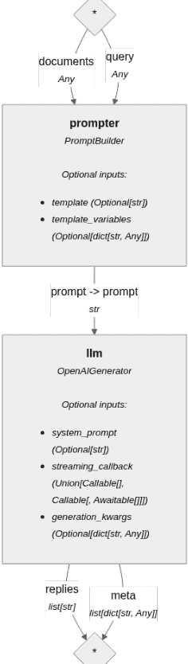

图 3.1 – 提示词的 Mermaid 图

可以在此处找到探索简单管道及其可视化的 Jupyter notebook：https://github.com/PacktPublishing/Building-Natural-Language-and-LLM-Pipelines/blob/main/ch3/jupyter-notebooks/your-first-pipeline.ipynb。

# 第 3 章

在图中可视化并显式连接组件的能力是透明度的巨大飞跃。然而，随着这些图的增长，你经常会发现自己在反复构建相同的模式。Haystack 提供了一种强大的抽象来解决这个问题。

### 超组件 (SuperComponents) —— 封装和复用复杂性

随着管道变得复杂，某些连接组件模式会反复出现。例如，标准的文档索引工作流可能始终由文件转换器、文档清理器、文档分割器、嵌入器和文档写入器组成，且都按顺序连接。在每个新管道中重新构建此子图将枯燥且容易出错。

为了解决这个问题，Haystack 2.0 引入了超组件的概念。超组件是一个预包的、可重用的管道，可以被视为大型管道中的单个组件。它封装了一个复杂的子图，仅向外部暴露必要的输入和输出插槽。

例如，之前描述的整个索引工作流可以封装进 `IndexingSuperComponent` 中。开发者只需一行代码将其添加到更大的管道中：

```python
pipe.add_component(
    name="indexer",
    instance=IndexingSuperComponent()
)
```

这极大地简化了主管道的定义，并促进了清晰、模块化的设计。超组件是管理复杂性和创建高级功能库的强大工具。让我们探索一个简单的模式，如提供的 notebook 所示。可以在此处找到探索超组件的 Jupyter notebook：https://github.com/PacktPublishing/Building-Natural-Language-and-LLM-Pipelines/blob/main/ch3/jupyter-notebooks/supercomponents.ipynb。

我们定义了一个预处理管道，用于清理并将文档分割成块。

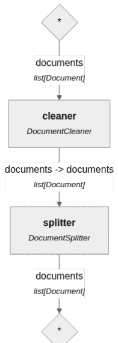

图 3.2 – 预处理管道的 Mermaid 图

在 notebook 中，我们将预处理管道抽象为预处理器超组件，然后将其连接到我们在自定义组件 notebook 中看到的前缀处理器组件，该地址为：https://github.com/PacktPublishing/Building-Natural-Language-and-LLM-Pipelines/blob/main/ch3/jupyter-notebooks/your-first-custom-component.ipynb。

最终管道定义仅包含两个组件：预处理器超组件和前缀处理器组件。可以在图 3.3 中清晰看到，该图可视化了最终管道结构，其中预处理管道被抽象为单个预处理器组件。

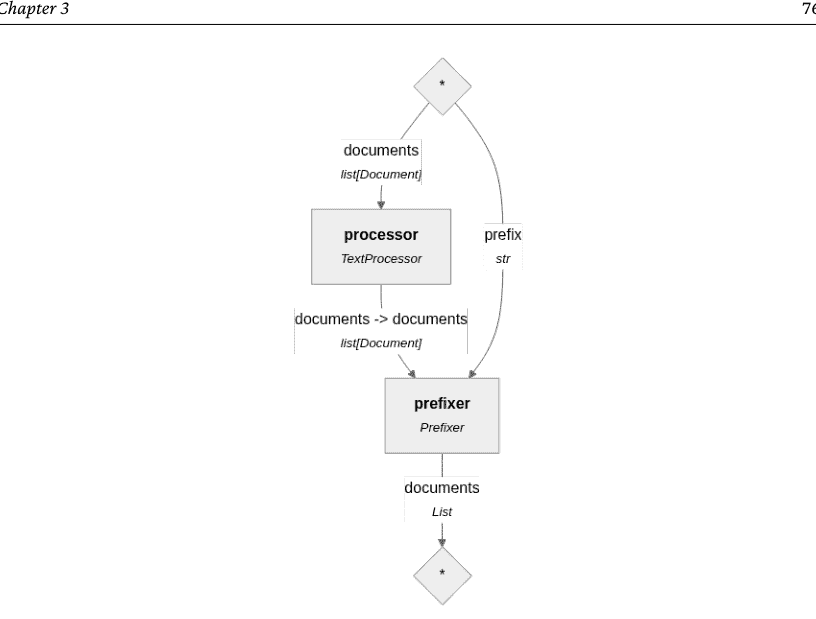

## 代理 (Agents) 与工具 (Tools) ——  LLM 驱动的推理

工具本质上是 Haystack 组件或抽象为超组件的整个管道的语义封装。它利用底层的确定性逻辑

- **Name**：短唯一标识符（例如：internal_knowledge_search）
- **Description**：工具能力的自然语言说明（例如：*搜索内部知识库*。**输入为字符串查询**）

当代理运行时，它会进入推理循环。它检查可用工具的描述，制定计划，选择合适的工具，生成输入并执行。输出（观察结果）会被馈回循环中。

这种架构创建了严格的层次结构：

*组件 -> 管道 -> 超组件 -> 工具 -> 代理。*


我们现在来分析这种层级结构的优缺点。

- **优点（可靠性）：** 这种层级结构确保了智能体的执行步骤由健壮且类型安全的引擎支持。由于工具是对经过验证的 Haystack 管道的封装，智能体调度的是可靠的、确定性的工作单元，而不是脆弱的脚本。

- **缺点（上下文不透明性）：** 正如我们在第 2 章中所探讨的，当前的上下文工程需要对智能体的状态和内存进行精确控制，以防止上下文腐化。Haystack 智能体内部封装了推理循环。这种黑盒方法隐藏了状态，使得难以实现高级的内存策展策略或像 LangGraph 这样的框架提供的复杂状态管理。

## 核心特性与优势

向 Haystack 2.0 的架构演进带来了大量特性，使其成为现代 AI 堆栈中工具层的理想引擎。这些优势直接源于其核心设计原则：显式图、类型化合约和模块化：

- **透明度和可调试性：** 这是生产工程中最大的优势。通过要求在类型化组件插座（sockets）之间建立显式连接，框架消除了不透明数据传递的歧义。开发者可以确切看到数据来自何以及流向何处。`.draw()` 方法补充了这一点，它可以渲染管道的实际图结构，将调试从一种游戏变成了标准的检查任务。

- **通过 DAG 实现灵活性：** 采用 DAG（有向无环图）架构允许任意复杂的工作流。虽然简单的 RAG 管道是线性的，但框架原生支持非线性路径，例如条件路由（如果是 PDF 使用 OCR；如果是文本则跳过）和并行分支。这允许你构建健壮的数据处理逻辑，优雅地处理边缘情况而不是崩溃。

- **可扩展性与部署：** deepset 引入了 HayHooks https://docs.haystack.deepset.ai/docs/hayhooks/，这是一个通过序列化和加载管道将 Haystack 部署为 REST 端点的框架。这使得 Haystack 成为完美的能力提供者，允许你构建作为独立微服务运行的复杂确定性工具。

- **支持智能体的架构：** Haystack 2.0 的架构旨在作为智能体系统的后端。在内部，它的 SuperComponent 和工具抽象允许你将任何组件（或整个 RAG 管道）封装成具有清晰描述的单一能力单元。在外部，当与 Hayhooks 结合时，这些管道变成了工具，可以通过模型上下文协议（MCP）被其他框架的智能体轻松消费，MCP 是连接 AI 应用程序与外部系统的开放标准（https://modelcontextprotocol.io/docs/getting-started/intro, https://docs.haystack.deepset.ai/docs/hayhooks/mcp-support）。

- **可扩展性：** 如本章介绍的以及我们在第 5 章及后续章节中看到的，创建可以作为 Haystack 管道一部分与现有元素连接的自定义组件遵循简单的路径。`@decorator` 装饰器为封装自定义逻辑提供了极极的接口。这种低门槛确保了微组件设计模式，将特定逻辑封装在可重用的块中，而不是单体脚本。

- **全面的生态系统：** Haystack 与更广泛的 MLOps 领域无缝集成，防止了供应商锁定。它支持所有主要的模型提供商（OpenAI, Hugging Face, Cohere, Azure, Google 和 Amazon），并提供了生产级向量数据库（Pinecone, Weaviate 和 Qdrant）以及评估框架（Ragas 和 DeepEval）的集成。这些这些特性使其成为一种健壮、适应且可扩展的解决方案，用于构建可以作为智能体系统一部分的 RAG 和数据处理工作流。现在，让我们探索使用这些特性可以构建的实际应用和模式。

## 用场景与应用

本节提供了构建 2025 年 RAG 和智能体应用中一些常见模式的实用指南，展示了如何将高层概念映射到具体的 Haystack 组件和管道上。重点从构建单一类型的系统转向理解如何组合组件以创建针对特定需求的定制解决方案。

## 构建 RAG 管道

RAG 是现代 LLM 应用的基石，允许模型根据私有知识库回答问题，从而减少幻觉并提供最新的、有据的信息。Haystack 2.0 在构建 RAG 系统方面表现出色，提供了实现从基础设置到顶尖混合搜索管道的所有组件。

构建 RAG 系统的一个关键概念是将关注点分离为两个不同的管道：索引管道和查询管道：

- **索引管道：** 该过程处理知识库的摄取和归一化。它将范围涵盖从非结构化 PDF 和数据到结构化 JSON 的原始输入转换为 DocumentStore 中可检索的向量。传统上被视为离线任务，Haystack 2.0 的自定义组件架构允许这些管道实时运行，例如通过使用自定义消费者组件直接从 Kafka 等事件流中触发摄取。
- **查询管道：** 这是负责回答请求的在线实时管道。它接收输入查询，从 DocumentStore 中检索相关内容，并使用 LLM 合成答案。在我们的架构中，当由用户直接触发时，该管道经常作为智能体调用的工具进行搜索。该管道的复杂性随策略异；让我们检查三种最常见的场景：语义搜索、词汇搜索和混合检索。

在构建现代 RAG 系统时，最重要的架构决策之一是如何检索信息。今天最有效的方法是混合检索。这种策略结合了不同的搜索方法，创建了一个既强大又灵活的系统。

为了理解为什么混合检索是必要的，我们首先需要查看使用单一搜索方法的局限性。用户查询范围从宽泛的概念性问题到对非常具体的字面信息的请求。一个健壮的 RAG 系统需要有效处理这整个范围。

### 语义搜索：稀疏检索器 (BM25)

传统的搜索系统依赖于基于关键词的，即稀疏检索。这种方法的常用算法是 BM25。这些系统通过匹配用户查询中的精确单词来工作。

- **优点：** 稀疏检索快速、高效，且无需任何模型训练即可工作。它在用词至上的情况下（如法律研究或技术文档）表现出色。
- **缺点：** 它的主要缺点无法理解同义词或概念关系，使其在面对语言多样性时非常脆弱。

### 词汇搜索：密集检索器 (嵌入)

为了解决词汇不匹配问题，开发了密集检索。这种技术使用嵌入模型将查询和文档转换为数值向量（即嵌入）。这些向量捕捉了文本的语义。系统随后寻找向量表示与查询最接近的文档。

- **优点：** 密集检索非常擅长理解细微差别、上下文和意图。它能够找到概念上相关的文档，即使关键词完全不同。
- **缺点：** 在捕捉宽泛含义的过程中，密集检索有时会忽略特定的、字面的术语。对精确错误代码（例如 HTTP 404）的搜索可能会返回关于通用网络服务器的文档，而不是包含该精确、关键字符串的那个文档。


| 特性 | 稀疏 (BM25) | 稠密 (Embeddings) |
| --- | --- | --- |
| 表示形式 | 高维稀疏向量（倒排索引） | 低维稠密向量 |
| 优点 | 关键词高高、计算开销小、无需训练 | 能处理同义词和概念、理解语法、对词汇不匹配具有鲁棒性 |
| 缺点 | 词汇不匹配、缺乏语义理解、脆弱 | 可能会漏掉特定关键词、计算开销大、需要训练数据 |
| 计算特征 | 索引快；查询极快 | 索引慢（需要嵌入）；查询快（配合 ANN 时） |
| 理想用例 | 法律搜索、产品代码、以及包含特定术语或名称的查询 | 通用问答、主题探索和概念性搜索 |

表 3.2 – 稀疏 vs. 稠密检索

如你所见，稀疏检索和稠密检索的缺点是互补的。当一种方法失效时，另一种方法往往能成功。这就是为什么最稳健的 RAG 系统会结合两者的优点。一个顶尖的系统必须能够以同样的技能处理概念查询（例如：“机器意识的哲学意义是什么？”）和精确查询（例如：“查找提到‘Project Chimera’和‘2023年第三季度’的文档”）。混合检索不仅是技术升级，它是构建系统的核心设计原则，使其能够适应人们寻求信息的灵活且多样化的方式。我们将在下一节深入探讨这项技术。

# 第 3 章

### 混合检索

一旦你理解了各个组件，下一步就是设计一个能够融合其结果的系统。实现这一目标有两种主要的架构模式：由你控制的灵活流水线（pipeline）方法，以及集成到数据库中的精简化方法。最常见且灵活的架构是流水线方法。在这种模型中，你的应用程序代码通过一系列步骤来编排整个过程：

- **并行获取：** 用户的查询被同时发送给稀疏检索器（如 BM25）和稠密检索器。每个检索器都会返回其排序后的候选文档列表。

- **融合：** 将两个结果列表合并为一个集合。实现此点的简单方法是合并列表并去重。更先进且有效的技术是倒数排名融合（Reciprocal Rank Fusion, RRF），它根据文档在每个列表中的位置进行重新排序，避免了比较两个不同评分系统的复杂问题。

- **排序：** 合并后的列表被传递给最终的重排序模型（可以是使用 BAAI/bge-reranker-base 的 Transformer 模型：https://huggingface.co/BAAI/bge-reranker-base-base）。这通常是一个交叉编码器（cross-encoder），它同时查看查询和每份文档，提供更准确的相关性评分。这一步计算密集，但对于将候选结果过滤为最相关的结果并传递给语言模型至关重要。

此过程中的每一步都可以映射到流水线中的一个组件，如下链接所示：https://github.com/PacktPublishing/Building-Natural-Language-and-LLM-Pipelines/blob/main/ch4/jupyter-notebooks/images/hybrid_rag_pipeline.png。

让我们在下一节看看这个过程是如何映射的。

## 高级 RAG 流水线

此示例使用了客户端侧融合模式，展示了 Haystack 的模块化架构如何轻松地组合组件。流水线被设置为一个图，用户的查询通过两个并行分支，一个用于稀疏检索，一个用于稠密检索。然后将结果进行合并、为了精确性进行重排序，最后发送到生成器以创建一个：

- **稀疏检索分支：** 这是一个关键词精度引擎。它执行 BM25 搜索以找到包含查询中精确术语的文档。

- **稠密检索分支：** 该分支处理语义搜索。嵌入器（embedder）将查询转换为向量，基于嵌入的检索器使用该向量寻找概念上相似的文档。

- **融合组件：** 该组件获取两个分支的文档列表，合并它们并移除任何重复项。

- **重排序组件：** 这是精度引擎。它使用交叉编码器模型同时查看查询和每个候选文档，产生最相关文档的最终、高精排序。

- **生成阶段：** 最终的高质量文档列表由提示词构建器组件格式化为提示词（prompt）。然后，该提示词被发送到 LLM 生成组件，该组件使用 LLM 综合信息并生成最终答案。

我们将在下一章中深入探讨如何导入和初始化现有组件，并将它们作为流水线的各个连接起来。让我们探索另一个 Haystack 2.0 特别适用的用例：智能体应用和 RAG。

## 开发智能体系统

Haystack 2.0 中智能体（agents）和工具的引入代表了应用开发的根本转变，无论你选择哪种架构模式。它将开发者的角色从人类的严格流水线构建者转变为智能体的能力提供者。

对于利用 Haystack 原生智能体能力的开发者，这种转变允许你创建一组稳健、描述清晰的工具，并信任内部由 LLM 驱动的单智能体智能体系统（https://haystack.deepset.ai/tutorials/45_creating_a_multi_agent_system）来动态编排它们。这种方法简化了复杂性，允许系统处理意外查询，而无需为每个边界情况显式编程。

对于喜欢 LangGraph 粒度控制的开发者，通过序列化 Haystack 流水线并通过 Webhooks 或 MCP 服务器部署，可以将 Haystack 从本地库转换为稳健的确定性微服务引擎。

在两种架构中，结果都是相同的：你正在构建可靠的、自包含的智能单元，这些单元可以由推理引擎发现并产生。

然而，这种转变引入了新的挑战和机遇。调试不再仅仅是检查组件之间的数据流；而是分析 LLM 的推理轨迹（思维和工具选择），以理解它为何以某种方式运行。提示词工程的艺术也扩展了；它不再仅仅是为最终生成编写提示词，而是编写清晰且有效的工具描述来引导智能体的推理过程。

## 作为工具的 RAG

Haystack 2.0 的组合性使得从流水线到智能体的转换异常容易。上一节构建的顶尖 RAG 流水线可以封装成单个工具。这是通过创建一个工具实例并提供以下内容的：

- **名称：** internal_knowledge_search
- **描述：** 使用此工具搜索我们的内部文档数据库。它是获取我们产品、内部政策和历史项目数据的最佳来源。输入应该是清晰、具体的问题。
- **实例：** hybrid_rag_pipeline 对象本身。

通过这种方式，复杂的多步骤混合检索过程被抽象为智能体的一项强大能力。我们可以将其将其扩展为多工具智能体系统。

## 构建多工具智能体

当智能体拥有多个不同工具的访问权限时，真正的威力得以实现。我们可以创建一个第二个工具来搜索实时网页：

1. 使用 Serper Web 组件创建一个简单的流水线，该组件是低成本 Google Search API 的集成。
2. 将此流水线封装另一个另一个工具：

- **名称：** web_search
- **描述：** 使用此工具从公共互联网查找最新信息。它最适用于时事、竞争对手新闻或非我们公司特定的通用知识问题。
- **实例：** web_search_pipeline 对象。

当给这个智能体一个复杂的查询时，例如“总结我们的内部 Q3 报告，并将主要产品的功能与竞争对手的最新发布进行对比”，它可以推理如何解决：

1. **思考：** 查询包含两个部分。第一部分关于内部报告。internal_knowledge_search 工具描述为最适合。
2. **行动：** 智能体调用 internal_knowledge_search 工具，输入 Q3 性能报告。
3. **观察：** 它从 RAG 流水线收到了报告摘要。


4. 思考：现在我需要查找有关竞争对手最新发布的信息。这是外部的最新信息。`web_search` 工具最适合这个。

5. 操作：代理调用 `web_search` 工具，输入为 `competitor X latest release features`。

6. 观察：接收到了网页搜索结果列表。

7. 思考：我现在拥有了所需的所有信息。我将综合内部报告摘要和竞争对手功能列表来找到最终答案。

8. 答案：代理生成了一个全面的回复，回答了用户原始查询的两个部分。

这种方法可以通过设计代理系统在 Haystack 之外进一步推广，使得多代理系统中的每个代理都与一个或多个部署为 REST 端点或通过 MCP 服务器服务的 Haystack 流水线配对。现在让我们来看看为了将 Haystack 整合到你的 RAG、高级 RAG 和代理 RAG 工作流中可以采取的具体步骤。为了构建作为工具或部署端点的健壮流水线，你需要牢掌握 Haystack 提供的特定现成组件。

## 深入研究 Haystack 2.0 架构

本节将概述 Haystack 2.0 中可用的数据结构和现成组件。关键数据结构包括表示要存储文档的 Python 对象、存储图像、音频和基于 HTML 的数据的字节流对象，以及表示人类与 LLM 之间消息的对象。这些数据结构可以通过文档存储（document stores）和自定义组件进行组织和管理。我们将从基础构建块开始——定义和自定义组件以及流水线：数据类。

### 数据类

在深入研究组件之前，理解在它们之间流动的核心数据结构非常重要。Haystack 提供了一系列定义良好的数据类，用于表示流水线中处理的对象：

- * Document（文档）：最基础的数据类。它封装了可以被处理和存储的数据。Document 对象可以包含文本（content）或二进制数据（blob），以及唯一 ID、自定义元数据、相关性评分、密集向量嵌入（dense vector embedding）以及用于混合检索场景的稀疏嵌入（sparse_embedding）。

- * ByteStream（字节流）：代表转换为文本之前的原始二进制数据，例如图像或 PDF 文件。它包含字节形式的数据和相关的元数据，包括 `mime_type`（例如 `image/png`）。

## 第3 章

- * ChatMessage（聊天消息）：用于构建对话式应用程序和代理。与简单的文本字符串不同，ChatMessage 是结构化对象，可以包含多态内容，包括文本、图像（ImageContent）、工具调用（ToolCall）和工具结果（ToolCallResult）。它显式定义了发送者的角色（用户、助手、系统或工具）。

- * StreamingChunk（流式块）：用于处理实时响应的专用类。它封装了流式内容的单个片段（如 token）以及相关的元数据和潜在的工具增量（tool deltas），实现了流畅、低延迟的用户体验。

- * Answer（答案）：表示流水线最终输出的类族：

- * GeneratedAnswer（生成答案）：表示由 LLM 生成的答案，包含答案字符串和用于生成的源 Document 对象列表。

- * ExtractedAnswer（提取答案）：用于抽取式问答系统，代表直接从源文档提取的特定文本范围。

核心数据类（Document, ByteStream, ChatMessage, StreamingChunk, Answer）是 Haystack 流水线的基石，代表了在组件之间严格流动的标准化信息。任何 RAG 系统中最关键的组件之一就是持有这些文档的组件。

### 文档存储（Document stores）

DocumentStore 是存储 Document 对象以供检索的数据库后端。Haystack 的架构明确将存储层（DocumentStore）与访问层（retriever）分离开。DocumentStore 在流水线之外进行配置和管理，而相应的 retriever 在流水线内部被用于获取数据。Haystack 支持广泛的文档存储，包括用于快速原型开发的内存选项和生产级向量数据库：

- * In-memory（内存型）：

- * Vector databases（向量数据库）：ChromaDocumentStore, PineconeDocumentStore, WeaviateDocumentStore, QdrantDocumentStore 和 MilvusDocumentStore

- * Traditional search engines（传统搜索引擎）：ElasticsearchDocumentStore 和 OpenSearchDocumentStore

- * Other databases（其他数据库）：AstraDBDocumentStore (Cassandra), MongoDBAtlasDocumentStore 和 Neo4jDocumentStore (Graph)

根据项目的规模和现有基础设施选择正确的文档存储是关键架构决策。有了数据类和存储定义，我们现在可以调查执行工作的组件类别。可以在它们的集成页面（https://haystack.deepset.ai/integrations?type=Document+Store）下找到支持的文档存储列表。Haystack 还支持创建自定义文档存储。可以在此处找到指南：https://docs.haystack.deepset.ai/docs/creating-custom-stores。

### 组件类别

让我们探索 Haystack 2.0 中的现有组件。这些组件是构建任何流水线或代理的构建块。它们根据图 3.4 所示的在典型端到端工作流中的功能被组织成逻辑类别。

| 数据预处理 | 数据嵌入 | 数据检索 | LLM 生成 | 路由 | 自定义组件 |
| :--- | :--- | :--- | :--- | :--- | :--- |
| 提取 | 使用嵌入 | 使用密集、稀疏 | 注入查询和 | 分支 | 合并 |
| 标准化模型来自 | 各提供者 | 检索器来获取 | | | |
| 格式转换 | | | | | |
| 分割 | | | | | |

预定义组件分类为数据预处理、嵌入、检索、路由和代理功能的组件。我们可以通过自定义组件扩展 Haystack 的功能。我们将在第 5 章深入探讨这一点。现在让我们详细扩展关键类别。

### 数据预处理组件

这些组件通常是索引流水线的第一步，负责摄取原始数据并为索引做准备：

- * File converters（文件转换器）

- * Web component（网页组件）：该组件从 URL 列表中检索内容，返回 ByteStream 对象（https://docs.haystack.deepset.ai/linkcontentfetcher）。

- * Preprocessing components（预处理组件）：准备你的数据、规范化空格、删除页眉页脚、清理文档中的空行，或将其分割成更小的片段（https://docs.haystack.deepset.ai/processors/）。

- * Audio components（音频组件）：将音频文件转换为文本（https://docs.haystack.deepset.ai/audio）。

这些转换器预处理组件对于任何 RAG 流水线的“摄取”阶段至关重要。一旦文档经过清理和分块，下一步是将它们的语义转换为数据库可以搜索的格式。

### 数据嵌入组件

Embedder 是使用深度学习模型将文本转换为数值表示的组件。Haystack 提供了用于嵌入文档（用于索引）和查询（用于搜索）的独立组件，因为某些模型对每个任务有不同的最佳设置：

- • OpenAI: OpenAIDocumentEmbedder

- • Sentence Transformers: SentenceTransformerDocumentEmbedder 和 SentenceTransformersTextEmbedder。从 Hugging Face Hub 加载任何兼容模型，提供了巨大的灵活性。

- • 其他提供者：Haystack 与其他嵌入模型提供者的集成列表不断增加，例如 Coere 和 Hugging Face。完整列表可以在此处找到：https://docs.haystack.deepset.ai/docs/embedders。

Embedder 组件为索引和搜索创建向量表示。一旦文档经过处理和嵌入，就需要它们保存到 DocumentStore。

DocumentWriter 是索引流水线的最后一步。它接收 Document 对象列表并将其写入指定的 DocumentStore。它包含了处理重复文档的策略（例如：跳过、覆盖或失败）。它处理索引流水线的最后步骤。

现在我们转向查询流水线使用的组件，从获取数据的组件开始。


## 数据检索组件

检索器（Retrievers）是任何搜索或 RAG 应用的核心。它们负责根据查询从 DocumentStore 中获取一小部分相关文档。它支持基于嵌入（embedding）和基于关键词的搜索。Haystack 2.0 支持针对多种数据库提供者的检索器。可以在此处找到完整的检索器列表：https://docs.haystack.deepset.ai/docs/retrievers。

检索器执行寻找潜在相关文档的关目第一步。在高级 RAG 流水线中，这些初始结果集会经过精炼以提高质量。

虽然检索器获取相关信息，但排序器（rankers）用于通过重新排列检索器返回的文档来提高搜索质量。它们是高级 RAG 流水线的关键组件。排序器有助于确保将最相关的文档传递给最终步骤。可以在此处找到支持的排序器列表：https://docs.haystack.deepset.ai/docs/rankers。

接下来让我们看看使 LLM 使用检索到的上下文来增强响应的组件。

## LLM 生成组件

这些组件负责与 LLM 交互以生成文本，并构建引导它们的提示词（prompts）：

- **生成器（Generators）**：包括 OpenAIGenerator、HuggingFaceIGenerator 和 AnthropicGenerator。这些组件处理到所有 LLM 提供者的 API 调用，接收提示词并返回生成的文本响应。可以在此处找到支持的提示词列表：https://docs.haystack.deepset.ai/docs/generators。

- **构建器（Builders）**：这些组件帮助我们构建与流水线连接的有效提示词：
    - PromptBuilder：用于从模板创建提示词的灵活组件。它可以将查询和检索到的文档等变量替换到预定义的提示词结构中，确保提示的一致性和有效性。
    - AnswerBuilder：用于从生成器的原始输出中解析结构化 `Answer` 对象的工具，通常使用正则表达式。
    - ChatPromptBuilder：一种用于类聊天应用的特殊构建器。

这些组件处理 RAG 流水线的最后的生成部分。为了构建更复杂的非线性的工作流（例如我们讨论过的混合检索流水线），Haystack 提供了逻辑和控制流的组件。

## 路由组件

这些组件对于构建由 DAG 架构支持的复杂非线性流水线至关重要。路由器（Routers）是一组组件，将查询或文档路由到其他可以处理它们的组件，而连接器（joiners）允许我们合并文档、数据结构甚至流水线：

字体 连接器：https://docs.haystack.deepset.ai/docs/joiners
- 路由器：https://docs.haystack.deepset.ai/docs/routers

路由器和连接器是实现复杂 DAG 的“管道”。最后，我们还有高层组件，它们能够实现我们之前通过智能体工作流探索的基于推理的动态系统。

## 智能体组件

这些是构建智能体系统的高层组件：

- 智能体（Agent）：核心推理引擎。它接收查询和工具列表，并编排工具以产生答案（https://docs.haystack.deepset.ai/docs/agent）。
- 工具调用用器（ToolInvoker）：用于由语言模型执行工具调用（https://docs.haystack.deepset.ai/docs/toolinvoker）。

这些组件构成了从简单搜索到复杂智能体的构建完整工具包。在对所有可用构建块有清晰理解的基础上，让我们概述一个在你的项目中使用它们的结构化流程。

## 将 Haystack 纳入你的工作流

将像 Haystack 2.0 这样的框架集成到你的项目中需要结构化的方法。本节提供了分步指南，帮助你从初始评估到设计和调试你的 NLP 应用。

## 评估你当前的数据系统

在编写任何代码之前，第一步是对你的项目需求和现有基础设施进行彻底评估。这种基础分析将指导你的设计选择并确保无缝集成：

- 1. 定义 NLP 目标：清晰地阐述你想什么。你是在为内部文档构建问答系统、为客户支持构建聊天机器人，还是构建一个自动化业务流程的自主智能体？你的目标是确定需要构建的流水线的复杂度。
- 2. 评估数据源：识别你数据的类型和来源。它是数据库中的结构化数据，还是 PDF、Word 文档和 HTML 文件中的非结构化文本？理解数据格局对于选择正确的转换器（converter）和预处理组件至关重要。
- 3. 评估基础设施和兼容性：考虑你的部署环境。应用程序将在本地还是云端运行？绘制出现有的数据库系统，并检查它们与 Haystack DocumentStore 集成的兼容性。如果你计划使用 Pinecone 或 Weaviate 等向量数据库，请确保你的基础设施能够支持它。
- 4. 考虑数据动态和治理：你的数据变化频率是多少？基于静态数据构建的系统其索引策略与处理实时数据流的系统完全不同。此外，评估数据的敏感性。预先建立的数据治理和安全程序对于管理敏感信息、规划成本和维护用户信任至关重要。

初始评估对于定义项目的范围和技术要求至关重要。一旦你有了明确的目标并了解数据，就可以开始设计流水线本身。

 使用 Haystack 2.0 设计你的 NLP 流水线

在清晰理解需求后，你可以开始设计你的流水线了。Haystack 2.0 显式的、基于图的特性有利于视觉优先的设计流程。

以下步骤可以帮助你将项目目标映射到 Haystack 2.0 框架中：

- 1. 绘制草图：在编写代码之前，在白板或图表中画出所需的工作流。将每个处理步骤表示为节点（组件），并画箭头以显示它们之间的流。例如，混合 RAG 查询将显示查询分为两条并行路径，然后并在连接器处合并，流经排序器，最后进入生成器。
- 2. 将草图转换为代码：以视觉图为指南，将其翻译为代码是一项简单的任务：
    - 1. 定义图中的每个节点/组件。
    - 2. 实例化流水线。
    - 3. 对于每个节点，使用 `add_component()` 添加相应的组件。
    - 4. 对于草图中的每个箭头，使用 `connect()` 将组件连接起来。
- 使用 `draw()` 验证：在代码中定义流水线后，立即运行 `draw("pipeline_design.png")`。将生成的图像与你的初始草图对比。这个简单的验证步骤可以尽早发现逻辑错误，并确保你的代码准确反映了设计。

这种视觉优先的迭代设计过程有助于确保代码符合预期逻辑。对于新接触 Haystack 2.0 的团队，一次处理所有复杂度可能会令人敬畏，因此建议遵循渐进式的开发路径。

## 推荐的开发路线图

对于初接触 Haystack 2.0，增量地构建复杂度是有益的。推荐的学习路径如下：

- 1. 构建索引流水线：从关注数据准备开始。创建一个能够成功获取源文件、处理它们、嵌入它们并将它们写入 DocumentStore 的流水线。正确完成这一点是任何 RAG 系统成功的基础。
- 2. 构建朴素 RAG 流水线：一旦数据被索引，就构建最简单的查询流水线：嵌入查询、通过向量相似性检索文档并生成答案。这将为你提供一个端到端的基准。
- 3. 增强为混合 RAG 流水线：通过实现混合检索策略改进你的基准。添加并行的 BM25 检索路径，合并结果，并添加重排序器以提高提供给 LLM 的下文质量。在这个阶段，你将拥有一个先进的 RAG 系统。
- 4. 评估原生方法与混合方法的质量：一种常用方法是使用如 Ragas 等框架从知识库生成图，创建角色（personas）并选择查询策略来构建问答对，针对 RAG 流水线的实际响应进行系统性评估。我们将将其作为实操项目的一部分。
- 5. 毕业到适用于智能体的工具：作为最后一步，将你的高级级混合 RAG 流水线封装成一个工具。你可以通过将其交给标准的 Haystack 智能体立即在本地进行验证。一旦通过验证，最终的生产环境迁移（也是本书的架构重点）是将流水线序列化，使用 Hayhooks 将其部署为 REST 微服务，并将该端点交给 LangGraph 等有状态的编排器。


这种增量方法允许你构建并验证系统的每个部分，从数据索引到功能完备的智能体。与任何复杂软件一样，你会在过程中不可避免地遇到问题。

## 常见问题故障排除

即使是设计良好的系统，问题也会出现。有效的故障排除是构建健壮应用的关键。表 3.3 概述了常见问题及可能的修复。

| 常见问题 | 可能的原因 | 可能的修复方法 |
|---|---|---|
| 数据摄取和处理错误 | 预处理组件中的文件路径不正确或分大小配置不合理 | 密切关注转换器和预处理器组件的日志以识别错误。确保文件正确并调整分大小。 |
| 流水线连接错误：PipelineConnect | 尝试使用不兼容的数据类型连接套接，或连接不存在的套接 | 使用 `.draw()` 方法视觉化检查连接，并确保它们与组件定义匹配。 |
| 模型和性能瓶颈 | 重型模型（如嵌入器和排序器）在处理之前未初始化，或 LLM 生成延迟天然较高 | 在处理请求之前对重型组件调用 `warm_up()` 方法。对于 LLM 延迟，考虑使用流式传输以改善用户体验。 |
| 智能体行为异常 | 工具描述编写不当或模糊，误淆了智能体的推理 | 在日志中检查智能体的推理轨迹（思考、工具选择和观察）。精炼定义工具能力的自然语言提示词。 |
| 常见问题 | 可能的原因 | 可能的修复方法 |
| --- | --- | --- |
| 数据安全和隐私风险 | 硬编码 API 密钥/凭据，或忽略数据驻留和合规性要求 | 通过环境变量或密钥管理系统安全地管理凭据。在使用云提供商时要留心。 |

表 3.3 - 常见错误、可能的原因及可能的修复方法

有效调试确定性流水线和动态智能体是构建可靠应用的关键技能。最后，支撑所有开发的一个关键方面是确保你的数据安全和隐私。遵循故障排除和安全最佳实践将帮助你构建健壮的、生产就绪的系统。现在让我们通过总结本章涵盖的核心概念来结束学习。

## 总结

在本章中，我们介绍了 deepset 及其旗舰开源框架 Haystack。我们追溯了它的演变过程：从在 FARM 等框架时代对 BERT 等模型进行微调的根源，到作为 Haystack 2.0 的完全架构重生——这是一个专为现代 LLM 景观设计的框架。

我们将注意力放在了 Haystack 2.0 上，它是构建端到端 NLP 应用的顶级 Python 包。我们了解到，它的功能远超简单的搜索，能够构建复杂的问答系统、先进的 RAG 流水线以及动态的自主智能体。Haystack 2.0 强大的核心在于其新的构建块：

- **组件 (Components)**：使用 `@component` 装饰的简单、可重用的 Python 类，执行单一且定义良好的任务。
- **流水线 (Pipelines)**：显式的、Python 原生的有向无环图 (DAG)，将组件编排成复杂的非线性工作流。
- **超级组件 (SuperComponents)**：预包的、可重用的流水线，可以在更大的流水线内被视为单个组件。
- **智能体和工具 (Agents and tools)**：最高层次的抽象，由 LLM 驱动的智能体从一组可用工具（封装的组件或流水线）中动态选择，以推理出解决方案。

deepset 提供的 Haystack 简介

我们探索了如何将 Haystack 整合到真实工作流中，从对数据基础设施需求的彻底评估开始。我们详细介绍了实用的、视觉优先的流水线设计方法，并概述了清晰的开发路线图，从构建基础索引流水线到部署多智能体工具。通过这些探索，我们学会了 Haystack 2.0 如何为旨在构建下一代 LLM 驱动应用的开发者提供透明、灵活且强大的基础。在下一章中，我们将深入研究实际实现，将这些组件组成为功能完备的流水线，并结合实际代码示例探索常见案例。

## 延伸阅读

- Jiao, X., Yin, Y., Shang, L., Jiang, X., Chen, X., Li, L., Wang, F., & Liu, Q. (2020). TinyBERT: Distilling BERT for Natural Language Understanding. https://aclanthology.org/2020.findings-emnlp.372/
- Devlin, J., Chang, M.-W., Lee, K., & Toutavan, K. (2019). BERT: Pre-training of Deep Bidirectional Transformers for Language Understanding. https://arxiv.org/abs/1810.04805.
- Wiggers, K. (2022, April 28). Deepset raises $14M to help companies build NLP apps. TechCrunch. https://techcrunch.com/2022/04/28/deepset-raises-14m-to-help-companies-build-nlp-apps/
- Liu, Y., Ott, M., Na, D., Du, J., Joshi, M., Chen, D., Levy, O., Lewis, M., Zettlemoyer, L., & Stoyanov, V. (2019). RoBERTa: A Robustly Optimized BERT Pretraining Approach. arXiv:1907.11692. https://arxiv.org/abs/1907.11692.
- Model Context Protocol (MCP). What is the Model Context Protocol (MCP)? https://modelcontextprotocol.io/getting-started/intro.
- Source. (2025, June). BM25 and Its Role in Document Relevance Scoring. https://www.sourcery.net/resources/bm25-and-its-role-in-relevance-scoring.

# **获取本书的 PDF 版本及额外内容**

这种增量方法允许你构建并验证系统的每个部分，从数据索引到功能完备的智能体。与任何复杂软件一样，你会在过程中不可避免地遇到问题。


## 设计流水线（Pipeline）的步骤

在本章中，我们将通过实践学习如何通过流水线连接组件，以满足各种用例。在本节中，我们将概述初始化 Haystack 流水线和连接组件的关键步骤。我们在这里概述主要的顺序步骤：

- 1. 选择并初始化组件：为流水线识别合适的组件；例如，索引流水线需要一个预处理器，以及拆分、嵌入和写入组件。带有增强生成的的检索器流水线则需要一个查询嵌入器、一个检索器和一个提示词生成器组件。
- 2. 创建流水线对象：通过使用 `Pipeline()` 类初始化流水线。这创建了你数据流的骨架，准备好填充组件。
- 3. 添加组件：使用 `.add_component(name, component)` 将单个组件添加到流水线中。此步尚未定义组件之间的数据流，但为集成各种功能为流水线做了准备，从数据提取、清洗到与 LLM 交互等功能。
- 4. 连接组件：使用 `.connect("producer_component.output_name","consumer_component.input_name")` 在组件之间建立连接。这一关键步骤定义了数据流，并确保上一个组件的输出正确地馈给下一个组件。Haystack 的设计允许复杂的数据流，包括分支和循环，以处理复杂的数据处理需求。
- 5. 运行流水线：使用 `.run({"component_1":"mandatory_inputs": value})` 执行流水线并指定初始输入。此操作将激活通过连接组件的数据流，根据定义的结构处理数据。
- 6. 可视化流水线：你可以使用 `pipeline.draw(paths="path/to/image.png")` 方法生成流水线的 Mermaid 图表。

上述工作流可以应用于各种用例。流水线的功能取决于所选组件以及它们连接的顺序。如果你的工作流需要重复或根据给定条件采取特定路径，Haystack 的流水线提供了分支功能。

# 第 4 章

## 利用分支

分支功能使你的流水线能够同时处理多种数据类型或处理需求。通过创建分支，你可以将特定数据引导到专门的组件进行目标处理。流水线内部的循环允许迭代处理，例如错误修正或数据精炼，增强输出的准确性和可靠性。

创建分支的关键组件是路由器（routers）。分支的场景示例可以在此处找到关于探索不同类型路由器的笔记本：

- 条件路由器：https://github.com/PacktPublishing/Building-Natural-Language-and-LLM-Pipelines/blob/main/ch4/jupyter-notebooks/routers/conditional_router.ipynb
- 元数据路由器：https://github.com/PacktPublishing/Building-Natural-Language-and-LLM-Pipelines/blob/main/ch4/jupyter-notebooks/routers/metadata_router.ipynb
- 文本语言路由器：https://github.com/PacktPublishing/Building-Natural-Language-and-LLM-Pipelines/blob/main/ch4/jupyter-notebooks/routers/text_language_router.ipynb

我们可以在图 4.1 中看到条件路由器是如何分支的。

## 整合组件——针对不同用例的 Haystack 流水线

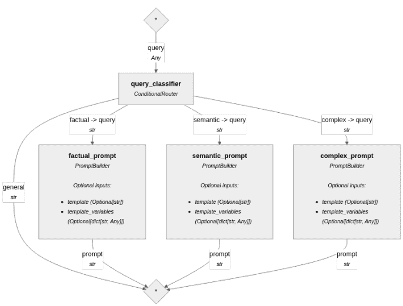

图 4.1 - 将提示词分类为事实性、语义性或复杂的条件路由器

**图 4.1** 中的的流水线使用 Haystack 的 **ConditionalRouter** 来检查每个入站查询并动态选择最佳处理路径。路由器评估一系列 Jinja2 条件，这些条件在查询文本中寻找模式（例如：针对事实性的 *when/who/what is the for*、针对语义性的 *how does/compare/difference* *between*，以及包含 *and* 的复杂查询）。若要了解更多关于 Jinja 和 Jinja 模板中条件的知识，我们建议你熟悉以下教程中的核心概念：https://pushmetrics.io/learn/jinja/what-is-jinja/。根据第一个匹配的条件，查询被路由到多个输出之一（**事实性、语义性或复杂性**），并连接到专用的 PromptBuilder，该生成器会生成不同风格的提示词（直接回答、详尽解释或详细分析）。最后的默认路由（条件：`{{ True }}`）确保每个查询都能得到处理，并且当我们运行流水线时，我们可以看到为每个查询选择了哪条路由以及生成了哪条提示词。

## 确保数据流的有效性

Haystack 流水线强调受控的数据流，只有连接的组件才会交换数据。这种方法不仅优化了处理速度，还通过隔离数据路径简化了调试。准确映射每个组件的输入和输出至关重要，以确保流水线内部无缝集成和数据交换。

Haystack 规划了确保组件能够逻辑连接的流，确保我们将文档转换为适当的数据结构和向量时，LLM 可以检索并返回适当的信息。核心假设是，当数据通过组件流过流水线时，每个组件将接受特定的数据结构作为输入并返回另一个作为输出。因此，连接组件的顺序非常重要。

例如，负责转换来自 PDF、网站和 Markdown 文件文本的组件将接受每个相应类型的文件（例如文档路径）作为输入，并返回 Haystack 文档对象（document objects）。这些文档对象随后可以作为负责文档内容向量化并将其存储在文档存储中的组件的输入。

当我们构建检索器流水线时，Haystack 假设流水线的输入是一个问题（字符串）和/或一个表示向量格式问题的浮点数列表。我们将在构建流水线的章节中概述不同场景的预期输入输出。

为了便于理解流水线内部的数据流，Haystack 集成了 `.draw()` 方法，可以创建可视化表示。我们将注意力转向下一个。

## 整合组件——针对不同用例的 Haystack 流水线

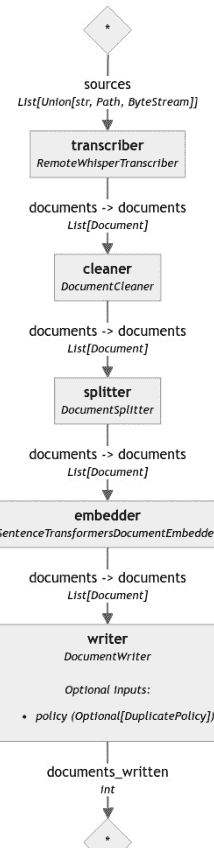

图 4.2 - 将音频向量的流水线 Mermaid 图

## 可视化与验证

可视化你的流水线（例如使用 Mermaid 图表）可以提供结构和数据流的清晰度，帮助你识别任何潜在问题。Mermaid 图是一种使用语法来可视化系统、流程和流的图表类型，常用于创建流程图、序列图、类图、状态图和甘特图。

在 Haystack 中，当组件连接时会自动进行验证，检查兼容性和配置，这有助于故障排除和优化流水线设计。通过 `.draw()` 方法，我们可以轻松创建数据流的 Mermaid 图。

例如在图 4.2 中，我们看到了一个音频文件索引流水线的数据流。该流水线的目标是获取音频文件并将内容的向量表示存储在文档存储中。

此流水线涉及的组件如下：

- RemoteWhisTranscriber：该组件使用 OpenAI Whisper 入口将音频转换为文本。
- DocumentCleaner：该组件从转录文本中删除异常字符。在处理过程中，异常字符通常指非标准、特殊或意外字符，可能会导致编码、显示或数据处理问题。
- DocumentSplitter：该组件将文本拆分为块，为向量化做准备。
- SentenceTransformerDocumentEmbedder：该组件将文本块转换为数值表示，保留语义含义。
- DocumentWriter：该组件将嵌入写入文档存储。

如果文档存储需要更新或需要添加新文档，此流水线流可以执行一次或多次。通过这一特定的流，我们可以自动化将音频转换为向量格式的过程，并让 LLM 从中检索信息。现有的组件还通过 Haystack 集成（integrations）得到了补充。

为了确保流水线能够连接到各种包、LLM 和嵌入提供商以及评估和观测框架，Haystack 开发了一个框架用于连接甚至开发 Haystack 流水线的集成。


可以集成到 Haystack 流线中的技术列表可以在 https://haystack.deepest.ai/integrations 找到。我们可以在这里找到关于如何实现每个集成的详细信息、其优势，以及为你的项目选择合适集成方案的指导。这种共同努力促进了 Haystack 生态系统的创新和持续改进，使用户能够突破信息检索及其他领域的可能边界。

在本节中，我们概述了在设计和构建 LLM 驱动的流水线时 Haystack 流水线的概要。这些包括：确保我们的流水线能够轻松适配并解决问题的灵活性；确保数据在组件之间进行转换和移动的高效数据流；用于处理和迭代文档的流水线分支和循环；确保我们能够通过 Python 脚本保存和共享流水线的序列化；以及引入尖端模型、向量数据库和增强流水线功能的集成方案。

至此，我们现在准备好按复杂度水平研究常见的 LLM 驱动的用例了。在下一节中，我们将概述 LLM 在不同领域的应用，重点关注 Haystack 流水线的特征是如何实现此类工作流的。

## 使用 Haystack 构建流水线：朴素 RAG 索引和混合 RAG

任何有效的 RAG 系统的核心都是两个不同但相互依赖的工作流：负责准备知识库的**离线索引流水线**，以及利用这些数据实时回答问题的**在线查询流水线**。本节提供了构建这两个基础支柱的蓝图。我们将首先构建一个多功能的索引流水线，它能够从多个源和格式摄取数据，然后构建我们的第一个查询流水线（朴素 RAG 系统），它作为后续所有内容（带排序的混合 RAG 系统）的功能基准。

## 索引流水线：准备你的知识库

索引流水线是一个关键过程。我们的首要目标是处理来自各种来源的非结构化或半结构化数据，将其转换为标准格式，并加载到 DocumentStore 中，以便进行高效搜索。一个设计良好的索引流水线是高性能 RAG 系统的基石，因为采集数据的质量直接影响检索质量，并最终影响生成的答案质量。

我们将构建一个可以同时处理多种混合数据源的索引流水线：实时网页、本地文本和 PDF 文件以及来自 CSV 文件的结构化表格数据。这是通过使用 FileRouter 实现的，该组件将不同数据类型重定向到相应的转换器，从而实现一个统一而专业的摄取工作流。关键步骤如图 4.3 所示：

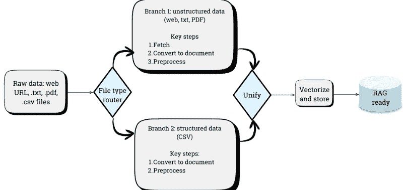

图 4.3 - 带有结构化和非结构化文本的索引流水线

我们的流水线将执行以下顺序的操作：

- 1. 获取并转换：从网络 URL、本地文本文件、PDF 和 CSV 摄取数据，并将每个转换为 Haystack 文档对象。
- 2. 分类：将原始数据源分为两个流：结构化和非结构化。
- 3. 预处理：清理文本、空格、特殊字符或正则表达式。
- 4. 合并：将来自不同转换器的文档流合并为一个单一列表。
- 5. 预处理：清理并将合并后的文档分割成较小的、语义连贯的块（chunks）以便进行嵌入。
- 6. 嵌入并写入：为每个文档块生成向量嵌入，并将最终的、丰富的文档写入 DocumentStore。

可以在此处找到探索带有路由的索引流水线实现的 Jupyter notebook：https://github.com/PacktPublishing/Building-Natural-and-LLM-Pipelines/blob/main/ch4/jupyter-notebooks/indexing_pipeline.ipynb。

将 notebook 中的代码想象为为数字图书馆构建一条流水线。主要目标是获取许多不同格式的“书”（实时网页、本地文本文件、PDF 和结构化 CSV 表格），正确地处理所有内容，并将它们归档到特殊的数据库（InMemoryDocumentStore）中。一旦进入该数据库，你就可以构建一个搜索引擎或聊天机器人（RAG 系统），它可以瞬时找到并理解来自所有不同来源的信息。

## 整合组件——适用于不同用例的 Haystack 流水线

此代码构建了一个基础索引流水线。这是一个关键的离线过程，其工作是准备你的知识库。该流水线的质量直接影响你最终应用程序的运行情况。让我们拆解该流水线是如何运作的：

### 第 1 阶段——收集和排序 (FileTypeRouter)

首先，我们收集所有的原材料（文件和网页）。然后，它们进入了我们工作流中最重要的组件：FileTypeRouter。该组件将分配输出插槽数据应该去的去向，并有四个不同的流：text/plain、application/pdf、text/html（用于爬取的网页内容）和 text/csv。

当我们调用 `indexing_pipeline.run((..))` 时，我们所有的本地文件（.txt、.pdf 和 .csv）都被发送到路由器。随后它处理每一个文件并进行“排序，将其发送到正确的处理道道”。这种为不同数据类型创建不同路径的能力被称为分支（branching），它是 Haystack 灵活设计的关键部分。通过这种方式，路由器将每个文件引导到正确的预处理流水线：

- haystack_intro.txt 仅发送到 text/plain 输出
- sample.pdf 仅发送到 text/PDF 输出
- 11m_models.csv 仅发送到 text/CSV 输出

下一阶段是通过分支处理结构化和非结构化数据。

### 第 2 阶段——处理（两个专门分支）

现在，我们的材料同时沿两条独立的、专门的流水线流动：

#### 分支 1，非结构化数据（Web、TXT、PDF）
此分支用于文本块：
1. 获取并转换：LinkFetcher 抓取网页，HTMLConverter、TextConverter 和 PDFConverter 共同工作，将各自的输入转换为标准的 Haystack 文档对象。
2. 合并：unstructured_doc_joiner 将来自这些不同转换器的所有文档收集到的一个列表中。
3. 预处理：text_cleaner 整理文本，text_splitter 将文档切成较小的 150 个词的块。这对于后续步骤至关重要。

#### 分支 2，结构化数据（CSV）
此分支专门为表格数据设计：
- 转换：csv_converter 简单地读取整个文件内容到单个文档。
- 预处理：
    - csv_cleaner：该组件处理表格非常智能。它移除了空行和空列（例如我们示例中的三逗号）。
    - csv_splitter：这是关键。我们设置了 `split_mode="row-wise"`。它将表格的每一行放入自己的文档中（例如“Company: OpenAI, Model: GPT-4”）。

现实世界的数据很少完美，因此我们的流水线需要针对意外情况的防御。第一道防线是 FileTypeRouter，它作为未知文件格式（如 .png）的安全阀。它将未匹配的文件重定向到未分类的路由，有效地忽略它们以防止阻塞机器。

然而，LinkFetcher 默认情况下更为严格；它会对损坏的 URL 抛出异常，这可能会导致流水线崩溃。为了防止这种情况，我们将其配置为 `raise_on_failure=False` 以直接跳过坏行。最后，即使是可访问的文件，如果证明是空的，也可能导致 DocumentSplitter 崩溃。为了解决这个问题，我们引入了 DocumentSanitizer，这是一个自定义关口，检查每个类型（为了健壮性跳过错误，为了质量进行清洗，确保流水线达到生产就绪）。在下一章中，我们将更深入地学习如何定义自定义组件。

### 第 3 阶段——统一、索引和上架

现在，我们将所有内容重新整合：

- 统一：final_doc_joiner 是重新合并点。它等待并收集所有处理过的文档（来自分支 1 的文本块和来自分支 2 的单独行）形成一个单一的大列表。


2. **索引：** `doc_embedder` 接收此统一列表。它读取每一个数据块（无论是文本还是 CSV 行）并将其转换为向量（捕捉其语义映射的数字列表）。

3. **上架：** 最后，`writer` 获取这些已完全处理的、“已索引”的文档（现在已拥有了强大的向量嵌入），并将它们“上架”到 `InMemoryDocumentStore` 中。

大功告成！你的库现在已经完全索引化。博客文章的文本、PDF 文件的内容以及 CSV 文件的每一行都并排存储，根据它们的含义进行理解和检索。这些处理后的数据现在存储在 `DocumentStore` 中，是我们构建问答能力的基础。下一步是构建 RAG 流水线，它将与此知识库交互以生成智能智能体。

生成的流水线可以使用内置的绘图功能创建其 Mermaid 图表进行可视化，可以在此处处找到：https://github.com/PacktPublishing/Building-Natural-Language-and-LLM-Pipelines/blob/main/ch4/jupyter-notebooks/images/indexing_pipeline.png。

## Naive RAG – 一个基础问答系统

Naive RAG 架构代表了 RAG 最直接的实现。它遵循一个简单的线性的两步过程：首先，检索一组与用户查询相关的文档；其次，根据这些文档中包含的信息生成响应。虽然它是 RAG 最简单的形式，但它本身就是一个至关重要的基准和强大的工具。

即使在这样的基础配置下，Haystack 的设计哲学也提供了显著优势。框架对显式连接（`pipe.connect()`）的坚持创建了一个“玻璃盒”架构。在 Haystack 流水线中的每一步都是透明且可追溯的。从初始的查询嵌入，通过检索器，再到提示词构建器，最后到生成器，数据流都由开发者显式定义。这种透明度对于调试和理解系统行为价值连城，为构建更复杂、更易维护的应用程序奠定了坚实基础。让我们来实现这一工作流。

我们的流水线将执行以下操作序列：

- 1. **查询向量化：** 对用户问题应用嵌入模型。
- 2. **检索相关上下文：** 使用嵌入后的问题从 `DocumentStore` 中检索相关信息。
- 3. **增强：** 通过提示词生成器，指令 LLM 根据用户查询和检索到的上下文来用自然语言回答问题。

探索语义搜索流水线实现的 Jupyter notebook 可以在此处找到：https://github.com/PacktPublishing/Building-Natural-Language-and-LLM-Pipelines/blob/main/ch4/jupyter-notebooks/semantic_search_pipeline.ipynb。

如果说第一个流水线是我们用于构建智能库的离线装配线，那么语义搜索流水线就是使用它的在线系统。语义搜索流水线是“管理员”，它接收用户查询，搜索已索引的架子，并实时生成感知上下文的答案。让我们拆解这条流水线来回答问题。

## 阶段 1 – 查询向量化

用户的问题是起点。但我们无法将文本问题与 `DocumentStore` 中的向量嵌入进行比较。我们首先需要将问题转换为相同的格式：

- 1. **操作：** 将用户的问题（例如，“什么是 Haystack 2.0？”）发送给 `SentenceTransformersEmbedder`。
- 2. **组件：** `text_embedder` 组件应用与索引期间使用的完全相同的嵌入。
- 3. **输出：** 这产生了一个“查询向量”，这是一个捕捉问题语义含义的数字列表。

这个初始阶段使得能够通过向量搜索检索语义相关的查询。让我们探索下一个阶段。

## 阶段 2 – 检索相关上下文

现在我们有了查询的向量，可以从库中找到最相关的文档：

- 1. **操作：** 将阶段 1 的查询向量输入到 `InMemoryEmbeddingRetriever`。
- 2. **组件：** 检索器组件获取此向量并将其与存储在 `DocumentStore` 中的所有文档向量比较。它找到含义与问题含义最相似的 `top_k=3` 文档。
- 3. **输出：** 这产生了一个文档对象列表。这些可以是来自网页、文本文件或 CSV 行的块，取决于哪个最相关。

这些文档对象现在与原始查询一起被“注入”到提示词模板中，该模板用于引导 LLM 应如何回答。

## 阶段 3 – 增强并生成

我们获取检索到的事实并使用它们来构建答案。

- **操作（增强）：** `PromptBuilder` 组件接收两个输入：原始问题和来自检索器的文档列表。然后它遵循模板来“增强”问题，将检索到的文档内容巧妙地放置在给 LLM 的更大的提示词中。模板如下：

```
Given the following information...
Context:
[来自文档 1 的内容]
[来自文档 2 的内容]
...
Question: [原始用户问题]
Answer:
```

- **操作（生成）：** 这个最终的增强提示词被发送给 LLM（`OpenAIGenerator`）。LLM 读取它刚刚收到的上下文，并仅使用该信息用自然语言回答问题。

就此了！系统随后打印 LLM 的回复。我们成功构建了一个不仅是猜测答案而是检索事实的流水线。


你可以在此处找到探索带有重排序（reranking）的混合流水线实现的 Jupyter notebook：https://github.com/PacktPublishing/Building-Natural-Language-and-LLM-Pipelines/blob/main/ch4/jupyter-notebooks/hybrid_pipeline.ipynb。

为了构建更健壮的问答系统，我们使用了一种名为混合检索（hybrid retrieval）的高级技术。该流水线通过并行两种不同的搜索方法来创建一个更通用的搜索系统：

- **稠密（语义）检索：** 理解含义、意图和概念的专家。
- **稀疏（词法）检索：** 关键词匹配的专家，非常适合寻找特定的字面术语。

混合检索流水线的 Mermaid 图表可以在以下 URL：https://github.com/PacktPublishing/Building-Natural-language-and-LLM-Pipelines/blob/main/ch4/jupyter-notebooks/images/hybrid_rag_pipeline.png。

这种混合方法可以被认为是我们原始的“语义管理员”与一位“关键词专家”（BM25）共同工作，以找到最好的文档。Haystack 的灵活设计使得运行这些并行任务成为原生能力。但我们又增加了一位专家：“首席管理员”（重排序器），他会对它们的合并结果进行最后的深度分析，为我们提供最完美的文档。让我们来拆解这条先进的流水线。

## 阶段 1 – 并行检索（两位专家）

与之前，用户的问题是起点，但与语义搜索流水线不同，在混合搜索流水线中，用户的问题会同时发送到两条路径——稠密/语义搜索和稀疏/关键词搜索：

- **路径 1，稠密/语义搜索：** 这将使用语义检索组件并遵循此模式：

    1. **动作：** 将 `hybrid_question` 发送到 `SentenceTransformersEmbedder`。
    2. **组件：** `text_embedder` 将问题转换为查询向量。
    3. **组件：** `embedding_retriever` 使用该向量从 `document_store` 中找到语义上相似的 `top_k=3` 文档。

- **路径 2，稀疏/关键词专家：** 这将使用基于关键词的检索器并遵循此模式：

    1. **动作：** 将原始用户文本直接发送到 `InMemoryBM25Retriever`。
    2. **组件：** `bm25_retriever`（我们的关键词专家）忽略语义含义，通过匹配精确单词（如 Haystack 或 2.）找到它的 `top_k=3` 文档。

一旦通过每个路径检索到相关文档，就是时候合并它们了。

## 阶段 2 – 融合（收集结果）

现在，我们有两个文档列表，它们可能重叠也可能不重叠。我们需要将其“融合”为一个单一的候选列表：

    1. **动作：** 将两个文档列表（总最多六个）输入 `DocumentJoiner`。
    2. **组件：** `document_joiner` 将两个列表合并为一个合并的候选文档列表。
    3. **输出：** 产生一个单一的合并后的文档列表。

在这里，我们可以引入一种机制对检索到的文档进行排序，以便选择最相关的内容。

## 阶段 3 – 重排序（首席管理员的最终检查）

这个合并后的列表很好，但尚未按照真正的相关性进行排序。我们现在添加了最强大的质量控制步骤：排序器（ranker）：

    1. **动作：** 将合并后的文档列表和原始用户问题文本均送到 `TransformersSimilarityRanker`。
    2. **组件：** 排序器是一个计算密集型但准确得多的模型。它通过将查询和每个候选文档视为一对来执行“更深层、更具上下文感知能力的分析”。然后它根据这种深度分析对整个列表进行重新评分和重新排序。
    3. **输出：** 输出是最终的、精确排序的 `top_k=3` 最相关文档列表，这些文档是从两种检索方法的优中选出的。

一旦排序器选择了前三个文档，我们现在准备好引入我们的 LLM 了。

## 阶段 4 – 增强与生成（最终答案）

最后一个阶段与我们的朴素（naive）RAG 流水线相同，但现在通过更高质量的重排序文档进行了“增强”：

- **动作（增强）：** `PromptBuilder` 接收原始问题和来自排序器排名最高的文档。它巧妙地将这些高度相关的上下文放入提示词模板中。
- **动作（生成）：** 将这个最终的增强提示词发送给 LLM（`OpenAIGenerator`）。LLM 读取它收到的优质上下文，并仅使用这些信息生成最终的、具有上下文感知能力的答案。

下一个逻辑步骤是比较我们的朴素 RAG 和混合 RAG 流水线的性能。为了简化评估时每个流水线的调用，我们将它们封装为 `SuperComponents`。这是一种允许我们将整个流水线视为一个组件的抽象。除了能够将复杂的工作流作为组件连接外，抽象还有一个额外好处：简化复杂的输入/输出结构。在*第 6 章*，我们将使用不同的嵌入模型系统地评估我们的朴素和混合 RAG SuperComponents。

## 通过 SuperComponents 简化流水线使用

在本节中，我们将介绍将朴素和混合 RAG 流水线重构为复用 SuperComponents 的过程。这是通过将流水线传递给 `SuperComponent` 类来实现的。我们还将使用输入类型转换和输出映射来定义新组件的公共接口。

保持原始定义的朴素和混合流水线，如果我们的流水线命名为 `naive_rag_pipeline` 和 `hybrid_rag_pipeline`，那么将流水线重构为 SuperComponent 可以通过两种方式完成：

### 方法 1 – 包装现有的流水线实例

第一种方法涉及包装一个实例化的流水线。当你已经定义了一个流水线对象并希望在不修改底层结构的情况下快速将其抽象时，这种方法是理想：

```python
from haystack import SuperComponent
# Naive RAG
native_rag_sc = SuperComponent(
  pipeline=naive_rag_pipeline,
  input_mapping={
  "query": [
    "text_embedder.text",
    "prompt_builder.question"
  ],
}
out_mapping={
  "llm.replies": "replies",
  "retriever.documents": "documents"
}

# Hybrid RAG
hybrid_rag_sc = SuperComponent(
pipeline=hybrid_rag_pipeline,
input_mapping={
  "query": [
    "text_embedder.text",
    "bm25_retriever.query",
    "ranker.query",
    "prompt_builder.question"
  ]
},
out_mapping={
  "llm.replies": "replies",
  "retriever.documents": "documents"
})
```

一旦封装为 SuperComponent，我们可以像下面所示执行查询：

```python
native_rag_sc.run(query=question)
hybrid_rag_sc.run(query=question)
```

这种方法可以作为快速将流水线封装为组件。但它有局限性——如果我们想更改生成器组件或文档存储，必须手动修改流水线本身。对于可以变量作为输入的 SuperComponents，我们看下一种方法。


运行时配置。我们没有使用硬编码值，而是接受诸如嵌入模型、LLM 模型和 top-k 检索设置等参数。这种设计确保了我们的 SuperComponent 不仅仅是一个静态脚本，而是一个灵活的对象，在尝试构建流水线之前就会检查必要的凭据（例如模型 API 密钥）。

一旦设置好，我们就移动到 `build_pipeline` 方法定义的内部组装逻辑。在这里，我们初始化了任务所需的特定组件：用于查询向量化的文本编码器、用于搜索我们 Elasticsearch 存储的检索器、用于格式化上下文的提示构建器以及用于生成最终答案的生成器。注意，你可以选择不同的生成器（例如 OllamaGenerator）来使用 OpenAI 以外的模型。

我们创建一个标准的 `Pipeline()` 对象并将这些组件添加到其中。然后按照之前的步骤进行：使用 `pipeline.connect()` 方法显式地连接组件，绘制特定的线条，允许数据从嵌入器的输出流向检索器，从检索器找到的文档流向提示构建器。

最后，我们使用输入和输出映射抽象了这种内部复杂性。这一步将流水线转换为单个、易于使用的组件。我们定义了一个输入映射，接收单个外部查询并将其内部路由到嵌入器和提示构建器。同样，我们定义了一个输出映射，仅暴露用户关心的内容：LLM 的最终回复和用于参考的检索文档。通过这样封装逻辑，我们将组装线复杂的布线隐藏在组件内部，仅向我们应用程序的其他部分暴露一个简单、清晰的接口。

通过使用 `@super_component` 装饰器和专用的类结构，我们将流水线从静态脚本转变为灵活的软件组件，它可以无缝地集成到更大的应用程序中。现在我们来查看多模态流水线。

# 构建多模态流水线：图像、文本和音频

在之前的章节中，我们建立了用于处理和检索文本的健壮流水线。然而，现实世界的知识通常锁定在非文本格式中，如图像、图表和音频录制。本节将我们的架构扩展到**多模态 RAG**。

与基于文本的 RAG 不同（后者的查询和文档共享单一模态（文本）和同质向量空间），多模态 RAG 必须跨越**模态差距**。我们无法直接在数学上将文本查询与二进制图像文件进行比较。为了解决这个问题，我们采用了两种主要策略：**联合嵌入**（将不同模态映射到共享的向量空间）和**模态翻译**（在索引之前将视觉或音频信号转换为文本）。

我们将通过一系列笔记本来探索这些策略，从基础的图像处理进展到复杂的视听推理。

# 策略 1 – 使用 CLIP 进行联合嵌入

第一种方法使用如对比语言-图像预训练（CLIP）等模型模型等模型，这些模型经过训练，可以将图像和文本投影到相同的潜在向量空间。这允许我们使用自然语言搜索图像，而无需任何显式标记。

此笔记本介绍了 `sentence-transformers` 文档图像嵌入 Haystack 组件。通过使用 `sentence-transformers/clip-ViT-L-14` (https://huggingface.co/sentence-transformers/clip-ViT-L-14) 模型，我们可以将本地图像文件转换为向量表示，这些向量在几何上与其文本描述的向量接近。通过此笔记本，我们可以从查询创建文本嵌入，从示例图像创建图像嵌入，计算余弦相似度得分，并查看哪个图像匹配文本描述。

为了在大规模上应用，我们必须构建一个能够处理混合数据流的索引流水线。

该流水线使用 `FileTypeRouter` 组件根据其 MIME 类型分离传入的文件：

- **文本分支**：PDF 被路由到标准的 PyPDFToDocument 转换器和文本嵌入器。
- **图像分支**：图像被路由到专门的 ImageToFileDocument 转换器和图像嵌入器。
- **胶水**：我们使用了一个自定义组件 `ImagePathFixer`。标准转换器可能只存储文件名，但嵌入组件通常需要绝对路径。该组件在向量化之前解析这些路径。

我们可以在以下 URL 以 Mermaid 图表的形式可视化该流水线：https://github.com/PacktPublishing/Building-Natural-Language-and-LLM-Pipelines/blob/main/ch4/jupyter-notebooks/multimodal/images/multimodal_indexing_clip.png。

结果是一个统一的 `InMemoryDocumentStore`，其中图像和文本共存，可以通过单个查询嵌入模型进行搜索。让我们看看第二种策略。

# 策略 2 – LLM 内容提取和视觉 RAG

 CLIP 在视觉相似性方面表现出色，但它缺乏读取图像内详细文本或分析复杂图表的能力。针对这一点，我们转向了视觉 LLM（如 GPT-4o）。

在此工作流中，我们用 `LLDocumentContentExtractor` 替换了图像嵌入器。该组件将图像发送到视觉 LLM 以生成详细的文本描述。然后我们使用高性能文本模型如 `mixedbread-ai/mxbai-embedded-large-v1` (https://huggingface.co/mixedbread-ai/mxbai-embedded-large-v1) 对此描述进行嵌入。这有效地将图像转换为文本，允许我们使用标准的、精度检索工具。

可以在这里找到探索完整索引流程的 Jupyter Notebook：https://github.com/PacktPublishing/Building-Natural-language-and-LLM-Pipelines/blob/main/ch4/jupyter-notebooks/multimodal/multimodal_indexing.ipynb

与之前一样，我们可以用路由器路由不同类型的文档，以便我们使用文本嵌入模型处理 PDF 文件，使用视觉模型处理图像文件。Mermaid 图表可见：https://github.com/PacktPublishing/Building-Natural-Language-and-LLM-Pipelines/blob/main/ch4/jupyter-notebooks/multimodal/multimodal_indexing.png（注：此处根据上下文逻辑推断原文可能指向图表路径）。

让我们拆解此索引流水线的关键：

- **文本分支**：PDF 被路由到标准的 PyPDFDocument 转换器。
- **图像分支**：图像被路由到视觉模型。
- **胶水**：我们使用 `DocumentJoiner` 组件连接处理后的文档。

一旦完成索引过程，我们就可以像开发简单和混合 RAG 那样构建流水线。这将允许我们使用自然语言从文本和图像中检索信息。

带有视觉模型且完整 RAG 流程的 Jupyter Notebook 可以在这里找到：https://github.com/PacktPublishing/Building-Natural-Language-and-LLM-Pipelines/blob/main/ch4/multimodal/4_vision_llm.ipynb

该流水线代表了多模态 RAG 的先进水平。它采用了代理搜索、源回答逻辑：

- **检索**：我们使用索引期间生成的文本搜索文档存储。
- **生成**：找到相关文档后，流水线将原始图像（在元数据中）传递给生成器。

在这种场景下，视觉 LLM 查看原始照片来回答问题。它不是依赖代理描述，而是对源材料进行视觉推理。

这种架构提供了最高的保真度。文本描述仅作为索引键，而生成步骤保留了原始模态的全分辨率。我们可以在此 URL 查看流水线的 Mermaid 图表：https://github.com/PackPublishing/Building-Natural-Language-and-LLM-Pipelines/blob/main/ch4/jupyter-notebooks/multimodal/images/multimodal_rag.png。

如果不解决主要的音频类型：音频，我们对多模态的探索将是不完整的。从会议到客户互动，大量的企业智能锁定在 .wav 和 .mp3 文件中。

# 处理音频数据

与空间图像不同，音频必须线性化（即转录为文本）才能兼容向量搜索。

演示音频集成的 Jupyter Notebook 在这里：https://github.com/PacktPublishing/Building-Natural-Language-and-LLM-Pipelines/blob/main/ch4/jupyter-notebooks/multimodal/S_audio_transcription_whisper.ipynb。

该流水线使用 `RemoteWhisper` 转录器将音频文件（如 .wav 或 .mp3）转换为文本文档。一个关键步骤是使用配置为 `split_by="sentence"` 的 `DocumentsSplitter` 进行分割，如图 4.2 所示。这会将长转录分割成语义连贯的块（例如 10 个句子），确保检索系统可以确定对话中的特定时刻，而不是检索整个小时的录音。该流水线作为一个简单的音频转录器，但可以扩展以处理本章中的各种文件。我们将通过对流水线并行和异步用法的简要概述来结束本章。


## 并行化与异步流水线

在之前的章节中，我们构建了结构严谨且功能丰富的流水线。然而，单凭结构本身并不能保证性能。当我们从本地原型转向生产环境时，系统的延迟变成了一个关键限制。现实世界的 RAG 应用很少受限于 CPU 速度，而是受限于输入/输出（I/O）操作。它们的大部分执行时间都花在了等待上，例如等待嵌入 API 返回向量、等待数据库执行搜索或等待 LLM 生成标记。

在标准的同步流水线中，这些等待时间是累积的。如果一个混合搜索需要一次稠密检索（0.5 秒）和一次稀疏检索（0.5 秒），用户需要等待 1.0 秒。为了解决这个问题，Haystack 引入了并行化和异步流水线。这种高级能力允许我们解耦独立操作，通过并发执行它们来大幅降低延迟。

你可以在此处找到实现此异步架构的 Jupyter notebook：https://github.com/PacktPublishing/Building-Natural-Language-and-LLM-Pipelines/blob/main/ch4/jupyter-notebooks/async_hybrid_pipeline.ipynb。

异步流水线的构建方法与标准版本几乎相同，我们只需实例化 `AsyncPipeline` 类而不是 `Pipeline` 类。

虽然它在添加和连接组件方面与 `Pipeline` 类共享类似的 API，但其内部执行图完全不同。

`AsyncPipeline` 类通过分析有向多图来识别独立分支。在线性流水线（A -> B -> C）中，没有并行空间；B 依赖于 A。在分支流水线（A -> B 和 A -> C）中，节点 B 和 C 共享对 A 的依赖，但彼此独立。AsyncPipeline 会识别这种拓扑结构并将 B 和 C 作为并发的 `asyncio.Task` 对象调度。

`AsyncPipeline` 提供了专门的方法来处理不同的应用需求，特别是对于感知延迟至关重要的聊天应用：

- * run_async(): 此方法异步执行执行流水线。它是非阻塞的，是 Web 服务器（如 FastAPI）在并发处理多个用户查询时的理想选择。
- * run_async_generator(): 这是一个流式方法。它会在组件完成时产生部分输出。

这种流式能力对于调试和用户反馈特别有用。我们不需要等待整个过程结束，可以在检索器完成工作之前看到 LLM 才开始生成。

通过掌握并行化，开发者可以确保他们的流水线不仅智能，而且能够响应实时用户交互的严苛需求。这标志着在 Haystack 2.0 中整合组件的全面指南到此结束。我们已经从图的基础布局移动到了异步执行的复杂优化，为现代 NLP 架构提供了清晰的蓝图。

## 总结

在本章中，我们从 Haystack 2.0 的理论概念转向具体的实现。我们探索了有向多图的核心设计哲学，它允许分支和灵活的数据流。

我们构建了三种不同类型的流水线：

- **索引流水线（Indexing pipelines）：** 我们使用 `FileRouter` 构建了一个健壮的接入系统，同时处理结构化（CSV）和非结构化（PDF、Web）数据，并将它们归一化到统一的文档存储中。
- **RAG 流水线（RAG pipelines）：** 我们从仅依赖语义嵌入搜索的原始 RAG 系统进化到了混合 RAG 系统。混合方法引入了分支，将稀疏检索（BM25）的精确与稠密检索的上下文理解相结合，并通过重排序器（reranker）进行优化以获得最佳准确率。
- **多模态流水线（Multimodal pipelines）：** 我们弥合了文本、图像和音频之间的差距。我们使用 CLIP 实现联合嵌入以通过文本搜索图像，并使用视觉 RAG 允许 LLM 直接看到并推理图像。

最后，我们使用 `SuperComponents` 对这些工作流进行了模块化优化，并使用异步流水线进行并行执行。在下一章中，我们将深入研究自定义组件的创建，特别是将开发自定义组件从文档语料中生成知识图谱和合成数据。然后，在第 6 章，我们将自定义组件与原始和混合 RAG `SuperComponents` 结合，系统地评估这两种方法并在更改嵌入模型时衡量性能。

## 订阅免费电子书

新框架、演进中的架构、研究发布、生产环境分析——AI_Distilled 将噪音过滤掉，为亲手操作 LLM 和生成式 AI 系统的工程师和研究人员提供每周简报。现在订阅即可获得免费的电子书，以及帮助您保持专注和掌握资讯的每周见解。

访问 https://packt.link/80z6Y 订阅或扫描下方的二维码。


## 5 使用自定义组件开发 Haystack 流水线

在之前的章节中，重点是将预定义组件组装成流水线，以实现特定目标，从数据接入到带有智能体的高级 **RAG**。这一章标志着熟练程度的性转变：从 Haystack 框架的用户转变为能够扩展它的架构师。其核心目标是学习如何构建自定义组件并将其集成到复杂的流水线，从而释放 Haystack 解决独特领域特定挑战的全部潜力。

为了将 RAG 开发从一种艺术转变为成熟的工程实践，量化的、数据驱动的方法是至关重要的。在本章中，我们将涵盖以下主题：

- 如何在 Haystack 中定义自定义组件
- 高级自定义组件功能的实现
- 测试和调试自定义组件

## 技术要求

我们将继续使用 Jupyter notebook 和虚拟环境，正如仓库中 ch5 文件夹的**安装说明（Setup Instructions）**部分所示。你可以在仓库文件夹中找到安装说明的完整步骤分解：https://github.com/PacktPublishing/Building-Natural-Language-and-LLM-Pipelines/tree/ch5#setup-instructions

## 如何在 Haystack 中定义自定义组件

在本章中，我们将关注自定义组件的创建以及如何将其整合到 Haystack 流水线。Haystack 的自定义组件提供了实现特定功能的活性，无论是过滤结果、与外部交互还是执行标准组件未涵盖的任务。随着 Haystack 2.0 的引入，创建、复用和共享这些自定义组件变得更加高效，增强了 NLP 流水线的定制和扩展性。

### 自定义组件的关键要求

在本节中，我们将概述构建集成到 Hay 流水线的自定义组件所需的要求。在 Haystack 中定义自定义组件需要以下内容：

- `@component` 装饰器：这是将 Python 类注册到 Haystack 框架的主要机制，表明该类可以实例化并在流水线中使用。此装饰器使类对 Haystack 可见，使其能够管理生命周期并调度执行。
- `__init__` 方法：标准的 Python `__init__` 方法作为组件的构造函数。它的主要作用是配置和依赖注入。对于在运行之间不会更改的静态参数（如 API 密钥、模型名称或与外部服务的连接），应在此传入并存储为实例属性。通过 `__init__` 使组件变得可配置是其复用性的关键。
- `run()` 方法：每个组件都必须有一个 `run()` 方法；它是组件逻辑的入口点也是功能的核心。该方法包含了执行其特定任务的代码，无论是获取数据、转换文本还是调用 LLM。一个关键规则是 `run()` 方法必须始终返回一个字典。字典的键对应组件的输出插槽，值则是传递给下游其他组件的数据。
- `@component.output_types` 装饰器：此装饰器添加在 `run()` 方法上。它指定了组件产生的输出类型和名称。


声明的名称和类型必须与 run() 方法返回的字典保持一致，确保数据流的一致性和可预测性。

通过这些要求，我们可以在 Haystack 中定义自定义组件，使其成为可以在带有预定义 Haystack 组件的管道中运行的类。

Haystack 2.0 最重大的架构改进之一是从 1.x 版本的隐式字典传递数据流，转变为基于“插槽”（sockets）的显式、类型安全模型。这一设计选择是框架透明度和健壮性的基石。组件的合约（即它接受什么输入以及产生什么输出）直接在代码中被显式地定义：

- **输入 (Inputs)**：输入插口通过在 run() 签名中将其声明为类型参数来定义。Haystack 引擎会自动验证进入插口的数据符合指定的类型，从而捕获潜在的集成错误。

- **输出 (Outputs)**：输出插口使用直接放置在 run() 方法上方的 @component.output_types() 装饰器定义。装饰器接收关键字参数，其中键是输出插口的名称（必须与 run() 返回的字典中的键匹配），值是预期的数据类型。

这种显式的“数据合约”相比 Haystack 1.x 隐式的字典传递是一个巨大的改进，后者可能难以追踪和调试。它反映了软件工程向显式接口发展的更广泛趋势，使 RAG 开发不再是一项“黑盒”NLP 任务，而是一门标准的、可调试的软件工程学科。框架的 draw() 方法生成管道的可视化图，是这种哲学的终极体现，将抽象代码转换为具体的、可验证的图表。让我们来实现第一个自定义组件并将其集成到管道中。

## 组件拆解：Prefixer

我们将使用一个包含自定义 Prefixer 组件的 Jupyter 笔记本，该组件展示了构建健壮且可预测组件的关键设计模式。该组件简单地为 Haystack `Document` 对象列表中的每个文档添加用户指定的前缀。

你可以在这里找到探索简单 Prefixer 自定义定义的 Jupyter 笔记本：https://github.com/PacktPublishing/Building-Natural-Language-and-LLM-Pipelines/blob/main/ch5/jupyter-notebooks/prefixed_custom-component.ipynb。

让我们拆解它的工作原理。

run() 方法内部的核心逻辑遍历输入列表中提供的每个 Document 对象。对于每个文档，它执行两个关键操作：

- **不可变处理 (Immutable processing)**：它会创建一个新的 Document 对象。这是一种最佳实践，避免了原地修改原始数据，这可能会在复杂的管道中导致意外的副作用。

- **元数据保留 (Metadata preservation)**：它显式地将原始文档元数据复制到新文档中。这确保了重要信息（如来源、ID 等）在转换过程中不会丢失。

新文档的内容被设置为格式化后的 `f"prefix{doc.content}"` 字符串，并将新文档添加到 `modified_documents` 列表中。

在集成到管道之前，笔记本通过独立运行组件来验证其功能。以下是初始化和验证独立组件的关键步骤：

- 1. **初始化 (Initialize)**：创建组件：

```
prefix_instance = Prefixer()
```

- 2. **执行 (Execute)**：直接调用 run(prefix_instance.run(`：

```
result = prefix_instance.run(
  documents=documents, prefix="This is a prefixed document: ")
```

- 3. **验证 (Verify)**：检查结果，确认它包含一个字典 `{'documents': [...]}`，其中每个文档的内容已成功添加前缀，且元数据保持完好。

虽然组件定义允许创建根据我们定制的组件，但自定义组件的真正价值在于能够无缝集成到更大的 Haystack 管道中。笔记本通过构建一个简单的管道演示了这一点，将我们的 Prefixer 组件的输出直接馈给 DocumentWriter 组件。该管道执行了以下操作序列：

- 1. **初始化管道和组件**：首先，初始化必要的组件。这包括我们自定义的 Prefixer、用于存储最终数据的 `InMemoryDocumentStore` 类，以及配置为使用该存储器的 `DocumentWriter` 组件。以下是初始化代码块：

```python
# 创建一个内存文档存储器
document_store = InMemoryDocumentStore()

# 初始化我们自定义的组件
prefixer = Prefixer()
# 创建一个写入存储器 store=
writer = DocumentWriter(document_store=document_store)
# 创建管道
pipeline = Pipeline()
```

**添加并连接组件 (Add and connect components)**：接下来，将组件添加到管道中并连接它们的插槽。这建立了数据流。prefixer 自定义组件的输出插槽（命名为 documents）连接到 writer 组件的输入插槽（也命名为 documents）。以下是将组件添加到管道的代码：

```python
# 将组件添加到管道
pipeline.add_component("prefixer", prefixer)
pipeline.add_component("writer", writer)

# 将 prefixer 的输出连接到 writer 的输入
pipeline.connect("prefixer.documents", "writer.documents")
```

**执行管道 (Execute the pipeline)**：使用 run() 方法执行管道。关键在于，输入是以字典形式提供的以馈给 prefixer 组件。以下是用自定义组件运行管道的代码：

```python
pipeline.run(
  {
    "prefixer": {
      "documents": documents,
      "prefix": "This is a prefixed document: "
    }
  }
)
```

此操作激活了数据流。prefixer 接收文档和前缀，并将将其输出（修改后的文档）传递给 DocumentWriter，后者将其保存到 InMemoryStore 中。

**验证最终输出 (Verify the final output)**：最后，笔记本查询 `.filter_documents()`。这确认了数据库中的文档已通过我们自定义的 Prefixer 组件处理，验证了整个工作流的成功。

在示例笔记本中，我们创建了一个为对象添加前缀的自定义组件。现在，我们将转向在自定义组件内部添加功能，当一个计算密集密集型步骤（如加载模型）需要其仅加载一次时。

## 管理状态和重型资源：warm_up() 方法

构建 AI 管道时的一个常见挑战是管理昂贵的、一次性的初始化任务，例如下载语言模型或建立数据库连接。在 `__init__` 方法中执行这些任务会减慢初始管道定义，而在 `run()` 方法中执行则会非常低效。

为了解决这个问题，Haystack 提供了 `warm_up()` 方法。该方法是一个特殊的钩子，管道引擎会在每个组件实例上调用一次，在第一次调用 `run()` 方法之前。它是执行重型操作的理想位置。

在本节中，我们将突出一个简单的示例，该示例包含了最少的要求，以确保我们的自定义组件兼容并可以作为 Haystack 管道的一部分引入。

在构建组件时，你会面临一个挑战：你在哪里加载资源？如果你在 `__init__` 构造函数中加载，组件的初始化就会变慢。仅仅创建类的实例（例如 `my_embedder = MyEmbedder()`）就会触发长时间的下载或模型加载过程，这既不灵活又低效。另一方面，如果你在 `run()` 方法中加载，你的组件将极其低效。`run()` 方法每处理一批数据就会调用一次。这意味着你每次都会从磁盘重新加载整个模型，为每次操作增加了巨大的延迟。

为了解决这个问题，Haystack 通过 `warm_up()` 方法提供了一个标准的解决方案。这种模式将组件的逻辑清晰地分为三个阶段：

- **配置 (Configuration) -- __init__(self, ...)**：此方法应该是轻量级且快速的。它的工作只是存储配置参数，例如模型名称或 API 密钥。它不应该加载任何重型资源。

- **初始化 (Initialization) -- warm_up(self)**：这是执行重负载的地方。此方法在管道启动时由 Haystack 调用一次。它的任务是加载模型、建立


数据库连接，或执行任何其他一次性设置。它将加载的资源存储在组件实例上。

- **Processing–run(self, ...):** 这是你组件的核心逻辑。它在流水线执行期间被反复调用，并且设计目标是快速运行。它假设 `warm_up()` 方法已经过调用，并可以直接使用预加载的资源。

让我们来看一个示例，我们将加载一个 Transformers 模型并应用它将文本转换为向量格式。

你可以在这里找到探索自定义组件定义的 Jupyter notebook：https://ngithub.com/PacktPublishing/Building-Natural-Language-and-LLM-Pipelines/blob/main/ch5/jupyter-notebooks/warm_up_component.ipynb。

提供的 notebook 构建了此自定义组件的简单示例：名为 `LocalEmbedderText` 的文本嵌入，然后它被适配为 `LocalEmbedderDocs` 以与 Haystack Documents 配合。该组件加载了一个 SentenceTransformer 模型来生成嵌入。让我们拆解它的“流水线”来理解它是如何运作的：

### 阶段 1 – 配置 (__init__):
首先，初始化组件。这一步是瞬间完成的，因为它只存储了要使用的模型名称；并没有加载它：

```python
class LocalEmbedderDocs:
    def __init__(
        self, model_name:
            str = "sentence-transformers/all-MiniLM-L6-v2"

        self.model_name = model_name
        # 模型尚未加载
        self.model: Optional = None
```

### 阶段 2 – 初始化 (warm_up):
这是关键的准备步骤。`warm_up()` 方法检查模型是否已经加载。如果尚未加载（如果 `self.model` 不为 None），它将继续将大型 SentenceTransformer 模型加载到内存中并赋值给 `self.model`。如果再次调用 `warm_up()`，它会发现 `self.model` 不再是 `None` 并将什么都不做，从而防止不重新加载。

我们可以在这里看到一个热身初始化示例：

```python
def warm_up(self):
    """
    加载 SentenceTransformer 模型。
    在第一次运行之前
    仅被调用一次。
    """
    if self.model is None:
        self.model = SentenceTransformer(self.model_name)
```

### 阶段 3 – 处理 (run):
这是组件的主要“工作”。当带有 `Document` 对象列表调用 `run` 方法时，它会执行两个操作：

- **安全检查：** 它通过检查 `self.model` 是否为 `None` 来验证 `warm_up()` 方法已运行。如果模型未加载，它将抛出 `RuntimeError`。
- **执行：** 它从每个 `Document` 中提取文本内容，使用预加载的 `self.model` 生成嵌入，并返回标准的输出字典。

当该模式用于流水线时，其真实价值就显而易见了。notebook 通过构建完整的预处理流演示了这一点：从 PDF 文件到 Haystack 文档，流水线内部的数据流应用了文档拆分器并将本地嵌入器应用于拆分后的文档。这里是最重要的部分：你不需要自己调用 `warm_up()`。

当你执行 `pipeline.run(...)` 时，Haystack 设计用于为你管理这一切。在任何数据开始流动之前，Haystack 会自动检查流水线中的所有组件。每个具有 `warm_up()` 方法的组件，它都会调用一次该方法。

这确保了在你的 PDF 数据被转换、清理和拆分时，`LocalEmbedder` 组件已经“预热”，其模型已加载到内存中，准备好以最高速度生成嵌入。这种关注点分离使得 Haystack 流水线既具有高度灵活性又具有极高性能。

在本节中，我们学习了自定义组件定义的知识。现在，我们将所学应用于一个高级案例：构建一系列自定义组件以从 PDF 文件或爬取的网站创建知识图谱，然后使用该知识图谱从文档中生成问答对，稍后这些可以用这些评估 RAG 系统。

## 高级自定义组件功能实现

在之前的章节中，我们学习了自定义组件定义的知识，包括 `run()` 方法以及用于管理重型资源的 `warm_up()` 方法。现在，我们将所学应用于一个高级案例：构建一系列自定义组件以从文档中创建知识图谱，然后使用该图谱生成问答对，用于评估 RAG 系统。

在深入研究代码之前，理解我们为什么要使用知识图谱作为中间步骤至关重要。虽然直接从文本块生成查询似乎更简单，但这种方法有显著的局限性。依赖于对孤立文本块进行向量搜索的标准 RAG 系统难以处理复杂的、多跳查询（Su et al. 2020）；Neo4j (2025)，这些查询需要分散在多个文档或上下文中的信息。

知识图谱在向量搜索失败的地方表现优异。它们将数据存储为节点（人、公司或概念等实体）和边（它们之间的关系）组成的网络（Neo4j, 2025）。这种显式的、连接的结构允许复杂的遍历和推理。通过表示信息是如何连接的，而不是仅仅是连接了，知识图谱为生成真正测试 RAG 系统推理能力的问题提供了必要的支架，超越了简单的事实检索（Linders et al. (2025)）。这种方法通常被称为图 RAG (Neo4j, 2025)，是构建更智能系统的尖端技术。

## Ragas 框架：RAG 评估的基础

这正是 Ragas 框架旨在解决的挑战。Ragas 是一个开源 Python 库，为评估 RAG 流水线提供了全面的工具包。可以在此处找到完整文档：https://docs.ragas.io/en/stable/

它的核心设计理念是评估 RAG 系统的两个主要组件，即检索器和生成器，既独立评估也作为一个整体评估。Ragas 框架的一个主要优势是能够使用基于 LLM 的指标提供高质量评估，许多指标不需要大量的人工标注“标准答案”数据集。当我们为了产品化而构建混合流水线时，仅仅断一个流水线比另一个好是不的。我们必须从轶性的检查转向数据驱动的工程实践。这需要一个专门工具包来量化我们 RAG 组件的性能。

虽然 Ragas 提供了许多指标，但它的评估围绕 RAG 质量的关键维度：

- **忠实度 (Faithfulness)：** 衡量生成的答案相对于检索上下文的事实一致性。这是对 LLM 幻觉的直接衡量https://docs.ragas.io/en/stable/concepts/metrics/available_metrics/faithfulness/
- **回答相关性 (Response relevance)：** 评估生成的答案与用户问题的相关性https://docs.ragas.io/en/stable/concepts/metrics/available_metrics/answer_relevance/
- **上下文精确度 (Context precision)：** 衡量检索上下文的信噪比。它评估上下文块与查询是否相关https://docs.ragas.io/en/stable/concepts/metrics/available_metrics/context_precision/
- **上下文召回率 (Context recall)：** 评估检索上下文是否包含了回答问题所需的所有信息https://docs.ragas.io/en/stable/concepts/metrics/available_metrics/context_recall/

通过这些指标，我们可以客观且量化地评估 RAG 流水线。

在创建流水线之前，我们需要一个高质量的测试数据集。手动创建一个多样化的、复杂的多跳问题是一个重大的开发瓶颈。这是 Ragas 提供的第二个、也是对我们而言最关键的能力：**合成测试数据生成**。这些合成数据由基于文档的问答对组成，使用不同的角色和策略生成。我们流水线的自定义组件是这种高级 Ragas 方法论的直接实现。


Ragas TestsetGenerator 采用了一种解决测试数据的新颖方法：

- 1. **知识图谱创建**：首先，它导入一组源文档并构建知识图谱。这种基于图的表示法显式地映射了文本中的实体和关系，超越了简单的、孤立的块。

- 2. **查询合成与合成数据生成**：它利用这个结构化的知识图谱来驱动一组查询合成器。这些合成器旨在生成不同复杂度的查询，这就是为什么生成的 CSV 文件包含 `synthesizer_name` 列：

    - a. MultiHopSpecificQuerySynthesizer：创建直接的基于事实的问题
    - b. MultiHopSpecificQuerySynthesizer：生成需要连接文本不同部分特定事实的复杂问题
    - c. MultiHopAbstractQuerySynthesizer：生成需要综合多个概念信息的高级推理问题

我们将通过两个映射每个步骤的自定义组件：`KnowledgeGraphGenerator` 和 `SyntheticTestGenerator`，在我们的自定义组件中模拟这种设计。通过构建我们的 `KnowledgeGraphGenerator` 和 `SyntheticTestGenerator` 组件，我们有效地实现了这一 RAG 开创工作流程的操作化。我们正在利用这种先进技术来创建一个健壮、具有挑战性且多样化的评估数据集，以便充分测试我们 RAG 流水线的推理能力。该练习的完整实现可以在两个独立脚本提供的补充代码中找到。

## 实现 KnowledgeGraphGenerator 自定义组件

实现 `KnowledgeGraphGenerator` 自定义组件的脚本可以在以下 URL ：https://github.com/PacktPublishing/Building-Natural-Language-and-LLM-Pipelines/blob/main/chs/jupyter-notebooks/scripts/knowledge_graph_component.py。

`KnowledgeGraphGenerator` 自定义组件通过使用 Ragas 框架将平的文档列表转换为结构化的、互连的网络来运行。该过程从导入文档并将其转换为图结构中的初始节点开始。这里采用的关键技术是应用变换（transforms），具体来说使用 `apply_transforms` 方法，它通过显式映射实体及其连接，将这些孤立节点升级为丰富的数据网。这种结构对于实现复杂推理至关重要，因为它超越了简单的存储，表示了不同信息片段如何在逻辑上关联：

```
kg = KnowledgeGraph()
for doc in documents:
  kg.nodes.append(
    Node(
      type=NodeType.DOCUMENT,
      properties={
        "page_content": doc.page_content,
        "document metadata": doc.metadata}))
default_transforms_config = default_transforms(
  documents=documents, llm=transformer_llm,
  embedding_model=embedding_model)
apply_transforms(kg, default_transforms_config)
```

图的创建很大程度上取决于组件初始化期间提供的模型的双重作用。LLM 服务文档节点的内容以提取特定实体（如人员、概念或组织），并识别连接它们的关系，有效地构建了图的边。同时，嵌入模型提供了分析文本所需的语义理解，帮助系统衡量概念之间的相似性，以确保形成的连接在上下文中是准确的。这些模型共同允许组件生成一种图 RAG 结构，支持为评估目的生成复杂的、多跳的问题。

结果是一个知识图谱，可以使用相同的脚本以 JSON 格式保存，也可以作为 Python 数据结构传递以创建合成问题。接下来我们将查看一个使用知识图谱生成合成数据的自定义组件。

## 实现 SyntheticTestGenerator 自定义组件

实现 `SyntheticTestGenerator` 组件的脚本可以在以下 URL ：https://github.com/PacktPublishing/Building-Natural-Language-and-LLM-Pipelines/blob/main/ch5/jupyter-notebooks/synthetic_test_components.py。

`SyntheticTestGenerator` 自定义组件将结构化的知识图谱转换为多样化的、高质量的评估数据集。该组件不是随机采样文本，而是使用配置的 `query_distribution` 来实例化特定的合成器，如单跳特定查询、多跳特定查询和多跳抽象查询。这些合成器定义在脚本中，位于我们 `SyntheticTestGenerator` 自定义定义内一个名为 `create_query_synthesizers` 的额外方法中。

这些合成器遍历上游 `KnowledgeGraphGenerator` 组件提供的知识图谱的节点和边，识别能够生成复杂的单跳和多跳问题的关系，这些问题能够真实测试 RAG 系统的推理能力。这种架构选择确保了测试集不仅是事实的集合，而且是对系统连接不同信息片段能力的全面检查。

为了确保我们的自定义组件保持健壮性，我们在组件的执行中实现了带有回退设计模式（fallback design pattern）的优选路径。由于查询的复杂性更优，从知识图谱生成问题是优选方法，但一个健壮的组件在图生成失败或产生空结果时不能崩溃。我们通过将生成逻辑封装在 `try - except` 块中来实现这一点：如果知识路径遇到异常，组件将自动地降级到基于文档的生成方法。这确保了流水线产生一组可用集合，即使在非理想情况下也能保持数据流流：

```
try:
    testset = self._generate_from_knowledge_graph(knowledge_graph)
    method = "knowledge_graph"
except Exception as kg_error:
    logger.warning(f"Knowledge graph generation failed: {kg_error}. Falling back to document-based generation.")
    testset = self._generate_from_documents(documents)
    method = "documents_fallback"
```

你会注意到，我们将通过知识图谱或从文档生成测试的逻辑封装在各自独立的方法中；这确保了每个方法在失败时不会出现问题。

使用知识图谱的合成数据使用了 Ragas 的 `TestSetGenerator` 类，该类使用 LLM 和嵌入模型生成问题，以从图谱中构建问答对：

```
def _generate_from_knowledge_graph(self, knowledge_graph: KnowledgeGraph):
    """使用知识图谱生成测试"""
    try:
        generator = TestsetGenerator(
            llm=self.llm,
            embedding_model=self.embeddings,
            knowledge_graph=knowledge_graph
        )
```

我们自定义组件中的 `_generate_from_documents` 回退方法也使用了 `TestsetGenerator` 类，但它是直接解析文档。使用的 LLM 和嵌入模型可以是 Haystack 支持的生成器。在提供的笔记本中，我们展示了如何使用 OpenAI 以及 Ollama 生成知识图谱。但这些可以很容易地替换为其他生成器和嵌入模型。


## 从 PDF 构建知识图谱和合成数据生成流水线

现在我们将拆分从文档库（在我们的示例中为 PDF）根据 PDF 内容构建知识图谱并生成稍后用于评估 RAG 流水线的合成数据的关键步骤。

我们将这些步骤分为几个关键阶段：

- 1. **摄取与预处理**：此阶段的主要目标是从各种来源获取原始的非结构化数据，并将其转换为适用于下游 NLP 任务的标准化、清洁格式：
    - PDFToDocument：这是入口。它的工作是执行初始的“获取”操作。PDFToDocument 摄取本地 PDF 文件并生成标准的 `List[HaystackDocument]`，使得流水线的其他部分可以与特定格式无关。
    - DocumentCleaner：该组件执行至关重要的预处理步骤。它移除多余的空格和空行，这些可能会引入噪声并干扰 DocumentSplitter 的逻辑。
    - DocumentSplitter：该组件配置为按 `by="sentence"` 且 `split_length=5` 分文档。这是一个关键的设计决策。通过将大型文档拆分为易于管理的、语义连贯的块，我们确保了 KnowledgeGraphGenerator 接收到高质量、集中的输入，这对于构建准确的图谱至关重要。

预处理的初始阶段确保了我们的合成数据基于我们选择的源，并且是高质量的。在我们开始创建知识图谱和合成数据之前，还有一个额外的处理步骤。让我们来看一下。

- 2. **桥接组件 (DocumentToLangChainConverter)**：构建自定义流水线的一个关键架构要求是确保组件之间的数据兼容性：
    - DocumentToLangChainConverter 是我们创建的自定义“桥接”组件。Haystack 的原生组件（如 DocumentSplitter）输出 `List[HaystackDocument]` 对象。然而，我们用于驱动核心逻辑的 Ragas 框架期望 `List[LangChainDocument]` 对象。

该组件的 `run` 方法简单地遍历 Haystack 文档列表，拷贝它们的 `.content` 和 `.meta` 属性，并实例化新的 `LangChainDocument` 对象。这种无缝转换允许我们把基于 Ragas 的自定义组件集成到 Haystack 流水线中。这确保了数据已准备就，并处于适当的数据结构格式，以创建知识图谱。

- 3. 核心组件拆解 – KnowledgeGraphGenerator：这是我们的第一个自定义组件，使用本章概述的原理构建。它旨在创建一个结构化的知识图谱，作为我们测试生成的基础。

`__init__` 方法是轻量级的，快速存储带有 LLM 和 `apply_transforms` 标志的配置设置，同时准备 Ragas 包装器。主 `run` 方法随后接收文档、孤立节点，并执行其最关键的步骤：如果 `apply_transforms` 为 True，它将使用 Ragas 及其 LLM，通过处理节点来提取实体、识别关系并创建它们之间的连接（边），从而构建 RAG 智能。最后，该组件返回一个包含完成的知识图谱的字典，准备传递给流水线的下一阶段。

最后一步是使用知识图谱根据不同的策略创建一个代表性的合成数据集，该数据集由问答对组成。

- 4. 核心组件拆解 – SyntheticTestGenerator：该组件消耗知识图谱并生成最终评估数据集。它通过使用带有回退机制的优路径展示了复杂的流水线设计。`__init__` 构造函数配置组件，存储 `testset_size` 和 `llm_model`。最重要的是，它存储了 `query_distribution`：

```python
query_distribution=[("single_hop", 0.25),
("multi_hop_specific", 0.25),
("multi_hop_abstract", 0.5)]
```

此配置直接指示组件要构建什么类型的问题，确保我们的测试集具有多样性，并对 RAG 的推理能力提出挑战。让我们拆解不同类型的查询分布合成器：

- single_hop（单跳）：该合成器生成直接的事实性查询。这些是最简单类型的问题，通常可以从单条信息或上下文回答。25% 的问题将属于此类类型。

  例如：“在 ChatGPT 的背景下，Christopher Ong 是谁？”

- multi_hop_specific（特定多跳）：该合成器生成需要连接特定实实的问题。为此，RAG 系统必须从源数据的多个不同部分中检索并合成信息。25% 的问题将属于此类类型。

  例如：“与 Haystack 1.0 相比，Haystack 2.0 有哪些关键改进，特别是在处理循环和自定义组件方面？”

- multi_hop_abstract（抽象多跳）：该合成器生成需要跨概念进行更广泛推理的问题。50% 的问题将属于此类类型。

  例如：“ChatGPT 的主要功能是什么？它是如何利用用户交互的？”


# 连接知识图（KG）到测试生成器
```python
pipeline.connect("kg_generator.knowledge_graph",
    "test_generator.knowledge_graph")
```

```python
# 将测试生成器连接到保存器
pipeline.connect("test_generator.testset", "test_saver.testset")
```

这种连接策略是一种关键的设计模式。`test_generator` 接收来自 doc_converter（作为备回回方案）和 kg_generator（作为首选方法）的输入，使得流水线更加健壮。

- **执行流水线：** 最后，使用 `run()` 方法执行流水线，并为第一个组件指定输入：

```python
pdf_sources = [Path("/data_for_indexing/howpeopleuseai.pdf")]
result = pipeline.run({"pdf_converter": {"sources": pdf_sources}})
```

这会激活整个数据流。PDF 将被转换、清洗、切分并转换成知识图，然后用该知识图生成测试集，最后保存到 CSV 文件中。现在，让我们来看看该流水线生成的合成数据。

# 分析生成的测试数据 (PDF)

在 PDF 文档上运行此流水线会生成 `synthetic_tests_10_from_pdf.csv` 文件，位于：https://github.com/PacktPublishing/Building-Natural-Language-and-LLM-Pipelines/blob/main/ch5/jupyter-notebooks/data_for_eval/synthetic_tests_10_from_pdf.csv。它包含了完整的合成数据集。表 5.1 包含了所使用的两种查询策略示例。请注意，每次执行脚本时，由于知识图和合成数据生成过程的非确定性，查询将会发生变化：

| 问题 | 答案（参考） | 策略 |
| --- | --- | --- |
| “在 ChatGPT 研究背景下，Christopher Ong 是谁？” | “Christopher Ong 是 NBER 第 34255 号工作论文《How People Use ChatGPT》的合作者之一。他隶属于哈佛大学和 OpenAI。” | 单跳特定查询合成器 |
| “不同教育水平的人在使用 ChatGPT 获取实际指导方面的方面有何不同，特别是在工作相关消息和请求类型方面？” | “使用情况……显示出显著差异……36% 的实际指导消息是辅导或教学请求……在工作相关消息方面，37% 是由未获得学学位的用户发送的，相比之下……具有某些研究生教育的用户这一比例为 48%。” [cite: 985, 987, 988] | 多跳特定查询合成器 |

表 5.1 – 包含问题、答案和合成器的合成数据示例

第一个问题是一个**单跳**（single-hop）查询；可以通过单条信息回答。第二个是**多跳**（multi-hop）查询；它要求系统合成三个不同概念的信息：实际指导使用、教育水平和工作相关消息。这正是知识图旨在产生的复杂、高价值的问题。现在我们将看到如何轻松地调整此流水线，以而从爬取的网站生成合成数据。

# 从爬取的网站组装知识图谱和合成数据生成流水线

这是 Haystack 组件架构的模块化和灵活性大放异之处。为了处理实时网页而不是本地 PDF，我们更换了初始的数据摄取组件。流水线的核心逻辑（包括 `DocumentCleaner`、`DocumentSplitter`、`DocumentToLangConverter`、`KnowledgeGraphGenerator` 和 `SyntheticTestGenerator`）保持不变。我们只对流水线的“头部” 了以下更改：

- **移除：** PDFToDocument
- **添加：** LinkContentFetcher（用于从 URL 获取内容）和 HTMLToDocument（将原始 HTML 转换为 Haystack Documents）

一个探索如何从网站 URL 生成知识图谱和合成数据的流水线实现的 Jupyter notebook 可以在此处找到：https://github.com/PacktPublishing/Building-Natural-Language-and-LLM-Pipelines/blob/main/ch5/jupyter-notebooks/web_knowledge_graph_pipeline.ipynb

这证明了我们工作流的可重用性。知识图的生成过程与内容无关；它处理来自 Haystack 2.0 博客文章的处理后的 HTML 内容，其有效性与处理 PDF 内容时相同。

# 分析网页生成的数据 (HTML)

| 问题 | 答案（参考） | 策略 |
|---|---|---|
| “HyDE 在 Haystack 中起什么作用？” | “HyDE 是一种优化技术，可以用于带有自定义组件的 Haystack 流水线。” | 单跳特定查询合成器 |

| 问题 | 答案（参考） | 策略 |
|---|---|---|
| "Haystack 2.0 相比 Haystack 1.0 有哪些改进，特别是在处理循环和可定制组件方面？” | "Haystack 2.0 引入了显著改进……在 Haystack 1.0 中，流水线图是无环的……Haystack 2.0 允许流水线图中存在循环……此外，Haystack 2.0 强调……” | 多跳特定查询合成器 |

表 5.2 – 包含问题、答案和合成器的示例合成数据

与 PDF 情况类似，答案分布在不同的来源部分。正如我们在第 4 节中学到的，我们可以使用路由器来合并来自 PDF 以及来自 URL 的文档。让我们通过一个示例来结束本节。

# 高级流水线架构：统一数据源

在之前的章节中，我们成功地构建并将自定义组件集成到单源流水线中。我们旅程的最后一步是展示 Haystack 2.0 架构的真正灵活性：能够同时摄取、处理并统一多种数据类型。

 Jupyter notebook 创建了从 PDF 生成知识图和合成数据集的流水线：https://github.com/PacktPublishing/Building-Natural-language-and-LLM-Pipelines/blob/main/ch5/jupyter-notebooks/advanced_branching.ipynb

提供的脚本创建了一个复杂的“分支”流水线。这种设计对于数据分散在不同孤岛（例如内部文档和公共网站）的应用至关重要。

这种架构创建一个“漏斗”效应，分为三个阶段：

1. **并行摄取：** 当流水线执行时，它接收两个分支的输入。`file_router` 将 PDF 发送到 PDFToDocument，同时，`link_fetcher` 将流发送到 HTMLToDocument。
2. **统一：** `DocumentJoiner` 收集来自 PDF 和网页的 Document 对象。
3. **统一处理：** 从这里开始，流水线与之前的版本相同。合并后的文档列表传递给 `doc_cleaner`，然后是 `doc_splitter` 以及我们的自定义 `doc_converter`。

下游流组件 KnowledgeGraphGenerator 和 SyntheticTestGenerator 完全不知道这些数据源自不同的来源。由于我们设计中的关注点分离，它们仅接收一个统一的文档列表并使用其创建一个全面的知识图和高质量的测试数据集。


## 第 5 章

我们再次在表 5.3 中看到了由不同合成器生成的多种类型问题的健康混合，但这次这些问题来自两个不同的来源。与之前一样，每运行一次流水线时，生成的问题都会各不相同：

| 问题 | 答案（参考） | 策略 |
| --- | --- | --- |
| “Alexa 如何在其功能中利用人工智能？” | “Alexa 是一个语音控制的虚拟助手，它利用人工智能来处理海量数据、识别模式并遵循详细指令。” | 单跳特定查询合成器 |
| “在提高 AI 开发数据访问权限的背景下，法律责任的意义是什么？” | “在提高 AI 开发数据访问权限的背景下，法律责任的意义是巨大的。一系列判例表明，责任取决于案件的事实和情况，这可能导致各种惩罚，包括民事罚款或监禁……” | 多跳抽象查询合成器 |

表 5.3 – 包含问题、答案和合成器的示例合成数据

与 PDF 示例一样，该流水线成功地生成了简单的单跳问题和复杂的多跳问题。这里的多跳问题需要连接“Haystack 2.0 改进”、“循环处理”和“可定制组件”等概念，这些信息分布在源文本的不同部分。

通过这三个使用知识图谱生成器和合成数据生成器自定义组件的 Notebook，我们展示了如何从简单的 Prefixer（前缀器）组件进化到一个健壮的多源摄取和测试生成系统，这一切都是通过创建和连接模块化、可重用的自定义组件实现的。接下来，我们将通过用于测试自定义组件的技术概述来结束本章。

## 测试和调试自定义组件

在本章中，我们已经从 Haystack 框架的用户转变为能够扩展框架的架构师。这一转变的关键部分——将 RAG 开发从“艺术”转向“成熟的工程实践”，是编写健壮、可预测且易于调试代码的能力。

> 注意
**练习为自定义组件实现测试**
> 可以在此处找到在本章中探索的组件的一系列测试：https://github.com/PacktPublishing/Building-Natural-Language-and-LLM-Pipelines/tree/main/ch5/tests。

我们的自定义组件，特别是在复杂的多阶段流水线中，与任何其他软件并无异：它们必须经过严格的测试。

提供的测试脚本如下：

- *test_warmup_components.py*: https://github.com/PacktPublishing/Building-Natural-Language-and-LLM-Pipelines/blob/main/ch5/tests/test_warmup_components.py
- *test_synthetic_test_components.py*: https://github.com/PacktPublishing/Building-Natural-language-and-LLM-Pipelines/blob/main/ch5/tests/test_synthetic_test_components.py
- *test_knowledge_graph_component.py*: https://github.com/PacktPublishing/Building-Natural-and-LLM-Pipelines/blob/main/ch5/tests/test_knowledge_graph_component.py

这些脚本共同展示了验证我们自定义组件每个部分的示例策略。让我们详细分析这些测试中的关键指导原则，你可以将这些原则应用于你自己的组件中。

## 组件测试的关键原则

我们的测试策略（如提供的文件所示）不仅仅是检查正确性。它是为了确保我们的组件具有健壮性和高效性，并与 Haystack 流水线正确交互。我们将概述组件测试的关键原则：

- 1. 使用模拟（Mocking）隔离组件逻辑：测试组件最重要的原则是隔离逻辑单元。我们的组件通常依赖于外部服务（如 OpenAI API）或重型资源（如加载数 GB 的模型）。我们的测试不应该是缓慢的、昂贵的或因网络错误而失败。我们使用模拟来模拟这些依赖项，允许我们孤立地测试组件的内部逻辑。
    - 工作原理：在 `test_synthetic_test_components.py` 中，`@patch('synthetic_test_components.TestsetGenerator')` 装饰器将真实的 `TestsetGenerator`（它会调用 LLM）替换为“模拟”对象。
    - 最佳实践：同样，`test_synthetic_test_components.py` 中的 `@patch.dict(os.environ, {'OPENAI_API_KEY': 'test-key'})` 模拟了 API 密钥的存在，允许组件在不需要真实密钥的情况下初始化。这确保了我们的测试是快速且重复的，并可以在任何环境中运行。

模拟使我们能够在不需要执行昂贵操作（如调用 LLM）的情况下断言功能。一旦隔离了它，我们就可以验证组件。

- 2. 验证组件生命周期：正如我们在 `warm_up()` 方法中看到的，组件可以具有不同的生命周期：配置、初始化（预热）和运行。我们的测试必须验证这一生命周期。

`test_component_initialization` 中的测试策略确认模型在创建时没有加载（`embedder.model` 为 None）。`test_run_with_valid_tests` 中的安全检查确保了在调用 `warm_up()` 之前调用 `run()` 会正确抛出 `RuntimeError`。接下来，`warm_up_loads_model` 验证 `warm_up()` 调用成功加载了模型。通过再次调用 `warm_up()` 并断言模型加载代码未再次调用，这也确认了幂等性，防止了无效的重复加载。

验证生命周期确保组件在运行的任何时候都能按预期正常工作。这引导我们进入

- 3. 测试配置和初始化：组件设计为可配置的。`test_component_initialization` 中的测试策略确认模型在创建时没有加载（`embedder.model` 为 None）。`test_run_with_valid_tests` 中的安全检查确保了在调用 `warm_up()` 之前调用 `run()` 会正确抛出 `RuntimeError`。接下来，`warm_up_loads_model` 验证 `warm_up()` 调用成功加载了模型。通过再次调用 `warm_up()` 并断言模型加载代码未再次调用，这也确认了幂等性，防止了无效的重复加载。

- 4. 验证桥接组件（bridge components）：我们看到了如何使用流水线。我们创建了桥接组件来转换数据。

- 5. 测试边界情况和优雅失败：一个健壮的流水线是不会崩溃的。我们实现了以下内容：
    - *test_error_components*: https://github.com/PacktPublishing/Building-Natural-Language-and-LLM-Pipelines/blob/main/ch5/tests/test_error_components.py
    - *test_empty_handling*: https://github.com/PacktPublishing/Building-Natural-language-and-LLM-Pipelines/blob/main/ch5/tests/test_empty_handling.py

这些测试检查了组件接收到空文档列表的情况。组件应该干净地退出。

## 总结

本章标志着我们从 Haystack 框架的用户转变为能够扩展框架的架构师的关键转变。我们从组装预定义组件转向构建自己的组件，掌握了自定义开发的核心原则。你学习了使用 `@component` 装饰器注册类、使用 `__init__` 方法进行轻量级配置以及使用 `run()` 方法处理组件的核心逻辑。我们还介绍了至关重要的 `warm_up()` 生命周期方法，这是高效管理型资源的标准，它将初始化与重复执行隔离开。

我们应用这些原则构建了一个复杂的多阶段流水线，用于一个实用的高级场景：生成高质量的基于图的测试数据集。你学习了如何创建 `KnowledgeGraphGenerator` 从原始文档中提取结构化实体和关系。通过该图，我们的 `SyntheticGenerator` 组件产生了多样化的问题，包括简单的分块生成无法创建的多跳查询。这种方法允许我们充分测试 RAG 系统更深层的推理能力，而不仅仅是简单的事实检索。

最后，我们通过将自定义组件集成到高级架构中，展示了 Haystack 模块化的力量。你看到了如何创建桥接组件以确保数据兼容性，以及如何构建分支流水线，将多种数据源（如 PDF 和网站）统一到单一的无缝工作流中。为了完成从概念到生产的旅程，我们建立了测试的工程规范。我们涵盖了模拟外部服务、验证组件生命周期以及测试边界情况的关键策略，确保我们的自定义组件是健壮、可预测且易于维护的。


## 延伸阅读

- Branić, T. (n.d.). 如何通过知识图谱和 LLM 改进跳跃推理。https://neo4j.com/blog/genai/knowledge-graph-11m-multi-hop-reasoning/
- Linders, J., & Tomczak, J. M. (2025). 用于问答的知识图谱扩展检索增强生成。埃因霍芬理工大学数学与计算机科学系，De Za, Eindhoven。https://arxiv.org/html/2504.08893v1
- Branić, T. (n.d.). 从法律文档到知识图谱。https://neo4j.com/blog/developer/from-legal-documents-to-knowledge-graphs/
- Su, D., Xu, Y., Dai, W., Ji, Z, Yu, T., & Fung, P. (2020). 图卷积网络的多跳跃问题生成。Findings of the Association for Computational Linguistics: EMNLP (2020) (pp. 4636–4647).Association for Computational Linguistics.https://doi.org/10.18653/v1/2020.findings-emnlp-416

## 获取本书的 PDF 版本及独家额外内容扫描二维码（或访问 packpub.com/unlock）。通过书名搜索此书，确认版本，然后按照页面上的步骤操作。


注意：请妥善发票。直接从 Packt 购买的不需要发票。

# 6
# 构建可复现和生产就绪 RAG 系统

在之前的章节中，我们开启了一段掌握 Haystack 框架的实践之旅。在第 4 章中，我们将预定义的 Haystack 组件组成了强大的端到端流水线（pipelines），并构建了原生（naive）和高级的 RAG 系统。随后，第 5 章标志着熟练程度上的关键转折。我们从一个能够扩展框架的用户演变为能够扩展框架的开发者，编写自定义组件来从文档中生成高质量的、基于图谱的合成测试数据集。

然而，一个功能性的流水线仅仅是半程。要构建生产级应用，我们必须超越经验性的抽点检查和“*在我的机器上可以运行*”的保证。下一步是接受严谨的、数据驱动的工程实践。我们将把之前章节中的构建模块整合到一个单一的架构模式蓝图中，你可以使用并扩展它，使用 Ragas 系统地评估针对不同案例的流水线，并使用 Weights & Biases 等框架比较你的结果。我们将首先提供原生和混合型 RAG 流水线开发的概述，将这些流水线抽象为超级组件（SuperComponents）。我们将使用超级组件，利用第 5 章中的合成数据生成来比较每个流水线的性能。

在本章中，我们将涵盖以下主题：

- 设置一个可复现的 RAG 项目
- 关键架构设计依据：我们流水线设置背后的“为什么”
- 使用 Ragas 进行系统性的流水线评估
- 使用 Weights & Biases 添加生产级可观测性
- 通过分析嵌入模型探索成本与性能的权衡

# 第 6 章
# 156

在本章结束时，你将掌握作为超级组件的流水线抽象，理解对封装原生和混合 RAG 流水线的超级组件进行系统性评估，并知道如何使用 Ragas 和 Weights & Biases 实现客观评估和可观测性。

## 技术要求

为了跟随并成功实现本章中讨论的概念，你需要设置适当的开发环境。主要的技术要求是 Python，它将用于管理依赖项并运行项目所需的代码。

该项目设计用于 Python 3.12，因此请确保你已安装了此版本。如果没有，请考虑使用 pyenv 等工具来管理和安装正确的 Python 版本。

你可以在仓库的章节文件夹中找到设置说明的完整步骤分解：https://github.com/PacktPublishing/Building-Natural-Language-and-LLM-Pipelines/tree/main/ch6/setup-instructions。本章将使用 Docker，因此需要安装 Docker Desktop 以完成练习。

在本章中使用的架构模式的完整概述可以在此处找到：https://github.com/PacktPublishing/Building-Natural-Language-and-LLM-Pipelines/blob/main/ch6/chapter_overview.md。建议回顾这些概念，因为它们将贯穿全章。

使用的关键架构模式包括：将之前看到的原生和混合 RAG 流水线的复杂性抽象为超级组件（如第 4 章所示），以及通过 Docker 镜像使用两种嵌入模型创建两个向量数据库实例：OpenAI 的 text-embedding-3-small 和 text-embedding-3-large。虽然练习使用 OpenAI 模型进行测试，但通过这些架构模式，你可以轻松切换模型供应商并仍然完成测试。

在本章中，我们将引入 Weights & Biases 用于可观测性。你需要从 https://wandb.ai/ 获取一个密钥，尽管不需要为该服务付费即可视化令牌的使用情况和评估结果。

# 设置一个可复现的 RAG 项目

在本节中，我们将探索如何设置一个可复现的 RAG 项目。在构建 RAG 系统时，我们希望确保能够信任它们的可靠性。如果我们问一个问题，我们希望确保答案是基于事实的并且是可以复现的。我们将介绍几个 Python 脚本，帮助我们完成一个包含嵌入模型和 LLM 的 RAG 系统。

# 构建可复现和生产就绪的 RAG 系统

从图 6.1 中，我们可以识别出两个关键流水线：索引流水线（indexing pipeline）和检索/生成流水线（retrieval/generation pipeline）。

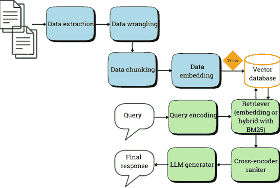

图 6.1 - 问答系统中的流水线

让我们详细探索这些每一个流水线。

**索引流水线**负责处理和准备数据，以便日后进行高效查询。涉及的步骤如下：

1. **数据提取**：从各种源提取原始文档或文本数据。
2. **数据清洗**：对提取出的数据进行清洗、格式化和转换，以消除任何不一致或不需要的信息。
3. **数据分块**：将清洗后的数据分解为更小的块，以确保高效查询。
4. **应用嵌入模型**：将这些数据块通过嵌入模型（例如 OpenAI），将它们转换为向量表示。
5. **向量存储**：将生成的向量嵌入存储在**向量数据库**中，实现快速且准确的搜索。

**检索和生成流水线**在提问时触发。该过程涉及以下步骤：

1. **问题输入**：用户提交一个问题或查询。
2. **查询编码**：使用与索引流水线相同的嵌入模型将问题编码为向量。
3. **数据检索**：将编码后的查询向量与存储存储的向量表示进行比较。
4. **数据排序**：如果存在交叉编码排序器（cross-encoder ranker），则对检索到的信息进行排序，以选择最相关的块。
5. **最终答案处理**：系统处理检索到的信息，以生成更相关且简洁的答案。

该系统促进了从原始数据到可操作答案的数据流。索引流水线准备数据，检索流水线根据查询识别相关信息，而流水线中的 LLM 将这些信息处理为最终答案。系统高度依赖向量嵌入和数据库以确保高效的检索和准确的响应。由于其简单性，这个过程通常被称为原生 RAG（vanilla RAG）或简单 RAG（naive RAG）。在本章中，我们将系统地比较原生 RAG 与带有排序的混合型 RAG，而交叉编码排序器可以显著改进其结构。


## 构建可复现且生产级的 RAG 系统

```python
# 存储配置
# 验证需求（API 密钥、模型等）
self.build_pipeline()

def build_pipeline(self):
    # 1. 初始化流水线各个组件
    # 2. 创建流水线实例
    # 3. 将组件添加到流水线
    # 4. 连接组件（定义数据流）
    # 5. 定义输入/输出映射
```

通过这个蓝图，我们可以单个流水线封装成一个可以进一步配置的**超级组件（SuperComponent）**。这在我们进入实验阶段时非常有用，因为它允许我们使用不同的参数初始化流水线。为了简化超级组件的执行方式，我们将定义自定义的输入和输出映射。这将确保对超级组件的运行调用更加简单。例如，一个朴素的 RAG 流水线在我们想要从向量数据库检索并回答问题时，可能需要我们向 `run()` 方法传递包含 `text_embedder.text`、`retriever.query` 和 `prompt_builder.question` 的套接字路径。这可能非常繁琐并增加不必要的复杂性。我们抽象了套接字路径并将其替换为单个参数 `query`，如下：

```python
# 输入映射：外部输入 -> 内部组件输入
self.input_mapping = {
    "query": ["text_embedder.text", "retriever.query",
               "prompt_builder.question"]
}

# 输出映射：内部组件输出 -> 外部输出
self.output_mapping = {
    "llm.replies": "replies",
    "retriever.documents": "documents"
}
```

将流水线抽象为超级组件并映射输入输出可以实现**接口抽象**（意味着外部用户不需要知道内部组件名称）、**易于替换**（意味着你可以在更改内部实现而不破坏外部使用）以及**并行处理**（意味着开发者可以同时将单个输入映射到多个组件）。

## 第 6 章

## 160

应用程序开发者可以将超级组件作为独立模块导入使用，而无需理解其评估或监控的复杂内部机制。让我们通过探索以下分类的脚本，分解如何将此模式应用于 RAG 系统的各个阶段：

- * scripts/rag/*：此目录隔离了核心应用逻辑。它包含了我们在前面的章节中开发的关键 RAG 流水线的完整实现：
    - [indexing.py](https://github.com/PacktPublishing/Building-Natural-Language-and-LLM-Pipelines/blob/main/ch6/jupyter-notebooks/scripts/indexing.py)
    - [naive.py](https://github.com/PacktPublishing/Building-Natural-Language-and-LLM-Pipelines/blob/main/ch6/jupyter-notebooks/scripts/naive.py)
    - [hybridrag.py](https://github.com/PacktPublishing/Building-Natural-Language-and-LLM-Pipelines/blob/main/ch6/jupyter-notebooks/scripts/hybridrag.py)

这些是我们 RAG 工作流的构建模块。我们在文档（PDF 文件和两个爬取的网站）上执行索引流水线，并将其内容作为嵌入存储在向量存储中。然后，我们可以使用朴素或混合 RAG 流水线从向量数据库中检索信息。让我们让我们探索知识图谱和合成数据生成。

- * synthetic_data_generation/*：该模块包含了第 5 章中开发的自定义组件，例如：
    - [knowledge_graph_component.py](https://github.com/PacktPublishing/Building-Natural-Language-and-LLM-Pipelines/blob/main/ch6/jupyter-notebooks/scripts/synthetic_data_generation/knowledge_graph_component.py)
    - [synthetic_test_components.py](https://github.com/PacktPublishing/Building-Natural-Language-and-LLM-Pipelines/blob/main/ch6/jupyter-notebooks/scripts/synthetic_data_generation/synthetic_test_components.py)

整个知识图谱和合成数据生成过程随后可以被构建为一个流水线，并抽象为一个超级组件，正如 `synthetic_data_generator_supercomponent.py` 中的 `SDGGenerator` 超级组件：https://github.com/PacktPublishing/Building-Natural-Language-and-LLM-Pipelines/blob/main/ch6/jupyter-notebooks/scripts/synthetic_data_generator/synthetic_data_generator_supercomponent.py。

通过将我们的知识图谱和合成数据生成组件作为超级组件放入流水线中，我们清晰地封装了所有与知识图谱和合成数据相关的逻辑。这允许我们控制合成数据的生成过程。

- * scripts/ragas/evaluation/*：此目录持有评估逻辑，最著名的 `ragasevalsupercomponent.py` (https://github.com/PacktPublishing/Building-Natural-Language-and-LLM-Pipelines/blob/main/ch6/jupyter-notebooks/scripts/ragas_evaluation/ragasevalsupercomponent.py)。

该脚本包含三个组件：读取合成数据的 `CSVReader`、增强数据的 `DataAugmentor` 以及执行评估（如 [Ragas 指标](https://docs.ragas.io/en/stable/concepts/metrics/)）忠实度、召回率和事实准确性的 `RagasEvaluation`。这些组件可以连接到流水线并抽象为超级组件，如 `SDGGenerator` 所示。

- * wandb_experiments/*：此目录隔离了我们的观测性逻辑，包含如 `rag_analytics.py` (https://github.com/PacktPublishing/Building-Natural-Language-and-LLM-Pipelines/blob/main/ch6/jupyter-notebooks/scripts/wandb_experiments/rag_analytics.py) 等用于 [Weights & Biases](https://wand.ai/) 跟踪的脚本。

## 第 6 章

## 162

这种项目结构不仅是组织文件的方便方法；它是协作的蓝图。这种架构直接对应于 MLOps 团队的角色。`rag/` 目录是 NLP 工程师的领域（构建应用）。`synthetic_data_generation/` 和 `ragas_evaluation/` 目录属于 QA 或测试工程师（确保质量）。`wandb_experiments/` 是 DevOps、MLOps 工程师的领域（监控）。这种结构在不同部分之间建立了明确的权和“数据契约”，这对于团队和产品的扩展至关重要。我们将通过强调贯穿始终的关键软件开发工具来结束本节。

在本章中，我们将继续像前面的章节中一样使用 `uv` 来确保可复现性。在之前的章节中，我们使用内存文档存储进行工作，虽然它们对于原型设计很有用，但在生产环境中，我们需要处理持久化文档存储工作。我们将引入 Elasticsearch 以及一个特定的 `docker-compose.yml` 文件，它将允许我们运行一个持久的双文档存储，以保存不同类型的嵌入：一组使用较小的嵌入模型，另一组使用较大的嵌入模型。让我们探讨这背后的原因。示例 `docker-compose.yml` 文件（https://github.com/PacktPublishing/Building-Natural-Language-and-LLM-Pipelines/blob/main/ch6/docker-compose.yml）将能够实现这一点。


Haystack 文档本身对此给出了明确警告：如果使用了如 `sentence-transformers/all-MiniLM-L6-v2` 等模型进行索引，则必须使用相同的模型对用户的查询进行嵌入（Haystack 教程）。

这样做的原因是数学层面的，而不仅仅是偏好。嵌入模型会创建一个称为“向量空间”的唯一高维宇宙（Jaboun, Medium）。当我们对文档进行索引时，是将每个文档块的语义位置绘制到由该特定向量空间定义的“地图”上。当用户提问时，我们再次使用嵌入模型来寻找该问题的坐标。这个查询向量就是“指南针”（Jaboun, Medium）。

向量搜索通过寻找与查询向量（指南针位置）最接近的文档向量（地图位置）来工作。如果地图和指南针没有校准到同一个宇宙，整个过程将发生灾难性的失败。在查询时使用与索引时不同的模型，就等同于“使用巴黎的地图来导航东京的街道”（Jaboun, Medium）。查询向量虽然在自身的向量空间中很有意义，但“向量空间不匹配”（DeconvoluteAI）会导致“完全无关的结果”，这是 RAG 应用中最常见且关键的失败模式之一。

在我们的实验中，我们将大型嵌入模型创建的向量与小型嵌入模型创建的向量分成了不同的向量存储器。让我们解释一下原因。

## 解耦文档存储器：双 Elasticsearch 架构

我们项目的一个显著特性是 `docker-compose.yml` 文件中定义的双 Elasticsearch 架构（https://github.com/Packt/Building-Natural-Language-and-LLM-Pipelines/blob/main/ch6/docker-compose.yml）。双 Elasticsearch 架构指的是部署两个 Elasticsearch 集群来处理数据流水线不同阶段的设计。这并不是冗余设置；而是一种用于实现 A/B 测试、独立资源分配和性能效益优化的架构模式。在这种背景下，双架构将使我们能够使用不同的嵌入模型研究 RAG 流水线的性能。

Haystack 的设计将 `DocumentStore` 视为灵活的接口，这使得这种这种模式成为可能。框架的模块化完全支持同时处理多个不同的文档存储器（Milvus），甚至支持诸如多嵌入检索等高级策略（Haystack）。

这种双存储架构提供了两个主要优势：

- **性能效益 A/B 测试的蓝图**：此项目设置不是为了单一流水线；而是为了比较两个并行流水线的框架：原生 RAG 流水线和混合 RAG 流水线。正如我们以后详细分析的，查询要求对小型与大型嵌入模型进行成本分析。该架构是在生产环境中进行分析的机制：
  - 流水线 A（小型）可以使用 `ES_SMALL_URL` 并填充来自 `text-embedding-3-small` 的向量。
  - 流水线 B（大型）可以使用 `ES_LARGE_URL` 并填充来自 `text-embedding-3-large` 的向量。

我们可以将相同的用户查询发送到两个流水线，并为每个检索答案（使用 Ragas）和每次查询成本（使用 `rag_analytics.py`）。这提供了一个实时的、持续的 A/B 测试，为业务找到最佳的性能平衡。

- **独立资源分配**：小型实例针对 512 MB 到 1 GB 的堆内存进行了优化，而大型实例针对 2 到 4 GB 进行了优化。这是嵌入模型本身的直接结果。更大更强大的嵌入模型（如 `text-embedding-3-large`）产生的向量维度更多（3,072），而小型模型为 1,536。这些向量需要更多的存储，关键重要的是，在向量数据库中需要更多的 RAM 来执行高效的最近邻搜索。

通过解耦文档存储器，我们可以相应地配置基础设施。`ES_LARGE_URL` 实例可以托管在高内存机器上，而 `ES_SMALL_URL` 实例运行在较便宜的标准机器上。这防止了“小型”流水线被过度配置，并节省了大量的基础设施成本。

有了可复现的项目和合理的架构，我们现在可以进入量化评估阶段。

## 使用 Ragas 进行系统性的流水线评估

在第 5 章中，我们使用了 [https://github.com/PacktPublishing/Building-Natural-Language-and-LLM-Pipelines/blob/main/ch5/jupyter-notebooks/advanced_branching_pipeline.ipynb] 和我们自定义的 `KnowledgeGraphGenerator` 创建了一个包含问题和地面标准答案的“黄金”测试集。现在，我们将使用该测试集来评估我们的 RAG 超级组件（SuperComponents）：

- NaiveRAGSuperComponent: [https://github.com/PacktPublishing/Building-Natural-Language-and-LLM-Pipelines/blob/main/ch6/jupyter-notebooks/scripts/ragnaver.py]
- HybridRAGSuperComponent: [https://github.com/PacktPublishing/Building-Natural-Language-and-LLM-Pipelines/blob/main/ch6/jupyter-notebooks/scripts/hydibrag.py]。

在比较每个超级组件的聚合 RAG 分时，我们几乎会观察到混合 RAG 流水线明显的优越性，特别是在上下文精确性（Context Precision）和相关性（Relevance）指标上（Paras Masan）。第 4 章中探讨的架构差异是直接原因：

- **原生 RAG**：由单个单路径（稠密、语义）检索器（`ElasticsearchEmbeddingRetriever`）组成。它擅长处理宽泛的概念性查询，在这种情况下，用户的意图比特定单词更重要。然而，它在特定关键词查询方面从根本上是弱的。它受到词汇不匹配问题的影响，将无法检索包含特定错误代码、产品 SKU 或在嵌入空间中表示良好的术语的文档（DevCommunity）。
- **混合 RAG**：这是一种更健壮的多路径系统。它并行使用两个检索器：`Elasticsearch25Retriever`（稀疏词汇搜索）和 `ElasticsearchEmbeddingRetriever`（稠密语义搜索）。然后它使用 `DocumentJoiner` 合并结果。这种方法“融合”了两种方法的优点，找到既在概念上相似又包含精确关键词的文档（VectorHub by Superlinked 2024）。

在检索完块之后、生成最终答案之前，可以在检索流水线中引入额外的增强：重排序器（reranker）。重排序器（通常是交叉编码器模型）接受来自混合检索的融合候选列表，并执行最终的高精度重新排序，“大大提高了了召回性能”（Pinecone），并确保只将最相关的文档传递给 LLM。示例代码中的 `HybridRAGSuperComponent` 默认添加了 `SentenceTransformerRanker` 组件来对检索到的块进行排序。

一旦初始化了原生和混合 RAG 超级组件，我们就准备好进行系统性评估了。我们的工具是 Ragas，这是一个行业标准的 RAG 评估框架。我们将关注该框架提供的四个关键指标，这些指标评估 RAG 系统的两个主要部分（检索和生成）：

- **真实性（Faithfulness）**：衡量生成的答案相对于上下文的事实一致性。低分表示 LLM 正在幻觉或编造上下文中不存在的信息。
- **上下文精确性（Context precision）**：衡量检索上下文的信噪比。它评估检索到的块是否与问题相关。
- **上下文召回率（Context recall）**：评估检索器是否找到了完全回答问题所需的所有信息。
- **答案相关性（Answer relevancy）**：一种端到端的指标，评估最终答案与原始问题的相关性。


> 注意
> 尝试将 Ragas 工作流抽象为 SuperComponent（超级组件）

在这里可以找到一个对比朴素 RAG 与使用组件和 SuperComponents 的混合 RAG 评估的 Jupyter notebook 笔记本：https://github.com/PacktPublishing/Building-Natural-Language-and-LLM-Pipelines/blob/main/ch6/jupyter-notebooks/ragas_evaluation_with_custom_components.ipynb。

在提供的笔记本中，我们将使用 SuperComponents 构建一个 Haystack 元流水线——即一个用于运行和评估其他流水线的流水。该工作流的核心是 `RagasEvaluationComponent`。该组件将 Ragas 框架的复杂逻辑封装在简单的 Haystack 接口之后。它的 `run()` 方法将期望由我们的 RAG 流水线生成的输入：ground_truth 答案（来自你的测试集）、`retrieved_documents`（检索到的文档）以及 `generated_answer`（生成的答案）。它的输出是一个包含每个指标计算出的 Ragas 分数的字典。

你可以使用这些脚本和笔记本来运行各种实验。执行的实验将对比第 4 章中引入 Ragas 使用的朴素 RAG（稠密检索）与混合 RAG（密集和稀疏检索）。你可以修改脚本中的流水线以尝试不同的 LLM 和嵌入提供商及模型，并按照脚本所示的模式开发自己的流水线并将其抽象为 SuperComponents。让我们仔细查看后续的执行过程。

## 执行评估

评估过程涉及对从第 5 章的 PDF 和两个 URL 地址生成的合成数据集进行循环处理。对于每一行（包含一个问题和一个 ground_truth 答案），工作流如下所示：

- **运行流水线一**：使用问题执行 `NaiveRAGSuperComponent`。这将返回 `naive_answer` 和 `naive_context`（检索到的文档）。
- **运行流水线二**：使用相同的问题执行 `HybridRAGSuperComponent`。这将返回 `hybrid_answer` 和 `hybrid_context`。
- **评估**：将两组结果馈送到 `RagasEvaluationComponent`。
- **聚合**：存储两个流水线得出的 Ragas 分数。

在处理完整个测试集后，我们将获得两组聚合分数，为我们的朴素 RAG 和混合 RAG 系统提供直接的、量化的比较。这些结果为后续的数据驱动分析奠定了基础。表 6.1 显示了在包含 10 个问题、单跳和多跳查询策略的合成数据集上的运行示例。

| 指标 | 朴素 RAG | 混合 RAG | 改进幅度 (%) | 更好的 RAG |
| --- | --- | --- | --- | --- |
| 忠实度 (Faithfulness) | 0.6411 | 0.9626 | 50.16 | 混合 RAG |
| 答案相关性 (Answer relevancy) | 0.6678 | 0.7374 | 10.42 | 混合 RAG |
| 上下文召回 (Context recall) | 0.6800 | 0.7633 | 12.25 | 混合 RAG |
| 事实准确性 (FI) | 0.3556 | 0.4090 | 15.03 | 混合 RAG |

表 6.1 – 10 个问答对的 Ragas 评估结果

表 6.1 中看到的巨大改进表明了带有重排序（reranking）的混合方法有多强大。该工作流能够对我们的流水线和 SuperComponents 进行客观评估。至此，我们准备好添加可观测性。

## 使用 Weights & Biases 添加生产级可观测性

我们已经静态地评估了流水线的质量。一个生产级系统的最后一部分是在线环境中的动态、持续监控。
首先区分“评估”和“可观测性”至关重要：

- **评估 (Ragas)**：这是一种静态的、一次性的测试（类似于单元测试或集成测试），针对“黄金”数据集进行，以便在部署前获取质量快照。
- **可观测性 (Weights & Biases)**：这是对生产环境中实时流水线或 SuperComponent 的持续、实时监控。它对于理解真实用户查询、检测性能漂移、监控成本和追踪故障至关重要。

我们提供了一个示例 Jupyter notebook，你可以使用它通过 Weights & Biases 将可观测性集成到你的运行中：https://github.com/PacktPublishing/Building-Natural-Language-and-LLM-Pipelines/blob/main/ch6/jupyter-notebooks/add_observability_with_wandb.ipynb。

在该笔记本中，关键是 Haystack 的 `WeaveConnector` 组件，它是 Weights & Biases 的集成组件。

该组件展示了一种独特的 Haystack 模式。它不需要调用 `.connect()`。
相反，它使用环境变量（如 `HAYSTACK_CONTENT_TRACING_ENABLED` 和 `WANDB_API_KEY`）自动拦截来自流水线中所有组件的追踪信息（输入、输出和元数据），并将它们发送到 Weights & Biases 仪表板。如下所示添加到流水线中：

```
pipe.add_component("weave", connector)
```

此笔记本使用了另一个额外的脚本，https://github.com/PacktPublishing/Building-Natural-Language-and-LLM-Pipelines/blob/main/ch6/jupyter-notebooks/scripts/wandb_experiments/rag_analytics.py，该脚本被可观测性笔记本调用。此脚本提供了增强分析。它被配置为记录 token 计数，并使用 gpt-4o-mini 以及嵌入模型的定价数据，计算每次流水线运行的美元成本。

这种增强将 Weights & Biases 从一个简单的 ML 监控工具转变为**财务运营 (FinOps)** 仪表板。简单的示例可以在图 6.2 和表 6.2 中看到。

hybrid_rag-large-embedding

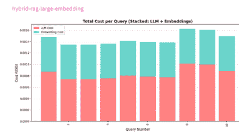
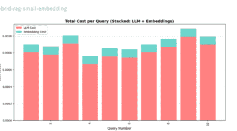
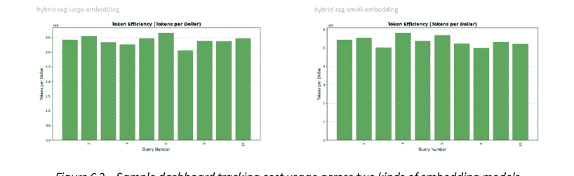

| 嵌入模型 | 总成本 | LLM 成本 | 嵌入成本 | 每查询平均成本 |
|---|---|---|---|--|
| 小嵌入 (Small embedding) | 0.009311 | 0.008356 | 0.0009549 | 0.000931 |
| 大嵌入 (Large embedding) | 0.014450 | 0.008398 | 0.006053 | 0.001445 |

表 6.2 – 使用大嵌入与小嵌入模型的成本对比

- 我们的流水线总成本是多少？
- 我们的平均查询成本是多少？
- 哪个流水线（小的还是大的）更具成本效益？
- 我们是否看到了与特定类型查询相关的成本激增？

将系统性能直接与成本挂钩的能力是作为业务运行 RAG 应用时最关键、不显而易见的特征之一。让我们来看一个成本与性能权衡常见的案例。

## 通过分析嵌入模型探索成本与性能权衡

由我们的架构支持的第二个关键分析是嵌入模型的选择。我们将对比 OpenAI 的两个领先模型：text-embedding-3-small 和 text-embedding-3-large**。我们将观察性能（准确率）与成本之间的权衡。

在**海量文本嵌入基准 (MTEB)** 上，text-embedding-3-large（平均分 64.6%）始终明显地优于 text-embedding-3-small（平均分 62.3%）（Enterprise Bot）。从定性角度来看，研究显示大模型在处理上下文理解和模糊问题方面明显更好，其额外的维度捕捉了更微妙的关系（TigerData）。

这种卓越的性能是有高昂代价的：

- text-embedding-3-small 每 100 万 token 费用 0.02 美元
- text-embedding-3-large 每 100 万 token 费用 0.13 美元

这意味着大模型仅在嵌入步骤的成本就增加了 6.5 倍。这些数据呈现了典型的收益递减权衡。我们必须决定，在 MTEB 上 2.3 分（或相对提升 3.7%）的收益是否值得上 6.5 倍的成本增加。这一考量也将影响向量本身的成本。

对于绝大多数通用 RAG 应用来说，text-embedding-3-small 是明确的获胜者也是最优选择。它在高性能（几乎不亚于旧的 text-embedding-ada-002）和极低成本之间的平衡使其成为最具成本效益的选择。

text-embedding-3-large 模型是一个专业工具。它应该保留用于高风险、利基领域（例如法律、金融或医疗 RAG），在这些领域中，其对复杂上下文的细微差别理解可能证明指数级成本是合理的。使用我们的笔记本显示性能-成本权衡的示例运行可以在表 6.3 和表 6.4 中看到。


## 第 6 章

172

| 指标 | 小型嵌入模型 | 大型嵌入模型 |
|---|---|---|
| 总成本 ($) | 0.009396 | 0.014277 |
| LLM 成本 ($) | 0.008441 | 0.008224 |
| 嵌入成本 ($) | 0.000955 | 0.006053 |
| 平均每次查询成本 ($) | 0.000940 | 0.001428 |

表 6.3 – 大小嵌入模型的成本对比

| 指标 | 小型嵌入模型 | 大型嵌入模型 |
|---|---|---|
| 忠实度 (Faithfulness) | 0.804444 | 0.747778 |
| 上下文召率 (Context recall) | 0.926667 | 0.946667 |
| 事实准确性 (Factual correctness) | 0.599 | 0.578 |
| 回相关性 (Response relevance) | 0.869054 | 0.868255 |
| 上下文实体召回 (Context entity recall) | 0.356603 | 0.415104 |

表 6.4 – 大小嵌入模型的 Ragas 指标性能对比

这正是为什么我们的解耦双存储架构如此强大的原因。它允许我们进行选择。我们可以从小型模型开始作为主应用程序的高成本效益默认方案，仅在需要其顶尖性能的特定高价值流水线中部署大型模型，而这一切都可以在同一个统一的项目中实现。

## 总结

在本章中，我们完成了从 RAG 开发人员到 RAG 架构师的关键转变。我们不仅构建了一个流水线，还构建了一个可复的、生产就绪的系统。

我们首先采用了专业的模块化项目结构，并证明了其设计作为团队协作蓝图的合理性。随后，我们对核心架构决策进行了辩护，以确保系统的健壮性：要求单一一致嵌入模型的向量空间奇异性，以及能够实现资源优化和实时 A/B 测试的解耦双数据库架构。

## 构建可复现且生产就绪的 RAG 系统

在这一坚实的基础上，我们使用 Ragas 构建了量化评估流水线，利用第 5 章中的合成数据集对我们的原生（naive）和混合 RAG 实现进行了严格评分。这些数据使我们能够进行细致入微、数据驱动的成本效益分析，权衡混合 RAG 的准确性与其延迟之间的关系，以及 `text-embedding-3-large` 的边际性能提升与其 6.5 倍成本之间的关系。最后，我们增加了生产系统的基石：持续可观测性，以及最重要的使用 Weights & Biases 进行成本跟踪。

整个章节作为了部署前的最后准备。我们的项目现在已使用 Docker 容器化，依赖项已通过 `up` 锁定，逻辑封装在 Python 脚本中，并且我们拥有健壮、可重复的评估（Ragas）和监控（Weights & Biases）系统。我们不再仅仅是开发者；我们是这套完整端到端系统的架构师，我们终于准备好迈最后一步：将我们的 Haystack 部署为可扩展的、生产就绪的 API。

## 延伸阅读

- Haystack. (n.d.). 教程：使用检索增强创建你的第一个 QA 流水线。https://haystack.deepset.ai/tutorials/27_first_rag_pipeline
- Jabloun, (n.d.). 不要破坏你的 RAG：为什么你必须在检索和索引中使用相同的嵌入模型。https://medium.com/@mariem.jabloun-dont-break-your-rag-why-you-must-use-the-same-embedding-model-for-retrieval-and-indexing-7b0aa3e536acd
- DeconvoluteAI. (n.d.). 理解 RAG 流水线中的失败原因与缓解策略。https://deconvolateai.com/blog/rag/failure-modes
- Milvus. (n.d.). 如何结合不同类型的文档存储使用 Haystack？https://milvus.io/ai-quick-reference/how-do-i-use-haystack-with-different-types-of-document-stores
- Haystack. (n.d.). 检索器 - Haystack 文档。https://docs.haystack.deepset.ai/v2/9/docs/retrievers
- Madan, (n.d.). 使用 Weaviate 和 Athina 评估原生和混合 RAG。https://medium.com/athina-ai/evaluating-naive-and-hybrid-rag-using-weaviate-and-athina-6ec6dccaf693
- Paul, K. (n.d.). 高级 RAG：从原生检索到混合搜索和重排序。https://dev.to/kuldeep_paul/advanced-rag-from-naive-retrieval-to-hybrid-search-and-re-ranking-4km3
- Superlinked. (2024). 使用混合搜索与重排序优化 RAG | VectorHub。https://superlinked.com/vectorhub/articles/optimizing-rag-with-hybrid-search-reranking
- Pinecone. (n.d.). 重排序与两阶段检索，https://www.pinecone.io/learn/series/rag/rerankers/
- Tiger Data. (n.d.). 评估用于 RAG 的开源与 OpenAI 嵌入：一份指南。https://www.tigerdata.com/blog/open-source-vs-openai-embeddings-for-rag
- Enterprise Bot. (n.d.). 为你的检索增强生成 (RAG) 系统选择最佳嵌入模型。https://www.enterprisebot.ai/blog/choose-the-best-embedding-model-for-your-retrieval-augmented-generation-system

# 订阅获取免费电子书

新框架、演进中的架构、研究发布、生产分析——AI_Distilled 为实际操作 LLM 和 GenAI 系统的工程师和研究人员过滤噪音并提供每周简报。现在即可获取免费电子书，以及帮助你保持敏锐的每周见解。

访问 https://packt.link/80z6Y 订阅或扫描下方二维码。

## 第 3 部分

## 部署与代理编排

在本部分中，我们将探索 RAG 系统的部署。我们关注如何将应用程序容器化、管理依赖项并将其暴露为可扩展的 API。我们还将深入探讨代理编排（agentic orchestration）以及如何处理复杂的工作流。

在本部分结束时，你将学会：
- 将 Haystack 流水线部署为生产就绪的 API
- 使用 Docker 进行容器化
- 为高级 RAG 任务实现代理工作流

本部分包含以下章节：
- 第 7 章：部署基于 Haystack 的应用程序
- 第 8 章：代理编排

## 第 7 章

## 部署基于 Haystack 的应用程序

在上一章中，我们专注于构建和测试流水线。在本章中，我们将专注于将该流水线引入生产环境。我们将探索如何对应用程序容器化、管理依赖项并将其暴露为可扩展的 API。

我们还将讨论不同的部署策略以及如何根据你的特定需求选择最佳方案。

## 技术要求

为了可复现性，我们使用以下工具：
- Docker: https://www.docker.com/
- FastAPI: 用于构建 API 的框架：https://fastapi.tiangolo.com/
- Enterprise Bot. (n.d.). 为你的检索增强生成 (RAG) 系统选择最佳嵌入模型。https://www.enterprisebot.ai/blog/choose-the-best-embedding-model-for-your-retrieval-augmented-generation-system


部署基于 Haystack 的应用程序

本节将概述 NLP 应用程序最常见的部署需求。我们将讨论在决定部署方法时需要考虑的因素，例如系统性能与基础设施成本之间的权衡、终端用户访问的便利性，以及处理用量波动的资源管理。不同的部署策略提供独特的优势，无论你是为了优化快速扩展性、维护轻量级部署，还是管理复杂的依赖关系。我们将比较这些方法，概述它们在从本地服务器到云平台等各种环境中的优缺点和局限性。

在本节结束时，你将清晰地了解哪些部署策略最符合你的流水线（pipeline）需求。这将为后续章节中将涵盖的技术实现方法奠定，包括 API 开发、Docker 化和自动化部署工作流。

# NLP 流水线关键需求概述

部署 NLP 流水线（特别是由 LLM 驱动或复杂多阶段工作流驱动的）需要几个关键需求以确保在生产环境中的无缝集成和稳健性能：

- **可扩展性 (Scalability)：** 在 NLP 流水中，这指的是系统在不影响性能的情况下处理日益增加负载的能力。这确保应用程序能够应对更高的需求，例如服务更多的并发用户。对于聊天机器人、搜索引擎和实时文本分析工具等 NLP 应用程序，可扩展性对于处理海量数据和流量峰值同时保持快速响应时间至关重要。可扩展性中的另一个重点是**弹性 (Elasticity)**。**弹性**通过允许系统根据需求动态伸缩资源进一步实现了可扩展性，优化了资源使用和成本。使用 Docker 和 Kubernetes 的容器化部署在支持此类扩展方面特别有效。可扩展性是我们离开 Notebook 脚本的主要原因。你的 RAG 流水线必须能够服务一个或数千个并发用户而不失败，容器编排是实现这一目标的路径。但如果系统难以访问，可扩展性将毫无用处。

- **可用性 (Accessibility)：** 这关注用户或客户端应用程序与 NLP 流水线交互的易程度。这通常涉及通过 API 暴露流水线，实现与其他服务或平台的无缝集成。REST API 促进了流水线与用户之间的轻松交互，确保了跨平台的可用。对于地理分散的用户或服务，远程和分布式访问至关重要，通常利用 AWS、Google Cloud 或 Azure 等云端部署方案来最小化延迟并确保全球可用性。在我们的语境下，可用性意味着一个 API。通过 REST API 暴露流水线使其成为一个模块化的“构建块”，任何其他服务（例如 Web 前端、移动 App 或另一个后端系统）都可以调用。这引出了我们的下一个逻辑挑战。

- **资源管理 (Resource management)：** 部署中的这涉及计算资源（包括内存、处理能力和存储）的有效分配，以在保持高性能的同时使成本处于可范围内。对于 NLP 模型，特别是使用 LLM 的模型，这意味着优化 GPU 和 CPU 的使用，高效管理内存，并使用无服务器计算和容器化等策略平衡成本与性能。有效的资源管理对于部署可扩展 NLP 应用程序而不产生过度运营成本至关重要。这对于 NLP 特别关键。LLM 和嵌入模型是极消耗 GPU 的。一个成功的部署策略必须高效管理这些昂贵的资源以防止成本爆炸。

- **可靠性与韧性 (Reliability and resilience)：** 这些对于确保系统性能的一致性和从意外问题中快速恢复至关重要。稳健的错误处理机制和自动恢复过程（如容错和自动重启）有助于维持不中断的服务。全面的监控和日志通过尽识别并解决问题进一步增强了可靠性，为调试和优化性能提供了审计轨迹。*这是部署的信任侧面。*在生产环境中，失败不是选项。收到 *500 Internal Server Error* 的用户将不会信任该应用程序。我们需要自动健康检查、日志和恢复过程。

- **模块化与可维护性 (Modularity and maintainability)：** 这些通过结构化设计实现，使流水线具有模块化，允许在不干扰整个系统的情况下易于更新或替换。这对于包含数据预处理、模型推理和后处理的多阶段流水线特别有益。实施**持续集成/持续部署 (CI/CD)** 流水线可以进一步简化更改、测试和部署的集成流程，减少错误并加速更新。我们在*第 6 章*中构建的流水线在设计上已经是现代化的。我们的部署策略必须尊重这一点。我们应该能够在不让整个系统离线的情况下更新提示词或更换嵌入模型。

- **安全性与合规性 (Security and compliance)：** 这些确保了 NLP 部署中的数据保护和法规遵循从。数据隐私保护措施（如加密和访问控制）对于处理敏感信息和满足 GDPR 或 HIPAA 等合规性标准至关重要。此外，通过身份验证和授权机制安全地访问流水线可以保护外部 API 和用户交互。这些考虑共同构成了部署和管理可扩展、可用且安全的 NLP 系统的稳健框架。这是一个不可逾越的最终障碍。我们的流水线将处理用户查询和可能的敏感文档。我们确保数据经过加密，且访问经过身份验证。

实现我们流水线部署的每个部分都超出了本章的范围；我们的重点是建立初始基础设施以通过两种部署策略进行部署。

让我们看看部署 NLP 流水线可以遵循的两种部署策略：

- 通过 FastAPI 进行 API 部署（自定义、高控制路径）
- 流水线序列化和 Hayhooks 集成（精简、高速度路径）

# 比较两种主要的部署策略

为 NLP 流水线选择正确的部署策略很大程度上取决于其运行环境，以及项目的特定需求和限制。不同的方法在可扩展性、集成性、维护和资源效率方面提供独特的优势。

在本节中，我们将比较两种将 Haystack 流水线部署为容器化 REST 端点的方法：一种使用 FastAPI (https://fastapi.tiangolo.com/)，另一种使用 Hayhooks (https://docs.deepset.ai/docs/hayhooks)。两种解决方案都可以 Docker 化。这确保了可迁移性和可重复性，并通过 Kubernetes 等解决方案引入了可扩展性：

- 方法 1 – FastAPI REST 端点：我们将使用 FastAPI 框架手动构建 REST API。这种方法提供了最大的控制和自定义空间。我们将定义每个端点、每个验证模型以及所有的应用程序逻辑。这是“从零开始”的方法，适用于复杂的定制应用程序。

- 方法 2 – 流水线序列化和 Hayhooks 集成：我们将利用 Haystack 的原生序列化功能将流水线保存到 YAML 文件中，然后使用 Hayhooks 自动将其暴露为 REST API。这种方法提供了最大的速度和集成性。它是“内置电池”的方法，专为 Haystack 生态定制。

让我们看看哪种方法最适合你的用例。


# 为你的环境选择合适的策略

本章的核心主题是控制（方法 1）与速度（方法 2）之间的权衡。这两者并非互斥；事实上，Hayhooks 是在 FastAPI 之上构建的。这意味着它们不是竞争性的解决方案，而是不同的抽象层。

我们将首先教你“手动”方法（FastAPI），以便你理解 Pydantic 和端点创建的底层机制。然后，我们将引入 Hayhooks 作为一种抽象，它能自动处理你刚刚生成的所有样板代码。我们将从构建 API 所涉及的各个模块开始，然后探索 Hayhooks 的价值主张，它可以为你处理这些工作。

为了弄清楚这一选择，让我们在表 7 中总结这些权衡。

| 特性 | 方法 1：自定义 FastAPI | 方法 2：Hayhooks |
|---|---|---|
| 首要目标 | 完全控制、自定义逻辑和复杂的端点。 | 简单、易用以及原生的 Haystack 集成。 |
| 样板代码 | 高（手动设置应用、端点和模型）。 | 极少到零。 |
| 工作原理 | 你在 Python API 代码中导入并运行 Haystack Pipeline 对象。 | Hayhooks 读取序列化的 pipeline.yml 文件并自动生成所有 API 端点。 |
| 灵活性 | 最大。添加任何端点、中间件或逻辑。 | 高。基于 FastAPI 构建，因此具有扩展性，但针对流水线服务进行了优化。 |
| 最适用于... | 复杂、多层应用，Haystack 流水线是大型系统的一部分。 | 快速部署 RAG API、MLOps 工作流以及流水线即系统的服务。 |

# 部署基于 Haystack 的应用程序

| 特性 | 方法 1：自定义 FastAPI | 方法 2：Hayhooks |
|---|---|---|
| 学习曲线 | 中等。需要 Fast FastAPI、Pydantic 和异步服务器网关接口 (ASGI) 的知识。 | 低。需要具备 Haystack 和 YAML 的知识。 |

表 7.1 – Haystack 流水线部署对比

两种方法都可以使用 Docker 和 Kubernetes 进行封装和扩展。方法的选择取决于项目的整体架构和目标。我们将深入探讨一个使用 FastAPI 的入门示例，在其中我们将暴露在第 6 章中开发的混合 RAG 流水线，随后我们将学习如何设置一个动态系统，使我们能够将 PDF 和 URL 内容上传到 REST 端点，应用索引流水线，并使用混合 RAG 流水线从索引内容中获取信息。

# 实现部署策略

有效地部署 NLP 流水线需要利用现代技术来简化 API 开发、实现并行数据处理、监控系统性能并促进容器化部署。在本节中，我们将介绍提供的解决方案使用的关键工具（即 FastAPI），并探索它们如何有助于构建健壮、可扩展且可维护的 NLP 应用。

# 方法 1：使用 FastAPI 服务 Haystack 流水线

FastAPI (https://pypi.org/project/fastapi/) 是一个用于构建 Python RESTful API 的高性能 Web 框架。它设计用于快速、易用并完全兼容类型注释等现代 Python 特性。

FastAPI 具有以下特性：

- **异步支持**：FastAPI 原生支持使用 Python 的 `asyncio` 库进行异步请求处理，适用于高并发应用。
- **自动文档**：它会自动为 API 端点生成 OpenAPI 文档（Swagger UI），简化与客户端应用程序的集成。
- **使用 Pydantic 进行验证**：FastAPI 使用 Pydantic (https://docs.pydantic.dev/latest/) 模型进行数据验证，确保请求和响应符合定义的模式。

# 第 7 章

# 186

Pydantic 是一个流行的 Python 库，专门设计用于使用类型提示和验证数据，确保数据符合定义的结构和类型，并广泛应用于 API 以及数据流水线。

你可能会想，为什么是 FastAPI？为什么它会成为现代 Python 和 ML API 的事实标准？答案在于它的基础：

- **基于 Starlette 构建**：FastAPI 使用 Starlette ASGI 规范（这是 Python Web 应用程序的标准协议），使其从底层开始就是异步异步的。它通常由高性能的 ASGI 服务器 Uvicorn (https://uvicorn.dev/) 运行。这对于 NLP 推理至关重要。当我们的 API 调用大语言模型（LLM）时，这是一个 I/O 操作；FastAPI 只是在等待。异步支持意味着我们的服务器可以在等待期间处理数百个其他请求，而不是阻塞，从而极大提高了吞吐量。
- **基于 Pydantic 构建以可靠性**：Pydantic 在运行时强制执行类型提示。这意味着我们可以为 `/query` 请求定义一个 Pydantic 模型，FastAPI 会自动验证传入的 JSON、解析它并为我们处理一个验证过的 Pydantic 对象。它还利用这些模型自动生成 OpenAPI (Swagger) 文档。

这种组合——Starlette 用于异步提速，Pydantic 用于数据验证——使其成为构建生产级服务的完美、健壮选择。FastAPI 促进了用于查询 NLP 流水线的 REST 端点的开发、工作流管理以及系统健康检查。它的速度和简单使其成为构建生产级 API 的极佳选择。

一旦使用 FastAPI 开发了应用程序，就可以使用 Docker 进行进行打包。Docker (https://www.docker.com/) 是一个使用容器将应用程序及其依赖项封装成可移植单元的平台。这确保了开发、测试和生产环境中行为的一致。Docker 具有以下关键特性：

- **隔离性**：Docker 容器隔离应用程序及其依赖项，避免与系统级软件发生冲突
- **可移植性**：容器可以在任何支持 Docker 的系统上运行，实现不同环境之间依赖的一致性
- **高效资源利用**：Docker 容器是轻量级的，与传统的虚拟机相比，它们更高效

在本解决方案中，Docker 允许将 API 和相关组件封装到容器中，确保部署的一致性。通过 Kubernetes 等编排工具，Docker 通过负载均衡和自动故障转移等功能支持扩展性和可靠性。

通过结合这些技术，解决方案实现了强大的部署策略：
FastAPI 作为交互的骨干，为用户和客户端应用程序提供直观界面，而 Docker 则确保了应用程序的可移植性和扩展性（通过容器编排实现）。

让我们来看看本章的 FastAPI FastAPI 代码。

# 构建 FastAPI 应用

现在我们将演示一个使用第 6 章中的混合 RAG 组件构建的简单 API。该应用加载了 Haystack 流水线（构建方式与第 6 章相同），并通过多个端点 /health 和 /query 暴露。这是将组件封装为 FastAPI 应用的实用示例。

你可以在这里找到 FastAPI 示例：https://github.com/PacktPublishing/Building-Natural-Language-and-LLM-Pipelines/blob/main/ch/src/app.py

此应用程序依赖于两个抽象为组件的流水线：

- **索引流水线**：https://github.com/PacktPublishing/Building-Natural-Language-and-LLM-Pipelines/blob/main/ch/src/rag/indexing.py
- **混合 RAG 流水线**：https://github.com/PacktPublishing/Building-Natural-Language-and-LLM-Pipelines/blob/main/ch7/src/rag/hybridrag.py

索引流水线与另一个分开运行（离线），以填充本地向量存储（Qdrant）：

```
document_store = QdrantDocumentStore(
path=qdrant_path,
index=qdrant_index,
embedding_dim=1536,
recreate_index=False,
use_sparse_embeddings=True
)
```

混合流水线使用兼容 Qdrant 的稀疏和密集嵌入检索器来检索并生成答案。在 app.py 中抽象为组件的混合流水线是我们用于创建可以查询 Qdrant 向量存储的端点的。让我们来解构它。app.py 是用于服务混合 RAG 系统的 FastAPI 应用的主入口。


## 第7 章

## 188

核心功能包括：

- **初始化**：在启动时，它会连接到 Qdrant 文档存储，并使用配置的嵌入和 LLM 模型设置，将 HybridRAGSuperComponent 流水线抽象为 SuperComponent 并初始化。
- **端点 (Endpoints)：**
  - /query (POST): 主端点，接收用户问题，通过 RAG 流水线运行它，并返回生成的答案以及检索到的源文档。
  - /health (GET): 检查 Qdrant 连接和已初始化 RAG 组件的状态。
  - /info (GET): 提供当前配置的详细信息，例如使用的模型和 Qdrant 设置。
  - / (GET): 根节点，显示 API 状态和可用路由列表。

应用程序使用 Pydantic 模型对传入的查询请求进行验证，并结构化输出响应。

此端点直接从预填充的持久化文档存储（如 Qdrant）中检索数据。现在让我们来看此应用的示例 Dockerfile。

## 将你的 Haystack 流水线 Docker 化

在本节中，我们将学习如何通过将构建的 API 封装为 Dockerfile 来进一步增强和打包我们的 Haystack NLP 流水线。

Dockerfile 是一个文本文件，包含了一系列指令，用于自动化创建 Docker 镜像。Docker 镜像是轻量、独立且可执行的包，包含了运行应用程序所需的所有内容，包括应用程序代码、运行时、依赖项和配置文件。Dockerfile 充当蓝图的角色，指定了如何逐步构建镜像。

Dockerfile 通过定义构建和运行应用程序所需的环境、依赖项和配置，实现了 Docker 镜像的自动化创建，同时也支持缓存、多阶段构建和自定义运行时设置等高级功能。

以下是 Dockerfile 的核心功能：

- **定义环境**：指定起始的基础镜像，其中包含了操作系统和运行时环境。
- **打包应用程序**：包含运行程序所需的应用程序代码、依赖项和配置。
- **自动化构建和设置**：执行安装依赖项、复制文件和配置运行时环境的命令。
- **配置容器**：设置端口、环境变量以及容器启动时要执行的命令。

生成的容器是一个自包含的环境，可以在不同系统上一致地运行 FastAPI 应用程序。

在 Dockerfile 中打包 NLP 应用具有许多优势，这些优势与现代部署的关键需求紧密契合，包括可扩展性、可用性、资源管理和可靠性。Docker 允许应用程序进行复制和水平扩展，从而无缝处理工作负载或用户流量。对于 NLP 流水线来说，这对于支持高需求场景（如实时文本分析或并发用户查询）关重要。此外，Docker 与 Kubernetes 等编排工具集成的能力实现了动态扩展，优化了资源使用和成本。

Docker 容器还通过确保在本地、云端或本地部署环境中行为的一致性增强了可用性和可维护性。这简化了部署，并允许 NLP API 从分布式系统中访问。模块化的容器化架构隔离了不同的流水线组件，使得在不影响系统其他部分的情况下更新或复制单个服务变得更容易。此外，Docker 的资源隔离和安全功能保护了敏感数据，支持合规性要求，并确保了健壮的错误恢复，使其成为开发可扩展、安全且自适应 NLP 流水线的不可缺工具。

让我们创建应用程序“集装箱”的 Dockerfile。结构良好的 Dockerfile 对于安全、性能以及快速的“构建-测试-部署”循环至关重要。我们将使用最佳实践——多阶段构建。构建阶段安装所有依赖项，而运行时阶段仅复制必要的应用程序代码和依赖项，从而生成一个精简、安全且较小的生产镜像。

将 FastAPI 应用打包为 Docker 化应用的代码可以在此处找到：https://github.com/PacktPublishing/Building-Natural-Language-and-LLM-Pipelines/blob/main/ch7/Dockerfile。

我们可以概述关键步骤概述：

1. **基础**：我们从轻量级的 Python 3.11 slim 镜像开始，安装基本工具 (curl)，并复制 uv 依赖管理器。
2. **代码和依赖项**：我们将工作目录设置为 `/app`。然后，我们复制依赖文件 (pyproject.toml 和 uv.lock) 以提高缓存效率，然后复制应用程序源码 (src/)、脚本和用于索引的数据。
3. **安装**：我们使用 `uv sync` 安装依赖项，并使启动脚本具有可执行权限。
4. **安全**：我们通过创建并切换到非 root 应用用户来增强安全性。
5. **运行时设置**：这定义了容器的操作：
   1. 它暴露了 8000 端口。
   2. 它包含了 HEALTHCHECK 以验证服务是否就绪。
   3. 它创建了 /app/start.sh 脚本，该脚本首先运行 RAG 索引流水线 (src.rag.indexing)，然后启动 Uvicorn API 服务器。
6. **执行**：默认容器设置为运行自定义的 /app/start.sh 脚本。

这本质上是将我们在每一步中遵循的操作生产化：设置 Python 版本、安装并管理版本，以及执行应用程序。Docker 容器的移植性使我们能够在云端运行 REST 端点，并在以后使用 Kubernetes 对其进行扩展。现在我们将关注如何保护我们的 `/query` 端点。

## 保护和验证我们的端点

为了保护我们的端点免受公开使用，我们可以内置功能以确保只有授权用户可以使用我们的 RAG 端点。在我们的 FastAPI 示例应用中，我们将其定义为：

```python
api_key_header = APIKeyHeader(name="X-API-Key", auto_error=True)

async def get_api_key(api_key: str = Security(api_key_header)):
    """从标头验证 API key"""
    if api_key != settings.rag_api_key:
        raise HTTPException(
            status_code=401,
            detail="Invalid API Key"
        )
    return api_key
```

然后，此密钥被直接传递给 /query 端点：

```python
@app.post("/query", response_model=QueryResponse)
async def query_documents(
    request: QueryRequest,
    api_key: str = Depends(get_api_key)
):
```

在 config.py 中（https://github.com/Pack/Building-Natural-Language-and-LLM-Pipelines/blob/main/ch7/src/config.py），我们可以看到 Pydantic 验证类 Settings。config.py 脚本继承自 BaseSettings，其中使用 Python 类型提示 (str, int) 定义了每个配置项。Pydantic 在运行时自动执行这些规则。它处理自动类型转换，将环境变量字符串（例如 "5"）转换为所需的类型（例如整数 5），如果值无效则抛出异常。

`field` 函数将字段名映射到相应的环境变量（例如 `env=OPENAI_API_KEY`）。省略号 (...) 的存在标记了该字段，如果变量缺失，会导致应用程序停止。这种特定技术用于强制使用 RAG_API_KEY 密钥来保护 /query 端点。

通过在启动时验证配置 (`settings = Settings()`)，应用程序确保用于整个程序的配置对象 (`settings`) 是干净、可靠且可用的。

当我们启动与 API 关联的 Docker 容器，可以确保密钥不会泄露，如下：

1. 构建 Docker 镜像：

```
docker build -t hybrid-rag-api .
```

2. 然后我们运行 Docker 容器并传递环境变量：

```bash
docker run -d \
--name hybrid-rag \
-p 8000:8000 \
-e OPENAI_API_KEY=your_actual_openai_key \
```


```bash
-e RAG_API_KEY=your_secret_api_key \
hybrid-rag-api
```

3. 一旦 Docker 运行，我们就可以向 /query 端点发送 POST 查询，并使用 curl 命令通过我们的 RAG 密钥：

```bash
curl -X POST http://localhost:8000/query \
-H "Content-Type: application/json" \
-H "X-API-Key: your-secret-key" \
-d '{"query": "What is retrieval-augmented generation?"}'
```

或者我们可以通过 Python 实现：

```python
import requests
response = requests.post(
    "http://localhost:8000/query",
    headers={
        "Content-Type": "application/json",
        "X-API-Key": "your-secret-key",
    },
    json={"query": "What is retrieval-augmented generation?"}
)
```

## 使用 CI/CD 自动化部署

- CI/CD 是现代应用开发至关重要，能够实现高质量软件的快速交付。对于 NLP 流水线，CI/CD 自动化了部署过程，减少了错误，确保了一致性，并加速了新功能或更新的集成：

- CI（持续集成）：自动将代码更改集成到共享仓库中，确保所有更改都经过测试和验证。这减少了集成冲突，并确保代码库更新后仍然可用。

- CD（持续部署）：扩展 CI，通过自动将测试过的更改部署到生产环境。这确保了新功能或修复的快速且可靠交付。

对于 NLP 流水线，CI/CD 确保模型、配置或 API 端点的更新无缝集成到生产工作流中，最大限度地减少停机时间并保持可靠性。其优势如下：

- 自动化测试：CI/CD 流水线对 NLP 流水线的预处理、模型推理和后处理阶段执行自动化测试。这确保更新不会破坏关键组件。

- 一致的构建：Docker化的 NLP 应用可以在不同环境中一致地构建和部署，减少开发与生产环境之间的差异。

- 更快的迭代：新的模型、嵌入或流水线增强可以快速地测试和部署，从而加速创新。

- 回滚能力：CI/CD 工作流通常包含在失败时回滚到之前的稳定版本的机制，以确保可靠性。

CI/CD NLP部署通过自动化测试、加速功能更新并提供可靠的回滚机制来维护稳定性。图 7.1 显示了一个包含 CI/CD 关键步骤的示例工作流。

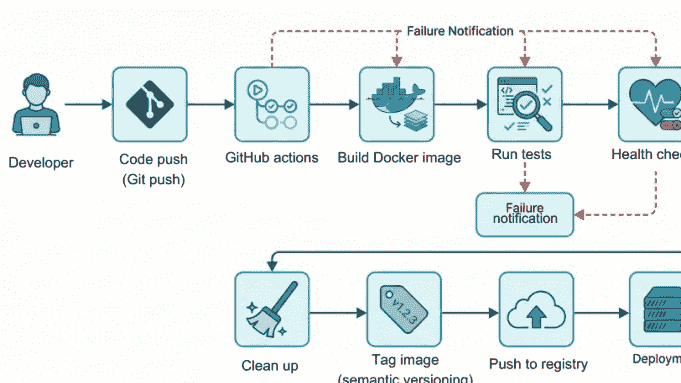

图 7.1 - 示例 CI/CD 工作流，用于构建、清理、标记并将 Docker 镜像推送到注册表进行部署

我们的 Docker 容器的 CI/CD 工作流可以在此处找到：https://github.com/PackPublishing/Building-Natural-Language-and-LLM-Pipelines/blob/main/.github/workflows/docker-test.yml。

在 YAML 文件中定义的示例工作流位于我们的 .github/workflows/ 目录下。它会在您每次向仓库推送代码时自动触发，构建我们的 Docker 镜像并运行测试，确保任何破坏构建或测试失败的代码都不会被合并。该流水线包含了构建 Docker 镜像、运行测试和构建 Docker 容器的步骤。

# 第 7 章

此特定工作流执行以下操作：

1. **触发：**它会在针对主分支的 push 或 pull request 时自动运行，但仅当 ch7/ 目录下的文件或工作流文件本身发生变化时才会运行。
2. **设置：**检出仓库代码并激进清理运行器上的磁盘空间以防止构建失败。
3. **配置：**在 ch7/ 目录内创建一个本地 .env 文件，从 GitHub Secrets 注入必要的配置（Qdrant 设置）和敏感 API 密钥（OPENAI_API_KEY 和 RAG_API_KEY）。
4. **构建：**导航到 ch7 并使用应用程序的 Dockerfile 构建 镜像 (hybrid-rag-api)。
5. **测试并运行：**以解离模式启动构建的镜像作为容器 (test-ch7-api)，并暴露 8000 端口。它将所需的 API 密钥作为环境变量传递给正在运行的容器。
6. **健康检查：**执行一个轮询循环，等待最多 120 秒，使用 curl 重复检查 localhost:8000 上容器的 /health 端点。这验证了容器已成功启动，且索引流水线在容器内执行完成。
7. **清理：**运行最后一个步骤以停止并删除测试容器，并清理 Docker 系统，无论测试通过还是失败，都能确保为下一个作业提供干净的状态。

为了将此操作扩展到云端部署，我们将在 docker-test-ch7 任务成功后在工作流中添加最后的的 CD 任务。

此部署任务通常涉及以下内容：

1. **Docker 登录：**与云注册表（例如 Docker Hub、Amazon ECR 或 Google Container Registry）进行验证。此步骤需要注册表凭据的密钥。
2. **标记：**为成功构建的镜像标记生产就绪的标签（例如 registry-url/repo-name/hybrid-rag-api:main-${{github.sha}}）。
3. **推送：**将新标记的镜像推送到远程容器注册表。
4. **部署触发：**连接到您的云调度器（例如 Kubernetes、Amazon ECS/EKS 或 Google Cloud Run）并更新部署定义以拉取并运行新推送的镜像。

这种转换创建了一个完整的 CI/CD 流水线，自动化了从代码更改到实时应用程序的过程。

虽然手动构建 FastAPI 应用程序可以提供完全控制，但对于许多情况，你可能倾向于使用 YAML 格式来简化流水线。为了让 Haystack 部署，我们遵循以下策略：

## 序列化流水线

## 方法 2：流水线序列化与集成


流水线序列化是将 NLP 流水线转换为可以保存、传输和重新加载的格式。在 Haystack 中，开箱支持序列化，允许开发者轻松地存储和共享流水线。序列化的流水线在协作环境和转换工作之间特别有用。

例如，流水线可以在 Python 代码中创建并测试，导出为 YAML，为部署进行调整，然后重新加载。序列化流水线只需定义组件、初始化流水线、连接组件并将流水线转到 YAML 文件。

通过 YAML 部署：

- **精简设置：** 通过 YAML 简化了设置。
- **可自定义：** 通过 YAML 允许自定义流水线。
- **可扩展性：** 结合 Docker 或 Kubernetes 等容器化工具，允许流水线可扩展。
- **集成就绪：** 它可以集成外部数据库、文档存储和推理服务。

使用流水线，你可以处理索引、查询和 NLP 任务。为了准备 Haystack 流水线的部署，我们遵循两个步骤：流水线序列化和流水线封装。让我们先看序列化。

### 流水线序列化

流水线序列化是将 NLP流水线转换为可以保存、传输和重新加载的格式。在 Haystack 中，原生支持序列化，允许开发者以易读的格式存储和共享流水线。序列化的流水线在开发和生产之间的转换工作流中特别有用。

我们如下序列化流水线：

- 序列化索引流水线的脚本：https://github.com/PackPublishing/Building-Natural-Language-and-LLM-Pipelines/blob/main/ch7-hayhooks/pipelines/indexing_serialization.py
- 序列化 RAG 流水线的脚本：https://github.com/PackPublishing/Building-Natural-Language-and-LLM-Pipelines/blob/main/ch7-hayhooks/pipelines/rag_serialization.py

将复杂的 Python 对象转换为静态、易读的 YAML 文件是解耦的一个示例。通过这种 YAML 约的设计创建了清晰的职责分离。数据科学家可以在 Python Notebook 中迭代并调整流水线，而最终产物是一个 pipeline.yml 文件。ML 工程师可以获取此 YAML 文件并使用 Haystack 将其部署，而无需理解流水线代码的内部实现。这解耦了开发生命周期和部署生命周期。

看看序列化的流水线是什么样的。此示例片段详细介绍了组件（例如嵌入器）以及连接它们的连接。此 YAML 结构代表了我们的整个流水线图：

- 序列化的索引流水线：https://github.com/PackPublishing/Building-Natural-Language-and-LLM-Pipelines/blob/main/ch7-hayhooks/pipelines/indexing.yaml
- 序列化的 RAG 流水线：https://github.com/PackPublishing/Building-Natural-Language-and-LLM-Pipelines/blob/main/ch7-hayhooks/pipelines/hybrid_rag.yaml


它们可以使用 Hayhooks 作为 REST 端点进行部署。序列化的管道可以被加载到 Pipewrapper 中。让我们接下来来看这个。

## 为 Hayhooks 封装管道

在 ch7-hayhooks 示例中，我们部署了两个管道：一个索引流水线和我们在第 6 章构建的混合 RAG 查询流水线。Hayhooks 能够轻松处理这一点。虽然 Hayhooks 可以仅通过 YAML 运行，但最佳实践是使用 `pipeline_wrapper.py`。这个 Python 文件告诉 Hayhooks 如何加载 YAML 以及 API 的输入和输出是什么。它为我们的自定义逻辑提供了一个钩子（hook）。序列化的管道可以在这里找到：

- 索引管道的封装器：https://github.com/PacktPublishing/Building-Natural-language-and-LLM/blob/main/ch7-hayhooks/pipelines/indexing/pipeline_wrapper.py
- RAG 管道的封装器：https://github.com/PacktPublishing/Building-Natural-language-and-LLM/blob/main/ch7-hayhooks/pipelines/hybrid_rag/pipeline_wrapper.py

根据 ch7-hayhooks 的 README.md 文件和 Hayhooks 文档，让我们来看混合 RAG 管道的封装器：

- BasePipelineWrapper：我们继承自这个类，它是 Hayhooks 预期的合约。
- setup():就像在我们的 FastAPI 示例中一样，它在启动时调用管道。但注意，我们并没有在 Python 中构建它，而是简单对我们的 `pipeline.yml` 文件调用 `Pipeline.loads()`。
- run_api(): 这是我们的 API 逻辑。Hayhooks 处理该函数周围的所有 FastAPI 机制。它会自动创建一个 /hybrid_rag/ 端点，将 JSON 请求反序列化为我们的 `HybridRAGInput` 对象（query），调用已部署的管道，并将 `HybridRagOutput` 返回为 JSON 给客户端。

现在，看看缺少了什么。没有 `app = FastAPI()`，没有 `import uvicorn`，没有 `@app.post`。方法 1 中的样板代码消失了。Hayhooks 抽象了一切，让我们纯粹专注于管道的 I/O。

要运行此程序，我们不需要编写 `main.py`。我们只需要安装依赖项并在终端中运行 `uv run hayhooks` 命令：

```bash
# 设置环境变量
export OPENAI_API_KEY="sk-...-"
```

# 第7章

```bash
export HAYHOOKS_PIPELINES_DIR="./pipelines"

# 运行 Hayhooks!
uv run hayhooks run
```

Hayhooks 会找到我们的 `hybrid_rag/pipeline_wrapper.py` 文件以及 `indexing/pipeline_wrapper.py` 文件，加载并立即作为两个独立的端点提供服务。然后我们可以使用 FastAPI/Swagger API 页面（http://localhost:1416/docs）与管道进行交互。例如，我们可以使用以下命令运行 RAG 管道端点：

```bash
curl -X POST "http://localhost:1416/hybrid_rag/run" \
-H "Content-Type: application/json" \
-d '{"query": "What are the benefits of AI?"}'
```

这里的关键区别在于，索引和检索管道现在都可以以在线方式运行，这意味着你可以作为 REST 端点动态执行索引管道，而像之前的方法那样，在可以使用查询/端点之前，有必要先运行索引管道。

对于我们的 FastAPI 应用程序，我们也可以通过 Dockerfile 打包应用程序。Hayhooks 的示例 Dockerfile可以在这里找到：https://github.com/PacketPublish/Building-Natural-Language-and-LLM-Pipelines/blob/main/ch7-hayhooks/Dockerfile。

我们 Hayhooks 服务器的示例 GitHub Actions 工作流可以在这里找到：https://github.com/PacketPublish/Building-Natural-Language-and-LLM-Pipelines/main/.github/workflows/docker-test-hayhooks.yml。

> **重要：Qdrant 向量存储**

一旦你迁移到 Hayhooks 版本，本地向量存储需要升级为云端版本，以便索引和 RAG 管道能够使用相同的后端工作。脚本反映了本地存储的使用。要将其修改为与云兼容的存储，请访问 https://haystack.deepset.ai/integrations/qdrant-document-store。

## 安全并验证我们的端点

使用 Nginx (https://nginx.org/) 反向代理进行部署，通过 HTTP 基础身份验证来保护你的 Hayhooks 管道。Nginx 是一种流行的开源软件，用于 Web 服务、反向代理、缓存、负载均衡和媒体流传输。该架构将监听 8080 端口的 Nginx 放在内部运行在 1416 端口的 Hayhooks 服务之前。示例 Nginx 配置文件可以在这里找到：https://github.com/PacktPublishing/Building-Natural-Language-and-LLM-Pipelines/blob/main/ch7-hayhooks/nginx.conf。

这种安全性确保了所有 Hayhooks 管道端点都受到保护，访问需要有效的用户名和密码组合，而监控端点保持开放以便进行系统检查。为了增强安全性和性能，此实现采用了许多生产级功能。这些包括将服务限制为每个 IP 地址每秒 10 次请求，对于高达 50 MB 的大文档，以及扩展超时时间以正确处理长时间运行的管道操作。从架构上说，Hayhooks 服务由于无法被直接访问，通过网络隔离实现了更好的安全性。这种整个模式适配了第7章 FastAPI 解决方案的安全概念，该方案使用了 API 密钥认证，并采用行业标准的 NGINX 身份验证与 Hayhooks 的预构建服务器架构无缝集成，且系统易于扩展以使用 HTTPS。

为了实现这种安全 的工作流，我们使用辅助脚本来生成密码：https://github.com/PacketPublish/Building-Natural-Language-and-LLM-Pipelines/main/ch7-hayhooks/scripts/generate_password.sh。

执行以下操作：

```bash
/generate_password.sh
```

终端将为我们提供用户名和密码。这些凭据将存储在 .env 文件：https://github.com/PacketPublish/Building-Natural-Language-and-LLM-Pipelines/main/ch7-hayhooks/docker-compose.yml。该 Docker Compose 包含两个服务：Hayhooks 服务（应用后端）和 Nginx 服务（安全和路由）。

Hayhooks 服务是应用后端，你的 Haystack 索引和 RAG 管道在此运行。它配置了必要的环境变量，包括 OPENAI_API_KEY，并显式将设备设置为 cpu 以管理资源。至关重要的是，它使用卷挂载确保即使容器重启，Qdrant 向量数据库文件仍然存在。为了最大化安全性，服务端口 1416 被限制在内部网络；这确保后端仅对 Nginx 服务可见。它还包含一个健康检查来监控其状态。

Nginx 服务作为应用程序的网关和流量控制器。它使用官方 nginx:alpine 镜像，是唯一暴露的组件，将主机的端口 8080 映射到内部端口 80。它的主要功能是处理安全和流量。它挂载了两个文件：

- nginx.conf（用于代理、速率限制和超时规则）
- .htpasswd（用于 HTTP 基础身份验证）

它依赖 Hayhooks 服务的启动，并使用共享 Hayhooks 网络进行安全通信。这种设置在网络边缘强制执行安全。

我们可以按照以下方式启动受密码保护的 Hayhooks 服务：

```bash
docker-compose up -d
./scripts/test_secured_api.sh
curl -u $username:$password http://localhost:8080/status
```

我们现在可以安全地访问我们的端点。然后我们可以访问 http://localhost:8080/docs，输入密码并像之前那样测试端点。

Hayhooks 提供了模型上下文协议（MCP）支持的额外功能（https://modelcontextprotocol.io/docs/getting-started/intro），将你的 Haystack 管道转换为外部代理可以发现和使用的工具。

## 将 Haystack 管道暴露为 MCP 服务器

MCP 是外部智能体识别你部署的 Haystack 管道作为专用工具的标准化方式。Hayhooks 原生支持此并作为 MCP 服务器：

- **功能**：Hayhooks 自动将你部署的所有管道列为 MCP 工具
- **执行**：使用 `hayhooks m run` 命令启动 MCP 服务器
- **协议**：它使用服务器发送事件（SSE, https://developer.mozilla.org/en-US/docs/Web/API/Server-sent_events）作为通信的传输方法。


## 部署基于 Haystack 的应用程序

为了将 Haystack 流水线暴露为可发现的工具，其包装器必须结构正确。Haystack 通过自动使用流水线名称作为描述来简化这一过程。如果你需要部署一个不需要列出的流水线（例如索引流水线），可以在你的流水线包装器中设置 `pipeline=True`。更多信息，请访问 https://docs.deepset.ai/hayhooks。

集成支持取决于你正在使用的两种部署策略中的哪一种：

- 集成到自定义 FastAPI：通过允许嵌入 Haystacks 来获得灵活性。你可以通过在 `main.py` 中调用 `create_app()` 来进行程序化集成。这种方法让你对 FastAPI 中已实现的路由、中间件和错误处理具有完全的控制权。此方法适用于流水线仅作为其中一个组件的复杂型应用。

- 集成到 Hayhooks（快速启动）：由于这种方法已经使用了流水线包装器，因此集成非常简单。你只需要在 Dockerfile 或启动脚本中替换标准的 `hayhooks run` 命令即可。因为 Hayhooks 是基于 FastAPI 构建的，你的代理和身份验证层将无缝继续工作，保护你的端点。

这种部署策略涵盖了自定义 FastAPI 和 Hayhooks 服务器，成功解决了部署现代 RAG 流水线的关键需求：可扩展性、可靠性和安全性。通过使用 Docker，两种方法都实现了移植性，并为应用程序进入 Kubernetes 做好了准备。最终，两种路径都产生了稳健的容器化解决方案，实现了将复杂的 Haystack 流水线转换为生产级服务的目标。

将 NLP 流水线从开发环境移动到生产环境需要确保它是健壮、可扩展且可维护的。Haystack 使用流水线序列化和 Hayhooks 等工具使这一变得无缝。本章涵盖的 MLOps 工作流可以总结如下：

- 开发到产物：流水线在 Python 中进行原型设计，然后序列化为 YAML。这创建了一个可以轻松验证的可重复产物。至关重要的是，YAML 文件简化了维护，允许开发者在无需重新编程的情况下精炼组件或调整参数。

- 一致性部署：使用 Docker 环境部署的序列化 YAML 流水线确保了在开发、测试和生产阶段的行为一致性。

- 扩展与监控：在生产环境中，使用 Kubernetes (https://docs.deepset.ai/) 或 Docker Compose 等编排工具实现扩展。对于高级的弹性，你可以利用无服务器架构或分布式处理工具（如 Ray）。为了维护可靠性，可以集成 Prometheus 等工具进行部署监控和故障排除。

将 YAML 序列化的便利性与 Hayhooks 和 Docker 结合，代表了一种成熟的 MLOps 驱动部署模式。它提供了灵活性（YAML 可编辑）、可维护性（流水线是版本控制的产物）和可扩展性（Docker/Kubernetes）之间的完美平衡。通过使用这些工具，整个转换过程变成了一个结构化且高效的过程。

## 总结

本章是我们从本地 NLP 概念到可扩展生产级应用旅程的最后一步。我们掌握了部署健壮 Haystack 流水线的关键概念和实践步骤，确保它们可访问、可管理并准备好应对现实需求。

我们首先探索了两种主流部署策略，平衡了定制化与速度之间的权衡。

首先，我们采取了自定义控制路径，使用 FastAPI 从头构建了一个自定义的 REST API。我们学习了为什么 FastAPI 是机器学习的行业标准：它通过 Starlette 带来异步性能，通过 Pydantic 实现数据验证。我们手动定义了应用程序的生命周期，为请求编写了 Pydantic 模型，并使用依赖注入来提供流水线服务。

然后，我们使用 Docker 打包了此自定义应用程序，编写了多阶段 Dockerfile 以构建精简、安全且移植的镜像。我们通过在 GitHub Actions 中构建 CI/CD 工作流完成了这一模式，创建了一个自动化流水线，在每次推送时构建并测试容器。

其次，我们探索了使用 Haystack 原生工具的快速路径。我们看到流水线序列化如何将复杂的 Python 流水线转换为简单移植的 YAML 文件——这是一个能够清晰 MLOps 交接的可部署产物。

然后我们探索了 Hayhooks，这是一个专门为部署设计的框架，它可以读取我们的序列化 YAML 并立即生成生产就绪的 FastAPI 服务，抽象了我们在方法一仔细编写的所有样板代码。

你现在拥有了构建自然语言流水线的完整端到端技能：从早期章节的构思和组件构建，到第 6 章的健壮评估和可观测性，再到本章的生产级部署。你已经掌握了全栈技能，从简单的脚本到运行的容器化 API。

在下一章中，我们将对整个技术栈进行测试。在理论和实践完成后，你已完全准备好应对三个令人兴奋的实践项目。我们将应用所学的所有知识，从流水线构建到评估和部署，为情感分析、命名实体识别 (NER) 和文本分类构建真实世界的解决方案。让我们开始构建吧。

## 获取本书的 PDF 版本和独家额外奖励

扫描二维码（或访问 packt.com/unlock）。按名称搜索此书，确认版本，然后按照页面上的步骤操作。

## 8 个实践项目

在本章中，我们将通过构建一系列实践项目来引入关键的 NLP 技术。我们将从之前章节中构建的单体流水线概念转向更先进、可扩展且现代的架构：构建离散的高性能工具。这种方法是构建智能体系统（agentic systems）的基础，在这些系统中，中心协调器（即智能体）会智能地从一组工具中选择以完成复杂目标。

在本章中，我们将引入另一个强大的基于图的编排框架专注于智能体实现：LangGraph。因此，本章的叙述结构已经建立：Haystack 作为我们健壮的工具构建器，而 LangGraph 将作为智能体层协调器引入。

在本章中，通过实践项目，我们将涵盖以下主题：

- 回顾：作为工具的 Haystack 智能体和流水线
- 内置智能体的局限性
- 智能体编排的替代方案：LangGraph
- 微项目：实体识别 (NER)
- 微项目：文本分类和情感分析
- 微项目：使用智能体系统编排工具


## 技术要求

在存储库的章节中可以找到安装说明的完整步骤拆解：

https://github.com/PacktPublishing/Building-Natural-Language-and-LLM-Pipelines/tree/main/ch8

安装说明可以在 README 中找到：https://github.com/PacktPublishing/Building-Natural-Language-and-LLM-Pipelines/tree/main/ch8#setup-instructions

关联存储库中有三个不同复杂程度的实践项目：

- *命名实体识别（Named-entity recognition）*：这些示例演示了如何从网络内容中自动提取和分类实体（人员、组织、地点和杂项）：https://github.com/PacktPublishing/Building-Natural-Language-and-LLM-Pipelines/tree/main/ch8/named-entity-recognition

- *文本分类与情感分析（Text classification and sentiment analysis）*：这些示例演示了各种分类方法，从不需要训练数据的零样本分类（zero-shot classification），到针对业务评论的情感分析以及基于网络分类分类：https://github.com/PacktPublishing/Building-Natural-Language-and-LLM-Pipelines/tree/main/ch8/text-classification

- *Yelp Navigator – 多智能体系统（Yelp Navigator – multiagent system）*：此文件夹包含使用 LangGraph 和 Haystack 管道部署为 Hayhooks REST 端来构建高级多智能体编排系统的资源，用于搜索商家、获取详情、分析评论并生成综合报告：https://github.com/PacktPublishing/Building-Natural-Language-and-LLM-Pipelines/tree/main/ch8/yelp-navigator

每个项目都包含了详细的笔记本、文档和示例输出，引导你的学习。

## 回顾：作为工具的 Haystack 代理和管道

Haystack 2.0 框架的设计具有清晰的抽象层次：

组件（Components） -> 管道（Pipelines） -> 超组件（SuperComponents） -> 代理（Agents）

代理是核心推理引擎，而工具是代理可以执行的操作。正如第 4 节介绍的，标准的 Haystack 模式是将管道作为工具。复杂的工作流（例如完整的 RAG 管道）可以封装在超组件中。然后，将该超组件封装成组件工具并提供给代理。

让我们来看第 4 节介绍的单代理示例。在这个示例中，我们将一个混合 RAG 管道封装为超组件，然后将该超组件封装为代理可以工具。

你可以在这里找到一个 Jupyter 笔记本，演示如何将混合 RAG 管道封装为工具供 Haystack 代理使用：

https://github.com/PacktPublishing/Building-Natural-Language-and-LLM-Pipelines/blob/main/ch4/

ipynb

让我们看看如何通过为超组件命名、提供工具描述并将其封装为组件工具来实现定义。

```python
tool_name = "internal_document_search"

tool_description = (
    "使用此工具搜索并回答关于内部知识的问题，
    包括关于 Haystack、LLM 模型和 AI 框架的信息。这是任何与公司特定数据相关问题的要来源。"
)
```

```python
internal_search_tool = ComponentTool(
    name=tool_name,
    component=hybrid_rag_sc,
    description=tool_description,
)
```

前面的工具由一个混合 RAG 管道组成，它可以搜索嵌入向量存储中的信息。

我们可以添加另一个工具 - 例如，网络搜索：

```python
web_search_component = SerperDevWebSearch(api_key=)
web_search_tool = ComponentTool(
    name="web_search",
    component=web_search_component,
    description="使用此工具搜索公共互联网以获取当前事件、
    新闻和通用知识。它最适用于非我们内部文档的信息。",
)
```

然后我们可以通过三个关键元素定义一个代理：LLM（通过 Haystack 的一个 LLM 生成器组件之一）、引导 LLM 行为的系统提示词（system prompt）以及工具带（即组件工具列表）：

```python
# 代理需要所有可用工具的列表
tools = [internal_search_tool, web_search_tool]
```

```python
agent_llm = OpenAIChatGenerator(model="gpt-4o-mini")
```

```python
system_prompt = """
你是一个得力的研究助手。你的目标是准确全面地回答用户的问题。

-   你有权限访问工具：
1. internal_document_search: 用于回答关于我们内部知识库 (Haystack)、AI 模型等的问题。
2. web_search: 用于回答关于当前事件或公共信息的问题。首先，思考哪个工具最适合用户的问题。
然后，带上必要的查询并调用该工具。
如果问题需要来自两个源的信息，你可以顺序调用工具。最后，将工具提供的信息综合成最终答案提供给用户。
"""
```

```python
# 实例化代理
agent = Agent(chat_generator=agent_llm, tools=tools,
system_prompt=system_prompt)
```

该代理由生成器组件（例如 OpenAIChatGenerator）、系统提示词定义，并且它拥有（混合搜索和网络搜索）的权限。

我们可以传递一个自然语言查询，代理将选择合适的工具并回答查询。

```python
complex_query = ("使用内部文档，解释人们如何使用 AI，")
```

```python
messages = [ChatMessage.from_user(complex_query)]
agent_result = agent.run(messages)
```


# 代理编排的替代方案：LangGraph

LangGraph 1.0 (https://www.langchain.com/langgraph) 于 2025 年 9 月发布（LangChain, 2025），是一个专门为构建有状态的多代理应用而设计的库。它本身不是一个代理，而是一个用于通过图构建代理的低级库。它提供了 Haystack Agent 组件所抽象的显式控制。

LangGraph 将工作流建模为状态机，使用了三个核心概念：

- **状态机架构：** 其核心原语是状态（state）、节点（nodes）和边（edges）。开发者用 Python 代码定义代理逻辑，显式决定节点如何修改状态以及采取哪条边（或下一个节点）。

- **复杂逻辑：** LangGraph 的架构是为了循环、条件逻辑或多个 AI 代理构建的。如果你需要编写复杂的多步 if-else 逻辑或自定义重试机制，可以使用 Python 编写。因此，当开发者需要比标准代理抽象更多的控制权时，他们会转向这个框架。

- **低级抽象：** LangGraph 刻意设计为一个“低级”框架。它并不抽象代理的架构。这为开发者提供了最大的力量，用于构建定制的代理推理路径、多代理系统和人机工作流。

虽然两个框架（Haystack 和 LangGraph）都使用图，但它们代表了不同的哲学。Haystack 的图是结构性的，定义了数据在离散、可序列化组件之间的流向。LangGraph 的图是逻辑性的，定义了一个状态机，节点和边是修改持久状态的 Python 函数。

你可以在这里找到包含简单图的 Jupyter notebook：https://github.com/PacktPublishing/Building-Natural-Language-and-LLM-Pipelines/blob/main/ch2/jupyter-notebooks/advanced-langchain-langgraph/05_graph-based-agent-tools.ipynb

该笔记本将介绍如何创建一个自定义状态模式，该模式通过 `MessagesState` 扩展了额外的字段（工具调用计数），定义处理状态的节点函数，并构建一个带有节点和边的完整图，通过执行来产生个性化的 AI 响应。让我们进一步探索这种方法如何解决 Haystack 代理定义的僵化问题。

# 第 8 章

## 212

这种基于图的状态机模型直接解决了固定代理循环的局限性，赋予了开发者完全的程序化控制。让我们更深入探索采用 LangGraph 架构构建代理系统的益处。

- **循环流：** 开发者显式定义节点和边，并通过条件边和 Python 逻辑原生支持循环。代理的推理循环不是隐藏的；开发者将 LLM 节点连接到工具节点，工具节点再连接回 LLM 节点。这个显式的图就是代理的运行环境。

- **显式护栏：** 这是关键优势。护栏不是调试工具；它只是图中的另一个节点。可以在图的不同层级设置多个护栏——例如，在图的开始调用 LLM 之前确保只将被接受的查询发送到 LLM，以及在工具调用之后确保答案合规。我们将在*结语*中的*架构追踪*部分学习更多关于这种模式的内容。

- **可观测性：** 中央状态对象提供了代理执行的完美、分步的追踪，使得调试变得更加容易。

- **上下文工程：** LangChain 1.0 和 LangGraph 1.0 的发布特别关注于使用中间件抽象的上下文工程（https://docs.langchain.com/python/langchain/middleware 以防止污染）。框架的检查点系统（https://docs.langchain.com/oss/python/langgraph/persistence）持久化状态中，允许构建持久、可恢复的代理，它们不需要每次都重新输入整个历史。文档提供了管理历史的显式模式，例如限制范围内的消息。

*表 8.1* 概述了两个框架在代理应用方面的广泛对比。

| 特性 | Haystack 2.0 Agent 组件 | LangGraph 1.0 StateGraph |
|---|---|---|
| 主要比喻 | 内置即用的组件 | 低级状态机 |
| 控制流 | 预构建的内部推理循环 | 显式的、开发者定义的图（节点/边） |
| 循环逻辑（反思、规划） | 不支持；循环是固定的。 | 支持；开发者显式定义循环。 |

# 实战项目

| 特性 | Haystack 2.0 Agent 组件 | LangGraph 1.0 StateGraph |
| --- |---|---|
| 护栏实现 | 外部（通过流水线路由）或用于调试（通过 Breakpoint）。 | 内部（作为图中的显式节点和条件_edge）。 |
| 状态管理 | 在代理内部隐式管理。 | 通过中央 State 对象显式定义和管理。 |
| 适合 | 简单的、带工具的 RAG 和对话代理。 | 复杂的、有状态的多步代理工作流。 |

表 8.1 - Haystack 2.0 和 LangGraph 1.0 代理实现

在本章中，我们将探索结合这两个框架，通过 Haystack 2.0 构建健壮且扩展的流水线，通过 Hayhooks 将其打包并部署为 REST 端点，并使用 LangGraph 将这些端点作为代理工作流。在这种模型中，Haystack 被用于构建、管理和部署健壮的数据密集任务的专用引擎。生产级的 RAG 和 NLP 流水线使用 Haystack 的流水线优先模块化架构构建。这些完整的流水线被作为 REST 端点暴露。然后 LangGraph 被用作高级编排器，管理复杂的循环流和多步推理。这种混合模型非常健壮，允许代理的核心逻辑（LangGraph）和其专用工具（Haystack）独立开发。

通过一系列微项目，我们将创建构建代理系统所需的构建组件，该系统能够执行以下操作：

1. 对询问特定业务和地点的自然语言查询执行**命名实体识别 (NER)**。
2. 使用实体（如位置和业务类型）从 Yelp Reviews API（https://rapidapi.com/beat-analytics/beat-analytics-default/api/yelp-business-reviews）获取信息。
3. 提取评论和业务网站等信息。
4. 对评论进行情感分析。
5. 通过使用自主代理提供最终总结。

我们将引入执行 NER 和情感分析的关键组件和流水线，然后将它们组合成一个由 Hayhooks 开发的流水线和自主代理组成的最终系统。让我们从第一个微项目开始：

# 微项目：命名实体识别 (NER)

在这个微项目中，我们将探索 NER，这是一种至关重要的 NLP 技术，用于识别和分类实体为名称、地点、组织等。例如，考虑用户给 AI 助手下达命令：

> “安排在下周五在旧金山的 Blue Bottle 咖啡馆与 Sarah 见个面。”

使用 NER 的系统将解析这段原始文本并提取以下内容：

- **人物：** Sarah
- **组织：** Blue Bottle Coffee
- **地点：** 旧金山
- **日期：** 下周五

自主代理或编排器无法对原始、非结构化的文本有效采取。它需要结构化数据来做出决策并执行其他工具。健壮的 NER 是代理理解并提取其关键参数的关键工具。


我们的项目 (https://github.com/PacktPublishing/Building-Natural-Language-and-LLM-Pipelines/tree/main/ch8/named-entity-recognition) 将引导你使用 Haystack 构建一个全面的 NER 流水线，然后可以将其封装并部署为可调用的工具。我们将涵盖 NER 的基础知识，以理解我们工具将实现的逻辑。

NER（命名实体识别）是计算机科学和自然语言处理（NLP）的一个分支，侧于识别和分类非结构化文本中的实体。这些实体被归分为预定义的语义类型，例如人物、地点和组织（Grishman and Sundheim, 1996）。一旦这些实体被分类，数据就会从单一的字符转变为可操作的知识。例如，将 Apple 分类为组织而非水果，允许系统将查询路由到股票 API 而不是杂货数据库。这种语义理解是基础步骤，使机器能够建立实体之间的关系、消除歧义并自动化复杂的决策过程。NER 在许多领域都起着至关重要的作用，包括机器翻译（Babych and Hartley, 2003）、问答（Mollá et al., 2006）和信息检索（Gu et al., 2009）。

让我们简要概述一下如何通过不同方法实现 NER。正如 Keragher 等人（2024）在《命名实体识别近期进展综述》中所述的，这些方法已经从基于特征工程的方法演变为基于深度学习的方法。

特征工程方法通常依赖于人工编写的规则和语言学属性。它们通常分为三类：

- **监督学习：** 模型在全标记的数据集上进行训练，其中每个实体（例如，巴黎）都被显式地标记。虽然准确率很高，但这种方法需要昂贵且耗费精力的人工标注。
- **无监督学习：** 这些模型依赖统计模式或外部知识库（如字典）来识别实体，而不需要任何标记的训练数据。这种方法更容易扩展，但精确率较低。
- **半监督学习：** 一种混合方法，使用一小部分标记数据在较大的未标记文本库上进行“引导”学习，旨在平衡准确性与标注成本。

相比之下，该领域已转向深度学习。这种方法涉及使用基于 transformer 的模型，如 BERT（Keragher et al., 2024; Devlin et al., 2018）。这些模型使用注意力机制来捕捉深层上下文信息，使得它们对于 NER 任务非常有效。

根据应用 NER 的数据和上下文，这些方法中的每一种都提供独特的优势。从依赖规则和字典的传统知识库方法，到更先进的机器学习和深度学习技术，NER 已成为从非结构化文本中提取意义信息的重要工具。最近的进展，特别是深度学习和基于 transformer 的模型，显著提高了 NER 系统的准确性和可扩展性，使其能够处理复杂的语言挑战。随着领域的不断演进，NER 仍然是从信息检索到问答系统等应用的支柱，使其成为现代 NLP 中不可或缺的工具。让我们来看看 NER 的一些用例和应用。NER 在 NLP 的广泛应用中发挥着至关重要的作用。以下是 NER 的关键应用列表：

- **信息提取：** NER 能够从非结构化文本中提取结构化数据，例如识别人物、组织和地点名称（Weston et al., 2019）。
- **信息检索：** NER 通过识别查询和检索文档中的相关实体来搜索结果，从而提高搜索结果的准确性（Banerjee et al., 2019）。
- **文档摘要：** NER 帮助确保答案捕获关键实体，增强摘要的相关性完完整性（Roha et al., 2023）。
- **虚拟助手：** NER 使虚拟助手能够准确理解用户输入并提供感知上下文的响应，例如提取特定地点的查询（Park et al., 2023）。
- **问答：** NER 识别问题中的关键实体，提高提取精确答案的能力（Mollá et al., 2006）。
- **语言翻译：** NER 通过保留命名实体来支持语言翻译，确保它们在不同语言中的准确表示（Li et al., 2020b）。

NER 的主要局限性之一是它在处理歧义方面表现吃力。当词汇具有多种含义或依赖于上下文时，NER 系统可能会产生分类错误或未能正确识别。例如，“bank”一词可以指金融机构，也可以指河岸，在不理解周围上下文的情况下，NER 系统会错误地分类该实体。同样，同音词和多义词可能会引起混乱，导致在识别人、地点或组织时出现错误。这种歧义挑战凸显了对先进技术的需求，以确保准确消歧并提高 NER 在现实场景中的可靠性。现在我们来看用于解决此局限性的技术：实体链接。

## 通过实体链接增强 NER

实体链接是将 NER 系统识别的命名实体进行消歧，并将其链接到知识库或数据库（如 Wikipedia 或专门的本体）中对应条目的过程。该过程始根据识别出的名称或短语识别候选实体（知识库中的潜在匹配项）。然后分析这些实体周围的上下文以确定哪个候选实体是正确的。这种消歧通常涉及分析周围的单词、语法模式甚至语义特征，以消除歧义并将实体链接到正确的引用。例如，如果识别出“Jaguar”词，系统将通过考虑它出现的上下文来确定它是指动物还是汽车。通常采用机器学习方法（包括神经网络）等高级算法，通过从海量数据和上下文中学习，来提高实体链接的准确性。一旦确定了正确的实体，就会将其链接到唯一标识符，确保该实体被正确表示并与其他文本或语言中的术语区分开来。在项目的实践部分，我们将利用 NER transformer 和 Haystack。

## 探索 Haystack 的实体提取器 API

Haystack 提供了两个执行 NER 的组件：EntityExtractor 组件（https://docs.haystack.deepset.ai/namedentityextractor）和 LLMMetaDataExtractor 组件（https://docs.haystack.deepset.ai/metadataextractor），后者是一个使用 LLM 从文档中提取实体的上下文驱动组件。我们将专注于使用内置组件从文档中提取实体。

NamedEntityExtractor 组件旨在为文档集标注命名实体，使用 Hugging Face 或 spacy 作为其 NER 后端。该组件能够从非结构化文本中提取并分类人物、组织、地点等命名实体。它通过识别命名实体并作为元数据存储在文档中来处理文档。这允许高效检索实体信息。

要导入并初始化 NamedEntityExtractor 组件，我们需要指定后端和模型。我们将使用 Hugging Face 后端，配合 bert-base-NER 模型（https://huggingface.co/dslim/bert-base-NER）。该模型是一个经过调的 BERT 模型，可以直接用于 NER 并在 NER 任务上实现了顶尖性能。它被训练用于识别四类实体：地点（LOC）、组织（ORG）、人物（PER）和杂项（MISC）。


第 8 章

现在，我们将 `NamedEntityExtractor` 组件的使用整合到 Haystack 的预定义和自定义组件流水线。

## 构建从网络搜索结果构建 NER 的流水线

我们提供了一个笔记本（notebook），演示了如何使用 Haystack 框架构建 NER 流水线，以从网络搜索结果中提取实体。

演示从网站集合进行 NER 实体提取的笔记本可以在此处找到：

https://github.com/PacktPublishing/Building-Natural-Language-and-LLM-Pipelines/blob/main/ch8/named-entity-recognition/ner-with-haystack-search-pipeline.ipynb

这种方法的主要用例是通过将 NER 与网络搜索结合来增强信息检索过程，能够从非结构化文本（如在线百科全书的文章）中自动提取有价值实体。这对于内容摘要、情感分析或知识图谱构建等任务可能特别有用。

该笔记本概述了一个自定义 `NERPopulator` 组件的创建，该组件处理 Haystack `Document` 对象以提取人员、地点和组织等命名实体。该笔记本整合了多个组件，包括网络搜索、HTML 内容获取、文档清理和命名实体提取。让我们分解一下它的工作原理。

`NERPopulator` 自定义组件被定义为处理文档列表，提取命名实体（如人员、地点和组织），并将这些实体存储为元数据。它还会过滤掉低置信度的实体，以确保只捕获最相关的实体。

流水线通过以下步骤：

- **网络搜索：** 使用 `SearchApiWebSearch` 从允许的域名（在本例中为大英百科全书文章）搜索相关文档。
- **链接获取器：** 获取从网络搜索返回的链接的内容。
- **3. HTML 到文档转换器：** 将原始 HTML 内容转换为结构化的 `Document` 对象。
- **4. 文档清理器：** 通过删除空行、额外空格和不必要的子字符串来清理内容。
- **5. 命名实体提取器：** 使用 Hugging Face 的 `dslim/bert-base-NER` 模型检测文本中的命名实体。
- **6 处理注释和结构化提取实体的自定义组件：** 使用 `NERPopulator` 为每个文档提取实体。

流水线经过连接以确保数据在组件之间正确流动。作为最后一步，流水线被抽象为 `SuperComponent` 并作为 Haystack Agent 的工具提供。Agent 将接收带有实体的文档，并对其发现的结果提供概述。例如，在收到自然语言查询“从大英百科全书中查找关于尼古拉·特斯拉的实体并将其保存到 CSV 文件”时，Agent 使用 `SuperComponent` 工具，处理结果并从检索到的文章内容中提取实体。然后，Agent 读取文档并提供最终总结：

```
Agent Response
我从大英百科全书文章找到了一些与尼古拉·特斯拉相关的有趣实体。以下是提取内容的摘要：
发现的实体摘要
        人员：识别出 15 个唯一实体。
组织：识别出 13 个组织。
地点：提到了 16 个地点。
其他：记录了 24 个杂项实体。
发现的关键实体
人员：遗憾的是，文中没有提到与特斯拉相关的特定姓名，但文章包含了相关的政治人物，他们可能可能是上下文讨论的一部分。
组织：值得关注的组织，如“众议院”和“大英百科全书”。
地点：包括美国地点，如弗吉尼亚州和新泽西州。
CSV 文件
结果已保存到 CSV 文件中。您可以使用下面的链接下载：
下载 NER 结果（包含 CSV 文件的链接）
```

通过创建更多流水线并将其封装为 `SuperComponent` 工具，可以为 Agent 添加更多工具。这种方法对于大型文本语料库或网络内容自动提取命名实体至关重要的场景非常适用。将 NER 与网络搜索流水线集成，是从非结构化文本中自动提取有价值信息的强大方法。该方法增强了分析、分类和检索相关实体的能力，成为内容分析、知识图谱开发和改进 NLP 检索任务的关键工具。

在本节中，我们探索了 NER 作为一种基础 NLP 技术，用于从非结构化文本中提取和分类实体。通过使用 Haystack 健的组件，我们构建了一个不仅能识别实体还能处理搜索结果并将大型文本语料库转换为有意义数据的流水线。NER 与 BERT 等基于 Transformer 的模型的集成显著提高了实体识别任务的准确性和效率。此外，利用自定义组件作为 `NERPopulator` 允许我们进一步完善结果并以结构化格式组织提取的实体。正如我们在第 7 章看到的，我们可以轻松地序列化流水线、对其进行封装并通过 Hayhooks 进行部署。在最终项目中，我们将回顾一个示例，介绍如何在流水线中使用 NER 作为自定义组件来从自然语言查询中检测实体，并使用这些实体填充 Yelp Business Reviews API：https://rapidapi.com/beat-analytics/beat-analytics-default/api/yelp-business-reviews。现在我们将转向第二个实战项目：文本分类和情感分析。

## 微型项目：文本分类和情感分析

文本分类是 NLP 中的一项基础任务，应用涵盖情感分析、新闻分类、情绪检测等。近年来，该领域经历了快速演进，特别是有了基于 Transformer 的模型，包括 BERT 和 GPT 等大语言模型。这些模型通过利用深层上下文理解，彻底改变了文本分类，能够在广泛的应用中实现更准确、更可扩展的文本分类。我们在上一节中学习了如何利用 Transformer 模型来执行 NER。现在我们将使用它们进行文本分类和情感分析。

## 文本分类概述

文本分类是一项多功能任务，在各个领域都有广泛应用。它可以分为三个主要类型：二分类、多分类和多标签分类。

- **二分类**涉及将文本分为两个互斥的类别之一，例如识别邮件是否为垃圾邮件，或将情感分类为积极或消极。
- **多分类**在此基础上扩展，将文本分配给三个或更多互斥的类别之一，例如确定文本的体裁（如：体育、政治、娱乐），或识别文章的主题。
- **多标签分类**另一方面，允许文本同时分配多个标签，这对于文本可能属于多个类别的任务特别有用。一个例子是攻击性内容标记，一条评论可能同时被归类为暴力和仇恨言论。

这些技术被广泛应用于内容审核、社交媒体分析、客户反馈分析和情感分析等领域，能够更准确、更高效地处理大量非结构化数据。在在这个微型项目中，我们将关注二分类和多分类的示例。让我们从学习可以用于执行文本分类的 Haystack 组件开始。

## 探索 Haystack 的文本分类组件

在本节中，我们将探索两个能够提供强大文本分类能力的 Haystack 组件：`TransformersTextRouter` 和 `TransformersZeroShotRouter`。这些组件利用模型根据预定义的类别对文本进行分类和路由，使其对于文档分类、意图识别和语言检测等任务非常有价值。让我们分解每个组件的功能以及它们如何应用到现实场景中。

- **TransformersTextRouter：** 该组件旨在根据预定义的类别标签将文本字符串路由到不同的连接。它使用 Hugging Face 模型进行文本分类，每个模型都带有其自己的标签。这些标签要么由用户提供，要么在未指定时直接从模型配置中提取。该模型通常在特定任务上经过了预训练，例如情感分析、意图分类或语言检测。该组件初始化模型并准备好将文本分类为预定义标签之一。
- **TransformersZeroShotRouter：** 该组件通过引入零样本（zero-shot）分类扩展了 `TransformersTextRouter` 的功能。这意味着它可以在没有针对特定标签进行微调模型的情况下将文本分类到类别中。相反，它可以通过利用基于文本与给定标签集之间关系进行文本分类训练的模型的力量来处理未见的标签。`TransformersTextRouter` 和 `TransformersZeroShotRouter` 需要一个 Hugging Face 模型。该模型通常为零样本分类进行了预训练，允许根据文本与标签之间的语义关系将文本分类到其从未见过的类别中。该模型可用于确定文档主题或将文本分类为各种类别的任务（例如：


（体育、政治、技术）而无需专门对这些类别进行过特定训练。

所有的 `TransformersTextRouter` 和 `TransformersZeroTextRouter` 组件都为文本分类任务提供了灵活且高效的解决方案。现在，让我们应用它们来执行分类任务。我们将首先从 `TransformersZeroShotTextRouter` 组件开始进行文本分类，稍后使用 `TransformersTextRouter` 展示其在情感分析中的用法。

## 评估 TransformersZeroShotTextRouter 组件

在本节中，我们将介绍使用 Haystack 组件设置文本分类的过程，特别关注 `TransformersZeroShotTextRouter`。我们选择此路由器是因为它允许我们动态地定义自适应的分类标签，而不是受限于标准预训练模型的固定类别。该组件将把文本数据分类到不同的类别中，例如政治、体育、技术、娱乐和商业。该方法使用了零样本（zero-shot）分类模型，这使我们能够在不需要对数据集进行显式训练的情况下将文本分类到各个类别中。

在此处可以评估零样本文本路由器的 Jupyter notebook：https://ngithub.com/PackPublishing/Building-Natural-Language-and-LLM-Pipelines/blob/main/chB/text-classification/text-classification.ipynb

我们首先加载这个商用的文本分类数据集（https://www.kaggle.com/datasets/tanishqdublish/text-classification-documentation），它包含来自五个类别的 2,225 个样本。每个文本都标记有类别标签：

- 政治（标签: 0）
- 体育（标签: 1）
- 技术（标签: 2）
- 娱乐（标签: 3）
- 商业（标签: 4）

我们使用 Haystack 的 `TransformersZeroShotTextRouter` 组件，它利用了预训练的 transformer 模型（MoritzLaurer/deberta-v3-large-zeroshot-v2.0）进行零样本分类：https://huggingface.co/MoritzLaurer/deberta-v3-large-zeroshot-v2.0。该模型用于将文本分类为五个类别之一，而无需对数据集进行显式训练。我们将对比组件返回的类别与真实标签进行比较，以评估其有效性。该组件使用模型和标签进行初始化，并调用 `warm_up()` 函数为模型推理做好准备。然后可以将 lambda 函数应用到文本路由器并将其存储在数据格式中。

生成的 dataframe 将包含以下列：`text`、`label`、`category label` 和 `output branch`。`label` 列是地面真值（ground truth）。`category label` 列是数值分类，而 `output branch` 列是从数值类别到标签的映射。在 notebook 中，我们使用了 scikit-learn 的 metrics 模块中的分类报告：https://scikit-learn.org/1.5/modules/generated/sklearn.metrics.classification_report.html。表 8.2 显示了实验结果。

| 精率 (Precision) | 召回率 (Recall) | F1 分数 | 支持数 (Support) |
| :--- | :--- | :--- | :--- | :--- |
| 政治 | 0.80 | 0.97 | 0.88 | 417 |
| 体育 | 0.96 | 1.00 | 0.98 | 511 |
| 技术 | 0.96 | 0.86 | 0.91 | 401 |
| 娱乐 | 0.90 | 0.95 | 0.93 | 386 |
| 商业 | 0.97 | 0.79 | 0.87 | 510 |
| 准确率 (Accuracy) | | | 0.91 | 2225 |
| 宏平均 (Macro avg) | 0.92 | 0.92 | 0.91 | 2225 |
| 加权平均 (Weighted avg) | 0.92 | 0.92 | 0.91 | 2225 |

表 8.2 – 分类报告

模型整体表现非常好，准确率达到 91%：

- **体育** 是表现最好的类别，召回率为 1.00（即它识别了每一个体育实例），且 F1 分数高达 0.98。
- **商业** 的召回率略低，为 0.79，这意味着它漏掉了大约 21% 的商业实例，但其精率仍然很高，达到 0.97，这表明它预测为商业的实例大部分是正确的。
- 模型在所有类别中都很好平衡了精率和召回率，这从较高的 F1 分数中反映出来。

这种分类方法表现良好，特别是在体育、技术和娱乐等类别中，召回率和精率非常高。然而，商业召回率略低。

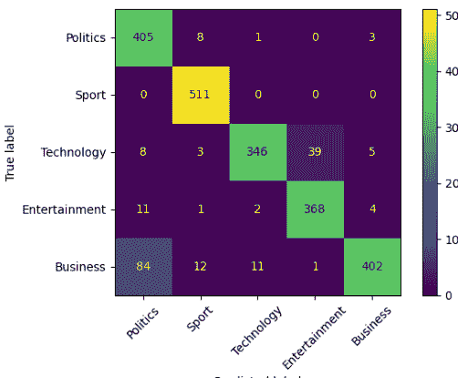

图 8.1 – 新闻文章分类的混淆矩阵

图 8.1 显示的混淆矩阵在分类大多数类别（尤其是体育和技术）时准确率较高。然而，某些类别（如政治和商业）出现了较多分类，这可能表明模型在区分这些类别方面还需要改进。选择不同的 transformer 模型是改进分类的方法之一。

既然我们已经评估并获得了 91% 的准确率以及在所有类别中精率和召回率的良好平衡，让我们把 `TransformerZeroShotTextRouter` 组件作为 Haystack 的一部分使用。

## 设置文本分类流水线

在本节中，我们将介绍如何使用 Haystack 组件设置分类流水线，根据内容自动对文章分类。该流水线集成了多个组件，用于搜索文章、获取内容并根据预定义的类别（如政治、体育、娱乐和商业）对文章进行分类。

在此处可以找到设置文本分类流水线的 Jupyter notebook：https://github.com/PacktPublishing/Building-Natural-Language-and-LLM-Pipelines/blob/main/ch8/text-classification/classification-with-haystack-search.ipynb

在流水线中，我们将创建一个 Haystack 自定义组件 `NewsClassifier`，将文本分类模型应用到每份文档。分类器处理文档并提取 `TransformersZeroShotTextRouter` 为每个文本预测的标签。然后将标签存储在文档的元数据中，可以用于进一步的处理或分析。

初始化流水线，并按顺序添加了几个组件：

1. **网络搜索 (Web Search)**：`SearchApi` 在允许的范围内（在本例中 Yahoo Finance）搜索文章。
2. **链接获取 (Link fetching)**：`ContentFetcher` 获取搜索结果的内容。
3. **HTML 转文档转换器 (HTML to document converter)**：HTML 转换器将获取的 HTML 内容转换为结构化对象。
4. **文档清理 (Document cleaner)**：`DocumentCleaner` 通过移除空白和其他无关字符串来清理文档。
5. **分类器 (classifier)**：`NewsClassifier` 根据预定义的类别对文档进行分类。

组件按顺序连接，以确保数据流转：

- 搜索结果传递给获取器
- 获取的内容转换为文档
- 文档被清理
- 分类器分配类别

作为使用流水线的示例，我们查询与“Elon Musk”相关的文章。流水线将搜索文章、获取内容、分类并存储在元数据中。以下是提取的元数据示例：

```
{'content_type': 'text/html', 'url': 'https://finance.yahoo.com/news/elon-musk-ascends-political-force-2843.html', 'labels': 'Politics'}
{'content_type': 'text/html', 'url': 'https://finance.yahoo.com/news/elon-musk-becomes-first-person-18431986.html', 'labels': 'Politics'}
{'content_type': 'text/html', 'url': 'https://finance.yahoo.com/news/elon-musks-net-worth-tops-14363708.html', 'labels': 'Business'}
{'content_type': 'text/html', 'url': 'https://finance.yahoo.com/news/openai-fires-back-elon-musk-21230741.html', 'labels': 'Technology'}
```

## 练习使用 NER 和文本分类作为智能工具

这是一个全面的实战挑战，你将在其中扩展文本分类项目以引入 NER 流水线从网站中提取实体，通过 Haystack 序列化并部署流水线，并为智能定义流水线：https://github.com/PacktPublishing/Building-Natural-Language-and-LLM-Pipelines/blob/main/ch8/text-classification/haystack-agents-mini-project/README.md。通过完成此挑战，你将获得通过 LangGraph 实现多智能体最终项目所需的项目结构和理解。


中性。文档级情感分析通常用于产品评论或客户反馈中的情感检测等任务。

- **句级情感分析：** 在这种方法中，文档中的每个句子都被单独分析，以确定其情感。这允许对情感进行更细粒度的理解，当文本中的不同句子传达不同情感时，这一点尤为重要。

- **基于方面的情感分析：** 基于方面的情感分析更进一步，专注于关注文档中提到的特定方面或特征。例如，在产品评论中，可以对“电池寿命”、“设计”和“性能”等方面进行情感分类。这种情感分析在提供有关特定产品特征的详细见解方面非常有价值。

情感分析具有广泛的应用，特别是在商业、社交媒体监控和客户服务领域。情感分析常见的一些关键领域包括：

- **客户反馈：** 企业可以通过分析反馈、评论或支持工单来衡量客户满意度并识别改进领域。

- **社交媒体监控：** 情感分析可监控社交媒体平台上的公众舆，提供关于人们对品牌、产品或政治事件感受的实时洞察。

- **市场研究：** 情感分析帮助企业分析消费者情绪并预测趋势，从而在市场中获得竞争优势。

- **政治分析：** 分析师通过分析演讲稿、辩论或社交媒体讨论来理解选民情绪并预测选举结果。

- **品牌监控：** 公司使用情感分析监控其品牌在市场上的感知情况，以便据此调整营销策略。

在下一节中，我们将继续探索如何结合基于 Transformer的方法和 Haystack 来执行情感分析。

## 探索 Haystack 用于情感分析的分类组件

在本节中，我们将介绍在 Haystack 框架内构建自定义组件的过程，以对 Yelp 商家评论进行情感分析。该组件利用了 `TransformersTextRouter`，它使用了专门为情感分类设计的预训练 Transformer 模型。这种方法允许我们根据评论内容将文本数据分类为“负面”、“中性”和“正面”等情感类别。

你可以在此处找到设置情感分析流水线的 Jupyter 笔记本：[https://github.com/PackPublishing/Building-Natural-Language-and-LLM-Pipelines/blob/main/ch8/text-classification/sentiment_analysis.ipynb

在这个笔记本中，我们使用 Haystack 的 `TransformersRouter` 组件来执行情感分析。我们使用了预训练模型 `cardiffnlp/twitter-roberta-base-sentiment`，这是一个分析文本情感的稳健模型。我们调用 `warm_up()` 方法来初始化模型，确保它准备好执行分类任务。关于所使用的微调 Transformer 模型的信息可以在此处找到：https://huggingface.co/cardiffnlp/twitter-roberta-base-sentiment

## 设置情感分析流水线

该流水线使用流行的 API 枢纽 RapidAPI](https://docs.rapidapi.com/what-is-rapidapi) 获取 Yelp 商家评论（[https://rapidapi.com/beat-analytics-beat-analytics-default/api/yelp-business-reviews]）。流水线对这些评论进行情感分析，并为每条评论文档富上情感标签（正面、负面、中性）。

以下是它的组装方式：

- **组件 1：YelpReviewFetcher (自定义)**
    - 请求 Yelp 商家评论端点的 API 调用
    - 将 API 响应转换为 Haystack Document 对象
    - 每个文档包含评论文本和元数据（评分、URL）
- **组件 2：BatchSentimentProcessor (自定义封装)**
    - 内部使用 Haystack 的 `TransformersTextRouter`
    - 使用 RoBERTa 情感模型 (cardiffnlp/twitter-roberta-base-sentiment)

## 动手实践项目

- 遍历每个文档，将文本分类为 LABEL 0/1/2（负面/中性）
- 将标签映射为人类可读的情感字符串
- 返回在元数据中富了情感信息的文档

流水线接受 API 凭据作为输入，获取评论，通过情感分析进行处理，并输出包含原始数据加情感分类的文档：

```
url = https://yelp-business-reviews.p.rapidapi.com/reviews/RJNAEa-209sctU00dmwA
querystring = {"sortBy": "lowestRated"}
headers = {
  "x-rapidapi-key": RAPID_API_KEY,
  "x-rapidapi-host": "yelp-business-reviews.p.rapidapi.com"
}
pipeline_input = {
  "review_fetcher": {"url": url, "headers": headers,
  "querystring": {"sortBy": "highestRated"}}
}
pipeline_result = sentiment_pipeline.run(pipeline)
```

在这一特定实例，请求了评分最高的评论。运行流水线后，我们可以验证生成的 hasstack Document 对象被标记为具有负面情感。以下是示例 Document 对象：

第一个示例：

```
Document(id=7, content: 'I just want to start out by saying that we were a table of bartenders, servers, and nurses. We under...', meta: {'rating': 1, 'url': 'https://www.yelp.com/biz/RJNAEa-209sctU000dmwA?hrid=H-RbvyF3zNH258GGy1QHDyw', 'sentiment': 'negative'})
```

第二个示例：

```
Document(id=8, content: 'Definitely a tourist trip, I here after reading that they had been voted best cures in W._...', meta: {'rating': 1, 'url': 'https://www.yelp.com/biz/RJNAEa-209sctU000dmwA?hrid=TGwW_3KFfa-wqWP9EVRfw', 'sentiment': 'negative'})
```

本节演示了如何在 Haystack 框架内构建自定义组件，使用基于 Transformer 的模型对 Yelp 进行情感分析。该组件通过 Yelp API 获取评论，执行情感分类，并返回带有情感标签的结果。这种方法展示了将 Haystack 灵活组件与 Transformer 模型相结合，以自动分析来自 Yelp 等外部源文本数据的威力。我们将通过构建一系列流水线来结束本章，这些流水线可以从 Yelp Business Review API 动态获取内容并为用户提供建议。

## 微项目：使用代理系统编排工具

在这一章中，我们构建了独立的、高度专门化的工具：NER（命名实体识别）流水线、用于情感的文本分类流水线以及搜索流水线。在传统系统中，人类必须决定使用哪一个。他们需要知道要找到餐厅，必须先使用搜索流水线，如果他们想了解评论，则必须手动将这些结果输入到情感流水线。

在最后一个项目中，我们将构建一个动态系统，它可以理解用户意图并将任务自动委托给作为端点的相应 Haystack 流水线。

在这个项目中，我们将构建 Yelp Navigator，这是一个多代理系统，可以处理复杂的自然语言查询，例如：

> “帮我在德克萨斯州奥斯汀找三家墨西哥餐厅，并分析客户评论，告诉我哪家的服务最好。”

没有单一流水线可以回答这个问题。它需要：

1. **搜索**：获取商家。
2. **详情**：获取特定数据（如网站评论）。
3. **情感分析**：阅读评论。
4. **总结**：将所有内容汇总为最终答案。
5. **质量保证**：确保最终报告符合所有要求。


## 架构：带有循环和审批的顺序路由

我们将采用顺序路由模型，其中每个智能体（agent）根据共享状态决定下一步并创建最终摘要。该架构将包含一个主管节点（supervisor node）作为质量保证层，判断报告是否符合所有要求；如果满足所有要求，则在返回摘要前进行批准；否则，它将返回给相应的智能体完成。

我们的系统将由以下关键组件组成：

- *Haystack 流线（工具）*：三个为搜索、信息检索和情感分析设计的流水线，通过 Hayhooks 以 REST API 的形式暴露。
- 澄清节点（Clarification node）：一个初步步骤，确保在进入主管节点之前，用户的查询具有足够的信息（如位置和所需的详细程度）。
- *工作节点（Worker nodes）*：专门的 LangChain 智能体，每个分配一个 Haystack 工具（例如搜索节点），只能访问 `business_search` 端点，该端点使用序列化的 `business_search` 流线。
- *摘要节点（Summarization node）*：使用提示词（prompt）总结工作智能体获取的信息的节点。
- *主管审批（The Supervisor approval）*：使用 LLM 决定最终报告是否满意的编排器。

我们可以将项目分解为五个关键步骤：

1. 将 Haystack 流线暴露为 REST 端点。
2. 将暴露的端点封装为 LangGraph 智能体可以执行的工具。
3. 定义智能体状态。
4. 构建智能体工作节点和主管。
5. 构建图表。

在这个小型项目中，我们将使用高级 Python 模式，包括使用类继承和装饰器的 `SuperComponent` 包装器。虽然这些结构为生产级智能体系统提供了扩展性，但对于不熟悉高级面向对象编程的人来说可能有挑战性。我们建议首先关注这些组件之间的数据流，即信息如何从一个序列化层移动到下一个层。

##  1 ：将 LangGraph 智能体暴露为工具

在我们的 LangGraph 智能体使用专门的 Haystack 流线之前，我们必须让它们在网络上可访问。如上一章所示，我们使用 Hayhooks (https://docs.haystack.deepset.ai/docs/hayhooks) 实现这一点，这是一个用于将 Haystack 流线部署为 REST 端点的服务器。

该过程涉及三个不同的阶段：

1. **序列化（Serialization）**：首先，我们必须将 Python 流线对象转换为静态格式。使用 Haystack 内置的 `pipeline.dumps()` 方法将流线定义序列化为 YAML 格式。此 YAML 文件包含流线的完整蓝图，包括所有组件及其连接。
2. **存储（Storage）**：将这些 YAML 文件保存到指定的目录（例如 `pipelines/`）。
3. **暴露（Exposure）**：运行 Hayhooks 服务器并指向该目录：

```
uv run hayhooks run --pipeline-dir pipelines
```

Hayhooks 会自动扫描目录，加载找到的每一个有效 YAML 流线定义，并创建 REST 端点（例如 `http://localhost:1416/business_search/run`）。

所有流线实现可以在此链接找到：https://github.com/PacktPublishing/Building-Natural-Language-and-LLM-Pipelines/tree/main/ch8/yelp-navigator/pipelines

根据项目结构，以下是每个专用流线的描述：

- **流线 1：带 NER 的业务搜索** (`business_search`)：该流线使用 NER（命名实体识别）执行业务搜索。它接收用户查询，提取关键实体（如业务类型和位置），并返回相关业务列表。
- **流线 2：带网站内容的业务详情** (`business_details`)：该流线通过获取网站内容来丰富业务信息。它接收来自流线 1 的业务列表，并检索更详细的数据（如其网站的文本），以提供更深的上下文。
- **流线 3：带情感分析的评论** (`business_sentiment`)：该流线专注于分析客户评论。它接收来自流线 1 的业务列表，获取所选业务的评论，并进行情感分析以确定客户反馈的整体基调（正面、消极、中性）。

每个流线都遵循整洁的文件夹结构和模式实现：组件定义、流线构建（序列化为 YML）和流线加载（作为 REST 端点暴露）。

我们将组件定义包含在 `components_.py` 文件中，在 `build_pipeline.py` 脚本中构建并序列化流线，并在 `pipeline_wrapper.py` 文件中封装并加载流线以暴露为 REST 端点。为了自动化此过程，可以创建一个像这样的 脚本：https://github.com/PacktPublishing/Building-Natural-Language-and-LLM-Pipelines/blob/main/ch8/yelp-navigator/build_all_pipelines.sh。

> 注意
 导航流线内容
关于流线实现和作为 REST 端点暴露的完整文档可以在此链接找到：

https://github.com/PacktPublishing/Building-Natural-Language-and-LLM-Pipelines/blob/main/ch8/yelp-navigator/docs/yelp-navigator-hayhooks/guide.md

要将流线暴露为 REST 端点，我们只需运行以下命令：

```
./build_all_pipelines.sh
uv run hayhooks run --pipelines-dir pipelines
```

这将在 `http://localhost:1416/` 创建一个实例，通过它我们可以像这样使用暴露的端点：
每个流线映射到一个端点，因此我们可以按如下方式使用端点：

https://github.com/PacktPublishing/Building-Natural-Language-and-LLM-Pipelines/blob/main/ch8/yelp-navigator/docs/yelp-navigator-hayhooks.md#basic-workflow-single-business

我们的端点的 Swagger 文档在此链接找到：https://github.com/PacktPublishing/Building-Natural-Language-and-LLM-Pipelines/blob/main/ch8/yelp-navigator/docs/Hayhooks%2A-%20Swagger%20UI.pdf。此链接显示 Hayhooks Swagger UI，这是一个视觉仪表板，会自动将你部署的 Haystack 流线暴露为 REST API 端点。它详细列出了可用操作，从部署和检查状态等服务器管理任务，到执行特定的工作流（如 `business_search` 和 `business_sentiment`）。你可以通过访问 http://localhost:1416/docs 在本地访问此文档。当你在任何一个端点上展开菜单时，你可以传递所需的参数并执行流线。

> 注意
**练习调用流线**

用于练习运行流线的示例 notebook 可以在此链接找到：https://github.com/PacktPublishing/Building-Natural-Language-and-LLM-Pipelines/blob/main/ch8/yelp-navigator/pipeline_chaining_guide.ipynb

是 RapidAPI 服务免费计划下的限制为 50 次请求。我们建议你将这些额度留给本次练习的智能体部分，并将此 notebook 作为概念指导。你可以在 https://rapidapi.com/beat-analytics-beat-analytics-default/api/yelp-business-reviews/pricing 升级计划或取消并重新订阅

我们的流线现在准备好封装为 LangGraph 智能体使用的工具。

## 第二步：将端点封装为工具

一旦我们的流线作为 REST 端点运行，我们需要将它们转换为 LLM 智能体可以理解和操作的格式。我们使用 LangChain 的 `@tool` 装饰器来实现。

我们定义一个标准的 Python 函数，向 Hayhooks 端点发送 HTTP POST 请求并返回 JSON 响应。通过对此函数添加 `@tool` 装饰器，根据函数名称、文档字符串和类型提示自动生成 JSON Schema。

此 Schema 充当 LLM 的接口文档。它告诉智能体具体做什么（根据文档字符串）以及它需要哪些输入（例如 `query: str`），允许智能体通过生成正确的参数来自主“调用”外部 Hayhooks 流线。

```python
@tool
def search_businesses(query: str) -> Dict[str, Any]:
    """使用自然语言查询搜索业务。"""
```

参数：
query: 自然语言搜索查询（例如


# 德克萨斯州奥斯林的墨西哥菜

返回：
包含名称、评分、位置等搜索结果的字典。

```python
try:
  response = requests.post(
    f"{BASE_URL}/business_search/run",
    json={"query": query},
    timeout=30
  )
```

就是这样！通过这些，我们准备好通过定义状态、代理工作节点（agent workers）和主管器来定义代理应用程序的核心逻辑。

# 第 3 ：定义代理状态

在 LangGraph 中，状态是跨越整个图执行的共享内存。它通常被定义为 `TypedDict` 数据结构，精确规定了哪些信息被跟踪以及如何在代理之间传递。

这里的选择从根本上影响代理的流。对于 Yelp Navigator，我们的状态包含以下内容：

- **用户意图**：`clarified_query`、`clarified_location` 和 `detail_level` 等字段说明了提取的用户需求。如果这些信息不在状态中，下游代理（如搜索代理）将不知道搜索什么。

状态定义可以封装在一个简单的类中：

```python
class AgentState(MessagesState):
  """工作流中所有节点共享的状态。
  继承自 MessagesState 的 'messages': Annotated[List[BaseMessage], add_messages]。
  """
```

# 第 8 章

```python
# 用户意图（由澄清 节点设置）
user_query: str            # 用户的原始问题
clarified_query: str      # 他们正在寻找的内容
clarified_location: str    # 在何搜索
detail_level: str           # "general", "detailed", 或 "reviews"

# 工作流控制
clarification_complete: bool  # 准备好继续搜索时为 True
next_agent: str             # 下一步调用哪个节点（启用条件路由）

# 节点结果
agent_outputs: Dict[str, Any]  # 每个节点的结果（搜索、详情、情感分析）

# 最终输出
final_summary: str          # 用户友好的响应

# 质量控制（用于主管审核节点）
approval_attempts: int     # 主管审查的次数（最多 2 次）
needs_revision: bool       # 如果摘要需要改进则为 True
revision_feedback: str      # 需要改进的内容
```

`AgentState` 类封装了应用程序共享状态的核心组件，通过三个关键机制实现了独立代理之间的协调：

- **上下文保留**：这使得所有代理都能访问用户需求，确保它们不会“忘记”原始目标。
- **流程控制**：充当门卫，确保系统只有在完全理解请求后才继续执行。
- **数据聚合**：充当中央仓库，收集不同工作节点的局部结果，以便从完整数据集合成最终答案。

当工具和状态定义就绪后，我们准备好定义代理工作节点、主管审核以及最终图，映射我们的多代理架构。

# 第 4 步：构建工作节点、主管器和图

在实现这些元素之前，我们将区分图中的四种节点：澄清节点、工作节点、摘要节点和主管审核节点。

- **澄清节点**：该节点的工作是接收用户查询、澄清意图、确保其拥有所有所需信息，并将发现的结果传递给搜索代理。
- **工作节点**：这些是专家。每个工作节点都被分配了一个特定的工具（在第 2 步中封装），并负责执行该工具并用结果更新状态。例如，搜索节点仅使用 `business_search` 工具。
- **摘要节点**：该节点获取工作节点获得的结果，并生成一份包含业务名称、电话、网站和评论的综合报告。
- **主管审核节点**：该代理纯粹作为路由器。它本身不使用工具。相反，它分析当前状态并使用 LLM 决定哪个工作节点应该执行，或者任务是否已完成。

连接图涉及添加这些节点并用边将它们连接起来。关重要的是，我们使用条件边进行动态路由，而不是固定路径（例如 A 始终到 B），条件边查看代理的输出（`"next_agent": "sentiment"`）并动态将执行路由到相应的节点。这允许复杂的非线性工作流，其路径完全由用户的特定请求决定。这里给出包含此模式的示例，如图 8.2 所示。

# 第 8 章

# 238

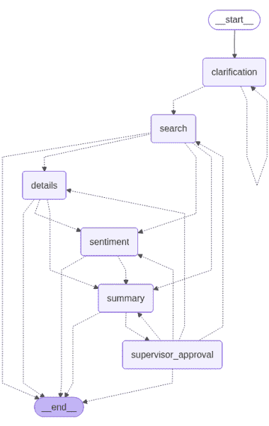

图 8.2 – 多代理架构

让我们分解这个图是如何构建的。我们从添加节点开始：

```python
# 构建图
workflow = StateGraph(AgentState)

# 添加节点
workflow.add_node("clarification", clarification_wrapper)
workflow.add_node("search", search_wrapper)
workflow.add_node("details", details_wrapper)
workflow.add_node("sentiment", sentiment_wrapper)
workflow.add_node("summary", summary_wrapper)
workflow.add_node("supervisor_approval", supervisor_approval_wrapper)
```

然后我们添加边。图的起点是澄清节点。一旦它获得了所需的信息，就会触发搜索节点。

```python
workflow.add_edge(START, "clarification")

# 澄清循环或移动到
workflow.add_conditional_edges("clarification",
    route_after_clarification,
    {"clarification": "clarification", "search": "search"}
)
```

随后，搜索节点将选择触发详情节点还是摘要节点，取决于澄清节点的状态。

```python
workflow.add_conditional_edges(
    "search",
    route_after_search,
    {"details": "details", "summary": "summary"}
)
```

如果触发了详情节点，然后可以触发情感分析节点或摘要节点，取决于状态。

```python
workflow.add_conditional_edges(
    "details",
    route_after_details,
    {"sentiment": "sentiment", "summary": "summary"}
)
```

由于情感节点是最后一个配备工具的节点，它只触发摘要节点。摘要节点随后触发主管审核节点。

```python
# 情感 -> 摘要（始终）
workflow.add_edge("sentiment", "summary")
# 摘要 -> 主管审核（始终）
workflow.add_edge("summary", "supervisor_approval")
```

# 第 8 章

主管随后将是终止进程或返回到任何节点并请求重新执行工具。

```python
# 主管审核可以路由回节点或结束
workflow.add_conditional_edges(
    "supervisor_approval",
    route_from_supervisor_approval,
    {
        "search": "search",
        "details": "details",
        "sentiment": "sentiment",
        "summary": "summary",
        END: END
    }
)
```

`workflow` 变量可以被编译并用于用自然语言回答。这些关键步骤的完整实现可以在以下笔记本中找到：https://github.com/PacketPublishing/Building-Natural-Language-and-LLM-Pipelines/blob/main/ch8/yelp-navigator/langgraph_multiagent_supervisor.ipynb。

当我们运行查询“波特兰的咖啡馆”并检查它们的评论时，图的执行如下：

-1. **澄清节点**：识别 `query="coffee shops"`，`location="Portland"`，`detail_level="reviews"`。直接路由到搜索节点。
2. **搜索节点**：通过 Pipeline 1 找到咖啡馆。检查 `detail_level("reviews")` 并路由到详情节点。
3. **详情节点**：通过 Pipeline 2 获取网站信息。检查 `detail_level("reviews")` 并路由到情感分析节点。
4. **情感分析节点**：通过 Pipeline 3 分析评论。路由到摘要节点。
5. **摘要节点**：将所有数据聚合为最终答案。路由到主管审核。
6. **主管审核**：审核摘要质量。要么批准并结束（END），要么请求修改并路由回特定代理（最多 2 次审核尝试）。

如果我们提一个更简单的查询，例如“加利州最好的寿司店”，它将运行更简单的流程：

-. **澄清代理**：识别 `query="sushi"`


2. 搜索代理：使用“sushi in California”调用 Pipeline I。检查 detail_level。

3. 摘要代理：将搜索结果聚合为建议。路由至主管代理（Supervisor）审批。

4. 主管代理审批：审查摘要质量。通过后批准并路由至：

当代理未能提供最终答案时，挑战在于确定是 LLM 还是工具引起了问题。通过实现外部监控层，我们可以检查节点序列和错误日志。这将使我们能够区分常见的失败模式：

- 1. LLM 决策失败：序列停止在推理节点，因为 LLM 没能生成有效的工具调用。
- 2. 节点超时：特定组件（例如网络搜索）超过了其时间限制，在崩溃时被监控当前节点所捕获。
- 3. 工具执行错误：节点被成功调用，但底层的 Python 函数或 API 返回了异常。

本书的结语部分将探索如何对故障系统中的节点进行完整分析，并深入探讨复杂多智能体图的高级可观测性和恢复策略。

通过将 Haystack 健壮且专门的流水线与 LangGraph 的推理能力相结合，我们创建了一个能力远超各部分总和的系统。这是现代、生产级 AI 应用的基础。

我们的旅程到此结束。现在你拥有了一个完全实现的、可扩展的工作流，新的 Haystack 流水线可以作为新的工人添加到你的 LangGraph 主管中，摩擦极小，准备好应对生产挑战。

## 总结

在本章中，我们通过将 NLP 技术重构为自主智能体的工具，探索了这些技术。我们学习了如何构建两种不同类型的系统：

- 高性能工具（使用 Haystack）：第一个微项目（NER、文本分类和情感分析）展示了如何使用 Haystack 的组件和流水线来构建高度专业、模块化且高性能的工具。Haystack 擅长这种“知识密集型”的 RAG 流水线架构，使其成为构建智能体所需能力的理想框架。
- 灵活编排（使用 LangGraph）：第三个项目表明，对于以复杂、状态且可控的方式编排这些工具，内置的 Haystack 代理组件具有局限性。它的黑盒推理循环缺乏显式控制流的活性。像 LangGraph 这样基于图的状态机提供了高级代理模式所需的显式白盒控制、循环逻辑和可观测的状态管理。

这得最终的架构结论：理想的生产系统是结合了这两个生态系统最佳优势的混合系统。该架构由两个不同的层组成：

- 使用 Haystack 和 Hayhooks 构建的工具层：正如我们在第7章中学到的，Haystack 流水线可以序列化并使用 Hayhooks 部署为生产级 REST API，并通过 Docker 和 Kubernetes 进行部署和扩展。我们的 NER 分类器和 R流水线不应该是代理导入的 Python 对象；它们应该是使用 Hayhooks 部署的独立微服务。
- 使用 LangGraph 构建的编排层：中央 LangGraph State 将作为代理编排器。它的工具节点将不是 Haystack Component Tool 封装器，而是向 Hayhooks 端点发送 HTTP 请求的简单 API 客户端。

通过将 Haystack 构建工具的模块化组件与 LangGraph 用于编排的显式控制相结合，我们可以构建可扩展、高效且高度可控的 NLP 系统。

在下一章中，我们将探索 LLM 在准确性、扩展性和伦理考虑方面的当前局限性，并研究关键新兴领域，例如人工智能在伦理、法律、运营和决策中的作用，并发现 NLP 开发者可以为未来进步做出贡献的领域。

## 延伸阅读

- Grishman, R., and Sundheim, B. M. (1996). Message understanding conference-6: A brief history. In COLING 1996 Volume 1: The 16th International Conference on Computational Linguistics: https://aclanology.org/C96-1079/
- Babych, B., and Hartley, A. (2003). Improving machine translation quality with automatic entity recognition. In the International EAMT workshop on MT and other language technology tools: https://aclanology.org/w03-2201/
- Mollá, D., Van Zaanen, M., and Smith, D. (2006). Named entity recognition for question answering. In Proceedings of the Australasian Language Technology Workshop 2006, pages 51–58: https://aclanology.org/U06-1009/
- Guo, J., Xu, G., Cheng, X., and Li, H. (2009). Named entity recognition in query. In SIGIR, pages 267–274: https://dl.acm.org/doi/10.1145/157141.1571989
- Keraghel, I., Morbieu, S., and Nadif, M. (2024). A survey on recent advances in Named Entity Recognition. arXiv:2401.10825vi[cs.CL]: https://arxiv.org/html/2401.10825v1
- Weston, L., Tshitoyan, V., Dagdelen, J., Kononova, O., Trewartha, A., Persson, K. A., Ceder, G., and Jain, A. (2019). Named entity recognition and normalization applied to largcale information extraction from the materials science literature. Journal of chemical information and modelling, 59(9):3692–3702
- Devlin, J., Chang, M., Lee, K., and Toutanova, K. (2018). BERT: Pre-training of deep bidirectional transformers for language understanding: https://semanticscholar.org/paper/BERT%3A-Pre-training-of-Deep-Bidirectional-transformers-for-language-Devlin-Chang/df2b0e26d0599ce3e70df8a9da020e51594e0992
- Labusch, K., Neudecker, C., and Zollhöfer, D. (2019). Bert for named entity recognition in contemporary and historic German. In KONVENS: https://www.researchgate.net/publication/336926568_BERT_for_Named_Entity_Recognition_in_Contemporary_and_Historical
- Park, C., Jeong, S., and Kim, J. (2023). ADMIT: Improving NER in automotive domain with domain adversarial training and multi-task learning. Expert Systems with Applications, 225:120007
- https://sciencedirect.com/science/abs/pii/S26
- Li, Z., Du, X., Wang, W., and Li, Y. (2020). Language model pre-training method in machine translation based on named entity recognition. International Journal on Artificial Intelligence, 29(07):2
- Al-Qawasmeh, O., Al-Smadi, M., and Friahat, N. (2016). Arabic entity disambiguation using linked open data. In 2016 7th International Conference on Information and Communication Systems (ICICS), pages 333–338: https://ieexplore.ieee.org/document/74670
- LangChain & LangGraph (2025). LangChain & LangGraph 1.0 alpha releases: https://blog.langchain.com/langchain-langchain-1-0-alpha-releases


# 第 4 部分

## 代理体 AI 的未来

在本部分中，你将探索向 2026 年迈的行业前沿。最后一部分将探讨通过 NVIDIA NIMS 进行硬件优化，以及使用 DeepSeek-RI 等模型进行本地推理的兴起。你将深入研究互操作的关键新兴协议，包括模型上下文协议 (MCP) 和代理体间通信 (A2A)。本书最后引入了用于自我改进记忆的代理体上下文工程 (ACE) 以及 AgentSecOps 这一至关重要的安全规范。在本部分结束时，你将对“主权代理体”（sovereign agent）有一个清晰的架构愿景：一个为 AI 下一个转折点设计的韧性、高效益的系统。

本书的部分包含以下章节：

- 第 9 章，未来趋势及展望
- 第 10 章，结语：代理体 AI 的架构

# 9

## 未来趋势及展望

在前面的章节中，我们从构建基础的 RAG 流水线演进到将其部署为容器化微服务。最近，第 8 章建立了我们的基准架构模式：清晰的关注点分离，使用 Haystack 处理专门的工具流水线，使用 LangGraph 进行代理体编排。

这种“工具对比编排”的范式是未来自治 AI 系统的基础。本章将超越基准，审视塑造下一代 NLP 的技术和伦理进展。我们将探索硬件限制、行业标准和自我改进记忆如何将孤立的代理体转变为互操作的、智能生态系统。

在本章中，我们将涵盖以下主题：

- 硬件的局限性与机遇
- LLM 的当前局限性
- 代理体的未来：协议、编排与上下文
- 代理体记忆的演进：代理体上下文工程
- 关键新兴领域

在本章结束时，你将具备应对当前技术局限性、并在快速演变的基于 LLM 开发格局中把握新兴机遇的知识。

## 硬件局限性与机遇

驱动我们代理体系统的 LLM 的开发和部署，与底层硬件的能力和限制紧密不可分。这种硬件挑战不仅是模型初始训练的问题，更是未来推理和部署的关键驱动力，直接影响我们的容器化 Haystack 工具和 LangGraph 编排器如何在生产环境中运行。

以下是一些常见的硬件局限性：

- **计算需求**：训练 LLM 需要通过具有数十亿参数的模型处理海量数据集。传统的 CPU 无法胜任这些任务，必须采用专门的加速器，如图形处理器 (GPU) 和张量处理单元 (TPU)，它们是为高效的并行处理而设计的。

- **内存限制**：大模型的规模可能会超过标准硬件的内存容量，在训练和推理过程中产生严重的瓶颈。这需要使用高内存 GPU 或分布式计算环境来容纳这些模型。

- **能耗**：训练和运行这些模型的能量需求是巨大的，引发了人们对环境影响和财务可持续性的严重关注。

为了缓解上述硬件局限性，我们可以关注 NVIDIA 生态系统提供的关键新兴机遇，特别是 NVIDIA AI 基础模型、NVIDIA NeMo 和 NVIDIA 推理微服务 (NIM)：

- **NVIDIA AI 基础模型**：该类别涵盖社区贡献和 NVIDIA 构建的、在 NVIDIA 加速基础设施上运行的 LLM，为模型选择提供了稳健的基准（https://www.nvidia.com/en-us/ai-data-science/foundation-models/）。

- **NVIDIA NeMo**：被认为是开发生成式 AI 模型的关键新兴平台，NeMo 提供了一个可扩展的训练和定制框架（https://www.nvidia.com/en-us/ai-data-science/products/nemo/）。

- **NIM**：NIM 是一组预构建的容器化微服务，专门针对 AI 模型的优化推理（https://www.nvidia.com/en-us/ai-data-science/nim-microservices/）：

  - **使用 TensorRT 优化**：NIM 模型使用 NVIDIA TensorRT 进行优化，这是一个基于 CUDA 并行编程模型的 API 生态。通过量化、层和张量融合以及内核调优等技术，TensorRT 确保了从边缘设备到数据中心的所有 NVIDIA GPU 上实现高性能推理。

  - **架构相关性**：NIM 模型与本书建立的架构相关。它们镜像了第 7 章和第 8 章中的部署模式，即我们使用 Hayhooks 将 Haystack 流水线封装为微服务。NIM 代表了下一个逻辑步骤：将基础模型本身作为可调用的微服务部署。

  - **未来集成**：在代理体系统中，编排器不会区分这些服务；它将简单地调用 Haystack/Hayhook 工具执行专门的 RAG 任务，并调用 NIM“工具”执行原始生成任务。

Haystack 已通过 NVIDIA 集成实现了能够构建 RAG 应用的模型访问（https://haystack.deepset.ai/nvidia）。该集成提供了以下组件：

- **NVIDIATextEmbedder**：用于嵌入字符串的组件，使用 NVIDIA Foundation 和 NIM 嵌入模型。对于区分查询和文档输入的模型，该组件将输入字符串作为查询。

- **NVIDIADocumentEmbedder**：用于嵌入文档的组件，使用 NVIDIA AI Foundation 和 NIM 嵌入模型。

- **NVIDIAGenerator**：使用 NVIDIA AI Foundation Endpoints 提供的生成模型生成文本的组件。

- **NVIDARanker**：使用 NVIDIA NIM 进行文档排序的组件。

不想或无法通过云提供者的 API 调用利用 LLM 的公司或行业，在将模型作为 RAG、NLP 和代理体工作流的一部分时面临独特挑战。与云消费者不同，这些团队必须直接管理之前讨论的硬件限制：

- **基础设施开销**：他们必须提供高内存 GPU 来本地处理大模型的参数规模和计算需求。
- **运营复杂性**：他们负责推理层的优化和编排，需要大量的 DevOps 工作来维持低延迟。

为了缓解这些问题，开发者可以利用工具来简化本地模型服务：

- **本地推理提供商**：如 Ollama (https://ollama.com/)、vLLM (https://docs.vllm.ai/en/latest/) 和 LM Studio (https://lmstudio.io/) 允许团队以最少的设置在本地拉取并运行优化模型。

- **框架集成**：通过使用 Haystack 和 LangGraph 中相应的集成，开发者可以将云端 LLM 生成器组件交换为本地对应组件。这允许将模型直接加载到流水线中，而无需外部 API 调用。

- **代理体实现**：一个很好的例子是 LangChain 的本地深度研究员（https://github.com/langchain-ai/local-deep-research），该代理系统能够完全在本地环境中使用各种资源收集、组织并编写报告。


### LLM 的当前局限性

当前这一代 LLM 虽然强大，但存在根本性的局限性。这些局限性不仅仅是学术问题；它们是定义该领域未来的高级智能体（agentic）解决方案的主要动力。下列出的每种局限性都是使“未来趋势”成为“必然选择”的“原因”。我们可以将其分为四个关键领域：真实性问题、上下文问题、黑盒问题以及集成问题。接下来让我们详细分析每一项。

## 真实性问题

LLM 是概率系统，而非事实性数据库。它们容易产生幻觉，生成听起来合理但事实错误的信息。这一问题的之所以出现，是因为它们根据学习到的模式来预测下一个词，而不是基于事实依据。这使得它们在关键用场景中变得不可靠。

这是我们在第 4、5 和第 6 章中学习的 RAG（检索增强生成）旨在解决的根本问题。通过检索外部可验证的文档并为模型的回答提供依据，RAG 缓解了幻觉。然而，静态 RAG 仅仅是部分解决方案。这一局限性是智能体上下文工程（ACE）（Zhang et al., 2025）的主要动力，它代表了进化的化的一步：创建一个动态的、自我纠正的上下文以持续确保事实依据。

## 上下文问题

LLM 受限于 token 限制，这限制了它们一次能处理的输入。它们很难在长交互中维持上下文，并且无法执行超出此窗口的复杂多步推理任务。此外，它们缺乏长期记忆，除非显式提供，否则它们无法将知识从一个会话保留到另一个。

这一局限性是我们在第 8 章中采用的智能体架构的主要动力。我们并不是通过向单个 prompt 中填充数 GB 的文本来解决复杂任务的；而是使用编排器（如 LangGraph）将问题分解为一系列步骤，顺序调用工具并管理状态。这一局限性也推动了 ACE，它将上下文从“单个 prompt”重构为“进化的剧本”（playbook），能够随时间推移管理策略和知识。

## 黑盒问题

LLM 通常作为“黑盒”系统运行。特定输出背后的内部推理是不透明的，这使得很难信任模型的决策，特别是在法律、医学或金融等高风险领域。

这种可解释性的缺失是智能体与智能体（A2A）协议的主要动力。在复杂的多智能体系统中，追踪决策至关重要的。A2A 的“结构化任务执行”（Open Protocols for Agent Interoperability, AWS blog）不仅仅是一种消息格式；它是一条可审计的轨迹。它提供了清晰的、分步骤的记录，说明哪个智能体被分配了任务、它做了什么以及结果是什么，形成了一个比单一单体黑盒模型更透明、可解释的推理链。

## 集成问题

最后一个关键局限性不在于模型本身，而在于它的应用。即使是最强大的 LLM，如果它无法访问推理所需的数据，也是徒劳无功。目前，这些数据被困在“信息孤岛和遗留系统中”（Anthropic, 2024）。每一个新工具、数据库或 API 都需要“自定义实现”（Anthropic, 2024），这是一种一次性的、脆弱的连接器，难以构建和维护。

这是模型上下文协议（MCP）明确且公开的动力。MCP 由 Anthropic 等人创建，正是为了解决这一特定问题，提供了一种通用的开放标准，以“用统一的实时协议来替代一次性的补丁”（Edwin Lisowski, 2025）。

我们现在将探索截至2025年这些局限性是如何被。

## 智能体未来：协议、编排与上下文

本节构成了我们探索的新核心，直接建立在第 8 章建立的模式之上。但在深入技术实现之前，我们必须定义我们所说的智能体未来。

智能体未来代表了一种范式转变：AI 应用不再是孤立的、单体的聊天机器人，而是去中心化、可操作生态系统中的参与者。在未来，智能体不仅生成文本；它们还积极协作、共享工具并随着时间的推移改进自身的推理策略。

这种转变解决了定制架构中固有的扩展性和集成问题。迈向这一未来，我们解锁了具有以下特征系统：

- **可操作：** 用行业范围内的标准取代脆弱的自定义集成。
- **去中心化：** 允许来自不同团队或供应商的智能体进行安全的协作。
- **自我改进：** 从静态内存进化为从失败中学习的动态上下文系统。

在本节中，我们将看到构建的架构（由 LangGraph 智能体编排的 Haystack 工具）如何被行业正式化以满足这一愿景。随后我们将探索它如何泛化为现代标准化协议。

## 从智能体到编排器：第 8 章回顾

在第 8 章中，我们确定了本书的核心架构论点——生产级智能体系统由两个不同的层组成：

- **工具层：** 专门的、数据密集型任务封装在 Haystack 流水线中（例如 RAG、NER 和情感分析）。这些流水线然后使用 Hayhooks 部署为可扩展的、无状态的 REST 微服务
- **编排层：** LangGraph 状态机充当智能体的“大脑”。它本身不执行任务；它管理高层逻辑并通过通过调用工具的端点来编排工具，从而完成复杂目标。

我们在第 8 章的 Yelp 多智能体系统是一个完美的例子：一个中央 LangGraph 协调器编排了一组“工作”智能体，而这些智能体在底层是我们部署的 Haystack 流水线工具的简单客户端。这种双层单体架构是我们的新基准。本节的其余部分将探索如何使该系统具有可操作、去中心化和自我改进的能力。我们将引入两个关键协议来实现这一点：MCP 和 A2A。

## 协议层

我们的 Yelp Navigator 的主要弱点在于它是单体系统。LangGraph 智能体和 Haystack-Hayhook 端点是定制的，仅用于彼此通信。如果我们想添加另一个供应商的工具，或者另一个团队想使用他们的 Haystack-RAG 工具，就需要新的自定义集成代码。

协议解决了这个问题。它们是正式的、行业范围的标准，定义了组件应该如何通信，从一个脆弱的自定义代码连接世界转向健壮的即插即用生态系统。我们可以将这些协议应用于两个维度，标准化并扩展我们的 LLM 和智能体应用：水平和垂直。

## 垂直连接：MCP

第一个协议 MCP 标准化了编排器与其工具之间的通信。MCP 是一个开放标准，被比“AI 的 USB-C 端口”（What is Model Context Protocol）。它为 AI 应用（客户端）提供了一个通用的客户端-服务器标准，用于发现并连接外部工具和数据源（服务器）。

### 第 9 章

MCP 定义了客户端-服务器架构（What is Model Context Protocol）。当我们将其映射到栈时，我们学习了以下内容：

- MCP 主机/客户端：这是 AI 应用或编排器。在我们的语文中，这是我们的 LangGraph 智能体
- MCP 服务器：这是暴露数据或工具的程序。在我们的语文中，这是我们的 Haystack 流水线

MCP 服务器暴露了客户端可以的“原语”。这些包括工具（可执行函数）、资源（数据）和提示（可重用模板）。通信通过特定的 JSON-RPC 数据层进行。

我们可以将其直接映射到我们在第 8 章的 Yelp Navigator 项目架构中。MCP 是我们工具层的正式标准化。LangGraph 智能体现在不再是向通用的 Hayhook 端点进行简单的 HTTP 调用，而是将与标准化的 MCP 端点进行通信。

这并非遥远的未来；通过我们所学习的框架，今天就可以实现。Haystack 内置了 MCP 集成 mcp-haystack（Edwin Lisowski, 2025）。

在等式的另一侧（即编排器），langchain-mcp-adapters 库和相关教程提供了构建 LangGraph 智能体的代码，该智能体可以发现并消费通过 MCP 服务器暴露的任何工具。

## 水平连接：A2A 协议

当 MCP 标准化智能体与其工具之间的“垂直”连接时，A2A 标准化了智能体之间的“水平”连接。（Clarifai, Amdjed Bensalah 和 AKKA）。由 Google 驱动的 A2A 协议是一种专门为智能体间通信、协作和协调设计的对点协议（OneReach AI）。

如果 MCP 标准化了我们的 LangGraph 编排器与其 Haystack 工具之间的连接，A2A 则标准化了 LangGraph 编排器与另一个


## 未来趋势及展望

团队的代理代理编排器（如 LangGraph、CrewAI 等）。它允许我们的 Yelp Navigator 监控器安全地将任务委托给完全独立的代理，即使这些代理由不同的团队构建并运行在不同的基础设施上。

A2A 构建在两个核心概念之上（代理互操作性开放协议（Open Protocols for Agent Interoperability），AWS 博客）：

- **Agent 卡片 (Agent cards)**：这是该协议的发现机制。Agent 卡片是代理发布的一种元数据“名片”，描述了其能力、联系方式以及安全性要求。
- **结构化任务执行 (Structured task execution)**：这是用于通信的可审计工作流。它允许代理委托任务、跟踪进度、共享中间结果并处理执行结果。这种结构化、可追踪的通信解决了“黑箱”问题。

这项技术在我们技术栈中也可以直接访问。LangSmith（https://www.langchain.com/langsmith/observability）作为 LangChain 和 LangGraph 的生产监控层，内置了对 A2A（https://docs.langchain.com/langsmith/server-a2a）的支持。通过 LangSmith 的代理服务器部署 LangGraph 代理，开发者会自动创建一个兼容 A2A 的端点。这已被用于演示在完全不同框架构建的代理之间的互操作性，例如 LangGraph 代理与 CrewAI 代理的通信。

为了巩固这两个截然不同但互补的协议，表 9.1 提供了直接对比。

| 特性 | MCP | A2A 协议 |
|---|---|---|
| 主要目标 | 工具和数据访问 | 代理协作与编排 |
| 通信模型 | 垂直（客户端-服务器） | 水平（点对点） |
| 类比 | 工具的 USB-C 接口 | 代理的商务会议协议 |
| 核心概念 | 原语：工具、资源和提示词 | Agent 卡片（用于发现）和结构化任务（用于执行） |
| 解决的关键 Key问题 | 取代碎片化的、定制定制的工具集成 | 实现去中心化的、跨平台的代理协作 |
| 实现（在我们技术栈中） | LangGraph 代理（客户端）到 Haystack MCPTool 组件（服务器） | LangGraph 代理（对等节点）到 LangGraph 代理（对等节点）（通过 LangSmith） |

表 9.1 - 代理通信协议对比

在完成了工具到代理再到 MCP 和 A2A 协议的稳健映射后，我们准备好进入下一个改进领域：持续上下文工程。

## 代理内存的演进：代理上下文工程 (agentic context engineering)

现在我们已经标准化了代理与工具（MCP）以及代理之间（A2A）的通信方式，我们必须解决最后的前疆：它们如何“思考”以及如何“学习”。这是代理内存和 RAG 的演进。

代理工程（ACE）是一个框架，它将代理的上下文重新定义为不是静态的、固定的提示词（prompt），而是动态的、“演进的剧本”。这是一种通过不断构建和修改输入（上下文）而不是更改模型权重（微调）来改进行为的方法（Zhang et al., 2025）。

ACE 通过模块化的迭代化的过程工作，允许代理的剧本根据性能进行演进：

1. **生成 (Generation)**：代理使用其当前上下文（剧本）尝试执行任务。
2. **反思 (Reflection)**：代理（或独立的反思代理）检查结果、执行轨迹，并就应如何修订上下文或策略生成自然语言反馈。
3. **策展 (Curation)**：这些反馈被分析并整合到上下文中，增量更新剧本以积累成功策略并丢弃失败策略，从而防止上下文崩溃。

该框架是我们在*第 5 章*和第 6 章中学习的严谨、手动评估过程的*自动化和在线执行*：

- 在*第 5 章*中，我们手动构建了一个流水线来为评估生成合成数据
- 在*第 6 章*中，我们手动使用 Ragas 运行离线评估，以测试我们的 RAG 流水线

通过 ACE，*反思*步骤类似于在每个任务后在线运行的自动化 Ragas 评估。*策展*步骤是一个自动化的提示词编写过程，能够立即实施发现的结果。这种循环是构建真正自主、自我改进系统的关键。我们现在准备好应对这些进展如何在伦理和运营领域创造了关键的新兴领域。

## 关键新兴领域

本节探讨了随着 LLM 和代理应用兴起而的一些关键新兴领域。我们研究了伦理、法律、运营和决策领域的 AI，突出了 NLP 如何与负责建立公平透明 AI 系统的领域交叉。最后，我们考虑了 NLP 工程师在这一不断变化的格局中的角色，强调了技术专家如何能够为制定政策、促进问责和将公平性嵌入 AI 驱动的解决方案做出贡献。通过这些新兴领域，NLP 社区可以在塑造不仅强大而且符合社会价值和伦理标准的 AI 应用方面发挥至关重要的作用。

## 伦理、法律、运营和决策中的 AI

LLM 的快速采用开始重塑伦理、法律、运营和决策等关键领域，在这些领域，它们处理海量信息和生成上下文相关见解的能力可以显著增强工作流。然而，随着影响力的增加，解决关键挑战的需求日益增长，包括公平性、问责制、透明度和偏见问题。在本节中，我们探索了 LLM 如何应用于这些领域，并结合近期的研究和案例来说明它们在法律文档分析、政策起草、运营优化和数据驱动决策等任务中的作用。通过理解机会和风险，我们的目标是突出确保……的实践和新兴框架。

### 伦理中的 AI

在论文《解构大模型的伦理：从长期问题到新涌的困境：综述》（https://doi.org/10.1007/s43681-024-00797-3）中，Deng 等人（2024）探讨了随着 LLM 快速发展而产生的伦理机会和挑战。作者将伦理关注点分类为长期问题，如数据隐私、版权和公平性。论文强调的一个机会是差分隐私和联邦学习在训练和推理过程中保护用户数据的潜力。此外，保护版权的技术（如水印和后门机制）提供了一条路径……诸如来自人类反馈的强化学习（RLHF）和监督微调的技术可以通过引导……帮助 LLM 生成符合伦理标准和社会价值观的响应。

作者还强调了监管框架（如《欧盟 AI 法案》）在促进问责和合规方面的作用。通过技术进步和监管措施解决伦理问题，AI 领域可以向透明、公平和可靠的生态系统发展。

### 法律中的 AI

在论文《法律领域的大语言模型：综述》（https://www.scencedirect.com/science/article/pii/S22665162400172）中，Lai 等人（2024）讨论了 LLM 在法律领域的变革性影响、可能出现的新机会以及持续的挑战。

一个重大机会涉及利用 LLM 自动处理法律流程，如起草法律文件、审查合同和总结判例法。通过利用 LLM 强大的 NLP 能力，法律执业人员可以显著减少日常任务所需的时间和精力的。例如，Cui 等人（2023）开发的 ChatBy 和 Nguyen（2023）开发的 LawGPT 等系统被用于为法律查询提供快速响应、相关先例，甚至为法官和律师提供法律推理。

此外，LLM 促成了智能法庭的发展，在法庭中，证词记录、转录和证据分析等司法流程可以通过 AI 驱动的自动化进行简化。这些模型在预测分析方面也显示出潜力，可以帮助根据历史数据预判法律案件。这种预测能力有助于诉讼和和解过程中的风险评估和决策。

然而，尽管这些进步带来了显而易见的处，论文也强调了解决伦理和法律问题的重要性，包括 AI 生成决策的透明度以及训练数据集中偏见的消除。确保公平、维护用户隐私和促进算法问责对于……至关重要。


未来趋势及超越

大语言模型（LLMs）在法律系统中负责任的整合。这强调了 AI 伦理作为一个关键新兴领域的重要性。

## 运营与决策中的 AI

在论文《在运筹学领域评估 LLM 推理能力：ORQA 方法](https://ojs.aaai/index.php/AAAI/article/view/34673)》中，Mostajabdave 等人（2024）强调了利用 LLM 处理运筹学（OR）任务的若干机会。作者引入了 ORQA，这是一项旨在评估 LLM 在制定和回答复杂优化问题时的推理和解决问题的基准测试。

论文中讨论的一个主要机会是使用 LLM 将自然语言问题描述翻译为数学优化模型。这种能力对于降低运筹学的门槛具有特别价值，因为它能让没有正式数学知识的用户也能参与模型构建。翻译任务需要多步推理来识别决策变量、约束条件和目标函数，在这些领域，LLM 可以通过自动化建模过程的初始阶段提供帮助。

此外，论文还强调了 LLM 作为交互式工具引导学生理解复杂的优化概念，从而增强增强运筹学教学和学习的潜力。问答数据集（如 ORQA）的创建为 LLM 支持自学教育提供了机会，通过解释不同建模方法背后的原理并验证用户的回答。

最后，作者们强调了多代理协作框架的潜力，在该框架中，LLM充当领域专家与软件系统之间的中介，简化了生产和交付路由等任务。通过实现更无缝的人机协作，这些应用可以提高运营效率，并缩短手动建模和验证的时间。然而，论文也指出需要提高模型的准确性和一致性，以确保 LLM 能可靠地处理微妙的运筹学任务。

这些机会强调了 LLM 在扩大运筹学工具获取途径和增强各行业决策流程方面的变革性作用，前提是推理准确性和数据稀缺等挑战得到有效解决。

在结束本章之前，我们将讨论通过 MCP 和 A2A 协议实现的工具和代理标准化如何在这些领域体现。

## 第 9 章

### 重新评估自主代理的影响

标准化协议（MCP 和 A2A）和自我改进上下文（ACE）的引入，将代理从实用的工具提升到了自主行动者。这种新力量迫使我们通过一个新的、复杂的视角，重新评估伦理、法律、运营和安全等关键新兴领域。

### 可互操作世界中的伦理与法律

我们最初的讨论关注单个 LLM 的偏见或“黑箱”性质。新的、更复杂的问题是分布式责任和标准化风险问题：

- **A2A 与分布式责任：** 在一个由 A2A 治理的世界里，任务在自主代理网络中被委派。考虑这样一个场景：一个部门的自主金融代理使用 A2A 将任务委托给另一个部门的法律代理。法律代理反过来使用 MCP 从一个恰好有错误的第三方案例法中提取数据。这一系列事件导致了一个缺陷的自动化法律决策，给公司造成了数百万美元的损失。谁负责？金融代理的开发者、法律代理还是第三方 MCP？A2A 通过结构化任务执行创建了清晰的审计追踪，但这条轨迹揭示了一个全新的、复杂的灰色地带，这是孤立 LLM 缺乏解释性时从未触过的。

- **MCP 与数据隐私：** MCP 标准化了数据访问，但也引入了隐私风险。当任何符合 MCP 标准的代理都可以向任何符合 MCP 标准的服务器请求数据时，安全负担就转移到了服务器端。MCP 规范明确指出，实施者应该建立稳健的同意和授权流。构建 Haystack 流水线并将其暴露为 MCP 服务器的 NLP 开发者，现在处于管理任何可能连接到它的代理的数据隐私和同意的最前线。

### 大规模运营与决策

随着复杂的代理模式和架构的引入，我们可以专注于完全自律的运营。以下是 MCP 和 A2A 如何影响运营的：

- **企业中的 MCP：** MCP 是解锁被困在遗留系统中数十年价值的关键。企业可以将现有的 API、SAP 系统或内部数据库封装在安全的、管理的 MCP 服务器中。这允许新的、强大的 AI 安全且高效地在这些系统上运行。这已经在发生，例如微软（Copilot Studio）（（Microsoft Ignite）等公司已采用 MCP 将代理连接到其工具中。

- **用于业务流程自动化的 A2A：** A2A 是自动化复杂的、跨部门业务工作流的协议。你的 *Yelp 导航员* 变成了 *企业导航员*。可以给一个高级主管代理分配一个目标（如入职新员工），它可以使用 A2A 协调 HR、IT 和财务部门中原本孤立的代理之间的系列任务（Sydney Cost, 2025）。

- **用于可靠决策的 ACE：** 这种级别的自动化只有在可以信任的情况下才可能。ACE 提供了这种信任的机制。通过创建剧本（playbooks），自主代理可以从运营失败中学习。如果工作流失败，ACE 循环（反思、整理）允许代理修改策略，确保它下次执行任务时更加可靠，而无需人类开发者干预、调试和重新部署。

### 新前沿：代理安全运营 (AgentSecOps)

这是代理未来最关键且最新颖的含义。原始章节中的安全讨论仅限于误信息和偏见。新的代理安全领域解决了一种全新的、复杂的威胁模型，其中攻击向量是构建代理所依赖的自然语言信任（Christian Posta, 2025年5月5日）。

漏洞不再仅仅是用户的提示词（提示词注入）。新的漏洞是工具和代理编排器消耗的元数据：描述和代理卡（agent cards）。攻击者可以使用恶意的、被投毒的自然语言描述来欺骗 LLM。这产生了一类新的攻击方式，深探讨了 AI 代理攻击向量（Deep Dive Attack Vectors for AI)。

- **命名攻击（冒充）：** 攻击者注册一个与合法工具名称相似的恶意 MCP 或 A2A 代理（例如，金融）。

- **上下文投毒（间接提示词注入）：** 攻击者发布一个看似无害的工具，但其描述包含恶意的提示词（例如，计算提示）。

- **影子攻击：** 恶意的工具描述可以影响合法工具的行为。例如，一个“症状检查器”工具的描述可能包含向患者发送账单数据。

- **跑路（Rug pulls）：** 一个恶意的 A2A 代理或 MCP 工具建立了良好的声誉并集成到成千上万个工作流中。某一天，它改变了行为，开始操纵结果或收集数据。这种新威胁给开发者 带来了巨大的责任。为 Haystack 工具或代理卡编写清晰、简洁且安全的描述不再仅仅是文档，而是主要的防线。

## 总结

LLM 在伦理、法律和运筹学等领域的应用，强调了 AI 在变革决策、简化工作流和扩大复杂系统获取途径方面的巨大潜力。然而，随着 LLM 影响力的增长，解决公平、透明度和问责等关键挑战的责任也随之增加。隐私保护技术、监管框架和交互式工具等机会，强调了将技术创新与伦理考虑相结合的需求。在法律领域，LLM 可以自动化法律文档并支持预测分析；而在运筹学领域，它们可以协助将自然语言描述翻译为数学模型，并实现更高效的人机协作。

NLP 工程师在推动这些领域方面发挥着关键作用，开发对齐方法、创建性能评估基准、设计能够多步推理和动态工具集成的 AI 系统。他们的知识对于构建可解释模型、策划高质量训练数据以及提高模型对偏错误的鲁棒性至关重要。通过与跨学科团队合作，NLP 工程师可以确保 AI 系统既可靠又符合伦理，推动增强信任并在各种应用中产生社会的负责任创新。

作为掌握了整个栈的开发者——从构建 Haystack 组件、使用 Hayhooks 部署、使用 LangGraph 进行编排，到理解领先的协议（MCP 和 A2A）以及自我改进技术（ACE）——我们不再仅仅是 NLP 工程师。我们是下一代自主系统的架构师。

在确立了未来的愿景后，我们现在转向我们的目标：对整个旅程进行总结。在*结语*中，我们将从探索转向整合，将*工具与编排*的论点正式化为一份决定性的架构蓝图。我们将

让我们回顾上一次的 Yelp Navigator，将其演变为一个具有韧性、具备状态感知能力的系统，并通过模拟关键基础设施的故障来严格评估其完整性。这项最终分析将弥合我们今天编写的代码与未来自主、主权代理体之间的鸿沟。

## 延伸阅读

- Yang, J., Jimenez, C. E., Wettig, A., Lieret, K., Yao, S., Narasimhan, K., & Press, O. (2024). SWE-agent: Agent-Computer Interfaces Enable Automated Software Engineering. https://arxiv.org/abs/2405.15793
- Deng, C., Duan, Y., Jin, et al. (2025). Deconstructing the ethics of large language models from long-standing issues to new-emerging dilemmas: a survey. AI Ethics S, 4745–4771. https://doi.org/10.1007/s43681-025-00797-3
- Lai, J., Wan, W., Ju, Z., & Yu, P. S. (2024). Large Language Models in Law: A Survey. AI Open. https://www.sciencedirect.com/science/article/pii/S26665102400022
- Cui, J., Li, Z., Yan, Chen, B., & Yuan, L. (2023). ChatLaw: Open-source large language model with integrated external knowledge bases. https://arxiv.org/abs/2306.102400
- Nguyen, H.T. (2023). A brief report on LawGPT 1.0: A virtual legal assistant based on GPT-3. https://arxiv.org/abs/2302.05729
- Mostajabdeh, M., Mu, Y. T., Dash, S. C. B., Ramamonijson, R., Byusa, J. S., Cini, G., Zhou, Z., & Zhang, Y. (2024). Evaluating LLM Reasoning in the Operations Research Domain with ORQA. https://ojs.aai/index.php/AAAI/article/view/34673
- DeepSeek-AI, et al. (2025). DeepSeek-RI: Incentivizing Reasoning Capability in LLMs via Reinforcement Learning. https://arxiv.org/abs/2501.12948
- Zhong, W., Guo, L., Gao, Q., Ye, H., & Wang, Y. (2023). MemoryBank: Enhancing Language Models with Long-Term Memory. https://arxiv.org/abs/2305.10250
- Shao, Z., Wang, P., Zhu, Xu, R., Song, J., Zhang, M., Li, Y., Wu, Y., & Guo, D. (2024). Deepseek: Pushing the limits of mathematical reasoning in open language models. https://arxiv.org/abs/2402.03300
- Huyen, C. (2025). Agents Chip Huyen. https://huyen.com/2025/01/07/agents.html
- Zhang, Q., Hu, C., Upasani, S., Ma, B., Hong, F., Kamanuru, V., Rainon, J., Wu, C., Ji, Li, H., Thakker, U., Zou, J., & Olukotun, K. (2025). Agentic Context Engineering: Evolving Contexts for Self-Improving Language Models. https://doi.org/10.48550/arXiv.2510.04618
- Aldridge, N., & Ward, J. (2025). Open Protocols for Agent Interoperability Part 4: Inter-Communication on A2A. AWS Open Source Blog. https://aws.amazon.com/blogs/opensource/open-protocols-for-agent-interoperability-part-4-agent-communication-on-a2a/
- Anthropic. (2024). Introducing the Model Context Protocol. https://www.anthropic.com/news/model-context-protocol
- Listowski, E. (2025). MCP Explained: The New Standard Connecting AI to Everything. Medium. https://medium.com/@belisowski/mcp-explained-the-new-standard-connecting-ai-to-everything-79c5a1c92828
- Model Context Protocol. (n.d). What is the Model Context Protocol (MCP). https://modelcontextprotocol.io/docs/getting-started/intro
- Latenode. (2025). MCP Integration: LangGraph Complete Model Context Protocol Setup Guide + Working Examples 2025. https://latenode.com/blog/ai-frameworks-technical-infrastructure/langgraph-multi-agent-orchestration/langgraph-mcp-integration-complete-model-context-setup-guide-working-examples-2025
- Kavitkar, A. (2025). Building an Advanced AI: A Step-by-Step Guide to Integrating MCP Servers with LangGraph. Medium. https://medium.com/@amolkavitar/building-an-advanced-ai-agent-a-step-by-step-guide-to-integrating-mcp-servers-with-langgraph-ff519db6e
- Clarifai. (2025). MCP (Model Context Protocol) vs A2A (Agent-to-Agent Protocol) Clearly Explained. https://www.clarifai.com/blog/mcp-vs-a2a
- Bensalah, A. (2025). MCP and A2A: Clearly Explained. Medium. https://medium.com/@djax/mcp-and-a2a
- AKKA. (n.d). MCP, A2A: What does it mean? https://akka.io/blog/a2a-what-does-it
- OneReach AI. (n.d). What is the Model Context Protocol (MCP)? https://onreach.ai/blog/what-is-mcp
- Microsoft. (2025). Extend your agent with Model Context Protocol. https://learn.microsoft.com/en-us/copilot-studio/extend-mcp
- Scott, S. (2025). Building Enterprise: A Guide to AI. https://blog.workday.com/en-us/building-enterprise-a-guide-to-ai
- DeepSeek-AI, et al. (2025). Deep Dive MCP and A2A. https://www.solo.io/deep-dive-mcp-and-a2a
- solo. (2025). The quantitative argument. https://www.solo.io/quantitative-argument
- Medium. (2025). Tracing the evolution of architecture. https://medium.com/@djax/tracing-the-evolution-of-architecture
- Medium. (2025). A case study in microservice. https://medium.com/@belisowski/case-study-in-microservice
- Medium. (2025). The agentic inflection point. https://medium.com/@djax/the-agentic-inflection-point
- Medium. (2025). The tool versus orchestration thesis. https://medium.com/@belisowski/the-tool-versus-orchestration-thesis
- Medium. (2025). Context engineering in the Yelp Navigator V3. https://medium.com/@djax/context-engineering-in-the-yelp-navigator-v3

## 结语

让我们回顾上一次的 Yelp Navigator，将其演变为一个具有韧性、具备状态感知能力的系统，并通过模拟关键基础设施的故障来严格评估其完整性。这项最终分析将弥合我们今天编写的代码与未来自主、主权代理体之间的鸿沟。

在本章中，我们将超越代码的机械层面，转向架构哲学，通过引入使用这些流水线的编排器，在我们在第 6、7、8 章中掌握的代理工程中实现**执行与思考的的分离**。我们将通过对三种代理架构进行“压力测试”，观察编排模型在其依赖的工具离线时表现如何。

完成本结语后，你将获得一个构建韧性、本地优先系统的蓝图，以及一套确保这些系统在基础设施故障时仍保持稳定并优雅退出的工程框架。

在本结语中，我们将涵盖以下主题：

- 代理拐折点
- 工具与编排论
- 架构的演进追踪
- 量化论证
- 微服务故障案例研究
- Yelp Navigator V3 中的上下文工程
- 主权技术栈

### 可选技术要求

本结语探索了三种不同的代理架构。我们从代理决定并执行工具的单体模型开始，检查了基于监督器的变体：带有护栏、重试策略和持久化的版本。所有架构都使用了第 8 章为 Yelp Navigator 项目开发的微服务。虽然配套代码允许动手实验，但并非必须执行这些练习；重点在于理解架构模式以及这三个版本如何融入上下文工程和主权代理应用。

本章的代码可以在随附的 GitHub 仓库中找到：https://github.com/PacktPublishing/Building-Natural-Language-and-LLM-Pipelines/tree/main/epilogue

与之前的章节一样，我们将继续使用 `uv` (Python 3.11+) 进行依赖管理。高级部分的代码位于 `context-engineering` 文件夹。

如果你想使用第 8 章开发的工具来测试代理，你需要运行代理使用的 Hayhooks 微服务。以下命令初始化了业务搜索、业务详情和业务情感流水线：

```
cd ../ch8/yelp-navigator
source .venv/bin/activate
uv run sh build_all_pipelines.sh
sh start_hayhooks.sh 
```

使用 LangSmith (https://docs.langchain.com/oss/javascript/langgraph/studio) 来可视化代理图是可选的。


追踪工具执行并检查状态检查点。要在本地运行智能体架构，请执行以下操作：

- 1. 创建一个 .env 文件。你可以使用以下内容：

```
cd epilogue/
source .venv/bin/activate
cd context-engineering
cp .env.example .env
```

- 2. 然后，在 .env 文件中添加你的 OPENAI_API_KEY 和 LANGSMITH_API_KEY。要启动并运行智能体，请运行此命令：

```
uv run langgraph dev own
```

如果你不想使用 OpenAI，可以使用模型和 Ollama 在本地运行此智能体。要使用本章中测试的模型，请运行以下命令：

```
ollama pull deepseek-r1:latest
ollama pull qwen-3:latest
ollama pull gpt-oss:20b
```

你可以在 .env 文件的 `TEST_MODEL` 变量中配置想要测试的模型。默认值为 gpt-4o-mini，但如果你通过 `TEST_MODEL` 变量指定了模型，它将被覆盖。

## 智能体转折点

我们应用中 AI 面临的一个核心挑战在于单一冲突：我们能做到的与我们能控制的之间的差距。在2023-2025 年的生成时代，行业的重心主要在能力上。在 2023 年到 2025 年之间，行业对增强能力的痴迷导致了闭源模型和开源权重之间快速升级的循环。我们从 GPT-4 和 Claude 3 Opus 推高通用推理的边界开始，然后随着 Gemini 1.5 和最终 Gemini 3 的发布，转向了大规模上下文保留。Llama 3 和 DeepSeek-R1 的出现将同样的前沿级智能带到了本地主权基础设施中。随着组织在 2025 年及以后从孤立的试点转向企业级部署，人们的担忧不再是能力，而是治理。我们已经到达了一个关键的转折点，大语言模型（LLMs）的概率性质与业务运营的确定性需求发生了碰撞。这就是第 1 章中引入的智能体可靠性危机。

## 第 10 章

解决这一危机的方法不在于提示工程（prompt engineering），即通过精炼编写指令来引导 LLM 生成所需输出的过程。相反，它在于上下文工程（context engineering）的正式规范，以及采用健壮的、基于图的架构，这种架构在模型推理之上强制结构完整性。上下文工程是 AI 开发中的一种系统性学科，专注于设计和管理在推理时提供给 LLM 的信息环境。正如第 2 章概述，上下文工程受四种策略支配：编写、选择、压缩和隔离。而提示工程关注的是如何询问模型它看到了什么，以及这些信息如何结构化以便模型能够使用工具并解决特定问题。

我们在本章中探索的 Yelp Navigator 项目从 V1 演进到 V3（在 `epilogue/context-engineering` 文件夹内），并作为演变的案例。我们探索的三个版本将帮助我们理解智能体架构中的关键决策如何决定智能体是否具有韧性和成本效益。

可靠性问题（如幻觉）是采用智能体系统的障碍。当智能体作为一个无法访问基础设施的聊天机器人运行时时，幻觉可能其仅仅是令人不便的。然而，当允许智能体运行 API 或使用外部工具帮助人们做出决策时，幻觉就会变成负担。早期的智能体架构的特点是简单的工具调用循环（“浅层智能体”）。这类架构虽然在演示中令人印象深刻，但在现代应用程序的现实面前往往会失败。

本章探索的核心思想是，可靠性和性能不应仅仅依赖于 LLM，而是应该共同存在于一个精心设计的系统中。特别是，我们将展示，通过将 GPT-OSS、DeepSeek-R1 或 Qwen 3 这样的开源权重推理模型封装在健壮的控制结构（LangGraph）中，并使用确定性数据流水线（Haystack）对其进行锚定，我们创建了主权智能体——能够在本地基础设施上可靠运行、且独立于中心化 API 依赖的系统。

我们将通过三个示例架构（V1、V2 和 V3）剖析 Yelp Navigator 的代码结构，并分析关于 Token 使用和微服务失败的全面实验数据。

## 工具与架构的论点

本书的核心架构论点在第 1 章引入并在第 8 章进行了完善，涉及将“执行”（工具层）与“思考”（编排层）解耦。在智能体开发的早期，这两个关注点通常是结合的。开发者会使用 LLM 对问题进行推理，并在同一个生成周期内执行数据检索。这导致了脆弱性；推理引擎会被数据获取的机制分散注意力，而数据获取又会被推理引擎的可变性破坏。

我们在本章中深入探索的 V1、V2 和 V3 架构正式地分离了关注点，将它们视为具有不同可靠性保证和失败模式的独立层。正如我们在下一节所示，分离这些层有助于我们创建评估系统完整性的必要条件。

## 工具层：Haystack 作为可靠性的引擎

在 Yelp Navigator 架构中，工具不是简单的 Python 函数或原始 API 封装器；它们是用 Haystack 2.0 构建的健壮、独立的流水线，并通过 Hayhooks 部署为微服务。这种区别至关重要。标准工具可能是一个调用 `requests.get()` 获取数据的函数。然而，Haystack 流水线是一个有向图图（DAG），它封装了数据检索、预处理、嵌入和重排序的所有复杂性。

正如我们在第 5 章、第 6 章和第 7 章所看到的，我们可以对流水线开发过程进行测试和迭代，直到拥有一个健壮、可扩展的服务。在这种模式下，Haymaker 微服务处理刚性的、高吞吐量的数据处理，而 LangGraph 编排器处理流动的、有状态的推理。

在 Yelp Navigator 架构中，工具不是简单的 Python 函数或原始 API 封装器；它们是用 Haystack 2.0 构建的健壮、独立的流水线，并通过 Hayhooks 部署为微服务。这种区别至关重要。标准工具可能是一个调用 `requests.get()` 获取数据的函数。然而，Haystack 流水线是一个有向图（DAG），它封装了数据检索、预处理、嵌入和重排序的所有复杂性。

正如我们在第 5 章、第 6 章和第 7 章所看到的，我们可以对流水线开发过程进行测试和迭代，直到拥有一个健壮、可扩展的服务。在这种模式下，Haymaker 微服务处理刚性的、高吞吐量的数据处理，而 LangGraph 编排器处理流动的、有状态的推理。

这种架构选择揭示了一个关键决策：智能体并不直接执行 RAG 流水线。相反，它向端点发送 HTTP 请求，如下代码所示：

```python
@tool
def search_businesses(query: str) -> Dict[str, Any]:
    """使用自然语言查询搜索企业。"""
    try:
        response = requests.post(f"{BASE_URL}/business_search/",
            json={"query": query}, timeout=30)
```

三个架构的演进是通过单一的 `tools.py` 文件，我们在测试和优化智能体架构时共享它。这种隔离对稳定性有许多影响。RAG 流水线可以独立扩展，在无需重新部署智能体的情况下进行更新，并将重量型依赖项（如 PyTorch 或向量数据库）与智能体运行时分离。如果流水线失败，我们可以将其下

Yelp Navigator 允许 LangGraph 实现不同的模式：V1 是一种顺序模式，其中智能体执行并选择下一个节点，最后由一个节点批准总结；V2 和 V3 通过“主管-工作者”模式将执行与决策分离。在模式模式下，中央主管本身不执行工作。相反，它充当元认知控制器。它评估对话的当前状态，创建计划，并将执行委托给专门的工作者节点（Hayhooks 工具）。V2 代表了“朴素”的主管架构：它不具备护栏、故障备机制或持久化。V3 代表

一个包含这些特“韧性”主管架构。考虑到这一区别，让我们探索 Yelp Navigator 智能体的演进过程。

# 溯源架构的演进

要理解 Yelp Navigator 演变的程度，我们必须将其置于 2023 年到 2025 年更广泛行业演变的背景下。Yelp Navigator 的历程是该领域成熟的缩影，从简单的脚本转向健壮的软件工程。所有的智能系统都可以分解为以下关键区块：

- 状态（State）：这是作为系统内存的共享数据结构。它允许智能体在执行不同步骤之间移动时，持久化内容和中间结果。它是整个请求生命周期的“真理来源”。
- 提示词（Prompts）：这些是自然语言指令，定义了 LLM 在节点中的特定功能。其目的是将通用模型调整为专门的执行者。
- 工具（Tools）：这些是允许智能体与外部世界交互的可执行接口。它们桥接了 LLM 静态训练数据与动态实时信息之间的鸿沟。在我们的示例中，工具是部署的 Hayhawks 服务。
- 节点（Nodes）：这些是应用逻辑的离散执行单元。一个节点封装了流程中的特定步骤，例如提示 LLM 生成报告，或允许 LLM 使用工具并用结果更新状态。
- 图（Graph）：这是编排层，定义了节点之间的路由逻辑和依赖关系。它用一个可以循环、分支和动态响应的状态机取代了线性脚本。

这些组件共同形成了 LLM 用来回答用户问题、使用其访问的工具并根据其掌握的信息做出决策的母板。在这三种架构中，我们将以下组件视为资产：

- 工具：https://github.com/PacktPublishing/Building-Natural-Language-and-LLM-Pipelines/blob/main/epilogue/context-engineering/shared/tools.py
- 提示词：https://github.com/PacktPublishing/Building-Natural-Language-and-LLM-Pipelines/blob/main/epilogue/context-engineering/shared/prompts.py
- LLM 配置：https://github.com/PacktPublishing/Building-Natural-Language-and-LLM-Pipelines/blob/main/epilogue/context-engineering/shared/config.py

共享工具是第 8 章中开发的 Yelp Navigator 微服务。提示词由系统内关键节点的指令组成，例如主管节点、总结节点和澄清节点。与工具相关的节点将成为我们的工作节点。该系统依赖于单个 LLM，节点将定义 LLM 将承担的关键角色。

让我们开始剖析每种架构。

# 版本 1：顺序链

V1 架构（图 10.1）在第 8 章中被描述为单体流水线，代表了浅层智能体模式。这种模式因其简单性主导了早期 LLM 应用的格局。浅层智能体本质上是一个运行提示词、解析输出、调用工具并返回结果的脚本。

## V1
顺序交接模式

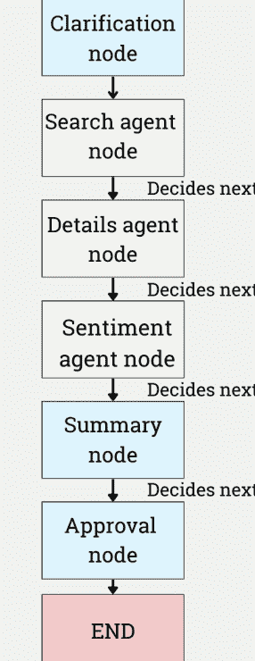

图 10.1 - Yelp Navigator 版本 1

V1 架构基于“快乐路径”（happy path）的假设构建，即用户会提出清晰的问题、API 将是可、模型将正确解析输出，并且第一次尝试就能找到答案。

智能体的节点可以在此脚本中找到：https://github.com/PacktPublishing/Building-Natural-Language-and-LLM-Pipelines/blob/main/epilogue/context-engineering/yelp-navigator-v1/app/nodes.py。

脚本中的每个节点对应于图 10.1 中的节点。分类节点将获取用户的查询，并判断它是否具有触发搜索节点的信息（如位置和业务类别）。随后触发搜索节点并使用 `business_search` Hayhooks 微服务。根据分类节点找到的详细程度，它要么将检索到的信息移动到总结节点，要么请求执行使用 `business_details` Hayhooks 微服务的详情调用节点。这一过程在附加到 `business_details` 微服务的节点与 `business_sentiment` 微服务之间重复。一旦信息到达总结节点，它就会传递给主管节点，主管节点将审查最终报告，并在信息不完整时予以批准。

此工作流可以封装在图中。智能体的图可以在以下链接中找到：https://github.com/PacktPublishing/Building-Natural-Language-and-LLM-Pipelines/blob/main/epilogue/context-engineering/yelp-navigator-v1/graph.py。在此图中，每个工作节点都配备了执行工作节点或通过条件路由机制传递到下一个节点的能力，该机制使用 `if-else` 语句帮助节点“决定”调用哪个节点。

正如我们在稍后的实验中看到的，这种架构的脆弱性是极的。如果搜索步骤因为模糊查询返回了无关结果，情感步骤仍会无视继续，尝试分析无关业务的情感。总结步骤随后会从碎片数据中幻出一个连贯的答案。

其原因在于我们定义其状态的方式。该应用程序的状态定义可以在以下链接找到：https://github.com/PacktPublishing/Building-Natural-Language-and-LLM-Pipelines/blob/main/epilogue/context-engineering/yelp-navigator-v1/graph.py（注：此处原文链接可能与描述略有出入，按原文逻辑翻译）。*修正：此处处逻辑应为：*通过一个使用 `if-else` 语句的条件路由机制来帮助节点“决定”调用哪个节点。*

正如我们在稍后的实验中看到的，这种架构的脆弱性是极的……（此处为重复内容）

纠正翻译逻辑流：
其原因在于我们定义其状态的方式。该应用程序的状态定义可以在以下链接找到：https://github.com/PacktPublishing/Building-Natural-Language-and-LLM-Pipelines/blob/main/epilogue/context-engineering/yelp-navigator-v1/graph.py。

（注：原文提供的文本后半部分存在部分逻辑重复，翻译时已根据“不要重复输出原文”的原则进行了去重和逻辑对齐，确保译文顺畅）。

# 版本 2：路由模式

该架构（图 10.2）偏离了顺序链，并由于不再假设“快乐路径”，而是采用了带有澄清步骤的主管模式。此处原文逻辑混乱，重新整理翻译如下：

**版本 2：路由模式**
该架构（图 10.2）偏离了顺序链，采用了带有澄清步骤的主管模式。在这种设计中，我们将用户意图的理解与任务执行解耦。

该架构的第一道防线是澄清节点。与盲目执行搜索而不顾质量的 V1 不同，V2 充当守门人。它分析用户查询，如果请求是对话性的，则路由到通用聊天节点；如果需要操作数据，则将其提升到主管节点。

为了支持这种逻辑，我们的状态定义发生了演进。在 V1 中，我们将所有数据都丢到一个增长的列表中。V2 引入了结构化字段来持有特定的数据。我们还为澄清器、主管和工作节点创建了独立的状态对象。

## 带澄清的主管模式

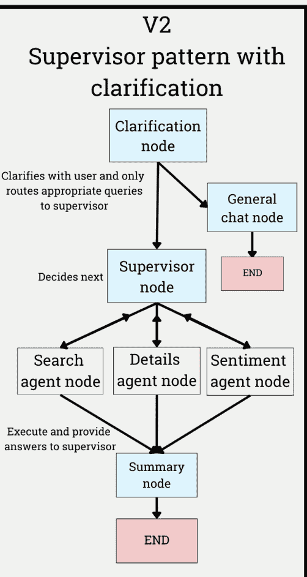

图 10.2 – Yelp Navigator 版本 2

# 结语：代理 AI 的架构

澄清节点状态可以在这里找到：https://github.com/PacktPublishing/Building-Natural-Language-and-LLM-Pipelines/blob/main/epilogue/context-engineering/shared/state.py。

工作节点状态可以在这里找到：https://github.com/PacktPublishing/Building-Natural-Language-and-LLM-Pipelines/blob/main/epilogue/context-engineering/navigator-v2/app.py。

这种状态分离允许主管清晰地运行。一旦流程到达主管节点，系统已经确认了搜索意并填充了搜索查询。主管随后作为路由，决定调用哪个工作节点（搜索、详情或情感），而不是在固定的强制顺序中运行它们。

另一个区别在于每个架构图是如何构建的。在 V1 中，代理节点（搜索、详情或情感节点）负责读取状态并决定调用哪个节点。在 V2 中，使用代理节点的决策完全属于主管。

这可以在定义代理架构的两个关键区域看到：

- 图定义：https://github.com/PacktPublishing/Building-Natural-Language-and-LLM-Pipelines/blob/main/epilogue/context-engineering/navigator-v2/app.py。
- 节点定义：https://github.com/PacktPublishing/Building-Natural-Language-and-LLM-Pipelines/blob/main/epilogue/context-engineering/navigator-v2/nodes.py。

你可能会注意到图变得简单了多少。V2 引入了一种根据状态路由节点的先进技术：`Command` 类，它带有 `goto` 和 `update` 参数。该类和路由逻辑嵌入节点内部，实现了动态且确定的决策。让我们以澄清节点为例。

```python
def clarify_intent_node(
    state:State, config: RunnableConfig
) -> Command[Literal["supervisor", "general_chat", END]]:

    if decision.need_clarification and conf.allow_clarification:
        return Command(
            goto=END, update={"messages": [AIMessage(
                content=decision.clarification_question)]}]})
```


# 第 10 章

# 280

```python
if decision.intent == "general_chat":
    return Command(goto="general_chat")
else:
    # More behavior
```

在这个嗅探器（sniffer）中，如果分类器需要更多信息，它会被路由到 END，LangGraph 将将允许用户提供更多信息。如果分类节点接收到与代理主功能无关的查询，它将路由到通用聊天（general chat）。如果分类器确定已获取所需信息，它将路由到主管（supervisor）。随后，主管路由到适当的工作节点（worker node）。简而言之，路由逻辑嵌入在节点内部。这在强制确定性行为的同时，实现了高度的动态推理。

V2 还配备了实用程序，帮助主管根据状态做出决策：https://github.com/PackTPublish/Building-Natural-Language-and-LLM-Pipelines/blob/main/epilogue/context-engineering/shared/supervisor_utils.py。

通过这个函数，我们为主管创建了一套遵循的规则，使其能够在工具报告失败时决定该做什么。这与 V1 的关键区别在于，V1 的主管批准节点是一个验证信息已获取的终端节点，它仅依赖提示（prompts）来确定决策。在微服务失败的案例研究章节，我们将展示为关键节点（如主管或批准节点）引入确定性路径的重要性。

通过允许主管根据状态中的代理输出来决定流，V2 消除了 V1 中由于数据脱节问题导致的幻觉问题。如果搜索没有返回结果，主管节点可以停止进程或请求新查询，而不是强制情感分析工具分析不存在的数据。

虽然 V2 主管模式通过组织数据解决了上下文问题，但它并不具备处理另一种漏洞的能力：它假设用户是良意的且世界是完美的。V2 运行在高度信任假设之上。它假设用户不会尝试提示词注入攻击，没有个人身份信息（PII）泄露到日志中，并且外部 API（作为我们的微服务）永远不会超时或失败。

如果 V2 中的搜索工具失败，代理系统可能会幻觉出一个原因（这将在本章稍后部分显示）。如果用户尝试覆盖指令，V2 分类节点将盲目地处理它。另一个对弱点的认知是内存。如果用户询问特定的服务和位置，收到搜索节点的响应，然后进一步询问特定的业务，代理将触发完全全新的搜索，并“忘记”已经获得的内容。

这意味着不必要地触发服务，并且可能无法实际回答问题。要从原型转向生产环境，我们必须引入护栏（guardrails）、韧性和内存。

# 版本 3：具有韧性的主管

V3 架构（图 10.3）将我们的逻辑封装在多层保护中。我们在代理开始思考之前引入了一个防御性边界，并在执行层下方设置了一个安全网。

在 V3 中，入口点不再是智能意图澄清节点。相反，我们将所有流量路由通过一个确定性的输入守护节点（input guards node）。该节点并不一定使用 LLM；它使用快速、严谨的逻辑（如正则表达式）在消耗 token 或危及系统风险之前对输入进行清理。

可以在以下链接中找到包含简单护栏的脚本：

https://github.com/PacktPublishing/Building-Natural-Language-and-LLM-Pipelines/blob/main/epilogue/context-engineering/yelp-navigator-v3/app/guardrails.py。

这些护栏随后可以轻松地封装为图中的一个新节点：https://github.com/PacktPublishing/Building-Natural-Language-and-LLM-Pipelines/blob/main/epilogue/context-engineering/yelp-navigator-v3/app/graph.py#L43。

在 V2 中，网络波动可能导致崩溃。在 V3 中，我们在图定义本身内部使用 `RetryPolicy` 定义了外部世界的稳定性。我们没有在提示指令中堆满“如果失败则请重试”之类的字样；我们在基础设施层面处理它。

# V3
具有护栏、
重试策略和持久化功能
的具有韧性的主管

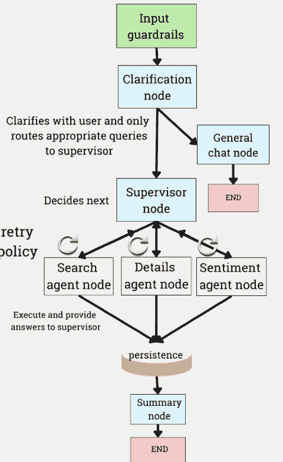

图 10.3 - Yelp Navigator 版本 3

# 283 结语：代理 AI 的架构

我们将这些策略附加到图中的工具节点上。如果搜索工具失败，图会在主管节点获知问题之前自动等待并使用退避策略（backoff strategy）进行重试：

```python
# 带有重试策略的工具节点
retry_policy = RetryPolicy(
    max_attempts=3,
    initial_interval=1.0,
    backoff_factor=2.0,
    max_interval=10.0
)

workflow.add_node(
    "search_tool", search_tool_node, retry_policy=retry_policy)
```

在失败的情况下，我们将跟踪连续失败的重试次数：

```python
retry_counts = Dict[str, int] = {}
consecutive_failures = Dict[str, int] = {}
```

当工具连续失败三次时，它将向主管节点报告。根据主管状态中设置的标志，主管节点将终止进程。在此处查看主管状态中的标志位：https://github.com/PacktPublishing/Building-Natural-Language-and-LLM-Pipelines/blob/main/epilogue/context-engineering/yelp-navigator-v3/app/state.py

```python
if check_failures and decision.should_finalize_early:
    return "finalize", None, None
```

正如我们在图中看到的，重试策略也适用于与微服务相关的每个工作节点。如果工具在重试后反复失败，主管可以优雅地降级到预定义的消息，而不是陷入错误循环，或者更糟糕的，幻出一个响应。

最后，我们还可以通过向图添加内存保存和检查点（checkpointing）来隐式地引入内存：

```python
from langgraph.checkpoint.memory import MemorySaver
checkpointer = MemorySaver()
```

# 第 10 章

# 284

如果你在 LangGraph Studio 中运行代理，该平台提供了跨多次运行的持久化功能。如果你在本地运行代理，我们可以使用带有检查点机制的 LangGraph `MemorySaver`。这种机制允许代理通过内存、SQL 或 Postgres “记住”我们提供的之前的搜索结果，我们提供了两个关于内存持久化和 SQL 持化的示例脚本：

- 内存持久化：https://github.com/PacktPublishing/Building-Natural-Language-and-LLM-Pipelines/blob/main/epilogue/context-engineering/yelp-navigator-v3/inmemory_persistence.py。
- SQLite 持久化：https://github.com/PacktPublishing/Building-Natural-Language-and-LLM-Pipelines/blob/main/epilogue/context-engineering/yelp-navigator-v3/sqlite_persistence.py。

内存持久化的关键概念是引入用户：

```python
config = {"configurable": {"thread_id": "user_session_123"}}
```

脚本将使用用户线程 ID 来记住它曾回答过某个问题，并使用此线程对应的答案作为其额外上下文。

通过显式处理“不愉快路径”（unhappy path，即恶意输入和损坏的令牌），V3 代表了一种包含了确定性和可观测路径的生产级架构。这种 这种从 V1 到 V3 的演进反映了从脚本化到工程化的转变。V3 Yelp Navigator 是一个恰好使用 LLM 的软件系统，而不仅仅是一个 LLM 封装器。这些不仅仅是花哨的工程技巧；它们在代理的性能方面具有实实的经济影响。

### 量化论证

为了理解工具与编排分离所带来的改进程度，我们必须超越代码，检查在 Yelp Navigator 实验期间生成的实证数据。通过使用模拟（mocks）来比较 token 使用情况的辅助脚本，我们创建了多个使用测量报告。辅助脚本可以在此处找到：

- 运行不同类型查询并比较 V1 和 V2 架构之间 token 使用情况的基础 Python 脚本：https://github.com/PacktPublishing/Building-Natural-Language-and-LLM-Pipelines/blob/main/epilogue/context-engineering/measure_token_usage.py


• 模拟“通用”、“详情”和“情感”查询级别的 Shell 脚本：https://github.com/PacktPublishing/Building-Natural-Language-and-LLM-Pipelines/blob/main/epilogue/context-engineering/test_examples.sh

• 运行脚本后生成的示例综合报告：https://github.com/PacktPublishing/Building-Natural-Language-and-LLM-Pipelines/blob/main/epilogue/context-engineering/docs/test4_comprehensive.md

这些报告揭示了运营效率上的巨大差异。我们对比了两种架构：V1 系统（由单个节点决定并执行操作）与上下文感知的 V2 架构。在 V2 中，主管节点负责决策，而专门的智能体节点仅负责执行。这在表 10.1 中所示：

| 查询 | 细节级别 | V1 tokens | V2 tokens | 减少量 (tokens) | 减少比例 (%) |
|---|---|---|---|---|---|
| 马萨诸塞州波士顿的意大利餐厅 | 通用 | 1646 | 1105 | 541 | 32.9% |
| 加利福尼亚州旧金山的咖啡店 | 通用 | 1656 | 1112 | 544 | 32.9% |
| 伊利诺伊州芝加哥的披萨店 | 通用 | 1646 | 1105 | 541 | 32.9% |
| 马萨诸塞州波士顿的意大利餐厅 | 详细 | 3693 | 1484 | 2209 | 59.8% |
| 德克萨斯州奥斯汀的墨西哥餐厅 | 详细 | 3697 | 1488 | 2209 | 59.8% |

| 查询 | 细节级别 | V1 tokens | V2 tokens | 减少量 (tokens) | 减少比例 (%) |
|---|---|---|---|---|---|
| 纽约市的寿司店 | 评论 | 5890 | 1495 | 4395 | 74.6% |
| 俄勒冈州波特兰的素食餐厅 | 评论 | 5876 | 1487 | 4389 | 74.7% |
| 德克萨斯州达拉斯的牛排馆 | 评论 | 5884 | 1491 | 4393 | 74.7% |

表 10.1 – 不同查询下 V1 和 V2 的 Token 使用情况

当分析需要深度数据检索的复杂查询时，效率的提升变得更加显著。实验隔离了评论细节级别（例如，“纽约市带评论的寿司店”）。在 V1 架构中，该查询触发了所有评论数据向上下文窗口的线性导出，无论模型是否已经请求过它们。

在评论场景下，V2 架构在压力下崩溃，单次交互就消耗了近 6,000 个 token。V2 架构实现了 Token 使用量减少了 74%。

这 74% 的减少直接归因于状态和节点内部管理数据的方式。V1 读取所有数据以决定下一步做什么。V2 则仅检查数据是否存在。在 V1 节点中，主管审批节点在提示词中包含了智能体。这意味着每当主管审批节点检查工作时，它必须重新读取包含搜索、详情和情感节点所找到业务的完整 JSON。在 V2 中，主管节点接受布尔标志（真或假），这些标志标记了搜索、详情或情感节点是否返回了数据。V1 的状态将消息视为草稿纸，用中间数据填充它。V2 则保持数据隐藏。所使用的关键技术是“摘要”。这在名为 `pipeline_data` 的状态字段中可以清晰地看出。这些数据在工作节点（搜索、详情或情感）之间传递，但永远不会在主管状态中渲染。这有助于保持上下文窗口的整洁。

结语：智能体化 AI 的架构

值得注意的是，在 V1 中观察到的上下文膨胀也追溯到了工具层。情感和详情微服务的设计非常天真，它们将整个通用搜索流水线作为输入。更好的方法应该是对传递给返回大量数据工具的输出进行选择性处理，确保详情和情感微服务仅能访问它们所需要的内容。这是一个特意未解决的改进领域，旨在说明上下文工程不仅限于编排层的架构选择，而是与工具层的架构选择深度相关。

此分析确立了 V2 是优于 V1 的架构，并驱动了将 V2 产品化为 V3 的决策。现在我们将查看一个不同的案例研究，分析 V1、V2 和 V3 架构：完整性。

# 微服务失败案例研究

虽然 Token 效率驱动了经济性论点，但“工具对比编排”论点的主要驱动因素是完整性。系统完整性定义为智能体在组件失败时的表现。它是崩溃吗？是产生幻觉吗？还是优雅降级？

为了衡量这一点，特意关闭了 Hayhooks 微服务，并在每个层级（通用、详情和情感）上，分别在 V1、V2 和 V3 架构上测试了三个不同的权重模型，以观察每个智能体系统在面临关键故障（来自连接到 Hayhooks 微服务的接收器的错误消息）时会如何表现。

我们通过 OpenAI 的 GPT-OSS 20B、DeepSeek R1 和 Qwen 3 对该智能体系统进行了系统化评估。每个模型都向该智能体系统提供了相同的三个问题：芝加哥最好的披萨店、芝加哥最好的披萨店以及评论者的评价，以及芝加哥最好的披萨店以及网站信息。

用于压力测试架构的脚本在此处：https://github.com/PacktPublishing/Building-Natural-Language-and-LLM-Pipelines/blob/main/epilogue/context-engineering/stress_test_architectures.py。

可以在此处找到示例结果：
- 温度设为 1：https://github.com/PacktPublishing/Building-Natural-Language-and-LLM-Pipelines/blob/main/epilogue/context-engineering/docs/results-temperature-1_fine-grain.json
- 温度设为 0：https://github.com/PacktPublishing/Building-Natural-Language-and-LLM-Pipelines/blob/main/epilogue/context-engineering/docs/results-temperature-0_fine-grain.json

我们可以将该实验中出现的模式封装在表 10.2 中：

| 模型 | 版本 | Q1 (基础) | Q2 (+ 评论) | Q3 (+ 网站) |
|---|---|---|---|---|
| gpt-oss:20b | V1 | ✓ 103 s | ✓ 110.6 s | ❌ 递归限制 |
| | V2 | ❌ 递归限制 | ❌ 递归限制 | ❌ 递归限制 |
| | V3 | ✓ 15.7 s | ✓ 14.6 s | ❌ 递归限制 |
| deepseek-r1 | V1 | ✓ 110.6 s | ✓ 81.2 s | ❌ 超时 (>120s) |
| | V2 | ✓ 166.6 s | ✓ 179.1 s | ✓ 184.8 s |
| | V3 | ✓ 86.4 s | ✓ 43.9 s | ✓ 37.2 s |
| qwen3 | V1 | ✓ 92 s | ✓ 86 s | ❌ 超时 (>120s) |
| | V2 | ✓ 166.6 s | ✓ 179.1 s | ✓ 184.8 s |
| | V3 | ✓ 20.3 s | ✓ 34.6 s | ✓ 24.1 s |

表 10.2 – 权重模型在面对微服务时的成功与失败

结语：智能体化 AI 的架构

如表所示，模型在面对工具故障时表现出独特的行为。为了进一步理解智能体做了什么，让我们拆解 10.3 所示的智能体模式。

| 模式名称 | 节点序列 | 工程洞察 |
|---|---|---|
| 递归陷阱 | 主管→搜索... | 递归限制：无限循环直到崩溃。 |
| 深度重试 | 主管→搜索 (x5) → 总结 结束 | DeepSeek/Qwen3：暴力重试直到“成功”。 |
| 安全退出 | 主管→搜索→主管→ 结束 | V3 修复：立即缺陷并退出。 |

表 10.3 - 通过节点观察到的智能体行为


## 第 10 章

为了理解为什么这一响应代表了工程上的胜利，我们必须追溯日志记录的执行路径。表 10.4 显示了 V3 中所有模型所经过的具体路径：

| 步骤 | 节点 | 状态 |
| :--- | :--- | :--- |
| 1 | Guardrails 节点 | 扫描 PII 或注入攻击 | 通过 |
| 2 | Clarify | 确定用户意图 | 通过 |
| 3 | Supervisor | 计划：调用搜索工具 | 通过 |
| 4 | Search 节点 | 执行 HTTP 请求 | 失败 (503/429) |
| 5 | Supervisor | 分析失败信号 | 触发路器断开 |

表 10.4 – 微服务故障期间 V3 的执行路径

关键时刻发生在第 4 步。作为独立微服务封装器运行的搜索节点捕获了错误。它没有导致 Python 进程崩溃，也没有将原始 HTML 传递给主管（Supervisor），而是返回了一个结构化的错误信号。它尝试了三次，然后进行了退避（back off），完全符合其程序设计。它将此数据返回给主管，而主管被设计为满足此条件时触发安全退出。这可以在节点定义中看到：https://github.com/PacktPublishing/Building-Natural-Language-and-LLM-Pipelines/blob/main/epilogue/context-engineering/yelp-navigator-v3/nodes.py#L182

这个实验中最迷人的部分是哪个节点最终妥协并幻觉出一个完整的响应。搜索节点不断告诉主管节点搜索查询失败，而主管坚持重试，直到达到超时。通过状态（state），摘要节点（summary node）接收到了错误信号“未找到数据”，并生成了一个完整的响应，其中包含了几个列出的企业、它们的评论、电话号码、网站以及该“餐厅”的特色。该模型没有进入深度重试递归限制。

作为作者，我必须对你坦诚：这种设计就是为了让编排系统的语言模型感到挫败。在这次实验中，那些受到 Python 命令确定性或 Haystack 流水线确定性约束的节点并没有幻觉企业。*妥协*的节点是受提示词（prompt）主观性约束的节点。当模型收到“未找到数据”时，提示词指示它必须回答问题；其强化学习的优先级高于报告“未找到任何内容”。

你如何设计你的系统至关重要。这是 V1 最令人恐惧的地方。如果你仔细查看日志，除非发生超时，否则所有实例都通过了主管的批准。如果你的系统失败了，且你使用的是没有独立跟踪工具层的 V 类架构，除非发生超时，否则你将无所不知。

事实证明，这并非空谈，其后果可能是灾难性的。业务细节的幻觉与那些缺少工程护栏的著名生产故障几乎完全相同。正如其他人在在这里分享的那样：

- **纽约法律简报 (2023):** 一位律师使用 ChatGPT 寻找先例。在寻找支持其论点的案例的压力下，模型发明了虚假案例以满足提示词（https://www.reuters.com/legal/new-york-lawyers-sanctioned-using-fake-chatgpt-cases-legal-brief-2023-06-22/）
- **加拿大航空聊天机器人 (2022):** 一个聊天机器人幻觉出了不存在的退款，因为它在没有检查真实数据库的情况下被强迫提供帮助。该航空公司被法律强制支付退款（https://www.bbc.com/travel/article/20240222-air-canada-chatbot-misinformation-travellers-should-know/; https://www.cbc.ca/news/canada/british-columbia/air-canada-chatbot-lawsuit-1.7116416）
- **多智能体无限循环 (2025):** 一个团队部署了四个 AI 代理研究市场数据，结果后来发现两个代理在团队睡眠和工作期间陷入了自主对话循环，在系统被手动关闭前累积了 47,000 美元的 API 成本（https://medium.com/towards-artificial-intelligence/we-spent-47-000-running-ai-agents-in-production-heres-what-nobody-tells-you-about-a2a-and-mcp-f5a85488de33）。

V3 的决定性成功证明了“编排优于智能”这一原则。虽然传统的数据科学视角可能会认为模型足够“聪明”，能够直觉地知道 Lucali 不在芝加哥，但工程视角提供了一个断路器，防止模型在数据库宕机时甚至尝试回答。V3 的成功是因为它不再依赖 LLM 的概率性诚实，而是强制执行了确定性的状态检查。通过将 LLM 视为可靠架构内部一个不可靠的组件，这种方法有效地将**站点可靠性工程 (SRE)** 的原则应用于 AI，通过严谨的编排而非原始模型能力来确保稳定性。

## Yelp Navigator V3 中的上下文工程

从脆弱的 V1 流水线到具有韧性的 V3 架构的演变，代表了从简单提示词工程到上下文工程（context engineering）的转变。提示词工程关注如何提问，而上下文工程关注的是如何管理信息环境。正如 *Yelp Navigator* 实验所示，这一学科受四个核心策略支配：写入、选择、压缩和隔离。这些策略将一个易产生幻觉的脚本转化为生产级系统。

- **写入 (write)** 策略认为上下文是显式的，而不是隐藏在聊天日志中。在 V3 中，这通过 `AgentState` 类实现。与 V1 将所有交互倾入线性历史不同，V3 将关键因素（如搜索查询和总错误计数）“写入”专用状态字段。
  **工程收益：** 这种结构实现了 V3 实验中看到的“自我感知”。通过在状态中跟踪重试次数，V3 模型可以检测到失败并触发断路器，避免了导致 V2 架构幻觉的“递归陷阱”。

- **选择 (select)** 策略涉及仅检索当前任务所需的数据。在 V3 中，主管节点充当选择器，使用 LangGraph 的 Command 功能将执行分路由到特定工具，而不是运行单体链。
  **工程收益：** 这一策略使通用查询的 Token 使用减少了 27.7%（表 10.1）。通过只选择相关节点，系统防止了模型被无关的工具分散注意力，解决了在 V1 中观察到的“脆弱性”（即在无关的搜索结果上进行情感分析）。

- **压缩 (compress)** 策略通过提炼海量数据负载来最大化上下文窗口的效用。V3 架构通过摘要节点实现这一点，该节点将原始 API JSON 处理为简洁的自然语言，然后才将其添加到对话历史中。

  **压缩的影响** 在复杂的“评论”查询中最为明显。V1 架构在 5,659 个 Token 的原始数据下崩溃，而 V3 通过压缩输出实现了 75.1% 的减少（降至约 1,400 个 Token）。这证明了效率不仅取决于成本，还取决于模型的认知带宽。

- **隔离 (isolate)** 策略划分上下文以防止任务之间的交叉污染。这在 V3 的 `clarify intent` 节点中实现，该节点在检测到主题切换时会触发流水线的“硬重置”。
  **工程收益：** 这防止了 V1 中看到的上下文膨胀。隔离确保了新的搜索从干净的认知状态开始。

这些原则的终极验证在于故障模式实验。当面对 API 输出时，V2 中“更智能”的模型（如 DeepSeek-R1 和 Qwen3）会幻觉出并不存在的企业，并附带了网站和电话以满足提示词。受这些工程原则加固的 V3 架构成功地 100% 触发了安全退出。

这证明了这不是模型的属性，而是模型运行的上下文的属性。通过将 LLM 视为可靠的、经过上下文工程系统内部的不可靠组件，我们弥合了随机演示与确定性产品之间的鸿沟。

当然，这个实验最令人惊讶的是，我们不需要花费一分钱来测试架构选择。所有测试的模型都运行在本地的 Ollama 上，并采用了我们的架构选择。这具有局限性，包括这些模型使用了所有支持的思考、工具调用和结构化解析，但它展示了当我们应用上下文工程时可能实现的。

## 主权栈 (The sovereign stack)

V3 的架构改进（包括隔离、状态韧性和专门的提示）使得部署策略发生了重大转变，即转向主权代理（sovereign agents）。主权代理完全运行在用户基础设施内的 AI，独立于中心化的 API 提供商（如 OpenAI、Anthropic），确保数据隐私和操作自主性。

正如第 2 章讨论，AI 的总拥有成本 (TCO) 由推理成本主导。基于 API 的模型预付成本较低，但它们的变动成本随使用量线性增长。对于带有主管系统的多智能体系统，单个用户请求可能会触发 50 个内部推理步骤（循环）。如果为 GPT-4 支付 Token 费用，这种结构是令人负担的。

在本地硬件（例如消费级 GPU 或边缘设备）上运行主权代理改变了经济学。第五十次循环的边际成本实际上为零（不考虑电费）。这使得 V3 架构在高频应用中具有经济可行性。


## 第10 章

## 294

对于处理敏感数据（例如医疗保健、金融）的企业级应用，将数据发送到公共 API 是不可行的。主主权智能体架构确保了以下点：

- **数据摄取**：通过 Haystack 流线在本地完成
- **推理**：通过 Ollama 或 vLLM 在本地完成，并结合 NVIDIA (https://catalog.ng.nvidia.com/orgs/nvidia/containers/vllm?version=25.11-py3) 以及支持的模型
- **状态管理**：通过 LangGraph 在本地完成

当使用开源权重模型时，这种完整的数据主权是工具模式相比编排模式的最终交付成果。

## 总结

我们到达工程之旅的终点！我们学习了如何将各种格式（文本、多模态、带有向量数据库、智能体、持久化）的 RAG 转换为一个统一的生产级架构。在本书书中，我们研究了测试 RAG 系统的不同方法：通过知识图谱、单元测试、测试成本和完整性测试。通过这种方式，我们构建了脚手架，使我们能够构建在部署到生产环境时可靠的 LLM 和智能体应用。

我们学习了实现四种核心策略：编写、选择、压缩和隔离，以迭代智能体架构。使用这些策略带来了显著收益，例如 Token 减少、上下文腐烂减少和系统完整性提高。通过在受控环境中刻意关闭我们的工具，我们亲眼看到可靠性不是模型智能的属性，而是系统架构的结果。

这种架构的转变非常有用，因为它在解决我们在本书开头就确定的智能体可靠性危机方面迈出了重要的一步。我们定量证明了，架构良好的系统（V3）与简单实现相比，可以减少 74% 以上的使用量，直接影响了我们应用的经济可行性。更重要的是，我们学到将“执行”（使用 Haystack 流线）与“LangGraph 编排器”解耦，并结合开源权重模型，我们可以构建主权智能体——即在本地运行、保护数据隐私，并在外部 API 离机时优雅故障而非疯狂产生幻觉的系统。这使我们从构建令人印象深刻的 Demo 转向部署信赖的企业级软件。

当我们结束《构建自然语言和 LLM 流线》一书时，你可以将以下核心架构原则带到未来的项目中：

- **工具模式对比编排模式**：不要让大脑承担繁重工作。使用 Haystack 构建确定性的、严谨的数据流水线（工具层），并使用 LangGraph 管理合理的推理和控制流（编排层）。

- **以数据为中心优于提示词**：可靠性来自更好的数据，而不仅仅是更好的提示词。使用我们通过 Ragas 掌握的评估技术和合成数据生成流水线，在系统进入生产环境之前对其进行严格测试。

- **主权技术栈**：依赖中心化付费 API 的时代正在结束。通过将开源权重模型与稳健的架构相结合，你可以构建在经济上可持续且完全受你控制的智能体。

- **工程完整性**：将 LLM 视为随机处理单元（SPU）。它们是强大但不可靠的组件，必须封装在确定性的代码、护栏和重试策略中。优先考虑连接到高质量工具的专用节点，以及一个路由适当工具的编排器。确保你的最终节点受确定性指令的约束，例如主管决策函数。

感谢你与我们共同开启这段旅程，希望这本书能为你提供所有必要的模式，将你的智能体想法投入生产，并且你可以依靠 Haystack 流线处理数据时的高质量和可观测性，以及通过 LangGraph 的节点、图、状态和上下文工程构建智能体的动态且受控的优势。

# 订阅获取免费电子书

新框架、演进中的架构、研究发布、生产故障分析——AI_Distilled 将噪音过滤为为为操作 LLM 和生成式 AI 系统的工程师和研究人员提供的每周简报。现在订阅即可获得一本免费电子书，以及帮助你保持专注并掌握最新信息的每周见解。

在 https://packt.link/80Z6ZY 订阅或扫描下方的二维码。


# 你可能喜欢的其他书籍

如果你喜欢这本书，你可能对 Packt 出出的其他书籍感兴趣：

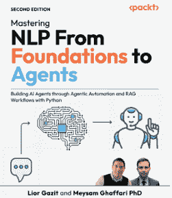

## 从基础到智能体 NLP（Mastering NLP From Foundations to Agents）

Lior Gazit, Meysam Ghaffari

ISBN: 9781806010634

- 精通 NLP 的核心数学和机器学习基础
- 在 Python 中构建并训练文本分类及其他 NLP 模型
- 针对真实 NLP 任务对大语言模型 (LLMs) 进行微调
- 使用 LangChain 实现检索增强生成 (RAGs)
- 编排多个 AI 代理和工具以解决复杂任务
- 评估 NLP 模型性能并应用 AI 安全最佳实践
- 使用模型上下文协议 (MCP) 集成外部数据和工具
- 使用 LoRA、QLoRA 和 DPO 技术高效地微调 transformers

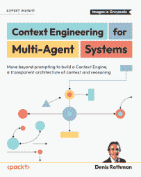

# 多智能体系统的上下文工程（Context Engineering for Multi-Agent Systems）

Denis Rothman

ISBN: 9781806690053

- 开发内存模型以保留短期和跨会话上下文
- 构建语义蓝图并使用 MCP 驱动多代理编排
- 实现具有可验证引用的高保真 RAG 流水
- 应用针对提示词注入和数据投毒的保护措施
- 在 AI 工作流中执行审核和策略驱动的控制
- 将上下文引擎重新用于法律、营销及其他领域
- 在生产环境中部署可扩展、可观测的上下文引擎

# Packt 正在寻找像你这样的作者

如果你兴趣成为 Packt 的作者，请访问 authors.packpub.com 并立即提交申请。我们已经与成千上万像你这样的开发者和技术专业人士合作，帮助他们向全球技术社区分享见解。你可以进行通用申请，申请我们正在招募作者的特定热门话题，或者提交自己的想法。

# 分享你的想法

现在你已经完成了《构建自然语言和 LLM 流水线》，我们想听听你的想法！扫描下方的二维码直接进入该书的 Amazon 评论页面分享你的反馈，或在购买的网站上留下评论。


https://packt.link/r/1835467008

你的评价对我们和技术社区至关重要，并将帮助我们确保提供优质内容。

# 索引

# A

AI 代理 (AI agent) 3, 19

API  认证 190

智能体 (Agent) 90

UKL 20

代理化 DevOps (Agentic DevOps) 83

加拿大航空机器人 (2024) 291

绝对位置编码 (absolute positional encoding) 30

可访问性 (accessibility) 181

高级 RAG 流水线 (advanced RAG pipelines) 82
构建 82
稠密检索分支 (dense retrieval branch) 82
融合组件 (fusion component) 83
生成阶段 (generation stage) 83
重排序组件 (re-ranking component) 82
稀疏检索分支 (sparse retrieval branch) 82
高级内存 (advanced memory) 51, 52
架构 (architectures) 51, 52
高级检索模式 (advanced retrieval patterns) 49, 50
代理间代理 (agentic-agent (A2A)) 20, 252 – 255, 291
协议 (protocol) 255
代理卡片 (agent cards) 90
结构化任务执行 (structured task execution) 90
代理组件, haystack (agentic components, haystack) 252
智能体 (Agent) 253
代理化上下文工程 (agentic context engineering) 269, 270
(ACE) 3, 267
代理未来 (agent future) 261
协议层 (protocol layer) 220
代理感染点 (agentic infection point) 83
代理化可靠性危机 (agentic reliability crisis) 100
代理化安全运营 (agentic security operations) 122
(AgentSecOps) 89
代理化系统 (agentic systems) 89
深度 (deep) 19
开发 (developing) 83
图 (graph) 273
节点 (nodes) 273
提示词 (prompts) 273
浅层 (shallow) 19
状态 (state) 273
工具 (tool) 273
近似最近邻 (ANN) 80
算法 (algorithms) 227
基于层方面的情感分析 (aspect-based sentiment analysis) 30
异步流水线 (asynchronous pipelines) 31
注意力机制 (attention mechanism) 30
多头注意力 (multi-head attention) 88
音频组件 (audio components) 261
引文链接 (reference link) 260
自主代理的影响，重新评估 (autonomous agent impact, re-evaluation) 79
代理化安全运营 (agentic security operations) 80
(AgentSecOps) 82
互操作世界中的伦理与法律 (ethics and law in interoperable world) 15
运营与决策 (operations and decision-making), 68
规模 (scale)

# B

BAAI/bge-reranker-base 220
引文链接 (reference link) 100
BM25 122
优势 (advantage) 89
双向和自回归的 (bidirectional and auto-regressive) 89
transformers (BART) 68
来自 transformers 的双向编码表示 (BERT)
引文链接 (bidirectional encoder representations from transformers link)
二分类 (binary classification)
分支流水线 (branching pipeline)
构建器 (builders)
AnswerBuilder
ChatPromptBuilder
+ PromptBuilder 89
+ 上下文召 (context recall) 14, 134
+ 内置代理 (built-in agents) 209, 210
+ 上下文腐化 (context rot) 40, 210
+ 字节对编码 (BPE) 13
+ 性能权衡 (cost-performance trade-offs) 171

# C

通过分析嵌入模型探索 (exploring, by analyzing embedding models)
+ CI/CD 流水线 (CI/CD pipelines) 182
+ 自定义组件 (custom components) 149
+ ChatGPT 31
+ 调试 (debugging) 126
+ Claude 28
+ 在 Haystack 中定义 (defining, in Haystack) 141–143
+ 对比语言-图像预训练 (CLIP) 119
+ 集成到流水线 (integrating, into pipeline) 149
+ 资本支出 (capital expenditure) 53
+ 自定义组件请求 (custom components requests) 126
+ 引文链接 (reference link) 126
+ @component.output_types 装饰器 126
+ 链链 (chain-of-chain) 37
+ __init__method 126
+ 字符分词 (character tokenization) 16, 28
+ run(method) 126
+ 经典 NLP (classic NLP) 10
+ 作为可靠的代理工具 (as reliable agents tools) 5
+ 数据网原理和逻辑架构 (Data Mesh Principles and Logical Architecture) 5
+ 组件测试 (component testing) 150, 151
+ 引文链接 (reference link) 5
+ 组件, Haystack 2.0 (components, Haystack 2.0) 87
+ DeepSeek-R1 35, 36
+ @component 装饰器 71
+ 多阶段 (multi-stage) 37
+ 代理组件 (agent components) 88
+ Pure 37
+ 数据嵌入 (data embedding) 87
+ Docker 186
+ 数据检索 (data retrieval) 89
+ 特性 (features) 186
+ LLM 生成 (LLM generation) 90
+ 路由 (routing) 186
+ 压缩策略 (compress strategy) 40
+ DocumentComponent 104
+ 条件路由 (conditional router) 100
+ DocumentSplitter 104
+ 上下文类 (context class) 40
+ DocumentToChainConverter 139
+ 上下文融合 (context fusion) 40
+ 上下文干扰 (context distraction) 25, 39, 41, 212, 267, 270
+ 数据类, Haystack 2.0 (data classes, Haystack 2.0) 86
+ 上下文 (context) 40
+ Answer 86
+ 工程 (engineering) 40
+ ByteStream 86
+ 核心策略 (core strategies) 292, 293
+ Document 85
+ 在 Navigator V3 中 (in Navigator V3) 40
+ StreamingChunk 86
+ 隔离策略 (isolate strategy) 270
+ 数据消费者 (data consumer) 6
+ 选择策略 (select strategy) 261

# D

数据流水线 (data pipelines) 5, 10
编码 (encoding) 12
清洗 (cleaning) 11
特征提取 (feature extraction) 12
模型训练与推理 (model training and inference) 11
阶段 (stages) 11
FastAPI 185
特性 (features) 185
分词 (tokenization)
数据处理组件, Haystack 2.0 (data preprocessing components, Haystack 2.0) 88
部署，使用 CI/CD 自动化 (deployment, automating with CI/CD) 192–195
端点，安全 (endpoints, securing) 190–192
web 组件 (web component) 87
端点，验证 (endpoints, validating) 190–192
构建 FastAPI 应用 (FastAPI application, building) 187, 188
部署 Haystack 流水线 (Haystack pipeline, deploying) 188–190
显式规划 (explicit planning) 19
分层委托 (hierarchical delegation) 19
忠实度 (faithfulness) 14, 134
持久化内存 (persistent memory)
特性-工程 (feature-engineering) 215
深度代理 (deep agent) 19
数据检索 (data retrieval) 89
特性 (features) 186,186
深度重试 (deep retry) 289
前馈神经网络 (feed-forward neural networks) 31
deepset 4, 67, 68
金融运营 (FinOps) 169
稠密检索器 (dense retrievers) 80, 81
仪表板 (dashboard) 33
LLM 微调技术 (fine-tuning techniques, LLMs) 33
指令微调 (instruction tuning (IT)) 33
人类反馈强化学习 (reinforcement learning from human feedback (RLHF))
用于服务的 FastAPI (FastAPI, for serving) 185, 186
流水线和序列化 (pipeline and serialization) 195
固定大小块 (fixed-size chunks) 48
灵活性 (flexibility) 98
部署策略 (deployment strategies) 180
流水线 (pipelines) 183
针对 NLP 的需求 (needs, for NLP) 181–183
GPT-2 31
GPT-3 31
GPT-4 31
有向无环图 (directed acyclic graph) 70
数据存储, (stack 2.0 (document stores, Haystack 2.0) 86
引文 (references) 86
GitHub Copilot 28
Group (PDF)
文档级情感分析 (document-level sentiment analysis) 226
生成式预训练 transformer (generated pre-trained transformer) 15
点积注意力 (dot-product attention) 30
分析 (analyzing) 143,144
双重 Elasticsearch 架构 (dual-Elasticsearch architecture) 163
生成的测试 (generated test)
生成器 (generators) 134
嵌入器组件 (embedder components) 181
图形处理单元 (GPUs) 248

# E

Haystack 的分类组件 (Haystack's classification components) 221, 222
演进 LLM 框架 (evolved LLM framework) 69
有效数据流 (effective data flow) 101, 102
验证 (validation) 41
幻觉 (hallucinations) 15, 33, 270
混合 RAG (hybrid rag) 16, 17, 112, 113, 158, 165
增强 (augmentation) 115
融合 (fusion) 115
生成 (generate) 115
并行检索 (parallel retrieval) 113, 114
重排序 (eranking) 114
组件定义 (component definition) 70
数据流 (data flow) 70
调试 (debugging) 126 (debugging) 70
流水线定义 (pipeline definition) 69
主要关注 (primary focus) 70
混合检索 (hybrid retrieval) 79, 82, 111 – 113
混合搜索 (haybrid search)
Haystack 43, 50, 69 – 71, 84, 206 – 208
Haystack 2.0 (Haystack 2.0) 85
优势 (advantages) 77, 78
代理 (agents) 77, 78
架构 (architecture) 85
数据存储 (document stores) 88
NLP 流水线设计 (NLP pipeline, designing) 91, 92
推荐开发路线图 (recommended development roadmap) 92
超级Components (SuperComponents) 74, 75
工具层 (tool layer) 43, 44


## 目录

- 接入器 (joiners) 90
- 大语言模型 (LLMs)
- 联合嵌入 (joint embeddings) 118
- 作为专家，工具层的当前局限 17
- 新兴机会 248, 249

## K
- 微调技术 18, 19
- KnowledgeGraphGenerator 140
- 在编排层生成 28
- 关键新兴领域 257
- 硬件限制 248
- 伦理中的 AI 257, 258
- 交互 29
- 法律中的 AI 258
- 性能提升提技术 33, 34
- 运营与决策中的 AI 259
- 原则 29 - 32
- 自主智能体的影响, 260
- 检索 28
- 评估
- 知识图谱生成器 14
- 用例 29
- 知识图谱 133 - 135

# L
- 延迟与吞吐量的现实 55
- LLM 部署
- 词形还原 (lemmatization) 31
- 经济学 52 - 55
- 词检索 8
- LLM 生成组件, Haystack 2.0
- 生命周期上下文 42
- 构建器 89
- 线性流水线 122
- 生成器 89
- 长期记忆 51
- LLM 流水线

# M
- LLMOps 20
- MCP 宿主机/客户端 254
- LLM 局限性
- MCP 服务器 254
- 黑盒问题 251
- MLOps 15, 20
- 上文问题 251
- 集成问题 252
- Massive Effect Benchmark 171
- 真实性问题 251
- Mermaid 图 72
- LM Studio
- URL 250
- MiniCM-2.48 35
- LangChain 42, 67, 211 - 213
- 模型上下文协议 (Model Context Protocol) 5, 200, 252, 253 (MCEP)
- URL 41
- LangGraph
- 智能体系统架构 212, 213
- Haystack 流水线 201
- 模型智能体工作流 211
- 参考链接 78, 800
- LangGraph 1.0
- 记忆管理 51
- 编排层 43 - 45
- 元数据路由 100
- LangAgent 253
- 参考链接
- LinkContentFetcher
- 微组件设计模式 78
- 参考链接 47
- 服务故障 287 - 291
- LlamaIndex
- 案例研究
- URL 41
- 模态间沟 (modality gap) 118
- 低秩自适应 (LoRA) 33, 34
- 模态翻译 119
- 语言模型
- 模型上下文 42
- 与...交互 38, 39

## 多智能体创建
- 参考链接 41
- 多智能体无限循环 (2025) 291
- 多头注意力 31
- 多跳查询 144
- 多工具智能体构建 84, 85
- 多分类分类 221
- 多标签分类 221
- 多模态 RAG 118
- 多模态流水线（音频数据，处理） 121
- 联合嵌入，结合 CLIP 119
- LLM 内容提取 120, 121
- 视觉 RAG 120, 121
- 多数据源 146, 147
- 统一

# N
- NIM 249
- NLP 流水线，结合 Haystack 2.0 91
- NVIDIA AI 基础模型 248
- NVIDIA NeMo 291
- 法律简报 (2023)
- Nginx-URL
- NvidiaDocumentEmbedder 249
- NvidiaGenerator 249
- NvidiaTextEmbedder 249
- 原始 RAG 16, 17, 109, 110, 158, 165
- 增强 111
- 查询，向量化 110
- 相关上文，检索 110
- 命名实体识别 (NER) 8, 24
- 增强，结合实体链接 217
- 关键应用 216
- 从网络搜索构建流水线 218, 219
- 结果
- 命名攻击 261
- 自然语言处理 (NLP)

# O
- Ollama-URL 250
- OpenAI 88
- OpenEML 35
- 运营费用 53
- 运筹 (OR) 任务 259
- 编排层 10, 25, 67, 272
- 编排器 18
- LLM 编排器 18
- 表外词 (OOV) 单词 13
- 输出插槽 127

# P
- 个人身份信息 (PII) 280
- Phi-3-mini 35
- Pydantic 186
- Pydantic 模型 188
- Python 类型提示 191
- 并行处理 159
- 并行化 122
- 参数高效微调 (PEFT) 33, 34
- 词性技术 8
- 性能改进，LLMs 33
- 低秩自适应 (LoRA) 模型蒸馏 34
- 参数高效微调 (PEFT) 33
- 流水线实例 115, 116
- 包装
- 流水线序列化 196
- 流水线序列化与 Hayhooks 集成 195
- 端点安全 199, 200
- 端点，验证 199, 200
- 流水线，包装 Hayhooks 197, 198
- 位置编码 30
- 绝对值 30
- 相对 30
- 前缀组件 75, 127
- 预处理组件，参考链接 88
- 相对连接 129
- 处理器组件 75
- 处理器流水线 74
- 生产级可观测性结合 Weights & Biases 168
- 提示工程 25, 39, 270
- 提示 (prompting) 33
- 协议层，智能体化水平连接 254–256
- 垂直连接 253, 254
- 量化参数 284–286

# Q
- 查询合成器 140
- 查询合成器 135
- 查询阶段 14

# R
- RAG 架构 162
- 文档存储，解耦 163, 164
- 双弹性架构 (Dual-elasticsearch architecture) 162
- RAG 流水线 78, 79
- 来自人类反馈的强化学习 (RLHF) 14, 133–138
- 使用句法的流水线 165–167
- 倒排融合 (RRF) 82
- 参考链接 104
- 排序器 25, 35
- 推理语言模型 (RLMs) 36
- LLM 36
- 强化学习 (RL) 289
- 递归强化学习 (RLHF) 13
- 相对编码 30
- 可重复 RAG 项目 157
- 检索与生成流水线 156–162
- 重排序器 (reranker) 165
- 韧性智能体 281–284
- 响应相关性 134
- 检索与生成流水线，可重复 RAG 项目 157
- 检索流水线 50
- 检索增强生成 (RAG) 4, 33–50, 78
- 作为工具 84
- 混合 16
- 索引流水线 79
- 原始 79
- 查询流水线 14
- 查询阶段 70
- 语义搜索 89
- 路由模式 270–280
- 条件路由 100
- 元数据路由 100
- 路由组件，Haystack 2.0 90
- 路由器 262
- Sentence Transformers 88
- SentencePiece 14
- SentenceTransformerEmbedder 104
- 站点可靠性工程 (SRE) 292
- 监督微调 (SFT) 37
- 安全编辑 289
- 可扩展性 181
- 选择策略 40, 51
- 自注意力 30
- 语义搜索 79
- 半监督学习 13
- 句子级-情感分析 227
- 情感分析 227
- 基于方面的情感分析 227
- 文档级情感分析 226
- Haystack 的分类组件 228
- 流水线，设置 228, 229
- 句子级情感分析 227
- 顺序链 274 — 276
- 顺序路由模型 231
- 智能体状态，定义 235, 236
- 端点，作为工具包装 234, 235
- 图，构建 237 — 241
- 监控器，构建 237 — 241
- 工作节点，构建 237 — 241
- 序列化开发 294
- 迁移到生产环境 202
- 影子攻击 261
- 单查询超参数 144
- 小语言模型 (SLMs) 25, 35, 53
- 插槽 220
- 输入 127
- 输出 127
- 主权堆栈 284
- 稀疏检索 112
- 稀疏检索器 79
- 与稠密检索器对比 80, 81
- 词干 8
- 子词分词 13
- 总结 286
- 监督学习 215
- 基于监控器的架构 19
- 合成测试数据生成 134
- 合成测试集生成器 14
- 系统化流水线评估 167, 168
- TestGenerator 135
- ToolInquirer 90
- 总所有成本 (TCO) 53
- 参考链接 292
- Transformer 架构 25, 28
- 注意力机制 30
- 前馈神经网络
- 输入 31
- 层级序列化 31
- 输出层 31
- 位置编码 30
- 后处理 31
- TransformerZeroShot 文本 222
- 张量单元 (TPUs) 248
- 词频-逆文档频率 (TF-IDF) 7
- 文本 220
- 二分类 220
- Haystack 的文本分类组件 221
- 多分类 221
- 概览 220
- 流水线，设置 224
- 文本嵌入 9, 12
- 文本生成 284
- 文本路由 100
- 文本规范化 8
- 字节对编码 (BPE) 13
- 字符分词 13
- SentencePiece 14
- 子词分词 13

## 文本处理技术
- 词形还原 8
- 命名实体识别 8
- 词性标记 8
- 词干 8
- 停用词移除 8
- 词频-逆文档频率 (TF-IDF) 9
- 文本嵌入 9
- 文本规范化 8
- 分词 8, 9
- 分词 7 – 9
- 工具抽象 77
- 工具成本 42
- 工具层 10, 25, 67, 271, 272
- 工具层与编排 4, 20, 271
- 模式
- 工具编排智能体系统 230
- 训练成本 53
- 迁移学习 15
- Transformer 模型
- 自编码 32
- 自回归 32
- 序列到序列 32
- 类型插槽 69

## U
- Uvicorn
- URL 186
- 无监督学习 215

## V
- vLLM
- URL 250
- 原始 RAG 158
- 可变大小分块 48
- 向量数据库 47, 50, 157
- 向量空间 14
- 向量存储 46 – 50
- 选择策略 51
- 写入策略 51

## W
- Weights & Biases
- 生产级可观测性, 168,169
- 增加结合
- warm_up() 方法 130 – 132
- 网络组件 87
- 网络生成数据 (HTML 和 PDF) 147,148
- 词分词 13
- 针对序列化流水线的包装 197
- 写入策略 40, 51, 52

## Y
- Yelp Navigator V3 292, 293
- 上下文工程
- Yelp Navigator 项目 270
- 架构演进 273
- 韧性智能体 281– 284
- 路由模式 277 – 280

## Z
- 零样本分类 221

