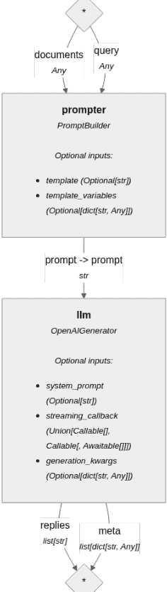
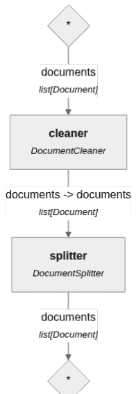
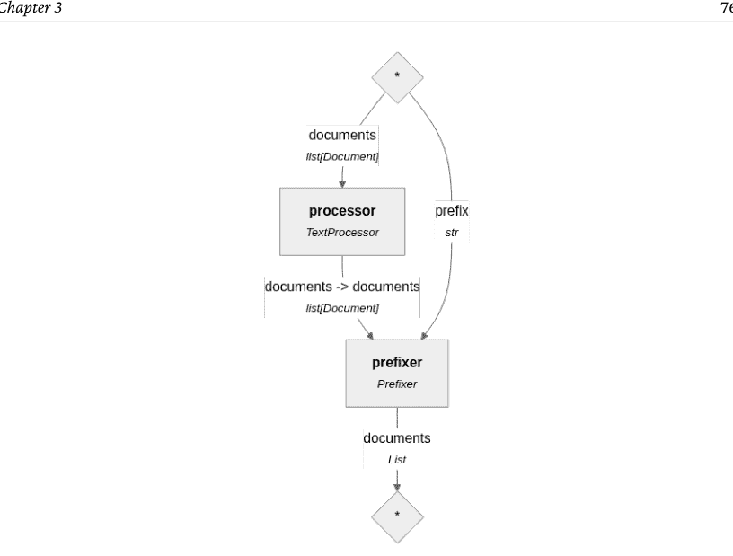

# 3 deepset 的 Haystack 简介

在上一章中，我们概述了 LLM 领域最先进的模式，从提示词工程到上下文工程，从 LLM 向小微模型和推理模型演进，并提出了一种混合架构。该架构利用了不断变化的 AI 领域中两个关键源力量的优势：deepset 的 **Haystack** 和 **LangGraph**。我们通过建议的混合架构映射了它们各自的优势：一个有状态的编排层（LangGraph）指导一组可靠、可审计的工具层（Haystack）。这种关注点分离是构建复杂的、生产级 AI 的关键。

本章开始深入研究使用 Haystack 2.0 构建该层的方法。虽然 Haystack 提供了自身的智能体能力，但我们将通过概述来展示这种方法在什么情况下是足够的；我们对该框架的主要关注在于它作为“流水线优先”引擎的角色。它的真正优势在于健壮、可衡量且可部署的数据流流水线，这些是高级智能体的基础。

在构建智能体将调用的高级 RAG 系统（第 4 章）或作为微服务部署的自定义 RAG 和 NLP 流水线（第 7 和第 8 章）之前，我们必须首先掌握框架的基础物理机制。本章介绍了这些核心构建模块：**组件（components）**、**流水线（pipeline）**以及将它们结合的**数据协议（data protocols）**。

在本章中，我们将涵盖以下主题：

- deepset 概述

- Haystack 进化的 LLM 编排框架

- Haystack 2.0 核心构建模块：从组件到智能体

# 3 

- 核心特性与优势

- 用例与应用

- 深度解析 Haystack 架构

- 将 Haystack 整合到你的工作流

## 技术要求

我们将使用与第 2 章相同的技术设置。本章使用的 Jupyter notebook 可以在以下仓库的 `ch3/` 文件夹中找到：https://github.com/PacktPublishing/Building-Natural-Language-and-LLM-Pipelines。

有一个专门为本章准备的 `pyproject.toml` 文件。建议在独立的 VS Code 窗口中打开 `ch3` 并安装依赖项：

```
$ cd ch3/
$ uv sync
$ source .venv/bin/activate
```

要在 Jupyter notebook 中激活虚拟环境作为内核，请点击“Select Kernel”，然后点击指向文件夹虚拟环境（名为 `rag-with-haystack-ch3`）的路径，或虚拟环境的相对路径：

`.venv/bin/python`

我们将逐步引入 notebook，因此你可以通过提供的 URL 相应的相对路径选择讨论过的 notebook。

## deepset 概述

deepset 由 Milos Rust、Malte Pietsch 和 Timo Möller 于 2018 年创立，伴随着 BERT 模型（https://huggingface.co/docs/transformers/model_doc/bert）的兴起而旨在构建可扩展的 NLP 工具。最初，deepset 专注于通过其 FARM 框架（https://github.com/deepset-ai/FARM）进行开源微调，以及流行的 Hugging Face 模型，如 `roberta-base-squad2`（https://huggingface.co/deepset）。2021 年，FARM 的核心功能合并到了 deepset 的旗舰框架 Haystack 中。

随着行业从专门的微调转向通用 LLM，deepset 通过完全重构框架来适应这一变化。结果是 Haystack 2.0：一个专为生成式 AI 时代设计的平台。Haystack 2.0 超越简单的提取，编排基于 API 的 LLM 以构建复杂的 RAG 系统和自主智能体。这种演进将 Haystack 从一个专门的 NLP 工具转变为现代 AI 开发的多功能平台。

## Haystack 进化的 LLM 编排框架

Haystack 2.0 代表了根本性的范式转变，从专门的搜索演变为现代 AI 的通用工具箱。它的核心哲学建立在三个支柱之上：它是 Python 原生的、显式的且模块化的。最显著的进展是采用了有向图（DG）。开发者不再依赖隐式数据；而是显式地实例化带有连接插槽（sockets）的 `Pipeline`。这种透明性允许条件路由（例如，如果查询是德语，则路由到模型 A）和并行处理（例如，同时运行关键词搜索和向量搜索），使系统完全透明。

这种架构的重构是对智能体工作流需求的策略响应。虽然框架原生支持智能体和循环，但对我们而言，它最大的优势在于其可靠性。通过围绕具有严格契约的显式有向图重新构建基础，Haystack 为创建确定性工具提供了一个稳定的平台。

为了充分理解这一演进的意义，下表提供了 Haystack 1.x 和 2.x 核心范式的直接对比。

| 特性 | Haystack 1.x (旧版) | Haystack 2.0 (当前) |

| --- | --- | --- |

| 流水线定义 | 使用 YAML 文件或带有隐式节点命名的 `Pipeline()` 类 | 在纯 Python 中使用带有显式 `.add_component()` 和 `.connect()` 方法的 `Pipeline()` 类 |

## 组件

| 特性 | Haystack 1.x (旧版) | Haystack 2.0 (当前) |

| --- | --- | --- |

| 组件定义 | 基于类，需要继承自 `BaseComponent` 类 | 基于装饰器，在标准 Python 类上使用简单的 `@component` 装饰器 |

| 数据流 | 组件之间隐式传递字典，可能难以追踪 | 使用组件输入输出定义的显式、类型化的输入输出插槽 |

| 调试 | 通常需要特定框架的知识，且可能不透明 | Python 原生调试；可以使用 `.draw()` 方法可视化流水线以查看精确的结构和数据流 |

| 核心抽象 | 节点的线性序列，使得复杂逻辑难以实现 | 有向无环图 (DAG)，原生支持复杂、非线性工作流的分支、合并和循环 |

| 主要关注点 | 抽取式问答和语义搜索 | 通用 LLM 编排，包括高级 RAG、智能体以及任何自定义多步工作流 |

表 3.1 – Haystack 1.x vs. Haystack 2.0：范式转变

# Haystack 2.0 核心构建块：从组件到代理

Haystack 2.0 引入了清晰的抽象层次结构，允许开发者以结构化且可重用的方式构建日益复杂的应用程序。这种层次结构从工作原子单元——组件（Component）开始，一直扩展到代理（Agent）。理解这些构建块是精通该框架的基础。

### 组件 (Components) - 工作原子单元

Haystack 2.0 的基石是组件。组件是一个自包含的 Python 类，旨在在管道（Pipeline）中执行单个特定的任务。这可以是从清理文本文档、将查询发送到网络、从数据库检索文档，到调用 LLM 进行生成的任何操作。

可以在此处找到探索组件的 Jupyter notebook：https://github.com/PacktPublishing/Building-Natural-Language-and-LLM-Pipelines/blob/main/ch3/jupyter-notebooks/components.ipynb。

该 Jupyter notebook 提供了初始化和使用现有组件的示例。Haystack 2.0 的核心架构选择之一是创建自定义组件的方式。所有组件都遵循这一模式，而这正是将现有组件和自定义组件集成到管道中成为可能的关键。

组件的创建非常简单且符合 Python 风格，由两个关键特性定义：

- **@component 装饰器**：只需在 Python 类定义上方添加 `@component` 装饰器，即可将任何 Python 类转换为 Haystack 组件。该装饰器会将类注册到 Haystack 框架中，并信号它可以在管道中使用。

- **`run()` 方法**：每个组件必须有一个 `run()` 方法。这是组件逻辑的入口点，也是执行主任务的地方。

让 Haystack 2.0 中的组件如此健壮的是类型化输入输出插槽（Sockets）的概念。它们通过 `run` 方法签名上的 `@component.output` 装饰器定义。插槽作为组件的显式连接点，定义了它预期接收什么类型的数据以及将产生什么类型的数据。例如，检索器（retriever）可能有一个名为 `query` 的输入（期望类型为 `str`）和一个名为 `documents` 的输出插槽（产生 `List` 类型）。这种显式合约确保了管道内部的安全性，使数据流透明化，并允许 IDE 提供更好的自动补全和错误检查。这比 Haystack 1.x 中隐式的字典传递有了显著改进，后者经常会导致运行时错误和难以调试。

可以在此处找到探索自定义组件定义的 Jupyter notebook：https://github.com/PacktPublishing/Building-Natural-Language-and-LLM-Pipelines/blob/ch3/jupyter-notebooks/your-first-custom-component.ipynb

在笔记本 notebook 中，我们定义了一个前缀处理器文档（`prefixer`），它使用用户提供的前缀字符串为每个文档添加注释。

### 管道 (Pipelines) —— 将组件编排成图

虽然组件执行单个任务，但管道负责在连贯的工作流中编排它们。正如过的，Haystack 2.0 管道是一个有向无环图（DAG），其中组件是节点，插槽之间的连接是边。

在 Python 中构建管道是一个显式的、三步的过程：

1. 实例化管道：

```python
pipe = Pipeline()
```

2. 添加组件实例：使用唯一名称将组件添加到管道中。这是一个示例：

```python
pipe.add_component(
    name="retriever",
    instance=InMemoryEmbeddingRetriever(document_store)
)
pipe.add_component(name="generator", instance=OpenAIGenerator())
```

3. 连接组件：通过连接一个的输出插槽到另一个的输入插槽来定义数据流：

```python
pipe.connect("retriever.documents", "generator.documents")
```

这种 `connect` 语法是 Haystack 2.0 透明性的基石。它消除了关于数据如何在系统中移动的歧义。此外，框架提供了一个重要的调试和可视化工具：`.draw()` 方法。调用 `pipe.draw("my_pipeline.png")` 将生成一个视觉化表示管道图结构的图像文件，显示所有组件及其之间的连接。图 3.1 显示了所讨论示例中管道的 Mermaid 图。这是一个简单的 RAG 管道，通过通过虚拟文档来增强 LLM。

### deepset 介绍的 Haystack



图 3.1 – 提示词的 Mermaid 图

可以在此处找到探索简单管道及其可视化的 Jupyter notebook：https://github.com/PacktPublishing/Building-Natural-Language-and-LLM-Pipelines/blob/main/ch3/jupyter-notebooks/your-first-pipeline.ipynb。

# 3 


在图中可视化并显式连接组件的能力是透明度的巨大飞跃。然而，随着这些图的增长，你经常会发现自己在反复构建相同的模式。Haystack 提供了一种强大的抽象来解决这个问题。

## 超组件 (SuperComponents) —— 封装和复用复杂性

随着管道变得复杂，某些连接组件模式会反复出现。例如，标准的文档索引工作流可能始终由文件转换器、文档清理器、文档分割器、嵌入器和文档写入器组成，且都按顺序连接。在每个新管道中重新构建此子图将枯燥且容易出错。

为了解决这个问题，Haystack 2.0 引入了超组件的概念。超组件是一个预包的、可重用的管道，可以被视为大型管道中的单个组件。它封装了一个复杂的子图，仅向外部暴露必要的输入和输出插槽。

例如，之前描述的整个索引工作流可以封装进`IndexingSuperComponent`中。开发者只需一行代码将其添加到更大的管道中：

```
pipe.add_component(
    name="indexer",
    instance=IndexingSuperComponent()
)
```

这极大地简化了主管道的定义，并促进了清晰、模块化的设计。超组件是管理复杂性和创建高级功能库的强大工具。让我们探索一个简单的模式，如提供的 notebook 所示。可以在此处找到探索超组件的 Jupyter notebook：<https://github.com/PacktPublishing/Building-Natural-Language-and-LLM-Pipelines/blob/main/ch3/jupyter-notebooks/supercomponents.ipynb>。

我们定义了一个预处理管道，用于清理并将文档分割成块。



图 3.2 – 预处理管道的 Mermaid 图

在 notebook 中，我们将预处理管道抽象为预处理器超组件，然后将其连接到我们在自定义组件 notebook 中看到的前缀处理器组件，该地址为：<https://github.com/PacktPublishing/Building-Natural-Language-and-LLM-Pipelines/blob/main/ch3/jupyter-notebooks/your-first-custom-component.ipynb>。

最终管道定义仅包含两个组件：预处理器超组件和前缀处理器组件。可以在图 3.3 中清晰看到，该图可视化了最终管道结构，其中预处理管道被抽象为单个预处理器组件。



## 代理 (Agents) 与工具 (Tools) —— LLM 驱动的推理

工具本质上是 Haystack 组件或抽象为超组件的整个管道的语义封装。它利用底层的确定性逻辑

- **Name**：短唯一标识符（例如：`internal_knowledge_search`）
- **Description**：工具能力的自然语言说明（例如：*搜索内部知识库*。**输入为字符串查询**）

当代理运行时，它会进入推理循环。它检查可用工具的描述，制定计划，选择合适的工具，生成输入并执行。输出（观察结果）会被馈回循环中。

这种架构创建了严格的层次结构：`组件 -> 管道 -> 超组件 -> 工具 -> 代理`。

我们现在来分析这种层级结构的优缺点。

- **优点（可靠性）：** 这种层级结构确保了智能体的执行步骤由健壮且类型安全的引擎支持。由于工具是对经过验证的 Haystack 管道的封装，智能体调度的是可靠的、确定性的工作单元，而不是脆弱的脚本。
- **缺点（上下文不透明性）：** 正如我们在第 2 章中所探讨的，当前的上下文工程需要对智能体的状态和内存进行精确控制，以防止上下文腐化。Haystack 智能体内部封装了推理循环。这种黑盒方法隐藏了状态，使得难以实现高级的内存策展策略或像 LangGraph 这样的框架提供的复杂状态管理。

## 核心特性与优势

向 Haystack 2.0 的架构演进带来了大量特性，使其成为现代 AI 堆栈中工具层的理想引擎。这些优势直接源于其核心设计原则：显式图、类型化合约和模块化：

- **透明度和可调试性：** 这是生产工程中最大的优势。通过要求在类型化组件插座（sockets）之间建立显式连接，框架消除了不透明数据传递的歧义。开发者可以确切看到数据来自何处以及流向何处。`.draw()`方法补充了这一点，它可以渲染管道的实际图结构，将调试从一种游戏变成了标准的检查任务。
- **通过 DAG 实现灵活性：** 采用 DAG（有向无环图）架构允许任意复杂的工作流。虽然简单的 RAG 管道是线性的，但框架原生支持非线性路径，例如条件路由（如果是 PDF 使用 OCR；如果是文本则跳过）和并行分支。这允许你构建健壮的数据处理逻辑，优雅地处理边缘情况而不是崩溃。
- **可扩展性与部署：** deepset 引入了 HayHooks <https://docs.haystack.deepset.ai/docs/hayhooks/>，这是一个通过序列化和加载管道将 Haystack 部署为 REST 端点的框架。这使得 Haystack 成为完美的能力提供者，允许你构建作为独立微服务运行的复杂确定性工具。
- **支持智能体的架构：** Haystack 2.0 的架构旨在作为智能体系统的后端。在内部，它的`SuperComponent`和工具抽象允许你将任何组件（或整个 RAG 管道）封装成具有清晰描述的单一能力单元。在外部，当与 Hayhooks 结合时，这些管道变成了工具，可以通过模型上下文协议（MCP）被其他框架的智能体轻松消费，MCP 是连接 AI 应用程序与外部系统的开放标准（<https://modelcontextprotocol.io/docs/getting-started/intro>， <https://docs.haystack.deepset.ai/docs/hayhooks/mcp-support>）。
- **可扩展性：** 如本章介绍的以及我们在第 5 章及后续章节中看到的，创建可以作为 Haystack 管道一部分与现有元素连接的自定义组件遵循简单的路径。`@decorator`装饰器为封装自定义逻辑提供了极佳的接口。这种低门槛确保了微组件设计模式，将特定逻辑封装在可重用的块中，而不是单体脚本。
- **全面的生态系统：** Haystack 与更广泛的 MLOps 领域无缝集成，防止了供应商锁定。它支持所有主要的模型提供商（OpenAI， Hugging Face, Cohere, Azure, Google 和 Amazon），并提供了生产级向量数据库（Pinecone, Weaviate 和 Qdrant）以及评估框架（Ragas 和 DeepEval）的集成。这些特性使其成为一种健壮、适应且可扩展的解决方案，用于构建可以作为智能体系统一部分的 RAG 和数据处理工作流。现在，让我们探索使用这些特性可以构建的实际应用和模式。

## 应用场景与应用

本节提供了构建 2025 年 RAG 和智能体应用中一些常见模式的实用指南，展示了如何将高层概念映射到具体的 Haystack 组件和管道上。重点从构建单一类型的系统转向理解如何组合组件以创建针对特定需求的定制解决方案。

## 构建 RAG 管道

RAG 是现代 LLM 应用的基石，允许模型根据私有知识库回答问题，从而减少幻觉并提供最新的、有据的信息。Haystack 2.0 在构建 RAG 系统方面表现出色，提供了实现从基础设置到顶尖混合搜索管道的所有组件。

构建 RAG 系统的一个关键概念是将关注点分离为两个不同的管道：索引管道和查询管道：

- **索引管道：** 该过程处理知识库的摄取和归一化。它将范围涵盖从非结构化 PDF 和数据到结构化 JSON 的原始输入转换为`DocumentStore`中可检索的向量。传统上被视为离线任务，Haystack 2.0 的自定义组件架构允许这些管道实时运行，例如通过使用自定义消费者组件直接从 Kafka 等事件流中触发摄取。
- **查询管道：** 这是负责回答请求的在线实时管道。它接收输入查询，从`DocumentStore`中检索相关内容，并使用 LLM 合成答案。在我们的架构中，当由用户直接触发时，该管道经常作为智能体调用的工具进行搜索。该管道的复杂性随策略而异；让我们检查三种最常见的场景：语义搜索、词汇搜索和混合检索。

在构建现代 RAG 系统时，最重要的架构决策之一是如何检索信息。今天最有效的方法是混合检索。这种策略结合了不同的搜索方法，创建了一个既强大又灵活的系统。

为了理解为什么混合检索是必要的，我们首先需要查看使用单一搜索方法的局限性。用户查询范围从宽泛的概念性问题到对非常具体的字面信息的请求。一个健壮的 RAG 系统需要有效处理这整个范围。

### 语义搜索：稀疏检索器 (BM25)

传统的搜索系统依赖于基于关键词的，即稀疏检索。这种方法的常用算法是 BM25。这些系统通过匹配用户查询中的精确单词来工作。

- **优点：** 稀疏检索快速、高效，且无需任何模型训练即可工作。它在用词至上的情况下（如法律研究或技术文档）表现出色。
- **缺点：** 它的主要缺点无法理解同义词或概念关系，使其在面对语言多样性时非常脆弱。

### 词汇搜索：密集检索器 (嵌入)

为了解决词汇不匹配问题，开发了密集检索。这种技术使用嵌入模型将查询和文档转换为数值向量（即嵌入）。这些向量捕捉了文本的语义。系统随后寻找向量表示与查询最接近的文档。

- **优点：** 密集检索非常擅长理解细微差别、上下文和意图。它能够找到概念上相关的文档，即使关键词完全不同。
- **缺点：** 在捕捉宽泛含义的过程中，密集检索有时会忽略特定的、字面的术语。对精确错误代码（例如 HTTP 404）的搜索可能会返回关于通用网络服务器的文档，而不是包含该精确、关键字符串的那个文档。

| 特性 | 稀疏 (BM25) | 稠密 (Embeddings) |
| --- | --- | --- |
| 表示形式 | 高维稀疏向量（倒排索引） | 低维稠密向量 |
| 优点 | 关键词命中率高、计算开销小、无需训练 | 能处理同义词和概念、理解语法、对词汇不匹配具有鲁棒性 |
| 缺点 | 词汇不匹配、缺乏语义理解、脆弱 | 可能会漏掉特定关键词、计算开销大、需要训练数据 |
| 计算特征 | 索引快；查询极快 | 索引慢（需要嵌入）；查询快（配合 ANN 时） |
| 理想用例 | 法律搜索、产品代码、以及包含特定术语或名称的查询 | 通用问答、主题探索和概念性搜索 |

表 3.2 – 稀疏 vs. 稠密检索

如你所见，稀疏检索和稠密检索的缺点是互补的。当一种方法失效时，另一种方法往往能成功。这就是为什么最稳健的 RAG 系统会结合两者的优点。一个顶尖的系统必须能够以同样的技能处理概念查询（例如：“机器意识的哲学意义是什么？”）和精确查询（例如：“查找提到‘Project Chimera’和‘2023年第三季度’的文档”）。混合检索不仅是技术升级，它是构建系统的核心设计原则，使其能够适应人们寻求信息的灵活且多样化的方式。我们将在下一节深入探讨这项技术。

## 混合检索

一旦你理解了各个组件，下一步就是设计一个能够融合其结果的系统。实现这一目标有两种主要的架构模式：由你控制的灵活流水线（pipeline）方法，以及集成到数据库中的精简化方法。最常见且灵活的架构是流水线方法。在这种模型中，你的应用程序代码通过一系列步骤来编排整个过程：

- **并行获取：** 用户的查询被同时发送给稀疏检索器（如 BM25）和稠密检索器。每个检索器都会返回其排序后的候选文档列表。
- **融合：** 将两个结果列表合并为一个集合。实现此点的简单方法是合并列表并去重。更先进且有效的技术是倒数排名融合（Reciprocal Rank Fusion, RRF），它根据文档在每个列表中的位置进行重新排序，避免了比较两个不同评分系统的复杂问题。
- **排序：** 合并后的列表被传递给最终的重排序模型（可以是使用`BAAI/bge-reranker-base`的 Transformer 模型：<https://huggingface.co/BAAI/bge-reranker-base-base>）。这通常是一个交叉编码器（cross-encoder），它同时查看查询和每份文档，提供更准确的相关性评分。这一步计算密集，但对于将候选结果过滤为最相关的结果并传递给语言模型至关重要。

此过程中的每一步都可以映射到流水线中的一个组件，如下链接所示：<https://github.com/PacktPublishing/Building-Natural-Language-and-LLM-Pipelines/blob/main/ch4/jupyter-notebooks/images/hybrid_rag_pipeline.png>。

让我们在下一节看看这个过程是如何映射的。

## 高级 RAG 流水线

此示例使用了客户端侧融合模式，展示了 Haystack 的模块化架构如何轻松地组合组件。流水线被设置为一个图，用户的查询通过两个并行分支，一个用于稀疏检索，一个用于稠密检索。然后将结果进行合并、为了精确性进行重排序，最后发送到生成器以创建一个：

- **稀疏检索分支：** 这是一个关键词精度引擎。它执行 BM25 搜索以找到包含查询中精确术语的文档。
- **稠密检索分支：** 该分支处理语义搜索。嵌入器（embedder）将查询转换为向量，基于嵌入的检索器使用该向量寻找概念上相似的文档。
- **融合组件：** 该组件获取两个分支的文档列表，合并它们并移除任何重复项。
- **重排序组件：** 这是精度引擎。它使用交叉编码器模型同时查看查询和每个候选文档，产生最相关文档的最终、高精排序。
- **生成阶段：** 最终的高质量文档列表由提示词构建器组件格式化为提示词（prompt）。然后，该提示词被发送到 LLM 生成组件，该组件使用 LLM 综合信息并生成最终答案。

我们将在下一章中深入探讨如何导入和初始化现有组件，并将它们作为流水线的各个连接起来。让我们探索另一个 Haystack 2.0 特别适用的用例：智能体应用和 RAG。

## 开发智能体系统

Haystack 2.0 中智能体（agents）和工具的引入代表了应用开发的根本转变，无论你选择哪种架构模式。它将开发者的角色从人类的严格流水线构建者转变为智能体的能力提供者。

对于利用 Haystack 原生智能体能力的开发者，这种转变允许你创建一组稳健、描述清晰的工具，并信任内部由 LLM 驱动的单智能体智能体系统（<https://haystack.deepset.ai/tutorials/45_creating_a_multi_agent_system>）来动态编排它们。这种方法简化了复杂性，允许系统处理意外查询，而无需为每个边界情况显式编程。

对于喜欢 LangGraph 粒度控制的开发者，通过序列化 Haystack 流水线并通过 Webhooks 或 MCP 服务器部署，可以将 Haystack 从本地库转换为稳健的确定性微服务引擎。

在两种架构中，结果都是相同的：你正在构建可靠的、自包含的智能单元，这些单元可以由推理引擎发现并产生。

然而，这种转变引入了新的挑战和机遇。调试不再仅仅是检查组件之间的数据流；而是分析 LLM 的推理轨迹（思维和工具选择），以理解它为何以某种方式运行。提示词工程的艺术也扩展了；它不再仅仅是为最终生成编写提示词，而是编写清晰且有效的工具描述来引导智能体的推理过程。

## 作为工具的 RAG

Haystack 2.0 的组合性使得从流水线到智能体的转换异常容易。上一节构建的顶尖 RAG 流水线可以封装成单个工具。这是通过创建一个工具实例并提供以下内容的：

- **名称：** `internal_knowledge_search`
- **描述：** 使用此工具搜索我们的内部文档数据库。它是获取我们产品、内部政策和历史项目数据的最佳来源。输入应该是清晰、具体的问题。
- **实例：** `hybrid_rag_pipeline`对象本身。

通过这种方式，复杂的多步骤混合检索过程被抽象为智能体的一项强大能力。我们可以将其扩展为多工具智能体系统。

## 构建多工具智能体

当智能体拥有多个不同工具的访问权限时，真正的威力得以实现。我们可以创建一个第二个工具来搜索实时网页：

1. 使用 Serper Web 组件创建一个简单的流水线，该组件是低成本 Google Search API 的集成。
2. 将此流水线封装另一个工具：
   - **名称：** `web_search`
   - **描述：** 使用此工具从公共互联网查找最新信息。它最适用于时事、竞争对手新闻或非我们公司特定的通用知识问题。
   - **实例：** `web_search_pipeline`对象。

当给这个智能体一个复杂的查询时，例如“总结我们的内部 Q3 报告，并将主要产品的功能与竞争对手的最新发布进行对比”，它可以推理如何解决：

1. **思考：** 查询包含两个部分。第一部分关于内部报告。`internal_knowledge_search`工具描述为最适合。
2. **行动：** 智能体调用`internal_knowledge_search`工具，输入 Q3 性能报告。
3. **观察：** 它从 RAG 流水线收到了报告摘要。
4. **思考：** 现在我需要查找有关竞争对手最新发布的信息。这是外部的最新信息。`web_search`工具最适合这个。
5. **操作：** 代理调用`web_search`工具，输入为`competitor X latest release features`。
6. **观察：** 接收到了网页搜索结果列表。
7. **思考：** 我现在拥有了所需的所有信息。我将综合内部报告摘要和竞争对手功能列表来找到最终答案。
8. **答案：** 代理生成了一个全面的回复，回答了用户原始查询的两个部分。


这种方法可以通过设计代理系统在 `Haystack` 之外进一步推广，使得多代理系统中的每个代理都与一个或多个部署为 `REST` 端点或通过 `MCP` 服务器服务的 `Haystack` 流水线配对。现在让我们来看看为了将 `Haystack` 整合到你的 `RAG`、高级 `RAG` 和代理 `RAG` 工作流中可以采取的具体步骤。为了构建作为工具或部署端点的健壮流水线，你需要牢牢掌握 `Haystack` 提供的特定现成组件。

## 深入研究 Haystack 2.0 架构

本节将概述 `Haystack 2.0` 中可用的数据结构和现成组件。关键数据结构包括表示要存储文档的 `Python` 对象、存储图像、音频和基于 `HTML` 的数据的字节流对象，以及表示人类与 `LLM` 之间消息的对象。这些数据结构可以通过文档存储（`document stores`）和自定义组件进行组织和管理。我们将从基础构建块开始——定义和自定义组件以及流水线：数据类。

### 数据类

在深入研究组件之前，理解在它们之间流动的核心数据结构非常重要。`Haystack` 提供了一系列定义良好的数据类，用于表示流水线中处理的对象：

- **Document（文档）**：最基础的数据类。它封装了可以被处理和存储的数据。`Document` 对象可以包含文本（`content`）或二进制数据（`blob`），以及唯一 ID、自定义元数据、相关性评分、密集向量嵌入（`dense vector embedding`）以及用于混合检索场景的稀疏嵌入（`sparse_embedding`）。

- **ByteStream（字节流）**：代表转换为文本之前的原始二进制数据，例如图像或 `PDF` 文件。它包含字节形式的数据和相关的元数据，包括 `mime_type`（例如 `image/png`）。

# 3 

- **ChatMessage（聊天消息）**：用于构建对话式应用程序和代理。与简单的文本字符串不同，`ChatMessage` 是结构化对象，可以包含多态内容，包括文本、图像（`ImageContent`）、工具调用（`ToolCall`）和工具结果（`ToolCallResult`）。它显式定义了发送者的角色（用户、助手、系统或工具）。

- **StreamingChunk（流式块）**：用于处理实时响应的专用类。它封装了流式内容的单个片段（如 token）以及相关的元数据和潜在的工具增量（`tool deltas`），实现了流畅、低延迟的用户体验。

- **Answer（答案）**：表示流水线最终输出的类族：

  - **GeneratedAnswer（生成答案）**：表示由 `LLM` 生成的答案，包含答案字符串和用于生成的源 `Document` 对象列表。

  - **ExtractedAnswer（提取答案）**：用于抽取式问答系统，代表直接从源文档提取的特定文本范围。

核心数据类（`Document`、`ByteStream`、`ChatMessage`、`StreamingChunk`、`Answer`）是 `Haystack` 流水线的基石，代表了在组件之间严格流动的标准化信息。任何 `RAG` 系统中最关键的组件之一就是持有这些文档的组件。

### 文档存储（Document stores）

`DocumentStore` 是存储 `Document` 对象以供检索的数据库后端。`Haystack` 的架构明确将存储层（`DocumentStore`）与访问层（`retriever`）分离开。`DocumentStore` 在流水线之外进行配置和管理，而相应的 `retriever` 在流水线内部被用于获取数据。`Haystack` 支持广泛的文档存储，包括用于快速原型开发的内存选项和生产级向量数据库：

- **In-memory（内存型）**：

- **Vector databases（向量数据库）**：`ChromaDocumentStore`、`PineconeDocumentStore`、`WeaviateDocumentStore`、`QdrantDocumentStore` 和 `MilvusDocumentStore`

- **Traditional search engines（传统搜索引擎）**：`ElasticsearchDocumentStore` 和 `OpenSearchDocumentStore`

- **Other databases（其他数据库）**：`AstraDBDocumentStore` (Cassandra)、`MongoDBAtlasDocumentStore` 和 `Neo4jDocumentStore` (Graph)

根据项目的规模和现有基础设施选择正确的文档存储是关键架构决策。有了数据类和存储定义，我们现在可以调查执行工作的组件类别。可以在它们的集成页面（https://haystack.deepset.ai/integrations?type=Document+Store）下找到支持的文档存储列表。`Haystack` 还支持创建自定义文档存储。可以在此处找到指南：https://docs.haystack.deepset.ai/docs/creating-custom-stores。

### 组件类别

让我们探索 `Haystack 2.0` 中的现有组件。这些组件是构建任何流水线或代理的构建块。它们根据图 3.4 所示的在典型端到端工作流中的功能被组织成逻辑类别。

| 数据预处理 | 数据嵌入 | 数据检索 | LLM 生成 | 路由 | 自定义组件 |
| :--- | :--- | :--- | :--- | :--- | :--- |
| 提取 | 使用嵌入 | 使用密集、稀疏 | 注入查询和 | 分支 | 合并 |
| 标准化模型来自 | 各提供者 | 检索器来获取 | | | |
| 格式转换 | | | | | |
| 分割 | | | | | |

预定义组件分类为数据预处理、嵌入、检索、路由和代理功能的组件。我们可以通过自定义组件扩展 `Haystack` 的功能。我们将在第 5 章深入探讨这一点。现在让我们详细扩展关键类别。

### 数据预处理组件

这些组件通常是索引流水线的第一步，负责摄取原始数据并为索引做准备：

- **File converters（文件转换器）**

- **Web component（网页组件）**：该组件从 `URL` 列表中检索内容，返回 `ByteStream` 对象（https://docs.haystack.deepset.ai/linkcontentfetcher）。

- **Preprocessing components（预处理组件）**：准备你的数据、规范化空格、删除页眉页脚、清理文档中的空行，或将其分割成更小的片段（https://docs.haystack.deepset.ai/processors/）。

- **Audio components（音频组件）**：将音频文件转换为文本（https://docs.haystack.deepset.ai/audio）。

这些转换器预处理组件对于任何 `RAG` 流水线的“摄取”阶段至关重要。一旦文档经过清理和分块，下一步是将它们的语义转换为数据库可以搜索的格式。

### 数据嵌入组件

`Embedder` 是使用深度学习模型将文本转换为数值表示的组件。`Haystack` 提供了用于嵌入文档（用于索引）和查询（用于搜索）的独立组件，因为某些模型对每个任务有不同的最佳设置：

- **OpenAI**: `OpenAIDocumentEmbedder`

- **Sentence Transformers**: `SentenceTransformerDocumentEmbedder` 和 `SentenceTransformersTextEmbedder`。从 `Hugging Face Hub` 加载任何兼容模型，提供了巨大的灵活性。

- **其他提供者**：`Haystack` 与其他嵌入模型提供者的集成列表不断增加，例如 `Cohere` 和 `Hugging Face`。完整列表可以在此处找到：https://docs.haystack.deepset.ai/docs/embedders。

`Embedder` 组件为索引和搜索创建向量表示。一旦文档经过处理和嵌入，就需要它们保存到 `DocumentStore`。

`DocumentWriter` 是索引流水线的最后一步。它接收 `Document` 对象列表并将其写入指定的 `DocumentStore`。它包含了处理重复文档的策略（例如：跳过、覆盖或失败）。它处理索引流水线的最后步骤。

现在我们转向查询流水线使用的组件，从获取数据的组件开始。

## 数据检索组件

检索器（`Retrievers`）是任何搜索或 `RAG` 应用的核心。它们负责根据查询从 `DocumentStore` 中获取一小部分相关文档。它支持基于嵌入（`embedding`）和基于关键词的搜索。`Haystack 2.0` 支持针对多种数据库提供者的检索器。可以在此处找到完整的检索器列表：https://docs.haystack.deepset.ai/docs/retrievers。

检索器执行寻找潜在相关文档的关键第一步。在高级 `RAG` 流水线中，这些初始结果集会经过精炼以提高质量。

虽然检索器获取相关信息，但排序器（`rankers`）用于通过重新排列检索器返回的文档来提高搜索质量。它们是高级 `RAG` 流水线的关键组件。排序器有助于确保将最相关的文档传递给最终步骤。可以在此处找到支持的排序器列表：https://docs.haystack.deepset.ai/docs/rankers。

接下来让我们看看使 `LLM` 使用检索到的上下文来增强响应的组件。

## LLM 生成组件

这些组件负责与 `LLM` 交互以生成文本，并构建引导它们的提示词（`prompts`）：

- **生成器（Generators）**：包括 `OpenAIGenerator`、`HuggingFaceIGenerator` 和 `AnthropicGenerator`。这些组件处理到所有 `LLM` 提供者的 `API` 调用，接收提示词并返回生成的文本响应。可以在此处找到支持的提示词列表：https://docs.haystack.deepset.ai/docs/generators。

- **构建器（Builders）**：这些组件帮助我们构建与流水线连接的有效提示词：

  - `PromptBuilder`：用于从模板创建提示词的灵活组件。它可以将查询和检索到的文档等变量替换到预定义的提示词结构中，确保提示的一致性和有效性。

  - `AnswerBuilder`：用于从生成器的原始输出中解析结构化 `Answer` 对象的工具，通常使用正则表达式。

  - `ChatPromptBuilder`：一种用于类聊天应用的特殊构建器。

这些组件处理 `RAG` 流水线的最后的生成部分。为了构建更复杂的非线性的工作流（例如我们讨论过的混合检索流水线），`Haystack` 提供了逻辑和控制流的组件。

## 路由组件

这些组件对于构建由 `DAG` 架构支持的复杂非线性流水线至关重要。路由器（`Routers`）是一组组件，将查询或文档路由到其他可以处理它们的组件，而连接器（`joiners`）允许我们合并文档、数据结构甚至流水线。

- 连接器：https://docs.haystack.deepset.ai/docs/joiners

- 路由器：https://docs.haystack.deepset.ai/docs/routers

路由器和连接器是实现复杂 `DAG` 的“管道”。最后，我们还有高层组件，它们能够实现我们之前通过智能体工作流探索的基于推理的动态系统。

## 智能体组件

这些是构建智能体系统的高层组件：

- 智能体（`Agent`）：核心推理引擎。它接收查询和工具列表，并编排工具以产生答案（https://docs.haystack.deepset.ai/docs/agent）。

- 工具调用器（`ToolInvoker`）：用于由语言模型执行工具调用（https://docs.haystack.deepset.ai/docs/toolinvoker）。

这些组件构成了从简单搜索到复杂智能体的构建完整工具包。在对所有可用构建块有清晰理解的基础上，让我们概述一个在你的项目中使用它们的结构化流程。

## 将 Haystack 纳入你的工作流

将像 `Haystack 2.0` 这样的框架集成到你的项目中需要结构化的方法。本节提供了分步指南，帮助你从初始评估到设计和调试你的 `NLP` 应用。

## 评估你当前的数据系统

在编写任何代码之前，第一步是对你的项目需求和现有基础设施进行彻底评估。这种基础分析将指导你的设计选择并确保无缝集成：

1. **定义 `NLP` 目标**：清晰地阐述你想实现什么。你是在为内部文档构建问答系统、为客户支持构建聊天机器人，还是构建一个自动化业务流程的自主智能体？你的目标是确定需要构建的流水线的复杂度。

2. **评估数据源**：识别你数据的类型和来源。它是数据库中的结构化数据，还是 `PDF`、`Word` 文档和 `HTML` 文件中的非结构化文本？理解数据格局对于选择正确的转换器（`converter`）和预处理组件至关重要。

3. **评估基础设施和兼容性**：考虑你的部署环境。应用程序将在本地还是云端运行？绘制出现有的数据库系统，并检查它们与 `Haystack` `DocumentStore` 集成的兼容性。如果你计划使用 `Pinecone` 或 `Weaviate` 等向量数据库，请确保你的基础设施能够支持它。

4. **考虑数据动态和治理**：你的数据变化频率是多少？基于静态数据构建的系统其索引策略与处理实时数据流的系统完全不同。此外，评估数据的敏感性。预先建立的数据治理和安全程序对于管理敏感信息、规划成本和维护用户信任至关重要。

初始评估对于定义项目的范围和技术要求至关重要。一旦你有了明确的目标并了解数据，就可以开始设计流水线本身。

## 使用 Haystack 2.0 设计你的 NLP 流水线

在清晰理解需求后，你可以开始设计你的流水线了。`Haystack 2.0` 显式的、基于图的特性有利于视觉优先的设计流程。

以下步骤可以帮助你将项目目标映射到 `Haystack 2.0` 框架中：

1. **绘制草图**：在编写代码之前，在白板或图表中画出所需的工作流。将每个处理步骤表示为节点（组件），并画箭头以显示它们之间的流。例如，混合 `RAG` 查询将显示查询分为两条并行路径，然后并在连接器处合并，流经排序器，最后进入生成器。

2. **将草图转换为代码**：以视觉图为指南，将其翻译为代码是一项简单的任务：

   - 定义图中的每个节点/组件。
   - 实例化流水线。
   - 对于每个节点，使用 `add_component()` 添加相应的组件。
   - 对于草图中的每个箭头，使用 `connect()` 将组件连接起来。

3. **使用 `draw()` 验证**：在代码中定义流水线后，立即运行 `draw("pipeline_design.png")`。将生成的图像与你的初始草图对比。这个简单的验证步骤可以尽早发现逻辑错误，并确保你的代码准确反映了设计。

这种视觉优先的迭代设计过程有助于确保代码符合预期逻辑。对于新接触 `Haystack 2.0` 的团队，一次处理所有复杂度可能会令人敬畏，因此建议遵循渐进式的开发路径。

## 推荐的开发路线图

对于初接触 `Haystack 2.0`，增量地构建复杂度是有益的。推荐的学习路径如下：

1. **构建索引流水线**：从关注数据准备开始。创建一个能够成功获取源文件、处理它们、嵌入它们并将它们写入 `DocumentStore` 的流水线。正确完成这一点是任何 `RAG` 系统成功的基础。

2. **构建朴素 `RAG` 流水线**：一旦数据被索引，就构建最简单的查询流水线：嵌入查询、通过向量相似性检索文档并生成答案。这将为你提供一个端到端的基准。

3. **增强为混合 `RAG` 流水线**：通过实现混合检索策略改进你的基准。添加并行的 `BM25` 检索路径，合并结果，并添加重排序器以提高提供给 `LLM` 的上下文质量。在这个阶段，你将拥有一个先进的 `RAG` 系统。

4. **评估原生方法与混合方法的质量**：一种常用方法是使用如 `Ragas` 等框架从知识库生成图，创建角色（`personas`）并选择查询策略来构建问答对，针对 `RAG` 流水线的实际响应进行系统性评估。我们将将其作为实操项目的一部分。

5. **毕业到适用于智能体的工具**：作为最后一步，将你的高级混合 `RAG` 流水线封装成一个工具。你可以通过将其交给标准的 `Haystack` 智能体立即在本地进行验证。一旦通过验证，最终的生产环境迁移（也是本书的架构重点）是将流水线序列化，使用 `Hayhooks` 将其部署为 `REST` 微服务，并将该端点交给 `LangGraph` 等有状态的编排器。

这种增量方法允许你构建并验证系统的每个部分，从数据索引到功能完备的智能体。与任何复杂软件一样，你会在过程中不可避免地遇到问题。

## 常见问题故障排除

即使是设计良好的系统，问题也会出现。有效的故障排除是构建健壮应用的关键。表 3.3 概述了常见问题及可能的修复。

| 常见问题 | 可能的原因 | 可能的修复方法 |
|---|---|---|
| 数据摄取和处理错误 | 预处理组件中的文件路径不正确或分块大小配置不合理 | 密切关注转换器和预处理器组件的日志以识别错误。确保文件正确并调整分块大小。 |
| 流水线连接错误：`PipelineConnect` | 尝试使用不兼容的数据类型连接接口，或连接不存在的接口 | 使用 `.draw()` 方法视觉化检查连接，并确保它们与组件定义匹配。 |
| 模型和性能瓶颈 | 重型模型（如嵌入器和排序器）在处理之前未初始化，或 `LLM` 生成延迟天然较高 | 在处理请求之前对重型组件调用 `warm_up()` 方法。对于 `LLM` 延迟，考虑使用流式传输以改善用户体验。 |
| 智能体行为异常 | 工具描述编写不当或模糊，混淆了智能体的推理 | 在日志中检查智能体的推理轨迹（思考、工具选择和观察）。精炼定义工具能力的自然语言提示词。 |
| 数据安全和隐私风险 | 硬编码 `API` 密钥/凭据，或忽略数据驻留和合规性要求 | 通过环境变量或密钥管理系统安全地管理凭据。在使用云提供商时要留心。 |

表 3.3 - 常见错误、可能的原因及可能的修复方法

有效调试确定性流水线和动态智能体是构建可靠应用的关键技能。最后，支撑所有开发的一个关键方面是确保你的数据安全和隐私。遵循故障排除和安全最佳实践将帮助你构建健壮的、生产就绪的系统。现在让我们通过总结本章涵盖的核心概念来结束学习。

## 总结


在本章中，我们介绍了 deepset 及其旗舰开源框架 Haystack。我们追溯了它的演变过程：从在 FARM 等框架时代对 BERT 等模型进行微调的根源，到作为 Haystack 2.0 的完全架构重生——这是一个专为现代 LLM 景观设计的框架。

我们将注意力放在了 Haystack 2.0 上，它是构建端到端 NLP 应用的顶级 Python 包。我们了解到，它的功能远超简单的搜索，能够构建复杂的问答系统、先进的 RAG 流水线以及动态的自主智能体。Haystack 2.0 强大的核心在于其新的构建块：

- **组件（Components）**：使用`@component`装饰的简单、可重用的 Python 类，执行单一且定义良好的任务。
- **流水线（Pipelines）**：显式的、Python 原生的有向无环图（DAG），将组件编排成复杂的非线性工作流。
- **超级组件（SuperComponents）**：预包的、可重用的流水线，可以在更大的流水线内被视为单个组件。
- **智能体和工具（Agents and tools）**：最高层次的抽象，由 LLM 驱动的智能体从一组可用工具（封装的组件或流水线）中动态选择，以推理出解决方案。

deepset 提供的 Haystack 简介

我们探索了如何将 Haystack 整合到真实工作流中，从对数据基础设施需求的彻底评估开始。我们详细介绍了实用的、视觉优先的流水线设计方法，并概述了清晰的开发路线图，从构建基础索引流水线到部署多智能体工具。通过这些探索，我们学会了 Haystack 2.0 如何为旨在构建下一代 LLM 驱动应用的开发者提供透明、灵活且强大的基础。在下一章中，我们将深入研究实际实现，将这些组件组成为功能完备的流水线，并结合实际代码示例探索常见案例。

## 延伸阅读

- Jiao, X., Yin, Y., Shang, L., Jiang, X., Chen, X., Li, L., Wang, F., & Liu, Q. (2020). TinyBERT: Distilling BERT for Natural Language Understanding. https://aclanthology.org/2020.findings-emnlp.372/
- Devlin, J., Chang, M.-W., Lee, K., & Toutavan, K. (2019). BERT: Pre-training of Deep Bidirectional Transformers for Language Understanding. https://arxiv.org/abs/1810.04805.
- Wiggers, K. (2022, April 28). Deepset raises $14M to help companies build NLP apps. TechCrunch. https://techcrunch.com/2022/04/28/deepset-raises-14m-to-help-companies-build-nlp-apps/
- Liu, Y., Ott, M., Na, D., Du, J., Joshi, M., Chen, D., Levy, O., Lewis, M., Zettlemoyer, L., & Stoyanov, V. (2019). RoBERTa: A Robustly Optimized BERT Pretraining Approach. arXiv:1907.11692. https://arxiv.org/abs/1907.11692.
- Model Context Protocol (MCP). What is the Model Context Protocol (MCP)? https://modelcontextprotocol.io/getting-started/intro.
- Source. (2025, June). BM25 and Its Role in Document Relevance Scoring. https://www.sourcery.net/resources/bm25-and-its-role-in-relevance-scoring.

## 获取本书的 PDF 版本及额外内容

这种增量方法允许你构建并验证系统的每个部分，从数据索引到功能完备的智能体。与任何复杂软件一样，你会在过程中不可避免地遇到问题。

### 设计流水线（Pipeline）的步骤

在本章中，我们将通过实践学习如何通过流水线连接组件，以满足各种用例。在本节中，我们将概述初始化 Haystack 流水线和连接组件的关键步骤。我们在这里概述主要的顺序步骤：

1. 选择并初始化组件：为流水线识别合适的组件；例如，索引流水线需要一个预处理器，以及拆分、嵌入和写入组件。带有增强生成的的检索器流水线则需要一个查询嵌入器、一个检索器和一个提示词生成器组件。
2. 创建流水线对象：通过使用`Pipeline()`类初始化流水线。这创建了你数据流的骨架，准备好填充组件。
3. 添加组件：使用`.add_component(name, component)`将单个组件添加到流水线中。此步尚未定义组件之间的数据流，但为集成各种功能为流水线做了准备，从数据提取、清洗到与 LLM 交互等功能。
4. 连接组件：使用`.connect("producer_component.output_name","consumer_component.input_name")`在组件之间建立连接。这一关键步骤定义了数据流，并确保上一个组件的输出正确地馈给下一个组件。Haystack 的设计允许复杂的数据流，包括分支和循环，以处理复杂的数据处理需求。
5. 运行流水线：使用`.run({"component_1":"mandatory_inputs": value})`执行流水线并指定初始输入。此操作将激活通过连接组件的数据流，根据定义的结构处理数据。
6. 可视化流水线：你可以使用`pipeline.draw(paths="path/to/image.png")`方法生成流水线的 Mermaid 图表。

上述工作流可以应用于各种用例。流水线的功能取决于所选组件以及它们连接的顺序。如果你的工作流需要重复或根据给定条件采取特定路径，Haystack 的流水线提供了分支功能。

