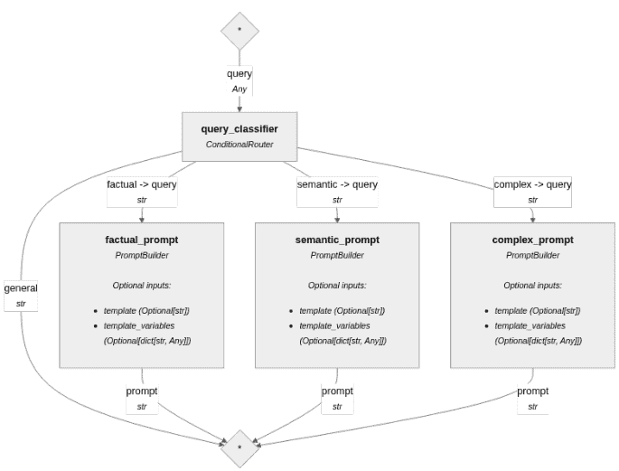
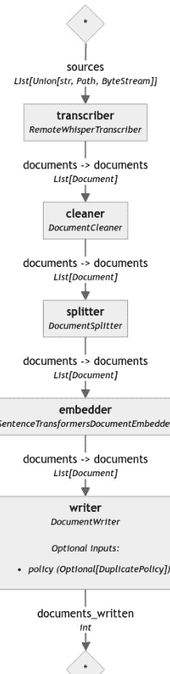
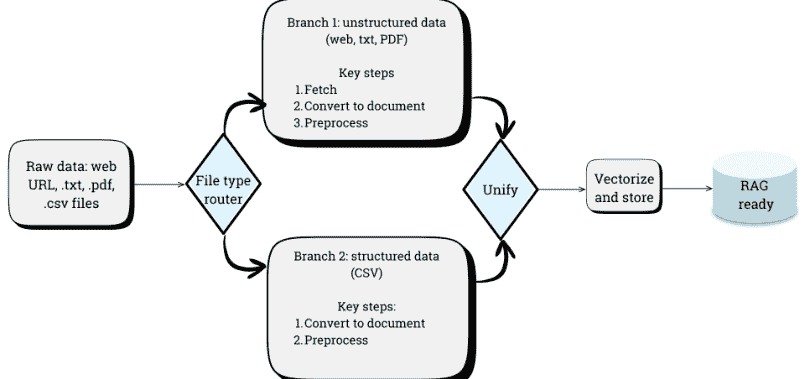

# 4 利用分支

分支功能使你的流水线能够同时处理多种数据类型或处理需求。通过创建分支，你可以将特定数据引导到专门的组件进行目标处理。流水线内部的循环允许迭代处理，例如错误修正或数据精炼，增强输出的准确性和可靠性。

创建分支的关键组件是路由器（routers）。分支的场景示例可以在此处找到关于探索不同类型路由器的笔记本：

- 条件路由器：https://github.com/PacktPublishing/Building-Natural-Language-and-LLM-Pipelines/blob/main/ch4/jupyter-notebooks/routers/conditional_router.ipynb
- 元数据路由器：https://github.com/PacktPublishing/Building-Natural-Language-and-LLM-Pipelines/blob/main/ch4/jupyter-notebooks/routers/metadata_router.ipynb
- 文本语言路由器：https://github.com/PacktPublishing/Building-Natural-Language-and-LLM-Pipelines/blob/main/ch4/jupyter-notebooks/routers/text_language_router.ipynb

我们可以在图 4.1 中看到条件路由器是如何分支的。

### 整合组件——针对不同用例的 Haystack 流水线



图 4.1 - 将提示词分类为事实性、语义性或复杂的条件路由器

**图 4.1** 中的的流水线使用 Haystack 的 **ConditionalRouter** 来检查每个入站查询并动态选择最佳处理路径。路由器评估一系列 Jinja2 条件，这些条件在查询文本中寻找模式（例如：针对事实性的 *when/who/what is the for*、针对语义性的 *how does/compare/difference* *between*，以及包含 *and* 的复杂查询）。若要了解更多关于 Jinja 和 Jinja 模板中条件的知识，我们建议你熟悉以下教程中的核心概念：https://pushmetrics.io/learn/jinja/what-is-jinja/。根据第一个匹配的条件，查询被路由到多个输出之一（**事实性、语义性或复杂性**），并连接到专用的 PromptBuilder，该生成器会生成不同风格的提示词（直接回答、详尽解释或详细分析）。最后的默认路由（条件：`{{ True }}`）确保每个查询都能得到处理，并且当我们运行流水线时，我们可以看到为每个查询选择了哪条路由以及生成了哪条提示词。

### 确保数据流的有效性

Haystack 流水线强调受控的数据流，只有连接的组件才会交换数据。这种方法不仅优化了处理速度，还通过隔离数据路径简化了调试。准确映射每个组件的输入和输出至关重要，以确保流水线内部无缝集成和数据交换。

Haystack 规划了确保组件能够逻辑连接的流，确保我们将文档转换为适当的数据结构和向量时，LLM 可以检索并返回适当的信息。核心假设是，当数据通过组件流过流水线时，每个组件将接受特定的数据结构作为输入并返回另一个作为输出。因此，连接组件的顺序非常重要。

例如，负责转换来自 PDF、网站和 Markdown 文件文本的组件将接受每个相应类型的文件（例如文档路径）作为输入，并返回 Haystack 文档对象（document objects）。这些文档对象随后可以作为负责文档内容向量化并将其存储在文档存储中的组件的输入。

当我们构建检索器流水线时，Haystack 假设流水线的输入是一个问题（字符串）和/或一个表示向量格式问题的浮点数列表。我们将在构建流水线的章节中概述不同场景的预期输入输出。

为了便于理解流水线内部的数据流，Haystack 集成了`.draw()`方法，可以创建可视化表示。我们将注意力转向下一个。

### 整合组件——针对不同用例的 Haystack 流水线



图 4.2 - 将音频向量的流水线 Mermaid 图

### 可视化与验证

可视化你的流水线（例如使用 Mermaid 图表）可以提供结构和数据流的清晰度，帮助你识别任何潜在问题。Mermaid 图是一种使用语法来可视化系统、流程和流的图表类型，常用于创建流程图、序列图、类图、状态图和甘特图。

在 Haystack 中，当组件连接时会自动进行验证，检查兼容性和配置，这有助于故障排除和优化流水线设计。通过`.draw()`方法，我们可以轻松创建数据流的 Mermaid 图。

例如在图 4.2 中，我们看到了一个音频文件索引流水线的数据流。该流水线的目标是获取音频文件并将内容的向量表示存储在文档存储中。

此流水线涉及的组件如下：

- RemoteWhisTranscriber：该组件使用 OpenAI Whisper 入口将音频转换为文本。
- DocumentCleaner：该组件从转录文本中删除异常字符。在处理过程中，异常字符通常指非标准、特殊或意外字符，可能会导致编码、显示或数据处理问题。
- DocumentSplitter：该组件将文本拆分为块，为向量化做准备。
- SentenceTransformerDocumentEmbedder：该组件将文本块转换为数值表示，保留语义含义。
- DocumentWriter：该组件将嵌入写入文档存储。

如果文档存储需要更新或需要添加新文档，此流水线流可以执行一次或多次。通过这一特定的流，我们可以自动化将音频转换为向量格式的过程，并让 LLM 从中检索信息。现有的组件还通过 Haystack 集成（integrations）得到了补充。

为了确保流水线能够连接到各种包、LLM 和嵌入提供商以及评估和观测框架，Haystack 开发了一个框架用于连接甚至开发 Haystack 流水线的集成。

可以集成到 Haystack 流线中的技术列表可以在 https://haystack.deepest.ai/integrations 找到。我们可以在这里找到关于如何实现每个集成的详细信息、其优势，以及为你的项目选择合适集成方案的指导。这种共同努力促进了 Haystack 生态系统的创新和持续改进，使用户能够突破信息检索及其他领域的可能边界。

在本节中，我们概述了在设计和构建 LLM 驱动的流水线时 Haystack 流水线的概要。这些包括：确保我们的流水线能够轻松适配并解决问题的灵活性；确保数据在组件之间进行转换和移动的高效数据流；用于处理和迭代文档的流水线分支和循环；确保我们能够通过 Python 脚本保存和共享流水线的序列化；以及引入尖端模型、向量数据库和增强流水线功能的集成方案。

至此，我们现在准备好按复杂度水平研究常见的 LLM 驱动的用例了。在下一节中，我们将概述 LLM 在不同领域的应用，重点关注 Haystack 流水线的特征是如何实现此类工作流的。

### 使用 Haystack 构建流水线：朴素 RAG 索引和混合 RAG

任何有效的 RAG 系统的核心都是两个不同但相互依赖的工作流：负责准备知识库的**离线索引流水线**，以及利用这些数据实时回答问题的**在线查询流水线**。本节提供了构建这两个基础支柱的蓝图。我们将首先构建一个多功能的索引流水线，它能够从多个源和格式摄取数据，然后构建我们的第一个查询流水线（朴素 RAG 系统），它作为后续所有内容（带排序的混合 RAG 系统）的功能基准。

#### 索引流水线：准备你的知识库

索引流水线是一个关键过程。我们的首要目标是处理来自各种来源的非结构化或半结构化数据，将其转换为标准格式，并加载到 DocumentStore 中，以便进行高效搜索。一个设计良好的索引流水线是高性能 RAG 系统的基石，因为采集数据的质量直接影响检索质量，并最终影响生成的答案质量。

我们将构建一个可以同时处理多种混合数据源的索引流水线：实时网页、本地文本和 PDF 文件以及来自 CSV 文件的结构化表格数据。这是通过使用 FileRouter 实现的，该组件将不同数据类型重定向到相应的转换器，从而实现一个统一而专业的摄取工作流。关键步骤如图 4.3 所示：



图 4.3 - 带有结构化和非结构化文本的索引流水线

我们的流水线将执行以下顺序的操作：

1. 获取并转换：从网络 URL、本地文本文件、PDF 和 CSV 摄取数据，并将每个转换为 Haystack 文档对象。
2. 分类：将原始数据源分为两个流：结构化和非结构化。
3. 预处理：清理文本、空格、特殊字符或正则表达式。
4. 合并：将来自不同转换器的文档流合并为一个单一列表。
5. 预处理：清理并将合并后的文档分割成较小的、语义连贯的块（chunks）以便进行嵌入。
6. 嵌入并写入：为每个文档块生成向量嵌入，并将最终的、丰富的文档写入 DocumentStore。

可以在此处找到探索带有路由的索引流水线实现的 Jupyter notebook：https://github.com/PacktPublishing/Building-Natural-and-LLM-Pipelines/blob/main/ch4/jupyter-notebooks/indexing_pipeline.ipynb。

将 notebook 中的代码想象为为数字图书馆构建一条流水线。主要目标是获取许多不同格式的“书”（实时网页、本地文本文件、PDF 和结构化 CSV 表格），正确地处理所有内容，并将它们归档到特殊的数据库（InMemoryDocumentStore）中。一旦进入该数据库，你就可以构建一个搜索引擎或聊天机器人（RAG 系统），它可以瞬时找到并理解来自所有不同来源的信息。

#### 整合组件——适用于不同用例的 Haystack 流水线

此代码构建了一个基础索引流水线。这是一个关键的离线过程，其工作是准备你的知识库。该流水线的质量直接影响你最终应用程序的运行情况。让我们拆解该流水线是如何运作的：

##### 第 1 阶段——收集和排序 (FileTypeRouter)

首先，我们收集所有的原材料（文件和网页）。然后，它们进入了我们工作流中最重要的组件：FileTypeRouter。该组件将分配输出插槽数据应该去的去向，并有四个不同的流：text/plain、application/pdf、text/html（用于爬取的网页内容）和 text/csv。

当我们调用`indexing_pipeline.run((..))`时，我们所有的本地文件（.txt、.pdf 和 .csv）都被发送到路由器。随后它处理每一个文件并进行“排序，将其发送到正确的处理道道”。这种为不同数据类型创建不同路径的能力被称为分支（branching），它是 Haystack 灵活设计的关键部分。通过这种方式，路由器将每个文件引导到正确的预处理流水线：

- haystack_intro.txt 仅发送到 text/plain 输出
- sample.pdf 仅发送到 text/PDF 输出
- 11m_models.csv 仅发送到 text/CSV 输出

下一阶段是通过分支处理结构化和非结构化数据。

##### 第 2 阶段——处理（两个专门分支）

现在，我们的材料同时沿两条独立的、专门的流水线流动：

###### 分支 1，非结构化数据（Web、TXT、PDF）

此分支用于文本块：

1. 获取并转换：LinkFetcher 抓取网页，HTMLConverter、TextConverter 和 PDFConverter 共同工作，将各自的输入转换为标准的 Haystack 文档对象。


## 流水线细节

### 分支 1，文本数据

#### 合并

`unstructured_doc_joiner` 将来自这些不同转换器的所有文档收集到的一个列表中。

#### 预处理

`text_cleaner` 整理文本，`text_splitter` 将文档切成较小的 150 个词的块。这对于后续步骤至关重要。

### 分支 2，结构化数据（CSV）

此分支专门为表格数据设计：

- **转换**：`csv_converter` 简单地读取整个文件内容到单个文档。
- **预处理**：
  - `csv_cleaner`：该组件处理表格非常智能。它移除了空行和空列（例如我们示例中的三逗号）。
  - `csv_splitter`：这是关键。我们设置了 `split_mode="row-wise"`。它将表格的每一行放入自己的文档中（例如“Company: OpenAI, Model: GPT-4”）。

### 容错机制

现实世界的数据很少完美，因此我们的流水线需要针对意外情况的防御。第一道防线是 `FileTypeRouter`，它作为未知文件格式（如 `.png`）的安全阀。它将未匹配的文件重定向到未分类的路由，有效地忽略它们以防止阻塞机器。

然而，`LinkFetcher` 默认情况下更为严格；它会对损坏的 URL 抛出异常，这可能会导致流水线崩溃。为了防止这种情况，我们将其配置为 `raise_on_failure=False` 以直接跳过坏行。最后，即使是可访问的文件，如果证明是空的，也可能导致 `DocumentSplitter` 崩溃。为了解决这个问题，我们引入了 `DocumentSanitizer`，这是一个自定义关口，检查每个类型（为了健壮性跳过错误，为了质量进行清洗，确保流水线达到生产就绪）。在下一章中，我们将更深入地学习如何定义自定义组件。

## 第 3 阶段——统一、索引和上架

现在，我们将所有内容重新整合：

1. **统一**：`final_doc_joiner` 是重新合并点。它等待并收集所有处理过的文档（来自分支 1 的文本块和来自分支 2 的单独行）形成一个单一的大列表。
2. **索引**：`doc_embedder` 接收此统一列表。它读取每一个数据块（无论是文本还是 CSV 行）并将其转换为向量（捕捉其语义映射的数字列表）。
3. **上架**：最后，`writer` 获取这些已完全处理的、“已索引”的文档（现在已拥有了强大的向量嵌入），并将它们“上架”到 `InMemoryDocumentStore` 中。

大功告成！你的库现在已经完全索引化。博客文章的文本、PDF 文件的内容以及 CSV 文件的每一行都并排存储，根据它们的含义进行理解和检索。这些处理后的数据现在存储在 `DocumentStore` 中，是我们构建问答能力的基础。下一步是构建 RAG 流水线，它将与此知识库交互以生成智能智能体。

生成的流水线可以使用内置的绘图功能创建其 Mermaid 图表进行可视化，可以在此处处找到：`https://github.com/PacktPublishing/Building-Natural-Language-and-LLM-Pipelines/blob/main/ch4/jupyter-notebooks/images/indexing_pipeline.png`。

## Naive RAG – 一个基础问答系统

Naive RAG 架构代表了 RAG 最直接的实现。它遵循一个简单的线性的两步过程：首先，检索一组与用户查询相关的文档；其次，根据这些文档中包含的信息生成响应。虽然它是 RAG 最简单的形式，但它本身就是一个至关重要的基准和强大的工具。

即使在这样的基础配置下，Haystack 的设计哲学也提供了显著优势。框架对显式连接（`pipe.connect()`）的坚持创建了一个“玻璃盒”架构。在 Haystack 流水线中的每一步都是透明且可追溯的。从初始的查询嵌入，通过检索器，再到提示词构建器，最后到生成器，数据流都由开发者显式定义。这种透明度对于调试和理解系统行为价值连城，为构建更复杂、更易维护的应用程序奠定了坚实基础。让我们来实现这一工作流。

我们的流水线将执行以下操作序列：

1. **查询向量化**：对用户问题应用嵌入模型。
2. **检索相关上下文**：使用嵌入后的问题从 `DocumentStore` 中检索相关信息。
3. **增强**：通过提示词生成器，指令 LLM 根据用户查询和检索到的上下文来用自然语言回答问题。

探索语义搜索流水线实现的 Jupyter notebook 可以在此处找到：`https://github.com/PacktPublishing/Building-Natural-Language-and-LLM-Pipelines/blob/main/ch4/jupyter-notebooks/semantic_search_pipeline.ipynb`。

如果说第一个流水线是我们用于构建智能库的离线装配线，那么语义搜索流水线就是使用它的在线系统。语义搜索流水线是“管理员”，它接收用户查询，搜索已索引的架子，并实时生成感知上下文的答案。让我们拆解这条流水线来回答问题。

## 阶段 1 – 查询向量化

用户的问题是起点。但我们无法将文本问题与 `DocumentStore` 中的向量嵌入进行比较。我们首先需要将问题转换为相同的格式：

1. **操作**：将用户的问题（例如，“什么是 Haystack 2.0？”）发送给 `SentenceTransformersEmbedder`。
2. **组件**：`text_embedder` 组件应用与索引期间使用的完全相同的嵌入。
3. **输出**：这产生了一个“查询向量”，这是一个捕捉问题语义含义的数字列表。

这个初始阶段使得能够通过向量搜索检索语义相关的查询。让我们探索下一个阶段。

## 阶段 2 – 检索相关上下文

现在我们有了查询的向量，可以从库中找到最相关的文档：

1. **操作**：将阶段 1 的查询向量输入到 `InMemoryEmbeddingRetriever`。
2. **组件**：检索器组件获取此向量并将其与存储在 `DocumentStore` 中的所有文档向量比较。它找到含义与问题含义最相似的 `top_k=3` 文档。
3. **输出**：这产生了一个文档对象列表。这些可以是来自网页、文本文件或 CSV 行的块，取决于哪个最相关。

这些文档对象现在与原始查询一起被“注入”到提示词模板中，该模板用于引导 LLM 应如何回答。

## 阶段 3 – 增强并生成

我们获取检索到的事实并使用它们来构建答案。

**操作（增强）**：`PromptBuilder` 组件接收两个输入：原始问题和来自检索器的文档列表。然后它遵循模板来“增强”问题，将检索到的文档内容巧妙地放置在给 LLM 的更大的提示词中。模板如下：

```
Given the following information...
Context:
[来自文档 1 的内容]
[来自文档 2 的内容]
...
Question: [原始用户问题]
Answer:
```

**操作（生成）**：这个最终的增强提示词被发送给 LLM（`OpenAIGenerator`）。LLM 读取它刚刚收到的上下文，并仅使用该信息用自然语言回答问题。

就此了！系统随后打印 LLM 的回复。我们成功构建了一个不仅是猜测答案而是检索事实的流水线。

你可以在此处找到探索带有重排序（reranking）的混合流水线实现的 Jupyter notebook：`https://github.com/PacktPublishing/Building-Natural-Language-and-LLM-Pipelines/blob/main/ch4/jupyter-notebooks/hybrid_pipeline.ipynb`。

## 混合检索 RAG

为了构建更健壮的问答系统，我们使用了一种名为混合检索（hybrid retrieval）的高级技术。该流水线通过并行两种不同的搜索方法来创建一个更通用的搜索系统：

- **稠密（语义）检索**：理解含义、意图和概念的专家。
- **稀疏（词法）检索**：关键词匹配的专家，非常适合寻找特定的字面术语。

混合检索流水线的 Mermaid 图表可以在以下 URL：`https://github.com/PacktPublishing/Building-Natural-language-and-LLM-Pipelines/blob/main/ch4/jupyter-notebooks/images/hybrid_rag_pipeline.png`。

这种混合方法可以被认为是我们原始的“语义管理员”与一位“关键词专家”（`BM25`）共同工作，以找到最好的文档。Haystack 的灵活设计使得运行这些并行任务成为原生能力。但我们又增加了一位专家：“首席管理员”（重排序器），他会对它们的合并结果进行最后的深度分析，为我们提供最完美的文档。让我们来拆解这条先进的流水线。

### 阶段 1 – 并行检索（两位专家）

与之前，用户的问题是起点，但与语义搜索流水线不同，在混合搜索流水线中，用户的问题会同时发送到两条路径——稠密/语义搜索和稀疏/关键词搜索：

**路径 1，稠密/语义搜索**：这将使用语义检索组件并遵循此模式：

1. **动作**：将 `hybrid_question` 发送到 `SentenceTransformersEmbedder`。
2. **组件**：`text_embedder` 将问题转换为查询向量。
3. **组件**：`embedding_retriever` 使用该向量从 `document_store` 中找到语义上相似的 `top_k=3` 文档。

**路径 2，稀疏/关键词专家**：这将使用基于关键词的检索器并遵循此模式：

1. **动作**：将原始用户文本直接发送到 `InMemoryBM25Retriever`。
2. **组件**：`bm25_retriever`（我们的关键词专家）忽略语义含义，通过匹配精确单词（如 Haystack 或 2.）找到它的 `top_k=3` 文档。

一旦通过每个路径检索到相关文档，就是时候合并它们了。

### 阶段 2 – 融合（收集结果）

现在，我们有两个文档列表，它们可能重叠也可能不重叠。我们需要将其“融合”为一个单一的候选列表：

1. **动作**：将两个文档列表（总最多六个）输入 `DocumentJoiner`。
2. **组件**：`document_joiner` 将两个列表合并为一个合并的候选文档列表。
3. **输出**：产生一个单一的合并后的文档列表。

在这里，我们可以引入一种机制对检索到的文档进行排序，以便选择最相关的内容。

### 阶段 3 – 重排序（首席管理员的最终检查）

这个合并后的列表很好，但尚未按照真正的相关性进行排序。我们现在添加了最强大的质量控制步骤：排序器（ranker）：

1. **动作**：将合并后的文档列表和原始用户问题文本均送到 `TransformersSimilarityRanker`。
2. **组件**：排序器是一个计算密集型但准确得多的模型。它通过将查询和每个候选文档视为一对来执行“更深层、更具上下文感知能力的分析”。然后它根据这种深度分析对整个列表进行重新评分和重新排序。
3. **输出**：输出是最终的、精确排序的 `top_k=3` 最相关文档列表，这些文档是从两种检索方法的优中选出的。

一旦排序器选择了前三个文档，我们现在准备好引入我们的 LLM 了。

### 阶段 4 – 增强与生成（最终答案）

最后一个阶段与我们的朴素（naive）RAG 流水线相同，但现在通过更高质量的重排序文档进行了“增强”：

- **动作（增强）**：`PromptBuilder` 接收原始问题和来自排序器排名最高的文档。它巧妙地将这些高度相关的上下文放入提示词模板中。
- **动作（生成）**：将这个最终的增强提示词发送给 LLM（`OpenAIGenerator`）。LLM 读取它收到的优质上下文，并仅使用这些信息生成最终的、具有上下文感知能力的答案。

下一个逻辑步骤是比较我们的朴素 RAG 和混合 RAG 流水线的性能。为了简化评估时每个流水线的调用，我们将它们封装为 `SuperComponents`。这是一种允许我们将整个流水线视为一个组件的抽象。除了能够将复杂的工作流作为组件连接外，抽象还有一个额外好处：简化复杂的输入/输出结构。在*第 6 章*，我们将使用不同的嵌入模型系统地评估我们的朴素和混合 RAG SuperComponents。

## 通过 SuperComponents 简化流水线使用

在本节中，我们将介绍将朴素和混合 RAG 流水线重构为复用 SuperComponents 的过程。这是通过将流水线传递给 `SuperComponent` 类来实现的。我们还将使用输入类型转换和输出映射来定义新组件的公共接口。

保持原始定义的朴素和混合流水线，如果我们的流水线命名为 `naive_rag_pipeline` 和 `hybrid_rag_pipeline`，那么将流水线重构为 SuperComponent 可以通过两种方式完成：

### 方法 1 – 包装现有的流水线实例

第一种方法涉及包装一个实例化的流水线。当你已经定义了一个流水线对象并希望在不修改底层结构的情况下快速将其抽象时，这种方法是理想：

```python
from haystack import SuperComponent
# Naive RAG
native_rag_sc = SuperComponent(
  pipeline=naive_rag_pipeline,
  input_mapping={
  "query": [
    "text_embedder.text",
    "prompt_builder.question"
  ],
}
out_mapping={
  "llm.replies": "replies",
  "retriever.documents": "documents"
}

# Hybrid RAG
hybrid_rag_sc = SuperComponent(
pipeline=hybrid_rag_pipeline,
input_mapping={
  "query": [
    "text_embedder.text",
    "bm25_retriever.query",
    "ranker.query",
    "prompt_builder.question"
  ]
},
out_mapping={
  "llm.replies": "replies",
  "retriever.documents": "documents"
})
```

一旦封装为 SuperComponent，我们可以像下面所示执行查询：

```python
native_rag_sc.run(query=question)
hybrid_rag_sc.run(query=question)
```

这种方法可以作为快速将流水线封装为组件。但它有局限性——如果我们想更改生成器组件或文档存储，必须手动修改流水线本身。对于可以变量作为输入的 SuperComponents，我们看下一种方法。

### 方法 2 – 构建运行时配置的 SuperComponent

运行时配置。我们没有使用硬编码值，而是接受诸如嵌入模型、LLM 模型和 `top-k` 检索设置等参数。这种设计确保了我们的 SuperComponent 不仅仅是一个静态脚本，而是一个灵活的对象，在尝试构建流水线之前就会检查必要的凭据（例如模型 API 密钥）。

一旦设置好，我们就移动到 `build_pipeline` 方法定义的内部组装逻辑。在这里，我们初始化了任务所需的特定组件：用于查询向量化的文本编码器、用于搜索我们 Elasticsearch 存储的检索器、用于格式化上下文的提示构建器以及用于生成最终答案的生成器。注意，你可以选择不同的生成器（例如 `OllamaGenerator`）来使用 OpenAI 以外的模型。

我们创建一个标准的 `Pipeline()` 对象并将这些组件添加到其中。然后按照之前的步骤进行：使用 `pipeline.connect()` 方法显式地连接组件，绘制特定的线条，允许数据从嵌入器的输出流向检索器，从检索器找到的文档流向提示构建器。

最后，我们使用输入和输出映射抽象了这种内部复杂性。这一步将流水线转换为单个、易于使用的组件。我们定义了一个输入映射，接收单个外部查询并将其内部路由到嵌入器和提示构建器。同样，我们定义了一个输出映射，仅暴露用户关心的内容：LLM 的最终回复和用于参考的检索文档。通过这样封装逻辑，我们将组装线复杂的布线隐藏在组件内部，仅向我们应用程序的其他部分暴露一个简单、清晰的接口。

通过使用 `@super_component` 装饰器和专用的类结构，我们将流水线从静态脚本转变为灵活的软件组件，它可以无缝地集成到更大的应用程序中。现在我们来查看多模态流水线。

# 构建多模态流水线：图像、文本和音频

在之前的章节中，我们建立了用于处理和检索文本的健壮流水线。然而，现实世界的知识通常锁定在非文本格式中，如图像、图表和音频录制。本节将我们的架构扩展到**多模态 RAG**。

与基于文本的 RAG 不同（后者的查询和文档共享单一模态（文本）和同质向量空间），多模态 RAG 必须跨越**模态差距**。我们无法直接在数学上将文本查询与二进制图像文件进行比较。为了解决这个问题，我们采用了两种主要策略：**联合嵌入**（将不同模态映射到共享的向量空间）和**模态翻译**（在索引之前将视觉或音频信号转换为文本）。

我们将通过一系列笔记本来探索这些策略，从基础的图像处理进展到复杂的视听推理。

# 策略 1 – 使用 CLIP 进行联合嵌入

第一种方法使用如对比语言-图像预训练（CLIP）等模型模型等模型，这些模型经过训练，可以将图像和文本投影到相同的潜在向量空间。这允许我们使用自然语言搜索图像，而无需任何显式标记。


此笔记本介绍了`sentence-transformers`文档图像嵌入 Haystack 组件。通过使用`sentence-transformers/clip-ViT-L-14`（https://huggingface.co/sentence-transformers/clip-ViT-L-14）模型，我们可以将本地图像文件转换为向量表示，这些向量在几何上与其文本描述的向量接近。通过此笔记本，我们可以从查询创建文本嵌入，从示例图像创建图像嵌入，计算余弦相似度得分，并查看哪个图像匹配文本描述。

为了在大规模上应用，我们必须构建一个能够处理混合数据流的索引流水线。

该流水线使用`FileTypeRouter`组件根据其 MIME 类型分离传入的文件：

- **文本分支**：PDF 被路由到标准的`PyPDFToDocument`转换器和文本嵌入器。

- **图像分支**：图像被路由到专门的`ImageToFileDocument`转换器和图像嵌入器。

- **胶水**：我们使用了一个自定义组件`ImagePathFixer`。标准转换器可能只存储文件名，但嵌入组件通常需要绝对路径。该组件在向量化之前解析这些路径。

我们可以在以下 URL 以 Mermaid 图表的形式可视化该流水线：https://github.com/PacktPublishing/Building-Natural-Language-and-LLM-Pipelines/blob/main/ch4/jupyter-notebooks/multimodal/images/multimodal_indexing_clip.png。

结果是一个统一的`InMemoryDocumentStore`，其中图像和文本共存，可以通过单个查询嵌入模型进行搜索。让我们看看第二种策略。

# 策略 2 – LLM 内容提取和视觉 RAG

CLIP 在视觉相似性方面表现出色，但它缺乏读取图像内详细文本或分析复杂图表的能力。针对这一点，我们转向了视觉 LLM（如 GPT-4o）。

在此工作流中，我们用`LLDocumentContentExtractor`替换了图像嵌入器。该组件将图像发送到视觉 LLM 以生成详细的文本描述。然后我们使用高性能文本模型如`mixedbread-ai/mxbai-embedded-large-v1`（https://huggingface.co/mixedbread-ai/mxbai-embedded-large-v1）对此描述进行嵌入。这有效地将图像转换为文本，允许我们使用标准的、精度检索工具。

可以在这里找到探索完整索引流程的 Jupyter Notebook：https://github.com/PacktPublishing/Building-Natural-language-and-LLM-Pipelines/blob/main/ch4/jupyter-notebooks/multimodal/multimodal_indexing.ipynb

与之前一样，我们可以用路由器路由不同类型的文档，以便我们使用文本嵌入模型处理 PDF 文件，使用视觉模型处理图像文件。Mermaid 图表可见：https://github.com/PacktPublishing/Building-Natural-Language-and-LLM-Pipelines/blob/main/ch4/jupyter-notebooks/multimodal/multimodal_indexing.png（注：此处根据上下文逻辑推断原文可能指向图表路径）。

让我们拆解此索引流水线的关键：

- **文本分支**：PDF 被路由到标准的`PyPDFDocument`转换器。

- **图像分支**：图像被路由到视觉模型。

- **胶水**：我们使用`DocumentJoiner`组件连接处理后的文档。

一旦完成索引过程，我们就可以像开发简单和混合 RAG 那样构建流水线。这将允许我们使用自然语言从文本和图像中检索信息。

带有视觉模型且完整 RAG 流程的 Jupyter Notebook 可以在这里找到：https://github.com/PacktPublishing/Building-Natural-Language-and-LLM-Pipelines/blob/main/ch4/multimodal/4_vision_llm.ipynb

该流水线代表了多模态 RAG 的先进水平。它采用了代理搜索、源回答逻辑：

- **检索**：我们使用索引期间生成的文本搜索文档存储。

- **生成**：找到相关文档后，流水线将原始图像（在元数据中）传递给生成器。

在这种场景下，视觉 LLM 查看原始照片来回答问题。它不是依赖代理描述，而是对源材料进行视觉推理。

这种架构提供了最高的保真度。文本描述仅作为索引键，而生成步骤保留了原始模态的全分辨率。我们可以在此 URL 查看流水线的 Mermaid 图表：https://github.com/PackPublishing/Building-Natural-Language-and-LLM-Pipelines/blob/main/ch4/jupyter-notebooks/multimodal/images/multimodal_rag.png。

如果不解决主要的音频类型：音频，我们对多模态的探索将是不完整的。从会议到客户互动，大量的企业智能锁定在 `.wav` 和 `.mp3` 文件中。

# 处理音频数据

与空间图像不同，音频必须线性化（即转录为文本）才能兼容向量搜索。

演示音频集成的 Jupyter Notebook 在这里：https://github.com/PacktPublishing/Building-Natural-Language-and-LLM-Pipelines/blob/main/ch4/jupyter-notebooks/multimodal/S_audio_transcription_whisper.ipynb。

该流水线使用`RemoteWhisper`转录器将音频文件（如 `.wav` 或 `.mp3`）转换为文本文档。一个关键步骤是使用配置为`split_by="sentence"`的`DocumentsSplitter`进行分割，如图 4.2 所示。这会将长转录分割成语义连贯的块（例如 10 个句子），确保检索系统可以确定对话中的特定时刻，而不是检索整个小时的录音。该流水线作为一个简单的音频转录器，但可以扩展以处理本章中的各种文件。我们将通过对流水线并行和异步用法的简要概述来结束本章。

## 并行化与异步流水线

在之前的章节中，我们构建了结构严谨且功能丰富的流水线。然而，单凭结构本身并不能保证性能。当我们从本地原型转向生产环境时，系统的延迟变成了一个关键限制。现实世界的 RAG 应用很少受限于 CPU 速度，而是受限于输入/输出（I/O）操作。它们的大部分执行时间都花在了等待上，例如等待嵌入 API 返回向量、等待数据库执行搜索或等待 LLM 生成标记。

在标准的同步流水线中，这些等待时间是累积的。如果一个混合搜索需要一次稠密检索（0.5 秒）和一次稀疏检索（0.5 秒），用户需要等待 1.0 秒。为了解决这个问题，Haystack 引入了并行化和异步流水线。这种高级能力允许我们解耦独立操作，通过并发执行它们来大幅降低延迟。

你可以在此处找到实现此异步架构的 Jupyter notebook：https://github.com/PacktPublishing/Building-Natural-Language-and-LLM-Pipelines/blob/main/ch4/jupyter-notebooks/async_hybrid_pipeline.ipynb。

异步流水线的构建方法与标准版本几乎相同，我们只需实例化`AsyncPipeline`类而不是`Pipeline`类。

虽然它在添加和连接组件方面与`Pipeline`类共享类似的 API，但其内部执行图完全不同。

`AsyncPipeline`类通过分析有向多图来识别独立分支。在线性流水线（A -> B -> C）中，没有并行空间；B 依赖于 A。在分支流水线（A -> B 和 A -> C）中，节点 B 和 C 共享对 A 的依赖，但彼此独立。`AsyncPipeline`会识别这种拓扑结构并将 B 和 C 作为并发的`asyncio.Task`对象调度。

`AsyncPipeline`提供了专门的方法来处理不同的应用需求，特别是对于感知延迟至关重要的聊天应用：

- `run_async()`：此方法异步执行执行流水线。它是非阻塞的，是 Web 服务器（如 FastAPI）在并发处理多个用户查询时的理想选择。

- `run_async_generator()`：这是一个流式方法。它会在组件完成时产生部分输出。

这种流式能力对于调试和用户反馈特别有用。我们不需要等待整个过程结束，可以在检索器完成工作之前看到 LLM 才开始生成。

通过掌握并行化，开发者可以确保他们的流水线不仅智能，而且能够响应实时用户交互的严苛需求。这标志着在 Haystack 2.0 中整合组件的全面指南到此结束。我们已经从图的基础布局移动到了异步执行的复杂优化，为现代 NLP 架构提供了清晰的蓝图。

## 总结

在本章中，我们从 Haystack 2.0 的理论概念转向具体的实现。我们探索了有向多图的核心设计哲学，它允许分支和灵活的数据流。

我们构建了三种不同类型的流水线：

- **索引流水线（Indexing pipelines）**：我们使用`FileRouter`构建了一个健壮的接入系统，同时处理结构化（CSV）和非结构化（PDF、Web）数据，并将它们归一化到统一的文档存储中。

- **RAG 流水线（RAG pipelines）**：我们从仅依赖语义嵌入搜索的原始 RAG 系统进化到了混合 RAG 系统。混合方法引入了分支，将稀疏检索（BM25）的精确与稠密检索的上下文理解相结合，并通过重排序器（reranker）进行优化以获得最佳准确率。

- **多模态流水线（Multimodal pipelines）**：我们弥合了文本、图像和音频之间的差距。我们使用 CLIP 实现联合嵌入以通过文本搜索图像，并使用视觉 RAG 允许 LLM 直接看到并推理图像。

最后，我们使用`SuperComponents`对这些工作流进行了模块化优化，并使用异步流水线进行并行执行。在下一章中，我们将深入研究自定义组件的创建，特别是将开发自定义组件从文档语料中生成知识图谱和合成数据。然后，在第 6 章，我们将自定义组件与原始和混合 RAG `SuperComponents`结合，系统地评估这两种方法并在更改嵌入模型时衡量性能。

## 订阅免费电子书

新框架、演进中的架构、研究发布、生产环境分析——AI_Distilled 将噪音过滤掉，为亲手操作 LLM 和生成式 AI 系统的工程师和研究人员提供每周简报。现在订阅即可获得免费的电子书，以及帮助您保持专注和掌握资讯的每周见解。

访问 https://packt.link/80z6Y 订阅或扫描下方的二维码。


