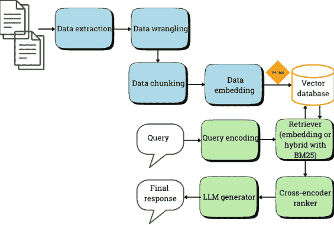
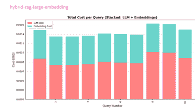
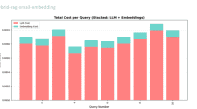
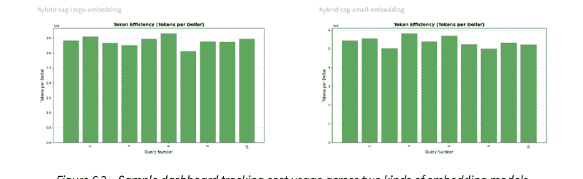

# 构建可复现和生产就绪 RAG 系统

在之前的章节中，我们开启了一段掌握 Haystack 框架的实践之旅。在第 4 章中，我们将预定义的 Haystack 组件组成了强大的端到端流水线（pipelines），并构建了原生（naive）和高级的 RAG 系统。随后，第 5 章标志着熟练程度上的关键转折。我们从一个能够扩展框架的用户演变为能够扩展框架的开发者，编写自定义组件来从文档中生成高质量的、基于图谱的合成测试数据集。

然而，一个功能性的流水线仅仅是半程。要构建生产级应用，我们必须超越经验性的抽查检查和"在我的机器上可以运行"的保证。下一步是接受严谨的、数据驱动的工程实践。我们将把之前章节中的构建模块整合到一个单一的架构模式蓝图中，你可以使用并扩展它，使用 Ragas 系统地评估针对不同案例的流水线，并使用 Weights & Biases 等框架比较你的结果。我们将首先提供原生和混合型 RAG 流水线开发的概述，将这些流水线抽象为超级组件（SuperComponents）。我们将使用超级组件，利用第 5 章中的合成数据生成来比较每个流水线的性能。

在本章中，我们将涵盖以下主题：

- 设置一个可复现的 RAG 项目
- 关键架构设计依据：我们流水线设置背后的"为什么"
- 使用 Ragas 进行系统性的流水线评估
- 使用 Weights & Biases 添加生产级可观测性
- 通过分析嵌入模型探索成本与性能的权衡

在本章结束时，你将掌握作为超级组件的流水线抽象，理解对封装原生和混合 RAG 流水线的超级组件进行系统性评估，并知道如何使用 Ragas 和 Weights & Biases 实现客观评估和可观测性。

## 技术要求

为了跟随并成功实现本章中讨论的概念，你需要设置适当的开发环境。主要的技术要求是 Python，它将用于管理依赖项并运行项目所需的代码。

该项目设计用于 Python 3.12，因此请确保你已安装了此版本。如果没有，请考虑使用 `pyenv` 等工具来管理和安装正确的 Python 版本。

你可以在仓库的章节文件夹中找到设置说明的完整步骤分解：https://github.com/PacktPublishing/Building-Natural-Language-and-LLM-Pipelines/tree/main/ch6/setup-instructions。本章将使用 Docker，因此需要安装 Docker Desktop 以完成练习。

在本章中使用的架构模式的完整概述可以在此处找到：https://github.com/PacktPublishing/Building-Natural-Language-and-LLM-Pipelines/blob/main/ch6/chapter_overview.md。建议回顾这些概念，因为它们将贯穿全章。

使用的关键架构模式包括：将之前看到的原生和混合 RAG 流水线的复杂性抽象为超级组件（如第 4 章所示），以及通过 Docker 镜像使用两种嵌入模型创建两个向量数据库实例：OpenAI 的 `text-embedding-3-small` 和 `text-embedding-3-large`。虽然练习使用 OpenAI 模型进行测试，但通过这些架构模式，你可以轻松切换模型供应商并仍然完成测试。

在本章中，我们将引入 Weights & Biases 用于可观测性。你需要从 https://wandb.ai/ 获取一个密钥，尽管不需要为该服务付费即可视化令牌的使用情况和评估结果。

# 设置一个可复现的 RAG 项目

在本节中，我们将探索如何设置一个可复现的 RAG 项目。在构建 RAG 系统时，我们希望确保能够信任它们的可靠性。如果我们问一个问题，我们希望确保答案是基于事实的并且是可以复现的。我们将介绍几个 Python 脚本，帮助我们完成一个包含嵌入模型和 LLM 的 RAG 系统。

## 构建可复现和生产就绪的 RAG 系统

从图 6.1 中，我们可以识别出两个关键流水线：索引流水线（indexing pipeline）和检索/生成流水线（retrieval/generation pipeline）。



图 6.1 - 问答系统中的流水线

让我们详细探索这些每一个流水线。

**索引流水线**负责处理和准备数据，以便日后进行高效查询。涉及的步骤如下：

1. **数据提取**：从各种源提取原始文档或文本数据。
2. **数据清洗**：对提取出的数据进行清洗、格式化和转换，以消除任何不一致或不需要的信息。
3. **数据分块**：将清洗后的数据分解为更小的块，以确保高效查询。
4. **应用嵌入模型**：将这些数据块通过嵌入模型（例如 OpenAI），将它们转换为向量表示。
5. **向量存储**：将生成的向量嵌入存储在**向量数据库**中，实现快速且准确的搜索。

**检索和生成流水线**在提问时触发。该过程涉及以下步骤：

1. **问题输入**：用户提交一个问题或查询。
2. **查询编码**：使用与索引流水线相同的嵌入模型将问题编码为向量。
3. **数据检索**：将编码后的查询向量与存储存储的向量表示进行比较。
4. **数据排序**：如果存在交叉编码排序器（cross-encoder ranker），则对检索到的信息进行排序，以选择最相关的块。
5. **最终答案处理**：系统处理检索到的信息，以生成更相关且简洁的答案。

该系统促进了从原始数据到可操作答案的数据流。索引流水线准备数据，检索流水线根据查询识别相关信息，而流水线中的 LLM 将这些信息处理为最终答案。系统高度依赖向量嵌入和数据库以确保高效的检索和准确的响应。由于其简单性，这个过程通常被称为原生 RAG（vanilla RAG）或简单 RAG（naive RAG）。在本章中，我们将系统地比较原生 RAG 与带有排序的混合型 RAG，而交叉编码排序器可以显著改进其结构。

## 构建可复现且生产级的 RAG 系统

```python
# 存储配置
# 验证需求（API 密钥、模型等）
self.build_pipeline()

def build_pipeline(self):
    # 1. 初始化流水线各个组件
    # 2. 创建流水线实例
    # 3. 将组件添加到流水线
    # 4. 连接组件（定义数据流）
    # 5. 定义输入/输出映射
```

通过这个蓝图，我们可以将单个流水线封装成一个可以进一步配置的**超级组件（SuperComponent）**。这在我们进入实验阶段时非常有用，因为它允许我们使用不同的参数初始化流水线。为了简化超级组件的执行方式，我们将定义自定义的输入和输出映射。这将确保对超级组件的运行调用更加简单。例如，一个朴素的 RAG 流水线在我们想要从向量数据库检索并回答问题时，可能需要我们向 `run()` 方法传递包含 `text_embedder.text`、`retriever.query` 和 `prompt_builder.question` 的套接字路径。这可能非常繁琐并增加不必要的复杂性。我们抽象了套接字路径并将其替换为单个参数 `query`，如下：

```python
# 输入映射：外部输入 -> 内部组件输入
self.input_mapping = {
    "query": ["text_embedder.text", "retriever.query",
               "prompt_builder.question"]
}

# 输出映射：内部组件输出 -> 外部输出
self.output_mapping = {
    "llm.replies": "replies",
    "retriever.documents": "documents"
}
```

将流水线抽象为超级组件并映射输入输出可以实现**接口抽象**（意味着外部用户不需要知道内部组件名称）、**易于替换**（意味着你可以在更改内部实现而不破坏外部使用）以及**并行处理**（意味着开发者可以同时将单个输入映射到多个组件）。

应用程序开发者可以将超级组件作为独立模块导入使用，而无需理解其评估或监控的复杂内部机制。让我们通过探索以下分类的脚本，分解如何将此模式应用于 RAG 系统的各个阶段：

- `scripts/rag/*`：此目录隔离了核心应用逻辑。它包含了我们在前面的章节中开发的关键 RAG 流水线的完整实现：
  - [indexing.py](https://github.com/PacktPublishing/Building-Natural-Language-and-LLM-Pipelines/blob/main/ch6/jupyter-notebooks/scripts/indexing.py)
  - [naive.py](https://github.com/PacktPublishing/Building-Natural-Language-and-LLM-Pipelines/blob/main/ch6/jupyter-notebooks/scripts/naive.py)
  - [hybridrag.py](https://github.com/PacktPublishing/Building-Natural-Language-and-LLM-Pipelines/blob/main/ch6/jupyter-notebooks/scripts/hybridrag.py)

这些是我们 RAG 工作流的构建模块。我们在文档（PDF 文件和两个爬取的网站）上执行索引流水线，并将其内容作为嵌入存储在向量存储中。然后，我们可以使用朴素或混合 RAG 流水线从向量数据库中检索信息。让我们探索知识图谱和合成数据生成。

- `synthetic_data_generation/*`：该模块包含了第 5 章中开发的自定义组件，例如：


- [`knowledge_graph_component.py`](https://github.com/PacktPublishing/Building-Natural-Language-and-LLM-Pipelines/blob/main/ch6/jupyter-notebooks/scripts/synthetic_data_generation/knowledge_graph_component.py)

- [`synthetic_test_components.py`](https://github.com/PacktPublishing/Building-Natural-Language-and-LLM-Pipelines/blob/main/ch6/jupyter-notebooks/scripts/synthetic_data_generation/synthetic_test_components.py)

整个知识图谱和合成数据生成过程随后可以被构建为一个流水线，并抽象为一个超级组件，正如`SDGGenerator`超级组件（[`synthetic_data_generator_supercomponent.py`](https://github.com/PacktPublishing/Building-Natural-Language-and-LLM-Pipelines/blob/main/ch6/jupyter-notebooks/scripts/synthetic_data_generator/synthetic_data_generator_supercomponent.py)）所示。

通过将知识图谱和合成数据生成组件作为超级组件放入流水线中，我们清晰地封装了所有与知识图谱和合成数据相关的逻辑。这允许我们控制合成数据的生成过程。

- `scripts/ragas/evaluation/*`：此目录持有评估逻辑，最著名的 [`ragasevalsupercomponent.py`](https://github.com/PacktPublishing/Building-Natural-Language-and-LLM-Pipelines/blob/main/ch6/jupyter-notebooks/scripts/ragas_evaluation/ragasevalsupercomponent.py)。

该脚本包含三个组件：读取合成数据的`CSVReader`、增强数据的`DataAugmentor`以及执行评估（如 [Ragas 指标](https://docs.ragas.io/en/stable/concepts/metrics/)）忠实度、召回率和事实准确性的`RagasEvaluation`。这些组件可以连接到流水线并抽象为超级组件，如`SDGGenerator`所示。

- `wandb_experiments/*`：此目录隔离了我们的观测性逻辑，包含如 [`rag_analytics.py`](https://github.com/PacktPublishing/Building-Natural-Language-and-LLM-Pipelines/blob/main/ch6/jupyter-notebooks/scripts/wandb_experiments/rag_analytics.py) 等用于 [Weights & Biases](https://wand.ai/) 跟踪的脚本。


这种项目结构不仅是组织文件的方便方法；它是协作的蓝图。这种架构直接对应于 MLOps 团队的角色。`rag/` 目录是 NLP 工程师的领域（构建应用）。`synthetic_data_generation/` 和 `ragas_evaluation/` 目录属于 QA 或测试工程师（确保质量）。`wandb_experiments/` 是 DevOps、MLOps 工程师的领域（监控）。这种结构在不同部分之间建立了明确的权和“数据契约”，这对于团队和产品的扩展至关重要。我们将通过强调贯穿始终的关键软件开发工具来结束本节。

在本章中，我们将继续像前面的章节中一样使用`uv`来确保可复现性。在之前的章节中，我们使用内存文档存储进行工作，虽然它们对于原型设计很有用，但在生产环境中，我们需要处理持久化文档存储工作。我们将引入 Elasticsearch 以及一个特定的 `docker-compose.yml` 文件，它将允许我们运行一个持久的双文档存储，以保存不同类型的嵌入：一组使用较小的嵌入模型，另一组使用较大的嵌入模型。让我们探讨这背后的原因。示例 `docker-compose.yml` 文件（[https://github.com/PacktPublishing/Building-Natural-Language-and-LLM-Pipelines/blob/main/ch6/docker-compose.yml](https://github.com/PacktPublishing/Building-Natural-Language-and-LLM-Pipelines/blob/main/ch6/docker-compose.yml)）将能够实现这一点。

Haystack 文档本身对此给出了明确警告：如果使用了如`sentence-transformers/all-MiniLM-L6-v2`等模型进行索引，则必须使用相同的模型对用户的查询进行嵌入（Haystack 教程）。

这样做的原因是数学层面的，而不仅仅是偏好。嵌入模型会创建一个称为“向量空间”的唯一高维宇宙（Jaboun, Medium）。当我们对文档进行索引时，是将每个文档块的语义位置绘制到由该特定向量空间定义的“地图”上。当用户提问时，我们再次使用嵌入模型来寻找该问题的坐标。这个查询向量就是“指南针”（Jaboun, Medium）。

向量搜索通过寻找与查询向量（指南针位置）最接近的文档向量（地图位置）来工作。如果地图和指南针没有校准到同一个宇宙，整个过程将发生灾难性的失败。在查询时使用与索引时不同的模型，就等同于“使用巴黎的地图来导航东京的街道”（Jaboun, Medium）。查询向量虽然在自身的向量空间中很有意义，但“向量空间不匹配”（DeconvoluteAI）会导致“完全无关的结果”，这是 RAG 应用中最常见且关键的失败模式之一。

在我们的实验中，我们将大型嵌入模型创建的向量与小型嵌入模型创建的向量分成了不同的向量存储器。让我们解释一下原因。

## 解耦文档存储器：双 Elasticsearch 架构

我们项目的一个显著特性是 `docker-compose.yml` 文件中定义的双 Elasticsearch 架构（[https://github.com/Packt/Building-Natural-Language-and-LLM-Pipelines/blob/main/ch6/docker-compose.yml](https://github.com/Packt/Building-Natural-Language-and-LLM-Pipelines/blob/main/ch6/docker-compose.yml)）。双 Elasticsearch 架构指的是部署两个 Elasticsearch 集群来处理数据流水线不同阶段的设计。这并不是冗余设置；而是一种用于实现 A/B 测试、独立资源分配和性能效益优化的架构模式。在这种背景下，双架构将使我们能够使用不同的嵌入模型研究 RAG 流水线的性能。

Haystack 的设计将 `DocumentStore` 视为灵活的接口，这使得这种这种模式成为可能。框架的模块化完全支持同时处理多个不同的文档存储器（Milvus），甚至支持诸如多嵌入检索等高级策略（Haystack）。

这种双存储架构提供了两个主要优势：

- **性能效益 A/B 测试的蓝图**：此项目设置不是为了单一流水线；而是为了比较两个并行流水线的框架：原生 RAG 流水线和混合 RAG 流水线。正如我们以后详细分析的，查询要求对小型与大型嵌入模型进行成本分析。该架构是在生产环境中进行分析的机制：

  - 流水线 A（小型）可以使用`ES_SMALL_URL`并填充来自`text-embedding-3-small`的向量。

  - 流水线 B（大型）可以使用`ES_LARGE_URL`并填充来自`text-embedding-3-large`的向量。

我们可以将相同的用户查询发送到两个流水线，并为每个检索答案（使用 Ragas）和每次查询成本（使用 `rag_analytics.py`）。这提供了一个实时的、持续的 A/B 测试，为业务找到最佳的性能平衡。

- **独立资源分配**：小型实例针对 512 MB 到 1 GB 的堆内存进行了优化，而大型实例针对 2 到 4 GB 进行了优化。这是嵌入模型本身的直接结果。更大更强大的嵌入模型（如`text-embedding-3-large`）产生的向量维度更多（3,072），而小型模型为 1,536。这些向量需要更多的存储，关键重要的是，在向量数据库中需要更多的 RAM 来执行高效的最近邻搜索。

通过解耦文档存储器，我们可以相应地配置基础设施。`ES_LARGE_URL`实例可以托管在高内存机器上，而`ES_SMALL_URL`实例运行在较便宜的标准机器上。这防止了“小型”流水线被过度配置，并节省了大量的基础设施成本。

有了可复现的项目和合理的架构，我们现在可以进入量化评估阶段。

## 使用 Ragas 进行系统性的流水线评估

在第 5 章中，我们使用了 [https://github.com/PacktPublishing/Building-Natural-Language-and-LLM-Pipelines/blob/main/ch5/jupyter-notebooks/advanced_branching_pipeline.ipynb](https://github.com/PacktPublishing/Building-Natural-Language-and-LLM-Pipelines/blob/main/ch5/jupyter-notebooks/advanced_branching_pipeline.ipynb) 和我们自定义的 `KnowledgeGraphGenerator` 创建了一个包含问题和地面标准答案的“黄金”测试集。现在，我们将使用该测试集来评估我们的 RAG 超级组件（SuperComponents）：

- `NaiveRAGSuperComponent`： [https://github.com/PacktPublishing/Building-Natural-Language-and-LLM-Pipelines/blob/main/ch6/jupyter-notebooks/scripts/ragnaver.py](https://github.com/PacktPublishing/Building-Natural-Language-and-LLM-Pipelines/blob/main/ch6/jupyter-notebooks/scripts/ragnaver.py)

- `HybridRAGSuperComponent`: [https://github.com/PacktPublishing/Building-Natural-Language-and-LLM-Pipelines/blob/main/ch6/jupyter-notebooks/scripts/hydibrag.py](https://github.com/PacktPublishing/Building-Natural-Language-and-LLM-Pipelines/blob/main/ch6/jupyter-notebooks/scripts/hydibrag.py)。

在比较每个超级组件的聚合 RAG 分时，我们几乎会观察到混合 RAG 流水线明显的优越性，特别是在上下文精确性（Context Precision）和相关性（Relevance）指标上（Paras Masan）。第 4 章中探讨的架构差异是直接原因：

- **原生 RAG**：由单个单路径（稠密、语义）检索器（`ElasticsearchEmbeddingRetriever`）组成。它擅长处理宽泛的概念性查询，在这种情况下，用户的意图比特定单词更重要。然而，它在特定关键词查询方面从根本上是弱的。它受到词汇不匹配问题的影响，将无法检索包含特定错误代码、产品 SKU 或在嵌入空间中表示良好的术语的文档（DevCommunity）。

- **混合 RAG**：这是一种更健壮的多路径系统。它并行使用两个检索器：`Elasticsearch25Retriever`（稀疏词汇搜索）和`ElasticsearchEmbeddingRetriever`（稠密语义搜索）。然后它使用`DocumentJoiner`合并结果。这种方法“融合”了两种方法的优点，找到既在概念上相似又包含精确关键词的文档（VectorHub by Superlinked 2024）。

在检索完块之后、生成最终答案之前，可以在检索流水线中引入额外的增强：重排序器（reranker）。重排序器（通常是交叉编码器模型）接受来自混合检索的融合候选列表，并执行最终的高精度重新排序，“大大提高了了召回性能”（Pinecone），并确保只将最相关的文档传递给 LLM。示例代码中的`HybridRAGSuperComponent`默认添加了`SentenceTransformerRanker`组件来对检索到的块进行排序。

一旦初始化了原生和混合 RAG 超级组件，我们就准备好进行系统性评估了。我们的工具是 Ragas，这是一个行业标准的 RAG 评估框架。我们将关注该框架提供的四个关键指标，这些指标评估 RAG 系统的两个主要部分（检索和生成）：

- **真实性（Faithfulness）**：衡量生成的答案相对于上下文的事实一致性。低分表示 LLM 正在幻觉或编造上下文中不存在的信息。

- **上下文精确性（Context precision）**：衡量检索上下文的信噪比。它评估检索到的块是否与问题相关。

- **上下文召回率（Context recall）**：评估检索器是否找到了完全回答问题所需的所有信息。

- **答案相关性（Answer relevancy）**：一种端到端的指标，评估最终答案与原始问题的相关性。

> 注意

> 尝试将 Ragas 工作流抽象为 SuperComponent（超级组件）

在这里可以找到一个对比朴素 RAG 与使用组件和 SuperComponents 的混合 RAG 评估的 Jupyter notebook 笔记本：https://github.com/PacktPublishing/Building-Natural-Language-and-LLM-Pipelines/blob/main/ch6/jupyter-notebooks/ragas_evaluation_with_custom_components.ipynb。

在提供的笔记本中，我们将使用 SuperComponents 构建一个 Haystack 元流水线——即一个用于运行和评估其他流水线的流水。该工作流的核心是`RagasEvaluationComponent`。该组件将 Ragas 框架的复杂逻辑封装在简单的 Haystack 接口之后。它的`run()`方法将期望由我们的 RAG 流水线生成的输入：`ground_truth`答案（来自你的测试集）、`retrieved_documents`（检索到的文档）以及`generated_answer`（生成的答案）。它的输出是一个包含每个指标计算出的 Ragas 分数的字典。

你可以使用这些脚本和笔记本来运行各种实验。执行的实验将对比第 4 章中引入 Ragas 使用的朴素 RAG（稠密检索）与混合 RAG（密集和稀疏检索）。你可以修改脚本中的流水线以尝试不同的 LLM 和嵌入提供商及模型，并按照脚本所示的模式开发自己的流水线并将其抽象为 SuperComponents。让我们仔细查看后续的执行过程。

## 执行评估

评估过程涉及对从第 5 章的 PDF 和两个 URL 地址生成的合成数据集进行循环处理。对于每一行（包含一个问题和一个`ground_truth`答案），工作流如下所示：

- **运行流水线一**：使用问题执行`NaiveRAGSuperComponent`。这将返回`naive_answer`和`naive_context`（检索到的文档）。

- **运行流水线二**：使用相同的问题执行`HybridRAGSuperComponent`。这将返回`hybrid_answer`和`hybrid_context`。

- **评估**：将两组结果馈送到`RagasEvaluationComponent`。

- **聚合**：存储两个流水线得出的 Ragas 分数。

在处理完整个测试集后，我们将获得两组聚合分数，为我们的朴素 RAG 和混合 RAG 系统提供直接的、量化的比较。这些结果为后续的数据驱动分析奠定了基础。表 6.1 显示了在包含 10 个问题、单跳和多跳查询策略的合成数据集上的运行示例。

| 指标 | 朴素 RAG | 混合 RAG | 改进幅度 (%) | 更好的 RAG |
| --- | --- | --- | --- | --- |
| 忠实度 (Faithfulness) | 0.6411 | 0.9626 | 50.16 | 混合 RAG |
| 答案相关性 (Answer relevancy) | 0.6678 | 0.7374 | 10.42 | 混合 RAG |
| 上下文召回 (Context recall) | 0.6800 | 0.7633 | 12.25 | 混合 RAG |
| 事实准确性 (FI) | 0.3556 | 0.4090 | 15.03 | 混合 RAG |

表 6.1 – 10 个问答对的 Ragas 评估结果

表 6.1 中看到的巨大改进表明了带有重排序（reranking）的混合方法有多强大。该工作流能够对我们的流水线和 SuperComponents 进行客观评估。至此，我们准备好添加可观测性。

## 使用 Weights & Biases 添加生产级可观测性

我们已经静态地评估了流水线的质量。一个生产级系统的最后一部分是在线环境中的动态、持续监控。

首先区分“评估”和“可观测性”至关重要：

- **评估 (Ragas)**：这是一种静态的、一次性的测试（类似于单元测试或集成测试），针对“黄金”数据集进行，以便在部署前获取质量快照。

- **可观测性 (Weights & Biases)**：这是对生产环境中实时流水线或 SuperComponent 的持续、实时监控。它对于理解真实用户查询、检测性能漂移、监控成本和追踪故障至关重要。

我们提供了一个示例 Jupyter notebook，你可以使用它通过 Weights & Biases 将可观测性集成到你的运行中：https://github.com/PacktPublishing/Building-Natural-Language-and-LLM-Pipelines/blob/main/ch6/jupyter-notebooks/add_observability_with_wandb.ipynb。

在该笔记本中，关键是 Haystack 的`WeaveConnector`组件，它是 Weights & Biases 的集成组件。

该组件展示了一种独特的 Haystack 模式。它不需要调用`.connect()`。


相反，它使用环境变量（如`HAYSTACK_CONTENT_TRACING_ENABLED`和`WANDB_API_KEY`）自动拦截来自流水线中所有组件的追踪信息（输入、输出和元数据），并将它们发送到 Weights & Biases 仪表板。如下所示添加到流水线中：

```
pipe.add_component("weave", connector)
```

此笔记本使用了另一个额外的脚本，`https://github.com/PacktPublishing/Building-Natural-Language-and-LLM-Pipelines/blob/main/ch6/jupyter-notebooks/scripts/wandb_experiments/rag_analytics.py`，该脚本被可观测性笔记本调用。此脚本提供了增强分析。它被配置为记录 token 计数，并使用`gpt-4o-mini`以及嵌入模型的定价数据，计算每次流水线运行的美元成本。

这种增强将 Weights & Biases 从一个简单的 ML 监控工具转变为**财务运营 (FinOps)** 仪表板。简单的示例可以在图 6.2 和表 6.2 中看到。

`hybrid_rag-large-embedding`







| 嵌入模型 | 总成本 | LLM 成本 | 嵌入成本 | 每查询平均成本 |
|---|---|---|---|--|
| 小嵌入 (Small embedding) | 0.009311 | 0.008356 | 0.0009549 | 0.000931 |
| 大嵌入 (Large embedding) | 0.014450 | 0.008398 | 0.006053 | 0.001445 |

表 6.2 – 使用大嵌入与小嵌入模型的成本对比

- 我们的流水线总成本是多少？
- 我们的平均查询成本是多少？
- 哪个流水线（小的还是大的）更具成本效益？
- 我们是否看到了与特定类型查询相关的成本激增？

将系统性能直接与成本挂钩的能力是作为业务运行 RAG 应用时最关键、不显而易见的特征之一。让我们来看一个成本与性能权衡常见的案例。

## 通过分析嵌入模型探索成本与性能权衡

由我们的架构支持的第二个关键分析是嵌入模型的选择。我们将对比 OpenAI 的两个领先模型：`text-embedding-3-small`和`text-embedding-3-large`。我们将观察性能（准确率）与成本之间的权衡。

在**海量文本嵌入基准 (MTEB)** 上，`text-embedding-3-large`（平均分 64.6%）始终明显地优于`text-embedding-3-small`（平均分 62.3%）（Enterprise Bot）。从定性角度来看，研究显示大模型在处理上下文理解和模糊问题方面明显更好，其额外的维度捕捉了更微妙的关系（TigerData）。

这种卓越的性能是有高昂代价的：

- `text-embedding-3-small`每 100 万 token 费用 0.02 美元
- `text-embedding-3-large`每 100 万 token 费用 0.13 美元

这意味着大模型仅在嵌入步骤的成本就增加了 6.5 倍。这些数据呈现了典型的收益递减权衡。我们必须决定，在 MTEB 上 2.3 分（或相对提升 3.7%）的收益是否值得上 6.5 倍的成本增加。这一考量也将影响向量本身的成本。

对于绝大多数通用 RAG 应用来说，`text-embedding-3-small`是明确的获胜者也是最优选择。它在高性能（几乎不亚于旧的`text-embedding-ada-002`）和极低成本之间的平衡使其成为最具成本效益的选择。

`text-embedding-3-large`模型是一个专业工具。它应该保留用于高风险、利基领域（例如法律、金融或医疗 RAG），在这些领域中，其对复杂上下文的细微差别理解可能证明指数级成本是合理的。使用我们的笔记本显示性能-成本权衡的示例运行可以在表 6.3 和表 6.4 中看到。

# 6 

172

| 指标 | 小型嵌入模型 | 大型嵌入模型 |
|---|---|---|
| 总成本 ($) | 0.009396 | 0.014277 |
| LLM 成本 ($) | 0.008441 | 0.008224 |
| 嵌入成本 ($) | 0.000955 | 0.006053 |
| 平均每次查询成本 ($) | 0.000940 | 0.001428 |

表 6.3 – 大小嵌入模型的成本对比

| 指标 | 小型嵌入模型 | 大型嵌入模型 |
|---|---|---|
| 忠实度 (Faithfulness) | 0.804444 | 0.747778 |
| 上下文召率 (Context recall) | 0.926667 | 0.946667 |
| 事实准确性 (Factual correctness) | 0.599 | 0.578 |
| 回相关性 (Response relevance) | 0.869054 | 0.868255 |
| 上下文实体召回 (Context entity recall) | 0.356603 | 0.415104 |

表 6.4 – 大小嵌入模型的 Ragas 指标性能对比

这正是为什么我们的解耦双存储架构如此强大的原因。它允许我们进行选择。我们可以从小型模型开始作为主应用程序的高成本效益默认方案，仅在需要其顶尖性能的特定高价值流水线中部署大型模型，而这一切都可以在同一个统一的项目中实现。

## 总结

在本章中，我们完成了从 RAG 开发人员到 RAG 架构师的关键转变。我们不仅构建了一个流水线，还构建了一个可复的、生产就绪的系统。

我们首先采用了专业的模块化项目结构，并证明了其设计作为团队协作蓝图的合理性。随后，我们对核心架构决策进行了辩护，以确保系统的健壮性：要求单一一致嵌入模型的向量空间奇异性，以及能够实现资源优化和实时 A/B 测试的解耦双数据库架构。

## 构建可复现且生产就绪的 RAG 系统

在这一坚实的基础上，我们使用 Ragas 构建了量化评估流水线，利用第 5 章中的合成数据集对我们的原生（naive）和混合 RAG 实现进行了严格评分。这些数据使我们能够进行细致入微、数据驱动的成本效益分析，权衡混合 RAG 的准确性与其延迟之间的关系，以及`text-embedding-3-large`的边际性能提升与其 6.5 倍成本之间的关系。最后，我们增加了生产系统的基石：持续可观测性，以及最重要的使用 Weights & Biases 进行成本跟踪。

整个章节作为了部署前的最后准备。我们的项目现在已使用 Docker 容器化，依赖项已通过`up`锁定，逻辑封装在 Python 脚本中，并且我们拥有健壮、可重复的评估（Ragas）和监控（Weights & Biases）系统。我们不再仅仅是开发者；我们是这套完整端到端系统的架构师，我们终于准备好迈最后一步：将我们的 Haystack 部署为可扩展的、生产就绪的 API。

## 延伸阅读

- Haystack. (n.d.). 教程：使用检索增强创建你的第一个 QA 流水线。`https://haystack.deepset.ai/tutorials/27_first_rag_pipeline`
- Jabloun, (n.d.). 不要破坏你的 RAG：为什么你必须在检索和索引中使用相同的嵌入模型。`https://medium.com/@mariem.jabloun-dont-break-your-rag-why-you-must-use-the-same-embedding-model-for-retrieval-and-indexing-7b0aa3e536acd`
- DeconvoluteAI. (n.d.). 理解 RAG 流水线中的失败原因与缓解策略。`https://deconvolateai.com/blog/rag/failure-modes`
- Milvus. (n.d.). 如何结合不同类型的文档存储使用 Haystack？`https://milvus.io/ai-quick-reference/how-do-i-use-haystack-with-different-types-of-document-stores`
- Haystack. (n.d.). 检索器 - Haystack 文档。`https://docs.haystack.deepset.ai/v2/9/docs/retrievers`
- Madan, (n.d.). 使用 Weaviate 和 Athina 评估原生和混合 RAG。`https://medium.com/athina-ai/evaluating-naive-and-hybrid-rag-using-weaviate-and-athina-6ec6dccaf693`
- Paul, K. (n.d.). 高级 RAG：从原生检索到混合搜索和重排序。`https://dev.to/kuldeep_paul/advanced-rag-from-naive-retrieval-to-hybrid-search-and-re-ranking-4km3`
- Superlinked. (2024). 使用混合搜索与重排序优化 RAG | VectorHub。`https://superlinked.com/vectorhub/articles/optimizing-rag-with-hybrid-search-reranking`
- Pinecone. (n.d.). 重排序与两阶段检索，`https://www.pinecone.io/learn/series/rag/rerankers/`
- Tiger Data. (n.d.). 评估用于 RAG 的开源与 OpenAI 嵌入：一份指南。`https://www.tigerdata.com/blog/open-source-vs-openai-embeddings-for-rag`
- Enterprise Bot. (n.d.). 为你的检索增强生成 (RAG) 系统选择最佳嵌入模型。`https://www.enterprisebot.ai/blog/choose-the-best-embedding-model-for-your-retrieval-augmented-generation-system`

# 订阅获取免费电子书

新框架、演进中的架构、研究发布、生产分析——AI_Distilled 为实际操作 LLM 和 GenAI 系统的工程师和研究人员过滤噪音并提供每周简报。现在即可获取免费电子书，以及帮助你保持敏锐的每周见解。

访问 `https://packt.link/80z6Y` 订阅或扫描下方二维码。
