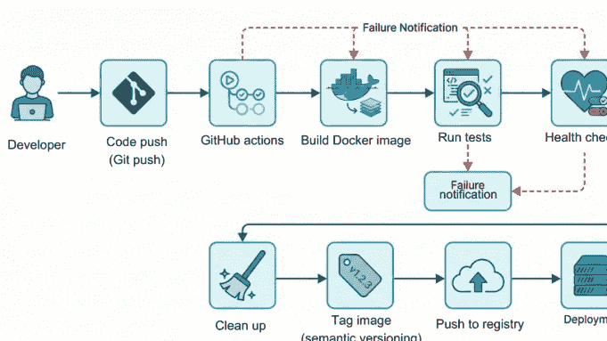

## 第 7 章

## 部署基于 Haystack 的应用程序

在上一章中，我们专注于构建和测试流水线。在本章中，我们将专注于将该流水线引入生产环境。我们将探索如何对应用程序容器化、管理依赖项并将其暴露为可扩展的 API。

我们还将讨论不同的部署策略以及如何根据你的特定需求选择最佳方案。

## 技术要求

为了可复现性，我们使用以下工具：

- Docker: `https://www.docker.com/`
- FastAPI: 用于构建 API 的框架：`https://fastapi.tiangolo.com/`
- Enterprise Bot. (n.d.). 为你的检索增强生成 (RAG) 系统选择最佳嵌入模型。`https://www.enterprisebot.ai/blog/choose-the-best-embedding-model-for-your-retrieval-augmented-generation-system`

部署基于 Haystack 的应用程序

本节将概述 NLP 应用程序最常见的部署需求。我们将讨论在决定部署方法时需要考虑的因素，例如系统性能与基础设施成本之间的权衡、终端用户访问的便利性，以及处理用量波动的资源管理。不同的部署策略提供独特的优势，无论你是为了优化快速扩展性、维护轻量级部署，还是管理复杂的依赖关系。我们将比较这些方法，概述它们在从本地服务器到云平台等各种环境中的优缺点和局限性。

在本节结束时，你将清晰地了解哪些部署策略最符合你的流水线（pipeline）需求。这将为后续章节中将涵盖的技术实现方法奠定，包括 API 开发、Docker 化和自动化部署工作流。

# NLP 流水线关键需求概述

部署 NLP 流水线（特别是由 LLM 驱动或复杂多阶段工作流驱动的）需要几个关键需求以确保在生产环境中的无缝集成和稳健性能：

- **可扩展性 (Scalability)：** 在 NLP 流水中，这指的是系统在不影响性能的情况下处理日益增加负载的能力。这确保应用程序能够应对更高的需求，例如服务更多的并发用户。对于聊天机器人、搜索引擎和实时文本分析工具等 NLP 应用程序，可扩展性对于处理海量数据和流量峰值同时保持快速响应时间至关重要。可扩展性中的另一个重点是**弹性 (Elasticity)**。**弹性**通过允许系统根据需求动态伸缩资源进一步实现了可扩展性，优化了资源使用和成本。使用 Docker 和 Kubernetes 的容器化部署在支持此类扩展方面特别有效。可扩展性是我们离开 Notebook 脚本的主要原因。你的 RAG 流水线必须能够服务一个或数千个并发用户而不失败，容器编排是实现这一目标的路径。但如果系统难以访问，可扩展性将毫无用处。

- **可用性 (Accessibility)：** 这关注用户或客户端应用程序与 NLP 流水线交互的易程度。这通常涉及通过 API 暴露流水线，实现与其他服务或平台的无缝集成。REST API 促进了流水线与用户之间的轻松交互，确保了跨平台的可用。对于地理分散的用户或服务，远程和分布式访问至关重要，通常利用 AWS、Google Cloud 或 Azure 等云端部署方案来最小化延迟并确保全球可用性。在我们的语境下，可用性意味着一个 API。通过 REST API 暴露流水线使其成为一个模块化的“构建块”，任何其他服务（例如 Web 前端、移动 App 或另一个后端系统）都可以调用。这引出了我们的下一个逻辑挑战。

- **资源管理 (Resource management)：** 部署中的这涉及计算资源（包括内存、处理能力和存储）的有效分配，以在保持高性能的同时使成本处于可范围内。对于 NLP 模型，特别是使用 LLM 的模型，这意味着优化 GPU 和 CPU 的使用，高效管理内存，并使用无服务器计算和容器化等策略平衡成本与性能。有效的资源管理对于部署可扩展 NLP 应用程序而不产生过度运营成本至关重要。这对于 NLP 特别关键。LLM 和嵌入模型是极消耗 GPU 的。一个成功的部署策略必须高效管理这些昂贵的资源以防止成本爆炸。

- **可靠性与韧性 (Reliability and resilience)：** 这些对于确保系统性能的一致性和从意外问题中快速恢复至关重要。稳健的错误处理机制和自动恢复过程（如容错和自动重启）有助于维持不中断的服务。全面的监控和日志通过尽识别并解决问题进一步增强了可靠性，为调试和优化性能提供了审计轨迹。*这是部署的信任侧面。*在生产环境中，失败不是选项。收到 *500 Internal Server Error* 的用户将不会信任该应用程序。我们需要自动健康检查、日志和恢复过程。

- **模块化与可维护性 (Modularity and maintainability)：** 这些通过结构化设计实现，使流水线具有模块化，允许在不干扰整个系统的情况下易于更新或替换。这对于包含数据预处理、模型推理和后处理的多阶段流水线特别有益。实施**持续集成/持续部署 (CI/CD)** 流水线可以进一步简化更改、测试和部署的集成流程，减少错误并加速更新。我们在*第 6 章*中构建的流水线在设计上已经是现代化的。我们的部署策略必须尊重这一点。我们应该能够在不让整个系统离线的情况下更新提示词或更换嵌入模型。

- **安全性与合规性 (Security and compliance)：** 这些确保了 NLP 部署中的数据保护和法规遵循从。数据隐私保护措施（如加密和访问控制）对于处理敏感信息和满足 GDPR 或 HIPAA 等合规性标准至关重要。此外，通过身份验证和授权机制安全地访问流水线可以保护外部 API 和用户交互。这些考虑共同构成了部署和管理可扩展、可用且安全的 NLP 系统的稳健框架。这是一个不可逾越的最终障碍。我们的流水线将处理用户查询和可能的敏感文档。我们确保数据经过加密，且访问经过身份验证。

实现我们流水线部署的每个部分都超出了本章的范围；我们的重点是建立初始基础设施以通过两种部署策略进行部署。

让我们看看部署 NLP 流水线可以遵循的两种部署策略：

- 通过 FastAPI 进行 API 部署（自定义、高控制路径）
- 流水线序列化和 Hayhooks 集成（精简、高速度路径）

# 比较两种主要的部署策略

为 NLP 流水线选择正确的部署策略很大程度上取决于其运行环境，以及项目的特定需求和限制。不同的方法在可扩展性、集成性、维护和资源效率方面提供独特的优势。


在本节中，我们将比较两种将 Haystack 流水线部署为容器化 REST 端点的方法：一种使用 `FastAPI` (https://fastapi.tiangolo.com/)，另一种使用 `Hayhooks` (https://docs.deepset.ai/docs/hayhooks)。两种解决方案都可以 Docker 化。这确保了可迁移性和可重复性，并通过 Kubernetes 等解决方案引入了可扩展性：

- **方法 1 – FastAPI REST 端点**：我们将使用 `FastAPI` 框架手动构建 REST API。这种方法提供了最大的控制和自定义空间。我们将定义每个端点、每个验证模型以及所有的应用程序逻辑。这是“从零开始”的方法，适用于复杂的定制应用程序。

- **方法 2 – 流水线序列化和 Hayhooks 集成**：我们将利用 `Haystack` 的原生序列化功能将流水线保存到 `YAML` 文件中，然后使用 `Hayhooks` 自动将其暴露为 REST API。这种方法提供了最大的速度和集成性。它是“内置电池”的方法，专为 `Haystack` 生态定制。

让我们看看哪种方法最适合你的用例。

# 为你的环境选择合适的策略

本章的核心主题是控制（方法 1）与速度（方法 2）之间的权衡。这两者并非互斥；事实上，`Hayhooks` 是在 `FastAPI` 之上构建的。这意味着它们不是竞争性的解决方案，而是不同的抽象层。

我们将首先教你“手动”方法（`FastAPI`），以便你理解 `Pydantic` 和端点创建的底层机制。然后，我们将引入 `Hayhooks` 作为一种抽象，它能自动处理你刚刚生成的所有样板代码。我们将从构建 API 所涉及的各个模块开始，然后探索 `Hayhooks` 的价值主张，它可以为你处理这些工作。

为了弄清楚这一选择，让我们在表 7 中总结这些权衡。

| 特性 | 方法 1：自定义 FastAPI | 方法 2：Hayhooks |
|---|---|---|
| 首要目标 | 完全控制、自定义逻辑和复杂的端点。 | 简单、易用以及原生的 Haystack 集成。 |
| 样板代码 | 高（手动设置应用、端点和模型）。 | 极少到零。 |
| 工作原理 | 你在 Python API 代码中导入并运行 Haystack Pipeline 对象。 | Hayhooks 读取序列化的 pipeline.yml 文件并自动生成所有 API 端点。 |
| 灵活性 | 最大。添加任何端点、中间件或逻辑。 | 高。基于 FastAPI 构建，因此具有扩展性，但针对流水线服务进行了优化。 |
| 最适用于... | 复杂、多层应用，Haystack 流水线是大型系统的一部分。 | 快速部署 RAG API、MLOps 工作流以及流水线即系统的服务。 |

# 部署基于 Haystack 的应用程序

| 特性 | 方法 1：自定义 FastAPI | 方法 2：Hayhooks |
|---|---|---|
| 学习曲线 | 中等。需要 Fast FastAPI、Pydantic 和异步服务器网关接口 (ASGI) 的知识。 | 低。需要具备 Haystack 和 YAML 的知识。 |

表 7.1 – Haystack 流水线部署对比

两种方法都可以使用 Docker 和 Kubernetes 进行封装和扩展。方法的选择取决于项目的整体架构和目标。我们将深入探讨一个使用 `FastAPI` 的入门示例，在其中我们将暴露在第 6 章中开发的混合 RAG 流水线，随后我们将学习如何设置一个动态系统，使我们能够将 PDF 和 URL 内容上传到 REST 端点，应用索引流水线，并使用混合 RAG 流水线从索引内容中获取信息。

# 实现部署策略

有效地部署 NLP 流水线需要利用现代技术来简化 API 开发、实现并行数据处理、监控系统性能并促进容器化部署。在本节中，我们将介绍提供的解决方案使用的关键工具（即 `FastAPI`），并探索它们如何有助于构建健壮、可扩展且可维护的 NLP 应用。

# 方法 1：使用 FastAPI 服务 Haystack 流水线

`FastAPI` (https://pypi.org/project/fastapi/) 是一个用于构建 Python RESTful API 的高性能 Web 框架。它设计用于快速、易用并完全兼容类型注释等现代 Python 特性。

`FastAPI` 具有以下特性：

- **异步支持**：`FastAPI` 原生支持使用 Python 的 `asyncio` 库进行异步请求处理，适用于高并发应用。

- **自动文档**：它会自动为 API 端点生成 OpenAPI 文档（Swagger UI），简化与客户端应用程序的集成。

- **使用 Pydantic 进行验证**：`FastAPI` 使用 `Pydantic` (https://docs.pydantic.dev/latest/) 模型进行数据验证，确保请求和响应符合定义的模式。

第 7 章

186

`Pydantic` 是一个流行的 Python 库，专门设计用于使用类型提示和验证数据，确保数据符合定义的结构和类型，并广泛应用于 API 以及数据流水线。

你可能会想，为什么是 `FastAPI`？为什么它会成为现代 Python 和 ML API 的事实标准？答案在于它的基础：

- **基于 Starlette 构建**：`FastAPI` 使用 `Starlette` ASGI 规范（这是 Python Web 应用程序的标准协议），使其从底层开始就是异步异步的。它通常由高性能的 ASGI 服务器 `Uvicorn` (https://uvicorn.dev/) 运行。这对于 NLP 推理至关重要。当我们的 API 调用大语言模型（LLM）时，这是一个 I/O 操作；`FastAPI` 只是在等待。异步支持意味着我们的服务器可以在等待期间处理数百个其他请求，而不是阻塞，从而极大提高了吞吐量。

- **基于 Pydantic 构建以可靠性**：`Pydantic` 在运行时强制执行类型提示。这意味着我们可以为 `/query` 请求定义一个 `Pydantic` 模型，`FastAPI` 会自动验证传入的 JSON、解析它并为我们处理一个验证过的 `Pydantic` 对象。它还利用这些模型自动生成 OpenAPI (Swagger) 文档。

这种组合——`Starlette` 用于异步提速，`Pydantic` 用于数据验证——使其成为构建生产级服务的完美、健壮选择。`FastAPI` 促进了用于查询 NLP 流水线的 REST 端点的开发、工作流管理以及系统健康检查。它的速度和简单使其成为构建生产级 API 的极佳选择。

一旦使用 `FastAPI` 开发了应用程序，就可以使用 `Docker` 进行进行打包。`Docker` (https://www.docker.com/) 是一个使用容器将应用程序及其依赖项封装成可移植单元的平台。这确保了开发、测试和生产环境中行为的一致。`Docker` 具有以下关键特性：

- **隔离性**：`Docker` 容器隔离应用程序及其依赖项，避免与系统级软件发生冲突

- **可移植性**：容器可以在任何支持 `Docker` 的系统上运行，实现不同环境之间依赖的一致性

- **高效资源利用**：`Docker` 容器是轻量级的，与传统的虚拟机相比，它们更高效

在本解决方案中，`Docker` 允许将 API 和相关组件封装到容器中，确保部署的一致性。通过 Kubernetes 等编排工具，`Docker` 通过负载均衡和自动故障转移等功能支持扩展性和可靠性。

通过结合这些技术，解决方案实现了强大的部署策略：

`FastAPI` 作为交互的骨干，为用户和客户端应用程序提供直观界面，而 `Docker` 则确保了应用程序的可移植性和扩展性（通过容器编排实现）。

让我们来看看本章的 `FastAPI` FastAPI 代码。

# 构建 FastAPI 应用

现在我们将演示一个使用第 6 章中的混合 RAG 组件构建的简单 API。该应用加载了 `Haystack` 流水线（构建方式与第 6 章相同），并通过多个端点 `/health` 和 `/query` 暴露。这是将组件封装为 `FastAPI` 应用的实用示例。

你可以在这里找到 `FastAPI` 示例：https://github.com/PacktPublishing/Building-Natural-Language-and-LLM-Pipelines/blob/main/ch/src/app.py

此应用程序依赖于两个抽象为组件的流水线：

- **索引流水线**：https://github.com/PacktPublishing/Building-Natural-Language-and-LLM-Pipelines/blob/main/ch/src/rag/indexing.py

- **混合 RAG 流水线**：https://github.com/PacktPublishing/Building-Natural-Language-and-LLM-Pipelines/blob/main/ch7/src/rag/hybridrag.py

索引流水线与另一个分开运行（离线），以填充本地向量存储（`Qdrant`）：

```python
document_store = QdrantDocumentStore(
path=qdrant_path,
index=qdrant_index,
embedding_dim=1536,
recreate_index=False,
use_sparse_embeddings=True
)
```

混合流水线使用兼容 `Qdrant` 的稀疏和密集嵌入检索器来检索并生成答案。在 `app.py` 中抽象为组件的混合流水线是我们用于创建可以查询 `Qdrant` 向量存储的端点的。让我们来解构它。`app.py` 是用于服务混合 RAG 系统的 `FastAPI` 应用的主入口。

第7 章

188

核心功能包括：

- **初始化**：在启动时，它会连接到 `Qdrant` 文档存储，并使用配置的嵌入和 LLM 模型设置，将 `HybridRAGSuperComponent` 流水线抽象为 `SuperComponent` 并初始化。

- **端点 (Endpoints)：**
  - `/query` (POST): 主端点，接收用户问题，通过 RAG 流水线运行它，并返回生成的答案以及检索到的源文档。
  - `/health` (GET): 检查 `Qdrant` 连接和已初始化 RAG 组件的状态。
  - `/info` (GET): 提供当前配置的详细信息，例如使用的模型和 `Qdrant` 设置。
  - `/` (GET): 根节点，显示 API 状态和可用路由列表。

应用程序使用 `Pydantic` 模型对传入的查询请求进行验证，并结构化输出响应。

此端点直接从预填充的持久化文档存储（如 `Qdrant`）中检索数据。现在让我们来看此应用的示例 `Dockerfile`。

## 将你的 Haystack 流水线 Docker 化

在本节中，我们将学习如何通过将构建的 API 封装为 `Dockerfile` 来进一步增强和打包我们的 `Haystack` NLP 流水线。

`Dockerfile` 是一个文本文件，包含了一系列指令，用于自动化创建 Docker 镜像。Docker 镜像是轻量、独立且可执行的包，包含了运行应用程序所需的所有内容，包括应用程序代码、运行时、依赖项和配置文件。`Dockerfile` 充当蓝图的角色，指定了如何逐步构建镜像。

`Dockerfile` 通过定义构建和运行应用程序所需的环境、依赖项和配置，实现了 Docker 镜像的自动化创建，同时也支持缓存、多阶段构建和自定义运行时设置等高级功能。

以下是 `Dockerfile` 的核心功能：

- **定义环境**：指定起始的基础镜像，其中包含了操作系统和运行时环境。

- **打包应用程序**：包含运行程序所需的应用程序代码、依赖项和配置。

- **自动化构建和设置**：执行安装依赖项、复制文件和配置运行时环境的命令。

- **配置容器**：设置端口、环境变量以及容器启动时要执行的命令。

生成的容器是一个自包含的环境，可以在不同系统上一致地运行 `FastAPI` 应用程序。

在 `Dockerfile` 中打包 NLP 应用具有许多优势，这些优势与现代部署的关键需求紧密契合，包括可扩展性、可用性、资源管理和可靠性。`Docker` 允许应用程序进行复制和水平扩展，从而无缝处理工作负载或用户流量。对于 NLP 流水线来说，这对于支持高需求场景（如实时文本分析或并发用户查询）关重要。此外，`Docker` 与 Kubernetes 等编排工具集成的能力实现了动态扩展，优化了资源使用和成本。

`Docker` 容器还通过确保在本地、云端或本地部署环境中行为的一致性增强了可用性和可维护性。这简化了部署，并允许 NLP API 从分布式系统中访问。模块化的容器化架构隔离了不同的流水线组件，使得在不影响系统其他部分的情况下更新或复制单个服务变得更容易。此外，`Docker` 的资源隔离和安全功能保护了敏感数据，支持合规性要求，并确保了健壮的错误恢复，使其成为开发可扩展、安全且自适应 NLP 流水线的不可缺工具。

让我们创建应用程序“集装箱”的 `Dockerfile`。结构良好的 `Dockerfile` 对于安全、性能以及快速的“构建-测试-部署”循环至关重要。我们将使用最佳实践——多阶段构建。构建阶段安装所有依赖项，而运行时阶段仅复制必要的应用程序代码和依赖项，从而生成一个精简、安全且较小的生产镜像。

将 `FastAPI` 应用打包为 Docker 化应用的代码可以在此处找到：https://github.com/PacktPublishing/Building-Natural-Language-and-LLM-Pipelines/blob/main/ch7/Dockerfile。

我们可以概述关键步骤概述：

1. **基础**：我们从轻量级的 Python 3.11 slim 镜像开始，安装基本工具 (`curl`)，并复制 `uv` 依赖管理器。

2. **代码和依赖项**：我们将工作目录设置为 `/app`。然后，我们复制依赖文件 (`pyproject.toml` 和 `uv.lock`) 以提高缓存效率，然后复制应用程序源码 (`src/`)、脚本和用于索引的数据。

3. **安装**：我们使用 `uv sync` 安装依赖项，并使启动脚本具有可执行权限。

4. **安全**：我们通过创建并切换到非 root 应用用户来增强安全性。

5. **运行时设置**：这定义了容器的操作：
   1. 它暴露了 8000 端口。
   2. 它包含了 `HEALTHCHECK` 以验证服务是否就绪。
   3. 它创建了 `/app/start.sh` 脚本，该脚本首先运行 RAG 索引流水线 (`src.rag.indexing`)，然后启动 `Uvicorn` API 服务器。

6. **执行**：默认容器设置为运行自定义的 `/app/start.sh` 脚本。

这本质上是将我们在每一步中遵循的操作生产化：设置 Python 版本、安装并管理版本，以及执行应用程序。`Docker` 容器的移植性使我们能够在云端运行 REST 端点，并在以后使用 Kubernetes 对其进行扩展。现在我们将关注如何保护我们的 `/query` 端点。

## 保护和验证我们的端点

为了保护我们的端点免受公开使用，我们可以内置功能以确保只有授权用户可以使用我们的 RAG 端点。在我们的 `FastAPI` 示例应用中，我们将其定义为：

```python
api_key_header = APIKeyHeader(name="X-API-Key", auto_error=True)

async def get_api_key(api_key: str = Security(api_key_header)):
    """从标头验证 API key"""
    if api_key != settings.rag_api_key:
        raise HTTPException(
            status_code=401,
            detail="Invalid API Key"
        )
    return api_key
```

然后，此密钥被直接传递给 `/query` 端点：

```python
@app.post("/query", response_model=QueryResponse)
async def query_documents(
    request: QueryRequest,
    api_key: str = Depends(get_api_key)
):
```

在 `config.py` 中（https://github.com/Pack/Building-Natural-Language-and-LLM-Pipelines/blob/main/ch7/src/config.py），我们可以看到 `Pydantic` 验证类 `Settings`。`config.py` 脚本继承自 `BaseSettings`，其中使用 Python 类型提示 (`str`, `int`) 定义了每个配置项。`Pydantic` 在运行时自动执行这些规则。它处理自动类型转换，将环境变量字符串（例如 `"5"`）转换为所需的类型（例如整数 `5`），如果值无效则抛出异常。

`field` 函数将字段名映射到相应的环境变量（例如 `env=OPENAI_API_KEY`）。省略号 (`...`) 的存在标记了该字段，如果变量缺失，会导致应用程序停止。这种特定技术用于强制使用 `RAG_API_KEY` 密钥来保护 `/query` 端点。

通过在启动时验证配置 (`settings = Settings()`)，应用程序确保用于整个程序的配置对象 (`settings`) 是干净、可靠且可用的。

当我们启动与 API 关联的 Docker 容器，可以确保密钥不会泄露，如下：

1. 构建 Docker 镜像：

```bash
docker build -t hybrid-rag-api .
```

2. 然后我们运行 Docker 容器并传递环境变量：

```bash
docker run -d \
--name hybrid-rag \
-p 8000:8000 \
-e OPENAI_API_KEY=your_actual_openai_key \
```

```bash
-e RAG_API_KEY=your_secret_api_key \
hybrid-rag-api
```


3\. 一旦 Docker 运行，我们就可以向`/query`端点发送 POST 查询，并使用`curl`命令通过我们的 RAG 密钥：

```bash
curl -X POST http://localhost:8000/query \
-H "Content-Type: application/json" \
-H "X-API-Key: your-secret-key" \
-d '{"query": "What is retrieval-augmented generation?"}'
```

或者我们可以通过 Python 实现：

```python
import requests
response = requests.post(
    "http://localhost:8000/query",
    headers={
        "Content-Type": "application/json",
        "X-API-Key": "your-secret-key",
    },
    json={"query": "What is retrieval-augmented generation?"}
)
```

## 使用 CI/CD 自动化部署

CI/CD 是现代应用开发至关重要，能够实现高质量软件的快速交付。对于 NLP 流水线，CI/CD 自动化了部署过程，减少了错误，确保了一致性，并加速了新功能或更新的集成：

- **CI（持续集成）**：自动将代码更改集成到共享仓库中，确保所有更改都经过测试和验证。这减少了集成冲突，并确保代码库更新后仍然可用。

- **CD（持续部署）**：扩展 CI，通过自动将测试过的更改部署到生产环境。这确保了新功能或修复的快速且可靠交付。

对于 NLP 流水线，CI/CD 确保模型、配置或 API 端点的更新无缝集成到生产工作流中，最大限度地减少停机时间并保持可靠性。其优势如下：

- **自动化测试**：CI/CD 流水线对 NLP 流水线的预处理、模型推理和后处理阶段执行自动化测试。这确保更新不会破坏关键组件。

- **一致的构建**：Docker化的 NLP 应用可以在不同环境中一致地构建和部署，减少开发与生产环境之间的差异。

- **更快的迭代**：新的模型、嵌入或流水线增强可以快速地测试和部署，从而加速创新。

- **回滚能力**：CI/CD 工作流通常包含在失败时回滚到之前的稳定版本的机制，以确保可靠性。

CI/CD NLP部署通过自动化测试、加速功能更新并提供可靠的回滚机制来维护稳定性。图 7.1 显示了一个包含 CI/CD 关键步骤的示例工作流。



图 7.1 - 示例 CI/CD 工作流，用于构建、清理、标记并将 Docker 镜像推送到注册表进行部署

我们的 Docker 容器的 CI/CD 工作流可以在此处找到：https://github.com/PackPublishing/Building-Natural-Language-and-LLM-Pipelines/blob/main/.github/workflows/docker-test.yml。

在 YAML 文件中定义的示例工作流位于我们的`.github/workflows/`目录下。它会在您每次向仓库推送代码时自动触发，构建我们的 Docker 镜像并运行测试，确保任何破坏构建或测试失败的代码都不会被合并。该流水线包含了构建 Docker 镜像、运行测试和构建 Docker 容器的步骤。

# 第 7 章

此特定工作流执行以下操作：

1. **触发**：它会在针对主分支的`push`或`pull request`时自动运行，但仅当`ch7/`目录下的文件或工作流文件本身发生变化时才会运行。

2. **设置**：检出仓库代码并激进清理运行器上的磁盘空间以防止构建失败。

3. **配置**：在`ch7/`目录内创建一个本地`.env`文件，从 GitHub Secrets 注入必要的配置（Qdrant 设置）和敏感 API 密钥（`OPENAI_API_KEY`和`RAG_API_KEY`）。

4. **构建**：导航到`ch7`并使用应用程序的`Dockerfile`构建镜像（`hybrid-rag-api`）。

5. **测试并运行**：以解离模式启动构建的镜像作为容器（`test-ch7-api`），并暴露 8000 端口。它将所需的 API 密钥作为环境变量传递给正在运行的容器。

6. **健康检查**：执行一个轮询循环，等待最多 120 秒，使用`curl`重复检查`localhost:8000`上容器的`/health`端点。这验证了容器已成功启动，且索引流水线在容器内执行完成。

7. **清理**：运行最后一个步骤以停止并删除测试容器，并清理 Docker 系统，无论测试通过还是失败，都能确保为下一个作业提供干净的状态。

为了将此操作扩展到云端部署，我们将在`docker-test-ch7`任务成功后在工作流中添加最后的 CD 任务。

此部署任务通常涉及以下内容：

1. **Docker 登录**：与云注册表（例如 Docker Hub、Amazon ECR 或 Google Container Registry）进行验证。此步骤需要注册表凭据的密钥。

2. **标记**：为成功构建的镜像标记生产就绪的标签（例如`registry-url/repo-name/hybrid-rag-api:main-${{github.sha}}`）。

3. **推送**：将新标记的镜像推送到远程容器注册表。

4. **部署触发**：连接到您的云调度器（例如 Kubernetes、Amazon ECS/EKS 或 Google Cloud Run）并更新部署定义以拉取并运行新推送的镜像。

这种转换创建了一个完整的 CI/CD 流水线，自动化了从代码更改到实时应用程序的过程。

虽然手动构建 FastAPI 应用程序可以提供完全控制，但对于许多情况，你可能倾向于使用 YAML 格式来简化流水线。为了让 Haystack 部署，我们遵循以下策略：

## 方法 2：流水线序列化与集成

流水线序列化是将 NLP 流水线转换为可以保存、传输和重新加载的格式。在 Haystack 中，开箱支持序列化，允许开发者轻松地存储和共享流水线。序列化的流水线在协作环境和转换工作之间特别有用。

例如，流水线可以在 Python 代码中创建并测试，导出为 YAML，为部署进行调整，然后重新加载。序列化流水线只需定义组件、初始化流水线、连接组件并将流水线转到 YAML 文件。

通过 YAML 部署：

- **精简设置**：通过 YAML 简化了设置。

- **可自定义**：通过 YAML 允许自定义流水线。

- **可扩展性**：结合 Docker 或 Kubernetes 等容器化工具，允许流水线可扩展。

- **集成就绪**：它可以集成外部数据库、文档存储和推理服务。

使用流水线，你可以处理索引、查询和 NLP 任务。为了准备 Haystack 流水线的部署，我们遵循两个步骤：流水线序列化和流水线封装。让我们先看序列化。

### 流水线序列化

流水线序列化是将 NLP流水线转换为可以保存、传输和重新加载的格式。在 Haystack 中，原生支持序列化，允许开发者以易读的格式存储和共享流水线。序列化的流水线在开发和生产之间的转换工作流中特别有用。

我们如下序列化流水线：

- 序列化索引流水线的脚本：https://github.com/PackPublishing/Building-Natural-Language-and-LLM-Pipelines/blob/main/ch7-hayhooks/pipelines/indexing_serialization.py

- 序列化 RAG 流水线的脚本：https://github.com/PackPublishing/Building-Natural-Language-and-LLM-Pipelines/blob/main/ch7-hayhooks/pipelines/rag_serialization.py

将复杂的 Python 对象转换为静态、易读的 YAML 文件是解耦的一个示例。通过这种 YAML 约的设计创建了清晰的职责分离。数据科学家可以在 Python Notebook 中迭代并调整流水线，而最终产物是一个`pipeline.yml`文件。ML 工程师可以获取此 YAML 文件并使用 Haystack 将其部署，而无需理解流水线代码的内部实现。这解耦了开发生命周期和部署生命周期。

看看序列化的流水线是什么样的。此示例片段详细介绍了组件（例如嵌入器）以及连接它们的连接。此 YAML 结构代表了我们的整个流水线图：

- 序列化的索引流水线：https://github.com/PackPublishing/Building-Natural-Language-and-LLM-Pipelines/blob/main/ch7-hayhooks/pipelines/indexing.yaml

- 序列化的 RAG 流水线：https://github.com/PackPublishing/Building-Natural-Language-and-LLM-Pipelines/blob/main/ch7-hayhooks/pipelines/hybrid_rag.yaml

它们可以使用 Hayhooks 作为 REST 端点进行部署。序列化的管道可以被加载到 Pipewrapper 中。让我们接下来来看这个。

## 为 Hayhooks 封装管道

在`ch7-hayhooks`示例中，我们部署了两个管道：一个索引流水线和我们在第 6 章构建的混合 RAG 查询流水线。Hayhooks 能够轻松处理这一点。虽然 Hayhooks 可以仅通过 YAML 运行，但最佳实践是使用`pipeline_wrapper.py`。这个 Python 文件告诉 Hayhooks 如何加载 YAML 以及 API 的输入和输出是什么。它为我们的自定义逻辑提供了一个钩子（hook）。序列化的管道可以在这里找到：

- 索引管道的封装器：https://github.com/PacktPublishing/Building-Natural-language-and-LLM/blob/main/ch7-hayhooks/pipelines/indexing/pipeline_wrapper.py

- RAG 管道的封装器：https://github.com/PacktPublishing/Building-Natural-language-and-LLM/blob/main/ch7-hayhooks/pipelines/hybrid_rag/pipeline_wrapper.py

根据`ch7-hayhooks`的`README.md`文件和 Hayhooks 文档，让我们来看混合 RAG 管道的封装器：

- `BasePipelineWrapper`：我们继承自这个类，它是 Hayhooks 预期的合约。

- `setup()`：就像在我们的 FastAPI 示例中一样，它在启动时调用管道。但注意，我们并没有在 Python 中构建它，而是简单对我们的`pipeline.yml`文件调用`Pipeline.loads()`。

- `run_api()`：这是我们的 API 逻辑。Hayhooks 处理该函数周围的所有 FastAPI 机制。它会自动创建一个`/hybrid_rag/`端点，将 JSON 请求反序列化为我们的`HybridRAGInput`对象（`query`），调用已部署的管道，并将`HybridRagOutput`返回为 JSON 给客户端。

现在，看看缺少了什么。没有`app = FastAPI()`，没有`import uvicorn`，没有`@app.post`。方法 1 中的样板代码消失了。Hayhooks 抽象了一切，让我们纯粹专注于管道的 I/O。

要运行此程序，我们不需要编写`main.py`。我们只需要安装依赖项并在终端中运行`uv run hayhooks`命令：

```bash
# 设置环境变量
export OPENAI_API_KEY="sk-...-"
```

# 第7章

```bash
export HAYHOOKS_PIPELINES_DIR="./pipelines"

# 运行 Hayhooks!
uv run hayhooks run
```

Hayhooks 会找到我们的`hybrid_rag/pipeline_wrapper.py`文件以及`indexing/pipeline_wrapper.py`文件，加载并立即作为两个独立的端点提供服务。然后我们可以使用 FastAPI/Swagger API 页面（http://localhost:1416/docs）与管道进行交互。例如，我们可以使用以下命令运行 RAG 管道端点：

```bash
curl -X POST "http://localhost:1416/hybrid_rag/run" \
-H "Content-Type: application/json" \
-d '{"query": "What are the benefits of AI?"}'
```

这里的关键区别在于，索引和检索管道现在都可以以在线方式运行，这意味着你可以作为 REST 端点动态执行索引管道，而像之前的方法那样，在可以使用查询/端点之前，有必要先运行索引管道。

对于我们的 FastAPI 应用程序，我们也可以通过`Dockerfile`打包应用程序。Hayhooks 的示例`Dockerfile`可以在这里找到：https://github.com/PacketPublish/Building-Natural-Language-and-LLM-Pipelines/blob/main/ch7-hayhooks/Dockerfile。

我们 Hayhooks 服务器的示例 GitHub Actions 工作流可以在这里找到：https://github.com/PacketPublish/Building-Natural-Language-and-LLM-Pipelines/main/.github/workflows/docker-test-hayhooks.yml。

> **重要：Qdrant 向量存储**

一旦你迁移到 Hayhooks 版本，本地向量存储需要升级为云端版本，以便索引和 RAG 管道能够使用相同的后端工作。脚本反映了本地存储的使用。要将其修改为与云兼容的存储，请访问 https://haystack.deepset.ai/integrations/qdrant-document-store。

## 安全并验证我们的端点

使用 Nginx (https://nginx.org/) 反向代理进行部署，通过 HTTP 基础身份验证来保护你的 Hayhooks 管道。Nginx 是一种流行的开源软件，用于 Web 服务、反向代理、缓存、负载均衡和媒体流传输。该架构将监听 8080 端口的 Nginx 放在内部运行在 1416 端口的 Hayhooks 服务之前。示例 Nginx 配置文件可以在这里找到：https://github.com/PacktPublishing/Building-Natural-Language-and-LLM-Pipelines/blob/main/ch7-hayhooks/nginx.conf。

这种安全性确保了所有 Hayhooks 管道端点都受到保护，访问需要有效的用户名和密码组合，而监控端点保持开放以便进行系统检查。为了增强安全性和性能，此实现采用了许多生产级功能。这些包括将服务限制为每个 IP 地址每秒 10 次请求，对于高达 50 MB 的大文档，以及扩展超时时间以正确处理长时间运行的管道操作。从架构上说，Hayhooks 服务由于无法被直接访问，通过网络隔离实现了更好的安全性。这种整个模式适配了第7章 FastAPI 解决方案的安全概念，该方案使用了 API 密钥认证，并采用行业标准的 NGINX 身份验证与 Hayhooks 的预构建服务器架构无缝集成，且系统易于扩展以使用 HTTPS。

为了实现这种安全的工作流，我们使用辅助脚本来生成密码：https://github.com/PacketPublish/Building-Natural-Language-and-LLM-Pipelines/main/ch7-hayhooks/scripts/generate_password.sh。

执行以下操作：

```bash
/generate_password.sh
```

终端将为我们提供用户名和密码。这些凭据将存储在`.env`文件：https://github.com/PacketPublish/Building-Natural-Language-and-LLM-Pipelines/main/ch7-hayhooks/docker-compose.yml。该 Docker Compose 包含两个服务：Hayhooks 服务（应用后端）和 Nginx 服务（安全和路由）。

Hayhooks 服务是应用后端，你的 Haystack 索引和 RAG 管道在此运行。它配置了必要的环境变量，包括`OPENAI_API_KEY`，并显式将设备设置为`cpu`以管理资源。至关重要的是，它使用卷挂载确保即使容器重启，Qdrant 向量数据库文件仍然存在。为了最大化安全性，服务端口 1416 被限制在内部网络；这确保后端仅对 Nginx 服务可见。它还包含一个健康检查来监控其状态。

Nginx 服务作为应用程序的网关和流量控制器。它使用官方`nginx:alpine`镜像，是唯一暴露的组件，将主机的端口 8080 映射到内部端口 80。它的主要功能是处理安全和流量。它挂载了两个文件：

- `nginx.conf`（用于代理、速率限制和超时规则）

- `.htpasswd`（用于 HTTP 基础身份验证）

它依赖 Hayhooks 服务的启动，并使用共享 Hayhooks 网络进行安全通信。这种设置在网络边缘强制执行安全。

我们可以按照以下方式启动受密码保护的 Hayhooks 服务：


```bash
docker-compose up -d
./scripts/test_secured_api.sh
curl -u $username:$password http://localhost:8080/status
```

我们现在可以安全地访问我们的端点。然后我们可以访问`http://localhost:8080/docs`，输入密码并像之前那样测试端点。

`Hayhooks`提供了模型上下文协议（MCP）支持的额外功能（https://modelcontextprotocol.io/docs/getting-started/intro），将你的`Haystack`管道转换为外部代理可以发现和使用的工具。

## 将 Haystack 管道暴露为 MCP 服务器

MCP 是外部智能体识别你部署的`Haystack`管道作为专用工具的标准化方式。`Hayhooks`原生支持此并作为 MCP 服务器：

- **功能**：`Hayhooks`自动将你部署的所有管道列为 MCP 工具

- **执行**：使用`hayhooks m run`命令启动 MCP 服务器

- **协议**：它使用服务器发送事件（SSE, https://developer.mozilla.org/en-US/docs/Web/API/Server-sent_events）作为通信的传输方法。

## 部署基于 Haystack 的应用程序

为了将`Haystack`流水线暴露为可发现的工具，其包装器必须结构正确。`Haystack`通过自动使用流水线名称作为描述来简化这一过程。如果你需要部署一个不需要列出的流水线（例如索引流水线），可以在你的流水线包装器中设置`pipeline=True`。更多信息，请访问 https://docs.deepset.ai/hayhooks。

集成支持取决于你正在使用的两种部署策略中的哪一种：

- **集成到自定义 FastAPI**：通过允许嵌入`Haystack`来获得灵活性。你可以通过在`main.py`中调用`create_app()`来进行程序化集成。这种方法让你对`FastAPI`中已实现的路由、中间件和错误处理具有完全的控制权。此方法适用于流水线仅作为其中一个组件的复杂型应用。

- **集成到 Hayhooks（快速启动）**：由于这种方法已经使用了流水线包装器，因此集成非常简单。你只需要在`Dockerfile`或启动脚本中替换标准的`hayhooks run`命令即可。因为`Hayhooks`是基于`FastAPI`构建的，你的代理和身份验证层将无缝继续工作，保护你的端点。

这种部署策略涵盖了自定义`FastAPI`和`Hayhooks`服务器，成功解决了部署现代 RAG 流水线的关键需求：可扩展性、可靠性和安全性。通过使用`Docker`，两种方法都实现了移植性，并为应用程序进入`Kubernetes`做好了准备。最终，两种路径都产生了稳健的容器化解决方案，实现了将复杂的`Haystack`流水线转换为生产级服务的目标。

将 NLP 流水线从开发环境移动到生产环境需要确保它是健壮、可扩展且可维护的。`Haystack`使用流水线序列化和`Hayhooks`等工具使这一变得无缝。本章涵盖的 MLOps 工作流可以总结如下：

- **开发到产物**：流水线在`Python`中进行原型设计，然后序列化为`YAML`。这创建了一个可以轻松验证的可重复产物。至关重要的是，`YAML`文件简化了维护，允许开发者在无需重新编程的情况下精炼组件或调整参数。

- **一致性部署**：使用`Docker`环境部署的序列化`YAML`流水线确保了在开发、测试和生产阶段的行为一致性。

- **扩展与监控**：在生产环境中，使用`Kubernetes`(https://docs.deepset.ai/) 或`Docker Compose`等编排工具实现扩展。对于高级的弹性，你可以利用无服务器架构或分布式处理工具（如`Ray`）。为了维护可靠性，可以集成`Prometheus`等工具进行部署监控和故障排除。

将`YAML`序列化的便利性与`Hayhooks`和`Docker`结合，代表了一种成熟的 MLOps 驱动部署模式。它提供了灵活性（`YAML`可编辑）、可维护性（流水线是版本控制的产物）和可扩展性（`Docker`/`Kubernetes`）之间的完美平衡。通过使用这些工具，整个转换过程变成了一个结构化且高效的过程。

## 总结

本章是我们从本地 NLP 概念到可扩展生产级应用旅程的最后一步。我们掌握了部署健壮`Haystack`流水线的关键概念和实践步骤，确保它们可访问、可管理并准备好应对现实需求。

我们首先探索了两种主流部署策略，平衡了定制化与速度之间的权衡。

首先，我们采取了自定义控制路径，使用`FastAPI`从头构建了一个自定义的 REST API。我们学习了为什么`FastAPI`是机器学习的行业标准：它通过`Starlette`带来异步性能，通过`Pydantic`实现数据验证。我们手动定义了应用程序的生命周期，为请求编写了`Pydantic`模型，并使用依赖注入来提供流水线服务。

然后，我们使用`Docker`打包了此自定义应用程序，编写了多阶段`Dockerfile`以构建精简、安全且移植的镜像。我们通过在`GitHub Actions`中构建 CI/CD 工作流完成了这一模式，创建了一个自动化流水线，在每次推送时构建并测试容器。

其次，我们探索了使用`Haystack`原生工具的快速路径。我们看到流水线序列化如何将复杂的`Python`流水线转换为简单移植的`YAML`文件——这是一个能够清晰 MLOps 交接的可部署产物。

然后我们探索了`Hayhooks`，这是一个专门为部署设计的框架，它可以读取我们的序列化`YAML`并立即生成生产就绪的`FastAPI`服务，抽象了我们在方法一仔细编写的所有样板代码。

你现在拥有了构建自然语言流水线的完整端到端技能：从早期章节的构思和组件构建，到第 6 章的健壮评估和可观测性，再到本章的生产级部署。你已经掌握了全栈技能，从简单的脚本到运行的容器化 API。

在下一章中，我们将对整个技术栈进行测试。在理论和实践完成后，你已完全准备好应对三个令人兴奋的实践项目。我们将应用所学的所有知识，从流水线构建到评估和部署，为情感分析、命名实体识别 (NER) 和文本分类构建真实世界的解决方案。让我们开始构建吧。

## 获取本书的 PDF 版本和独家额外奖励

扫描二维码（或访问`packt.com/unlock`）。按名称搜索此书，确认版本，然后按照页面上的步骤操作。
