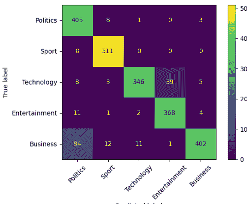
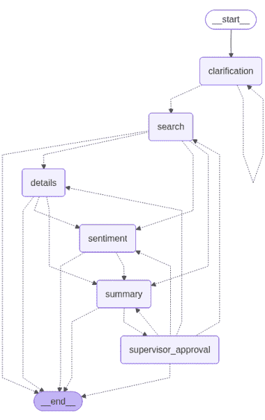

## 8 个实践项目

在本章中，我们将通过构建一系列实践项目来引入关键的 NLP 技术。我们将从之前章节中构建的单体流水线概念转向更先进、可扩展且现代的架构：构建离散的高性能工具。这种方法是构建智能体系统（agentic systems）的基础，在这些系统中，中心协调器（即智能体）会智能地从一组工具中选择以完成复杂目标。

在本章中，我们将引入另一个强大的基于图的编排框架专注于智能体实现：`LangGraph`。因此，本章的叙述结构已经建立：`Haystack`作为我们健壮的工具构建器，而`LangGraph`将作为智能体层协调器引入。

在本章中，通过实践项目，我们将涵盖以下主题：

- 回顾：作为工具的`Haystack`智能体和流水线

- 内置智能体的局限性

- 智能体编排的替代方案：`LangGraph`

- 微项目：实体识别 (NER)

- 微项目：文本分类和情感分析

- 微项目：使用智能体系统编排工具

## 技术要求

在存储库的章节中可以找到安装说明的完整步骤拆解：

`https://github.com/PacktPublishing/Building-Natural-Language-and-LLM-Pipelines/tree/main/ch8`

安装说明可以在 README 中找到：`https://github.com/PacktPublishing/Building-Natural-Language-and-LLM-Pipelines/tree/main/ch8#setup-instructions`

关联存储库中有三个不同复杂程度的实践项目：

- **命名实体识别（Named-entity recognition）**：这些示例演示了如何从网络内容中自动提取和分类实体（人员、组织、地点和杂项）：`https://github.com/PacktPublishing/Building-Natural-Language-and-LLM-Pipelines/tree/main/ch8/named-entity-recognition`

- **文本分类与情感分析（Text classification and sentiment analysis）**：这些示例演示了各种分类方法，从不需要训练数据的零样本分类（zero-shot classification），到针对业务评论的情感分析以及基于网络分类分类：`https://github.com/PacktPublishing/Building-Natural-Language-and-LLM-Pipelines/tree/main/ch8/text-classification`

- **Yelp Navigator – 多智能体系统（Yelp Navigator – multiagent system）**：此文件夹包含使用`LangGraph`和`Haystack`管道部署为`Hayhooks`REST 端来构建高级多智能体编排系统的资源，用于搜索商家、获取详情、分析评论并生成综合报告：`https://github.com/PacktPublishing/Building-Natural-Language-and-LLM-Pipelines/tree/main/ch8/yelp-navigator`

每个项目都包含了详细的笔记本、文档和示例输出，引导你的学习。

## 回顾：作为工具的 Haystack 代理和管道

`Haystack 2.0`框架的设计具有清晰的抽象层次：

`组件（Components）` -> `管道（Pipelines）` -> `超组件（SuperComponents）` -> `代理（Agents）`

代理是核心推理引擎，而工具是代理可以执行的操作。正如第 4 节介绍的，标准的`Haystack`模式是将管道作为工具。复杂的工作流（例如完整的 RAG 管道）可以封装在超组件中。然后，将该超组件封装成组件工具并提供给代理。

让我们来看第 4 节介绍的单代理示例。在这个示例中，我们将一个混合 RAG 管道封装为超组件，然后将该超组件封装为代理可以工具。

你可以在这里找到一个 Jupyter 笔记本，演示如何将混合 RAG 管道封装为工具供`Haystack`代理使用：

`https://github.com/PacktPublishing/Building-Natural-Language-and-LLM-Pipelines/blob/main/ch4/ipynb`

让我们看看如何通过为超组件命名、提供工具描述并将其封装为组件工具来实现定义。

```python
tool_name = "internal_document_search"

tool_description = (
    "使用此工具搜索并回答关于内部知识的问题，
    包括关于 Haystack、LLM 模型和 AI 框架的信息。这是任何与公司特定数据相关问题的要来源。"
)
```

```python
internal_search_tool = ComponentTool(
    name=tool_name,
    component=hybrid_rag_sc,
    description=tool_description,
)
```

前面的工具由一个混合 RAG 管道组成，它可以搜索嵌入向量存储中的信息。

我们可以添加另一个工具 - 例如，网络搜索：

```python
web_search_component = SerperDevWebSearch(api_key=)
web_search_tool = ComponentTool(
    name="web_search",
    component=web_search_component,
    description="使用此工具搜索公共互联网以获取当前事件、
    新闻和通用知识。它最适用于非我们内部文档的信息。",
)
```

然后我们可以通过三个关键元素定义一个代理：LLM（通过`Haystack`的一个 LLM 生成器组件之一）、引导 LLM 行为的系统提示词（system prompt）以及工具带（即组件工具列表）：

```python
# 代理需要所有可用工具的列表
tools = [internal_search_tool, web_search_tool]
```

```python
agent_llm = OpenAIChatGenerator(model="gpt-4o-mini")
```

```python
system_prompt = """
你是一个得力的研究助手。你的目标是准确全面地回答用户的问题。

-   你有权限访问工具：
1. internal_document_search: 用于回答关于我们内部知识库 (Haystack)、AI 模型等的问题。
2. web_search: 用于回答关于当前事件或公共信息的问题。首先，思考哪个工具最适合用户的问题。
然后，带上必要的查询并调用该工具。
如果问题需要来自两个源的信息，你可以顺序调用工具。最后，将工具提供的信息综合成最终答案提供给用户。
"""
```

```python
# 实例化代理
agent = Agent(chat_generator=agent_llm, tools=tools,
system_prompt=system_prompt)
```

该代理由生成器组件（例如`OpenAIChatGenerator`）、系统提示词定义，并且它拥有（混合搜索和网络搜索）的权限。

我们可以传递一个自然语言查询，代理将选择合适的工具并回答查询。

```python
complex_query = ("使用内部文档，解释人们如何使用 AI，")
```

```python
messages = [ChatMessage.from_user(complex_query)]
agent_result = agent.run(messages)
```

## 代理编排的替代方案：LangGraph

`LangGraph 1.0`(https://www.langchain.com/langgraph) 于 2025 年 9 月发布（LangChain, 2025），是一个专门为构建有状态的多代理应用而设计的库。它本身不是一个代理，而是一个用于通过图构建代理的低级库。它提供了`Haystack Agent`组件所抽象的显式控制。

`LangGraph`将工作流建模为状态机，使用了三个核心概念：

- **状态机架构**：其核心原语是状态（state）、节点（nodes）和边（edges）。开发者用`Python`代码定义代理逻辑，显式决定节点如何修改状态以及采取哪条边（或下一个节点）。

- **复杂逻辑**：`LangGraph`的架构是为了循环、条件逻辑或多个 AI 代理构建的。如果你需要编写复杂的多步 if-else 逻辑或自定义重试机制，可以使用`Python`编写。因此，当开发者需要比标准代理抽象更多的控制权时，他们会转向这个框架。

- **低级抽象**：`LangGraph`刻意设计为一个“低级”框架。它并不抽象代理的架构。这为开发者提供了最大的力量，用于构建定制的代理推理路径、多代理系统和人机工作流。

虽然两个框架（`Haystack`和`LangGraph`）都使用图，但它们代表了不同的哲学。`Haystack`的图是结构性的，定义了数据在离散、可序列化组件之间的流向。`LangGraph`的图是逻辑性的，定义了一个状态机，节点和边是修改持久状态的`Python`函数。

你可以在这里找到包含简单图的 Jupyter notebook：`https://github.com/PacktPublishing/Building-Natural-Language-and-LLM-Pipelines/blob/main/ch2/jupyter-notebooks/advanced-langchain-langgraph/05_graph-based-agent-tools.ipynb`

该笔记本将介绍如何创建一个自定义状态模式，该模式通过`MessagesState`扩展了额外的字段（工具调用计数），定义处理状态的节点函数，并构建一个带有节点和边的完整图，通过执行来产生个性化的 AI 响应。让我们进一步探索这种方法如何解决`Haystack`代理定义的僵化问题。

这种基于图的状态机模型直接解决了固定代理循环的局限性，赋予了开发者完全的程序化控制。让我们更深入探索采用`LangGraph`架构构建代理系统的益处。

- **循环流**：开发者显式定义节点和边，并通过条件边和`Python`逻辑原生支持循环。代理的推理循环不是隐藏的；开发者将 LLM 节点连接到工具节点，工具节点再连接回 LLM 节点。这个显式的图就是代理的运行环境。

- **显式护栏**：这是关键优势。护栏不是调试工具；它只是图中的另一个节点。可以在图的不同层级设置多个护栏——例如，在图的开始调用 LLM 之前确保只将被接受的查询发送到 LLM，以及在工具调用之后确保答案合规。我们将在*结语*中的*架构追踪*部分学习更多关于这种模式的内容。

- **可观测性**：中央状态对象提供了代理执行的完美、分步的追踪，使得调试变得更加容易。

- **上下文工程**：`LangChain 1.0`和`LangGraph 1.0`的发布特别关注于使用中间件抽象的上下文工程（https://docs.langchain.com/python/langchain/middleware 以防止污染）。框架的检查点系统（https://docs.langchain.com/oss/python/langgraph/persistence）持久化状态中，允许构建持久、可恢复的代理，它们不需要每次都重新输入整个历史。文档提供了管理历史的显式模式，例如限制范围内的消息。

*表 8.1* 概述了两个框架在代理应用方面的广泛对比。


| 特性 | Haystack 2.0 Agent 组件 | LangGraph 1.0 StateGraph |
|---|---|---|
| 主要比喻 | 内置即用的组件 | 低级状态机 |
| 控制流 | 预构建的内部推理循环 | 显式的、开发者定义的图（节点/边） |
| 循环逻辑（反思、规划） | 不支持；循环是固定的。 | 支持；开发者显式定义循环。 |

## 实战项目

| 特性 | Haystack 2.0 Agent 组件 | LangGraph 1.0 StateGraph |
|---|---|---|
| 护栏实现 | 外部（通过流水线路由）或用于调试（通过 `Breakpoint`）。 | 内部（作为图中的显式节点和`conditional_edge`）。 |
| 状态管理 | 在代理内部隐式管理。 | 通过中央 `State` 对象显式定义和管理。 |
| 适合 | 简单的、带工具的 RAG 和对话代理。 | 复杂的、有状态的多步代理工作流。 |

表 8.1 - Haystack 2.0 和 LangGraph 1.0 代理实现

在本章中，我们将探索结合这两个框架，通过 Haystack 2.0 构建健壮且扩展的流水线，通过 Hayhooks 将其打包并部署为 REST 端点，并使用 LangGraph 将这些端点作为代理工作流。在这种模型中，Haystack 被用于构建、管理和部署健壮的数据密集任务的专用引擎。生产级的 RAG 和 NLP 流水线使用 Haystack 的流水线优先模块化架构构建。这些完整的流水线被作为 REST 端点暴露。然后 LangGraph 被用作高级编排器，管理复杂的循环流和多步推理。这种混合模型非常健壮，允许代理的核心逻辑（LangGraph）和其专用工具（Haystack）独立开发。

通过一系列微项目，我们将创建构建代理系统所需的构建组件，该系统能够执行以下操作：

1. 对询问特定业务和地点的自然语言查询执行**命名实体识别 (NER)**。
2. 使用实体（如位置和业务类型）从 Yelp Reviews API（https://rapidapi.com/beat-analytics/beat-analytics-default/api/yelp-business-reviews）获取信息。
3. 提取评论和业务网站等信息。
4. 对评论进行情感分析。
5. 通过使用自主代理提供最终总结。

我们将引入执行 NER 和情感分析的关键组件和流水线，然后将它们组合成一个由 Hayhooks 开发的流水线和自主代理组成的最终系统。让我们从第一个微项目开始：

## 微项目：命名实体识别 (NER)

在这个微项目中，我们将探索 NER，这是一种至关重要的 NLP 技术，用于识别和分类实体为名称、地点、组织等。例如，考虑用户给 AI 助手下达命令：

> “安排在下周五在旧金山的 Blue Bottle 咖啡馆与 Sarah 见个面。”

使用 NER 的系统将解析这段原始文本并提取以下内容：

- **人物：** Sarah
- **组织：** Blue Bottle Coffee
- **地点：** 旧金山
- **日期：** 下周五

自主代理或编排器无法对原始、非结构化的文本有效采取。它需要结构化数据来做出决策并执行其他工具。健壮的 NER 是代理理解并提取其关键参数的关键工具。

我们的项目 (https://github.com/PacktPublishing/Building-Natural-Language-and-LLM-Pipelines/tree/main/ch8/named-entity-recognition) 将引导你使用 Haystack 构建一个全面的 NER 流水线，然后可以将其封装并部署为可调用的工具。我们将涵盖 NER 的基础知识，以理解我们工具将实现的逻辑。

NER（命名实体识别）是计算机科学和自然语言处理（NLP）的一个分支，侧于识别和分类非结构化文本中的实体。这些实体被归分为预定义的语义类型，例如人物、地点和组织（Grishman and Sundheim, 1996）。一旦这些实体被分类，数据就会从单一的字符转变为可操作的知识。例如，将 `Apple` 分类为组织而非水果，允许系统将查询路由到股票 API 而不是杂货数据库。这种语义理解是基础步骤，使机器能够建立实体之间的关系、消除歧义并自动化复杂的决策过程。NER 在许多领域都起着至关重要的作用，包括机器翻译（Babych and Hartley, 2003）、问答（Mollá et al., 2006）和信息检索（Gu et al., 2009）。

让我们简要概述一下如何通过不同方法实现 NER。正如 Keragher 等人（2024）在《命名实体识别近期进展综述》中所述的，这些方法已经从基于特征工程的方法演变为基于深度学习的方法。

特征工程方法通常依赖于人工编写的规则和语言学属性。它们通常分为三类：

- **监督学习：** 模型在全标记的数据集上进行训练，其中每个实体（例如，巴黎）都被显式地标记。虽然准确率很高，但这种方法需要昂贵且耗费精力的人工标注。
- **无监督学习：** 这些模型依赖统计模式或外部知识库（如字典）来识别实体，而不需要任何标记的训练数据。这种方法更容易扩展，但精确率较低。
- **半监督学习：** 一种混合方法，使用一小部分标记数据在较大的未标记文本库上进行“引导”学习，旨在平衡准确性与标注成本。

相比之下，该领域已转向深度学习。这种方法涉及使用基于 transformer 的模型，如 BERT（Keragher et al., 2024; Devlin et al., 2018）。这些模型使用注意力机制来捕捉深层上下文信息，使得它们对于 NER 任务非常有效。

根据应用 NER 的数据和上下文，这些方法中的每一种都提供独特的优势。从依赖规则和字典的传统知识库方法，到更先进的机器学习和深度学习技术，NER 已成为从非结构化文本中提取意义信息的重要工具。最近的进展，特别是深度学习和基于 transformer 的模型，显著提高了 NER 系统的准确性和可扩展性，使其能够处理复杂的语言挑战。随着领域的不断演进，NER 仍然是从信息检索到问答系统等应用的支柱，使其成为现代 NLP 中不可或缺的工具。让我们来看看 NER 的一些用例和应用。NER 在 NLP 的广泛应用中发挥着至关重要的作用。以下是 NER 的关键应用列表：

- **信息提取：** NER 能够从非结构化文本中提取结构化数据，例如识别人物、组织和地点名称（Weston et al., 2019）。
- **信息检索：** NER 通过识别查询和检索文档中的相关实体来搜索结果，从而提高搜索结果的准确性（Banerjee et al., 2019）。
- **文档摘要：** NER 帮助确保答案捕获关键实体，增强摘要的相关性完完整性（Roha et al., 2023）。
- **虚拟助手：** NER 使虚拟助手能够准确理解用户输入并提供感知上下文的响应，例如提取特定地点的查询（Park et al., 2023）。
- **问答：** NER 识别问题中的关键实体，提高提取精确答案的能力（Mollá et al., 2006）。
- **语言翻译：** NER 通过保留命名实体来支持语言翻译，确保它们在不同语言中的准确表示（Li et al., 2020b）。

NER 的主要局限性之一是它在处理歧义方面表现吃力。当词汇具有多种含义或依赖于上下文时，NER 系统可能会产生分类错误或未能正确识别。例如，“bank”一词可以指金融机构，也可以指河岸，在不理解周围上下文的情况下，NER 系统会错误地分类该实体。同样，同音词和多义词可能会引起混乱，导致在识别人、地点或组织时出现错误。这种歧义挑战凸显了对先进技术的需求，以确保准确消歧并提高 NER 在现实场景中的可靠性。现在我们来看用于解决此局限性的技术：实体链接。

### 通过实体链接增强 NER

实体链接是将 NER 系统识别的命名实体进行消歧，并将其链接到知识库或数据库（如 Wikipedia 或专门的本体）中对应条目的过程。该过程始根据识别出的名称或短语识别候选实体（知识库中的潜在匹配项）。然后分析这些实体周围的上下文以确定哪个候选实体是正确的。这种消歧通常涉及分析周围的单词、语法模式甚至语义特征，以消除歧义并将实体链接到正确的引用。例如，如果识别出“Jaguar”词，系统将通过考虑它出现的上下文来确定它是指动物还是汽车。通常采用机器学习方法（包括神经网络）等高级算法，通过从海量数据和上下文中学习，来提高实体链接的准确性。一旦确定了正确的实体，就会将其链接到唯一标识符，确保该实体被正确表示并与其他文本或语言中的术语区分开来。在项目的实践部分，我们将利用 NER transformer 和 Haystack。

### 探索 Haystack 的实体提取器 API

Haystack 提供了两个执行 NER 的组件：`EntityExtractor` 组件（https://docs.haystack.deepset.ai/namedentityextractor）和 `LLMMetaDataExtractor` 组件（https://docs.haystack.deepset.ai/metadataextractor），后者是一个使用 LLM 从文档中提取实体的上下文驱动组件。我们将专注于使用内置组件从文档中提取实体。

`NamedEntityExtractor` 组件旨在为文档集标注命名实体，使用 Hugging Face 或 spacy 作为其 NER 后端。该组件能够从非结构化文本中提取并分类人物、组织、地点等命名实体。它通过识别命名实体并作为元数据存储在文档中来处理文档。这允许高效检索实体信息。

要导入并初始化 `NamedEntityExtractor` 组件，我们需要指定后端和模型。我们将使用 Hugging Face 后端，配合 `bert-base-NER` 模型（https://huggingface.co/dslim/bert-base-NER）。该模型是一个经过调的 BERT 模型，可以直接用于 NER 并在 NER 任务上实现了顶尖性能。它被训练用于识别四类实体：地点（LOC）、组织（ORG）、人物（PER）和杂项（MISC）。

第 8 章

现在，我们将 `NamedEntityExtractor` 组件的使用整合到 Haystack 的预定义和自定义组件流水线。

### 构建从网络搜索结果构建 NER 的流水线

我们提供了一个笔记本（notebook），演示了如何使用 Haystack 框架构建 NER 流水线，以从网络搜索结果中提取实体。

演示从网站集合进行 NER 实体提取的笔记本可以在此处找到：

https://github.com/PacktPublishing/Building-Natural-Language-and-LLM-Pipelines/blob/main/ch8/named-entity-recognition/ner-with-haystack-search-pipeline.ipynb

这种方法的主要用例是通过将 NER 与网络搜索结合来增强信息检索过程，能够从非结构化文本（如在线百科全书的文章）中自动提取有价值实体。这对于内容摘要、情感分析或知识图谱构建等任务可能特别有用。

该笔记本概述了一个自定义 `NERPopulator` 组件的创建，该组件处理 Haystack `Document` 对象以提取人员、地点和组织等命名实体。该笔记本整合了多个组件，包括网络搜索、HTML 内容获取、文档清理和命名实体提取。让我们分解一下它的工作原理。

`NERPopulator` 自定义组件被定义为处理文档列表，提取命名实体（如人员、地点和组织），并将这些实体存储为元数据。它还会过滤掉低置信度的实体，以确保只捕获最相关的实体。

流水线通过以下步骤：

- **网络搜索：** 使用 `SearchApiWebSearch` 从允许的域名（在本例中为大英百科全书文章）搜索相关文档。
- **链接获取器：** 获取从网络搜索返回的链接的内容。
- **HTML 到文档转换器：** 将原始 HTML 内容转换为结构化的 `Document` 对象。
- **文档清理器：** 通过删除空行、额外空格和不必要的子字符串来清理内容。
- **命名实体提取器：** 使用 Hugging Face 的 `dslim/bert-base-NER` 模型检测文本中的命名实体。
- **处理注释和结构化提取实体的自定义组件：** 使用 `NERPopulator` 为每个文档提取实体。

流水线经过连接以确保数据在组件之间正确流动。作为最后一步，流水线被抽象为 `SuperComponent` 并作为 Haystack Agent 的工具提供。Agent 将接收带有实体的文档，并对其发现的结果提供概述。例如，在收到自然语言查询“从大英百科全书中查找关于尼古拉·特斯拉的实体并将其保存到 CSV 文件”时，Agent 使用 `SuperComponent` 工具，处理结果并从检索到的文章内容中提取实体。然后，Agent 读取文档并提供最终总结：

```
Agent Response
我从大英百科全书文章找到了一些与尼古拉·特斯拉相关的有趣实体。以下是提取内容的摘要：
发现的实体摘要
        人员：识别出 15 个唯一实体。
组织：识别出 13 个组织。
地点：提到了 16 个地点。
其他：记录了 24 个杂项实体。
发现的关键实体
人员：遗憾的是，文中没有提到与特斯拉相关的特定姓名，但文章包含了相关的政治人物，他们可能可能是上下文讨论的一部分。
组织：值得关注的组织，如“众议院”和“大英百科全书”。
地点：包括美国地点，如弗吉尼亚州和新泽西州。
CSV 文件
结果已保存到 CSV 文件中。您可以使用下面的链接下载：
下载 NER 结果（包含 CSV 文件的链接）
```

通过创建更多流水线并将其封装为 `SuperComponent` 工具，可以为 Agent 添加更多工具。这种方法对于大型文本语料库或网络内容自动提取命名实体至关重要的场景非常适用。将 NER 与网络搜索流水线集成，是从非结构化文本中自动提取有价值信息的强大方法。该方法增强了分析、分类和检索相关实体的能力，成为内容分析、知识图谱开发和改进 NLP 检索任务的关键工具。

在本节中，我们探索了 NER 作为一种基础 NLP 技术，用于从非结构化文本中提取和分类实体。通过使用 Haystack 健的组件，我们构建了一个不仅能识别实体还能处理搜索结果并将大型文本语料库转换为有意义数据的流水线。NER 与 BERT 等基于 Transformer 的模型的集成显著提高了实体识别任务的准确性和效率。此外，利用自定义组件作为 `NERPopulator` 允许我们进一步完善结果并以结构化格式组织提取的实体。正如我们在第 7 章看到的，我们可以轻松地序列化流水线、对其进行封装并通过 Hayhooks 进行部署。在最终项目中，我们将回顾一个示例，介绍如何在流水线中使用 NER 作为自定义组件来从自然语言查询中检测实体，并使用这些实体填充 Yelp Business Reviews API：https://rapidapi.com/beat-analytics/beat-analytics-default/api/yelp-business-reviews。现在我们将转向第二个实战项目：文本分类和情感分析。

## 微型项目：文本分类和情感分析

文本分类是 NLP 中的一项基础任务，应用涵盖情感分析、新闻分类、情绪检测等。近年来，该领域经历了快速演进，特别是有了基于 Transformer 的模型，包括 BERT 和 GPT 等大语言模型。这些模型通过利用深层上下文理解，彻底改变了文本分类，能够在广泛的应用中实现更准确、更可扩展的文本分类。我们在上一节中学习了如何利用 Transformer 模型来执行 NER。现在我们将使用它们进行文本分类和情感分析。

### 文本分类概述

文本分类是一项多功能任务，在各个领域都有广泛应用。它可以分为三个主要类型：二分类、多分类和多标签分类。

- **二分类**涉及将文本分为两个互斥的类别之一，例如识别邮件是否为垃圾邮件，或将情感分类为积极或消极。
- **多分类**在此基础上扩展，将文本分配给三个或更多互斥的类别之一，例如确定文本的体裁（如：体育、政治、娱乐），或识别文章的主题。
- **多标签分类**另一方面，允许文本同时分配多个标签，这对于文本可能属于多个类别的任务特别有用。一个例子是攻击性内容标记，一条评论可能同时被归类为暴力和仇恨言论。

这些技术被广泛应用于内容审核、社交媒体分析、客户反馈分析和情感分析等领域，能够更准确、更高效地处理大量非结构化数据。在在这个微型项目中，我们将关注二分类和多分类的示例。让我们从学习可以用于执行文本分类的 Haystack 组件开始。

### 探索 Haystack 的文本分类组件

在本节中，我们将探索两个能够提供强大文本分类能力的 Haystack 组件：`TransformersTextRouter` 和 `TransformersZeroShotRouter`。这些组件利用模型根据预定义的类别对文本进行分类和路由，使其对于文档分类、意图识别和语言检测等任务非常有价值。让我们分解每个组件的功能以及它们如何应用到现实场景中。

- **`TransformersTextRouter`：** 该组件旨在根据预定义的类别标签将文本字符串路由到不同的连接。它使用 Hugging Face 模型进行文本分类，每个模型都带有其自己的标签。这些标签要么由用户提供，要么在未指定时直接从模型配置中提取。该模型通常在特定任务上经过了预训练，例如情感分析、意图分类或语言检测。该组件初始化模型并准备好将文本分类为预定义标签之一。
- **`TransformersZeroShotRouter`：** 该组件通过引入零样本（zero-shot）分类扩展了 `TransformersTextRouter` 的功能。这意味着它可以在没有针对特定标签进行微调模型的情况下将文本分类到类别中。相反，它可以通过利用基于文本与给定标签集之间关系进行文本分类训练的模型的力量来处理未见的标签。`TransformersTextRouter` 和 `TransformersZeroShotRouter` 需要一个 Hugging Face 模型。该模型通常为零样本分类进行了预训练，允许根据文本与标签之间的语义关系将文本分类到其从未见过的类别中。该模型可用于确定文档主题或将文本分类为各种类别的任务（例如：


（体育、政治、技术）而无需专门对这些类别进行过特定训练。

所有的 `TransformersTextRouter` 和 `TransformersZeroTextRouter` 组件都为文本分类任务提供了灵活且高效的解决方案。现在，让我们应用它们来执行分类任务。我们将首先从 `TransformersZeroShotTextRouter` 组件开始进行文本分类，稍后使用 `TransformersTextRouter` 展示其在情感分析中的用法。

## 评估 TransformersZeroShotTextRouter 组件

在本节中，我们将介绍使用 Haystack 组件设置文本分类的过程，特别关注 `TransformersZeroShotTextRouter`。我们选择此路由器是因为它允许我们动态地定义自适应的分类标签，而不是受限于标准预训练模型的固定类别。该组件将把文本数据分类到不同的类别中，例如政治、体育、技术、娱乐和商业。该方法使用了零样本（zero-shot）分类模型，这使我们能够在不需要对数据集进行显式训练的情况下将文本分类到各个类别中。

在此处可以评估零样本文本路由器的 Jupyter notebook：https://github.com/PackPublishing/Building-Natural-Language-and-LLM-Pipelines/blob/main/ch8/text-classification/text-classification.ipynb

我们首先加载这个商用的文本分类数据集（https://www.kaggle.com/datasets/tanishqdublish/text-classification-documentation），它包含来自五个类别的 2,225 个样本。每个文本都标记有类别标签：

- 政治（标签：0）
- 体育（标签：1）
- 技术（标签：2）
- 娱乐（标签：3）
- 商业（标签：4）

我们使用 Haystack 的 `TransformersZeroShotTextRouter` 组件，它利用了预训练的 transformer 模型（`MoritzLaurer/deberta-v3-large-zeroshot-v2.0`）进行零样本分类：https://huggingface.co/MoritzLaurer/deberta-v3-large-zeroshot-v2.0。该模型用于将文本分类为五个类别之一，而无需对数据集进行显式训练。我们将对比组件返回的类别与真实标签进行比较，以评估其有效性。该组件使用模型和标签进行初始化，并调用 `warm_up()` 函数为模型推理做好准备。然后可以将 lambda 函数应用到文本路由器并将其存储在数据格式中。

生成的 dataframe 将包含以下列：`text`、`label`、`category label` 和 `output branch`。`label` 列是地面真值（ground truth）。`category label` 列是数值分类，而 `output branch` 列是从数值类别到标签的映射。在 notebook 中，我们使用了 scikit-learn 的 metrics 模块中的分类报告：https://scikit-learn.org/1.5/modules/generated/sklearn.metrics.classification_report.html。表 8.2 显示了实验结果。

| 精率 (Precision) | 召回率 (Recall) | F1 分数 | 支持数 (Support) |
| :--- | :--- | :--- | :--- |
| 政治 | 0.80 | 0.97 | 0.88 | 417 |
| 体育 | 0.96 | 1.00 | 0.98 | 511 |
| 技术 | 0.96 | 0.86 | 0.91 | 401 |
| 娱乐 | 0.90 | 0.95 | 0.93 | 386 |
| 商业 | 0.97 | 0.79 | 0.87 | 510 |
| 准确率 (Accuracy) | | | 0.91 | 2225 |
| 宏平均 (Macro avg) | 0.92 | 0.92 | 0.91 | 2225 |
| 加权平均 (Weighted avg) | 0.92 | 0.92 | 0.91 | 2225 |

表 8.2 – 分类报告

模型整体表现非常好，准确率达到 91%：

- **体育** 是表现最好的类别，召回率为 1.00（即它识别了每一个体育实例），且 F1 分数高达 0.98。
- **商业** 的召回率略低，为 0.79，这意味着它漏掉了大约 21% 的商业实例，但其精率仍然很高，达到 0.97，这表明它预测为商业的实例大部分是正确的。
- 模型在所有类别中都很好平衡了精率和召回率，这从较高的 F1 分数中反映出来。

这种分类方法表现良好，特别是在体育、技术和娱乐等类别中，召回率和精率非常高。然而，商业召回率略低。



图 8.1 显示的混淆矩阵在分类大多数类别（尤其是体育和技术）时准确率较高。然而，某些类别（如政治和商业）出现了较多分类，这可能表明模型在区分这些类别方面还需要改进。选择不同的 transformer 模型是改进分类的方法之一。

既然我们已经评估并获得了 91% 的准确率以及在所有类别中精率和召回率的良好平衡，让我们把 `TransformerZeroShotTextRouter` 组件作为 Haystack 的一部分使用。

## 设置文本分类流水线

在本节中，我们将介绍如何使用 Haystack 组件设置分类流水线，根据内容自动对文章分类。该流水线集成了多个组件，用于搜索文章、获取内容并根据预定义的类别（如政治、体育、娱乐和商业）对文章进行分类。

在此处可以找到设置文本分类流水线的 Jupyter notebook：https://github.com/PacktPublishing/Building-Natural-Language-and-LLM-Pipelines/blob/main/ch8/text-classification/classification-with-haystack-search.ipynb

在流水线中，我们将创建一个 Haystack 自定义组件 `NewsClassifier`，将文本分类模型应用到每份文档。分类器处理文档并提取 `TransformersZeroShotTextRouter` 为每个文本预测的标签。然后将标签存储在文档的元数据中，可以用于进一步的处理或分析。

初始化流水线，并按顺序添加了几个组件：

1. **网络搜索 (Web Search)**：`SearchApi` 在允许的范围内（在本例中 Yahoo Finance）搜索文章。
2. **链接获取 (Link fetching)**：`ContentFetcher` 获取搜索结果的内容。
3. **HTML 转文档转换器 (HTML to document converter)**：HTML 转换器将获取的 HTML 内容转换为结构化对象。
4. **文档清理 (Document cleaner)**：`DocumentCleaner` 通过移除空白和其他无关字符串来清理文档。
5. **分类器 (classifier)**：`NewsClassifier` 根据预定义的类别对文档进行分类。

组件按顺序连接，以确保数据流转：

- 搜索结果传递给获取器
- 获取的内容转换为文档
- 文档被清理
- 分类器分配类别

作为使用流水线的示例，我们查询与“Elon Musk”相关的文章。流水线将搜索文章、获取内容、分类并存储在元数据中。以下是提取的元数据示例：

```
{'content_type': 'text/html', 'url': 'https://finance.yahoo.com/news/elon-musk-ascends-political-force-2843.html', 'labels': 'Politics'}
{'content_type': 'text/html', 'url': 'https://finance.yahoo.com/news/elon-musk-becomes-first-person-18431986.html', 'labels': 'Politics'}
{'content_type': 'text/html', 'url': 'https://finance.yahoo.com/news/elon-musks-net-worth-tops-14363708.html', 'labels': 'Business'}
{'content_type': 'text/html', 'url': 'https://finance.yahoo.com/news/openai-fires-back-elon-musk-21230741.html', 'labels': 'Technology'}
```

## 练习使用 NER 和文本分类作为智能工具

这是一个全面的实战挑战，你将在其中扩展文本分类项目以引入 NER 流水线从网站中提取实体，通过 Haystack 序列化并部署流水线，并为智能定义流水线：https://github.com/PacktPublishing/Building-Natural-Language-and-LLM-Pipelines/blob/main/ch8/text-classification/haystack-agents-mini-project/README.md。通过完成此挑战，你将获得通过 LangGraph 实现多智能体最终项目所需的项目结构和理解。

### 情感分析简介

情感分析是自然语言处理中的一个子领域，它使用算法来确定一段文本的情感或情绪状态，即文本是正面的、负面的还是中性的。文档级情感分析通常用于产品评论或客户反馈中的情感检测等任务。

- **句级情感分析：** 在这种方法中，文档中的每个句子都被单独分析，以确定其情感。这允许对情感进行更细粒度的理解，当文本中的不同句子传达不同情感时，这一点尤为重要。
- **基于方面的情感分析：** 基于方面的情感分析更进一步，专注于关注文档中提到的特定方面或特征。例如，在产品评论中，可以对“电池寿命”、“设计”和“性能”等方面进行情感分类。这种情感分析在提供有关特定产品特征的详细见解方面非常有价值。

情感分析具有广泛的应用，特别是在商业、社交媒体监控和客户服务领域。情感分析常见的一些关键领域包括：

- **客户反馈：** 企业可以通过分析反馈、评论或支持工单来衡量客户满意度并识别改进领域。
- **社交媒体监控：** 情感分析可监控社交媒体平台上的公众舆论，提供关于人们对品牌、产品或政治事件感受的实时洞察。
- **市场研究：** 情感分析帮助企业分析消费者情绪并预测趋势，从而在市场中获得竞争优势。
- **政治分析：** 分析师通过分析演讲稿、辩论或社交媒体讨论来理解选民情绪并预测选举结果。
- **品牌监控：** 公司使用情感分析监控其品牌在市场上的感知情况，以便据此调整营销策略。

在下一节中，我们将继续探索如何结合基于 Transformer 的方法和 Haystack 来执行情感分析。

## 探索 Haystack 用于情感分析的分类组件

在本节中，我们将介绍在 Haystack 框架内构建自定义组件的过程，以对 Yelp 商家评论进行情感分析。该组件利用了 `TransformersTextRouter`，它使用了专门为情感分类设计的预训练 Transformer 模型。这种方法允许我们根据评论内容将文本数据分类为“负面”、“中性”和“正面”等情感类别。

你可以在此处找到设置情感分析流水线的 Jupyter 笔记本：https://github.com/PackPublishing/Building-Natural-Language-and-LLM-Pipelines/blob/main/ch8/text-classification/sentiment_analysis.ipynb

在这个笔记本中，我们使用 Haystack 的 `TransformersTextRouter` 组件来执行情感分析。我们使用了预训练模型 `cardiffnlp/twitter-roberta-base-sentiment`，这是一个分析文本情感的稳健模型。我们调用 `warm_up()` 方法来初始化模型，确保它准备好执行分类任务。关于所使用的微调 Transformer 模型的信息可以在此处找到：https://huggingface.co/cardiffnlp/twitter-roberta-base-sentiment

## 设置情感分析流水线

该流水线使用流行的 API 枢纽 RapidAPI（https://docs.rapidapi.com/what-is-rapidapi）获取 Yelp 商家评论（https://rapidapi.com/beat-analytics-beat-analytics-default/api/yelp-business-reviews）。流水线对这些评论进行情感分析，并为每条评论文档富上情感标签（正面、负面、中性）。

以下是它的组装方式：

- **组件 1：YelpReviewFetcher（自定义）**
  - 请求 Yelp 商家评论端点的 API 调用
  - 将 API 响应转换为 Haystack Document 对象
  - 每个文档包含评论文本和元数据（评分、URL）

- **组件 2：BatchSentimentProcessor（自定义封装）**
  - 内部使用 Haystack 的 `TransformersTextRouter`
  - 使用 RoBERTa 情感模型（`cardiffnlp/twitter-roberta-base-sentiment`）

## 动手实践项目

- 遍历每个文档，将文本分类为 LABEL 0/1/2（负面/中性）
- 将标签映射为人类可读的情感字符串
- 返回在元数据中富了情感信息的文档

流水线接受 API 凭据作为输入，获取评论，通过情感分析进行处理，并输出包含原始数据加情感分类的文档：

```
url = https://yelp-business-reviews.p.rapidapi.com/reviews/RJNAEa-209sctU00dmwA
querystring = {"sortBy": "lowestRated"}
headers = {
  "x-rapidapi-key": RAPID_API_KEY,
  "x-rapidapi-host": "yelp-business-reviews.p.rapidapi.com"
}
pipeline_input = {
  "review_fetcher": {"url": url, "headers": headers,
  "querystring": {"sortBy": "highestRated"}}
}
pipeline_result = sentiment_pipeline.run(pipeline)
```

在这一特定实例，请求了评分最高的评论。运行流水线后，我们可以验证生成的 Haystack Document 对象被标记为具有负面情感。以下是示例 Document 对象：

第一个示例：

```
Document(id=7, content: 'I just want to start out by saying that we were a table of bartenders, servers, and nurses. We under...', meta: {'rating': 1, 'url': 'https://www.yelp.com/biz/RJNAEa-209sctU000dmwA?hrid=H-RbvyF3zNH258GGy1QHDyw', 'sentiment': 'negative'})
```

第二个示例：

```
Document(id=8, content: 'Definitely a tourist trip, I here after reading that they had been voted best cures in W._...', meta: {'rating': 1, 'url': 'https://www.yelp.com/biz/RJNAEa-209sctU000dmwA?hrid=TGwW_3KFfa-wqWP9EVRfw', 'sentiment': 'negative'})
```

本节演示了如何在 Haystack 框架内构建自定义组件，使用基于 Transformer 的模型对 Yelp 进行情感分析。该组件通过 Yelp API 获取评论，执行情感分类，并返回带有情感标签的结果。这种方法展示了将 Haystack 灵活组件与 Transformer 模型相结合，以自动分析来自 Yelp 等外部源文本数据的威力。我们将通过构建一系列流水线来结束本章，这些流水线可以从 Yelp Business Review API 动态获取内容并为用户提供建议。

## 微项目：使用代理系统编排工具

在这一章中，我们构建了独立的、高度专门化的工具：NER（命名实体识别）流水线、用于情感的文本分类流水线以及搜索流水线。在传统系统中，人类必须决定使用哪一个。他们需要知道要找到餐厅，必须先使用搜索流水线，如果他们想了解评论，则必须手动将这些结果输入到情感流水线。

在最后一个项目中，我们将构建一个动态系统，它可以理解用户意图并将任务自动委托给作为端点的相应 Haystack 流水线。

在这个项目中，我们将构建 `Yelp Navigator`，这是一个多代理系统，可以处理复杂的自然语言查询，例如：

> “帮我在德克萨斯州奥斯汀找三家墨西哥餐厅，并分析客户评论，告诉我哪家的服务最好。”

没有单一流水线可以回答这个问题。它需要：

1. **搜索**：获取商家。
2. **详情**：获取特定数据（如网站评论）。
3. **情感分析**：阅读评论。
4. **总结**：将所有内容汇总为最终答案。
5. **质量保证**：确保最终报告符合所有要求。

## 架构：带有循环和审批的顺序路由


我们将采用顺序路由模型，其中每个智能体（agent）根据共享状态决定下一步并创建最终摘要。该架构将包含一个主管节点（supervisor node）作为质量保证层，判断报告是否符合所有要求；如果满足所有要求，则在返回摘要前进行批准；否则，它将返回给相应的智能体完成。

我们的系统将由以下关键组件组成：

- *Haystack 流线（工具）*：三个为搜索、信息检索和情感分析设计的流水线，通过 Hayhooks 以 REST API 的形式暴露。

- 澄清节点（Clarification node）：一个初步步骤，确保在进入主管节点之前，用户的查询具有足够的信息（如位置和所需的详细程度）。

- *工作节点（Worker nodes）*：专门的 LangChain 智能体，每个分配一个 Haystack 工具（例如搜索节点），只能访问 `business_search` 端点，该端点使用序列化的 `business_search` 流线。

- *摘要节点（Summarization node）*：使用提示词（prompt）总结工作智能体获取的信息的节点。

- *主管审批（The Supervisor approval）*：使用 LLM 决定最终报告是否满意的编排器。

我们可以将项目分解为五个关键步骤：

1. 将 Haystack 流线暴露为 REST 端点。

2. 将暴露的端点封装为 LangGraph 智能体可以执行的工具。

3. 定义智能体状态。

4. 构建智能体工作节点和主管。

5. 构建图表。

在这个小型项目中，我们将使用高级 Python 模式，包括使用类继承和装饰器的 `SuperComponent` 包装器。虽然这些结构为生产级智能体系统提供了扩展性，但对于不熟悉高级面向对象编程的人来说可能有挑战性。我们建议首先关注这些组件之间的数据流，即信息如何从一个序列化层移动到下一个层。

## 1：将 LangGraph 智能体暴露为工具

在我们的 LangGraph 智能体使用专门的 Haystack 流线之前，我们必须让它们在网络上可访问。如上一章所示，我们使用 Hayhooks（[https://docs.haystack.deepset.ai/docs/hayhooks](https://docs.haystack.deepset.ai/docs/hayhooks)）实现这一点，这是一个用于将 Haystack 流线部署为 REST 端点的服务器。

该过程涉及三个不同的阶段：

1. **序列化（Serialization）**：首先，我们必须将 Python 流线对象转换为静态格式。使用 Haystack 内置的 `pipeline.dumps()` 方法将流线定义序列化为 YAML 格式。此 YAML 文件包含流线的完整蓝图，包括所有组件及其连接。

2. **存储（Storage）**：将这些 YAML 文件保存到指定的目录（例如 `pipelines/`）。

3. **暴露（Exposure）**：运行 Hayhooks 服务器并指向该目录：

```
uv run hayhooks run --pipeline-dir pipelines
```

Hayhooks 会自动扫描目录，加载找到的每一个有效 YAML 流线定义，并创建 REST 端点（例如 `http://localhost:1416/business_search/run`）。

所有流线实现可以在此链接找到：[https://github.com/PacktPublishing/Building-Natural-Language-and-LLM-Pipelines/tree/main/ch8/yelp-navigator/pipelines](https://github.com/PacktPublishing/Building-Natural-Language-and-LLM-Pipelines/tree/main/ch8/yelp-navigator/pipelines)

根据项目结构，以下是每个专用流线的描述：

- **流线 1：带 NER 的业务搜索**（`business_search`）：该流线使用 NER（命名实体识别）执行业务搜索。它接收用户查询，提取关键实体（如业务类型和位置），并返回相关业务列表。

- **流线 2：带网站内容的业务详情**（`business_details`）：该流线通过获取网站内容来丰富业务信息。它接收来自流线 1 的业务列表，并检索更详细的数据（如其网站的文本），以提供更深的上下文。

- **流线 3：带情感分析的评论**（`business_sentiment`）：该流线专注于分析客户评论。它接收来自流线 1 的业务列表，获取所选业务的评论，并进行情感分析以确定客户反馈的整体基调（正面、消极、中性）。

每个流线都遵循整洁的文件夹结构和模式实现：组件定义、流线构建（序列化为 YML）和流线加载（作为 REST 端点暴露）。

我们将组件定义包含在 `components_.py` 文件中，在 `build_pipeline.py` 脚本中构建并序列化流线，并在 `pipeline_wrapper.py` 文件中封装并加载流线以暴露为 REST 端点。为了自动化此过程，可以创建一个像这样的脚本：[https://github.com/PacktPublishing/Building-Natural-Language-and-LLM-Pipelines/blob/main/ch8/yelp-navigator/build_all_pipelines.sh](https://github.com/PacktPublishing/Building-Natural-Language-and-LLM-Pipelines/blob/main/ch8/yelp-navigator/build_all_pipelines.sh)。

> 注意

**导航流线内容**

关于流线实现和作为 REST 端点暴露的完整文档可以在此链接找到：[https://github.com/PacktPublishing/Building-Natural-Language-and-LLM-Pipelines/blob/main/ch8/yelp-navigator/docs/yelp-navigator-hayhooks/guide.md](https://github.com/PacktPublishing/Building-Natural-Language-and-LLM-Pipelines/blob/main/ch8/yelp-navigator/docs/yelp-navigator-hayhooks/guide.md)

要将流线暴露为 REST 端点，我们只需运行以下命令：

```
./build_all_pipelines.sh
uv run hayhooks run --pipelines-dir pipelines
```

这将在 `http://localhost:1416/` 创建一个实例，通过它我们可以像这样使用暴露的端点：

每个流线映射到一个端点，因此我们可以按如下方式使用端点：[https://github.com/PacktPublishing/Building-Natural-Language-and-LLM-Pipelines/blob/main/ch8/yelp-navigator/docs/yelp-navigator-hayhooks.md#basic-workflow-single-business](https://github.com/PacktPublishing/Building-Natural-Language-and-LLM-Pipelines/blob/main/ch8/yelp-navigator/docs/yelp-navigator-hayhooks.md#basic-workflow-single-business)

我们的端点的 Swagger 文档在此链接找到：[https://github.com/PacktPublishing/Building-Natural-Language-and-LLM-Pipelines/blob/main/ch8/yelp-navigator/docs/Hayhooks%2A-%20Swagger%20UI.pdf](https://github.com/PacktPublishing/Building-Natural-Language-and-LLM-Pipelines/blob/main/ch8/yelp-navigator/docs/Hayhooks%2A-%20Swagger%20UI.pdf)。此链接显示 Hayhooks Swagger UI，这是一个视觉仪表板，会自动将你部署的 Haystack 流线暴露为 REST API 端点。它详细列出了可用操作，从部署和检查状态等服务器管理任务，到执行特定的工作流（如 `business_search` 和 `business_sentiment`）。你可以通过访问 `http://localhost:1416/docs` 在本地访问此文档。当你在任何一个端点上展开菜单时，你可以传递所需的参数并执行流线。

> 注意

**练习调用流线**

用于练习运行流线的示例 notebook 可以在此链接找到：[https://github.com/PacktPublishing/Building-Natural-Language-and-LLM-Pipelines/blob/main/ch8/yelp-navigator/pipeline_chaining_guide.ipynb](https://github.com/PacktPublishing/Building-Natural-Language-and-LLM-Pipelines/blob/main/ch8/yelp-navigator/pipeline_chaining_guide.ipynb)

是 RapidAPI 服务免费计划下的限制为 50 次请求。我们建议你将这些额度留给本次练习的智能体部分，并将此 notebook 作为概念指导。你可以在 [https://rapidapi.com/beat-analytics-beat-analytics-default/api/yelp-business-reviews/pricing](https://rapidapi.com/beat-analytics-beat-analytics-default/api/yelp-business-reviews/pricing) 升级计划或取消并重新订阅

我们的流线现在准备好封装为 LangGraph 智能体使用的工具。

## 第二步：将端点封装为工具

一旦我们的流线作为 REST 端点运行，我们需要将它们转换为 LLM 智能体可以理解和操作的格式。我们使用 LangChain 的 `@tool` 装饰器来实现。

我们定义一个标准的 Python 函数，向 Hayhooks 端点发送 HTTP POST 请求并返回 JSON 响应。通过对此函数添加 `@tool` 装饰器，根据函数名称、文档字符串和类型提示自动生成 JSON Schema。

此 Schema 充当 LLM 的接口文档。它告诉智能体具体做什么（根据文档字符串）以及它需要哪些输入（例如 `query: str`），允许智能体通过生成正确的参数来自主“调用”外部 Hayhooks 流线。

```python
@tool
def search_businesses(query: str) -> Dict[str, Any]:
    """使用自然语言查询搜索业务。"""
```

参数：

`query`: 自然语言搜索查询（例如“德克萨斯州奥斯汀的墨西哥菜”）

返回：

包含名称、评分、位置等搜索结果的字典。

```python
try:
  response = requests.post(
    f"{BASE_URL}/business_search/run",
    json={"query": query},
    timeout=30
  )
```

就是这样！通过这些，我们准备好通过定义状态、代理工作节点（agent workers）和主管器来定义代理应用程序的核心逻辑。

## 第 3 步：定义代理状态

在 LangGraph 中，状态是跨越整个图执行的共享内存。它通常被定义为 `TypedDict` 数据结构，精确规定了哪些信息被跟踪以及如何在代理之间传递。

这里的选择从根本上影响代理的流。对于 Yelp Navigator，我们的状态包含以下内容：

- **用户意图**：`clarified_query`、`clarified_location` 和 `detail_level` 等字段说明了提取的用户需求。如果这些信息不在状态中，下游代理（如搜索代理）将不知道搜索什么。

状态定义可以封装在一个简单的类中：

```python
class AgentState(MessagesState):
  """工作流中所有节点共享的状态。
  继承自 MessagesState 的 'messages': Annotated[List[BaseMessage], add_messages]。
  """
```

# 第 8 章

```python
# 用户意图（由澄清节点设置）
user_query: str            # 用户的原始问题
clarified_query: str      # 他们正在寻找的内容
clarified_location: str    # 在何搜索
detail_level: str           # "general", "detailed", 或 "reviews"

# 工作流控制
clarification_complete: bool  # 准备好继续搜索时为 True
next_agent: str             # 下一步调用哪个节点（启用条件路由）

# 节点结果
agent_outputs: Dict[str, Any]  # 每个节点的结果（搜索、详情、情感分析）

# 最终输出
final_summary: str          # 用户友好的响应

# 质量控制（用于主管审核节点）
approval_attempts: int     # 主管审查的次数（最多 2 次）
needs_revision: bool       # 如果摘要需要改进则为 True
revision_feedback: str      # 需要改进的内容
```

`AgentState` 类封装了应用程序共享状态的核心组件，通过三个关键机制实现了独立代理之间的协调：

- **上下文保留**：这使得所有代理都能访问用户需求，确保它们不会“忘记”原始目标。

- **流程控制**：充当门卫，确保系统只有在完全理解请求后才继续执行。

- **数据聚合**：充当中央仓库，收集不同工作节点的局部结果，以便从完整数据集合成最终答案。

当工具和状态定义就绪后，我们准备好定义代理工作节点、主管审核以及最终图，映射我们的多代理架构。

## 第 4 步：构建工作节点、主管器和图

在实现这些元素之前，我们将区分图中的四种节点：澄清节点、工作节点、摘要节点和主管审核节点。

- **澄清节点**：该节点的工作是接收用户查询、澄清意图、确保其拥有所有所需信息，并将发现的结果传递给搜索代理。

- **工作节点**：这些是专家。每个工作节点都被分配了一个特定的工具（在第 2 步中封装），并负责执行该工具并用结果更新状态。例如，搜索节点仅使用 `business_search` 工具。

- **摘要节点**：该节点获取工作节点获得的结果，并生成一份包含业务名称、电话、网站和评论的综合报告。

- **主管审核节点**：该代理纯粹作为路由器。它本身不使用工具。相反，它分析当前状态并使用 LLM 决定哪个工作节点应该执行，或者任务是否已完成。

连接图涉及添加这些节点并用边将它们连接起来。关重要的是，我们使用条件边进行动态路由，而不是固定路径（例如 A 始终到 B），条件边查看代理的输出（`"next_agent": "sentiment"`）并动态将执行路由到相应的节点。这允许复杂的非线性工作流，其路径完全由用户的特定请求决定。包含此模式的示例如图 8.2 所示。

# 第 8 章

# 238



图 8.2 – 多代理架构

让我们分解这个图是如何构建的。我们从添加节点开始：

```python
# 构建图
workflow = StateGraph(AgentState)

# 添加节点
workflow.add_node("clarification", clarification_wrapper)
workflow.add_node("search", search_wrapper)
workflow.add_node("details", details_wrapper)
workflow.add_node("sentiment", sentiment_wrapper)
workflow.add_node("summary", summary_wrapper)
workflow.add_node("supervisor_approval", supervisor_approval_wrapper)
```

然后我们添加边。图的起点是澄清节点。一旦它获得了所需的信息，就会触发搜索节点。

```python
workflow.add_edge(START, "clarification")

# 澄清循环或移动到搜索
workflow.add_conditional_edges("clarification",
    route_after_clarification,
    {"clarification": "clarification", "search": "search"}
)
```

随后，搜索节点将选择触发详情节点还是摘要节点，取决于澄清节点的状态。

```python
workflow.add_conditional_edges(
    "search",
    route_after_search,
    {"details": "details", "summary": "summary"}
)
```

如果触发了详情节点，然后可以触发情感分析节点或摘要节点，取决于状态。

```python
workflow.add_conditional_edges(
    "details",
    route_after_details,
    {"sentiment": "sentiment", "summary": "summary"}
)
```

由于情感节点是最后一个配备工具的节点，它只触发摘要节点。摘要节点随后触发主管审核节点。

```python
# 情感 -> 摘要（始终）
workflow.add_edge("sentiment", "summary")
# 摘要 -> 主管审核（始终）
workflow.add_edge("summary", "supervisor_approval")
```

# 第 8 章

主管随后将是终止进程或返回到任何节点并请求重新执行工具。

```python
# 主管审核可以路由回节点或结束
workflow.add_conditional_edges(
    "supervisor_approval",
    route_from_supervisor_approval,
    {
        "search": "search",
        "details": "details",
        "sentiment": "sentiment",
        "summary": "summary",
        END: END
    }
)
```

`workflow` 变量可以被编译并用于用自然语言回答。这些关键步骤的完整实现可以在以下笔记本中找到：[https://github.com/PacketPublishing/Building-Natural-Language-and-LLM-Pipelines/blob/main/ch8/yelp-navigator/langgraph_multiagent_supervisor.ipynb](https://github.com/PacketPublishing/Building-Natural-Language-and-LLM-Pipelines/blob/main/ch8/yelp-navigator/langgraph_multiagent_supervisor.ipynb)。

当我们运行查询“波特兰的咖啡馆”并检查它们的评论时，图的执行如下：

- **澄清节点**：识别 `query="coffee shops"`，`location="Portland"`，`detail_level="reviews"`。直接路由到搜索节点。


## 搜索节点

通过 Pipeline 1 找到咖啡馆。检查`detail_level("reviews")`并路由到详情节点。

## 详情节点

通过 Pipeline 2 获取网站信息。检查`detail_level("reviews")`并路由到情感分析节点。

## 情感分析节点

通过 Pipeline 3 分析评论。路由到摘要节点。

## 摘要节点

将所有数据聚合为最终答案。路由到主管审核。

## 主管审核

审核摘要质量。要么批准并结束（END），要么请求修改并路由回特定代理（最多 2 次审核尝试）。

如果我们提一个更简单的查询，例如“加利州最好的寿司店”，它将运行更简单的流程：

### 澄清代理

识别`query="sushi"`。

### 搜索代理

使用“sushi in California”调用 Pipeline I。检查`detail_level`。

### 摘要代理

将搜索结果聚合为建议。路由至主管代理（Supervisor）审批。

### 主管代理审批

审查摘要质量。通过后批准并路由至：

当代理未能提供最终答案时，挑战在于确定是 LLM 还是工具引起了问题。通过实现外部监控层，我们可以检查节点序列和错误日志。这将使我们能够区分常见的失败模式：

1. **LLM 决策失败**：序列停止在推理节点，因为 LLM 没能生成有效的工具调用。

2. **节点超时**：特定组件（例如网络搜索）超过了其时间限制，在崩溃时被监控当前节点所捕获。

3. **工具执行错误**：节点被成功调用，但底层的 Python 函数或 API 返回了异常。

本书的结语部分将探索如何对故障系统中的节点进行完整分析，并深入探讨复杂多智能体图的高级可观测性和恢复策略。

通过将 Haystack 健壮且专门的流水线与 LangGraph 的推理能力相结合，我们创建了一个能力远超各部分总和的系统。这是现代、生产级 AI 应用的基础。

我们的旅程到此结束。现在你拥有了一个完全实现的、可扩展的工作流，新的 Haystack 流水线可以作为新的工人添加到你的 LangGraph 主管中，摩擦极小，准备好应对生产挑战。

## 总结

在本章中，我们通过将 NLP 技术重构为自主智能体的工具，探索了这些技术。我们学习了如何构建两种不同类型的系统：

- **高性能工具（使用 Haystack）**：第一个微项目（NER、文本分类和情感分析）展示了如何使用 Haystack 的组件和流水线来构建高度专业、模块化且高性能的工具。Haystack 擅长这种“知识密集型”的 RAG 流水线架构，使其成为构建智能体所需能力的理想框架。

- **灵活编排（使用 LangGraph）**：第三个项目表明，对于以复杂、状态且可控的方式编排这些工具，内置的 Haystack 代理组件具有局限性。它的黑盒推理循环缺乏显式控制流的活性。像 LangGraph 这样基于图的状态机提供了高级代理模式所需的显式白盒控制、循环逻辑和可观测的状态管理。

这得最终的架构结论：理想的生产系统是结合了这两个生态系统最佳优势的混合系统。该架构由两个不同的层组成：

- **使用 Haystack 和 Hayhooks 构建的工具层**：正如我们在第7章中学到的，Haystack 流水线可以序列化并使用 Hayhooks 部署为生产级 REST API，并通过 Docker 和 Kubernetes 进行部署和扩展。我们的 NER 分类器和 R流水线不应该是代理导入的 Python 对象；它们应该是使用 Hayhooks 部署的独立微服务。

- **使用 LangGraph 构建的编排层**：中央 LangGraph State 将作为代理编排器。它的工具节点将不是 Haystack Component Tool 封装器，而是向 Hayhooks 端点发送 HTTP 请求的简单 API 客户端。

通过将 Haystack 构建工具的模块化组件与 LangGraph 用于编排的显式控制相结合，我们可以构建可扩展、高效且高度可控的 NLP 系统。

在下一章中，我们将探索 LLM 在准确性、扩展性和伦理考虑方面的当前局限性，并研究关键新兴领域，例如人工智能在伦理、法律、运营和决策中的作用，并发现 NLP 开发者可以为未来进步做出贡献的领域。

## 延伸阅读

- Grishman, R., and Sundheim, B. M. (1996). Message understanding conference-6: A brief history. In COLING 1996 Volume 1: The 16th International Conference on Computational Linguistics: https://aclanology.org/C96-1079/

- Babych, B., and Hartley, A. (2003). Improving machine translation quality with automatic entity recognition. In the International EAMT workshop on MT and other language technology tools: https://aclanology.org/w03-2201/

- Mollá, D., Van Zaanen, M., and Smith, D. (2006). Named entity recognition for question answering. In Proceedings of the Australasian Language Technology Workshop 2006, pages 51–58: https://aclanology.org/U06-1009/

- Guo, J., Xu, G., Cheng, X., and Li, H. (2009). Named entity recognition in query. In SIGIR, pages 267–274: https://dl.acm.org/doi/10.1145/157141.1571989

- Keraghel, I., Morbieu, S., and Nadif, M. (2024). A survey on recent advances in Named Entity Recognition. arXiv:2401.10825vi[cs.CL]: https://arxiv.org/html/2401.10825v1

- Weston, L., Tshitoyan, V., Dagdelen, J., Kononova, O., Trewartha, A., Persson, K. A., Ceder, G., and Jain, A. (2019). Named entity recognition and normalization applied to largcale information extraction from the materials science literature. Journal of chemical information and modelling, 59(9):3692–3702

- Devlin, J., Chang, M., Lee, K., and Toutanova, K. (2018). BERT: Pre-training of deep bidirectional transformers for language understanding: https://semanticscholar.org/paper/BERT%3A-Pre-training-of-Deep-Bidirectional-transformers-for-language-Devlin-Chang/df2b0e26d0599ce3e70df8a9da020e51594e0992

- Labusch, K., Neudecker, C., and Zollhöfer, D. (2019). Bert for named entity recognition in contemporary and historic German. In KONVENS: https://www.researchgate.net/publication/336926568_BERT_for_Named_Entity_Recognition_in_Contemporary_and_Historical

- Park, C., Jeong, S., and Kim, J. (2023). ADMIT: Improving NER in automotive domain with domain adversarial training and multi-task learning. Expert Systems with Applications, 225:120007

- https://sciencedirect.com/science/abs/pii/S26

- Li, Z., Du, X., Wang, W., and Li, Y. (2020). Language model pre-training method in machine translation based on named entity recognition. International Journal on Artificial Intelligence, 29(07):2

- Al-Qawasmeh, O., Al-Smadi, M., and Friahat, N. (2016). Arabic entity disambiguation using linked open data. In 2016 7th International Conference on Information and Communication Systems (ICICS), pages 333–338: https://ieexplore.ieee.org/document/74670

- LangChain & LangGraph (2025). LangChain & LangGraph 1.0 alpha releases: https://blog.langchain.com/langchain-langchain-1-0-alpha-releases
