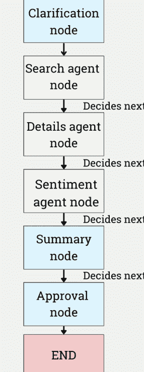
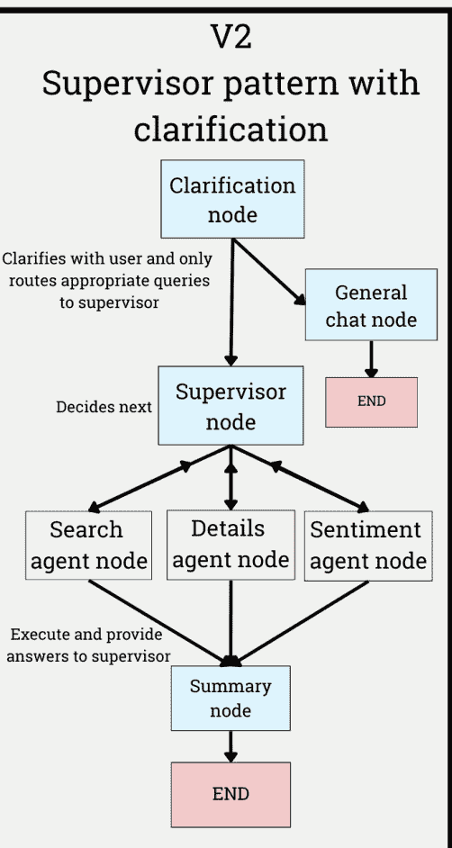
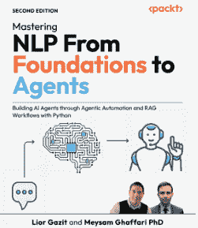
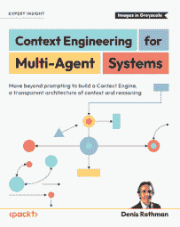

## 结语

让我们回顾上一次的 Yelp Navigator，将其演变为一个具有韧性、具备状态感知能力的系统，并通过模拟关键基础设施的故障来严格评估其完整性。这项最终分析将弥合我们今天编写的代码与未来自主、主权代理体之间的鸿沟。

在本章中，我们将超越代码的机械层面，转向架构哲学，通过引入使用这些流水线的编排器，在我们在第 6、7、8 章中掌握的代理工程中实现**执行与思考的的分离**。我们将通过对三种代理架构进行“压力测试”，观察编排模型在其依赖的工具离线时表现如何。

完成本结语后，你将获得一个构建韧性、本地优先系统的蓝图，以及一套确保这些系统在基础设施故障时仍保持稳定并优雅退出的工程框架。

在本结语中，我们将涵盖以下主题：

- 代理拐折点
- 工具与编排论
- 架构的演进追踪
- 量化论证
- 微服务故障案例研究
- Yelp Navigator V3 中的上下文工程
- 主权技术栈

### 可选技术要求

本结语探索了三种不同的代理架构。我们从代理决定并执行工具的单体模型开始，检查了基于监督器的变体：带有护栏、重试策略和持久化的版本。所有架构都使用了第 8 章为 Yelp Navigator 项目开发的微服务。虽然配套代码允许动手实验，但并非必须执行这些练习；重点在于理解架构模式以及这三个版本如何融入上下文工程和主权代理应用。

本章的代码可以在随附的 GitHub 仓库中找到：https://github.com/PacktPublishing/Building-Natural-Language-and-LLM-Pipelines/tree/main/epilogue

与之前的章节一样，我们将继续使用 `uv` (Python 3.11+) 进行依赖管理。高级部分的代码位于 `context-engineering` 文件夹。

如果你想使用第 8 章开发的工具来测试代理，你需要运行代理使用的 `Hayhooks` 微服务。以下命令初始化了业务搜索、业务详情和业务情感流水线：

```
cd ../ch8/yelp-navigator
source .venv/bin/activate
uv run sh build_all_pipelines.sh
sh start_hayhooks.sh 
```

使用 LangSmith (https://docs.langchain.com/oss/javascript/langgraph/studio) 来可视化代理图是可选的。

追踪工具执行并检查状态检查点。要在本地运行智能体架构，请执行以下操作：

1. 创建一个 `.env` 文件。你可以使用以下内容：

```
cd epilogue/
source .venv/bin/activate
cd context-engineering
cp .env.example .env
```

2. 然后，在 `.env` 文件中添加你的 `OPENAI_API_KEY` 和 `LANGSMITH_API_KEY`。要启动并运行智能体，请运行此命令：

```
uv run langgraph dev own
```

如果你不想使用 OpenAI，可以使用模型和 `Ollama` 在本地运行此智能体。要使用本章中测试的模型，请运行以下命令：

```
ollama pull deepseek-r1:latest
ollama pull qwen-3:latest
ollama pull gpt-oss:20b
```

你可以在 `.env` 文件的 `TEST_MODEL` 变量中配置想要测试的模型。默认值为 `gpt-4o-mini`，但如果你通过 `TEST_MODEL` 变量指定了模型，它将被覆盖。

## 智能体转折点


我们应用中 AI 面临的一个核心挑战在于单一冲突：我们能做到的与我们能控制的之间的差距。在 2023-2025 年的生成时代，行业的重心主要在能力上。在 2023 年到 2025 年之间，行业对增强能力的痴迷导致了闭源模型和开源权重之间快速升级的循环。我们从 GPT-4 和 Claude 3 Opus 推高通用推理的边界开始，然后随着 Gemini 1.5 和最终 Gemini 3 的发布，转向了大规模上下文保留。Llama 3 和 DeepSeek-R1 的出现将同样的前沿级智能带到了本地主权基础设施中。随着组织在 2025 年及以后从孤立的试点转向企业级部署，人们的担忧不再是能力，而是治理。我们已经到达了一个关键的转折点，大语言模型（LLMs）的概率性质与业务运营的确定性需求发生了碰撞。这就是第 1 章中引入的智能体可靠性危机。

# 10 

解决这一危机的方法不在于提示工程（prompt engineering），即通过精炼编写指令来引导 LLM 生成所需输出的过程。相反，它在于上下文工程（context engineering）的正式规范，以及采用健壮的、基于图的架构，这种架构在模型推理之上强制结构完整性。上下文工程是 AI 开发中的一种系统性学科，专注于设计和管理在推理时提供给 LLM 的信息环境。正如第 2 章概述，上下文工程受四种策略支配：编写、选择、压缩和隔离。而提示工程关注的是如何询问模型它看到了什么，以及这些信息如何结构化以便模型能够使用工具并解决特定问题。

我们在本章中探索的 Yelp Navigator 项目从 V1 演进到 V3（在 `epilogue/context-engineering` 文件夹内），并作为演变的案例。我们探索的三个版本将帮助我们理解智能体架构中的关键决策如何决定智能体是否具有韧性和成本效益。

可靠性问题（如幻觉）是采用智能体系统的障碍。当智能体作为一个无法访问基础设施的聊天机器人运行时，幻觉可能仅仅是令人不便的。然而，当允许智能体运行 API 或使用外部工具帮助人们做出决策时，幻觉就会变成负担。早期的智能体架构的特点是简单的工具调用循环（“浅层智能体”）。这类架构虽然在演示中令人印象深刻，但在现代应用程序的现实面前往往会失败。

本章探索的核心思想是，可靠性和性能不应仅仅依赖于 LLM，而是应该共同存在于一个精心设计的系统中。特别是，我们将展示，通过将 GPT-OSS、DeepSeek-R1 或 Qwen 3 这样的开源权重推理模型封装在健壮的控制结构（LangGraph）中，并使用确定性数据流水线（Haystack）对其进行锚定，我们创建了主权智能体——能够在本地基础设施上可靠运行、且独立于中心化 API 依赖的系统。

我们将通过三个示例架构（V1、V2 和 V3）剖析 Yelp Navigator 的代码结构，并分析关于 Token 使用和微服务失败的全面实验数据。

## 工具与架构的论点

本书的核心架构论点在第 1 章引入并在第 8 章进行了完善，涉及将“执行”（工具层）与“思考”（编排层）解耦。在智能体开发的早期，这两个关注点通常是结合的。开发者会使用 LLM 对问题进行推理，并在同一个生成周期内执行数据检索。这导致了脆弱性；推理引擎会被数据获取的机制分散注意力，而数据获取又会被推理引擎的可变性破坏。

我们在本章中深入探索的 V1、V2 和 V3 架构正式地分离了关注点，将它们视为具有不同可靠性保证和失败模式的独立层。正如我们在下一节所示，分离这些层有助于我们创建评估系统完整性的必要条件。

## 工具层：Haystack 作为可靠性的引擎

在 Yelp Navigator 架构中，工具不是简单的 Python 函数或原始 API 封装器；它们是用 Haystack 2.0 构建的健壮、独立的流水线，并通过 Hayhooks 部署为微服务。这种区别至关重要。标准工具可能是一个调用 `requests.get()` 获取数据的函数。然而，Haystack 流水线是一个有向图（DAG），它封装了数据检索、预处理、嵌入和重排序的所有复杂性。

正如我们在第 5 章、第 6 章和第 7 章所看到的，我们可以对流水线开发过程进行测试和迭代，直到拥有一个健壮、可扩展的服务。在这种模式下，Haymaker 微服务处理刚性的、高吞吐量的数据处理，而 LangGraph 编排器处理流动的、有状态的推理。

在 Yelp Navigator 架构中，工具不是简单的 Python 函数或原始 API 封装器；它们是用 Haystack 2.0 构建的健壮、独立的流水线，并通过 Hayhooks 部署为微服务。这种区别至关重要。标准工具可能是一个调用 `requests.get()` 获取数据的函数。然而，Haystack 流水线是一个有向图（DAG），它封装了数据检索、预处理、嵌入和重排序的所有复杂性。

正如我们在第 5 章、第 6 章和第 7 章所看到的，我们可以对流水线开发过程进行测试和迭代，直到拥有一个健壮、可扩展的服务。在这种模式下，Haymaker 微服务处理刚性的、高吞吐量的数据处理，而 LangGraph 编排器处理流动的、有状态的推理。

这种架构选择揭示了一个关键决策：智能体并不直接执行 RAG 流水线。相反，它向端点发送 HTTP 请求，如下代码所示：

```python
@tool
def search_businesses(query: str) -> Dict[str, Any]:
    """使用自然语言查询搜索企业。"""
    try:
        response = requests.post(f"{BASE_URL}/business_search/",
            json={"query": query}, timeout=30)
```

三个架构的演进是通过单一的 `tools.py` 文件，我们在测试和优化智能体架构时共享它。这种隔离对稳定性有许多影响。RAG 流水线可以独立扩展，在无需重新部署智能体的情况下进行更新，并将重量型依赖项（如 PyTorch 或向量数据库）与智能体运行时分离。如果流水线失败，我们可以将其下

Yelp Navigator 允许 LangGraph 实现不同的模式：V1 是一种顺序模式，其中智能体执行并选择下一个节点，最后由一个节点批准总结；V2 和 V3 通过“主管-工作者”模式将执行与决策分离。在模式模式下，中央主管本身不执行工作。相反，它充当元认知控制器。它评估对话的当前状态，创建计划，并将执行委托给专门的工作者节点（Hayhooks 工具）。V2 代表了“朴素”的主管架构：它不具备护栏、故障备机制或持久化。V3 代表一个包含这些特性的“韧性”主管架构。考虑到这一区别，让我们探索 Yelp Navigator 智能体的演进过程。

## 溯源架构的演进

要理解 Yelp Navigator 演变的程度，我们必须将其置于 2023 年到 2025 年更广泛行业演变的背景下。Yelp Navigator 的历程是该领域成熟的缩影，从简单的脚本转向健壮的软件工程。所有的智能系统都可以分解为以下关键区块：

- 状态（State）：这是作为系统内存的共享数据结构。它允许智能体在执行不同步骤之间移动时，持久化内容和中间结果。它是整个请求生命周期的“真理来源”。
- 提示词（Prompts）：这些是自然语言指令，定义了 LLM 在节点中的特定功能。其目的是将通用模型调整为专门的执行者。
- 工具（Tools）：这些是允许智能体与外部世界交互的可执行接口。它们桥接了 LLM 静态训练数据与动态实时信息之间的鸿沟。在我们的示例中，工具是部署的 Hayhawks 服务。
- 节点（Nodes）：这些是应用逻辑的离散执行单元。一个节点封装了流程中的特定步骤，例如提示 LLM 生成报告，或允许 LLM 使用工具并用结果更新状态。
- 图（Graph）：这是编排层，定义了节点之间的路由逻辑和依赖关系。它用一个可以循环、分支和动态响应的状态机取代了线性脚本。

这些组件共同形成了 LLM 用来回答用户问题、使用其访问的工具并根据其掌握的信息做出决策的母板。在这三种架构中，我们将以下组件视为资产：

- 工具：`https://github.com/PacktPublishing/Building-Natural-Language-and-LLM-Pipelines/blob/main/epilogue/context-engineering/shared/tools.py`
- 提示词：`https://github.com/PacktPublishing/Building-Natural-Language-and-LLM-Pipelines/blob/main/epilogue/context-engineering/shared/prompts.py`
- LLM 配置：`https://github.com/PacktPublishing/Building-Natural-Language-and-LLM-Pipelines/blob/main/epilogue/context-engineering/shared/config.py`

共享工具是第 8 章中开发的 Yelp Navigator 微服务。提示词由系统内关键节点的指令组成，例如主管节点、总结节点和澄清节点。与工具相关的节点将成为我们的工作节点。该系统依赖于单个 LLM，节点将定义 LLM 将承担的关键角色。

让我们开始剖析每种架构。

## 版本 1：顺序链

V1 架构（图 10.1）在第 8 章中被描述为单体流水线，代表了浅层智能体模式。这种模式因其简单性主导了早期 LLM 应用的格局。浅层智能体本质上是一个运行提示词、解析输出、调用工具并返回结果的脚本。

### V1 顺序交接模式



图 10.1 - Yelp Navigator 版本 1

V1 架构基于“快乐路径”（happy path）的假设构建，即用户会提出清晰的问题、API 将是可、模型将正确解析输出，并且第一次尝试就能找到答案。

智能体的节点可以在此脚本中找到：`https://github.com/PacktPublishing/Building-Natural-Language-and-LLM-Pipelines/blob/main/epilogue/context-engineering/yelp-navigator-v1/app/nodes.py`。

脚本中的每个节点对应于图 10.1 中的节点。分类节点将获取用户的查询，并判断它是否具有触发搜索节点的信息（如位置和业务类别）。随后触发搜索节点并使用 `business_search` Hayhooks 微服务。根据分类节点找到的详细程度，它要么将检索到的信息移动到总结节点，要么请求执行使用 `business_details` Hayhooks 微服务的详情调用节点。这一过程在附加到 `business_details` 微服务的节点与 `business_sentiment` 微服务之间重复。一旦信息到达总结节点，它就会传递给主管节点，主管节点将审查最终报告，并在信息不完整时予以批准。

此工作流可以封装在图中。智能体的图可以在以下链接中找到：`https://github.com/PacktPublishing/Building-Natural-Language-and-LLM-Pipelines/blob/main/epilogue/context-engineering/yelp-navigator-v1/graph.py`。在此图中，每个工作节点都配备了执行工作节点或通过条件路由机制传递到下一个节点的能力，该机制使用 `if-else` 语句帮助节点“决定”调用哪个节点。

正如我们在稍后的实验中看到的，这种架构的脆弱性是极的。如果搜索步骤因为模糊查询返回了无关结果，情感步骤仍会无视继续，尝试分析无关业务的情感。总结步骤随后会从碎片数据中幻出一个连贯的答案。

其原因在于我们定义其状态的方式。该应用程序的状态定义可以在以下链接找到：`https://github.com/PacktPublishing/Building-Natural-Language-and-LLM-Pipelines/blob/main/epilogue/context-engineering/yelp-navigator-v1/graph.py`（注：此处原文链接可能与描述略有出入，按原文逻辑翻译）。

纠正翻译逻辑流：

其原因在于我们定义其状态的方式。该应用程序的状态定义可以在以下链接找到：`https://github.com/PacktPublishing/Building-Natural-Language-and-LLM-Pipelines/blob/main/epilogue/context-engineering/yelp-navigator-v1/graph.py`。

## 版本 2：路由模式

该架构（图 10.2）偏离了顺序链，采用了带有澄清步骤的主管模式。在这种设计中，我们将用户意图的理解与任务执行解耦。

该架构的第一道防线是澄清节点。与盲目执行搜索而不顾质量的 V1 不同，V2 充当守门人。它分析用户查询，如果请求是对话性的，则路由到通用聊天节点；如果需要操作数据，则将其提升到主管节点。

为了支持这种逻辑，我们的状态定义发生了演进。在 V1 中，我们将所有数据都丢到一个增长的列表中。V2 引入了结构化字段来持有特定的数据。我们还为澄清器、主管和工作节点创建了独立的状态对象。

### 带澄清的主管模式



图 10.2 – Yelp Navigator 版本 2

## 结语：代理 AI 的架构

澄清节点状态可以在这里找到：`https://github.com/PacktPublishing/Building-Natural-Language-and-LLM-Pipelines/blob/main/epilogue/context-engineering/shared/state.py`。

工作节点状态可以在这里找到：`https://github.com/PacktPublishing/Building-Natural-Language-and-LLM-Pipelines/blob/main/epilogue/context-engineering/navigator-v2/app.py`。

这种状态分离允许主管清晰地运行。一旦流程到达主管节点，系统已经确认了搜索意并填充了搜索查询。主管随后作为路由，决定调用哪个工作节点（搜索、详情或情感），而不是在固定的强制顺序中运行它们。

另一个区别在于每个架构图是如何构建的。在 V1 中，代理节点（搜索、详情或情感节点）负责读取状态并决定调用哪个节点。在 V2 中，使用代理节点的决策完全属于主管。

这可以在定义代理架构的两个关键区域看到：

- 图定义：`https://github.com/PacktPublishing/Building-Natural-Language-and-LLM-Pipelines/blob/main/epilogue/context-engineering/navigator-v2/app.py`
- 节点定义：`https://github.com/PacktPublishing/Building-Natural-Language-and-LLM-Pipelines/blob/main/epilogue/context-engineering/navigator-v2/nodes.py`

你可能会注意到图变得简单了多少。V2 引入了一种根据状态路由节点的先进技术：`Command` 类，它带有 `goto` 和 `update` 参数。该类和路由逻辑嵌入节点内部，实现了动态且确定的决策。让我们以澄清节点为例。

```python
def clarify_intent_node(
    state:State, config: RunnableConfig
) -> Command[Literal["supervisor", "general_chat", END]]:

    if decision.need_clarification and conf.allow_clarification:
        return Command(
            goto=END, update={"messages": [AIMessage(
                content=decision.clarification_question)]}]})
```

```python
if decision.intent == "general_chat":
    return Command(goto="general_chat")
else:
    # More behavior
```

在这个嗅探器（sniffer）中，如果分类器需要更多信息，它会被路由到 END，LangGraph 将允许用户提供更多信息。如果分类节点接收到与代理主功能无关的查询，它将路由到通用聊天（general chat）。如果分类器确定已获取所需信息，它将路由到主管（supervisor）。随后，主管路由到适当的工作节点（worker node）。简而言之，路由逻辑嵌入在节点内部。这在强制确定性行为的同时，实现了高度的动态推理。

V2 还配备了实用程序，帮助主管根据状态做出决策：`https://github.com/PackTPublish/Building-Natural-Language-and-LLM-Pipelines/blob/main/epilogue/context-engineering/shared/supervisor_utils.py`。


通过这个函数，我们为主管创建了一套遵循的规则，使其能够在工具报告失败时决定该做什么。这与 V1 的关键区别在于，V1 的主管批准节点是一个验证信息已获取的终端节点，它仅依赖提示（prompts）来确定决策。在微服务失败的案例研究章节，我们将展示为关键节点（如主管或批准节点）引入确定性路径的重要性。

通过允许主管根据状态中的代理输出来决定流，V2 消除了 V1 中由于数据脱节问题导致的幻觉问题。如果搜索没有返回结果，主管节点可以停止进程或请求新查询，而不是强制情感分析工具分析不存在的数据。

虽然 V2 主管模式通过组织数据解决了上下文问题，但它并不具备处理另一种漏洞的能力：它假设用户是良意的且世界是完美的。V2 运行在高度信任假设之上。它假设用户不会尝试提示词注入攻击，没有个人身份信息（PII）泄露到日志中，并且外部 API（作为我们的微服务）永远不会超时或失败。

如果 V2 中的搜索工具失败，代理系统可能会幻觉出一个原因（这将在本章稍后部分显示）。如果用户尝试覆盖指令，V2 分类节点将盲目地处理它。另一个对弱点的认知是内存。如果用户询问特定的服务和位置，收到搜索节点的响应，然后进一步询问特定的业务，代理将触发完全全新的搜索，并“忘记”已经获得的内容。

这意味着不必要地触发服务，并且可能无法实际回答问题。要从原型转向生产环境，我们必须引入护栏（guardrails）、韧性和内存。

## 版本 3：具有韧性的主管

V3 架构（图 10.3）将我们的逻辑封装在多层保护中。我们在代理开始思考之前引入了一个防御性边界，并在执行层下方设置了一个安全网。

在 V3 中，入口点不再是智能意图澄清节点。相反，我们将所有流量路由通过一个确定性的输入守护节点（`input guards node`）。该节点并不一定使用 LLM；它使用快速、严谨的逻辑（如正则表达式）在消耗 token 或危及系统风险之前对输入进行清理。

可以在以下链接中找到包含简单护栏的脚本：

`https://github.com/PacktPublishing/Building-Natural-Language-and-LLM-Pipelines/blob/main/epilogue/context-engineering/yelp-navigator-v3/app/guardrails.py`。

这些护栏随后可以轻松地封装为图中的一个新节点：`https://github.com/PacktPublishing/Building-Natural-Language-and-LLM-Pipelines/blob/main/epilogue/context-engineering/yelp-navigator-v3/app/graph.py#L43`。

在 V2 中，网络波动可能导致崩溃。在 V3 中，我们在图定义本身内部使用 `RetryPolicy` 定义了外部世界的稳定性。我们没有在提示指令中堆满“如果失败则请重试”之类的字样；我们在基础设施层面处理它。

### V3：具有护栏、重试策略和持久化功能的具有韧性的主管

``

图 10.3 - Yelp Navigator 版本 3

我们将这些策略附加到图中的工具节点上。如果搜索工具失败，图会在主管节点获知问题之前自动等待并使用退避策略（backoff strategy）进行重试：

```python
# 带有重试策略的工具节点
retry_policy = RetryPolicy(
    max_attempts=3,
    initial_interval=1.0,
    backoff_factor=2.0,
    max_interval=10.0
)

workflow.add_node(
    "search_tool", search_tool_node, retry_policy=retry_policy)
```

在失败的情况下，我们将跟踪连续失败的重试次数：

```python
retry_counts = Dict[str, int] = {}
consecutive_failures = Dict[str, int] = {}
```

当工具连续失败三次时，它将向主管节点报告。根据主管状态中设置的标志，主管节点将终止进程。在此处查看主管状态中的标志位：`https://github.com/PacktPublishing/Building-Natural-Language-and-LLM-Pipelines/blob/main/epilogue/context-engineering/yelp-navigator-v3/app/state.py`

```python
if check_failures and decision.should_finalize_early:
    return "finalize", None, None
```

正如我们在图中看到的，重试策略也适用于与微服务相关的每个工作节点。如果工具在重试后反复失败，主管可以优雅地降级到预定义的消息，而不是陷入错误循环，或者更糟糕的，幻出一个响应。

最后，我们还可以通过向图添加内存保存和检查点（checkpointing）来隐式地引入内存：

```python
from langgraph.checkpoint.memory import MemorySaver
checkpointer = MemorySaver()
```

如果你在 `LangGraph Studio` 中运行代理，该平台提供了跨多次运行的持久化功能。如果你在本地运行代理，我们可以使用带有检查点机制的 LangGraph `MemorySaver`。这种机制允许代理通过内存、SQL 或 Postgres “记住”我们提供的之前的搜索结果，我们提供了两个关于内存持久化和 SQL 持化的示例脚本：

- 内存持久化：`https://github.com/PacktPublishing/Building-Natural-Language-and-LLM-Pipelines/blob/main/epilogue/context-engineering/yelp-navigator-v3/inmemory_persistence.py`。
- SQLite 持久化：`https://github.com/PacktPublishing/Building-Natural-Language-and-LLM-Pipelines/blob/main/epilogue/context-engineering/yelp-navigator-v3/sqlite_persistence.py`。

内存持久化的关键概念是引入用户：

```python
config = {"configurable": {"thread_id": "user_session_123"}}
```

脚本将使用用户线程 ID 来记住它曾回答过某个问题，并使用此线程对应的答案作为其额外上下文。

通过显式处理“不愉快路径”（unhappy path，即恶意输入和损坏的令牌），V3 代表了一种包含了确定性和可观测路径的生产级架构。这种从 V1 到 V3 的演进反映了从脚本化到工程化的转变。V3 Yelp Navigator 是一个恰好使用 LLM 的软件系统，而不仅仅是一个 LLM 封装器。这些不仅仅是花哨的工程技巧；它们在代理的性能方面具有实实的经济影响。

### 量化论证

为了理解工具与编排分离所带来的改进程度，我们必须超越代码，检查在 Yelp Navigator 实验期间生成的实证数据。通过使用模拟（mocks）来比较 token 使用情况的辅助脚本，我们创建了多个使用测量报告。辅助脚本可以在此处找到：

- 运行不同类型查询并比较 V1 和 V2 架构之间 token 使用情况的基础 Python 脚本：`https://github.com/PacktPublishing/Building-Natural-Language-and-LLM-Pipelines/blob/main/epilogue/context-engineering/measure_token_usage.py`
- 模拟“通用”、“详情”和“情感”查询级别的 Shell 脚本：`https://github.com/PacktPublishing/Building-Natural-Language-and-LLM-Pipelines/blob/main/epilogue/context-engineering/test_examples.sh`
- 运行脚本后生成的示例综合报告：`https://github.com/PacktPublishing/Building-Natural-Language-and-LLM-Pipelines/blob/main/epilogue/context-engineering/docs/test4_comprehensive.md`

这些报告揭示了运营效率上的巨大差异。我们对比了两种架构：V1 系统（由单个节点决定并执行操作）与上下文感知的 V2 架构。在 V2 中，主管节点负责决策，而专门的智能体节点仅负责执行。这在表 10.1 中所示：

| 查询 | 细节级别 | V1 tokens | V2 tokens | 减少量 (tokens) | 减少比例 (%) |
|---|---|---|---|---|---|
| 马萨诸塞州波士顿的意大利餐厅 | 通用 | 1646 | 1105 | 541 | 32.9% |
| 加利福尼亚州旧金山的咖啡店 | 通用 | 1656 | 1112 | 544 | 32.9% |
| 伊利诺伊州芝加哥的披萨店 | 通用 | 1646 | 1105 | 541 | 32.9% |
| 马萨诸塞州波士顿的意大利餐厅 | 详细 | 3693 | 1484 | 2209 | 59.8% |
| 德克萨斯州奥斯汀的墨西哥餐厅 | 详细 | 3697 | 1488 | 2209 | 59.8% |
| 纽约市的寿司店 | 评论 | 5890 | 1495 | 4395 | 74.6% |
| 俄勒冈州波特兰的素食餐厅 | 评论 | 5876 | 1487 | 4389 | 74.7% |
| 德克萨斯州达拉斯的牛排馆 | 评论 | 5884 | 1491 | 4393 | 74.7% |

表 10.1 – 不同查询下 V1 和 V2 的 Token 使用情况

当分析需要深度数据检索的复杂查询时，效率的提升变得更加显著。实验隔离了评论细节级别（例如，“纽约市带评论的寿司店”）。在 V1 架构中，该查询触发了所有评论数据向上下文窗口的线性导出，无论模型是否已经请求过它们。

在评论场景下，V2 架构在压力下崩溃，单次交互就消耗了近 6,000 个 token。V2 架构实现了 Token 使用量减少了 74%。

这 74% 的减少直接归因于状态和节点内部管理数据的方式。V1 读取所有数据以决定下一步做什么。V2 则仅检查数据是否存在。在 V1 节点中，主管审批节点在提示词中包含了智能体。这意味着每当主管审批节点检查工作时，它必须重新读取包含搜索、详情和情感节点所找到业务的完整 JSON。在 V2 中，主管节点接受布尔标志（真或假），这些标志标记了搜索、详情或情感节点是否返回了数据。V1 的状态将消息视为草稿纸，用中间数据填充它。V2 则保持数据隐藏。所使用的关键技术是“摘要”。这在名为 `pipeline_data` 的状态字段中可以清晰地看出。这些数据在工作节点（搜索、详情或情感）之间传递，但永远不会在主管状态中渲染。这有助于保持上下文窗口的整洁。

值得注意的是，在 V1 中观察到的上下文膨胀也追溯到了工具层。情感和详情微服务的设计非常天真，它们将整个通用搜索流水线作为输入。更好的方法应该是对传递给返回大量数据工具的输出进行选择性处理，确保详情和情感微服务仅能访问它们所需要的内容。这是一个特意未解决的改进领域，旨在说明上下文工程不仅限于编排层的架构选择，而是与工具层的架构选择深度相关。

此分析确立了 V2 是优于 V1 的架构，并驱动了将 V2 产品化为 V3 的决策。现在我们将查看一个不同的案例研究，分析 V1、V2 和 V3 架构：完整性。

## 微服务失败案例研究

虽然 Token 效率驱动了经济性论点，但“工具对比编排”论点的主要驱动因素是完整性。系统完整性定义为智能体在组件失败时的表现。它是崩溃吗？是产生幻觉吗？还是优雅降级？

为了衡量这一点，特意关闭了 `Hayhooks` 微服务，并在每个层级（通用、详情和情感）上，分别在 V1、V2 和 V3 架构上测试了三个不同的权重模型，以观察每个智能体系统在面临关键故障（来自连接到 `Hayhooks` 微服务的接收器的错误消息）时会如何表现。

我们通过 OpenAI 的 GPT-OSS 20B、DeepSeek R1 和 Qwen 3 对该智能体系统进行了系统化评估。每个模型都向该智能体系统提供了相同的三个问题：芝加哥最好的披萨店、芝加哥最好的披萨店以及评论者的评价，以及芝加哥最好的披萨店以及网站信息。

用于压力测试架构的脚本在此处：`https://github.com/PacktPublishing/Building-Natural-Language-and-LLM-Pipelines/blob/main/epilogue/context-engineering/stress_test_architectures.py`。

可以在此处找到示例结果：

- 温度设为 1：`https://github.com/PacktPublishing/Building-Natural-Language-and-LLM-Pipelines/blob/main/epilogue/context-engineering/docs/results-temperature-1_fine-grain.json`
- 温度设为 0：`https://github.com/PacktPublishing/Building-Natural-Language-and-LLM-Pipelines/blob/main/epilogue/context-engineering/docs/results-temperature-0_fine-grain.json`

我们可以将该实验中出现的模式封装在表 10.2 中：

| 模型 | 版本 | Q1 (基础) | Q2 (+ 评论) | Q3 (+ 网站) |
|---|---|---|---|---|
| gpt-oss:20b | V1 | ✓ 103 s | ✓ 110.6 s | ❌ 递归限制 |
| | V2 | ❌ 递归限制 | ❌ 递归限制 | ❌ 递归限制 |
| | V3 | ✓ 15.7 s | ✓ 14.6 s | ❌ 递归限制 |
| deepseek-r1 | V1 | ✓ 110.6 s | ✓ 81.2 s | ❌ 超时 (>120s) |
| | V2 | ✓ 166.6 s | ✓ 179.1 s | ✓ 184.8 s |
| | V3 | ✓ 86.4 s | ✓ 43.9 s | ✓ 37.2 s |
| qwen3 | V1 | ✓ 92 s | ✓ 86 s | ❌ 超时 (>120s) |
| | V2 | ✓ 166.6 s | ✓ 179.1 s | ✓ 184.8 s |
| | V3 | ✓ 20.3 s | ✓ 34.6 s | ✓ 24.1 s |

表 10.2 – 权重模型在面对微服务时的成功与失败

如表所示，模型在面对工具故障时表现出独特的行为。为了进一步理解智能体做了什么，让我们拆解 10.3 所示的智能体模式。

| 模式名称 | 节点序列 | 工程洞察 |
|---|---|---|
| 递归陷阱 | 主管→搜索... | 递归限制：无限循环直到崩溃。 |
| 深度重试 | 主管→搜索 (x5) → 总结 结束 | DeepSeek/Qwen3：暴力重试直到“成功”。 |
| 安全退出 | 主管→搜索→主管→ 结束 | V3 修复：立即缺陷并退出。 |

表 10.3 - 通过节点观察到的智能体行为

为了理解为什么这一响应代表了工程上的胜利，我们必须追溯日志记录的执行路径。表 10.4 显示了 V3 中所有模型所经过的具体路径：

| 步骤 | 节点 | 状态 |
| :--- | :--- | :--- |
| 1 | Guardrails 节点 | 扫描 PII 或注入攻击 | 通过 |
| 2 | Clarify | 确定用户意图 | 通过 |
| 3 | Supervisor | 计划：调用搜索工具 | 通过 |
| 4 | Search 节点 | 执行 HTTP 请求 | 失败 (503/429) |
| 5 | Supervisor | 分析失败信号 | 触发路器断开 |

表 10.4 – 微服务故障期间 V3 的执行路径

关键时刻发生在第 4 步。作为独立微服务封装器运行的搜索节点捕获了错误。它没有导致 Python 进程崩溃，也没有将原始 HTML 传递给主管（Supervisor），而是返回了一个结构化的错误信号。它尝试了三次，然后进行了退避（back off），完全符合其程序设计。它将此数据返回给主管，而主管被设计为满足此条件时触发安全退出。这可以在节点定义中看到：`https://github.com/PacktPublishing/Building-Natural-Language-and-LLM-Pipelines/blob/main/epilogue/context-engineering/yelp-navigator-v3/nodes.py#L182`

这个实验中最迷人的部分是哪个节点最终妥协并幻觉出一个完整的响应。搜索节点不断告诉主管节点搜索查询失败，而主管坚持重试，直到达到超时。通过状态（state），摘要节点（summary node）接收到了错误信号“未找到数据”，并生成了一个完整的响应，其中包含了几个列出的企业、它们的评论、电话号码、网站以及该“餐厅”的特色。该模型没有进入深度重试递归限制。


作为作者，我必须对你坦诚：这种设计就是为了让编排系统的语言模型感到挫败。在这次实验中，那些受到 Python 命令确定性或 Haystack 流水线确定性约束的节点并没有幻觉企业。*妥协*的节点是受提示词（`prompt`）主观性约束的节点。当模型收到“未找到数据”时，提示词指示它必须回答问题；其强化学习的优先级高于报告“未找到任何内容”。

你如何设计你的系统至关重要。这是 V1 最令人恐惧的地方。如果你仔细查看日志，除非发生超时，否则所有实例都通过了主管的批准。如果你的系统失败了，且你使用的是没有独立跟踪工具层的 V 类架构，除非发生超时，否则你将无所不知。

事实证明，这并非空谈，其后果可能是灾难性的。业务细节的幻觉与那些缺少工程护栏的著名生产故障几乎完全相同。正如其他人在在这里分享的那样：

- **纽约法律简报 (2023):** 一位律师使用 ChatGPT 寻找先例。在寻找支持其论点的案例的压力下，模型发明了虚假案例以满足提示词（https://www.reuters.com/legal/new-york-lawyers-sanctioned-using-fake-chatgpt-cases-legal-brief-2023-06-22/）

- **加拿大航空聊天机器人 (2022):** 一个聊天机器人幻觉出了不存在的退款，因为它在没有检查真实数据库的情况下被强迫提供帮助。该航空公司被法律强制支付退款（https://www.bbc.com/travel/article/20240222-air-canada-chatbot-misinformation-travellers-should-know/; https://www.cbc.ca/news/canada/british-columbia/air-canada-chatbot-lawsuit-1.7116416）

- **多智能体无限循环 (2025):** 一个团队部署了四个 AI 代理研究市场数据，结果后来发现两个代理在团队睡眠和工作期间陷入了自主对话循环，在系统被手动关闭前累积了 47,000 美元的 API 成本（https://medium.com/towards-artificial-intelligence/we-spent-47-000-running-ai-agents-in-production-heres-what-nobody-tells-you-about-a2a-and-mcp-f5a85488de33）。

V3 的决定性成功证明了“编排优于智能”这一原则。虽然传统的数据科学视角可能会认为模型足够“聪明”，能够直觉地知道 Lucali 不在芝加哥，但工程视角提供了一个断路器，防止模型在数据库宕机时甚至尝试回答。V3 的成功是因为它不再依赖 LLM 的概率性诚实，而是强制执行了确定性的状态检查。通过将 LLM 视为可靠架构内部一个不可靠的组件，这种方法有效地将**站点可靠性工程 (SRE)** 的原则应用于 AI，通过严谨的编排而非原始模型能力来确保稳定性。

## Yelp Navigator V3 中的上下文工程

从脆弱的 V1 流水线到具有韧性的 V3 架构的演变，代表了从简单提示词工程到上下文工程（`context engineering`）的转变。提示词工程关注如何提问，而上下文工程关注的是如何管理信息环境。正如 *Yelp Navigator* 实验所示，这一学科受四个核心策略支配：写入、选择、压缩和隔离。这些策略将一个易产生幻觉的脚本转化为生产级系统。

- **写入 (write)** 策略认为上下文是显式的，而不是隐藏在聊天日志中。在 V3 中，这通过 `AgentState` 类实现。与 V1 将所有交互倾入线性历史不同，V3 将关键因素（如搜索查询和总错误计数）“写入”专用状态字段。

  **工程收益：** 这种结构实现了 V3 实验中看到的“自我感知”。通过在状态中跟踪重试次数，V3 模型可以检测到失败并触发断路器，避免了导致 V2 架构幻觉的“递归陷阱”。

- **选择 (select)** 策略涉及仅检索当前任务所需的数据。在 V3 中，主管节点充当选择器，使用 LangGraph 的 `Command` 功能将执行分路由到特定工具，而不是运行单体链。

  **工程收益：** 这一策略使通用查询的 Token 使用减少了 27.7%（表 10.1）。通过只选择相关节点，系统防止了模型被无关的工具分散注意力，解决了在 V1 中观察到的“脆弱性”（即在无关的搜索结果上进行情感分析）。

- **压缩 (compress)** 策略通过提炼海量数据负载来最大化上下文窗口的效用。V3 架构通过摘要节点实现这一点，该节点将原始 API JSON 处理为简洁的自然语言，然后才将其添加到对话历史中。

  **压缩的影响** 在复杂的“评论”查询中最为明显。V1 架构在 5,659 个 Token 的原始数据下崩溃，而 V3 通过压缩输出实现了 75.1% 的减少（降至约 1,400 个 Token）。这证明了效率不仅取决于成本，还取决于模型的认知带宽。

- **隔离 (isolate)** 策略划分上下文以防止任务之间的交叉污染。这在 V3 的 `clarify intent` 节点中实现，该节点在检测到主题切换时会触发流水线的“硬重置”。

  **工程收益：** 这防止了 V1 中看到的上下文膨胀。隔离确保了新的搜索从干净的认知状态开始。

这些原则的终极验证在于故障模式实验。当面对 API 输出时，V2 中“更智能”的模型（如 DeepSeek-R1 和 Qwen3）会幻觉出并不存在的企业，并附带了网站和电话以满足提示词。受这些工程原则加固的 V3 架构成功地 100% 触发了安全退出。

这证明了这不是模型的属性，而是模型运行的上下文的属性。通过将 LLM 视为可靠的、经过上下文工程系统内部的不可靠组件，我们弥合了随机演示与确定性产品之间的鸿沟。

当然，这个实验最令人惊讶的是，我们不需要花费一分钱来测试架构选择。所有测试的模型都运行在本地的 Ollama 上，并采用了我们的架构选择。这具有局限性，包括这些模型使用了所有支持的思考、工具调用和结构化解析，但它展示了当我们应用上下文工程时可能实现的。

## 主权栈 (The sovereign stack)

V3 的架构改进（包括隔离、状态韧性和专门的提示）使得部署策略发生了重大转变，即转向主权代理（`sovereign agents`）。主权代理完全运行在用户基础设施内的 AI，独立于中心化的 API 提供商（如 OpenAI、Anthropic），确保数据隐私和操作自主性。

正如第 2 章讨论，AI 的总拥有成本 (TCO) 由推理成本主导。基于 API 的模型预付成本较低，但它们的变动成本随使用量线性增长。对于带有主管系统的多智能体系统，单个用户请求可能会触发 50 个内部推理步骤（循环）。如果为 GPT-4 支付 Token 费用，这种结构是令人负担的。

在本地硬件（例如消费级 GPU 或边缘设备）上运行主权代理改变了经济学。第五十次循环的边际成本实际上为零（不考虑电费）。这使得 V3 架构在高频应用中具有经济可行性。

## 第10章

## 294

对于处理敏感数据（例如医疗保健、金融）的企业级应用，将数据发送到公共 API 是不可行的。主主权智能体架构确保了以下点：

- **数据摄取**：通过 Haystack 流线在本地完成

- **推理**：通过 Ollama 或 vLLM 在本地完成，并结合 NVIDIA (https://catalog.ng.nvidia.com/orgs/nvidia/containers/vllm?version=25.11-py3) 以及支持的模型

- **状态管理**：通过 LangGraph 在本地完成

当使用开源权重模型时，这种完整的数据主权是工具模式相比编排模式的最终交付成果。

## 总结

我们到达工程之旅的终点！我们学习了如何将各种格式（文本、多模态、带有向量数据库、智能体、持久化）的 RAG 转换为一个统一的生产级架构。在本书书中，我们研究了测试 RAG 系统的不同方法：通过知识图谱、单元测试、测试成本和完整性测试。通过这种方式，我们构建了脚手架，使我们能够构建在部署到生产环境时可靠的 LLM 和智能体应用。

我们学习了实现四种核心策略：编写、选择、压缩和隔离，以迭代智能体架构。使用这些策略带来了显著收益，例如 Token 减少、上下文腐烂减少和系统完整性提高。通过在受控环境中刻意关闭我们的工具，我们亲眼看到可靠性不是模型智能的属性，而是系统架构的结果。

这种架构的转变非常有用，因为它在解决我们在本书开头就确定的智能体可靠性危机方面迈出了重要的一步。我们定量证明了，架构良好的系统（V3）与简单实现相比，可以减少 74% 以上的使用量，直接影响了我们应用的经济可行性。更重要的是，我们学到将“执行”（使用 Haystack 流线）与“LangGraph 编排器”解耦，并结合开源权重模型，我们可以构建主权智能体——即在本地运行、保护数据隐私，并在外部 API 离机时优雅故障而非疯狂产生幻觉的系统。这使我们从构建令人印象深刻的 Demo 转向部署信赖的企业级软件。

当我们结束《构建自然语言和 LLM 流线》一书时，你可以将以下核心架构原则带到未来的项目中：

- **工具模式对比编排模式**：不要让大脑承担繁重工作。使用 Haystack 构建确定性的、严谨的数据流水线（工具层），并使用 LangGraph 管理合理的推理和控制流（编排层）。

- **以数据为中心优于提示词**：可靠性来自更好的数据，而不仅仅是更好的提示词。使用我们通过 Ragas 掌握的评估技术和合成数据生成流水线，在系统进入生产环境之前对其进行严格测试。

- **主权技术栈**：依赖中心化付费 API 的时代正在结束。通过将开源权重模型与稳健的架构相结合，你可以构建在经济上可持续且完全受你控制的智能体。

- **工程完整性**：将 LLM 视为随机处理单元（SPU）。它们是强大但不可靠的组件，必须封装在确定性的代码、护栏和重试策略中。优先考虑连接到高质量工具的专用节点，以及一个路由适当工具的编排器。确保你的最终节点受确定性指令的约束，例如主管决策函数。

感谢你与我们共同开启这段旅程，希望这本书能为你提供所有必要的模式，将你的智能体想法投入生产，并且你可以依靠 Haystack 流线处理数据时的高质量和可观测性，以及通过 LangGraph 的节点、图、状态和上下文工程构建智能体的动态且受控的优势。

# 订阅获取免费电子书

新框架、演进中的架构、研究发布、生产故障分析——AI_Distilled 将噪音过滤为为为操作 LLM 和生成式 AI 系统的工程师和研究人员提供的每周简报。现在订阅即可获得一本免费电子书，以及帮助你保持专注并掌握最新信息的每周见解。

在 https://packt.link/80Z6ZY 订阅或扫描下方的二维码。

# 你可能喜欢的其他书籍

如果你喜欢这本书，你可能对 Packt 出出的其他书籍感兴趣：



## 从基础到智能体 NLP（Mastering NLP From Foundations to Agents）

Lior Gazit, Meysam Ghaffari

ISBN: 9781806010634

- 精通 NLP 的核心数学和机器学习基础

- 在 Python 中构建并训练文本分类及其他 NLP 模型

- 针对真实 NLP 任务对大语言模型 (LLMs) 进行微调

- 使用 LangChain 实现检索增强生成 (RAGs)

- 编排多个 AI 代理和工具以解决复杂任务

- 评估 NLP 模型性能并应用 AI 安全最佳实践

- 使用模型上下文协议 (MCP) 集成外部数据和工具

- 使用 LoRA、QLoRA 和 DPO 技术高效地微调 transformers



# 多智能体系统的上下文工程（Context Engineering for Multi-Agent Systems）

Denis Rothman

ISBN: 9781806690053

- 开发内存模型以保留短期和跨会话上下文

- 构建语义蓝图并使用 MCP 驱动多代理编排

- 实现具有可验证引用的高保真 RAG 流水

- 应用针对提示词注入和数据投毒的保护措施

- 在 AI 工作流中执行审核和策略驱动的控制

- 将上下文引擎重新用于法律、营销及其他领域

- 在生产环境中部署可扩展、可观测的上下文引擎

# Packt 正在寻找像你这样的作者

如果你兴趣成为 Packt 的作者，请访问 authors.packpub.com 并立即提交申请。我们已经与成千上万像你这样的开发者和技术专业人士合作，帮助他们向全球技术社区分享见解。你可以进行通用申请，申请我们正在招募作者的特定热门话题，或者提交自己的想法。

# 分享你的想法

现在你已经完成了《构建自然语言和 LLM 流水线》，我们想听听你的想法！扫描下方的二维码直接进入该书的 Amazon 评论页面分享你的反馈，或在购买的网站上留下评论。


https://packt.link/r/1835467008

你的评价对我们和技术社区至关重要，并将帮助我们确保提供优质内容。
