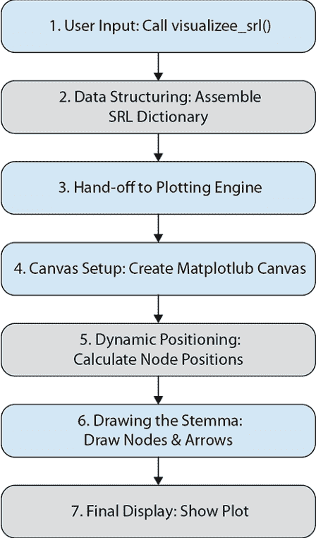
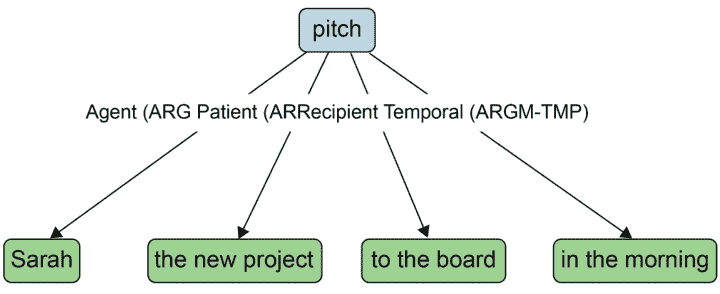
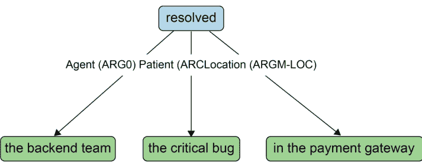
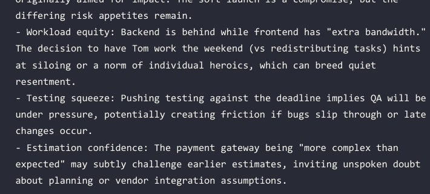

# 1 从提示词到上下文：构建语义蓝图

上下文工程（Context engineering）是将将生成式 AI 从不可预测的协作者转变为完全控制的创意伙伴的学科。提示词（Prompt）开启了随机机会的大门，而上下文（Context）则为可预测的结果提供了结构化的蓝图。这是从要求大语言模型（LLM）继续序列到构建一个闭环环境并接受不可预测性的根本性转变。这种演变让交互超越了简单的请求，进入了引导创作的领域，不仅告诉模型要做什么，还告诉它在您定义的边界内如何思考。

长期以来，我们一直把生成式 AI 视作神谕，向虚空发送提示词并希望获得一个连贯的回复。我们赞美它的高光时刻，却忽视了它的不一致性，并将不可预测性视为体验的一部分。但这是创作的艺术。本章不是关于如何提更好的问题，而是关于提供更好的计划并告诉 LLM 该做什么。

我们的旅程从一个实操演示开始，该演示通过五个级别的上下文复杂性，展示了每一层如何将输出从随机猜测转化为结构化的、目标驱动的响应。然后，我们从词汇的线性序列转向多维结构，引入语义角色标注（SRL），这是一种语言学技术，用于揭示谁对谁做了什么、在何时以及为什么这么做。以 SRL 为基础，我们构建了一个 Python 程序，将这些结构可视化为语义蓝图。最后，我们在完整的会议分析用例中综合这些技能，在用例中我们将引入上下文链（context chaining），并演示多步工作流如何将原始转录转换为洞察、决策和专业行动。

到本章结束时，你将不再数字荒野中寻找答案。你将成为那片荒野的建筑师，能够设计 AI 模型思维的格局，并引导它走向你选择的任何目的地。

本章涵盖了以下主题：

- 通过五个级别的上下文工程来构建语义蓝图
- 通过 SRL 从线性文本过渡多维语义结构
- 构建 Python 程序使用 SRL 对文本进行解析和结构化
- 应用上下文链作为逐步步进、受控推理的方法
- 使用完整的分析用例将原始转录转换为专业的电子邮件

## 理解上下文工程

上下文工程是控制和引导大语言模型（LLM）所学的信息世界的艺术与科学。它将你的角色从提问者转变为自信的导演。这就像给演员单句台词与给他们完整剧本（包括角色动机和舞台指令）之间的区别。你不再是在请求一场表演；你是在设计它，并告诉 LLM 该做什么。

理解上下文工程最好的方法是体验它。我们将跳过理论，从实操演示开始。这段旅程旨在让你体验这种感觉，让随机猜测演化为细致的、可靠的对齐的响应。在这里，我们将通过五个复杂性级别，如图 所示（Google, Microsoft, OpenAI）：

- **1 级：基础提示词（无上下文）**：这是没有背景的简单指令。
- **2 级：更好的上下文（线性上下文）**：这是向后迈的一小步。添加线性线程改进了准确性，但缺乏风格或目的。
- **3 级：良好的上下文（目标导向上下文）**：这是上下文第一个里程碑。通过赋予模型明确的目标，其响应变得具有意图。
- **4 级：高级上下文（基于角色的上下文）**：这比仅有提示词更有结构化。通过分配角色，模型可以遵循动机。
- **5 级：语义蓝图**：这是终极上下文。精确的计划转化为可重复的过程。

## 从提示词到上下文：构建语义蓝图

注意：你获得的响应可能会由于生成式 AI 的随机性而异。然而，设计良好的上下文总是优于即兴的提示词。

让我们从基础提示词开始。

### 1 级：基础提示词（无上下文）

基础提示词没有背景。AI 根据训练数据进行猜测，正如本例所示。我们的输入如下：

> 完成这个句子：“猫在玩……”

Gemini 2.5 的响应是：

```
...毛球。
以下是完成句子的几种方式：
...老鼠。
...绳。
...纸箱。
...激光笔点。
...小猫。
```

你可以看到，由于上下文，AI 会给出最可预测且单调的完成。

Microsoft Copilot 的响应是：

```
猫在玩毛球，直到它散落在地板上。
...在沙发下发现的一张皱的收据，像对待它是尘埃王国里最珍贵的宝贝一样拨弄它。
```

在这种情况下，输出是有创意的，但如果我们想要精确的响应，我们会认为这种响应是幻觉。没有上下文，AI 会默认给出它学习过的最可预测的完成。

OpenAI GPT-5 的响应是：

> 猫在玩毛球，直到它散落在地板上。

输出是陈词滥调。没有上下文，AI 会默认给出最可预测的完成。所有三个模型都可以说：

我抱歉，没有上下文，我无法正确完成这个句子。

我们可以看到，基础提示词会导致基础、不精确的响应甚至是幻觉。目标不是尝试通过模型超参数（如温度）寻找绕过方法，而是构建更好的上下文。让我们进入下一个。

### 2 级：更好的上下文（线性上下文）

在这里，我们添加了一个简单的前句作为添加上下文，这将提供线性的信息线索，提高了准确性，但没有引导 AI 的风格或目的。我们的输入如下：

> 完成这个句子：球掉在了地上，滚了几下。猫接着在玩……

Gemini 2.5 的响应是：

> 球掉在了地上，滚了几下。猫接着在玩球。

注意，该响应是事实且正确的，但缺乏创造力，这在没有更多上下文的情况下是正常的。

Microsoft Copilot 的响应是：

> ...球，用快速的小轻击拨弄它，并在房间里追逐它，就像它是世界上最令人兴奋的猎物一样。

OpenAI GPT-5 的回答如下：

> 球掉在了地板上，向前滚了几个英尺。猫咪开始玩球，用爪子来回地拨弄着。

在这里，回答在事实层面是正确的，而且具有创造性，但同样，它并不知道该生成什么，继续在随机发挥。

除了产生基础概率之外，这些回答并没有特别说服力，但它们相对准确。这对于简单任务可能有效，但当我们我们需要生成式 AI 模型执行任务时就失效了。那么，让我们进入构建上下文并设定目标。

## 第 3 级：良好的上下文（目标导向上下文）

这一级是上下文工程的第一步。我们将提供清晰且更丰富的描述细节，使大语言模型（LLM）能够根据我们的意图共同创建一个场景。

- **目标：** 为儿童故事写一个简短的悬疑场景。

---

**完成这个句子：**

“古老的祖父钟敲响午夜，它的影子像爪子一样伸展。一个红球似乎在自己移动，从落满灰的单手椅上滚了出来。猫，尼克斯（Onyx）伏下身体，眼睛闪烁着光。它在玩……”

这里是 Gemini 2 的回答：

> 古老的祖父钟敲响午夜，它的影子像爪子一样伸展。一个红球似乎在自己移动，从落满灰的单手椅上滚了出来。猫，尼克斯伏下身体，眼睛闪烁着光。它在玩……一个微小的、闪烁的光影跳了舞，带着红球跑而去。球不仅仅是在滚动，它在木地板上跳动着，仿佛活了一样，像一只小红老鼠被拉到了窗户厚重的丝绒窗帘下。尼克斯发出了一声低沉的咆哮，那是它玩耍时发出的声音。球无声息地滑到厚实的深色布料后面。线头在空中悬停了一秒，紧绷并闷化了声音，随后也被拉入了黑暗。一个比叶子沙沙声响更大的微小细语从窗帘后传出：“我的。”

请看，这个回答更有针对性。我们开始得到我们想要的东西。记住，LLM 像人类一样，需要上下文来提供更有效的回答。拥有良好长上下文窗口的人类和 LLM 会提供更好的结果。

## Microsoft Copilot 的回答如下：

> ...球只停留了一会儿就冻结了。球停了——完全纹止不动——但尼克斯的毛竖起来了。从单手椅后面传来轻微的吱呀声，像是地板板在低语。尼克斯向后退去，尾巴蓬起，眼睛盯着黑暗。这时，一声细微的笑声在房间里回荡。不是人类的笑声。窗户关着，窗帘在飘动。尼克斯嘶了一声，球又滚了起来——这次朝走廊滚去，留下一道淡淡的灰色灰尘。钟的滴答声现在变响了，每一秒都像鼓点一样。就在走廊吞没球之前，一只苍白的手从阴影中伸出来，抓住了它。尼克斯逃了。但那声笑声依然存在。

注意，在这种情况下，Microsoft Copilot 正好从我们输入的结尾处开始。此外，我们可以观察到，我们正在从提示词（非结构化上下文）向引导性请求转变。我们是舞者。

这是 OpenAI GPT-5 的回答：

> ...球，在木地板上来回拨弄。但球并没有停止，而是向他弹回——仿佛被一只无形的手推着。尼克斯僵住了，尾巴竖了起来，而钟的滴答声比任何时候都响，每一声滴答都在空旷的房间里回荡。

在这种情况下，回答非常好，并且完全从我们要求它的地方开始。总的来说，这些回答比第 2 级的更有创意且更有意。然而，它们仍然是松散的。为了实现更高的精确度，我们需要在上下文本身中引入结构。

## 第 4 级：高级上下文（基于角色的上下文）

我们不再让 AI 去推断戏剧性结构，而是现在定义每个参与者的角色。通过为 LLM 提供角色、物体和关系，我们赋予了它冲突和动机的框架。这使得回答在叙事上变得智能。我们的输入如下：

- **目标：** 写一个悬疑的句子来延续儿童故事。

---

背景：

- 主角：尼克斯，一只勇敢的黑猫。
- 反派：一个古老的、闹鬼的祖父钟。
- 催化剂物体：一个神秘的红球。
- 环境：午夜一个昏暗、灰尘土的房间。
- 前情：钟响了，球滚了出来。

从这里继续写故事：“黑猫尼克斯伏下身体……它接着在玩……”

这里是 Gemini 2.5 的回答：

```
神秘的红球，轻轻地拨弄它，直到一声低沉的呻吟从钟和它的尾巴中传出，玻璃门打开，露出了内部的黑暗。
```

这，它并不介意询问。准确地告诉 LLM 我们想要什么，结果是可以接受的且更有针对性。

Microsoft Copilot 的回答如下：

```
球，直到它闪烁着奇异的光芒，钟的指针疯狂地向后旋转，释放出一阵不寒而然的低语，顺着地板向他爬来。
```

在这种情况下，LLM 注意到了我们已经变成的导演。故事遵循了我们的结构化指令。

这里是 OpenAI GPT-5 的回答：

```
黑猫尼克斯伏下身体……它接着在玩红球——结果当祖父钟的钟摆自行发出吱吱声时，它僵住了，在午夜的寂静中摆得越比越快。
```

在这种情况下，回答遵循了我们上下文的结构。由此，我们已经从无引导的线性提示词转向结构化的上下文。我们不再是在提问，而是在指令——模型也是如此的。

## 第 5 级：语义蓝图

这一级代表了上下文架构的完整实现。在这里，我们通过结构化的格式为模型提供精确且无歧的计划，使创作行为成为一种可靠的过程。这被称为语义蓝图，它是通过语义角色来引导的：场景目标、参与者、描述、待完成的动作、代理（执行动作的人）以及病人（受动作影响的人）。

我们的输入如下：

任务：生成一个悬疑的句子。

---

```
语义蓝图：
{
  "场景目标": "通过反抗增加张力",
  "参与者": [
    { "name": "尼克斯", "role": "代理", "description": "黑猫"},
    { "name": "红球", "role": "病人", "description": "神秘的"},
    { "name": "祖父钟", "role": "威胁来源", "description": "古老的" }
  ],
  "待完成的动作": {
    "谓词": "玩",
    "代理": "尼克斯",
    "病人": "红球"
  }
}
```

待完成句子：“它接着在玩……”

Gemini 2.5 的回答如下：

> 它接着在玩红球，在祖父钟的影子下缓慢地拨着它，沉重的钟摆开始了不可逆转的摆动。

输出完全遵循了蓝图。我们不再是即兴；模型正在执行。

回答是：

> 它接着在玩红球，它的影子在祖父钟逼人的滴答声下挑地闪烁，仿佛在挑战时间。我们提供的结构贯穿了叙事。

OpenAI GPT-5 的回答如下：

> 它接着在玩红球，随着尼克斯爪子每一次大胆的挥动，祖父钟持续的滴答声似乎变得越来越响。

等等，我们正在获得 LLM 需要做什么。

在这个阶段，我们不再是 LLM 即兴表演的观众。我们是导演，LLM 是根据我们的剧本表演的演员。但是，像第 5 级这样的语义蓝图是如何工作的？为了回答这个问题，我们转向语义角色标注（SRL），这种方法将带我们开启首次从语言序列到多维结构的旅程。

## SRL：从线性序列到语义结构

提升我们对线性序列结构感知的关键是 SRL，这是一种强大的语言技术，最初由 Lucien Tesnières 形式化，随后由查尔斯·Charles J. Fillmore 完善。你可以在参考文献中找到他们作品的链接。SRL 在这些伟大的先驱者之后多年出现，其工作是解构线性句子以回答最基本的问题：谁对谁做了什么，在何时，为什么？它超越了简单的语法，识别每个组件在整体动作中所扮演的功能性角色。

> 注意
> 
> 对于想要了解这些基础概念（如 SRL 和语义蓝图）如何融入上下文引擎架构的读者，附录提供了关于整个系统如何将这些概念结合在一起的简要概述。

## 考虑一个简单的句子：

> Sarah 早上向董事会推介了新项目。

大语言模型（LLM）将词序列解释为标记 链。而上下文工程师使用语义角色结构标注（SRL）可以看到更多内容：一个 `stemma`（词干）或图结构，它将每个词映射到它的语义角色。核心动作是 `pitched`（推介），而其他所有组件都被分配了与该动作相关的角色。

通过对这些角色进行标记，我们将执行以下操作：

- 重构原本线性词汇字符串的多维语义结构
- 定义一个 LLM 可以遵循的语义蓝图，正如前面提到的第 5 级示例所示。

这一过程是高级上下文工程的基础技能。为了理解 SRL 过程，让我们编写一个 Python 程序，将这一强大的理论付诸实践。

## 在 Python 中构建 SRL 笔记本

这个 Python 脚本的目的是提取句子的核心部分并将它们转换为意义的视觉图表。与其让结构隐藏在文本中，该程序画出了词汇与角色之间关系的图像。图 1.2 展示了整个过程：



图 1.2：SRL 程序流程图

让我们逐步过程的每个阶段：

1. **用户输入**：当你调用主函数 `visual_srl()` 时，之旅开始了。在这里，你提供了句子的构建块，例如动词（谓语）、执行者（执行动作的实体）、受者（接收或受动作影响的实体）以及用文本参数表示的其他语义角色。

## 第一章


## 数据结构化

主函数将这些组件组织成一个 Python 字典。每个条目都被分配了正确的 SRL 标签，因此最初松散的词汇列表变成了一个结构化的角色映射。

## 绘图引擎

一旦引擎就绪，它会被传递给内部辅助函数 `_plot_stemma()`。这个函数只做一件事：绘制。

## 画布设置

绘图引擎使用 Matplotlib 创建一个空白画布，为图表准备舞台。

## 动态定位

该函数计算每个角色节点的位置，以确保无论包含多少组件，布局都能保持清晰和平衡。

## 绘制 Stemma（图）

引擎随后将核心作为根节点，将每个角色作为子节点添加，并用带标签的箭头将它们连接起来。曾经的线性句子现在变成了意义的视觉地图。

## 最终显示

最后，函数添加标题并显示完成的蓝图。

到此为止，我们准备好在实践中实现 SRL 了。请参考 GitHub 仓库第 01 章中的 `01.ipynb`。

> 注意
>
> 关于代码本身：它是为了清晰和教学编写的，而不是为了生产环境。重点是尽可能直接地展示信息流。出于这个原因，笔记本避免了会分散体验的沉重控制结构或错误处理。这些精炼可以在以后构建生产系统时添加。此外，要在本地运行该笔记本，你需要安装 spaCy、Matplotlib 和 Graphviz，并使用命令`python -m spacy download en_core_web_sm`下载 spaCy 的英文模型。

让我们开始用 Python 构建一个语义蓝图的可视化工具，它将生成我们的 stemma，这本质上是一个带有语义节点和边缘可视化的图。我们将逐块拆解脚本，解释每个部分的作用。

首先，导入必要的工具。我们的可视化器依赖 matplotlib 进行绘图：

- `matplotlib.pyplot as plt`：主绘图接口，使用惯用的别名`plt`导入以便使用。
- `matplotlib.patches.FancyArrowPatch`：用于绘制整洁的定向箭头的工具，将动词与其角色连接。

有了这些工具，我们现在可以定义 SRL 可视化函数了。

## 主函数：visual_srl

我们程序的核心是主函数`visual_srl()`。这是主要的交互点，由*图 1.2*中的步骤 1 所示。作为用户，你将句子的核心组件作为参数提供，函数负责处理其余工作，组织数据并将其发送给绘图辅助函数。

参数直接对应于之前定义的语义角色。为了保持接口的灵活性，函数还接受`**kwargs`，这允许你传递任意数量的可选修饰符（例如时间或位置细节），而不会使函数签名复杂化。

`visual_srl()`的目的是将这些角色汇成一个字典（`srl1_roles`），然后将谓语（动词）连同交给内部的`_plot_stemma()`进行可视化：

```python
def visual_srl(verb, agent, patient, recipient=None, **kwargs):
    """
    创建一个语义蓝图并将其可视化为 stemma。
    这是主要面向用户的主函数。
    """
    srl_roles = {
        "Agent (ARG0)": agent,
        "Patient (ARG1)": patient,
    }
    if recipient:
        srl_roles["Recipient (ARG2)"] = recipient
    # 添加其他修饰符
    for key, value in kwargs.items():
        # 格式化 key 为 ARGM-
        role_name = f"{key.capitalize()} (ARGM-)"
        srl_roles[role_name] = value
    _plot_stemma(verb, srl_roles)
```

> 注意
>
> 该函数创建一个语义蓝图并将其可视化为 stemma，这是主要面向用户的主函数。

在开始绘制 stemma 之前，我们仔细查看这些定义的角色。

## 定义语义角色

考虑一个简单的句子：

> Sarah 早上向董事会推介了新项目。

大语言模型将词序列解释为标记链。而上下文工程师使用 SRL 可以看到更多内容：一个*stemma*（词干）或图结构，它将每个词映射到它的语义角色。核心动作是 `pitch`（推介），而其他所有组件都被分配了与该动作相关的角色。

通过对这些角色进行标记，我们将执行以下操作：

- 重构原本线性词汇字符串的多维语义结构
- 定义一个 LLM 可以遵循的语义蓝图，正如前面提到的第 5 级示例所示

这一过程是高级上下文工程的基础技能。为了理解 SRL 过程，让我们编写一个 Python 程序，将这一强大的理论付诸实践。

## 在 Python 中构建 SRL 笔记本

这个 Python 脚本的目的是提取句子的核心部分并将它们转换为意义的视觉图表。与其让结构隐藏在文本中，该程序画出了词汇与角色之间关系的图像。*图 1.2* 展示了整个过程：


图 1.2：SRL 程序流程图

让我们逐步过程的每个阶段：

1. **用户输入**：当你调用主函数`visual_srl()`时，之旅开始了。在这里，你提供了句子的构建块，例如动词（谓语）、执行者（执行动作的实体）、受者（接收或受动作影响的实体）以及用文本参数表示的其他语义角色。

## 第二章

2. **数据结构化**：主函数将这些组件组织成一个 Python 字典。每个条目都被分配了正确的 SRL 标签，因此最初松散的词汇列表变成了一个结构化的角色映射。

3. **绘图引擎**：一旦引擎就绪，它会被传递给内部辅助函数`_plot_stemma()`。这个函数只做一件事：绘制。

4. **画布设置**：绘图引擎使用 Matplotlib 创建一个空白画布，为图表准备舞台。

5. **动态定位**：该函数计算每个角色节点的位置，以确保无论包含多少组件，布局都能保持清晰和平衡。

6. **绘制 Stemma（图）**：引擎随后将核心作为根节点，将每个角色作为子节点添加，并用带标签的箭头将它们连接起来。曾经的线性句子现在变成了意义的视觉地图。

7. **最终显示**：最后，函数添加标题并显示完成的蓝图。

到此为止，我们准备好在实践中实现 SRL 了。请参考 GitHub 仓库第 01 章中的 `01.ipynb`。

> 注意
>
> 关于代码本身：它是为了清晰和教学编写的，而不是为了生产环境。重点是尽可能直接地展示信息流。出于这个原因，笔记本避免了会分散体验的沉重控制结构或错误处理。这些精炼可以在以后构建生产系统时添加。此外，要在本地运行该笔记本，你需要安装 spaCy、Matplotlib 和 Graphviz，并使用命令`python -m spacy download en_core_web_sm`下载 spaCy 的英文模型。

让我们开始用 Python 构建一个语义蓝图的可视化工具，它将生成我们的 stemma，这本质上是一个带有语义节点和边缘可视化的图。我们将逐块拆解脚本，解释每个部分的作用。

首先，导入必要的工具。我们的可视化器依赖 matplotlib 进行绘图：

- `matplotlib.pyplot as plt`：主绘图接口，使用惯用的别名`plt`导入以便使用。
- `matplotlib.patches.FancyArrowPatch`：用于绘制整洁的定向箭头的工具，将动词与其角色连接。

有了这些工具，我们现在可以定义 SRL 可视化函数了。

## 主函数：visualize_srl

我们程序的核心是主函数`visual_srl()`。这是主要的交互点，由*图 1.2*中的步骤 1 所示。作为用户，你将句子的核心组件作为参数提供，函数负责处理其余工作，组织数据并将其发送给绘图辅助函数。

参数直接对应于之前定义的语义角色。为了保持接口的灵活性，函数还接受`**kwargs`，这允许你传递任意数量的可选修饰符（例如时间或位置细节），而不会使函数签名复杂化。

`visualize_srl()`的目的是将这些角色汇成一个字典（`srl1_roles`），然后将谓语（动词）连同交给内部的`_plot_stemma()`进行可视化：

```python
def visualize_srl(verb, agent, patient, recipient=None, **kwargs):
    """
    创建一个语义蓝图并将其可视化为 stemma。
    这是主要面向用户的主函数。
    """
    srl_roles = {
        "Agent (ARG0)": agent,
        "Patient (ARG1)": patient,
    }
    if recipient:
        srl_roles["Recipient (ARG2)"] = recipient
        # 添加其他修饰符
        for key, value in kwargs.items():
            # 格式化 key 为 ARGM-
            role_name = f"{key.capitalize()} (ARGM-)"
            srl_roles[role_name] = value
    _plot_stemma(verb, srl_roles)
```

> 注意
>
> 该函数创建一个语义蓝图并将其可视化为 stemma，这是主要面向用户的主函数。

统计角色的数量，然后在水平线上创建一组均匀间隔的`x_positions`列表：

```python
srl_items = list(srl_roles.items())
num_roles = len(srl_items)
x_positions = [10 * (i + 1) / (num_roles + 1)
for i in range(num_roles):
    y_position = 4.5
```

让我们通过绘制角色、箭头和标签来为我们的主干图添加连接。

我们将遍历`srl_roles`字典中的每个角色。在循环的每次迭代中，我们执行了三个操作：

1. **绘制角色节点**：我们再次使用`ax.text()`在计算出的位置为当前角色绘制框框。
2. **绘制连接箭头**：我们创建一个连接动词位置的`FancyArrowPatch`，并将其添加到我们的图表中。
3. **绘制箭头标签**：我们计算箭头的中点，并在该处放置角色名称（例如，`Agent (ARG0)`），以便清晰显示关系。

随后代码将管理位置：

```python
for i, (role, text) in enumerate(srl_items):
    child_pos = (x_positions[i], y_position)
    ax.text(child_pos[0], child_pos[1], text,
           ha="center", va="center",
           bbox=role_style, fontsize=10, wrap=True)

    arrow = FancyArrowPatch(
        verb_pos,
        child_pos,
        arrowstyle='->',
        mutation_scale=20,
        shrinkA=15,
        shrinkB=15,
        color='gray'
    )
    ax.add_patch(arrow)
```

```python
label_pos = (
    (verb_pos[0] + child_pos[0]) / 2,
    (verb_pos[1] + child_pos[1]) / 2 + 0.5
)
text.text(label_pos[0], label_pos[1],
          ha="center", va="center",
          fontsize=0, color='black', bbox="square, pad=0.1",
          fc="white", ec=None)
```

最后，我们进行可视化处理并使用`plt.show()`显示主干提取器：

```python
fig.subtitle("The Semantic Blueprint (Stemma Visualization)",
             fontsize=16)
plt.show()
```

到此时，我们的主函数已经完全定义。我们现在可以运行示例来查看主干提取器的运行情况。

## 运行 SRL 示例

通过带有不同的参数调用`visualize_srl`函数，我们可以瞬间将线性句子结构化的语义蓝图。以下示例将加强你对核心语义角色的理解，并展示我们构建的工具的灵活性。

### 示例 1：商业推演

让我们从本节中一直在解构的句子开始：

> Sarah 在早晨向董事会推介了新项目。

对应的 SRL 定义如下：

```python
print("Example 1: A complete action with multiple roles")
visualize_srl(
  verb="pitch",
  agent="Sarah",
  patient="the new project",
  recipient="to the board",
  temporal="in the morning"
)
```

在这个示例中，我们为所有核心角色和一个修饰语提供了正确的值：

- **谓语 (Predicate)**：中心动作是`pitch`（推介）。
- **施者 (Agent (ARG0))**：推介的人是 Sarah。
- **受者 (Patient (ARG1))**：被推介的是新项目。
- **接收者 (Recipient (ARG2))**：接收推介的实体是董事会。
- **时间 (Temporal (ARGM-TMP))**：动作发生在早上。

运行这段代码会产生图 1.3 所示的主干，其中`pitch`为根节点，四个子节点代表各个角色：

## 语义蓝图（主干可视化）



图 1.3：一个根节点四个子节点

让我们继续另一个示例。

### 示例 2：技术更新

现在，让我们建模另一种类型的句子，这次包含一个位置。考虑这个句子：

> 后端团队解决了支付网关中的关键漏洞。

SRL 定义如下：

```python
print("Example 2: An action with a location")
visualize_srl(
    verb="resolved",
    agent="The backend team",
    patient="the critical bug",
    location="in the payment gateway"
)
```

以下是组件映射到语义角色的方式：

- **谓语 (Predicate)**：动作是`resolved`（解决）。
- **施者 (Agent (ARG0))**：执行解决的实体是后端团队。
- **受者 (Patient (ARG1))**：被解决的是关键漏洞。
- **地点 (Location (ARGM-LOC))**：漏洞解决位置的上下文是在支付网关。

可视化器生成了图 1.4 所示的主干，`resolved`位于顶部，连接着它的三个参与者。这清晰地结构化了技术更新。

## 语义蓝图（主干可视化）



图 1.4：一个根节点三个子节点

## 任务图结构

- **前置任务**：无（这是起始数据）
- **后继任务**：g2（提取核心内容）

### 2. 提取核心内容 (g2)

- **目的**：清洗数据；将信号与噪声分离。
- **前置任务**：transcript（输入原始转录）。
- **后继任务**：这是主要的分叉点。它的输出（`substantive_content`）是三个不同并行步骤的直接前置任务：
    - g3（识别新进展）
    - g4（分析隐性动态）
    - g5（生成新解决方案）

### 3. 识别新进展 (g3)

- **目的**：通过对比旧版总结，寻找新信息
- **前置任务**：`substantive_content`（来自 g2）和`prev_summary`（上一次总结）
- **后继任务**：g6（创建结构化总结）

### 4. 分析隐性动态 (g4)

- **目的**：分析情感和社交潜台词
- **前置任务**：`substantive_content`（来自第 2 步）
- **后继任务**：无（通往最终输出 `implicit_threads`）

### 5. 生成新解决方案 (g5)

- **目的**：将事实合成新的、创造性的想法
- **前置任务**：`substantive_content`（来自第 2 步）
- **后继任务**：无（通往最终输出）

### 6. 创建结构化总结 (g6)

- **目的**：将进展格式化为表格。
- **前置任务**：g3（识别新进展）。
- **后继任务**：g7（草拟后续行动）。

### 7. 草拟后续行动 (g7)

- **目的**：将结构化总结转换为行动项。


# 工作流指南：从会议转录到跟进邮件

## 背景与流程概览

- **前置任务**：`g6`（创建结构化总结）。
- **后继任务**：无（通往最终输出 `follow_up_email`）。

现在让我们将此流程图计划转换为实际代码并分步运行：

1. 打开目录下的 `Use_Case.ipynb`。我们将首先安装必要的 `OpenAI` 库。

```python
# Cell 1: 安装
pip install openai
```

2. 此工作流使用 Google Colab Secrets 来存储 OpenAI API 密钥。加载密钥，设置环境变量并初始化客户端：

```python
# Cell 2: 导入和 API 密钥设置
# 我们将使用 OpenAI Library 与 LLM 交互，并使用 Google Colab 的
# 密钥管理器安全地访问您的 API 密钥。

import os
from openai import OpenAI
from google.colab import userdata

# 从 Colab secrets 加载 API 密钥，设置环境变量，然后初始化客户端
try:
    api_key = userdata.get("API_KEY")
    if not api_key:
        raise userdata.SecretNotFoundError("未找到 API_KEY.")

    # 为下游工具/库设置环境变量
    os.environ["OPENAI_API_KEY"] = api_key

    # 创建客户端（将读取 OpenAI_API_KEY）
    client = OpenAI()
    print("OpenAI API key 加载且环境变量设置成功。")
except userdata.SecretNotFoundError:
    print('未找到 Secret "API_KEY"')
    print('请将您的 OpenAI API密钥添加到 Colab Secrets Manager。')
```

```python
except Exception as e:
    print(f"加载 API key时发生错误：{e}")
```

## 3. 输入数据准备

将会议转录作为多行字符串添加。这将是后续链式步骤的输入：

```python
# Cell 3: 完整会议转录
meeting_transcript = """
Tom: 大家早上好。咖啡开始起效了。
Sarah: 早上好，Tom。好的，让我们开始吧。凤凰项目时间线。Tom，你说后端组件进展顺利，对吗？
Tom: 基本上如此。我们在支付网关集成上遇到了一个小障碍。它……比文档建议的要复杂。我们可能还需要三天时间。
Maria: 三天？Tom，那会让最终测试紧贴发布截止日期。我们没有缓冲余地。
Sarah: 我同意 Maria 的观点。Tom，还有什么替代方案吗？
Tom: 我想我可以在周末加班来赶进度。虽然我并不想这样做，但我能看到我们面临的困境。
Sarah: 感谢，Tom。我们暂定达成共识。Maria，前端情况如何？
Maria: 我们没问题。事实上，我们还领先了一点。我们有一些额外的带宽。
Sarah: 太棒了。好的，最后一件事。营销团队想在发布当天进行一次大规模的社交媒体推广。怎么想？
Tom: 看起来很常规。
Maria: 我认为这是个错误。如果出现任何初始漏洞，一天的巨大推广会淹没我们的服务器。我们应该进行软发布，第一周仅限邀请制，然后再进行大规模推广。这样更可控。
Sarah: Maria，你说得很好。这是一种更稳的策略。我们就这么办吧。好的，非常好的会议。我会发送一份总结。
Tom: 听起来不错。现在，多喝点咖啡。
"""
```

你已经准备好开始链式操作了。第一个动作将从 `meeting_transcript` 中分离信号与噪声：提取决策、更新和问题；忽略问候和闲聊。让我们开始吧！

## 第 1 层：确定范围（“什么”）

我们将首先定义分析范围。如所建立，每个步骤的输出都将馈给网络，创建一个上下文链。

1. 准确告诉模型应该忽略什么。

```python
# Cell 4: g2 - 提取实质性内容
prompt_g2 = """
分析以下转录。提取决策、更新和问题。 
忽略问候、闲聊和无关的闲谈。

转录内容：
---
{meeting_transcript}
"""
```

2. 现在我们激活 OpenAI 来提取实质性内容：

```python
client = OpenAI()
try:
    response_g2 = client.chat.completions.create(
        model="gpt-4o",
        messages=[{"role": "user", "content": prompt_g2}]
    )
    substantive_content = response_g2.choices[0].message.content
    print("--- 实质性内容 ---")
    print(substantive_content)
except Exception as e:
    print(f"发生错误：{e}")
```

| 核心内容 | 详情 |
| :--- | :--- |
| 凤凰项目时间线 | 后端集成比预期复杂；需要额外的三天。 |
| 对进度的影响 | 额外的三天使最终测试紧贴发布截止日期，并减少了缓冲。 |
| 缓解决策 | 暂定同意 Tom 在周末加班赶进度。 |
| 前端状态 | 领先进度，有额外的带宽。 |
| 营销/发布决策 | 从发布当天的大规模推广改为第一周仅限邀请制的发布，然后进行大规模推广。 |

3. 下一步，我们通过**检索增强生成 (RAG)** 将新会议与上一次总结进行对比。

```python
# Cell S: g3 - 识别新的
previous_summary = "在上次会议中，我们确定了凤凰项目的目标并将任务分配给了 Tom 和 Maria。"

prompt_g3 = f"""
背景：上次会议的总结是："previous_summary}"

任务：分析以下新会议的实质性内容。
识别并总结自上次会议以来的新进展、问题或决策。

新会议内容：
---
{substantive_content}
---
"""
```

我们现在再次让 OpenAI 执行 RAG 任务：

```python
try:
    response_g3 = client.chat.completions.create(
        model="gpt-4o",
        messages=[{"role": "user", "content": prompt_g3}]
    )
    new_developments = response_g3.choices[0].message.content
    print(f"-- 自上次会议的新进展 --")
    print(f"{new_developments}")
except Exception as e:
    print(f"发生错误：{e}")
```

### 自上次会议的新进展

- 后端方面：支付网关集成比预期复杂；需要额外的三天。
- 对进度的影响：额外的三天使最终测试紧贴发布截止日期，并减少了缓冲。
- 缓解决策：暂定同意 Tom 在周末加班赶进度。
- 前端状态：领先进度，有额外的带宽。
- 营销/发布决策：从发布当天的大规模推广改为第一周仅限邀请制的发布，然后进行大规模推广。

我们已经揭示了范围；换句话说，即转录的“什么”。让我们深入“如何”。

## 第 2 层：进行调查（“如何”）

现在我们从识别事实转向生成见解，这是语义上下文解释之旅的核心。这里是提示 AI 读言外之意的地方。

1. 除了显式事实外，每场会议都带有**潜台词**：犹豫、紧张和情绪。这一步要求 AI 分析底层的动态：

```python
# Cell 6: g4 - 揭示隐性线索
prompt_g4 = f"""

任务：分析以下会议内容中隐含的社交动态和未表述的情感。请超越字面意思。

- 是否有人在同意某事后表现出犹豫或不情愿？

- 是否存在任何潜在的分歧或紧张关系？

- 整体氛围是怎样的？

会议内容：
---
{substantive_content}
---
"""
```

2. 我们运行提示词来探索会议中字面意思之外的隐含动态：

```python
try:
    response_g4 = client.chat.completions.create(
        model="gpt-5",
        messages=[{"role": "user", "content": prompt_g4}]
    )
    implicit_threads = response_g4.choices[0].message
    print("--- IMPLICIT THREADS AND DYNAMICS ---")
    print(implicit_threads)
except Exception as e:
    print(f"发生了错误: {e}")
```

这一阶段的输出突显了一些新东西：大语言模型（LLMs）不仅仅是提供事实或总结事件。它们还在挖掘话外之音：

```
--- IMPLICIT THREADS AND DYNAMICS ---
以下是似乎浮现在水面下的内容：

尽管同意但仍犹豫/不情愿
- Tom 对周末工作的“犹豫”同意读起来像是不情愿。这表明他感到有压力才自愿，而不是出于真实的意愿。
- 营销部门可能带着某些不情愿同意了软发布；从第一天的大规模投入改为仅限邀请制，意味着对工程风险的妥协。

潜在的分歧或紧张关系
- 速度即质量：工程部门想要稳定性和缓冲；而营销部门最初的目标是追求影响力。软发布是一种折中方案，但不同的风险偏好依然存在。
- 工作量公平性：后端落后于前端，而前端有“额外带宽”。让 Tom 在周末加班（而不是重新分配任务）暗示了部门孤岛或一种个人英雄主义的准则，这可能会产生无声的怨恨。
- 测试挤压：紧赶截止日期意味着质量保证（QA）将面临压力，如果漏洞漏掉或发生后期更改，可能会产生摩擦。
- 估算信心：支付网关“比预想的复杂”可能微妙地挑战了早期的估算，引发了对规划或供应商集成假设的无声怀疑。
```



整体氛围

- 冷静、务实且略显紧张。小组以解决方案为导向并具有协作精神，有一种紧迫感和压力，对计划的宽慰感被对工作量、风险和缓冲减少的担忧所抵消。

这就是上下文链（context chaining）从“记录发生了什么”转向“解释为什么重要”的地方。结果感觉不像是原始转录，而更像是分析师的评论，为我们提供了关于团队动态的未曾说明的洞察。

## 3. 生成新解决方案

接下来，我们提示 AI 进行创造性思考，通过综合会议中的不同想法来解决问题，展示其思考过程：

```python
# 单元格 7: g5 - 生成新解决方案
prompt_g5 = f"""
背景：在会议中，Maria 建议进行“软发布”以避免服务器崩溃，并提到她的团队有“额外带宽”。
Tom 面临后端延迟 3 天。

任务：提出一个新颖且可行的想法，利用 Maria 团队的额外带宽来帮助缓解 Tom 的3天延迟。将这两条独立的信息合并为一个单一解决方案。
"""

try:
    response_g5 = client.chat.completions.create(
      model="gpt-5",
      messages=[{"role": "user", "content": "prompt_g5"}]
    )
    novel_solution = response_g5.choices[0].message.content
    print("-- AI 提出的新颖解决方案 ---")
    print(novel_solution)
except Exception as e:
    print(f"发生了错误: {e}")
```

该提示词挑战 AI 考虑到 Maria 的额外前端带宽和 Tom 的后端三天延迟，并将它们织入一个新颖的解决方案。这就是上下文展示其真实实力的地方：我们不是要求回忆或可能的解释，而是推动模型生成一些转录稿中不存在的新内容：

```
-- AI 提出的新颖解决方案 --
主意：在临时的“边缘桥接”（Edge Bridge）后进行软发布，由 Maria 团队构建，用于在 Tom 后端准备好之前缓冲读写操作。

Maria 团队要做的工作（利用他们的额外带宽）
- 建立一个与真实 API 合约匹配的服务器/API façade（例如 API Gateway/Lambda + SQS/DynamoDB 或 Cloudflare Workers + Durable Objects）。
- 读取：从之前的缓存或静态快照提供服务（过期更新）。通过测试环境的轻量级数据导出或执行端点每小时更新快照。
- 写入：将请求捕获在带持久键的持久队列中；向客户端立即返回“已排队”并显示“同步中”界面。当 Tom 的后端上线后，重放工作程序将清空队列并应用更改。
- 添加功能标记/流量控制（例如 LaunchDarkly）以限制软发布并节流请求以避免服务器压力。

这如何缓解 3 天延迟
- 产品可以针对小部分群体进行软发布，而无需等待后端；用户获得读取访问权限和缓冲写入。
- 当 Tom 的后端准备就绪时，将路由切换到真实后端并清空队列以对齐数据。

行动计划和时间表
- 第 0 天（今天）：识别软发布的最小关键端点。（*注：此处原文存在大量重复文本，已按要求去重*）
```

## 最终行动：生成跟进邮件

上下文链（context chaining）的最后一步是完成从洞察到行动的闭环：将结构化分析转换为专业的跟进邮件：

```python
# Cell 9: g7 - 起草跟进行动
prompt_g7 = f"""
Task: 基于下方的摘要表，为团队（Sarah, Tom, Maria）起草一封礼貌且专业的
跟进邮件。
邮件应清晰地列出所做的决策以及每个人的行动事项。

Summary Table:
---
{final_summary_table}
---
"""
```

大语言模型（LLM）将再次承担繁重工作并完成任务：

```python
try:
    response_g7 = client.chat.completions.create(
        model="gpt-4",
        messages=[{"role": "user", "content": "prompt_g7"}]
    )
    follow_up_email = response_g7.choices[0].message.content
    print("--- DRAFT FOLLOW-UP EMAIL ---")
    print(follow_up_email)
except Exception as e:
    print(f"An error occurred: {e}")
```

最终行动是基于对指标深度分析的跟进邮件。


# 跟进：今日同步会议的决策和后续步骤

Hi Sarah, Tom, and Maria,

感谢之前的高效讨论。以下是我们决策的简要回顾以及每个人的行动事项。

## 决策

- 后端支付网关集成比预想的复杂，需要额外的三时间。
- 这将进度推后了三天，并压缩了最终测试窗口，减少了我们的发布前缓冲时间。
- 缓解措施：Tom 将在周末工作以帮助我们赶上进度。
- 前端进度领先，并有额外的带宽可以支持。
- 上市/营销计划将改为为期一周的仅邀请制软发布，随后进行更大规模的首日推广。

## 行动事项

### Tom

- 确认周末是否有空，并分享一份简要计划（关键里程碑、依赖关系和任何风险）。
- 继续网关集成，并与前端和 QA（质量保证）协调早期集成测试。
- 提供简短的每日进度更新，并立即标记阻塞问题。

### Sarah

- 更新项目时间表，反映三天的调整和压缩的 QA 窗口。
- 与 QA 协调适用于缩短周期的基于风险的测试计划。
- 与营销/产品就仅邀请制软发布的范围、成功指标和沟通达成一致；并将计划分发给团队。

### Maria

- 重新分配前端带宽以支持后端集成（支付 UI 钩子、错误处理、埋点）。
- 需要时与 Tom 合作进行 mock/stub，以消除早期集成和 QA 的障碍。
- 确保前端准备好进行软发布（功能标记/开关、追踪），并共享任何缺失。

请回复以确认您的行动事项，并说明您需要的任何限制或支持。我很乐意在我们处理此问题期间安排简短的每日检查；如果您有偏好的时间，请提议。

感谢大家，感谢快速的协调。

祝好，
[您的姓名]

---

这个最终产物展示了上下文链的全部潜力。这封邮件读起来像是由一位勤奋的项目经理编写的。工作流产出的不是编辑抽象的洞察或松散的点点列表，而是专业的沟通。AI 不仅总结了会议，还将其转换为能够实现以下功能的格式：

- 清晰捕获决策，使对达成的内容不再产生歧义
- 分配所有权，确保每项任务都落实到责任人
- 设定预期，如时间表、后续步骤和问责制
- 减少跟进阻力，因为草案已经足够完善可以直接发送，节省了人类的时间和精力

这就是 LLM 停止做“记笔记员”转变为“创意伙伴”的时刻，正如我们在本章开头提到的那样。在这种情况下，我们不仅获得了一个摘要。我们希望与 AI 作为伙伴一起进行思考。人类仍然处于过程的核心，并为会议、邮件处理、报告以及你可以想象的任何场景创建上下文链的模板。使用得当，上下文链可以提升公司和客户的运营方式。

现在让我们退后一步，总结一下我们取得的成就，并进入上下文工程的下一个探索。

## 总结

本章介绍了上下文工程这项新兴技能，它可以将 LLM 变为可靠的、以目标为导向的系统。不再依赖非结构化的提示，而是展示了控制如何来自对信息环境的工程化，最终以语义蓝图（semantic blueprint）作为最精确的指导形式。

我们通过五个级别的演进追溯了这一转变：从产生通用输出的零上下文提示，到线性的、以目标为导向的基于角色的上下文，证明了结构化输入能驱动更好的结果。为了形式化这种方法，我们引入了 SRL（语义谓语标记），这是将句子分解为谓语、代理者、意图和修饰符的方法，并配有一个 Python 可视化工具将这些角色渲染为架构图。

最后，我们在意义分析用例中应用了这些技能，上下文链将原始转录转变为可操作的结果。通过逐步进行，该过程减少了噪声，突出了新进展，揭示了隐性动态，并产生了结构化的摘要和跟进行动。

SRL 和上下文链分别提供了理论框架和实践工作流，让我们超越简单的提示（prompting）。我们现在准备好在下一章中构建智能体上下文了。

## 问题

1. 上下文工程的主要目标是将 LLM 变为可靠的、以目标为导向的系统。
2. “2级：线性上下文”提供了足够的信息来控制 LLM 吗？
3. 第 5 级的“语义蓝图”是最有效的指导形式吗？
4. 语义谓语标记（SRL）的主要功能是什么？
5. 在句子`Sarah pitched the project`中，`Sarah`被识别为代理者（agent）吗？
6. 参数修饰符（Argument Modifiers）是 SRL 的核心部分吗？
7. 章节用例依赖于单一复杂的提示吗？
8. “上下文链”技术是否定义为使用输出？
9. 在工作流中，隐性动态（Implicit Dynamics）是否用于提取事实？
10. 本章分析结束于创建一个可操作的产物吗？

## 参考文献

- Tesnière, L. (1959). *Éléments de syntaxurale*. Klinck.
- Fillmore, Charles J. 1968. “The Case for Case.” In *Universals in Linguistic Theory*, edited by Ramon Bach and Robert T. Harms, 1–88. New York: Holt, Rinehart and Winston.
- Palmer, Martha, Danielle Gideon and Paul Ginsbury. 2005. “The Proposition Bank: An Annotated Corpus of Semantic Roles.” *Computational Linguistics* 31 (1): 71–106.

## 延伸阅读

- Brown, T, Mann, B., Ryder, N, Subbiah, S., Kaplan, J. D., Dhariwal, P., Neelakantan, A, et al. 2020. “Language Models Are Few-Shot Learners.” *Advances in Neural Information Processing Systems* 33: 1877–1901.
- Wei, J., Wang, X., Schuurmans, D., Bosma, M., Chi, E. H., Le, Q. V., and Zhou, D. 2022. “Chain-of-Thought Prompting Elicits Reasoning in Large Language Models.” *Advances in Neural Information Processing Systems* 35: 24824–24837.

## 获取本书的 PDF 版本和额外内容

扫描二维码（或访问 `packtub.com/unlock`）。通过名称搜索此书，确认版本，然后按照页面步骤操作。

注意：请保留发票。直接从 Packt 购买的不需要发票。

---
