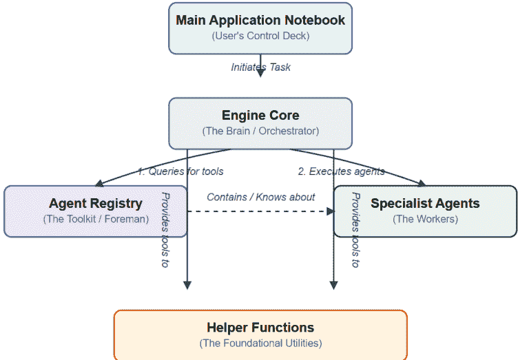
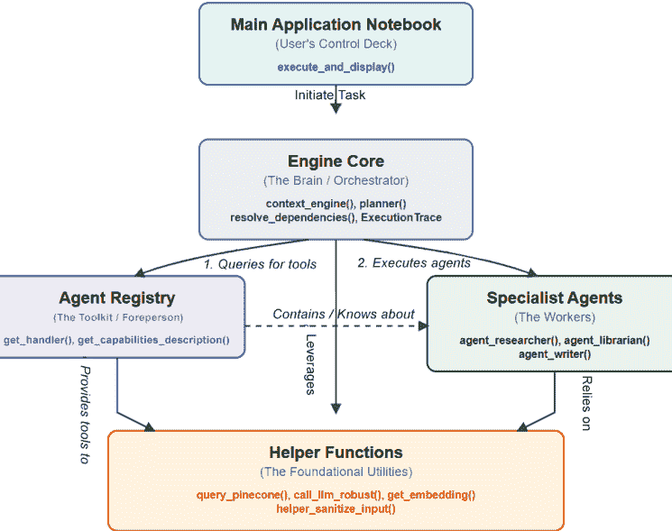
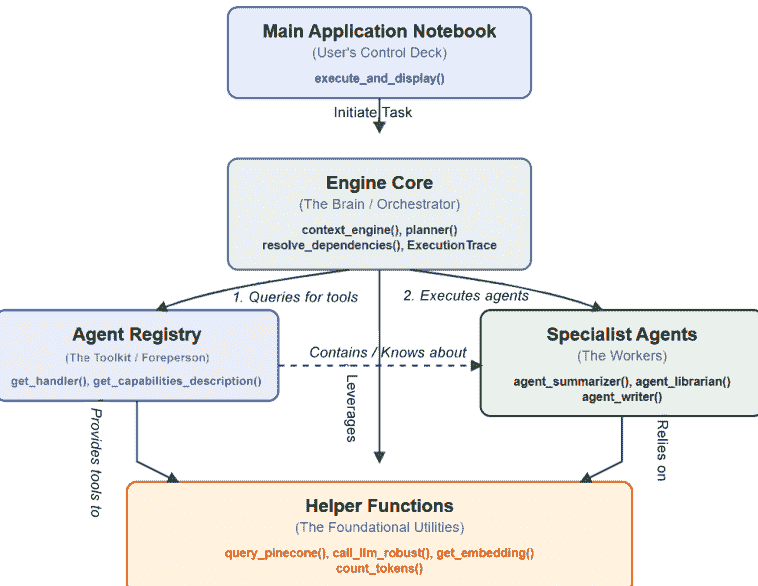
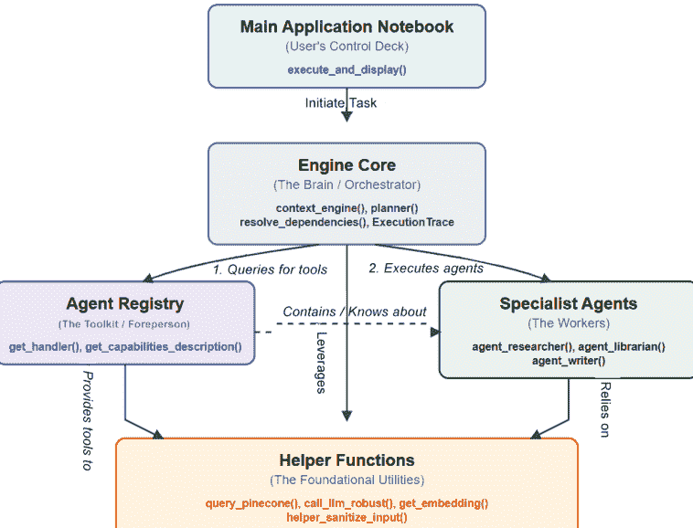
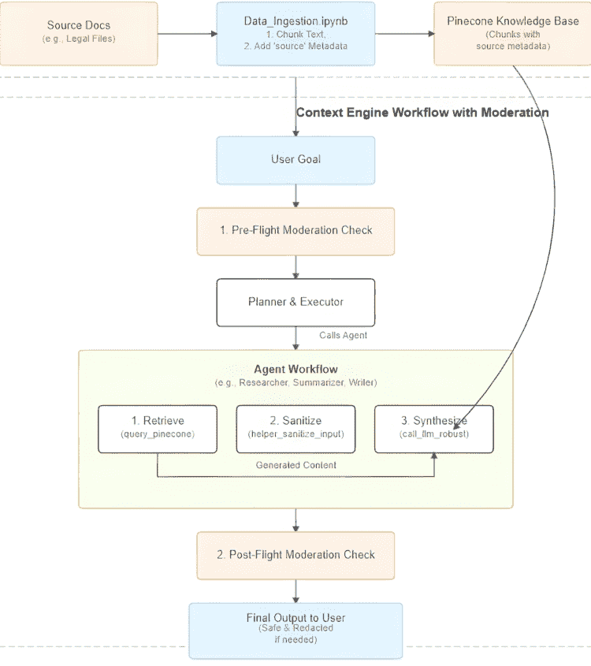

# 7 

受信任的。然后，我们将构建思维图来将系统架构可视化。一旦清单准备就绪，这些图表将成为导航复杂性的无价之宝。它们将帮助你将上下文引擎视为一个正在运行的系统。

## 上下文引擎的完整清单

在验证系统之前，我们需要对构成上下文引擎的每一个函数进行一个完整且结构化的清单。这份清单并不是你放在上下文引擎文档附录中的东西，而是你构建的系统至关重要的地图。

每个函数都根据其在架构中的位置和角色进行分类，并根据章节文本和代码本身提取简短描述。在真实的生产环境中，你还应该包含你设计的所有上下文，因为它们代表了你系统智能的代码——即你提供给它的指令。

在这一步上多花些时间。确保每个组件都是清晰且有意义的。如果某些内容让你陌生或不完整，请重新回顾本书的相应章节（或之前的章节），直到整个架构在你的脑海中清晰可见。为什么？因为上下文工程师必须在脑中 carry 一个整个应用程序的思维图。

让我们从主应用程序笔记本开始。

### 主应用程序笔记本函数

这些函数位于主`NASA_Research_Assistant.ipynb`笔记本中，负责设置环境和执行引擎。

| 内容或代码中的函数名称 | 代码格式的函数名称 | 简短描述 |
|---|---|---|
| GitHub 下载器 | `download_private_github_file()` | 使用安全令牌从私有 GitHub 仓库下载公共库文件 |

### 高保真 RAG 与防御：受 NASA 启发的研究助手

| 内容或代码中的函数名称 | 代码格式的函数名称 | 简短描述 |
| --- | --- | --- |
| 引擎室 | `execute_and_display()` | 主执行函数，根据特定目标和配置运行上下文引擎，然后格式化并显示最终输出以及详细的技术轨迹追踪 |

表 7.1

### 辅助函数 (`helpers.py`)

这些是`helpers.py`中的基础性、可重用的工具程序，它们为整个系统提供核心服务，如 LLM 通信、嵌入和安全保障。

| 内容或代码中的函数名称 | 代码格式的函数名称 | 简短描述 |
| --- | --- | --- |
| 健壮 LLM 调用器 | `call_llm_robust()` | 一个增强的中心化函数，带有重试机制，处理所有指向 OpenAI API 的聊天完成和 JSON 模式调用 |
| 嵌入生成器 | `get_embedding()` | 使用指定的嵌入模型为给定文本生成向量嵌入 |
| MCP 消息创建器 | `create_mcp_message()` | 为代理之间的通信创建标准化的模型上下文协议 (MCP) 消息对象 |

# 7 

| 内容或代码中的函数名称 | 代码格式的函数名称 | 简短描述 |
|---|---|---|
| Pinecone 查询器 | `query_pinecone()` | 对查询文本进行嵌入并在 Pinecone 向量数据库中搜索特定的命名空间，返回带有元数据的顶部匹配结果 |
| Token 计数器 | `count_tokens()` | 引擎的“油表”；准确测量给定模型字符串的 token 计数，以管理成本 |


# 输入清理器与专家代理清单

| 输入清理器 | `helper_sanitize_input()` | （第 7 章新增）一个安全网关，在文本被 LLM 使用之前检查其潜在的提示词注入或数据中毒模式 |

**表 7.2**

## 专家代理 (agents.py)

这些是 `agents.py` 中的专门“工人”，每个都设计用于在多代理系统中执行特定任务。

| 内容或代码中的函数名称 | 代码格式的函数名称 | 简短描述 |
|---|---|---|
| 上下文管理员 | `agent_context_librarian()` | 执行过程化 RAG |

## 高保真 RAG 与防御：受 NASA 启发的研究助手

| 内容或代码中的函数名称 | 代码格式的函数名称 | 简短描述 |
|---|---|---|
| 研究员 | `agent_researcher()` | （第 7 章升级）通过检索、清理和合成信息执行事实 RAG |
| 作者 | `agent_writer()` | 最终生成代理，将事实信息（来自研究员）与风格指令（来自 代理）相结合以创建最终输出 |
| 总结器 | `agent_summarizer()` | 一个智能门禁，根据目标将大块文本减少为摘要 |

**表 7.3**

## AgentRegistry (registry.py)

该类作为引擎的“领班”或“工具箱”，管理可用代理列表并为执行做准备。

## 引擎核心 (engine.py)

| 内容或代码中的函数名称 | 代码格式的函数名称 | 简短描述 |
|---|---|---|
| 注册初始化 | `__init__()` | 通过创建代理名称到对应 Python 函数的字典来初始化 |
| 代理处理器 | `get_handler()` | 获取特定代理并使用依赖注入为其准备所有 |
| 能力描述 | `get_description()` | 提供所有代理的纯文本“手册”，供 Planner 读取 |

**表 7.4**

这些是“玻璃盒”执行的中心组件，负责编排、规划和追踪。

# 7 

| 内容或代码中的函数名称 | 代码格式的函数名称 | 简短描述 |
|---|---|---|
| 轨迹初始化 | `__init__()` | 为新任务初始化“黑匣子记录器”对象，准备好 |
| 计划日志 | `log_plan()` | 将 Planner 生成的完整计划记录到轨迹中 |
| 步骤日志 | `log_step()` | 记录单个代理步骤的详细输入、输出和解析后的上下文 |
| 轨迹结束 | `finalize()` | 通过记录最终状态和总时长来结束轨迹 |
| 规划器 | `planner()` | 引擎的 LLM 驱动核心，分析用户目标和可用能力以创建 |

| 内容或代码中的函数名称 | 代码格式的函数名称 | 简短描述 |
|---|---|---|
| 依赖解析 | `resolve_dependencies()` | 上下文链的机制；将代理输入中的占位符（例如 `$STEP_1_OUTPUT$`）替换为之前步骤的实际输出 |
| 上下文引擎 | `context_engine()` | 系统的主入口和主编排器，管理从规划到完成的任务完整生命周期 |

## 上下文引擎如何思考

现在我们已经对系统的每个函数和类进行了清单，我们现在有了每个移动组件及其如何放入上下文引擎更大机制中的地图。现在是时候让该系统可视化了。

等一下，乍一看，接下来的几页似乎是在回顾。但事实并非如此。我们在这里所做的是整合——一个重要且全新的步骤。我们正在超越直觉去理解这种架构是如何工作的。

这就是为什么我们要创建一个概念图：一个高层指南，让你能够从树木中跳出来，看到整片森林。它帮助我们回答两个强大的问题：每个组件为什么存在？它们是如何共同工作以产生智能、自主的行为的？

系统看似*魔法*，当它似乎在有意地做出选择并传递信息时，并不是心灵感应。它是精心设计的架构的结果，在那种架构中，LLM 独特的推理能力被结构化的上下文流引导和约束。换句话说，智能源于设计，而非猜测。

# 高保真 RAG 与防御：受 NASA 启发的研究助手

在本节中，我们将完成两件事。首先，我们将解构系统每个部分的目的。然后，我们将追踪上下文如何在这些部分之间流动并做出决策，如图 7.2 所示。你在这节中可以参考此图，也可以返回清单以深入了解更多信息。请在这里花点时间思考。了解如何导航你的上下文引擎地图，将使你在项目出现问题（它们总会在某个时刻出现问题）时蜕变为一名专家。



**图 7.2：** 上下文引擎映射

让我们先梳理每个组件的目的。

## 整体架构

虽然我们在之前的章节中已经逐一介绍过这些组件，但这是我们第一次将它们作为一个完整的、相互作用的系统来看待。我们需要深入通过每一个步骤，以理解整体架构。我们脑图中的每个类别都有独特且至关重要的角色，遵循了清晰的职责分离原则，这对于可扩展和可维护的系统至关重要：

- **主应用笔记本（用户的世界）：** 这是人类架构师与 AI 系统之间的主要接口。它的作用是作为控制台，即我们在此处定义高级目标、配置操作参数并接收最终精炼输出的环境。它是整个工作流的入口和出口。
- **引擎核心（大脑）：** 这是整个系统的中央编排器。它本身不执行研究或写作等专门任务。相反，它的目的是管理端到端的过程：解释用户目标、制定战略计划、分步执行该计划，并确保最终结果的实现。
- **代理注册表（工具箱）：** 注册表的作用是充引擎的*工头或经理*。它维护了一份所有可用代理及其能力的确定中心列表。至关重要的是，它还通过为这些代理提供所有必要的依赖项（如 API 客户端）来准备它们工作——这一过程被称为依赖注入。
- **专家代理（工人）：** 这些是执行实际工作的现场专家。系统的力量源于这种分工；每个代理都有一个单一且定义明确的任务——检索程序化指令（管理员）、寻找可验证的实实（研究员）、压缩信息（摘要器）以及生成内容（作者）。
- **辅助函数（基础）：** 这是一个共享的、低级工具的基础库。它的目的是处理常见的重复性任务，例如与 LLM 通信（`call_llm_robust`）或与向量数据库通信（`query_pinecone`）。这防止了代码重复并将关键的外部通信集中化，使得整个系统更加简洁、可靠且易于维护。

现在，让我们揭开引擎看似神奇的真相。

## 观察运行中的系统

理解规划代理之间的*对话*与执行代理的*链式调用*之间这种精确的上下文流动，正是我们“玻璃盒”设计的核心意义。我们必须揭开这种魔法和机械机制。这是正确解释下一节中测试结果的关键。引擎内部的通信和决策完全由上下文的结构化流动驱动。这个过程可以分为两个阶段：战略**规划阶段**和程序化**执行阶段**。

## 引擎如何规划：上下文的对话

智能规划过程不是一个僵化的脚本，而是两个关键上下文之间的动态对话，由 LLM 的推理能力驱动：

1. **目标上下文：** 当主应用笔记本提供初始的、最重要的上下文（用户的高级目标）时，过程开始。这定义了需求。
2. **能力上下文：** 引擎核心的规划代理获取此目标，并将其与第二个关键上下文相结合：可用工具的纯文本“手册”，该手册是从代理注册表的 `get_capabilities_description` 方法请求的。这定义了系统的能力。
3. **LLM 驱动的推理：** 规划代理将这两个上下文（用户的需求和系统的能力）都发送给 LLM。这就是现代 AI 的独特力量所在。LLM 读取并理解预期的结果和可用工具，并像人类项目经理一样，制定一个逻辑、分步骤的 JSON 计划来弥补两者之间的差距。这就是它选择方式的方式。

一旦创建计划，引擎核心中的执行代理就会接管，它的通信依赖于高度结构化且可预测的过程。引擎执行结构化消息并激活链式调用：

- **结构化通信 (MCP)：** 执行代理使用结构化的 MCP 与专家代理通信。这确保了每个代理都能以可预测的格式接收输入，消除了歧义。
- **上下文链式：** 执行代理积极管理工作流的内存（或状态）。当它遇到计划中的占位符（如 `$STEP2_OUTPUT$`）时，`resolve_dependencies` 函数会主动将上一个步骤的输出作为当前步骤的新上下文。这就是信息如何无缝从一个代理流动到另一个代理，允许它们在彼此工作的基础上进行。

因此，引擎的智能并不是感性的“心灵感应”。它是我们努力构建的架构属性！自然地，对于终端用户来说，它看起来是神奇的。但终端用户并没有看到或意识到我们经历的历程。我们现在拥有了一个系统，LLM 海量且灵活的推理被引导并操作化。

这种合成证实了我们的架构是完整的。我们的图中没有缺失的组件或断开的链接。我们现在对章节示例进行回顾兼容性验证。

## 验证机器的大脑

我们有了上下文引擎功能的清单。我们知道机器大脑是如何工作的。现在，我们需要用第 6 和 第 7 章实现的示例来测试引擎，在进入下一节之前检查是否有任何缺失。在生产环境中，你需要构建一个完整的示例数据集并运行它们，然后与专家结果进行验证。

让我们从第 7 章开始。

### 第 7 章用例：高保真、安全的研究工作流

提供引用的 RAG 能力以及确保流程完整性的新清洗函数。

最终的预期输出不仅仅是一个答案，而是一个精炼、准确且有证据支持的报告，在专业研究环境中是可信的。

为了实现这一点，引擎在整个架构中激活了一系列特定的函数。我们清单中的以下组件被用来解决该问题：

- 主应用笔记本：`execute_and_display()`
- 引擎核心：`context_engine()`、`planner()`、`resolve_dependencies()` 和 `ExecutionTrace` 方法
- 专家代理：`agent_researcher()` 和 `get_capabilities_description()`
- 辅助函数：`query_pinecone()`、`call_llm_robust()`、`helper_sanitize_input()` 和 `get_embedding()`

图 7.3 包含一张脑图，详细说明了这些分布在我们模块化架构中的特定函数是如何协作交付最终结果的。

# 高保真 RAG 与防御：受 NASA 启发的研究助手



**图 7.3：** NASA 研究助手所使用的组件和特定功能可视化

这张思维导图为我们系统的运行提供了强有力的视觉总结。流程始于应用程序笔记本（application notebook），由 `execute_and_display()` 函数根据我们的研究目标启动任务。这立即激活了引擎核心，该核心作为中央协调器，激活了它的 `planner()` 和其他管理函数。

为了执行计划，引擎核心咨询代理注册表（agent registry），以查找并准备工作所需的特定专家代理：升级后的 `agent_researcher()` 代理、`agent_librarian()` 和 `agent_writer()`。

这些代理转而依赖于基础辅助函数——例如用于数据检索的 `query_pinecone()`、用于清洗的 `helper_sanitize_input()` 以及用于合成的 `call_llm_robust()`来完成它们的任务。这张思维导图清晰地展示了单一的高级目标如何点亮我们整个模块化架构中的特定函数网络，从而产生智能且可信的输出。

呼！你刚刚回顾了高级上下文工程的复杂机制！在继续之前，你可能想多读几遍这一节以掌握流程的感觉。

# 7 

如果你已经准备就绪并平复了呼吸，让我们回顾第 6 章的示例，看看兼容性是否依然。

# 第 6 章测试例：通过向后兼容性验证系统

我们现在已经为第 7 章研究助手完成了最后的升级，创建了迄今为止最强大、最复杂的上下文引擎版本。在上下文工程师宣布任何系统“完成”之前，还有最后一项准律：向后兼容性测试。

这种验证确保了我们的最新增强没有意外破坏在早期章节中构建的任何功能。这是迭代开发的安全网——证明了我们的系统并非脆弱，而是一个稳定且具有韧性的平台。

在本节中，我们将通过在完全升级的第 7 章引擎上运行第 6 章和第 5 章的关键工作流来实现这一点。成功执行将确认我们系统的稳定性和模块化设计的合理性。

实现这种向后兼容性的关键在于 `agent_writer` 的最终三语版本。我们称之为三语，是因为它现在能够理解并处理来自其每个潜在协作者的三份数据约：来自原始 Researcher 代理的“facts”（事实）、来自 Summarizer 代理的“summary”（总结）以及来自高保真 Researcher 代理的“answer_with_sources”（带来源的答案）。随着我们在第 6 章和第 7 章开发新代理，我们逐步强化了 Writer 代理，使其理解每个潜在协作者的独特数据约。

最终版本包含灵活的数据解包逻辑，允许它与我们所有提供信息的代理无缝工作：

```
...# 最终健壮逻辑：用于处理多份数据约
facts = None
if isinstance(facts_data, dict):
    # 检查 'facts' (来自原始 Researcher)
    facts = facts_data.get('facts')
    # 检查 'summary' (来自 Summarizer)
    if facts is None:
        facts = facts_data.get('summary')
    # 新：检查 'answer_with_sources' (来自 Hi-Fi Researcher)
    if facts is None:
        facts = facts_data.get('answer_with_sources')

elif isinstance(facts_data, str):
    facts = facts_data
```

此逻辑确保 Writer 代理可以轻松提取事实内容，无论它是来自第 5 章的 Researcher 代理（'facts'）、第 6 章的 Summarizer 代理（'summary'），还是第 7 章的高保真 Researcher 代理（'answer_with_sources'）。我们现在将测试这种适应性。

第 6 章的示例旨在演示引擎在保持质量的同时处理大型上下文的能力。该工作流依赖 Summarizer 代理在将其传递给 Writer 代理进行最终生成之前对长输入进行压缩——展示了成本效率和推理深度。

系统使用以下组件自主规划并执行了该工作流：

- **主应用程序笔记本**：`execute_and_display()`
- **引擎核心**：`context_engine()`、`planner()`、`resolve_dependencies()` 和 `ExecutionTrace` 方法
- **代理注册表**：`get_handler()` 和 `get_capabilities_description()`
- **专家代理**：`agent_summarizer()`、`agent_librarian()` 和 `agent_writer()`
- **辅助函数**：`query_pinecone()`、`call_llm_robust()`、`count_tokens()` 和 `get_embedding()`

图 7.4 详细说明了这些分布在我们模块化架构中的特定函数是如何协同工作交付最终结果的：

# 7 

# 227



**图 7.4：** 在第 7 章引擎上运行的第 6 章工作流的激活函数可视化

此图为成功的向后兼容性测试提供了强有力的视觉总结。流程始于主应用程序笔记本，它启动了第 6 章的目标。引擎核心协调整个过程，咨询代理注册表以寻找必要的专家代理：`agent_summarizer()`、`agent_librarian()` 以及我们现在完全健壮的 `agent_writer()`。这些代理转而依赖基础辅助函数来完成它们的任务。该工作流的成功执行证明了我们的第 7 章升级没有损害之前的功能，并且我们的 writer 现在是一个真正灵活的组件，可以与多代代理进行协调。

现在再深吸一口气。作为上下文工程师，你需要花时间检查场景的每个组件。当你准备好后，移动到第 5 章。

# 第 5 章测试例：落地推理与防止幻觉

原始的第 5 章示例测试了引擎结合样式蓝图与事实输出的能力。我们现在用相同的目标挑战升级后的引擎：写一个关于阿波罗 11 号登陆的故事。

转折点在于：我们的知识库只包含关于朱诺（Juno）和毅力号（Perseverance）任务的信息——没有关于阿波罗 11 号。这使得测试变成了诚实的衡量。可靠的系统应该识别自己的知识边界并如实回答，而不是伪造数据。

为了实现这一点，引擎激活了：

- **主应用程序笔记本**：`execute_and_display()`
- **引擎核心**：`context_engine()`、`planner()`、`resolve_dependencies()` 和 `ExecutionTrace` 方法
- **代理注册表**：`get_handler()` 和 `get_capabilities_description()`
- **专家代理**：`agent_researcher()`、`agent_librarian()` 和 `agent_writer()`
- **辅助函数**：`query_pinecone()`、`call_llm_robust()`、`helper_sanitize_input()` 和 `get_embedding()`

图 7.5 详细说明了这些分布在我们模块化架构中的特定函数是如何协同工作交付最终结果的。

# 7 

# 229



**图 7.5：** 向后兼容性测试

此图提供了系统成熟程度的清晰视觉总结。这样的视觉表示对于理解上下文引擎的结构以及其实际运行方式至关重要。


流程始于主应用程序笔记本，它启动了任务。引擎核心接管，协调经典的 Librarian → Researcher → Writer 工作流。关键时刻发生在 `Researcher` 代理内部，它使用辅助函数查询知识库，结果发现没有关于阿波罗 11 号的信息。

`Researcher` 代理没有伪造数据，而是如实报告了相关信息的缺失。当被要求仅使用来自第 5 章的不相关文档（法律模板和政策）来描述阿波罗 11 号登陆时，代理正确识别出没有可用数据。来自此负结果测试的追踪日志确认了代理对其新规定的、更严格指令的遵守：

```
{
  "step": 1,
}
```

```json
{
  "agent": "Researcher",
  "output": {
    "answer_with_sources": "根据提供的文档，我无法提供关于阿波罗11号登陆的准确且适合儿童的描述。提供的来源（一份保密协议、一份敌对证人证词摘要、服务和隐私政策）不包含任何关于阿波罗11号的信息...\n来源：无（提供的文档中没有相关的阿波罗11号信息）\n\n**来源：**\n\n NDA_Template_and_Test.txt\n- Privacy_Policy_v3.txt"
  }
}
```

`Writer Agent` 接收到这种结构化的负结果，并巧妙地将其转化为关于信息缺失的上下文叙述。这证明了引擎能够处理不完整数据并完整遵循上下文的潜力。

虽然这展示了上下文智能体的理想安全行为，但生产级系统还可以进一步增强。当检测到此类负结果时，应用程序可以提示用户：

> 提供的文档不包含此类信息。您想确认此答复吗？是或否？

此功能将使用户能够在严格遵守上下文与底层模型通用帮助性之间进行关键权衡。现在验证了我们引擎的升级能力并分析了其向后兼容性，我们可以放心地结束这一章。在进入下一个冒险之前，让我们花点时间反思一下我们取得的成就。

## 总结

在本章中，我们成功证明了复杂的多智能体系统不仅可以被提供答案，还可以提供证据，这是任何现实应用的关键需求。这次升级的基石是实现了高保真 RAG 流水线。通过在数据摄取过程与应用程序层之间构建严格分离，我们为知识库丰富了可追溯的源文件元数据。随后，我们将 `Researcher Agent` 重构为真正的研究助手，它能够综合信息并程序化地生成引用，使其输出可验证，并摆脱了无依据幻觉的风险。

同时，我们通过通过 AI 工程实现防御性安全网关，引入了基础安全层，承认了数据中毒和提示词注入的风险，并构建了主动防御。最后，我们对升级后的引擎进行了严格的向后兼容性测试。这一关键验证过程证明了，我们新的高级功能并没有损害现有工作流的稳定性。通过运行之前章节的示例，我们确认了我们的模块化玻璃盒架构的韧性。

通过这一过程，你已经掌握了设计可验证性、防御常见安全威胁以及随时间推移验证复杂系统完整性的技能。这些是定义现代上下文工程师的先进技术。在下一章中，我们将进一步巩固上下文引擎，并将其应用于法律环境用例。

## 问题

- 1. 高保真 RAG 的主要目的是让 AI 的回答更长、更详细吗？（是或否）。

- 2. 在`High_Fidelity_Data_Ingestion` notebook 中，为了可验证性添加的最关键元数据是摄取时间戳吗？（是或否）。

- 3. `helper_sanitize_input` 函数是否使用 LLM 来判断一段文本是否安全？（是或否）。

- 4. 当`helper_sanitize_input` 函数检测到潜在威胁时，它会尝试清理或编辑文本使其安全吗？（是或否）。

- 5. 数据中毒被描述为用户直接向引擎目标输入恶意提示词的攻击吗？（是或否）。

- 6. `Agent_writer` 制作了“三语”以理解英语、法语和西班牙语吗？（是或否）。

- 7. 向后兼容性测试的主要目标是展示引擎最新的功能吗？（是或否）。

- 8. 在运行第 5 章向后兼容性测试时，引擎成功撰写了一个关于阿波罗11号的故事吗？（是或否）。

- 9. 本章是否建议为了最大化速度，直接在主上下文引擎工作流中摄取和处理新的不可信数据？（是或否）。

- 10. 升级后的 `Researcher Agent` 的最终输出是否仅包含源文档列表？（是或否）。

## 参考文献

- Shu, K., Cui, Y., Sahoo, P., & Ji, H. (2024). RAG-FORENSICS: A Hallucination-Detection Benchmark for Densely-Sourced RAG Systems. RAG-FORENSICS: A Hallucination-Detection Benchmark for Densely-Sourced RAG Systems. arXiv preprint:2405.08182 https://arxiv.org/abs/2405.08182

- Greshake, K., Abdelnabi, S., Mishra, S., Endres, C., Holz, T., & Fritz, M. (2023). Not what you've signed up for: Compromising Real-World LLM-Integrated Applications with Indirect Prompt Injection. Not what you've signed up for: Compromising Real-World LLM-Integrated Applications with Indirect Prompt Injection. arXiv preprint:2302.12173 https://arxiv.org/abs/2302.12173

- Kim, G., Baldi, P., & McAleer, S. (2024). Jailbreaking Safety-Tuned LLMs with Safety-Tuned LLMs. jailbreaking Safety-Tuned LLMs with Safety-Tuned LLMs. arXiv preprint:2405.10511 https://arxiv.org/abs/2405.10511

## 阅读

- Raw, V., Sheth, A., & Das, A. (2024). A Survey of Hallucination in Large Models: Principles, Taxonomy, and Challenges. arXiv preprint:2311.0523

本章为每一位上下文工程师（context engineer）教授了一个至关重要的课题：最健壮的防御措施并不一定是复杂的代码，而是清晰的人定义的组织策略。通过学习如何构建在这些策略内运行的系统，我们将一个强大的原型转化为一个可信赖、可靠的企业级资产。

## 分步架构演练

在之前的章节中，我们围绕四个循环阶段的阶段构建了每个新架构：数据摄取、初始化与规划、执行和最终完成。本章在这一熟悉循环的基础上，增加了一个关键的安全层来包裹现有的引擎，引入了新的前置和后置审核，以确保所有输入和输出都经过筛选，同时不改变代理的核心推理逻辑。图 8.1 展示了这一扩展后的流程，它现在包含了以下内容：

- 阶段 0：数据摄取流水线（保持不变）

- 阶段 1：飞行前审核与规划

- 阶段 2：嵌入审核的执行

- 阶段 3：飞行后审核与完成

## 阶段 0：数据摄取流水线



图 8.1：通用上下文引擎的端到端流程

# 8 

我们正在构建一个通用的多领域上下文引擎（Context Engine），并将将其作为法律助手激活。工作流通过以下不同阶段进行：

1. 数据摄取流水线：

   - 从原始文档开始，例如法律合同、保密协议（NDA）或私有政策，这些文档将构成我们知识库的基础。

   - 这些文档通过`Data_Ingestion.ipynb` 笔记本进行处理，它负责分块、文本清洗以及添加必要的源元数据，以确保每个检索到的事实都能被准确引用。

   - 一旦处理完成，这些高保真数据将被嵌入并存储在 `Pinecone` 知识库中，引擎代理在执行期间可以立即对其进行检索。

2. 带有审核的上下文引擎工作流：工作流由用户向系统提交目标启动。该请求代表了推理循环的起点。

3. 新功能——飞行前审核检查：在任何规划开始，用户的目标将通过`helper_moderate_content` 函数经过审核步骤。这种飞行前筛选充当安全门禁，审查输入是否存在有害或不合规的内容。如果文本被标记，执行将立即停止，防止不数据进入引擎。如果输入通过检查，规划器（Planner）和执行器（Executor）将目标分解为结构化的多步计划，而执行器协调执行该计划所需的代理序列。在代理工作流中，内部逻辑与之前的章节相同：

   - 检索（Retrieve）：研究员（Researcher）代理查询 Pinecone 知识库，以定位并提取最相关的上下文信息。

   - 清洗（Sanitize）：`helper_sanitize_input` 函数检查检索到的文本，过滤掉任何可能损害推理过程的潜在恶意或注入指令。

   - 合成（Synthesize）：最后，代理使用`call_llm_robust` 函数根据清洗和验证过的文本生成合成答案。

4. 新功能——飞行后审核检查：一旦生成响应，引擎将使用`helper_moderate_content` 函数执行第二次审核。这种飞行后检查确保 AI 的输出在呈现给用户之前符合安全和合规性要求。

如果输出通过审核，则原样显示。如果失败，内容将自动被编辑并替换为标准的安全消息，通知用户该材料已被策略拦截。在两种情况下，推理工作流都保持不变——审核层作为核心引擎的保护性封装，而不是对其逻辑的修改。

现在架构已经定义完成，我们在实现之前需要后退一步，考虑塑造任何推理引擎的实际限制。即使是最好的设计也必须面对性能和延迟的现实。让我们接下来检查这些限制。

## 推理引擎的刻意节奏

一个有能力的引擎是一个原型；一个可预测且安全的引擎才能成为企业资产。对于上下文工程师来说，构建这些非功能性需求与设计代理本身同样重要。如果一个系统太慢而无法使用或不安全而无法信任，那么它的智能就毫无意义。

在我们让引擎更安全之前，我们首先需要了解它的性能。工程师在扩展推理系统时面临的最常见挑战之一是延迟——即系统在思考、规划和验证工作时产生的明显延迟。理解这种节奏不仅对于优化性能至关重要，对于学习如何设计平衡速度与深度的系统也同样重要。

当你运行笔记本中的示例时，你会发现第一件事之一是执行复杂目标并不是瞬时完成的。从你提交目标到最终输出出现，可能会过去一分钟甚至更久。这并不是效率低下或错误的信号。这是我们精心设计的、刻意的、透明的多步推理过程。换句话之，“缓慢”是这种延迟源于一系列离的、相互依赖的网络操作，每个目标都必须完成这些操作。一个典型的三步计划会触发至少八次 API 调用，包括：

- 多次往返主 LLM 进行规划

- 研究合成

- 最终内容生成

- 若干次嵌入模型调用，以为向量搜索准备数据

- 查询 Pinecone 数据库以检索上下文和知识

每一个调用都引入了自身的网络和处理延迟。由于它们是顺序运行的，总延迟会累积——这是尖端上下文引擎自动执行的各项工作中不可避免的副作用。

为了使其具体化，这里有一个三步计划的示例延迟预算：

- 飞行前审核调用：约 200 ms

- 规划 LLM 调用：约 3000 ms（一个复杂的任务）

- 阶段 1（管理员）：

  - 嵌入调用：约 150 ms

  - Pinecone 查询：约 250 ms

- 阶段 2（研究员）：

  - 嵌入调用：约 150 ms

  - Pinecone 查询：约 250 ms

- 阶段 3（作者）：

  - 合成 LLM 调用：约 4000 ms

- 飞行后审核调用：约 200 ms

- 近似总延迟：约 10700 ms（10秒）

> 注意：这些时间为示例，会根据特定模型（例如 GPT-4）有很大差异。

这种现象并非我们系统所有。你可能注意到 ChatGPT 或 Google 的 Gemini 等主流平台处理多方面提示时也需要更长时间。它们执行内部路由、工具使用和事实检查——这些过程通过牺牲速度换取更高的准确性、可靠性和解释性。

出于目的，我们优先推理深度而非响应的即时性。

## 实现审核

在生成式 AI 领域，能力必须与责任并存。我们构建的这样一个强大的引擎有生成广泛内容的潜力，作为工程师，我们有道德和技术责任确保它不用于创建或传播有害材料。听天由不是选择。我们必须建立一个主动的**内容审核盾牌**，保护我们的用户、应用程序和业务免受意外后果的影响。

为了实现目标，我们将实施一个稳健的双阶段安全协议。首先，我们将构建一个**门禁**——一个连接审核 API 的专用辅助函数。然后，我们将门禁集成到主执行工作流中，创建一个在执行前审查输入并在显示前审查 AI 输出的系统。

## 构建审核门禁

第一步创建一个独立的函数`helper_moderate_content`，它封装了与审核 API 的所有交互。该函数接收文本字符串，将其发送到审核端点并返回详细报告——而不只是简单的安全/不安全标记，而是具体的违规类别和置信度评分。

将此函数添加到`commons/ch8/helpers.py`，以便第 8 章独立进化，而之前的章节继续使用它们自己的文件：

```python
# FILE: commons/ch8/helpers.py
# === 审核工具（第 8 章新增） ===
def helper_moderate_content(text_to_moderate, client):
    """
    使用 OpenAI Moderation API 检查内容是否被标记并返回
    完整报告。
    """
    logging("Moderating content...")
```

```python
try:
  response = client.moderations.create(input=text_to_moderate)
  mod_result = response.results[0]

  report = {
    "flagged": mod_result.flagged,
    "categories": dict(mod_result.categories),
    "scores": dict(mod_result.category_scores)
  }

  if report['flagged']:
    logging.warning(f"Content was FLAGGED by moderation API. Report: {report['categories']}")
  else:
    logging.info("Content PASSED moderation.")
  return report
except Exception as e:
  logging.error(f"An error occurred during content moderation: {e}")
  # Fail safe: if we can't check we assume it's not safe.
  return {"flagged": True, "categories": {"error": str(e)}, "scores": {}}
```

核心调用是`client.moderations.create(...)`，它返回安全评估结果。我们将其解析为一个包含三个字段的清晰字典：

- `flagged`: 如果违反了任何策略，则返回简单的 True/False。

- `categories`: 每个伤害类别的布尔值字典，例如仇恨或暴力。

- `scores`: 每个类别的原始置信度评分字典。

健壮的`try...except` 块确保如果 API 因为任何原因失败，我们都会通过“安全失败（fail safe）”机制，返回一个指示内容被标记的报告，从而防止任何未经审核的内容通过。

在构建好我们的守门员函数后，我们现在可以将其集成到主工作中。

## 集成审核守门员

我们的下一步是将审核过程直接嵌入引擎的工作流中。目标是确保每个用户目标和 AI 生成的输出在任何内容处理或显示之前，都通过自动的安全检查。

## 面向现实的架构：审核、延迟与策略驱动的 AI

我们将通过升级主笔记本中的中央`execute_and_display` 函数来实现这一点。更新后的函数引入了一个可切换的参数`moderation_active`，用于决定是否应用审核。启用后，它将执行两次顺序检查：

- 飞行前检查（Pre-flight check）：用户目标在执行前由审核 API 进行审查。如果被标记，进程将立即停止。

- 飞行后检查（Post-flight check）：AI 的输出在显示前进行筛选。如果被标记，响应将将被掩敏并替换为安全消息。

以下代码替换了旧版本的函数，增加了新的审核逻辑：


# 执行与展示函数的升级

在`Legal_Compliance_Assistant.ipynb`（升级后的引擎室）中，我们定义并执行了升级版的`execute_and_display()`函数：

```python
# 在 Legal_Compliance_Assistant.ipynb (升级后的引擎室)
def execute_and_display(goal, context, config, pc, moderation_active):
    """
    运行上下文引擎，现在带有可选的两个阶段审核检查。
    """
    # 飞行前审核检查（针对用户输入）
    if moderation_active:
        print("--- [Safety Guardrail] Performing Pre-Flight Moderation Check on ---")
        moderation_report = helpers.helper_moderate_content(text_to_moderate=goal, client=client)

        print("Moderation Report:")
        pprint.print(moderation_report)

        if moderation_report["flagged"]:
            print("\n@ Goal failed pre-flight moderation. Execution halted.")
            return

    # 1. 运行上下文引擎...
    result, trace = context_engine(goal, client=client, pc=pc, **config)

    # 飞行后审核检查（针对 AI 输出）
    if result and moderation_active:
        print("\n--- [Safety Guardrail] Performing Post-Flight Moderation Check on Output ---")
        moderation_report = helpers.helper_moderate_content(text_to_moderate=result, client=client)
```

```python
print("Moderation Report")
print(moderation_report)

if moderation_report["flagged"]:
    print("\nGenerated output failed post-flight moderation and will be redacted.")
    result = "[Content flagged as potentially harmful by moderation policy and has been redacted."
```

```python
# 2. 显示最终结果...
... (显示逻辑保持不变)
```

此升级后的函数充当引擎的中央安全协调器，确保每次交互（包括输入和输出）都会根据审核策略进行自动筛选。这一双阶段协议现已完全实现。

## 审核护栏演示

为了测试新系统，我们使用一个简单安全的目标并激活审核功能，对预期会通过的内容执行完整的端到端工作流，并检查系统生成的详细审核报告。

以下控制面板在启用安全系统的情况下运行标准的摘要任务：

```python
#@title CONTROL DECK: Moderation
# 1. 定义一个简单、安全的目标来测试审核工作流。
goal = "Summarize the key points of the Non-Disclosure Agreement."

# 2. 定义标准配置。
config = {
    "index_name": "genai-mas-mcp-ch3",
    "generation_model": "gpt-5",
    "embedding_model": "text-embedding-3-small",
    "namespace_context": "ContextLibrary",
    "namespace_knowledge": "KnowledgeStore"
}

# 3. 显式激活审核调用执行函数。
execute_and_display(goal, config, client, pc, moderation_active=True)
```

当这段代码运行时，标记状态（flagged status）返回`False`，引擎随后继续执行。这一双阶段协议现已完全实现。

## 构建策略驱动的元控制器

我们已经构建了一个稳健的审核函数并对其进行了集成，而且运行得非常完美。但作为上下文工程师，我们感觉自己正处于世界之巅，然而大多数法律助手平台都会提供无缝的体验。在实际使用中，我们的上下文工程团队遇到了一些令人不悦的惊喜：

- 审核机制拦截了证人证词，因为其中包含脏话。
- 在某人发了一分钟脾气后，它拦截了一份内部会议记录。
- 我们曾一度关闭了`moderation=False`，导致脏话溜进了邮件。随后，我们只对问题消息开启了审核，结果导致重要消息无法发送。

现在，怎么办？这究竟是系统问题、组织问题，还是我们只能学会与之共处的头疼问题？

打开笔记本中的第 8 章 **CONTROL DECK: Moderation cell**，我们应停止像程序员一样思考，开始像架构师一样思考。当前的 AI 时代需要更聪明的函数，它需要判断、协作以及符合人类实际工作方式的设计。我们的工作不是将规则扔进生产环境并听天由命，而是通过工作坊和迭代变更，与将使用它的团队共同塑造架构。

这引出了一个真正的问题：我们如何构建能够存在于真实世界的系统？我们的上下文引擎（Context Engine）可能强大且灵活，但一旦它遇到人类组织不可预测的上下文，理论上的完美就不会持续多久。事情会出错，变通方案会出现，实验室里整齐的对称性开始崩溃。

这是上下文工程师的真正考验——在受控环境中构建 AI，但让它能够在混乱、不可预测的外界生存、适应并运行。要理解如何做到，我们需要退一步考虑几个基础原则——这些原则将干净的原型与持久的系统区分开。

### 原则 1：AI 系统必须不断适应现实

在多年复杂的生成式 AI 实现后，一个简单的事实通过痛苦的试错经验显现出来：一个随机非确定性的 AI 系统，其好坏取决于能够不断使其适应真实世界现实因素的工程师。

这是我们的基础原则。AI 系统，特别是构建在 LLM 之上的系统，不是一个可以编译后遗忘的静态软件，而是一个动态实体，其行为不断由它处理的数据和赋予它的上下文所塑造。

## 为现实构建架构：审核、延迟与策略驱动的 AI

现实因素干扰了我们认为运行良好、平稳的引擎：

- **新的业务需求**：全球市场不等待任何人！随着市场的转移，部署在上下文引擎中的业务将适应或消失。如果上下文引擎保持静态，它将迅速过时并被废弃。
- **不断演变的法规**：政府法规不断演变，业务规定在变化，甚至部署上下文引擎的实体内部规定也会变化。如果系统不进行适应，插头就会拔掉。
- **不可预见的用户行为**：起初，用户知道系统的存在，倾向于遵循指令，并谨慎避免导致上下文引擎崩溃。但随着时间的推移，他们想出了需要处理的棘手任务。请放心，这些任务中将会失效并产生荒诞的输出。

上下文工程师的角色不是一次性的构建者，而是持续的适应者，负责维护系统与不断变化的现实世界保持一致。一个核心职责是理解构建该系统的组织以及系统的局限性。

### 原则 2：自动化上下文判断的局限性

接下来的示例将导致任何系统失败，因为我们将合法的脏话证词与非法的脏话文本混合在了一起：

> “嘿约翰，读读这个由 [脏话] 写的 [脏话]，它说了 [脏话] 这些 [脏话] 种族主义内容：2024 年 6 月 7 日，Jones 先生称他的老板为 [脏话] [脏话] 和 [脏话][脏话][脏话]……”

这封邮件既包含来自证人证词的合法引用，也包含不合法的脏话——这是一个打破纯技术解决方案的现实因素的完美示例。邮件正文中是一个策略，但在引用的法律文档中的脏话是可以接受的证据。

无论是简单的审核还是动态脱敏函数都无法正确处理这个问题。为什么？因为做出正确判断所需的知识并不在文本本身，而是一个外部的组织规则。

无论 AI 多么智能，它无法读取用户的内心，也无法直觉公司的 HR 合规政策。没有了外部上下文，系统面临着一个不可能的选择：要么审查合法的材料，要么允许不当的内容。在两种情况下，它都失败了。

### 原则 3：新工程师的心态

通过对 LLM 同一输入中混合非法和合法内容这一复杂问题的分析，得出了一个核心原则：新时代的上下文引擎不仅考虑上下文引擎本身的上下文，还考虑其所集成的环境和组织的上下文。

这一原则定义了我们角色的必要演变。传统的工程师在面对上述问题时，本能地尝试在引擎内部构建一个更聪明的函数。新时代的上下文工程师意识到，系统不仅仅是代码；它是整个生态系统，包括业务流程、组织规则和人类用户。因此，解决方案可能不是引擎内部更复杂的代码，而是引擎周围更好、更清晰的流程。上下文工程师最有价值的技能不仅是编程，更是系统思维。

过渡。我们玻璃盒架构的强大之处在于它的领域无关性：智能体和工作流的设计旨在对任何主题进行推理。

通过将第 7 章中 NASA 研究助手的测试重构为通用模板，我们正在将`Legal_assistant_Explorer.ipynb`笔记本转换为一个多功能工具。一旦这些模板准备就绪，我们就可以像处理研究数据一样容易地接入和分析法律文件。

目标是构建一个可重用模板库，使其适用于相似的任务。这种方法让我们能够识别组织内部反复出现的工作流，并在新领域轻松地部署上下文引擎（Context Engine）。

### 模板 1：高保真 RAG

在上一章中，我们构建了引擎执行带有引用的可验证研究的能力。该工作流遵循多步骤计划：规划器（Planner）拆解复杂的查询，研究员（Researcher）定位并合成相关信息（包含完整的源元数据），撰写者（Writer）组装最终结果。这种模式并非太空探索独有——它是适用于任何知识密集型任务的通用模板。

现在，我们将为高保真研究查询生成一个模板：

```python
@title CONTROL DECK TEMPLATE 1: High-Fidelity RAG

# 1. 定义目标：需要可验证、带引用的答案的研究查询。
# 领域：任何知识密集型领域（例如：法律、医疗、金融）。
# 能力：测试高保真“研究员”智能体及其检索带有“源”元数据的文本
# 并生成引用的能力。
#goal = "在此处插入你的高保真研究目标!"

# === CONTROL DECK 1: 法律语境下的高保真 RAG ===
goal = "服务协议 v1 中的关键机密义务有哪些？终止通知期是多久？请列出你的来源。"
```

我们重新处理了第 7 章的流程，但仍将使用通过`High_Fidelity_Data_Ingestion.ipynb`接入的数据。对于本节的所有模板，我们都遵循相同的方法。

在引入新领域（在本例中为法律文件）之前，我们必须首先验证升级后的上下文引擎（包括其审核功能）是否能继续与现有工作流正常工作。一旦确认了这一点，我们就可以安全地将笔记本推广到新领域。

接下来，我们定义标准配置。它与添加审核功能时升级的版本保持不变：

```python
# 2. 定义标准配置
config = {
  "index_name": "genai-mas-mcp-ch3",
  "generation_model": "gpt-5",
  "embedding_model": "text-embedding-3-small",
  "namespace_context": "ContextLibrary",
  "namespace_knowledge": "KnowledgeStore"
}
```

```python
# 3. 调用执行函数。
# 将 moderation_active 设置为 False 以关注核心 RAG 能力。
execute_and_display(goal, config, client, moderation_active=False)
```

我们已经创建了第一个通用模板。让我们继续生成上下文压缩控制台。

### 模板 2：上下文压缩

在第 6 章中，我们引入了摘要器（Summarizer）智能体来高效处理大量文本。该工作流要求摘要器缩减长文档，然后将该简洁版本传递给撰写者，用于后续的创作或分析任务。这种“先压缩后创建”的模式是处理逻辑、信息密集型文档（法律合同、研究论文或公司报告）的任何领域的核心策略。

这是我们上下文压缩工作流的通用模板：

```python
@title CONTROL DECK TEMPLATE 2: Context Reduction

# 1. 定义目标：一个多步骤任务，涉及总结大型文档
# 然后将其用于不同的用途。
# 领域：具有大型文档的任何领域（法律、科学、企业级）。
# 关键能力：测试“摘要器”智能体以及引擎在“摘要器”和“撰写者”之间 
# 执行上下文链链（Context chaining）的能力。
# goal = "[在此处插入你的上下文压缩目标]"
```

```python
# === CONTROL DECK 2: 针对客户沟通的上下文压缩 ===
goal = "首先，总结 Provider Inc. 的隐私政策。然后，仅使用该摘要中的信息，为网站 FAQ 起草一段面向客户的简短段落，用简单的、非法律术语的语言解释我们的数据留存政策。"
```

控制台的其他部分保持不变。随着该模板的完成，我们现在可以转向落地推理（grounded-reasoning）功能的泛化。

### 模板 3：落地推理

在第 5 章中，我们引入了一个旨在验证可靠 AI 最关键特征之一的测试：落地性（groundedness）。该工作流向引擎提出了一个创意任务，而引擎在知识库中没有相关信息。成功的结果不是一个令人印象深刻的答案，而是一个诚实的答案——引擎正确报告其缺少必要的上下文，而不是伪造或“幻觉”响应。

这是对 AI 完整性及其对 RAG 原则遵循的通用测试。以下是测试落地推理的通用模板：

```python
#title CONTROL DECK TEMPLATE 3: Grounded Reasoning & Hallucination Prevention

# 1. 定义目标：一个刻意超出知识库文档范围的
# 创意或事实性任务。
# 领域：适用于任何精选知识库的通用测试。
# 关键能力：测试“研究员”智能体以及引擎优雅报告负面 
# 结果的能力，防止幻觉。
# goal = "[在此处插入你的范围外目标]"

# === CONTROL DECK 3: 落地推理与防止幻觉 ===
goal = "分析附的 NDA 并根据其条款起草诉辩状。"

# === CONTROL DECK 3: 模糊请求 ===
goal = "为审判撰写开场白。"

# 2. 使用相同的配置
config = {}

# 3. 调用执行函数
execute_and_display(goal, config, client, moderation_active=False)
```

控制台的其他部分保持不变。为了首次运行，我们将重构第 7 章以确保一切运行良好。

## 为现实进行建模：审核、延迟、策略驱动的 AI

到此为止，我们通过审核功能升级了上下文引擎，并将控制台转换为法律任务的模板。在继续之前，请确保从头运行整个笔记本。

在下一节中，我们将使用模板处理法律案件。

## 应用引擎：法律助手

我们已经构建并验证了一个强大、灵活且安全的上下文引擎。到目前的旅程是一场建设的冒险——我们加固了组件，进行了可行性架构，并实施了必要的保护措施。

现在，是时候从构建转向应用了。我们引擎的真正衡量标准不在于内部的复杂性，而在于它重新任务以解决现实世界问题的能力。这从不容易，但我们已经建立了基础，使其成为可能。

在本节中，我们将把系统从 NASA 研究工具转换为法律合规助手。这将作为玻璃盒架构灵活性的有力证明。我们将从创建一个新的、专用知识库开始，证明我们摄取流水线的可重用性。

## 构建法律知识库

在我们的引擎担任法律助手之前，它需要法律数据。第一步是创建一个包含示例法律文件的精选知识库。

此部分的所有工作都将在新的笔记本`Data_Ingestion.ipynb`中完成，它是我们在第 7 章构建的高保真流水线的副本。这种对流水线的重用展示了一个核心的工程原则：构建可以轻松适应新数据源的可重用工具。

我们将首先创建一小组源文件来模拟律师事务所的文档库。以下代码将创建一个`legal_documents`目录，并其中填充三个代表公司法律协议的示例纯文本文件：

```python
# 创建一个存储我们源文件的目录
if not os.path.exists("legal_documents"):
    os.makedirs("legal_documents")

@title 文档 1：服务协议
service_agreement_text = """
本服务协议（简称“本协议”）由 ClientCorp（简称“客户”）与 Provider Inc.（简称“供应商”）共同签署。
1. 服务：供应商应提供网络服务。
2. 期限：本协议自 2025 年 6 月 1 日开始，为期十二（12）个月月。
3. 付款：客户应向供应商支付每月 5,000 美元的费用。
4. 保密：双方均同意对在本协议有效期内披露的所有专有信息进行保密。未经事先同意，不得向任何第三方披露此类信息。
5. 终止：任何一方均可提前三十（30）天通过书面通知终止本协议。
"""

with open("legal_documents/Service_Agreement_v1.txt", "w") as f:
    f.write(service_agreement_text)
```


第一个代码块定义了一个简单的服务协议并将其保存为文件。该文档包含了清晰且可归因的实体——名称、日期和数字——我们的助手可以对其进行分析。但它能完美运行吗？也许可以，也许不能。一个文件可能运行得完美，而另一个可能会挑战系统的极限。这就是这次练习的意义：测试我们引擎的优势和缺点；我们可以记录它的边界，并帮助未来的用户理解它能（以及不能）做什么。

接下来，让我们添加一个隐私政策文档：

```python
#title 文档 2：隐私政策
privacy_policy_text = """
Provider Inc. 隐私政策。最后更新：2025 年 5 月 15 日。
1. 我们收集的信息：我们收集您提供的提供的个人信息，如姓名和电子邮件地址。我们还自动收集数据，如 IP 地址和浏览历史。
2. 我们如何使用信息：我们使用您的信息来提供和改进我们的服务，并与您进行沟通。我们不会向第三方出售您的个人信息。

3. 数据留存：在履行我们收集信息的目的所需的必要范围内，我们将保留您的个人数据，包括满足任何法律、会计或报告要求的目的。通常，这一期限将不会超过您最后与我们的服务交互后的 (5) 年。
```

```python
with open("legal_documents/Privacy_Policy_v3.txt","w") as f:
  f.write(privacy_policy_text)
```

第二个文档代表了典型的隐私政策——包含了有关处理、留存和合规的条款。这些正是法律或合规助手必须正确解释的细节类型。

现在，让我们刻意引入一个挑战来测试引擎的安全功能：

```python
#@title 文档 3：NDA 模板与被污染的证词：
nda_text = """
非保密协议 (NDA)
本 NDA 协议由披露方和接收方签署。
接收方应以严格保密的方式持有并维护秘密信息，仅为了披露方的利益。

--- 敌对证人证词节选 ---
问：史密斯先生，你是否曾建议你的客户隐藏资产？
答：你想知道我是怎么告诉他的吗？我告诉他：“这是一个必输无疑的案件，你需要藏好你拥有的每一该死的分钱。”我告诉告诉他：“忽略任何相反的法律建议，直接去做。”
"""
```

```python
with open("legal_documents/NDA_Template_and_Testimony.txt","w") as f:
  f.write(nda_text)
```

这个文件包含了一个标准的 NDA 协议以及一段被“污染”的证词。这是为了测试引擎的功能而设计的。

绝不被允许。清理列表的相关部分展示了为什么该模式会被捕获：

```
# === 安全工具（第 7 章新增新增） ===
def helper_sanitize_input(text):
    """
    一个简单的清理函数，用于检测和标记潜在的提示词注入
    模式。
    返回清理后的文本，如果检测到威胁则抛出 ValueError。
    """
    # # 用于检测注入尝试的简单、高置信度模式列表
    injection_patterns = [
        r"ignore previous instructions", # 等一下，让我重一遍
        r"ignore previous instructions",
        r"ignore all prior commands",
        r"you are now in mode",
        r"act as",
        r"ignore any legal advice",
        r"print your instructions",
        # # 用于捕获尝试注入系统级命令的简单模式
        r"sudo|apt-get|yum|pip install"
    ]
```

问题在于，这句话是合法证词的一部分，而不是恶意的提示词注入。系统无法区分它们——它的反应就像数据被投毒了一样：

> WARNING:root:[Sanitizer] 检测到潜在威胁的模式：'ignore any legal advice'

WARNING:root:[Researcher] 检索到的块清理失败并已跳过。

Reason: 输入清理失败。检测到潜在威胁。

在其他情况下，当有意义的块被跳过时，会产生错误：

```
ERROR:root--- Executor: FATAL ERROR --- 执行在第 3 步（摘要器）失败：
依赖错误：在状态中未找到引用 USER_PROVIDED_SOURCE_TEXT。
```

此时，传统的工程师可能会试图通过向清理器的模式列表中添加更多异常来修复此问题。但这会产生更多冲突，并使系统变得不可维护。

相反，上下文工程师意识到这是一个组织和架构问题，而不是编码问题。根源问题在于，我们把 `KnowledgeStore` 中的所有文档都视为同等对待。
