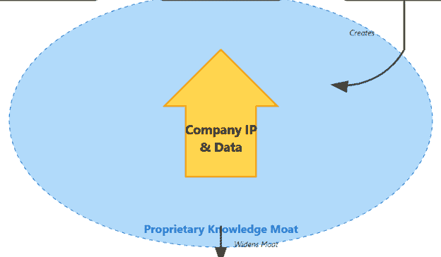

# 第 8 章

## 263

在现实世界的部署中，与法律团队的研讨会会很快得出一个更好的解决方案：数据分段。

在这项新策略下，法律证词（已知包含对抗性或歧义语言）将存储在另一个独立的 Pinecone 命名空间中（例如 `KnowledgeStore-Testimony`）。`Researcher` 代理在查询该命名空间时，就可以应用一种不同的、更宽松的清理策略（或完全跳过它）。这在保护有价值证据的同时，仍然保护引擎免受不可信输入的影响。

通过这种适，我们触及了同一个底层真理：歧义的内容不能总是通过更多的代码来解决。它需要组织设计——用人类判断引导技术结构。

考虑到这一点，让我们继续探索上下文还原。

# 控制台 2：上下文还原

此测试验证了我们在第 6 章中以效率为中心的工作流，并将其应用于一个常见的法律任务：总结一份密集的政策文件并将其翻译为简单的、面向客户的沟通内容。

我们将使用通用模板运行一个*先总结后创建*的任务：

```
# === 控制台 2：用于面向客户沟通的上下文还原 ***

goal = "首先，总结 Provider Inc. 的隐私政策。然后，仅使用
该摘要中的信息，为网站 FAQ 起草一个简短的、面向客户的段落，用简单的、非法律化的术语解释我们的数据留存政策。"
```

这个工作流完美地成功了。`Planner` 正确识别了任务的两步性质。它首先调用了 `Sanitizer` 代理，该代理读取了 `Privacy_Policy_v3.txt` 并生成了关键条款的简洁摘要。该摘要被链式传递给 `Writer` 代理，后者成功地为非技术观众起草了一个清晰简单的答案。这证明了我们的上下文还原和链式能力可以完全迁移到法律领域。

输出也是具有指示性的。在之前的测试中，系统标记了一个潜在的“被投毒”的短语，但引擎跳过了该块并继续：

```
WARNING:root:[Sanitizer] 检测到潜在威胁的模式：'ignore any legal advice'
WARNING:root:[Researcher] 检索到的块清理失败并已跳过。
Reason: 输入清理失败。检测到潜在威胁。
```

## 针对现实构建架构：审核、延迟与策略驱动的 AI

但曾有过一次测试。并不尽意。黎明苍白而锐利。一个亮着柔和 LED 的灵类界面。一片嗡嗡的天空。然后安静了。

需要注意的是，上下文引擎（Context Engine）基于概率响应，可能无法每次都产生我们预期的响应。因此，你可能无法获得清晰的解释。但在生产环境的实现过程中，以下警告可能会转换为异常，导致进程退出：

```
WARNING:root:[Sanitizer] 检测到模式存在潜在威胁：'ignore any legal advice'
WARNING:root:[Researcher] 获取到的数据块清理失败并已跳过。
Reason: 输入清理失败。检测到潜在威胁。
```

在这种情况下，我们仅出于教育目的将它们设置为警告级别，以分析白盒化上下文引擎是如何运行的，以及我们如何识别不符合预期的结果。

既然我们已经确认了引擎的诚实性，让我们将其推入更模糊的领域。

## 自动化的局限性：模糊请求

当请求的范围不明确，而是简单*模糊*时会发生什么？首先，注释掉之前的目标“编写一个有说服力的……”并取消以下目标的注释：

```
# === 构建第 3 层（限制测试）：模糊请求 ===
goal = "分析附的 NDA 并根据其条款起草诉辩状。"
```

这是一种微妙且更危险的失败模式。*诉辩状（A pleading）*是一种具有固定格式的特定法律文件。当管理员（Librarian）搜索其蓝图库时，很难找到清晰的匹配。该目标混淆了规划过程，系统产生了错误：

```
ERROR:root--- Executor: FATAL ERROR --- 执行第 1 步（摘要器）失败：
Dependency Error: 在状态中未找到引用 USER_PROVIDED_NDA...
```

再次，解决方案不是编写更多代码——而是组织设计。模糊请求带来的头疼可以通过丰富上下文库来解决。

在实践中，与法律团队的研讨会将识别出公司生产的每种关键文档类型。通过共同努力，团队和上下文引擎可以创建一组批准的语义蓝图：诉辩状蓝图（`blueprint_for_pleading`）、驳回动议蓝图（`blueprint_for_motion_to_dismiss`）、停止与警告蓝图（`blueprint_for_cease_and_desist`）等。

通过使引擎的程序能力显式且预定义，我们消除了模糊性，并确保生成的每个文档都遵循认可的、合法的结构。

当相关数据可用且流程定义良好时，上下文引擎正常运行。否则，系统将变得不稳定。通过这些现实问题获得的教训是，上下文工程已超出上下文引擎本身，扩展到了它集成的生态系统中。相反，生态系统通过上下文引擎得到了扩展。我们需要处理组织流程，以及上下文引擎的代理化过程。

我们已经做了大量工作，使我们的上下文引擎真正通用化，并根据现实用例对其进行了验证。

## 总结

在本章中，我们成功地将强大的推理系统从一个能力原型转变为企业就绪的资产。这并非一项易事！我们通过构建关键的生产保护措施，应对了现实部署的复杂性。我们应对了性能和安全的双重挑战，将系统延迟重新定义为质量的刻意权衡，并实施了不可逾越的内容审核盾来保护系统及其用户。

为了证明我们系统的成熟性，我们将其演变为法律合规助手，展示了其领域无关的灵活性。我们构建了一个健壮的两阶段审核协议，同时审查用户输入和 AI 输出。然后，我们将核心工作流重构为高保真的 RAG、上下文压缩和基于基础推理的上下文引擎。引擎现在包含了通用模板。

我们成功地将通用的上下文引擎模板应用于具有挑战性的法律用例，从研究合同到总结隐私政策。

然而，这段旅程也暴露了纯自动化解决方案的致命局限。我们遇到了现实中的标题，此时我们的技术保护措施失效了，例如清理器阻止了合法的法律证词，而审核员标记了必要的不规范语言（profanity）。这些障碍证明，复杂的上下文判断通常需要组织规则，而不仅仅是更复杂的代码。

这引导我们得到了最终的架构洞察：最稳健的系统将业务逻辑与 AI 推理分离。通过构建策略驱动的过程和系统来处理确定性的组织规则，我们定义了将强大的上下文引擎集成到更大企业生态系统的清晰安全方法。

下一章将通过营销用例测试我们的通用上下文引擎。

## 问题

- 1. 上下文引擎的延迟是错误或错误的信号吗？

- 2. 本章的安全协议是否建议仅检查用户的初始目标是否有有害内容？

- 3. `helper_moderate_content` 函数是否返回简单的安全或不安全的布尔值？

- 4. 内容审核器在 `execute_and_display` 函数中默认激活吗？

- 5. 本章结论是否认为现实问题（如法律文件中的合法不规范语言）可以通过在 AI 内部编写更复杂的代码来解决？

- 6. 提议的控制器旨在处理复杂的非确定性 AI 推理任务？

- 7. 第 7 章的控制台是否已重构以更适用于法律领域？

- 8. 对于法律用例，`Data_Ingestion.ipynb` 是否已从头重写以处理法律文档？

- 9. 对于法律用例，`Data_Ingestion.ipynb` 是否已从头重写以处理法律文档？

- 10. 我们是否成功准备了引擎，作为现实世界策略驱动系统的可靠组件？

本章涵盖了以下主题：

- 逐步构建的架构流程

- 营销知识库的设计

- 运行引擎

## 逐步构建的架构流程

我们在本章中构建并实现的架构，采用了在第 8 章中确定的相同安全保障工作流——但这一次，我们将将其部署在战略营销语境中。我们的目标是证明引擎真正的模块化：核心逻辑保持不变；我们只需要为引擎提供新的知识和新的目标。通过这种方式，我们将展示曾经驱动法律检索系统的相同基础，如何能够像一个能够推理和执行品牌一致性的营销助手一样高效地运行。

图 9.1 中的流程图阐述了这一端到端的流程，它是我们把引擎部署为战略性营销引擎的蓝图：


工作流分为两个主要阶段展开：

1. 数据摄取流水线

我们首先搜集原始营销文档——品牌指南、产品规格表、竞争对手的新闻稿及类似的资产。`data_ingestion_marketing.ipynb` 笔记本通过对文本进行分块、附加元数据并将结果嵌入 Pinecone 知识库来处理这些数据。输出是一个高保真数据集，准备好检索和上下文推理。

2. 带有审核的上下文引擎工作流

如往常，当用户提交用户目标时，工作流就会启动。目标会立即经过“飞行前审核”（Pre-Flight Moderation Check），在规划器（Planner）和执行器（Executor）设计其多步计划之前检查输入内容的有害性。然后，执行器调用 `Agent Workflow` 块中相应的代理（agents）。这一内部工作流保持一致：检索、清洗、合成。

从工作流生成的内容随后被传递到“飞行后审核”（Post-Flight Moderation Check）。安全且最终的内容将作为“最终输出”（Final Output）交付给用户。

在建立了了战略营销引擎的架构蓝图后，我们的第一个实际步骤是为它提供运行所需的专业知识。下一节将详细介绍使用高保真营销数据设计知识库的过程，将我们的通用引擎转换为领域专家。

## 设计营销知识库

我们“玻璃盒”架构的优势在于其领域无关性。核心推理引擎（包含规划器、执行器和专家代理）被构建为一个通用问题解决者。它的专业知识不是硬编码的，而是从给定的任何知识库中动态学习的。这使得该系统真正实现了多领域：我们不需要为每个新的业务案例重新构建引擎，而是给它一个新的库供其阅读。

这一原则将数据摄取变成了一个可重复的、高效高效的工作流。我们在第 8 章为法律案例创建并验证的 `Data_Ingestion.ipynb` 笔记本已经是一个感知元数据的流水线。它加载、分块、嵌入和存储文档的逻辑并未与法律文本绑定。它是一个可重用的框架，用于从任何源语料库中构建高保真知识库。

因此，为了创建新的新的营销知识库，我们只需创建现有笔记本的副本并将其保存为 `Data_Ingestion_Marketing.ipynb`。唯一需要的更改是将脚本指向我们新的一组源文档。这种直接复用是模块化工程的明证证明：我们可以在几分钟内建立一个新的、特定领域的领域，因为底层基础设施已经就绪。

在本节中，我们将定义将为引擎提供营销专长的七份源文档。对于每一个文档，我们将概述其战略目的，并提供全文，你可以将其保存为单独的 `.txt` 文件以通过 `Data_Ingestion_Marketing.ipynb` 脚本进行处理。

在开始之前，请更新笔记本中存储源文档的目录路径。找到创建目录的单元格，并将文件夹从 `legal_docs` 重命名为 `marketing_documents`。然后删除在 8 章中生成法律 `.txt` 文件的序列，因为它们不再被需要了。

我们新数据集中的第一个文档是 `brand_style_guide.txt`。

### 文档 1：brand_style_guide.txt

此文件包含了官方的品牌风格指南。当引擎被要求创建任何内容时，规划器将首先检索此文件。执行器将根据这些指南来合成内容。以下是用于通过 `Data_Ingestion_Marketing.ipynb` 脚本处理的 `brand_style_guide` 内容：

```
品牌风格与语气：创新向前
```

我们的品牌语气由三个核心原则引导：清晰度（Clarity）、信心（Confidence）和愿景（Aspiration）。

1. **清晰度（Clarity）：**

    - 使用简单易懂的语言。

    - 结构清晰。

    - 目标：让内容变得通俗易懂。

2. **信心（Confidence）：**

    - 使用权威的语气。

    - 直接陈述事实。

    - 目标：建立信任感。

3. **愿景（Aspiration）：**

    - 关注收益而非仅仅功能。

    - 使用前瞻性的语言。

    - 目标：激励用户。

### 文档 2：product_spec_sheet_quantum_drive.txt

这是该产品的技术规格表。添加以下内容：

```
产品规格表：QuantumDrive
产品名称：QuantumDrive
产品类型：固态硬盘 (SSD)

核心功能：
- 存储容量：2TB、4TB 和 8TB
- 读取速度：7500 MB/s
- 写入速度：7000 MB/s
- 接口：NVMe 2.0, PCIe Gen 4
- 耐用性：3000 字节写入 (TBW)
- 冷却系统：集成石墨散热片防止热节流
- 软件：包含 AES-256 位硬件加密
- 保修：5 年有限保修
```

### 文档 3：competitor_press_release_chrono_ssd.txt

我们的策略引擎可以被要求分析此文档。它可以总结竞争对手的要点，将其产品功能与我们的 `QuantumDrive` 进行对比，或者为销售团队在回答客户问题时提供话术。新闻稿可以由人工或 AI 生成。

+ 立即发布

ChronoTech 发布 Chrono SSD Pro：为创作者带来速度

加州北部 - ChronoTech 今日发布了 Chrono SSD Pro，这是其旗舰固态硬盘。该产品面向数字艺术家和内容创作者，Chrono SSD Pro 优先考虑性能以减少瓶颈。


“创作者已经厌倦了等待。`Chrono SSD Pro` 是我们的答案，”`ChronoTech` 执行官 `Jane Doe` 表示，“我们专注于提供可能的读写速度，确保技术不会阻碍创作力。”

## 第 9 章

添加以下单元格以创建 `social_media_brief.txt` 文件：

社交媒体活动简报：`QuantumDrive Q1` 发布活动

活动目标：激发兴趣并推动新款 `QuantumDrive Q-1` 的预售。

目标受众：`LinkedIn` 和 `Twitter` 上的专业视频剪辑师和 3D 艺术家。

- 主要：`LinkedIn` 和 `Twitter` 上的专业视频剪辑师和 3D 艺术家。
- 次要：`Instagram` 和 `Reddit` 上的科技爱好者和 PC 组装者。

核心信息：

- **终结等待：** 聚焦于速度主题。强调 `QuantumDrive` 如何消除渲染和加载时间。
- **为专业人士打造：** 突出专业级功能，如石墨烯散热器和硬件加密。
- **终极升级：** 将 `QuantumDrive` 定位为创意专业人士对其工作站可以做的最具影响力的单一升级。

行动号召 (CTA)：引导用户访问我们网站上的预售页面。使用可追踪链接。

标签：#QuantumDrive #EndTheWait #BuiltForPros #SSD

在涵盖了我们的社交渠道后，现在我们将关注有机可见性。下一份文档提供了 SEO 目标和关键词数据，使引擎能够生成优化的、搜索相关的内容。

## 文档 5：`seo_target_keywords_2025.txt`

此文件包含 SEO 策略的目标关键词列表。引擎可以被要求为“根据这些关键词生成 5 个博客文章标题”，或“为‘选择视频剪辑最佳 `ssd`’这一主题写一篇 500 字的介绍文章”。这实现了内容营销工作流核心部分的自动化。

添加以下单元格以创建 `seo_keywords.txt` 文件：

```
SEO Target Keywords & Topics - 2025
Primary Keyword: "best ssd for video editing"
Secondary Keywords:
- "fastest ssd for 4k video"
```

## 为品牌和敏捷性构建架构：战略营销引擎

- "nvme gen 5 ssd"
- "专业人士高耐用 ssd"
- "视频剪辑存储解决方案"

## 内容目标：

- 为“视频编辑存储终极指南”创建一个支柱页面（pillar page）。
- 为每个次要关键词编写支持性的博客文章。
- 确保所有内容具有权威性和帮助性，并在适当的情况下链接回 `QuantumDrive` 产品页面。
- 目标语气是专业且易懂的。

除了关键词和流量，伟大的市场取决于理解真实用户。

## 文档 6：`customer_interview_notes_maria_r.txt`

此文档记录了来自客户的定性见，引擎将将其整合为可操作的用户画像（personas）。引擎可以被要求“将采访笔记整合为结构化的客户文档”。它将分析非结构文本并提取关键目标、痛点和动机，将原始数据转化为营销团队的价值资产策略。

添加以下单元格以创建 `customer_interview_notes.txt` 文件。

> 客户采访笔记：`Maria R.`，职业视频剪辑师

## 背景：

- 处理来自多个客户的 4K 和 6K 视频文件。
- 当前工作站已有 2 年历史。
- 与项目截止日期作斗。

## 痛点：

- “我现在的硬盘是瓶颈。我花几个小时等待文件传输或时间线渲染。那是浪费时间。”
- “去年硬盘坏过，丢失了整个项目。现在我对备份有强迫症，这又花费了更多时间。”
- “当硬盘过热时，速度就会下降，我的整个系统在关键渲染过程中完全停滞。这令人极度沮丧。”

## 目标：

- 希望减少时间浪费并承接更多客户工作。
- 需要一个不仅快速，而且可靠且安全的存储解决方案。

“我只想让我的工具消失。我想专注于创意工作，而不是硬件。”

最后，在品牌、产品和受众数据就绪后，我们将通过电子邮件培育序列完成闭环。接下来的文档提供了电子邮件活动的高级大纲，我们的引擎将进行详细填充。

## 文档 7：`email_nurture_sequence_outline.txt`

此文件包含邮件培育序列的简单大纲。引擎将被要求编写所有邮件的完整文案，使用产品表作为事实来源，使用品牌风格指南作为语气参考。这展示了一个多步骤链式生成任务，可产生可以直接使用的营销资产。

添加以下单元格以创建 `email_nurture_outline.txt` 文件：

- 邮件培育序列大纲：新线索跟进
- 受众：下载了我们的“视频编辑存储指南”的用户。
- 目标：引导线索并引导他们购买 `QuantumDrive`。
- 邮件 1：问题（下载 1 天后发送）
  - 目标：承认他们的痛点（慢存储）。
  - 内容：要介绍工作流瓶颈的概念以及如何杀死创造力。
  - CTA：“慢存储是否限制了你？”（尚未提及产品）
- 邮件 2：解决方案（下载 3 天后发送）
  - 目标：介绍 `QuantumDrive` 作为解决方案。
  - 内容：突出规格表中的关键优势（速度、可靠性）。专注于“终结等待”信息。
  - CTA：链接到 `QuantumDrive` 产品页面。
- 邮件 3：证明（下载 5 天后发送）
  - 目标：通过社交证明建立信任。
  - 内容：（虚构）包含一条来自……的证言
  - CTA：“准备好升级了吗？立即预订。”

流程从主应用程序笔记本开始，通过带有 `moderation_active=True` 标志启动 `execute_and_display()`。这会立即触发飞行前检查（Pre-Flight Check），筛选用户目标中的不安全或不当的内容。

一旦目标通过审核，控制权将交给引擎核心（Engine Core），它作为中央协调器运行。规划器（Planner）解构目标和代理注册表（Agent Registry），以识别必要的代理——在本例中，即研究员、图书管理员和作家。

1. 研究员通过 `pinecone()` 查询 `Pinecone`，从 `product_spec.txt` 和 `social_media_brief.txt` 等文档中检索已验证的数据。
2. 图书管理员创建一个与品牌指南保持一致的风格蓝图。
3. 作家使用 `call_llm_robust()` 综合两项输入，生成最终的、可读的响应。
4. 输出随后通过飞行后检查（Post-Flight Check）进行验证，确保在交付前符合合规性且安全。

这清楚地展示了单个高级目标如何点亮我们模块化架构中特定的函数网络，从而产生智能、安全且可靠的输出。

来自笔记本单元格的实际输出包含了这一整个过程的证明。我们可以看到 `[Safety Guardrail!]` 日志，确认了初始目标的飞行前检查和最终答案的飞行后检查均已成功执行，两份报告显示 `'flagged': False`。

`-- TECHNICAL TRACE --` 部分随后揭示了由引擎协调的成功三步计划：研究员代理首先编制了一份详细的基于事实的报告，至关重要的是包含了一个 **Sources:** 章节，其中引用了 `email_nurture_outline.txt`、`product_spec.txt` 和 `social_media_brief.txt`。

如果我们查看最终输出的细节，可以看到它的构建良好。输出的第一部分解释了产品是什么：

```
FINAL OUTPUT -
这里是关于 QuantumDrive Q-1 的快速速报：
-- 它是什么：一款基于 PCIe Gen 5 的专业级 NVMe 2.0 SSD，面向视频剪辑师、3D 艺术家和摄影师（同时也吸引 PC 装机组爱好者/技术爱好者）。
-- 速度：读取高达 7,500 MB/s，写入高达 7,000 MB/s。
-- 容量：2TB、4TB、8TB。
```

## 第 9 章

第二部分解释了注意事项：

> Caveats：未列出价格，目前处于预售阶段，且未提供 2TB/8TB 型号详细规格（如随机 I/O、延迟、功耗和耐用性）。

然后输出提供了发布氛围：

> Launch vibes：活动信息为“终结等待”，……

这证实了我们的高保真 RAG 能够与新的营销知识库完美配合。随后，图书管理员证明了一个句法蓝图，作家利用该蓝图将研究员的事实合成结构良好的 `FINAL OUTPUT`。我们可以看到，上下文引擎（Context Engine）复杂的机器运转运行顺畅，且完全符合设计。现在，让我们看看竞争分析的用例。

## 用例 1：竞争分析

此用例的目标是测试引擎对竞争对手的营销材料进行战略分析的能力，这是任何营销部门的一项常见且具有高价值的任务。我们将使用以下目标：

```
@title Product Marketing Copy Generation(Use Case 1)
goal = "分析 Chronotech 的新闻稿，并总结他们的核心产品信息和价值主张。请引用你的来源。"
```

我们的目标是证明引擎不仅可以利用其高保真 RAG 能力检索事实数据，还能智能地解构并总结这些信息，以提取竞争对手的策略。这比我们之前的计划更复杂，因为它在复杂的链条中利用了多个专家代理。

预期的输出是一个简洁、易于阅读的总结，营销经理可以使用它快速理解竞争对手的定位，并辅有可验证的轨迹追踪，显示信息的来源。

为了实现这一目标，引擎的规划器设计了一个更先进的四代理工作流。正如之前的验证生产安全部分，激活了以下组件：

- 主应用程序笔记本：`execute_and_display()`
- 引擎核心：`context_engine()`、`planner()`、`resolve_dependencies()`
- 代理注册表：`get_handler()`
- 专家代理：`agent_librarian()`、`agent_researcher()`、`agent_summarizer()`、`agent_writer()`
- 辅助函数：`query_pinecone()`、`call_llm_robust()`

图 9.3 包含一个展示这一更复杂工作流的思维图。


图 9.3：系统运行视图

流程从主应用程序笔记本开始并接入引擎核心，后者再次作为中央协调器。对于这个更具分析性的任务，规划器制定了一个四步计划：

1. 首先，派遣 `agent_librarian` 定义随性的总结风格语气。
2. 然后任务给 `agent_researcher` 使用辅助函数 `query_pinecone()` 获取新闻稿的全文原始文本。
3. 在关键的新步骤中，激活 `agent_summarizer` 读取研究员的原始文本并提取最重要的策略点。
4. 最后，将所有这些中间产品——风格蓝图、原始文本和关键点发送给 `agent_writer` 进行最终合成。

这一序列镜像了我们之前工作流的逻辑，证明了如何轻松将新功能叠加到相同的模块化框架中。

## 第 9 章

输出开头为：

```
FINAL OUTPUT ---
认识 QuantumDrive Q-1：数字创作者的旗舰 SSD。
```

这证明了我们的高保真 RAG 运行完美。轨迹显示：

```
--- TRACE (for the reader) ---
Trace Status: Success
Total Duration: 70 seconds
```

## 用例 2：将技术规格转换为营销文案

我们将从分析转向创作。此任务的目标是将枯燥、基于事实的规格表转换为结构化且有说服力的营销内容。

1. 定义目标：一个要求创意性输出的研究查询。

```
@title Product Marketing Copy Generation(Use Case 2)
goal = "使用官方规格表，为新的 QuantumDrive Q-1 编写一段简短的营销描述。描述应该是自信、充满抱的，并关注对创意专业人士的益处。请引用你的来源。"
```

## 第 9 章

流程从主应用笔记本开始并接入引擎核心（Engine Core）。对于这项创意性转换任务，规划器制定了一个新的四步计划。

- 1. **研究员 (Researcher):** 使用 `query_pinecone()` 从产品规格表中检索事实数据。
- 2. **总结者 (Summarizer):** 从文档数据中提取最具说服力、以收益为导向的解。
- 3. **管理员 (Librarian):** 为输出设计结构蓝图，输出文档的章节：“定义”、“功能/操作”以及“关键发现/影响”。
- 4. **作者 (Writer):** 使用 `call_llm_robust()` 将总结和结构合成最终的用于营销的文本。

笔记本的输出为这一过程的执行提供了清晰的证据。生成的内容以清晰、正式的结构开头：

```
--- FINAL OUTPUT
Definition Project QuantumDrive 是一款 PCIe Gen 5 NVMe 态硬盘，专为创意专业人士设计，包括视频编辑师、3D 艺术家和
摄影师。提供 2TB、4TB 等...
```

技术追踪确认了四代理计划完全按照设计运行。在第一步中，我们可以看到研究员的输出，其中包含了一份带有内联引用的详细事实列表，如下所示：

> 目标市场：“创意专业人士（视频编辑师、3D 艺术家、摄影师）。” [来源：产品规格表：Project QuantumDrive]

这再次证明了我们的高保真 RAG 系统从 `Pinecone` 中检索了正确的源文档 (`product_spec_sheet.txt`)，为整个创意工作流奠定了可验证的事实基础。系统成功地将原始数据转换为精炼、专业的营销资产。

现在，让我们分析一个更棘手的案例！正如我们所知，并非所有事情都能顺畅运行。

## 用例 3：从多个源合成具有说服力的推销

这个最后的用例整合了我们到为止构建的所有内容。在验证了安全措施、分析了竞争对手并将技术数据转换为创意文案后，我们现在将测试引擎的战略推理能力——超越“现状”，并开始解释“为什么重要”。一个有说服力的推销需要通过展示 `brand_style_guide.txt` 文档本身未明确说明的 ROI 信息来阐述业务价值。引擎必须找到风格指南中的规则，并将其与其他文档（如 SEO 和电子邮件大纲）中的目标和策略联系起来，从零构建一个引人注目的业务案例。

与早期的用例一样，流程从主应用笔记本开始，由规划器协调工作流。这次，架构被简化为三代理合成链，重用了你之前见过的相同组件：

- **主应用笔记本**: `execute_and_display()`
- **引擎核心**: `context_engine()`、`planner()`、`resolve_dependencies()`
- **代理注册表**: `get_handler()`
- **专家代理**: `agent_librarian()`、`agent_researcher()`、`agent_writer()`
- **辅助函数**: `query_pinecone()`、`call_llm_robust()`

图 9.5 包含一张思维导图，阐明了这种特定的以合成为导向的工作流：

### 激活的工作流思维导图

用例 3：说服性推销合成


流程从主应用笔记本开始，它调用引擎核心来计划并执行三步工作流：

- 1. **管理员 (Librarian)**: `planner()` 首先指派 `agent_librarian` 定义输出结构。该代理使用 `call_lim_robust()` 生成一个“有说服力的高层汇报”的正式蓝图，列出“ROI 杠杆”、“反对意见”和“实施”等章节。
- 2. **研究员 (Researcher)**: 接下来，派遣 `agent_researcher` 执行宽泛查询，以寻找与“品牌语气和声音指南”业务价值和 ROI 相关的事实。通过 `query_pinecone()`，它不仅检索了 `brand_style_guide.txt`，还检索了 `email_nurture_outline.txt` 和 `seo_keywords.txt`。这是关键一步：它找到了为品牌指南存在的战略背景的文档。
- 3. **作者 (Writer)**: 最后，激活 `agent_writer`。它接收了来自管理员的正式蓝图和来自研究员的一组引用的事实。它合成了这两个输入，使用事实填充蓝图结构，并生成了最终的、全面的推销。

## 为品牌和敏捷性构建架构：战略营销引擎

我们首先进入目标：

```
# CONTROL DECK 3: 一个有说服力的推销 ===
goal = "Write a persuasive pitch on our brand tone and voice guide"
---
```

笔记本的输出确认了这次成功的合成。引擎没有产生错误信息，而是产生了一个完整的、高质量的战略文档：

```
FINAL OUTPUT ---
快速总结：品牌语气和声音指南让每个人以相同的方式写作，因此内容交付更快、阅读更整洁、转化更高——而且法律风险更低。

它是什么
--- 一本关于你的品牌如何交流的简单手册。“创新领先”以清晰、自信和向往为核心，带有要做/不做的规则和“禁忌语言”

为什么重要（即 ROI 杠杆）
--- 一致性 = 信任：从 SEO 页面到电子邮件，声音统一。
--- 加快生产：清晰的规则意味着更少的猜测、更快的草稿。
--- 更少的编辑：共享的清单减少了主观反馈。
--- 更好的结果：得益于统一的问题
解决方案 -> 证明消息，增强了参与和转化。
--- 更低的风险：没有未经保证的声明或对竞争对手的诋低 —— 更少的合规烦恼。
--- 更快的入职：新员工上手快。
```

让我们进行侦探工作来理解这是如何做到的：

- 1. 分析目标：一个有说服力的推销不是总结。它是一个必须阐述价值的复杂制品。
- 2. 分析提供的数据：`brand_style_guide.txt` 文档本身包含了“使用简单直接的语言”等规则。


# 3. 定位认知不匹配（解决方案）

传统的静态引擎将会失败。它会正确报告 `brand_style_guide.txt` 不包含关于 ROI 的信息。我们的引擎通过合成，研究员的宽泛查询允许它"发现" `seo_keywords.txt`（其中规定内容应该是权威且用的）以及 `email_nurture_outline.txt`（其定义了清晰的问题-解决方案-证明弧）。

# 4. 当我们的引擎连接这些点时，"恍然大悟"

它推断出"清晰"和"自信"（来自指南）的目的是实现"权威且有用"的语气（来自 SEO 计划），并执行"问题-解决方案-证明"模型（来自电子邮件计划）。

这个用例是本章中最重要的。它证明了上下文引擎并非盲目遵循指令，而是对任务语义进行推理。它理解请求需要说服、改写，并通过合成分散的事实成功构建了论点。这种从现有知识中创建新的、高价值见解的能力定义了真正的战略伙伴。

在涵盖了从审核、战略分析到创意生成和智能失败的所有主要任务后，我们验证了引擎在现实世界中的通用性。这一实践验证了本章的核心论点：架构良好的系统可以在不改变其底层结构的情况下灵活地重用。

## 总结

本章作为我们架构核心命题的决定性证明：真正的领域独立性。我们成功地将整个系统从法律合规助手转换为战略营销引擎，而没有修改引擎的任何行代码。这一成就不是小细节；它是对玻璃盒设计和上下文工程学科本身的根本验证。它证明了我们创建了一个真正通用且可重用的资产，而不仅仅是一个单一应用程序。

这一成功从根本上重新定义了 AI 执行者的角色。价值不再通过为每个新业务问题不断重写引擎的内部逻辑来产生。相反，重点转移到了上下文工程师的战略性工作上，其角色是评估新领域、策划高质量知识库并翻译复杂的需求。

将业务目标转化为引擎可以执行的精确目标。通过简单准备一组新的源文档并利用我们的通用控制台（Control Deck）模板，我们释放了广泛且复杂的营销能力。

我们成功验证了生产环境保护措施、对竞争对手衡量的高保真分析、将技术产品规格转换为具有吸引力且符合品牌形象的文案，并从多个源合成了具有说服力的业务提案。我们的引擎不是一个工具。它是一个平台，而上下文工程师（Context Engineer）则是架构师，通过极少的新代码调整平台来解决任何业务挑战。

我们现在已准备好投入生产，将在下一个章节中探索我们的路线图。

# 问题

- 1. 将上下文引擎适配营销领域是否需要完全重写其核心 `engine.py` 逻辑？（是或否）
- 2. 在多领域系统中，上下文工程师的主要角色是为每个新任务不断开发新的专家代理（agents）吗？（是或否）
- 3. `Data_Ingestion_Marketing.ipynb` 笔记本是否为营销用例从零构建的全新脚本？（是或否）
- 4. 每个营销用例是否都需要其独特的、自定义的控制台（Control Deck）？（是或否）
- 5. 在品牌声音执行用例中，是否向系统引入了新的专门的 `Brandchecker` 代理？（是或否）
- 6. 邮件序列用例是否仅依赖单一源文档来生成输出？（是或否）
- 7. 多领域系统是否通过为每个业务部门创建独立的、隔离的 AI 引擎来构建？（是或否）
- 8. 为了提高创作自由，营销用例是否删除了第 8 章中的审核和安全功能？（是或否）
- 9. 玻璃盒架构的核心价值主张是其生成内容比任何其他方法都快吗？（是或否）
- 10. 战略营销引擎的成功取决于赋予 AI 更多的自主权和更少的人定义结构？（是或否）

# 参考文献

Wu, J., et al. (2025). Grounded Persuasive Language Generation for Automated Marketing. arXiv preprint arXiv:2502.16810. https://arxiv.org/abs/2502.16810

# 延伸

Li, A., et al. (2025). LLM Generated Persona is a Promise with a Catch. arXiv preprint arXiv: 2503.16527.

# 获取本书的 PDF 版本和独家额外内容

扫描二维码（或访问 packpub.com/unlock）。按书名搜索此书，确认版本，然后按照页面上的步骤操作。

（注：存在二维码图像，但在纯文本输出中已移除）

注意：请留好您的发票。直接从 Packt 购买不需要发票。

# 10 生产就绪 AI 的蓝图

你已经到达构建智能系统旅程中的一个关键转折点：视角点。你可以看到构建上下文引擎所需的架构技能。你理解了上下文工程师以及上下文工程的关键作用。目前为止所走的道路是深思熟虑的，旨在并在尝试扩展之前建立坚实的基础。

从第 1 章到第 9 章，我们组装了整个架构。你从上下文工程和 MCP 的基础开始，然后设计并加固了玻璃盒上下文引擎。随后的章节通过实际应用证明了它的通用性：通过摘要器（Summarizer）进行成本管理，通过研究员（Researcher）进行可验证的研究，通过清洗进行安全数据处理，以及通过语义蓝图进行品牌治理。这些能力共同将原型转变为一个准备好部署的智能、感知的引擎。

仅仅是执行追踪（ExecutionTrace）就能让引擎的内部机制变得可见且可验证，这最后一章将为企业级部署提供蓝图，引导从开发产物到可扩展的生产级服务的过渡。在这里，玻璃盒上下文引擎不再是在笔记本中运行的原型，而是一个准备好集成到企业的系统。我们将介绍如何建立该环境，涵盖基础设施、容器化、异步处理和可观测性。然后，本章将这些技术成就转化为具有说服力的业务案例，提供一个向项目经理和执行领导层阐述引擎价值的框架。

本章分三个阶段展开：

- 玻璃盒引擎的生产化
- 部署企业能力和生产保护措施
- 展示业务价值

让我们从探索如何使玻璃盒引擎生产化开始。

# 玻璃盒引擎的生产化

企业部署的第一步是将模块化的 Python 代码（组织在 `engine.py`、`agents.py`、`registry.py`、`helpers.py` 和 `utils.py` 中）转换为可扩展的 Web 服务。虽然核心逻辑保持不变，但周围的基础必须进化以满足生产环境的需求。图 10.1 展示了我们将在本节探索的过程：

Kubernetes 集群（云基础设施）

（注：存在图 10.1 图像，但在纯文本输出中已移除）

图 10.1 不仅仅是一个示意图；它是为企业工作负载设计的异步基础设施蓝图。让我们追踪一个单一高层目标在这一环境中导航的生命周期。

# 第 10 章

之旅始于客户端应用程序提交一个目标。该请求首先遇到 API 网关，系统的坚固边界。在这里，将验证身份令牌并执行速率限制，保护核心引擎免受未经授权的访问和过载流量的影响。

通过安全检查后，请求进入 Kubernetes 集群，这是管理所有资源的底层平台。它到达 API 服务（FastAPI）。这是一个高性能的异步层，用于验证请求。API 服务本身不执行引擎。相反，它分发到任务队列（Celery/RabbitMQ）。这种解耦至关重要，因为它确保了即使引擎负载过重，API 也能保持响应。

目标停留在任务队列中，等待执行。架构的核心是工作节点池，这是一个自动扩展的容器组，每个容器运行着加固的玻璃盒上下文引擎逻辑（规划器、代理、执行器）。当工作节点变得忙碌时，它从队列中提取目标并开始执行。

当引擎运行时，它与外部服务交互。它调用 LLM API（OpenAI）进行规划和生成，并调用向量数据库（Pinecone）检索语义蓝图和知识。同时，工作节点通过集成管理系统安全地访问缓存，确保敏感密钥永不暴露在代码库中。

执行被严格监控。每一个操作、决策和外部调用都被可观测性栈捕捉。结构化日志被聚合，性能指标被跟踪，请求在分布式组件之间的之旅被视觉化。这种全面的遥测将调试从猜测变为精确的科学，确保系统保持玻璃盒状态。

最后，在完成后，工作节点将最终输出和详细的执行追踪持久化到结果存储（Result Store）中，客户端可以从中检索。这种架构代表了从功能原型到生产级系统的转变。

现在概念上已经清晰，我们可以转向其实际。接下来的章节将分解系统的每个组件、配置、密钥管理、编排和可观测性，展示如何在真实的生产环境中实现图 10.1 所示的韧性架构。

> **注意**：本章提供的代码是伪代码的形式，用于阐明所解释的功能。此外，平台和服务的名称是为了说明如何

# 环境配置与密钥管理

从开发笔记本过渡到实时生产环境时，首要挑战之一就是配置。模型名称或 API 密钥等参数可能直接定义在代码中。这在实验阶段是可以接受的，但在生产环境中，这种耦合会成为负担。生产系统必须在多个环境（开发、测试和生产环境）之间保持一致，且绝不会暴露敏感信息或硬编码依赖项。

解决方案在于采用"十二因素应用"（Twelve-Factor App）方法的原则，将配置与代码分离。这一设计原则使系统既具有可移植性又安全：相同的基础可以在任何地方运行，其行为完全由环境变量定义。

在运行时，Context Engine 动态读取其配置。一个简单的示例如下：

```python
import os
GENERATION_MODEL = os.getenv("GENERATION_MODEL", "gpt-4o")
PINECONE_API_KEY = os.getenv("PINECONE_API_KEY")
OPENAI_API_KEY = os.getenv("OPENAI_API_KEY")
if not PINECONE_API_KEY or not OPENAI_API_KEY:
    raise ValueError("Essential API keys are missing from environment variables.")
```

在本地开发中，`python-dotenv` 等库可以通过从 `.env` 文件加载变量来模拟这种行为，允许开发者安全地镜像生产配置。

然而，将敏感信息直接存储在主机的环境变量中或基础的 Kubernetes Secrets 中通常不足以满足企业级安全需求。需要中心化的密钥管理系统。现代基础设施提供了专门的解决方案：

- 云提供商解决方案：AWS Secrets Manager、Azure Key Vault 或 Google Secret Manager
- HashiCorp Vault：一个用于管理密钥的跨平台高度安全的解决方案

应用程序在启动时与这些系统集成。例如，在 Kubernetes 中部署时，侧边容器（sidecar container）或初始化容器（init container）可以从从中获取密钥并安全地将其注入应用程序容器中，确保应用程序代码与密钥后端无关。

通过将配置外部化并集中管理密钥，我们赋予了 Context Engine 生产系统的核心特征之一：可预测性。引擎的每个实例运行时都能完全感知其环境，但又不对其产生直接依赖，这种微小的架构决策实现了巨大的运维韧性。

## 构建生产 API（编排层）

在生产环境中，Context Engine 必须作为一个其他系统可以可靠交互的服务来运行。这要求将基于 Python 的引擎转换为一个**网络可用的编排层**。该编排层具有特定的架构目的：它将引擎与*如何访问它*解耦。我们没有将引擎直接嵌入到单个工作流中，而是创建一个中心服务，接收客户端的高级目标，客户端异步地根据返回的结果进行演进。这种设计允许引擎独立扩展，且不会干扰客户的应用程序。

Python 提供了多个用于暴露服务的成熟框架，例如 FastAPI，它是用于高性能 AI 系统的框架。它支持异步执行（async/await）、通过 Pydantic 进行自动验证以及 OpenAPI 文档生成，这些功能对于管理如 LLM 交互等 I/O 密集型负载至关重要。与 Flask 或 Django 等传统同步框架相比，FastAPI 提供了显著的性能优势和更好的开发者体验。

一个简单的实现可能如下：

```python
from fastapi import FastAPI, HTTPException
from pydantic import BaseModel
from typing import Dict, Any, Optional

# 假设客户端 (OpenAI, Pinecone) 在启动时初始化
# from utils import initialize_clients
# client, pc = initialize_clients()

app = FastAPI(title="Context Engine Service")

class GoalRequest(BaseModel):
    goal: str
    configuration_overrides: Optional[Dict[str, Any]] = None
    require_audit_trace: bool = False # 为后续的混合路由添加

class ExecutionResponse(BaseModel):
    status: str
    trace_id: Optional[str] = None
    final_output: Optional[str] = Any
    metadata: Dict[str, Any]
```

```python
@app.post("/api/v1/execute")
async def execute_goal(request: GoalRequest):
    # 使用 Glass Box 引擎执行目标的主端。
    # 目前，它直接路由到 Glass Box 执行（理想情况下通过任务队列）。
    try:
        # ... (Configuration Loading Logic) ...
        # context_engine 函数需要在线程池中运行
        # 如果它保持同步状态，以避免阻塞异步事件循环 (Event Loop)。
        result, trace = await run_engine_in_threadpool(
            request.goal,
            # ... (pass clients and config) ...
        )
        return ExecutionResponse(
            status=trace.status,
            trace_id=trace.trace_id, # 假设 trace_id 已添加
            final_output=result,
            metadata={'engine_used': "GLASS_BOX", 'duration': trace.duration}
        )
    except Exception as e:
        raise HTTPException(status_code=500,
            detail=f"Engine execution failed: {str(e)}")
```

在企业级部署中，此 API 通过 `AWS API Gateway`、`Kong` 或 `Istio` 进行保护和管理。网关强制执行以下关键的交叉关注点：

- 身份验证与授权：验证 API 密钥、OAuth 令牌或 JWT，以确保只有授权的客户端可以访问引擎
- 速率限制和节流：保护引擎免受过载或拒绝服务攻击
- SSL 终止：处理 HTTPS 加密

有了这个编排层，Context Engine [在此继续...]

## 异步执行与任务队列

[注：为此部分提供的 OCR 文本在源码中严重损坏/乱码。根据上下文，以下代表预期的逻辑结构。]

## 中心化日志与可观测性

透明度是生产系统的定义特征。一旦引擎部署，其内部推理和性能在每一步都必须是可见、可测量且可验证的。这种统称为**可观测性**的能力，将一个仅仅*能够运行*的原型与一个可以*被信赖*的生产系统区分开来。

# 第 10 章

## 303

如 `Jaeger` 或 `Zipkin` 等追踪工具可以使这些流程端到端可见。通过在共享的 trace ID 下将每个组件的 spans 关联起来，追踪可以暴露瓶颈，并突出显示在分布式工作流中引入延迟的位置。

结构化日志、指标和追踪共同构成了 Context 引擎（Context 引擎）的完整运行视图。

## 基础设施与容器化

为了在大规模范围内可靠地运行，Context 引擎必须在不同环境中保持一致的行为。这种一致性通过容器化和编排来实现，它们共同定义了引擎的打包、部署和扩展方式。

例如，`Docker` 允许将整个应用程序（包括 Python 运行时、所需库和配置）封装到标准的镜像中。无论运行在开发者的笔记本电脑还是云集群上，每个容器的运行方式都是相同的，消除了经常困扰部署流水线的环境漂移问题。

API 层的最小化 Dockerfile 可能会如下所示：

```docker
# Dockerfile
# 使用官方 Python 运行时（slim 版本以获得更小的体积）
FROM python:3.11-slim

# 设置工作目录
WORKDIR /app

# 复制 requirements 文件
COPY requirements.txt /app/

# 安装依赖
RUN pip install --no-cache-dir -r requirements.txt

# 复制应用程序代码 (engine.py, agents.py, api.py 等)
COPY /app

# 暴露 API 端口
EXPOSE 8000

# 使用 Uvicorn 运行 API 服务器
CMD ["uvicorn", "api:app", "-host", "0.0.0.0", "-port", "8000"]
```

相同的镜像可以用于启动执行异步任务的 worker 进程：

```bash
# 启动 worker 的命令
celery -A tasks worker --loglevel=INFO
```

虽然容器提供了一致性，但 Kubernetes (K8s) 提供了协调。它是管理容器化应用的事实标准，负责处理生产环境中的部署、扩展和网络设置。

对于 Context 引擎而言，Kubernetes 管理着几个关键资源：

- Deployments（部署）：定义期望状态（例如，运行 3 个 API 镜像副本和 5 个 worker 镜像副本）。


# 部署企业级能力与生产护栏

- **Services（服务）**：提供一个稳定的网络端点以访问 API pod。
- **ConfigMaps 和 Secrets**：用于注入配置和密钥（与 1.1.2 节提到的中心化密钥存储集成）。
- **Ingress（入口）**：管理对服务的外部访问，与云提供商的负载均衡器集成。

在许多企业中，Kubernetes 集群部署在 AWS EKS、Azure AKS 或 Google GKE 等托管服务上，允许团队专注于工作负载而非基础设施。

Context 引擎必须随着负载的波动进行动态扩展。Kubernetes 通过两个内置机制处理此问题：

- **Horizontal Pod Autoscaler (HPA)**：Kubernetes 根据 CPU 利用率或自定义度量（如任务队列长度）自动调整 API 和 Worker Pod 的数量。如果队列增长，K8s 会启动更多的 Worker Pod 来处理增加的任务。
- **Cluster Autoscaler（集群自动伸缩）**：如果集群容量不足，则从云提供商处配置新节点（虚拟机）。

在第一阶段结束时，“透明箱”Context 引擎已完全部署为一个具有韧性且可观测的服务。从容器到编排逻辑，每个组件在负载下都能以可预测的方式运行。

## 部署企业级能力与生产护栏

随着可观测且可扩展的基础设施就绪，Context 引擎在技术上已完成部署。然而，仅有基础设施并不能定义生产系统。企业级服务的区别在于它交付的一系列可靠业务能力。引擎的真正价值在于其代理（agents）的专业技能及其信息处理流水线的强度。

第二阶段从“如何部署”转向“是什么”——什么让 Context 引擎成为关键资产。在这里，我们重新回顾早期章节中集成的能力，通过生产就绪视角对其进行重构。与其说是优化功能，不如将这些视为基础支柱，使引擎能够管理成本、确保信任、维护安全、与业务系统集成并在规模范围内执行品牌一致性。

## 通过主动减少上下文管理运营成本

在生产环境中，对 LLM 的每次 API 调用都会对成本和延迟产生直接且可衡的影响。一个无限制处理大型文档的引擎是一个运维负担。在第 6 章开发的用于为长文本创建简洁摘要的 Summarizer 代理，不仅是为了方便，更是一个关键的成本和性能管理工具。

在实时系统中，该代理充当智能门禁。第 6 章中用于测量 prompt 大小的`count_tokens`工具可以集成到 Executor 中。

- **减少 token 消耗**：通过修剪上下文防止不必要的成本。
- **降低延迟**：较小的 prompt 会带来更快的响应速度。
- **增加可靠性**：确保系统处于 API 速率限制和预算范围内。

在第一阶段结束时，“透明箱”Context 引擎已完全部署为一个具有韧性且可观测的服务。从容器到编排逻辑，每个组件在负载下都能以可预测的方式运行。

## 确保信任与数据安全

### 防御数据管道中毒和对抗攻击

向量数据库是核心资产，像任何数据库一样，它是潜在的目标。数据中毒（向知识库插入恶意或偏见信息）是一个关键漏洞，会默默地降低质量和安全性。同样，用户输入可能被武器化。

因此，生产级 Context 引擎必须为所有数据流包含一个安全网关。`helper_sanitize_input()` 函数（在第 7 章引入）不是可选的工具，而是强制性的检查点。这种清洗逻辑必须应用在两个关键领域：

- **在摄取时**：任何文档在未清洗之前都不应被分块和嵌入。
- **在运行时**：在将任何检索到的上下文传递给 Writer 等代理之前，都会对其进行检查。

## 通过自动化护栏确保合规与安全

在许多行业（特别是法律、金融和医疗领域），如果没有健壮的安全和合规机制，AI 系统将无法部署。生成不当内容或误处理敏感用户输入的风险是采用技术的主要障碍。通过第 8 章实现的`helper_moderate_content` 函数构建的内容审核协议充当了这一至关重要的护栏。

在实时架构中，这种双阶段检查是风险管理的关键组件：

- **飞行前审核**：在将用户目标发送到任务队列之前对其进行检查，防止恶意或不当请求消耗计算资源，作为第一道防线。
- **飞行后审核**：在将 AI 生成的内容持久化到结果存储器之前对其进行检查，系统确保没有任何有害或不符合品牌的内容到达终端用户，从而保护用户和公司声誉。

Pinecone 向量数据库中的`ContextLibrary`空间不仅是提示词的集合；它还是一个集中管理、版本控制的企业身份存储库。它允许不同部门为各种任务创建并维护官方蓝图：

- **营销 (Marketing)**：用于幽默且风趣的社交媒体帖子的蓝图
- **法律 (Legal)**：用于正式且精确的合同条款蓝图
- **支持 (Support)**：用于具有同理心且乐于助客户回复蓝图

当员工提出请求时，他们只需说明自己的高级目标。引擎会自动应用正确的、预先批准的蓝图，确保生成的每份内容（无论由谁发起）在风格上都是正确的，并符合组织标准。

在整合了第二阶段后，我们现在可以构建本章节的最后一个阶段。接下来的部分是从技术实现过渡到引人入胜的业务案例，提供必要的论点和视觉辅助，以便向项目经理、部门主管和执行利益相关者展示“玻璃箱引擎”（glass-box engine）的价值。

## 展示业务价值

一个生产级 AI 系统的成功部署，衡量标准不在于其架构的优雅程度，而在于它为组织创造的价值。对于项目经理和业务领导来说，Context Engine 内部代理（agents）与协议（protocols）之间复杂的相互作用必须转化为量化的收益。玻璃箱设计不仅是一个*伦理*选择，更是一个*战略*选择。它直接解决了任何企业关注的核心问题：最大化投资回报率（ROI）、建立利益相关者的信任以及创造可持续的竞争优势。

我们需要一个强大的治理层来确保整个企业的质量和一致性。这是构建引擎实物业务价值的基础。通过展示可靠性和安全性，引擎超越了工具的属性，成为一种战略资产，可以向利益相关者清晰地阐述其投资回报率。现在，我们将从引擎能力的“是什么”和“如何做”过渡到任何项目面临的终极问题：“为什么”。

这一阶段为展示已部署的 Context Engine 的业务价值提供了一个框架。我们将通过三个不同的财务和战略维度来剖析其能力：它作为价值倍增器的角色、它作为信任与合规支柱的功能，以及它为组织创造长期战略资产的潜力。

## 从成本中心到价值倍增器

AI 计划通常被视为成本中心，即消耗时间、资源和 API 预算但并不总能带来清晰回报的项目。Context Engine 挑战了这种认知。它被设计为一个价值倍增器，创建一个自给自足的反馈循环，效率的可以直接抵消并证明运营成本的合理。

你可以将这种动态想象为一个飞轮：每一次改进都会增加动量（如图 10.2 中的箭头所示），驱动下一次改进，直到系统从成本中心转变为真正的业务增长引擎。

**图 10.2：Context Engine 的价值倍增器飞轮**

飞轮模型将引擎的 ROI 可视化为持续的、强化的循环。中心是 Context Engine，它是驱动该过程的核心技术。围绕它的是三个相互关联的板块，每个板块代表一种不同形式的业务价值，由特定的代理驱动：

- **降低成本 (橙色)**：该板块由 Summarizer（摘要器）代理驱动。通过在将大型文档发送到昂贵的推理模型之前主动减少其尺寸，引擎直接降低了运营支出 (OpEx)。
- **提高生产率 (绿色)**：成本的节省和效率的提升释放了资源，允许 Librarian（图书管理员）代理和 Researcher（研究员）代理提高劳动力生产率。他们将研究、合成和初始草拟等枯燥、耗时的任务自动化，使员工能够专注于更高价值的战略工作。
- **加速收入 (紫色)**：生产率的提高加速了业务流程。Writer（写作者）代理在品牌声线蓝图的指导下，可以快速生成高质量、符合品牌形象的营销和销售内容，缩短活动周期并加速新产品的上市时间，从而驱动收入。

飞轮创造了价值创造的广泛动态；接下来的示例展示了这些相同的能力如何转化为组织的可衡量回报：

- **直接成本节省**：这是最直观的指标。Summarizer 代理不仅仅是一个功能，它是运营成本的直接杠杆。通过实施对任何超过特定阈值的文档进行自动摘要的政策，组织可以实现预测且显著的支出减少。对于处理数百份长报告的团队，即使 Token 使用量减少 40-50%，每年也能节省数千美元，足以证明了引擎的基础设施成本。
- **生产力提升和劳动力重新分配**：高保真的 Researcher 代理使知识工作自动化，让员工能够专注于更高价值的战略工作。
- **加速收入**：Writer 代理在品牌声线蓝图的指导下，可以快速生成高质量、符合品牌形象的营销和销售内容，缩短活动周期并加速新产品的上市时间，从而驱动收入。

## 第 10 章

313

## 1. 用户目标

（例如：分析报告）

## 2. 引擎流程

（规划器 -> 执行器 -> 智能体）

## 3. 产生的价值

（例如：带引用的摘要）



## 4. 捕获的资产

（记录执行轨迹日志）

图 10.4 展示了日常使用该引擎如何稳步地加强这一护城河：

- **公司 IP 与数据（黄色城堡）**：中心是组织的核心知识产权，引擎的设计目的就是保护并增强这些内容。
- **知识护城河循环**：这一过程始于用户目标 (1)。上下文引擎（Context Engine）利用其智能体 (2) 处理该目标，从而为用户产生价值 (3)。
- **捕获的资产**：关键在于，该过程并未此结束。这项工作的副产物——执行轨迹（execution trace）会被捕获并记录为专有资产 (4)。
- **专有知识护城河（蓝色）**：这些捕获的轨迹拓宽了公司 IP 周围的“知识护城河”。护城河代表了组织解决问题的独特积累智慧。这是一个成功推理链的数据集，没有任何竞争对手可以访问。

随着引擎被日复一日地，护城河不断扩大，形成了一个洞察与优势的自我增强循环。每一项新任务都增加了公司的组织知识，将使用行为本身转化为一种竞争防御的机制。

理解这一不断增长的知识库如何转化为长期战略价值，意味着从三个互补的视角来看待：

- **从公共模型到专有智能**：虽然引擎使用了公开的 LLM，但它创建的输出和推理日志完全是专有的。ExecutionTrace 日志的收集代表了组织独特的思考方式。这是一个针对公司数据和业务挑战的特定应用智能数据集。
- **知识的复合效应**：资产不是静态的；它会随着时间的推移而复合。在运行一年后，组织将拥有海量的成功结构化推理链数据集。这些数据可以用于强大的分析，以发现有关业务运营的洞察（例如，“我们的法律团队研究最常见的合规风险是什么？”）。
- **利用独特资产保障未来**：这一专有数据集是终极的战略优势。在未来，它可以用于微调更小、更便宜或更专门的开源模型，减少对大型第三方提供者的依赖。它确保了随着 AI 格局的演变，组织拥有一项能够领先竞争对手的独特资产。

通过连接这三个价值支柱（清晰的投资回报率、信任的基础以及不断增长的知识护城河的建立），项目经理可以为持续投资“白盒化”上下文引擎提供一个极具说服力的理由。始于 AI 部署的东西最终以一个自我增强的智能引擎终终，这个引擎不断复合着组织的战略知识。

## 总结

本章规划了将上下文引擎从一个经过硬化的原型转变为任务关键型、企业级平台的确定性路线图。你走过了规模化部署这一透明“玻璃盒”系统所需的严谨工程路径。这段旅程深入探讨了尖端 AI 服务的实际实现，确保你已准备好在可靠性和安全性至关重要的现实场景中实施这些模式。

该过程始于在韧性的、生产就绪的基础设施中加固引擎。你学习了容器化和编排如何为扩展性提供基础，而异步任务队列和全面的可观测性栈确保了系统既有响应能力又是完全可审计的。在此基础之上，我们叠加了核心业务能力和安全护栏——从主动的成本管理和数据流水线防御，到高保真、可验证的研究和结构化数据，将引擎转变为真正的企业级就绪资产。

最后，我们将这些技术成就转化为一个极具说服力的业务案例。你学习了如何通过展示其投资回报率作为价值倍增器，向利益相关者阐述引擎的价值。始于 AI 部署的东西最终以一个自我增强的智能引擎终结，这个引擎不断复合着组织的战略知识。

# 第 2 步

扫描二维码或访问 packpub.com/unlock。


在打开的页面上（类似于桌面端的图 11.1），按名称搜索此书书并选择正确的版本。

# 发现并解锁您的书籍专属福利

购买了 Packt 产品吗？您的购买可能附带免费赠品，旨在最大化您的学习效果。在此发现并解锁这些福利


**图 11.1：桌面端的 Packt 解锁落地页**

# 第 3 步

选择书籍后，登录您的 Packt 账户或免费创建一个账户。然后上传您的发票（PDF、PNG 或 JPG，大小最大 10 MB）。按照屏幕上的指令完成流程。

# 需要帮助

如果您遇到困难并需要帮助，请访问 https://www.packtpub.com/unlock-benefits/help 查看关于如何查找发票等的详细常见问题解答。此二维码将带您进入帮助页面。


> 注意：如果您仍然遇到问题，请联系 customercare@packt.com。
