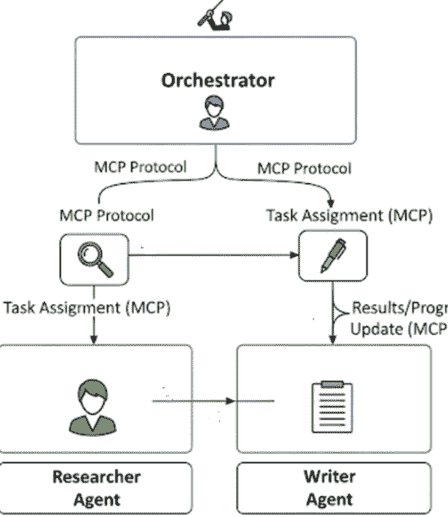
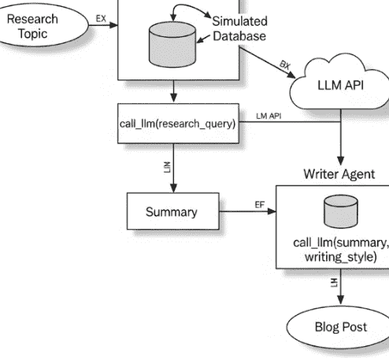
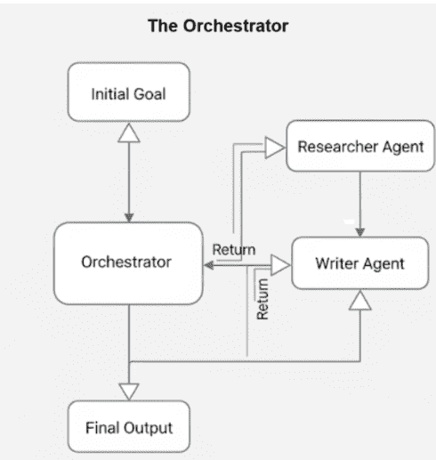
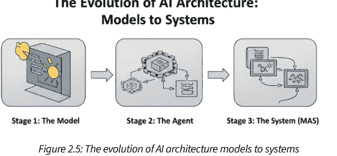
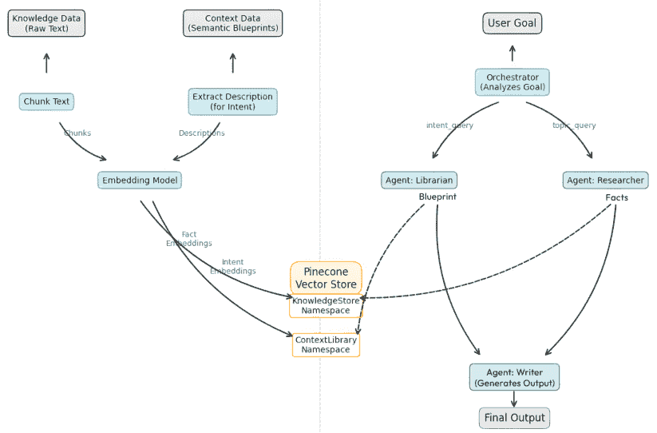
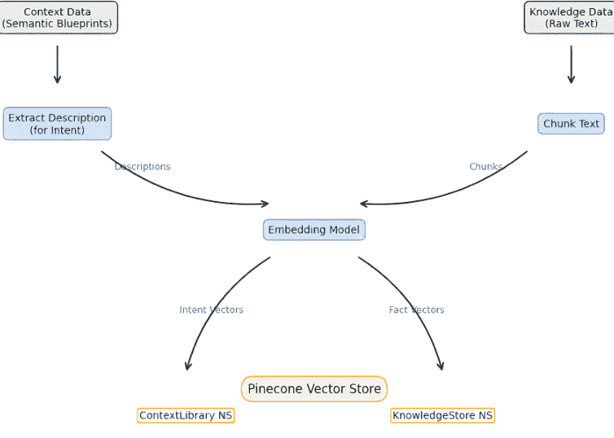

# 使用 MCP 构建多智能体系统

在上一章中，我们建立了上下文工程的基础技能：将模糊的提示词转换为结构化的语义蓝图。现在，我们将在更大规模的范围内应用这项技能，构建一个由专门的 AI 代理组成的系统，它们通过上下文进行通信并协作解决复杂问题。单一的大语言模型（LLM）是一个出色的通用全才，但它并非专家。对于任何复杂的多步骤任务，使用单个 LLM 效率低下且往往会失败。因此，我们将构建一个多智能体系统（MAS），在这个系统中，我们工程化的上下文将超出单个消息的内容，用于定义系统本身的设计。这包括定义需要哪些代理、它们的特定角色和能力，以及它们在不丢失信息的情况下通信的方法。这才是上下文工程的真正范围。

此外，为了使我们的系统更加可靠，我们将实现模型上下文协议（MCP），这是一种共享语言，确保我们工程化的上下文以完美的保真度在代理之间传递。在实操部分，我们将从零开始构建一个 MAS-MCP 系统。你将学习如何设计管理工作流的协调器（Orchestrator）以及执行任务的专家代理（研究员 Researcher 和编写者 Writer）。你还将看到如何将错误处理、消息验证和自动化质量控制直接构建到工作流中，确保系统能够从故障中恢复并保持事实准确性。到最后，你将拥有一个功能完整的系统，它可以接收高级目标并自主管理复杂的多步骤过程。简而言之，我们将涵盖以下主题：

- 构建上下文驱动的 MAS 工作流
- 使用 MCP 构建一个管理上下文的 MAS
- 错误处理与验证
- AI 架构的演进
- 构建智能体系统的工具

让我们从构建系统开始吧。

## 使用 MCP 架构 MAS 工作流

在编写第一行代码之前，我们需要一个清晰的架构计划。本节将阐述该蓝图。我们将总体目标解构为核心组件，定义系统每个部分的作用，并映射出让代理团队运转起来的通信流。

首先，让我们定义该设计核心的两个概念：MAS 和 MCP：

- **MAS**：我们将设计一个可以运行多个独立代理的系统，每个代理专门负责不同的任务，如研究、写作或数据分析。通过为每个代理提供清晰的上下文，我们确保它能够在其特定的职责上表现出色。
- **MCP**：为了让代理能够协作，它们需要一种共享语言。MCP 为我们提供了代理之间如何传递任务和信息的规则。它提供了一个框架，确保每条消息都是结构化的、可靠的且被完美理解。

我们的 MAS 由三个不同的组件组成。每个组件都扮演着特定的角色，它们共同构成了一个能够将用户的高级目标转化为成品的工作流：

## 多智能体系统



流程图说明了系统的完整工作流。让我们分析这个认知流水线每个组件的作用：

- **协调器（Orchestrator，项目经理）**：协调器是操作的大脑。它本身不执行专门的任务，而是管理整个工作流。它接收用户的高级目标，将其分解为逻辑步骤，并将每个步骤委托给正确的代理。它还负责接收一个代理的结果并将其作为上下文传递给下一个代理。换句话说，它在系统级对我们的 MAS 应用了上下文链。
- **研究员代理（Researcher agent，信息专家）**：这是我们的第一个专门代理。它的目的是获取特定主题，寻找相关信息，并将这些信息综合成结构化的摘要。在我们的项目中，它将接收来自协调器的研究任务，并以清晰的符号列表形式返回结果。
- **编写者代理（Writer agent，内容创造者）**：这是我们的第二个专门代理。它的长处在于通信和创造性表达。它接收研究员提供的结构化摘要，并将其转化为精炼的、人类可读的内容，并仔细注意语气、风格和叙述。

信息并非仅仅以原始文本的形式流动。代理之间的每一次交互都被封装成结构化的 MCP 消息。这确保了任务和结果始终带有完整的上下文，以一致、可预测且可靠的格式进行传递。MCP 是将一组独立代理连接成一个集成系统的结缔组织。

蓝图准备就绪后，我们已经准备好开始使用 MCP 构建我们的 MAS 了。

> **注意**
> 在本书中，我们探索了将 MCP 原则应用于代理与代理通信的尖端定义。虽然 MCP 最初是为代理与工具的交互设计的，但最近的探索（例如微软的《你可以在 MCP 上构建代理与代理之间的通信吗？》）展示了 MCP 不断进化的能力如何支持新兴的智能体协调模式。
> 文章链接：`https://developer.microsoft.com/blog/can-you-build-agent2agent-communication-on-mcp`

## 使用 MCP 构建 MAS

现在我们已经有了蓝图，是时候开始编写代码了。在这一节中，我们将逐步实现 MAS 和 MCP。我们将从系统的核心功能开始，然后在后的“错误处理与验证”章节中返回添加错误处理和验证。

打开本章存储库中的`Open_MCP.ipynb`进行跟随。初始的 OpenAI 安装与第1章中的`SRL.ipynb`相同。

我们将通过以下步骤完成 Colab 单元：首先定义我们的协议，构建每个专家代理，构建协调器来管理它们，最后运行系统查看代理团队的操作。让我们先初始化 OpenAI 客户端。

### 初始化客户端

我们首先初始化 OpenAI 客户端，它将作为我们与 LLM 通信的网关。我们导入了`json`库以整洁的格式显示我们的消息：

```python
#@title 1. 初始化客户端

# 我们需要 openai 库来与 LLM 通信。

# 注意：此笔记本假设你已经在 Colab 环境中运行了设置单元，
# 将 Secrets 中的密钥加载到环境变量中，正如你所指定的。

import json
from openai import OpenAI

# 客户端将从环境中读取 OpenAI_API_KEY。
client = OpenAI()

print("OpenAI client initialized.")
```

输出显示确认消息：

```
OpenAI client initialized.
```

### 定义协议

正如之前提到的，我们的代理需要一种共享语言来协作。这种语言由 MCP 定义。在本节中，我们将实现一个简化版本来演示该过程。虽然我们的 Python 方法对于学习非常有效，但值得了解规范系统间通信的官方 MCP 规则。

#### 消息格式

MCP 消息的结构有严格定义以确保一致性：

- 所有消息均遵循 JSON-RPC 2.0 格式作为清晰的 JSON 对象
- 消息必须使用 UTF-8 编码以实现通用性
- 每条消息必须单行显示，不包含换行符，以便快速可靠地解析

#### 传输层

一旦定义了消息，MCP 就定义了传输层。传输层定义了代理之间传递消息的方式。两种主要方法如下：

- **STDIO（标准输入/输出）**：对于运行在同一机器上的代理（例如在我们的 Colab 笔记本中），它们可以通过标准输入输出直接进行通信。这是最简单直接的方法。
- **HTTP**：对于运行在不同服务器上的代理，消息通过标准的 HTTP 请求在互联网上传发送。

最后，我们需要一个协议管理框架。

### 协议管理

MCP 还包含了关于兼容性和安全性的规则：

- **版本控制**：使用 HTTP 时，需要版本标头以确保客户端和服务器使用同一套规则。
- **安全性**：有用于验证连接的规则，以防止常见的网络攻击，并确保你正在与预期的服务器进行通信。

对于本书中的实操项目，我们将通过练习结构化通信来关注 MCP 的精神。一个简单的 Python 字典足以说明这一理念。它可以作为正式 JSON-RPC 对象的替身，让我们能够清晰地看到消息是如何构建和传递的，而不会迷失在协议开销中。

准备工作，我们现在可以创建一个名为`create_mcp_message`的辅助函数。该函数是我们系统中传输消息的模板。通过每次使用相同的结构，我们确保信息永远不会丢失或被误解。以下是代码：

```python
## 2. 定义协议：MCP 标准

# 在构建智能体之前，我们必须定义它们将使用的语言。
# MCP 提供了一种简单、结构化的上下文传递方式。在本示例中，
# 我们的 MCP 消息将是一个带有关键字段的 Python 字典。

def create_mcp_message(sender, content, metadata=None):
    """
    创建一个标准的 MCP 消息。
    """
    return {
        "protocol_version": "1.0",
        "sender": sender,
        "content": content,
        "metadata": metadata or {}
    }

print("--- 示例 MCP (我们的简化版) ---")
example_mcp = create_mcp_message(
    sender="Orchestrator",
    content="研究地中海饮食的好处。",
    metadata={"task_id": "T-123", "priority": "high"}
)
print(json.dumps(example_mcp, indent=2))
```

输出显示了我们的 JSON 格式的结构化 MCP 消息示例：

```json
--- Example MCP Message (Our Simplified Version) ---
{
  "protocol_version": "1.0",
  "sender": "Orchestrator",
  "content": "Research the benefits of the Mediterranean diet.",
  "metadata": {
    "task_id": "T-123",
    "priority": "high"
  }
}
```


`create_mcp_message` 函数接收三个输入：发送者、内容（任务或信息）以及任何可选元数据。它始终返回一个相同结构的标准 Python 字典。这种一致性是我们系统可靠性的基础。消息在智能体之间流动，没有丢失、误读或误解的风险。

定义好协议后，我们准备好构建专家智能体了。

## 构建智能体

本节包含了将我们在图 2.1 工作流图中的智能体变为栩生运行的代码。我们将每个智能体定义为一个 Python 函数。每个智能体函数都将接受一个结构化的 MCP 消息作为输入，并返回另一个 MCP 消息作为输出。智能体的特定角色由其系统提示词（system prompt）塑造，它告诉 LLM 如何行为。为了保持通信的一致，我们还将创建一个名为 `call_llm` 的单一辅助函数，用于管理与 OpenAI API 的所有交互。

## 多智能体 AI 系统流程图

### 研究员智能体 (Researcher Agent)



该图说明了一个使用两个 AI 智能体创建博客文章的工作流。信息从初始想法流到完成的内容经过了一系列步骤：

1. 流程始于一个研究主题，这是启动工作流的提示词。包含主题的消息被发送给我们的第一个智能体——研究员智能体（Researcher agent），它从模拟的内部数据库收集相关的事实和信息。
2. 一旦研究员获得了原始数据，它将使用 LLM API（一种外部语言模型服务）来处理信息并创建关键发现的摘要。该摘要是过程上一个和下一个阶段之间的桥梁。
3. 摘要被传递给第二个智能体——作者智能体（Writer agent），它的角色是将研究点转化为完成的文章。作者智能体也会与 LLM API 通信，但是为了执行复杂且具有创造性的任务。
4. 系统的最终结果是一个博客文章，清晰地展示了专业智能体如何协同工作，将高级目标转化为完整的产物。

我们现在准备好实现相互通信的智能体了。

## 创建辅助函数

在构建智能体本身之前，我们需要一种可靠且一致的方式让它们与 LLM 通信。我们的辅助函数 `call_llm` 处理所有到 OpenAI 的 API 调用。我们的系统使用提示词和用户内容作为输入，并返回模型的响应：

```python
def call_llm(system_prompt, user_content):
    """使用新客户端语法调用 OpenAI API 的辅助函数"""
    try:
        # 使用更新后的 client.chat.completions.create 方法
        response = client.chat.completions.create(
            model="gpt-3",
            messages=[
                {"role": "system", "content": system_prompt},
                {"role": "user", "content": user_content}
            ]
        )
        return response.choices[0].message.content
```

该函数有两个输入：

- `system_prompt`，一个告诉模型如何行为的字符串。
- `user_content`，包含用户查询的字符串。

## 定义智能体

```python
def researcher_agent(mcp_input):
    """
    该智能体接收一个主题并从数据库中查找相关信息。
    """
    print("\n[研究员智能体已激活]")
```

```python
simulated_database = {
    "keto diet": "生酮饮食富高脂肪、低碳水和中等蛋白质。",
    "mediterranean diet": "地中海饮食富含水果、蔬菜、全谷物、橄榄油和鱼类。研究显示它与心脏病风险较低。",
    "intermittent fasting": "间歇性禁食是一种在进食和禁食之间循环的饮食模式。",
}
```

适合健康与养博客的鼓励性语气。提示词还规定了长度（约 150 字）并要求一个引入人的标题：

```python
system_prompt = "你是一位健康与养博客的资深内容写作者。你的语气平易近人、信息量丰富且具有鼓励性。你的任务是根据以下研究点撰写一篇短小、吸引人的博客文章（约 150 字），并带上引入人的标题。"
```

代理调用 `call_llm`，传入系统提示词和研究摘要。返回的文本就是我们的博客文章。我们还打印了一条消息以确认稿已创建：

```python
blog_post = call_llm(system_prompt, research_summary)
print("Blog post drafted.")
```

最后，使用 `create_mcp_message` 将博客文章封装进新的 MCP 消息。这确保了输出遵循与其他所有消息相同的结构化格式，并包含内容元数据；在此情况下，我们统计了以下字数：

```python
return create_mcp_message(
  sender="WriterAgent",
  content=blog_post,
  metadata={
```

这完成了 Writer（写作者）。它接收来自 Researcher（研究者）的结构化输入，应用新的系统提示词，并输出格式一致的 MCP 完整博客文章。

当 Researcher 和 Writer 都准备完成后，我们现在定义了 MAS（多代理系统）的核心。每个代理都有独特的角色，它们共同可以完成从原始信息到最终内容的任务。

## 构建编排器 (Orchestrator)

我们现在有了专门代理，但我们需要一种管理它们的方法。这个角色属于编排器。把它想象成我们 AI 团队的项目经理。它的工作是接收一个高级目标，将其分解为一系列任务，并将这些任务委托给正确的代理。它还管理信息流，将一个代理的输出作为下一个代理的输入。这创建了一个从开始到结束的无缝流程：

### 编排器



图 2.3：代理的编排器

上图的工作流在**初始目标**被发送给**编排器**时开始。编排器充当中心枢纽，首先向**Researcher（研究者代理）**发送任务。一旦研究完成，该代理将其发现返回给编排器。编排器处理这些信息并向**Writer（写作者代理）**发送新任务。在 Writer 完成后，它将完成的内容传回编排器。最后，编排器拥有了所有内容来生成**最终输出**，完成整个过程。

以下代码定义了我们的编排器。这个单一函数管理从开始到结束的多代理工作流。它的角色是调用 Researcher，然后是 Writer，最后将输出组装成一个完整的制品。让我们逐步分析：

```python
def orchestrator(initial_goal):
    """
    管理多代理工作流以实现高级目标。
    """
    print("=" * 50)
    print(f"[Orchestrator] Goal Received: '{initial_goal}'")
    print("=" * 50)
```

我们从开始定义编排器函数。它接受一个参数 `initial_goal`，代表我们希望系统完成的高级任务。该函数随后打印已接收目标的确认。

第一步是委托研究任务。在这里，我们将"地中海饮食"硬编码为主题，但在实践中，这可以根据用户的目标动态设置：

```python
# 步骤 1：编排器规划并调用 Researcher 代理
print("\n[Orchestrator] Task 1: Research. Delegating to Researcher Agent.")
research_topic = "Mediterranean Diet"
```

我们将研究主题封装在 MCP 消息中，以保持通信的一致性：

```python
mcp_to_researcher = create_mcp_message(
  sender="Orchestrator",
  content=research_topic
)
```

编排器现在使用 MCP 消息调用 Researcher 代理，接收响应并打印返回的摘要：

```python
mcp_from_researcher = researcher_agent(mcp_to_researcher)
print("\n[Orchestrator] Research complete. Received summary:")
print("-" * 20)
print(mcp_from_researcher['content'])
print("-" * 20)
```

编排器现在在 `mcp_from_researcher` 中拥有 Researcher 代理的响应，它可以将其传递给 Writer 代理。Writer 代理反过来首先在 `mcp_to_writer` 中创建 MCP 消息并发送给 Writer 代理，然后显示结果（这将在我们运行系统时出现）。然后它记录写作步骤已完成：

```python
# 步骤 2：编排器调用 Writer 代理
print("\n[Orchestrator] Task 2: Write Content. Delegating to Writer Agent.")
mcp_to_writer = create_mcp_message(
  sender="Orchestrator",
  content=blog_post,
  metadata={
)
```

```python
mcp_from_writer = writer_agent(mcp_to_writer)
print("\n[Orchestrator] Writing complete.")
```

最后，编排器获取 Writer 的响应并呈现最终结果：

```python
### 步骤 3：编排器呈现最终结果
final_output = mcp_from_writer['content']
print("\n[Orchestrator] Final Output:")
print(final_output)
```

至此，编排器函数完成。

## 运行系统

我们已经准备好了所有组件：Researcher 代理、Writer 代理和编排器。现在让我们运行系统并观察它们的工作。

编排器接收目标，传递给 Researcher，获取摘要，然后传递给 Writer，后者生成博客文章。

```python
## 运行系统
user_goal = "Create a blog post about the benefits of Mediterranean diet."
orchestrator(user_goal)
```

图 2.4：代理的流程

### 多代理执行流

| 阶段 | 动作 | 输出 |
| :--- | :--- | :--- |
| 用户输入 | 目标到编排器 | 关于地中海饮食好处的博客 |
| 编排器 | 任务 1：研究 | 委托给 Researcher 代理 |
| Researcher 代理 | 研究完成 | 地中海饮食摘要 |
| 编排器 | 任务 2：编写内容 | 委托给 Writer 代理 |
| Writer 代理 | 写作完成 | 博客文章草稿 |
| 编排器 | 最终输出 | Mediterranean Magic... |

现在让我们看看 MAS 的实际输出。我们将分解控制台日志，显示每个代理如何贡献于最终的博客文章：

1. 系统在我们给编排器一个目标时开始。编排器确认该目标并准备将其分解为第一个任务：

```
=============================================
[Orchestrator] Goal Received: 'Create a blog post about the benefits of Mediterranean diet.'
=============================================
Orchestrator Delegates to the Researcher
```

2. 接下来编排器知道了。它宣布研究任务并激活 Researcher 代理。Researcher 随后工作并告诉我们它创建了一个摘要。


# 多代理系统（MAS）工作流演示

## 系统运行示例

**[Orchestrator]** Task 1: Research. Delegating to Researcher Agent.

**[Researcher Agent Activated]**

Research summary created for 'Mediterranean Diet'

在 Researcher 完成任务后，编排器确认已收到摘要。随后它显示 Researcher 提取的要点。此输出了将用于博客文章的信息：

```
[Orchestrator] Research complete. Received summary:
------------------
- 强调蔬菜、全谷物、橄榄油和鱼类食物。
- 与心脏病风险降低、大脑健康改善和长寿增加有关。
- 益处与高摄入单不饱和脂肪（特别是来自橄榄油）和抗氧化剂有关。
------------------
```

拿到摘要后，编排器进入下一步。它宣布它正将内容撰写任务委托给 Writer 代理。Writer 开始起草博客文章：

```
[Orchestrator] Task 2: Write Content. Delegating to Writer Agent.
[Writer Agent Activated]
```

### 博客文章草稿已拟定

当 Writer Agent 开始起草博客文章时，编排器（Orchestrator）会确认写作任务已完成：

```
[Orchestrator] Writing complete.
```

最后，编排器信号整个工作流已完成。随后它呈现了最终的博客文章，这是所有智能体共同努力的成果：

```
[Orchestrator] Workflow Complete. Final Output:
地中海魔法：增强心脏、大脑和长寿的美味之道
```

地中海风格的餐盘推崇色彩丰富的果蔬、五谷物、丝滑的橄榄油以及大量的鱼。研究表明，这种饮食模式与心脏病风险降低、大脑更健康以及更长寿有关。秘诀是什么？单不饱和脂肪——尤其是特级橄榄油——有助于改善胆固醇平衡并保持血管弹性，而富含抗氧化剂植物和海鲜则对抗氧化压力和炎症……

这次运行展示了我们多智能体系统（MAS）的生命周期。在这个阶段，系统按预期工作。网络波动、格式错误的消息或意外的 LLM 响应可能会中断流程。为了让工作流更加可靠并更接近生产就绪，我们需要通过错误处理、验证和保护措施来加强它。这正是我们下一步要转的地方。

## 错误处理与验证

我们目前为止构建的系统是一个功能性原型；当一切按计划进行时，它可以运行。但在现实世界中，事情很少按计划进行。API 可能会失败，消息可能格式错误，智能体可能会返回意外结果。在考虑其健壮性之前，我们必须改进系统以应对这些潜在的故障。

在本节中，我们将把简单的脚本升级为更具韧性的系统。我们将为 API 调用添加错误处理，创建一个验证器以确保 MCP 消息格式正确，并教编排器在智能体失败或产生缺陷输出时如何保持工作流运行。

在这一部分，我们将在 `MAS_MCP_control.ipynb` 笔记本中工作，其中包含了完整的实现。我们将关注两个核心工程原则：韧性和可靠性：

- **韧性 (Resilience)**：加固与 LLM 的连接，使临时问题（如 API 超时或速率限制）不会导致系统崩溃
- **可靠性 (Reliability)**：确保消息完整性，使智能体始终交换可预测、有效的 MCP 消息

让我们从提高韧性开始。我们原始的 `call_llm` 函数是有意设计的。我们发送单次 API 请求并返回结果。在生产环境中，这种方法太脆弱了。OpenAI API 可能会宕机，或者如果请求因网络不稳定失败，整个工作流可能会崩溃。为了修复，我们将构建一个更健壮的函数，它可以处理重试。

## 为 LLM 构建健壮组件

加强我们系统的第一步是将原始 `call_llm` 替换为更具韧性的函数：`call_llm_robust`。这个新版本获取请求而不是立即放弃，允许系统从临时问题中恢复。

在定义函数之前，我们需要 `time` 库，它允许我们在重试之间暂停执行。这已经包含在 `MAS_MCP_control.ipynb` 的初始化部分中：

```python
import time
```

准备好后，这里是新函数：

```python
# @title 3.Building Robust Components
# Hardening the call_llm Function

def call_llm_robust(system_prompt, user_content, retries=3, delay=5):
    """一个健壮的辅助函数，用于重试调用 OpenAI API."""
    for i in range(retries):
        try:
            response = client.chat.completions.create(
                model="gpt-4",
                messages=[
                    {"role": "system", "content": system_prompt},
                    {"role": "user", "content": user_content}
                ]
            )
            return response.choices[0].message.content
        except Exception as e:
            print(f"API call failed on attempt {i+1}/{retries}. Error: {e}")
            if i < retries:
                print(f"在 {delay} 秒后重试...")
                time.sleep(delay)
            else:
                print("所有重试均失败。")
                return None
```

在这个升级后的函数 `call_llm_robust` 中，我们将 API 调用封装在循环内的 `try/except` 块中。如果发生错误，系统将等待几秒后再次尝试，并在尝试之间通过 `time.sleep` 暂停。这种重试机制使系统对临时网络问题更具韧性。如果所有尝试均失败，函数返回 `None`，这向编排器信号它必须决定如何处理故障。

在建立了 API 用的韧性后，让我们转向可靠性，引入一个在每个 MCP 消息到达智能体之前对其验证的函数。

## 验证 MCP 消息

为了让智能体可靠地通信，它们必须信任接收的消息。如果漏掉格式错误的消息，整个工作流可能会失败。为了防止这种情况，我们引入了 MCP 验证器，这是一个简单的护栏，检查每条消息是否符合我们的协议。检查在消息传递给智能体之前进行：

```python
# The MCP Validator ---
def validate_mcp_message(message):
    """一个检查 MCP 消息结构的简单验证器。"""
    required_keys = ["protocol_version", "sender", "content", "metadata"]

    if not isinstance(message, dict):
        print(f"MCP 验证失败：消息不是字典。")
        return False

    for key in required_keys:
        if key not in message:
            print(f"MCP 验证失败：缺少键 '{key}'")
            return False

    print(f"来自 {message['sender']} 的 MCP 验证通过。")
    return True
```

此函数是一个重要的护栏。编排器在传递任何消息之前调用 `validate_mcp_message`，确保结构完整。它首先检查输入是否为字典，然后验证所有必要的键是否存在。

有了这个验证器，编排器可以信任它分发的消息，智能体也可以专注于自己的任务。结合为 API 调用增加韧性的 `call_llm_robust` 函数，我们现在有了一个既可靠又容错的系统基础。

现在让我们通过为专家引入控制来添加另一种保护措施。

## 添加智能体专项控制

我们目前的智能体团队可以工作，但有一个弱点：它完全信任 Writer 的输出。即使有良好的上下文，LLM 也会误解事实或引入幻觉。为了让我们的系统更加可靠，我们需要一个质量控制步骤，在接受 Writer 的工作之前对其检查。

首先，更新智能体。我们在两个智能体内部将旧的 `call_llm` 函数替换为新的 `call_llm_robust` 函数：

```python
### title 4.Building the Agents: The Specialists
---
#### Agent 1: The Researcher ---
def researcher_agent(mcp_input):
    ... (code omitted for brevity)
    system_prompt = "你是一名研究分析师。将提供的信息综合为3-4个简洁的要点。"
    # 现在使用健壮调用器
    summary = call_llm_robust(system_prompt, research_result)
    ... (code omitted for brevity)
```

```python
#### Agent 2: The Writer ---
def writer_agent(mcp_input):
    ... (code omitted for brevity)
    system_prompt = "你是一名内容撰稿员。根据以下研究点写一篇简短、吸引人的博客文章（约 150 字），并带有一个引人的标题。"
    # 现在使用健壮调用器
    blog_post = call_llm_robust(system_prompt, research_summary)
    ... (code omitted for brevity)
```

## 使用 MCP 构建多代理系统

这确保了研究人员（Researcher）和作者（Writer）都能通过重试失败的请求而不是直接报错来应对临时 API 中断。这些代理现在更具韧性，但我们仍然需要一种来验证作者的草稿是否与研究人员的内容一致。下一步是将团队从两个专家扩展到三个。我们引入了验证代理（validator agent）。

验证代理的唯一目的是担任事实检查员。它将作者的草稿与研究人员的摘要进行比较。这种比较确认了事实的一致性。它为我们的系统添加了重要的质量控制层：

```python
# --- Agent 3: The Validator
def validator_agent(mcp_input):
    """该代理根据摘要对草稿进行事实检查."""
    print("\n[Validator Agent Activated]")

    # 提取两个必要信息
    source_summary = mcp_input['content']['summary']
    draft_prompt = mcp_input['content']['draft']

    system_prompt = """
你是一个严谨的事实检查员。判断"草稿"是否与"源摘要"在事实上一致。
- 如果草稿中的所有主张都得到了源的支持，请仅回复单词"pass"。
- 如果草稿包含源中没有任何信息，请回复"fail"并提供一句话的解释。
"""

    validation_context = f"SOURCE SUMMARY:\n{source_summary}\nDRAFT:\n{draft_prompt}"
    validation_result = call_llm_robust(system_prompt, validation_context)

    print(f"Validation complete: {validation_result}")

    return create_mcp_message(
        sender="ValidatorAgent",
        content=validation_result
    )
```

验证代理有其自己的语义蓝图。它需要两个输入：来自研究人员的源摘要和来自作者的博客草稿。如果草稿与摘要一致，模型返回 pass；如果不一致，则返回 fail 并附带简短解释。


# 2 

这为编排器（Orchestrator）提供了一个新的保障：它不再需要盲目地信任作者。相反，在接受草稿作为最终版本之前，它可以检查草稿是否与研究结果对齐。

我们现在将添加编排逻辑控制，将验证代理引入工作流。

## 带有验证循环的最终编排器

原始的简单编排器是一个线性任务管理器。我们用一个更智能的 `final_orchestrator` 替换了它。这个新版本包含验证修订循环。

工作流不再是顺序的。在 `writer_agent` 生成草稿后，编排器将其委托给 `validator_agent`。如果验证失败，编排器会将草稿发回给作者并包含验证代理的反馈。这创建了一个强大的自纠系统，模拟了现实世界的编辑流程。

我们现在将检查笔记本第 5 节中 `final_orchestrator` 函数的关键变化。

步骤 1 与原始编排器类似。关键的添加是立即调用了 `validate_mcp_message`。如果研究人员返回了格式错误的消息，或者内容为空（当 `call_llm_robust` 返回 None 时可能会发生），编排器将立即停止工作流。

```python
@title 5. Final Orchestrator with Validation Loop
def final_orchestrator(initial_goal):
    ... (省略了初始化代码) ...

    # 步骤 1 研究与立即验证
    # 步骤 1: Research --
    print("\n[Orchestrator] Task 1: Research. Delegating to Researcher Agent.")
    # (调用 researcher_agent) ...
    mcp_from_researcher = researcher_agent(mcp_to_researcher)

    # 新增：立即验证消息结构
    if not validate_message(mcp_from_researcher) or not mcp_from_researcher['content']:
        print("由于来自研究人员的消息无效或为空，工作流失败。")
        return

    research_summary = mcp_from_researcher['content']
    print("\n[Orchestrator] Research complete.")
```

## 使用 MCP 构建多代理系统

随后步骤 2 和 3 被合并为一个迭代循环。如果验证通过，则接受草稿并结束循环。如果验证失败，编排器会将带有反馈的作者草稿发回给作者，要求修订。循环允许有限次数的修订（max_revisions）以防止无限循环：

```python
# 步骤 2 和 3 迭代循环
# 步骤 2 & 3: Iterative Writing and Validation Loop
---
final_output = "Could not produce a validated article."
max_revisions = 2
for i in range(max_revisions):
    print(f"\n[Orchestrator] Writing Attempt {i+1}/{max_revisions}")
```

```python
# 为作者准备上下文
writer_context = research_summary
if i > 0:
    # 这是一个修订，基于验证代理的反馈
    writer_context += "\nPlease revise the previous draft based on this feedback: (validation_result)"
```

```python
## 调用作者代理并验证
mcp_to_writer = create_message(sender="Orchestrator", content=writer_context)
mcp_from_writer = writer_agent(mcp_to_writer)
```

```python
if not validate_mcp_message(mcp_from_writer) or not mcp_from_writer['content']:
    print("由于来自作者的消息无效，中止修订循环。")
```

工作流不再是顺序的。在 `writer_agent` 生成草稿后，编排器将其委托给 `validator_agent`。如果验证失败，编排器会将带有反馈的草稿发回给作者并要求修订。这创建了一个强大的自纠系统，模拟了现实世界的编辑流程。

## AI 架构的演进

我们构建 AI 的方法正在发生进化。这些模型非常强大且知识渊博，但它们并不是任何单一领域的专家。当任务发生变化时，单一模型很难同时保持专注和准确性。


因此，我们从使用单一通用模型转向创建一个由专业化代理（agents）组成的团队。我们利用上下文工程（context engineering）来定义代理的角色和技能。我们的研究员（`Researcher`）代理和编写者（`Writer`）代理就是这种方法的示例。每个代理的设计目标都是为了很好地完成其单项工作，如下所示：



专家团队需要协作来解决大问题。MAS（多智能体系统）提供了管理这些代理的结构。MCP 则帮助代理之间进行可靠的通信。上下文工程是这一过程中的胶水：首先用于改进单个 LLM 的响应，现在则扩展到定义代理本身及其交互。随着 AI 越来越多地部署到现实世界，这些系统将不断扩展和扩展。

## 构建代理系统的工具

到目前为止，我们从零开始构建了一个 MAS。这种实践方法让我们在 MAS 和 MCP 的核心思想方面拥有了坚实的基础：编排、结构化通信、韧性和验证。

在许多项目中，客户或内部管理层可能要求我们避免外部平台或框架，即使是可下载的开源框架也是如此。某些甚至坚持只使用本地 LLM。然而，在其他情况下，使用框架可能会受到鼓励甚至被要求。那么，上下文工程师的正确路径是什么？

首先，从理解上下文工程开始，就像我们在这里所做一样：从零开始。有了这些知识，你将准备好实现一个完全自定义的解决方案或部署一个优于许多其他工程师的现有框架。你既是架构师又是问题解决者，当即用框架无法满足需求时，寻找让系统重新运行的方法。以下是一些你可以探索的资源：

- **MCP 规范**：官方 MCP 规范是必读的。它详细说明了代理如何通信的正式规则。我们构建了一个简化版本。官方网站定义了 JSON RPC 传输层安全标准：`modelcontextprotocol.io`。

- **MAS 框架**：几个开源框架使得创建 MAS 变得容易得多。它们处理了困难的部分，如编排、通信和代理管理。这些工具使用了与我们刚刚构建相似的概念。学习它们是观察这些想法如何在生产环境中使用的极佳方法。

- **autogen**：`autogen` 是来自微软的一个框架。它让你能够构建多个代理相互对话以解决问题的应用程序。`autogen` 代理非常灵活。它们可以结合 LLM、人类输入和工具来完成工作。你可以在此处的 GitHub 上找到 `autogen`：`github.com/microsoft/autogen`。

- **CrewAI**：`CrewAI` 专为构建基于角色的 AI 代理团队而设计。它为代理共同协作完成复杂任务提供了结构。`CrewAI` 专注于协作和专业化。它的设计与我们创建的协调器（`Orchestrator`）模型非常相似。在此查找更多信息：`https://www.crewai.com/`

- **LangGraph**：`LangGraph` 是 LangChain 工具家族的一部分。它允许你将代理工作流构建为图。这是创建可以迭代自我修正系统的强大方式。`LangGraph` 让你对信息流和决策如何产生进行精细控制。`LangGraph` 文档可以在此处找到：`python.langchain.com/docs/langgraph`。

至此，我们已经从零开始构建了一个 MAS 和 MCP 用例，以获得对尖端上下文工程系统的实践理解。让我们总结一下我们的旅程。

## 总结

在本章中，我们超越了单一代理交互。我们构建了一个专业代理团队，每个代理执行特定的特定功能。我们利用了 MCP，它允许我们的代理使用标准蓝图进行通信。然后，我们设计了系统架构。我们创建了一个语义蓝图来定义代理团队的角色和工作流。接下来，我们部分地构建了系统。我们从一个创建标准 MCP 消息的功能开始。然后构建了每个代理，为每个代理提供具有特定提示（`prompt`）的独特技能。我们构建了研究员的输出并将其传递给编写者。最终结果是一个功能性的 MAS。它可以接收用户并并完成研究和写作过程。最后，我们通过在架构中添加错误处理和验证，使我们的原型更加健壮。

你现在已经从零开始设计、实现并稳定了一个 MAS。你可以使用这些高级工具构建下一代 AI 解决方案。我们的下一章将通过 RAG（检索增强生成）将 MAS 开放给外部数据，开启旅程的下一个阶段。

## 问题

1. 这里的中心观点是一个大的 LLM 对复杂工作是最好的吗？（是或否）

2. 协调器（`Orchestrator`）执行实际的研究和写作吗？（是或否）

3. MCP 仅仅是让 LLM 写得更好的花哨方式吗？（是或否）

4. 研究员代理编写最终的博客文章吗？（是或否）

5. 编写者直接从用户的第一个请求获取任务吗？（是或否）

6. 你必须运行每个代理才能获得博客文章吗？（是或否）

7. 每个 MCP 消息都必须包含发送者和内容吗？（是或否）

8. 是否有一个所有代理共享的大提示词？（是或否）

9. 笔记本中的代理通过互联网使用 HTTP 互相通信吗？（是或否）

10. 这里的中心观点是一个大的 LLM 对复杂工作是最好的吗？（是或否）

## 参考文献

1. Model Context Protocol. `https://modelcontextprotocol.io`

2. Multiagent Systems: A Modern Approach.

3. JSON-RPC 2.0 Specification. `https://www.jsonrpc.org/specification`

4. ReAct: Synergizing Reasoning and Acting in Language Models. `arXiv:2210.03629`

5. A Survey on Large Model Autonomous Agents. `https://arxiv.org/abs/2308.11432`

构建上下文感知多智能体系统

- 为语义蓝图创建上下文库

- 使用向量存储命名空间（`namespaces`）管理不同的数据类型

- 实现新的专家智能体，例如“上下文管理员”（`Context Librarian`）

- 编排整个系统以生成具有上下文感知的内容

我们将从探索 RAG MAS 架构开始。

## 设计双 RAG MAS 架构

为了构建我们的上下文感知系统，我们需要对其架构有一个清晰的认识。从高层来说，整个过程分为两个不同的阶段，我们将对其进行设计和开发。阶段 1 是数据准备，用于预处理数据；阶段 2 是运行时执行，我们的 MAS 使用准备好的数据来响应用户目标。本章将在两个笔记本中开发这两个阶段。

### 完整的双 RAG MAS 架构

阶段 1：数据准备（RAG 摄入）

阶段 2：运行时执行（MAS）



图 3.1：双 RAG MAS 架构

上图插插了双 RAG 架构的完整数据和执行流，箭头显示了组件在高层面上如何连接。在进入实际程序之前，我们将逐步介绍图中的每个部分。

## 阶段 1：数据准备

在阶段 1 中，我们重点关注数据准备，即图 3.1 的左侧部分。系统从两种不同的输入源开始：

- **知识数据**（`Knowledge data`）：系统应该知道的事实信息。

- **上下文数据**（`Context data`）：在*第 1 章*中引入的结构化指令或语义蓝图。两种数据类型都由**嵌入模型**处理。对于知识数据，我们将文本分割成块并对每个块进行嵌入；对于上下文数据，我们只对蓝图意图的描述进行嵌入。搜索基于意图。完整的蓝图内容单独存储在 JSON 对象中，并与其描述关联。

所有嵌入都存储在 Pinecone 数据库中，它将包含系统所需的所有内容。我们使用单个 Pinecone 索引，分为两个严格隔离的命名空间：

- **`KnowledgeStore`**（知识库）：此命名空间存储来自事实数据的向量。

- **`ContextLibrary`**（上下文库）：此命名空间存储来自程序化蓝图的向量。

两个命名空间就绪后，系统就准备好进入阶段 2。

## 阶段 2：运行时执行分析

在阶段 2 中，MAS 执行用户请求，如图 3.1 的右侧所示。

该过程从**用户目标**开始，这是用户提交的高级指令——例如，“写一个关于阿波罗 11 号的悬疑故事”。

**编排器**（`Orchestrator`）接收此目标。作为系统的中央协调器，它分析请求并识别出两个组件：

- **`intent_query`**（意图查询）：这是管理员（`Librarian`）查询的意图，与所需的样式结构相关（在我们的示例中是悬疑故事）。

- **`topic_query`**（主题查询）：这是研究员查询的主题，与主题内容相关（在我们的示例中是阿波罗 11 号）。

随后，编排器将每个查询委托给专家智能体：

- **管理员智能体**（The `Librarian` agent）：负责检索指令脚本，通过引擎的 MCP 消息层接收 `intent_query`。它查询 `ContextLibrary` 命名空间，执行语义搜索以找到匹配请求意图的蓝图描述，并检索相应的语义蓝图。

- **研究员智能体**（The `Researcher` agent）：负责检索事实信息，接收 `topic_query`。它查询 `KnowledgeStore` 命名空间，检索相关的事实块，并将其合成简洁的发现。

一旦两个响应都准备就，编排器现在就可以促进将检索到的指令脚本和合成的事实传递给**作者**（`Writer`）智能体。**图 3.1** 中的箭头显示了**蓝图**和**事实**从管理员和研究员向作者移动。

作者充当系统的生成引擎。它使用事实作为内容，并将蓝图作为对内容进行结构化和样式化的脚本指令。然后，作者生成最终输出，同时遵循事实要求和程序性约束。

这种架构允许高度的灵性和扩展性。可以在不更改指令脚本的情况下更新知识库，可以在不触碰事实的情况下添加新的蓝图。在运行时，智能体会根据它们检索到的上下文动态调整其行为。

解释架构后，我们现在可以进入实现。下一步是构建 RAG 摄入流水线。

## RAG 流水线数据摄入（上下文与知识）

在*第 2 章*中，我们使用模拟数据构建了一个 MAS。智能体知道如何搜索，但它们受限于简单的 Python 字典。在本章中，我们迈出了下一步：用真实的 RAG 流水线取代该种模拟。

## RAG 数据摄入流水线



图 3.2：显示了此流水线的流程。在智能体能够有效搜索之前，我们必须首先准备并构建它们将使用的数据库。我们的方法引入了两种互的形式的形式 RAG：

- **知识库（事实 RAG）**：存储事实。这是 RAG 的标准用法，大多数工程师都很熟悉。

- **上下文库（程序化 RAG）**：存储第一章引入的指令或**语义蓝图**。智能体查询此库以确定*如何*结构化它们的响应以及使用*什么*。

要实现这一点，请在 GitHub 中打开 `RAG_Pipeline.ipynb` 笔记本。

## 安装与设置

现在环境已就绪，让我们使用刚刚设置的 API 密钥连接到 OpenAI 和 Pinecone。对于本章，我们将此称为 `genai-mas-mcp-ch3`。

我们将检索 Pinecone API 密钥。在示例中，我正在使用 Google Colab 的密钥管理器：

```python
PINEONE_API_KEY = userdata.get('PINEONE_API_KEY')
...
```

一旦获取了 API 密钥，我们需要为项目定义两个命名空间（`namespaces`）。这将确保我们的数据类型在 Pinecone 内部严格分离：

- `NAMESPACE_KNOWLEDGE` 将存储事实

- `NAMESPACE_CONTEXT` 将存储蓝图

我们正在使用 Pinecone 的无服务器架构（`serverless architecture`），这是 Pinecone 免费计划建议使用的。我们需要定期查看 Pinecone 的方案以确认条件是否有变化。对于本次演示，我将使用 `us-east-1` 的 AWS：

```python
-- Initialize Clients --
client = OpenAI(api_key=OPENAI_API_KEY)
pc = Pinecone(api_key=PINEONE_API_KEY)

# Define Index and Namespaces --
INDEX_NAME = 'genai-mascp-ch3'
NAMESPACE_KNOWLEDGE = 'KnowledgeStore'
NAMESPACE_CONTEXT = 'ContextLibrary'

# Define Serverless Specification
spec = ServerlessSpec(cloud='aws', region='us-east-1')
```

在使用索引之前，我们需要检查它是否已经存在。如果不存在，代码将创建一个具有嵌入维度（`embedding dimension`）和**余弦相似度**（`cosine similarity`）指标的新索引，这是比较文本嵌入的常用选择：

```python
## Check if index exists
if INDEX_NAME not in pc.list_indexes().names():
    print(f"Index {INDEX_NAME} not found. Creating new serverless index...")
    pc.create_index(
        name=INDEX_NAME,
        dimension=EMBEDDING_DIM,
        metric='cosine',
        spec=spec
    )
## Wait for index to be ready
while not pc.describe_index(INDEX_NAME).status['ready']:
    print("Waiting for index to be ready...")
```

# 3 

```python
time.sleep(1)
print("Index created successfully. It is new and empty.")
```

如果索引已经存在，我们可以选择是否清除现有数据。对于本次演示，我们将通过删除两个命名空间的内容每次都重新开始：

```python
else:
    print(f"Index {INDEX_NAME} already exists. Clearing namespaces for a fresh start...")
    index = pc.index(INDEX_NAME)
    namespaces_to_clear = [NAMESPACE_KNOWLEDGE, NAMESPACE_CONTEXT]
```

要清除索引，我们需要遍历每个命名空间并清除数据：

```python
for namespace in namespaces_to_clear:
    # Check if namespace exists and has vectors before deleting
    stats = index.describe_index_stats()
    if namespace in stats.namespaces and stats.namespaces[namespace].vector_count > 0:
        print(f"clearing namespace {namespace}...")
        index.delete(delete_all=True, namespace=namespace)
```

这里有一个棘手。清除函数可能是异步的，程序可能会运行得过快。这种缓慢的删除在我们开始上传后完成，这些新向量可能会被扫掉。这并不是绝对的，但确实是我们我们不想承担的风险。因此，我们等待系统并在向量计数真正为零后继续：

```python
# CRITICAL FUNCTION: Wait for deletion to complete
while True:
    stats = index.describe_index_stats()
    if namespace not in stats.namespaces or stats.namespaces[namespace].vector_count == 0:
        print(f"Namespace {namespace} cleared successfully.")
        break
    print(f"Waiting for namespace {namespace} to clear...")
    time.sleep(5) # Poll every 5 seconds
```

```python
else:
    print(f"Namespace {namespace} is already empty or does not exist. Skipping.")
```

构建上下文感知多智能体系统

最后，我们准备好连接到索引进行后续操作：

```python
# Connect to the index for subsequent operations
index = pc.Index(INDEX_NAME)
```

如果一切运行正常，你将看到指示索引已存在且命名空间已清除的输出：

```
Index genai-mas-cp-ch3 already exists. Clearing namespaces for a fresh start...
Namespace 'KnowledgeStore' is empty or does not exist. Skipping.
Namespace 'ContextLibrary' is empty or does not exist. Skipping.
```

在生产环境中，你可能不想在每次运行时都清除命名空间——你希望系统保留其存储的知识。然而，对于我们的学习之旅，每次重新开始更加整洁。索引就绪后，我们可以开始准备数据。

## 数据准备：上下文库（过程化 RAG）


在本节中，我们将为上下文库定义数据。这是我们过程化 RAG 实现的核心，因为我们正在引入过程化指令——而不仅仅是静态知识。上下文库建立在第一章语义蓝图概念的基础上，但现在我们将用精确的结构来实现它。

我们上下文库中的每个条目包含三个部分：

- 一个`id`，它是 Pinecone 索引中的唯一标识符。

- 一个`description`，用于解释蓝图的作用和风格。我们只对描述进行嵌入，以便为任务找到所需的蓝图。

- 蓝图包含 JSON 格式的 LLM（大语言模型）实际指令。蓝图不会被嵌入。一旦访问了描述，我们像在构建完一本书后一样检索蓝图……

## 第3章

### 83

输出确认我们已经定义了三个蓝图：

```
准备了 3 个上下文蓝图。
```

这里的要点是，创建语义蓝图既强大又具有挑战性。如果没有它们，你将不得不为每个 LLM 任务编写单独的代理（agent）。那样是不可扩展的。语义蓝图允许你一次捕获过程化指令并无限次复用。你不需要为几十个任务构建下拉菜单，而是依赖一个可扩展的自动化的上下文引擎。

定义好蓝图后，让我们转向双路 RAG 设置的另一侧：知识库。

## 数据准备：知识库（事实性）RAG

我们的任务是为知识库定义数据，即 RAG 设置中的事实部分。该组件持有相对静态的信息，研究员代理（Researcher agent）将搜索并将其合成简洁的发现。为了保持预期现实，你是在自己设计这个系统，而不是躲在华丽的平台背后；这需要大量细致的人工工作。

在这个教育示例中，我们将使用一个关于太空探索的小型数据集。它包含了太空竞赛和阿波罗 11 号、朱诺任务以及火星探测器。在本章中，我们将专注于架构，用数据字符串表示数据。让我们将知识整合到一个原始字符串中：

```python
knowledge_data_raw = """
太空探索是利用天文学和太空技术探索外层空间。太空探索的早期阶段是由苏联和美国之间的“太空竞赛”驱动的。1957年苏联斯普尼克1号的发射以及1969年美国阿波罗11号首次登上月球是关键的里程碑。

朱诺号是 NASA 的一个探测木星的太空探测器。它于2011年8月5日发射，并于2016年7月5日进入木星极地轨道。

火星探测器是一种设计在火星表面行驶的遥控车辆。NASA JPL 管理了多个成功的探测器，包括：幸运者号、精神号、机遇号、好奇号和毅力号。寻找火星上宜居性和有机碳的证据现在是 NASA 的首要目标。毅力号还携带了“机智”直升机。
"""
```

现在我们将构建一个小型辅助函数，在嵌入之前将此文本处理成利于搜索的片段。

## 分块和嵌入的辅助函数

语言模型不处理原始段落——它们处理标记（tokens），这是模型将文本拆分为它可以理解的单位的方式。例如，单词 `encoding` 可能会被拆分成两个标记：`enc` 和 `ing`。模型使用这些部分来更好地理解单词关系。

我们将使用 `c100k_base` 分词器，这是 OpenAI 最新模型的标准配方。这种编码有三个优势：

- 它分割单词的方式非常聪明。它没有将像 `encoding` 这样的单词视为整体，而是可能将其拆分为更小的、有意义的部分，如 `enc` 和 `ing`。这有助于模型理解不同单词之间的关系。

- 它为速度而设计且运行高效，非常适合对话型模型以及为准备存储在数据库中的文本做准备。

- 使用它能确保你计数和格式化文本的方式与模型预期的完全匹配，这一点是至关重要的。

这种一致性至关重要。如果我们的分块（chunking）与嵌入模型的训练不匹配，语义搜索结果将是不准确的。这就像在一个图书馆里查书，但那里一半的卡片使用了不同的分类系统。

让我们初始化分词器：

```python
# 初始化分词器以实现健壮的感知标记的分块
tokenizer = tiktoken.get_encoding("cl100k_base")
```

当信息分成足够的片段时，RAG 的效果最好。我们不是按字符数切割，而是按标记数切割，这对于 LLM 更加可靠。此外，程序定义了 400 token 的分块大小和 50 token 的重叠（overlap）。重叠有助于保持片段之间的上下文。你必须为你处理的每种数据找到最佳分块大小和重叠。

程序现在引入了 `chunk_text` 函数，确保长文档被拆分成整洁的、重叠的文本窗口，这些窗口更容易被模型处理且语义搜索更准确：

```python
def chunk_text(text, chunk_size=400, overlap=50):
    """根据标记计数和重叠对文本分块（RAG 最佳实践）。"""
    tokens = tokenizer.encode(text)
    chunks = []
    for i in range(0, len(tokens), chunk_size - overlap):
        chunk_tokens = tokens[i:i + chunk_size]
        chunk_text = tokenizer.decode(chunk_tokens)
        # 基本清理
        chunk_text = chunk_text.replace("\n", "").strip()
        if chunk_text:
            chunks.append(chunk_text)
    return chunks
```

一旦我们有了片段，就需要将它们转换为嵌入。API 调用有时会失败（例如由于网络延迟），因此我们将添加一个重试机制。Tenacity 库中的 `@retry` 装饰器会自动使用指数退避重试失败的调用：

```python
@retry(
    wait=wait_random_exponential(min=1, max=60),
    stop=stop_after_attempt(6)
)
```

我们并不上传原始片段。因此，我们需要定义 `get_embeddings_batch` 函数，将批量文本发送到 OpenAI API。它返回对应的嵌入：

```python
@retry(
    wait=wait_random_exponential(min=1, max=60),
    stop=stop_after_attempt(6)
)
```

## 处理并上传 (upsert)

最后一步是将这些向量上传到 Pinecone。这是关键的。我们将分两部分处理：

- 上文库

- 知识库

### 上文库

一旦向量准备就绪，就可以上传了。这个过程被称为 upsert，即如果 ID 存在则更新，不存在则插入。我们使用 `index.upsert` 命令将向量到 `NAMESPACE_CONTEXT`：

```python
# 数据
if vectors_context:
    index.upsert(vectors=vectors_context, namespace=NAMESPACE_CONTEXT)
    print(f"成功上传了 {len(vectors_context)} 个向量。")
```

如果运行成功，你会看到一个告知上传了多少向量的确认。此时，上下文库已进入命名空间，并准备供运行时查询。让我们进入 RAG 设置的另一部分：知识库。

## 知识库

现在让我们填充知识库，它将持有我们的事实数据。第一步是对原始字符串运行 `chunk_text`，以便将其拆分为更小、易管理的片段。这些片段随后将批量处理。例如，我们使用100的批量大小。程序遍历每个批量，使用 `get_embeddings_batch` 生成嵌入，并为 Pinecone 准备向量存储。每个片段都被赋予一个唯一的 ID，并与存储上下文的元数据配对。代码如下：

```python
# 6.2. 知识库 ---
print(f"\n正在处理并上传知识库到命名空间：{NAMESPACE_KNOWLEDGE}")
# 分块知识数据
knowledge_chunks = chunk_text(knowledge_data_raw)
print(f"创建了 {len(knowledge_chunks)} 个知识片段。")
vectors_knowledge = []
batch_size = 100 # 分批量处理
for i in tqdm(range(0, len(knowledge_chunks), batch_size)):
    batch_texts = knowledge_chunks[i:i+batch_size]
    batch_embeddings = get_embeddings_batch(batch_texts)

    for j, embedding in enumerate(batch_embeddings):
        chunk_id = f"knowledge_chunk_{i+j}"
        vectors_knowledge.append({
            "id": chunk_id,
            "values": embedding,
            "metadata": {
                "description": batch_texts[j],
                "blueprint_json": knowledge_chunks[i+j]
            }
        })
```

## 构建上下文感知多智能体系统

```python
"metadata": {
  "text": batch_texts[j]
}
# 插入批量数据
index.upsert(vectors=batch
```

当此代码运行时，它将回溯上下文库和知识库的上传情况。tqdm 进度条会实时显示每个嵌入步骤。在这个示例中，上下文库确认已成功上传了三个蓝图。由于知识库较小，被分为两个块（chunks），可以放入一个 100 条数据的批次中。随后，上传确认两个块都已成功存储：

```
处理并上传 Context Library 到命名: ContextLibrary
[tqdm output for 3/3 iterations]
成功上传了 3 个上下文向量。
处理并上传 Knowledge Base 到命名: KnowledgeStore
创建了 2 个知识块。
[tqdm output for 1/1 iterations]
成功上传了 2 个知识向量。
```

在上下文库和知识库填充完成后，我们的向量存储现在已准备就绪。构建上下文感知系统的组件已就位。

## 构建上下文感知系统

现在我们的数据已经准备好并存储在 Pinecone 中，是时候将一切整合在一起了。在本节中，我们将实现图 3.3 所示的上下文感知系统。步骤遵循 `Context_Aware_MAS.ipynb` 笔记本，它构建了我们架构的运行时执行阶段。我们将首先定义处理核心任务的专家智能体，然后查看协调器（Orchestrator）是如何协调它们的。


图 3.3: 上文感知 MAS 流程

流程图展示了高层用户目标如何转换为结构化工作流。这提醒我们，生成式 AI 并不是“就能用”。精细的工程和上下文管理是使系统可靠的关键。

在图中，协调器（蓝色框）充当中央协调，将任务分配给专家智能体（绿色框）：管理员（Librarian）、研究员（Researcher）和作家（Writer）。这些智能体与外部服务（橙色框）交互，例如 Pinecone（用于知识和蓝图的检索）和 LLM（用于嵌入、分析和生成）。

在大局已定后，让我们转向细节，从智能体本身开始。

## 定义智能体

MAS 依赖于三个专门的智能体。每个智能体执行定义的角色：

- **上下文管理员 (Context Librarian)**：从上下文库中检索程序化指令

- **研究员 (Researcher)**：从知识库中提取并合成事实数据

- **作家 (Writer)**：将程序化指令与事实数据结合以生成最终输出

所有智能体均使用 MCP 进行通信。让我们从管理员智能体开始。

## 上下文管理员智能体

管理员智能体负责从向量存储中检索上下文语义蓝图。我们展示了 RAG 的高级用法，即检索程序化指令。我们不是在提取事实，而是在**提取如何撰写**：

```python
def agent_context_librarian(mcp_message):
    """
    从上下文库中检索合适的语义蓝图。
    """

    print("[Librarian] 已激活。正在分析意图...")
    requested_intent = mcp_message['content']['intent_query']
    results = query_pinecone(requested_intent, NAMESPACE_CONTEXT, top_k=1)

    if results:
        match = results[0]
        print(f"[Librarian] 找到蓝图 {match['id']} (得分: {match['score']:.2f})")
        blueprint_json = match['metadata']['blueprint_json']
        content = {"blueprint": blueprint_json}
    else:
        print("[Librarian] 未找到特定蓝图。返回默认值。")
        content = {"blueprint": json.dumps({"instruction": "生成中性内容。"})}

    return create_mcp_message("Librarian", content)
```

这里发生的情况是管理员使用用户的意图（intent_query）语义搜索 ContextLibrary 命名空间。当找到匹配的蓝图时，提取 JSON 指令并封装新的 MCP 消息中。这允许作家智能体遵循动态程序化指南。我们现在需要构建研究员智能体。

正如代码所示，如果管理员智能体没有找到匹配的上下文蓝图，它将返回一组默认指令。系统设计回退机制，以处理用户意图不匹配任何可用语义蓝图的情况。管理员智能体并没有报错，而是创建一个带有简单指令的默认蓝图：以中性方式生成内容。这确保了作家智能体仍收到程序化指导，允许系统产生基础的、无风格的响应而不是完全停止进程。

## 研究员智能体

研究员智能体专注于提取相关的事实信息。该智能体查询知识库获取最相关的数据块，并将其合成为简洁的摘要，供作家可以直接使用：

```python
def agent_researcher(mcp_message):
    """
    从知识库中检索并合成事实信息。
    """

    print(f"\n[Researcher] 已激活。正在调查主题...")
    topic = mcp_message['content']['topic_query']

    results = query_pinecone(topic, NAMESPACE_KNOWLEDGE, top_k=3)

    if not results:
        print(f"[Researcher] 未找到相关信息。")
        return create_mcp_message("Researcher", {"facts": "未找到数据。"})
    
    source_texts = [match['text'] for match in results]
    system_prompt = f"""你是一个专家研究 AI。综合所提供的来源。
    {n'.join(source_texts)}"""
    
    findings = call_llm(system_prompt)
    return create_mcp_message("Researcher", {"facts": findings})
```

## 作家智能体

作家智能体负责将程序化指令与事实数据结合以生成最终输出。它根据 LLM 接收到的蓝图和事实数据来生成最终内容。

```python
def agent_writer(mcp_message):
    """
    将程序化指令与事实数据结合以生成最终输出。
    """

    print(f"\n[Writer] 已激活。正在调查主题...")
    blueprint_json = mcp_message['content']['blueprint_json']
    facts = mcp_message['content']['facts']

    system_prompt = f"""你是一个专家研究 AI。根据以下事实生成输出：
    {blueprint_json}"""

    output = call_llm(system_prompt)
    return create_mcp_message("Writer", {"output": output})
```

## 构建协调器 (Orchestrator)

协调器是上下文感知系统的总枢。它首先通过 LLM 拆解用户目标的意图和主题。


# 编排器（Orchestrator）

```python
def orchestrator(high_level_goal):
    """
    管理上下文感知 MAS 的流程。
    """
    print(f"== [Orchestrator] 开始新任务 ===")

    analysis_system_prompt = """你是一个目标分析师。分析用户的高层目标并提取以下两个组件：
1. 'intent_query': 描述所需风格、语气或格式的短语。
2. 'topic_query': 总结所需事实内容的短语。

仅返回包含这两个键的 JSON 对象。"""

    analysis_result = call_llm(analysis_system_prompt, high_level_goal, json_mode=True)

    try:
        analysis = json.loads(analysis_result)
        intent_query = analysis['intent_query']
        topic_query = analysis['topic_query']
    except Exception as e:
        print(f"解析目标失败: {e}")
        return

    # 步骤 1: 查询管理员
    print(f"\n[Orchestrator] 查询管理员...")
    librarian_message = create_mcp_message("Librarian", {"intent_query": intent_query})
    librarian_response = agent_context_librarian(librarian_message)
    blueprint_json = librarian_response.content['blueprint_json']

    # 步骤 2: 查询研究员
    print(f"\n[Orchestrator] 查询研究员...")
    research_message = create_mcp_message("Researcher", {"topic_query": topic_query})
    research_response = agent_researcher(research_message)
    facts = research_response.content['facts']

    # 步骤 3: 查询作家
    print(f"\n[Orchestrator] 调用作家...")
    writer_message = create_mcp_message("Writer", {
        "blueprint_json": blueprint_json,
        "facts": facts
    })
    writer_response = agent_writer(writer_message)
    return writer_response.content['output']
```

```python
topic_query = analysis['topic_query']
except (json.JSONDecodeError, KeyError):
    return
```

编排器（`Orchestrator`）亲自调用 LLM 将高级目标解析为结构化的 JSON。如果解析失败，函数将返回自身——这防止了系统产生级错误。

> **注意：** 此 `try...except` 块有效地充当了回退机制：如果 LLM 生成了无效或不完整的 JSON，编排器将在将损坏的数据传递下游后优雅地停止。在生产环境中，你可以通过结构化提示词或 Schema 验证进一步固化这一步骤，但对于这个原型来说，这种轻量级的方法保持了系统的弹性且易于理解。

## 代理协作

一旦目标被分解，编排器就会协调代理之间的信息流。它向管理员（`Librarian`）发送 `intent_query`，向研究员（`Researcher`）发送 `topic_query`，然后将两个结果都交给写作者（`Writer`）。

编排器查询管理员获取上下文蓝图：

```python
# Step 1: Get the Context Blueprint (Procedural RAG)
mcp_to_librarian = create_mcp_message(
    sender="Orchestrator",
    content={"intent_query": intent_query}
)
display_mcp(mcp_to_librarian, "Orchestrator -> Librarian")
mcp_from_librarian = agent_content_librarian(mcp_to_librarian)
display_mcp(mcp_from_librarian, "Librarian -> Orchestrator")
```

```python
context_blueprint = mcp_from_librarian['content'].get('blueprint')
if not context_blueprint: return
```

编排器从研究员处检索事实性知识：

```python
# Step 2: Get the Factual Knowledge (Factual RAG)
mcp_to_researcher = create_mcp_message(
    sender="Orchestrator",
    content={"topic_query": topic_query})
```

# 3 

```python
# display_mcp(mcp_to_researcher, "Orchestrator -> Researcher")
mcp_from_researcher = agent_researcher(mcp_to_researcher)
display_mcp(mcp_from_researcher, "Researcher -> Orchestrator")
```

```python
research_findings = mcp_from_researcher['content'].get('facts')
if not research_findings: return
```

最后，编排器让写作者生成输出：

```python
# Step 3: Generate the Final outputs for the Writer Agent
# Combine the outputs for the Writer Agent
writer_task = {
  "blueprint": context_blueprint,
  "facts": research_findings
}
```

```python
mcp_to_writer = create_mcp_message(
  sender="Orchestrator",
  content=writer_task
)
# display_mcp(mcp_to_writer, "Orchestrator -> Writer")
mcp_from_writer = agent_researcher(mcp_to_writer)
display_mcp(mcp_from_researcher, "Writer -> Orchestrator")
```

```python
final_result = mcp_from_writer['content'].get('output')
```

```python
print("\n=== [Orchestrator] Task Complete ====")
final_result
```

这种模式使职责变得非常清晰：管理员检索过程性指导，研究员收集事实，而写作者通过将两者结合来生成最终文本。此外，这种架构非常稳健，因为它是模块化的并且为了扩展而构建的。你可以获得可靠的、感知上下文的内容，因为每个代理都只负责一项工作，并且系统遵循你给出的过程化指令。编排器像一个优秀的项目经理——它引导工作流，但不干涉细节，让专家们专注于自己的工作。

真正的规则改变者是将"做什么"与"如何做"分离。我们可以在不触碰风格规则的情况下更新知识库，反之亦然，这使得迭代变得极其快速，这是一个巨大的胜利。

由于语义蓝图是动态的，你可以为任何任务切换风格、语气和结构。这种灵活性使得该设计非常强大。最终，这不仅仅是一个学术练习，更是构建能够处理复杂上下文任务的智能代理系统（MAS）的实用蓝图。

## 总结

本章从改进第二章的代理开始。我们架构的核心是双重 RAG 方法。我们在单个 `Pinecone` 索引中创建了两个独立的数据库。知识库存储研究员代理的事实信息。上下文库存储管理员代理的过程性语义蓝图。这种分离允许系统独立地管理其所知和其行为。

我们通过两个部分实现了该系统。第一个笔记本准备并上传数据到两个 `Pinecone` 命名空间。第二个笔记本定义了代理工作流。我们展示了编排器如何分析用户目标。它将事实发现交给研究员，将风格检索交给管理员。写作者结合事实和风格蓝图生成约束输出。我们的系统现在可以动态控制其生成过程。我们准备好进入下一个阶段，利用所构建的内容设计上下文引擎。

## 问题

1. 系统是否对一切都使用一种 RAG？（是或否）
2. 上下文库是否仅存储关于太空探索的事实？（是或否）
3. 研究员和管理员是否在同一个地方查找信息？
4. 编排器是否生成最终文本？
5. 编排器是否分析用户目标？
6. 系统是否使用了两种不同的 RAG 方法？
7. 研究员是否存储上下文蓝图？
8. 管理员是否存储过程性语义蓝图？
9. 管理员是否用于风格检索？
10. 写作者是否生成最终输出？

## 构建上下文引擎（Context Engine）

人工智能的演进已从僵化的、基于规则的系统转向灵活的生成式模型。将早期人工智能（通常被称为符号 AI）想象成精心手工编写的规则书。它们在特定领域内令人印象深刻，但在面对模糊性和任何脚本之外的内容时却非常脆弱。现代大语言模型（`LLMs`）反转了这一模式。它们展现出广泛的语言理解能力和通用推理能力，但缺乏特殊性、实时知识，且无法可靠地依赖外部系统。仅靠 `LLMs` 很难提供持续的业务价值。这种差距导致了你在前几章已经看到的两个转变：`RAG`（检索增强生成）通过外部来源的事实上下文为 `LLMs` 提供依据，减少幻觉并使响应具备场景感知；其次，`AI` 代理为 `LLMs` 提供了工具和程度的自主性，使其能够执行多步任务。这些想法共同推动模型更接近实用的工作。

然而，这种快速演进带来了一个新的架构挑战。早期的代理系统硬编码了代理之间的交接，这在演示中看起来还可以，但在生产环境中会迅速变成一团乱。如果你有多个代理协同工作，你一定体会过这种痛苦。随着团队添加专门代理，线性的组合无法推理其自身能力，也无法适应新问题。因此，问题变成了：我们如何从代理集合转向自适应、自主的系统？这就是上下文引擎大显用场。

上下文引擎是一个元系统，一个智能控制器，它围绕高级目标组织专门代理。它不仅仅是一个单一函数；它是一个结构化工作流，将模糊的意图转化为落地的、感知上下文的输出。虽然"上下文引擎"标签特定于此框架，但这种模式在高级生成式 AI 平台上被广泛使用。`ChatGPT` 或 `Gemini` 等系统并非孤立的模型，而是带有控制器的应用程序，用于管理会话、调度工具并维护上下文。从概念上讲，这些控制器的角色与上下文引擎相同。

架构的独特之处在于规划与执行的显式分离，这灵感来自代理推理的前沿研究。上下文引擎并非简单的循环，而是采用了一个两阶段的过程：

- 首先，**规划器（`Planner`）** 作为战略核心，对用户目标进行推理，并根据**代理注册表（`Agent Registry`）** 作为可用能力的"工具箱"，选择最佳的代理或函数。因此，我们将在本章中构建这些新的规划器和代理注册表工具。
- 然后，规划器使用 `LLM` 生成一个针对特定任务定制的动态、分步骤的执行计划。一旦计划就绪，它将移交给**执行器（`Executor`）**，执行器是运营经理，按正确的顺序调用专门代理。

> 注意：如第 3 章介绍的，我们将利用带有静态知识数据和动态指令的双重 RAG 来增强上下文引擎的灵活性。

在本节中，我们将设计上下文引擎。我们将从架构的可视化流程遍历开始，然后解析它所依赖的组件。概览请参见图 4.1。

## 架构概述

上下文引擎是一个动态的多阶段工作流，如图所示。每种颜色代表一个不同的功能层，它们协作将高级目标转化为完全生成的输出。

我们从最外层开始，流程从用户开始并结束于用户。橙色组件代表这两个触点：**用户高级目标**和**最终输出**。目标是一个宽泛的指令，例如"写一个悬疑故事"。这是一个不带任何预定义结构的简单请求。另一方面，最终输出是满足该目标的完整、精炼的结果。

在一切的中心是上下文引擎本身，用蓝色表示。它是协调器，是不直接执行任务的大脑，负责通过战略智能管理整个工作流。它内部包含三个关键模块：

- **规划器（`Planner`）：** 战略核心，接收用户目标并设计分步骤计划。
- **执行器（`Executor`）：** 运营经理，执行计划，调用专门代理并管理它们之间的数据流。
- **追踪器（`Tracer`）：** 透明的记录器，记录每个操作以供调试和提供洞察。

该工作流的第一阶段是战略规划，此时规划器与黄色和红色组件协作。它首先咨询黄色高亮的**代理注册表**，这是一份列出所有可用代理及其能力的工具箱。通过这些信息，它连接到外部的红色高亮服务——即 `LLM`（例如 `GPT-5`）。规划器将用户目标和工具箱同时发送给 `LLM`，然后 `LLM` 返回一个结构化的 JSON 计划。该计划在图中以虚线箭头表示，流回引擎并移交给执行器。

第二阶段是执行，执行器协调绿色的**专门代理**和外部的红色服务。它按照计划逐步执行，调用了以下内容：

- **管理员（`The Librarian`）：** 处理过程性 RAG 以获取风格蓝图。
- **研究员（`The Researcher`）：** 执行事实 RAG 以收集并合成相关信息。
- **作者（`The Writer`）：** 结合风格和事实产生最终内容。

这些代理都会与外部服务交互。管理员和研究员查询向量数据库（`Vector DB`），而研究员和作者可能会调用 `LLM` 来精炼事实或生成文本。

一个关键创新是上下文链链（在第 1 章引入），由循环的绿色箭头表示。这种机制确保了有状态的工作流，其中一个代理的输出（例如管理员的蓝图）成为下一个代理（作者）的输入。

## 功能深度解析

有了这个概述，我们现在准备好探索让上下文引擎运行起来的功能。让我们看看核心函数：

- **`Context Engine()`：** 主协调器，运行规划器和执行器。
- **`Planner()`：** 驱动引擎，使用 `AgentRegistry.capabilities_description()` 和 `call_llm_robust()` 生成计划。
- **`Executor`：** 迭代计划，使用 `resolve_dependencies()` 组装当前代理的上下文。
- **`Agent Registry`：** 使用 `get_handler()` 获取正确的代理。
- **`Tracer`：** 实现每一步的日志。

专门代理（绿色）：

- **`Librarian()`：** 获取风格蓝图。
- **`Researcher()`：** 合成事实。
- **`Writer()`：** 生成最终内容。

系统组件（蓝色和黄色）：

- **`Context Engine`：** 协调函数。
- **`Agent Registry`：** 代理工具箱列表。

工作流遵循这些箭头：

1. 用户请求 → `context_engine()`。
2. 在引擎内部 → 首先调用 `planner()`。
3. 执行器迭代计划。
4. 执行器使用 `get_handler()` 获取正确的代理。
5. 代理使用：
   - 管理员和研究员 → `query_db()`（使用 `embedding()`）
   - 研究员和作者 → `call_llm_robust()`

每个代理通过 `create_message()` 返回结果，执行器将其存储。循环持续直到计划完成并返回最终输出。

## 组装系统

我们花时间了上下文引擎的结构以及每个组件对整体工作流的贡献。在本节中，我们从理解转向构建。我们的重点现在从架构蓝图转向系统本身。`Context_Engine.ipynb` 将是我们的工作空间，我们将在那里逐步组装引擎，连接齿轮并布线，让我们的图表活起来。

我们将按照逻辑顺序构建引擎，从基础向上。一个强大的协调器的效能取决于它领导的团队，我们的第一个任务是创建专门代理——工具箱，即系统的功能核心。我们的代理已准备就绪，我们将开发它们使其易于发现和管理。

> 注意：关于延迟：书中构建的上下文引擎以及相关仓库执行的是复杂的多步推理，而不是简单的单次调用。你在 `Colab` 中观察到的延迟是思考时间，引擎正在动态规划并执行一系列 API 调用（例如：规划、然后是 RAG，然后是生成）。这也是 `Gemini` 或 `ChatGPT` 等高级平台处理复杂请求时需要时间的原因。

## 专家代理

在我们让上下文引擎（`Context Engine`）完全运行之前，我们需要构建它的前线专家——即实际执行工作的代理。正如我们已经确定的，多代理系统由三个专门的代理组成：管理员（`Librarian`）、研究员（`Researcher`）和作家（`Writer`）。每个代理都有独特的用途，且所有代理都使用 MCP 进行通信，MCP 充当系统中传输信息的通用语言或标准的"集装箱"。如果没有共享标准，每个代理都需要自定义的集成逻辑，这将系统变得脆弱且难以扩展。MCP 通过确保每条数据（无论是来自管理员的风格蓝图还是来自研究员的事实摘要）都以完全格式封装，解决了这个问题。

这种标准化实现了上下文链链。每个代理接收 MCP 消息作为输入并返回另一个输出，允许执行器（`Executor`）只需传递数据，而无需担心翻译或格式问题。这种信息的无缝流动使得卓越的多步推理成为可能，也是整个引擎运行的基础。


## 上下文管理员代理

我们的第一个代理是上下文管理员，实现为`agent_context_librarian`。它的角色是识别用户意图并从向量库中获取相应的语义蓝图。正如我们之前解释过的，该蓝图为作家提供了关于如何构建和风格化内容的指令。

管理员首先从 MCP 消息中提取`intent_query`，例如“悬疑叙事蓝图”。这是解释的关键时刻，将创意构想转化为机器可读的内容。它从高层请求中解码出所需的感觉或格式，将“悬疑”等宽泛的概念翻译为针对其知识库的精确、可操作的搜索查询：

```python
def agent_context_librarian(mcp_message):
    """
    从上下文库中检索合适的语义蓝图。
    """

    print("\n[Librarian] 已激活。正在分析意图...")
    requested_intent = mcp_message['content'].get('intent_query')

    if not requested_intent:
        raise ValueError("管理员要求输入内容中包含 'intent_query'。")
```

管理员使用`query_pinecone()`在上下文向量库中执行语义搜索。与其将这个向量库看作事实数据库，不如看作是一个食谱库，每个蓝图都描述了特定类型的写作应该如何结构化或风格化。搜索不仅仅是匹配单词，而是匹配意义，允许系统在措辞不完全匹配时找到最接近的概念契合：

```python
results = query_pinecone(requested_intent, NAMESPACE_CONTEXT, top_k=1)
```

如果找到了蓝图，它会被封装进 MCP 消息中；否则，管理员仍然返回有效消息，只是带有一个通用指令：

```python
if results:
    match = results[0]
    print(f"[Librarian] 找到蓝图 {match['id']}: 分数:\n    {match['score']:.2f}")
    blueprint_json = match['metadata']['blueprint_json']
    content = blueprint_json
else:
    print(f"[Librarian] 未找到特定蓝图。返回默认值。")
    content = json.dumps({"instruction": "中立地生成内容。"})

return create_mcp_message("Librarian", content)
```

最后一步展示了系统的韧性。在理想情况下，会找到完美匹配且专家制作的蓝图并将其发送给作家，确保高度定制的输出。然而，如果不存在蓝图，系统也不会崩溃。它会优雅地退回到中立指令，确保工作流始终能够完成，尽管结果更加通用。

## 研究员代理

接下来是研究员（Researcher），系统的调查记者。当管理员处理结构和语调时，研究员负责查找到所有事实。它的工作是查询知识向量库，检索与给定主题最相关的信息，并将其合成成简洁的事实摘要。

让我们看看这个代理如何将一个宽泛的主题转化为聚焦且可验证的简报。该过程从代理从传入的 MCP 消息中接收任务`topic_query`开始开始。它的第一个动作是对`NAMESPACE_KNOWLEDGE`向量库进行语义搜索，检索出前-k=3 个最相关的文本块：

```python
def agent_researcher(mcp_message):
    """
    从知识库中检索并合成事实信息。
    """
    print(f"\n[Researcher] 已激活。正在调查主题...")
    topic = mcp_message['content'].get('topic_query')

    if not topic:
        raise ValueError("研究员要求输入中包含 'topic_query'")

    results = query_pinecone(topic, NAMESPACE_KNOWLEDGE, top_k=3)

    if not results:
        print("[Researcher] 未找到相关信息。")
        return create_mcp_message("Researcher", "未找到该主题的数据。")

    print(f"[Researcher] 有 {len(results)} 个相关块。正在合成...")
    source_texts = [match['metadata']['text'] for match in results]
```

这是一个关键的设计选择：通过检索多个源，代理收集了比单一结果提供的更全面、更细致的信息集。然而，代理最重要的工作发生在合成阶段。它并不传递检索到的文本，而是使用一个精心设计的提示词（prompt）指示 LLM 充当专家研究 AI。

系统提示词（system prompt）设定了护栏，命令 LLM严格关注事实：

```python
system_prompt = """你是一个专家研究 AI。
将提供的源文本合成简洁的、要点形式的摘要，并与主题相关。严格关注事实。
不要添加外部信息"""
```

这是减轻幻觉并确保最终摘要基于真实数据的关键步骤。`user_prompt` 通过将检索到的块组装成清晰的格式完成了这一步：

```python
user_prompt = f"Topic: {topic}\nSources:\n" + "\n\n---\".join(source_texts)

findings = call_llm_robust(system_prompt, user_prompt)

return create_mcp_message("Researcher", findings)
```

最终合成的结果代表了经过提炼、简洁且与初始主题直接相关的知识。输出以 MCP 消息的形式返回，供下游代理使用。这种检索-合成步骤确保了上下文引擎的最终输出既结构良好（得益于管理员），又在事实可靠。

## 作家代理

作家是我们流水线上的专家；它是将管理员的蓝图与研究员的结果相结合以生成最终文本的匠。它负责最终的合成，将抽象的风格和原始事实织成流畅、连贯的内容。它还可以处理重写任务，使用之前生成的内容作为输入，这使得引擎具有迭代改进工作的能力。

让我们探索该代理如何组装输入以产生最终输出。代理从 MCP 消息中收集原始材料：来自管理员的蓝图、来自研究员的合成事实，或之前写作步骤的任何`previous_content`：

```python
def agent_writer(mcp_message):
    """
    将事实研究与语义蓝图结合以生成最终输出。
    经过关键增强，可以处理原始事实或用于重写任务之前的内容。
    """
    print("\n[Writer] 已激活。正在将蓝图应用于素材...")

    blueprint_json_string = mcp_message['content'].get('blueprint')
    facts = mcp_message['content'].get('facts')
    previous_content = mcp_message['content'].get('previous_content')
```

# 4 

接下来是一个关键检查：如果没有定义文本编写方式的蓝图，Writer（写入器）将无法执行：

```python
if not blueprint_json_string:
    raise ValueError("Writer requires 'blueprint' in the input content")
```

一旦验证了蓝图，Writer 将通过`if/elif/else`块确定它正在执行的任务类型：是基于研究创建新内容，还是在重写现有内容？

```python
if facts:
    source_material = facts
    source_label = "RESEARCH FINDINGS"
elif previous_content:
    source_material = previous_content
    source_label = "PREVIOUS CONTENT (For Rewriting)"
else:
    raise ValueError("Writer requires either 'facts' or 'previous_content")
```

这种条件逻辑让 Writer 变得非常灵活。它可以在模式（新内容生成或重写）之间切换，而无需改变其核心设计。在大型工作流中，这种灵活性意味着代理（agent）可以被复用于多个精炼阶段。

一旦选择了内容输入，Writer 会构建两个提示词（prompt）：一个定义如何写的系统提示词（system prompt），以及一个定义写什么的用户提示词（user prompt）：

> # Writer 的系统提示词包含了动态检索的蓝图

```python
system_prompt = f"""你是一个专家级内容生成 AI。
你的任务是根据提供的 SOURCE MATERIAL 生成内容。
至关重要的是，你**必须**根据下方提供的 SEMANTIC BLUEPRINT 中定义的规则对输出进行结构化、风格化和约束。

--- SEMANTIC BLUEPRINT (JSON) ---
{blueprint_json_string}
--- END SEMANTIC BLUEPRINT --"""

严格遵守蓝图的指令、风格指南和目标。蓝图定义了你**如何**写；而源素材定义了你写**什么**内容。
"""

user_prompt = f"""

--- SOURCE MATERIAL ({source_label}) ---

{source_material}

--- END SOURCE MATERIAL ---

现在请严格按照蓝图生成内容。

"""
```

这种提示词的这种正是 Writer 真正的智能所在。Writer 的系统提示词提供了创造性框架，以及从蓝图中得出的风格和结构约束。用户提示词则提供了实质内容，即 LLM 必须在其基础上构建的事实或现有内容。

通过将“如何做”与“做什么”分离，Writer 确保了模型的清晰度。LLM 确切知道被要求做什么，以及在什么约束下执行，从而产生风格上一致且有事实依据的输出。

最后，Writer 将提示词发送给 LLM，捕获结果并将其封装成标准的 MCP 消息供下游使用：

```python
final_output = call_llm_robust(system_prompt, user_prompt)

return create_message("Writer", final_output)
```

此阶段的输出是整个上下文引擎（Context Engine）工作流的结晶。这是一份由证据支持并以精确风格交付的内容内容。

## 代理注册表 (Agent Registry)

现在我们已经构建了专家代理团队，下一个问题是，谁来跟踪它们呢？Planner（规划器）不能仅仅猜测哪些代理存在或它们具备什么能力。它需要一个可靠的目录，列出所有可用专家、他们的角色以及如何调用他们。为了解决这个问题，我们引入了代理注册表（Agent Registry）：一个将代理集合转换为协调团队的中央目录。

`AgentRegistry` 类负责管理所有代理及其能力，使它们对 Planner 可用。让我们来看看它是如何结构的。

`__init__` 方法定义了一个字典`self.registry`，它是所有可用代理的函数性名单。每个人类可读的名称（例如“Librarian”/管理员）都直接映射到其对应的 Python 函数，例如`agent_context_librarian`。这种设计使得系统非常灵活。如果以后添加了新代理（例如“Critic”/评论员或“Editor”/编辑），只需在这里注册它们，而无需更改代码库的任何部分：

```python
class AgentRegistry:

    def __init__(self):

        self.registry = {

            "Librarian": agent_context_librarian,

            "Researcher": agent_researcher,

            "Writer": agent_writer,

        }
```

接下来是让其他组件（如 Executor/执行器）能够根据需要检索这些代理的方法。`get_handler()` 方法是 Executor 与注册表交互的方式。当 Executor 需要运行计划中的某个特定步骤时，它调用类似`get_handler("Librarian")`的方法，该方法会返回被调用的函数。这是一个整洁的设计：没有硬编码，没有执行过程中的导入，也没有脆弱的条件判断。只有一个 Executor 精确运行以执行的简单查询：

```python
def get_handler(self, agent_name):

    """获取与代理名称关联的函数。”

    handler = self.registry.get(agent_name)

    if not handler:

        raise ValueError(f"{agent_name}' not found in registry.")

    return handler
```

最后一个也是最重要的方法不是为代码设计的，而是为 LLM 本身设计的。在这里，`get_capabilities_description()` 返回了关于每个代理目的、输入和输出的结构化、人类可读的描述。这是 Planner 的 LLM 的上下文。当 Planner 调用 LLM 生成计划时，它会包含这段文本，以便模型知道哪些工具可用、每个工具期望什么，以及它们输出什么：

```python
def get_capabilities_description(self):

    """

    为 Planner LLM 返回代理的结构化描述。

    这对于 Planner 理解如何使用这些代理至关重要。

    """

    return """

可用代理及其要求：

1. 代理: Librarian (管理员)

角色: 获取蓝图。

输入：

- "intent": (意图) 目标。

输出: 蓝图 (string)。

2. 代理: Researcher (研究员)

角色: 整合信息。

输入：

- "topic": (string) 主题。

输出: 整合后的的事实 (string)。

3. 代理: Writer (写入器)

角色: 生成或调整内容。

输入：

- "blueprint": (string) 蓝图。

- "facts": (string) 事实。

- "previous_content": (string) 现有内容。

输出: 最终文本 (string)。

"""
```

该描述的清晰度决定了 Planner 的质量。模糊或不完整的描述会导致计划失败；清晰的描述则赋予推理能力。最后，我们实例化注册表。这一行代码激活了系统：

```python
AGENT_TOOLKIT = AgentRegistry()
```

有了这个结构，Planner 现在可以对其团队进行智能推理，确切知道它们如何协作。

## 上下文引擎 (Context Engine)

我们已经了专家并在注册表中记录了他们。下一步是让整个团队共同思考并行动。这就是上下文引擎的工作。

引擎的核心是运行一个简单但强大的循环，模仿人类解决复杂问题的方法：规划、执行、反思。Planner 进行战略思考，将宏大目标拆解为清晰的计划。Executor 投入执行执行该计划，在正确的时间调用正确的代理，并在执行过程中传递上下文。Tracer 扮演着安静但至重要的观察者角色，记录每一步，以便我们之后不仅看到系统做了什么，还能知道为什么。

在接下来的章节中，我们将从 Planner 开始，进入 Executor，然后添加 Tracer。最后，我们在`context_engine()`中将它们连接起来，并运行一个示例。

## Planner

`planner` 函数是引擎的策略核心。它充当项目经理，将模糊的高层目标转化为精确的、分步骤的、机器可读的 JSON 计划。它的来自于利用 LLM 进行推理的能力。

```python
def planner(goal, capabilities):

    """

    分析目标并使用 LLM 生成结构化的执行计划。

    """

    print("[Engine: Planner] Analyzing goal and generating execution plan...")
```


在这里，`goal`是高层请求；`capabilities`是从`AgentRegistry.get_capabilities_description()`返回的关于代理及其输入输出的人类可读目录。

接下来，`Planner`为LLM准备简报。这个提示词同时承担两个工作：它列出了可用工具，并设定了制定计划的规则。你可以将其视为`Planner`在说：这里你可以使用的专家，这是如何引用之前的结果，以及这是要求的输出格式：

# 能力边界结束 ---

指令：

- 1. 计划**必须**是一个JSON对象列表，其中每个对象代表一个“步骤（step）”。
- 2. 你**必须**使用上下文链（Context Chaining）。如果某个步骤需要上一个步骤的输入，请使用语法`$$STEP_OUTPUT$$$`来引用它。
- 3. 要具有策略性。将复杂目标（如顺序重写）拆分为不同的步骤。为写入代理（Writer agent）使用正确的键（'facts' 对比 'previous_content'）。

示例目标：“写一个关于阿波罗11号的悬疑故事。”
示例计划（JSON列表）：

```json
[{"step": 1, "agent": "Librarian", "input": {"intent_query": "悬疑叙事蓝图"}}, {"step": 2, "agent": "Researcher", "input": {"topic_query": "阿波罗11号登陆细节"}}, {"step": 3, "agent": "Writer", "input": {"blueprint": "$$STEP_1_OUTPUT$$", "facts": "$$STEP_2_OUTPUT$$$"}}]
```

示例目标：“写一份关于朱诺号（Juno）的技术报告，然后用口语化的重写。”
示例计划（JSON列表）：

```json
[{"step": 1, "agent": "Librarian", "input": {"intent_query": "技术报告结构"}}, {"step": 2, "agent": "Researcher", "input": {"topic_query": "朱诺号任务技术"}}, {"step": 3, "agent": "Writer", "input": {"blueprint": "$$STEP_1_OUTPUT$$", "facts": "$$STEP_2_OUTPUT$$$"}}, {"step": 4, "agent": "Librarian", "input": {"intent_query": "口语风格"}}, {"step": 5, "agent": "Writer", "input": {"blueprint": "$$STEP_4_OUTPUT$$", "previous_content": "$$STEP_3_OUTPUT$$"}}]
```

简报准备就绪后，规划器（Planner）调用LLM作为推理伙伴。整个过程封装在一个健壮的`try...except`块中，以处理潜在的错误，例如来自LLM的格式不正确的JSON。在调用LLM并解析响应后，规划器会执行关键验证。它检查输出是否为有效列表。为了确保韧性，它还会


# 4 

处理LLM可能将列表封装在字典中（例如`"plan": [...]`）的情况，并据此提取列表。如果结构不正确或发生任何其他错误，`except`块将记录详细的错误信息（包括用于便于调试的原始LLM输出），并抛出异常以停止引擎。成功解析并验证的计划将返回给执行器（Executor）使用：

```python
plan_json = ""

try:
    plan_json = call_llm_robust(system_prompt, goal, json_mode=True)
    plan = json.loads(plan_json)
    # 验证输出结构
    if not isinstance(plan, list):
        # 处理 LLM 将 List 封装在字典中的情况（例如 "plan": [...]）
        if isinstance(plan, dict) and "plan" in plan and isinstance(plan["plan"], list):
            plan = plan["plan"]
        else:
            raise ValueError("规划器未返回有效的 JSON 列表结构.")
    print("[Engine: Planner] 计划生成成功.")
    return plan
except Exception as e:
    print(f"[Engine: Planner] 生成有效计划失败。错误: {e}。原始 LLM 输出: {plan_json}")
    raise e
```

这种设计之所以有效，是因为它为LLM提供了一个明确的可遵循的标准。接下来，我们将看到执行器如何将此计划转化为行动。

# 执行器 (Executor)

执行器是系统的现场经理：它运行每个步骤，调用正确的代理，最重要的是推进上下文，以便后续步骤可以建立在早期结果的基础上。

在调用代理之前，执行器会在输入中查找占位符（诸如`$$ . . $$`）。这些标记充当对之前结果的引用，告诉系统：“在此处使用步骤 1 的输出”。通过解析这些占位符，执行器将计划转换为一个连通的工作流。

这就是上下文链的实际应用。`resolve_dependencies()`辅助函数驱动了这一过程。它扫描代理所需输入中的任何`$$$`占位符。

该函数的外部部分定义了`resolve_dependencies`并创建输入参数的深拷贝。这确保了在替换占位符时，原始计划结构（在其他地方需要）不会被意外修改（变异）：

```python
def resolve_dependencies(input_params, state):
    """
    辅助函数，用执行状态中的实际数据替换 $$$占位符。
    """
    # 使用 copy.deepcopy 确保原始计划结构不被修改
    resolved_input = copy.deepcopy(input_params)
```

内部解析器（基础情况）解析嵌套函数。它的“基础情况”是处理单个值链的逻辑。它检查字符串是否为占位符（以`$$`开头并以`$$`结尾）。如果是，它会在`state`字典中查找引用键（例如`STEP_1_OUTPUT`）并返回实际数据：

```python
# 处理潜在嵌套结构的递归函数
def resolve(value):
    if isinstance(value, str) and value.startswith("$$") and value.endswith("$$"):
        ref_key = value[2:-2]
        if ref_key in state:
            # 从上一个步骤的输出中检索实际数据（字符串）
            print(f"[Engine: Executor] 正在解析 {ref_key}")
            return state[ref_key]
        else:
            raise ValueError(f"在 state 中未找到依赖 {ref_key}.")
```

（注：原文此处存在大量重复的段落，翻译时已按逻辑保留核心内容并确保格式一致）

# 执行追踪器 (Execution Tracer)

在规划器和执行器的协同工作，执行追踪器（Tracer）已经具备了功能，但尚未开始工作。让我们仔细观察。

当新任务开始时，追踪器用目标初始化。

```python
class ExecutionTrace:
    """
    记录 LLM 计划的执行情况。
    用于调试和分析，让我们能够准确看到系统是如何推理并执行任务的。
    """
    def __init__(self, goal):
        self.goal = goal
        self.plan = None
        self.steps = []
        self.status = "Initialized"
        self.final_output = None
        self.start_time = time.time()
```

过程完成后，追踪器使用`finalize()`将其封装。它记录了最终状态，存储了最终输出，并计算了任务所需的时间。

一旦规划器创建了策略，追踪器就会使用`log_plan()`进行记录。该方法存储整个计划，为我们提供了执行开始前系统意图执行的操作记录：

```python
def log_plan(self, plan):
    self.plan = plan
```

当执行器遍历计划时，`log_step()`记录每一个动作。对于每个步骤，它捕获了了哪个代理、接收了什么输入（`planned_input`）、在什么上下文中运行（`resolved_context`）以及输出了什么（`output`）。这创建了计划如何执行的清晰时间化记录：

```python
def log_step(self, step_num, agent, planned_input, mcp_output, resolved_context):
    """记录单个执行步骤的细节."""
    self.steps.append({
        "step": step_num,
        "agent": agent,
        "planned_input": planned_input,
        "resolved_context": resolved_context,
        "output": mcp_output['content']
    })
```

```python
def finalize(self, status, final_output=None):
    self.status = status
    self.final_output = final_output
    self.duration = time.time() - self.start_time
```

这些方法共同构成了追踪器的严密审查。它让我们能够在任何时候重构系统的推理过程，无论我们是在调试故障、分析性能，还是仅仅研究工作流是如何展开的。本质上，执行追踪器为上下文引擎提供了每个自主系统所需要的要素：可见性、问责制，以及我们始终能看到其思考方式的安心感。

## 整合一切

现在所有的构建模块都已就绪：负责思考的**规划器 (Planner)**、负责执行的**执行器 (Executor)**以及记录每一次移动的**追踪器 (Tracer)**。最后是将它们连接到单一控制循环中。

`context_engine()`函数是系统的开关。它通过协调整个两个阶段的过程让一切运转起来：它先制定计划，然后执行计划。让我们逐步分析。

当一个新任务开始时，该函数会打印目标并创建一个执行追踪器的实例，追踪器会立即开始记录。它还会加载代理注册表（Agent Registry），这是一个告诉系统它拥有哪些引擎以及如何访问它们的目录。从这一刻起，每一个动作、决策和输出都将被记录在追踪（trace）中。

```python
def context_engine(goal):
    """
    Context 引擎的主入口。管理规划与执行。
    """
    print(f"\n=== [Context Engine] Starting New Task ===\nGoal:{goal}\n")
    trace = ExecutionTrace(goal)
    registry = AGENT_TOOLKIT
```

接下来是规划（阶段 1）：

```python
## Phase 1: Plan
try:
    capabilities = registry.get_capabilities_description()
    plan = planner(goal, capabilities)
    trace.log_plan(plan)
except Exception as e:
    trace.finalize("Failed during Planning")
    # 即使失败也返回追踪信息以便调试
    return None, trace
```

引擎获取用户的目标并开始制定计划。它从注册表中检索代理能力的描述，并将其交给规划器，规划器使用大语言模型（LLM）创建一个JSON格式的行动计划。该计划将目标分解为不同的、有序的步骤，描述了哪个代理应该做什么以及按什么顺序执行。一旦规划完成后，追踪器就会记录计划，在执行开始前保留策略。如果在此阶段发生任何错误（例如格式错误或规划失败），系统会整洁地记录并带有完整的追踪信息退出。

计划就绪后，引擎进入执行阶段（阶段 2）：

```python
print(f"\n[Engine: Executor] Starting Step (step_num): {agent_name})")
try:
    handler = registry.get_handler(agent_name)
    # 上下文组装：解决依赖关系
    resolved_input = resolve_dependencies(planned_input, state)
    # 通过 MCP 执行代理
    # 为代理创建一个包含已解析输入*的 MCP 消息
    mcp_resolved_input = create_mcp_message("Engine", resolved_input)
    mcp_output = handler(mcp_resolved_input)
    # 更新状态日志追踪
    output_data = mcp_output["content"]
    # 存储输出数据（上下文本身）
    state[f"STEP_{step_num}_OUTPUT"] = output_data
    trace.log_step(step_num, agent_name, planned_input, mcp_output, resolved_input)
    print(f"[Engine: Executor] Step {step_num} completed.")
except Exception as e:
    error_message = f"Execution failed at {step_num}({agent_name})"
    print(f"[Engine: Executor] ERROR: {error_message}")
    trace.finalize(f"Failed at Step {step_num}")
    # 返回追踪信息以调试失败原因
    return None, trace
```

这个循环是Context引擎实际工作的地方。执行器遍历计划的每一步，为任务调用相应的代理。在调用代理之前，它会使用`resolve_dependencies()`检查输入中的任何占位符（例如对早期步骤输出的引用），并将它们替换为存储在当前状态中的实际数据。然后，将输入封装成MCP消息并发送给代理，代理的响应将成为该步骤的输出。每个输出都存储在状态字典中，创建了一个后续步骤可以引用的短期记忆。追踪器会记录每一个细节：调用了哪个代理、接收了什么输入、解析了什么上下文以及产生了什么结果。

当所有步骤运行完成后，引擎会完成流程：

```python
final_output = state.get("STEP_{len(plan)}_OUTPUT")
trace.finalize("Success", final_output)
print("\n==[Context Engine] Task Complete ===")
```

此时，最后一步的输出会被检索并返回。通过标记运行成功、记录结果并测量从开始到结束的时长，该函数返回生成的输出和完整的执行追踪。

## 运行引擎

我们已经构建了拼图的每一个碎片：专家、注册表、规划器、执行器和追踪器。在完成这些架构工作后，是时候启动并听引擎运行了。让我们看看当Context引擎被要求处理一个创意目标时会发生什么。我们将从一个简单的提示开始，要求一个关于阿波罗11号登月的悬疑故事：

```python
print("******** Example 1: STANDARD WORKFLOW (Suspenseful Narrative)")
goal_1 = "为一个关于阿波罗11号登月的儿童故事写一个简短的悬疑场景，突出危险性。"

# 运行 Context 引擎
# 确保 Pinecone 索引已填充（参考第 3 笔记本）以便此工作
result_1, trace_1 = context_engine(goal_1)
```


```python
if result_1:
    print("\n******* FINAL OUTPUT 1 ***********\n")
    display(Markdown(result_1))
    print("\n\n" + "*"*50 + "\n\n")
    # 可选：显示追踪以查看引擎的过程
    trace_1.display_trace()
```

## 组装 Context 引擎

当此目标传递给引擎时，规划器开始行动：

- 1. 它推理认为，为了创建一个突出“危险性”的悬疑场景，首先需要一个风格指南。因此，它的第一个规划步骤是调用管理员来获取悬疑风格的蓝图。
- 2. 接下来，它识别出事实部分“阿波罗11号登月”，并知道需要准确的细节。它的第二个步骤是调用研究人员来获取相关事实。
- 3. 最后，在兼顾风格和内容的计划下，它创建了第三步：调用作家生成最终内容，将第 1 步的蓝图与第 2 步的事实相结合。

靴子悬停在空中。我先看到了影子。在我落下之前，它先吻了表面。接着是接触。第一步。在月球上。世界与我同在，遥远又无处不在。宇服里的空气在低语。表面承住了重量。这一刻被拉得很长，像一个音符，没有破碎。

在生产环境中，你可以决定只向管理员显示执行轨迹，或将输出保存到执行日志中。或者，你也可以决定在训练阶段让用户看到执行轨迹，以理解上下文引擎（Context Engine）。这可以在实施期间的研讨会上决定。

随着这次成功执行，我们现在可以退一步，欣赏我们构建的内容。每一个架构组件都在协同工作，将抽象的意图转化为结构化、可追踪且有意义的输出。让我们回顾这一架构飞跃，以及使其在实践中运行如此优雅的设计原则。

# 总结

本章解决的核心挑战是预定义工作流的僵化。目标是创建一个高级控制器，通过对可用工具进行推理来动态执行复杂任务。这段旅程始于构建规划器（Planner），它作为战略核心，创建实现目标的逐步配方。然后我们构建了执行器（Executor），即执行计划的运营经理。最后，包含了一个追踪器（Tracer），以确保整个过程透明且可调试。

引入的关键创新是规划阶段。在这里，规划器会咨询代理注册表（Agent Registry），该工具包描述了每个专家代理（管理员、研究员、作家）的能力。凭借这些知识，规划器使用外部 LLM 生成一个为用户特定高层目标量身定制的自定义、多步骤的 JSON 计划。这将“做什么”与“怎么做”分离开了。执行器遵循 JSON 计划，按正确的顺序调用专家代理。这一阶段实现了上下文链（Context Chaining），这在第一章中讨论过。这使得系统能够处理线性工作流无法处理的复杂依赖任务。

本章以一个功能完备、能够独立思考的上下文引擎告终。通过动态生成自己的工作流，系统不再是简单的流水线，而是一个智能且模块化的工作坊。在下一章中，我们将通过集成生产级功能（如上下文管理、安全防护和错误处理），对该引擎进行加固，以用于实际应用。

# 4 

125

## 问题

- 1. 执行器是否创建了实现用户目标的战略性、逐步的计划？（是或否）
- 2. 代理注册表的主要目的是为了记录每个操作以供调试吗？（是或否）
- 3. 文本中描述的上下文链是指一个代理的输出成为下一个代理的输入的过程吗？（是或否）
- 4. 专家代理（管理员/Librarian、研究员/Researcher 和作家/Writer）是否在架构图中用蓝色表示？（是或否）
- 5. `resolve_dependencies()` 函数是否允许代理查询向量数据库？（是或否）
- 6. 规划器是否使用代理注册表中的 `get_capabilities_description()` 方法来理解哪些工具可用？（是或否）
- 7. `context_engine()` 函数是通往外部 LLM 的主要接口吗？（是或否）
- 8. 作家（Writer）代理是否处理程序化 RAG 以获取风格蓝图？（是或否）
- 9. 整个过程首尾是否由代表用户目标和最终输出的橙色组件界定？（是或否）
- 10. 所有代理是否都使用模型上下文协议（MCP）进行通信？（是或否）

## 参考文献

- * Wei, J., Wang, X., Schuurmans, D., Bosma, M., Chi, E., Le, Q., & Zhou, D. (2022). Chain-of-Thought Prompting Elicits Reasoning in Large Language Models. Chain-of-Thought Eliciting Reasoning in Large Language Models. arXiv preprint arXiv:2201.11903.
- * Yao, S., Zhao, J., Yu, D., N, Ha., & Tsvetkov, Y. (2022). ReAct: Synergizing Reasoning and Acting in Language Models. arXiv preprint arXiv:2210.03629.
- * Schick, T., Dwivedi-Yu, J., Dessi, R., Raileanu, R., Romeli, M., Zettlemoyer, L., Cancedada, N., & Scialom, T. (2023). Toolformer: Language Models Can Teach Themselves to Use Tools. arXiv preprint arXiv:2302.04761.

# 续读

- Wu, Q., Bansal, G., Zhang, J., Wu, Y., Zhang, S., Zhu, E., Li, B., Jiang, L., Zhang, J., & Wang, C. (2023). AutoGen: Enabling Next-Gen LLM Applications via Multi-Agent Conversation. AutoGen: Enabling Next-Gen LLM Applications via Multi-Agent Conversation. *arXiv preprint arXiv:2308.08155.*

# 订阅免费电子书

新框架、演进中的架构、研究发布、生产环境分析——AI_Distilled 将噪音过滤为为亲手操作 LLM 和生成 AI 系统的工程师和研究人员提供的每周简报。现在订阅即可获得免费电子书，以及有帮助的每周见解。
