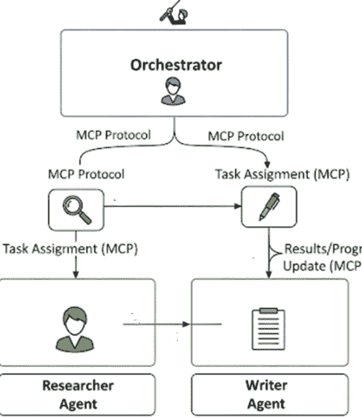
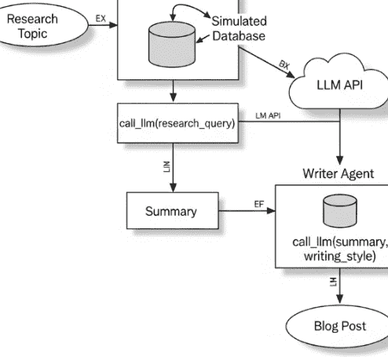
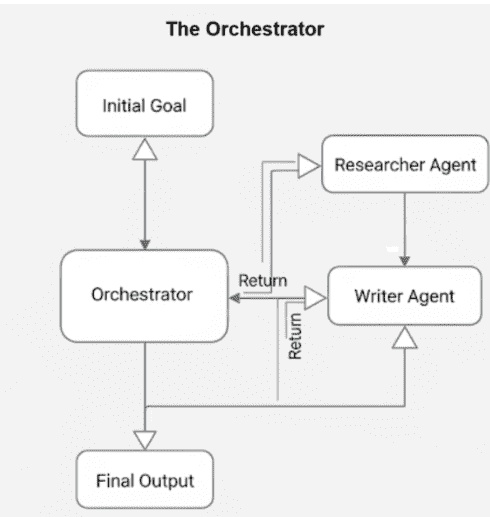
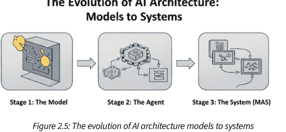

# 2 使用 MCP 构建多智能体系统

在上一章中，我们建立了上下文工程的基础技能：将模糊的提示词转换为结构化的语义蓝图。现在，我们将在更大规模的范围内应用这项技能，构建一个由专门的 AI 代理组成的系统，它们通过上下文进行通信并协作解决复杂问题。单一的大语言模型（LLM）是一个出色的通用全才，但它并非专家。对于任何复杂的多步骤任务，使用单个 LLM 效率低下且往往会失败。因此，我们将构建一个多智能体系统（MAS），在这个系统中，我们工程化的上下文将超出单个消息的内容，用于定义系统本身的设计。这包括定义需要哪些代理、它们的特定角色和能力，以及它们在不丢失信息的情况下通信的方法。这才是上下文工程的真正范围。

此外，为了使我们的系统更加可靠，我们将实现模型上下文协议（MCP），这是一种共享语言，确保我们工程化的上下文以完美的保真度在代理之间传递。在实操部分，我们将从零开始构建一个 MAS-MCP 系统。你将学习如何设计管理工作流的协调器（Orchestrator）以及执行任务的专家代理（研究员 Researcher 和编写者 Writer）。你还将看到如何将错误处理、消息验证和自动化质量控制直接构建到工作流中，确保系统能够从故障中恢复并保持事实准确性。到最后，你将拥有一个功能完整的系统，它可以接收高级目标并自主管理复杂的多步骤过程。简而言之，我们将涵盖以下主题：

- 构建上下文驱动的 MAS 工作流
- 使用 MCP 构建一个管理上下文的 MAS
- 错误处理与验证
- AI 架构的演进
- 构建智能体系统的工具

让我们从构建系统开始吧。

## 使用 MCP 架构 MAS 工作流

在编写第一行代码之前，我们需要一个清晰的架构计划。本节将阐述该蓝图。我们将总体目标解构为核心组件，定义系统每个部分的作用，并映射出让代理团队运转起来的通信流。

首先，让我们定义该设计核心的两个概念：MAS 和 MCP：

- **MAS**：我们将设计一个可以运行多个独立代理的系统，每个代理专门负责不同的任务，如研究、写作或数据分析。通过为每个代理提供清晰的上下文，我们确保它能够在其特定的职责上表现出色。
- **MCP**：为了让代理能够协作，它们需要一种共享语言。MCP 为我们提供了代理之间如何传递任务和信息的规则。它提供了一个框架，确保每条消息都是结构化的、可靠的且被完美理解。

我们的 MAS 由三个不同的组件组成。每个组件都扮演着特定的角色，它们共同构成了一个能够将用户的高级目标转化为成品的工作流：

## 多智能体系统



流程图说明了系统的完整工作流。让我们分析这个认知流水线每个组件的作用：

- **协调器（Orchestrator，项目经理）**：协调器是操作的大脑。它本身不执行专门的任务，而是管理整个工作流。它接收用户的高级目标，将其分解为逻辑步骤，并将每个步骤委托给正确的代理。它还负责接收一个代理的结果并将其作为上下文传递给下一个代理。换句话说，它在系统级对我们的 MAS 应用了上下文链。
- **研究员代理（Researcher agent，信息专家）**：这是我们的第一个专门代理。它的目的是获取特定主题，寻找相关信息，并将这些信息综合成结构化的摘要。在我们的项目中，它将接收来自协调器的研究任务，并以清晰的符号列表形式返回结果。
- **编写者代理（Writer agent，内容创造者）**：这是我们的第二个专门代理。它的长处在于通信和创造性表达。它接收研究员提供的结构化摘要，并将其转化为精炼的、人类可读的内容，并仔细注意语气、风格和叙述。

信息并非仅仅以原始文本的形式流动。代理之间的每一次交互都被封装成结构化的 MCP 消息。这确保了任务和结果始终带有完整的上下文，以一致、可预测且可靠的格式进行传递。MCP 是将一组独立代理连接成一个集成系统的结缔组织。

蓝图准备就绪后，我们已经准备好开始使用 MCP 构建我们的 MAS 了。

> **注意**
> 在本书中，我们探索了将 MCP 原则应用于代理与代理通信的尖端定义。虽然 MCP 最初是为代理与工具的交互设计的，但最近的探索（例如微软的《你可以在 MCP 上构建代理与代理之间的通信吗？》）展示了 MCP 不断进化的能力如何支持新兴的智能体协调模式。
> 文章链接：`https://developer.microsoft.com/blog/can-you-build-agent2agent-communication-on-mcp`

## 使用 MCP 构建 MAS

现在我们已经有了蓝图，是时候开始编写代码了。在这一节中，我们将逐步实现 MAS 和 MCP。我们将从系统的核心功能开始，然后在后的“错误处理与验证”章节中返回添加错误处理和验证。

打开本章存储库中的`Open_MCP.ipynb`进行跟随。初始的 OpenAI 安装与第1章中的`SRL.ipynb`相同。

我们将通过以下步骤完成 Colab 单元：首先定义我们的协议，构建每个专家代理，构建协调器来管理它们，最后运行系统查看代理团队的操作。让我们先初始化 OpenAI 客户端。

### 初始化客户端

我们首先初始化 OpenAI 客户端，它将作为我们与 LLM 通信的网关。我们导入了`json`库以整洁的格式显示我们的消息：

```python
#@title 1. 初始化客户端

# 我们需要 openai 库来与 LLM 通信。

# 注意：此笔记本假设你已经在 Colab 环境中运行了设置单元，
# 将 Secrets 中的密钥加载到环境变量中，正如你所指定的。

import json
from openai import OpenAI

# 客户端将从环境中读取 OpenAI_API_KEY。
client = OpenAI()

print("OpenAI client initialized.")
```

输出显示确认消息：

```
OpenAI client initialized.
```

### 定义协议

正如之前提到的，我们的代理需要一种共享语言来协作。这种语言由 MCP 定义。在本节中，我们将实现一个简化版本来演示该过程。虽然我们的 Python 方法对于学习非常有效，但值得了解规范系统间通信的官方 MCP 规则。

#### 消息格式

MCP 消息的结构有严格定义以确保一致性：

- 所有消息均遵循 JSON-RPC 2.0 格式作为清晰的 JSON 对象
- 消息必须使用 UTF-8 编码以实现通用性
- 每条消息必须单行显示，不包含换行符，以便快速可靠地解析

#### 传输层

一旦定义了消息，MCP 就定义了传输层。传输层定义了代理之间传递消息的方式。两种主要方法如下：

- **STDIO（标准输入/输出）**：对于运行在同一机器上的代理（例如在我们的 Colab 笔记本中），它们可以通过标准输入输出直接进行通信。这是最简单直接的方法。
- **HTTP**：对于运行在不同服务器上的代理，消息通过标准的 HTTP 请求在互联网上传发送。

最后，我们需要一个协议管理框架。

### 协议管理

MCP 还包含了关于兼容性和安全性的规则：

- **版本控制**：使用 HTTP 时，需要版本标头以确保客户端和服务器使用同一套规则。
- **安全性**：有用于验证连接的规则，以防止常见的网络攻击，并确保你正在与预期的服务器进行通信。

对于本书中的实操项目，我们将通过练习结构化通信来关注 MCP 的精神。一个简单的 Python 字典足以说明这一理念。它可以作为正式 JSON-RPC 对象的替身，让我们能够清晰地看到消息是如何构建和传递的，而不会迷失在协议开销中。

准备工作，我们现在可以创建一个名为`create_mcp_message`的辅助函数。该函数是我们系统中传输消息的模板。通过每次使用相同的结构，我们确保信息永远不会丢失或被误解。以下是代码：

```python
## 2. 定义协议：MCP 标准

# 在构建智能体之前，我们必须定义它们将使用的语言。
# MCP 提供了一种简单、结构化的上下文传递方式。在本示例中，
# 我们的 MCP 消息将是一个带有关键字段的 Python 字典。

def create_mcp_message(sender, content, metadata=None):
    """
    创建一个标准的 MCP 消息。
    """
    return {
        "protocol_version": "1.0",
        "sender": sender,
        "content": content,
        "metadata": metadata or {}
    }

print("--- 示例 MCP (我们的简化版) ---")
example_mcp = create_mcp_message(
    sender="Orchestrator",
    content="研究地中海饮食的好处。",
    metadata={"task_id": "T-123", "priority": "high"}
)
print(json.dumps(example_mcp, indent=2))
```

输出显示了我们的 JSON 格式的结构化 MCP 消息示例：

```json
--- Example MCP Message (Our Simplified Version) ---
{
  "protocol_version": "1.0",
  "sender": "Orchestrator",
  "content": "Research the benefits of the Mediterranean diet.",
  "metadata": {
    "task_id": "T-123",
    "priority": "high"
  }
}
```


`create_mcp_message` 函数接收三个输入：发送者、内容（任务或信息）以及任何可选元数据。它始终返回一个相同结构的标准 Python 字典。这种一致性是我们系统可靠性的基础。消息在智能体之间流动，没有丢失、误读或误解的风险。

定义好协议后，我们准备好构建专家智能体了。

## 构建智能体

本节包含了将我们在图 2.1 工作流图中的智能体变为栩生运行的代码。我们将每个智能体定义为一个 Python 函数。每个智能体函数都将接受一个结构化的 MCP 消息作为输入，并返回另一个 MCP 消息作为输出。智能体的特定角色由其系统提示词（system prompt）塑造，它告诉 LLM 如何行为。为了保持通信的一致，我们还将创建一个名为 `call_llm` 的单一辅助函数，用于管理与 OpenAI API 的所有交互。

## 多智能体 AI 系统流程图

### 研究员智能体 (Researcher Agent)



该图说明了一个使用两个 AI 智能体创建博客文章的工作流。信息从初始想法流到完成的内容经过了一系列步骤：

1. 流程始于一个研究主题，这是启动工作流的提示词。包含主题的消息被发送给我们的第一个智能体——研究员智能体（Researcher agent），它从模拟的内部数据库收集相关的事实和信息。
2. 一旦研究员获得了原始数据，它将使用 LLM API（一种外部语言模型服务）来处理信息并创建关键发现的摘要。该摘要是过程上一个和下一个阶段之间的桥梁。
3. 摘要被传递给第二个智能体——作者智能体（Writer agent），它的角色是将研究点转化为完成的文章。作者智能体也会与 LLM API 通信，但是为了执行复杂且具有创造性的任务。
4. 系统的最终结果是一个博客文章，清晰地展示了专业智能体如何协同工作，将高级目标转化为完整的产物。

我们现在准备好实现相互通信的智能体了。

## 创建辅助函数

在构建智能体本身之前，我们需要一种可靠且一致的方式让它们与 LLM 通信。我们的辅助函数 `call_llm` 处理所有到 OpenAI 的 API 调用。我们的系统使用提示词和用户内容作为输入，并返回模型的响应：

```python
def call_llm(system_prompt, user_content):
    """使用新客户端语法调用 OpenAI API 的辅助函数"""
    try:
        # 使用更新后的 client.chat.completions.create 方法
        response = client.chat.completions.create(
            model="gpt-3",
            messages=[
                {"role": "system", "content": system_prompt},
                {"role": "user", "content": user_content}
            ]
        )
        return response.choices[0].message.content
```

该函数有两个输入：

- `system_prompt`，一个告诉模型如何行为的字符串。
- `user_content`，包含用户查询的字符串。

## 定义智能体

```python
def researcher_agent(mcp_input):
    """
    该智能体接收一个主题并从数据库中查找相关信息。
    """
    print("\n[研究员智能体已激活]")
```

```python
simulated_database = {
    "keto diet": "生酮饮食富高脂肪、低碳水和中等蛋白质。",
    "mediterranean diet": "地中海饮食富含水果、蔬菜、全谷物、橄榄油和鱼类。研究显示它与心脏病风险较低。",
    "intermittent fasting": "间歇性禁食是一种在进食和禁食之间循环的饮食模式。",
}
```

适合健康与养博客的鼓励性语气。提示词还规定了长度（约 150 字）并要求一个引入人的标题：

```python
system_prompt = "你是一位健康与养博客的资深内容写作者。你的语气平易近人、信息量丰富且具有鼓励性。你的任务是根据以下研究点撰写一篇短小、吸引人的博客文章（约 150 字），并带上引入人的标题。"
```

代理调用 `call_llm`，传入系统提示词和研究摘要。返回的文本就是我们的博客文章。我们还打印了一条消息以确认稿已创建：

```python
blog_post = call_llm(system_prompt, research_summary)
print("Blog post drafted.")
```

最后，使用 `create_mcp_message` 将博客文章封装进新的 MCP 消息。这确保了输出遵循与其他所有消息相同的结构化格式，并包含内容元数据；在此情况下，我们统计了以下字数：

```python
return create_mcp_message(
  sender="WriterAgent",
  content=blog_post,
  metadata={
```

这完成了 Writer（写作者）。它接收来自 Researcher（研究者）的结构化输入，应用新的系统提示词，并输出格式一致的 MCP 完整博客文章。

当 Researcher 和 Writer 都准备完成后，我们现在定义了 MAS（多代理系统）的核心。每个代理都有独特的角色，它们共同可以完成从原始信息到最终内容的任务。

## 构建编排器 (Orchestrator)

我们现在有了专门代理，但我们需要一种管理它们的方法。这个角色属于编排器。把它想象成我们 AI 团队的项目经理。它的工作是接收一个高级目标，将其分解为一系列任务，并将这些任务委托给正确的代理。它还管理信息流，将一个代理的输出作为下一个代理的输入。这创建了一个从开始到结束的无缝流程：

### 编排器



图 2.3：代理的编排器

上图的工作流在**初始目标**被发送给**编排器**时开始。编排器充当中心枢纽，首先向**Researcher（研究者代理）**发送任务。一旦研究完成，该代理将其发现返回给编排器。编排器处理这些信息并向**Writer（写作者代理）**发送新任务。在 Writer 完成后，它将完成的内容传回编排器。最后，编排器拥有了所有内容来生成**最终输出**，完成整个过程。

以下代码定义了我们的编排器。这个单一函数管理从开始到结束的多代理工作流。它的角色是调用 Researcher，然后是 Writer，最后将输出组装成一个完整的制品。让我们逐步分析：

```python
def orchestrator(initial_goal):
    """
    管理多代理工作流以实现高级目标。
    """
    print("=" * 50)
    print(f"[Orchestrator] Goal Received: '{initial_goal}'")
    print("=" * 50)
```

我们从开始定义编排器函数。它接受一个参数 `initial_goal`，代表我们希望系统完成的高级任务。该函数随后打印已接收目标的确认。

第一步是委托研究任务。在这里，我们将"地中海饮食"硬编码为主题，但在实践中，这可以根据用户的目标动态设置：

```python
# 步骤 1：编排器规划并调用 Researcher 代理
print("\n[Orchestrator] Task 1: Research. Delegating to Researcher Agent.")
research_topic = "Mediterranean Diet"
```

我们将研究主题封装在 MCP 消息中，以保持通信的一致性：

```python
mcp_to_researcher = create_mcp_message(
  sender="Orchestrator",
  content=research_topic
)
```

编排器现在使用 MCP 消息调用 Researcher 代理，接收响应并打印返回的摘要：

```python
mcp_from_researcher = researcher_agent(mcp_to_researcher)
print("\n[Orchestrator] Research complete. Received summary:")
print("-" * 20)
print(mcp_from_researcher['content'])
print("-" * 20)
```

编排器现在在 `mcp_from_researcher` 中拥有 Researcher 代理的响应，它可以将其传递给 Writer 代理。Writer 代理反过来首先在 `mcp_to_writer` 中创建 MCP 消息并发送给 Writer 代理，然后显示结果（这将在我们运行系统时出现）。然后它记录写作步骤已完成：

```python
# 步骤 2：编排器调用 Writer 代理
print("\n[Orchestrator] Task 2: Write Content. Delegating to Writer Agent.")
mcp_to_writer = create_mcp_message(
  sender="Orchestrator",
  content=blog_post,
  metadata={
)
```

```python
mcp_from_writer = writer_agent(mcp_to_writer)
print("\n[Orchestrator] Writing complete.")
```

最后，编排器获取 Writer 的响应并呈现最终结果：

```python
### 步骤 3：编排器呈现最终结果
final_output = mcp_from_writer['content']
print("\n[Orchestrator] Final Output:")
print(final_output)
```

至此，编排器函数完成。

## 运行系统

我们已经准备好了所有组件：Researcher 代理、Writer 代理和编排器。现在让我们运行系统并观察它们的工作。

编排器接收目标，传递给 Researcher，获取摘要，然后传递给 Writer，后者生成博客文章。

```python
## 运行系统
user_goal = "Create a blog post about the benefits of Mediterranean diet."
orchestrator(user_goal)
```

图 2.4：代理的流程

### 多代理执行流

| 阶段 | 动作 | 输出 |
| :--- | :--- | :--- |
| 用户输入 | 目标到编排器 | 关于地中海饮食好处的博客 |
| 编排器 | 任务 1：研究 | 委托给 Researcher 代理 |
| Researcher 代理 | 研究完成 | 地中海饮食摘要 |
| 编排器 | 任务 2：编写内容 | 委托给 Writer 代理 |
| Writer 代理 | 写作完成 | 博客文章草稿 |
| 编排器 | 最终输出 | Mediterranean Magic... |

现在让我们看看 MAS 的实际输出。我们将分解控制台日志，显示每个代理如何贡献于最终的博客文章：

1. 系统在我们给编排器一个目标时开始。编排器确认该目标并准备将其分解为第一个任务：

```
=============================================
[Orchestrator] Goal Received: 'Create a blog post about the benefits of Mediterranean diet.'
=============================================
Orchestrator Delegates to the Researcher
```

2. 接下来编排器知道了。它宣布研究任务并激活 Researcher 代理。Researcher 随后工作并告诉我们它创建了一个摘要。


# 多代理系统（MAS）工作流演示

## 系统运行示例

**[Orchestrator]** Task 1: Research. Delegating to Researcher Agent.

**[Researcher Agent Activated]**

Research summary created for 'Mediterranean Diet'

在 Researcher 完成任务后，编排器确认已收到摘要。随后它显示 Researcher 提取的要点。此输出了将用于博客文章的信息：

```
[Orchestrator] Research complete. Received summary:
------------------
- 强调蔬菜、全谷物、橄榄油和鱼类食物。
- 与心脏病风险降低、大脑健康改善和长寿增加有关。
- 益处与高摄入单不饱和脂肪（特别是来自橄榄油）和抗氧化剂有关。
------------------
```

拿到摘要后，编排器进入下一步。它宣布它正将内容撰写任务委托给 Writer 代理。Writer 开始起草博客文章：

```
[Orchestrator] Task 2: Write Content. Delegating to Writer Agent.
[Writer Agent Activated]
```

### 博客文章草稿已拟定

当 Writer Agent 开始起草博客文章时，编排器（Orchestrator）会确认写作任务已完成：

```
[Orchestrator] Writing complete.
```

最后，编排器信号整个工作流已完成。随后它呈现了最终的博客文章，这是所有智能体共同努力的成果：

```
[Orchestrator] Workflow Complete. Final Output:
地中海魔法：增强心脏、大脑和长寿的美味之道
```

地中海风格的餐盘推崇色彩丰富的果蔬、五谷物、丝滑的橄榄油以及大量的鱼。研究表明，这种饮食模式与心脏病风险降低、大脑更健康以及更长寿有关。秘诀是什么？单不饱和脂肪——尤其是特级橄榄油——有助于改善胆固醇平衡并保持血管弹性，而富含抗氧化剂植物和海鲜则对抗氧化压力和炎症……

这次运行展示了我们多智能体系统（MAS）的生命周期。在这个阶段，系统按预期工作。网络波动、格式错误的消息或意外的 LLM 响应可能会中断流程。为了让工作流更加可靠并更接近生产就绪，我们需要通过错误处理、验证和保护措施来加强它。这正是我们下一步要转的地方。

## 错误处理与验证

我们目前为止构建的系统是一个功能性原型；当一切按计划进行时，它可以运行。但在现实世界中，事情很少按计划进行。API 可能会失败，消息可能格式错误，智能体可能会返回意外结果。在考虑其健壮性之前，我们必须改进系统以应对这些潜在的故障。

在本节中，我们将把简单的脚本升级为更具韧性的系统。我们将为 API 调用添加错误处理，创建一个验证器以确保 MCP 消息格式正确，并教编排器在智能体失败或产生缺陷输出时如何保持工作流运行。

在这一部分，我们将在 `MAS_MCP_control.ipynb` 笔记本中工作，其中包含了完整的实现。我们将关注两个核心工程原则：韧性和可靠性：

- **韧性 (Resilience)**：加固与 LLM 的连接，使临时问题（如 API 超时或速率限制）不会导致系统崩溃
- **可靠性 (Reliability)**：确保消息完整性，使智能体始终交换可预测、有效的 MCP 消息

让我们从提高韧性开始。我们原始的 `call_llm` 函数是有意设计的。我们发送单次 API 请求并返回结果。在生产环境中，这种方法太脆弱了。OpenAI API 可能会宕机，或者如果请求因网络不稳定失败，整个工作流可能会崩溃。为了修复，我们将构建一个更健壮的函数，它可以处理重试。

## 为 LLM 构建健壮组件

加强我们系统的第一步是将原始 `call_llm` 替换为更具韧性的函数：`call_llm_robust`。这个新版本获取请求而不是立即放弃，允许系统从临时问题中恢复。

在定义函数之前，我们需要 `time` 库，它允许我们在重试之间暂停执行。这已经包含在 `MAS_MCP_control.ipynb` 的初始化部分中：

```python
import time
```

准备好后，这里是新函数：

```python
# @title 3.Building Robust Components
# Hardening the call_llm Function

def call_llm_robust(system_prompt, user_content, retries=3, delay=5):
    """一个健壮的辅助函数，用于重试调用 OpenAI API."""
    for i in range(retries):
        try:
            response = client.chat.completions.create(
                model="gpt-4",
                messages=[
                    {"role": "system", "content": system_prompt},
                    {"role": "user", "content": user_content}
                ]
            )
            return response.choices[0].message.content
        except Exception as e:
            print(f"API call failed on attempt {i+1}/{retries}. Error: {e}")
            if i < retries:
                print(f"在 {delay} 秒后重试...")
                time.sleep(delay)
            else:
                print("所有重试均失败。")
                return None
```

在这个升级后的函数 `call_llm_robust` 中，我们将 API 调用封装在循环内的 `try/except` 块中。如果发生错误，系统将等待几秒后再次尝试，并在尝试之间通过 `time.sleep` 暂停。这种重试机制使系统对临时网络问题更具韧性。如果所有尝试均失败，函数返回 `None`，这向编排器信号它必须决定如何处理故障。

在建立了 API 用的韧性后，让我们转向可靠性，引入一个在每个 MCP 消息到达智能体之前对其验证的函数。

## 验证 MCP 消息

为了让智能体可靠地通信，它们必须信任接收的消息。如果漏掉格式错误的消息，整个工作流可能会失败。为了防止这种情况，我们引入了 MCP 验证器，这是一个简单的护栏，检查每条消息是否符合我们的协议。检查在消息传递给智能体之前进行：

```python
# The MCP Validator ---
def validate_mcp_message(message):
    """一个检查 MCP 消息结构的简单验证器。"""
    required_keys = ["protocol_version", "sender", "content", "metadata"]

    if not isinstance(message, dict):
        print(f"MCP 验证失败：消息不是字典。")
        return False

    for key in required_keys:
        if key not in message:
            print(f"MCP 验证失败：缺少键 '{key}'")
            return False

    print(f"来自 {message['sender']} 的 MCP 验证通过。")
    return True
```

此函数是一个重要的护栏。编排器在传递任何消息之前调用 `validate_mcp_message`，确保结构完整。它首先检查输入是否为字典，然后验证所有必要的键是否存在。

有了这个验证器，编排器可以信任它分发的消息，智能体也可以专注于自己的任务。结合为 API 调用增加韧性的 `call_llm_robust` 函数，我们现在有了一个既可靠又容错的系统基础。

现在让我们通过为专家引入控制来添加另一种保护措施。

## 添加智能体专项控制

我们目前的智能体团队可以工作，但有一个弱点：它完全信任 Writer 的输出。即使有良好的上下文，LLM 也会误解事实或引入幻觉。为了让我们的系统更加可靠，我们需要一个质量控制步骤，在接受 Writer 的工作之前对其检查。

首先，更新智能体。我们在两个智能体内部将旧的 `call_llm` 函数替换为新的 `call_llm_robust` 函数：

```python
### title 4.Building the Agents: The Specialists
---
#### Agent 1: The Researcher ---
def researcher_agent(mcp_input):
    ... (code omitted for brevity)
    system_prompt = "你是一名研究分析师。将提供的信息综合为3-4个简洁的要点。"
    # 现在使用健壮调用器
    summary = call_llm_robust(system_prompt, research_result)
    ... (code omitted for brevity)
```

```python
#### Agent 2: The Writer ---
def writer_agent(mcp_input):
    ... (code omitted for brevity)
    system_prompt = "你是一名内容撰稿员。根据以下研究点写一篇简短、吸引人的博客文章（约 150 字），并带有一个引人的标题。"
    # 现在使用健壮调用器
    blog_post = call_llm_robust(system_prompt, research_summary)
    ... (code omitted for brevity)
```

## 使用 MCP 构建多代理系统

这确保了研究人员（Researcher）和作者（Writer）都能通过重试失败的请求而不是直接报错来应对临时 API 中断。这些代理现在更具韧性，但我们仍然需要一种来验证作者的草稿是否与研究人员的内容一致。下一步是将团队从两个专家扩展到三个。我们引入了验证代理（validator agent）。

验证代理的唯一目的是担任事实检查员。它将作者的草稿与研究人员的摘要进行比较。这种比较确认了事实的一致性。它为我们的系统添加了重要的质量控制层：

```python
# --- Agent 3: The Validator
def validator_agent(mcp_input):
    """该代理根据摘要对草稿进行事实检查."""
    print("\n[Validator Agent Activated]")

    # 提取两个必要信息
    source_summary = mcp_input['content']['summary']
    draft_prompt = mcp_input['content']['draft']

    system_prompt = """
你是一个严谨的事实检查员。判断"草稿"是否与"源摘要"在事实上一致。
- 如果草稿中的所有主张都得到了源的支持，请仅回复单词"pass"。
- 如果草稿包含源中没有任何信息，请回复"fail"并提供一句话的解释。
"""

    validation_context = f"SOURCE SUMMARY:\n{source_summary}\nDRAFT:\n{draft_prompt}"
    validation_result = call_llm_robust(system_prompt, validation_context)

    print(f"Validation complete: {validation_result}")

    return create_mcp_message(
        sender="ValidatorAgent",
        content=validation_result
    )
```

验证代理有其自己的语义蓝图。它需要两个输入：来自研究人员的源摘要和来自作者的博客草稿。如果草稿与摘要一致，模型返回 pass；如果不一致，则返回 fail 并附带简短解释。


# 2 

这为编排器（Orchestrator）提供了一个新的保障：它不再需要盲目地信任作者。相反，在接受草稿作为最终版本之前，它可以检查草稿是否与研究结果对齐。

我们现在将添加编排逻辑控制，将验证代理引入工作流。

## 带有验证循环的最终编排器

原始的简单编排器是一个线性任务管理器。我们用一个更智能的 `final_orchestrator` 替换了它。这个新版本包含验证修订循环。

工作流不再是顺序的。在 `writer_agent` 生成草稿后，编排器将其委托给 `validator_agent`。如果验证失败，编排器会将草稿发回给作者并包含验证代理的反馈。这创建了一个强大的自纠系统，模拟了现实世界的编辑流程。

我们现在将检查笔记本第 5 节中 `final_orchestrator` 函数的关键变化。

步骤 1 与原始编排器类似。关键的添加是立即调用了 `validate_mcp_message`。如果研究人员返回了格式错误的消息，或者内容为空（当 `call_llm_robust` 返回 None 时可能会发生），编排器将立即停止工作流。

```python
@title 5. Final Orchestrator with Validation Loop
def final_orchestrator(initial_goal):
    ... (省略了初始化代码) ...

    # 步骤 1 研究与立即验证
    # 步骤 1: Research --
    print("\n[Orchestrator] Task 1: Research. Delegating to Researcher Agent.")
    # (调用 researcher_agent) ...
    mcp_from_researcher = researcher_agent(mcp_to_researcher)

    # 新增：立即验证消息结构
    if not validate_message(mcp_from_researcher) or not mcp_from_researcher['content']:
        print("由于来自研究人员的消息无效或为空，工作流失败。")
        return

    research_summary = mcp_from_researcher['content']
    print("\n[Orchestrator] Research complete.")
```

## 使用 MCP 构建多代理系统

随后步骤 2 和 3 被合并为一个迭代循环。如果验证通过，则接受草稿并结束循环。如果验证失败，编排器会将带有反馈的作者草稿发回给作者，要求修订。循环允许有限次数的修订（max_revisions）以防止无限循环：

```python
# 步骤 2 和 3 迭代循环
# 步骤 2 & 3: Iterative Writing and Validation Loop
---
final_output = "Could not produce a validated article."
max_revisions = 2
for i in range(max_revisions):
    print(f"\n[Orchestrator] Writing Attempt {i+1}/{max_revisions}")
```

```python
# 为作者准备上下文
writer_context = research_summary
if i > 0:
    # 这是一个修订，基于验证代理的反馈
    writer_context += "\nPlease revise the previous draft based on this feedback: (validation_result)"
```

```python
## 调用作者代理并验证
mcp_to_writer = create_message(sender="Orchestrator", content=writer_context)
mcp_from_writer = writer_agent(mcp_to_writer)
```

```python
if not validate_mcp_message(mcp_from_writer) or not mcp_from_writer['content']:
    print("由于来自作者的消息无效，中止修订循环。")
```

工作流不再是顺序的。在 `writer_agent` 生成草稿后，编排器将其委托给 `validator_agent`。如果验证失败，编排器会将带有反馈的草稿发回给作者并要求修订。这创建了一个强大的自纠系统，模拟了现实世界的编辑流程。

## AI 架构的演进

我们构建 AI 的方法正在发生进化。这些模型非常强大且知识渊博，但它们并不是任何单一领域的专家。当任务发生变化时，单一模型很难同时保持专注和准确性。


因此，我们从使用单一通用模型转向创建一个由专业化代理（agents）组成的团队。我们利用上下文工程（context engineering）来定义代理的角色和技能。我们的研究员（`Researcher`）代理和编写者（`Writer`）代理就是这种方法的示例。每个代理的设计目标都是为了很好地完成其单项工作，如下所示：



专家团队需要协作来解决大问题。MAS（多智能体系统）提供了管理这些代理的结构。MCP 则帮助代理之间进行可靠的通信。上下文工程是这一过程中的胶水：首先用于改进单个 LLM 的响应，现在则扩展到定义代理本身及其交互。随着 AI 越来越多地部署到现实世界，这些系统将不断扩展和扩展。

## 构建代理系统的工具

到目前为止，我们从零开始构建了一个 MAS。这种实践方法让我们在 MAS 和 MCP 的核心思想方面拥有了坚实的基础：编排、结构化通信、韧性和验证。

在许多项目中，客户或内部管理层可能要求我们避免外部平台或框架，即使是可下载的开源框架也是如此。某些甚至坚持只使用本地 LLM。然而，在其他情况下，使用框架可能会受到鼓励甚至被要求。那么，上下文工程师的正确路径是什么？

首先，从理解上下文工程开始，就像我们在这里所做一样：从零开始。有了这些知识，你将准备好实现一个完全自定义的解决方案或部署一个优于许多其他工程师的现有框架。你既是架构师又是问题解决者，当即用框架无法满足需求时，寻找让系统重新运行的方法。以下是一些你可以探索的资源：

- **MCP 规范**：官方 MCP 规范是必读的。它详细说明了代理如何通信的正式规则。我们构建了一个简化版本。官方网站定义了 JSON RPC 传输层安全标准：`modelcontextprotocol.io`。

- **MAS 框架**：几个开源框架使得创建 MAS 变得容易得多。它们处理了困难的部分，如编排、通信和代理管理。这些工具使用了与我们刚刚构建相似的概念。学习它们是观察这些想法如何在生产环境中使用的极佳方法。

- **autogen**：`autogen` 是来自微软的一个框架。它让你能够构建多个代理相互对话以解决问题的应用程序。`autogen` 代理非常灵活。它们可以结合 LLM、人类输入和工具来完成工作。你可以在此处的 GitHub 上找到 `autogen`：`github.com/microsoft/autogen`。

- **CrewAI**：`CrewAI` 专为构建基于角色的 AI 代理团队而设计。它为代理共同协作完成复杂任务提供了结构。`CrewAI` 专注于协作和专业化。它的设计与我们创建的协调器（`Orchestrator`）模型非常相似。在此查找更多信息：`https://www.crewai.com/`

- **LangGraph**：`LangGraph` 是 LangChain 工具家族的一部分。它允许你将代理工作流构建为图。这是创建可以迭代自我修正系统的强大方式。`LangGraph` 让你对信息流和决策如何产生进行精细控制。`LangGraph` 文档可以在此处找到：`python.langchain.com/docs/langgraph`。

至此，我们已经从零开始构建了一个 MAS 和 MCP 用例，以获得对尖端上下文工程系统的实践理解。让我们总结一下我们的旅程。

## 总结

在本章中，我们超越了单一代理交互。我们构建了一个专业代理团队，每个代理执行特定的特定功能。我们利用了 MCP，它允许我们的代理使用标准蓝图进行通信。然后，我们设计了系统架构。我们创建了一个语义蓝图来定义代理团队的角色和工作流。接下来，我们部分地构建了系统。我们从一个创建标准 MCP 消息的功能开始。然后构建了每个代理，为每个代理提供具有特定提示（`prompt`）的独特技能。我们构建了研究员的输出并将其传递给编写者。最终结果是一个功能性的 MAS。它可以接收用户并并完成研究和写作过程。最后，我们通过在架构中添加错误处理和验证，使我们的原型更加健壮。

你现在已经从零开始设计、实现并稳定了一个 MAS。你可以使用这些高级工具构建下一代 AI 解决方案。我们的下一章将通过 RAG（检索增强生成）将 MAS 开放给外部数据，开启旅程的下一个阶段。

## 问题

1. 这里的中心观点是一个大的 LLM 对复杂工作是最好的吗？（是或否）

2. 协调器（`Orchestrator`）执行实际的研究和写作吗？（是或否）

3. MCP 仅仅是让 LLM 写得更好的花哨方式吗？（是或否）

4. 研究员代理编写最终的博客文章吗？（是或否）

5. 编写者直接从用户的第一个请求获取任务吗？（是或否）

6. 你必须运行每个代理才能获得博客文章吗？（是或否）

7. 每个 MCP 消息都必须包含发送者和内容吗？（是或否）

8. 是否有一个所有代理共享的大提示词？（是或否）

9. 笔记本中的代理通过互联网使用 HTTP 互相通信吗？（是或否）

10. 这里的中心观点是一个大的 LLM 对复杂工作是最好的吗？（是或否）

## 参考文献

1. Model Context Protocol. `https://modelcontextprotocol.io`

2. Multiagent Systems: A Modern Approach.

3. JSON-RPC 2.0 Specification. `https://www.jsonrpc.org/specification`

4. ReAct: Synergizing Reasoning and Acting in Language Models. `arXiv:2210.03629`

5. A Survey on Large Model Autonomous Agents. `https://arxiv.org/abs/2308.11432`

