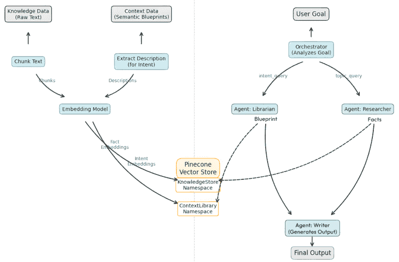
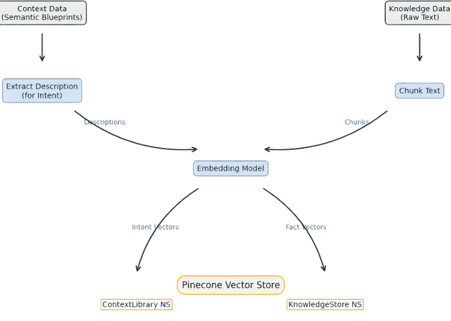

# 3 构建上下文感知多智能体系统

- 为语义蓝图创建上下文库

- 使用向量存储命名空间（`namespaces`）管理不同的数据类型

- 实现新的专家智能体，例如“上下文管理员”（`Context Librarian`）

- 编排整个系统以生成具有上下文感知的内容

我们将从探索 RAG MAS 架构开始。

## 设计双 RAG MAS 架构

为了构建我们的上下文感知系统，我们需要对其架构有一个清晰的认识。从高层来说，整个过程分为两个不同的阶段，我们将对其进行设计和开发。阶段 1 是数据准备，用于预处理数据；阶段 2 是运行时执行，我们的 MAS 使用准备好的数据来响应用户目标。本章将在两个笔记本中开发这两个阶段。

### 完整的双 RAG MAS 架构

阶段 1：数据准备（RAG 摄入）

阶段 2：运行时执行（MAS）



图 3.1：双 RAG MAS 架构

上图插插了双 RAG 架构的完整数据和执行流，箭头显示了组件在高层面上如何连接。在进入实际程序之前，我们将逐步介绍图中的每个部分。

## 阶段 1：数据准备

在阶段 1 中，我们重点关注数据准备，即图 3.1 的左侧部分。系统从两种不同的输入源开始：

- **知识数据**（`Knowledge data`）：系统应该知道的事实信息。

- **上下文数据**（`Context data`）：在*第 1 章*中引入的结构化指令或语义蓝图。两种数据类型都由**嵌入模型**处理。对于知识数据，我们将文本分割成块并对每个块进行嵌入；对于上下文数据，我们只对蓝图意图的描述进行嵌入。搜索基于意图。完整的蓝图内容单独存储在 JSON 对象中，并与其描述关联。

所有嵌入都存储在 Pinecone 数据库中，它将包含系统所需的所有内容。我们使用单个 Pinecone 索引，分为两个严格隔离的命名空间：

- **`KnowledgeStore`**（知识库）：此命名空间存储来自事实数据的向量。

- **`ContextLibrary`**（上下文库）：此命名空间存储来自程序化蓝图的向量。

两个命名空间就绪后，系统就准备好进入阶段 2。

## 阶段 2：运行时执行分析

在阶段 2 中，MAS 执行用户请求，如图 3.1 的右侧所示。

该过程从**用户目标**开始，这是用户提交的高级指令——例如，“写一个关于阿波罗 11 号的悬疑故事”。

**编排器**（`Orchestrator`）接收此目标。作为系统的中央协调器，它分析请求并识别出两个组件：

- **`intent_query`**（意图查询）：这是管理员（`Librarian`）查询的意图，与所需的样式结构相关（在我们的示例中是悬疑故事）。

- **`topic_query`**（主题查询）：这是研究员查询的主题，与主题内容相关（在我们的示例中是阿波罗 11 号）。

随后，编排器将每个查询委托给专家智能体：

- **管理员智能体**（The `Librarian` agent）：负责检索指令脚本，通过引擎的 MCP 消息层接收 `intent_query`。它查询 `ContextLibrary` 命名空间，执行语义搜索以找到匹配请求意图的蓝图描述，并检索相应的语义蓝图。

- **研究员智能体**（The `Researcher` agent）：负责检索事实信息，接收 `topic_query`。它查询 `KnowledgeStore` 命名空间，检索相关的事实块，并将其合成简洁的发现。

一旦两个响应都准备就，编排器现在就可以促进将检索到的指令脚本和合成的事实传递给**作者**（`Writer`）智能体。**图 3.1** 中的箭头显示了**蓝图**和**事实**从管理员和研究员向作者移动。

作者充当系统的生成引擎。它使用事实作为内容，并将蓝图作为对内容进行结构化和样式化的脚本指令。然后，作者生成最终输出，同时遵循事实要求和程序性约束。

这种架构允许高度的灵性和扩展性。可以在不更改指令脚本的情况下更新知识库，可以在不触碰事实的情况下添加新的蓝图。在运行时，智能体会根据它们检索到的上下文动态调整其行为。

解释架构后，我们现在可以进入实现。下一步是构建 RAG 摄入流水线。

## RAG 流水线数据摄入（上下文与知识）

在*第 2 章*中，我们使用模拟数据构建了一个 MAS。智能体知道如何搜索，但它们受限于简单的 Python 字典。在本章中，我们迈出了下一步：用真实的 RAG 流水线取代该种模拟。

## RAG 数据摄入流水线



图 3.2：显示了此流水线的流程。在智能体能够有效搜索之前，我们必须首先准备并构建它们将使用的数据库。我们的方法引入了两种互的形式的形式 RAG：

- **知识库（事实 RAG）**：存储事实。这是 RAG 的标准用法，大多数工程师都很熟悉。

- **上下文库（程序化 RAG）**：存储第一章引入的指令或**语义蓝图**。智能体查询此库以确定*如何*结构化它们的响应以及使用*什么*。

要实现这一点，请在 GitHub 中打开 `RAG_Pipeline.ipynb` 笔记本。

## 安装与设置

现在环境已就绪，让我们使用刚刚设置的 API 密钥连接到 OpenAI 和 Pinecone。对于本章，我们将此称为 `genai-mas-mcp-ch3`。

我们将检索 Pinecone API 密钥。在示例中，我正在使用 Google Colab 的密钥管理器：

```python
PINEONE_API_KEY = userdata.get('PINEONE_API_KEY')
...
```

一旦获取了 API 密钥，我们需要为项目定义两个命名空间（`namespaces`）。这将确保我们的数据类型在 Pinecone 内部严格分离：

- `NAMESPACE_KNOWLEDGE` 将存储事实

- `NAMESPACE_CONTEXT` 将存储蓝图

我们正在使用 Pinecone 的无服务器架构（`serverless architecture`），这是 Pinecone 免费计划建议使用的。我们需要定期查看 Pinecone 的方案以确认条件是否有变化。对于本次演示，我将使用 `us-east-1` 的 AWS：

```python
-- Initialize Clients --
client = OpenAI(api_key=OPENAI_API_KEY)
pc = Pinecone(api_key=PINEONE_API_KEY)

# Define Index and Namespaces --
INDEX_NAME = 'genai-mascp-ch3'
NAMESPACE_KNOWLEDGE = 'KnowledgeStore'
NAMESPACE_CONTEXT = 'ContextLibrary'

# Define Serverless Specification
spec = ServerlessSpec(cloud='aws', region='us-east-1')
```

在使用索引之前，我们需要检查它是否已经存在。如果不存在，代码将创建一个具有嵌入维度（`embedding dimension`）和**余弦相似度**（`cosine similarity`）指标的新索引，这是比较文本嵌入的常用选择：

```python
## Check if index exists
if INDEX_NAME not in pc.list_indexes().names():
    print(f"Index {INDEX_NAME} not found. Creating new serverless index...")
    pc.create_index(
        name=INDEX_NAME,
        dimension=EMBEDDING_DIM,
        metric='cosine',
        spec=spec
    )
## Wait for index to be ready
while not pc.describe_index(INDEX_NAME).status['ready']:
    print("Waiting for index to be ready...")
```

# 3 

```python
time.sleep(1)
print("Index created successfully. It is new and empty.")
```

如果索引已经存在，我们可以选择是否清除现有数据。对于本次演示，我们将通过删除两个命名空间的内容每次都重新开始：

```python
else:
    print(f"Index {INDEX_NAME} already exists. Clearing namespaces for a fresh start...")
    index = pc.index(INDEX_NAME)
    namespaces_to_clear = [NAMESPACE_KNOWLEDGE, NAMESPACE_CONTEXT]
```

要清除索引，我们需要遍历每个命名空间并清除数据：

```python
for namespace in namespaces_to_clear:
    # Check if namespace exists and has vectors before deleting
    stats = index.describe_index_stats()
    if namespace in stats.namespaces and stats.namespaces[namespace].vector_count > 0:
        print(f"clearing namespace {namespace}...")
        index.delete(delete_all=True, namespace=namespace)
```

这里有一个棘手。清除函数可能是异步的，程序可能会运行得过快。这种缓慢的删除在我们开始上传后完成，这些新向量可能会被扫掉。这并不是绝对的，但确实是我们我们不想承担的风险。因此，我们等待系统并在向量计数真正为零后继续：

```python
# CRITICAL FUNCTION: Wait for deletion to complete
while True:
    stats = index.describe_index_stats()
    if namespace not in stats.namespaces or stats.namespaces[namespace].vector_count == 0:
        print(f"Namespace {namespace} cleared successfully.")
        break
    print(f"Waiting for namespace {namespace} to clear...")
    time.sleep(5) # Poll every 5 seconds
```

```python
else:
    print(f"Namespace {namespace} is already empty or does not exist. Skipping.")
```

构建上下文感知多智能体系统

最后，我们准备好连接到索引进行后续操作：

```python
# Connect to the index for subsequent operations
index = pc.Index(INDEX_NAME)
```

如果一切运行正常，你将看到指示索引已存在且命名空间已清除的输出：

```
Index genai-mas-cp-ch3 already exists. Clearing namespaces for a fresh start...
Namespace 'KnowledgeStore' is empty or does not exist. Skipping.
Namespace 'ContextLibrary' is empty or does not exist. Skipping.
```

在生产环境中，你可能不想在每次运行时都清除命名空间——你希望系统保留其存储的知识。然而，对于我们的学习之旅，每次重新开始更加整洁。索引就绪后，我们可以开始准备数据。

## 数据准备：上下文库（过程化 RAG）


在本节中，我们将为上下文库定义数据。这是我们过程化 RAG 实现的核心，因为我们正在引入过程化指令——而不仅仅是静态知识。上下文库建立在第一章语义蓝图概念的基础上，但现在我们将用精确的结构来实现它。

我们上下文库中的每个条目包含三个部分：

- 一个`id`，它是 Pinecone 索引中的唯一标识符。

- 一个`description`，用于解释蓝图的作用和风格。我们只对描述进行嵌入，以便为任务找到所需的蓝图。

- 蓝图包含 JSON 格式的 LLM（大语言模型）实际指令。蓝图不会被嵌入。一旦访问了描述，我们像在构建完一本书后一样检索蓝图……

## 第3章

### 83

输出确认我们已经定义了三个蓝图：

```
准备了 3 个上下文蓝图。
```

这里的要点是，创建语义蓝图既强大又具有挑战性。如果没有它们，你将不得不为每个 LLM 任务编写单独的代理（agent）。那样是不可扩展的。语义蓝图允许你一次捕获过程化指令并无限次复用。你不需要为几十个任务构建下拉菜单，而是依赖一个可扩展的自动化的上下文引擎。

定义好蓝图后，让我们转向双路 RAG 设置的另一侧：知识库。

## 数据准备：知识库（事实性）RAG

我们的任务是为知识库定义数据，即 RAG 设置中的事实部分。该组件持有相对静态的信息，研究员代理（Researcher agent）将搜索并将其合成简洁的发现。为了保持预期现实，你是在自己设计这个系统，而不是躲在华丽的平台背后；这需要大量细致的人工工作。

在这个教育示例中，我们将使用一个关于太空探索的小型数据集。它包含了太空竞赛和阿波罗 11 号、朱诺任务以及火星探测器。在本章中，我们将专注于架构，用数据字符串表示数据。让我们将知识整合到一个原始字符串中：

```python
knowledge_data_raw = """
太空探索是利用天文学和太空技术探索外层空间。太空探索的早期阶段是由苏联和美国之间的“太空竞赛”驱动的。1957年苏联斯普尼克1号的发射以及1969年美国阿波罗11号首次登上月球是关键的里程碑。

朱诺号是 NASA 的一个探测木星的太空探测器。它于2011年8月5日发射，并于2016年7月5日进入木星极地轨道。

火星探测器是一种设计在火星表面行驶的遥控车辆。NASA JPL 管理了多个成功的探测器，包括：幸运者号、精神号、机遇号、好奇号和毅力号。寻找火星上宜居性和有机碳的证据现在是 NASA 的首要目标。毅力号还携带了“机智”直升机。
"""
```

现在我们将构建一个小型辅助函数，在嵌入之前将此文本处理成利于搜索的片段。

## 分块和嵌入的辅助函数

语言模型不处理原始段落——它们处理标记（tokens），这是模型将文本拆分为它可以理解的单位的方式。例如，单词 `encoding` 可能会被拆分成两个标记：`enc` 和 `ing`。模型使用这些部分来更好地理解单词关系。

我们将使用 `c100k_base` 分词器，这是 OpenAI 最新模型的标准配方。这种编码有三个优势：

- 它分割单词的方式非常聪明。它没有将像 `encoding` 这样的单词视为整体，而是可能将其拆分为更小的、有意义的部分，如 `enc` 和 `ing`。这有助于模型理解不同单词之间的关系。

- 它为速度而设计且运行高效，非常适合对话型模型以及为准备存储在数据库中的文本做准备。

- 使用它能确保你计数和格式化文本的方式与模型预期的完全匹配，这一点是至关重要的。

这种一致性至关重要。如果我们的分块（chunking）与嵌入模型的训练不匹配，语义搜索结果将是不准确的。这就像在一个图书馆里查书，但那里一半的卡片使用了不同的分类系统。

让我们初始化分词器：

```python
# 初始化分词器以实现健壮的感知标记的分块
tokenizer = tiktoken.get_encoding("cl100k_base")
```

当信息分成足够的片段时，RAG 的效果最好。我们不是按字符数切割，而是按标记数切割，这对于 LLM 更加可靠。此外，程序定义了 400 token 的分块大小和 50 token 的重叠（overlap）。重叠有助于保持片段之间的上下文。你必须为你处理的每种数据找到最佳分块大小和重叠。

程序现在引入了 `chunk_text` 函数，确保长文档被拆分成整洁的、重叠的文本窗口，这些窗口更容易被模型处理且语义搜索更准确：

```python
def chunk_text(text, chunk_size=400, overlap=50):
    """根据标记计数和重叠对文本分块（RAG 最佳实践）。"""
    tokens = tokenizer.encode(text)
    chunks = []
    for i in range(0, len(tokens), chunk_size - overlap):
        chunk_tokens = tokens[i:i + chunk_size]
        chunk_text = tokenizer.decode(chunk_tokens)
        # 基本清理
        chunk_text = chunk_text.replace("\n", "").strip()
        if chunk_text:
            chunks.append(chunk_text)
    return chunks
```

一旦我们有了片段，就需要将它们转换为嵌入。API 调用有时会失败（例如由于网络延迟），因此我们将添加一个重试机制。Tenacity 库中的 `@retry` 装饰器会自动使用指数退避重试失败的调用：

```python
@retry(
    wait=wait_random_exponential(min=1, max=60),
    stop=stop_after_attempt(6)
)
```

我们并不上传原始片段。因此，我们需要定义 `get_embeddings_batch` 函数，将批量文本发送到 OpenAI API。它返回对应的嵌入：

```python
@retry(
    wait=wait_random_exponential(min=1, max=60),
    stop=stop_after_attempt(6)
)
```

## 处理并上传 (upsert)

最后一步是将这些向量上传到 Pinecone。这是关键的。我们将分两部分处理：

- 上文库

- 知识库

### 上文库

一旦向量准备就绪，就可以上传了。这个过程被称为 upsert，即如果 ID 存在则更新，不存在则插入。我们使用 `index.upsert` 命令将向量到 `NAMESPACE_CONTEXT`：

```python
# 数据
if vectors_context:
    index.upsert(vectors=vectors_context, namespace=NAMESPACE_CONTEXT)
    print(f"成功上传了 {len(vectors_context)} 个向量。")
```

如果运行成功，你会看到一个告知上传了多少向量的确认。此时，上下文库已进入命名空间，并准备供运行时查询。让我们进入 RAG 设置的另一部分：知识库。

## 知识库

现在让我们填充知识库，它将持有我们的事实数据。第一步是对原始字符串运行 `chunk_text`，以便将其拆分为更小、易管理的片段。这些片段随后将批量处理。例如，我们使用100的批量大小。程序遍历每个批量，使用 `get_embeddings_batch` 生成嵌入，并为 Pinecone 准备向量存储。每个片段都被赋予一个唯一的 ID，并与存储上下文的元数据配对。代码如下：

```python
# 6.2. 知识库 ---
print(f"\n正在处理并上传知识库到命名空间：{NAMESPACE_KNOWLEDGE}")
# 分块知识数据
knowledge_chunks = chunk_text(knowledge_data_raw)
print(f"创建了 {len(knowledge_chunks)} 个知识片段。")
vectors_knowledge = []
batch_size = 100 # 分批量处理
for i in tqdm(range(0, len(knowledge_chunks), batch_size)):
    batch_texts = knowledge_chunks[i:i+batch_size]
    batch_embeddings = get_embeddings_batch(batch_texts)

    for j, embedding in enumerate(batch_embeddings):
        chunk_id = f"knowledge_chunk_{i+j}"
        vectors_knowledge.append({
            "id": chunk_id,
            "values": embedding,
            "metadata": {
                "description": batch_texts[j],
                "blueprint_json": knowledge_chunks[i+j]
            }
        })
```

## 构建上下文感知多智能体系统

```python
"metadata": {
  "text": batch_texts[j]
}
# 插入批量数据
index.upsert(vectors=batch
```

当此代码运行时，它将回溯上下文库和知识库的上传情况。tqdm 进度条会实时显示每个嵌入步骤。在这个示例中，上下文库确认已成功上传了三个蓝图。由于知识库较小，被分为两个块（chunks），可以放入一个 100 条数据的批次中。随后，上传确认两个块都已成功存储：

```
处理并上传 Context Library 到命名: ContextLibrary
[tqdm output for 3/3 iterations]
成功上传了 3 个上下文向量。
处理并上传 Knowledge Base 到命名: KnowledgeStore
创建了 2 个知识块。
[tqdm output for 1/1 iterations]
成功上传了 2 个知识向量。
```

在上下文库和知识库填充完成后，我们的向量存储现在已准备就绪。构建上下文感知系统的组件已就位。

## 构建上下文感知系统

现在我们的数据已经准备好并存储在 Pinecone 中，是时候将一切整合在一起了。在本节中，我们将实现图 3.3 所示的上下文感知系统。步骤遵循 `Context_Aware_MAS.ipynb` 笔记本，它构建了我们架构的运行时执行阶段。我们将首先定义处理核心任务的专家智能体，然后查看协调器（Orchestrator）是如何协调它们的。


图 3.3: 上文感知 MAS 流程

流程图展示了高层用户目标如何转换为结构化工作流。这提醒我们，生成式 AI 并不是“就能用”。精细的工程和上下文管理是使系统可靠的关键。

在图中，协调器（蓝色框）充当中央协调，将任务分配给专家智能体（绿色框）：管理员（Librarian）、研究员（Researcher）和作家（Writer）。这些智能体与外部服务（橙色框）交互，例如 Pinecone（用于知识和蓝图的检索）和 LLM（用于嵌入、分析和生成）。

在大局已定后，让我们转向细节，从智能体本身开始。

## 定义智能体

MAS 依赖于三个专门的智能体。每个智能体执行定义的角色：

- **上下文管理员 (Context Librarian)**：从上下文库中检索程序化指令

- **研究员 (Researcher)**：从知识库中提取并合成事实数据

- **作家 (Writer)**：将程序化指令与事实数据结合以生成最终输出

所有智能体均使用 MCP 进行通信。让我们从管理员智能体开始。

## 上下文管理员智能体

管理员智能体负责从向量存储中检索上下文语义蓝图。我们展示了 RAG 的高级用法，即检索程序化指令。我们不是在提取事实，而是在**提取如何撰写**：

```python
def agent_context_librarian(mcp_message):
    """
    从上下文库中检索合适的语义蓝图。
    """

    print("[Librarian] 已激活。正在分析意图...")
    requested_intent = mcp_message['content']['intent_query']
    results = query_pinecone(requested_intent, NAMESPACE_CONTEXT, top_k=1)

    if results:
        match = results[0]
        print(f"[Librarian] 找到蓝图 {match['id']} (得分: {match['score']:.2f})")
        blueprint_json = match['metadata']['blueprint_json']
        content = {"blueprint": blueprint_json}
    else:
        print("[Librarian] 未找到特定蓝图。返回默认值。")
        content = {"blueprint": json.dumps({"instruction": "生成中性内容。"})}

    return create_mcp_message("Librarian", content)
```

这里发生的情况是管理员使用用户的意图（intent_query）语义搜索 ContextLibrary 命名空间。当找到匹配的蓝图时，提取 JSON 指令并封装新的 MCP 消息中。这允许作家智能体遵循动态程序化指南。我们现在需要构建研究员智能体。

正如代码所示，如果管理员智能体没有找到匹配的上下文蓝图，它将返回一组默认指令。系统设计回退机制，以处理用户意图不匹配任何可用语义蓝图的情况。管理员智能体并没有报错，而是创建一个带有简单指令的默认蓝图：以中性方式生成内容。这确保了作家智能体仍收到程序化指导，允许系统产生基础的、无风格的响应而不是完全停止进程。

## 研究员智能体

研究员智能体专注于提取相关的事实信息。该智能体查询知识库获取最相关的数据块，并将其合成为简洁的摘要，供作家可以直接使用：

```python
def agent_researcher(mcp_message):
    """
    从知识库中检索并合成事实信息。
    """

    print(f"\n[Researcher] 已激活。正在调查主题...")
    topic = mcp_message['content']['topic_query']

    results = query_pinecone(topic, NAMESPACE_KNOWLEDGE, top_k=3)

    if not results:
        print(f"[Researcher] 未找到相关信息。")
        return create_mcp_message("Researcher", {"facts": "未找到数据。"})
    
    source_texts = [match['text'] for match in results]
    system_prompt = f"""你是一个专家研究 AI。综合所提供的来源。
    {n'.join(source_texts)}"""
    
    findings = call_llm(system_prompt)
    return create_mcp_message("Researcher", {"facts": findings})
```

## 作家智能体

作家智能体负责将程序化指令与事实数据结合以生成最终输出。它根据 LLM 接收到的蓝图和事实数据来生成最终内容。

```python
def agent_writer(mcp_message):
    """
    将程序化指令与事实数据结合以生成最终输出。
    """

    print(f"\n[Writer] 已激活。正在调查主题...")
    blueprint_json = mcp_message['content']['blueprint_json']
    facts = mcp_message['content']['facts']

    system_prompt = f"""你是一个专家研究 AI。根据以下事实生成输出：
    {blueprint_json}"""

    output = call_llm(system_prompt)
    return create_mcp_message("Writer", {"output": output})
```

## 构建协调器 (Orchestrator)

协调器是上下文感知系统的总枢。它首先通过 LLM 拆解用户目标的意图和主题。


# 编排器（Orchestrator）

```python
def orchestrator(high_level_goal):
    """
    管理上下文感知 MAS 的流程。
    """
    print(f"== [Orchestrator] 开始新任务 ===")

    analysis_system_prompt = """你是一个目标分析师。分析用户的高层目标并提取以下两个组件：
1. 'intent_query': 描述所需风格、语气或格式的短语。
2. 'topic_query': 总结所需事实内容的短语。

仅返回包含这两个键的 JSON 对象。"""

    analysis_result = call_llm(analysis_system_prompt, high_level_goal, json_mode=True)

    try:
        analysis = json.loads(analysis_result)
        intent_query = analysis['intent_query']
        topic_query = analysis['topic_query']
    except Exception as e:
        print(f"解析目标失败: {e}")
        return

    # 步骤 1: 查询管理员
    print(f"\n[Orchestrator] 查询管理员...")
    librarian_message = create_mcp_message("Librarian", {"intent_query": intent_query})
    librarian_response = agent_context_librarian(librarian_message)
    blueprint_json = librarian_response.content['blueprint_json']

    # 步骤 2: 查询研究员
    print(f"\n[Orchestrator] 查询研究员...")
    research_message = create_mcp_message("Researcher", {"topic_query": topic_query})
    research_response = agent_researcher(research_message)
    facts = research_response.content['facts']

    # 步骤 3: 查询作家
    print(f"\n[Orchestrator] 调用作家...")
    writer_message = create_mcp_message("Writer", {
        "blueprint_json": blueprint_json,
        "facts": facts
    })
    writer_response = agent_writer(writer_message)
    return writer_response.content['output']
```

```python
topic_query = analysis['topic_query']
except (json.JSONDecodeError, KeyError):
    return
```

编排器（`Orchestrator`）亲自调用 LLM 将高级目标解析为结构化的 JSON。如果解析失败，函数将返回自身——这防止了系统产生级错误。

> **注意：** 此 `try...except` 块有效地充当了回退机制：如果 LLM 生成了无效或不完整的 JSON，编排器将在将损坏的数据传递下游后优雅地停止。在生产环境中，你可以通过结构化提示词或 Schema 验证进一步固化这一步骤，但对于这个原型来说，这种轻量级的方法保持了系统的弹性且易于理解。

## 代理协作

一旦目标被分解，编排器就会协调代理之间的信息流。它向管理员（`Librarian`）发送 `intent_query`，向研究员（`Researcher`）发送 `topic_query`，然后将两个结果都交给写作者（`Writer`）。

编排器查询管理员获取上下文蓝图：

```python
# Step 1: Get the Context Blueprint (Procedural RAG)
mcp_to_librarian = create_mcp_message(
    sender="Orchestrator",
    content={"intent_query": intent_query}
)
display_mcp(mcp_to_librarian, "Orchestrator -> Librarian")
mcp_from_librarian = agent_content_librarian(mcp_to_librarian)
display_mcp(mcp_from_librarian, "Librarian -> Orchestrator")
```

```python
context_blueprint = mcp_from_librarian['content'].get('blueprint')
if not context_blueprint: return
```

编排器从研究员处检索事实性知识：

```python
# Step 2: Get the Factual Knowledge (Factual RAG)
mcp_to_researcher = create_mcp_message(
    sender="Orchestrator",
    content={"topic_query": topic_query})
```

# 3 

```python
# display_mcp(mcp_to_researcher, "Orchestrator -> Researcher")
mcp_from_researcher = agent_researcher(mcp_to_researcher)
display_mcp(mcp_from_researcher, "Researcher -> Orchestrator")
```

```python
research_findings = mcp_from_researcher['content'].get('facts')
if not research_findings: return
```

最后，编排器让写作者生成输出：

```python
# Step 3: Generate the Final outputs for the Writer Agent
# Combine the outputs for the Writer Agent
writer_task = {
  "blueprint": context_blueprint,
  "facts": research_findings
}
```

```python
mcp_to_writer = create_mcp_message(
  sender="Orchestrator",
  content=writer_task
)
# display_mcp(mcp_to_writer, "Orchestrator -> Writer")
mcp_from_writer = agent_researcher(mcp_to_writer)
display_mcp(mcp_from_researcher, "Writer -> Orchestrator")
```

```python
final_result = mcp_from_writer['content'].get('output')
```

```python
print("\n=== [Orchestrator] Task Complete ====")
final_result
```

这种模式使职责变得非常清晰：管理员检索过程性指导，研究员收集事实，而写作者通过将两者结合来生成最终文本。此外，这种架构非常稳健，因为它是模块化的并且为了扩展而构建的。你可以获得可靠的、感知上下文的内容，因为每个代理都只负责一项工作，并且系统遵循你给出的过程化指令。编排器像一个优秀的项目经理——它引导工作流，但不干涉细节，让专家们专注于自己的工作。

真正的规则改变者是将"做什么"与"如何做"分离。我们可以在不触碰风格规则的情况下更新知识库，反之亦然，这使得迭代变得极其快速，这是一个巨大的胜利。

由于语义蓝图是动态的，你可以为任何任务切换风格、语气和结构。这种灵活性使得该设计非常强大。最终，这不仅仅是一个学术练习，更是构建能够处理复杂上下文任务的智能代理系统（MAS）的实用蓝图。

## 总结

本章从改进第二章的代理开始。我们架构的核心是双重 RAG 方法。我们在单个 `Pinecone` 索引中创建了两个独立的数据库。知识库存储研究员代理的事实信息。上下文库存储管理员代理的过程性语义蓝图。这种分离允许系统独立地管理其所知和其行为。

我们通过两个部分实现了该系统。第一个笔记本准备并上传数据到两个 `Pinecone` 命名空间。第二个笔记本定义了代理工作流。我们展示了编排器如何分析用户目标。它将事实发现交给研究员，将风格检索交给管理员。写作者结合事实和风格蓝图生成约束输出。我们的系统现在可以动态控制其生成过程。我们准备好进入下一个阶段，利用所构建的内容设计上下文引擎。

## 问题

1. 系统是否对一切都使用一种 RAG？（是或否）
2. 上下文库是否仅存储关于太空探索的事实？（是或否）
3. 研究员和管理员是否在同一个地方查找信息？
4. 编排器是否生成最终文本？
5. 编排器是否分析用户目标？
6. 系统是否使用了两种不同的 RAG 方法？
7. 研究员是否存储上下文蓝图？
8. 管理员是否存储过程性语义蓝图？
9. 管理员是否用于风格检索？
10. 写作者是否生成最终输出？

