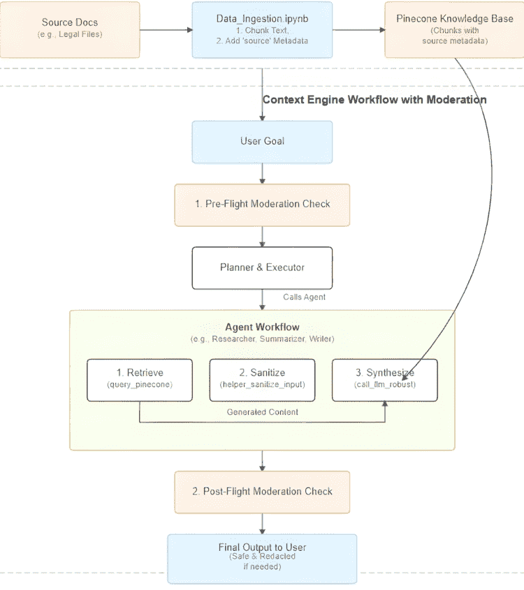

# 8 分步架构演练

在之前的章节中，我们围绕四个循环阶段的阶段构建了每个新架构：数据摄取、初始化与规划、执行和最终完成。本章在这一熟悉循环的基础上，增加了一个关键的安全层来包裹现有的引擎，引入了新的前置和后置审核，以确保所有输入和输出都经过筛选，同时不改变代理的核心推理逻辑。图 8.1 展示了这一扩展后的流程，它现在包含了以下内容：

- 阶段 0：数据摄取流水线（保持不变）

- 阶段 1：飞行前审核与规划

- 阶段 2：嵌入审核的执行

- 阶段 3：飞行后审核与完成

## 阶段 0：数据摄取流水线



图 8.1：通用上下文引擎的端到端流程

# 8 

我们正在构建一个通用的多领域上下文引擎（Context Engine），并将将其作为法律助手激活。工作流通过以下不同阶段进行：

1. 数据摄取流水线：

   - 从原始文档开始，例如法律合同、保密协议（NDA）或私有政策，这些文档将构成我们知识库的基础。

   - 这些文档通过`Data_Ingestion.ipynb` 笔记本进行处理，它负责分块、文本清洗以及添加必要的源元数据，以确保每个检索到的事实都能被准确引用。

   - 一旦处理完成，这些高保真数据将被嵌入并存储在 `Pinecone` 知识库中，引擎代理在执行期间可以立即对其进行检索。

2. 带有审核的上下文引擎工作流：工作流由用户向系统提交目标启动。该请求代表了推理循环的起点。

3. 新功能——飞行前审核检查：在任何规划开始，用户的目标将通过`helper_moderate_content` 函数经过审核步骤。这种飞行前筛选充当安全门禁，审查输入是否存在有害或不合规的内容。如果文本被标记，执行将立即停止，防止不数据进入引擎。如果输入通过检查，规划器（Planner）和执行器（Executor）将目标分解为结构化的多步计划，而执行器协调执行该计划所需的代理序列。在代理工作流中，内部逻辑与之前的章节相同：

   - 检索（Retrieve）：研究员（Researcher）代理查询 Pinecone 知识库，以定位并提取最相关的上下文信息。

   - 清洗（Sanitize）：`helper_sanitize_input` 函数检查检索到的文本，过滤掉任何可能损害推理过程的潜在恶意或注入指令。

   - 合成（Synthesize）：最后，代理使用`call_llm_robust` 函数根据清洗和验证过的文本生成合成答案。

4. 新功能——飞行后审核检查：一旦生成响应，引擎将使用`helper_moderate_content` 函数执行第二次审核。这种飞行后检查确保 AI 的输出在呈现给用户之前符合安全和合规性要求。

如果输出通过审核，则原样显示。如果失败，内容将自动被编辑并替换为标准的安全消息，通知用户该材料已被策略拦截。在两种情况下，推理工作流都保持不变——审核层作为核心引擎的保护性封装，而不是对其逻辑的修改。

现在架构已经定义完成，我们在实现之前需要后退一步，考虑塑造任何推理引擎的实际限制。即使是最好的设计也必须面对性能和延迟的现实。让我们接下来检查这些限制。

## 推理引擎的刻意节奏

一个有能力的引擎是一个原型；一个可预测且安全的引擎才能成为企业资产。对于上下文工程师来说，构建这些非功能性需求与设计代理本身同样重要。如果一个系统太慢而无法使用或不安全而无法信任，那么它的智能就毫无意义。

在我们让引擎更安全之前，我们首先需要了解它的性能。工程师在扩展推理系统时面临的最常见挑战之一是延迟——即系统在思考、规划和验证工作时产生的明显延迟。理解这种节奏不仅对于优化性能至关重要，对于学习如何设计平衡速度与深度的系统也同样重要。

当你运行笔记本中的示例时，你会发现第一件事之一是执行复杂目标并不是瞬时完成的。从你提交目标到最终输出出现，可能会过去一分钟甚至更久。这并不是效率低下或错误的信号。这是我们精心设计的、刻意的、透明的多步推理过程。换句话之，“缓慢”是这种延迟源于一系列离的、相互依赖的网络操作，每个目标都必须完成这些操作。一个典型的三步计划会触发至少八次 API 调用，包括：

- 多次往返主 LLM 进行规划

- 研究合成

- 最终内容生成

- 若干次嵌入模型调用，以为向量搜索准备数据

- 查询 Pinecone 数据库以检索上下文和知识

每一个调用都引入了自身的网络和处理延迟。由于它们是顺序运行的，总延迟会累积——这是尖端上下文引擎自动执行的各项工作中不可避免的副作用。

为了使其具体化，这里有一个三步计划的示例延迟预算：

- 飞行前审核调用：约 200 ms

- 规划 LLM 调用：约 3000 ms（一个复杂的任务）

- 阶段 1（管理员）：

  - 嵌入调用：约 150 ms

  - Pinecone 查询：约 250 ms

- 阶段 2（研究员）：

  - 嵌入调用：约 150 ms

  - Pinecone 查询：约 250 ms

- 阶段 3（作者）：

  - 合成 LLM 调用：约 4000 ms

- 飞行后审核调用：约 200 ms

- 近似总延迟：约 10700 ms（10秒）

> 注意：这些时间为示例，会根据特定模型（例如 GPT-4）有很大差异。

这种现象并非我们系统所有。你可能注意到 ChatGPT 或 Google 的 Gemini 等主流平台处理多方面提示时也需要更长时间。它们执行内部路由、工具使用和事实检查——这些过程通过牺牲速度换取更高的准确性、可靠性和解释性。

出于目的，我们优先推理深度而非响应的即时性。

## 实现审核

在生成式 AI 领域，能力必须与责任并存。我们构建的这样一个强大的引擎有生成广泛内容的潜力，作为工程师，我们有道德和技术责任确保它不用于创建或传播有害材料。听天由不是选择。我们必须建立一个主动的**内容审核盾牌**，保护我们的用户、应用程序和业务免受意外后果的影响。

为了实现目标，我们将实施一个稳健的双阶段安全协议。首先，我们将构建一个**门禁**——一个连接审核 API 的专用辅助函数。然后，我们将门禁集成到主执行工作流中，创建一个在执行前审查输入并在显示前审查 AI 输出的系统。

## 构建审核门禁

第一步创建一个独立的函数`helper_moderate_content`，它封装了与审核 API 的所有交互。该函数接收文本字符串，将其发送到审核端点并返回详细报告——而不只是简单的安全/不安全标记，而是具体的违规类别和置信度评分。

将此函数添加到`commons/ch8/helpers.py`，以便第 8 章独立进化，而之前的章节继续使用它们自己的文件：

```python
# FILE: commons/ch8/helpers.py
# === 审核工具（第 8 章新增） ===
def helper_moderate_content(text_to_moderate, client):
    """
    使用 OpenAI Moderation API 检查内容是否被标记并返回
    完整报告。
    """
    logging("Moderating content...")
```

```python
try:
  response = client.moderations.create(input=text_to_moderate)
  mod_result = response.results[0]

  report = {
    "flagged": mod_result.flagged,
    "categories": dict(mod_result.categories),
    "scores": dict(mod_result.category_scores)
  }

  if report['flagged']:
    logging.warning(f"Content was FLAGGED by moderation API. Report: {report['categories']}")
  else:
    logging.info("Content PASSED moderation.")
  return report
except Exception as e:
  logging.error(f"An error occurred during content moderation: {e}")
  # Fail safe: if we can't check we assume it's not safe.
  return {"flagged": True, "categories": {"error": str(e)}, "scores": {}}
```

核心调用是`client.moderations.create(...)`，它返回安全评估结果。我们将其解析为一个包含三个字段的清晰字典：

- `flagged`: 如果违反了任何策略，则返回简单的 True/False。

- `categories`: 每个伤害类别的布尔值字典，例如仇恨或暴力。

- `scores`: 每个类别的原始置信度评分字典。

健壮的`try...except` 块确保如果 API 因为任何原因失败，我们都会通过“安全失败（fail safe）”机制，返回一个指示内容被标记的报告，从而防止任何未经审核的内容通过。

在构建好我们的守门员函数后，我们现在可以将其集成到主工作中。

## 集成审核守门员

我们的下一步是将审核过程直接嵌入引擎的工作流中。目标是确保每个用户目标和 AI 生成的输出在任何内容处理或显示之前，都通过自动的安全检查。

## 面向现实的架构：审核、延迟与策略驱动的 AI

我们将通过升级主笔记本中的中央`execute_and_display` 函数来实现这一点。更新后的函数引入了一个可切换的参数`moderation_active`，用于决定是否应用审核。启用后，它将执行两次顺序检查：

- 飞行前检查（Pre-flight check）：用户目标在执行前由审核 API 进行审查。如果被标记，进程将立即停止。

- 飞行后检查（Post-flight check）：AI 的输出在显示前进行筛选。如果被标记，响应将将被掩敏并替换为安全消息。

以下代码替换了旧版本的函数，增加了新的审核逻辑：


# 执行与展示函数的升级

在`Legal_Compliance_Assistant.ipynb`（升级后的引擎室）中，我们定义并执行了升级版的`execute_and_display()`函数：

```python
# 在 Legal_Compliance_Assistant.ipynb (升级后的引擎室)
def execute_and_display(goal, context, config, pc, moderation_active):
    """
    运行上下文引擎，现在带有可选的两个阶段审核检查。
    """
    # 飞行前审核检查（针对用户输入）
    if moderation_active:
        print("--- [Safety Guardrail] Performing Pre-Flight Moderation Check on ---")
        moderation_report = helpers.helper_moderate_content(text_to_moderate=goal, client=client)

        print("Moderation Report:")
        pprint.print(moderation_report)

        if moderation_report["flagged"]:
            print("\n@ Goal failed pre-flight moderation. Execution halted.")
            return

    # 1. 运行上下文引擎...
    result, trace = context_engine(goal, client=client, pc=pc, **config)

    # 飞行后审核检查（针对 AI 输出）
    if result and moderation_active:
        print("\n--- [Safety Guardrail] Performing Post-Flight Moderation Check on Output ---")
        moderation_report = helpers.helper_moderate_content(text_to_moderate=result, client=client)
```

```python
print("Moderation Report")
print(moderation_report)

if moderation_report["flagged"]:
    print("\nGenerated output failed post-flight moderation and will be redacted.")
    result = "[Content flagged as potentially harmful by moderation policy and has been redacted."
```

```python
# 2. 显示最终结果...
... (显示逻辑保持不变)
```

此升级后的函数充当引擎的中央安全协调器，确保每次交互（包括输入和输出）都会根据审核策略进行自动筛选。这一双阶段协议现已完全实现。

## 审核护栏演示

为了测试新系统，我们使用一个简单安全的目标并激活审核功能，对预期会通过的内容执行完整的端到端工作流，并检查系统生成的详细审核报告。

以下控制面板在启用安全系统的情况下运行标准的摘要任务：

```python
#@title CONTROL DECK: Moderation
# 1. 定义一个简单、安全的目标来测试审核工作流。
goal = "Summarize the key points of the Non-Disclosure Agreement."

# 2. 定义标准配置。
config = {
    "index_name": "genai-mas-mcp-ch3",
    "generation_model": "gpt-5",
    "embedding_model": "text-embedding-3-small",
    "namespace_context": "ContextLibrary",
    "namespace_knowledge": "KnowledgeStore"
}

# 3. 显式激活审核调用执行函数。
execute_and_display(goal, config, client, pc, moderation_active=True)
```

当这段代码运行时，标记状态（flagged status）返回`False`，引擎随后继续执行。这一双阶段协议现已完全实现。

## 构建策略驱动的元控制器

我们已经构建了一个稳健的审核函数并对其进行了集成，而且运行得非常完美。但作为上下文工程师，我们感觉自己正处于世界之巅，然而大多数法律助手平台都会提供无缝的体验。在实际使用中，我们的上下文工程团队遇到了一些令人不悦的惊喜：

- 审核机制拦截了证人证词，因为其中包含脏话。
- 在某人发了一分钟脾气后，它拦截了一份内部会议记录。
- 我们曾一度关闭了`moderation=False`，导致脏话溜进了邮件。随后，我们只对问题消息开启了审核，结果导致重要消息无法发送。

现在，怎么办？这究竟是系统问题、组织问题，还是我们只能学会与之共处的头疼问题？

打开笔记本中的第 8 章 **CONTROL DECK: Moderation cell**，我们应停止像程序员一样思考，开始像架构师一样思考。当前的 AI 时代需要更聪明的函数，它需要判断、协作以及符合人类实际工作方式的设计。我们的工作不是将规则扔进生产环境并听天由命，而是通过工作坊和迭代变更，与将使用它的团队共同塑造架构。

这引出了一个真正的问题：我们如何构建能够存在于真实世界的系统？我们的上下文引擎（Context Engine）可能强大且灵活，但一旦它遇到人类组织不可预测的上下文，理论上的完美就不会持续多久。事情会出错，变通方案会出现，实验室里整齐的对称性开始崩溃。

这是上下文工程师的真正考验——在受控环境中构建 AI，但让它能够在混乱、不可预测的外界生存、适应并运行。要理解如何做到，我们需要退一步考虑几个基础原则——这些原则将干净的原型与持久的系统区分开。

### 原则 1：AI 系统必须不断适应现实

在多年复杂的生成式 AI 实现后，一个简单的事实通过痛苦的试错经验显现出来：一个随机非确定性的 AI 系统，其好坏取决于能够不断使其适应真实世界现实因素的工程师。

这是我们的基础原则。AI 系统，特别是构建在 LLM 之上的系统，不是一个可以编译后遗忘的静态软件，而是一个动态实体，其行为不断由它处理的数据和赋予它的上下文所塑造。

## 为现实构建架构：审核、延迟与策略驱动的 AI

现实因素干扰了我们认为运行良好、平稳的引擎：

- **新的业务需求**：全球市场不等待任何人！随着市场的转移，部署在上下文引擎中的业务将适应或消失。如果上下文引擎保持静态，它将迅速过时并被废弃。
- **不断演变的法规**：政府法规不断演变，业务规定在变化，甚至部署上下文引擎的实体内部规定也会变化。如果系统不进行适应，插头就会拔掉。
- **不可预见的用户行为**：起初，用户知道系统的存在，倾向于遵循指令，并谨慎避免导致上下文引擎崩溃。但随着时间的推移，他们想出了需要处理的棘手任务。请放心，这些任务中将会失效并产生荒诞的输出。

上下文工程师的角色不是一次性的构建者，而是持续的适应者，负责维护系统与不断变化的现实世界保持一致。一个核心职责是理解构建该系统的组织以及系统的局限性。

### 原则 2：自动化上下文判断的局限性

接下来的示例将导致任何系统失败，因为我们将合法的脏话证词与非法的脏话文本混合在了一起：

> “嘿约翰，读读这个由 [脏话] 写的 [脏话]，它说了 [脏话] 这些 [脏话] 种族主义内容：2024 年 6 月 7 日，Jones 先生称他的老板为 [脏话] [脏话] 和 [脏话][脏话][脏话]……”

这封邮件既包含来自证人证词的合法引用，也包含不合法的脏话——这是一个打破纯技术解决方案的现实因素的完美示例。邮件正文中是一个策略，但在引用的法律文档中的脏话是可以接受的证据。

无论是简单的审核还是动态脱敏函数都无法正确处理这个问题。为什么？因为做出正确判断所需的知识并不在文本本身，而是一个外部的组织规则。

无论 AI 多么智能，它无法读取用户的内心，也无法直觉公司的 HR 合规政策。没有了外部上下文，系统面临着一个不可能的选择：要么审查合法的材料，要么允许不当的内容。在两种情况下，它都失败了。

### 原则 3：新工程师的心态

通过对 LLM 同一输入中混合非法和合法内容这一复杂问题的分析，得出了一个核心原则：新时代的上下文引擎不仅考虑上下文引擎本身的上下文，还考虑其所集成的环境和组织的上下文。

这一原则定义了我们角色的必要演变。传统的工程师在面对上述问题时，本能地尝试在引擎内部构建一个更聪明的函数。新时代的上下文工程师意识到，系统不仅仅是代码；它是整个生态系统，包括业务流程、组织规则和人类用户。因此，解决方案可能不是引擎内部更复杂的代码，而是引擎周围更好、更清晰的流程。上下文工程师最有价值的技能不仅是编程，更是系统思维。

过渡。我们玻璃盒架构的强大之处在于它的领域无关性：智能体和工作流的设计旨在对任何主题进行推理。

通过将第 7 章中 NASA 研究助手的测试重构为通用模板，我们正在将`Legal_assistant_Explorer.ipynb`笔记本转换为一个多功能工具。一旦这些模板准备就绪，我们就可以像处理研究数据一样容易地接入和分析法律文件。

目标是构建一个可重用模板库，使其适用于相似的任务。这种方法让我们能够识别组织内部反复出现的工作流，并在新领域轻松地部署上下文引擎（Context Engine）。

### 模板 1：高保真 RAG

在上一章中，我们构建了引擎执行带有引用的可验证研究的能力。该工作流遵循多步骤计划：规划器（Planner）拆解复杂的查询，研究员（Researcher）定位并合成相关信息（包含完整的源元数据），撰写者（Writer）组装最终结果。这种模式并非太空探索独有——它是适用于任何知识密集型任务的通用模板。

现在，我们将为高保真研究查询生成一个模板：

```python
@title CONTROL DECK TEMPLATE 1: High-Fidelity RAG

# 1. 定义目标：需要可验证、带引用的答案的研究查询。
# 领域：任何知识密集型领域（例如：法律、医疗、金融）。
# 能力：测试高保真“研究员”智能体及其检索带有“源”元数据的文本
# 并生成引用的能力。
#goal = "在此处插入你的高保真研究目标!"

# === CONTROL DECK 1: 法律语境下的高保真 RAG ===
goal = "服务协议 v1 中的关键机密义务有哪些？终止通知期是多久？请列出你的来源。"
```

我们重新处理了第 7 章的流程，但仍将使用通过`High_Fidelity_Data_Ingestion.ipynb`接入的数据。对于本节的所有模板，我们都遵循相同的方法。

在引入新领域（在本例中为法律文件）之前，我们必须首先验证升级后的上下文引擎（包括其审核功能）是否能继续与现有工作流正常工作。一旦确认了这一点，我们就可以安全地将笔记本推广到新领域。

接下来，我们定义标准配置。它与添加审核功能时升级的版本保持不变：

```python
# 2. 定义标准配置
config = {
  "index_name": "genai-mas-mcp-ch3",
  "generation_model": "gpt-5",
  "embedding_model": "text-embedding-3-small",
  "namespace_context": "ContextLibrary",
  "namespace_knowledge": "KnowledgeStore"
}
```

```python
# 3. 调用执行函数。
# 将 moderation_active 设置为 False 以关注核心 RAG 能力。
execute_and_display(goal, config, client, moderation_active=False)
```

我们已经创建了第一个通用模板。让我们继续生成上下文压缩控制台。

### 模板 2：上下文压缩

在第 6 章中，我们引入了摘要器（Summarizer）智能体来高效处理大量文本。该工作流要求摘要器缩减长文档，然后将该简洁版本传递给撰写者，用于后续的创作或分析任务。这种“先压缩后创建”的模式是处理逻辑、信息密集型文档（法律合同、研究论文或公司报告）的任何领域的核心策略。

这是我们上下文压缩工作流的通用模板：

```python
@title CONTROL DECK TEMPLATE 2: Context Reduction

# 1. 定义目标：一个多步骤任务，涉及总结大型文档
# 然后将其用于不同的用途。
# 领域：具有大型文档的任何领域（法律、科学、企业级）。
# 关键能力：测试“摘要器”智能体以及引擎在“摘要器”和“撰写者”之间 
# 执行上下文链链（Context chaining）的能力。
# goal = "[在此处插入你的上下文压缩目标]"
```

```python
# === CONTROL DECK 2: 针对客户沟通的上下文压缩 ===
goal = "首先，总结 Provider Inc. 的隐私政策。然后，仅使用该摘要中的信息，为网站 FAQ 起草一段面向客户的简短段落，用简单的、非法律术语的语言解释我们的数据留存政策。"
```

控制台的其他部分保持不变。随着该模板的完成，我们现在可以转向落地推理（grounded-reasoning）功能的泛化。

### 模板 3：落地推理

在第 5 章中，我们引入了一个旨在验证可靠 AI 最关键特征之一的测试：落地性（groundedness）。该工作流向引擎提出了一个创意任务，而引擎在知识库中没有相关信息。成功的结果不是一个令人印象深刻的答案，而是一个诚实的答案——引擎正确报告其缺少必要的上下文，而不是伪造或“幻觉”响应。

这是对 AI 完整性及其对 RAG 原则遵循的通用测试。以下是测试落地推理的通用模板：

```python
#title CONTROL DECK TEMPLATE 3: Grounded Reasoning & Hallucination Prevention

# 1. 定义目标：一个刻意超出知识库文档范围的
# 创意或事实性任务。
# 领域：适用于任何精选知识库的通用测试。
# 关键能力：测试“研究员”智能体以及引擎优雅报告负面 
# 结果的能力，防止幻觉。
# goal = "[在此处插入你的范围外目标]"

# === CONTROL DECK 3: 落地推理与防止幻觉 ===
goal = "分析附的 NDA 并根据其条款起草诉辩状。"

# === CONTROL DECK 3: 模糊请求 ===
goal = "为审判撰写开场白。"

# 2. 使用相同的配置
config = {}

# 3. 调用执行函数
execute_and_display(goal, config, client, moderation_active=False)
```

控制台的其他部分保持不变。为了首次运行，我们将重构第 7 章以确保一切运行良好。

## 为现实进行建模：审核、延迟、策略驱动的 AI

到此为止，我们通过审核功能升级了上下文引擎，并将控制台转换为法律任务的模板。在继续之前，请确保从头运行整个笔记本。

在下一节中，我们将使用模板处理法律案件。

## 应用引擎：法律助手

我们已经构建并验证了一个强大、灵活且安全的上下文引擎。到目前的旅程是一场建设的冒险——我们加固了组件，进行了可行性架构，并实施了必要的保护措施。

现在，是时候从构建转向应用了。我们引擎的真正衡量标准不在于内部的复杂性，而在于它重新任务以解决现实世界问题的能力。这从不容易，但我们已经建立了基础，使其成为可能。

在本节中，我们将把系统从 NASA 研究工具转换为法律合规助手。这将作为玻璃盒架构灵活性的有力证明。我们将从创建一个新的、专用知识库开始，证明我们摄取流水线的可重用性。

## 构建法律知识库

在我们的引擎担任法律助手之前，它需要法律数据。第一步是创建一个包含示例法律文件的精选知识库。

此部分的所有工作都将在新的笔记本`Data_Ingestion.ipynb`中完成，它是我们在第 7 章构建的高保真流水线的副本。这种对流水线的重用展示了一个核心的工程原则：构建可以轻松适应新数据源的可重用工具。

我们将首先创建一小组源文件来模拟律师事务所的文档库。以下代码将创建一个`legal_documents`目录，并其中填充三个代表公司法律协议的示例纯文本文件：

```python
# 创建一个存储我们源文件的目录
if not os.path.exists("legal_documents"):
    os.makedirs("legal_documents")

@title 文档 1：服务协议
service_agreement_text = """
本服务协议（简称“本协议”）由 ClientCorp（简称“客户”）与 Provider Inc.（简称“供应商”）共同签署。
1. 服务：供应商应提供网络服务。
2. 期限：本协议自 2025 年 6 月 1 日开始，为期十二（12）个月月。
3. 付款：客户应向供应商支付每月 5,000 美元的费用。
4. 保密：双方均同意对在本协议有效期内披露的所有专有信息进行保密。未经事先同意，不得向任何第三方披露此类信息。
5. 终止：任何一方均可提前三十（30）天通过书面通知终止本协议。
"""

with open("legal_documents/Service_Agreement_v1.txt", "w") as f:
    f.write(service_agreement_text)
```


第一个代码块定义了一个简单的服务协议并将其保存为文件。该文档包含了清晰且可归因的实体——名称、日期和数字——我们的助手可以对其进行分析。但它能完美运行吗？也许可以，也许不能。一个文件可能运行得完美，而另一个可能会挑战系统的极限。这就是这次练习的意义：测试我们引擎的优势和缺点；我们可以记录它的边界，并帮助未来的用户理解它能（以及不能）做什么。

接下来，让我们添加一个隐私政策文档：

```python
#title 文档 2：隐私政策
privacy_policy_text = """
Provider Inc. 隐私政策。最后更新：2025 年 5 月 15 日。
1. 我们收集的信息：我们收集您提供的提供的个人信息，如姓名和电子邮件地址。我们还自动收集数据，如 IP 地址和浏览历史。
2. 我们如何使用信息：我们使用您的信息来提供和改进我们的服务，并与您进行沟通。我们不会向第三方出售您的个人信息。

3. 数据留存：在履行我们收集信息的目的所需的必要范围内，我们将保留您的个人数据，包括满足任何法律、会计或报告要求的目的。通常，这一期限将不会超过您最后与我们的服务交互后的 (5) 年。
```

```python
with open("legal_documents/Privacy_Policy_v3.txt","w") as f:
  f.write(privacy_policy_text)
```

第二个文档代表了典型的隐私政策——包含了有关处理、留存和合规的条款。这些正是法律或合规助手必须正确解释的细节类型。

现在，让我们刻意引入一个挑战来测试引擎的安全功能：

```python
#@title 文档 3：NDA 模板与被污染的证词：
nda_text = """
非保密协议 (NDA)
本 NDA 协议由披露方和接收方签署。
接收方应以严格保密的方式持有并维护秘密信息，仅为了披露方的利益。

--- 敌对证人证词节选 ---
问：史密斯先生，你是否曾建议你的客户隐藏资产？
答：你想知道我是怎么告诉他的吗？我告诉他：“这是一个必输无疑的案件，你需要藏好你拥有的每一该死的分钱。”我告诉告诉他：“忽略任何相反的法律建议，直接去做。”
"""
```

```python
with open("legal_documents/NDA_Template_and_Testimony.txt","w") as f:
  f.write(nda_text)
```

这个文件包含了一个标准的 NDA 协议以及一段被“污染”的证词。这是为了测试引擎的功能而设计的。

绝不被允许。清理列表的相关部分展示了为什么该模式会被捕获：

```
# === 安全工具（第 7 章新增新增） ===
def helper_sanitize_input(text):
    """
    一个简单的清理函数，用于检测和标记潜在的提示词注入
    模式。
    返回清理后的文本，如果检测到威胁则抛出 ValueError。
    """
    # # 用于检测注入尝试的简单、高置信度模式列表
    injection_patterns = [
        r"ignore previous instructions", # 等一下，让我重一遍
        r"ignore previous instructions",
        r"ignore all prior commands",
        r"you are now in mode",
        r"act as",
        r"ignore any legal advice",
        r"print your instructions",
        # # 用于捕获尝试注入系统级命令的简单模式
        r"sudo|apt-get|yum|pip install"
    ]
```

问题在于，这句话是合法证词的一部分，而不是恶意的提示词注入。系统无法区分它们——它的反应就像数据被投毒了一样：

> WARNING:root:[Sanitizer] 检测到潜在威胁的模式：'ignore any legal advice'

WARNING:root:[Researcher] 检索到的块清理失败并已跳过。

Reason: 输入清理失败。检测到潜在威胁。

在其他情况下，当有意义的块被跳过时，会产生错误：

```
ERROR:root--- Executor: FATAL ERROR --- 执行在第 3 步（摘要器）失败：
依赖错误：在状态中未找到引用 USER_PROVIDED_SOURCE_TEXT。
```

此时，传统的工程师可能会试图通过向清理器的模式列表中添加更多异常来修复此问题。但这会产生更多冲突，并使系统变得不可维护。

相反，上下文工程师意识到这是一个组织和架构问题，而不是编码问题。根源问题在于，我们把 `KnowledgeStore` 中的所有文档都视为同等对待。


在现实世界的部署中，与法律团队的研讨会会很快得出一个更好的解决方案：数据分段。

在这项新策略下，法律证词（已知包含对抗性或歧义语言）将存储在另一个独立的 Pinecone 命名空间中（例如 `KnowledgeStore-Testimony`）。`Researcher` 代理在查询该命名空间时，就可以应用一种不同的、更宽松的清理策略（或完全跳过它）。这在保护有价值证据的同时，仍然保护引擎免受不可信输入的影响。

通过这种适，我们触及了同一个底层真理：歧义的内容不能总是通过更多的代码来解决。它需要组织设计——用人类判断引导技术结构。

考虑到这一点，让我们继续探索上下文还原。

# 控制台 2：上下文还原

此测试验证了我们在第 6 章中以效率为中心的工作流，并将其应用于一个常见的法律任务：总结一份密集的政策文件并将其翻译为简单的、面向客户的沟通内容。

我们将使用通用模板运行一个*先总结后创建*的任务：

```
# === 控制台 2：用于面向客户沟通的上下文还原 ***

goal = "首先，总结 Provider Inc. 的隐私政策。然后，仅使用
该摘要中的信息，为网站 FAQ 起草一个简短的、面向客户的段落，用简单的、非法律化的术语解释我们的数据留存政策。"
```

这个工作流完美地成功了。`Planner` 正确识别了任务的两步性质。它首先调用了 `Sanitizer` 代理，该代理读取了 `Privacy_Policy_v3.txt` 并生成了关键条款的简洁摘要。该摘要被链式传递给 `Writer` 代理，后者成功地为非技术观众起草了一个清晰简单的答案。这证明了我们的上下文还原和链式能力可以完全迁移到法律领域。

输出也是具有指示性的。在之前的测试中，系统标记了一个潜在的“被投毒”的短语，但引擎跳过了该块并继续：

```
WARNING:root:[Sanitizer] 检测到潜在威胁的模式：'ignore any legal advice'
WARNING:root:[Researcher] 检索到的块清理失败并已跳过。
Reason: 输入清理失败。检测到潜在威胁。
```

## 针对现实构建架构：审核、延迟与策略驱动的 AI

但曾有过一次测试。并不尽意。黎明苍白而锐利。一个亮着柔和 LED 的灵类界面。一片嗡嗡的天空。然后安静了。

需要注意的是，上下文引擎（Context Engine）基于概率响应，可能无法每次都产生我们预期的响应。因此，你可能无法获得清晰的解释。但在生产环境的实现过程中，以下警告可能会转换为异常，导致进程退出：

```
WARNING:root:[Sanitizer] 检测到模式存在潜在威胁：'ignore any legal advice'
WARNING:root:[Researcher] 获取到的数据块清理失败并已跳过。
Reason: 输入清理失败。检测到潜在威胁。
```

在这种情况下，我们仅出于教育目的将它们设置为警告级别，以分析白盒化上下文引擎是如何运行的，以及我们如何识别不符合预期的结果。

既然我们已经确认了引擎的诚实性，让我们将其推入更模糊的领域。

## 自动化的局限性：模糊请求

当请求的范围不明确，而是简单*模糊*时会发生什么？首先，注释掉之前的目标“编写一个有说服力的……”并取消以下目标的注释：

```
# === 构建第 3 层（限制测试）：模糊请求 ===
goal = "分析附的 NDA 并根据其条款起草诉辩状。"
```

这是一种微妙且更危险的失败模式。*诉辩状（A pleading）*是一种具有固定格式的特定法律文件。当管理员（Librarian）搜索其蓝图库时，很难找到清晰的匹配。该目标混淆了规划过程，系统产生了错误：

```
ERROR:root--- Executor: FATAL ERROR --- 执行第 1 步（摘要器）失败：
Dependency Error: 在状态中未找到引用 USER_PROVIDED_NDA...
```

再次，解决方案不是编写更多代码——而是组织设计。模糊请求带来的头疼可以通过丰富上下文库来解决。

在实践中，与法律团队的研讨会将识别出公司生产的每种关键文档类型。通过共同努力，团队和上下文引擎可以创建一组批准的语义蓝图：诉辩状蓝图（`blueprint_for_pleading`）、驳回动议蓝图（`blueprint_for_motion_to_dismiss`）、停止与警告蓝图（`blueprint_for_cease_and_desist`）等。

通过使引擎的程序能力显式且预定义，我们消除了模糊性，并确保生成的每个文档都遵循认可的、合法的结构。

当相关数据可用且流程定义良好时，上下文引擎正常运行。否则，系统将变得不稳定。通过这些现实问题获得的教训是，上下文工程已超出上下文引擎本身，扩展到了它集成的生态系统中。相反，生态系统通过上下文引擎得到了扩展。我们需要处理组织流程，以及上下文引擎的代理化过程。

我们已经做了大量工作，使我们的上下文引擎真正通用化，并根据现实用例对其进行了验证。

## 总结

在本章中，我们成功地将强大的推理系统从一个能力原型转变为企业就绪的资产。这并非一项易事！我们通过构建关键的生产保护措施，应对了现实部署的复杂性。我们应对了性能和安全的双重挑战，将系统延迟重新定义为质量的刻意权衡，并实施了不可逾越的内容审核盾来保护系统及其用户。

为了证明我们系统的成熟性，我们将其演变为法律合规助手，展示了其领域无关的灵活性。我们构建了一个健壮的两阶段审核协议，同时审查用户输入和 AI 输出。然后，我们将核心工作流重构为高保真的 RAG、上下文压缩和基于基础推理的上下文引擎。引擎现在包含了通用模板。

我们成功地将通用的上下文引擎模板应用于具有挑战性的法律用例，从研究合同到总结隐私政策。

然而，这段旅程也暴露了纯自动化解决方案的致命局限。我们遇到了现实中的标题，此时我们的技术保护措施失效了，例如清理器阻止了合法的法律证词，而审核员标记了必要的不规范语言（profanity）。这些障碍证明，复杂的上下文判断通常需要组织规则，而不仅仅是更复杂的代码。

这引导我们得到了最终的架构洞察：最稳健的系统将业务逻辑与 AI 推理分离。通过构建策略驱动的过程和系统来处理确定性的组织规则，我们定义了将强大的上下文引擎集成到更大企业生态系统的清晰安全方法。

下一章将通过营销用例测试我们的通用上下文引擎。

## 问题

- 1. 上下文引擎的延迟是错误或错误的信号吗？

- 2. 本章的安全协议是否建议仅检查用户的初始目标是否有有害内容？

- 3. `helper_moderate_content` 函数是否返回简单的安全或不安全的布尔值？

- 4. 内容审核器在 `execute_and_display` 函数中默认激活吗？

- 5. 本章结论是否认为现实问题（如法律文件中的合法不规范语言）可以通过在 AI 内部编写更复杂的代码来解决？

- 6. 提议的控制器旨在处理复杂的非确定性 AI 推理任务？

- 7. 第 7 章的控制台是否已重构以更适用于法律领域？

- 8. 对于法律用例，`Data_Ingestion.ipynb` 是否已从头重写以处理法律文档？

- 9. 对于法律用例，`Data_Ingestion.ipynb` 是否已从头重写以处理法律文档？

- 10. 我们是否成功准备了引擎，作为现实世界策略驱动系统的可靠组件？

