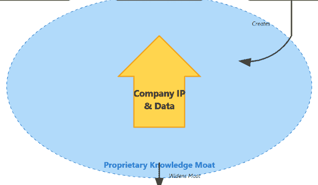
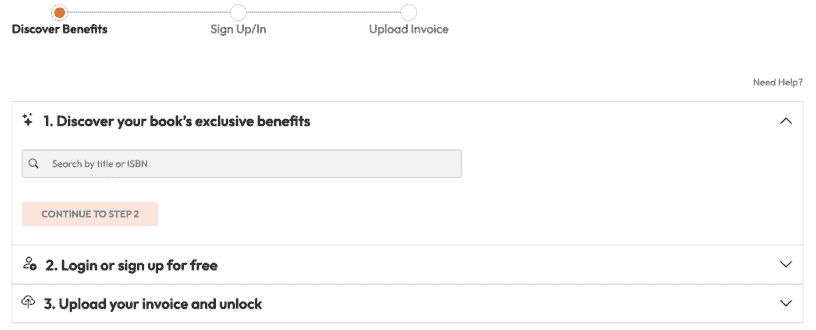

# 10 生产就绪 AI 的蓝图

你已经到达构建智能系统旅程中的一个关键转折点：视角点。你可以看到构建上下文引擎所需的架构技能。你理解了上下文工程师以及上下文工程的关键作用。目前为止所走的道路是深思熟虑的，旨在并在尝试扩展之前建立坚实的基础。

从第 1 章到第 9 章，我们组装了整个架构。你从上下文工程和 MCP 的基础开始，然后设计并加固了玻璃盒上下文引擎。随后的章节通过实际应用证明了它的通用性：通过摘要器（Summarizer）进行成本管理，通过研究员（Researcher）进行可验证的研究，通过清洗进行安全数据处理，以及通过语义蓝图进行品牌治理。这些能力共同将原型转变为一个准备好部署的智能、感知的引擎。

仅仅是执行追踪（ExecutionTrace）就能让引擎的内部机制变得可见且可验证，这最后一章将为企业级部署提供蓝图，引导从开发产物到可扩展的生产级服务的过渡。在这里，玻璃盒上下文引擎不再是在笔记本中运行的原型，而是一个准备好集成到企业的系统。我们将介绍如何建立该环境，涵盖基础设施、容器化、异步处理和可观测性。然后，本章将这些技术成就转化为具有说服力的业务案例，提供一个向项目经理和执行领导层阐述引擎价值的框架。

本章分三个阶段展开：

- 玻璃盒引擎的生产化
- 部署企业能力和生产保护措施
- 展示业务价值

让我们从探索如何使玻璃盒引擎生产化开始。

# 玻璃盒引擎的生产化

企业部署的第一步是将模块化的 Python 代码（组织在 `engine.py`、`agents.py`、`registry.py`、`helpers.py` 和 `utils.py` 中）转换为可扩展的 Web 服务。虽然核心逻辑保持不变，但周围的基础必须进化以满足生产环境的需求。图 10.1 展示了我们将在本节探索的过程：

Kubernetes 集群（云基础设施）

（注：存在图 10.1 图像，但在纯文本输出中已移除）

图 10.1 不仅仅是一个示意图；它是为企业工作负载设计的异步基础设施蓝图。让我们追踪一个单一高层目标在这一环境中导航的生命周期。

# 10 

之旅始于客户端应用程序提交一个目标。该请求首先遇到 API 网关，系统的坚固边界。在这里，将验证身份令牌并执行速率限制，保护核心引擎免受未经授权的访问和过载流量的影响。

通过安全检查后，请求进入 Kubernetes 集群，这是管理所有资源的底层平台。它到达 API 服务（FastAPI）。这是一个高性能的异步层，用于验证请求。API 服务本身不执行引擎。相反，它分发到任务队列（Celery/RabbitMQ）。这种解耦至关重要，因为它确保了即使引擎负载过重，API 也能保持响应。

目标停留在任务队列中，等待执行。架构的核心是工作节点池，这是一个自动扩展的容器组，每个容器运行着加固的玻璃盒上下文引擎逻辑（规划器、代理、执行器）。当工作节点变得忙碌时，它从队列中提取目标并开始执行。

当引擎运行时，它与外部服务交互。它调用 LLM API（OpenAI）进行规划和生成，并调用向量数据库（Pinecone）检索语义蓝图和知识。同时，工作节点通过集成管理系统安全地访问缓存，确保敏感密钥永不暴露在代码库中。

执行被严格监控。每一个操作、决策和外部调用都被可观测性栈捕捉。结构化日志被聚合，性能指标被跟踪，请求在分布式组件之间的之旅被视觉化。这种全面的遥测将调试从猜测变为精确的科学，确保系统保持玻璃盒状态。

最后，在完成后，工作节点将最终输出和详细的执行追踪持久化到结果存储（Result Store）中，客户端可以从中检索。这种架构代表了从功能原型到生产级系统的转变。

现在概念上已经清晰，我们可以转向其实际。接下来的章节将分解系统的每个组件、配置、密钥管理、编排和可观测性，展示如何在真实的生产环境中实现图 10.1 所示的韧性架构。

> **注意**：本章提供的代码是伪代码的形式，用于阐明所解释的功能。此外，平台和服务的名称是为了说明如何

# 环境配置与密钥管理

从开发笔记本过渡到实时生产环境时，首要挑战之一就是配置。模型名称或 API 密钥等参数可能直接定义在代码中。这在实验阶段是可以接受的，但在生产环境中，这种耦合会成为负担。生产系统必须在多个环境（开发、测试和生产环境）之间保持一致，且绝不会暴露敏感信息或硬编码依赖项。

解决方案在于采用"十二因素应用"（Twelve-Factor App）方法的原则，将配置与代码分离。这一设计原则使系统既具有可移植性又安全：相同的基础可以在任何地方运行，其行为完全由环境变量定义。

在运行时，Context Engine 动态读取其配置。一个简单的示例如下：

```python
import os
GENERATION_MODEL = os.getenv("GENERATION_MODEL", "gpt-4o")
PINECONE_API_KEY = os.getenv("PINECONE_API_KEY")
OPENAI_API_KEY = os.getenv("OPENAI_API_KEY")
if not PINECONE_API_KEY or not OPENAI_API_KEY:
    raise ValueError("Essential API keys are missing from environment variables.")
```

在本地开发中，`python-dotenv` 等库可以通过从 `.env` 文件加载变量来模拟这种行为，允许开发者安全地镜像生产配置。

然而，将敏感信息直接存储在主机的环境变量中或基础的 Kubernetes Secrets 中通常不足以满足企业级安全需求。需要中心化的密钥管理系统。现代基础设施提供了专门的解决方案：

- 云提供商解决方案：AWS Secrets Manager、Azure Key Vault 或 Google Secret Manager
- HashiCorp Vault：一个用于管理密钥的跨平台高度安全的解决方案

应用程序在启动时与这些系统集成。例如，在 Kubernetes 中部署时，侧边容器（sidecar container）或初始化容器（init container）可以从从中获取密钥并安全地将其注入应用程序容器中，确保应用程序代码与密钥后端无关。

通过将配置外部化并集中管理密钥，我们赋予了 Context Engine 生产系统的核心特征之一：可预测性。引擎的每个实例运行时都能完全感知其环境，但又不对其产生直接依赖，这种微小的架构决策实现了巨大的运维韧性。

## 构建生产 API（编排层）

在生产环境中，Context Engine 必须作为一个其他系统可以可靠交互的服务来运行。这要求将基于 Python 的引擎转换为一个**网络可用的编排层**。该编排层具有特定的架构目的：它将引擎与*如何访问它*解耦。我们没有将引擎直接嵌入到单个工作流中，而是创建一个中心服务，接收客户端的高级目标，客户端异步地根据返回的结果进行演进。这种设计允许引擎独立扩展，且不会干扰客户的应用程序。

Python 提供了多个用于暴露服务的成熟框架，例如 FastAPI，它是用于高性能 AI 系统的框架。它支持异步执行（async/await）、通过 Pydantic 进行自动验证以及 OpenAPI 文档生成，这些功能对于管理如 LLM 交互等 I/O 密集型负载至关重要。与 Flask 或 Django 等传统同步框架相比，FastAPI 提供了显著的性能优势和更好的开发者体验。

一个简单的实现可能如下：

```python
from fastapi import FastAPI, HTTPException
from pydantic import BaseModel
from typing import Dict, Any, Optional

# 假设客户端 (OpenAI, Pinecone) 在启动时初始化
# from utils import initialize_clients
# client, pc = initialize_clients()

app = FastAPI(title="Context Engine Service")

class GoalRequest(BaseModel):
    goal: str
    configuration_overrides: Optional[Dict[str, Any]] = None
    require_audit_trace: bool = False # 为后续的混合路由添加

class ExecutionResponse(BaseModel):
    status: str
    trace_id: Optional[str] = None
    final_output: Optional[str] = Any
    metadata: Dict[str, Any]
```

```python
@app.post("/api/v1/execute")
async def execute_goal(request: GoalRequest):
    # 使用 Glass Box 引擎执行目标的主端。
    # 目前，它直接路由到 Glass Box 执行（理想情况下通过任务队列）。
    try:
        # ... (Configuration Loading Logic) ...
        # context_engine 函数需要在线程池中运行
        # 如果它保持同步状态，以避免阻塞异步事件循环 (Event Loop)。
        result, trace = await run_engine_in_threadpool(
            request.goal,
            # ... (pass clients and config) ...
        )
        return ExecutionResponse(
            status=trace.status,
            trace_id=trace.trace_id, # 假设 trace_id 已添加
            final_output=result,
            metadata={'engine_used': "GLASS_BOX", 'duration': trace.duration}
        )
    except Exception as e:
        raise HTTPException(status_code=500,
            detail=f"Engine execution failed: {str(e)}")
```

在企业级部署中，此 API 通过 `AWS API Gateway`、`Kong` 或 `Istio` 进行保护和管理。网关强制执行以下关键的交叉关注点：

- 身份验证与授权：验证 API 密钥、OAuth 令牌或 JWT，以确保只有授权的客户端可以访问引擎
- 速率限制和节流：保护引擎免受过载或拒绝服务攻击
- SSL 终止：处理 HTTPS 加密

有了这个编排层，Context Engine [在此继续...]

## 异步执行与任务队列

[注：为此部分提供的 OCR 文本在源码中严重损坏/乱码。根据上下文，以下代表预期的逻辑结构。]

## 中心化日志与可观测性

透明度是生产系统的定义特征。一旦引擎部署，其内部推理和性能在每一步都必须是可见、可测量且可验证的。这种统称为**可观测性**的能力，将一个仅仅*能够运行*的原型与一个可以*被信赖*的生产系统区分开来。


如 `Jaeger` 或 `Zipkin` 等追踪工具可以使这些流程端到端可见。通过在共享的 trace ID 下将每个组件的 spans 关联起来，追踪可以暴露瓶颈，并突出显示在分布式工作流中引入延迟的位置。

结构化日志、指标和追踪共同构成了 Context 引擎（Context 引擎）的完整运行视图。

## 基础设施与容器化

为了在大规模范围内可靠地运行，Context 引擎必须在不同环境中保持一致的行为。这种一致性通过容器化和编排来实现，它们共同定义了引擎的打包、部署和扩展方式。

例如，`Docker` 允许将整个应用程序（包括 Python 运行时、所需库和配置）封装到标准的镜像中。无论运行在开发者的笔记本电脑还是云集群上，每个容器的运行方式都是相同的，消除了经常困扰部署流水线的环境漂移问题。

API 层的最小化 Dockerfile 可能会如下所示：

```docker
# Dockerfile
# 使用官方 Python 运行时（slim 版本以获得更小的体积）
FROM python:3.11-slim

# 设置工作目录
WORKDIR /app

# 复制 requirements 文件
COPY requirements.txt /app/

# 安装依赖
RUN pip install --no-cache-dir -r requirements.txt

# 复制应用程序代码 (engine.py, agents.py, api.py 等)
COPY /app

# 暴露 API 端口
EXPOSE 8000

# 使用 Uvicorn 运行 API 服务器
CMD ["uvicorn", "api:app", "-host", "0.0.0.0", "-port", "8000"]
```

相同的镜像可以用于启动执行异步任务的 worker 进程：

```bash
# 启动 worker 的命令
celery -A tasks worker --loglevel=INFO
```

虽然容器提供了一致性，但 Kubernetes (K8s) 提供了协调。它是管理容器化应用的事实标准，负责处理生产环境中的部署、扩展和网络设置。

对于 Context 引擎而言，Kubernetes 管理着几个关键资源：

- Deployments（部署）：定义期望状态（例如，运行 3 个 API 镜像副本和 5 个 worker 镜像副本）。


# 部署企业级能力与生产护栏

- **Services（服务）**：提供一个稳定的网络端点以访问 API pod。
- **ConfigMaps 和 Secrets**：用于注入配置和密钥（与 1.1.2 节提到的中心化密钥存储集成）。
- **Ingress（入口）**：管理对服务的外部访问，与云提供商的负载均衡器集成。

在许多企业中，Kubernetes 集群部署在 AWS EKS、Azure AKS 或 Google GKE 等托管服务上，允许团队专注于工作负载而非基础设施。

Context 引擎必须随着负载的波动进行动态扩展。Kubernetes 通过两个内置机制处理此问题：

- **Horizontal Pod Autoscaler (HPA)**：Kubernetes 根据 CPU 利用率或自定义度量（如任务队列长度）自动调整 API 和 Worker Pod 的数量。如果队列增长，K8s 会启动更多的 Worker Pod 来处理增加的任务。
- **Cluster Autoscaler（集群自动伸缩）**：如果集群容量不足，则从云提供商处配置新节点（虚拟机）。

在第一阶段结束时，“透明箱”Context 引擎已完全部署为一个具有韧性且可观测的服务。从容器到编排逻辑，每个组件在负载下都能以可预测的方式运行。

## 部署企业级能力与生产护栏

随着可观测且可扩展的基础设施就绪，Context 引擎在技术上已完成部署。然而，仅有基础设施并不能定义生产系统。企业级服务的区别在于它交付的一系列可靠业务能力。引擎的真正价值在于其代理（agents）的专业技能及其信息处理流水线的强度。

第二阶段从“如何部署”转向“是什么”——什么让 Context 引擎成为关键资产。在这里，我们重新回顾早期章节中集成的能力，通过生产就绪视角对其进行重构。与其说是优化功能，不如将这些视为基础支柱，使引擎能够管理成本、确保信任、维护安全、与业务系统集成并在规模范围内执行品牌一致性。

## 通过主动减少上下文管理运营成本

在生产环境中，对 LLM 的每次 API 调用都会对成本和延迟产生直接且可衡的影响。一个无限制处理大型文档的引擎是一个运维负担。在第 6 章开发的用于为长文本创建简洁摘要的 Summarizer 代理，不仅是为了方便，更是一个关键的成本和性能管理工具。

在实时系统中，该代理充当智能门禁。第 6 章中用于测量 prompt 大小的`count_tokens`工具可以集成到 Executor 中。

- **减少 token 消耗**：通过修剪上下文防止不必要的成本。
- **降低延迟**：较小的 prompt 会带来更快的响应速度。
- **增加可靠性**：确保系统处于 API 速率限制和预算范围内。

在第一阶段结束时，“透明箱”Context 引擎已完全部署为一个具有韧性且可观测的服务。从容器到编排逻辑，每个组件在负载下都能以可预测的方式运行。

## 确保信任与数据安全

### 防御数据管道中毒和对抗攻击

向量数据库是核心资产，像任何数据库一样，它是潜在的目标。数据中毒（向知识库插入恶意或偏见信息）是一个关键漏洞，会默默地降低质量和安全性。同样，用户输入可能被武器化。

因此，生产级 Context 引擎必须为所有数据流包含一个安全网关。`helper_sanitize_input()` 函数（在第 7 章引入）不是可选的工具，而是强制性的检查点。这种清洗逻辑必须应用在两个关键领域：

- **在摄取时**：任何文档在未清洗之前都不应被分块和嵌入。
- **在运行时**：在将任何检索到的上下文传递给 Writer 等代理之前，都会对其进行检查。

## 通过自动化护栏确保合规与安全

在许多行业（特别是法律、金融和医疗领域），如果没有健壮的安全和合规机制，AI 系统将无法部署。生成不当内容或误处理敏感用户输入的风险是采用技术的主要障碍。通过第 8 章实现的`helper_moderate_content` 函数构建的内容审核协议充当了这一至关重要的护栏。

在实时架构中，这种双阶段检查是风险管理的关键组件：

- **飞行前审核**：在将用户目标发送到任务队列之前对其进行检查，防止恶意或不当请求消耗计算资源，作为第一道防线。
- **飞行后审核**：在将 AI 生成的内容持久化到结果存储器之前对其进行检查，系统确保没有任何有害或不符合品牌的内容到达终端用户，从而保护用户和公司声誉。

Pinecone 向量数据库中的`ContextLibrary`空间不仅是提示词的集合；它还是一个集中管理、版本控制的企业身份存储库。它允许不同部门为各种任务创建并维护官方蓝图：

- **营销 (Marketing)**：用于幽默且风趣的社交媒体帖子的蓝图
- **法律 (Legal)**：用于正式且精确的合同条款蓝图
- **支持 (Support)**：用于具有同理心且乐于助客户回复蓝图

当员工提出请求时，他们只需说明自己的高级目标。引擎会自动应用正确的、预先批准的蓝图，确保生成的每份内容（无论由谁发起）在风格上都是正确的，并符合组织标准。

在整合了第二阶段后，我们现在可以构建本章节的最后一个阶段。接下来的部分是从技术实现过渡到引人入胜的业务案例，提供必要的论点和视觉辅助，以便向项目经理、部门主管和执行利益相关者展示“玻璃箱引擎”（glass-box engine）的价值。

## 展示业务价值

一个生产级 AI 系统的成功部署，衡量标准不在于其架构的优雅程度，而在于它为组织创造的价值。对于项目经理和业务领导来说，Context Engine 内部代理（agents）与协议（protocols）之间复杂的相互作用必须转化为量化的收益。玻璃箱设计不仅是一个*伦理*选择，更是一个*战略*选择。它直接解决了任何企业关注的核心问题：最大化投资回报率（ROI）、建立利益相关者的信任以及创造可持续的竞争优势。

我们需要一个强大的治理层来确保整个企业的质量和一致性。这是构建引擎实物业务价值的基础。通过展示可靠性和安全性，引擎超越了工具的属性，成为一种战略资产，可以向利益相关者清晰地阐述其投资回报率。现在，我们将从引擎能力的“是什么”和“如何做”过渡到任何项目面临的终极问题：“为什么”。

这一阶段为展示已部署的 Context Engine 的业务价值提供了一个框架。我们将通过三个不同的财务和战略维度来剖析其能力：它作为价值倍增器的角色、它作为信任与合规支柱的功能，以及它为组织创造长期战略资产的潜力。

## 从成本中心到价值倍增器

AI 计划通常被视为成本中心，即消耗时间、资源和 API 预算但并不总能带来清晰回报的项目。Context Engine 挑战了这种认知。它被设计为一个价值倍增器，创建一个自给自足的反馈循环，效率的可以直接抵消并证明运营成本的合理。

你可以将这种动态想象为一个飞轮：每一次改进都会增加动量（如图 10.2 中的箭头所示），驱动下一次改进，直到系统从成本中心转变为真正的业务增长引擎。

**图 10.2：Context Engine 的价值倍增器飞轮**

飞轮模型将引擎的 ROI 可视化为持续的、强化的循环。中心是 Context Engine，它是驱动该过程的核心技术。围绕它的是三个相互关联的板块，每个板块代表一种不同形式的业务价值，由特定的代理驱动：

- **降低成本 (橙色)**：该板块由 Summarizer（摘要器）代理驱动。通过在将大型文档发送到昂贵的推理模型之前主动减少其尺寸，引擎直接降低了运营支出 (OpEx)。
- **提高生产率 (绿色)**：成本的节省和效率的提升释放了资源，允许 Librarian（图书管理员）代理和 Researcher（研究员）代理提高劳动力生产率。他们将研究、合成和初始草拟等枯燥、耗时的任务自动化，使员工能够专注于更高价值的战略工作。
- **加速收入 (紫色)**：生产率的提高加速了业务流程。Writer（写作者）代理在品牌声线蓝图的指导下，可以快速生成高质量、符合品牌形象的营销和销售内容，缩短活动周期并加速新产品的上市时间，从而驱动收入。

飞轮创造了价值创造的广泛动态；接下来的示例展示了这些相同的能力如何转化为组织的可衡量回报：

- **直接成本节省**：这是最直观的指标。Summarizer 代理不仅仅是一个功能，它是运营成本的直接杠杆。通过实施对任何超过特定阈值的文档进行自动摘要的政策，组织可以实现预测且显著的支出减少。对于处理数百份长报告的团队，即使 Token 使用量减少 40-50%，每年也能节省数千美元，足以证明了引擎的基础设施成本。
- **生产力提升和劳动力重新分配**：高保真的 Researcher 代理使知识工作自动化，让员工能够专注于更高价值的战略工作。
- **加速收入**：Writer 代理在品牌声线蓝图的指导下，可以快速生成高质量、符合品牌形象的营销和销售内容，缩短活动周期并加速新产品的上市时间，从而驱动收入。

# 10 

313

## 1. 用户目标

（例如：分析报告）

## 2. 引擎流程

（规划器 -> 执行器 -> 智能体）

## 3. 产生的价值

（例如：带引用的摘要）



## 4. 捕获的资产

（记录执行轨迹日志）

图 10.4 展示了日常使用该引擎如何稳步地加强这一护城河：

- **公司 IP 与数据（黄色城堡）**：中心是组织的核心知识产权，引擎的设计目的就是保护并增强这些内容。
- **知识护城河循环**：这一过程始于用户目标 (1)。上下文引擎（Context Engine）利用其智能体 (2) 处理该目标，从而为用户产生价值 (3)。
- **捕获的资产**：关键在于，该过程并未此结束。这项工作的副产物——执行轨迹（execution trace）会被捕获并记录为专有资产 (4)。
- **专有知识护城河（蓝色）**：这些捕获的轨迹拓宽了公司 IP 周围的“知识护城河”。护城河代表了组织解决问题的独特积累智慧。这是一个成功推理链的数据集，没有任何竞争对手可以访问。

随着引擎被日复一日地，护城河不断扩大，形成了一个洞察与优势的自我增强循环。每一项新任务都增加了公司的组织知识，将使用行为本身转化为一种竞争防御的机制。

理解这一不断增长的知识库如何转化为长期战略价值，意味着从三个互补的视角来看待：

- **从公共模型到专有智能**：虽然引擎使用了公开的 LLM，但它创建的输出和推理日志完全是专有的。ExecutionTrace 日志的收集代表了组织独特的思考方式。这是一个针对公司数据和业务挑战的特定应用智能数据集。
- **知识的复合效应**：资产不是静态的；它会随着时间的推移而复合。在运行一年后，组织将拥有海量的成功结构化推理链数据集。这些数据可以用于强大的分析，以发现有关业务运营的洞察（例如，“我们的法律团队研究最常见的合规风险是什么？”）。
- **利用独特资产保障未来**：这一专有数据集是终极的战略优势。在未来，它可以用于微调更小、更便宜或更专门的开源模型，减少对大型第三方提供者的依赖。它确保了随着 AI 格局的演变，组织拥有一项能够领先竞争对手的独特资产。

通过连接这三个价值支柱（清晰的投资回报率、信任的基础以及不断增长的知识护城河的建立），项目经理可以为持续投资“白盒化”上下文引擎提供一个极具说服力的理由。始于 AI 部署的东西最终以一个自我增强的智能引擎终终，这个引擎不断复合着组织的战略知识。

## 总结

本章规划了将上下文引擎从一个经过硬化的原型转变为任务关键型、企业级平台的确定性路线图。你走过了规模化部署这一透明“玻璃盒”系统所需的严谨工程路径。这段旅程深入探讨了尖端 AI 服务的实际实现，确保你已准备好在可靠性和安全性至关重要的现实场景中实施这些模式。

该过程始于在韧性的、生产就绪的基础设施中加固引擎。你学习了容器化和编排如何为扩展性提供基础，而异步任务队列和全面的可观测性栈确保了系统既有响应能力又是完全可审计的。在此基础之上，我们叠加了核心业务能力和安全护栏——从主动的成本管理和数据流水线防御，到高保真、可验证的研究和结构化数据，将引擎转变为真正的企业级就绪资产。

最后，我们将这些技术成就转化为一个极具说服力的业务案例。你学习了如何通过展示其投资回报率作为价值倍增器，向利益相关者阐述引擎的价值。始于 AI 部署的东西最终以一个自我增强的智能引擎终结，这个引擎不断复合着组织的战略知识。

# 第 2 步

扫描二维码或访问 packpub.com/unlock。


在打开的页面上（类似于桌面端的图 11.1），按名称搜索此书书并选择正确的版本。

# 发现并解锁您的书籍专属福利

购买了 Packt 产品吗？您的购买可能附带免费赠品，旨在最大化您的学习效果。在此发现并解锁这些福利



**图 11.1：桌面端的 Packt 解锁落地页**

# 第 3 步

选择书籍后，登录您的 Packt 账户或免费创建一个账户。然后上传您的发票（PDF、PNG 或 JPG，大小最大 10 MB）。按照屏幕上的指令完成流程。

# 需要帮助

如果您遇到困难并需要帮助，请访问 https://www.packtpub.com/unlock-benefits/help 查看关于如何查找发票等的详细常见问题解答。此二维码将带您进入帮助页面。


> 注意：如果您仍然遇到问题，请联系 customercare@packt.com。

