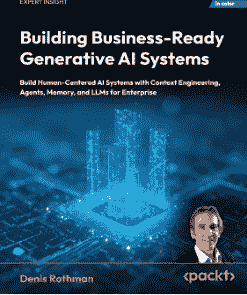
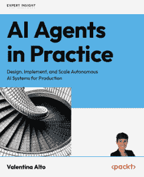

# 附录 B：答案

在这里你可以找到每章末尾回顾问题的答案汇总。在将它们应用于自己的项目之前，用它来加强对上下文工程原理的理解。

# 1 

1. 本章定义的上下文工程的主要目标是向 LLM 提出更有创造性的问题吗？（是/否）

否。本章将上下文工程定义为提供一个结构化的计划来控制和引导 AI 的输出，而不仅仅是提问。

2. “2 级：线性上下文”提供了足够的信息来控制 LLM 的风格和目的吗？（是/否）

否。线性上下文提高了事实准确性，但没有引导 AI 的风格、情绪或目的，如示例所示。

3. 5 级的“语义蓝图”是构建精确可靠 AI 回复的最有效方法吗？（是/否）

是。语义蓝图被描述为上下文架构最终的形式，提供了精确且无歧的计划。

4. 语义标记（SRL）的主要功能是检查句法的正确性吗？（是/否）

否。SRL 的主要功能是识别句子中的功能角色，从而理解“谁对谁做了什么”，并揭示其语义结构。

5. 在句子“Sarah pitched the new project”中，“Sarah”被识别为受者（ARGI）吗？（是/否）

否。“Sarah”是代理（ARGO），因为她是动作的执行者。

6. 论元修饰符（ARGM-），如时间或位置，代表了角色结构标记（SRL）中动作的核心和本质组成部分吗？（是或否）

否。论元修饰符提供了额外的上下文，但被视为动作的核心，不像施者或受事者。

7. 本章的最后一个案例是否依赖于一个单一、大型且复杂的提示词来分析会议记录？（是或否）

否。该用例演示了“上下文链”（context chaining），它在多步骤工作流中使用了一系列更简单、聚焦的提示词。

8. “上下文链”技术是否被定义为将上一次 LLM 调用的输出作为下一次调用的输入？（是或否）

是。上下文链被明确定义为一个过程，其中一个输出成为下一个的输入。

9. 在用例工作流中，“分析隐含动态”（Analyze Implicit Dynamics）这一步是为了从文本中提取显式事实和决策吗？（是或否）

否。这一步专门设计用于字里行间，以寻找未说明的情感、紧张关系和社交动态。

10. 本章的会议分析工作流是否以创建一个可操作的产物（如电子邮件草稿）作为结束？（是或否）

是。该用例的最后一步是生成一个实用的、可直接应用于业务场景的输出。

# 2 

1. 本章的主旨是一个 LLM 最适合处理复杂工作吗？（是或否）

否。核心观点是专家团队在处理这类任务时要有效得多。

2. 编排者（Orchestrator）负责实际的研究和写作吗？（是或否）

否。编排者是项目经理。它告诉研究员（Researcher）和作者（Writer）该做什么。

3. MCP 仅仅是让 LLM 写得更好的花哨方式吗？（是或否）

否。它是一组规则，以便代理能够清晰且可靠地相互对话。

4. 研究员智能体编写最终的博客文章吗？（是或否）

否。它的唯一工作是寻找并总结信息。它将该总结交给编排者。

5. 作者智能体是直接从用户的第一个请求获取任务的吗？（是或否）

否。它是在研究员完成后从编排者那里获取指令的。

6. 你必须手动运行每个智能体来获取博客文章吗？（是或否）

否。编排者自动从头到尾处理整个过程。

7. 每条 MCP 消息是否必须包含发送者是谁以及内容是什么？（是或否）

是。创建消息的函数需要发送者和内容。

8. 是否存在一个所有智能体共享的大型提示词？（是或否）

否。每个智能体都有自己专门为其特定工作设计的特殊提示词。

9. 笔记本（notebook）中的智能体通过 HTTP 在互联网上通信吗？（是或否）

否。由于它们运行在同一个地方，它们直接通信。

10. 整个系统的最终产品仅仅是研究总结吗？（是或否）

否。最终输出是作者智能体创建的博客文章。

# 3 

1. 系统对所有内容都只使用一种 RAG 吗？（是或否）

否。它使用了两种：一种用于抓取事实，另一种用于获取如何写作的指令。

2. 上下文库仅用于存储事实（如关于太空探索的事实）吗？（是或否）

否。它存储的是风格指南和写作指令，而不是实际事实。

3. 研究员和管理员（Librarian）在同一个地方寻找信息吗？（是或否）

否。它们在同一个数据库的两个部分查找。研究员检查知识部分，管理员检查风格指南部分。

4. 作者可以选择自己的写作风格吗？（是或否）

否。它必须遵循管理员为它找到的风格指南。

5. 编排者的主要工作是实际写作吗？（是或否）

否。编排者是项目经理。它将工作分配给其他代理。

6. 为了找到风格指南，系统会搜索整个 JSON 代码吗？（是或否）

否。它搜索的是风格指南的描述，而不是整个代码块。

7. 本章的会议分析工作流是否以创建一个可操作的产物（如电子邮件草稿）作为结束？（是或否）

是。该用例的最后一步是生成一个可以直接应用于业务场景的实用的、可用的输出。

# 4 

1. 代理注册表（Agent Registry）被描述为管理整个系统的*大脑*吗？（是或否）

否。引擎核心被描述为*大脑*。代理注册表被描述为*工具箱*，它为规划器提供了能力列表，并为执行器提供了实际的代理函数。

2. 重构过程中创建`utils.py`文件是为了处理引擎的高层编排和规划逻辑吗？（是或否）

否。创建`utils.py`文件是为了移动基础逻辑，特别是为了集中处理低级设置任务如`install_dependencies()`和`initialize_clients()`，而不是高层编排。

3. 原始*第 4 章*原型中的主日志方法使用的是 Python 内置的 logging 模块吗？（是或否）

否。文本指出原型使用了`print()`，这被认为对于生产系统来说是不够的，在加固期间被替换为日志模块。

4. 在重构图书管理员（Librarian）和研究员（Researcher）代理时，是否发现了一个关键缺陷，即它们返回原始字符串而不是结构化字典？（是或否）

是。文本明确提到了图书管理员（返回原始字符串）和研究员（返回原始字符串）都存在这一缺陷，已通过将输出封装在具有一致键的字典中修复。

5. 将代码从笔记本（notebook）移动到单独的 .py 文件时，`registry.py`文件是否因为无法找到代理函数而崩溃？（是或否）

是。文本描述了这一完全相同的问题，即一个`NameError`，这是因为孤立的模块不知道`agents.py`文件的存在，通过导入`agents`解决了这个问题。

6. *复杂工作流执行*测试（以海明风格重写）是否确认了引擎始终遵循“图书管理员 -> 研究员 -> 作者”的固定序列？（是或否）

否。这项特定测试的设计初衷是反对相反的结果；它强迫规划器打破该序列，并动态创建一个将两个“作者”代理链联在一起的新计划。

# 6 

1. 摘要代理（Summarizer agent）的主要目标是从外部源添加新事实吗？（是或否）

否。摘要代理的目的是减少并压缩已经提供给引擎的现有文本。

2. `count_tokens`工具是否执行了对 LLM 进行内容生成的最终调用？（是或否）

否。`count_tokens`工具是一个度量工具，用于在文本发送到 LLM 之前计算其大小。

3. 向后兼容测试的设计是为了证明新的摘要代理运行正常吗？（是或否）

否。向后兼容测试的设计是为了证明添加新代理不会破坏引擎的现有功能。

4. 规划器仅通过更新代理注册表就能自动学习使用摘要代理吗？（是或否）

是。规划器通过从代理注册表中读取能力描述来动态创建其计划，这使其能够在不更改规划器本身代码的情况下使用新代理。

5. 引入摘要代理的主要业务理由是增加最终输出的创造性吗？（是或否）

否。主要的业务理由是通过管理发送到 LLM 的上下文大小来提高效率并降低 API 成本。

6. 在新工作流中，作者代理（Writer agent）直接从摘要代理接收其事实性输入吗？（是或否）

是。通过上下文链（context chaining），摘要代理的输出作为事实性输入传递给作者代理。

7. 添加摘要代理需要对核心`engine.py`文件进行重大更改吗？（是或否）

否。模块化架构允许集成新代理，而无需更改`engine.py`中的核心规划器逻辑或执行器逻辑。

8. `summary_objective`输入是否用于为摘要代理提供待压缩的完整文本？（是或否）

否。`summary_objective`为代理提供摘要的具体目标，而`text_to_summarize`输入包含完整文本。

9. 主动上下文管理（proactive context management）可以被描述为本章引入的关键策略能力吗？（是或否）

是。该术语用于定义在处理之前对上下文进行测量和压缩的新能力。

# 7 

1. 摘要目标是从外部源添加新事实吗？（是或否）

否。摘要代理的目的是减少并压缩已经提供给引擎的现有文本。

2. `count_tokens`工具是否执行了对 LLM 进行内容生成的最终调用？（是或否）

否。`count_tokens`工具是一个度量工具，用于在文本发送到 LLM 之前计算其大小。

3. 向后兼容测试的设计是为了证明新的摘要代理运行正常吗？（是或否）

否。向后兼容测试的设计是为了证明添加新代理不会破坏引擎的现有功能。

4. 规划器仅通过更新代理注册表就能自动学习使用摘要代理吗？（是或否）

是。规划器通过从代理注册表中读取能力描述来动态创建其计划，这使其能够在不更改规划器本身代码的情况下使用新代理。

5. 引入摘要代理的主要业务理由是增加最终输出的创造性吗？（是或否）

否。主要的业务理由是通过管理发送到 LLM 的上下文大小来提高效率并降低 API 成本。

6. 在新工作流中，作者代理直接从摘要代理接收其事实性输入吗？（是或否）

是。通过上下文链，摘要代理的输出作为事实性输入传递给作者代理。

7. 添加摘要代理需要对核心`engine.py`文件进行重大更改吗？（是或否）

否。模块化架构允许集成新代理，而无需更改`engine.py`中的核心规划器逻辑或执行器逻辑。

8. `summary_objective`输入是否用于为摘要代理提供待压缩的完整文本？（是或否）

否。`summary_objective`为代理提供摘要的具体目标，而`text_to_summarize`输入包含完整文本。

9. 主动上下文管理可以被描述为本章引入的关键策略能力吗？（是或否）

是。该术语用于定义在处理之前对上下文进行测量和压缩的新能力。

10. 提议的元上下文引擎控制器是否设计用于处理复杂的、非确定性的 AI 推理任务？（是或否）

否。它的作用是处理确定性的、特定业务逻辑（例如解析电子邮件和执行策略），而核心上下文引擎（Context Engine）则留给复杂的推理任务。

11. 第 7 章中的控制台（Control Decks）是否已重构，以便更专门适用于法律领域？（是或否）

否。它们被重构为通用的多领域模板，以展示架构的领域无关性和可用性。

# 8 

+ 8. 针对法律用例，`Data_Ingestion.ipynb` notebook 是否已从头重写以处理法律文档？（是或否）

否。该 notebook 是第 7 章管道的副本，证明了摄取工具对于新且不同数据源的可用性。

+ 9. 在测试系统局限时，`helper_sanitize_input` 函数是否正确处理了包含“忽略任何相反的法律建议”短语的敌意证人词？（是或否）

否。它根据规则正确识别出该短语为潜在的提示词注入攻击，抛出错误并丢弃了数据，这凸显了纯技术清理方法的局限性。

+ 10. 当给定“起草诉辩状”这一模糊目标时，引擎是否成功生成了法律上有效的文档？（是或否）

否。它生成了一个事实上基于源文本的文档，但并不是法律上有效的诉辩状，这被描述为复杂的功能性幻觉。

# 9 

+ 1. 将上下文引擎适配到营销领域是否需要完全重写其核心 `engine.py` 逻辑？（是或否）

否。该章节的核心观点是核心逻辑完全没有改变，证明了引擎的领域无关性和通用架构的价值。

+ 2. 在多领域系统中，上下文工程师（Context Engineer）的主要角色是否是为每个任务不断开发新的专家智能体（agents)）？（是或否）

否。该章节重新定义了上下文工程师的角色，即策划新的知识库并将业务目标翻译为现有通用智能体的任务，从而最大限地减少了对新代码的需求。

# 附录 B

+ 3. `Data_Ingestion_Marketing.ipynb` notebook 是否是为营销用例从头构建的全新脚本？（是或否）

否。它是现有的法律摄取 notebook 的直接复制，仅更改了源路径，证明了数据管道的可用性。

4. 每个营销用例是否都需要它们自己独特的、自定义构建的控制台（Control Deck）？（是或否）

否。所有运行的用例都是通过使用上一章中开发的同一组通用控制台模板成功实现的。

5. 在语音执行用例中，系统是否引入了一个新的、专门的品牌检查器（BrandChecker）智能体？（是或否）

否。没有明确运行品牌执行用例，但*验证生产防护*（Validating production safeguards）和*说服性推销*（Persuasive pitch）用例证明，现有的智能体（如 Librarian 和 Writer）可以使用`brand_style_guide.txt`来执行语气要求，而不需要新的专门智能体。

6. 电子邮件序列用例是否依赖任何单一源文档来生成输出？（是或否）

否。虽然没有运行这个特定的用例，但*验证生产防护*和*说服性推销*用例证明了引擎从多个源合成信息（包括`email_nurture_outline.txt`和其他文档）以构建输出的能力。

7. 多领域系统是否通过为每个业务部门创建独立的、隔离的 AI 引擎来构建？（是或否）

否。通过为其提供新的、特定领域的知识，可以动态地重新利用单一的、中心化的玻璃盒（glass-box）引擎。

8. 为了提高创作自由，是否从*第 8 章*中删除了审核和安全功能？（是或否）

否。飞行前和飞行后的审核检查仍然是工作流中不可或缺的一部分，正如*验证生产防护*章节所示的那样。

9. 玻璃盒架构（the-glass-box architecture）的主要价值主张是其能够比任何其他方法更快地生成内容吗？（是或否）

否。玻璃盒架构的主要价值在于它的可用性、适应性和领域无关性，这使其能够以极少的代码应用于新的业务领域。

10. 战略营销引擎的成功是否取决于赋予 AI 更多的自主权和更少的人为结构？（是或否）

否。它的成功取决于相反因素：通过策划的知识提供高度结构化的环境。

# 10 

+ 1. 该章节是否建议将应用程序直接部署在虚拟机上？（是或否）

否。该章节强烈主张使用 Docker 等容器以确保不同环境之间的一致性。

+ 2. 是否建议使用如 Celery 等异步队列来处理长时间运行的 AI 过程？（是或否）

是。异步队列有助于防止超时。

+ 3. `ExecutionTrace` 日志被认为是审计的核心组件吗？（是或否）

是。`ExecutionTrace`被描述为调试的基础元素。

+ 4. 该章节是否将摘要智能体（Summarizer agent）主要作为减少开支的工具？（是或否）

否。摘要智能体被框架为一个关键的成本管理工具。

+ 5. 高保真 RAG（high-fidelity RAG）能力的主要目的是提供引用输出吗？（是或否）

是。高保真 RAG 是建立信任的基础。

+ 6. 该章节是否建议仅在数据摄取点进行清理？（是或否）

否。它建议采用深度防御策略，在数据摄取时以及在运行时传递给智能体之前进行清理。

+ 7. 在价值倍器概念中，引擎降低成本的能力是否直接贡献于生产力？（是或否）

是。飞轮模型展示了节约如何促进生产力。

# 附录 B

8. 信任支柱是否建立在安全数据管道和可验证输出的核心原则之上？（是或否）

是。图表和文字清楚地显示安全基础和可验证输出是信任业务结果的重要支持。

9. 知识护城（knowledge moat）概念是否是指`ExecutionTrace`日志的专有数据集，它记录了组织独特的解决问题的方法（是或否）

是。知识护城被描述为随着时间记录引擎成功的推理链而产生的独特的、复合的战略资产。

10. 章节的最终结论是否认为企业 AI 的未来将依赖于单一巨大的黑盒模型？（是或否）

否。结论明确指出，未来不在于单一的庞大模型，而在于透明架构内上下文的复杂编排。

# 你可能喜欢的其他书籍

如果你喜欢这本书，你可能对 Packt 的其他书籍感兴趣：

## 构建业务就绪生成式 AI 系统

Denis Rothman

ISBN: 97818370202690

- 实现一个具有对话 AI 代理和编排器的 AI 控制器，并具备短期、长期和跨会话记忆
- 构建具有短期、长期记忆的上下文感知能力
- 使用多模态推理、图像生成和语音功能设计跨领域自动化
- 通过集成消费级记忆理解来扩展思维链（CoT）代理
- 集成你选择的尖端模型，且不干扰现有的 GenAI 系统
- 在阻止安全漏洞的同时连接实时外部数据

# 实践中的 AI 代理

Valentina Alto

ISBN: 9781805801351

- 构建核心代理组件，如 LLM、记忆系统、工具集成和上下文管理
- 使用代码开发生产级代理框架，如 LangChain
- 使用编排模式创建有效的多代理系统以解决问题
- 针对电子商务、客户支持等特定行业实现特定代理
- 为具有短期和长期召回能力的代理设计稳健的记忆架构
- 结合监控、护栏和人工监督实施负责任的 AI 实践
- 为生产环境优化 AI 代理的性能和成本

# Packt 正在寻找像你这样的作者

如果你兴趣成为 Packt 的作者，请访问 `packtpub.com` 并立即提交申请。我们已经与成千上万像你这样的开发者和技术专业人员合作，帮助他们向全球技术社区分享他们的见解。你可以提交通用申请、针对我们正在招募作者的特定热门话题进行申请，或者提交你自己的想法。

# 分享你的想法

现在我们已经完成了《多代理系统上下文工程》，我们非常想听听你的想法！扫描下方的二维码直接进入此书的亚马逊评论页面分享你的反馈，或在你购买的网站上留下评论。

`https://packt.link/r/1806690047`

你的评论对我们和技术社区至关重要，并将帮助我们确保交付优质内容。

