# C++ 深度学习

*本书献给作为读者的你——感谢你的好奇心、坚持不懈，以及不断学习、构建和完善的意愿。——Bill Chen*

## 序言

深度学习重塑了现代软件，为视觉、语言、语音、推荐、医疗健康和机器人等应用提供动力。虽然 Python 已成为实验的标准语言，但生产系统往往依赖 C++ 来获得性能、效率和可控性。当延迟、内存使用和硬件优化至关重要时，C++ 仍然是深度学习技术栈中的关键组成部分。

这正是本书的价值所在。它为读者提供了一条从深度学习概念到 C++ 实际实现的实用路径。本书并未将 C++ 视为次要工具，而是将其作为构建、优化和部署现代深度学习系统的重要环境。

我最欣赏的是本书全生命周期的方法。它从环境搭建、数据准备和 CUDA 加速等基础内容开始，接着介绍核心模型家族，包括神经网络、CNN、RNN、LSTM 和生成模型。它还涵盖了分布式训练、模型压缩、推理优化、部署、调试、监控和可解释性。

这使得本书既适用于进入深度学习领域的 C++ 工程师，也适用于希望从 Python 原型转向生产级系统的机器学习从业者。它弥合了理论与部署之间的鸿沟，展示了如何构建不仅准确，而且高效、可靠和实用的模型。

希望你喜欢这本书。

*Bill Chen*

## 贡献者

### 关于作者

**Bill Chen** 是 Meta 的机器学习工程师，专注于深度学习、CUDA 和 C++。他拥有肯塔基大学的生物信息学博士学位，并在应用 AI 领域担任过生产和教学职务。他曾在 NVIDIA 深度学习学院授课，获得了 NVIDIA 认证助理：生成式 AI 多模态资格认证，并曾担任 UCSC 硅谷延伸学院的兼职机器学习教员。他的工作包括 Facebook 群组搜索建模和手术时长预测。在本书中，他结合行业经验和教学经验，指导读者使用 C++ 构建高性能深度学习系统。

*我衷心感谢我的编辑 Nathanya，感谢她在本书写作过程中给予的耐心、灵活性和支持，尤其是当我在美国陆军服役期间。她的理解和鼓励使我在那段艰苦时期能够继续这个项目。我也感谢审稿人提出的宝贵意见和对稿件的仔细阅读，并感谢整个 Packt 团队在出版过程中给予的指导和支持。*

**Vikash Gupta Ph.D.** 是位于华盛顿州西雅图的 **Amazon Web Services**（**AWS**）的高级解决方案架构师。他在法国 INRIA 获得计算生物学博士学位，研究重点为神经影像和统计建模。在 AWS，他应用深度学习和人工智能推进医学影像技术，为 MONAI 等医疗健康开源计划做出贡献。他还曾担任俄亥俄州立大学的研究科学家和梅奥诊所的助理教授。他已发表 60 多篇同行评审论文。

*我要感谢家人一直以来的支持，尤其是我的妻子 Garima Saraowgi，她在整个写作过程中给予了我极大的支持。我还要感谢我的老师们，特别是 Xavier Pennec 教授，他在我的职业生涯中不断挑战和引导我。此外，我要感谢 Packt 团队的贡献，特别是 Nathanya Dias，她对此书内容进行了认真审校，并让我保持动力和专注。最后，本书献给所有努力学习并构建新解决方案的学生们——为了后来者。*

*— Gustave, Claire Obscure*

### 关于审稿人

**Sriram M** 是一位 AI 架构师、顾问和技术作者，拥有二十年的行业经验。他专注于量子 AI、高级机器学习和安全模型部署。他是《使用生成式 AI 进行时间序列预测》的合著者，并担任技术书籍审稿人，以严谨、研究驱动的方式评估每份手稿。作为导师和客座教员，他向多样化的学习者教授 Python 和 AI，并通过出版物、同行评审和量子储层计算方面的持续研究为学术界做出积极贡献。他还是行业活动的特邀演讲者。

**Vishwas BV** 是一位高级首席数据科学家和 AI 研究员，拥有 13 年以上在制造、能源、电信和零售领域构建可扩展机器学习、生成式 AI 和智能体 AI 系统的经验。Vishwas 专注于将复杂的业务问题转化为生产级 AI 架构，包括 RAG、多智能体工作流和时间序列基础模型。他是 Springer 出版的两本书的作者，也是一项已获授权的美国专利的共同发明人，该专利涉及 AI 驱动的排放建模，支持了一笔数十亿美元的交易。他拥有 AWS ML 和 Azure ML 认证，将深厚的技术专长与可衡量的业务影响力相结合。

## 前言

深度学习已成为现代软件系统中最重要的技术之一，为计算机视觉、语音、语言、推荐、医疗健康、金融、机器人以及实时决策等应用提供动力。虽然大多数深度学习工作流都是基于 Python 实现的，但许多生产环境最终需要 C++ 提供的速度、控制力和系统级效率。本书旨在向你展示如何弥合这一差距。本书面向机器学习工程师、深度学习从业者、软件工程师以及具备技术背景的数据科学家，他们希望了解如何在 C++ 中构建、训练、优化、部署和监控深度学习系统。在本书中，你将经历以下过程：从搭建 C++ 深度学习环境和准备数据开始，到构建核心神经架构（如多层感知机、卷积网络、循环网络、生成模型和基于 Transformer 的系统），最后在性能至关重要的环境中部署、调试、监控和解释生产模型。

C++ 依然是高性能深度学习应用最强大的语言之一，因为它提供了对内存、并发、CPU/GPU 资源及运行时行为的精细控制。当你需要低延迟推理、高效模型服务、硬件感知优化或在资源受限系统上部署时，这一点至关重要。然而，对许多从业者而言，从基于 Python 的实验转向 C++ 实现，可能会感觉像跨越一道缺乏实用指南的鸿沟。本书旨在通过将深度学习概念与现代 C++ 的动手实现模式相结合来弥合这一鸿沟。

我们首先奠定让你高效工作所需的基础。你将首先回顾关键的深度学习概念，并为模型开发搭建一个可用的 C++ 环境。接下来，你将学习如何高效地准备和预处理数据，以及如何使用 CUDA 在 GPU 上加速训练和推理。这些早期章节旨在为你提供在 C++ 中开展严肃深度学习工作所需的概念基础与工具。


在环境和基础知识准备就绪后，本书将转向模型构建与训练。你将从基础神经网络开始，理解 C++ 中的前向传播、反向传播、优化和评估。然后，你将把这些思想扩展到多层感知器、用于图像任务的卷积神经网络，以及用于序列数据的循环架构，如 C++ 中的**循环神经网络**（**RNNs**）和**长短期记忆网络**（**LSTMs**）。接下来，本书将扩展到生成建模，涵盖自编码器、**生成对抗网络**（**GANs**）以及核心大语言模型概念，然后进入分布式训练、多 GPU 执行、并行化以及量化、剪枝等模型压缩策略。

本书的最后部分聚焦于模型在开发中工作之后会发生什么。你将学习如何使用 TorchScript 和**开放神经网络交换**（**ONNX**）等格式为推理准备模型，将其部署到云、本地或边缘环境，并针对现实世界性能进行优化。在此基础上，本书还涵盖调试生产故障、在数据变化时重新训练模型、监控生产系统，以及通过**局部可解释模型无关解释**（**LIME**）、**SHapley 加法解释**（**SHAP**）和**梯度加权类激活映射**（**Grad-CAM**）等可解释性技术提高透明度。最后，你将获得关于 C++ 中完整深度学习生命周期的实际视角，从实现到运营可靠性。

本书刻意注重实践。它不是将 C++ 仅仅视为机器学习的另一种语法，而是将 C++ 视为构建可部署深度学习系统的严肃工程环境。在此过程中，你将看到性能问题、软件设计选择、部署约束和可观测性考量如何影响生产级 AI 系统的构建方式。我的目标不仅是帮助你理解深度学习在 C++ 中如何工作，还要帮助你编写快速、健壮且适合实际使用的系统。

在撰写本书时，我希望能将许多从业者分别经历的两个世界结合起来：深度学习理论与实验的世界，以及生产级系统工程的世界。C++ 正处于这一交汇点。它使我们能够超越原型，进入可靠、高效的实现，从而大规模服务于要求苛刻的应用。我希望这本书能帮助你对此转变充满信心，并为在现代 C++ 中构建深度学习系统提供实用的基础。

## 本书读者对象

本书面向希望在 C++ 中构建高性能深度学习系统的机器学习工程师、深度学习工程师、软件工程师和数据科学家。对于那些已经熟悉机器学习和神经网络基础知识，并希望进一步接近生产级实现、优化和部署的读者来说，本书尤其有用。

你应该熟悉 C++ 的核心编程概念，例如类、内存管理和基本并发。对机器学习和深度学习概念（包括神经网络、训练循环和常见模型架构）有基础到中级的理解，将有助于你充分利用本书。熟悉 PyTorch 或 TensorFlow 等框架是有帮助的，但事先有使用其 Python API 的经验就足够了；本书将帮助你把这些经验转化为 C++ 工作流。

如果你是以 Python 为先的从业者，希望了解深度学习系统如何在更低级、对性能敏感的环境中实现，本书将帮助你完成这一转变。如果你是希望将系统背景应用于现代 AI 工作负载的 C++ 开发者，本书将为你提供一条进入深度学习的结构化路径。如果你从事实时或资源受限的应用程序，且延迟、吞吐量和效率至关重要，那么本书正是根据这些约束编写的。

## 本书涵盖的内容

- *第 1 章*，*C++ 深度学习入门与环境搭建*，介绍深度学习的核心概念，解释为什么 C++ 对性能密集型 AI 工作负载具有价值，并逐步讲解一个实用 C++ 深度学习环境的搭建。
- *第 2 章*，*C++ 中的数据准备与预处理*，涵盖深度学习的数据流水线方面，包括归一化、数据增强、高效加载、大数据集的内存感知处理，以及 C++ 中的自定义数据集加载器。
- *第 3 章*，*CUDA 在 C++ 深度学习中的 GPU 加速*，介绍 CUDA，并展示如何使用 GPU 加速来加速训练和推理、优化关键性能代码路径以及分析瓶颈。
- *第 4 章*，*在 C++ 中构建基础神经网络*，逐步讲解一个简单神经网络的实现，包括神经元、激活函数、前向传播、损失计算、反向传播和基于梯度的优化。
- *第 5 章*，*C++ 中的多层感知器*，扩展到更深的前馈网络，展示如何添加隐藏层、使用 dropout 和批归一化、调整超参数，并评估在实际任务上的性能。
- *第 6 章*，*C++ 中的卷积神经网络*，介绍基于图像的数据，展示如何使用神经网络进行图像分类、图像分割，以及各种图像预处理和数据增强技术。
- *第 7 章*，*C++ 中的循环神经网络与长短期记忆网络*，讨论序列数据，特别是文本数据，涵盖其数学基础、训练算法（BPTT）、实用的 C++ 实现、文本处理技术、词嵌入，以及在文本预测和神经机器翻译中的实际应用。
- *第 8 章*，*C++ 中的生成网络、自编码器与大语言模型*，涵盖基础生成式 AI 架构和 GANs，以及自回归文本生成原理、采样策略，以及用于评估生成模型性能的综合评价指标。
- *第 9 章*，*C++ 中的 Transformer 与大语言模型微调*，探讨 Transformer 架构及其组件、其编码器-解码器实现，进而介绍分布式训练策略和模型压缩。
- *第 10 章*，*部署和优化推理模型*，说明如何导出模型用于部署、在生产环境中提供服务、优化推理性能，以及构建 C++ 实时推理 API。
- *第 11 章*，*已部署模型的调试与重新训练*，展示如何诊断性能下降、检测并应对模型漂移、改进日志记录和调试工作流，以及构建实用的重新训练策略。
- *第 12 章*，*监控已部署模型*，聚焦于生产可观测性，包括跟踪延迟、准确率和资源利用率，设置日志系统，并长期维护模型质量。
- *第 13 章*，*深度学习模型中的可解释性与透明性*，介绍 LIME、SHAP 和 Grad-CAM 等实用可解释性技术，并讨论可解释性如何支持更安全、更可信的部署。

## 如何充分利用本书

要充分利用本书，你需要具备 C++ 的实用知识，并对机器学习和深度学习基础有基本了解。你不必是这里涵盖的每个模型家族的专家，但你应该已经熟悉监督学习、损失函数、梯度下降以及训练和评估模型的一般概念。使用 Python 深度学习框架的经验也会有所帮助，尤其是在你使用本书向更注重性能的 C++ 实现转变时。

如果你准备直接动手实践代码示例，而不是只在概念上阅读，你将从本书中获得更多收获。当你亲自编译、运行、分析和修改代码时，本书中的主题会变得更加清晰。由于本书涵盖环境搭建、CUDA 加速、分布式训练、部署格式和推理优化，因此最好能有一个开发环境，让你在学习过程中同时实验 CPU 和 GPU 工作流。

## 下载示例代码文件

本书的代码包托管在 GitHub 上，地址为 `https://github.com/PacktPublishing/Deep-Learning-with-C-`。我们还有来自丰富图书和视频目录的其他代码包，可在 `https://github.com/PacktPublishing` 获取。快去看看！

## 使用的约定

本书通篇使用了一些文本约定。

`CodeInText`：表示文本中的代码词、类名、函数名、文件名、文件扩展名、路径名、模型文件、库名和命令行参数。例如：“我们切换到 `eval()`，创建一个示例输入，并**跟踪**模块以生成 `tinynet.ts`。”

代码块设置如下：

```bash
export TORCH=/path/to/libtorch
clang++ -std=c++17 -O2 micro_batcher_demo.cpp \
  -I"$TORCH/include" -I"$TORCH/include/torch/csrc/api/include" \
  -L"$TORCH/lib" -Wl,-rpath,"$TORCH/lib" \
  -ltorch -lc10 -pthread -o mb_demo
./mb_demo
```


## 前言

所有命令行输入或输出都按如下格式书写：

```
!nvcc --version
!nvidia-smi
```

**粗体**：表示新术语、重要词语或你屏幕上看到的文字。例如，菜单或对话框中的词语在文本中这样显示。比如：“在深入探讨之前，我们先从**结构化/表格**信号转向**非结构化**模态。”

### 联系我们

我们始终欢迎读者的反馈。

**一般反馈**：如果你对本书的任何方面有疑问，或有任何一般性反馈，请发送电子邮件至 `customercare@packt.com`，并在邮件主题中提及书名。

**勘误**：尽管我们已尽力确保内容的准确性，但错误仍可能发生。如果你在本书中发现错误，我们将不胜感激你能向我们报告。请访问 `http://www.packt.com/submit-errata`，点击**提交勘误**，并填写表单。

**盗版**：如果你在互联网上以任何形式遇到我们的作品的非法副本，请将地址或网站名称提供给我们，我们将不胜感激。请通过 `copyright@packt.com` 联系我们，并附上材料链接。

**如果你有兴趣成为作者**：如果你有擅长的主题，并且有兴趣撰写或参与编写一本书，请访问 `http://authors.packt.com/`。

警告或重要说明会以这种方式显示。

提示和技巧会以这种方式显示。

### 随书免费福利

本书附带免费福利以支持你的学习。立即激活它们以获得即时访问权限（有关说明，请参阅“*如何解锁*”一节）。

以下是购买后可立即解锁内容的快速概览：


### 如何解锁

扫描二维码（或访问 `packtpub.com/unlock`）。按名称搜索本书，确认版本，然后按照页面上的步骤操作。


*注：请妥善保管你的发票。直接从 Packt 购买不需要发票。*

### 分享你的想法

一旦你阅读了*使用C++进行深度学习*，我们很乐意听到你的想法！请点击此处直接前往本书的亚马逊评论页面并分享你的反馈。

你的评论对我们和技术社区都很重要，并将帮助我们确保提供优质的内容。

# 第1部分：C++深度学习基础

在本书的这一部分，你将构建在 C++ 中有效使用深度学习所需的技术基础。我们将从深度学习的核心概念开始，然后搭建 C++ 开发环境，包括本书中使用的关键库和工具。你还将学习如何高效地准备和预处理数据，以及如何使用**计算统一设备架构**（**CUDA**）来加速**图形处理器**（**GPU**）上的训练和推理。在本部分结束时，你将能够在 C++ 中实现神经网络，并扎实掌握支持现代深度学习系统的工具、数据管道和性能基础。

本书的这一部分包括以下章节：

- *第1章*，*使用C++进行深度学习与环境搭建简介*
- *第2章*，*C++中的数据准备与预处理*
- *第3章*，*使用C++进行深度学习中的CUDA GPU加速*

## 第1章：使用C++进行深度学习与环境搭建简介

深度学习已成为现代**人工智能**（**AI**）的基石，为从自动驾驶汽车到高级推荐系统的一切提供动力。在本章中，我们将介绍深度学习的核心原理，并引导你完成使用 C++ 搭建深度学习环境的过程。你将理解为什么 C++ 在高性能任务中备受青睐，尤其是在优化内存使用和高效利用 CPU 与 GPU 资源方面。

除了涵盖理论基础外，本章还将为你提供配置 C++ 开发环境的实用技能，包括安装相关的深度学习库。

在本章中，我们将讨论以下主题：

- 深度学习概念简介
- 使用 C++ 进行深度学习的优势
- 为深度学习搭建 C++ 环境
- C++ 在深度学习中的关键性能优势

到本章结束时，你将能够开始用 C++ 编写深度学习模型，这使本章成为你深度学习之旅中至关重要的第一步。

### 技术要求

本节详细说明阅读本章及本书内容所需的前提条件：

- **硬件**：
  - **CPU（必需）**：64位 x86-64 或 Apple Silicon
  - 推荐：支持 AVX2（大多数现代 Intel/AMD CPU）以获得更快的 BLAS/线性代数性能
  - **内存**：≥8 GB RAM（对于较大示例，推荐 ≥16 GB）
  - **磁盘**：≥15 GB 可用空间（工具链 + 库 + 示例数据）
  - **GPU（可选，适用于 CUDA 章节）**：计算能力 ≥7.0 的 NVIDIA GPU（例如 V100/T4/A10/A100/H100）：
    - **驱动程序**：与你的 CUDA Toolkit 版本匹配的最新 NVIDIA 驱动程序
    - **显存（VRAM）**：推荐 ≥8 GB 以获得良好体验
  - Apple Silicon 没有 CUDA；请在本地使用仅 CPU 的构建，或为 GPU 章节使用带 NVIDIA GPU 的云虚拟机。
- **操作系统**：
  - **Linux**：Ubuntu 20.04/22.04（或同等版本）
  - **Windows**：Windows 10/11（x64）
  - **macOS**：13 Ventura 或更高版本（Apple Silicon 或 Intel）
  - **WSL2（Windows）**：支持并推荐用于类 Linux 的工作流程
- **编译器和构建工具**：
  - **C++ 标准**：C++17（部分示例也可用 C++20 编译）
  - **编译器**：
    - **Linux**：GCC ≥11 或 Clang ≥14
    - **Windows**：**微软 Visual C++**（**MSVC**）— Visual Studio 2022，v19.3x
    - **macOS**：Apple Clang ≥14

**你的购买包含一份免费 PDF 副本 + 独家附加内容**

你的购买包含本书的一份无 DRM 的 PDF 副本、Packt+ 图书馆的 7 天试用（无需信用卡）以及额外的独家附加内容。请参阅*前言*中的*随书免费福利*一节，立即解锁它们并最大化你的学习体验。

- **构建系统**：CMake ≥3.22（主要），不过许多代码片段也显示单文件 g++/clang++ 命令
- **包管理器（可选但有帮助）**：Linux 上的 `apt`/`dnf`，macOS 上的 `Homebrew`，Windows 上的 `vcpkg` 或 `choco`
- **本书使用的核心库**：
  - **Eigen 3.4+（仅头文件）**：用于从零开始演示的线性代数（CPU）
  - **LibTorch（PyTorch C++ API）**：推理/训练示例（所有操作系统上均可 CPU 构建；在 Linux/Windows 上支持 NVIDIA GPU 的 CUDA 构建）：
    - 预计下载量较大（约 1–2 GB）
  - **OpenCV 4.x（可选）**：在少数示例中用于图像 I/O 可视化
  - **GoogleTest（可选）**：在部分章节中用于单元测试

我们会始终注明仅使用 CPU 的路径。当存在 GPU 路径时，我们会明确标注。

- **CUDA（可选 GPU 路径）**：
  - **CUDA Toolkit**：12.x（Toolkit + `nvcc`）
  - **驱动程序**：匹配的 NVIDIA 驱动程序（使用 `nvidia-smi` 验证）
  - **Nsight 工具（可选但推荐）**：Nsight Systems/Compute，用于性能分析
  - **nvidia-container-toolkit（可选）**：用于 Docker GPU 工作流
- **编辑器和集成开发环境（IDE）**：
  - 任何现代 C++ IDE/编辑器均可：**VS Code**、**CLion** 或 **Visual Studio**
  - 启用 CMake Tools 或正确设置你的编译器套件
- **网络访问**：
  - 需要稳定的互联网连接来获取工具链、LibTorch 归档、模型和小型数据集。某些构件较大，因此快速连接会有所帮助。
- **云（如果你没有本地 NVIDIA GPU）**：
  - 从 AWS/Azure/GCP 租用带 NVIDIA GPU 的按需虚拟机（推荐 Ubuntu LTS 镜像）
  - 对于轻量级探索，Colab/Kaggle 可用于不需要系统级安装的 CUDA 部分


## 使用C++的深度学习简介与环境设置

- **环境验证（快速检查）**：

  运行以下代码（根据您的操作系统/Shell调整）；您应该看到合理的版本且没有错误：

  ```bash
  # Compiler & CMake
  g++ --version
  cmake --version

  # (Linux/WSL) Check BLAS-friendly CPU flags
  lscpu | egrep 'avx|sse' # Look for AVX/AVX2

  # LibTorch headers present (after you download & set TORCH path)
  ls $TORCH/include/torch/torch.h

  # Optional: CUDA toolchain & driver
  nvcc --version
  nvidia-smi
  ```

- **已知兼容性说明**：

  - **Windows + LibTorch**：确保MSVC工具集与LibTorch构建匹配；将 `c10.dll/torch_cpu.dll`（以及CUDA **动态链接库**（**DLL**），如果使用）与可执行文件一起放在 `PATH` 中。
  - **macOS（Apple Silicon）**：使用*仅CPU*的LibTorch构建；没有CUDA。Homebrew有助于处理Eigen/OpenCV。
  - **WSL2**：在Windows上安装NVIDIA驱动程序，并在Ubuntu中安装WSL2 CUDA用户空间；在WSL内使用 `nvidia-smi` 验证。

- **最低配置与推荐配置**：

  - **最低配置（仅CPU）**：C++17编译器、CMake、Eigen、LibTorch（CPU）、8 GB内存
  - **推荐配置（为了舒适体验和GPU章节）**：支持C++20的工具链、CMake、Eigen、LibTorch（CPU + CUDA）、OpenCV、Nsight工具、16 GB内存、NVIDIA GPU（≥8 GB显存）

## 第1章：深度学习概念简介

深度学习已经改变了人工智能，使机器能够学习复杂模式并以前所未有的准确性做出明智决策。从核心来看，深度学习主要依赖于神经网络——一种受人类大脑结构和功能启发的深度学习算法。

### 神经网络——深度学习的构建模块

神经网络由相互连接的人工神经元（或节点）层组成，这些层执行计算并传播结果。神经网络的基本结构包括以下内容：

- **输入层**：接收初始数据
- **隐藏层**：处理信息
- **输出层**：产生最终结果或预测

在*图1.1*中，我们展示了一个具有相互连接的输入层、隐藏层和输出层的简单神经网络。

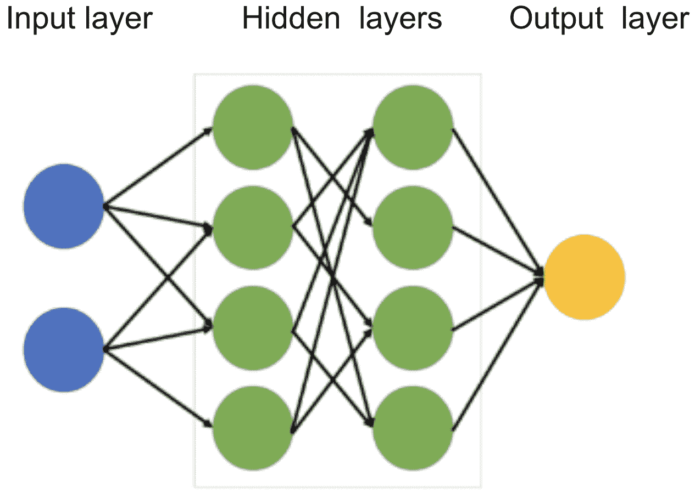

*图1.1：具有输入层、隐藏层和输出层的简单神经网络概览*

每个节点之间的连接都带有在训练过程中调整的权重。网络通过缩小其预测与实际结果之间的差距来学习，这个过程称为反向传播。神经网络的核心是感知器——一个基本单元，可以看作一个线性模型，其输出通过非线性激活函数传递，以引入灵活性并捕获复杂模式。

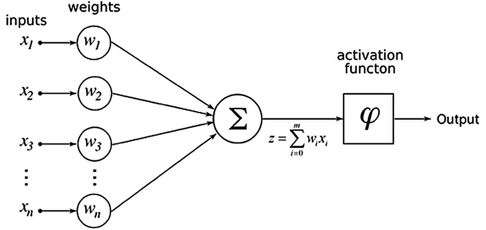

*图1.2：这是感知器的简化版本*

在*图1.2*中，我们可以看到感知器的前半部分实际上是输入\(x\)和权重\(w\)的线性组合，即\(z = \sum_{i=1}^{n} w_i x_i\)。然后，得到的值将传入激活函数\(\varphi\)。这提供了非线性。非线性防止神经网络中的所有神经元坍缩成一个等效神经元，从而使网络能够学习复杂函数。

最常用的激活函数是**ReLU**、**sigmoid**和**tanh**。它们引入了以下能力：

- **增加非线性**：如果没有激活函数，无论我们堆叠多少层，网络都会表现得像一条大直线。这些函数将输出弯曲成**曲线**，使模型能够捕获更复杂的模式。
- **做出更好的决策**：例如，在图像分类中，一条直线可能不足以区分猫和狗。激活函数让网络绘制**弯曲的边界**，这更擅长分离混乱的现实世界数据。
- **塑造输出**：
  - ReLU像一个开关：它保留正数并将负数变为零。它快速且高效。
  - Sigmoid将值压缩到0和1之间。它非常适合输出类似于概率的场景。
  - Tanh将值压缩到-1和1之间，因此它可以表示正负信号。
- **释放深度学习的力量**：由于激活函数，神经网络的每一层都可以学习不同的东西。将它们堆叠在一起，网络便有能力表示非常复杂的关系——从识别语音，到检测照片中的物体，再到理解语言。

下图展示了常见的激活函数。

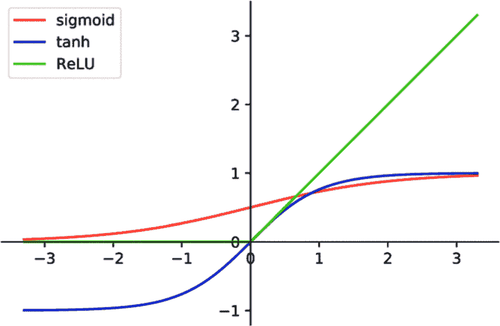

*图1.3：常见激活函数：ReLU、sigmoid和tanh（https://www.researchgate.net/figure/Sigmoid-tanh-and-ReLU-functions_fig4_358602222）*

我们已经了解了激活函数；现在，让我们看看深度学习的类别。

### 学习范式的类型

深度学习包含多种学习范式，每种范式适用于不同类型的问题：

- **监督学习**：使用数据集训练模型，其中每个输入都与正确的输出配对。模型从这些示例中学习模式，以便为新输入预测适当的输出。常见应用包括图像分类和语音识别。
- **无监督学习**：模型在未标记的数据中发现模式。聚类和降维是常见的应用。
- **半监督学习**：结合了监督方法（使用少量标记数据）和无监督方法（使用大量未标记数据）。
- **强化学习（RL）**：模型通过与环境的反馈进行学习，环境根据其行为给予奖励或惩罚。

让我们更详细地了解每种深度学习类型。

#### 监督学习

监督学习是深度学习和机器学习中最广泛使用的方法之一。它依赖于标记数据集，通常称为真实值（ground truth），其中每个输入都与正确的输出配对。通过反复将模型暴露于这些标记示例，算法学习将输入映射到所需输出，并将其知识泛化到新的、未见过的数据。

两种最常见的监督学习任务是分类和回归。对于分类任务，模型将预测一个离散标签。最常见的示例之一是判断一封电子邮件是否是垃圾邮件。另一个示例是预测0到9之间的手写数字。

下图对比了**线性回归**和**逻辑回归**——一个显示为简单的线性模型，另一个显示为单神经元（感知器）神经网络。

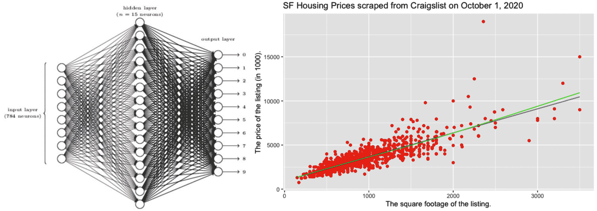

*图1.4：左：使用神经网络进行数字分类。右：使用回归模型进行房价预测*

相比之下，对于回归任务，模型将预测一个连续值。示例包括根据房屋特征预测房价、根据身高和年龄估算人的体重，或预测第二天的温度。与分类（输出属于固定类别集合）不同，回归输出可以取广泛的数值。

监督学习支撑着许多实际应用，包括图像识别、语音转文本系统、医疗诊断支持和金融预测。其有效性在很大程度上取决于标记数据的可用性和质量，以及模型在不过度拟合训练集的情况下捕获模式的能力。

#### 无监督学习

无监督学习本质上是监督学习的对立面。在这种情况下，输入数据没有标签。你可能会问：“如果没有提供答案，模型到底在学习什么？”模型通过发现数据本身的模式、结构或分组来学习，而无需


## 第 1 章

而不是被告知什么是“正确”的输出。

例如，无监督学习可以根据购买行为将相似客户聚类在一起，即使我们事先不知道他们的类别。它还可以降低大型数据集的维度，突出最重要的特征。与专注于使用有标签结果进行预测的监督学习不同，无监督学习更关乎**发现**——揭示人类可能不易察觉的隐藏关系和洞见。

常见技术包括以下几种：

- **聚类（例如 k-means、层次聚类）**：将具有相似特征的数据点分组
- **降维（例如 PCA、t-SNE）**：在保留重要结构的同时简化数据
- **关联规则学习（例如购物篮分析）**：发现特征或事件如何共现的规则

下图展示了聚类的核心思想。左图是 k-means 演示，将数据点划分为多个组；右图是一个生物医学示例，聚类揭示了基因共表达关系。

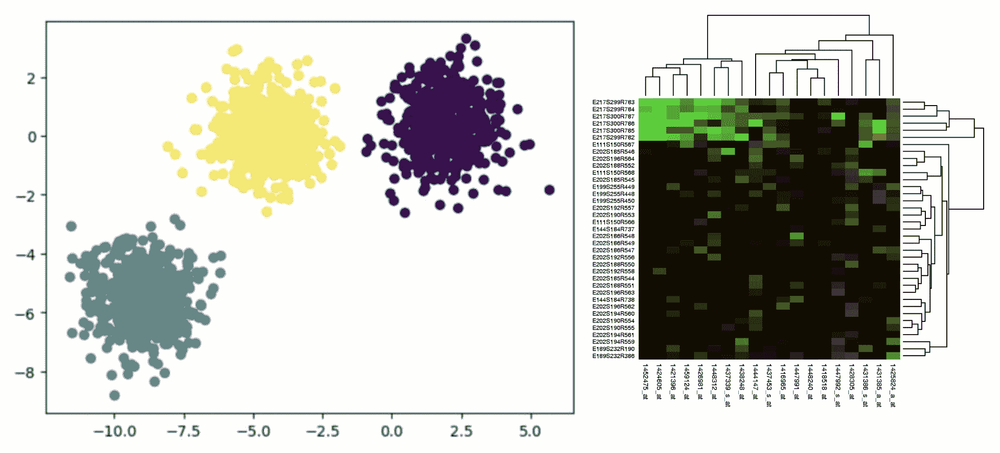

*图 1.5：左图：K-means 聚类。右图：无监督学习在生物医学用例中的应用（https://commons.wikimedia.org/wiki/File%3AHeatmap.png）*

简而言之，监督学习使用标签回答特定问题，而无监督学习则让数据自己讲述故事，帮助我们探索未知。

接下来，我们来看看半监督学习和强化学习。

### 半监督学习与强化学习

**半监督学习**融合了监督学习和无监督学习的原理。监督学习完全依赖有标签数据，无监督学习则在无标签情况下工作，而半监督学习则兼取两者之长。少量有标签数据与大量无标签数据一起使用，使模型能够更有效地泛化，同时减少昂贵的标注成本。例如，在医学影像中，可能只有数量有限的扫描带有专家验证的诊断，但存在数千张无标签扫描图像。半监督方法——如伪标签自训练、一致性正则化或基于图的技术——可以利用这两种数据源，构建出比仅使用监督数据更强的模型。

相比之下，强化学习完全不涉及标签，而是关乎交互和决策。智能体通过与环境交互、采取行动并获得奖励或惩罚来学习。随着时间推移，它会不断优化其策略——即将状态映射到动作的策略——以最大化长期奖励。这种设置使强化学习非常适合序列决策问题，在序列决策中，每个选择都会影响未来的结果。现实世界的例子包括 AlphaGo 等游戏系统、学习导航的自主机器人，以及适应用户行为的推荐引擎。

总之，半监督学习和强化学习展示了深度学习如何超越经典的监督模型：前者利用有标签和无标签数据来提高效率，后者则通过试错和奖励来掌握复杂行为。

既然你已经掌握了深度学习的核心内容——核心思想、示例算法及其构建模块——让我们来探讨为什么 C++ 是实现和部署这些系统的理想选择。

### 使用 C++ 进行深度学习的优势

虽然 Python 等语言因其在深度学习中的易用性而广受欢迎，但 C++ 具有几个显著优势，使其成为高性能深度学习应用的绝佳选择：

- **性能优先**：C++ 编译为本地机器码，避免了解释器开销，通常比脚本运行时提供更低的延迟和更高的吞吐量
- **内存管理**：C++ 提供对内存分配和释放的细粒度控制，这对于优化大规模深度学习模型至关重要
- **硬件优化**：C++ 允许进行底层硬件优化，使开发者能够充分利用 CPU 和 GPU 的能力
- **与现有系统集成**：许多生产系统都是用 C++ 构建的，因此更容易将深度学习模型集成到现有基础设施中
- **可移植性**：C++ 代码可以针对多种平台编译，确保在不同系统上具有一致的性能

在了解了 C++ 的这些优势之后，我相信你已经迫不及待想要直接开始写代码了！但在那之前，我们先来了解一下如何搭建一个合适的 C++ 深度学习环境。

### 搭建 C++ 深度学习环境

要开启你的 C++ 深度学习之旅，你需要搭建一个合适的开发环境。这个过程涉及几个步骤，我们将在接下来的章节中逐一介绍。

#### 使用免费的 Google Colab

Google Colab 是一个很好的起点，它免费且提供了一个强大的编码平台，无需高端硬件即可使用。在 Colab 上搭建 C++ 环境需要安装必要的库，并配置环境以兼容深度学习框架。这种方法让你可以在云端测试和运行代码，从而更容易地试验模型和算法。Colab 对 GPU 和 TPU 的支持还可以加速你的工作，为探索 C++ 在深度学习中的应用提供了一种经济高效的解决方案。

开始使用 Google Colab 的步骤如下：

1. **创建笔记本**：前往 Google Colab，选择 **新建笔记本** 开始编码。
2. **编写代码单元格**：Colab 使用单元格来编写代码和 Markdown，允许用户同时编写代码和说明。
3. **执行单元格**：按 *Shift* + *Enter* 运行单元格，或使用每个单元格上的 **运行** 按钮。
4. **设置运行时环境**：在 **运行时** | **更改运行时类型** 下，你可以选择 CPU、GPU 或 TPU。

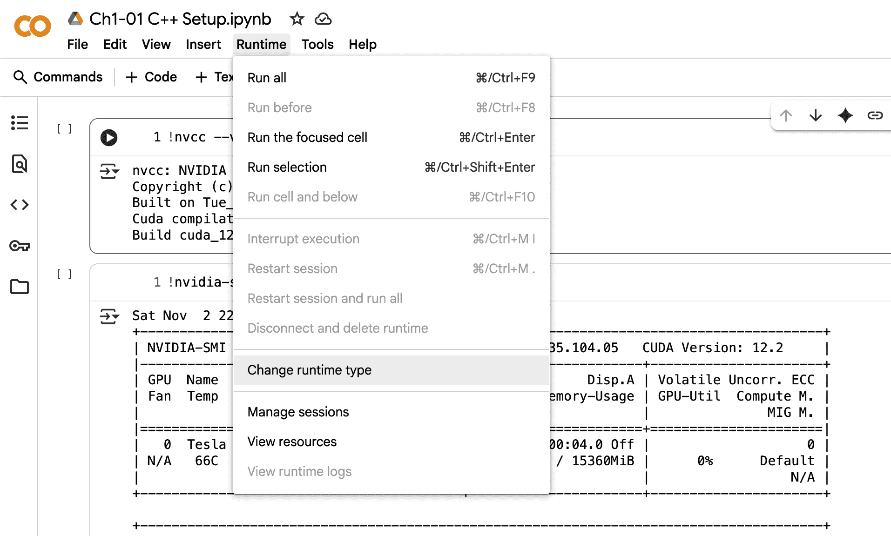

*图 1.6：单击“更改运行时类型”选项*

5. 选择 GPU 选项，即可在 Colab 中使用 GPU。


*图 1.7：在下一页中，选择你可用的 GPU 选项*

6. 在 Colab 中选定 GPU 后，编程环境就可以使用了。为了验证设置是否正确以及 CUDA 是否可用，请在 Colab 笔记本中打开一个新的代码单元格，输入以下命令：

```
!nvcc --version
!nvidia-smi
```

在 Colab 代码单元格中运行这些命令后，你应该会看到类似下面的输出：

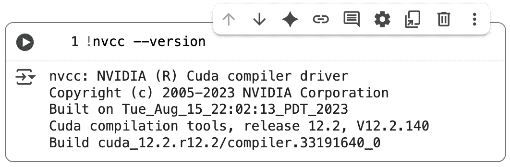

*图 1.8：使用 !nvcc --version 检查 CUDA 编译器版本*

第一个命令（`!nvcc --version`）显示系统中安装的 NVIDIA CUDA 编译器驱动（`nvcc`）的版本。输出显示以下信息：

- 编译器驱动程序来自 NVIDIA，专为 CUDA 构建
- 构建日期为 2023 年 8 月 15 日
- CUDA 编译工具为 12.2 发行版，具体版本为 12.2.140

下面是第二个命令的输出。你可以看到当前 Colab 中 GPU 的规格。

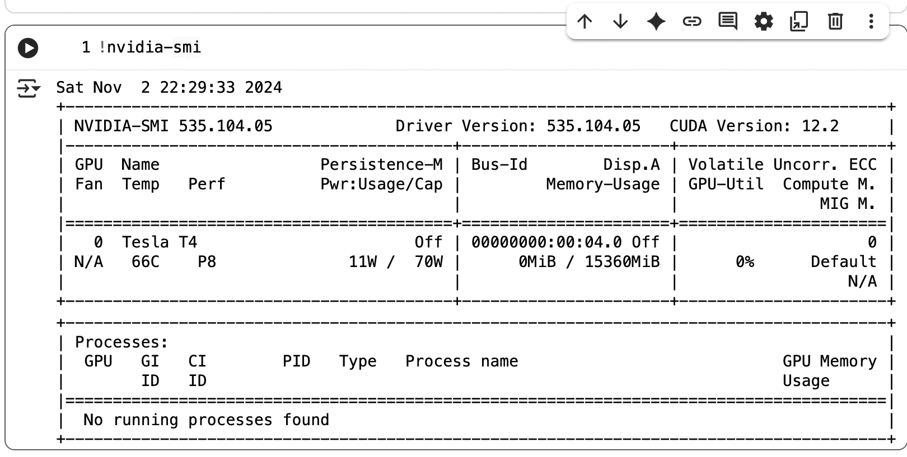

*图 1.9：使用 !nvidia-smi 显示 NVIDIA 系统信息*

第二个命令（`!nvidia-smi`）全称是 NVIDIA 系统管理接口，它提供系统中可用 NVIDIA GPU 的详细信息。输出包括以下内容：

- **驱动版本**：535.104.05
- **CUDA 版本**：12.2
- **GPU 信息**：
  - **型号**：Tesla T4
  - **温度**：66°C
  - **功耗**：11 W，最大为 70 W
  - **显存**：总显存为 15,360 MiB，当前已使用 0 MiB
  - **GPU 利用率**：当前为 0%，表示 GPU 处于空闲状态
  - **进程**：当前没有活动进程正在使用 GPU

现在，你已经准备好通过一个 C++ 程序来了解深度学习的实际示例了。

让我们在 Colab 中编写一些 CUDA 代码并运行它：

```
%%writefile welcome_from_cuda.c
#include <stdio.h>
__global__ void welcome() {
printf("Welcome to DL with C++ — block %d, thread %d\n", blockIdx.x, 
threadIdx.x);
}
int main() {
welcome<<<3,3>>>(); // 3 blocks, 3 threads each
cudaDeviceSynchronize();
return 0;
}
```

在单元格中运行以下命令：

```
%%bash
nvcc -std=c++14 -x cu -arch=sm_75 welcome_from_cuda.c -o welcome
```


## 第1章

让我们看一下代码的输出：

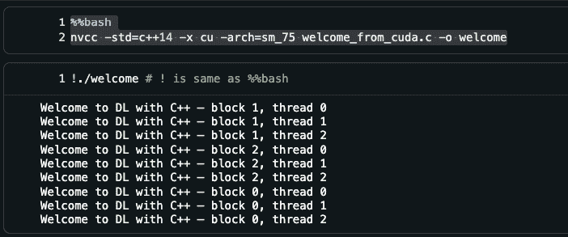

*图 1.10：“welcome from”练习的输出，演示了如何使用 C++ 访问 GPU，并打印消息 “Welcome to DL with C++ from block x, thread y”*

你已经看到，利用免费的在线资源可以轻松地为 C++ 深度学习项目编写代码。现在让我们看看如何在本地搭建环境。

### 本地搭建 C++ 开发环境

要在本地使用 C++ 构建和运行深度学习应用程序，你需要准备一个合适的环境。该设置包括四个主要步骤——安装编译器、选择 IDE、配置构建工具以及添加深度学习库：

1. **安装 C++ 编译器**：选择并安装适合你操作系统的 C++ 编译器：

   - **Windows**：MSVC 或 MinGW
   - **macOS**：Xcode 命令行工具（包含 Clang）
   - **Linux**：**GNU 编译器套件**（**GCC**）

2. **设置 IDE**：虽然并非严格必需，但 IDE 可以极大地提升你的生产力。常见的选择包括：

   - **Visual Studio（Windows）**：微软出品的功能丰富的 IDE，与 MSVC 编译器紧密集成。它提供了优秀的调试工具、GUI 设计能力和项目模板。Visual Studio 还能轻松管理 NuGet 包和外部库。
   - **CLion（跨平台）**：JetBrains 出品的商业 IDE，提供智能代码补全、重构以及与 CMake 的紧密集成。CLion 因其现代 UI 和高生产力特性而在 C++ 社区广受欢迎。
   - **Eclipse CDT（跨平台）**：Eclipse 的 **C++ 开发工具**（**CDT**）是一款免费开源 IDE。虽然不如 CLion 精美，但健壮且高度可定制，非常适合偏好开源工具的用户。
   - **Code::Blocks（跨平台）**：一款轻量级开源 IDE。虽然比 Visual Studio 或 CLion 简单，但设置快速便捷，是初学者的良好起点。

3. **安装构建工具**：除了编译器和 IDE 之外，你还需要 **构建工具** 来管理项目的编译和链接。对于小型 `Hello World` 程序，运行一条 `g++ file.cpp -o output` 命令就足够了。但随着项目规模的增长——尤其是使用依赖多个外部组件的深度学习库时——手动编译变得不切实际。两个最重要的工具如下：

   - **CMake**：
     - 一个广泛使用的跨平台构建系统生成器。
     - 无需编写复杂的编译器命令，你只需在一个简单的文本文件（`CMakeLists.txt`）中描述你的项目。然后 CMake 会生成特定于平台的构建文件（例如，Windows 上的 Visual Studio 项目，Linux 上的 Makefile）。
     - 它是许多深度学习框架（例如 PyTorch、TensorFlow）的标准构建系统。
     - 以下是一个 CMake 文件示例：

       ```cmake
       cmake_minimum_required(VERSION 3.10)
       project(HelloWorld)
       set(CMAKE_CXX_STANDARD 14)
       add_executable(hello main.cpp)
       ```

     - 运行 `cmake . && make` 将把 `main.cpp` 编译成可执行文件。

   - **Make**：
     - 常用于 Linux 和 Unix 系统。
     - 依靠 Makefile 来指定文件应如何编译和链接。
     - 仍然被广泛使用，不过在较大的项目中，通常通过 CMake 来管理。
     - 以下是一个 Makefile 示例：

       ```makefile
       all:
       	g++ main.cpp -o hello
       ```

   构建工具对深度学习项目至关重要，因为它们能自动化依赖管理（例如链接 CUDA、cuDNN、LibTorch 和 TensorFlow）；简化多文件项目的编译；确保跨 Windows、macOS 和 Linux 的跨平台兼容性；并提供一致的配置，使团队协作更加高效。

4. **安装深度学习库**：有多种 C++ 库可用于深度学习。我们将重点关注其中最流行的一些：

   - **PyTorch C++ API（LibTorch）**：PyTorch 的 C++ 前端 LibTorch 为 C++ 深度学习提供了一个强大而灵活的框架。要安装 LibTorch，请执行以下步骤：

     1. 从 PyTorch 网站下载预构建库（`https://pytorch.org/get-started/locally/`）。

        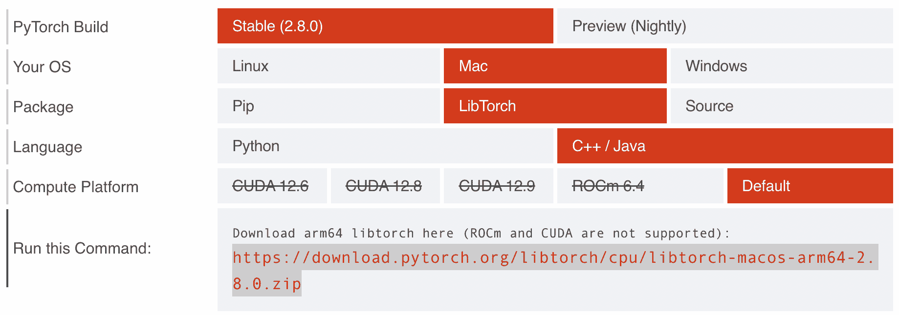

        *图 1.11：来自 pytorch.org 的 PyTorch 设置快速参考*

     2. 在终端中，从 PyTorch 网站复制并运行该命令：

        ```bash
        % wget https://download.pytorch.org/libtorch/cpu/libtorch-macos-arm64-2.8.0.zip
        ```

     3. 使用 `unzip libtorch-macos-arm64-2.8.0.zip` 将下载的压缩包解压到系统上的某个位置。

     4. 使用适当的环境变量配置你的 `compile` 命令，使其指向你的 LibTorch 安装位置（参见下面的 Bash 示例）。

     *在你的 C++ 项目中包含 LibTorch 的示例*：

     ```cpp
     #include <torch/torch.h>
     #include <iostream>

     int main() {
         // Create a 3x3 tensor with random values between 0 and 1
         torch::Tensor X = torch::rand({3, 3});
         // Add a constant value to every element
         torch::Tensor Y = X + 5;
         // Apply ReLU activation
         torch::Tensor Z = torch::relu(Y);
         // Print all results
         std::cout << "Original tensor X:\n" << X << "\n\n";
         std::cout << "After adding 5 (Y):\n" << Y << "\n\n";
         std::cout << "After ReLU activation (Z):\n" << Z << std::endl;
         return 0;
     }
     ```

     *运行以下 bash 命令*：

     ```bash
     % clang++ example.cpp -o example \
       -I ./libtorch/include \
       -I ./libtorch/include/torch/csrc/api/include \
       -L ./libtorch/lib \
       -ltorch -ltorch_cpu -lc10 \
       -Wl,-rpath,./libtorch/lib \
       -std=c++17
     ```

     *输出应为*：

     ```text
     % ./example
     Original tensor X:
      0.4462 0.4752 0.4493
      0.1307 0.3102 0.7832
      0.4145 0.7671 0.9496
     [ CPUFloatType{3,3} ]

     After adding 5 (Y):
      5.4462 5.4752 5.4493
      5.1307 5.3102 5.7832
      5.4145 5.7671 5.9496
     [ CPUFloatType{3,3} ]

     After ReLU activation (Z):
      5.4462 5.4752 5.4493
      5.1307 5.3102 5.7832
      5.4145 5.7671 5.9496
     [ CPUFloatType{3,3} ]
     ```

   - **开放神经网络交换（ONNX）运行时**：ONNX 提供了一种在不同框架之间交换深度学习模型的方法。ONNX Runtime 是一个专注于性能的 ONNX 模型推理引擎。要安装 ONNX Runtime，请执行以下步骤：

     5. 从 ONNX Runtime 的 GitHub 发布页面（`https://github.com/microsoft/onnxruntime/`）下载预构建二进制文件。
     6. 在你的项目中包含必要的头文件并链接该库。

     *在 C++ 中使用 ONNX Runtime 的示例*：

     ```cpp
     #include <onnxruntime_cxx_api.h>

     int main() {
         Ort::Env env(ORT_LOGGING_LEVEL_WARNING, "test");
         Ort::SessionOptions session_options;
         Ort::Session session(env, "path/to/model.onnx", session_options);
         // ... (model inference code)
         return 0;
     }
     ```

   - **TensorFlow C++ API**：虽然 TensorFlow 主要用于 Python，但它也为高性能应用提供了 C++ API。要使用 TensorFlow 的 C++ API，请执行以下步骤：

     7. 从源代码构建 TensorFlow，或使用预构建库。
     8. 将你的项目与 TensorFlow C++ 库链接。

     *在 C++ 中使用 TensorFlow 的示例*：

     ```cpp
     #include "tensorflow/cc/client/client_session.h"
     #include "tensorflow/cc/ops/standard_ops.h"

     int main() {
         tensorflow::Scope root = tensorflow::Scope::NewRootScope();
         auto A = tensorflow::ops::Const(root, {{1, 2}, {3, 4}});
         auto B = tensorflow::ops::Const(root, {{5, 6}, {7, 8}});
         auto C = tensorflow::ops::MatMul(root, A, B);
         tensorflow::ClientSession session(root);
         std::vector<tensorflow::Tensor> outputs;
         TF_CHECK_OK(session.Run({C}, &outputs));
         std::cout << outputs[0].matrix<int>() << std::endl;
         return 0;
     }
     ```

工具链就绪后，让我们开始使用 C++。首先，我们将考察它的关键性能优势——精确的内存控制、CPU 级调优（SIMD、缓存感知布局和自定义分配器），以及基于 CUDA 的 GPU 加速。然后，我们将通过在 LibTorch 中实现一个小型前馈网络来验证这些想法，从而端到端地验证整个环境。

### C++ 在深度学习中的关键性能优势

C++ 提供了一些与深度学习尤为相关的性能优势：

- **内存管理**：C++ 允许精确控制内存的分配和释放，这在使用大型数据集和复杂模型时至关重要。这种控制能力让开发者能够优化内存使用并降低开销。

  *C++ 中自定义内存管理的示例*：

  ```cpp
  class MyTensor {
  private:
      float* data;


## 第1章：使用C++进行深度学习简介与环境搭建

```cpp
size_t size;

public:
    MyTensor(size_t s) : size(s) {
        data = new float[size];
    }

    ~MyTensor() {
        delete[] data;
    }

    // ... (other methods)
};
```

- **CPU优化**：C++允许进行底层优化，可显著提升CPU性能：
  - **SIMD指令**：利用**单指令多数据**（**SIMD**）指令进行并行处理
  - **缓存友好的数据结构**：设计最大化缓存效率的数据结构
  - **自定义内存分配器**：为特定用例实现专用分配器

*使用Intel Intrinsics的SIMD指令示例*：

```cpp
#include <immintrin.h>
#include <cstddef>

// Adds two input arrays and writes the result to the output array.
void addArraysAVX(const float* lhs, const float* rhs, float* out, std::size_t length) {
    std::size_t i = 0;
    const std::size_t step = 8; // AVX processes 8 float values at once
    for (; i + step <= length; i += step) {
        __m256 leftVec = _mm256_loadu_ps(lhs + i);
        __m256 rightVec = _mm256_loadu_ps(rhs + i);
        __m256 sumVec = _mm256_add_ps(leftVec, rightVec);
        _mm256_storeu_ps(out + i, sumVec);
    }
    // Handle any remaining elements that do not fill a full AVX register.
    for (; i < length; ++i) {
        out[i] = lhs[i] + rhs[i];
    }
}
```

- **GPU加速**：C++与GPU计算库（如用于NVIDIA GPU的CUDA）集成良好，可对深度学习计算进行大规模并行化。请在此处阅读示例：`https://www.adaface.com/blog/software-development-interview-questions/`。

### 在C++中实现简单神经网络

为了演示深度学习概念在C++中的实际应用，让我们实现一个基本的前馈神经网络。这个LibTorch示例定义了一个微型的全连接MNIST风格网络，包含两个线性层（784→128→10）和中间的ReLU激活函数，将一批64个虚拟的28×28灰度“图像”展平，执行一次前向传播，应用`log_softmax`生成每类对数概率，并打印输出形状`[64, 10]`。这对于验证你的C++/LibTorch设置和模型连接非常有用（不涉及训练）。

*以下C++代码片段来自mnist_fc.cpp，我们首先定义神经网络结构：*

```cpp
#include <torch/torch.h>
#include <iostream>

// Define the neural network structure
struct Net : torch::nn::Module {
    Net() {
        // Input layer to hidden layer
        fc1 = register_module("fc1", torch::nn::Linear(784, 128));
        // Hidden layer to output layer
        fc2 = register_module("fc2", torch::nn::Linear(128, 10));
    }

    torch::Tensor forward(torch::Tensor x) {
        x = torch::relu(fc1->forward(x.reshape({x.size(0), 784})));
        x = fc2->forward(x);
        return torch::log_softmax(x, /*dim=*/1);
    }

    torch::nn::Linear fc1{nullptr}, fc2{nullptr};
};
```

*然后定义如何使用网络的主函数。*

```cpp
int main() {
    // Create an instance of the network
    auto net = std::make_shared<Net>();

    // Create a dummy input tensor
    auto input = torch::randn({64, 1, 28, 28});

    // Forward pass
    auto output = net->forward(input);

    std::cout << "Output size: " << output.sizes() << std::endl;

    return 0;
}
```

此示例演示了如何定义简单的神经网络结构、创建网络实例，并使用虚拟输入数据执行前向传播。

*在bash中运行以下命令：*

```bash
% clang++ mnist_fc.cpp -std=c++17 -O2 \
    -I ./libtorch/include \
    -I ./libtorch/include/torch/csrc/api/include \
    -L ./libtorch/lib \
    -ltorch -ltorch_cpu -lc10 \
    -Wl,-rpath,$PWD/libtorch/lib \
    -o mnist_fc
```

*输出应为：*

```text
./mnist_fc
Output size: [64, 10]
```

`Output size: [64, 10]`表示网络处理了一批64张图像，并为每张图像生成了10个分类——每个类别（数字0–9）一个。由于模型以`log_softmax`结尾，每行包含对数概率（其指数化后的概率之和为1）。该形状确认了前向传播以及输入/层维度连接正确。

### 小结

本章向你介绍了深度学习的基本概念，并为设置用于深度学习任务的C++环境提供了全面指南。我们探讨了使用C++进行深度学习的优势，包括其性能优势和底层系统资源控制。通过理解这些核心原则并设置开发环境，你现在已准备好开始使用C++探索深度学习世界。随着不断深入，你将能够利用C++的强大功能来构建和优化复杂的深度学习模型，突破人工智能的可能性边界。

### 问题

在继续之前，这里有一些常见问题解答，以澄清示例中你会遇到的常见符号和构建/运行时问题——尤其是涉及LibTorch设置和平台差异的问题：

1. 神经网络中输入层、隐藏层和输出层的作用分别是什么？
2. 为什么ReLU、sigmoid和tanh等激活函数在深度学习中很重要？
3. 监督学习和无监督学习有什么区别？
4. 为什么C++是高性能深度学习应用的强有力选择？
5. 在LibTorch神经网络示例中，输出大小`[64, 10]`表示什么？

### 延伸阅读

如需深入研究和主要参考——尤其是当你需要确切的C++ API或平台细节时——请从以下资源开始：

- PyTorch C++ (LibTorch)教程：*使用PyTorch C++前端* (`https://docs.pytorch.org/tutorials/advanced/cpp_frontend.html`)
- 适用于macOS GPU的PyTorch MPS (Metal)后端说明 (`https://docs.pytorch.org/docs/stable/notes/mps.html`)
- ONNX Runtime C/C++ API文档及C++入门指南 (`https://onnxruntime.ai/docs/api/`)
- TensorFlow C++ API参考和从源码构建指南 (`https://www.tensorflow.org/api_docs/cc`)

### 答案

以下是FAQ的简明答案，包含macOS友好的编译/运行细节以及关于Apple硬件上GPU支持的说明：

1. 输入层接收原始特征并将其传递到网络中。隐藏层通过应用学习到的权重、偏置和激活函数，将这些特征转换为更有用的内部表示。输出层将最终的隐藏表示转换为任务所需的预测，例如类别分数、概率或数值。
2. 激活函数很重要，因为它们为网络引入非线性。如果没有它们，具有多层结构的神经网络将表现得像单一线性变换，这将严重限制网络的学习能力。
3. 因此，关键区别在于：监督学习从有标签数据中学习，而无监督学习处理的是无标签数据。
4. C++为开发者提供了对内存、执行和硬件交互的细粒度控制，这在性能关键型系统中非常重要。它与GPU库和推理运行时集成良好，开销极小，非常适合注重延迟、吞吐量和资源效率的生产环境。
5. 形状`[64, 10]`表示模型为一个包含64个示例的批次产生了输出，每个示例有10个输出值。在分类场景中，这10个值通常代表10个类别的分数或logits。

### 获取本书的PDF版本及更多内容

扫描二维码（或前往`packtpub.com/unlock`）。按名称搜索本书，确认版本，然后按照页面上的步骤操作。


*注意：请准备好你的发票。直接从Packt网站购买则无需发票。*


## 2 C++ 中的数据准备与预处理

数据准备是高效**深度学习**（**DL**）工作流的基石。输入数据的表示、结构和质量直接影响模型的学习效率、性能和泛化能力。现代数据通常是异构的，融合了数值、文本、图像和时间序列元素，因此需要能够处理多模态复杂性的预处理流水线。本章探讨 C++ 中的高级**预处理**技术，重点关注性能和生产级流水线，涵盖**结构化**和**非结构化**数据处理、缺失值填补、特征工程、数据增强以及与 PyTorch 的高效集成。

通过详细的代码示例和理论支撑，本章展示了如何设计可扩展的 C++ 预处理工作流，使其在各种数据集上都能高效运行。讨论还将强调预处理与硬件约束、可扩展性和分布式计算之间的相互作用，为生产环境中的高效数据流水线管理提供见解。此外，将特别强调多模态数据处理和领域特定变换，以最大化模型的鲁棒性和实用性。

本章将涵盖以下主题：

- 理解数据预处理在深度学习中的重要性
- 结构化与非结构化数据——综合技术与示例
- 探索归一化和数据增强技术
- 集成 PyTorch Dataset API 以构建数据流水线
- 管理大规模数据集

学完本章后，你将了解如何构建生产级的 C++ 预处理流程：类型安全的加载器（表格/文本/图像/时间序列）；缺失值填补、缩放、分词和特征工程；确定性/即时数据增强；与 PyTorch 的紧密集成；基于 mmap/**单指令多数据**（**SIMD**）的高吞吐并行 I/O；面向分布式训练的分片、缓存和流式处理；以及用于可重现、健壮流水线的模式检查、测试、性能分析和版本控制。

### 技术要求

本节详细说明遵循本章内容所需的先决条件。由于重点在于 C++ 中的数据准备与预处理，你应该有一个可用的 C++ 开发环境，并且能够访问示例中使用的库。

建议使用**兼容 C++17 或更高版本的编译器**。在 Linux 上，这意味着 **GCC 11+** 或 **Clang 14+**。在 Windows 上，建议使用**搭配 Visual Studio 2022 的 MSVC**。在 macOS 上，**Apple Clang 14+** 或更高版本应该可以正常工作。由于许多示例涉及多文件程序和外部依赖，还建议使用 **CMake 3.22 或更高版本**作为主要构建系统。

本章设计为可在 **Linux、Windows 和 macOS** 上运行。大多数示例都是**基于 CPU 的**，因此不需要 GPU。至少 **8 GB 内存**的机器足以进行较小的实验，而建议使用 **16 GB 或更高**内存，以便更顺畅地处理更大的数据集、图像流水线和外部库。

本章使用了多个库。**LibTorch** 用于基于张量的预处理、Dataset API 示例和基于自编码器的降维。**Eigen 3.4+** 和 **Armadillo** 用于矩阵运算、缩放、嵌入和特征变换。**mlpack** 用于缺失值填补、PCA 和 t-SNE 等任务。**OpenCV 4.x** 用于图像预处理示例，包括调整大小、裁剪、直方图均衡化和边缘检测。

某些部分还依赖可选库。**ONNX Runtime** 可用于运行预训练的自然语言处理（NLP）模型，例如用于嵌入、命名实体识别和情感分析的 BERT。**SentencePiece** 可用于子词分词，而 **libstemmer** 支持词干提取示例。对于音频预处理和语谱图生成，建议使用 **FFTW**。

本章的实用最小环境配置包括 **C++17 编译器**、**CMake**、**LibTorch**、**Eigen**、**Armadillo**、**mlpack** 和 **OpenCV**。如果你想同时运行 NLP 和音频示例，还应额外安装 **ONNX Runtime**、**SentencePiece**、**libstemmer** 和 **FFTW**。

在整个章节中，我们会指出某个库何时是可选的，以及何时可以使用更简单的仅 CPU 路径。

### 理解数据预处理在深度学习中的重要性

数据预处理在深度学习中的重要性如下图所示：假设我们想根据两个特征预测房价；即使不考虑缺失值和噪声问题——也就是说，即使数据集完全“干净”——我们仍然必须进行预处理。因为面积特征的取值范围很大，从 `0` 到 `3500`，而卧室特征的范围仅在 0 到 5 之间，这导致模型的代价/损失曲面呈现病态，梯度下降呈之字形震荡，模型难以收敛。对每个特征进行归一化（例如，将 `min-max` 归一化到 `[0,1]`）的预处理可以重塑这些等高线，使其接近圆形，从而实现更大、更稳定的步长，带来更快、更可靠的收敛。

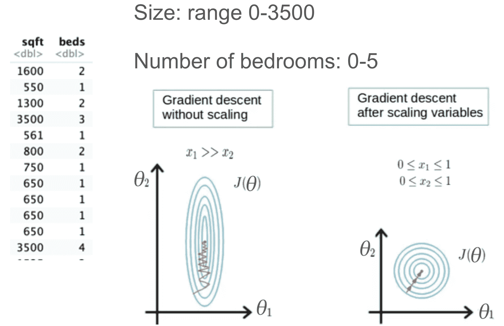

*图 2.1：说明数据预处理重要性的示意图*

在设计模型之前，我们需要驯服数据——从 *图 2.1* 中强调的尺度不匹配开始，再到通常需要排查的问题：缺失值、异常值、不一致的编码、偏斜分布和潜在的数据泄漏。弥合这一差距正是预处理的工作：通过有条理的步骤，将杂乱无章的原始输入转换成尺度可比、表现良好的张量。带着这个目标，让我们看看预处理的作用以及它如何为深度学习准备数据。

#### 预处理的作用

如前所述，原始数据很少能直接用于模型——通常是不完整、有噪声且不一致的。预处理将其转换为结构化、归一化、有意义的表示，以针对深度学习进行优化。

预处理的好处包括以下几点：

- **更快的收敛**，因为归一化输入减少了训练早期的梯度不稳定性
- **降噪**，通过去除无关信息和有影响力的异常值
- **更高的效率**，通过紧凑的表示减少内存占用和计算成本
- **更强的泛化能力**，当数据增强被保守地应用以保持标签语义时
- **多模态支持**，能够在文本、表格、图像和信号数据之间实现共享变换
- **领域特定适配**，流水线针对医疗保健、金融和**计算机视觉**（**CV**）工作负载进行调优

然而，预处理并非没有挑战，包括以下内容：

- 类别不平衡
- 异构数据的跨特征归一化
- 大数据集上的内存/计算限制
- 跨分布式系统的扩展
- 满足实时/近实时要求

让我们首先看看数据的两大类：结构化数据和非结构化数据。

### 结构化与非结构化数据——综合技术与示例

真实世界的数据集分为两大类：结构化数据（具有显式模式的表格/时间序列）和非结构化数据（图像、文本、音频、视频）。虽然两者都需要清洗和归一化，但目标不同——结构化数据强调模式验证、缺失值填补、编码和缩放；非结构化数据则侧重于解码、分词、调整大小/裁剪和数据增强。本节对比这些工作流，并提供简洁、地道的 C++ 模式（LibTorch、Dataset/DataLoader、OpenCV、SentencePiece），可直接用于生产环境。


## 第 2 章

### 结构化数据

结构化数据遵循固定的模式，例如关系数据库或 CSV 文件。示例包括数值测量、类别标签和时间序列。结构化数据通常需要理解其统计属性和领域特定的细微之处，才能实现最优预处理。

结构化数据的一些全面预处理技术如下：

- **处理缺失值**：均值替换、前向填充、后向填充、*k* 近邻（**k-NN**）插补以及基于回归的插补等技术
- **编码类别特征**：独热编码、频率编码、序数编码、二进制编码，以及为**神经网络**（**NN**）输入层定制的嵌入
- **特征缩放与标准化**：方法包括最小-最大缩放、Z-score 标准化、鲁棒缩放、对数变换和幂变换
- **降维**：**主成分分析**（**PCA**）、**t-分布随机邻域嵌入**（**t-SNE**）和**自编码器**（**AEs**），用于减少冗余或噪声特征
- **时间序列工程**：滚动窗口聚合、指数平滑、差分、傅里叶变换和基于时间的特征提取等技术
- **特征交互工程**：多项式特征生成和交互项计算，以增强模型表达能力

### 详细示例

下面来看上一节中提到的预处理技术的详细示例。

#### 处理缺失值

处理缺失值有多种方法：

- **均值替换**：用特征的列均值替换每个缺失值。实现简单、速度快（单次遍历），并能保持特征的尺度不变——适合用作快速基线或在缺失较少时使用。然而，它会扭曲分布、缩小方差并减弱相关性，这可能会使模型产生偏差——尤其是当数据并非完全随机缺失时。

`mean_substitution_example.cpp`:

```cpp
#include <vector>
#include <numeric>

// Replace missing values (NaN) with the mean of the column
std::vector<double> meanSubstitution(const std::vector<double>& data) {
    double sum = 0;
    int count = 0;
    for (const auto& val : data) {
        if (!std::isnan(val)) {
            sum += val;
            count++;
        }
    }
    double mean = sum / count;
    std::vector<double> filledData = data;
    for (auto& val : filledData) {
        if (std::isnan(val)) {
            val = mean;
        }
    }
    return filledData;
}
```

- **前向填充**：将最后一个观测值向前传递，以填充时间序列中后续的缺口。它速度快，能保持短期水平的连续性，并且对有状态信号（例如设备模式）效果良好，但它可能会在较长缺口上传播过时或异常值，并抹平真实的动态变化。

`forward_fill_example.cpp`:

以下代码实现了**前向填充插补**，将每个 NaN 替换为其左侧最近的非缺失值（注意：开头的 NaN 保持不变）：

```cpp
#include <vector>
#include <cmath>

// Replace missing values with the last non-missing value
std::vector<double> forwardFill(const std::vector<double>& data) {
    std::vector<double> filledData = data;
    for (size_t i = 1; i < filledData.size(); ++i) {
        if (std::isnan(filledData[i])) {
            filledData[i] = filledData[i - 1];
        }
    }
    return filledData;
}
```

- **后向填充**：用下一个观测值填充每个缺失点，实质上是沿时间向后传播信息。与前向填充插补一样，它简单高效，但如果用在训练流程中，可能会泄漏未来信息，并且可能过度平滑长缺口。

`backward_fill_example.cpp`:

```cpp
#include <vector>
#include <cmath>

// Replace missing values with the next non-missing value
std::vector<double> backwardFill(const std::vector<double>& data) {
    std::vector<double> filledData = data;
    for (size_t i = filledData.size() - 1; i > 0; --i) {
        if (std::isnan(filledData[i - 1])) {
            filledData[i - 1] = filledData[i];
        }
    }
    return filledData;
}
```

- **k-NN 插补**：通过在两行均观测到的特征子集上计算距离，找到 *k* 个最相似的行来填充缺失值，然后聚合这些邻居（数值型用均值/中位数，类别型用众数；通常按距离加权）。它要求进行特征缩放并仔细选择距离度量（例如欧氏距离或马氏距离）；性能取决于 *k*，并且在高维空间中可能会下降。

`knn_imputation_example.cpp`:

```cpp
int main() {
    using std::numeric_limits; using std::cout; using std::endl;
    double NaN = numeric_limits<double>::quiet_NaN();
    std::vector<std::vector<double>> data = {
        {1.00, 2.00, 3.00},
        {1.10, NaN, 3.20}, // <- target row to impute
        {0.90, 2.10, 2.90},
        {1.20, 1.90, 3.10}
    };
    int targetIndex = 1;
    int k = 2;
    auto print_row = [&](const char* label, const std::vector<double>& r){
        cout << label << " [";
        for (size_t j = 0; j < r.size(); ++j) {
            if (std::isnan(r[j])) cout << "NaN";
            else cout << r[j];
            if (j + 1 < r.size()) cout << ", ";
        }
        cout << "]" << endl;
    };
    print_row("Before:", data[targetIndex]);
    auto imputed = knnImputation(data, k, targetIndex);
    print_row("After: ", imputed);
    return 0;
}
```

- **基于回归的插补**：通过在该特征存在的行上训练模型，然后将其应用于缺口，从而从其他观测特征预测该特征的缺失值。模型可以是线性的（岭回归/Lasso）或非线性的（随机森林/**梯度提升机**（**GBMs**）），并且应在每个训练折*内部*（或通过交叉拟合）进行拟合，以避免数据泄漏。

`regression_imputation_example.cpp`:

```cpp
#include <vector>
#include <cmath>

// Replace missing values using linear regression coefficients
std::vector<double> regressionImputation(const std::vector<double>& target, const std::vector<double>& predictor, double slope, double intercept) {
    std::vector<double> filledData = target;
    for (size_t i = 0; i < filledData.size(); ++i) {
        if (std::isnan(filledData[i])) {
            filledData[i] = slope * predictor[i] + intercept;
        }
    }
    return filledData;
}
```

#### 编码类别特征

下面来看编码类别特征的技术：

- **独热编码**：将具有 *N* 个类别的类别特征转换为 *N* 个二进制列（当前类别为 1，否则为 0），避免虚假的序数关系，并在线性/NN 模型中表现良好。注意高基数特征可能导致维度爆炸——可以使用 `<UNK>` 桶、哈希或正则化来缓解。
- 当类别特征的所有独热指示变量都被保留时，它们按构造必然是线性相关的，因为每个样本恰好只有一个指示变量为激活状态。对于线性模型，可以通过省略一个类别作为参考水平，或对系数施加显式约束（例如零和约束）来消除这种共线性。这些调整恢复了可辨识性，主要影响系数的解释而非预测性能，并且对于正则化模型或基于树的模型通常不是必需的。

`one_hot_example.cpp`:

```cpp
#include <vector>
#include <map>
#include <string>
```


## 第二章：C++ 中的数据准备与预处理

```cpp
// Convert categorical variables into binary vectors
std::vector<std::vector<int>> oneHotEncode(const std::vector<std::string>& categories) {
    std::map<std::string, int> categoryMap;
    int index = 0;
    for (const auto& cat : categories) {
        if (categoryMap.find(cat) == categoryMap.end()) {
            categoryMap[cat] = index++;
        }
    }
    std::vector<std::vector<int>> encoded(categories.size(), std::vector<int>(categoryMap.size(), 0));
    for (size_t i = 0; i < categories.size(); ++i) {
        encoded[i][categoryMap[categories[i]]] = 1;
    }
    return encoded;
}
```

- **频数编码**：将每个类别映射为它在训练数据中出现的次数或相对频率，生成一个单一的数值特征，既保留了类别流行度，又不会导致维度爆炸。在每个训练折内分别计算频数以避免数据泄漏，并可考虑使用对数频数或截断来处理长尾类别。

代码示例 `frequency_encode_example.cpp`：

```cpp
#include <vector>
#include <map>
#include <string>

// Encode categories based on their frequency
std::vector<int> frequencyEncode(const std::vector<std::string>& categories) {
    std::map<std::string, int> freqMap;
    for (const auto& cat : categories) {
        freqMap[cat]++;
    }
    std::vector<int> encoded;
    for (const auto& cat : categories) {
        encoded.push_back(freqMap[cat]);
    }
    return encoded;
}
```

- **序数编码**：将类别映射为体现有意义顺序的整数（例如 XS < S < M < L < XL），生成一个保留排序关系的单一数值特征。仅当顺序确实存在时才可使用，否则会引入虚假的序数关系；在训练集上拟合映射，并将未见过的类别路由到 `<UNK>` 编码。

代码示例：`ordinal_encode_example.cpp`

```cpp
#include <vector>
#include <map>
#include <string>

// Assign an ordinal value to each category
std::vector<int> ordinalEncode(const std::vector<std::string>& categories) {
    std::map<std::string, int> categoryMap;
    int index = 0;
    for (const auto& cat : categories) {
        if (categoryMap.find(cat) == categoryMap.end()) {
            categoryMap[cat] = index++;
        }
    }
    std::vector<int> encoded;
    for (const auto& cat : categories) {
        encoded.push_back(categoryMap[cat]);
    }
    return encoded;
}
```

- **二进制编码**：先将每个类别映射为一个整数 ID，再将该 ID 表示为二进制的 ⌈log₂N⌉ 位，从而大幅降低维度。注意事项：它会引入伪序数结构和虚假的邻近性；应在训练集上拟合 ID，并为未见过的类别保留一个 `<UNK>` 标记。

代码示例：`binary_encoding_demo.cpp`

```cpp
#include <vector>
#include <string>
#include <bitset>

// Convert categories to binary-encoded values
std::vector<std::string> binaryEncode(const std::vector<int>& categories) {
    std::vector<std::string> encoded;
    for (const auto& cat : categories) {
        encoded.push_back(std::bitset<8>(cat).to_string());
    }
    return encoded;
}
```

- **嵌入编码**：将每个类别表示为一个与模型联合训练得到的稠密向量，既能捕捉类别之间的相似性，又避免了独热编码的维度爆炸。请为未见过的类别使用 `<UNK>/OOV` 标记，并保持适当的嵌入维度，配合正则化以避免过拟合。

下面的代码实现了一个简易的类别嵌入编码器：它将每个唯一的字符串类别映射为索引，构建一个（`num_categories` × `embeddingSize`）的嵌入表，表中填充确定性的正弦值（sin(i + j)），并为每个输入类别返回对应的嵌入向量：

```cpp
#include <vector>
#include <map>
#include <string>
#include <cmath>

// Dummy embedding logic
std::vector<std::vector<double>> embeddingEncode(const std::vector<std::string>& categories, int embeddingSize) {
    std::map<std::string, int> categoryMap;
    int index = 0;
    for (const auto& cat : categories) {
        if (categoryMap.find(cat) == categoryMap.end()) {
            categoryMap[cat] = index++;
        }
    }
    std::vector<std::vector<double>> embeddings(categoryMap.size(), std::vector<double>(embeddingSize, 0));
    for (size_t i = 0; i < embeddings.size(); ++i) {
        for (size_t j = 0; j < embeddingSize; ++j) {
            embeddings[i][j] = std::sin(i + j); // Example: sinusoidal encoding
        }
    }
    std::vector<std::vector<double>> encoded;
    for (const auto& cat : categories) {
        encoded.push_back(embeddings[categoryMap[cat]]);
    }
    return encoded;
}
```

### 特征缩放与标准化

特征缩放与标准化的常用技术如下：

- **最小-最大缩放**：通过 (x-最小值)/(最大值-最小值) 将特征线性映射到固定区间（通常是 `[0,1]`），保留相对距离。它简单快速，但对异常值敏感——应在训练集上估计取值范围，并考虑使用截断或稳健变体。

代码示例：`minmax_scale_demo.cpp`

```cpp
#include <vector>
#include <algorithm>

// Scale features to a specific range [minRange, maxRange]
std::vector<double> minMaxScale(const std::vector<double>& data, double minRange, double maxRange) {
    double minVal = *std::min_element(data.begin(), data.end());
    double maxVal = *std::max_element(data.begin(), data.end());
    std::vector<double> scaledData;
    for (const auto& val : data) {
        double scaled = minRange + ((val - minVal) / (maxVal - minVal)) * (maxRange - minRange);
        scaledData.push_back(scaled);
    }
    return scaledData;
}
```

- **Z-score 标准化**：使用 (x-均值)/标准差 将特征标准化为零均值和单位方差（其中均值和标准差在训练集上计算），使特征具有可比性并稳定优化过程。它适用于近似高斯分布的数据，但对异常值敏感；若存在重尾分布，可考虑稳健缩放。

代码示例：`zscore_normalize_demo.cpp`

```cpp
#include <vector>
#include <cmath>
#include <numeric>

// Standardize features to have a mean of 0 and standard deviation of 1
std::vector<double> zScoreNormalize(const std::vector<double>& data) {
    double mean = std::accumulate(data.begin(), data.end(), 0.0) / data.size();
    double variance = 0.0;
    for (const auto& val : data) {
        variance += std::pow(val - mean, 2);
    }
    variance /= data.size();
    double stddev = std::sqrt(variance);
    std::vector<double> normalizedData;
    for (const auto& val : data) {
        normalizedData.push_back((val - mean) / stddev);
    }
    return normalizedData;
}
```

- **稳健缩放**：以中位数为中心，并按**四分位距**（IQR = Q3-Q1）进行缩放：即 (x-中位数)/IQR，使其对异常值和重尾分布具有鲁棒性。应在训练集上计算统计量；当 IQR 接近零时，使用截断或回退策略加以防范。

代码示例：`scaling.robust_scale_demo.cpp`

```cpp
#include <vector>
#include <algorithm>

// Scale features using the median and interquartile range (IQR)
std::vector<double> robustScale(const std::vector<double>& data) {
    std::vector<double> sortedData = data;
    std::sort(sortedData.begin(), sortedData.end());
    double median = sortedData[sortedData.size() / 2];
    double q1 = sortedData[sortedData.size() / 4];
    double q3 = sortedData[3 * sortedData.size() / 4];
    double iqr = q3 - q1;
    std::vector<double> scaledData;
    for (const auto& val : data) {
        scaledData.push_back((val - median) / iqr);
    }
    return scaledData;
}
```

- **对数变换**：压缩较大数值并降低右偏，通常能稳定方差并改善线性模型的拟合效果。使用 `log1p(x)` 来处理零值；对于负数或混合符号数据，可考虑使用 Yeo-Johnson 变换；同时务必在训练集上计算参数，以避免数据泄漏。

代码示例：`log_transform_demo.cpp`

```cpp
#include <vector>
#include <cmath>

// Apply a log transformation to reduce skewness in data
std::vector<double> logTransform(const std::vector<double>& data) {
    std::vector<double> transformedData;
    for (const auto& val : data) {
        transformedData.push_back(std::log(val));
    }
    return transformedData;
}
```


```cpp
transformedData.push_back(std::log1p(val)); // log(1 + x) to handle zero values
}
return transformedData;
}
```

- **幂变换**：应用单调幂函数（例如，Box-Cox 用于 x>0，Yeo-Johnson 用于 x∈R）来稳定方差并使特征更接近高斯分布，从而改善线性模型的假设和优化。通过训练集上的**最大似然估计**（**MLE**）/交叉验证选择 λ；当存在零或负值时使用 Yeo-Johnson。

- `power_transform_demo.cpp`:

```cpp
#include <vector>
#include <cmath>

// Apply a power transformation to stabilize variance
std::vector<double> powerTransform(const std::vector<double>& data, double power) {
    std::vector<double> transformedData;
    for (const auto& val : data) {
        transformedData.push_back(std::pow(val, power));
    }
    return transformedData;
}
```

### 降维

降维技术包括以下内容：

- **PCA**：将数据投影到最大方差的正交方向上，压缩特征、减少噪声并使输入去相关。仅拟合训练集；先标准化，然后根据解释方差（例如95%）或交叉验证选择分量。（请先用Eigen安装。）

- `pca_demo.cpp`:

```cpp
#include <vector>
#include <Eigen/Dense>

// Perform PCA to reduce data dimensions
Eigen::MatrixXd performPCA(const Eigen::MatrixXd& data, int numComponents) {
    Eigen::MatrixXd mean = data.colwise().mean();
    Eigen::MatrixXd centered = data.rowwise() - mean;
    Eigen::MatrixXd cov = (centered.adjoint() * centered) / double(data.rows() - 1);
    Eigen::SelfAdjointEigenSolver<Eigen::MatrixXd> solver(cov);
    Eigen::MatrixXd eigenvectors = solver.eigenvectors().rightCols(numComponents);
    return centered * eigenvectors;
}
```

- **t-SNE**：一种非线性技术，将高维数据映射到2D/3D以进行可视化，保留局部邻域但不保留全局距离（簇间间隙没有意义）。它对困惑度/学习率/种子敏感，并且不是自然的归纳式方法——如果需要嵌入新点，请使用参数化t-SNE或**均匀流形近似与投影**（**UMAP**）。

- `tsne_demo.cpp`:

```cpp
#include <vector>
#include "TSNE.h" // External library required

// Use t-SNE for visualizing high-dimensional data
std::vector<std::vector<double>> performTSNE(const std::vector<std::vector<double>>& data, int dimensions = 2) {
    TSNE tsne;
    std::vector<std::vector<double>> reducedData;
    tsne.run(data, reducedData, dimensions);
    return reducedData;
}
```

- **AEs**：通过低维瓶颈重构输入来学习非线性降维，产生紧凑、任务有用的嵌入。诸如**去噪**和**变分自编码器**（**VAE**）等变体可提高鲁棒性或施加概率结构；标准化输入并仅在训练集上拟合以避免泄漏。

- `autoencoder_demo.cpp`:

```cpp
struct AE : torch::nn::Module {
    torch::nn::Linear enc{nullptr}, dec{nullptr};
    AE(int d, int h){ enc=register_module("enc", torch::nn::Linear(d,h));
        dec=register_module("dec", torch::nn::Linear(h,d)); }
    torch::Tensor forward(torch::Tensor x){ return dec(torch::relu(enc(x))); }
};
```

### 时间序列工程

现在，让我们继续介绍时间序列工程技术：

- **滚动窗口聚合**：在滑动时间窗口上计算特征（例如，均值、总和、标准差、最小/最大值、**指数移动平均**（**EMA**））以捕获局部水平和波动性。仔细选择滞后窗口与居中窗口，处理边缘效应/缺失数据，并避免训练中的前视泄漏。

- `rolling_mean_demo.cpp`:

```cpp
#include <vector>

// Compute rolling averages over a fixed window size
std::vector<double> rollingMean(const std::vector<double>& data, int windowSize) {
    std::vector<double> result(data.size(), 0.0);
    for (size_t i = 0; i <= data.size() - windowSize; ++i) {
        double sum = 0;
        for (int j = 0; j < windowSize; ++j) {
            sum += data[i + j];
        }
        result[i + windowSize - 1] = sum / windowSize;
    }
    return result;
}
```

- **指数平滑**：通过对过去观测值应用几何衰减权重来生成平滑水平（以及短期预测）：，0<α<1。诸如Holt（趋势）和Holt-Winters（趋势+季节性）等扩展可处理更丰富的时间序列动态；在训练集上调整参数以避免泄漏。

- `exponential_smoothing_demo.cpp`:

```cpp
#include <vector>

// Apply exponential smoothing
std::vector<double> exponentialSmoothing(const std::vector<double>& data, double alpha) {
    std::vector<double> smoothed(data.size(), 0.0);
    smoothed[0] = data[0];
    for (size_t i = 1; i < data.size(); ++i) {
        smoothed[i] = alpha * data[i] + (1 - alpha) * smoothed[i - 1];
    }
    return smoothed;
}
```

- **差分**：将序列转换为变化而非水平——例如，一阶差分（或季节性差分）——以去除趋势/季节性并促进平稳性。使用所需的最小阶数（过度差分会放大噪声），因果计算以避免泄漏，并记得通过累积求和进行反转以用于预测。

- `differencing_demo.cpp`:

```cpp
#include <vector>

// Perform first-order differencing to remove trends
std::vector<double> differencing(const std::vector<double>& data) {
    std::vector<double> differencedData;
    for (size_t i = 1; i < data.size(); ++i) {
        differencedData.push_back(data[i] - data[i - 1]);
    }
    return differencedData;
}
```

- **傅里叶变换**：将信号分解为正弦分量，暴露主频率/周期和频谱功率，用于特征或季节性建模（通过**快速傅里叶变换**（**FFT**））。在训练窗口上应用，并进行去趋势/加窗以减少频谱泄漏，同时因果计算以避免前视。

- `fft_demo.cpp`:

```cpp
#include <vector>
#include <complex>

// Apply Fourier Transformation
std::vector<std::complex<double>> performFFT(const std::vector<double>& data) {
    size_t n = data.size();
    std::vector<std::complex<double>> transformed(n);
    for (size_t k = 0; k < n; ++k) {
        std::complex<double> sum(0.0, 0.0);
        for (size_t t = 0; t < n; ++t) {
            double angle = 2 * M_PI * t * k / n;
            sum += std::polar(data[t], -angle);
        }
        transformed[k] = sum;
    }
    return transformed;
}
```

- **基于时间的特征提取**：直接从时间戳中提取基于日历和时钟的预测因子，例如一天中的小时、一周中的星期几、月份、季度、周末标志和节假日指示器。当季节性、商业周期或人类行为影响目标变量时，这些特征尤其有用。诸如一天中的小时或一年中的月份等周期性变量通常使用正弦和余弦变换进行编码，以保留其周期性。与其他时间序列预处理步骤一样，特征应以因果方式生成，以避免来自未来时间戳的泄漏。


- `time_feature_demo.cpp`:

  ```cpp
  #include <cmath>

  struct TimeFeatures {
      int hour;
      int dayOfWeek;
      int month;
      double hourSin;
      double hourCos;
  };

  TimeFeatures extractTimeFeatures(int hour, int dayOfWeek, int month)
  {
      TimeFeatures f;
      f.hour = hour;
      f.dayOfWeek = dayOfWeek;
      f.month = month;
      f.hourSin = std::sin(2.0 * M_PI * hour / 24.0);
      f.hourCos = std::cos(2.0 * M_PI * hour / 24.0);
      return f;
  }
  ```

因此，序列变为：

- 滚动窗口聚合
- 指数平滑
- 差分
- 傅里叶变换
- 基于时间的特征提取

### 特征交互工程

以下是特征交互工程技术：

- **多项式特征生成**：通过幂次和交互项扩展输入（例如，），使线性模型能够捕捉曲线和交叉效应。使用适度的阶数，先进行标准化，并应用正则化（岭回归/Lasso）来抑制多重共线性和特征爆炸。

- `polynomial_features_demo.cpp`:

  ```cpp
  #include <vector>

  // Generate polynomial features of degree 2
  std::vector<std::vector<double>> generatePolynomialFeatures(const std::vector<double>& data) {
      std::vector<std::vector<double>> polynomialFeatures;
      for (const auto& val : data) {
          polynomialFeatures.push_back({val, val * val});
      }
      return polynomialFeatures;
  }
  ```

- **交互项**：将特征相乘或组合（例如，或），以捕捉纯线性项遗漏的非加法效应。结合领域知识谨慎添加，先进行标准化/中心化以限制多重共线性，并使用正则化或特征选择来防止过拟合。

- `interaction_terms_demo.cpp`:

  ```cpp
  #include <vector>

  // Compute interaction terms between features
  std::vector<std::vector<double>> computeInteractionTerms(const std::vector<std::vector<double>>& features) {
      std::vector<std::vector<double>> interactionTerms(features.size());
      for (size_t i = 0; i < features.size(); ++i) {
          for (size_t j = 0; j < features[i].size(); ++j) {
              for (size_t k = j + 1; k < features[i].size(); ++k) {
                  interactionTerms[i].push_back(features[i][j] * features[i][k]);
              }
          }
      }
      return interactionTerms;
  }
  ```

本节阐述了*是什么*——缺失值填充、编码、缩放、降维、时间序列特征和交互——以便你理解目标和陷阱（数据泄漏、稳定性、队列效应）。接下来，让我们用 C++ 库来解决*怎么做*：同样的技术通过 Eigen/Armadillo、mlpack/oneDAL 和 FFT 后端（可选 GPU 上的 cuBLAS/cuFFT/cuML）实现，以获得简洁的代码、更好的数值稳定性和生产级速度。

### 库驱动的预处理（相同技术，更少的代码）

本节重新审视了你之前看到的相同预处理技术（缺失值填充、编码、缩放、降维、时间序列操作），但使用成熟支持的 C++ 库来实现。数学原理和意图没有改变；库主要为你提供简洁的代码、速度（SIMD/GPU）和经过实战检验的数值算法。在相关之处，我们会指出库特有的变体（例如，基于奇异值分解（SVD）与基于特征值分解（EVD）的 PCA、FFT 后端）以及任何 API 细节，但从概念上讲，这些仍然是相同的预处理。

我们还可以使用现有的库以少得多的代码完成相同的预处理：

- **dlib**：机器学习和数据处理工具
- **Eigen**：用于变换和嵌入的线性代数库
- **mlpack**：可扩展的机器学习与预处理
- **Armadillo**：用于数据处理的线性代数库
- **开放神经网络交换（ONNX）运行时**：用于降维和嵌入的预训练模型
- **OpenCV**：图像和数据操作（例如，用于傅里叶变换）。
- **libtorch**：面向 C++ 的 PyTorch 绑定

### 使用 mlpack 处理缺失值

让我们看看如何使用 mlpack 处理缺失值（为此，你需要安装 mlpack 和 Armadillo）。这里，我们通过 mlpack 加载一个 Armadillo 矩阵，然后填充列均值并进行前向填充——这与之前的技术相同，但使用 Armadillo 操作完成。这种方法可靠、简洁且快速。

- `mlpack_impute_demo.cpp`:

  ```cpp
  #include <mlpack/core.hpp>
  #include <mlpack/methods/imputation/map.hpp>

  arma::mat data;
  mlpack::data::Load("data.csv", data); // Load data into Armadillo matrix

  // Mean Substitution
  mlpack::data::MeanImputation<double> meanImputer;
  meanImputer.Impute(data, 0, arma::datum::nan, 0);

  // Forward Fill
  mlpack::data::MapImputation<double> forwardImputer(
      [](double prev, double curr) { return std::isnan(curr) ? prev : curr; });
  forwardImputer.Impute(data, 0, arma::datum::nan, 0);

  // Save processed data
  mlpack::data::Save("processed_data.csv", data);
  ```

### 使用 mlpack 和标准模板库（STL）编码分类特征

你可以使用 mlpack 和 STL 执行分类特征编码，如下所示：

- `mlpack_encoding_demo_min.cpp`:

  ```cpp
  #include <mlpack/core.hpp>
  #include <unordered_map>
  #include <string>
  #include <vector>

  // One-Hot Encoding
  std::unordered_map<std::string, int> categoryToIndex;
  int index = 0;
  for (const auto& category : categories) {
      if (categoryToIndex.find(category) == categoryToIndex.end()) {
          categoryToIndex[category] = index++;
      }
  }

  arma::mat oneHotMatrix(categories.size(), categoryToIndex.size(), arma::fill::zeros);
  for (size_t i = 0; i < categories.size(); ++i) {
      oneHotMatrix(i, categoryToIndex[categories[i]]) = 1;
  }

  // Frequency Encoding
  std::unordered_map<std::string, int> frequency;
  for (const auto& category : categories) {
      frequency[category]++;
  }

  arma::vec frequencyEncoded(categories.size());
  for (size_t i = 0; i < categories.size(); ++i) {
      frequencyEncoded(i) = frequency[categories[i]];
  }
  ```

### 使用 Armadillo 进行特征缩放与标准化

使用 Armadillo，我们可以执行特征缩放和标准化，如下所示：

- `armadillo_scaling_demo.cpp`:

  ```cpp
  #include <armadillo>

  // Min-Max Scaling
  arma::mat minMaxScaled = (data - arma::min(data)) / (arma::max(data) - arma::min(data));

  // Z-Score Normalization
  arma::mat zScoreNormalized = (data - arma::mean(data)) / arma::stddev(data);

  // Robust Scaling
  arma::mat q1 = arma::quantile(data, 0.25);
  arma::mat q3 = arma::quantile(data, 0.75);
  arma::mat robustScaled = (data - arma::median(data)) / (q3 - q1);

  // Log Transformation
  arma::mat logTransformed = arma::log(1 + data);

  // Power Transformation
  arma::mat powerTransformed = arma::pow(data, 0.5);
  ```

### 降维

降维可以按如下方式进行：

- **使用 mlpack**：

  - `pca_mlpack4_demo.cpp`:

    ```cpp
    #include <mlpack/methods/pca/pca.hpp>
    #include <mlpack/methods/tsne/tsne.hpp>

    // PCA
    mlpack::pca::PCA<> pca;
    arma::mat reducedData;
    pca.Apply(data, reducedData, 2); // Reduce to 2 components

    // t-SNE
    mlpack::tsne::TSNE<> tsne;
    arma::mat tsneResult;
    tsne.Apply(data, tsneResult, 2); // Reduce to 2 dimensions
    ```

- **使用 libtorch 进行自编码器（AE）**：

  - `autoencoder_libtorch_demo.cpp`:

    ```cpp
    #include <torch/torch.h>

    // Define autoencoder
    struct Autoencoder : torch::nn::Module {
        torch::nn::Linear encoder{nullptr}, decoder{nullptr};

        Autoencoder(int inputDim, int hiddenDim) {
            encoder = register_module("encoder", torch::nn::Linear(inputDim, hiddenDim));
            decoder = register_module("decoder", torch::nn::Linear(hiddenDim, inputDim));
        }

        torch::Tensor forward(torch::Tensor x) {
            x = torch::relu(encoder->forward(x));
            return decoder->forward(x);
        }
    };
    ```


```cpp
}
};

torch::Tensor autoencode(torch::Tensor data, int hiddenDim) {
    int inputDim = data.size(1);
    Autoencoder model(inputDim, hiddenDim);
    auto optimizer = torch::optim::Adam(model.parameters(), 0.01);
    for (int epoch = 0; epoch < 100; ++epoch) {
        optimizer.zero_grad();
        auto output = model.forward(data);
        auto loss = torch::mse_loss(output, data);
        loss.backward();
        optimizer.step();
    }
    return model.encoder->forward(data);
}
```

#### 使用 mlpack 和 OpenCV 进行时间序列工程

我们可以使用 mlpack 和 OpenCV 按如下方式执行时间序列工程：

- `ts_preproc_armadillo_opencv_demo.cpp`：

```cpp
#include <mlpack/core.hpp>
#include <opencv2/opencv.hpp>

// Rolling Window Aggregation
arma::mat rollingMean = arma::conv(data, arma::ones(5) / 5, "same");

// Exponential Smoothing
arma::mat smoothed(data.n_rows, data.n_cols);
smoothed.row(0) = data.row(0);
for (size_t i = 1; i < data.n_rows; ++i) {
    smoothed.row(i) = 0.3 * data.row(i) + 0.7 * smoothed.row(i - 1);
    // Alpha = 0.3
}

// Differencing
arma::mat differenced = data.rows(1, data.n_rows - 1) - data.rows(0, data.n_rows - 2);

// Fourier Transform
cv::Mat fftResult;
cv::dft(cv::Mat(data), fftResult, cv::DFT_COMPLEX_OUTPUT);
```

#### 使用 Armadillo 进行特征交互工程

以下是如何在特征交互工程中使用 Armadillo 的示例：

- 使用以下 Armadillo 代码片段从矩阵数据（`rows` = 样本，`cols` = 特征）构造多项式（平方）特征和两两交互项；它会先追加平方列，然后构建所有特征间的乘积：

```cpp
#include <armadillo>

// Polynomial Features
arma::mat polyFeatures(data.n_rows, data.n_cols * 2);
polyFeatures.cols(0, data.n_cols - 1) = data;
polyFeatures.cols(data.n_cols, polyFeatures.n_cols - 1) = arma::square(data);

// Interaction Terms
arma::mat interactionTerms(data.n_rows, data.n_cols * (data.n_cols - 1) / 2);
size_t col = 0;
for (size_t i = 0; i < data.n_cols; ++i) {
    for (size_t j = i + 1; j < data.n_cols; ++j) {
        interactionTerms.col(col++) = data.col(i) % data.col(j);
    }
}
```

在深入探讨之前，我们从**结构化/表格型**信号转向**非结构化**模态。目标保持不变——在不泄漏的情况下进行清洗、规范化和合理的增强——但基本操作发生了变化：**自然语言处理**（NLP）中的分词和文本规范化，**图像**中的尺寸调整/色彩空间规范化和几何增强，**音频**中的重采样/去噪和频谱图（例如，**梅尔频率倒谱系数**（MFCCs）），以及**视频**中的帧采样和时间增强。接下来，我们将在按模态分类的标题（例如，*图像归一化*、*文本分词*）下复刻前面的技术，并展示简洁、基于库的解决方案（OpenCV、libtorch、tokenizers/ONNX），用更少的代码实现同样的目标。

### 非结构化数据

非结构化数据包括图像、文本数据、音频和视频。这些格式缺乏内在组织，需要专门的技术将其预处理为模型兼容的表示。非结构化数据的动态特性要求灵活且模块化的预处理方法，以适应不断变化的模型需求和数据特征。

在本节中，我们将介绍非结构化数据的全面预处理技术。

#### 文本数据

文本数据的预处理技术包括：

- 分词、停用词去除、词干提取和大小写规范化
- 基于嵌入的向量化，使用**全局词向量表示**（GloVe）、Word2Vec 或 Transformers（例如，**来自 Transformers 的双向编码器表示**（BERT））
- 序列填充和截断，以统一模型输入长度
- 高级技术，例如**命名实体识别**（NER）、情感分析和词形还原

以下示例使用了成熟的 C++ 库来处理 NLP 任务。这些库简化了流程，使您可以用最少的代码执行分词、嵌入和文本预处理等任务。

C++ 中用于 NLP 和预处理的库包括：

- **SentencePiece（C++）**：子词分词（**字节对编码**（BPE）/Unigram）；Unicode 安全
- **libstemmer（Snowball，C）**：快速词干提取（Porter2 等），带有可从 C++ 调用的简单 C API
- **ICU/Boost.Locale**：提供 Unicode 规范化、大小写折叠和分割功能
- **Eigen/Armadillo**：用于加载/平均词向量及其他变换的线性代数库
- **FastText/GloVe（文件）**：可以加载到 Eigen/Armadillo 中的预训练词向量
- **ONNX Runtime（C/C++）**：无需 Python 即可运行导出的 Transformer 模型（BERT/**稳健优化的 BERT 预训练方法**（RoBERTa）、NER、情感分析）
- **UDPipe（C++）**：分词 + **词性标注**（POS）+ **词形还原**（支持多种语言），并带有预训练模型

让我们详细回顾这些技术。

#### 分词、停用词去除、词干提取

让我们看看如何使用标准 C++ 和 libstemmer 进行经典的文本清理；如果您需要模型兼容的 ID，可以换用 SentencePiece 进行子词分词：

- `tokenize_stem_demo.cpp`：

```cpp
std::vector<std::string> tokenizeWords(const std::string &s)
{
    static const std::regex rx(R"([A-Za-z]+(?:'[A-Za-z]+)?)");
    std::sregex_iterator it(s.begin(), s.end(), rx), end;
    std::vector<std::string> out;
    for (; it != end; ++it)
    {
        std::string t = it->str();
        std::transform(t.begin(), t.end(), t.begin(), ::tolower);
        out.push_back(std::move(t));
    }
    return out;
}

std::vector<std::string> removeStop(const std::vector<std::string> &toks)
{
    static const std::unordered_set<std::string> stop = {
        "a", "an", "the", "and", "or", "but", "if", "in", "on", "of",
        "to", "for", "is", "are", "was", "were", "with", "as", "by", "at"
    };
    std::vector<std::string> out;
    out.reserve(toks.size());
    for (const auto &w : toks)
    {
        if (!stop.count(w))
        {
            out.push_back(w);
        }
    }
    return out;
}

std::vector<std::string> stemEnglish(const std::vector<std::string> &toks)
{
    std::vector<std::string> out;
    out.reserve(toks.size());
    sb_stemmer *st = sb_stemmer_new("english", nullptr);
    for (const auto &w : toks)
    {
        const sb_symbol *s = sb_stemmer_stem(
            st,
            (const sb_symbol *)w.data(),
            (int)w.size()
        );
        out.emplace_back((const char *)s, sb_stemmer_length(st));
    }
    sb_stemmer_delete(st);
    return out;
}
```

#### 基于嵌入的向量化

让我们看看如何使用预训练的 GloVe 和 Eigen 将词元转换为向量——这与手动部分中关于独热/频率/序数编码和基本词元到向量映射的向量化概念相同——现在通过简洁的向量化库操作来实现，以提高速度和清晰度：

- `glove_eigen_demo.cpp`：

```cpp
#include <Eigen/Dense>
#include <unordered_map>
#include <fstream>
#include <sstream>
#include <vector>
#include <string>

using EmbMap = std::unordered_map<std::string, Eigen::VectorXd>;

EmbMap loadGlove(const std::string &path, int dim)
{
    EmbMap E;
    std::ifstream f(path);
    std::string line, w;
    while (std::getline(f, line))
    {
        std::istringstream ss(line);
        if (!(ss >> w))
        {
            continue;
        }
        Eigen::VectorXd v(dim);
        for (int i = 0; i < dim; ++i)
        {
            ss >> v[i];
        }
```


## 第2章：C++中的数据准备与预处理

```cpp
}
E.emplace(std::move(w), std::move(v));
}
return E;
}

Eigen::MatrixXd embedTokens(
    const std::vector<std::string> &toks,
    const EmbMap &E,
    int dim
)
{
    Eigen::MatrixXd M = Eigen::MatrixXd::Zero(toks.size(), dim);
    for (size_t i = 0; i < toks.size(); ++i)
    {
        auto it = E.find(toks[i]);
        if (it != E.end())
        {
            M.row(i) = it->second.transpose();
        }
    }
    return M;
}
```

#### 上下文嵌入（通过ONNX Runtime的BERT）

要使用ONNX Runtime生成上下文嵌入，请从你的分词器中传递令牌ID和掩码（例如，通过SentencePiece或Hugging Face分词器的C API）：

-   `bert_onnx_demo.cpp`：

```cpp
#include <onnxruntime/onnxruntime_cxx_api.h>
#include <vector>
#include <array>

std::vector<float> runBertCLS(
    const std::vector<int64_t> &ids,
    const std::vector<int64_t> &mask,
    const char *model_path
)
{
    Ort::Env env{ORT_LOGGING_LEVEL_ERROR, "bert"};
    Ort::Session session{env, model_path, Ort::SessionOptions{}};
    std::array<int64_t, 2> shape{1, (int64_t)ids.size()};
    auto mem = Ort::MemoryInfo::CreateCpu(
        OrtArenaAllocator,
        OrtMemTypeDefault
    );
    auto t_ids = Ort::Value::CreateTensor<int64_t>(
        mem,
        const_cast<int64_t *>(ids.data()),
        ids.size(),
        shape.data(),
        2
    );
    auto t_mask = Ort::Value::CreateTensor<int64_t>(
        mem,
        const_cast<int64_t *>(mask.data()),
        mask.size(),
        shape.data(),
        2
    );
    const char *in_names[] = {"input_ids", "attention_mask"};
    const char *out_names[] = {"last_hidden_state"}; // or "logits", etc.
    Ort::Value in_vals[] = {
        std::move(t_ids),
        std::move(t_mask)
    };
    auto outs = session.Run(
        Ort::RunOptions{},
        in_names,
        in_vals,
        2,
        out_names,
        1
    );
    float *p = outs[0].GetTensorMutableData<float>();
    return std::vector<float>(p, p + 768); // adjust hidden size if needed
}
```

#### 序列填充与截断（仅头文件的辅助工具）

让我们看看如何将分词后的ID序列填充/截断到固定长度（为Transformer做好准备）：

-   `pad_truncate_demo.cpp`：

```cpp
#include <vector>
#include <algorithm>

// Pad/truncate to fixed length (e.g., Transformer input)
template <class T>
std::vector<T> padOrTruncate(const std::vector<T>& ids, size_t max_len, T pad) {
    if (ids.size() >= max_len) return {ids.begin(), ids.begin() + max_len};
    auto out = ids; out.resize(max_len, pad); return out;
}

// 1 for real tokens, 0 for padding
inline std::vector<int64_t> makeMask(size_t len, size_t max_len) {
    std::vector<int64_t> m(std::min(len, max_len), 1); m.resize(max_len, 0); return m;
}
```

#### 高级技术 – 命名实体识别/情感分析/词形还原（ONNX Runtime）

NER、情感分析和词形还原是核心的NLP任务：NER定位并标注文本中的真实世界实体；情感分析对作者的态度进行分类（例如正面/负面）；词形还原则将单词还原为词典中的基本形式，以规范化语言。现代Transformer模型为NER和情感分析学习丰富的上下文，而词形还原依赖于语言学规则和词典，共同为下游应用形成干净、结构化的信号。

让我们看看如何用C++运行这些经典任务：

-   `nlp_advanced_demo.cpp`：

```cpp
// NER (ONNX Runtime, dtype-aware INT32/INT64).
void run_ner(const std::string& onnx_path) {
    Ort::Env env(ORT_LOGGING_LEVEL_WARNING, "ner");
    Ort::Session sess(env, onnx_path.c_str(), Ort::SessionOptions{});
    // Toy example: [CLS] John lives in New York . [SEP]
    std::vector<i64> ids{101,2198,3268,1999,2047,2259,1012,102};
    std::vector<i64> ones(ids.size(),1), zeros(ids.size(),0);
    Shape2 shp{1,(i64)ids.size()};
    auto mem = Ort::MemoryInfo::CreateCpu(OrtArenaAllocator, OrtMemTypeDefault);
    // Match model dtypes (some models want INT32, others INT64).
    auto d_ids = dtype_of(sess, "input_ids");
    auto d_mask = dtype_of(sess, "attention_mask");
    auto d_seg = dtype_of(sess, "token_type_ids"); // may be absent
    std::vector<const char*> names; names.reserve(3);
    std::vector<Ort::Value> vals; vals.reserve(3);
    names.push_back("input_ids"); vals.emplace_back(make_tensor(mem, d_ids, ids, shp));
    names.push_back("attention_mask"); vals.emplace_back(make_tensor(mem, d_mask, ones, shp));
    if (d_seg != ONNX_TENSOR_ELEMENT_DATA_TYPE_UNDEFINED) {
        names.push_back("token_type_ids"); vals.emplace_back(make_tensor(mem, d_seg, zeros, shp));
    }
    const char* out = "logits"; // typical for token-classification exports
    auto outs = sess.Run(Ort::RunOptions{}, names.data(), vals.data(), vals.size(), &out, 1);
    // Argmax over label dimension per token.
    const float* y = outs.front().GetTensorData<float>();
    auto info = outs.front().GetTensorTypeAndShapeInfo();
    auto s = info.GetShape(); // [1, T, C]
    i64 T = s[1], C = s[2];
    for (i64 t = 0; t < T; ++t) {
        const float* row = y + t*C;
        auto idx = std::max_element(row, row + C) - row;
        std::cout << idx << (t + 1 < T ? ' ' : '\n');
    }
}
```

上述函数加载一个词元分类ONNX模型，并为单个句子构建最小输入，自动将你的整数向量转换为模型所需的数据类型（`INT32`或`INT64`）。它执行一次前向传播以获得每个词元的logits，并为每个词元打印一个`argmax`标签索引——这正是NER背后的核心步骤：

```cpp
// Sentiment (ONNX Runtime, dtype-aware INT32/INT64)
void run_sentiment(const std::string& onnx_path) {
    Ort::Env env(ORT_LOGGING_LEVEL_WARNING, "sent");
    Ort::SessionOptions so; Ort::Session sess(env, onnx_path.c_str(), so);
    std::vector<int64_t> ids = {101, 1996, 3185, 2001, 2307, 999, 102}; // [CLS] the movie was great ! [SEP]
    std::vector<int64_t> ones(ids.size(), 1), zeros(ids.size(), 0);
    std::array<int64_t,2> shape{1, (int64_t)ids.size()};
    Ort::MemoryInfo mem = Ort::MemoryInfo::CreateCpu(OrtArenaAllocator, OrtMemTypeDefault);
    auto dids = dtype_for(sess, "input_ids");
    auto dmask = dtype_for(sess, "attention_mask");
    auto dseg = dtype_for(sess, "token_type_ids");
    std::vector<const char*> in_names = {"input_ids","attention_mask"};
    std::vector<Ort::Value> in_vals;
    in_vals.emplace_back(make_int_tensor(mem, dids, ids, shape));
    in_vals.emplace_back(make_int_tensor(mem, dmask, ones, shape));
    if (dseg != ONNX_TENSOR_ELEMENT_DATA_TYPE_UNDEFINED) {
        in_names.push_back("token_type_ids");
        in_vals.emplace_back(make_int_tensor(mem, dseg, zeros, shape));
    }
    const char* out_name = "logits";
    auto outs = sess.Run(Ort::RunOptions{}, in_names.data(), in_vals.data(), in_vals.size(), &out_name, 1);
    const float* y = outs.front().GetTensorData<float>();
    auto info = outs.front().GetTensorTypeAndShapeInfo(); auto shp = info.GetShape(); // [1,C]
    int64_t C = shp[1];
    std::cout << "sentiment=" << (int)std::distance(y, std::max_element(y, y + C)) << "\n";
}
```

此函数加载一个序列分类（情感）ONNX模型，为单个句子构建最小输入，并针对`input_ids`、`attention_mask`以及可选的`token_type_ids`适配模型的整数数据类型（`INT32`或`INT64`）。它运行模型，读取`[1, C]`形状的logits，并打印`argmax`类别索引——你之后可以将索引映射到标签名称（例如，negative/positive）。

在介绍了高级NLP工具之后，我们现在转向其他数据类型预处理——图像、视频和音频。图像通常需要调整大小/裁剪、RGB转换、按模型的均值/标准差进行缩放/归一化，并排列通道（例如NCHW）。视频则增加了时间维度：均匀或关键帧采样、时间维度上的尺寸调整、逐帧变换，有时还需要光流或视频片段归一化。音频通常涉及重采样（例如16 kHz）、混音为单声道、响度归一化，以及诸如log-mel频谱图之类的时频变换。在所有这些模态中，匹配模型原始的训练流程和张量形状对于稳定精度至关重要。


## 第 2 章

由于篇幅限制，我们只展示几个小而高效的功能——足以演示如何导入正确的库并组合一个最小的预处理流水线。目标是清晰而非面面俱到：调整大小/裁剪和归一化图像，对音频进行重采样和加窗，以及为短视频片段采样帧，同时匹配模型期望的形状和数据类型。每个片段都倾向于惯用的、依赖较少的模式，你可以将其直接引入自己的代码库并按需扩展。

#### 图像数据

要预处理图像数据，可以应用以下技术：

- 调整大小、裁剪、翻转、旋转和透视变换
- 直方图均衡化、颜色归一化和对比度调整
- 使用 Sobel 或 Canny 滤波器进行边缘检测和特征提取

请看下面的示例：

`image_preproc_demo.cpp`：

```cpp
#include <opencv2/opencv.hpp>
#include <iostream>

int main(int argc, char** argv) {
    if (argc < 2) { std::cerr << "usage: " << argv[0] << " input.jpg\n"; return 1; }
    cv::Mat img = cv::imread(argv[1]);
    if (img.empty()) { std::cerr << "load fail\n"; return 2; }

    // 1) Geometry: resize -> center-crop 224x224
    cv::Mat r;
    cv::resize(img, r, {256, 256});
    int s = 224, x = (r.cols - s) / 2, y = (r.rows - s) / 2;
    cv::Mat crop = r(cv::Rect(x, y, s, s));

    // 2) Contrast: histogram equalization on Y (luminance)
    cv::Mat ycc, eq;
    cv::cvtColor(crop, ycc, cv::COLOR_BGR2YCrCb);
    std::vector<cv::Mat> ch;
    cv::split(ycc, ch);
    cv::equalizeHist(ch[0], ch[0]);
    cv::merge(ch, ycc);
    cv::cvtColor(ycc, eq, cv::COLOR_YCrCb2BGR);

    // 3) Edges: Canny
    cv::Mat gray, edges;
    cv::cvtColor(eq, gray, cv::COLOR_BGR2GRAY);
    cv::Canny(gray, edges, 100, 200);

    cv::imwrite("resized.jpg", r);
    cv::imwrite("crop.jpg", crop);
    cv::imwrite("equalized.jpg", eq);
    cv::imwrite("edges.jpg", edges);

    return 0;
}
```

#### 音频/视频数据

音频/视频数据预处理技术包括以下内容：

- 音频的 MFCC 等特征提取技术
- 视频帧和音轨的时间对齐与同步
- 面向音乐和语音处理的语谱图与色度特征生成

来看一个生成语谱图的示例：

`spectrogram_demo.cpp`：

```cpp
// Core spectrogram loop (after reading mono samples into
// std::vector<double> x)
const int N = 512, H = 160, B = N / 2 + 1;
std::vector<double> win(N);
for (int n = 0; n < N; ++n)
    win[n] = 0.5 * (1 - cos(2 * M_PI * n / (N - 1)));

double* in = (double*)fftw_malloc(sizeof(double) * N);
fftw_complex* out = (fftw_complex*)fftw_malloc(sizeof(fftw_complex) * B);
fftw_plan plan = fftw_plan_dft_r2c_1d(N, in, out, FFTW_ESTIMATE);

int T = (int)((x.size() + H - 1) / H);
std::vector<double> S((size_t)T * B);  // log-magnitude spectrogram [time t, bin k]

for (int t = 0; t < T; ++t) {
    size_t start = (size_t)t * H;
    for (int n = 0; n < N; ++n) {
        double s = (start + n < x.size()) ? x[start + n] : 0.0;
        in[n] = s * win[n];  // Hann window
    }
    fftw_execute(plan);  // FFT frame
    for (int k = 0; k < B; ++k) {
        double re = out[k][0], im = out[k][1];
        S[(size_t)t * B + k] = 20.0 * log10(std::sqrt(re * re + im * im) + 1e-12);  // dB
    }
}
```

接下来，我们将深入探讨归一化（缩放/标准化）和数据增强（噪声、平移、时间/频率掩蔽），以提升模型的鲁棒性。

### 探索归一化与数据增强技术

在本节中，所有代码都将汇集到 `multimodal_preproc_demo.cpp` 文件中。

#### 归一化策略

在多模态流水线中，归一化可确保各特征范围的一致性，从而促进模型训练并改善收敛。它还能缓解多模态输入中数据尺度不一致所带来的问题。实践中，请按如下方式对各模态进行归一化：

- **文本数据**：使用预训练模型（例如 BERT 和 GloVe）对嵌入进行归一化。实施缩放以保持维度一致性。
- **图像数据**：将像素强度缩放到 `[0, 1]` 或 `[-1, 1]` 等范围，并对深度学习模型执行按通道的标准化。
- **数值数据**：使用对数缩放、Box-Cox 或 Yeo-Johnson 等变换来处理偏态分布。

以下是一个图像归一化示例：

```cpp
#include <opencv2/opencv.hpp>

cv::Mat normalizeImage(const cv::Mat& image) {
    cv::Mat normalized;
    image.convertTo(normalized, CV_32F, 1.0 / 255.0);
    return normalized;
}
```

- **文本归一化（嵌入）**：对向量进行 L2 缩放，使余弦相似度有意义，且向量模长不会占主导地位：

```cpp
#include <vector>
#include <cmath>

void l2_normalize(std::vector<float> &x)
{
    double s = 0;
    for (float v : x)
        s += v * v;
    s = std::sqrt(s);
    if (s)
        for (float &v : x)
            v /= (float)s;
}
```

在深入建模之前，最后一个手段是强化数据集本身。**数据增强**通过生成保留标签且让模型接触自然变化的逼真变体，拓宽有效训练分布——在样本稀缺、类别不平衡或出现过拟合时至关重要。

#### 数据增强技术

数据增强通过对现有数据施加变换来生成多样化的数据集。这种方法可以提高模型的泛化能力并防止过拟合。实践中，可以按如下方式对各模态进行增强：

- **图像增强**：应用随机旋转、翻转、高斯噪声、颜色抖动和仿射变换
- **文本增强**：使用释义、回译、同义词替换，以及随机插入或删除词元
- **数值数据增强**：添加高斯噪声、通过插值生成合成样本，或实现自助采样

来看一个向图像添加高斯噪声的示例：

```cpp
#include <opencv2/opencv.hpp>
#include <random>

cv::Mat addGaussianNoise(const cv::Mat& image, double mean, double stddev) {
    cv::Mat noise(image.size(), CV_32F);
    std::default_random_engine generator;
    std::normal_distribution<float> distribution(mean, stddev);
    for (int i = 0; i < noise.rows; ++i) {
        for (int j = 0; j < noise.cols; ++j) {
            noise.at<float>(i, j) = distribution(generator);
        }
    }
    cv::Mat noisyImage;
    image.convertTo(noisyImage, CV_32F);
    noisyImage += noise;
    return noisyImage;
}
```

- **增强（词元丢弃）**：随机丢弃词元，以提升对缺失/含噪单词的鲁棒性：

```cpp
#include <vector>
#include <string>
#include <random>

std::vector<std::string> token_dropout(const std::vector<std::string> &toks, float p)
{
    std::mt19937 rng(42);
    std::bernoulli_distribution keep(1.0f - p);
    std::vector<std::string> out;
    out.reserve(toks.size());
    for (auto &t : toks)
        if (keep(rng))
            out.push_back(t);
    return out;
}
```

现在，我们从单样本变换转向端到端数据流水线，展示逐项预处理如何通过 PyTorch Dataset API（用于加载器/迭代器）接入训练和生产流程。

### 集成 PyTorch Dataset API 构建数据流水线

PyTorch Dataset API 支持灵活的自定义实现，用于高效的数据加载和预处理。模块化设计可无缝集成到复杂的数据工作流和分布式环境中。

以下是一个自定义 PyTorch 实现：

`custom_dataset_demo.cpp`：

```cpp
#include <torch/torch.h>

struct CustomDataset : torch::data::datasets::Dataset<CustomDataset> {
    CustomDataset(torch::Tensor X, torch::Tensor y)
        : data_(X.contiguous().to(torch::kFloat32)),
          labels_(y.contiguous().to(torch::kLong)) {}

    torch::data::Example<> get(size_t index) override {
        return {data_[index], labels_[index]};
    }

    torch::optional<size_t> size() const override {
        return data_.size(0);
    }

private:
    torch::Tensor data_, labels_;
};
```

到目前为止，我们优化了数据的内容；接下来，我们要优化数据的移动方式。当数据集超出 RAM 容量时，内存映射、分布式文件系统和批量 I/O 等技术可以让流水线保持高速度和资源高效——在扩展规模之前，让我们先从一个最小的 mmap 示例开始。


## 第2章

### 管理大规模数据集

当数据集超出RAM容量时，有三种模式可以派上用场：内存映射、批量（流式）I/O和分布式文件系统。这里我们重点介绍前两种，因为它们可移植性强，并且易于在独立C++中演示；分布式文件系统需要集群基础设施，超出了本书范围。有关代码片段来源的可运行示例，请参阅`bigdata_demo.cpp`。

#### 内存映射

内存映射I/O允许你将文件视为连续的内存块，避免了显式读取循环和额外复制——非常适合对大型数据集进行快速随机访问。接下来展示的**资源获取即初始化**（**RAII**）包装器以只读方式打开文件，将其映射到进程地址空间，并确保在销毁时干净地取消映射/关闭（**可移植操作系统接口**（**POSIX**）mmap；在Windows上，使用`CreateFileMapping/MapViewOfFile`）：

```cpp
struct MappedFile {
    void* data=nullptr; size_t size=0; int fd=-1;
    explicit MappedFile(const std::string& path) {
        fd = ::open(path.c_str(), O_RDONLY);
        if (fd < 0) throw std::runtime_error("open failed");
        struct stat st{}; if (fstat(fd, &st) != 0) throw std::runtime_error("fstat failed");
        size = static_cast<size_t>(st.st_size);
        data = ::mmap(nullptr, size, PROT_READ, MAP_PRIVATE, fd, 0);
        if (data == MAP_FAILED) throw std::runtime_error("mmap failed");
    }
    ~MappedFile(){ if (data && data!=MAP_FAILED) ::munmap(data,size); if (fd>=0) ::close(fd); }
};
```

当不应映射整个文件时——因为它太大、位于远程，或者你希望严格控制内存边界——可以改用分块读取；在下一节中，我们将以固定大小的批次流式处理数据。

#### 批量处理

对于无法轻松放入RAM的文件——或者当你希望内存使用可预测时——**批量（分块）处理**会读取固定大小的块，处理后再前进到下一个。以下辅助函数以B字节块流式读取文件，以便你可以增量处理每个部分：

```cpp
// Stream large files without loading all at once.
#include <fstream>
#include <vector>

void process_in_batches(const std::string& path, size_t B=1<<20) {
    std::ifstream f(path, std::ios::binary);
    std::vector<char> buf(B);
    while (f) {
        f.read(buf.data(), buf.size());
        std::streamsize n = f.gcount();
        // process buf[0..n)
    }
}
```

总而言之，这些预处理模式——涵盖文本、图像、音频和大规模存储——构成了一个实用的工具包，可用于准备任意规模的数据。有了这些基础组件，我们现在进入本章总结。

### 总结

在本章中，你学习了如何将杂乱、异构的数据转换为可供模型使用的张量。我们诊断了常见问题（尺度不匹配、缺失值、异常值、数据泄漏），并应用了有原则的修复方法：前向/后向填充和统计插补器；从独热和频率到学习嵌入的分类编码器；通过最小-最大、Z-score和稳健变换进行缩放；以及使用PCA进行降维。对于时间序列数据，你构建了滚动统计量、差分和频谱特征；对于表格数据，你构建了交互项和多项式项。我们还强调了数据增强，以在不改变标签的情况下拓宽有效的训练分布。

在工程方面，你练习了用C++实现这些想法：用于插补和编码的小型可测试实用程序；用于向量化变换的Armadillo/Eigen；以及用于生产速度和数值稳定性的库驱动版本（例如PCA、k-NN插补、FFT后端）。你学会了使用内存映射和批量处理来流式处理大型数据集，并通过将**拟合**（在训练窗口/队列上）与**变换**（在验证/测试/生产上）分离来防范数据泄漏。

这些技能立竿见影：更干净的输入意味着更快的收敛、更好的泛化以及更可靠的推理。稳健的预处理还能减少运维意外——定义良好的模式、一致的缩放和无泄漏的流水线是任何高质量深度学习系统的基础。

在下一章，我们将从*数据*转向*计算*。你将设置**计算统一设备架构**（**CUDA**），编写并启动你的第一个内核，管理设备内存，并分析性能——以便本章准备好的张量能够高效地流经GPU加速的训练和推理。

### 问题

在继续之前，请使用以下提示检查你的理解：

1. 为什么对输入进行归一化？最小-最大缩放和标准化有何不同？
2. 对于输出为`[1, C]`的序列分类，如何获得预测类别？
3. 列举两种保持标签不变的图像增强方法，以及一种在卷积神经网络之前常用的归一化技术。
4. **短时傅里叶变换**（**STFT**）频谱图捕捉到什么？窗口大小与时间/频率分辨率之间的权衡是什么？

### 延伸阅读

以下是一些推荐的资源，可加深你的理解（我们会在每章中使用相同的标识）：

- ONNX Runtime C++ API（会话、张量、I/O绑定）
- Hugging Face Optimum：将Transformers导出为ONNX
- OpenCV文档：调整大小、色彩空间、直方图均衡化
- PyTorch C++（LibTorch）数据集/DataLoader指南
- STFT/频谱图入门（信号处理文本）
- POSIX mmap 和内存映射I/O参考资料
- 数据密集型应用系统设计：构建可靠、可扩展、可维护系统的核心思想，Martin Kleppmann 著，O'Reilly Media（大规模数据模式）

### 答案

以下是我们建议的答案——请对照检查你的回答：

1. 归一化可以稳定训练并加速收敛。最小-最大缩放将数据缩放到固定范围（例如`[0,1]`）；标准化使数据以零均值和单位方差为中心和缩放。
2. 在类别维度C上取`argmax`来选取预测标签。
3. 增强方法：随机翻转、随机旋转（也可以裁剪/亮度扰动）。归一化：将像素缩放到`[0,1]`，并应用逐通道的均值/标准差标准化。
4. 频谱图展示能量随时间和频率的变化。较大的窗口提高频率分辨率，但会降低时间分辨率（反之亦然）。

### 获取本书的PDF版本及更多信息

扫描二维码（或访问`packtpub.com/unlock`）。按书名搜索本书，确认版本，然后按照页面上的步骤操作。


*注意：请保留发票。直接从Packt购买不需要发票。*

## 第3章：CUDA在C++深度学习中的GPU加速

**计算统一设备架构**（**CUDA**）是NVIDIA的并行计算平台和编程模型，用于**图形处理单元**（**GPU**）。通过暴露数千个轻量级线程，CUDA可以加速数值模拟、**深度学习**（**DL**）和图像处理等工作负载，远超典型CPU性能。在本章中，你将设置工具链，学习CUDA的执行和内存模型（内核、网格/块/线程、共享/全局内存），并使用核心库构建第一个内核。到本章结束时，你将能够理解GPU/CPU数据移动，编写和启动内核，分析和优化代码，并避免常见的性能陷阱。

在本章中，我们将涵盖以下主题：

- GPU加速应用与纯CPU应用
- 安装和设置CUDA
- 使用CUDA优化C++代码
- 如何在CUDA中进行调试

### GPU加速应用与纯CPU应用

GPU是一种面向吞吐量的处理器，设计用于并行运行*大量*轻量级线程，而CPU则针对*少量*低延迟的复杂线程进行了优化。这种差异改变了你组织工作、管理内存和分析性能的方式。GPU加速应用与纯CPU应用在几个重要方面有所不同：


- **大规模并行**：现代 GPU 可包含数千个核心，允许多个操作同时发生。与一个或少数几个 CPU 核心迭代处理数据不同，成百上千个线程会并行处理数据块。

- **编程模型**：借助 CUDA，你可以决定应用程序中哪些部分适合并行化，并将它们转换为**内核（kernels）**。然后，通过**执行配置**（块和线程的数量）启动这些内核，该配置决定了 GPU 资源的使用方式。

- **内存考量**：由于 GPU 是带有自己内存的独立设备，你需要处理数据传输，或使用 CPU 和 GPU 都能访问的**统一内存（Unified Memory）**（`cudaMallocManaged`）。

优秀的应用程序越来越多地同时使用这两种设备；这也被称为异构并行计算。不过，在本章中，我们将重点放在 GPU 上。


*图 3.1：CPU（汽车）与 GPU（自行车队）——延迟与吞吐量*

可以把 CPU 想象成一辆快车，把 GPU 想象成一支自行车队。对于蜿蜒路线上的单个乘客来说，汽车（CPU）非常出色：核心速度高、缓存大，旨在最小化延迟。自行车队（GPU）则同时将许多小包裹运送到附近的地址：成千上万个更简单的*骑手*（线程）并行投递，从而最大化吞吐量。

- **GPU（自行车）胜出的场景**：大规模、规整、数据并行的负载，可以干净地拆分到许多线程上——矩阵乘法、卷积、图像滤波器、蒙特卡洛——尤其是在大批次和合并内存访问的情况下。

- **CPU（汽车）胜出的场景**：具有紧密串行依赖、分支密集逻辑、频繁同步的任务，或者内核启动/主机-设备传输开销和线程发散会吞没收益的情况。

异构并行计算将延迟优化的 CPU 与面向吞吐量的 GPU 配对，让各自运行最擅长的工作。用 CUDA 的术语来说，CPU（*主机*）负责编排控制密集型逻辑、I/O 和批处理，而 GPU（*设备*）执行数据并行内核。良好的设计会尽量减少 PCIe/NVLink 上的主机-设备通信量，让热数据驻留在 GPU 上，使用页锁定内存，并通过流和事件将传输与计算重叠。统一内存可以加快开发速度；若要达到峰值性能，则应优先使用显式拷贝，并在需要时使用预取（prefetch）和建议（advice）。构建并发地分阶段处理输入、计算和输出的流水线，以充分利用两种引擎；在能够减少启动开销或全局内存遍历时，融合内核。使用 Nsight Systems/Compute 进行性能分析，以平衡利用率、暴露带宽瓶颈，并决定哪些部分留在 CPU 上、哪些放在 GPU 上。

在编写第一个内核之前，我们需要一个可用的 CUDA 工具链。本节将引导你在 Linux/WSL 和 Windows 上安装 NVIDIA 驱动和 CUDA 工具包、设置路径并验证环境，同时介绍版本兼容性相关注意事项。

### 安装并配置 CUDA

在开始编写和运行 CUDA 程序之前，你需要搭建合适的开发环境。这包括确保你拥有支持 CUDA 的 GPU、安装合适的驱动、下载并配置 CUDA 工具包，以及可选地设置**集成开发环境（IDE）**或代码编辑器。本节将指导你在 Windows、Linux 和 macOS 系统上完成必要步骤，并提供备选的云方案。

#### 安装 NVIDIA 驱动

如果你没有合适的本地系统，可以从 **亚马逊云服务（AWS）**、Azure、**谷歌云平台（GCP）** 或 IBM Cloud 等云服务商租用 GPU 加速的**虚拟机（VM）**或实例。这些服务可让你无需安装任何本地硬件即可快速搭建 CUDA 环境。

CUDA 需要较新且兼容的 NVIDIA 驱动。在大多数系统上，安装 CUDA 工具包时也会安装合适的驱动。不过，你也可以按以下方式独立安装驱动：

- **Windows**：
  - 从 NVIDIA 的*下载驱动*页面（`https://www.nvidia.com/en-us/drivers/`）下载最新的 NVIDIA 驱动。
  - 运行安装程序并按照提示操作。可能需要重启。
  - 安装完成后，打开 NVIDIA 控制面板或运行 `nvidia-smi` 以验证驱动已生效。

- **Linux（基于 Ubuntu/Debian）**：
  - 使用包管理器或 NVIDIA 网站提供的 `.run` 文件安装驱动。例如，在 Ubuntu 上，你可以运行以下命令：
    `sudo apt-get update`
    `sudo apt-get install nvidia-driver-xxx`
  - 将 `xxx` 替换为推荐的驱动版本号。安装完成后，重启系统并使用 `nvidia-smi` 进行验证。

- **Linux（基于 RHEL/CentOS/SUSE）**：
  - 遵循特定发行版的说明，或使用 NVIDIA CUDA 仓库提供的软件包。更详细的指南可在 NVIDIA Linux 安装指南（`https://docs.nvidia.com/cuda/`）中找到。

- **macOS**：
  - 官方对较新 macOS 版本的 NVIDIA 驱动支持有限。如果你使用的是仍支持 NVIDIA Web Driver 的旧版 macOS（10.14 之前），请从 NVIDIA 网站下载并安装最新的兼容驱动。
  - 由于原生支持有限，许多 macOS 用户现在选择**外置 GPU（eGPU）**扩展坞或云方案。

#### 下载并安装 CUDA 工具包

CUDA 工具包包含 CUDA 编译器（`nvcc`）、库、示例代码和必要的开发工具。安装步骤如下：

1. **下载 CUDA 工具包**：访问 NVIDIA CUDA 工具包下载页面（`https://developer.nvidia.com/cuda-downloads`），选择你的操作系统、架构、发行版（Linux）和安装程序类型。

2. **运行安装程序**，具体操作如下：
   - **Windows**：双击 `.exe` 安装程序并按照屏幕上的说明操作。默认情况下，CUDA 工具包将安装在 `C:\Program Files\NVIDIA GPU Computing Toolkit\CUDA\vXX.X`。
   - **Linux**：使用 `.run` 文件，或按照下载页面上的说明使用你的包管理器。例如，在 Ubuntu 上，你可以执行以下操作：
     `sudo dpkg -i cuda-repo-ubuntuXXXX.deb`
     `sudo apt-get update`
     `sudo apt-get install cuda`
     安装后，通过编辑 `~/.bashrc`，将 CUDA 的 bin 目录添加到 `PATH` 环境变量中：
     `echo 'export PATH=/usr/local/cuda/bin:$PATH' >> ~/.bashrc`
     `echo 'export LD_LIBRARY_PATH=/usr/local/cuda/lib64:$LD_LIBRARY_PATH' >> ~/.bashrc`
     `source ~/.bashrc`
   - **macOS**：官方已逐步停止在较新 macOS 版本上支持 CUDA 工具包。对于较旧的 macOS 版本，请运行 `.pkg` 安装程序并按照 NVIDIA 的说明操作。

3. **验证**：安装完成后，运行以下命令，验证 `nvcc` 是否已加入 `PATH` 环境变量：

   `nvcc --version`

   你应该会看到输出，其中详细列出了所安装的 CUDA 版本。

安装 CUDA 有时可能颇具挑战，尤其是在处理驱动兼容性、编译器版本或缺少运行时库（如 Windows 上的 DLL 文件或 Linux 上的共享库）时。开发人员还可能遇到与 `PATH` 或 `LD_LIBRARY_PATH` 等环境变量相关的问题；这些变量必须包含 CUDA 的二进制目录和库目录，`nvcc` 等工具才能正常运行。

如果在安装过程中遇到问题，以下外部资源提供了详细的分步指南和故障排查步骤：

- NVIDIA CUDA 工具包下载页面：`https://developer.nvidia.com/cuda-downloads`
- NVIDIA CUDA 快速入门指南：`https://docs.nvidia.com/cuda/cuda-quick-start-guide/`
- CUDA 安装指南（Linux）：`https://docs.nvidia.com/cuda/cuda-installation-guide-linux/`
- CUDA 安装指南（Windows）：`https://docs.nvidia.com/cuda/cuda-installation-guide-microsoft-windows/`


- CUDA 和 cuDNN 安装实用教程（含故障排除）：`https://www.digitalocean.com/community/tutorials/install-cuda-cudnn-for-gpu`

这些指南包含分步说明、兼容性注意事项，以及针对环境配置和依赖问题的常见修复方法。在解决安装问题或版本冲突时，NVIDIA 官方文档通常是最可靠的参考资料。

### 安装其他依赖项

根据你的项目需求，可能需要以下工具：

- **C++ 编译器**：
  - 在 Linux 上，`gcc` 和 `g++` 通常可通过包管理器获取。
  - 在 Windows 上，可以使用 Microsoft Visual Studio（2019 或 2022），或依赖 Visual Studio Build Tools。
  - 在 macOS 上，如果你的 CUDA 版本兼容，可以使用 `clang++`（属于 Xcode 命令行工具的一部分）。
- **IDE（集成开发环境）**：
  - **Windows**：Microsoft Visual Studio 与 CUDA 项目集成良好。
  - **Linux 和 macOS**：常见选择包括 Visual Studio Code、带 CUDA 插件的 Eclipse 或 JetBrains CLion。这些 IDE 通常为 CUDA 代码提供语法高亮、代码补全和集成调试功能。
- **库和框架**：
  - NVIDIA 提供了众多加速库（`cuBLAS`、`cuFFT`、`cuDNN` 等）。如果你的项目涉及线性代数、信号处理或深度学习，请安装并链接这些库。
  - 有关库安装和使用的详细信息，请查阅 NVIDIA CUDA Toolkit 文档（`https://docs.nvidia.com/cuda/`）。

### 使用基于云的 CUDA 环境

如果硬件兼容性或环境搭建的复杂性成为问题，可以考虑使用基于云的开发环境：

- **AWS**：提供配备 NVIDIA GPU 的 EC2 实例（P3、G4 和 P4 实例）
- **Microsoft Azure**：为计算密集型任务提供各种支持 GPU 的 VM 实例
- **GCP**：提供配备 NVIDIA GPU 的计算实例，用于训练和推理工作负载
- **NVIDIA LaunchPad 或 NGC 容器**：提供预配置的容器，其中包含 CUDA、各类库和 AI 框架，可简化环境搭建流程

你可以通过**安全外壳**（**SSH**）连接到这些环境，并像在本地机器上一样运行 CUDA 程序。

在本节中，我们将通过 Google Colab 使用 CUDA 来走一条捷径：

1. 在 Colab 中使用 CUDA 有两种方式——一种是将 CUDA 代码写入 `.cpp` 文件，另一种是使用 `nvcc4jupyter` Colab 扩展：

   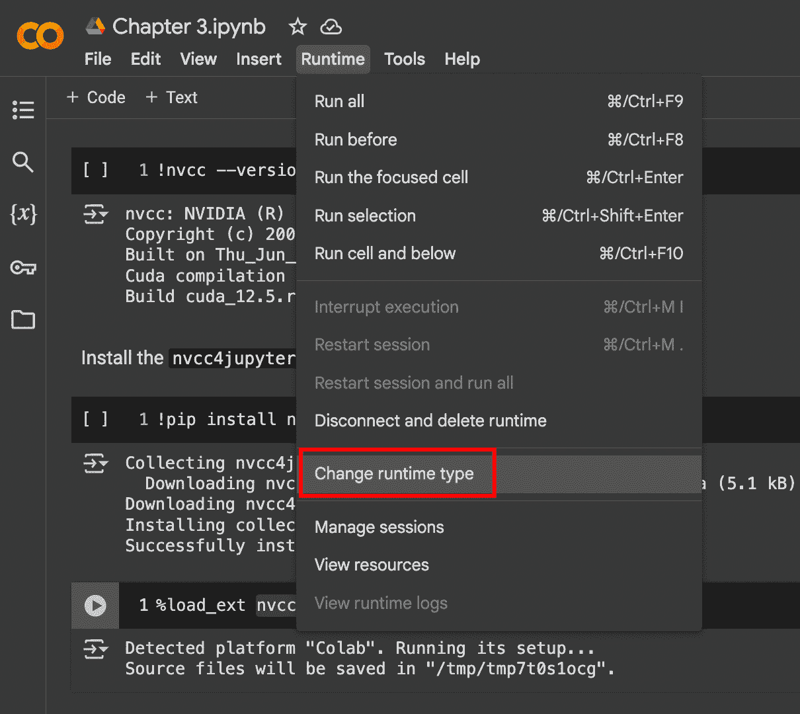

   *图 3.2：要更改运行时，请转到“运行时”选项卡并选择“更改运行时类型”*

2. 接下来，在对话框中，将**硬件加速器**设置为 **T4 GPU**，然后点击**保存**以启用 CUDA，如下所示。

   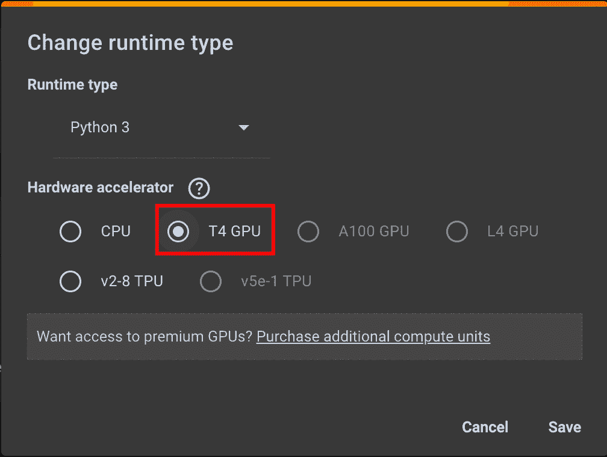

   *图 3.3：将运行时类型更改为 GPU 可启用 GPU 编程*

启用 GPU 运行时后，让我们验证 CUDA 工具链并加载 Colab 扩展，以便直接从 Notebook 单元格编译 CUDA 代码。

3. 使用 Google Colab，你可以通过以下命令检查 CUDA 的安装情况：

   ```
   !nvcc --version
   ```

   输出的结果应如下所示：

   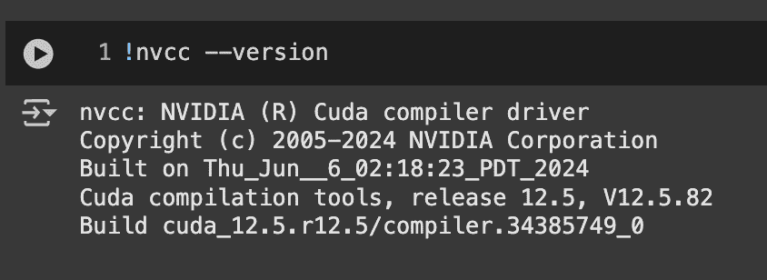

   *图 3.4：`!nvcc --version` 命令的输出*

4. 接下来，我们需要安装 `nvcc4jupyter` 扩展，以便从 Notebook 单元格运行 `nvcc`：

   ```
   !pip install nvcc4jupyter
   %load_ext nvcc4jupyter
   ```

   *图 3.5* 显示了输出应该是什么样子。

   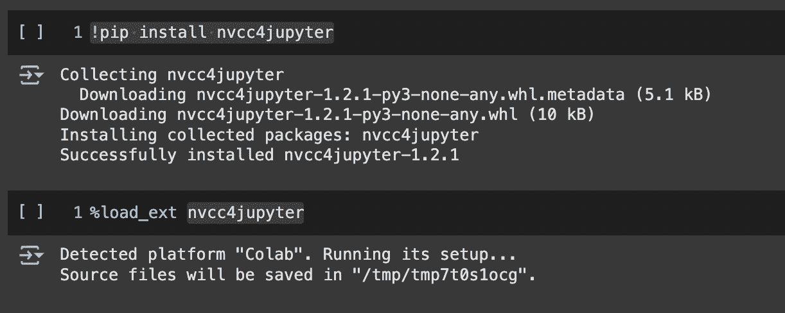

   *图 3.5：安装 nvcc4jupyter 并加载其扩展*

之后，你可以使用以下任一方式处理代码：

5. 在 `.cpp` 文件中编写代码。Colab 是为编写 Python 代码而设计的；但是，借助新安装的扩展，我们实际上可以编写出 `.cpp` 文件并在本地编译。*图 3.6* 展示了具体做法。

   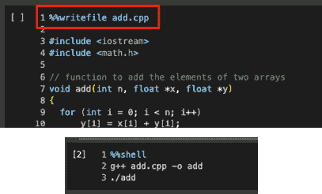

   *图 3.6：如何使用 Colab 编写 .cpp 文件并编译*

6. 直接使用 `nvcc4jupyter` 扩展编写代码。使用该扩展时，你可能会注意到 Python 静态检查器给出的一些警告。请忽略这些警告。

   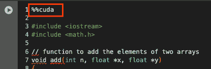

   *图 3.7：如何在 Colab 中编译 .cpp 文件*

当你拥有支持 CUDA 的 GPU 时，请安装兼容的 NVIDIA 驱动程序和 CUDA Toolkit（包含 `nvcc` 和核心库），然后进行端到端验证：`nvidia-smi` 命令应列出你的 GPU/驱动程序，`nvcc --version` 命令应报告预期的工具包版本，并且像 `deviceQuery`（或 `bandwidthTest`）这样的示例程序应能成功编译和运行。你可以在 Windows/Linux/WSL 上进行本地开发，或使用云选项（例如，通过 `nvcc4jupyter` 或编写/编译 `.cpp` 文件的 Colab）。请注意驱动程序与工具包之间可能不匹配、Linux 上可能缺失 `PATH/LD_LIBRARY_PATH`、WSL2 的要求以及 Colab 的临时会话限制。确认兼容性并成功运行测试后，你就可以编写、启动和分析你的第一个 CUDA 内核了。

### 使用 CUDA 优化 C++ 代码

本节将展示如何利用 CUDA 将性能关键的 C++ 代码转变为快速、GPU 加速的实现。我们将从识别热点和建立 CPU 基线开始，然后将数据并行任务映射到内核，选择有效的网格/块大小，并管理主机与设备间的内存以尽量减少数据传输。你将学习实用技术——合并访问、共享内存分块、占用率调整和基于流的重叠操作——以及何时应该使用 cuBLAS/cuFFT/cuDNN 而不是手写代码。我们将使用 Nsight Systems/Compute 进行测量，分析加速比（Amdahl 定律/Roofline 模型），并通过正确性测试安全地迭代，以确保优化带来真实、可复现的性能提升。

#### CUDA 编程模型

CUDA 提供了一种异构编程模型，其中*主机*代码在 CPU 上运行，而*设备*代码（内核）在 GPU 上运行。CPU 和 GPU 各自拥有独立的内存空间和执行上下文，通常需要显式的数据拷贝（除非使用统一内存）。通常，你需要识别算法中数据并行的部分，并以内核的形式将其卸载到 GPU 上。

CUDA 内核本质上是一个在 GPU 上运行的 C/C++ 函数（带有一些语言扩展和限制）。现代 NVIDIA GPU 实际上可以并发运行多个内核，但为了简单起见，在示例或入门章节中，我们通常假设某一时刻只有一个内核处于活动状态。内核一经启动，便由 GPU 上的众多线程执行。

CUDA 线程与 CPU 线程在几个重要方面存在差异：

- **大规模并行性**：每次内核启动可涉及数千到数百万个线程，所有线程在不同数据元素或数据区域上执行相同的代码
- **轻量级创建**：GPU 线程的创建开销极小，线程间的上下文切换主要由硬件管理，与 CPU 线程相比速度极快
- **数据并行聚焦**：每个线程通常独立处理整个数据集的一部分（或*子集*），使得 GPU 能够实现大规模并行

主机负责启动内核，并在设备内核启动之间执行串行代码；也就是说，管理内存、与设备之间的数据交换以及错误处理。

#### CPU 基线：C++ 中的数组加法

让我们从一个简单的基于 CPU 的程序开始，该程序将两个浮点数数组相加：

```cpp
#include <iostream>
#include <algorithm>
#include <cmath>

// 对两个向量执行逐元素累加
void vectorAddCPU(int length, float* inputA, float* inputB)
{
    for (int idx = 0; idx < length; ++idx)
    {
        inputB[idx] += inputA[idx];
    }
}

int main()
{
    const int SIZE = 1 << 20; // 1,048,576 个元素
    // 在主机（CPU）上分配内存
    float* vecA = new float[SIZE];
    float* vecB = new float[SIZE];
    // 用示例值填充数组
```


## 第 3 章

```cpp
for (int i = 0; i < SIZE; ++i)
{
    vecA[i] = 0.5f;
    vecB[i] = 2.5f;
}

// Execute vector addition
vectorAddCPU(SIZE, vecA, vecB);

// Verify correctness
float largestDeviation = 0.0f;
for (int i = 0; i < SIZE; ++i)
{
    float expected = 3.0f;
    largestDeviation = std::max(largestDeviation, std::fabs(vecB[i] - expected));
}

std::cout << "Largest deviation: " << largestDeviation << std::endl;

// Release allocated memory
delete[] vecA;
delete[] vecB;

return 0;
}
```

编译并运行该程序：

```bash
$ g++ vector_add_cpu.cpp -o vector_add_cpu
$ ./vector_add_cpu
```

输出如下：

```text
Max error: 0.000000
```

在代码中，`*x` 表示指向浮点数组的指针。在 C++（以及 CUDA）中，星号（`*`）表示该变量是一个指针，也就是说它存储的是某个值的内存地址，而不是值本身（例如，`float *x` 表示 `x` 是一个指向浮点数的指针）。如果为其分配了内存（例如 `x = new float[N]; // In CPU memory` 或 `cudaMallocManaged(&x, N * sizeof(float)); // In CUDA Unified Memory`），那么 `x` 就保存着这块已分配内存的地址，我们可以使用数组下标来访问其中的元素：`x[0] = 1.0f;` 将 `1.0f` 赋给第一个元素。或者，我们也可以使用指针运算：`*(x + 0) = 1.0f;`，这与 `x[0] = 1.0f` 等价。

#### 转换为 CUDA 代码

为了在 GPU 上并行化这种计算，我们将 `add()` 函数修改为作为 CUDA 内核运行。`__global__` 关键字用于指定一个在 GPU 上运行的函数：

```cpp
__global__
void add(int n, float *x, float *y) {
    int index = threadIdx.x;
    int stride = blockDim.x;
    for (int i = index; i < n; i += stride)
        y[i] = x[i] + y[i];
}
```

CUDA 提供了可以从 CPU 和 GPU 两方面访问的统一内存（Unified Memory）。使用 `cudaMallocManaged()` 分配内存，使用 `cudaFree()` 释放内存：

```cpp
float *x, *y;

cudaMallocManaged(&x, N*sizeof(float));
cudaMallocManaged(&y, N*sizeof(float));
```

这个 CPU 基线程序既为我们提供了正确性检查，也提供了性能参考：我们分配并初始化两个数组，运行一个直接的 `add()` 循环，然后验证 `Max error: 0.0` 以确认逻辑无误。请保留该版本（及其运行时间），作为后续所有工作的基准。接下来，我们将把这同一段计算移植到 CUDA——把 `add` 变成内核，将迭代映射到线程/线程块，并管理内存（统一内存或显式拷贝）——然后重新验证结果，并与这个基线对比加速比。

#### 启动 CUDA 内核

我们不直接调用 `add()`，而是使用三尖括号语法在 GPU 上启动它：

```cpp
add<<<1, 1>>>(N, x, y);
```

由于 CUDA 内核是异步执行的，我们需要在访问结果之前同步设备：

```cpp
cudaDeviceSynchronize();
```

让我们仔细看看这段代码：

- `__global__ void GPUFunction()`：`__global__` 修饰符标记一个内核——这是一个在 GPU 上执行、通常由 CPU（主机）启动的函数。内核的返回类型必须是 `void`。对于**动态并行**（计算能力 ≥ 3.5，`-rdc=true`），内核实际上可以从设备端启动其他内核。

- `GPUFunction<<<1, 1>>>();`：*三尖括号启动配置*指定了线程层次结构：`<<<gridDim, blockDim, [sharedMemBytes], [stream]>>>`。`<<<1,1>>>` 表示 *一个线程块，每个块中一个线程*——这对 “hello world” 演示很有用；实际工作负载会使用许多线程块和线程。在内核内部，`blockIdx`、`blockDim`、`threadIdx` 等内建变量让每个线程可以计算自己的工作索引。

- `cudaDeviceSynchronize();`：内核启动是*异步*的——主机会立即继续执行。`cudaDeviceSynchronize()` 函数会阻塞主机，直到默认流中此前所有工作完成为止（有助于计时和错误检查）。*提示*：在启动后立即使用 `cudaGetLastError()` 或 `cudaPeekAtLastError()` 检查启动错误。

#### 完整的 CUDA 实现

我们已经介绍了编写 CUDA 所需的样板内容；现在，让我们把它组合成一个完整且可运行的示例：

```cpp
#include <iostream>
#include <math.h>

__global__
void add(int n, float *x, float *y) {
    int index = threadIdx.x;
    int stride = blockDim.x;
    for (int i = index; i < n; i += stride)
        y[i] = x[i] + y[i];
}

int main(void) {
    int N = 1<<20;
    float *x, *y;

    cudaMallocManaged(&x, N*sizeof(float));
    cudaMallocManaged(&y, N*sizeof(float));

    for (int i = 0; i < N; i++) {
        x[i] = 1.0f;
        y[i] = 2.0f;
    }

    add<<<1, 256>>>(N, x, y);

    cudaDeviceSynchronize();

    float maxError = 0.0f;
    for (int i = 0; i < N; i++)
        maxError = fmax(maxError, fabs(y[i]-3.0f));

    std::cout << "Max error: " << maxError << std::endl;

    cudaFree(x);
    cudaFree(y);

    return 0;
}
```

现在，你可以使用 `nvcc`（NVIDIA 的 CUDA C/C++ 编译器）来构建并可选地运行你的程序，命令如下：

```bash
$ nvcc -arch=sm_70 -o out some-CUDA.cu -run
```

我们来分解一下上述命令：

- `nvcc`：NVIDIA CUDA 编译器驱动程序。
- `-arch=sm_70`：指定为计算能力 7.0 的 GPU（例如 V100）编译。请根据你的系统按需调整。
- `-o out`：将编译生成的二进制文件写入名为 `out` 的可执行文件。
- `-run`：在成功编译后自动运行该可执行文件。

如果省略 `-run`，你只需编译：

```bash
nvcc -arch=sm_70 -o out some-CUDA.cu
./out
```

在 Colab notebook 中，你可以执行以下内容：

```text
%%shell
nvcc add.cu -o add_cuda
./add_cuda
```

预期输出如下：

```text
Max error: 0.000000
```

正确性和编译都已验证之后，下一个考虑因素是时间花在了哪里。在下一节中，我们将对该程序进行性能分析——使用 CUDA 事件对主机-设备传输和内核计时，然后使用 Nsight Systems/Compute 检查实际占用率、内存吞吐量以及线程束/分支效率——从而定位瓶颈并指导优化。

#### 分析 CUDA 性能

使用 `nvprof` 对执行过程进行性能分析：

```bash
$ nvprof ./add_cuda
```

该命令的输出打印结果如*图 3.8* 所示：

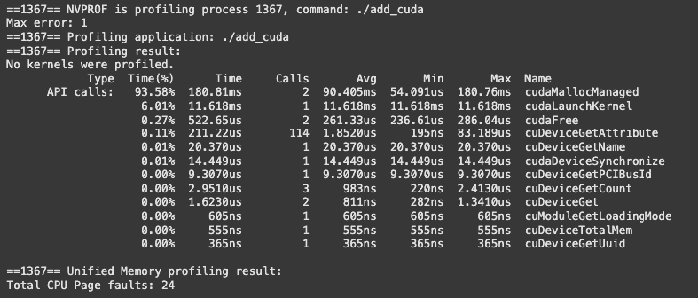

*图 3.8：使用 CUDA 进行数组加法的性能分析结果*

你的计时结果可能因 GPU 不同而有所差异。

#### CUDA 线程层次结构

一个 CUDA 内核可能由*数千甚至数百万*个线程执行。这些线程被组织成线程块，线程块又被组织成网格。理解这种线程层次结构对于扩展你的应用程序至关重要：

- **线程**：执行内核代码的最小工作单元
- **线程块**：一组线程（一维上最多 1,024 个），它们可以共享内存并彼此同步
- **网格**：一个或多个线程块的集合

*图 3.9* 展示了 CUDA 的执行层次结构（线程 → 线程块 → 网格）以及每一层的内存空间（每线程的寄存器/局部内存、每线程块的共享内存、设备全局内存）。在选择启动维度和规划数据移动时，请牢记这一模型。

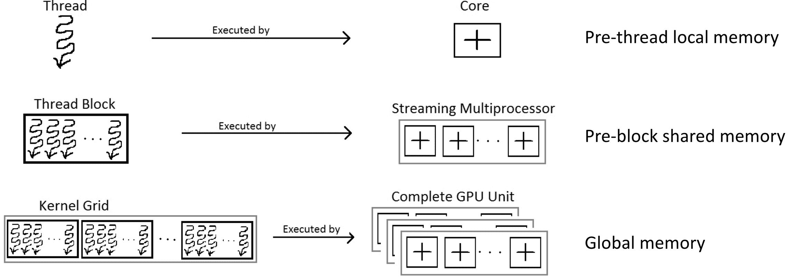

*图 3.9：CUDA 线程层次结构与内存空间（线程 ↔ 局部内存，线程块 ↔ 共享内存，网格 ↔ 全局内存）*

有了这些信息，你就可以通过 CUDA 的三尖括号语法来指定执行配置——线程块数量与每线程块线程数——从而启动内核。执行配置可以如下所示：

```cpp
someKernel<<<NUMBER_OF_BLOCKS, THREADS_PER_BLOCK>>>(parameters);
```

接下来，我们将看到如何利用刚才学到的知识，使用多个线程来加速这个 `for` 循环。

#### 使用多个线程加速

现在你已经用单个线程运行了执行加法操作的内核；要充分利用 GPU，我们需要让它并行化。关键就在于 CUDA 的 `<<<1, 1>>>` 语法。`<<< >>>` 中的值是执行配置——它们设置启动时的网格和线程块维度，这决定了有多少个 GPU 线程来运行该内核。具体来说，我们有如下内容：

- 第一个参数表示要启动的*线程块数量*
- 第二个参数表示*每个线程块中的线程数量*

`add<<<1, 1>>>` 这一配置意味着：

- 创建了一个线程块
- 在该线程块中创建了一个线程


前面的示例中，内核`add()`函数只启动了一个线程；因为它逐个遍历整个数组，所以它可以正确地完成整个数组的加法。然而，如果你启动多个线程，它们在没有协调的情况下读写同一个`y[i]`元素，就会产生*竞争条件*——最终值取决于哪个线程先读或先写。例如，一个线程可能写入`y[i] = x[i] + y_old`，而另一个线程看到这个更新后的值，可能计算出`y[i] = x[i] + (x[i] + y_old)`，从而得到错误结果。

为了利用GPU的并行性，需要将工作分配到多个线程。由于NVIDIA硬件以32线程的线程束（warp）为单位调度线程，因此请选择32的倍数作为块大小（例如256），并启动足够多的块来覆盖数据。相应地更新代码：

```cpp
add<<<1, 256>>>(N, x, y);
```

如果按原样运行，*并行*版本仍然会让每个线程重复同样的工作，而不是将工作划分开。为了在多个线程之间划分数组，可以使用CUDA的内建变量为每个线程计算唯一索引。这里，`threadIdx.x`是线程在块内的位置，`blockDim.x`是块中的线程数，`blockIdx.x`标识块。一种常见模式是`int i = blockIdx.x * blockDim.x + threadIdx.x`；这样，每个线程只更新自己的元素，从而实现真正的并行执行。

我们需要修改循环，让并行线程跨步遍历数组：

```cpp
int blockSize = 256;
int numBlocks = (N + blockSize - 1) / blockSize;
add<<<numBlocks, blockSize>>>(N, x, y);
```

修改内核，使其在所有线程上计算：

```cpp
__global__
void add(int n, float *x, float *y)
{
    int index = threadIdx.x;
    int stride = blockDim.x;
    for (int i = index; i < n; i += stride)
        y[i] = x[i] + y[i];
}
```

以下是我们加法函数或内核的修改后代码。我们将其保存到`add_block.cu`文件中。代码分解如下：

- 我们创建一个使数组元素相加的内核：

```cpp
__global__
void add(int n, float *x, float *y) {
    int index = threadIdx.x;
    int stride = blockDim.x;
    for (int i = index; i < n; i += stride)
        y[i] = x[i] + y[i];
}
```

- 我们启动`main`，设置元素总数（`N = 1<<20 = 1,048,576`），并声明输入/输出数组的指针：

```cpp
int main(void) {
    int N = 1 << 20; // 1M elements
    float *x, *y;
```

- 我们分配统一内存（Unified Memory），使CPU和GPU都能访问`x`和`y`，而无需显式调用`cudaMemcpy`：

```cpp
cudaMallocManaged(&x, N * sizeof(float));
cudaMallocManaged(&y, N * sizeof(float));
```

- 我们以**1个块 × 256个线程**启动内核（网格跨步循环覆盖所有`N`个元素）。`cudaDeviceSynchronize()`函数会在主机读取结果之前等待GPU工作完成：

```cpp
add<<<1, 256>>>(N, x, y);
cudaDeviceSynchronize();
```

- 我们释放GPU托管内存并从`main`返回：

```cpp
cudaFree(x);
cudaFree(y);
return 0;
```

然后，我们编译并对其运行性能分析器：

```bash
$ nvcc add_block.cu -o add_block
$ nvprof ./add_block
```

与之前的性能分析相比，速度有了很大的提升。

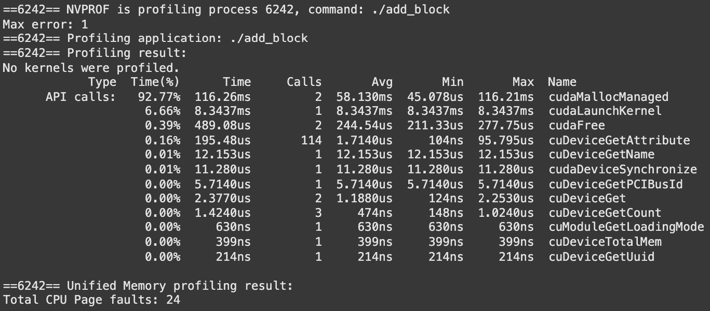

*图3.10：对内核进行并行化（add<<<blocks,256>>>）后的nvprof摘要*

在*图3.10*中，我们可以看到与单线程基线相比，时间显著下降；现在大多数开销来自分配（`cudaMallocManaged`）和同步（`cudaDeviceSynchronize`），内核通过`cudaLaunchKernel`启动。统一内存显示有24次CPU缺页错误。

我们能否进一步提高速度以获得更高性能？让我们开始吧。

#### 使用多个块进行扩展

CUDA GPU由多个并行处理器组成，称为**流式多处理器**（**SM**），每个处理器能够并发运行多个线程块。例如，基于Ampere架构的*NVIDIA A100 GPU*拥有*108个SM*，每个SM最多支持*2048个活动线程*。为了充分利用GPU的并行处理能力，内核应该以多个线程块启动。

执行配置（`<<<numBlocks, blockSize>>>`）中的第一个参数定义*线程块数量*，第二个参数指定*每块线程数*。这些线程块共同构成了所谓的*网格*。给定需要处理的*N*个元素和*每块256个线程*，所需的块数可按如下方式计算：

```
numBlocks = (N + blockSize - 1) / blockSize
```

这确保*所有元素都被处理*，即使*N*不是`blockSize`的整数倍。让我们使用以下设置：

```cpp
int blockSize = 256;
int numBlocks = (N + blockSize - 1) / blockSize;
add<<<numBlocks, blockSize>>>(N, x, y);
```

使用**扁平线程索引**为每个线程分配唯一的工作：`i = blockIdx.x * blockDim.x + threadIdx.x`。*图3.11*展示了`gridDim.x = 4096`和`blockDim.x = 256`时的映射关系；例如，`blockIdx.x = 2, threadIdx.x = 3 → i = 2*256 + 3 = 515`。

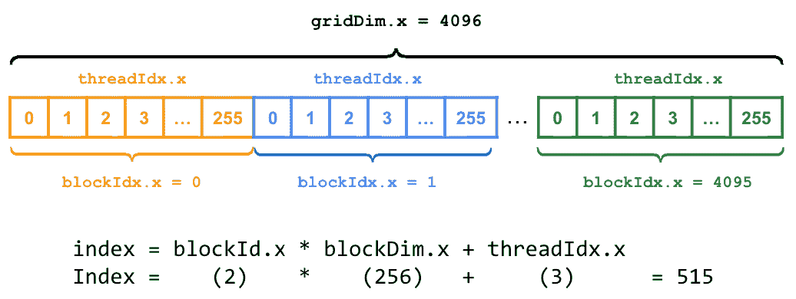

*图3.11：计算全局线程索引——对于gridDim.x = 4096和blockDim.x = 256，每个块贡献256个连续索引；全局索引为 i = blockIdx.x * blockDim.x + threadIdx.x*

上图展示了在CUDA中使用`blockDim.x`、`gridDim.x`和`threadIdx.x`对一维数组进行索引的方法。每个线程首先计算其块的偏移量（`blockIdx.x * blockDim.x`），然后加上其在块内的位置（`threadIdx.x`），从而确定其唯一索引。由此得到以下公式：

```
index = blockIdx.x * blockDim.x + threadIdx.x
```

这种索引策略是CUDA编程中的基本模式，确保每个线程都能高效地处理数据的不同部分。

使用块和线程更新后的内核代码如下：

```cpp
__global__
void add(int n, float *x, float *y)
{
    int index = blockIdx.x * blockDim.x + threadIdx.x;
    int stride = blockDim.x * gridDim.x;
    for (int i = index; i < n; i += stride)
        y[i] = x[i] + y[i];
}
```

完整代码概述如下：

1. 包含CUDA内核。

该内核使用网格跨步循环模式，因此任意数量的线程/块都可以覆盖`n`个元素：

```cpp
#include <iostream>
#include <math.h>

// Kernel function to add the elements of two arrays
__global__
void add(int n, float *x, float *y)
{
    int index = blockIdx.x * blockDim.x + threadIdx.x;
    int stride = blockDim.x * gridDim.x;
    for (int i = index; i < n; i += stride)
        y[i] = x[i] + y[i];
}
```

2. 接下来，编写`main()`，设置问题规模`N`，并在统一内存中分配数组。

分配CPU和GPU都可以访问的数组（CUDA统一内存）：

```cpp
int main(void)
{
    int N = 1<<20;
    float *x, *y;

    // Allocate Unified Memory – accessible from CPU or GPU
    cudaMallocManaged(&x, N*sizeof(float));
    cudaMallocManaged(&y, N*sizeof(float));
```

3. 我们在主机上初始化输入。

只需将`x`填充为1，将`y`填充为2，这样所有位置的正确答案都是3：

```cpp
    // initialize x and y arrays on the host
    for (int i = 0; i < N; i++) {
        x[i] = 1.0f;
        y[i] = 2.0f;
    }
```

4. 选择启动配置并运行内核。

选择一个合理的块大小（32的倍数）和足够覆盖`N`的块数：

```cpp
    // Run kernel on 1M elements on the GPU
    int blockSize = 256;
    int numBlocks = (N + blockSize - 1) / blockSize;
    add<<<numBlocks, blockSize>>>(N, x, y);
```

5. 同步、验证并清理。

等待GPU完成，检查结果，然后释放内存：

```cpp
    // Wait for GPU to finish before accessing on host
    cudaDeviceSynchronize();

    // Check for errors (all values should be 3.0f)
    float maxError = 0.0f;
    for (int i = 0; i < N; i++)
        maxError = fmax(maxError, fabs(y[i]-3.0f));
    std::cout << "Max error: " << maxError << std::endl;

    // Free memory
    cudaFree(x);
    cudaFree(y);
    return 0;
}
```

为了编译和执行，让我们运行以下命令：

```bash
nvcc add_grid.cu -o add_grid
nvprof ./add_grid
```


对其执行进行性能分析后，结果如*图 3.12*所示：

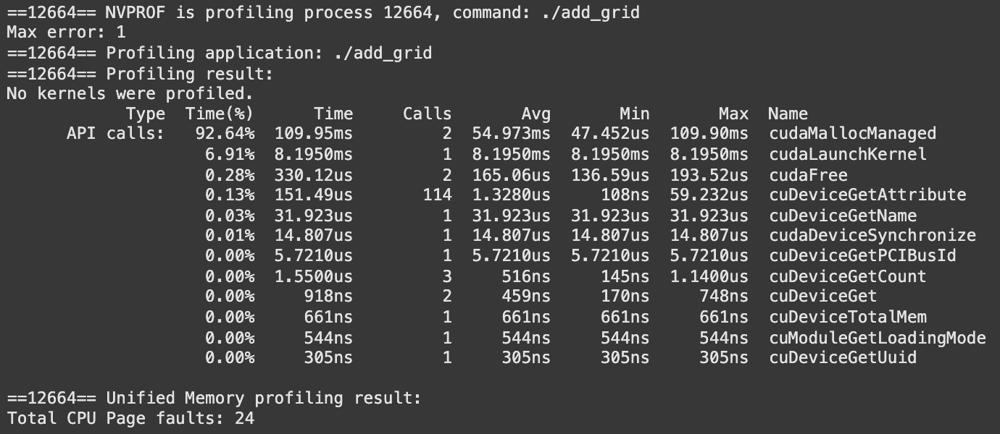

*图 3.12：add_grid 的 nvprof 摘要——grid-stride 内核运行正确；大部分时间花在 cudaMallocManaged 以及内核启动/同步开销上，报告了 24 次统一内存 CPU 缺页*

这是运行多个块带来的又一次巨大提速！或者你可能还不觉得这有什么了不起；这是因为该示例足够小，能够快速完成计算，所以你没有看到明显的收益，不过让我们看看接下来的例子。

### 如何在 CUDA 中进行调试

在 CUDA 中，错误可能出现在三个地方——API 调用、内核启动本身，以及异步执行期间。首先检查每个运行时 API 的返回代码。

#### 检查 CUDA API 调用

大多数 CUDA 函数会返回一个 `cudaError_t` 错误码。你应该检查返回值：

```cpp
cudaError_t err = cudaMallocManaged(&a, size);
if (err != cudaSuccess) {
    printf("Error: %s\n", cudaGetErrorString(err));
}
```

即使所有 API 调用都成功，*启动*本身仍可能无效（例如，维度错误）。由于内核返回 `void`，可以使用 `cudaGetLastError()` 捕获启动时的错误。

#### 检查内核启动错误

内核的返回类型是 `void`，因此启动本身不会产生 `cudaError_t` 错误。要检测*启动时*发生的问题——例如非法的网格/块大小或资源限制——可以使用 `cudaGetLastError()`（或 `cudaPeekAtLastError()`）查询运行时，它会为最近一次启动返回一个 `cudaError_t` 错误；请注意，`cudaGetLastError()` 同时也会清除错误状态：

```cpp
someKernel<<<1, -1>>>(); // -1 is not a valid number of threads.
cudaError_t err;
err = cudaGetLastError(); // cudaGetLastError will return the error from above.
if (err != cudaSuccess)
{
    printf("Error: %s\n", cudaGetErrorString(err));
}
```

成功的启动并不保证*执行*一定成功。由于内核是异步运行的，需要进行同步（例如 `cudaDeviceSynchronize()`）并检查结果，才能发现设备端的失败。

#### 检查异步执行错误

由于内核是异步运行的，你必须调用一个*同步函数*（例如 `cudaDeviceSynchronize`）并检查其结果，以捕获内核执行期间发生的任何错误：

```cpp
err = cudaDeviceSynchronize();
if (err != cudaSuccess) {
    printf("Kernel Execution Error: %s\n", cudaGetErrorString(err));
}
```

为避免重复的样板代码，可以将 CUDA 调用封装在一个检查状态并打印可读错误信息的小型辅助函数/宏中——请在整个练习中都使用这种模式。

#### CUDA 错误处理函数

为了减少样板代码，可以定义一个宏来封装 CUDA 调用并检查其返回代码——下面是可供后续练习复用的示例：

```cpp
#include <stdio.h>
#include <assert.h>
inline cudaError_t checkCuda(cudaError_t result)
{
    if (result != cudaSuccess) {
        fprintf(stderr, "CUDA Runtime Error: %s\n",
            cudaGetErrorString(result));
        assert(result == cudaSuccess);
    }
    return result;
}

int main()
{
    checkCuda(cudaDeviceSynchronize());
}
```

在许多深度学习和高性能计算应用中，数据并不严格是一维的。相反，你可能会处理多维张量——例如具有高度和宽度的图像，或者具有批量大小和通道维度的高阶张量。一维执行配置（例如 `<<<gridSize, blockSize>>>`）仍然可以通过将数据索引展平到单个轴上来工作，但如果需要跟踪多个维度（例如卷积层中的批量、通道、高度和宽度），这种方法可能会变得笨拙且容易出错。

幸运的是，CUDA 通过 `dim3` 类型支持**二维**（**2D**）和**三维**（**3D**）**线程块和网格**。要定义二维或三维的网格或块，可以这样使用 CUDA 的 `dim3` 类型：

```cpp
dim3 threads_per_block(16, 16, 1);
dim3 number_of_blocks(16, 16, 1);
someKernel<<<number_of_blocks, threads_per_block>>>();
```

`<<<>>>` 实例中的顺序很重要。每个块的最大线程总数为 `1024`。以下是每个维度的最大值表。

| 维度 | 最大值 |
| --- | --- |
| 网格大小 `dGrid.x` | 2^31 - 1 |
| 网格大小 `dGrid.y` | 65535 |
| 网格大小 `dGrid.z` | 65535 |
| 块大小 `dBlock.x` | 1024 |
| 块大小 `dBlock.y` | 1024 |
| 块大小 `dBlock.z` | 64 |

*表 3.1：CUDA 最大启动维度和每块线程限制*

CUDA 错误会在三个地方出现：**API 调用**、**内核启动**和**异步执行**。始终检查每个运行时调用的返回值；在 `<<<grid, block>>>` 之后，调用 `cudaGetLastError()` 来捕获启动问题，然后调用 `cudaDeviceSynchronize()` 并再次检查以发现设备端故障。使用一个小型错误检查辅助函数/宏来保持一致性。对于索引和性能，在 2D/3D 网格/块中优先使用 `dim3`；请记住顺序是 `<<<grid, block>>>`，并遵守*每块 1,024 个线程*的限制（参见*表 3.1*）。

### 摘要

本章介绍了 CUDA 作为 NVIDIA 的并行模型，用于在 GPU 上运行海量轻量级线程，将其与仅使用 CPU 的执行进行了对比，并展示了各自何时更胜一筹。你搭建了工作环境（驱动程序 + CUDA 工具包），对其进行了验证（使用 `nvidia-smi`、`nvcc --version` 和示例运行），并了解了在 Colab 中使用 `nvcc4jupyter` 的快速路径。我们建立了一个 CPU 基线（通过数组相加内核），然后将其移植到 CUDA：编写内核、选择启动配置 `(<<<grid, block>>>)`，并使用每线程索引和 grid-stride 循环将迭代映射到线程。你学习了 CUDA 执行层次结构（线程 | 块 | 网格）和内存作用域（线程本地、共享、全局），了解了为什么块大小应为 32（线程束）的倍数，以及如何从一个块扩展到多个块以充分利用 SM。我们使用 `nvprof` 对运行进行了性能分析（并提到 Nsight Systems/Compute 可进行更深入的分析），解释了统一内存缺页，并识别了常见瓶颈（启动开销、数据传输、同步）。最后，你为 API 调用、启动错误和异步故障添加了健壮的错误处理，并了解了当数据是多维时如何使用 2D/3D `dim3` 网格/块。

在下一章中，我们将从使用 Eigen 手动实现**神经网络**（**NN**）转向使用 LibTorch（PyTorch 官方 C++ API），它为张量、NN 模块、优化器和数据集提供了高级抽象。你将学习如何使用 `torch::nn` 层定义模型，使用内置优化器训练模型，并利用自动微分而不是手动计算梯度。我们还将通过 LibTorch 引入 CUDA 的 GPU 加速，使相同的模型能够高效扩展到更大的数据集和更深的架构。

### 问题

检查你的理解——在继续之前回答这些问题：

1. `<<<grid, block>>>` 中的执行配置指定了什么？
2. 如果多个线程在没有协调的情况下更新同一 `i` 实例的 `y[i]`，会出现什么问题？在数组相加内核中我们如何避免这个问题？
3. 说出两个端到端验证 CUDA 安装的命令（一个用于驱动程序，一个用于工具包）。

### 扩展阅读

以下是一些推荐参考，可帮助你加深 CUDA 调试和优化技能：

- **CUDA C 编程指南（NVIDIA）**：核心模型、内存、执行层次结构
- **CUDA 最佳实践指南（NVIDIA）**：占用率、内存合并、流、统一内存技巧
- **Nsight Systems 和 Nsight Compute 用户指南**：性能分析方法和指标
- **CUDA 示例**：grid-stride 循环、归约等的参考实现
- **Mark Harris，《如何优化 CUDA 中的数据传递》**：页锁定内存、重叠
- 关于 Roofline 和 Amdahl 定律的论文/文章，用于推理可实现的加速比
- **cuBLAS/cuDNN/cuFFT 文档**：何时优先使用库而不是自定义内核


## 第 3 章

### 答案

以下是前面问题的答案（请先尝试回答问题后再查看）：

1. 它定义了内核的并行形状：网格中有多少个**块**以及**每块线程数**（可选地指定共享内存字节数和流）。

2. **数据竞争**；多个线程不可预测地读取/写入同一位置。避免方法是给每个线程分配一个**唯一索引**（并且只更新它自己的元素）；例如，`i = blockIdx.x * blockDim.x + threadIdx.x`（或者当多个线程需要合并结果时，使用原子操作/归约）。

3. `nvidia-smi`（驱动/GPU 可见性）和 `nvcc --version`（工具包）；编译/运行如 `deviceQuery` 这样的示例即可完成检查。

**获取本书的 PDF 版本及更多内容**

扫描二维码（或访问 `packtpub.com/unlock`）。按名称搜索这本书，确认版本，然后按照页面上的步骤操作。


*注意：请保管好你的发票。从 Packt 直接购买无需发票。*

# 第 2 部分：在 C++ 中构建和训练神经网络

在本书的这一部分中，你将从核心概念转向在 C++ 中进行动手模型开发。从一个基础神经网络开始，你将逐步构建多层感知机、卷积神经网络、循环神经网络、**长短期记忆（LSTM）网络**、生成模型以及基础大语言模型组件。在此过程中，你将学习实用的训练工作流程、正则化方法、优化策略，以及通过分布式训练、并行化和模型压缩来扩展工作负载的技术。到本部分结束时，你将能够使用 C++ 设计、训练和优化各种深度学习模型，以应对真实世界的任务。

本书的这一部分包含以下章节：

- *第 4 章*，*在 C++ 中构建基础神经网络*
- *第 5 章*，*C++ 中的多层感知机*
- *第 6 章*，*C++ 中的卷积神经网络*
- *第 7 章*，*C++ 中的循环神经网络与长短期记忆网络*
- *第 8 章*，*C++ 中的生成网络、自编码器与大语言模型*
- *第 9 章*，*C++ 中的 Transformer 与大语言模型微调*

## 第 4 章：在 C++ 中构建基础神经网络

**机器学习**（ML）使算法能够发现数据中的模式，并利用这些模式对新出现的未见示例进行预测，而无需为每种情况手工编码规则。神经网络是受大脑（粗略地）启发的一类 ML 模型。在 *图 4.1* 中，生物神经元通过树突接收信号，在细胞体中整合信号，并沿轴突发出输出。感知机——神经网络的基本构建块——与此对应：输入 `x_i` 通过具有强度（权重）`w_i` 的 *突触* 到达，组合成加权和 `z = Σ w_i x_i + b`（**偏置** `b` 的作用类似于阈值），然后通过**激活**函数 `y = σ(z)`（例如 ReLU、sigmoid、tanh）产生输出。你可以回看本书的 *第 1 章* 来复习这些内容。

突触前神经元通过突触沿轴突将信号发送到突触后神经元的树突。具有突触强度 `w_i` 的输入 `x_i` 在胞体中被整合为 `Σ w_i x_i`。如果足够强，就会产生一个输出脉冲——这正是感知机加权和与激活函数的灵感来源。*改编自 Nature*：`https://www.nature.com/articles/s41427-018-0101-y`。

将许多感知机堆叠起来形成层（输入 → 隐藏 → 输出），使网络能够逼近复杂的非线性映射：从像素到标签、从特征到概率、从文本到嵌入向量，等等。我们通过损失函数度量误差，并通过梯度下降和反向传播调整 `{w_i, b}`，从而使网络未来的预测不断改进。

在接下来的篇幅中，我们将把这个示意图变为代码：从单个感知机开始，添加常见的激活函数和损失函数，在 C++ 中组装一个最小的**多层感知机**（MLP），并在一个玩具数据集上训练它——为后续更深的网络和 GPU 加速打下基础。

在本章中，我们将介绍以下主题：

- 理解基础知识
- 构建前向传播与损失函数（例如用于分类的 BCE/交叉熵）
- 使用 LibTorch 在 C++ 中实现神经元和激活函数
- 推导/反向传播梯度，并使用随机梯度下降更新权重

到本章结束时，你将拥有一个自包含的 C++ 程序，用于训练基本的感知机——包括前向传播、反向传播和优化循环——并且有信心扩展它（更多层/激活函数、正则化、更好的初始化），之后继续迈向 GPU 加速。

### 理解基础知识

机器学习的核心是*学习*：通过调整内部参数——权重和偏置——来捕获训练数据中的模式，并能泛化到新的未见示例。我们从**数据集**开始，它是一组示例的集合；每个示例包含**特征**（可测量的输入），在监督学习中还包含**标签**或**目标**（期望的输出）。在**训练**期间，算法迭代地调整参数，以减小衡量训练集预测误差的损失。之后，我们在独立的**测试**（或验证）集上进行评估，以估计学到的关系在模型训练期间未见过的数据上的泛化能力。

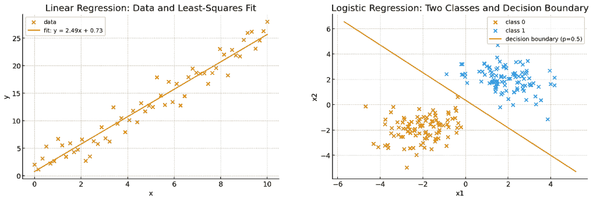

*图 4.1：线性回归与逻辑回归对比。左：对带噪声的一维数据进行线性回归，最小二乘拟合为 ŷ = 0.77x + 0.68。右：对两个二维类别进行逻辑回归，决策边界为 p = 0.5（σ(w^T x + b) = 0.5）。线性模型最小化 MSE；逻辑模型通过 sigmoid 输出概率，并使用二元交叉熵进行训练。*

单个神经元本质上是一个仿射模型加上可选的非线性。在**线性回归**（*图 4.1*）中，我们用 `ŷ = w_0 + Σ_j w_j x_j` 预测一个标量，并通过使用诸如**MSE**（均方误差）的损失函数最小化预测值（`ŷ`）与正确标签（`y`）之间的差异来学习 `{w_j}`。当然，对于较小的问题，你可以使用正规方程求得闭式解，但随着数据规模和特征数量的增加，正规方程不再可行；相反，我们使用梯度下降——这也是我们将在深度神经网络中依赖的优化器。

逻辑回归（*图 4.1*）通过将 sigmoid 应用于线性得分 `ŷ = σ(z) = 1 / (1 + e^{-z})`（其中 `z = w_0 + Σ_j w_j x_j`）将输出转换为概率，并使用二元交叉熵损失函数训练神经元。二元逻辑回归的**决策边界**是超平面 `w^T x + b = 0`（等价于 `y = 0`）；**非线性**边界来自特征变换或**堆叠层**。

在深入神经网络之前，让我们先说明如何在 C++ 中实现线性和逻辑回归。本节将在更简单的上下文中介绍权重更新和代价函数的概念。

### 构建前向传播和损失函数（例如用于分类的 BCE/交叉熵）

单个神经元计算 `z = w x + b`，然后应用激活函数 `ŷ = σ(z)`。使用**恒等**激活函数（`σ(z) = z`），得到**线性回归**，通过最小化**MSE**来训练。使用**sigmoid**（`σ(z) = 1 / (1 + e^{-z})`），得到**逻辑回归**，使用**二元交叉熵**进行训练。你可以将这两种情况视为神经网络的最简形式或特例：一个神经元、一个输出。掌握它们后，过渡到多层网络就会很自然——在各层之间堆叠相同的构建块，并对所有层进行反向传播。

让我们使用梯度下降在 C++ 中实现线性回归。

1. 导入合成数据集：我们将对从 `y = 2.5x + 0.9 + ε` 采样得到的带噪声的点拟合一条直线。

```cpp
int main() {
    mt19937 rng(42);
    uniform_real_distribution<double> U(0.0, 1.0);
    normal_distribution<double> N(0.0, 0.2);
    // Synthetic data
    const int n = 200;
    vector<double> x(n), y(n);
```


## 在C++中构建基础神经网络

```cpp
for (int i = 0; i < n; ++i) {
    x[i] = U(rng);
    y[i] = 2.5 * x[i] + 0.7 + N(rng);
}
```

- **2. 初始化参数和超参数：** 初始化权重`w`和偏置`b`（初始化为0即可），并设置学习率和迭代周期。

```cpp
double w = 0.0; // weight
double b = 0.0; // bias
double lr = 0.1; // learning rate
const int epochs = 1000;
```

- **3. 对于每个迭代周期，我们将数据遍历一次。** 对于每个数据点 `(x, y)`：
   - **预测：** `y_hat = w * x + b`。
   - **单样本MSE：** `mse = (y_hat - y)^2`。
   - **梯度：** `∂mse/∂w = 2 * (y_hat - y) * x`，`∂mse/∂b = 2 * (y_hat - y)`。
   - **更新参数。**

```cpp
for (int i = 0; i < n; ++i) {
    double y_hat = w * x[i] + b; // prediction
    double resid = y_hat - y[i]; // residual
    double mse_i = resid * resid; // per-sample MSE (for clarity/logging if desired)
    w -= lr * (2.0 * resid * x[i]); // gradient step from MSE
    b -= lr * (2.0 * resid);
}
```

既然我们已经完成了线性回归，接下来转向它的概率近亲——逻辑回归——它通过 sigmoid 函数将线性得分映射为类别概率。我们将用一个 sigmoid 神经元对两个二维高斯簇进行分类来演示它。

- **1. sigmoid函数可以如下创建：**

```cpp
static inline double sigmoid(double z) {
    return 1.0 / (1.0 + std::exp(-z));
}
```

- **2. 创建简单的线性可分数据集：** 两个簇：类别0在(-2, -2)附近，类别1在(2, 2)附近。

```cpp
// Synthetic 2D dataset (two Gaussian blobs)
std::mt19937 rng(123);
std::normal_distribution<double> N0x(-2.0, 1.0), N0y(-2.0, 1.0);
std::normal_distribution<double> N1x(2.0, 1.0), N1y(2.0, 1.0);
const int n_per = 200;
std::vector<std::array<double,2>> X;
std::vector<int> y;
X.reserve(2 * n_per);
y.reserve(2 * n_per);
for (int i = 0; i < n_per; ++i) {
    X.push_back({N0x(rng), N0y(rng)}); y.push_back(0);
    X.push_back({N1x(rng), N1y(rng)}); y.push_back(1);
}
const int n = static_cast<int>(X.size());
```

- **3. 初始化参数和超参数：** 一个逻辑回归神经元具有权重`w1`、`w2`和偏置`b`。我们将使用固定的学习率。

```cpp
double w1 = 0.0, w2 = 0.0, b = 0.0;
double lr = 0.1;
const int epochs = 3000;
```

- **4. 梯度下降循环（交叉熵损失）：** 对于每个迭代周期，计算**二分类交叉熵**的梯度。对于样本 `(x, y)`，其中 `z = w^T x + b`，`p = σ(z)`，

- **5.** `∂BCE/∂z = p - y`。链式法则得到：`∂BCE/∂w = (p - y) * x`，`∂BCE/∂b = (p - y)`。我们对整个数据集的梯度求平均，然后更新参数。

```cpp
for (int epoch = 1; epoch <= epochs; ++epoch) {
    double gw1 = 0.0, gw2 = 0.0, gb = 0.0;
    for (int i = 0; i < n; ++i) {
        double z = w1 * X[i][0] + w2 * X[i][1] + b; // linear score
        double p = sigmoid(z); // probability (ŷ)
        double diff = (p - y[i]); // d(BCE)/dz
        gw1 += diff * X[i][0] / n;
        gw2 += diff * X[i][1] / n;
        gb += diff / n;
    }
    w1 -= lr * gw1;
    w2 -= lr * gw2;
    b -= lr * gb;
}
```

- **6. 用BCE监控训练：** 计算平均二分类交叉熵来跟踪训练进度。

```cpp
if (epoch % 500 == 0) {
    double loss = 0.0;
    for (int i = 0; i < n; ++i) {
        double p = sigmoid(w1*X[i][0] + w2*X[i][1] + b);
        p = std::clamp(p, 1e-12, 1.0 - 1e-12); // numeric safety
        loss += -( y[i]*std::log(p) + (1 - y[i])*std::log(1 - p) );
    }
    loss /= n;
    std::cout << "Epoch " << epoch << " BCE=" << loss
              << " w=[" << w1 << "," << w2 << "] b=" << b << "\n";
}
```

- **7. 评估准确率并展示决策边界：** 我们使用0.5阈值进行分类；决策边界为 `w1 * x1 + w2 * x2 + b = 0`。

```cpp
int correct = 0;
for (int i = 0; i < n; ++i) {
    double p = sigmoid(w1*X[i][0] + w2*X[i][1] + b);
    int pred = (p >= 0.5);
    if (pred == y[i]) correct++;
}
std::cout << "\nAccuracy: " << (100.0 * correct / n) << "%\n";
std::cout << "Decision boundary (p=0.5): w1*x1 + w2*x2 + b = 0\n";
```

线性回归和逻辑回归是很好的基线——快速、简单且可解释——但它们只能建模线性关系。除非你手工设计特征（多项式、交互项、核函数），否则它们的决策边界仍然是仿射的，在复杂数据上很快就会碰壁。特征工程可以有所帮助，但它是手动的、脆弱的，而且随着模式变得高阶或非平稳，很难扩展。

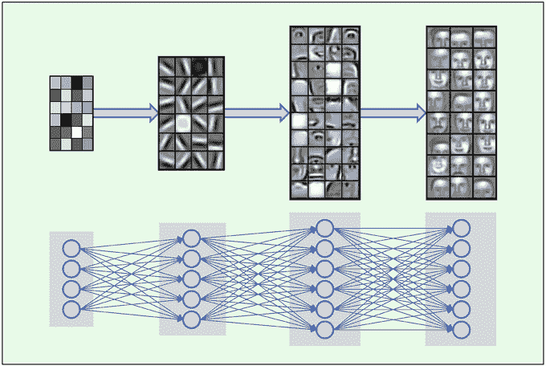

*图4.2：深度神经网络中的层次化特征学习*

从原始像素出发，早期层检测明暗模式和边缘；中层将边缘组合成图案和部件；后续层组装出高级特征。输出层将这些学习到的表示映射为类别标签。

*图4.2*改编自Fraija-Fernández N.等人发表于《Frontiers in Environmental Science》3:80 (2016)的*《用于监测海洋生态系统的环境DNA宏条形码：现状与未来展望综述》*中的*图2*。https://doi.org/10.3389/fenvs.2015.00080——采用知识共享署名许可（CC BY 4.0）。

如*图4.2*所示，深度网络通过端到端学习特征来避免手动特征工程：堆叠带非线性激活的仿射层，可以产生丰富的决策边界和层次化表示。这种能力支撑了计算机视觉、自然语言处理和强化学习领域的最先进成果。在本章剩余部分，我们将用C++和LibTorch实现一个MLP，让你的模型可以直接从数据中学习这些变换。

### 使用LibTorch在C++中实现神经元和激活函数

一个*神经元*只是一个仿射变换加上（可选的）非线性：`z = W x + b, y = σ(z)`。在LibTorch中，你可以使用内置的`torch::nn::Linear`层来实现`W x + b`，并通过`torch::relu`、`torch::sigmoid`、`torch::tanh`或`torch::nn::ReLU`等函数/模块应用激活。在`neuron_demo.cpp`中，我们提供了一个包含一个仿射层和激活（ReLU）的简单架构。

```cpp
// neuron_demo.cpp
#include <torch/torch.h>
#include <iostream>

int main()
{
    torch::manual_seed(42);

    // Pick device (CUDA if available)
    torch::Device device = torch::cuda::is_available() ? torch::kCUDA : torch::kCPU;
    std::cout << "Using device: " << (device.is_cuda() ? "CUDA" : "CPU") << "\n";

    const int64_t batch = 4, in_f = 5, out_f = 3;

    auto x = torch::randn({batch, in_f}).to(device);

    torch::nn::Linear fc(in_f, out_f);
    fc->to(device);

    torch::nn::init::kaiming_uniform_(fc->weight, /*a=*/std::sqrt(5.0));
    torch::nn::init::zeros_(fc->bias);

    auto z = fc->forward(x); // [batch, out_f]
    auto y = torch::relu(z); // activation

    std::cout << "Input shape : " << x.sizes() << "\n";
    std::cout << "Logits shape: " << z.sizes() << "\n";
    std::cout << "Output shape: " << y.sizes() << "\n";
}
```


## 第 4 章：在 C++ 中构建基础神经网络

```cpp
std::cout << "Output sample:\n"
          << y.slice(/*dim=*/0, 0, 2) << "\n";
return 0;
}
```

你刚刚构建了一个带有非线性激活（如 ReLU）的单一仿射层。很自然的下一步是将这些层堆叠起来：第一层学习简单模式，下一层将它们组合成更丰富的特征，最后一层将这些特征映射到预测。这就是 MLP——最小的*深度*网络——也是我们在用 LibTorch/CUDA 扩展之前所使用的骨架。

为了让数学和代码更透明，我们将从一个极小的 MLP 和一个具有 2 个特征的玩具数据集开始：

- **架构**：
  - 输入层：**2** 个单元
  - 隐藏层：**3** 个单元
  - 输出层：**1** 个单元（二分类或简单回归）

  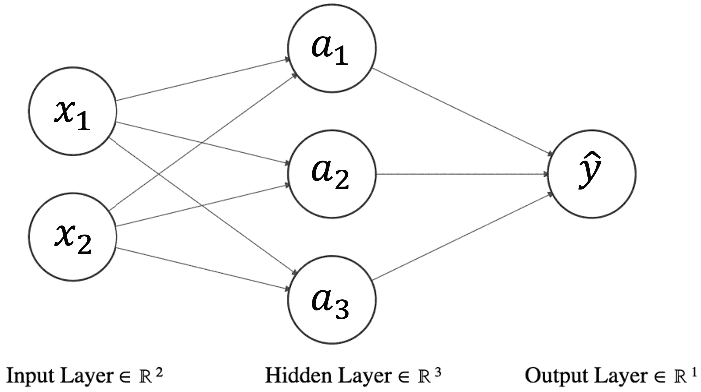

  *图 4.3：我们将实现的 MLP 架构*

- **数据流**：**输入向量**与输入到隐藏层的权重相乘，再加上偏置；我们应用 **sigmoid** 得到隐藏激活。这些激活再与隐藏层到输出层的权重相乘，再次加上偏置，并通过另一个 **sigmoid** 产生输出。

- **训练与损失**：为简单起见，我们将使用 **MSE** 通过 **梯度下降** 进行训练（后续分类任务可换成交叉熵）。梯度通过 **反向传播** 计算，并用于更新两组权重和偏置。

我们将使用 Eigen 进行矩阵运算，以从头展示其机制。一旦你明白了这一点，就可以用同样的逻辑将张量和模块替换为 LibTorch。

我们先创建 `NeuralNetwork` 类（头文件）。这个头文件列出了模型的**参数**和**API**。我们存储两个权重矩阵（`[hidden, input]` 和 `[output, hidden]`）和两个偏置向量（每层一个）。激活函数是 **sigmoid**，通过 Eigen 逐元素实现。公有方法包括：构造函数用于设置大小和学习率，feedforward 用于预测，train 用于在单个样本上执行一步学习。（所有向量都是列向量；Eigen 的 `VectorXd` 默认是列向量。）

```cpp
#ifndef NEURAL_NETWORK_H
#define NEURAL_NETWORK_H

#include <Eigen/Dense>
#include <cmath>

using namespace Eigen;

class NeuralNetwork {
private:
    MatrixXd weights_input_hidden; // [hidden, input]
    MatrixXd weights_hidden_output; // [output, hidden]
    VectorXd bias_hidden; // [hidden]
    VectorXd bias_output; // [output]
    double learning_rate;

    // Sigmoid activation applied elementwise
    VectorXd sigmoid(const VectorXd& x) {
        return 1.0 / (1.0 + (-x.array()).exp());
    }

    // Derivative of sigmoid given its output (y = sigmoid(x))
    VectorXd sigmoid_derivative(const VectorXd& y) {
        return y.array() * (1.0 - y.array());
    }

public:
    NeuralNetwork(int input_size, int hidden_size, int output_size, double lr);

    // Forward pass for a single example
    VectorXd feedforward(const VectorXd& input);

    // One training step on a single (input, target) pair
    void train(const VectorXd& input, const VectorXd& target);
};

#endif
```

接下来，我们将实现构造函数。我们随机初始化权重和偏置，这样隐藏单元就不会全都学到相同的东西（对称破缺）。`learning_rate`（double）控制每个梯度步长的大小。出于教学目的，我们使用 `Random()`；对于更深的网络，请考虑 `Xavier/He` 初始化。

```cpp
NeuralNetwork::NeuralNetwork(int input_size, int hidden_size, int output_size, double lr) {
    learning_rate = lr;

    // Random init (for teaching; in practice consider Xavier/He)
    weights_input_hidden = MatrixXd::Random(hidden_size, input_size);
    weights_hidden_output = MatrixXd::Random(output_size, hidden_size);
    bias_hidden = VectorXd::Random(hidden_size);
    bias_output = VectorXd::Random(output_size);
}
```

对于前向传播，给定输入向量 `x`，我们计算隐藏层预激活 \(z_1 = W_1 x + b_1\)，用 sigmoid 压缩得到 \(a_1 = \sigma(z_1)\)，然后计算输出层预激活 \(z_2 = W_2 a_1 + b_2\)，再次应用 sigmoid 得到最终预测。这与数学图示一致，也正好为反向传播做好了准备。

```cpp
VectorXd NeuralNetwork::feedforward(const VectorXd& input) {
    // Hidden layer: z1 = W1*x + b1; a1 = sigmoid(z1)
    VectorXd hidden_input = weights_input_hidden * input + bias_hidden;
    VectorXd hidden_output = sigmoid(hidden_input);

    // Output layer: z2 = W2*a1 + b2; a2 = sigmoid(z2)
    VectorXd final_input = weights_hidden_output * hidden_output + bias_output;
    VectorXd final_output = sigmoid(final_input);

    return final_output;
}
```

最后，反向传播使我们能够把误差转化为参数更新。训练要做两件事：一次前向传播获得预测，然后一次反向传播把损失信号转化为梯度。对于 MSE 和 sigmoid 输出，输出层 delta \(\delta_{\text{out}}\) 为 \((y - \hat{y}) \odot \sigma'(\hat{y})\)；隐藏层 delta \(\delta_{\text{hid}}\) 为 \((W_{\text{ho}}^\top \delta_{\text{out}}) \odot \sigma'(a_{\text{hid}})\)。然后我们执行简单的**随机梯度下降**（**SGD**）更新：在每个权重矩阵上加上 \(\eta \times \nabla_W\)，在每个偏置上加上 \(\eta \times \nabla_b\)。如果你不太理解下面的内容，别担心，我们将在下一节更详细地解释反向传播。

```cpp
void NeuralNetwork::train(const VectorXd& input, const VectorXd& target) {
    // 1) Forward
    VectorXd hidden_input = weights_input_hidden * input + bias_hidden;
    VectorXd hidden_output = sigmoid(hidden_input);
    VectorXd final_input = weights_hidden_output * hidden_output + bias_output;
    VectorXd final_output = sigmoid(final_input);

    // 2) Error (MSE-style)
    VectorXd output_error = target - final_output; // size: [output]

    // 3) Backprop deltas (use deltas, not raw error)
    VectorXd output_delta = sigmoid_derivative(final_output).cwiseProduct(output_error);
    VectorXd hidden_error = weights_hidden_output.transpose() * output_delta;
    VectorXd hidden_delta = sigmoid_derivative(hidden_output).cwiseProduct(hidden_error);

    // 4) SGD updates (+= because delta uses (target - output))
    weights_hidden_output += learning_rate * (output_delta * hidden_output.transpose());
    bias_output += learning_rate * output_delta;
    weights_input_hidden += learning_rate * (hidden_delta * input.transpose());
    bias_hidden += learning_rate * hidden_delta;
}
```

有了前向传播和合适的损失函数（BCE/交叉熵），我们现在就可以反向传播这些误差并搭建训练循环——将原始预测转变为一个真正会学习的模型。

### 推导/反向传播梯度并用随机梯度下降更新权重

你已经见识过反向传播的实际应用。其核心就是链式法则在网络中**反向**运行：**前向传播**计算出预测值 \(\hat{y}\) 和损失 \(L = (y - \hat{y})^2\) 之后，一次**反向传播**会复用中间值，高效地获得每一层的梯度，如 *图 4.4* 所示。具体来说，从输出端开始，形成一个误差信号（即“delta”），然后通过权重的**转置**和激活函数的**导数**将其向后传递，从而获得更早层的 delta。

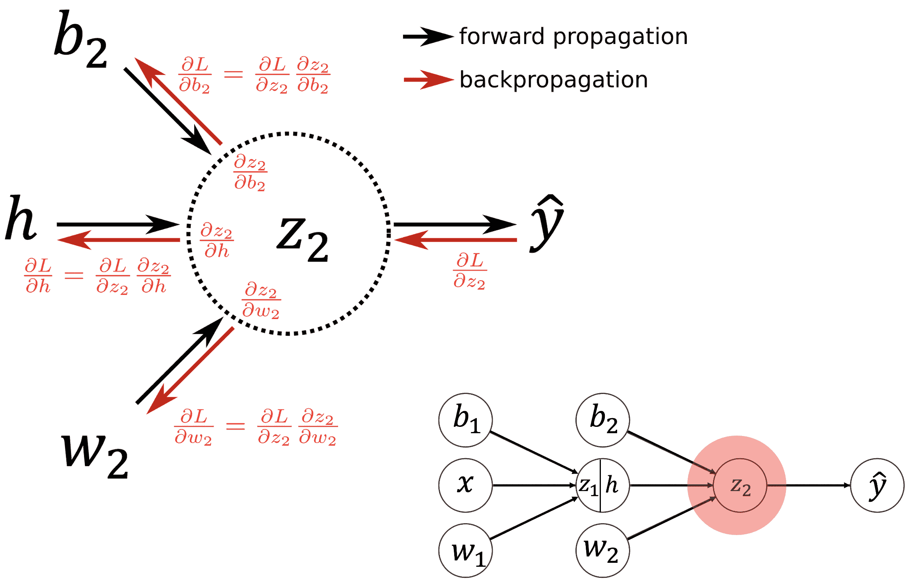

*图 4.4：围绕输出预激活 \(z_2\) 的局部反向传播*

对于 **MSE** 和 **sigmoid** 输出，两层 MLP 的 delta 和梯度如下：

- **输出层 delta**：\(\delta_{\text{out}} = (y - \hat{y}) \odot \sigma'(\hat{y})\)

- **隐藏层 delta**：\(\delta_{\text{hid}} = (W_{\text{ho}}^\top \delta_{\text{out}}) \odot \sigma'(a_{\text{hid}})\)

- **梯度（外积）**：

\[
\frac{\partial L}{\partial W_{\text{ho}}} = \delta_{\text{out}} a_{\text{hid}}^\top, \quad
\frac{\partial L}{\partial b_{\text{o}}} = \delta_{\text{out}}
\]

\[
\frac{\partial L}{\partial W_{\text{ih}}} = \delta_{\text{hid}} x^\top, \quad
\frac{\partial L}{\partial b_{\text{h}}} = \delta_{\text{hid}}
\]


**梯度下降**随后会以小步长（即**学习率** `lr`）沿梯度的反方向微调参数。根据我们这里的 δ 定义（使用 y = sigmoid(z)），这些更新表现为**加法形式**：

W ← W + lr × (δ × a^⊤), b ← b + lr × δ.

下面是一个单样本反向传播 + SGD（MSE + sigmoid）示例：

```cpp
static VectorXd sigmoid(const VectorXd& v) {
    return 1.0 / (1.0 + (-v.array()).exp());
}

static VectorXd sigmoid_deriv_from_output(const VectorXd& y) { // y = sigmoid(z)
    return y.array() * (1.0 - y.array());
}

double train_one_mse(const VectorXd& x, const VectorXd& t) {
    // ----- Forward -----
    VectorXd z1 = Wih * x + bh;
    VectorXd a1 = sigmoid(z1);
    VectorXd z2 = Who * a1 + bo;
    VectorXd y = sigmoid(z2);

    // ----- Deltas (backprop) -----
    VectorXd delta_out = sigmoid_deriv_from_output(y).cwiseProduct(t - y); // [O]
    VectorXd delta_hid = (Who.transpose() * delta_out).cwiseProduct(sigmoid_deriv_from_output(a1)); // [H]

    // ----- Gradients (outer products) -----
    MatrixXd dWho = delta_out * a1.transpose();
    VectorXd dbo = delta_out;
    MatrixXd dWih = delta_hid * x.transpose();
    VectorXd dbh = delta_hid;

    // ----- SGD update (+= because delta uses t - y) -----
    Who += lr * dWho; bo += lr * dbo;
    Wih += lr * dWih; bh += lr * dbh;

    return 0.5 * (y - t).squaredNorm();
}
```

如*图 4.5*所示，不同的梯度下降变体在同一个损失曲面上会走出截然不同的路径。

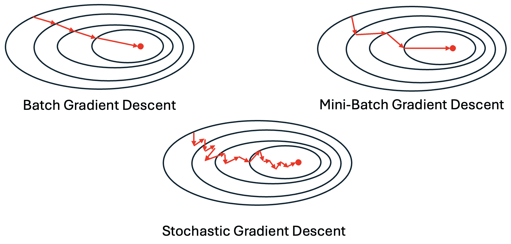

*图 4.5：批量梯度下降与小批量梯度下降及随机梯度下降的对比*

椭圆代表损失曲面的等高线。批量梯度下降（Batch GD）每一步都需要计算整个数据集的梯度，因此轨迹平滑且稳定，但每次更新的代价很高。随机梯度下降（SGD）每次只根据一个样本进行更新，产生一条噪声大、抖动明显的路径，移动虽快但方差很高。小批量梯度下降（Mini-batch GD）在一个小批量（如 32–256）上对梯度求平均，得到分段平滑的更新步，在稳定性、速度和硬件效率之间取得平衡——因此成为训练神经网络的默认选择。

在**批量梯度下降**中，每次更新前都要在整个**训练集**上计算梯度：

W ← W − lr × (1/N) Σ_{i=1}^{N} ∇_W L(x_i, t_i),  
b ← b − lr × (1/N) Σ_{i=1}^{N} ∇_b L(x_i, t_i).

它能给出平滑、稳定的更新步，但每次更新的代价都很高（必须遍历全部 N 个样本），而且可能非常消耗内存。

在**SGD**中，你每次使用**一个样本**进行更新：

W ← W − lr × ∇_W L(x_i, t_i),  
b ← b − lr × ∇_b L(x_i, t_i),

以随机顺序遍历数据。更新既廉价又频繁，固有的噪声有助于逃离浅的局部最小值，但损失曲线会抖动，更新步也可能不稳定。

**小批量SGD**在一个由 m 个样本组成的小批量（如 32–256）上对梯度求平均，然后更新一次：

W ← W − lr × (1/m) Σ_{j=1}^{m} ∇_W L(x_{i_j}, t_{i_j}),

这兼顾了稳定性与速度。小批量在 GPU 上能很好地向量化，充分利用内存带宽，也是深度学习的默认选择。

### 何时使用哪种方法（实用要点）

- **批量梯度下降**：适用于很小的数据集，此时完整遍历一次代价不高；否则每次更新太慢。
- **SGD（单样本）**：适用于流式数据，或需要非常快速、带噪声的探索；往往需要更小的学习率。
- **小批量（推荐）**：对大多数工作负载而言是最佳折衷；选择能放进内存的最大批量（常见范围：32–1024）。每个 epoch 都做 shuffle 以保证批次无偏。

### 可在训练循环中配合使用的技巧

- 将**epoch**定义为对数据集的一次完整遍历；**iteration/step**则是一次参数更新（处理一个批次）。
- 随着批量增大，通常可以调大 `lr`（例如采用线性缩放规则，并配合短暂 warmup）。
- 更大的批量能提升吞吐量，但若过度增大可能损害泛化能力；请监控验证集指标。
- 分批次前一定要**shuffle**以减少样本间的相关性；在更深的网络上使用小批量 + momentum/Adam 可加快收敛。

简而言之：批量梯度下降稳定但缓慢；纯 SGD 快速但有噪声；**小批量SGD**则兼得两者之长，也是本章训练网络时所采用的方法。

### 本章小结

在本章中，你从第一性原理出发，逐步构建起了用 C++ 训练小型神经网络的整套机制。你从线性回归和逻辑回归入手，为损失函数和梯度的数学打下了基础；随后将神经元建模为“仿射变换 + 非线性激活”。你用 Eigen 实现了一个微型 MLP，编写了**前向传播**（`z = Wx + b, a = σ(z)`），并通过链式法则推导了**反向传播**，得到逐层的 δ 与外积梯度。你使用**梯度下降**的各变体（批量、随机、小批量）训练模型，在留出集上监控准确率 / MSE，并学会了实用的训练习惯：每个 epoch 进行 shuffle、选择与任务匹配的输出激活函数和损失函数、把学习率理解为更新步长。在这个过程中，你看到一旦数据被映射为向量，*相同*的“前向 | 反向 | 更新”循环就能跨领域工作。这为你将这些逻辑直接扩展到 LibTorch，以及后续通过 CUDA 实现 GPU 加速做好了准备。

在下一章中，我们将从*从零开始*编写的 Eigen 代码转向 PyTorch C++ API（LibTorch），引入模块、优化器以及 dataset/dataloader 抽象。你将构建更深的网络，在可用时用 GPU 训练，并学习如何保存和加载模型，以及如何为更大的项目组织训练循环。

### 思考题

在继续之前，为了帮助你检查自己的理解，请思考以下问题：

1. 神经元的权重和偏置各有什么作用？
2. 为什么需要非线性激活？
3. 解释批量梯度下降、SGD 和小批量SGD——各自在什么时候更适用？
4. 学习率控制什么？如果太大或太小会怎样？

### 延伸阅读

如果你想加深理解，以下资源提供了清晰的解释和有用的背景：

- *深度学习——Goodfellow、Bengio、Courville（第 6–8 章：MLP、优化、正则化）*
- *模式识别与机器学习——Bishop* *（第 4–5 章：线性/逻辑模型、神经网络）*
- *斯坦福 CS231n 笔记*：反向传播与神经网络优化
- *PyTorch（LibTorch）C++ API 教程*：模型、优化器与张量基础
- *反向传播通俗入门*：帮助建立直觉的博客文章（链式法则、计算图）

### 参考答案

当你准备好后，可将自己的回答与下面的简要答案进行对照，以确认理解是否正确：

1. 权重对输入进行缩放以形成特征；偏置对激活进行平移，使神经元不必强制经过原点。
2. 没有非线性的话，堆叠的仿射层会坍缩成一个仿射映射，从而无法建模弯曲的决策边界。
3. 批量梯度下降：使用全量数据集的梯度——稳定但每步较慢。SGD：每步一个样本——快速但有噪声。小批量：在一个小批量（如 32–256）上求平均——最佳折衷，也是深度学习的默认选择。
4. 它决定更新步长。太大：发散/震荡；太小：收敛缓慢或陷入停滞。

### 获取本书 PDF 版及更多内容

扫描二维码（或访问 `packtpub.com/unlock`）。按书名搜索本书，确认版本，然后按照页面上的步骤操作。


*注意：请保管好发票。从 Packt 直接购买则无需发票。*


## 5 C++ 中的多层感知机

**多层感知机**（**MLPs**）代表了神经网络架构中的关键进步，将简单的感知机转变为强大的学习系统，能够解决复杂的非线性可分问题。通过堆叠多层相互连接的神经元——每一层都应用加权变换和非线性激活函数——MLPs 创建了分层表示，能够捕获数据中的复杂模式。本章探讨了 MLPs 的理论基础和 C++ 中的实践实现，探索三种不同的方法：使用 Eigen 库的基础 CPU 实现、使用 CUDA 的高性能 GPU 加速解决方案，以及使用 LibTorch（PyTorch 的 C++ API）的生产级实现。

我们首先通过 XOR 问题的视角剖析 MLP 架构，说明为什么单层网络无法成功而多层架构可以。随后，本章全面探索激活函数——从经典的 sigmoid 和 tanh 函数到现代变体，如 ReLU、Leaky ReLU、Swish 和 Mish——解释每种函数如何引入学习复杂映射所必需的非线性。最后，我们研究驱动学习过程的优化算法，包括梯度下降、动量、RMSprop、**自适应矩估计**（**Adam**）、Adagrad 和 Adadelta，并为每种算法提供数学直觉和完整的 C++ 实现。

学完本章后，你将掌握在 C++ 中实现、训练和优化多层神经网络的理论理解和实践技能，并能够根据你的具体需求选择最合适的实现策略——无论是用于嵌入式系统的原生 C++、追求最大性能的 CUDA，还是用于生产部署的 LibTorch。

本章将涵盖以下主题：

- 理解 MLP 架构
- 选择你的 MLP 实现方法：策略指南
- 探索深度学习训练概念

### 技术要求

要跟随本章的实现，你需要以下内容：

- 软件要求：
  - 支持 C++14 或更高版本的 C++ 编译器
  - 用于矩阵运算的 Eigen 库（版本 3.3 或更高）
  - 用于 GPU 实现的 CUDA 工具包（版本 11.0 或更高）
  - 用于 PyTorch 实现的 LibTorch（PyTorch C++ API）
- 硬件要求：
  - 支持 CUDA 的 NVIDIA GPU（用于 GPU 实现）
  - 至少 8GB 内存
  - 建议使用多核 CPU 进行并行处理
- 开发环境：
  - 支持 C++ 的 IDE（Visual Studio、PyCharm 或类似工具）
  - 用于访问代码仓库的 Git
  - 用于构建和运行示例的命令行界面
- 先备知识：
  - 对 C++ 编程的基本理解
  - 熟悉神经网络概念
  - 理解基础线性代数
  - 具有构建系统和包管理经验

### 理解 MLP 架构

MLP 的架构是一种复杂的层次化结构，每个组件在网络功能中都扮演着关键角色。MLP 架构的核心遵循层级化设计，起始于输入层，它充当网络的感知系统，接受各种维度的原始数据特征。这些输入随后进入一个或多个隐藏层。每个隐藏层包含大量神经元，它们通过带权重的突触相互连接，形成复杂的计算路径网络。每个神经元通过激活函数处理其输入，引入非线性，使网络能够学习模式和关系。层之间的加权连接充当知识库，在训练过程中存储学到的模式。最后，架构在输出层达到顶点，其结构由手头的特定任务决定——可能是用于二分类的单个神经元，也可能是用于更复杂预测的多个神经元。这种受生物神经网络启发的架构设计，使 MLP 能够通过连续的抽象层转换输入数据，有效学习输入空间的层次化表示。我们将通过一个 C++ 程序来探索基本的 MLP。首先，我们将查看整个程序，然后在后续章节中剖析上述每个组件。

```text
Illustrative example of Multilayer perceptron, a Feedforward neural network

Input layer
Hidden layer
Output layer

h1
h2
yk
x1
1
x2
w1k
w2k
w11
w21
w31
w12
w22
w32

input
input

To model bias
```

| 变量 | 含义 |
| --- | --- |
| x1, x2 | 输入数据特征 |
| wij | 网络权重 |
| h1, h2 | 隐藏层中的节点 |
| yk | 输出变量 |

该示例由以下部分组成：(a) 一个包含两个输入节点和一个偏置节点的输入层，(b) 一个包含两个神经元的隐藏层，(c) 一个包含一个神经元的输出层

*图 5.1：多层感知机。图片由 AIML.com 提供*

现在我们对 MLP 架构有了概念性的理解，接下来让我们深入实践实现，探索这些组件如何在代码中协同工作。

### 在 C++ 中实现 MLP

在 C++ 中实现 MLP 需要仔细考虑各种组件及其交互。在本节中，我们将创建一个完整的 MLP 实现，用于解决异或（XOR）问题，演示如何使用类来构建网络，并利用 Eigen 库进行高效的矩阵运算。

在深入研究代码之前，让我们先看看 XOR 问题，以及为什么单层感知机不足以解决 XOR 问题。XOR 是一个逻辑门问题，它接受两个二进制输入并产生一个二进制输出。当输入值不同时，XOR 操作的输出为 1。与 AND、OR 或 NAND 等其他具有线性可分边界的逻辑门不同，如*图 5.2*所示，XOR 数据不是线性可分的。感兴趣的读者可以参考*延伸阅读*部分，以更深入地理解该问题。

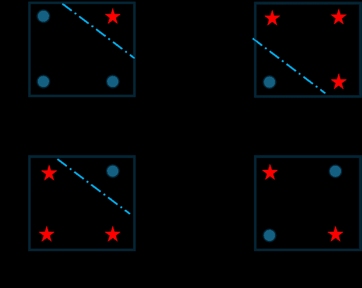

*图 5.2：逻辑门 AND、OR、NAND 和 XOR。除 XOR 之外的所有逻辑门都具有线性可分边界*

我们的实现将包含两个主要类：一个处理单个层操作的 Layer 类，以及一个管理整个网络架构的 MultilayerPerceptron 类。通过这个实现，你将学习如何使用现代 C++ 实践执行前向传播、反向传播和神经网络训练。在本节中，我们将只强调 C++ 代码的重要方面。完整代码可以从相关的 GitHub 页面下载（`https://github.com/PacktPublishing/Deep-Learning-with-C-/blob/main/chapter5/eigen_mlp_xor.cpp`）。让我们从 Layer 类开始，它是我们网络的基本构建块。

#### Layer 类

Layer 类是神经网络实现中的基本构建块，表示单个神经元层。在下面的代码中，你会看到一个层类的实例化。有一些关键变量，如 weights、biases、activation、input 和 output。weights 是一个矩阵，其维度由输入层和输出层的节点数决定。因此，如果输入层和输出层分别有 2 个和 3 个节点，则权重矩阵的大小为 (2, 3)。biases 是每层的默认激活值。activation 变量存储中间计算，如 activation = f(weights * input + bias)。其中 f 是激活函数。我们将在本章后面讨论各种激活函数。

```cpp
class Layer {
private:
    Eigen::MatrixXd weights;
    Eigen::VectorXd biases;
    Eigen::MatrixXd activation;
    Eigen::MatrixXd input;
    Eigen::MatrixXd output;
public:
    Layer(int input_size, int output_size) {
        weights = Eigen::MatrixXd::Random(output_size, input_size) * 0.1;
        biases = Eigen::VectorXd::Zero(output_size);
    }
```

Layer 类有两个主要操作：

- **前向传播**：这就像将信息向前传递穿过层。它接收输入数据，乘以权重，加上偏置，并应用激活函数（此处为 ReLU）来产生输出。

```cpp
Eigen::MatrixXd forward(const Eigen::MatrixXd& x)
{
    input = x;
    activation = (weights * input + biases.replicate(1, input.cols()));
    output = relu(activation);
    return output;
}
```


b. **反向传播**：这是一个学习阶段，层会根据自身产生的误差调整权重和偏置。就像学生在看到正确答案后改正自己的错误一样。

```cpp
Eigen::MatrixXd backward(const Eigen::MatrixXd& grad_output, double learning_rate) {
    Eigen::MatrixXd grad_activation = grad_output.array() * relu_derivative(activation).array();

    // Calculate gradients
    Eigen::MatrixXd grad_weights = grad_activation * input.transpose();
    Eigen::VectorXd grad_biases = grad_activation.rowwise().sum();
    Eigen::MatrixXd grad_input = weights.transpose() * grad_activation;

    // Update weights and biases
    weights -= learning_rate * grad_weights;
    biases -= learning_rate * grad_biases;

    return grad_input;
}
```

现在，我们已经定义了 `Layer` 类，可以利用它来构建 `MLP` 类，该类将多个层编排成一个完整的神经网络架构。

#### MultilayerPerceptron 类

在 `Layer` 类奠定的基础之上，我们可以构建 `MultilayerPerceptron` 类——这是一个完整的神经网络，将多个层编排成一个内聚的架构。该类作为训练模型的神经网络，管理从初始化到预测的整个学习过程。

MLP 网络通过指定层大小来创建——层大小是一个向量，定义了网络中每一层的节点数量。构造函数使用 `for` 循环遍历该向量，通过连接相邻的层大小依次创建每一层。

网络结构建立后，`MultilayerPerceptron` 类实现了一个 `forward` 函数，该函数建立在 `Layer` 类中定义的 `forward` 函数之上。这个函数编排数据在整个网络中的流动，将每一层的输出作为下一层的输入，从而有效地将各层操作串联起来，形成一个能够解决 XOR 分类任务等复杂问题的深度学习架构。

```cpp
class MultilayerPerceptron {
private:
    std::vector<Layer> layers;
    double learning_rate;
public:
    MultilayerPerceptron(const std::vector<int>& layer_sizes, double lr = 0.01)
    : learning_rate(lr) {
        for (size_t i = 0; i < layer_sizes.size() - 1; ++i) {
            layers.emplace_back(layer_sizes[i], layer_sizes[i + 1]);
        }
    }

    Eigen::MatrixXd forward(const Eigen::MatrixXd& input) {
        Eigen::MatrixXd current_input = input;
        for (auto& layer : layers) {
            current_input = layer.forward(current_input);
        }
        return current_input;
    }
```

最后，我们可以定义训练循环，对 MLP 网络进行训练。这个 *train* 函数会按给定的 *epochs*（轮数）进行迭代。在每个 epoch 中，它计算损失函数**均方误差**（**MSE**）。每一步都会执行前向传播和反向传播函数，同时尽量降低损失值。

```cpp
    void train(const Eigen::MatrixXd& X, const Eigen::MatrixXd& y, int epochs) {
        for (int epoch = 0; epoch < epochs; ++epoch) {
            // Forward pass
            auto prediction = forward(X);
            // Calculate loss (MSE)
            double loss = (prediction - y).array().square().mean();
            if (epoch % 100 == 0) {
                std::cout << "Epoch " << epoch << ", Loss: " << loss << std::endl;
            }
            // Backpropagation
            Eigen::MatrixXd grad = 2.0 * (prediction - y) / y.cols(); // MSE derivative
            // Backward pass through all layers in reverse
            for (int i = layers.size() - 1; i >= 0; --i) {
                grad = layers[i].backward(grad, learning_rate);
            }
        }
    }

    // Method to make predictions after training
    Eigen::MatrixXd predict(const Eigen::MatrixXd& X) {
        return forward(X);
    }
};
```

在这个程序中，我们使用了一些术语，如 ReLU（激活函数）、epochs（轮数）和学习率（learning rate）。我们将在*探索深度学习训练概念*一节中讨论这些术语。

与此同时，让我们看看编写此程序时使用的一些 C++ 库。它们包括：

- **Eigen**：Eigen 是一个高性能的 C++ 模板库，用于线性代数、矩阵、向量及相关算法。在 MLP 代码中，它用于：
  - `MatrixXd`：动态大小矩阵运算
  - `VectorXd`：动态大小向量运算
  - 高效的矩阵乘法和数学运算
  - 管理神经网络层中的权重和偏置
- **向量库（std::vector）**：C++ **标准模板库**（**STL**）中的 vector 在代码中用于：
  - 存储和管理 `Layer` 对象的集合
  - 为神经网络架构提供动态数组功能
  - 管理网络配置中的层大小
- **数学库（cmath）**：C++ 数学库提供基本的数学运算。在神经网络实现的上下文中，它用于：
  - 数学函数和运算
  - 激活函数中的计算
  - 计算损失和梯度

以上说明都是针对上述 C++ 代码的。如需详细了解，请参阅相关参考资料。这里给出的 MLP 代码没有使用**图形处理器**（**GPU**）提供的任何并行处理。现在，我们将看看使用 GPU 并行化的同一段 C++ 代码。

### 使用 CUDA 实现 MLP

GPU 并行化是现代深度学习实现的基石，它提供了训练和部署复杂神经网络所需的大规模计算加速能力。虽然 PyTorch 和 TensorFlow 等框架抽象掉了大部分 GPU 处理细节，但理解 C++ 中 GPU 加速的底层机制对于优化性能和构建自定义解决方案至关重要。本节探讨如何在 C++ 中直接利用 GPU 能力，重点关注那些与金融、自动驾驶系统和医疗保健等高风险应用中尤为相关的实际实现，这些领域对计算效率和低延迟的要求极高。与之前一样，完整代码将在本章关联的 GitHub（`https://github.com/PacktPublishing/Deep-Learning-with-C-/tree/main/chapter5`）中提供。这里，我们将拆解代码中最重要的部分。

以下是为 CUDA 核函数定义的头部，它们处理基本的 CUDA 操作并定义 GPU 专用函数：

```cpp
#include <cuda_runtime.h>
#include <curand.h>
#include <cublas_v2.h>

// CUDA kernels for ReLU activation and its derivative
__global__ void reluKernel(float* data, int size)
__global__ void reluDerivativeKernel(float* data, float* output, int size)
```

接下来，我们定义 `CudaLayer` 类。这与上一节中定义的 `Layer` 类类似。

```cpp
class CudaLayer {
private:
    int input_size, output_size;
    float *d_weights, *d_biases;
    float *d_input, *d_output;
    float *d_activation;
    cublasHandle_t handle;
public:
    CudaLayer(int in_size, int out_size) : input_size(in_size), output_size(out_size) {
        cublasCreate(&handle);
        // Allocate memory on GPU
        cudaMalloc(&d_weights, output_size * input_size * sizeof(float));
        cudaMalloc(&d_biases, output_size * sizeof(float));
        cudaMalloc(&d_input, input_size * sizeof(float));
        cudaMalloc(&d_output, output_size * sizeof(float));
        cudaMalloc(&d_activation, output_size * sizeof(float));
        // Initialize weights randomly
        curandGenerator_t gen;
        curandCreateGenerator(&gen, CURAND_RNG_PSEUDO_DEFAULT);
        curandGenerateUniform(gen, d_weights, output_size * input_size);
        curandDestroyGenerator(gen);
        // Initialize biases to zero
        cudaMemset(d_biases, 0, output_size * sizeof(float));
    }
```

该函数展示了变量的初始化过程。它使用 `cudaMalloc` 在 GPU 上分配内存。这与标准 C++ 中的 malloc 函数类似，但专门用于 GPU 内存分配。我们对每个变量都使用了 malloc 函数（这里指 `cudaMalloc`）。接下来，我们希望使用随机数生成器 `curandGenerator` 来随机初始化权重。`curandGenerateUniform` 利用该随机数生成器从均匀分布中采样随机数。最后，我们使用 `cudaMemset` 将偏置初始化为零。

初始化之后，让我们来看看前向传播函数。

```cpp
void forward(float* input, int batch_size) {
    const float alpha = 1.0f;
    const float beta = 0.0f;
    // Matrix multiplication: activation = weights * input + biases
    cublasSgemm(handle, CUBLAS_OP_N, CUBLAS_OP_N,
        output_size, batch_size, input_size,
        &alpha, d_weights, output_size,
        input, input_size, &beta,
        d_activation, output_size);
    // Add biases
    for (int i = 0; i < batch_size; ++i) {
        cublasSaxpy(handle, output_size, &alpha,
            d_biases, 1,
            d_activation + i * output_size, 1);
    }
}
```


## 第5章：C++ 中的多层感知机

```cpp
    // Apply ReLU
    int block_size = 256;
    int num_blocks = (output_size * batch_size + block_size - 1) / block_size;
    reluKernel<<<num_blocks, block_size>>>(d_activation, output_size * batch_size);
}
```

`cublasSgemm` 执行权重与输入之间的矩阵乘法。该函数对于 GPU 上神经网络计算中的高效矩阵运算至关重要。我们建议查看 *进一步阅读* 部分以及 `cublas` 库以了解各个参数的含义。然后我们使用 `cublasSaxpy` 将偏置加到之前乘法的结果上。接着我们对结果应用 ReLU 操作。这就完成了前向传播。

现在让我们来看反向传播。下面的代码展示了如何通过 ReLU 计算梯度。

```cpp
void backward(float* grad_output, float learning_rate, int batch_size) {
    const float alpha = learning_rate;
    const float beta = 1.0f;
    // Compute gradient through ReLU
    int block_size = 256;
    int num_blocks = (output_size * batch_size + block_size - 1) / block_size;
    float* d_grad_activation;
    cudaMalloc(&d_grad_activation, output_size * batch_size * sizeof(float));
    reluDerivativeKernel<<<num_blocks, block_size>>>(d_activation, d_grad_activation, output_size * batch_size);
    // Update weights
    cublasSgemm(handle, CUBLAS_OP_N, CUBLAS_OP_T,
                output_size, input_size, batch_size,
                &alpha, d_grad_activation, output_size,
                d_input, input_size, &beta, d_weights, output_size);
    // Update biases
    cublasSgemv(handle, CUBLAS_OP_N,
                output_size, batch_size,
                &alpha,
                d_grad_activation, output_size,
                d_input, 1,
                &beta,
                d_biases, 1);
    cudaFree(d_grad_activation);
}
```

然后它使用相同的 `cublasSgemm` 来更新模型权重，并使用 `cublasSgemv` 来更新偏置。与执行矩阵-矩阵乘法的 `cublasSgemm` 不同，`cublasSgemv` 执行的是矩阵-向量乘法。

最后，我们可以使用 `CudaLayer` 类来构建多层感知机，如下所示。

```cpp
class CudaMLP {
private:
    std::vector<CudaLayer> layers;
    float learning_rate;
public:
    CudaMLP(const std::vector<int>& layer_sizes, float lr = 0.01)
        : learning_rate(lr) {
        for (size_t i = 0; i < layer_sizes.size() - 1; ++i) {
            layers.emplace_back(layer_sizes[i], layer_sizes[i + 1]);
        }
    }
```

在这个函数中，`layers` 是一个存储 `CudaLayer` 对象的向量。`layer_sizes` 是一个存储每层大小的向量。构造函数遍历 `layer_sizes` 来创建网络结构。它使用 `emplace_back` 操作来创建层。C++ 中常见的操作是 `push_back`，它会创建一个临时变量，然后将其存储到向量中；而 `emplace_back` 则通过在向量中直接构造 `CudaLayer` 对象，提供了一种更高效的操作。例如，如果 `layer_sizes` = {2, 4, 3, 1}，该函数将创建一个 MLP，其中第一层有 2 个输入和 4 个输出，第二层有 4 个输入和 3 个输出，最后第三层有 3 个输入和 1 个输出。

请参阅 `chapter_5/cuda_mlp.cpp` 获取完整代码。要执行此程序，首先使用以下命令编译：

```sh
nvcc -o cuda_mlp cuda_mlp.cpp -lcublas -lcurand
```

然后按如下方式执行代码：

```sh
./cuda_mlp
```

到目前为止，我们已经看到了使用 C++ 解决相同的 XOR 问题，然后使用 CUDA 库进行高效加速计算。这些是底层库，可能不适用于构建复杂的神经网络架构。因此，我们现在将使用 LibTorch（PyTorch 的 C++ 实现）来查看相同的程序。

### 使用 LibTorch 实现 MLP

LibTorch 是 PyTorch 的 C++ 发行版，为 PyTorch 的机器学习能力提供了原生的 C++ 接口。它允许开发者用 C++ 构建和训练神经网络。它还通过 CUDA 库提供 GPU 加速。LibTorch 还通过 `torch::nn` 接口提供了预构建的神经网络组件。它还自动处理内存管理，大大减少了开发者的操作负担。

让我们来看一下 C++ 中的 LibTorch 接口：

```cpp
#include <torch/torch.h>
#include <iostream>

// Define the MLP structure
struct MLP : torch::nn::Module {
    torch::nn::Linear layer1{nullptr}, layer2{nullptr}, layer3{nullptr};
    MLP() {
        // Same architecture as before: 2-4-3-1
        layer1 = register_module("layer1", torch::nn::Linear(2, 4));
        layer2 = register_module("layer2", torch::nn::Linear(4, 3));
        layer3 = register_module("layer3", torch::nn::Linear(3, 1));
    }
    torch::Tensor forward(torch::Tensor x) {
        x = torch::relu(layer1->forward(x));
        x = torch::relu(layer2->forward(x));
        x = layer3->forward(x);
        return x;
    }
};
```

MLP 类初始化了三个层，节点大小分别为 2、4、3，最后输出。它使用 `register_module` 将层添加到模型中。还应注意，这里只实现了前向传播。在 LibTorch 中，不需要显式实现反向传播，因为它使用自动微分（autograd），并通过在损失对象上调用 `backward()` 方法来计算，如这个训练循环所示。

```cpp
for (size_t epoch = 0; epoch < 1000; ++epoch) {
    // Forward pass
    auto output = model->forward(X);
    auto loss = torch::mse_loss(output, y);
    // Backward pass and optimize
    optimizer.zero_grad();
    loss.backward();
    optimizer.step();
    if (epoch % 100 == 0) {
        std::cout << "Epoch " << epoch << ", Loss: "
                  << loss.item<float>() << std::endl;
    }
}
```

上述函数是使用 LibTorch 的 C++ API 编写的典型训练/优化循环。我们使用 MSE 损失函数，损失函数上的 `backward()` 函数在每一步计算反向传播。优化步骤包括三个步骤：

- `zero_grad()`：清除旧的梯度或重置其跟踪的所有参数的梯度，确保当前步骤的梯度不会与之前步骤的梯度累积。
- `loss.backward()`：该步骤启动反向传播过程并计算新的梯度。
- `optimizer.step()`：根据所使用的优化算法，应用计算出的梯度来调整模型的可训练参数。在我们的例子中，我们使用了**随机梯度下降**（**SGD**）。

到目前为止，我们探讨了实现 MLP 解决 XOR 问题的三种不同方法：

- 使用 C++ 和 Eigen 库的传统 CPU 实现
- 使用 CUDA 的 GPU 加速方案
- 使用 PyTorch 的 C++ API（LibTorch）的现代方法

### 选择你的 MLP 实现方案：一份策略指南

在完成了同一个 XOR 问题的三种完整实现——先用 Eigen，再用 CUDA，最后用 LibTorch——之后，你现在可以为自己的项目做出明智的选择了。每种方法都反映了不同的权衡，只有当你实际看到它们时才会变得清晰。接下来，让我们逐一看看这些方法。

#### 使用 Eigen 的纯 C++

Eigen 实现要求我们手动编写每个组件：权重初始化、前向传播、反向传播循环和梯度更新步骤。这并非限制——而正是重点所在。当你的部署环境禁止外部框架依赖时，当你的目标是内存预算严格的嵌入式或物联网硬件时，或者当你在一个要求每行代码都可审计的受监管领域（医疗设备、航空航天）工作时，这种透明度是一种要求，而非偏好。

成本与控制力成正比。正如你在 Layer 类中所看到的，即使是一个简单的网络也需要手动实现梯度计算和权重更新。将其扩展到更深的架构或更复杂的损失函数，会显著增加这一负担。这种方法最适合拥有强大 C++ 专业能力，并且面临明确、具体约束的团队，因为这些约束使这种努力是值得的。

#### CUDA：以高昂成本换取最大性能

CUDA 实现展示了 GPU 加速在代码层面实际上涉及什么：为每个张量显式调用 cudaMalloc 和 cudaFree、仔细管理 CPU 到 GPU 的数据传输，以及直接调用 cuBLAS 例程（如 cublasSgemm 和 cublasSgemv）进行矩阵运算。性能上限很高——对于大规模工作负载，GPU 并行化相比 CPU 实现可以实现 10–100 倍的加速——但维护负担同样巨大。

在这个层面编写的代码可移植性较差，更难调试，并且需要持续的 GPU 专业知识来维护。当训练时间是主要瓶颈时，当你在为现有框架不支持的运算构建自定义 GPU 内核时，或者当你的应用程序需要大规模实时推理时，它是一个正确的选择。然而，对于大多数项目来说，除非这些条件得到明确满足，否则很难证明这种复杂性的合理性。


#### LibTorch：生产系统的实用默认选择

相同 XOR 网络的 LibTorch 实现只需要一次前向传播。反向传播通过调用 `loss.backward()` 自动处理，三步优化循环 —— `zero_grad()`、`backward()`、`optimizer.step()` —— 取代了前两种实现中手动编写的梯度累积和权重更新逻辑。跨平台部署、自动内存管理，以及对完整 PyTorch 生态系统的访问都无需额外代码。

这些权衡是真实存在的，但很少具有决定性：更大的二进制文件、框架依赖，以及对底层操作的可见性稍低。对于从原型转向生产的团队，或需要长期维护和扩展的系统而言，这些成本通常会被实现复杂度的降低所抵消。

#### 混合方法

许多生产系统并不会只采用某一种方法。一种常见模式是使用 LibTorch 作为主要框架，同时针对构成可衡量性能瓶颈的特定操作编写自定义 CUDA 内核，并在资源受限的环境中使用原生 C++ 处理预处理或后处理步骤。这样既保留了 LibTorch 的大部分生产力优势，又为确实需要的地方保留了针对性优化的空间。

**建议**：对于大多数用例 —— 包括本章探讨的各类面向生产的架构 —— LibTorch 都是合适的起点。自动微分、内置优化器和跨平台支持满足了最常见的实际需求，而无需承担 CUDA 所需的基础设施投入，也无须承受原生 Eigen 的手动实现开销。只有当框架无法满足某个具体且可衡量的需求时，才应偏离这一默认选择。最有效的实现是能够交付、维护和迭代的实现，而不是理论上最优的实现。

下表总结了本章涉及的三种实现 —— 原生 C++/Eigen、CUDA 和 LibTorch —— 在内存管理、抽象级别、性能和实际用例等维度上的主要差异。

| 特性 | CPU 实现 | CUDA 实现 | LibTorch 实现 |
| --- | --- | --- | --- |
| 使用的库 | Eigen | cuBLAS、cuRAND | PyTorch C++ API |
| 内存管理 | 自动（C++） | 显式（cudaMalloc、cudaFree） | 自动 |
| 处理单元 | CPU | GPU | CPU/GPU |
| 抽象级别 | 中层 | 低层 | 高层 |
| 矩阵运算 | `Eigen::MatrixXd` | `cublasSgemm`、`cublasSgemv` | `torch::Tensor` |
| 实现复杂度 | 中等 | 复杂 | 简单 |
| 要求 | - C++ 编译器<br>- Eigen 库<br>- 8 GB 内存 | - CUDA 工具包<br>- cuBLAS 库<br>- NVIDIA GPU | - LibTorch<br>- CMake<br>- C++14 或更高版本 |
| 性能 | 大型计算较慢 | 大型计算最快 | 良好的平衡 |
| 内存访问 | 直接 | 需要 CPU-GPU 传输 | 抽象化 |
| 用例 | 原型开发、小型数据集 | 高性能计算 | 生产部署 |
| 梯度计算 | 手动实现 | 手动实现 | 自动微分 |

*表 5.1：MLP 实现方法对比*

在接下来的章节中，我们将使用 PyTorch 的 C++ API 重点介绍深度学习在 C++ 中的实际应用，提供更多动手实践示例和真实场景的实现。

### 探索深度学习训练概念

在本章中，我们使用了激活函数和优化技术等概念，但并未明确定义它们。在本节中，我们将稍微偏离主题，正式定义这两个概念。学习这些概念并建立直观理解，将在你的深度学习之旅中至关重要。

#### 激活函数

在本章中，我们在 MLP 实现中一直使用 ReLU 函数。然而，激活函数的选择远非随意——它会显著影响网络学习和泛化的能力。激活函数是将非线性引入神经网络的数学门户，它将输入的加权和转换为有意义的输出，使网络能够学习数据中复杂的模式和关系。

如果没有激活函数，任何多层网络无论多深都会退化为一个简单的线性模型，从而丧失学习实际应用中存在的复杂非线性模式的能力。我们之前探讨的 XOR 问题完美地说明了这一局限性——线性模型无法解决它，但添加非线性激活函数后，网络就能学会解决方案。

几十年来，激活函数的格局经历了相当大的演变。早期神经网络严重依赖 sigmoid 和双曲正切（tanh）函数，它们提供平滑且有界的输出，适合某些应用。然而，随着网络越来越深，研究人员发现这些函数存在梯度消失问题，即反向传播过程中梯度变得越来越小，实际上使更深层的学习陷入停滞。这一局限性推动了 ReLU 函数族的发展，它通过支持训练更深的网络而彻底改变了深度学习。概括地说，激活函数可以分为两个主要家族：Sigmoid 家族和 ReLU 家族。

在本节中，我们将探索这两个家族的激活函数，考察它们的数学公式和关键特征。理解这些函数及其权衡，将使你在设计神经网络架构时能够做出明智的决策，最终带来更好的模型性能和训练稳定性。

第一个家族以平滑、有界的输出为特征，尽管后来暴露出诸多挑战，它仍然主导了早期神经网络架构。

#### Sigmoid 家族

Sigmoid 家族损失函数是机器学习中具有独特 S 形曲线的基础数学工具。这些函数巧妙地将任意实数值转换为 0 到 1 之间的概率值，使其在二分类问题中极具价值。其中最著名的成员——逻辑损失函数——是逻辑回归的支柱，也是神经网络的重要组成部分。它们提供平滑的梯度和自然的概率解释，使其成为机器学习工具箱中不可或缺的部分。现在，我们来看一些属于 Sigmoid 家族的常见损失函数：

a. **逻辑 Sigmoid（标准 Sigmoid）**：这是一种数学函数，将任意实数映射到 0 到 1 之间的值，其定义公式如下：

$$
\sigma(x) = \frac{1}{1 + e^{-x}}
$$

主要特征：

- 输出范围限定在 0 到 1 之间
- S 形曲线（sigmoid 形状）
- 平滑、连续且可微
- 可用于输出概率预测

b. **双曲正切（tanh）**：该函数与 sigmoid 类似，但将输入值映射到 -1 到 1 之间的输出。其定义公式如下：

$$
\tanh(x) = \frac{e^x - e^{-x}}{e^x + e^{-x}}
$$

主要特征：

- 零中心化（不同于以 0.5 为中心的 sigmoid）
- S 形曲线（与 sigmoid 类似但更陡峭）
- 平滑、连续且可微
- 与 sigmoid 相比梯度更强
- 适用于需要围绕 0 对称的数据

c. **Softplus**：它是 ReLU 函数的平滑、可微近似，可确保整个过程中梯度连续。其定义公式如下：

$$
f(x) = \ln(1 + e^x)
$$


主要特点：

- 连续可微
- 输出范围为 [0, ∞)
- 比 ReLU 更平滑
- 计算成本更高
- 实践中较少使用

- **软符号（Softsign）**：它是一种与 tanh 类似但渐近行为不同的激活函数。其定义如下：

  `softsign(x) = x / (1 + |x|)`

  主要特点：
  - 输出范围在 -1 和 1 之间
  - 与 tanh 一样以零为中心
  - 与 tanh 相比，更平滑地趋近渐近线
  - 采用多项式饱和而非指数饱和
  - 计算上比 tanh 更简单

虽然 Sigmoid 系列凭借其平滑、有界的输出提供了理论基础，但更深网络中梯度消失的挑战促使了新型激活函数的开发。ReLU 系列作为一种革命性的替代方案出现，提供了计算简单性以及更好的梯度流，从而能够训练深度显著增加的神经网络。

#### ReLU 系列

ReLU 系列激活函数以其简单而有效的神经网络计算方式彻底改变了深度学习。它们的核心是允许正值不变地通过，同时将负值设为零（`f(x) = max(0, x)`），解决了早期基于 sigmoid 的网络中一直存在的梯度消失问题。该系列包括重要的变体，如允许少量负值通过的 Leaky ReLU，以及为负输入提供可学习斜率的 Parametric ReLU。它们的高计算效率、促进稀疏性以及生物学合理性，使 ReLU 系列函数在深度学习架构中无处不在，从而能够训练更深的网络。

- **修正线性单元（ReLU）**：它是现代神经网络中最常用的激活函数之一。其定义如下：

  `ReLU(x) = max(0, x)`

  主要特点：
  - 输出范围为 [0, ∞)
  - 计算简单（仅取 0 和输入之间的最大值），从而加快训练速度
  - 对正值非饱和
  - 有助于解决梯度消失问题
  - 在网络中引入稀疏性

- **带泄漏的修正线性单元（Leaky ReLU）**：与标准 ReLU 不同，这一变体为负值维持一个小的非零输出，解决了神经元完全停止学习的问题。其定义如下：

  `LeakyReLU(x) = max(αx, x)`

  其中 α 是一个小的常数（通常为 0.01）。

  主要特点：
  - 输出范围为 (-∞, ∞)
  - 与 ReLU 类似，但允许小的负值
  - 通过为负输入维持小梯度，防止 ReLU 死亡问题
  - α 参数决定负值的斜率
  - 保持 ReLU 的大部分计算效率

Leaky ReLU 在 ReLU 的优点与保留部分负输入信息的需求之间提供了折衷，使其成为许多深度学习架构中的流行选择。

- **参数化修正线性单元（Parametric ReLU）**：它是 ReLU 的一种自适应变体，其中负斜率是在训练期间学习得到的，而不是预先定义的。其定义如下：

  `f(x) = max(αx, x)`

  其中 α 是一个可学习参数。

  主要特点：
  - 自适应的负斜率参数
  - 输出范围为 (-∞, ∞)
  - 如果 α 变为 0，则退化为 ReLU
  - 比 Leaky ReLU 更灵活
  - 需要额外的参数训练

- **指数线性单元（ELU）**：它是一种平滑的激活函数，允许负值，并有助于减少 ReLU 网络所经历的偏差偏移。其定义如下：

  `f(x) = x, x ≥ 0`  
  `f(x) = α(e^x − 1), x < 0`

  其中 α 是一个可调参数。

  主要特点：
  - 包含负值的平滑函数
  - 可以产生负输出
  - 有助于减少偏差偏移
  - 自正则化
  - 计算成本比 ReLU 更高

- **缩放指数线性单元（SELU）**：它是 ELU 的一种自归一化变体，可自动保持网络中激活的归一化。其定义如下：

  `f(x) = λx, x ≥ 0`  
  `f(x) = λα(e^x − 1), x < 0`

  其中 λ ≈ 1.0507 且 α ≈ 1.6733。

  主要特点：
  - 自动归一化网络激活
  - 在层间保持均值和方差
  - 有助于深层网络训练
  - 需要特定的初始化
  - 最好用于全连接层

- **高斯误差线性单元（GELU）**：它根据高斯分布下的累积分布函数对输入进行加权，使网络能够学习更细致的表示。随着输入值减小，其被抑制的概率会逐渐增加而非突然增加，从而产生平滑的概率门控效果。这使得它对于上下文和微妙模式很重要的自然语言处理任务特别有效。其定义如下：

  `f(x) = 0.5 * x * (1 + tanh(√(2/π) * (x + 0.044715 * x^3)))`

  主要特点：
  - 比 ReLU 更平滑
  - 用于现代 Transformer
  - 概率式激活方法
  - 计算成本更高
  - 在某些语言模型和 Transformer 架构中表现更好

- **随机化修正线性单元（RReLU）**：它是 ReLU 的一种变体，在训练期间使用随机的负斜率以获得更好的正则化。与在反向传播中学习斜率的 PReLU 不同，RReLU 中的斜率在训练期间从随机分布中采样。其定义如下：

  `f(x) = max(αx, x)`

  其中 `α ~ U(l, u), l < u` 且 `l, u ∈ [0, 1)`。

  主要特点：
  - 训练期间使用随机斜率参数
  - 测试期间使用固定斜率
  - 起到正则化作用
  - 有助于防止过拟合
  - 实现比标准 ReLU 更复杂

Sigmoid 系列和 ReLU 系列代表了在神经网络中引入非线性的两种基本方法，各自具有不同的特点，因此适用于不同的场景。

从 sigmoid 到基于 ReLU 的函数的演变，反映了该领域向更高效率和可扩展架构的迈进。虽然 sigmoid 函数为神经网络奠定了理论基础，但 ReLU 及其变体已成为现代深度学习隐藏层的默认选择，使得训练更深层的网络成为可能，这些网络支撑着当今最先进的模型。在这两个系列之间做出选择最终取决于你的具体需求：当你需要有界输出和概率解释时，请使用 sigmoid 系列函数；当构建需要计算效率、更快收敛和更好梯度流的深层网络时，请选择 ReLU 系列函数。

#### 其他高级函数

虽然 Sigmoid 系列和 ReLU 系列构成了神经网络中激活函数的基础，但深度学习的发展催生了几种超越这些传统类别的高级激活函数。这些函数代表了神经网络设计的下一代，它们结合了多种方法的优点，或引入了全新的机制，以应对现代架构中的特定挑战。

这些函数中的每一个都是为了解决特定问题而开发的——无论是改善极深网络中的梯度流、降低边缘设备的计算开销，还是提升 Transformer 等前沿架构的性能。

对于研究最先进模型的研究人员来说，理解这些高级激活函数至关重要，因为它们通常能提供在竞争性应用中所需要的性能优势。在本节中，我们将探讨这些函数的工作原理、数学公式和主要特点。

- **Swish**：它是一种自门控激活函数，将输入乘以该输入的 sigmoid。它是 sigmoid 函数的一种变换。其定义如下：

  `f(x) = x * sigmoid(βx)`

  其中 β 可以是常数（通常为 1），也可以是可训练的。

  主要特点：
  - 光滑且非单调
  - 上方无界，下方有界


- 自门控激活机制
- 计算成本比 ReLU 更高
- 提供更好的梯度流动
- 在深度神经网络中提供比 ReLU 更好的性能

- **Mish**：它是一种与 Swish 相关的自正则化非单调激活函数。与 Swish 类似，Mish 对双曲正切函数进行变换。它通过以下公式定义：

    `f(x) = x * tanh(ln(1 + e^x))`

    主要特点：
    - 平滑且非单调
    - 几乎始终为正
    - 上方无界，下方有界
    - 比 ReLU 具有更好的梯度流动
    - 自正则化特性
    - 提供更好的训练稳定性

- **Hard Swish**：它是 Swish 激活函数的一种更快、更高效的近似，通过以下公式定义：

    `f(x) = 1/6 * x * min(max(x + 3, 0), 6)`

    主要特点：
    - Swish 的分段线性近似
    - 计算效率更高
    - 与 Swish 具有相似的特性
    - 更适合移动设备
    - 计算有界

- **Hard Tanh**：它是双曲正切函数的分段线性近似。通过以下公式定义：

    `f(x) = max(-1, min(1, x))`

    主要特点：
    - 输出有界于 [-1, 1]
    - 计算高效
    - 中心区域线性
    - 分段线性函数
    - 比 tanh 更简单

理解这些激活函数及其特性，能够帮助你在架构设计上做出明智的决策。不要将激活函数的选择视为一成不变的决定，而应将其视为网络设计过程中不可分割的一部分——需要与其他超参数一起反复审视和优化。最适合你特定应用的激活函数，往往是通过系统性的实验得出的，这些实验依据本节所述的原理和权衡进行。

在深度学习之旅中不断前进时，请记住，激活函数不仅仅是数学形式，更是强大的工具，从根本上塑造网络学习和泛化的方式。理解它们行为所获得的洞见，将在你应对日益复杂的问题和架构时证明其价值非凡。

到目前为止，我们已经了解了如何在 C++ 中使用不同方法实现多层感知机，并探索了各种能将非线性引入神经网络的激活函数。然而，构建网络架构和选择激活函数只是问题的一部分。为了有效训练这些网络并实现最佳性能，我们需要了解优化技术，这将在下一节中讨论。我们将研究关键的优化算法，如梯度下降、Adam、RMSprop、动量、Adagrad 和 AdaDelta。

#### 优化技术

深度学习本质上是一个围绕成本函数（也称为损失函数）的优化问题。理解优化技术对于有效训练神经网络至关重要，因为训练过程涉及寻找可微损失函数的最小（或最大）值。损失函数必须是平滑且可微的，以便进行梯度计算。在之前探讨了各种损失函数之后，我们现在将研究几种流行的优化技术，从最基础的方法开始。在下图中，我绘制了一个损失函数 f(x)。你可以看到它有多个（此处为两个）局部最小值，但只有一个全局最小值。

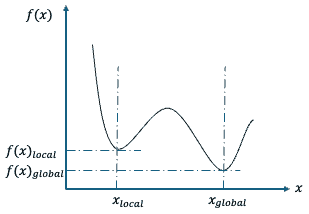

*图 5.3：损失函数*

在优化过程中，我们的主要目标是找到损失函数的最小点。这个最小值可以是局部的（在邻近区域内最优）或全局的（在整个函数空间内最优）。然而，在复杂的神经网络架构中，判断所发现的最小值究竟是真正的全局最小值还是仅仅局部最小值，是一个重大的技术挑战。这在深度学习中尤其重要，因为损失函数的形态通常是高度非凸的，存在许多局部最小值。

在接下来的部分，我们将了解当今使用的一些常见优化技术。这些算法是相互构建的，因此请注意后续技术是如何在彼此基础上发展的。

##### 梯度下降

梯度下降是一种用于训练神经网络的优化技术，通过连续参数调整来降低损失函数的值。在每次迭代中，算法计算损失函数相对于每个参数的导数。然后，它沿着梯度的反方向调整这些参数——向更低的损失值下降。每次调整的幅度取决于学习率，这是一个关键的超参数，需要在训练速度与稳定性之间取得平衡。如果学习率设置过高，可能会越过最优值；设置过低，则会导致不必要的长时间训练。

下面的 `gradient_descent` C++ 实现演示了这一优化过程。通过基于梯度信息的迭代参数更新，该函数沿着最陡下降路径系统性地降低损失。代码执行以下步骤：

- **初始化**：接收张量 `x`（要优化的参数），并通过 `requires_grad_(true)` 启用梯度跟踪
- **迭代优化循环**：最多执行 1,000 次迭代（或直到收敛）：
    - 使用提供的 `loss_fn` 计算损失
    - 通过 `loss.backward()` 计算梯度
    - 更新参数：`x = x - learning_rate * x.grad()`
    - 将梯度归零，为下一次迭代做准备
- **收敛检查**：如果梯度幅度低于 1e-6，则提前停止，表示已达到局部最小值
- **返回**：优化后的参数（从计算图中分离）

`NoGradGuard` 块在参数更新期间临时禁用梯度跟踪，以防止构建不必要的计算图，从而提高内存效率。

该实现代表了构建 Adam 和 RMSprop 等更复杂优化器的基础，正如你文档后续部分所讨论的那样。

```cpp
torch::Tensor gradient_descent(
    torch::Tensor x,
    std::function<torch::Tensor(torch::Tensor)> loss_fn,
    float learning_rate = 0.01,
    int max_iterations = 1000
) {
    x = x.detach().requires_grad_(true);
    for(int i = 0; i < max_iterations; i++) {
        auto loss = loss_fn(x);
        loss.backward();
        {
            torch::NoGradGuard no_grad;
            x = x - learning_rate * x.grad();
            x.grad().zero_();
        }
        if(x.grad().abs().max().item<float>() < 1e-6) {
            break;
        }
    }
    return x.detach();
}
```

虽然梯度下降为优化提供了很好的基础，但它的固定学习率在处理不同尺度的参数以及不同方向曲率不同的损失景观时可能会遇到困难。这一局限性促使了自适应优化器 RMSprop 的发展，我们将在下一节中研究它。

##### RMS Prop

**均方根传播**（**RMSprop**）跟踪每个参数平方梯度的移动平均值，并使用该值对当前梯度进行缩放。这种归一化有助于防止在处理不同量级梯度时学习率变得过小。

这种自适应行为使算法能够更有效地穿越损失景观中的陡峭和平缓区域，与标准梯度下降相比，收敛速度更快。下面是一个用于 `rmsprop` 的 C++ 函数：

```cpp
torch::Tensor rmsprop_optimize_gpu(
    torch::Tensor x,
    std::function<torch::Tensor(torch::Tensor)> loss_fn,
    float learning_rate = 0.01,
    float decay_rate = 0.99,
    float epsilon = 1e-8,
    int max_iterations = 1000
) {
    // Move tensors to GPU
    x = x.detach().cuda().requires_grad_(true);
    auto cache = torch::zeros_like(x).cuda();
    for(int i = 0; i < max_iterations; i++) {
        auto loss = loss_fn(x);
        loss.backward();
        {
            torch::NoGradGuard no_grad;
            // Update moving average of squared gradients
            cache = decay_rate * cache + (1 - decay_rate) * x.grad().pow(2);
            // Update parameters
            x = x - learning_rate * x.grad() / (cache.sqrt() + epsilon);
            x.grad().zero_();
        }
        if(x.grad().abs().max().item<float>() < 1e-6) {
            break;
```


## 第5章：C++中的多层感知机

```cpp
}
}
    return x.detach().cpu(); // Return result back to CPU
}
```

承载算法逻辑的代码如下：

```cpp
cache = decay_rate * cache + (1 - decay_rate) * x.grad().pow(2);
```

该缓存（cache）追踪近期梯度的幅值，并赋予近期历史更大的权重（由 `decay_rate` 控制，取值为 0.99）。

参数更新步骤 `x = x - learning_rate * x.grad() / (cache.sqrt() + epsilon)` 正是 RMSprop 自适应行为大放异彩之处：它将梯度除以缓存的平方根，从而对每个参数独立地归一化学习率。接收较大且一致梯度的参数会累积较大的缓存值，因此有效步长较小；梯度较小的参数则获得按比例更大的步长。`epsilon` 项可在训练早期缓存接近零时防止除零错误。更新参数后，梯度通过 `.zero_()` 重置为零，为下一次迭代做准备。

与之前的实现相比，一个结构上的差异：张量通过 `.cuda()` 移动到 GPU，并通过 `.detach().cpu()` 返回 CPU。RMSprop 利用梯度历史来归一化更新幅度，而一种新技术——动量（momentum）则关注方向一致性——通过累积过去梯度的运行平均值来平滑振荡，而不是对每个梯度独立做出反应。

##### 动量

动量是一种优化技术，通过引入物理学中的速度概念来增强梯度下降。它累积过去梯度的移动平均值，并利用这些信息决定当前更新的方向和幅度。通过将先前更新的一部分加到当前更新上，动量帮助优化过程在持续梯度下降的方向上保持一致的移动，同时在梯度变化不一致的方向上抑制振荡。这种方法在处理高曲率、微小但一致的梯度或含噪梯度时尤为有效。动量项帮助优化器穿越损失曲面中纯梯度下降可能难以处理的区域，例如狭窄的谷地或平坦区域，从而加快收敛，并更好地逃离局部最小值。以下是动量优化的 C++ 示例代码：

```cpp
torch::Tensor momentum_optimize(
    torch::Tensor x,
    std::function<torch::Tensor(torch::Tensor)> loss_fn,
    float learning_rate = 0.01,
    float momentum = 0.9,
    int max_iterations = 1000
) {
    x = x.detach().requires_grad_(true);
    auto velocity = torch::zeros_like(x);
    for(int i = 0; i < max_iterations; i++) {
        auto loss = loss_fn(x);
        loss.backward();
        {
            torch::NoGradGuard no_grad;
            // Update velocity using momentum
            velocity = momentum * velocity + learning_rate * x.grad();
            // Update parameters using velocity
            x = x - velocity;
            x.grad().zero_();
        }
        if(x.grad().abs().max().item<float>() < 1e-6) {
            break;
        }
    }

    return x.detach();
}
```

速度更新 `velocity = momentum * velocity + learning_rate * x.grad();` 保留了先前速度的 90%（`momentum = 0.9`），并加上当前缩放后的梯度。在梯度持续指向相同方向的方向上，速度不断累积，有效步长随之增大。在梯度符号交替的方向上——即振荡情形——正负贡献相互抵消，从而抑制不稳定性。随后，参数更新直接应用累积的速度：`x = x - velocity`，而不是像标准梯度下降那样直接使用梯度。

与 RMSprop 不同，动量不会针对每个参数自适应步长——所有参数共享相同的 `learning_rate` 和 `momentum` 系数。其收益体现在方向上：一致的下降方向会加速；不一致的方向则被抑制。这使得动量在梯度下降停滞的平台区域和浅层区域特别有效，但对于各参数梯度幅度相差数量级的问题则不太适用——而这正是 RMSprop 所针对的场景。

该算法包含一个提前停止条件：当最大绝对梯度低于 1e-6 时终止，表示已收敛。最后，优化后的参数从计算图中分离并返回，可用于预测或进一步处理。

下一个优化器 Adam 结合了我们刚刚看到的两种方法——像动量那样使用速度估计来保持方向一致性，像 RMSprop 那样使用梯度幅度估计来做自适应缩放。

##### ADAM 优化器

Adam 扩展了前几节介绍的两种方法。动量通过运行中的速度估计来追踪梯度方向，RMSprop 通过平方梯度的运行平均值来追踪梯度幅度，而 Adam 同时维护两者——根据每个参数自身的梯度历史，独立地调整其有效学习率。由于两个估计都初始化为零，Adam 引入了一个其他优化器不需要的偏差校正步骤，确保矩估计从第一次迭代起就是准确的，而不仅仅是在预热期之后。

下面的 C++ 函数使用两个矩累加器，并在每次迭代中应用显式的偏差校正步骤来实现这一点：

```cpp
torch::Tensor adam_optimize(
    torch::Tensor x,
    std::function<torch::Tensor(torch::Tensor)> loss_fn,
    float learning_rate = 0.001,
    float beta1 = 0.9,
    float beta2 = 0.999,
    float epsilon = 1e-8,
    int max_iterations = 1000
) {
    x = x.detach().requires_grad_(true);
    auto m = torch::zeros_like(x);
    auto v = torch::zeros_like(x);
    for(int i = 0; i < max_iterations; i++) {
        auto loss = loss_fn(x);
        loss.backward();
        {
            torch::NoGradGuard no_grad;
            // Update biased first moment estimate
            m = beta1 * m + (1 - beta1) * x.grad();
            // Update biased second raw moment estimate
            v = beta2 * v + (1 - beta2) * x.grad().pow(2);
            // Bias correction
            auto m_hat = m / (1 - std::pow(beta1, i + 1));
            auto v_hat = v / (1 - std::pow(beta2, i + 1));
            // Update parameters
            x = x - learning_rate * m_hat / (v_hat.sqrt() + epsilon);
            x.grad().zero_();
        }
        if(x.grad().abs().max().item<float>() < 1e-6) {
            break;
        }
    }

    return x.detach();
}
```

该函数接受多个参数：参数张量 x、损失函数、学习率（默认 0.001）、beta1（默认 0.9）、beta2（默认 0.999）、用于数值稳定性的 epsilon（默认 1e-8）以及最大迭代次数（1000）。

优化开始时，先将参数张量分离（detach），并通过 `.requires_grad_(true)` 启用梯度追踪。两个矩向量被初始化为零：

- **m**：追踪梯度的指数加权运行均值（一阶矩）
- **v**：追踪平方梯度的指数加权运行均值（二阶矩）

在每次迭代中，计算损失，并通过 `.backward()` 将梯度沿计算图反向传播。

一阶矩累加器的更新方式如下：

```cpp
m = beta1 * m + (1 - beta1) * x.grad();
```

`beta1` 系数（0.9）决定了运行均值相对于当前梯度方向保留先前梯度方向的强度。二阶矩累加器的更新方式如下：

```cpp
v = beta2 * v + (1 - beta2) * x.grad().pow(2);
```

`beta2` 系数（0.999）控制平方梯度平均值的衰减速率，使估计对梯度幅度具有较长的记忆。

由于两个累加器都初始化为零，其早期估计会被系统性地低估。偏差校正项可以抵消这一影响：

```cpp
auto m_hat = m / (1 - std::pow(beta1, i + 1));
auto v_hat = v / (1 - std::pow(beta2, i + 1));
```

随着迭代次数 `i` 增大，分母趋近于 1，校正变得可忽略不计。随后，校正后的估计用于计算参数更新：

```cpp
x = x - learning_rate * m_hat / (v_hat.sqrt() + epsilon);
```

`epsilon` 项在 `v_hat` 接近零时防止除零错误。每次更新后，通过 `.zero_()` 清除梯度，以防止跨迭代累积。

Adam 优化器具有若干关键优势，使其成为神经网络训练中的稳健选择。每个参数都能基于梯度历史获得自己的有效学习率，这使得 Adam 在不同参数尺度下都表现稳健。一阶矩估计融入了动量，有助于加速收敛并穿越鞍点；偏差校正则确保训练早期迭代中的矩估计准确。由于几乎不需要调整超参数，默认值在众多应用中都能良好工作，不过学习率可能仍需要调整以获得最佳性能。

对于剩余的优化器函数，请尝试逐行理解代码。代码结构与前几个函数类似，因此我们认为你很容易跟上。

##### AdaGrad

AdaGrad 通过维护平方梯度的运行总和，为每个参数调整学习率。累积的历史会反比地缩放学习率——累积梯度较大的参数获得逐渐变小的更新，而累积梯度较小的参数获得较大的更新。这种逐参数自适应使 AdaGrad 在稀疏数据上很有效，其中不常出现的特征受益于更大的学习率。然而，平方梯度的单调累积会导致有效学习率不断缩小，往往在收敛之前就变得可以忽略不计。


与 RMSprop 的关键区别在于累积策略：RMSprop 使用指数衰减平均值，会遗忘较早的历史，而 Adagrad 则不加衰减地累加所有过去梯度的平方，因此在长时间训练中表现出其特有的学习率不断减小的行为。

下面的 C++ 实现演示了 Adagrad 的核心机制——累加梯度的平方，从而为每个参数自适应地缩放学习率：

```cpp
torch::Tensor adagrad_optimize(
    torch::Tensor x,
    std::function<torch::Tensor(torch::Tensor)> loss_fn,
    float learning_rate = 0.01,
    float epsilon = 1e-8,
    int max_iterations = 1000
) {
    x = x.detach().requires_grad_(true);
    auto cache = torch::zeros_like(x);
    for (int i = 0; i < max_iterations; i++) {
        auto loss = loss_fn(x);
        loss.backward();
        {
            torch::NoGradGuard no_grad;
            // Accumulate squared gradients
            cache = cache + x.grad().pow(2);
            // Update parameters
            x = x - learning_rate * x.grad() / (cache.sqrt() + epsilon);
            x.grad().zero_();
        }
        if (x.grad().abs().max().item<float>() < 1e-6) {
            break;
        }
    }
    return x.detach();
}
```

该实现的核心是优化循环中的两个关键操作：

```cpp
cache = cache + x.grad().pow(2);
```

这一行持续将梯度的平方累加到缓存中——与 RMSprop 的指数衰减不同，这是纯粹的累积。每个参数都会构建一个不断增长的梯度幅度历史。

自适应参数更新：

```cpp
x = x - learning_rate * x.grad() / (cache.sqrt() + epsilon);
```

该更新将梯度除以累积缓存的平方根。随着缓存每次迭代不断增大，分母也随之增大，从而逐步缩小有效步长。在训练过程中经历过较大梯度的参数会累积更大的缓存值，因此得到的更新会越来越小。`epsilon` 项用于防止缓存接近零时出现数值不稳定。

RMSprop 的缓存会随时间衰减（如果最近的梯度较小，学习率可以再次增大），而 Adagrad 的缓存只会不断增长。这种单调累积意味着有效学习率只能减小，无法恢复——这解释了为什么在长时间训练中它可能会过早停止学习，尽管在稀疏数据场景中它非常有效，因为不频繁出现的特征需要持续的大幅更新。

##### AdaDelta

Adadelta 通过用指数衰减窗口替代无界累积来解决 Adagrad 学习率不断减小的问题。它不是对所有历史梯度平方求和，而是维护一个移动平均值，该平均值强调最近的梯度，同时逐渐遗忘较早的梯度。这种窗口化方法防止分母无限增长，使得有效学习率能够在整个训练过程中动态调整。

该算法通过由两个累积量（近期梯度的均方根和近期参数更新的均方根）的比值构造更新，从而消除了手动指定学习率的需要。这种基于比值的机制会自动适当地缩放更新，并确保分子与分母之间的量纲一致性——这是一项理论上的改进，使 Adadelta 有别于那些简单地将梯度除以其历史幅度的算法。

下面是为 AdaDelta 优化器提供的 C++ 代码。请逐行阅读以理解其功能。

```cpp
torch::Tensor adadelta_optimize(
    torch::Tensor x,
    std::function<torch::Tensor(torch::Tensor)> loss_fn,
    float rho = 0.95,
    float epsilon = 1e-8,
    int max_iterations = 1000
) {
    x = x.detach().requires_grad_(true);
    auto grad_square_avg = torch::zeros_like(x);
    auto delta_square_avg = torch::zeros_like(x);
    for (int i = 0; i < max_iterations; i++) {
        auto loss = loss_fn(x);
        loss.backward();
        {
            torch::NoGradGuard no_grad;
            // Update running average of gradient squares
            grad_square_avg = rho * grad_square_avg + (1 - rho) * x.grad().pow(2);

            // Compute update
            auto delta = torch::sqrt(delta_square_avg + epsilon) /
                         torch::sqrt(grad_square_avg + epsilon) *
                         x.grad();
            // Update running average of parameter updates
            delta_square_avg = rho * delta_square_avg + (1 - rho) * delta.pow(2);
            // Apply update
            x = x - delta;
            x.grad().zero_();
        }
        if (x.grad().abs().max().item<float>() < 1e-6) {
            break;
        }
    }
    return x.detach();
}
```

Adadelta 实现维护了两个不同的指数加权平均值，它们共同构造无参数更新。第一个是梯度历史累积：

```cpp
grad_square_avg = rho * grad_square_avg + (1 - rho) * x.grad().pow(2);
```

这使用衰减因子 rho（0.95）跟踪梯度平方的移动平均值，类似于 RMSprop 的缓存机制，但在更新计算中用途不同。

接下来我们计算更新幅度：

```cpp
auto delta = torch::sqrt(delta_square_avg + epsilon) /
             torch::sqrt(grad_square_avg + epsilon) *
             x.grad();
```

该更新被构造为一个比值：近期参数变化的均方根（分子）除以近期梯度的均方根（分母），再乘以当前梯度。这个比值取代了固定学习率——当近期更新的幅度相对于近期梯度较大时，有效步长会增大；当它们较小时，有效步长会减小。

计算完更新后，其平方幅度被累加到 `delta_square_avg` 中。这第二个累加器会反馈到下一次迭代的更新计算中，形成一种自我调节机制，即过去更新的规模直接影响未来的更新。

```cpp
delta_square_avg = rho * delta_square_avg + (1 - rho) * delta.pow(2);
```

我们已经探讨了几种关键的优化算法，每种算法都有其独特的特点和优势。梯度下降简单且基础，为参数更新提供了基本框架。更复杂的方法如 Adam 结合了动量和自适应学习率的优点，而 RMSprop 则能高效处理不同幅度的梯度。动量通过累积过去的梯度来加速收敛，Adagrad 为每个参数自适应地调整学习率，而 Adadelta 则进一步解决了学习率不断减小的问题。

每种优化器都有不同的权衡：梯度下降实现简单但可能收敛缓慢，Adam 在许多应用中表现稳健但复杂度更高，RMSprop 擅长处理非平稳目标，Adadelta 则消除了手动设置学习率的需要。选择哪种优化器取决于具体需求，例如收敛速度、内存限制以及待优化问题的性质。

现代实现利用 PyTorch 的 C++ API 通过 GPU 加速，能够高效执行这些优化算法，使其适用于大规模深度学习应用。

在探索了多种优化技术之后，有必要理解神经网络优化中固有的更广泛挑战。根本挑战在于在高维参数空间中导航，以找到能够最小化损失函数的配置。


同时保持模型对未见过数据的泛化能力。要全面理解优化算法，你应该熟悉几个影响训练效果的关键概念和技术。它们是：

- **a. 学习率策略**：这些技术控制模型学习的速度。它们包括在训练过程中自动调整学习率的方法，以实现更好的收敛并避免局部最小值。
- **b. 正则化技术**：这些方法通过在训练过程中增加约束来帮助防止过拟合。如dropout和批量归一化等技术有助于模型更好地泛化到未见数据。
- **c. 参数初始化**：这些技术决定了如何设置神经网络中的初始权重和偏置。正确的初始化对于成功的训练和收敛至关重要。
- **d. 批量优化**：这些方法决定了训练期间数据的处理方式，包括批次大小选择和处理的策略。
- **e. 架构优化**：这些技术侧重于改进网络结构本身，包括使网络更高效和更有效的方法。
- **f. 损失函数设计**：这些方法涉及设计和修改损失函数，以更好地适应特定的训练目标和问题。

### 总结

在本章中，我们探讨了多层感知器（MLPs）——深度学习中的一种基础架构，它通过多层相互连接的神经元处理信息。我们考察了三种不同的C++实现方法：使用Eigen库进行矩阵运算的基础实现，展示了面向对象的设计原则；基于CUDA的实现，利用GPU加速通过并行处理和优化内存管理获得显著的性能提升；以及使用LibTorch（PyTorch的C++ API）的高级实现，它在保持计算效率的同时抽象了复杂操作。

本章全面介绍了激活函数，探讨了sigmoid和双曲正切等传统方法，以及ReLU、Leaky ReLU、Swish和Mish等现代变体。每种激活函数都提供了适合不同架构需求和训练场景的独特特性。我们还研究了基本的优化技术——包括梯度下降、RMSprop、动量、Adam、Adagrad和Adadelta——这些构成了有效神经网络训练的支柱。这些优化算法与适当的学习率策略和正则化方法相结合，为在C++中开发高效且稳健的神经网络提供了一套完整的工具。

在下一章中，我们将探讨**卷积神经网络**（**CNNs**）——一类专门用于处理视觉数据的神经网络。CNN已成为计算机视觉任务的基石架构，包括图像分类、目标检测和语义分割，在这些任务中，它们擅长自动从图像中学习分层模式和空间特征。

### 进一步阅读

- Rumelhart, D. E., Hinton, G. E., & Williams, R. J. (1986). *通过反向传播误差学习表示.* *Nature*, 323(6088), 533-536. 介绍反向传播的开创性论文。
- Glorot, X., & Bengio, Y. (2010). *理解训练深层前馈神经网络的难度*. *Proceedings of AISTATS*. 关于初始化策略和激活函数选择的重要读物。
- Kingma, D. P., & Ba, J. (2014). *Adam：一种随机优化方法.* *arXiv:1412.6980*. Adam优化器的原始论文，包含理论基础。
- Tieleman, T., & Hinton, G. (2012). “第6.5讲-rmsprop：将梯度除以其最近幅度的运行平均值。” *COURSERA：机器学习神经网络*。
- Zeiler, M. D. (2012). *ADADELTA：一种自适应学习率方法.* *arXiv:1212.5701*. 对Adadelta算法的全面论述。
- Ramachandran, P., Zoph, B., & Le, Q. V. (2017). *搜索激活函数.* *arXiv:1710.05941*. 介绍了Swish，并讨论了系统化的激活函数发现。
- Misra, D. (2019). *Mish：一种自正则化的非单调激活函数*. *arXiv:1908.08681*. 详细介绍了Mish激活函数及其性质。
- Clevert, D. A., Unterthiner, T., & Hochreiter, S. (2015). *通过指数线性单元（ELUs）实现快速准确的深度网络学习.* *arXiv:1511.07289*.
- *Eigen文档：* `https://eigen.tuxfamily.org/` — 本章使用的Eigen线性代数库的综合指南。
- *LibTorch文档*：`https://pytorch.org/cppdocs/` — 带有教程和示例的官方PyTorch C++ API文档。
- *CUDA编程指南*：`https://docs.nvidia.com/cuda/cuda-c-programming-guide/`：NVIDIA官方的GPU编程指南。
- *cuBLAS库文档*：`https://docs.nvidia.com/cuda/cublas/` — GPU加速线性代数运算的参考。
- Goodfellow, I., Bengio, Y., & Courville, A. (2016). *深度学习*. MIT Press. 第6-8章全面涵盖了前馈网络、优化和正则化。
- Nielsen, M. A. (2015). *神经网络与深度学习*. Determination Press. 可免费在线阅读，配有出色的反向传播和梯度下降可视化。
- 代码示例：`https://github.com/PacktPublishing/Deep-Learning-with-C-/tree/main/chapter5`
- *CS231n：用于视觉识别的卷积神经网络*（斯坦福大学）：`http://cs231n.stanford.edu/` — 关于神经网络基础和优化的优秀讲义。
- *XOR问题详解*：`https://towardsdatascience.com/how-neural-networks-solve-the-xor-problem-59763136bdd7` — 直观解释为什么非线性可分问题需要MLP。

### 获取本书的PDF版本及更多信息

扫描二维码（或访问 `packtpub.com/unlock`）。按名称搜索本书，确认版本，然后按照页面上的步骤操作。


*注意：请随身准备好您的发票。直接从Packt购买不需要发票。*

## 6 C++中的卷积神经网络

**卷积神经网络**（**CNNs**）是一种深度学习架构，主要设计用于处理图像和视频等网格状数据。这些神经网络使用称为**卷积**的数学运算，从原始输入数据中自动学习层级特征表示，这使它们与传统神经网络有着根本的不同。CNN受到动物视觉皮层组织的启发，凭借保持空间关系的能力以及通过共享权重和平移不变性保持计算效率，彻底改变了计算机视觉任务。

本章全面探讨了使用现代C++实现CNN的方法。你将学习卷积运算的数学基础，并理解它们与传统的**多层感知器**（**MLPs**）有何不同。本章涵盖了使用C++集成PyTorch的实际实现技术，包括通过CUDA进行GPU加速以增强性能。我们将通过动手项目探索实际应用，包括在MNIST数据集上实现用于图像分类的VGG-16，以及用于图像分割任务的U-Net架构。此外，你还将了解基本的图像处理技术，如数据增强方法（旋转、缩放、裁剪和翻转）。

在本章结束时，你将获得使用C++从零实现CNN架构的实践技能，理解卷积运算背后的数学原理，并应用现代优化技术来训练深度神经网络。这种渐进式设计是有意为之：而不是直接给你一个现成的框架，我们会带你逐步了解每一层抽象，这样当你接触到PyTorch C++ API时，你不仅理解

## C++ 中的卷积神经网络

如何使用它，以及它为什么以这种方式工作。在此过程中，你将构建高效的图像分类和分割系统，集成 GPU 加速以提升性能，并实现全面的图像增强流水线，以增强模型的鲁棒性和泛化能力。

在本章中，我们将介绍以下主题：

- CNN 的历史
- 卷积的数学基础
- C++ 实现
- 构建基于 C++ 的图像分类神经网络
- 使用 U-Net 进行图像分割
- 用于深度学习的图像处理
- 与 CNN 相关的术语

继续阅读本章时，你可能会遇到一些不易立刻理解的术语。我们鼓励你继续读下去，因为这些术语会在本章后面用适当的术语加以定义。

### CNN 的历史

CNN 的发展代表着人工智能和计算机视觉领域的一个重要里程碑。CNN 的基础可以追溯到 20 世纪 60 年代，休伯尔和维塞尔对猫视觉皮层进行了开创性研究，揭示了大脑神经元如何对特定模式的视觉刺激作出反应。1980 年，福岛邦彦提出了新认知机（Neocognitron），它被认为是 CNN 架构的第一个实现。然而，我们今天所熟知的现代 CNN 架构，是由杨立昆（Yann LeCun）及其同事于 1989 年在 LeNet 系列神经网络上的工作开创的。这项工作最终形成了 LeNet-5，它在**改良版美国国家标准与技术研究院**（**MNIST**）数据集上取得了非凡的 98.5% 准确率。该数据集包含由美国邮政管理局提供的 16x16 灰度手写数字，数字范围从 0 到 9。

| 0 | 1 | 2 | 3 | 4 | 5 | 6 | 7 | 8 | 9 |
|---|---|---|---|---|---|---|---|---|---|
| 0 | 1 | 2 | 3 | 4 | 5 | 6 | 7 | 8 | 9 |
| 0 | 1 | 2 | 3 | 4 | 5 | 6 | 7 | 8 | 9 |
| 0 | 1 | 2 | 3 | 4 | 5 | 6 | 7 | 8 | 9 |
| 0 | 1 | 2 | 3 | 4 | 5 | 6 | 7 | 8 | 9 |
| 0 | 1 | 2 | 3 | 4 | 5 | 6 | 7 | 8 | 9 |
| 0 | 1 | 2 | 3 | 4 | 5 | 6 | 7 | 8 | 9 |
| 0 | 1 | 2 | 3 | 4 | 5 | 6 | 7 | 8 | 9 |
| 0 | 1 | 2 | 3 | 4 | 5 | 6 | 7 | 8 | 9 |
| 0 | 1 | 2 | 3 | 4 | 5 | 6 | 7 | 8 | 9 |

*图 6.1：MNIST 数据库中的图像示例*

2012 年，亚历克斯·克里热夫斯基、伊利亚·苏茨克弗和杰弗里·辛顿开发了 AlexNet，并以显著优势赢得了 **ImageNet 大规模视觉识别挑战赛**（**ILSVRC**），这是一个重大突破。这一成功重新激发了人们对 CNN 以及整个深度学习的兴趣。此后，涌现出众多架构，包括 VGGNet、GoogLeNet、ResNet 等，每一种都在不断拓展计算机视觉任务的可能性边界。如今，CNN 构成了许多现代计算机视觉应用的支柱，从人脸识别系统到自动驾驶汽车——从识别简单的手写数字，到以人类水平或超人类水平对数千种复杂物体类别进行分类。如今，CNN 构成了许多现代计算机视觉应用的支柱，从人脸识别系统到自动驾驶汽车。

### 卷积的数学基础

CNN 的核心是一种称为卷积的重要数学运算。到目前为止，我们一直在讨论 CNN，却没有定义卷积。现在，是时候正式定义它了。卷积运算在数学上定义如下：

(f * g)(x) = ∫ f(τ) g(x - τ) dτ

让我们分解一下：

- f 和 g 是函数
- τ（tau）是积分变量
- ∗ 表示卷积运算
- x 是自变量
- ∫ 表示对所有可能的 τ 值进行积分

卷积是 CNN 中的主要数学运算。在处理图像和执行计算机视觉任务时，这种运算遵循一种结构化的方式：一个核（或滤波器），也就是一个小矩阵，按照定义好的模式在输入数据上移动。在移动过程中，核与其覆盖的输入值进行逐元素乘法。然后将这些乘积相加，生成一个值，这个值位于所谓的特征图中。这一结构化过程实现了层级化特征学习：早期层检测边缘或颜色变化等基本特征，而更深层则将这些特征组合成越来越复杂的模式——纹理、形状，最终形成完整的物体。在整个过程中保持空间关系，使得卷积成为图像处理和模式识别中一种特别有效的方法。

在处理 RGB 图像时，卷积运算扩展到多个颜色通道。核的深度必须与输入通道的数量匹配，运算会同时处理所有通道。这些通道的结果组合起来，形成特征图中的各个值。两个关键参数控制这一过程：`stride` 定义了核在每一步移动的距离，`padding` 由在输入数据周围添加的零组成，以管理输出尺寸。

**二维数组**

| 1 | 2 | 3 | 4 |
|---|---|---|---|
| 5 | 6 | 7 | 8 |
| 9 | 10 | 11 | 12 |
| 13 | 14 | 15 | 16 |

**滤波器**

| -1 | -1 | -1 |
|---|---|---|
| -1 | 4 | -1 |
| -1 | -1 | -1 |

**输出**

| -24 | -28 |
|---|---|
| -40 | -44 |

1*-1 + 2*-1 + 3*-1 + 5*-1 + 6*4 + 7*-1 + 9*-1 + 10*-1 + 11*-1 = -24

6*-1 + 7*-1 + 8*-1 + 10*-1 + 11*4 + 12*-1 + 14*-1 + 15*-1 + 16*-1 = -44

*图 6.2：二维卷积示例*

你可以看到颜色匹配框下方那个框的计算过程。

### C++ 实现

在本节中，我们介绍卷积层的一个基本实现。卷积层类包含用于存储 `stride`、`padding` 和 `filters` 参数的私有成员，并实现了用于卷积运算的前向方法。前向方法接受一个输入矩阵（表示为向量的向量）。它使用指定的步幅在输入上滑动每个滤波器。在每个位置，它计算逐元素乘法和求和，然后进行 ReLU 激活。这将为每个滤波器创建特征图。本章的完整代码可在 GitHub 上获取。在这里，我们将拆解整个代码的重要部分，以解释神经网络的结构。`ConvolutionalLayer` 类封装了卷积层的三个基本要素（`filters`、`stride` 和 `padding`），如下所示：

```cpp
vector<vector<float>> filters; // Convolution filters/kernels
int stride; // Filter stride
int padding; // Padding size
```

`filters` 成员存储多个可学习的核，这些核用于检测输入数据中的特定模式。为了提高计算效率，每个滤波器都表示为一个扁平化的向量。`stride` 参数控制滤波器在输入上移动时的步长大小，而 `padding` 决定边界处理方式（尽管在这个基础版本中并未完全实现）。

构造函数建立层的配置并初始化可学习参数：

```cpp
ConvolutionalLayer(int numFilters, int filterSize, int strideSize, int paddingSize)
```

这种设计允许灵活的层配置，支持不同的滤波器数量、大小和步长模式。构造函数将滤波器初始化委托给一个私有方法，从而保持了关注点的清晰分离。`initializeFilters` 方法采用高斯随机初始化：

```cpp
normal_distribution<float> dist(0.0f, 0.1f);
```

这种方法使用以零为中心的小随机值初始化权重，既能防止对称性破坏问题，又能在训练期间保持梯度流动。`0.1` 的标准差为学习提供了一个均衡的起点。

在层正确初始化且权重配置为最佳梯度流动之后，我们现在可以检查数据在前向传播过程中如何流经卷积层——这是这些学习到的滤波器检测输入数据模式的核心操作。


#### 前向传播实现

`forward` 方法通过四层嵌套循环实现了完整的卷积操作，系统地将每个滤波器应用于输入：

```cpp
for (auto& filter : filters) {
    // Slide filter across input
    vector<float> featureMap;
    for (int i = 0; i < input.size() - filter.size() + 1; i += stride) {
        for (int j = 0; j < input.size() - filter.size() + 1; j += stride) {
            // Calculate convolution at current position
            float sum = 0;
            for (int k = 0; k < filter.size(); k++) {
                for (int l = 0; l < filter.size(); l++) {
                    sum += input[i + k][j + l] * filter[k][l];
                }
            }
            // Apply ReLU activation
            featureMap.push_back(max(0.0f, sum));
        }
    }
    featureMaps.push_back(featureMap);
}
```

最外层的 `for(auto& filter: filters)` 循环独立地处理每个学习到的滤波器。在具有多个滤波器的层中，每个滤波器检测不同的模式。接下来的两个 `for` 循环控制滤波器在输入上滑动时的位置。`input.size() - filter.size() + 1` 边界条件确保滤波器不会超出输入边界，防止无效的内存访问。`stride` 参数控制移动步长：`stride 1` 每次移动一个像素，而 `stride 2` 跳过每隔一个位置，从而减小输出尺寸。对于 5×5 的输入、3×3 的滤波器和 `stride 1`，有效位置范围为 `(0,0)` 到 `(2,2)`，生成 3×3 的输出特征图。

最内层的循环执行实际的卷积运算——计算滤波器与当前输入区域之间的点积。每次迭代将对应元素相乘并累加结果。这种数学运算衡量了滤波器模式与局部输入区域的匹配程度。以下方程以编程方式表达了卷积运算：

Output[i,j] = ReLU(Σ Σ Input[i+m,j+n] × Filter[m,n])

卷积运算后，结果被存储在当前的特征图中，构建出该滤波器的完整响应模式。扫描完整个输入后，每个滤波器的完整特征图被添加到输出集合中。最终结果包含每个滤波器的一个特征图。`featureMap` 被推入 `featureMaps` 向量，如下所示：

```cpp
featureMaps.push_back(featureMap);
```

让我们来看一下该实现的时间复杂度和内存模式：

- **时间复杂度**：*O(F × H × W × K²)*，其中 *F* 是滤波器数量，*H × W* 是输出尺寸，*K × K* 是滤波器尺寸
- **内存模式**：该算法以缓存友好的方式处理数据，按顺序访问空间局部的输入区域

当前实现存在某些局限性，具体如下：

- **仅支持二维输入**：它假设输入矩阵是方阵
- **无偏置项**：它缺少现代实现中常见的偏置参数
- **简化的填充**：`padding` 参数已声明但未实现
- **内存效率**：它可以针对更大的输入进行优化

#### 与更大网络的集成

在实践中，多个 `ConvolutionalLayer` 实例会与池化层、归一化层和全连接层组合，以构建完整的神经网络。该类作为一个基础组件，可以通过以下附加功能进行扩展：

- 偏置项以提高表达能力
- ReLU 之外的不同激活函数
- 用于边界处理的适当填充实现
- 支持 RGB 图像的多通道输入
- 针对生产使用优化的内存管理

该实现的简洁性使其成为理解驱动现代计算机视觉系统的基本操作的理想起点。

#### 基于 Eigen 的矩阵实现

前述实现可以通过利用广受认可的高性能 Eigen 库提供的矩阵运算进一步增强。**Eigen** 是一个专门为线性代数设计的 C++ 模板库。如前所述，完整代码可在 GitHub 上获取。在本节中，我们将重点关注此增强实现的主要方面。首先要查看的重要函数是 `im2col`。这是一种常见的数据转换技术，用于在 CNN 中实现更快的矩阵计算。它从输入中提取所有滤波器大小的图像块，并将它们排列为矩阵列，如下图所示：

```text
(0,3) (0,2) (0,1) (0,0) (1,3) (2,3) (3,3) (0,3) (0,2) (0,1) (0,0) (1,3) (2,3) (3,3) (0,3) (0,2) (0,1) (0,0) (1,3) (1,2) (1,1) (1,0) (2,3) (2,2) (2,1) (2,0) (3,3) (3,2) (3,1) (3,0)
36 35 34 33 40 44 48 20 19 18 17 24 28 32 4 3 2 1 8 7 6 5 12 11 10 9 16 15 14 13 5 3 2 1 6 4 3 2 9 7 6 5 10 8 7 6 10 9 7 6 11 10 8 7 14 13 11 10 15 14 12 11 11 12 15 16 21 19 18 17 22 20 19 18 25 23 22 21 26 24 23 22 26 25 23 22 27 26 24 23 30 29 27 26 31 30 28 27 27 28 31 32 37 35 34 33 38 36 35 34 41 39 38 37 42 40 39 38 42 41 39 38 43 42 40 39 46 45 43 42 47 46 44 43 43 44 47 48 9 (possible sliding window position) 12 indices (i, j)
```

*图 6.3：(im2col) 一个 2×2 图像块被存储为一列。后续通道（RGB）在同一列中拼接*

这种转换支持**单指令多数据**（**SIMD**）操作，并利用了诸如 **BLAS** 之类的高效线性代数库。它还使得在多个核心和 GPU 之间进行分布式计算变得容易，从而加快执行速度。下面是 `im2col` 函数：

```cpp
Matrix im2col(const Matrix& input, int kSize, int stride) {
    int inputRows = input.rows();
    int inputCols = input.cols();
    int outputRows = (inputRows - kSize) / stride + 1;
    int outputCols = (inputCols - kSize) / stride + 1;
    Matrix result(kSize * kSize, outputRows * outputCols);
    int colIdx = 0;
    for(int i = 0; i <= inputRows - kSize; i += stride) {
        for(int j = 0; j <= inputCols - kSize; j += stride) {
            int rowIdx = 0;
            for(int ki = 0; ki < kSize; ki++) {
                for(int kj = 0; kj < kSize; kj++) {
                    result(rowIdx++, colIdx) = input(i + ki, j + kj);
                }
            }
            colIdx++;
        }
    }
    return result;
}
```

在这段代码中，首先，我们定义了一个 `result` 矩阵，通过从输入中提取相关图像块来填充该矩阵的相关部分。外部两个 `for` 循环在输入上滑动滤波器，内部循环提取指定大小的图像块并将其展平为列格式。

这是基本的预处理步骤之一，它极大地简化了卷积运算，我们将在下面的函数中看到这一点：

```cpp
OptimizedConvolutionalLayer(int inChannels, int outChannels, int kSize, int strideSize) {
    inputChannels = inChannels;
    outputChannels = outChannels;
    kernelSize = kSize;
    stride = strideSize;
    // Initialize filters as matrix
    filters = Matrix::Random(outChannels, inChannels * kernelSize * kernelSize);
}

Matrix forward(const Matrix& input) {
    // Convert input to matrix format for efficient computation
    Matrix inputMatrix = im2col(input, kernelSize, stride);
    // Perform matrix multiplication instead of explicit convolution
    Matrix output = filters * inputMatrix;
    // Apply ReLU activation
    applyReLU(output);

    return output;
}
```

该实现通过利用矩阵运算显著降低了代码复杂度：`im2col` 转换使整个前向传播过程可以浓缩为一行：`filters * inputMatrix`。这种从显式嵌套循环到矩阵乘法的转变不仅简化了代码，还通过高效的线性代数库实现了在多个 CPU 核心和 GPU 线程上的同时并行化。虽然总体时间复杂度与嵌套循环方法相当，并且转换需要更大的内存分配，但这种权衡带来了 5–6 倍性能提升——使得基于矩阵的方法特别适合现代 GPU 架构。

#### 基于 CUDA 的 GPU 加速实现

到目前为止，我们已经探讨了基于 CPU 的实现，它们展示了卷积运算的基本原理。然而，`ConvolutionalLayer` 类可以通过集成 CUDA 功能来利用 GPU 加速能力，从而得到显著增强。与之前的实现一样，本章相关的 GitHub 仓库中提供了一个完整的基于 CUDA 的版本（`https://github.com/PacktPublishing/Deep-Learning-with-C-/tree/main/chapter6`）。

我们强烈建议您检查并比较所有三种实现方法——基本的嵌套循环版本、使用 Eigen 的基于矩阵的实现，以及这种 GPU 加速变体。根据我们的经验，这种并排比较是本章中最具启发性的练习之一：观察一个概念上简单的想法如何系统地转变为越来越复杂且高性能的解决方案，能让每一步优化的价值都立刻变得具体可感。您应该亲自运行每种实现，以直接体验 GPU 加速带来的计算效率的显著提升。在这里，我们将指出代码的一些特性，以帮助您理解所提出的实现。要全面理解 CUDA 库函数，我们强烈建议您查阅官方指南：`https://docs.nvidia.com/cuda/cuda-c-programming-guide/`。


由于使用 CUDA 进行 GPU 编程涉及几个新概念，我们将先列举关键的 CUDA 函数并解释各自的用途，然后再讨论实现细节。在这些函数中，你会多次看到 **BLAS** 一词，它代表 **基础线性代数子程序**（Basic Linear Algebra Subprograms）。接下来让我们了解这些函数：

- **cublasHandle_t**：这是一个不透明指针，代表 cuBLAS 库的上下文句柄。它存储 cuBLAS 操作所需的状态和配置，包括使用哪个 GPU 设备、工作内存和执行流。
- **cublasCreate**：这是一个初始化函数，用于创建并设置新的 cuBLAS 库上下文句柄。它与 `cublasDestroy()` 配对用于上下文清理，并且应在 cuBLAS 操作之前调用。这是执行任何 GPU 线性代数操作之前必须完成的第一步。
- **cudaMalloc**：这是一个 CUDA 函数，用于在 GPU 设备上分配内存，类似于 CPU 内存分配中的 `malloc()`。
- **curandGenerator_t**：这是 **CUDA 随机数生成器**（**cuRAND**）的句柄类型，用于在 GPU 设备上生成随机数。
- **cublasSscal**：这是一个 cuBLAS 函数，用于将向量按标量值缩放，例如 `x = α × x`。
- **cublasSaxpy**：与前面的函数类似，它执行操作 `y = α × x + y`。
- **cublasSgemm**：这是一个 cuBLAS 函数，用于 GPU 加速的矩阵乘法，即 `C = α × A × B + β × C`。
- **curandDestroyGenerator**：这是一个用于清理并释放与随机数生成器相关资源的函数。

以下是一个基于 CUDA 的卷积层实现：

```cpp
class CudaConvolutionalLayer {
    float *d_filters, *d_input, *d_im2col_output, *d_conv_output;
    int inputChannels, outputChannels, kernelSize, stride;
    cublasHandle_t cublasHandle;
public:
    CudaConvolutionalLayer(int inChannels, int outChannels, int kSize, int strideSize)
        : inputChannels(inChannels), outputChannels(outChannels),
          kernelSize(kSize), stride(strideSize) {
        cublasCreate(&cublasHandle);
        int filterSize = outChannels * inChannels * kernelSize * kernelSize;
        cudaMalloc(&d_filters, filterSize * sizeof(float));
        curandGenerator_t gen;
        curandCreateGenerator(&gen, CURAND_RNG_PSEUDO_DEFAULT);
        curandSetPseudoRandomGeneratorSeed(gen, 1234ULL);
        curandGenerateUniform(gen, d_filters, filterSize);
        float alpha = 0.2f, beta = -0.1f;
        cublasSscal(cublasHandle, filterSize, &alpha, d_filters, 1);
        cublasSaxpy(cublasHandle, filterSize, &beta, d_filters, 1, d_filters, 1);
        curandDestroyGenerator(gen);
    }

    ~CudaConvolutionalLayer() {
        cudaFree(d_filters); cudaFree(d_input); cudaFree(d_im2col_output); cudaFree(d_conv_output);
        cublasDestroy(cublasHandle);
    }
};
```

掌握了这些 CUDA 库的信息后，你可以逐行理解上述代码。这里，初始化设置了层参数，创建了 cuBLAS 上下文（`cublasCreate`），并根据层维度为权重分配了 GPU 内存（`cudaMalloc`）。接着，使用 cuRAND 通过三个步骤生成随机权重：`curandCreateGenerator`、`curandSetPseudoRandomGeneratorSeed` 和 `curandGenerateUniform`。然后，使用 `cublasSscal` 对权重进行缩放（乘以 `0.2`），并使用 `cublasSaxpy` 进行平移，以获得状态良好的初始值，从而保证稳定的训练。最后，销毁资源以释放内存。

现在，我们来看一下 `forward` 函数：

```cpp
vector<float> forward(const vector<float>& input, int inputRows, int inputCols) {
    int outputRows = (inputRows - kernelSize) / stride + 1;
    int outputCols = (inputCols - kernelSize) / stride + 1;
    int totalOutputs = outputRows * outputCols;
    int outputSize = outputChannels * totalOutputs;

    cudaMalloc(&d_input, input.size() * sizeof(float));
    cudaMalloc(&d_im2col_output, kernelSize * kernelSize * totalOutputs * sizeof(float));
    cudaMalloc(&d_conv_output, outputSize * sizeof(float));
    cudaMemcpy(d_input, input.data(), input.size() * sizeof(float), cudaMemcpyHostToDevice);

    int blockSize = 256, gridSize = (totalOutputs + blockSize - 1) / blockSize;
    im2col_relu_kernel<<<gridSize, blockSize>>>(d_input, d_im2col_output, inputRows, inputCols, kernelSize, stride, outputRows, outputCols);

    const float alpha = 1.0f, beta = 0.0f;
    cublasSgemm(cublasHandle, CUBLAS_OP_N, CUBLAS_OP_N, totalOutputs, outputChannels, kernelSize * kernelSize,
                &alpha, d_im2col_output, totalOutputs, d_filters, kernelSize * kernelSize, &beta, d_conv_output, totalOutputs);

    gridSize = (outputSize + blockSize - 1) / blockSize;
    relu_kernel<<<gridSize, blockSize>>>(d_conv_output, outputSize);

    vector<float> result(outputSize);
    cudaMemcpy(result.data(), d_conv_output, outputSize * sizeof(float), cudaMemcpyDeviceToHost);

    return result;
}
```

`forward` 方法首先根据卷积参数计算输出维度，然后为输入数据、中间 `im2col` 变换结果和最终卷积结果动态分配 GPU 内存。输入张量通过 `cudaMemcpy` 从主机内存传输到设备内存，为后续的 GPU 操作奠定基础。

核心计算序列包含在 GPU 上执行的三个关键操作。首先，一个自定义 CUDA 内核执行 `im2col` 变换（如上一节所示），以便进行高效的矩阵操作。

卷积计算本身利用 cuBLAS 矩阵乘法（`cublasSgemm`）在变换后的输入数据和已学习的滤波器权重之间进行。这种方法充分发挥了现代 GPU 架构固有的并行处理能力，数千个核心可以同时在矩阵的不同元素上执行算术运算。卷积操作之后，一个 ReLU 激活内核通过逐元素应用修正线性单元函数来引入非线性。方法最后将处理后的结果传回主机内存，使计算得到的特征图可供后续网络层或最终输出处理使用。

这个 CUDA 实现是我们探索卷积层优化的自然演进。通过对比三种方法的基准测试，你将获得关于算法选择和硬件利用策略如何显著影响深度学习应用性能的实用见解。从基础 CPU 操作到优化的矩阵计算，再到最终的 GPU 并行执行，这一演进过程展示了现代神经网络开发中典型的迭代优化流程。

在探索了从基础 CPU 实现到复杂的 GPU 加速解决方案的演进之后，我们现在将目光转向 PyTorch 的 C++ API。它提供了一个高层抽象层，封装了我们先前手动实现的计算复杂性。这个综合性框架是我们优化之旅的必然总结，它提供了预优化的卷积操作实现、内存管理例程和 GPU 加速框架，让开发者能够专注于架构设计和算法创新，而不是低层实现细节。

### 使用 PyTorch C++ API 的卷积层

以下部分将展示 PyTorch API 如何简化开发流程，使从业者能够以显著降低的代码复杂度来实现 CNN 架构，同时保留我们通过手动实现所达到的计算效率。以下是一个类似的单卷积层实现：

```cpp
struct ConvNetImpl : torch::nn::Module {
    ConvNetImpl(int64_t input_channels, int64_t output_channels, int64_t kernel_size)
        : conv1(torch::nn::Conv2dOptions(input_channels, output_channels, kernel_size).padding(0)),
          relu() {
        register_module("conv1", conv1);
        register_module("relu", relu);
    }

    torch::Tensor forward(torch::Tensor x) {
        x = conv1(x);
        x = relu(x);
        return x;
    }

    torch::nn::Conv2d conv1{nullptr};
    torch::nn::ReLU relu{nullptr};
};
```

要在 GPU（如果可用）上执行这些计算，请使用以下代码片段：

```cpp
torch::Device device(torch::kCPU);
if (torch::cuda::is_available()) {
    std::cout << "CUDA available! Training on GPU." << std::endl;
    device = torch::Device(torch::kCUDA);
}
```


## 第6章

在后续章节中，我们将利用这些PyTorch实现来展示先进的CNN架构和训练方法，这些方法构建在我们通过手动实现所建立的基础概念之上，并受益于框架强大的优化能力。

后续章节将演示这些基础概念如何汇聚于两个关键的计算机视觉领域：图像分类和图像分割。这些应用代表了现代深度学习中的基本范式，每个都应对不同的计算挑战，同时利用我们已经建立的核心CNN原理。

### 构建基于C++的神经网络用于图像分类

图像分类是一项计算机视觉任务，我们训练神经网络（或机器学习模型）将图像归类到预定义类别中。在本节中，我们将实现著名的VGG-16神经网络用于图像分类。我们使用的数据集是MNIST数据集。MNIST数据集包含0到9数字的灰度图像，通常用于训练和测试机器学习模型。该数据集是用于实现和训练CNN进行图像分类任务的基础资源。使用MNIST数据时，输入图像以单通道（灰度）格式处理，非常适合初期的CNN实现和教学目的。数据集的结构允许有效训练各种神经网络架构，包括像VGG-16这样复杂的模型，可以针对MNIST数字所呈现的10类分类问题进行专门调整。

VGG架构是深度神经网络的一个重要里程碑，具有参数量大、需要大量计算资源的特点。虽然计算密集且速度慢，但VGG16不同层的特征激活值特别丰富且通用。该架构于2014年开发，并因其有效性而继续被广泛使用。网络堆叠了五个卷积块——每个块都加深特征表示——然后将输出传递给一系列全连接层进行最终分类。其优势在于能够通过深层架构提取丰富特征，这一点已通过在多个基准数据集上取得的最先进结果得到证明。该架构可以通过修改灰度图像的输入通道并调整输出层以匹配目标类别数量，来适应不同任务，例如处理MNIST数据集。为了获得最佳性能，现代VGG-16实现利用GPU加速和基于矩阵的计算，而非传统的基于向量的方法。

该模型包含ReLU激活函数、最大池化操作和dropout层，以防止训练过程中的过拟合。

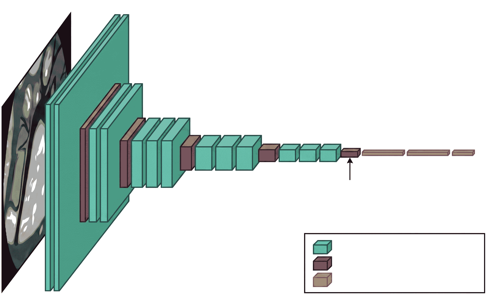

224 x 224 x64  
112 x 112 x128  
56 x 56 x 256  
fc6  
fc7  
fc8  
28 x 28 x 512  
14 x 14 x 512  
7 x 7 x 512  
1 x 1 x 4096  
1 x 1 x 1000  
conv5  
conv4  
conv3  
conv2  
conv1  
卷积+ReLU  
全连接+ReLU  
最大池化  

*图 6.4：VGG-16 架构*

完整的VGG16实现可在本书配套的GitHub页面（`https://github.com/PacktPublishing/Deep-Learning-with-C-/blob/main/chapter6/VGG16.cpp`）上获得。这里，在本节中，我们将查看代码的一些重要部分，以便更好地理解。该网络被划分为若干个块。以下是一个示例块：

```cpp
torch::nn::Conv2d(torch::nn::Conv2dOptions(3, 64, 3).padding(1)),
torch::nn::ReLU(true),
torch::nn::Conv2d(torch::nn::Conv2dOptions(64, 64, 3).padding(1)),
torch::nn::ReLU(true),
torch::nn::MaxPool2d(torch::nn::MaxPool2dOptions(2).stride(2)),
```

该块将原始的**红、绿、蓝**（**RGB**）通道转换为64个特征图。两个连续的带填充3x3卷积在保持空间维度的同时，通过ReLU激活引入非线性。此外，最大池化操作将空间分辨率降低一半，创建层次化表示。在VGG-16中，添加了五个这样的卷积层块，但通道深度逐渐增加：分别为64、128、256、512和512。这种设计使网络能够捕获越来越复杂的视觉模式——从早期层的边缘和纹理到更深层的物体部分和语义概念。

此外，还添加了一个分类器模块，通常称为分类头，如下所示：

```cpp
classifier = register_module("classifier", torch::nn::Sequential(
  torch::nn::Linear(512 * 7 * 7, 4096),
  torch::nn::ReLU(true),
  torch::nn::Dropout(0.5),
  torch::nn::Linear(4096, 4096),
  torch::nn::ReLU(true),
  torch::nn::Dropout(0.5),
  torch::nn::Linear(4096, num_classes)
));
}
```

在网络架构中逐步应用最大池化操作，系统地减小特征图的空间维度，最终将表示压缩到7×7的空间分辨率。在这个最后的卷积阶段，网络保持512个通道的特征深度，总共产生25,088个特征值（512×7×7）。随后，这种高维特征表示通过由两个全连接层组成的架构进行变换，每个全连接层包含4,096个神经元。

该架构设计在这些全连接层之间加入ReLU激活函数，以引入非线性并增强网络的表示能力。为了减轻训练过程中的过拟合，采用概率为`0.5`的dropout正则化机制，在每次训练迭代中有效停用一半的神经元。这种随机正则化技术可防止模型对特定神经元路径产生过度依赖，从而提高对未见数据的泛化性能。

网络架构以最终分类层收尾，其维度与分类任务中目标类别的数量精确对应。该最终层生成所有可能类别标签上的概率分布，使网络能够基于先前各层学到的层次化特征表示做出明智的预测。

以下是VGG-16神经网络前向传播的实现：

```cpp
torch::Tensor forward(torch::Tensor x) {
    x = features->forward(x);
    x = x.view({x.size(0), -1}); // Flatten
    x = classifier->forward(x);
    return x;
}
```

在前面的实现中，`features`模块代表了构成特征提取路径的所有五个卷积块的整体架构。网络接受格式为`[batch, 3, 224, 224]`的RGB输入张量，其中批次维度同时容纳多个图像，空间维度符合标准ImageNet预处理要求。卷积层前向传播完成后，`features`模块生成维度为`[batch, 512, 7, 7]`的输出张量，表示512个不同的特征图，每个特征图的空间分辨率为7×7像素。

随后的维度变换通过张量重塑操作完成：

```cpp
x = x.view({x.size(0), -1});
```

该操作在深度学习术语中通常称为展平，通过`x.size(0)`保留批次维度，同时使用`-1`参数自动计算剩余维度。自动计算产生25,088个元素（512×7×7=25,088），从而将多维特征图转换为适合全连接层处理的一维特征向量。

展平后的特征表示随后传入分类器模块，该模块应用前一节讨论的全连接层变换和正则化技术。网络的最终输出由对应每个目标类别的类别logits组成——在用于ImageNet分类的标准VGG-16实现中为1,000个类别——为多类别分类决策提供所需的概率分布。

这种架构设计体现了基于CNN的分类系统的基本原理：通过分层特征学习和降维，从空间特征表示系统性地转变为抽象语义分类。


## 第 6 章

### 使用 U-Net 进行图像分割

图像分割是一项涉及为像素分配标签并识别图像中感兴趣对象的任务。该过程通过从边界周围的图像像素构建初始背景模型来工作，其中背景和前景模型表示为多个 RGB 聚类的直方图。然后，程序动态地将对象边界向内收缩，同时更新和评估新的图像强度和梯度模型，直到获得具有强边缘屏障的稳定前景和背景模型。

图像分割技术已在多个领域得到广泛应用。基于深度学习的分割在自动驾驶、精准农业和生物医学应用中取得了显著成功。在文档处理系统中，分割有助于提取和分析特定区域（如驾照上的条形码），从而提高数据提取的精确率和召回率。

CNN 也可用于图像分割算法。在本节中，我们将讨论用于图像分割的 U-Net 算法。U-Net 架构是分割任务中一种轻量且有效的方法，采用全 CNN 设计。该架构由一个编码步骤和随后的转置卷积层组成，特别适合处理非序列数据。当使用适当的训练参数（如 Adam 优化器和二元交叉熵损失）实现时，U-Net 在二分类任务中可以取得很高的准确率。该架构已被证明在生物医学图像分割应用中特别有效，能够在保持计算效率的同时处理复杂的分割任务。还有其他复杂的算法，如 Mask R-CNN。为完整起见，你还应熟悉*语义*、*实例*和*全景分割*等术语。下图对此进行了说明。


*图 6.5：语义、实例和全景分割*

不同类型的分割在图像分析中服务于不同目的。在语义分割中，同一类别的所有对象都被标记为相同的标签，这在自动驾驶汽车和机器人技术中尤其有用，因为这些场景中的环境上下文至关重要。例如，在语义分割中，所有汽车都会被标记为相同。

全景分割结合了实例（对象）分割和语义（背景）分割两种方法。它要求标注者围绕所有对象绘制紧贴的边界，直到所有像素都被覆盖，并通过不同的颜色/标签将相似对象标记为不同实例。该技术在卫星图像等应用中尤其有价值，可用于检测保护区中的变化。

目前用于分割的典型神经网络之一称为 **U-Net**。U-Net 最初由德国弗莱堡大学的 Olaf Ronneberger、Philipp Fischer 和 Thomas Brox 于 2015 年提出。该网络因其独特的 U 形架构而得名，该架构由两条主要路径组成：

- **编码器路径（收缩路径）**：编码器路径构成 *U* 的向下部分。该路径在增加特征深度的同时逐步减小空间维度。它从输入图像中捕获上下文和特征信息。
- **解码器路径（扩展路径）**：解码器构成 *U* 的向上部分。与编码器路径不同，它在减小特征深度的同时逐步增加空间维度。它还重建空间信息以实现精确定位。

U-Net 的一个关键特征是跳跃连接，它将编码器和解码器路径中相应的层级连接起来。这些连接在每一分辨率级别上桥接收缩路径和扩展路径，使解码器能够通过直接引入来自编码器的高分辨率特征图，恢复在下采样过程中丢失的空间精度——这正是赋予 U-Net 特有的分割准确率的机制。

U-Net 已被证明在生物医学图像分割应用中特别有效，能够在保持计算效率的同时处理复杂的分割任务。该架构被认为是轻量且有效的，采用全 CNN 设计，特别适合处理非序列数据。自其问世以来，已出现了其他 U-Net 变体，如 Attention U-Net、U-Net++、ResUNet 和 3D U-Net 等。

| 块 | 操作 | 尺寸 | 通道数 |
|---|---|---|---|
| 输入 | 输入图像块 | 572 x 572 | 1 |
| 编码器 1A | 卷积 3x3, ReLU | 570 x 570 | 64 |
| 编码器 1B | 卷积 3x3, ReLU | 568 x 568 | 64 |
| 池化 1 | 最大池化 2x2 | 284 x 284 | 64 |
| 编码器 2A | 卷积 3x3, ReLU | 282 x 282 | 128 |
| 编码器 2B | 卷积 3x3, ReLU | 280 x 280 | 128 |
| 池化 2 | 最大池化 2x2 | 140 x 140 | 128 |
| 编码器 3A | 卷积 3x3, ReLU | 138 x 138 | 256 |
| 编码器 3B | 卷积 3x3, ReLU | 136 x 136 | 256 |
| 池化 3 | 最大池化 2x2 | 68 x 68 | 256 |
| 编码器 4A | 卷积 3x3, ReLU | 66 x 66 | 512 |
| 编码器 4B | 卷积 3x3, ReLU | 64 x 64 | 512 |
| 池化 4 | 最大池化 2x2 | 32 x 32 | 512 |
| 瓶颈 A | 卷积 3x3, ReLU | 30 x 30 | 1024 |
| 瓶颈 B | 卷积 3x3, ReLU | 28 x 28 | 1024 |
| 上卷积 1 | 上卷积 2x2 + 复制和裁剪 | 56 x 56 | 512 |
| 解码器 1A | 卷积 3x3, ReLU | 54 x 54 | 512 |
| 解码器 1B | 卷积 3x3, ReLU | 52 x 52 | 512 |
| 上卷积 2 | 上卷积 2x2 + 复制和裁剪 | 104 x 104 | 256 |
| 解码器 2A | 卷积 3x3, ReLU | 102 x 102 | 256 |
| 解码器 2B | 卷积 3x3, ReLU | 100 x 100 | 256 |
| 上卷积 3 | 上卷积 2x2 + 复制和裁剪 | 200 x 200 | 128 |
| 解码器 3A | 卷积 3x3, ReLU | 198 x 198 | 128 |
| 解码器 3B | 卷积 3x3, ReLU | 196 x 196 | 128 |
| 上卷积 4 | 上卷积 2x2 + 复制和裁剪 | 392 x 392 | 64 |
| 解码器 4A | 卷积 3x3, ReLU | 390 x 390 | 64 |
| 解码器 4B | 卷积 3x3, ReLU | 388 x 388 | 64 |
| 输出 | 卷积 1x1 | 388 x 388 | 2 |

*图 6.6：原始 U-Net 的架构*

有关 UNet 的完整实现，请参阅 GitHub 上的相关代码（`https://github.com/PacktPublishing/Deep-Learning-with-C-/blob/main/chapter6/UNet.cpp`）。让我们来看一下编码器和解码器的实现。

以下是编码器的代码：

```cpp
encoder1 = register_module("encoder1", torch::nn::Sequential(
    torch::nn::Conv2d(torch::nn::Conv2dOptions(in_channels, 64, 3).padding(1)),
    torch::nn::BatchNorm2d(64),
    torch::nn::ReLU(),
    torch::nn::Conv2d(torch::nn::Conv2dOptions(64, 64, 3).padding(1)),
    torch::nn::BatchNorm2d(64),
    torch::nn::ReLU()
));
```

在上述代码中，`register_module` 函数是 PyTorch C++ API 中的一个方法，负责将神经网络模块注册为当前模块的子模块。在此上下文中，当前模块是一个名为 `UNetImpl` 的 C++ 类，它继承自 PyTorch 的基础神经网络模块类，具体来说是 `torch::nn::Module`。

`UNetImpl` 类接受带有 `in_channels` 参数的输入（对于灰度图像默认为 `1`）。它生成 64 个特征图，同时通过填充保持空间维度。应用 `BatchNorm2d` 对特征图进行归一化，然后是 `ReLU()` 激活。随后，使用第二个卷积层。

理解几个关键且重要的 PyTorch 函数和方法至关重要。`torch::nn::Sequential` 类负责编排层的串联，确保数据按顺序流经这些层。`register_module` 函数自动管理已注册模块的参数，有助于梯度在整个注册模块中的传播。此外，它还处理训练模式和评估模式之间的切换、管理设备迁移，以及保存和加载完整的模型状态。

现在，让我们来看一下解码器子模块：

```cpp
decoder4 = register_module("decoder4", torch::nn::Sequential(
    torch::nn::Conv2d(torch::nn::Conv2dOptions(512, 256, 3).padding(1)),
    torch::nn::BatchNorm2d(256),
    torch::nn::ReLU(),
    torch::nn::Conv2d(torch::nn::Conv2dOptions(256, 256, 3).padding(1)),
    torch::nn::BatchNorm2d(256),
    torch::nn::ReLU()
));
```

与编码器的情况一样，解码器实现使用 PyTorch 的 C++ API 遵循类似的模式。解码器接收编码后的特征，在减小特征深度的同时逐步重建空间维度。

让我们也来看一下这个神经网络的前向传播：

```cpp
torch::Tensor forward(torch::Tensor x) {
    // Encoder path
    auto e1 = encoder1->forward(x);
    auto e2 = encoder2->forward(maxpool(e1));
    auto e3 = encoder3->forward(maxpool(e2));
    auto e4 = encoder4->forward(maxpool(e3));
```


```cpp
// Decoder path with skip connections
auto d4 = decoder4->forward(upconv4(e4));
auto d3 = decoder3->forward(upconv3(d4));
auto d2 = decoder2->forward(upconv2(d3));
return torch::sigmoid(final_layer(d2));
}
```

上述代码表示前向传播方法，定义了数据在 U-Net 中的流动方式。在前向传播的每一步中，先进行卷积，然后进行最大池化。在 U-Net 的编码器部分，空间尺寸减半，通道数加倍。它在多个尺度上捕获特征。解码器部分使用 `upconv4` 对 `e4` 进行上采样，`upconv4` 是一个转置卷积层（也称为反卷积）。转置卷积在输入像素之间插入零，并应用卷积，从而在训练过程中学习上采样权重的同时有效提高空间分辨率。最后，对 U-Net 的最后一个输出 `d2` 执行 sigmoid 操作。最终输出是与输入尺寸相同的分割概率图。

### 面向深度学习的图像处理

在本章中，我们探讨了 CNN 的两个关键应用：使用 VGG-16 进行图像分类和使用 U-Net 架构进行图像分割。虽然我们已经实现了这些神经网络的基本版本，但要获得最佳模型性能还需要其他技术。一种同时提高模型准确性和泛化能力的常用方法是图像增强（或更一般地说，数据增强）。图像增强包含一系列工具和技术，通过创建多样化的训练数据变体来提升模型性能。图像增强的目标是训练一个对输入数据的微小变化具有不变性的模型。在本节中，我们将探讨一些计算机视觉中常用的图像增强技术，并提供相应的代码片段。

#### 旋转

旋转是最常见的图像增强技术之一，它使图像围绕其中心点旋转不同角度。这种变换有助于 CNN 学习识别图像中任意方向的物体。在 C++ 中实现旋转时，你可以指定随机旋转和固定角度旋转，通常范围从 -180 度到 +180 度。然而，需要注意的是，旋转可能会在图像角落产生空白区域，如下图所示。这些空白区域需要通过填充、裁剪或重采样等技术来处理，以保持 CNN 所需的输入尺寸。


在日常实践中，最好利用 LibTorch 的 C++ 实现所提供的内置实现：

```cpp
#include <torch/torch.h>
#include <torchvision/transforms/functional.h>

torch::Tensor image_tensor = torch::rand({1, 256, 256}).cuda(); // Example: a 256x256 grayscale image
double angle = 45.0; // Rotate by 45 degrees
torch::Tensor rotated_image =
    torchvision::transforms::functional::rotate(image_tensor, angle);
```

#### 平移

平移是另一种图像增强技术，它通过指定像素数沿 *x* 轴和/或 *y* 轴移动图像。这种变换通过让 CNN 学习识别图像中任意位置的物体，帮助其发展位置不变性。在 C++ 中实现平移时，你可以使用固定的像素值进行确定性平移，也可以在定义范围内进行随机平移。该变换需要仔细处理边界区域，可以通过各种填充策略来管理。对于目标检测和图像分类等任务，平移增强对于提高模型鲁棒性尤其有价值，因为在这些任务中，物体可能出现在输入图像的不同位置。


在*图 6.8*中，图像沿水平轴平移。由于这种平移，图像的部分区域为空白，需要用某个常数值进行填充。

#### 裁剪

裁剪通过选择特定的**感兴趣区域**（**ROI**）来提取原始图像的一部分。这种变换通过迫使 CNN 从图像的不同部分学习，使其更加鲁棒。在 C++ 中实现裁剪时，你可以执行固定尺寸的中心裁剪，也可以在指定边界内改变裁剪区域的位置和大小进行随机裁剪。随机裁剪尤其有效，因为它通过关注图像的不同部分来创建多样的训练样本，帮助模型学习识别即使部分可见的物体。当目标物体不一定出现在画面中心或可能被部分遮挡时，这种技术尤其有价值。

以下是用于裁剪图像的 Torch 示例代码。在这段代码中，我们使用一个 100 像素的随机 `torch` 数组作为占位符来裁剪 RGB 图像：

```cpp
torch::Tensor image = torch::rand({3, 100, 100});

// Define the crop region:
int crop_x = 20; // starting row index
int crop_y = 30; // starting column index
int crop_h = 50; // height of cropped region
int crop_w = 60; // width of cropped region

torch::Tensor cropped_image = image.index({
    torch::indexing::Slice(), // All channels
    torch::indexing::Slice(crop_x, crop_x + crop_h), // Sliced height
    torch::indexing::Slice(crop_y, crop_y + crop_w) // Sliced width
});
```

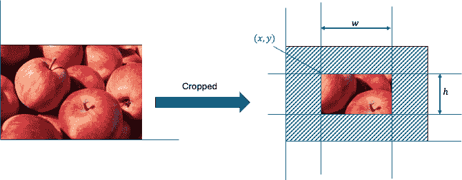

#### 缩放

缩放涉及通过放大或缩小操作来调整图像尺寸。这种变换通过让 CNN 学习识别不同尺寸的物体，帮助其发展尺度不变性。在 C++ 中实现缩放时，你可以应用均匀缩放（保持宽高比）和非均匀缩放（独立调整宽度和高度）。该变换需要仔细考虑插值方法以保持图像质量，尤其是在放大时。缩放增强对于训练需要处理现实应用中各种距离或尺寸物体的模型尤其有价值，例如监控或自动驾驶系统中的目标检测。

下图演示了对图像应用缩放变换的效果，其中通过指定因子调整尺寸来放大或缩小图像，并可选地保持宽高比。

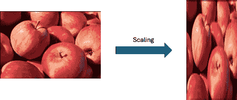

该函数根据指定的缩放因子对图像进行缩放，并在调整大小操作期间提供保持或调整宽高比的选项：

```cpp
torch::Tensor scale_image(
    torch::Tensor input,
    float scale_factor,
    bool maintain_aspect_ratio = true
) {
    input = input.detach();

    // Get original dimensions
    int height = input.size(-2);
    int width = input.size(-1);

    // Calculate new dimensions
    int new_height, new_width;
    if (maintain_aspect_ratio) {
        new_height = static_cast<int>(height * scale_factor);
        new_width = static_cast<int>(width * scale_factor);
    } else {
        new_height = static_cast<int>(height * scale_factor);
        new_width = static_cast<int>(width * scale_factor);
    }

    // Use PyTorch's interpolate function for scaling
    auto output = torch::nn::functional::interpolate(
        input.unsqueeze(0), // Add batch dimension
        torch::nn::functional::InterpolateFuncOptions()
            .size(std::vector<int64_t>({new_height, new_width}))
            .mode(torch::kBilinear)
            .align_corners(true)
    );

    return output.squeeze(0); // Remove batch dimension
}
```


## 第 6 章

#### 变焦

变焦是一种数据增强技术，通过放大或缩小图像中特定感兴趣区域来模拟相机变焦效果。与均匀影响整幅图像的缩放（scaling）不同，变焦关注特定区域，从而产生类似透视的效果。在 C++ 中实现变焦时，可以执行放大（zoom in）和缩小（zoom out）操作，并支持随机或固定的缩放因子。该变换需要处理外围区域，可以通过填充或裁剪来实现。变焦增强对于训练 CNN 处理物体距离和细节层次的变化尤其有价值，使其在人脸识别或医学图像分析等应用中不可或缺，因为在这些应用中，不同放大倍率下的特征细节至关重要。


*图 6.11：变焦操作*

`zoom_image` 函数通过裁剪感兴趣区域并将其缩放回原始尺寸来模拟数字变焦。它接受一个图像张量、一个用于放大倍率的缩放因子，以及一个可选的中心点（默认为图像中心）。该函数根据缩放因子计算裁剪尺寸，确保边界仍然有效，使用张量切片提取区域，并应用双线性插值将裁剪区域调整回原始大小：

```cpp
torch::Tensor zoom_image(
    torch::Tensor input,
    float zoom_factor,
    std::pair<int, int> center = {-1, -1}
) {
    input = input.detach();
    // Get original dimensions
    int height = input.size(-2);
    int width = input.size(-1);
    // If center not specified, use image center
    if (center.first == -1 || center.second == -1) {
        center = {height/2, width/2};
    }
    // Calculate crop dimensions
    int crop_height = static_cast<int>(height / zoom_factor);
    int crop_width = static_cast<int>(width / zoom_factor);
    // Calculate crop coordinates
    int start_h = center.first - crop_height/2;
    int start_w = center.second - crop_width/2;
    // Ensure crop bounds are within image
    start_h = std::max(0, std::min(start_h, height - crop_height));
    start_w = std::max(0, std::min(start_w, width - crop_width));
    // Crop the region of interest
    auto cropped = input.slice(-2, start_h, start_h + crop_height)
                       .slice(-1, start_w, start_w + crop_width);
    // Resize back to original dimensions
    auto output = torch::nn::functional::interpolate(
        cropped.unsqueeze(0),
        torch::nn::functional::InterpolateFuncOptions()
            .size(std::vector<int64_t>({height, width}))
            .mode(torch::kBilinear)
            .align_corners(true)
    );
    return output.squeeze(0);
}
```

#### 翻转

图像翻转是指将图像沿水平方向（左右）或垂直方向（上下）进行镜像。通过为现有图像创建镜像版本，这种变换可以有效地将训练数据集扩大一倍。在 C++ 中实现翻转时，可以沿指定轴执行确定性翻转，也可以按可配置概率执行随机翻转。水平翻转对于可能以任一方向出现的物体（如汽车或动物）特别有用，而垂直翻转较少使用，因为它可能产生不真实的场景。翻转增强有助于 CNN 形成镜像不变性，使其在现实应用中无论物体水平朝向如何，都能更鲁棒地识别物体。

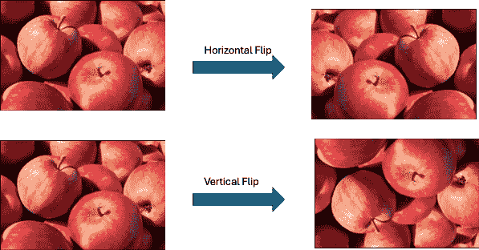

*图 6.12：水平翻转和垂直翻转操作*

以下代码实现了一个**图像翻转函数**，可以水平或垂直镜像图像：

```cpp
torch::Tensor flip_image(
    torch::Tensor input,
    bool flip_horizontal = true,
    bool flip_vertical = false
) {
    input = input.detach();
    auto output = input;
    // Apply horizontal flip
    if (flip_horizontal) {
        output = output.flip(-1);
    }
    // Apply vertical flip
    if (flip_vertical) {
        output = output.flip(-2);
    }
    return output;
}
```

#### 填充

图像填充是一种基本的图像增强技术，它涉及在图像边界周围添加像素。这种变换有助于在卷积或旋转等其他操作期间保持空间维度，否则边缘信息可能会丢失。在 C++ 中实现填充时，可以应用多种策略，包括零填充（用零填充）、反射填充（镜像边缘像素）或复制填充（复制边缘像素）。填充量可以围绕图像边界对称或不对称。填充在 CNN 架构中尤其重要，它可以在卷积层中保持空间维度，并确保边缘特征得到正确处理，因此在图像分割和目标检测等边界信息至关重要的任务中，填充是基础。下图展示了在图像上应用边界填充的效果：在边缘周围添加额外像素，以保持空间维度，并确保在卷积操作期间正确处理边界信息。


*图 6.13：图像填充操作*

`pad_image` 函数为输入张量实现边界填充，在图像边缘周围添加像素，以在卷积操作期间保持空间维度，或在图像处理流程中处理边界条件：

```cpp
torch::Tensor pad_image(
    torch::Tensor input,
    int pad_height,
    int pad_width,
    std::string pad_mode = "constant",
    float pad_value = 0.0
) {
    input = input.detach();
    // Define padding size for all sides [left, right, top, bottom]
    std::vector<int64_t> padding = {
        pad_width, // left
        pad_width, // right
        pad_height, // top
        pad_height // bottom
    };
    // Apply padding using PyTorch's pad function
    auto output = torch::nn::functional::pad(
        input,
        torch::nn::functional::PadFuncOptions(padding)
            .mode(pad_mode)
            .value(pad_value)
    );
    return output;
}
```

#### 重采样

图像重采样是一种基本的图像增强技术，通过改变图像的采样率，创建具有更多或更少像素的新表示。这种变换涵盖上采样（增加分辨率）和下采样（降低分辨率）操作。在 C++ 中实现重采样时，可以使用各种插值方法，例如最近邻插值、双线性插值或双三次插值，每种方法都在计算复杂度和输出质量之间提供不同的权衡。重采样对于训练 CNN 处理不同分辨率和质量水平的图像特别有价值，它使模型在处理来自不同来源和采集设备的真实世界数据时更加鲁棒。

下面是 `resample_image` 函数，它处理各种插值方法：

```cpp
torch::Tensor resample_image(
    torch::Tensor input,
    std::vector<int64_t> new_size,
    std::string mode = "bilinear"
) {
    input = input.detach();

    // Use PyTorch's interpolate function for resampling
    auto output = torch::nn::functional::interpolate(
        input.unsqueeze(0), // Add batch dimension
        torch::nn::functional::InterpolateFuncOptions()
            .size(new_size)
            .mode(mode)
            .align_corners(true)
    );
    return output.squeeze(0); // Remove batch dimension
}

// Example modes:
// "nearest" - nearest neighbor interpolation
// "bilinear" - bilinear interpolation
// "bicubic" - bicubic interpolation
```

除了我们已经讨论过的基本变换（旋转、平移、缩放、变焦、翻转和填充）之外，还有很多其他增强技术可以提升模型训练效果。其中包括颜色空间变换（例如调整亮度和对比度、颜色抖动等）、强度变换（例如直方图均衡化和伽马变换），以及向图像添加噪声。

在神经网络流水线中实现这些变换时，必须仔细考虑操作顺序及其参数，以确保它们能为训练数据生成有意义且逼真的变化，同时保留学习任务所需的重要特征。下面是一个组合变换的 C++ 实现示例：

```cpp
torch::Tensor apply_combined_transforms(
    torch::Tensor input,
    int translate_x = 50,
    int translate_y = 30,
    float rotation_angle = 45.0,
    std::vector<int64_t> resample_size = {224, 224}
```


```cpp
) {
    // 1. Translation
    auto translated = torch::nn::functional::pad(
        input,
        torch::nn::functional::PadFuncOptions({translate_x, translate_x, translate_y, translate_y})
            .mode(torch::kConstant)
            .value(0.0)
    ).slice(-2, translate_y, -translate_y)
     .slice(-1, translate_x, -translate_x);

    // 2. Rotation
    auto rotated = torchvision::transforms::functional::rotate(translated, rotation_angle);

    // 3. Horizontal flip
    auto flipped = rotated.flip(-1);

    // 4. Resampling
    return torch::nn::functional::interpolate(
        flipped.unsqueeze(0),
        torch::nn::functional::InterpolateFuncOptions()
            .size(resample_size)
            .mode(torch::kBilinear)
            .align_corners(true)
    ).squeeze(0);
}
```

`apply_combined_transforms` 函数基于 PyTorch 的 C++ API 实现了一条高效的图像处理流水线。该函数按固定顺序执行一系列几何变换：

1. **平移**：使用填充和切片操作执行空间位移
2. **旋转**：围绕图像中心应用角度变换
3. **翻转**：执行水平镜像
4. **重采样**：使用双线性插值调整到目标尺寸

这种有序的序列确保产生确定性的变换结果，同时在每个处理阶段保持图像质量。该流水线的架构允许在保留变换数据空间关系的同时，实现一致的图像增强。以下是该变换的结果：

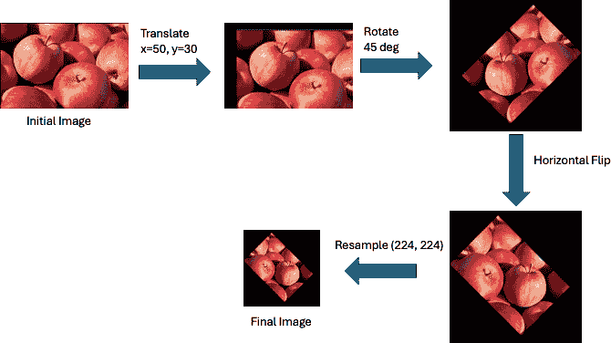

*图 6.14：对图像依次执行平移、旋转、水平翻转和重采样的输出结果*

这些变换中的每一个都会直接检验你的 C++ 流水线所利用的不变性：旋转和翻转操作对卷积层中已学习的滤波器进行压力测试，而平移、缩放和变焦变化则迫使网络在 `stride` 和 `pooling` 参数所定义的空间位置和感受野大小上进行泛化。当训练集较小时，这一点尤为重要——与其收集更多带标签的图像，不如使用你在此构建的增强流水线，从已有数据中生成逼真的变体，从而以合成方式成倍增加有效数据集大小。这样得到的模型会对实践中出现的输入偏移类型具备鲁棒性：同一物体在医学扫描、监控画面或检测输入中出现在不同的位置、尺度或方向。在下一节中，我们将整合本章中出现的几个关键 CNN 术语，给出精确的定义，以巩固到目前为止所涵盖的概念。

### 与 CNN 相关的术语

在本章中，我们探索了 CNN 的基本概念，研究了它们在图像分类和分割任务中的应用。我们从理解卷积运算及其数学基础入手，随后讨论了 C++ 中的实际实现。后半部分的讨论重点在于提升模型性能的关键技术。我们探讨了多种图像增强方法，包括缩放、变焦、填充、翻转和重采样。为了进一步增进理解，我们现在正式定义讨论中出现过的几个重要术语，为这些概念提供清晰的技术背景。

#### 池化

池化是 CNN 中的一项关键操作，它在保留重要信息的同时减小特征图的空间尺寸。它的操作方式是将输入特征图划分为不重叠的区域，并对每个区域应用特定操作。两种最常见的池化类型如下：

- **最大池化**：取每个区域的最大值，有效捕获最显著的特征。这对于检测关键特征特别有用，无论其在区域内的确切位置如何。
- **平均池化**：计算每个区域的平均值，提供该区域内所有特征的汇总。

以下是使用 PyTorch 的 C++ API 的简单实现：

```cpp
torch::Tensor apply_pooling(
    torch::Tensor input,
    std::vector<int64_t> kernel_size,
    std::string pool_type = "max"
) {
    if (pool_type == "max") {
        return torch::max_pool2d(input, kernel_size);
    } else if (pool_type == "avg") {
        return torch::avg_pool2d(input, kernel_size);
    }
    return input;
}
```

池化有助于以下方面：

- 降低计算复杂度
- 为特征检测提供空间不变性
- 通过减少参数数量来控制过拟合
- 保持层次化的特征表示

#### 步幅

步幅是 CNN 中的一个基本参数，决定了卷积核或滤波器在输入数据上的移动方式。它表示卷积操作中滤波器每一步移动的像素数。当 `stride` 为 `1` 时，滤波器每次移动一个像素，连续位置之间的重叠最大。较大的 `stride` 值会使滤波器跳过像素，从而减小输出特征图的空间尺寸。例如，`stride` 值为 `2` 意味着滤波器每次移动两个像素，从而使输出尺寸实际上减少一半。该参数在控制特征图的空间分辨率和网络的计算复杂度方面起着至关重要的作用：

```cpp
torch::Tensor apply_stride(
    torch::Tensor input,
    int stride_height,
    int stride_width,
    int kernel_size = 3
) {
    // Create convolutional layer with specified stride
    torch::nn::Conv2d conv(
        torch::nn::Conv2dOptions(
            input.size(1), // in_channels
            input.size(1), // out_channels
            kernel_size // kernel_size
        ).stride(stride_height, stride_width)
    );

    // Apply convolution with stride
    auto output = conv->forward(input.unsqueeze(0));
    return output.squeeze(0);
}
```

#### 特征图

特征图是 CNN 中卷积滤波器对输入数据进行处理后产生的输出。当卷积核（滤波器）通过卷积运算应用于输入图像时，会创建一个新的表示形式，突出显示该滤波器检测到的特定特征。每个特征图代表其对应滤波器在输入中不同空间位置上的响应。在 CNN 的浅层，这些特征图通常捕获边缘或颜色过渡等基本元素，而更深的层则组合这些基本特征，以检测更复杂的模式、纹理，并最终识别出完整的目标。特征图的维度由卷积操作中使用的输入尺寸、卷积核尺寸、`stride` 和 `padding` 参数等因素决定。

### 总结

本章以实际 C++ 实现的视角对 CNN 进行了全面探索，展示了从基础数学概念到复杂的生产级系统的演进过程。我们的旅程始于卷积运算的数学基础，并系统地经历了越来越复杂的实现，最终形成了用于实际计算机视觉应用的高级架构。

从基本的嵌套循环实现到矩阵优化解决方案，再到 GPU 加速的 CUDA 实现，这一演进过程展示了现代深度学习开发所特有的迭代式优化过程。每一步演进——从最初的 `ConvolutionalLayer` 类，到基于 Eigen 的矩阵运算，再到 `CudaConvolutionalLayer` 实现——都在保持概念清晰和代码可维护性的同时，展现了显著的性能提升。

我们通过 VGG-16 图像分类和 U-Net 图像分割对实际应用的探索，展示了理论理解如何转化为复杂计算机视觉挑战的有效解决方案。这些实现通过包括旋转、缩放、裁剪和翻转在内的全面图像增强技术得到增强，展示了稳健 CNN 部署所需的整体方法。

本章所探讨的架构原则和优化策略为应对日益复杂的计算机视觉应用奠定了基础。随着 CNN 架构的不断演进和计算资源的扩展，本文所介绍的卷积运算、特征学习层次和优化动态的基本理解，对于开发下一代计算机视觉系统仍然至关重要。

这篇关于 C++ 中 CNN 的全面论述弥合了理论理解与实际实现之间的差距，为从业者提供了必要的概念框架和技术技能，以通过高效、可扩展的神经网络解决方案推进计算机视觉领域的发展。最后一节将图像增强作为改善模型鲁棒性和泛化能力的实用工具包进行了讨论。其中介绍了八种核心技术的 C++ 实现：旋转、平移、裁剪、缩放、变焦、翻转、填充和重采样。组合变换流水线演示了如何将这些操作按确定性顺序链接起来，以实现一致的训练数据增强。

本章最后以术语参考的形式定义了池化、步幅和特征图，从而整合了全文介绍的关键概念。


本章探讨的架构原则、优化策略和增强技术，共同提供了在C++中构建高效、可扩展的基于CNN的计算机视觉系统所需的概念框架和实践技能。

尽管CNN擅长从图像等网格状数据中提取空间特征，但许多现实世界的问题涉及信息*顺序*至关重要的数据——金融时间序列、自然语言、语音以及其他序列输入，其中每个元素的含义都取决于其之前的元素。*第7章*通过**循环神经网络**（**RNN**）和**长短期记忆网络**（**LSTM**）来解决这类问题，探讨反馈连接和门控机制如何使网络能够跨时间步保持记忆。下一章沿用本章所使用的渐进式实现方法，从基于向量的基础RNN单元开始，历经Eigen优化的矩阵运算，直至构建支持GPU加速的生产级LibTorch实现——最终落地到实际应用，包括使用序列到序列编码器-解码器架构的下一词文本预测和神经机器翻译。

### 延伸阅读

如果你想加深理解，以下资源提供了清晰的解释和有用的背景资料：

- PyTorch优化器文档：`https://docs.pytorch.org/docs/stable/optim.html`
- *NVIDIA CUDA C++编程指南*（本章引用）：`https://docs.nvidia.com/cuda/cuda-c-programming-guide/`
- *CS231n*：面向视觉识别的*卷积神经网络*（斯坦福大学）——经典而全面的课程资源：`https://cs231n.github.io/convolutional-networks/`
- 维基百科：*卷积神经网络*，一个广泛概述，包括著名的C++库（Caffe、Dlib等）：`https://en.wikipedia.org/wiki/Convolutional\_neural\_network`
- EmergentMind上的CNN概述：`https://www.emergentmind.com/topics/convolutional-neural-networks-cnns`
- VGG-16深度卷积架构——架构及其设计原则概述：`https://www.emergentmind.com/topics/vgg-16-net`
- VGG-16完整实现（本章配套代码，位于GitHub）：`https://github.com/PacktPublishing/Deep-Learning-with-C-/blob/main/chapter6/VGG16.cpp`
- U-Net原始论文：`https://arxiv.org/pdf/1505.04597`（本章引用）
- *论文精读：U-Net*——原始架构的详细解读：`https://towardsdatascience.com/paper-walkthrough-u-net-98877a2cd33c/`
- *精通U-Net：使用PyTorch从零开始进行分割的分步指南*：`https://medium.com/@fernandopalominocobo/mastering-u-net-a-step-by-step-guide-to-segmentation-from-scratch-with-pytorch-6a17c5916114`
- 使用PyTorch训练U-Net（`PyImageSearch`）：`https://pyimagesearch.com/2021/11/08/u-net-training-image-segmentation-models-in-pytorch/`
- *U-Net完整实现*（本章配套代码，位于GitHub）：`https://github.com/PacktPublishing/Deep-Learning-with-C-/blob/main/chapter6/UNet.cpp`
- *语义、实例和全景分割论文*：`https://arxiv.org/pdf/2111.10250`（本章引用）
- *使用PyTorch的高级图像分割技术*：`https://markaicode.com/advanced-image-segmentation-techniques-with-pytorch/`
- `im2col`解释（本章引用）：`https://hackmd.io/@machine-learning/blog-post-cnnumpy-fast`

### 获取本书PDF版本及更多资源

扫描二维码（或访问 `packtpub.com/unlock`）。按名称搜索本书，确认版本，然后按照页面上的步骤操作。


*注意：请将您的发票放在手边。直接从Packt购买无需提供发票。*

## 7 C++中的循环神经网络与长短期记忆网络

**循环神经网络**（**RNN**）及其进阶变体**长短期记忆网络**（**LSTM**）已成为处理此类序列数据的强大架构。这些网络能够维持对先前输入的内部记忆，从而学习并预测不同长度序列中的模式。从预测股票市场趋势、翻译语言，到生成类人文本和处理语音，RNN和LSTM彻底改变了我们处理序列数据问题的方式。

序列数据——如文本、语音和时间序列——给神经网络带来了根本性挑战：每个元素的含义取决于其时间上下文。传统的前馈网络独立处理输入，丢弃了定义序列的顺序信息。金融数据清楚地说明了这一局限性：如果不了解股价处于上涨还是下跌趋势中，150美元的股价便毫无意义。同样，单词"bank"需要借助周围的词才能区分金融机构（银行）与河岸。

在本章中，我们探讨RNN和LSTM网络的基本概念、架构及C++实现，特别关注**语言作为序列数据**。我们研究这些架构如何通过记忆机制处理序列数据，理解包括梯度消失问题在内的数学基础和训练挑战，并使用现代C++库实现实用解决方案。通过从基于Eigen的方法到生产级LibTorch系统的详细代码实现，以及文本预测和机器翻译等自然语言处理任务的动手实践，你将掌握构建和部署面向语言应用的序列学习模型所需的技能。

在本章中，我们将涵盖以下主题：

- 理解时间序列与序列数据
- RNN架构与数学基础
- BPTT
- LSTM网络
- LSTM反向传播
- 文本处理
- 词嵌入：连接离散标记与连续表示
- 用于深度学习的文本处理流水线

### 理解时间序列与序列数据

与图像不同——图像中的信息同时存在于二维网格中，使**卷积神经网络**（**CNN**）能够并行处理相邻像素——序列数据随时间展开，含义逐步呈现。在图像中，像素与其相邻像素的关系在空间上是固定的：猫耳朵的边缘通过空间邻近性与周围像素相关联。序列数据的运作方式则根本不同：每个元素的重要性取决于其之前的元素，可能还取决于其之后的元素，由此形成的是时间依赖而非空间依赖。

想一想我们如何处理语言与图像。看照片时，你可以先查看任何区域——背景、前景或中心——都不会影响理解。无论查看顺序如何，空间关系始终保持不变。然而，文本却需要顺序处理："The bank approved the loan"（银行批准了贷款）与"The river bank eroded"（河岸被侵蚀）表明，相同的词语只有通过其时间上下文才能获得含义。这种时间依赖性不仅限于语言：测量到120 bpm的心率所代表的情况也截然不同，取决于它是在静息后（令人担忧）还是运动后（正常）测得。

序列数据的数学表示明确引入了时间维度，其中序列 \(X = \{x_1, x_2, \ldots, x_T\}\) 包含 \(T\) 个时间步，每个元素 \(x_t\) 都依赖于历史上下文 \(\{x_1, x_2, \ldots, x_{t-1}\}\)。这种时间依赖性为神经网络架构带来了机遇与挑战，要求模型能够在扩展的序列中保持并利用记忆，同时学习可能跨越多个时间尺度的复杂模式。


## 第7章

序列数据中的时间依赖以多种不同方式体现，包括：

- **因果关系：** 早期事件影响后续事件时
- **上下文含义：** 相同数据点根据其在序列中的位置而具有不同解释时
- **模式涌现：** 只有将多个时间步放在一起查看时，有意义的模式才会显现
- **记忆需求：** 需要保留来自先前状态的信息才能理解当前状态

这些时间依赖共同解释了为什么传统神经网络在序列任务上表现不佳，以及为什么带有记忆机制的专门架构对于有效的序列数据处理变得至关重要。在接下来的章节中，我们将研究RNN的基础知识以及驱动这些架构的数学原理。

### RNN架构与数学

RNN专门设计用于处理时间关系至关重要的序列数据，这导致了允许RNN保持记忆的关键架构差异。它们创建了一个反馈回路，其中网络的输出成为其下一个时间步输入的一部分。这种递归结构使网络能够记住先前的输入，并利用这些信息来指导当前预测。

考虑预测句子中下一个单词的任务。当我们遇到短语“The cat sat on the...”时，我们对下一个单词的预测（可能是“mat”、“chair”或“floor”）完全取决于对前面单词所建立上下文的理解。序列中的每个单词不仅单独承载含义，还与其之前的单词相关联。

这种时间依赖正是RNN被设计用来捕获的。网络维护一个内部状态——通常称为隐藏状态——作为其记忆。该隐藏状态在每个时间步更新，整合当前输入的信息，同时保留先前时间步的相关信息。我们现在将探讨不同类型的RNN及其数学基础的细节，重点关注隐藏状态如何实现时间记忆。

#### RNN的类型

从**架构**上讲，根据**输入**和输出的数量以及不同RNN单元之间的连接方式，共有4种不同类型的RNN。它们分别是：

- **一对一：** 单个输入，单个输出
- **一对多：** 单个输入，多个**输出**
- **多对一：** 多个**输入**，单个输出。这用于情感分类。
- **多对多：** 这些多对多网络有两种变体

第一种变体发生在输入数量与输出数量相同时。这用于像**命名实体识别**（**NER**）这样的任务，这是一项专注于识别文本中名称和关键信息的语言任务，例如人名、组织名、地名和日期。第二种变体发生在输入数量和输出数量不同时，主要用于神经机器翻译。我们将在名为*使用LibTorch构建序列到序列翻译器*的应用部分看到此类RNN的示例。但首先，我们应该看看RNN的数学基础。

#### 数学基础

RNN的数学框架可以通过在每个时间步发生的三个基本操作来理解。这些操作共同作用，使网络在处理序列输入时能够保持时间上下文。在每个时间步，RNN执行以下计算：

- **隐藏状态更新**：网络将当前输入\(x(t)\)与先前的隐藏状态\(h(t-1)\)组合，生成新的隐藏状态\(h(t)\)：

  \[
  h(t) = \sigma(W_{xh}x(t) + W_{hh}h(t-1) + b_h)
  \]

  其中\(h(t)\)表示当前隐藏状态，\(W_{xh}\)和\(W_{hh}\)分别是输入连接和循环连接的权重矩阵，\(b_h\)是偏置向量，\(\sigma\)是激活函数（通常是tanh或ReLU）。

- **输出生成**：利用当前隐藏状态，网络生成输出\(y(t)\)：

  \[
  y(t) = f(W_{hy}h(t) + b_y)
  \]

  其中\(W_{hy}\)是输出权重矩阵，\(b_y\)是输出偏置，\(f\)是输出激活函数（对于分类任务通常是softmax，对于回归任务通常是线性函数）。

- **记忆传播**：隐藏状态\(h(t)\)被前向传递到下一个时间步，携带来自所有先前输入的累积信息。

这种递归计算创建了一个操作链，信息在理论上可以从第一个输入流到最终输出，使网络能够维持整个序列上的长期依赖。隐藏状态充当网络的记忆，在处理新输入时不断更新以编码相关历史信息。

循环连接——即输出作为输入反馈回来——赋予了RNN独特的能力。这种架构允许单个网络使用同一组学习参数处理不同长度的序列，从短语到整个文档。网络本质上是随时间“展开”的，创建了一个能够捕获复杂时间模式的深度计算图。

*图7.1* 说明了这个展开过程，展示了单个RNN单元如何跨时间步复制以处理序列输入。

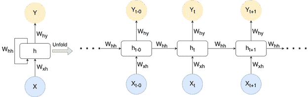

*图7.1：RNN架构，展示单个RNN单元跨时间步展开以处理序列输入*

RNN前向传播中激活函数的选择显著影响网络跨时间步维持和传播信息的能力。双曲正切（*tanh*）函数通常用于隐藏状态计算，因为它产生\([-1, 1]\)范围内的输出，提供可以表示多种信息类型的正负激活。

*tanh*函数在反向传播过程中也具有有利的梯度特性，尽管它仍然会在很长的序列中导致梯度消失问题。一些实现使用ReLU激活来缓解梯度消失，但这可能会引入其他挑战，例如激活值爆炸。

#### 记忆动态与信息流

RNN中的隐藏状态充当网络的工作记忆，编码来自序列历史的相关信息。在前向传播过程中，这种记忆经历持续转换——新信息被整合，而现有信息可能根据学习到的权重矩阵被保留、修改或遗忘。

在每个时间步，网络必须平衡两个相互竞争的目标：整合来自当前输入的新信息，同时保留来自先前时间步的相关上下文。权重矩阵\(W_{xh}\)和\(W_{hh}\)决定了这种平衡，其学习到的值编码了历史上下文与当前输入的相对重要性。

通过\(W_{hh}\)的循环连接允许信息从早期时间步流向后期时间步，理论上使网络能够维持长期依赖。然而，在实践中，由于重复的矩阵乘法和非线性变换，这种信息流在长序列上会退化。

### C++实现RNN

在本节中，我们将使用C++和Eigen库为RNN实现一个全面的类架构，延续前几章探索中一贯的系统化教学方法。我们的实现策略强调算法透明性和计算效率，通过基于矩阵的操作清晰展示理论概念如何转化为实际代码。

虽然备选实现方法——包括基础的基于矩阵的实现和生产级LibTorch系统——可在相关GitHub仓库（`https://github.com/PacktPublishing/Deep-Learning-with-Cpp/chapter7`）中获取，但这种基于Eigen的实现可在概念清晰性与实际性能之间达到最佳平衡。通过这种专注的方法，我们确保定义RNN架构的复杂记忆机制和时间依赖保持易于理解，同时展示支撑现代序列学习模型的计算技术。

#### 基于Eigen的方法

基于Eigen的方法将所有四个LSTM门（遗忘门、输入门、候选门和输出门）整合为统一的矩阵操作，并将它们组织在连续内存块中以提升计算效率。该实现采用策略性内存组织，其中`4 * hidden_size`维度系统地容纳所有门，Xavier/Glorot初始化可防止早期训练期间的梯度消失或爆炸。遗忘门被初始化为


## 第7章：C++中的循环神经网络与长短期记忆网络

1.0 以保持细胞状态信息流，帮助对抗困扰早期RNN架构的梯度消失问题。

下面的代码块展示了用C++实现的`RNNCell`。完整代码可在相关的GitHub仓库（`https://github.com/PacktPublishing/Deep-Learning-with-C-/blob/main/chapter7/RNNCell.cpp`）中获取。`RNNCell`是一个C++类，只有三个参数：`input_size`、`hidden_size`和`output_size`。根据前面的公式，`W_xh`处理新输入的信息，`W_hh`是循环连接，`W_hy`是将最终隐藏层转换为`output_layer`的矩阵。`initialize_weights()`函数使用Xavier方法初始化参数。

```cpp
class RNNCell {
private:
    int input_size;
    int hidden_size;
    int output_size;

    // Weight matrices
    Eigen::MatrixXf W_xh; // Input to hidden
    Eigen::MatrixXf W_hh; // Hidden to hidden (recurrent)
    Eigen::MatrixXf W_hy; // Hidden to output

    // Bias vectors
    Eigen::VectorXf b_h; // Hidden bias
    Eigen::VectorXf b_y; // Output bias

    // Activation functions
    std::function<Eigen::MatrixXf(const Eigen::MatrixXf&)> hidden_activation;
    std::function<Eigen::MatrixXf(const Eigen::MatrixXf&)> output_activation;

public:
    RNNCell(int input_sz, int hidden_sz, int output_sz)
        : input_size(input_sz), hidden_size(hidden_sz), output_size(output_sz) {
        // Initialize weights with Xavier initialization
        initializeWeights();
        // Set default activation functions
        hidden_activation = ActivationFunctions::tanh;
        output_activation = ActivationFunctions::sigmoid;
    }
};
```

我们现在来探讨训练中的挑战：计算必须随时间反向流动的梯度，以应对时间依赖性。这种专门的算法被称为**通过时间反向传播**（**BPTT**）。

### BPTT

训练RNN会带来一些独特的挑战，使其有别于前馈网络。传统神经网络可以通过直接的反向传播计算梯度，而RNN需要一种称为BPTT的专门训练算法。该算法通过跨时间步“展开”网络，来解决顺序数据处理中固有的时间依赖性。

在前馈网络中，从输入到输出的路径是直接且无环的，因此梯度计算很直接。然而，RNN创建了一个时间计算图，其中相同的参数（权重矩阵\(W_{xh}\)、\(W_{hh}\)和偏置\(b\)）在多个时间步中重复使用。这种跨时间的参数共享产生了训练时必须小心处理的依赖性。

考虑一个处理长度为\(T\)序列的RNN。网络的最终输出不仅取决于当前输入，还通过隐藏状态链取决于所有先前的输入。在计算梯度时，我们必须考虑每个参数在它所使用的每个时间步上如何影响损失。

#### BPTT的数学基础

BPTT背后的核心思想是将展开后的RNN视为一个非常深的前馈网络。对于长度为\(T\)的序列，我们在概念上创建\(T\)层，每一层对应一个时间步。损失相对于时间\(t\)处隐藏状态的梯度依赖于所有未来时间步的梯度。

#### 时间中的梯度流动

损失\(L\)相对于隐藏状态\(h(t)\)的梯度计算如下：

\[
\frac{\partial L}{\partial h(t)} = \frac{\partial L}{\partial h(t+1)} \frac{\partial h(t+1)}{\partial h(t)} + \frac{\partial L}{\partial y(t)} \frac{\partial y(t)}{\partial h(t)}
\]

这个递归关系展示了梯度如何随时间向后流动，并累积所有未来时间步的贡献。

#### 参数梯度的累积

由于相同的参数在每个时间步都被使用，它们的梯度必须在整个序列上累积。

\[
\frac{\partial L}{\partial W_{xh}} = \sum_{t=1}^{T} \frac{\partial L}{\partial h(t)} \frac{\partial h(t)}{\partial W_{xh}}
\]

\[
\frac{\partial L}{\partial W_{hh}} = \sum_{t=1}^{T} \frac{\partial L}{\partial h(t)} \frac{\partial h(t)}{\partial W_{hh}}
\]

\[
\frac{\partial L}{\partial b} = \sum_{t=1}^{T} \frac{\partial L}{\partial h(t)} \frac{\partial h(t)}{\partial b}
\]

当梯度通过许多时间步向后传播时，它们会反复乘以权重矩阵\(W\)和激活函数的导数。当这些值很小（通常小于1）时，梯度会随着时间步数呈指数级减小。

损失相对于\(h(1)\)的梯度涉及雅可比矩阵的乘积。

\[
\frac{\partial L}{\partial h(1)} = \frac{\partial L}{\partial h(T)} \times \prod_{t=2}^{T} \frac{\partial h(t)}{\partial h(t-1)}
\]

每一项\(\frac{\partial h(t)}{\partial h(t-1)}\)的大小通常小于1，导致整体梯度随着\(T\)的增大而消失。这使得网络难以学习长期依赖性，因为早期时间步接收到的梯度信号可以忽略不计。

#### 实际实现注意事项

为了解决BPTT的数学基础所揭示的计算和数值挑战，两种关键技术已成为标准做法：截断BPTT和梯度裁剪。

- **截断BPTT：** 对于非常长的序列，在整个序列上计算梯度的计算成本变得过高，并可能导致数值不稳定。截断BPTT通过限制梯度传播的时间步数来解决这个问题，通常使用10到50个时间步的固定窗口。

- **梯度裁剪：** 为了防止梯度爆炸（即梯度变得过大的相反问题），通常采用梯度裁剪。该技术限制了训练过程中梯度的大小。

让我们看一下梯度裁剪函数的C++实现：

```cpp
void clip_gradients(GradientState& grads) {
    float total_norm = 0.0f;

    // Compute total gradient norm across all parameters
    for (const auto& row : grads.dW_xh) {
        for (float val : row) {
            total_norm += val * val;
        }
    }
    total_norm = std::sqrt(total_norm);

    // Apply clipping if necessary
    if (total_norm > gradient_clip_threshold) {
        float clip_factor = gradient_clip_threshold / total_norm;

        for (auto& row : grads.dW_xh) {
            for (float& val : row) {
                val *= clip_factor;
            }
        }
    }
}
```

我们现在将这些概念转化为可行的C++实现，以应对训练RNN时的计算和数值挑战。

#### C++实现BPTT

在确立了BPTT的理论基础及其数学表述之后，我们现在转向在C++中实际实现BPTT。从数学概念到可用代码的转换需要仔细考虑计算效率、数值稳定性和内存管理——这些挑战在处理跨时间步梯度计算的递归特性时尤为突出。

在C++中实现BPTT为生产级RNN训练提供了几个优势。该语言显式的内存管理允许精确控制计算图的存储，而其性能特性使其适合处理在高级语言中难以承受的长序列。然而，这种实现的复杂性需要系统化的方法来处理时间步与参数更新之间错综复杂的依赖关系。

BPTT的C++实现必须解决算法递归结构带来的几个关键计算挑战。与前向传播按顺序处理时间步不同，BPTT需要同时维护所有时间步的梯度，这会为长序列带来显著的内存开销。此外，跨多个时间步累积梯度需要仔细管理数值精度，以防止梯度消失和梯度爆炸问题。

我们的实现策略聚焦于三个核心组件：最小化内存分配开销的高效梯度存储结构、处理BPTT固有递归依赖的数值稳定梯度计算，以及使训练在实际应用中可行的实用优化技术（如梯度裁剪和截断BPTT）。

##### 基于向量的实现

下面的C++实现演示了BPTT的核心机制：跨时间步的梯度累积、通过隐藏状态的递归反向传播，以及包括梯度裁剪在内的数值稳定技术。该代码为在序列数据上训练RNN提供了可用的基础。

```cpp
// Backward pass through time
for (int t = sequence_length - 1; t >= 0; --t) {
    // Compute output error (combining current loss and future gradients)
    std::vector<float> output_error(hidden_size);
    for (int i = 0; i < hidden_size; ++i) {
        output_error[i] = forward_state.hidden_states[t][i] - targets[t][i] + grads.dh[i];
    }
    // Compute gradients through activation function
    std::vector<float> pre_activation_grad(hidden_size);
    for (int i = 0; i < hidden_size; ++i) {
        pre_activation_grad[i] = output_error[i] * tanh_derivative(forward_state.pre_activations[t][i]);
    }
    // Accumulate weight gradients
    for (int i = 0; i < hidden_size; ++i) {
```


```cpp
for (int j = 0; j < input_size; ++j) {
    grads.dW_xh[i][j] += pre_activation_grad[i] * forward_state.inputs[t][j];
}
```

这结合了两个误差来源：即时的预测误差（预测值与目标值之差）以及未来的梯度流（`grads.dh[i]`）。第二项至关重要——它将来自后续时间步的“责任”反向传播，使网络能够学习长期依赖关系。

##### 基于 Eigen 的实现

与前面章节一样，我们将使用 Eigen 库来优化矩阵运算：

```cpp
EigenGradients backward(const std::vector<Eigen::VectorXf>& hidden_states,
                        const std::vector<Eigen::VectorXf>& targets,
                        const Eigen::MatrixXf& W_hh) {
    Eigen::VectorXf dh_next = Eigen::VectorXf::Zero(hidden_size);
    for (int t = sequence_length - 1; t >= 0; --t) {
        // Vectorized error computation
        Eigen::VectorXf output_error = hidden_states[t] - targets[t] + dh_next;
        // Vectorized activation derivative
        Eigen::VectorXf pre_activation_grad = output_error.cwiseProduct(tanh_derivative(pre_activations[t]));
        // Efficient outer product for gradient accumulation
        grads.dW_xh += pre_activation_grad * inputs[t].transpose();
        // Matrix-vector multiplication for next time step gradient
        dh_next = W_hh.transpose() * pre_activation_grad;
    }
}
```

##### 基于 Libtorch 的实现

然而，在生产环境中，我们可以使用优化的 `libtorch` 库进一步改进：

```cpp
torch::Tensor backward_mixed_precision(torch::nn::LSTM& model,
                                       const torch::Tensor& inputs,
                                       const torch::Tensor& targets) {
    torch::Tensor loss;
    if (use_amp) {
        // Forward pass with autocast for FP16 computation
        {
            torch::autocast::autocast_mode autocast_guard(torch::kCUDA, true);
            auto [output, hidden] = model->forward(inputs);
            loss = torch::mse_loss(output, targets);
        }
        // Backward pass with gradient scaling
        scaler.scale(loss).backward();
        // Unscale gradients before clipping
        scaler.unscale_(optimizer);
        torch::nn::utils::clip_grad_norm_(model->parameters(), 5.0);
        // Scaled optimizer step
        scaler.step(optimizer);
        scaler.update();
    }
    return loss;
}
```

尽管有了这些实用的训练技巧，根本性的梯度消失问题依然存在，这限制了 RNN 捕捉长期依赖的能力，并推动了 LSTM 网络的发展。

### LSTM 网络

在上一节中，我们探讨了梯度在长序列中反向传播时如何呈指数级衰减。这使得标准 RNN 几乎不可能学习跨越多个时间步的依赖关系。这一局限严重制约了它们捕捉长期模式的能力，而这些模式对于理解序列数据往往至关重要。

LSTM 网络由 Hochreiter 和 Schmidhuber 于 1997 年提出，通过一种精妙的门控机制解决了这一关键限制，该机制提供了对信息流的显式控制。与依赖简单循环连接的标准 RNN 不同，LSTM 引入了一种复杂的内部架构，旨在跨扩展的时间序列中选择性地保留、更新和遗忘信息。

LSTM 设计的关键洞察在于认识到，并非来自先前时间步的所有信息对未来的预测都具有同等重要性。例如，在自然语言处理中，句子的主语可能对多个词之后的动词一致性至关重要，而中间的形容词和介词短语对此特定语法关系可能不那么重要。LSTM 提供了维持这种长期依赖的机制，同时让不太相关的信息逐渐衰减。

#### 细胞状态：LSTM 的记忆高速公路

LSTM 架构的根本创新在于引入了细胞状态——一条独立的信息通路，与标准 RNN 中的隐藏状态并行运行。这条细胞状态充当“记忆高速公路”，可以以最小的修改将信息跨多个时间步传递，绕过了导致传统 RNN 中梯度消失的重复变换。

三个专门的门控调节细胞状态：遗忘门决定丢弃什么，输入门控制要存储哪些新信息，输出门决定暴露什么。每个门都采用 Sigmoid 激活函数（σ），输出值介于 0 和 1 之间，充当信息流的可学习过滤器。门输出为 0 时完全阻断信息流，而输出为 1 时则允许信息原样通过。

*图 7.2* 展示了完整的 LSTM 细胞架构，说明了这三个门如何与细胞状态和隐藏状态交互以调节信息流。

```text
Memory cell
internal state

Ct -1

Hidden state
H t -1

+

Ct

tanh

Ht

σ

σ

σ

tanh

Forget
gate

Ft

Input
gate

It

Input
node

Ct

Output
gate

Ot

Input Xt

σ

FC layer with
activation function

Elementwise
operator

Copy

Concatenate
```

*图 7.2：LSTM 细胞*

在下一节关于 LSTM 数学公式的内容中，我们将理解这三个门以及流经它们的信息是如何相互作用的。

### LSTM 数学公式

在建立了 LSTM 网络及其门控机制的概念基础之后，我们现在转向精确的数学公式，这些公式使网络能够在时间步之间选择性地管理信息流。LSTM 的数学精妙之处在于其通过四个相互关联的计算组件在每一步协同工作，以系统化方式进行记忆管理。

在每个时间步 t，LSTM 细胞执行以下计算序列：

- **遗忘门**：遗忘门决定应从细胞状态中丢弃哪些信息

    `f(t) = σ(W_f [h(t-1), x(t)] + b_f)`

    其中 `f(t)` 是遗忘门输出，`W_f` 是遗忘门权重矩阵，`h(t-1)` 是先前隐藏状态，`x(t)` 是当前输入，`b_f` 是遗忘门偏置，`σ` 是 Sigmoid 激活函数。

- **输入门**：输入门控制应将哪些新信息存储在细胞状态中

    `i(t) = σ(W_i [h(t-1), x(t)] + b_i)`

    其中 `i(t)` 表示输入门输出，决定哪些值将被更新。

- **候选值**：生成可能被添加到细胞状态的新候选值

    `C̃(t) = tanh(W_c [h(t-1), x(t)] + b_c)`

    其中 `C̃(t)` 表示候选值，使用双曲正切激活函数生成，取值范围为 [-1, 1]。

- **细胞状态更新**：通过将遗忘门的选择性保留与输入门的选择性添加相结合来更新细胞状态

    `C(t) = f(t) ⊙ C(t-1) + i(t) ⊙ C̃(t)`

    其中 `⊙` 表示逐元素乘法。该方程代表了核心记忆机制：遗忘门 `f(t)` 决定从先前细胞状态 `C(t-1)` 中保留什么，而输入门 `i(t)` 控制要纳入哪些新的候选信息 `C̃(t)`。

- **输出门**：输出门决定细胞状态的哪些部分应影响隐藏状态

    `o(t) = σ(W_o [h(t-1), x(t)] + b_o)`

- **隐藏状态生成**：通过输出门过滤细胞状态来计算隐藏状态

    `h(t) = o(t) ⊙ tanh(C(t))`

tanh 激活确保隐藏状态值保持在 [-1, 1] 范围内，而输出门 `o(t)` 则选择性地决定处理后的细胞状态中哪些组件被暴露为隐藏状态。

#### 信息流动态

数学公式揭示了 LSTM 如何通过其细胞状态通路解决梯度消失问题。当遗忘门输出接近 1 时，细胞状态 `C(t)` 可以以最小的变换从一个时间步流向下一个时间步。这创建了一条“梯度高速公路”，使误差信号能够在时间上反向传播，而不会出现困扰标准 RNN 的指数衰减。

细胞状态更新方程中的逐元素操作（⊙）对梯度流至关重要。在反向传播过程中，当门控值接近 1 时，梯度可以以最小的衰减通过这些乘法门，有效绕过了传统 RNN 中导致梯度消失的重复矩阵乘法。这种选择性保留使 LSTM 能够维持和学习跨越数百甚至数千个时间步的依赖关系——这一能力使它们在需要长期记忆的任务中特别有效。

LSTM 设计的数学精妙之处在于其学习记住什么和忘记什么的能力。通过训练，网络会发现哪些模式和关系值得跨时间保留，自动开发一种针对训练数据中特定序列模式进行优化的内部记忆管理系统。

LSTM 架构保持了 RNN 的参数共享原则——在每个时间步使用相同的权重矩阵（`W_f`、`W_i`、`W_c`、`W_o`）和偏置（`b_f`、`b_i`、`b_c`、`b_o`）。这使得 LSTM 能够处理任意长度的序列，同时保持固定的参数数量，尽管与标准 RNN 相比复杂度有所增加，但计算效率依然很高。


## 第7章：C++中的循环神经网络与长短期记忆网络

拼接操作 `[h_{t-1}, x_t]` 将先前的隐藏状态与当前输入合并为一个向量，使每个门在进行门控决策时能够同时考虑当前输入和历史上下文。这种统一的方法确保所有门都能访问相同的上下文信息，同时学习专门用于记忆管理的功能。

现在，我们将把这些抽象方程转换为能够执行这些计算的高效C++代码。

### C++实现

与RNN的C++实现类似，我们将通过三个阶段来实现LSTM网络。我们的实现方法保持了本章研究过程中一贯的系统化方法，在构建可投入生产的解决方案时优先考虑概念清晰性。我们首先采用基于向量的实现来强调算法的透明性，然后采用基于Eigen矩阵的方法以提高计算效率，最后使用LibTorch实现用于生产部署。

##### 基于向量的实现

我们C++ LSTM实现的完整代码可在相关的GitHub仓库中获取（`https://github.com/PacktPublishing/Deep-Learning-with-C-/blob/main/chapter7/lstm_simple.cpp`）。在接下来的小节中，我们将检视最关键的组成部分，以展示数学公式如何转化为可运行的代码。

##### 核心LSTM架构

我们LSTM实现的基础在于为四个门精心组织权重矩阵和偏置向量：

```cpp
// Weight matrices for all four gates
std::vector<std::vector<float>> W_f, W_i, W_c, W_o; // Input weights
std::vector<std::vector<float>> U_f, U_i, U_c, U_o; // Hidden weights
std::vector<float> b_f, b_i, b_c, b_o; // Bias vectors
```

这一结构直接反映了我们在*LSTM数学公式*一节中探讨的数学表达，其中每个门——例如遗忘门、输入门、候选门和输出门——都有自己的权重矩阵和偏置。这种分离使得LSTM的选择性记忆机制成为可能，允许每个门学习专门用于跨时间步管理信息的函数。

##### 数值稳定性考虑

生产级LSTM实现必须解决门控计算中指数函数带来的数值稳定性挑战。我们的sigmoid实现包含钳位机制以防止上溢和下溢情况：

```cpp
float sigmoid(float x) {
    return 1.0f / (1.0f + std::exp(-std::max(-50.0f, std::min(50.0f, x))));
}
```

在处理长序列时，这种钳位机制对稳定训练至关重要，因为重复计算可能导致数值不稳定。有界的输入范围确保了指数计算保持在可管理的数值范围内。

##### 初始化策略

恰当的权重初始化会显著影响LSTM的训练动态。我们的实现将遗忘门偏置初始化为1.0，遵循既定的最佳实践：

```cpp
b_f.resize(hidden_size, 1.0f); // Forget gate bias = 1.0
```

这种初始化策略在训练的早期阶段促进信息流动，有助于在网络学习适当的门控行为之前防止梯度消失。由于初始时偏向于记住信息，LSTM可以在训练过程中逐渐学会有选择地遗忘。

##### 门计算实现

核心LSTM计算实现了我们之前推导的数学方程，每个门在记忆管理系统中发挥其专门作用：

```cpp
// Forget gate: f_t = σ(W_f * x_t + U_f * h_{t-1} + b_f)
forget_gate[h] = sigmoid(f_sum);
// Input gate: i_t = σ(W_i * x_t + U_i * h_{t-1} + b_i)
input_gate[h] = sigmoid(i_sum);
// Candidate gate: C̃_t = tanh(W_c * x_t + U_c * h_{t-1} + b_c)
candidate_gate[h] = tanh_activation(c_sum);
// Output gate: o_t = σ(W_o * x_t + U_o * h_{t-1} + b_o)
output_gate[h] = sigmoid(o_sum);
```

每个门实现其对应的数学方程，并协同调节细胞状态更新。

##### 细胞状态与隐藏状态更新

LSTM记忆机制的核心在于细胞状态更新方程，它选择性地组合保留的信息和新信息：

```cpp
// Update cell state: C_t = f_t ⊙ C_{t-1} + i_t ⊙ C̃_t
new_cell[h] = forget_gate[h] * prev_cell[h] +
              input_gate[h] * candidate_gate[h];
```

该方程体现了LSTM的根本创新：能够有选择地遗忘旧信息，同时纳入新信息。逐元素乘法运算创建了能够实现有效BPTT的“梯度高速公路”。

最后一步通过输出门过滤细胞状态来生成隐藏状态：

```cpp
// Update hidden state: h_t = o_t ⊙ tanh(C_t)
new_hidden[h] = output_gate[h] * tanh_activation(new_cell[h]);
```

输出门的选择性过滤确保只有细胞状态中相关的部分影响网络输出和后续时间步，从而完成了定义LSTM行为的复杂记忆管理循环。

这种实现优先考虑概念清晰性而非计算优化，非常适合理解LSTM机制，并作为更复杂实现的基础。简洁的结构使读者能够直接在代码中追溯数学概念，巩固本章建立的理论理解，同时为构建生产就绪的LSTM系统提供实用基础。

下一节将演示如何通过高效的矩阵实现来优化这些操作。然后，我们将使用前面讨论的基本LSTM单元构建一个LSTM神经网络，并探索驱动网络顺序处理能力的前向传播函数。

#### 基于矩阵的实现

本节介绍的`EigenLSTMCell`实现相比前面章节展示的基于向量的方法是一个显著进步。该实现将所有四个LSTM门整合到统一的矩阵操作中，以提高计算效率。该实现不是为每个门（遗忘门、输入门、候选门和输出门）分别设置矩阵，而是将四个门合并到单个更大的矩阵中。`4 * hidden_size`维度将所有的门容纳在连续的内存块中。该因子来自四个LSTM门，我们知道它们是：

- 遗忘门（第0行到第`hidden_size`-1行）
- 输入门（第`hidden_size`行到第`2 * hidden_size`-1行）
- 候选门（第`2 * hidden_size`行到第`3 * hidden_size`-1行）
- 输出门（第`3 * hidden_size`行到第`4 * hidden_size`-1行）

我们使用Xavier/Glorot初始化来防止训练初期出现梯度消失或梯度爆炸。遗忘门被初始化为1.0。这有助于在训练早期几乎完全保留细胞状态。信息可以不受即时衰减地流过网络。这有助于缓解困扰早期RNN架构的梯度消失问题。

```cpp
class EigenLSTMCell {
private:
    int input_size, hidden_size;
    // Combined weight matrices for all four gates
    Eigen::MatrixXf W_combined; // [4*hidden_size, input_size]
    Eigen::MatrixXf U_combined; // [4*hidden_size, hidden_size]
    Eigen::VectorXf b_combined; // [4*hidden_size]
public:
    EigenLSTMCell(int input_sz, int hidden_sz)
        : input_size(input_sz), hidden_size(hidden_sz) {
        // Xavier initialization for stable gradients
        W_combined = Eigen::MatrixXf::Random(4 * hidden_size, input_size) *
                     std::sqrt(2.0f / (input_size + hidden_size));
        U_combined = Eigen::MatrixXf::Random(4 * hidden_size, hidden_size) *
                     std::sqrt(2.0f / (hidden_size + hidden_size));
        b_combined = Eigen::VectorXf::Zero(4 * hidden_size);
        // Critical: Initialize forget gate bias to 1.0
        b_combined.segment(0, hidden_size).setOnes();
    }
};
```

下面的代码定义了LSTM单元的`forward`方法。和之前一样，它执行单个时间步的核心计算。该方法接受三个输入：`input`（当前时间步输入向量）、`prev_hidden`（先前的隐藏状态）和`prev_cell`（先前的细胞状态），返回一对表示新隐藏状态和细胞状态的向量。该方法不是分别计算每个门，而是通过一次矩阵乘法计算出所有四个门。


## 第7章：C++中的循环神经网络与长短期记忆网络

变量`new_hidden`应用了隐藏状态生成公式。该公式使用tanh将单元状态值压缩到[-1, 1]范围，并且梯度裁剪可防止tanh饱和。

```cpp
std::pair<Eigen::VectorXf, Eigen::VectorXf> forward(
    const Eigen::VectorXf& input,
    const Eigen::VectorXf& prev_hidden,
    const Eigen::VectorXf& prev_cell) {
    // Single matrix multiplication for all gates
    Eigen::VectorXf gates = W_combined * input + U_combined * prev_hidden + b_combined;

    // Extract gates using efficient block operations
    Eigen::VectorXf forget_gate = gates.segment(0, hidden_size);
    Eigen::VectorXf input_gate = gates.segment(hidden_size, hidden_size);
    Eigen::VectorXf candidate_gate = gates.segment(2 * hidden_size, hidden_size);
    Eigen::VectorXf output_gate = gates.segment(3 * hidden_size, hidden_size);

    // Vectorized activation functions with gradient clipping
    forget_gate = forget_gate.unaryExpr([](float x) {
        return 1.0f / (1.0f + std::exp(-std::max(-50.0f, std::min(50.0f, x))));
    });

    // Cell state update: selective forgetting + selective input
    Eigen::VectorXf new_cell = forget_gate.cwiseProduct(prev_cell) +
                               input_gate.cwiseProduct(candidate_gate);

    // Hidden state: filtered cell state output
    Eigen::VectorXf new_hidden = output_gate.cwiseProduct(
        new_cell.unaryExpr([](float x) {
            return std::tanh(std::max(-10.0f, std::min(10.0f, x)));
        })
    );

    return std::make_pair(new_hidden, new_cell);
}
```

现在我们已经定义了LSTM单元和forward函数，接下来我们将看到`LSTMNetwork`类如何实现一个完整的基于LSTM的神经网络用于序列处理。该实现采用多对一架构，处理可变长度的输入序列。它使用了关键组件`LSTMCell`及其`forward`函数。网络类接受`input_size`、`output_size`和`hidden_sz`（表示网络中LSTM单元的数量）。

```cpp
class LSTMNetwork {
private:
    EigenLSTMCell lstm_cell;
    Eigen::MatrixXf W_output;
    Eigen::VectorXf b_output;
    int hidden_size;

public:
    LSTMNetwork(int input_size, int hidden_sz)
        : lstm_cell(input_size, hidden_sz), hidden_size(hidden_sz) {
        W_output = Eigen::MatrixXf::Random(1, hidden_size) * 0.1f;
        b_output = Eigen::VectorXf::Zero(1);
    }

    float forward(const std::vector<Eigen::VectorXf>& sequence) {
        Eigen::VectorXf hidden = Eigen::VectorXf::Zero(hidden_size);
        Eigen::VectorXf cell = Eigen::VectorXf::Zero(hidden_size);

        // Process sequence step by step
        for (const auto& input : sequence) {
            auto result = lstm_cell.forward(input, hidden, cell);
            hidden = result.first;
            cell = result.second;
        }

        // Final prediction from last hidden state
        return (W_output * hidden + b_output)(0);
    }
};
```

完整的训练循环代码可在与本章相关的GitHub仓库中获取（`https://github.com/PacktPublishing/Deep-Learning-with-C-/blob/main/chapter7/lstm_matrix.cpp`）。最后，我们将了解一个使用LibTorch构建的生产级LSTM网络。

### 基于LibTorch的实现

LibTorch实现标志着从教学探索到生产级神经网络部署的关键转变。虽然我们之前的手动实现提供了对LSTM数学和计算机制的重要洞见，但这种生产级方法利用PyTorch的C++ API提供自动微分、GPU加速和行业标准优化，将理论理解转化为可部署的解决方案。完整代码可在`https://github.com/PacktPublishing/Deep-Learning-with-C-/blob/main/chapter7/lstm_libtorch.cpp`获取。

`ProductionLSTM`类通过继承`torch::nn::Module`（PyTorch神经网络组件的基础基类）体现了现代神经网络设计模式：

```cpp
class ProductionLSTM : public torch::nn::Module {
private:
    torch::nn::LSTM lstm{nullptr};
    torch::nn::Linear output_projection{nullptr};
    torch::nn::Dropout dropout{nullptr};
```

这种设计分离了三个关键职责：LSTM层处理序列数据和时间依赖性，线性层将输出转换为目标维度，dropout防止过拟合。每个组件都与PyTorch的模块系统无缝集成，实现自动参数管理和梯度计算。

LSTM初始化展示了序列学习系统的行业最佳实践：

```cpp
lstm = register_module("lstm", torch::nn::LSTM(
    torch::nn::LSTMOptions(input_size, hidden_size)
        .num_layers(num_layers)
        .dropout(dropout_rate)
        .batch_first(true)
        .bidirectional(false)
));
```

这些配置选择反映了生产需求和性能考量：

- **多层架构**：堆叠的LSTM层增加了模型容量，并支持跨时间尺度的分层特征学习
- **集成Dropout**：在LSTM层之间应用，防止过拟合，同时保持网络中的梯度流动
- **批次优先约定**：一种现代张量组织方式，批次维度位于序列维度之前，优化内存访问模式
- **单向处理**：因果序列建模的标准配置，其中未来信息不可用

前向传播展示了PyTorch的计算图构建和自动梯度计算：

```cpp
auto [lstm_out, new_hidden] = lstm->forward(input, hidden);
lstm_out = dropout->forward(lstm_out);
auto output = output_projection->forward(lstm_out);
```

与我们之前探讨的手动反向传播实现不同，PyTorch在前向传播期间自动构建计算图。每个操作都会记录其梯度函数，从而实现高效的反向模式自动微分，无需显式梯度计算。这种自动化消除了容易出错的手动梯度计算，同时通过优化的内核实现提供了卓越的性能。

`train_step`方法融合了多项关键的生产优化技术。接下来让我们来理解它们。

#### 混合精度训练

混合精度训练是一种优化技术，通过策略性地结合16位（FP16）和32位（FP32）浮点运算，在减少内存消耗的同时加速LSTM训练。这种方法利用了半精度运算的计算效率（在现代GPU架构上执行速度约为原来的两倍），同时通过在需要的地方选择性地使用全精度，保持了基于梯度的优化所必需的数值稳定性。

混合精度训练的核心洞见在于认识到不同计算阶段对数值精度有不同的要求。前向传播计算在训练时间中占主导地位，可以安全地以FP16运行而不会显著降低精度，因为降低的精度仍然足以捕获序列数据中的关键模式。然而，梯度累积和参数更新需要FP32精度，以防止数值下溢，否则会导致训练不稳定，尤其是在处理LSTM应用中常见的长序列时。下面是一个相应的实现：

```cpp
torch::autocast::autocast_mode autocast_guard(torch::kCUDA, true);
auto predictions = forward(input);
loss = torch::mse_loss(predictions, target);
```


## 第7章：C++中的循环神经网络与长短期记忆网络

上述代码的第一行创建了一个自动类型转换保护器，可为CUDA操作启用自动混合精度训练。以下是每个组件的作用：

- `torch::autocast::autocast_mode` - PyTorch的自动混合精度上下文管理器，可自动为不同操作选择适当的精度（FP16或FP32）
- `autocast_guard` - 该**资源获取即初始化**（**RAII**）保护器对象的变量名。当此对象超出作用域时，自动类型转换模式会自动禁用。
- `torch::kCUDA` - 指定自动类型转换应应用于CUDA（GPU）操作。混合精度带来的性能优势在此最为显著。
- `true` - 启用自动类型转换模式。将其设置为false将禁用该模式。

当此保护器处于活动状态时，其作用域内的操作会在安全且有益的计算（如前向传播中的矩阵乘法）中自动使用FP16（半精度），同时为需要更高数值稳定性的操作（如损失计算和梯度累积）保持FP32精度。

#### 梯度缩放与梯度裁剪

梯度缩放可防止16位算术运算中的数值下溢，而梯度裁剪则解决常影响RNN训练的梯度爆炸问题。范数裁剪机制确保梯度幅度保持在指定阈值以下，从而在长序列训练中维持训练稳定性。

```
scaler.scale(loss).backward();
scaler.unscale_(optimizer);
torch::nn::utils::clip_grad_norm_(parameters(), 5.0);
```

`scaler.scale(loss)` 这行代码通过将损失乘以一个较大的因子（通常为2^16或65536）来放大损失。在计算梯度前先放大损失，生成的梯度也会被放大，使其保持在FP16算术可表示的范围内。`unscale` 方法会恢复真实的梯度值。

`clip_grad_norm_(parameters(), 5.0)` 通过将总梯度范数限制为最大值5.0来防止梯度爆炸。如果所有梯度的组合幅度超过5.0，则会按比例缩小。

PyTorch会自动管理不同硬件配置下的内存分配、内核调度和数据传输。这种抽象使相同的代码能够高效地在CPU或GPU系统上执行，从而无需修改即可在各种计算环境中灵活部署。

与前面部分的手动实现相比，这具有显著的生产优势。具体包括：

- **自动微分**：消除手动梯度计算，降低实现复杂度
- **GPU加速**：利用优化的CUDA内核和高效的内存管理获得卓越性能
- **内存效率**：混合精度训练和优化的张量操作减少了内存占用
- **生产级特性**：全面支持梯度裁剪、dropout正则化以及多层架构
- **部署就绪**：提供模型序列化能力和推理优化，以便生产部署

LibTorch实现（`https://github.com/PacktPublishing/Deep-Learning-with-C-/blob/main/chapter7/lstm_libtorch.cpp`）是我们学习历程的集大成之作，展示了如何将LSTM数学的理论理解转化为生产级系统。该方法将手动实现中获得的概念性见解与真实世界部署所需的工程精密性相结合，弥合了学术理解与工业应用之间的鸿沟，同时保持了生产神经网络系统所必需的性能和可靠性标准。

### LSTM反向传播

在确立了LSTM前向传播的数学基础以及实现选择性信息流的复杂门控机制之后，我们现在转向通过反向传播训练这些网络的关键挑战。LSTM反向传播扩展了BPTT（随时间反向传播）的原理，同时考虑了门控架构和双状态路径引入的复杂相互依赖性。

LSTM中的反向传播过程不仅需要计算传统隐藏状态路径的梯度，还需要计算细胞状态以及全部四个门控机制的梯度。与标准RNN相比，这构建了一个显著更复杂的计算图，要求在每一步相互作用的多个并行路径中仔细管理梯度流。

#### LSTM反向传播的数学框架

LSTM中的梯度计算通过多个互连路径遵循链式法则。在每个时间步t，我们需要计算以下梯度：

**细胞状态梯度**：相对于细胞状态的梯度通过两个路径传播

$$
\frac{\partial L}{\partial C(t)} = \frac{\partial L}{\partial h(t)} \cdot \frac{\partial h(t)}{\partial C(t)} + \frac{\partial L}{\partial C(t+1)} \cdot \frac{\partial C(t+1)}{\partial C(t)}
$$

其中第一项代表通过隐藏状态的直接贡献，第二项代表来自未来时间步的贡献。

**门控梯度**：每个门都需要单独计算梯度：

- **输出门**：$\frac{\partial L}{\partial o(t)} = \frac{\partial L}{\partial h(t)} \cdot \tanh(C(t))$
- **遗忘门**：$\frac{\partial L}{\partial f(t)} = \frac{\partial L}{\partial C(t)} \cdot C(t-1)$
- **输入门**：$\frac{\partial L}{\partial i(t)} = \frac{\partial L}{\partial C(t)} \cdot \tilde{C}(t)$
- **候选门**：$\frac{\partial L}{\partial \tilde{C}(t)} = \frac{\partial L}{\partial C(t)} \cdot i(t)$

**隐藏状态梯度**：隐藏状态梯度会累积来自当前输出和未来循环连接的贡献。

$$
\frac{\partial L}{\partial h(t)} = \frac{\partial L}{\partial y(t)} \cdot \frac{\partial y(t)}{\partial h(t)} + \frac{\partial L}{\partial h(t+1)} \cdot \frac{\partial h(t+1)}{\partial h(t)}
$$

这些数学公式揭示了使LSTM能够有效学习长期依赖的计算机制，创建了可跨长序列保留学习信号的梯度路径。

#### 通过门的梯度流

门控机制创建了必须仔细管理的多条梯度路径。当遗忘门值接近1时，细胞状态梯度可以相对无阻碍地流动，从而形成解决梯度消失问题的“梯度高速公路”。然而，当门值接近0时，它们仍可能造成梯度瓶颈。

**激活函数导数**：每个门使用特定的激活函数，其导数会影响梯度流：

- **Sigmoid门**（遗忘、输入、输出）：$\sigma'(x) = \sigma(x)(1 - \sigma(x))$
- **Tanh激活**（候选值、隐藏状态）：$\tanh'(x) = 1 - \tanh^2(x)$

#### 参数梯度累积

每个门的权重矩阵会在其被使用的所有时间步上累积梯度：

$$
\frac{\partial L}{\partial W_f} = \sum_{t=1}^{T} \left( \frac{\partial L}{\partial f(t)} \sigma'_f\left(W_f \cdot [h(t-1), x(t)] + b_f\right) \right) [h(t-1), x(t)]^T
$$

类似的累积过程也发生在 $W_i$、$W_o$ 和 $W_c$ 以及它们对应的循环权重矩阵和偏置项上。

#### 实际实现注意事项

尽管架构上有所改进，但实际考虑因素仍然很重要：

- **LSTM的截断BPTT**：即使梯度流有所改善，很长的序列仍然可能导致计算和内存问题。截断BPTT仍然很重要，通常LSTM训练使用50到200个时间步的窗口。
- **针对特定门的梯度裁剪**：某些实现对不同的门应用不同的裁剪阈值，认识到细胞状态路径可能需要与门控机制不同的处理方式。

LSTM反向传播的数学复杂性反映了这些网络提供的复杂内存管理能力。虽然计算上比标准RNN训练更费力，但这种复杂性使LSTM能够学习长期依赖关系，这使它们在复杂的序列学习任务中变得不可或缺。


## 第七章：C++中的循环神经网络与长短期记忆网络

到目前为止，我们已经奠定了RNN和LSTM及其训练算法BPTT的基础。我们详细讨论了门控机制如何调节时序数据中的信息流。接下来，我们将探索两个实际应用：使用RNN进行下一个词预测，以及使用LSTM进行语言翻译。然而，在实现这些应用之前，我们必须首先理解基本的文本处理技术，就像我们在*第六章*中研究图像处理技术，然后才将CNN应用于图像分类和分割任务一样。

### 文本处理

随着现代语言标准（特别是C++17、C++20和C++23）的引入，C++中的文本处理能力得到了显著发展，这些标准提供了对自然语言处理应用至关重要的强大字符串操作能力。有效的文本处理基础始于理解C++的字符串处理机制以及用于国际文本处理的Unicode支持。

现代C++标准显著增强了文本处理能力，提供了自然语言处理应用所必需的复杂字符串操作工具。从C++17到C++23的演进引入了越来越强大的文本数据处理机制，反映出高效字符串操作在计算语言学中日益增长的重要性。

#### 现代C++中的增强字符串操作

C++23引入的`contains()`函数代表了子串检测方面的重大改进。这一增强功能与C++20中用于前缀和后缀验证的`starts_with()`和`ends_with()`函数相结合，为常见的文本处理操作提供了更直观、更具表现力的接口。这些新增功能反映了C++在字符串处理方面变得更加易用的更广泛趋势，同时保持了对生产级NLP系统至关重要的性能特征。

对于需要稳健的国际文本处理的应用，**Unicode国际组件**（**ICU**）库提供了全面的国际化功能，其能力远远超出了标准C和C++库的范围。ICU 75（根据实现语言要求C++17或C11）为处理多语言文本数据的NLP应用提供了必要的复杂Unicode处理能力。

在现代NLP应用中，适当Unicode支持的重要性怎么强调都不为过，因为文本数据经常跨越多种语言、书写系统和文化背景。ICU国际化处理的全面性确保了文本处理操作能够在不同语言环境中保持语义正确性，这是全球NLP部署的关键要求。

这种增强的文本处理基础为实施本章讨论的基于LSTM的复杂语言模型提供了必要的基础设施，确保序列学习的理论进展能够有效应用于现实世界中的多语言文本处理挑战。

接下来，我们将探讨深度学习领域中使用的几种重要文本操作。

#### 用于文本数据的文件I/O操作

有效的文本处理始于强大的文件处理能力，这些能力必须能够满足自然语言处理工作流程的多样化需求，从小的实验数据集到包含数百万文档的大规模语料库。

文件I/O操作构成了任何文本处理流程的基础，决定了应用能否从实验原型扩展到能够处理真实数据集的系统。C++文本文件读取器可在`https://github.com/PacktPublishing/Deep-Learning-with-C-/blob/main/chapter7/text_file_reader.cpp`获取。在此，我们将详细分析文件I/O操作的重要方面。首先，将`TextFileProcessor`类定义为：

```cpp
TextFileProcessor(const std::string& file) : filename(file) {}
```

它创建一个存储`filename`的类，并通过构造函数对其进行初始化。该文件名作为私有成员变量存储，供类所有方法使用。

文件读取可以通过两种方法完成。此处介绍的第一种方法是一次性读取整个文件。相应的函数如下：

```cpp
std::string readEntireFile() {
    std::ifstream file(filename, std::ios::binary);
    if (!file) {
        throw std::runtime_error("Cannot open file: " + filename);
    }
    // 获取文件大小以进行高效内存分配
    file.seekg(0, std::ios::end);
    size_t size = file.tellg();
    file.seekg(0, std::ios::beg);
    std::string content(size, '\0');
    file.read(&content, size);
    return content;
}
```

此方法使用`std::ifstream`以二进制模式打开文件，并包含错误处理，如果文件无法打开则抛出异常。为优化内存分配，该方法首先通过将文件指针移到文件末尾（`seekg(0, std::ios::end)`）、用`tellg()`检索位置，然后返回文件开头来确定文件大小。它通过创建一个填充了空字符、大小与文件完全相同的字符串来预分配内存，然后通过单一操作将整个文件读入这个预分配的字符串。此方法最适合需要一次性加载所有内容的中小文件。

第二种方法使用基于流的逐行处理：

```cpp
void processLineByLine(std::function<void(const std::string&)> processor) 
{
    std::ifstream file(filename);
    std::string line;
    while (std::getline(file, line)) {
        processor(line);
    }
}
```

此方法接受一个回调函数（`processor`），该函数定义了对每一行的处理方式，并按默认以文本模式打开文件。它使用`std::getline`逐行读取，这对大文件是内存高效的，并通过调用所提供的函数处理每一行。此方法最适合那些无法完全装入内存的大文件，或只需一次处理一行时使用。下面是示例用法：

```cpp
processor.processLineByLine([](const std::string& line) {
    std::cout << "Processing: " << line << std::endl;
});
```

最后，我们需要一个将文本写入文件的函数：

```cpp
void writeToFile(const std::vector<std::string>& lines,
                 const std::string& outputFile) {
    std::ofstream out(outputFile);
    for (const auto& line : lines) {
        out << line << '\n';
    }
}
```

此方法接受一个字符串向量（处理后的行）和一个输出文件名，然后使用`std::ofstream`打开输出文件。它写入每行（每行后跟一个换行符），使其最适合将处理后的文本数据写回磁盘。

在程序中，`TextFileProcessor`类为C++应用处理文本数据提供了基础。该类封装了基本的文件操作，为文本和数据管理提供了内存高效与性能优化两种方法。

此实现可作为本章讨论的基于LSTM的文本处理应用的基础组件，提供有效地处理输入到序列学习模型中的文本数据所需的基础设施。该类的设计同时考虑了生产级NLP系统的内存和性能需求，又保持了教学和实验应用所需的简单性。

从文件读取文本后，在训练神经网络之前我们必须对文本进行预处理。正如*第六章*涵盖了用于CNN的图像处理和增强技术，以下各节将研究类似对训练高效序列学习模型至关重要的文本处理策略。

#### 基本字符串操作与处理

自然语言文本对计算处理提出了独特挑战，表现为由语言元素构成的复杂序列，在有效分析之前需进行系统性规范化。一般文本由句子和段落构成，这些句子和段落由单词序列组成，包含大写和小写字母、标点符号，以及各种携带特定语言环境中语义含义的符号表示。

文本规范化是准备原始文本数据以供序列学习模型使用的基础步骤。考虑自然语言中固有的基本不一致性：以单词“Wood”开头的句子，由于语法惯例会包含大写的“W”，而出现在句子中间的“wood”一词则会使用小写字母。这种大小写的位置性差异造成了人为的区分，会混淆试图识别语义等价性的学习算法。


## 第 7 章

除了大小写不一致之外，自然语言文本中还包含大量的标点符号和特殊标记——句号（.）、逗号（,）、分号（;）、引号以及各种空白字符——这些符号承担着语法和句法功能，但对于许多 NLP 任务所需的语义内容可能没有直接贡献。这些语言产物需要谨慎处理，以便在保留关键结构信息的同时提取其底层含义。虽然本章聚焦于英文文本处理，但处理其他语言的技术人员必须应用类似的语言特定预处理策略，包括合适的标记化（tokenization）、字符编码和词法形态考量。

#### 针对特定语言的考量

在处理多语言内容时，文本归一化的复杂性会显著增加。英语使用特定的标点约定，如用句号结束句子、用逗号分隔子句，而其他书写系统则使用完全不同的符号表示。印地语文本使用天城文（Devanagari）书写体系，并有自己的一套标点系统，其中使用 danda（。) 来表示句子停顿，而俄语则使用西里尔字母，并遵循不同的大小写规则和标点习惯。

这种语言多样性要求针对每种书写系统的独特特性设计相应的归一化策略。有效的预处理流水线必须能够识别并适当地处理这些差异，从而确保无论源语言是什么，底层语义内容都能被序列学习模型有效获取。本书主要侧重于英语，因此所展示的预处理技术将反映这一侧重点。

通过认真关注这些预处理基础细节，我们将为实现高级 LSTM 应用奠定必要的基础，这些应用将充分展示序列学习在自然语言处理任务中的巨大潜力。

接下来，我们将结合相应的代码片段，讨论一些针对英文的文本归一化技术。

#### 转换为小写

将文本转换为小写是自然语言处理和文本分析中一个重要的预处理步骤。此操作通过消除大小写不一致来归一化文本，因为这些不一致可能会干扰机器学习算法，并在语义上等价的词语之间造成人为的差异。转换为小写的主要好处是确保语义一致性、减少词汇量以及提升模式识别能力。小写转换通常在预处理流水线的早期进行，通常是在基础文本清洗之后的第一步。以下是将字符串转换为小写的代码片段：

```cpp
std::string to_lowercase(const std::string& text) {
    std::string result = text;
    std::transform(result.begin(), result.end(), result.begin(),
        ::tolower);
    return result;
}
```

#### 移除标点符号和特殊字符

移除标点符号和特殊字符是自然语言处理中一个关键的预处理步骤，它通过消除可能干扰文本分析和机器学习算法的非字母符号来补充小写转换。此操作有助于标准化文本输入，并将处理重点放在核心的语言内容上。移除诸如句号（.）、逗号（,）、分号（;）等标点符号和特殊符号，往往对 NLP 任务所需的语义贡献不大。这有助于简化词汇表并实现一致的标记化。

```cpp
std::string remove_punctuation_and_special_chars(const std::string& text)
{
    std::string result;
    result.reserve(text.length()); // 预先分配空间以提高效率
    for (char c : text) {
        if (std::isalnum(c) || std::isspace(c)) {
            result += c;
        }
    }
    // 清理多个连续空格
    std::regex multiple_spaces("\\s+");
    result = std::regex_replace(result, multiple_spaces, " ");
    // 去除首尾空白字符
    result.erase(0, result.find_first_not_of(" \t\n\r"));
    result.erase(result.find_last_not_of(" \t\n\r") + 1);
    return result;
}
```

此外，还可以进行更精细的文本处理，以实现选择性字符移除：

```cpp
std::string remove_selective_punctuation(const std::string& text,
                                         const std::string& keep_chars = "") {
    std::string result;
    std::unordered_set<char> keep_set(keep_chars.begin(), keep_chars.end());
    for (char c : text) {
        if (std::isalnum(c) || std::isspace(c) || keep_set.count(c)) {
            result += c;
        }
    }
    return result;
}
```

#### 将句子拆分为单词

将句子拆分成单词，通常被称为标记化（tokenization），是自然语言处理中另一个基础的预处理步骤，它将连续的文本流转换为离散的、可分析的单元。此操作成为原始文本输入与处理序列信息的机器学习算法所需的结构化数据格式之间的桥梁。

```cpp
// 将文本拆分为句子
std::vector<std::string> split_sentences(const std::string& text) {
    std::vector<std::string> sentences;
    std::string current_sentence;
    for (char c : text) {
        current_sentence += c;
        if (c == '.' || c == '!' || c == '?') {
            if (!current_sentence.empty()) {
                sentences.push_back(current_sentence);
                current_sentence.clear();
            }
        }
    }

    if (!current_sentence.empty()) {
        sentences.push_back(current_sentence);
    }
    return sentences;
}
```

虽然这些代码片段为了解文本处理操作的基本机制提供的宝贵的见解，但生产环境需要更复杂且久经考验的解决方案。我们探索的这些手动实现方式具有重要的教育意义，展示了驱动现代 NLP 系统的基本算法，但它们缺乏实际应用所需的健壮性、性能优化和全面的功能集。

对于生产环境部署，开发人员应利用经过广泛优化和在多样化语言环境中测试过的专业 NLP 库。诸如 spaCy（`spacy.io/universe/project/spacy-cpp`）之类的库提供了 C++ 绑定，这些绑定结合了高吞吐量应用必需的性能特性和专门 NLP 研究团队开发的高级语言处理能力。

除了基础的字符串操作，标记化将连续的文本转换为离散单元——词、字符或子词——作为序列学习模型的输入。

文本标记化构成了自然语言处理流水线的基石，充当原始文本输入与 LSTM 网络所需的结构化数值表示之间的关键桥梁。这一基础的预处理步骤将连续的字符流转换为离散的、有意义的单元，以便序列学习模型能有效地处理。现代标记化方法的复杂性反映了人类语言的复杂性，其中单词边界、语义单元和上下文含义以错综复杂的方式交织在一起。

现代的 NLP 系统采用多种标记化策略，每种策略都为序列建模提供了不同的优势。让我们通过示例来了解每种标记化技术。

- **词级标记化**：这种方法保留了完整的语义单元，便于人类直观理解。每个标记对应一个有意义的语言元素，有助于依赖单词级特征的下游处理任务。然而，这种方法在处理词汇表之外的单词时会带来挑战，并会导致词汇量过大，进而可能占用大量内存资源。示例如下：

```text
输入: "Machine learning algorithms can revolutionize healthcare diagnostics."
标记: ["Machine", "learning", "algorithms", "can", "revolutionize", "healthcare", "diagnostics", "."]
标记数量: 8
```

- **字符级标记化**：通过将文本分解为单个字符，这种方法消除了词汇量的限制，并且理论上可以处理任何文本输入。网络必须学习将字符组合成有意义的单词表示，这要求 LSTM 能够捕获更长距离的依赖关系，以便理解单词级别的语义。虽然这种方法很健壮，但它会显著增加序列长度，这可能会挑战网络维持长期记忆的能力。字符级标记化的示例如下：


```
Input: "Machine learning algorithms can revolutionize healthcare diagnostics."
Tokens: ["M", "a", "c", "h", "i", "n", "e", " ", "l", "e", "a", "r", "n", "i", "n", "g", " ", "a", "l", "g", "o", "r", "i", "t", "h", "m", "s", " ", "c", "a", "n", " ", "r", "e", "v", "o", "l", "u", "t", "i", "o", "n", "i", "z", "e", " ", "h", "e", "a", "l", "t", "h", "c", "a", "r", "e", " ", "d", "i", "a", "g", "n", "o", "s", "t", "i", "c", "s", "."]
Token Count: 68
```

- **子词分词**：这种混合方法平衡了词级分词对语义的保留与字符级处理的灵活性。通过学习频繁出现的字符组合，子词分词能够处理形态变化和罕见词，同时保持可管理的词表大小。像“algorithms”和“diagnostics”这样的词展示了不同方法之间的权衡。子词分词有效地捕获了形态成分（“algor-ithms”、“diagn-os-tics”），使模型能够通过共享的子词单元潜在地泛化到“algorithmic”或“diagnostic”等相关词汇。最后，我们来看子词分词处理同一个示例的结果：

```
Input: "Machine learning algorithms can revolutionize healthcare diagnostics."
Tokens: ["Mach", "ine", "learn", "ing", "algor", "ithms", "can", "revol", "ution", "ize", "health", "care", "diagn", "ostics", "."]
Token Count: 15
```

序列长度（8 个、68 个和 15 个 token）的巨大差异直接影响 LSTM 的计算需求。字符级处理会使内存使用和训练时间增加近一个数量级，而子词方法则提供了一种平衡的折中方案，既能保持语义连贯性，又能控制计算开销。

这个示例说明了技术与科学文本处理中常见的挑战，这类文本中专业词汇和复杂的形态结构普遍存在。在处理领域特定的语料库时，分词策略的选择尤为关键，因为该方法必须在词表覆盖与计算效率之间取得平衡，同时保留对有效序列学习至关重要的语义关系。

子词分词使用一种称为字节对编码（Byte-Pair Encoding，简称 BPE）的算法，它解决了自然语言处理中词表大小与语义保留之间的根本性权衡。

### BPE

BPE 最初是作为一种数据压缩算法开发的。它通过学习一种最优词表，平衡了词级分词的语义完整性与字符级方法的灵活性，从而在神经语言建模中取得了显著成功。

该算法通过迭代合并过程运作，从字符级词表开始，逐步将最频繁出现的字符对合并为单一 token。这种数据驱动的方法使 BPE 能够发现反映目标语言潜在结构的形态模式和常见子词单元。例如，在处理英文文本时，BPE 会自然地学会合并“un-”这类常见前缀和“-ing”这类后缀，创建出既能捕获有意义语言单元又保持计算效率的子词 token。

BPE 的精妙之处在于它能够通过组合式理解来处理词表外的词汇。当遇到罕见或从未见过的词时，该算法可将其分解为已学习到的子词组件，使 LSTM 网络能够通过熟悉的形态模式处理新词汇。这一能力在领域特定应用中尤为宝贵，因为在这些应用中，技术术语和专有名词经常出现在训练词表之外。

对于基于 LSTM 的序列模型，BPE 分词在序列长度和语义连贯性之间提供了最佳平衡。通过学习通常范围在 8,000 到 50,000 个子词单元的词表，BPE 使网络能够处理复杂的形态变化，同时保持可管理的计算需求。这种方法已成为许多最先进语言模型的基础，证明了预处理中的算法精细度能够显著增强序列学习架构的有效性。

在进一步讨论之前，我们应该谈谈文本处理中的另一个概念：停用词。

### 序列文本处理中的停用词

停用词是自然语言处理流水线中的基本预处理考量因素，尤其是在为基于 LSTM 的序列学习模型准备文本数据时。这些高频语言元素——包括冠词、介词、连词和助动词——在各种文本语料库中出现的规律性如此之强，以至于在许多计算任务中往往只能提供极少的判别信息。挑战不在于它们的语言学重要性（这一点对语法结构和语义连贯性仍然具有重要意义），而在于它们在统计上的普遍性，这种普遍性可能会淹没特征空间，并稀释对有效模式识别至关重要的学习信号。

在序列建模应用中，策略性地移除停用词可服务于多个计算目标。通过过滤这些普遍存在的词汇，我们将网络的注意力集中在承载语义负荷的内容词上，这些词对于情感分析、主题分类和文档相似度评估等任务至关重要。然而，这一预处理决策需要仔细考虑特定的应用领域和建模目标。虽然移除常见功能词可能会提升文档分类任务的性能，但对于需要句法理解或语法分析的应用而言，移除它们可能是有害的，因为在这些应用中，由这些看似普通的元素编码的结构关系对于准确的序列预测至关重要。

停用词包含多种类别的高频语言元素，它们一致地出现在不同的文本语料库中。理解这些类别有助于说明为什么移除它们可以提升序列学习性能，同时也凸显了预处理流水线中所需的细致决策。下面我们列举一些常见英语停用词的示例：

- *冠词和限定词*：
  - “the”、“a”、“an”、“this”、“that”、“these”、“those”
- *介词*：
  - “in”、“on”、“at”、“by”、“for”、“with”、“from”、“to”、“of”、“about”、“under”、“over”
- *连词*：
  - “and”、“or”、“but”、“so”、“yet”、“nor”、“for”
- *代词*：
  - “I”、“you”、“he”、“she”、“it”、“we”、“they”、“me”、“him”、“her”、“us”、“them”
- *助动词*：
  - “is”、“are”、“was”、“were”、“be”、“been”、“being”、“have”、“has”、“had”、“do”、“does”、“did”
- *常见副词*：
  - “very”、“really”、“quite”、“rather”、“too”、“also”、“just”、“only”

考虑这个句子：**“The machine learning algorithms are very powerful tools for analyzing large datasets.”** **原始句子：** 14 个词 **移除停用词后：** “machine learning algorithms powerful tools analyzing large datasets”（8 个词） **移除的停用词：** “The”、“are”、“very”、“for”

这一缩减幅度约为 43%，展示了停用词过滤如何在消除语法支撑结构的同时集中语义内容。剩余的 token——“machine”、“learning”、“algorithms”、“powerful”、“tools”、“analyzing”、“large”、“datasets”——承载着大多数 NLP 任务（如主题分类或文档相似度）所需的基本语义。

停用词移除的有效性在很大程度上取决于具体的应用领域。在情感分析中，移除“not”、“never”或“very”等词可能会消除关键的否定和强度标记。类似地，在语法解析任务中，介词和冠词提供了指导句法理解的基本结构信息。

分词产生离散单元，但神经网络需要连续的数值表示，而词嵌入通过在向量空间中编码语义关系弥合了这一鸿沟。

### 词嵌入：弥合离散 token 与连续表示之间的鸿沟

在确立了准备序列数据所需的基本文本处理操作之后，我们现在转向自然语言处理中的一个关键挑战：如何以一种神经网络能够有效处理的形式来表示离散的语言 token。分词将连续文本转换为离散单元，而 LSTM 网络需要捕获词间语义关系的连续数值表示。词嵌入为这些离散符号表示与神经网络运作的连续向量空间之间提供了重要的桥梁。

传统的词表示方法，如独热编码（one-hot encoding），会创建稀疏的二元向量，其中每个词在词表大小的空间中占据一个单独维度。对于一个包含 50,000 个词的词表，每个词都会变成一个 50,000 维的向量，其中只有一个 1 和 49,999 个 0。这种表示存在一些根本性的局限，制约了神经网络的有效性：

- **维度**：向量大小随词表大小线性增长，为大规模应用带来了计算和内存方面的挑战
- **语义盲区**：独热向量将所有词视为彼此等距，无法捕获定义自然语言的语义关系。“king”和“queen”之间的关系并不比“king”和“bicycle”更紧密。
- **稀疏性**：独热表示中的绝大多数值都是零，导致计算和存储效率低下


词嵌入通过将单词映射到稠密的低维连续向量空间来解决这些局限，在该空间中，语义关系表现为几何性质。含义相近的单词在该学习到的空间中聚集在一起，使神经网络能够在语义相关的词语之间进行泛化。

### Word2Vec：学习语义表示

Word2Vec 由 Mikolov 等人于 2013 年提出，它通过简单的神经网络架构从大规模文本语料库中学习有意义的单词表示，从而彻底改变了自然语言处理。该方法基于分布假说：出现在相似上下文中的单词往往具有相似的含义。

Word2Vec 采用两种互补的架构来学习词嵌入：

- **跳字模型（Skip-gram）**：给定中心词，模型预测固定窗口内的周围上下文词。该方法在稀有词的表示学习上尤为有效，因为每个词在不同上下文中会多次作为训练样本出现。
- **连续词袋模型（CBOW）**：给定上下文词，模型预测中心词。该方法训练速度更快，对高频词效果良好，但可能难以处理稀有词汇。

接下来，我们考察跳字模型的数学公式。我们鼓励你基于该公式，运用类似原理在 C++ 中实现 CBOW 方法。

#### 数学公式

我们在 C++ 示例中实现的跳字模型优化以下目标函数：

\[
\frac{1}{T}\sum_{t=1}^{T}\sum_{-c \le j \le c,\ j \neq 0} \log p(w_{t+j} \mid w_t)
\]

其中 \(T\) 表示语料库长度，\(c\) 定义上下文窗口大小，概率 \(p(w_{t+j} \mid w_t)\) 通过在整个词汇表上使用 softmax 计算：

\[
p(w_O \mid w_I) = \frac{\exp\left(v_{w_O}'^\top v_{w_I}\right)}{\sum_{w=1}^{W}\exp\left(v_w'^\top v_{w_I}\right)}
\]

这里，\(v_w\) 和 \(v_w'\) 分别表示单词 \(w\) 的输入和输出向量表示。

#### 使用 LibTorch 的 C++ 实现

在本节中，我们将展示 `WordEmbeddings` 类的关键部分，并提供使用 LibTorch 的跳字模型的生产级实现。与之前一样，完整代码可在 `https://github.com/PacktPublishing/Deep-Learning-with-C-/blob/main/chapter7/word_embeddings.cpp` 获取。

该架构由三个主要组件组成：

- **词汇表构建**：`buildVocabulary` 方法处理训练语料库，创建单词到索引的映射，并过滤低于最低频率阈值的单词，以在保持语义覆盖的同时控制词汇表大小。让我们看一个代码片段：

  ```cpp
  while (std::getline(file, line)) {
      std::istringstream iss(line);
      while (iss >> word) {
          std::transform(word.begin(), word.end(), word.begin(), ::tolower);
          word.erase(std::remove_if(word.begin(), word.end(), [](char c) { return !std::isalnum(c); }), word.end());
          if (!word.empty()) word_counts[word]++;
      }
  }
  ```

  该循环逐行读取文本文件，然后将每行按空白字符拆分为单词。每个单词通过 `std::transform` 转为小写，并使用 remove-erase 惯用法去除非字母数字字符。如果清洗后的单词非空，则其在 `word_counts` 映射中的计数加一。结果得到文件中所有规范化单词的频率映射。例如，如果表达式为 “Hello World, hello world, Deep Learning”，它将生成如下词频字典：

  ```cpp
  {"hello": 2, "world": 2, "deep": 1, "learning": 1}
  ```

- **Skip-gram 训练对生成**：`generateSkipGramPairs` 方法通过在语料库上滑动上下文窗口来创建训练样本，生成（`center_word`，`context_word`）训练对，以捕获局部共现模式。执行该操作的代码片段如下所示：

  ```cpp
  while (std::getline(file, line)) {
      std::vector<int> sentence;
      std::istringstream iss(line);
      while (iss >> word) {
          std::transform(word.begin(), word.end(), word.begin(), ::tolower);
          word.erase(std::remove_if(word.begin(), word.end(), [](char c) { return !std::isalnum(c); }), word.end());
          if (!word.empty()) {
              auto it = word_to_id.find(word);
              sentence.push_back(it != word_to_id.end() ? it->second : word_to_id["<UNK>"]);
          }
      }

      for (int i = 0; i < sentence.size(); ++i) {
          for (int j = std::max(0, i - window_size);
               j <= std::min((int)sentence.size() - 1, i + window_size); ++j) {
              if (i != j) {
                  pairs.emplace_back(sentence[i], sentence[j]);
              }
          }
      }
  }
  ```

  该方法读取文本文件并为跳字词嵌入模型生成训练对。内层 `while (iss >> word)` 循环对每行进行分词，使用 `std::transform` 和 `word.erase(std::remove_if(...))` 规范化单词，然后通过 `word_to_id.find(word)` 将每个单词映射为词汇表 ID，对于未知单词则回退到 `word_to_id["<UNK>"]`。嵌套的 for 循环随后生成训练对——外层循环依次将每个词作为中心词，内层循环使用 `std::max(0, i - window_size)` 和 `std::min((int)sentence.size() - 1, i + window_size)` 定义围绕中心词的受限滑动窗口。`if (i != j)` 检查用于跳过自身对，`pairs.emplace_back(sentence[i], sentence[j])` 存储每个（中心词，上下文词）训练对用于训练。

- **神经网络训练**：`trainSkipGram` 方法实现了核心学习算法，使用嵌入层将单词表示为稠密向量，并使用线性输出层根据中心词嵌入预测上下文词。训练循环如下所示：

  ```cpp
  void trainSkipGram(const std::string& filename, int epochs = 100,
                     float learning_rate = 0.01f) {
      auto pairs = generateSkipGramPairs(filename);
      torch::nn::Linear output_layer(embed_dim, vocab_size);
      output_layer->to(device);
      torch::optim::SGD optimizer({embedding->parameters(),
                                   output_layer->parameters()}, learning_rate);
      for (int epoch = 0; epoch < epochs; ++epoch) {
          float total_loss = 0.0f;
          for (const auto& pair : pairs) {
              auto center_word = torch::tensor({pair.first}).to(device);
              auto context_word = torch::tensor({pair.second}).to(device);
              optimizer.zero_grad();
              auto embed_vec = embedding->forward(center_word);
              auto logits = output_layer->forward(embed_vec);
              auto loss = torch::nn::functional::cross_entropy(logits, context_word);

              loss.backward();
              optimizer.step();
              total_loss += loss.item<float>();
          }
          if (epoch % 10 == 0) {
              std::cout << "Epoch " << epoch << ", Loss: " <<
                  total_loss / pairs.size() << std::endl;
          }
      }
  }
  ```

  该方法首先调用 `generateSkipGramPairs` 获取所有（中心词，上下文词）训练对，然后初始化一个 `torch::nn::Linear` 输出层，将嵌入投影回词汇表大小，以此训练跳字模型。`torch::optim::SGD` 优化器则被用来同时更新 `embedding` 和 `output_layer` 参数。在每个 epoch 中，它遍历每一个训练对——`embedding->forward(center_word)` 查找中心词的稠密向量，`output_layer->forward(embed_vec)` 在词汇表上产生 logits，`torch::nn::functional::cross_entropy(logits, context_word)` 计算预测分布与实际上下文词之间的损失。`loss.backward()` 调用计算两个层上的梯度，`optimizer.step()` 更新权重。每 10 个 epoch，它会通过 `total_loss / pairs.size()` 打印平均损失，以跟踪训练进度。

学习到的嵌入表现出从训练过程中自然涌现的语义性质。向量空间捕获了类比关系，使得词向量上的代数运算能够反映语义变换：

**向量(“国王”) - 向量(“男人”) + 向量(“女人”) ≈ 向量(“女王”)**

该性质表明，嵌入空间不仅编码了相似性，还编码了定义概念变换的语义关系。

#### 与 LSTM 网络的集成

词嵌入充当基于 LSTM 的文本处理系统的输入层，为序列学习提供所需的连续表示。在处理文本以进行预测或生成任务时，处理流程按以下顺序进行：

1. **分词**：原始文本被拆分为离散的词元
2. **词汇表映射**：词元被转换为整数索引
3. **嵌入查找**：索引被映射为稠密向量表示
4. **LSTM 处理**：嵌入后的序列流经 LSTM 层
5. **输出生成**：LSTM 隐藏状态生成预测

嵌入层可以使用预训练的 Word2Vec 向量进行初始化，也可以在特定任务的训练过程中与 LSTM 联合学习。预训练嵌入提供了来自大规模语料库的语义知识，而任务特定训练则使表示适应领域需求。以下几种优化技术可提升 Word2Vec 在生产应用中的训练效率：

- **负采样**：负采样不是在整个词汇表上计算 softmax，而是通过将目标词与少量随机采样的“负”样本区分开来近似目标函数，从而将计算复杂度从 O(V) 降低到 O(k)，其中 k 是负样本的数量（通常为 5 到 20）

- **频繁词子采样**：以与其频率成比例的概率丢弃“the”和“a”等常见词，这些词提供的语义信息有限，却在训练样本中占主导地位，从而提高训练速度和嵌入质量。
- **层次Softmax**：作为负采样的一种替代方案，层次Softmax使用二叉树结构将预测复杂度从 O(V) 降低到 O(log V)，对非常大的词汇量尤其有效。

这些优化技术将 Word2Vec 从理论框架转化为能够高效处理大规模文本语料库的实用工具。WordEmbeddings 实现为后续章节探讨的文本预测和机器翻译应用奠定了基础，展示了学习到的语义表示如何使 LSTM 网络能够捕获定义自然语言理解和生成的复杂模式。

### 用于深度学习的文本处理流水线

文本处理流水线按以下顺序进行：**文本清理** | **小写转换** | **标点处理** | **词语分词** | **嵌入生成**/**词汇映射**。它表示一种基本的预处理流水线，对于为基于 LSTM 和 RNN 的序列学习模型准备自然语言数据至关重要。这种系统化的方法将原始文本输入转换为神经网络可以有效处理的结构化数值表示。

该流水线在计算效率与语义保留之间取得平衡，使 LSTM 架构中的复杂记忆机制能够捕获文本预测、情感分析和机器翻译等任务所必需的长距离依赖。该流水线的系统性确保了 LSTM 网络中复杂的门控机制——遗忘门、输入门和输出门——能够接收到格式正确的输入，从而最大限度地发挥它们在时间步之间选择性管理信息流的能力。

在本章中，我们探讨了序列数据处理的基本方面以及 RNN 和 LSTM 网络的强大架构。我们的旅程涵盖了理论基础和实际的 C++ 实现，为你提供了理解和实现这些复杂序列学习模型的基本构件。

我们首先研究了序列数据带来的独特挑战，其中时间依赖和上下文关系定义了每个数据点的含义和重要性。基于这一基础，我们形成了对 RNN 架构及其数学公式的全面理解，探讨了这些网络如何通过递归结构在时间步之间保持记忆。

对 BPTT 的探索揭示了标准 RNN 的优势和局限性，尤其是梯度消失问题，它限制了 RNN 学习长期依赖的能力。这种理解自然引导我们走向 LSTM 网络，其复杂的门控机制为这些基本挑战提供了优雅的解决方案。

通过详细的数学公式和实际的 C++ 实现，我们证明了 LSTM 网络如何在序列学习任务中实现卓越的性能。遗忘门、输入门、候选值和输出门的组合创建了一个强大的记忆管理系统，使这些网络能够在扩展的时间序列中有选择地保留、更新和利用信息。

我们的实际实现涵盖了从基础 C++ 类到使用 Eigen 的优化矩阵解决方案，再到利用 LibTorch 等现代框架的生产级系统。这些实现弥合了理论理解与实际应用之间的鸿沟，为你提供了在生产环境中部署 LSTM 网络所需的工具。

我们探讨的文本处理应用展示了这些理论概念的实际影响，说明了复杂的记忆管理如何转化为自然语言处理领域的突破性能力，从分词策略到处理多语言内容和停用词处理。

凭借在序列数据处理、RNN 架构和 LSTM 实现方面的全面基础，你现在已经具备了应对复杂时间学习挑战和构建能够跨不同领域理解与生成序列模式的复杂应用的能力。

现在，我们将继续探讨这些任务的一些实际应用。

### RNN 在语言任务中的应用

神经网络在解决不同领域的序列数据挑战方面表现出非凡的多功能性。这些应用涵盖了从金融市场预测、气象预报到机器语言翻译和预测性文本生成等范围。然而，它们真正强大的地方体现在利用时间依赖和上下文关系的应用中。RNN 和 LSTM 的基本架构及其记忆机制和门控结构，为处理跨越多个学科的复杂序列学习问题提供了必要的计算基础。

在本节中，我们将通过两个综合示例，使用第一性原理方法演示这些理论概念的实际应用。我们的第一个应用聚焦于文本预测，展示 LSTM 网络如何通过捕获自然语言中固有的复杂模式和依赖来学习和生成连贯的文本序列。第二个应用探讨神经机器翻译，说明这些相同的架构原则如何实现跨语言边界的序列信息转换。下一个词预测是 RNN 和 LSTM 等时间网络最明显的应用之一。文本预测构成了众多实际应用的基础，如自动补全系统和写作助手。语言的时间特性给预测系统带来了独特的挑战。与空间关系相对稳定的图像识别任务不同，文本预测必须考虑长距离依赖，即早期上下文可能影响序列中更晚的预测。考虑预测下面句子中的最后一个词：“那位发现了治愈困扰偏远村庄数十年的罕见疾病的方法的科学家终于……”——合适的补全取决于对序列中更早建立的关系的理解。

与 RNN 相比，LSTM 因其门控机制而在文本预测方面表现更好。这些门控机制能够有选择地保留相关上下文，同时过滤掉不相关的信息。遗忘门学会丢弃过时的上下文，输入门决定要纳入哪些新信息，输出门控制将学习到的表示的哪些方面暴露给预测。

在深入探讨文本预测的 C++ 实现之前，我们应该熟悉三个主要的底层上下文：

- **词汇管理**：文本预测系统必须高效地处理大型词汇表。上文讨论的 BPE 等子词分词方法有助于在词汇量大小和语义保留之间取得平衡，使模型能够通过组合式理解来处理罕见词。
- **温度采样**：在生成过程中，可以使用温度缩放来调整模型的输出概率，从而控制预测的随机性。较低的温度会生成更保守、更可预测的文本，而较高的温度则会鼓励更具创造性但可能连贯性较差的生成。
- **上下文窗口**：模型考虑的上下文长度同时影响计算需求和预测质量。更长的上下文可以实现更好的长距离依赖建模，但会增加内存使用和训练复杂度。


## 第7章：C++ 中的循环神经网络与长短期记忆网络

任何文本预测系统的核心都是 LSTM 单元，它同时维护短期记忆（隐藏状态）和长期记忆（单元状态）。我们的实现（`https://github.com/PacktPublishing/Deep-Learning-with-C-/blob/main/chapter7/text_prediction_libtorch.cpp`）使用 LibTorch 实现演示了基本的 LSTM 公式：

```cpp
class TextPredictorTorch {
    torch::nn::LSTM lstm{nullptr};
    torch::nn::Linear output_layer{nullptr};
    torch::Device device;
public:
    TextPredictorTorch(int hidden_sz = 128) : hidden_size(hidden_sz) {
        device = torch::cuda::is_available() ? torch::kCUDA : torch::kCPU;

        lstm = torch::nn::LSTM(torch::nn::LSTMOptions(vocab_size, hidden_size).batch_first(true));
        output_layer = torch::nn::Linear(hidden_size, vocab_size);
        lstm->to(device);
        output_layer->to(device);
    }
```

`TextPredictorTorch` 类实现了一个神经文本预测模型，它将 LSTM 网络与线性输出层相结合，用于下一个词预测任务。线性输出层将 LSTM 隐藏状态映射为词汇表预测。

构造函数会自动检测 CUDA 是否可用，并在可能的情况下将模型配置为使用 GPU 加速，否则回退到 CPU 处理。

LSTM 网络采用 `batch_first(true)` 约定以符合现代张量组织方式，并具有可配置的隐藏大小（默认 128）以平衡模型容量。输出层通过学习到的嵌入将输入词汇表大小与隐藏维度连接起来。

现在我们可以为这个 LSTM 程序编写完整的训练循环。`train` 函数使用 Adam 优化器进行训练，并接收以下三个输入：

- 语料库（训练文本）
- 轮数（epochs）
- 学习率

以下是完整的训练函数实现：

```cpp
void train(const std::vector<std::string>& corpus, int epochs, float learning_rate) {
    torch::optim::Adam optimizer(
        torch::nn::ModuleList({lstm, output_layer})->parameters(), learning_rate);
    for (int epoch = 0; epoch < epochs; ++epoch) {
        for (const auto& sequence : sequences) {
            auto input_ids = torch::tensor(sequence).unsqueeze(0).to(device);
            auto target_ids = torch::tensor(targets).to(device);
            optimizer.zero_grad();
            auto lstm_out = lstm->forward(torch::nn::functional::one_hot(input_ids, vocab_size));
            auto logits = output_layer->forward(std::get<0>(lstm_out));
            auto loss = torch::nn::functional::cross_entropy(logits, target_ids);

            loss.backward();
            optimizer.step();
        }
    }
}
};
```

`train` 函数通过从文本语料库中学习模式，训练 LSTM 神经网络来预测序列中的下一个词。该函数使用 Adam 优化器，它会在训练过程中自适应地调整学习率以获得更好的收敛效果。它同时优化来自 LSTM 层和输出层的参数。外层循环运行指定的轮数（完整遍历训练数据的次数），而内层循环处理训练语料库中的每个序列。对于每个序列，代码会：

- 将输入序列转换为张量格式，并将其移动到合适的设备（CPU 或 GPU）上
- 应用独热（one-hot）编码将词表示为向量
- 将编码后的输入传入 LSTM 网络
- 使用输出层将 LSTM 输出投影到词汇表大小，以获取预测 logits

交叉熵损失衡量模型的预测与实际目标词的匹配程度。这是类似于下一个词预测等分类任务的标准损失函数。`loss.backward()` 调用通过 BPTT（随时间反向传播）计算梯度，计算出每个参数应如何调整以减小损失。`optimizer.step()` 根据计算出的梯度更新模型权重，从而逐步改进模型的预测。

这个训练循环体现了机器学习的核心循环：做出预测、衡量误差、计算梯度，以及更新参数以最小化未来误差。

### 使用 LibTorch 构建序列到序列翻译器

现在我们把注意力转向机器翻译的第二个问题。序列到序列（Seq2Seq）架构代表了神经机器翻译的重大进步，它采用编码器-解码器框架，其中两个组件都是 LSTM 网络。和之前一样，完整代码位于 。在这里，我们将对代码进行拆解。同一文件夹中有一个单独的代码文件 `lstm_translator_v2.cpp`。我们鼓励你仔细阅读这第二个版本的代码。

`Seq2SeqTranslator` 类封装了一个基于 LibTorch 构建的完整翻译系统。其核心架构由五个基本组件组成：

```cpp
torch::nn::Embedding src_embedding{nullptr};
torch::nn::Embedding tgt_embedding{nullptr};
torch::nn::LSTM encoder{nullptr};
torch::nn::LSTM decoder{nullptr};
torch::nn::Linear output_projection{nullptr};
```

嵌入层将离散的词索引转换为连续的向量表示，而编码器和解码器 LSTM 分别处理源序列和目标序列。输出投影层将解码器的隐藏状态映射为词汇表概率。对于翻译任务，我们还需要为源语言和目标语言构建词汇表，并对它们进行分词。接下来我们将介绍这个函数。

#### 词汇表构建与词元管理

为了构建词汇表，我们实现了一个名为 `buildVocabulary` 的方法，如下所示：

```cpp
void buildVocabulary(const std::vector<std::pair<std::string, std::string>>& pairs) {
    src_vocab["<PAD>"] = src_vocab_size++;
    src_vocab["<SOS>"] = src_vocab_size++;
    src_vocab["<EOS>"] = src_vocab_size++;
    src_vocab["<UNK>"] = src_vocab_size++;
    for (const auto& pair : pairs) {
        std::istringstream src_iss(pair.first), tgt_iss(pair.second);
        std::string word;
        while (src_iss >> word) {
            if (src_vocab.find(word) == src_vocab.end()) {
                src_vocab[word] = src_vocab_size++;
            }
        }
        // Similar processing for target vocabulary
    }
}
```

该实现引入了四个用途各异的特殊词元：`<PAD>` 用于序列填充，`<SOS>`（序列开始）用于指示翻译开始，`<EOS>`（序列结束）用于标记完成，`<UNK>` 用于处理词汇表外的词。这些词元是编码器-解码器范式的基础，使模型能够理解序列边界并处理可变长度的输入。代码使用了 `std::istringstream`，这是一种字符串流，可以让你像使用输入流（如 `std::cin`）一样从字符串中读取数据。模式 `if (src_vocab.find(word) == src_vocab.end())` 用于检查该词是否为新词。如果是，则将 `src_vocab_size++` 分配为其标识符（ID）。它先分配当前值，然后再将其递增。表达式 `src_vocab.end()` 返回一个迭代器，指向无序映射中最后一个元素之后的位置。它并不指向任何实际元素，而是一个表示“未找到”的哨兵值。

我们还需要构建一个反向的目标映射。这在推理阶段是必需的。解码器输出的是 ID，我们需要将它们映射回实际的词。只有目标词汇表需要这个反向映射，因为你只需要解码模型的输出语言，而无需解码输入。这可以通过以下方式完成：


```cpp
for (const auto& pair : tgt_vocab) {
    tgt_id_to_word[pair.second] = pair.first;
}
```

还有另外两个函数，它们不言自明，分别叫做 `sentenceToIds` 和 `idsToSentence`，用于将句子（单词序列）转换为 ID 序列，反之亦然。完成所有这些预处理后，我们现在就可以开始训练机器翻译模型了。接下来，我们将介绍前向传播。

#### 编码器-解码器的前向传播

翻译过程通过一次精心编排的前向传播来展开：

```cpp
torch::Tensor forward(torch::Tensor src_ids, torch::Tensor tgt_ids) {
    // Encoder: compress source sequence into context
    auto src_embeds = src_embedding->forward(src_ids);
    auto encoder_out = encoder->forward(src_embeds);
    auto context = std::get<1>(encoder_out);
    // Decoder: generate target sequence from context
    auto tgt_embeds = tgt_embedding->forward(tgt_ids);
    auto decoder_out = decoder->forward(tgt_embeds, context);
    auto hidden_states = std::get<0>(decoder_out);
    return output_projection->forward(hidden_states);
}
```

编码器处理源句子，并生成一个上下文向量——一种捕获输入语义内容的压缩表示。该上下文包含编码器最后时间步的隐藏状态和细胞状态，用于初始化解码器。然后，解码器以该上下文为条件生成目标序列。这种架构体现了翻译可以被分解为理解（编码）和生成（解码）这一基本洞见。

#### 使用教师强制进行训练

训练循环实现了教师强制（teacher forcing），这是一种让解码器接收真实目标词元作为输入，而不是自身预测结果的技术：

```cpp
auto tgt_input = torch::tensor(std::vector<int>(tgt_ids.begin(), tgt_ids.end() - 1))
    .unsqueeze(0).to(device);
auto tgt_output = torch::tensor(std::vector<int>(tgt_ids.begin() + 1, tgt_ids.end()))
    .to(device);
auto logits = forward(src_tensor, tgt_input);
auto loss = torch::nn::functional::cross_entropy(logits.squeeze(0), tgt_output);
```

请注意，`tgt_input` 排除了最后一个词元，而 `tgt_output` 排除了第一个——这种偏移确保了模型学会根据所有先前词元预测下一个词元。教师强制通过在每个时间步为模型提供正确的上下文来加速训练收敛，尽管它可能在推理过程中导致暴露偏差（exposure bias）。

#### 通过自回归解码进行推理

在翻译过程中，模型以自回归方式运行，一次生成一个词元：

```cpp
std::string translate(const std::string& source, int max_length = 20) {
    // Encode source
    auto src_embeds = src_embedding->forward(src_tensor);
    auto encoder_out = encoder->forward(src_embeds);
    auto context = std::get<1>(encoder_out);
    // Decode iteratively
    int current_id = tgt_vocab.at("<SOS>");
    for (int i = 0; i < max_length; ++i) {
        auto input_tensor = torch::tensor({current_id}).unsqueeze(0).to(device);
        auto input_embed = tgt_embedding->forward(input_tensor);
        auto decoder_out = decoder->forward(input_embed, context);
        auto hidden = std::get<0>(decoder_out);
        context = std::get<1>(decoder_out);
        auto logits = output_projection->forward(hidden.squeeze(0));
        current_id = torch::argmax(logits, 1).item<int>();
        if (current_id == tgt_vocab.at("<EOS>")) break;
    }
}
```

翻译从 `<SOS>` 词元开始，并迭代进行：解码器在每一步使用 `argmax` 预测最可能的下一个词元，该词元随后成为下一步的输入。上下文状态在每次预测后更新，使解码器能够保持生成序列的一致性。当模型预测出 `<EOS>` 或达到最大长度限制时，翻译终止。

这一实现展示了 LibTorch 的高级抽象如何支持对复杂神经架构进行快速原型设计，同时保持实现自定义训练和推理流程的灵活性。`Seq2Seq` 框架虽然在概念上优雅，但仅仅是个开始——现代翻译系统采用注意力机制和 Transformer 架构来达到最先进的性能。

### 总结

本章探讨了在 C++ 中处理序列数据的 RNN 和 LSTM 网络。我们研究了标准 RNN 如何维持时间依赖关系，但存在梯度消失问题，以及 LSTM 如何通过门控机制——遗忘门、输入门和输出门——来克服这一限制，以选择性地管理通过细胞状态的信息流。

我们依次介绍了三种实现方法：基于向量的实现侧重于清晰性，基于 Eigen 的实现侧重于效率，而 LibTorch 则用于生产环境部署，支持自动微分和 GPU 加速。这些实现被应用于实际的自然语言处理任务，包括使用编码器-解码器架构进行文本预测和神经机器翻译。

本章涵盖了核心的文本处理技术——分词策略、BPE 和 Word2Vec 嵌入——以及诸如 BPTT、梯度裁剪和截断 BPTT 等训练方法。现在，你已经具备了在 C++ 中为真实应用构建和训练复杂序列模型的基础。

在下一章中，我们将探讨 Transformer 架构和注意力机制。

### 进一步阅读

如果你想加深理解，以下资源提供了清晰的解释和有用的背景信息：

- PyTorch RNN 文档：https://pytorch.org/docs/stable/nn.html#recurrent-layers
- PyTorch LSTM 教程：https://pytorch.org/tutorials/beginner/nlp/sequence_models_tutorial.html
- 章节 GitHub 仓库：https://github.com/PacktPublishing/Deep-Learning-with-C-/tree/main/chapter7
- 理解 LSTM 网络（Colah 的博客）：关于 LSTM 架构的优秀可视化解释：https://colah.github.io/posts/2015-08-Understanding-LSTMs/
- Hochreiter 与 Schmidhuber 的 LSTM 原始论文（1997）：https://www.bioinf.jku.at/publications/older/2604.pdf
- 循环神经网络的神奇有效性（Andrej Karpathy）：https://karpathy.github.io/2015/05/21/rnn-effectiveness/
- 使用神经网络的序列到序列学习（Sutskever 等人）：https://arxiv.org/abs/1409.3215
- 通过联合学习对齐和翻译的神经机器翻译（Bahdanau 等人）：https://arxiv.org/abs/1409.0473
- Word2Vec 论文（Mikolov 等人）：https://arxiv.org/abs/1301.3781
- 词向量空间表示的高效估计：https://arxiv.org/abs/1301.3781
- CS224n：使用深度学习的自然语言处理（斯坦福）：https://web.stanford.edu/class/cs224n/
- 随时间反向传播（BPTT）详解：https://machinelearningmastery.com/gentle-introduction-backpropagation-time/
- 梯度裁剪技术：https://neptune.ai/blog/understanding-gradient-clipping-and-how-it-can-fix-exploding-gradients-problem
- LibTorch C++ API 文档：https://pytorch.org/cppdocs/
- BPE 分词：https://huggingface.co/learn/nlp-course/chapter6/5
- RNN 完整实现（章节 GitHub）：https://github.com/PacktPublishing/Deep-Learning-with-C-/blob/main/chapter7/RNN.cpp
- LSTM 完整实现（章节 GitHub）：https://github.com/PacktPublishing/Deep-Learning-with-C-/blob/main/chapter7/LSTM.cpp
- Seq2Seq 完整实现（章节 GitHub）：https://github.com/PacktPublishing/Deep-Learning-with-C-/blob/main/chapter7/Seq2Seq.cpp

### 获取本书的 PDF 版本及更多内容

扫描二维码（或访问 `packtpub.com/unlock`）。按名称搜索本书，确认版本，然后按照页面上的步骤操作。


*注意：请保管好您的发票。直接从 Packt 购买的书籍无需提供发票。*


## 8 C++ 中的生成网络、自编码器与大语言模型

生成模型代表了现代人工智能领域最具变革性的发展之一，它使机器能够创建捕获训练数据统计属性和模式的新内容。与专注于区分类别的判别模型不同，生成模型学习的是底层数据分布本身，从而能够合成保持原始数据集本质特征的新实例（无论是文本、图像、音频还是其他数据类型）。

本章将帮助我们理解通往现代生成式人工智能的概念演进。变分自编码器引入的概率思维、GAN 开创的对抗训练动态以及自回归生成原理，都直接指导着我们设计、训练和排查当代系统的方式。如果不掌握这些基础概念，你可能会把现代大语言模型当作黑盒，无法有效诊断故障或优化性能。本章在经典与现代方法之间架起桥梁，既提供了历史背景，也提供了实用的 C++ 实现技能，这些技能在你进入下一章学习 Transformer 时依然适用。

此外，这些架构解决了许多仅靠现代架构无法解决的问题。自编码器在降维和异常检测方面表现出色，与传统基于 Transformer 的系统形成互补。VAE 为受控生成提供了原则性的概率框架，并带有显式的不确定性量化。在对抗训练能够产生更优视觉质量的某些图像合成任务中，GAN 仍是最先进的方法。理解何时以及如何应用每种范式，或将它们与其他架构相结合，将让你更精通机器学习概念。在本章中，我们提供了用于阐述本章概念的 C++ 代码片段。

在本章中，我们将涵盖以下主题：

- 生成模型简介
- 自编码器：生成式学习的基础
- VAE
- GAN – 基础知识
- 自回归生成与因果语言建模
- 生成模型的评估指标

### 生成模型简介

**生成模型**是一类机器学习模型，旨在学习数据的底层模式和分布，以创建与原始数据集相似的新合成样本。这些模型通过让机器生成逼真的文本、图像、音频和其他形式的数据，彻底改变了人工智能。其基本方法涉及学习输入数据上的概率分布，然后可以从中采样以产生保持训练数据统计属性的新样本。

**判别模型**和**生成模型**代表了两种根本不同的机器学习方法，各自具有不同的目标和方法论。

**判别模型**专注于学习不同类别之间的边界。它们对条件概率 $P(y|x)$ 建模，其中 $y$ 是标签，$x$ 是输入数据。这类模型通过寻找分隔类别的决策边界来区分不同类别。示例包括逻辑回归、支持向量机以及大多数用于分类任务的神经网络。判别模型擅长预测任务，即目标是将输入分配到特定类别，例如判断一封电子邮件是否为垃圾邮件，或将图像分类到预定义类别中。在前面的章节中，每当我们研究图像分类、分割或下一个词预测等问题时，它们本质上都是判别模式。在分类场景中这一点显而易见，因为你试图“区分”多个类别；在分割场景中，你试图区分一个像素是否属于某个掩码类别。而在下一个词预测中，这实际上是伪装成生成任务的判别任务，因为模型扮演了一个“分类器”，选择下一个最可能的词或 token。

相比之下，**生成模型**旨在理解并捕获完整的數據分布。它们学习联合概率 $P(x, y)$ 或数据分布 $P(x)$ 本身，从而能够生成与原始数据集相似的新合成样本。生成模型不仅仅是在类别之间进行区分，而是寻求理解数据底层的模式和结构。这使得它们能够创建保持训练数据统计属性的新实例，无论数据模态如何（文本、图像或音频）。示例包括 VAE、GAN 以及大语言模型等自回归模型。

这种区别使得生成模型在创造性任务、数据增强以及需要深入理解数据模式的情境中尤其有价值。掌握完整的数据分布意味着理解整个数据流形——一旦学会，你就可以从中采样新的数据点。我们从深度学习中一种最基础且最直观的方法开始，称为自编码器。

### 自编码器：生成式学习的基础

自编码器是一种神经网络，它先将数据压缩成紧凑的表示，然后重建其原始形式。你可以把它们想象成一台精密的复印机：先将图像缩小到极小尺寸（编码），然后尝试将其放大（解码），以尽可能接近原始图像。网络的“瓶颈”——即压缩后的中间层——迫使它学习数据最本质的特征。

自编码器无需监督即可学习这些表示。它们在降维、数据去噪和新内容生成方面已被证明极具价值。例如，它们可以清理含噪图像，在保留关键信息的同时压缩数据，甚至通过识别无法良好重建的数据来帮助检测异常。它们的应用涵盖图像处理、声音增强、推荐系统和欺诈检测等多个领域。

在接下来的小节中，我们将以图像数据作为主要示例来探索自编码器概念。然而，需要指出的是，自编码器非常通用，可以处理各种输入类型：1-D 信号、2-D 图像、3-D 体积，甚至视频序列。神经网络架构会相应调整以适应每种信号类型。对于 1-D 信号，架构类似于多层感知器；对于 2-D 图像，架构则引入**卷积神经网络**（**CNN**）。接下来的小节将介绍基础的自编码器架构，并展示从输入到重建的数据转换流程。我们将使用图像数据集，并采用卷积层来捕获层次化视觉模式。

#### 基础自编码器架构

最基本的自编码器架构由按逐步收缩模式排列的层组成，通常采用离散步骤。这些层逐步变窄，直到达到瓶颈层。超过这一点后，架构开始扩展，经过若干逐渐增大的层，直到与原始输入层的维度相匹配。

通向瓶颈的初始层构成**编码器**，而瓶颈之后的层构成**解码器**。这些名称很形象：编码器将输入数据压缩成紧凑的潜在表示，解码器则从该压缩表示中重建原始输入。潜在空间本质上捕获了重建输入所需的全部信息，不过重建的输出可能与原始输入略有差异。

我们通过计算输出与输入之间的误差来衡量这种差异。根据具体问题，有多种指标可用于比较；前面章节已经讨论过其中几种损失函数。瓶颈层也称为**潜在空间**，存储着精确重建所需的关键特征。

#### 损失函数与重建误差

**重建误差**描述的是自编码器输入与其重建输出之间的差异。它衡量自编码器在学习重建原始输入方面的表现。

**损失函数**是用于计算这种重建误差的数学公式。在实践中，这两个术语经常互换使用，因为损失函数直接在训练过程中量化重建误差。根据输入类型的不同，所使用的损失函数可能会有很大差异。在前面关于多层感知器和 CNN 的章节中，我们讨论了几种实践中常用的损失函数。在本节中，我们将使用一种非常易于理解的**均方误差**（**MSE**）损失。MSE 是输入与输出之间平方差的平均值。

#### 使用 LibTorch 的 C++ 实现

CNN 自编码器继承自 `torch::nn::Module`，并定义了对称的编码器-解码器结构。完整代码位于 `https://github.com/PacktPublishing/Deep-Learning-with-C-/blob/main/chapter8/autoencoder.cpp`。该架构由三个主要组件组成，它们协同工作以压缩和重建图像数据：

- **编码器**：三个卷积层，逐步增加特征通道数（1→32→64→128），提取输入图像越来越抽象的表示。


## 第 8 章

#### 基于 CNN 的自编码器

- **瓶颈层**：单个卷积层，将特征从 128 通道压缩到 64 通道，形成紧凑的潜在表示，捕获重建所需的关键信息。
- **解码器**：三个转置卷积层，将维度从 64→128→64→1 重建回原始尺寸，逆转编码过程以生成输出。

下图展示了这种对称的编码器-解码器架构：

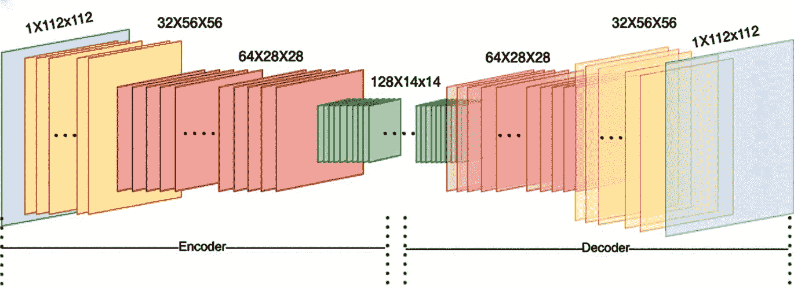

*图 8.1：基于 CNN 的自编码器*

该结构使用每个层的成员变量进行定义：

```cpp
struct CNNAutoEncoder : torch::nn::Module {
    torch::nn::Conv2d conv1{nullptr}, conv2{nullptr}, conv3{nullptr};
    torch::nn::Conv2d bottleneck{nullptr};
    torch::nn::ConvTranspose2d deconv1{nullptr}, deconv2{nullptr}, deconv3{nullptr};
};
```

每一层都必须向模块系统注册，以便在训练期间实现正确的梯度跟踪：

```cpp
conv1 = register_module("conv1", torch::nn::Conv2d(1, 32, 3));
bottleneck = register_module("bottleneck", torch::nn::Conv2d(128, 64, 3));
deconv1 = register_module("deconv1", torch::nn::ConvTranspose2d(64, 128, 3));
```

接下来，我们将研究该神经网络的前向传播，并追踪数据如何流经神经网络的每一层。

#### 前向传播实现

前向传播通过一系列变换展示了压缩-重建范式：

```cpp
// Encoder: Downsample with convolution + max pooling
x = torch::relu(torch::max_pool2d(conv1->forward(x), 2));

// Bottleneck: Feature compression
x = torch::relu(bottleneck->forward(x));

// Decoder: Upsample with transpose convolution + interpolation
x = torch::relu(torch::upsample_nearest2d(deconv1->forward(x), {4, 4}));
x = torch::sigmoid(torch::upsample_nearest2d(deconv3->forward(x), {28, 28}));
```

编码阶段使用最大池化在每个层将空间维度减半，同时 ReLU 激活函数引入非线性。解码阶段通过上采样操作恢复空间维度，并在最后一层使用 sigmoid 激活函数，以产生适合重建的输出值范围。

#### 训练循环

训练过程遵循标准的自编码器原理，最小化输入与重建输出之间的差异：

```cpp
auto output = model.forward(data);
auto loss = torch::mse_loss(output, data);
loss.backward();
optimizer.step();
```

模型使用 **均方误差**（**MSE**）损失来最小化重建误差，这迫使瓶颈层学习高效的数据表示。Adam 优化器负责参数更新，并利用 LibTorch 的 autograd 系统自动计算梯度。通过迭代训练，网络学会将输入图像压缩到紧凑的潜在空间中，同时保留准确重建所需的信息。类似于这种针对视觉数据的自编码器实现，我们还提供了一个基于 LLM 的自编码器实现（`https://github.com/PacktPublishing/Deep-Learning-with-C-/blob/main/chapter8/autoencoder_llm.cpp`）。我们鼓励读者阅读这些示例。如果你已经读过 *第 7 章* 中的语言模型讨论，应该很容易理解。

#### 去噪自编码器

去噪自编码器是自编码器架构的一种专门变体，旨在去除数据（尤其是图像）中的噪声。其训练方法涉及一个刻意的损坏-恢复过程：首先向数据集中的干净图像引入合成噪声，生成一组退化的输入。然后，这些带噪图像被送入自编码器网络，网络学习重建原始、干净的版本。在训练过程中，将去噪后的重建结果与原始干净图像（真实值）进行比较，从而使模型能够学习有效的噪声过滤策略，同时保留必要的数据特征。

我们可以通过引入概率潜在表示来扩展这个自编码器框架，使其具备真正的生成能力，即使用变分自编码器（VAE），我们将在下一节中讨论。

#### 变分自编码器（VAE）

变分自编码器（VAE）代表了一种强大的概率生成建模方法，通过引入统计基础扩展了基本自编码器框架。与学习确定性映射的传统自编码器不同，VAE 学习将数据编码为概率分布，从而能够在保持训练数据基本特征的同时生成新的、多样化的样本。

VAE 的核心是一种视角的根本转变：不是将数据压缩为潜在空间中的固定点，而是将输入表示为概率分布，具体地说是由其均值和方差刻画的高斯（正态）分布。这种概率方法使模型能够捕获数据中的不确定性和变异性，使其在生成任务中特别有效。

该架构由三个关键组件组成：

- **编码器网络**：将输入数据映射为潜在空间中的概率分布参数（均值 μ 和方差 σ²）
- **采样层**：使用重参数化技巧从学习到的分布中采样，以保持可微性
- **解码器网络**：从采样得到的潜在表示中重建数据

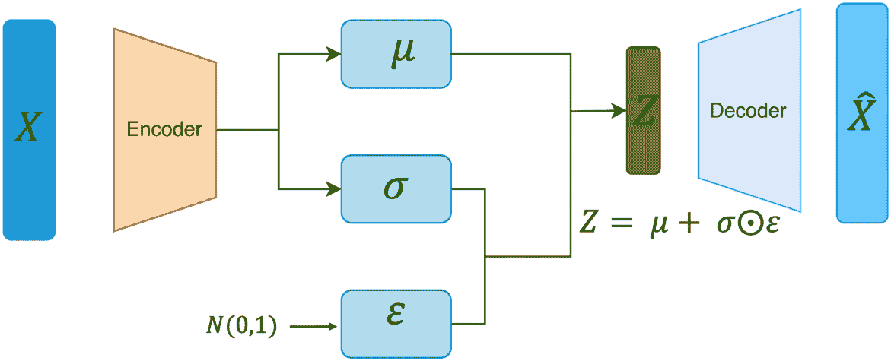

*图 8.2：VAE 编码器将输入映射为概率潜在分布（μ, σ²），通过重参数化对潜在编码进行采样，并通过解码器重建输出*

为了理解 VAE 如何在随机采样操作下实现端到端的可训练性，我们必须研究重参数化技巧。该技巧在反向传播过程中保持梯度流。

#### 重参数化技巧

重参数化技巧是一项关键创新，它使 VAE 能够通过标准反向传播进行训练。它解决了一个根本性问题：如何在随机采样操作中计算梯度。

在 VAE 中，编码器为每个输入产生一个概率分布的参数（均值 μ 和方差 σ²）。为了生成潜在表示，我们需要从这个分布中采样：z ~ N(μ, σ²)。然而，这个采样操作是随机的。它涉及随机性，从而在反向传播过程中破坏了梯度流。你无法通过随机采样操作计算关于 μ 和 σ 的梯度，这使得网络无法使用标准优化方法进行训练。让我们把这个过程分解为更简单的步骤：

- **解决方案**：重参数化技巧重新表述了采样过程，将随机成分与可学习参数分开。我们不直接从 N(μ, σ²) 中采样，而是：
  - 从标准正态分布中采样：ε ~ N(0, 1)
  - 使用学习到的参数对这个样本进行变换：z = μ + σ ⊙ ε。

  这里，⊙ 表示逐元素相乘。关键洞察在于 ε 从一个固定的分布（标准正态）中采样，该分布不依赖于任何网络参数，而 μ 和 σ 是编码器网络的确定性输出。

- **为什么有效？**：这种重新表述保持了 z 的相同概率分布（仍然服从 N(μ, σ²)），但现在随机性来自 ε，它独立于网络参数。变换 z = μ + σ ⊙ ε 关于 μ 和 σ 是确定性的且可微的，从而使梯度能够流动：
  - ∂z/∂μ = 1（梯度直接流过）
  - ∂z/∂σ = ε（梯度流过但被随机样本缩放）

  在反向传播过程中，梯度现在可以从解码器的重建损失通过 z 流回编码器的参数，从而实现端到端训练。

- **数学视角**：重参数化技巧利用了高斯分布的位置-尺度性质。来自 N(μ, σ²) 的任何样本都可以表示为标准正态样本的线性变换：

  z = μ + σ ⊙ ε，其中 ε ~ N(0, 1)

  这等价于从 N(μ, σ²) 中采样，但该公式使对 μ 和 σ 的依赖性变得显式且可微。

- **实现注意事项**：在实践中，编码器输出 log(σ²) 而不是直接输出 σ²，以提高数值稳定性。采样操作随后变为：

  z = μ + exp(0.5 × log(σ²)) ⊙ ε
  z = μ + exp(0.5 × log_var) ⊙ ε

  这确保了方差保持为正，并防止训练期间出现数值溢出。

- **对训练的影响**：重参数化技巧实现了：
  - 对整个 VAE 架构进行基于梯度的优化
  - 通过在整个网络中保持可微性实现稳定训练
  - 在训练和生成过程中高效采样
  - 可扩展到高维潜在空间

- **平衡重建与正则化**：VAE 优化一个复合损失函数，该函数平衡两个相互竞争的目标：
  - 重建损失：衡量解码器从潜在表示重建原始输入的效果（通常使用 MSE 或二元交叉熵）
  - KL 散度：对学习到的潜在分布进行正则化，使其保持接近标准正态分布，防止过拟合并确保平滑、连续的潜在空间


这种组合被称为**证据下界**（**ELBO**），它确保 VAE 能够学习有意义且结构化的潜在表示，从而支持准确的重建和多样化的生成（`https://arxiv.org/abs/1909.03765`）。

我们将从四个部分来审视这个 VAE 的 C++ 实现：神经网络架构、重参数化技术、损失函数和前向传播。

#### VAE 的 C++ 实现

VAE 采用对称架构，编码器压缩信息，解码器重建信息。然而，关键区别在于瓶颈层，它融入了重参数化技术。

我们不是将数据压缩为潜在空间中的固定点，而是将潜在表示拆分为两个独立的线性层：一个用于均值（`fc_mu`），一个用于对数方差（`fc_logvar`）。这种双头方法代表了视角的根本性转变：VAE 学习的不是确定性映射，而是将输入编码为概率分布。具体来说，这些分布是高斯分布，由编码器输出的均值（μ）和方差（σ²）参数来刻画。完整实现可在 `https://github.com/PacktPublishing/Deep-Learning-with-C-/blob/main/chapter8/vae.cpp` 获取。这里我们只查看代码的重要部分。结构通过每个层的成员变量来定义：

```cpp
struct VAE : torch::nn::Module {
    torch::nn::Conv2d conv1{nullptr}, conv2{nullptr}, conv3{nullptr},
        conv4{nullptr};
    torch::nn::Linear fc_mu{nullptr}, fc_logvar{nullptr};
    torch::nn::Linear fc_decode{nullptr};
    torch::nn::ConvTranspose2d deconv1{nullptr}, deconv2{nullptr},
        deconv3{nullptr}, deconv4{nullptr};
};
```

每一层都必须注册到模块系统中，以便在训练期间实现正确的梯度追踪。网络分为三个部分：编码器、潜在空间和解码器，初始化如下：

- **编码器架构**：VAE 架构采用 128 的潜在维度，定义了压缩表示的大小。编码器通过一系列卷积层逐步缩小 28×28 的输入图像：`conv1` 将空间维度从 28×28 减小到 14×14，`conv2` 进一步压缩到 7×7，`conv3` 缩小到 3×3，最后 `conv4` 压缩为具有 256 个特征通道的单个 1×1 特征图。

  ```cpp
  // Encoder: 28x28 -> 1x1 feature map
  conv1 = register_module("conv1", torch::nn::Conv2d(torch::nn::Conv2dOptions(1, 32, 4).stride(2).padding(1))); // 28->14
  conv2 = register_module("conv2", torch::nn::Conv2d(torch::nn::Conv2dOptions(32, 64, 4).stride(2).padding(1))); // 14->7
  conv3 = register_module("conv3", torch::nn::Conv2d(torch::nn::Conv2dOptions(64, 128, 4).stride(2).padding(1))); // 7->3
  conv4 = register_module("conv4", torch::nn::Conv2d(torch::nn::Conv2dOptions(128, 256, 3).stride(1).padding(0))); // 3->1
  ```

- **概率瓶颈**：在这个瓶颈处，架构偏离了传统的自编码器。它不是产生单个压缩表示，而是通过全连接层将 256 个特征转换为两个独立的输出：`fc_mu` 产生均值（μ）参数，`fc_logvar` 生成对数方差参数，两者都映射到 128 维的潜在空间。这种双头方法使 VAE 能够将输入编码为概率分布，具体来说是由这些均值和方差参数刻画的高斯分布。

  ```cpp
  // Latent space
  fc_mu = register_module("fc_mu", torch::nn::Linear(256, latent_dim));
  fc_logvar = register_module("fc_logvar", torch::nn::Linear(256, latent_dim));
  ```

- **解码器架构**：解码器逆转编码过程，从 `fc_decode` 开始，将采样得到的潜在编码转换回 256 个特征。随后的转置卷积层逐步扩展空间维度：`deconv1` 从 1×1 扩展到 3×3，`deconv2` 扩展到 7×7，`deconv3` 扩展到 14×14，最后 `deconv4` 重建出原始 28×28 的图像尺寸。

  ```cpp
  // Decoder
  fc_decode = register_module("fc_decode", torch::nn::Linear(latent_dim, 256));

  deconv1 = register_module("deconv1", torch::nn::ConvTranspose2d(torch::nn::ConvTranspose2dOptions(256, 128, 3).stride(1).padding(0))); // 1->3
  deconv2 = register_module("deconv2", torch::nn::ConvTranspose2d(torch::nn::ConvTranspose2dOptions(128, 64, 4).stride(2).padding(1))); // 3->7
  deconv3 = register_module("deconv3", torch::nn::ConvTranspose2d(torch::nn::ConvTranspose2dOptions(64, 32, 4).stride(2).padding(1))); // 7->14
  deconv4 = register_module("deconv4", torch::nn::ConvTranspose2d(torch::nn::ConvTranspose2dOptions(32, 1, 4).stride(2).padding(1))); // 14->28
  ```

这三个模块按顺序组装如下：

```cpp
VAE(int latent_dim = 128) : latent_dim(latent_dim) {
    // Encoder Block
    // Probabilistic Bottleneck
    // Decoder Block
}
```

- **重参数化实现**：如前几节所讨论，我们采用重参数化技巧。C++ 实现如下：

  ```cpp
  torch::Tensor reparameterize(torch::Tensor mu, torch::Tensor logvar) {
      auto std = torch::exp(0.5 * logvar);
      auto eps = torch::randn_like(std);
      return mu + eps * std;
  }
  ```

该函数通过 `torch::exp(0.5 * logvar)` 将对数方差转换为标准差，利用了 σ = exp(0.5 ⋅ logvar) 这一数学关系。然后使用 `torch::randn_like(std)` 从标准正态分布中采样随机噪声 ε，该函数生成与标准差张量形状相同的值。最后，它应用变换 z = μ + σ ⊙ ε，其中 ⊙ 表示逐元素相乘。这种重新表述保持了相同的概率分布 N(μ, σ²)，同时确保梯度在反向传播过程中能够流回学习参数 μ 和 σ，从而实现 VAE 架构的端到端训练。

- **损失函数实现**：标准 VAE 损失可以实现如下：

  ```cpp
  torch::Tensor vae_loss(torch::Tensor recon_x, torch::Tensor x,
                         torch::Tensor mu, torch::Tensor logvar, float beta = 1.0) {
      // Reconstruction loss (Binary Cross Entropy)
      auto recon_loss = torch::binary_cross_entropy(recon_x, x, {}, torch::Reduction::Sum);
      // KL divergence loss
      auto kl_loss = -0.5 * torch::sum(1 + logvar - mu.pow(2) - logvar.exp());
      return recon_loss + beta * kl_loss;
  }
  ```

该函数通过将重建损失和 KL 散度损失相加来计算 VAE 的总训练损失。beta 参数平衡这两个目标，控制图像质量与学习到的潜在空间表示规则性之间的权衡。当 beta ≠ 1 时，这也被称为 β-VAE 损失。

在实现中，另一个考虑因素是容量约束。容量参数为 KL 散度设置一个目标水平。它不是将 KL 散度推向零，而是允许受控的信息流通过潜在瓶颈。当 KL 散度偏离目标容量时，gamma 乘数会放大惩罚，从而形成一个软约束。以下是使用容量约束计算 VAE 损失的 C++ 函数：

```cpp
torch::Tensor beta_vae_loss(torch::Tensor recon_x, torch::Tensor x,
                            torch::Tensor mu, torch::Tensor logvar,
                            float beta, float capacity = 0.0, float gamma = 1000.0) {
    // Reconstruction loss
    auto recon_loss = torch::binary_cross_entropy(recon_x, x, {}, torch::Reduction::Sum);
    // KL divergence
    auto kl_div = -0.5 * torch::sum(1 + logvar - mu.pow(2) - logvar.exp());
    // Capacity constrained KL loss
    auto kl_loss = gamma * torch::abs(kl_div - capacity);
    return recon_loss + beta * kl_loss;
}
```

在前向传播过程中，编码器生成均值（μ）和方差的对数（logvar）。然后我们通过对潜在向量进行重参数化，并使用解码器进行重构。

```cpp
std::tuple<torch::Tensor, torch::Tensor, torch::Tensor> forward(torch::Tensor x) {
    auto [mu, logvar] = encode(x);
    auto z = reparameterize(mu, logvar);
    auto recon = decode(z);
    return std::make_tuple(recon, mu, logvar);
}
```

前向传播协调了通过 VAE 架构的完整数据流。编码器通过卷积层处理输入图像，产生定义潜在分布的均值和对数方差参数。然后，reparameterize函数通过重参数化技巧从这个学习到的分布中采样一个点 z，确保反向传播时的梯度流动。最后，解码器从采样的潜在编码重构图像。该函数返回三个张量：重构图像（recon），以及均值和对数方差参数，这些参数在训练期间计算损失函数的 KL 散度分量时需要用到。

这种“概率”部分（重参数化）使得 VAE 具有生成能力，而不仅仅是压缩能力。

到目前为止，我们从计算机视觉的角度探讨了自编码器和VAE，重点关注去噪和图像重构等应用。与用于计算机视觉的自编码器类似，也有针对时间数据的自编码器实现。它们被称为序列到序列（Seq2Seq）自编码器。在这种情况中，Seq2Seq模型不是像编码器和解码器部分那样使用卷积滤波器，而是使用LSTM或RNN块来编码和解码时间数据。

Seq2Seq自编码器用于机器翻译任务，例如在不同语言之间翻译句子。它们擅长处理可变长度的输入和输出序列。

在解码过程中，模型以自回归方式运行，根据编码器的隐藏状态和先前生成的输出生成每个输出元素。我们已经在*第7章*中讨论了RNN和LSTM，并且我们为这个自编码器实现了LSTM版本（https://github.com/PacktPublishing/Deep-Learning-with-C-/blob/main/chapter8/seq2seq_autoencoder.cpp）和RNN版本（https://github.com/PacktPublishing/Deep-Learning-with-C-/blob/main/chapter8/seq2seq_rnn_autoencoder.cpp）。我们鼓励读者仔细阅读代码，以加深对这些序列自编码器的理解。

现在，我们准备探索**生成对抗网络**（**GANs**），这是一场范式转变，为生成式AI领域的许多新颖思想奠定了基础。

### GANs – 基础

GAN代表了一类强大的生成式AI模型，通过训练两个相互竞争的神经网络来创建新的合成数据。GAN由Ian Goodfellow及其同事于2014年提出，它彻底改变了机器学习如何在各个领域生成逼真内容的方式。在本节及后续小节中，你将：

-   理解GAN的基本架构，包括生成器和判别器网络如何通过对抗训练进行交互
-   学习使用LibTorch在C++中实现生成器和判别器网络，并提供用于图像生成的实用代码示例
-   掌握GAN损失函数的数学基础以及驱动训练的极小极大优化过程
-   获得GAN五步训练过程的实践经验，包括数据准备、合成数据生成和交替网络更新
-   探索将GAN应用于文本生成的独特挑战，并发现SeqGAN等专门解决方案
-   培养诊断和解决常见GAN训练问题的技能，例如模式崩溃和梯度消失
-   在本节结束时，你将能够设计、实现和训练自己的GAN架构，以在各种领域生成逼真的合成数据

GAN的架构由两个相互对抗的神经网络组成，形成一个竞争性学习环境，如下图所示。

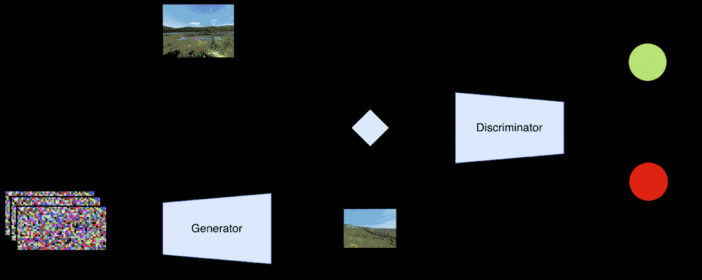

*图8.3：GAN*

GAN框架由两个相互竞争的网络组成：一个从随机噪声中创建合成数据的生成器，以及一个区分真实样本和生成样本的判别器。这种对抗过程。

接下来，我们将更详细地了解GAN架构：

-   **生成器网络**：生成器将从标准正态分布中采样的随机噪声向量转换为逼真的合成数据样本。它由多个层组成，逐渐对噪声进行上采样和细化，形成结构化输出。对于图像生成，该架构通常采用转置卷积层（也称为反卷积层），在逐渐增加空间维度的同时学习创建逼真的特征。生成器首先使用一个密集层将噪声向量重塑为一个小特征图，然后应用连续的转置卷积以及批归一化和激活函数（通常是ReLU或LeakyReLU）来扩展维度。最后一层使用tanh激活函数生成在适当范围内的输出值。

-   **判别器网络**：判别器作为二元分类器，评估样本是来自训练数据集中的真实样本还是生成器产生的虚假样本。它的架构与生成器呈镜像关系：它使用标准卷积层逐步对输入数据进行下采样，在每一层提取越来越抽象的特征。网络通常采用LeakyReLU激活函数以避免梯度问题，并且可能包含dropout层进行正则化。最后的层将特征图展平，并通过密集层，最终到达一个具有sigmoid激活函数的单一输出神经元，产生一个概率分数，指示输入是真实的还是虚假的。

-   **训练动态**：在训练过程中，两个网络交替更新。判别器在包含真实样本（标记为1）和生成样本（标记为0）的批次上进行训练，学习最大化其分类准确性。然后训练生成器以最大化判别器的误差，学习生成判别器分类为真实的样本。这种对抗过程形成了一个极小极大博弈：随着生成器在创建逼真样本方面不断改进，判别器同时增强其检测能力，通过竞争推动两个网络迈向更高性能。

### GAN损失函数

GAN为生成器和判别器网络采用不同的损失函数，两者通过对抗性的极小极大优化过程进行训练。标准GAN损失函数基于二元交叉熵（BCE），可以表示为生成器G和判别器D之间的极小极大博弈：

$$\min_G \max_D V(D, G) = \mathbb{E}_{x \sim p_{\text{data}}(x)}[\log D(x)] + \mathbb{E}_{z \sim p_z(z)}[\log(1 - D(G(z)))]$$

这里的目标是相对于生成器$G$最小化损失函数$V(D, G)$，同时相对于判别器$D$最大化损失函数。项$\mathbb{E}_{x \sim p_{\text{data}}(x)}$表示对数据分布的期望，$\mathbb{E}_{z \sim p_z(z)}$表示对随机噪声分布的期望。

#### 判别器损失

判别器试图通过学习对真实样本输出1、对生成样本输出0来最大化其分类准确性。判别器损失会对错误分类进行惩罚。在实践中，这通过二元交叉熵实现，其中真实样本标记为1，生成样本标记为0。

#### 生成器损失

生成器的目标是产生判别器分类为真实的样本，从而骗过判别器。这通过最大化$D(G(z))$来实现，该过程鼓励判别器对生成样本输出接近1的值。


### GAN 训练过程

GAN 的训练遵循一个结构化的五步迭代过程，在更新判别器和生成器之间交替进行：

- **步骤 1：数据准备**：收集代表你想要完成任务的训练数据。该数据集作为生成器学习模仿的基准真值。

- **步骤 2：生成合成数据**：从标准分布（高斯分布或均匀分布）中采样随机噪声，通过生成器生成合成数据（标记为 0）。生成器学习从该潜在空间映射到输出域，建立随机噪声与逼真样本之间的关系。

- **步骤 3：创建训练对**：将生成数据（标签 = 0）与训练集中的真实数据（标签 = 1）组合成训练批次。这些数据对被输入判别器进行分类。

- **步骤 4：训练判别器**：判别器评估每个样本，为真实样本分配标签 1，为生成样本分配标签 0，然后计算二元交叉熵损失以量化分类性能。这训练判别器区分真实样本和合成样本。

- **步骤 5：反向传播与权重更新**：将损失通过两个网络反向传播，并相应更新其权重。通常使用 Adam 或随机梯度下降等优化算法。反向传播更新生成器以最小化判别器的准确率，并更新判别器以最大化其分类性能。

在整个 GAN 训练实现中，我们坚持一个关键原则：交替更新。在训练判别器时，我们完全冻结生成器的参数。这对训练的稳定性至关重要。可以这样想：确保每个网络都在与一个固定的对手学习，而不是追逐一个移动的目标。在我们的 C++ 实现中，你会注意到在判别器训练阶段，我们在将生成的图像输入判别器之前调用 `detach()`。这可以防止梯度过早地回流到生成器。

以下是从实现经验中得出的实用见解：在引入生成器之前，先在真实数据上对判别器进行几个迭代的预训练，可以显著提高早期训练的稳定性。判别器需要足够的能力来提供有意义的反馈；否则，生成器会收到阻碍学习的噪声信号。

判别器的有效性直接源于训练数据集的特性。我们在卷积架构中看到它如何学习分层特征。较浅的层检测边缘和纹理，较深的层识别能够区分真实样本和合成样本的复杂模式。训练数据的质量和多样性从根本上限制了判别器能够学习识别的内容。

与此同时，生成器应对着不同的挑战：将我们的随机噪声分布转换为反映训练数据底层结构的样本。与受益于显式标签的判别器不同，生成器通过我们实现的对抗过程隐式学习。它构建了一个内部概率模型，随着训练在我们之前探讨的极小极大博弈中推进，逐步完善其生成令人信服样本的能力。

#### 替代损失函数

虽然二元交叉熵是标准选择，但已经开发了几种变体来解决训练不稳定的问题：

- **Wasserstein 损失（WGAN）**：使用 Wasserstein 距离代替二元交叉熵，提供更平滑的梯度，并解决梯度消失和模式崩溃等问题。
- **最小二乘损失（LSGAN）**：用最小二乘损失替代二元交叉熵，以生成更高质量的图像。
- **Hinge 损失**：用于谱归一化 GAN，以提高稳定性。
- 损失函数的选择显著影响训练稳定性、收敛速度和生成样本的质量。

### C++ 实现

让我们使用 LibTorch 实现一个图像生成系统。该实现（`https://github.com/PacktPublishing/Deep-Learning-with-C-/blob/main/chapter8/structured_vision_gan.cpp`）将生成器网络、判别器网络以及我们讨论过的对抗训练过程整合在一起。我们将系统地研究每个组件，审视代码如何将我们的概念理解转化为一个可用的生成模型。

#### 生成器网络架构

生成器架构通过转置卷积层逐步上采样随机噪声，从紧凑的表示开始，逐步扩展到全分辨率输出：

```cpp
Generator(int latent_dim = 100, int img_channels = 3)
    : latent_dim(latent_dim), img_channels(img_channels)
{
    fc1 = register_module("fc1", torch::nn::Linear(latent_dim, 512 * 4 * 4));
    deconv1 = register_module("deconv1", torch::nn::ConvTranspose2d(
        torch::nn::ConvTranspose2dOptions(512, 256, 4).stride(2).padding(1)));
    bn1 = register_module("bn1", torch::nn::BatchNorm2d(256));
    deconv2 = register_module("deconv2", torch::nn::ConvTranspose2d(
        torch::nn::ConvTranspose2dOptions(256, 128, 4).stride(2).padding(1)));
    bn2 = register_module("bn2", torch::nn::BatchNorm2d(128));
    deconv3 = register_module("deconv3", torch::nn::ConvTranspose2d(
        torch::nn::ConvTranspose2dOptions(128, 64, 4).stride(2).padding(1)));
    bn3 = register_module("bn3", torch::nn::BatchNorm2d(64));
    deconv4 = register_module("deconv4", torch::nn::ConvTranspose2d(
        torch::nn::ConvTranspose2dOptions(64, img_channels, 4).stride(2).padding(1)));
}
```

初始全连接层（fc1）将 100 维噪声向量转换为 512×4×4 的特征。四个转置卷积层（deconv1-4）从 4×4 逐步上采样到 64×64 像素。批归一化层（bn1-3）通过归一化层间激活来稳定训练。最后一层使用 tanh 激活函数，使得输出值在 [-1, 1] 范围内。

前向传播展示了上采样流程：

```cpp
x = x.view({x.size(0), 512, 4, 4}); // Reshape to 4×4 feature map
x = torch::relu(bn1->forward(deconv1->forward(x))); // 4×4 -> 8×8
// ... progressive upsampling continues
x = torch::tanh(deconv4->forward(x)); // Final 64×64 output
```

#### 判别器网络架构

判别器在结构上与生成器相反，通过卷积层进行下采样：

```cpp
Discriminator(int img_channels = 3)
    : img_channels(img_channels) {
    conv1 = register_module("conv1", torch::nn::Conv2d(
        torch::nn::Conv2dOptions(img_channels, 64, 4).stride(2).padding(1)));
    conv2 = register_module("conv2", torch::nn::Conv2d(
        torch::nn::Conv2dOptions(64, 128, 4).stride(2).padding(1)));
    bn1 = register_module("bn1", torch::nn::BatchNorm2d(128));
    conv3 = register_module("conv3", torch::nn::Conv2d(
        torch::nn::Conv2dOptions(128, 256, 4).stride(2).padding(1)));
    bn2 = register_module("bn2", torch::nn::BatchNorm2d(256));
    conv4 = register_module("conv4", torch::nn::Conv2d(
        torch::nn::Conv2dOptions(256, 512, 4).stride(2).padding(1)));
    bn3 = register_module("bn3", torch::nn::BatchNorm2d(512));
    fc1 = register_module("fc1", torch::nn::Linear(512 * 4 * 4, 1));
    dropout = register_module("dropout", torch::nn::Dropout(0.3));
}
```

四个卷积层（conv1-4）从 64×64 下采样到 4×4，同时提取分层特征。负斜率为 0.2 的 LeakyReLU 激活函数防止神经元死亡。Dropout（概率 0.3）提供正则化。最后的全连接层产生一个标量，通过 Sigmoid 激活函数得到概率得分。接下来，我们将看看训练神经网络的步骤。

#### 训练 GAN

该实现遵循结构化的五步 GAN 训练方法：

```cpp
//Step 1: Load real training data
auto real_images = torch::randn({batch_size, img_channels, img_size, img_size}).to(device);
//Step 2: Generate Synthetic samples
auto noise = torch::randn({batch_size, latent_dim}).to(device);
auto fake_images = gan.generator.forward(noise);
//Step 3: Create Training Pairs
```


```cpp
auto real_labels = torch::ones({batch_size, 1}).to(device); // Label = 1
auto fake_labels = torch::zeros({batch_size, 1}).to(device); // Label = 0
// Step 4: Discriminator Training
auto real_pred = gan.discriminator.forward(real_images);
auto real_loss = adversarial_loss(real_pred, real_labels);
auto fake_pred = gan.discriminator.forward(fake_images.detach()); // detach() prevents generator gradients
auto fake_loss = adversarial_loss(fake_pred, fake_labels);
auto disc_loss = (real_loss + fake_loss) / 2;
// Update discriminator
disc_loss.backward();
disc_optimizer.step();
// Step 5: Train generator
gen_optimizer.zero_grad();
noise = torch::randn({batch_size, latent_dim}).to(device);
fake_images = gan.generator.forward(noise);
auto gen_pred = gan.discriminator.forward(fake_images);
auto gen_loss = adversarial_loss(gen_pred, real_labels); // Note: real_labels!
gen_loss.backward();
gen_optimizer.step();
```

在判别器训练期间，对 `fake_images` 调用 `detach()` 会断开计算图，阻止梯度流向生成器。在训练生成器时，我们将预测值与 `real_labels`（即 1）而非 `fake_labels` 进行比较，从而实现欺骗判别器的目标。

代码使用二元交叉熵来实现极小极大目标：

```cpp
torch::Tensor adversarial_loss(torch::Tensor pred, torch::Tensor target) {
    return torch::binary_cross_entropy(pred, target);
}
```

GAN 需要仔细调整优化超参数以保持训练稳定性。Adam 优化器是 GAN 训练的标准选择，但与典型的深度学习应用相比，其参数有所修改：

```cpp
torch::optim::Adam gen_optimizer(gan.generator.parameters(),
    torch::optim::AdamOptions(lr).betas(std::make_tuple(0.5, 0.999)));
```

学习率 0.0002 可以防止对抗动态中的振荡。Beta1 设置为 0.5（低于默认值 0.9）以减少动量累积，这有助于在损失曲面快速变化时稳定训练。Beta2 保持 0.999 以维持自适应学习率的优势。

该实现提供了一个完整、可用于生产的 GAN 系统。通过 `detach()` 对梯度流的精心管理、对称的架构设计以及专门的优化器配置共同作用，实现了稳定的对抗训练，从而能够生成逼真的图像。

研究人员也将 GAN 技术应用于语言任务。核心原理相同。然而，文本生成引入了图像生成中不存在的基本挑战。与连续的图像数据不同（像素值可以逐步调整，例如将 1.0 变为 1.0001），文本使用离散的词元。你不能把 “penguin” 修改为 “penguin + 0.001”，因为在自然语言中不存在这样的中间表示。这种离散性破坏了标准 GAN 训练所必需的梯度流，使生成器无法获得关于如何逐步调整输出以欺骗判别器的直接反馈。

为了克服这一根本障碍，研究人员开发了**基于策略梯度的序列生成对抗网络**（**SeqGAN**），将文本生成重新构建为强化学习问题。SeqGAN 将生成器视为随机策略，通过直接梯度策略更新来规避微分挑战。判别器评估生成的序列并提供奖励信号来引导生成器的策略，使对抗训练能够处理离散输出。

除了 SeqGAN，还出现了多种架构来解决离散序列生成问题：**对抗正则化自编码器**（**ARAE**）方法通过使用序列自编码器将离散文本映射到连续潜在编码空间，从而绕开离散序列问题。GAN 在这个连续表示中运行，生成器产生的编码模仿自编码器从真实文本中创建的编码。通过从生成器中采样一个编码并将其解码回离散序列，即可生成新文本。

在本书中我们不会深入讨论 SeqGAN，因为现在有更高效的解决方案（如 Transformer）可用于文本生成（以及图像生成）。不过，我们希望读者了解 GAN 及其起源，以提供背景。我们将在下一章详细介绍 Transformer。

然而，在学习 LLM 和 Transformer 之前，我们应该将 LLM 作为生成系统来研究，并学习一些用于文本生成的采样策略以及大型语言系统的评估指标。在深入探讨 Transformer 之前，研究这些系统有助于建立对语言生成的直观理解。

### 自回归生成与因果语言建模

LLM 本质上是一个预测模型，根据输入生成统计上最可能的下一个词元。一旦生成了一个词元，它就成为输入上下文的一部分，模型再预测下一个词元。这个过程迭代进行，直到产生序列结束词元（见图）。预期是这种自回归生成过程将产生连贯且上下文合适的文本。我们在之前关于 RNN 的章节中已经讨论过词元。这也被称为因果语言建模，其中下一个词的预测仅依赖于之前生成的词。

该图通过一个具体示例说明了因果语言建模的机制。

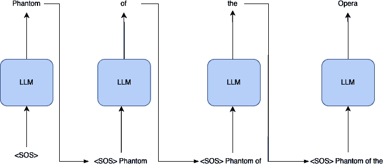

*图 8.4：自回归生成。因果语言建模*

该过程以一个初始的句首（`<SOS>`）词元作为种子开始。当 LLM 生成第一个词 “Phantom” 时，该词元被追加到输入序列 `<SOS>` 中，形成上下文 `<SOS> Phantom`。然后，模型基于这个扩展的上下文预测下一个词 “of”。这个新生成的词元再次与现有序列拼接，形成 `<SOS> Phantom of`。自回归过程继续，每个预测都建立在所有先前生成的词元之上，直到模型生成完整短语 “Phantom of the Opera”。

这种从左到右的迭代生成策略确保每个词元都以先前词元的完整历史为条件，使模型能够在整个生成序列中保持连贯性和上下文一致性。这种方法的因果性（即未来词元不能影响过去的预测）使其区别于双向模型，并构成了现代 LLM 生成文本的基础。

我们在 GitHub 仓库（`https://github.com/PacktPublishing/Deep-Learning-with-C-/blob/main/chapter8/autoregressive_llm.cpp`）中提供了一个完整的自回归生成设置（一个玩具示例）。这里我们专门讨论代码的生成部分。以下 C++ 函数实现了该功能：

```cpp
std::vector<int64_t> generate(std::vector<int64_t> prompt, int max_new_tokens = 50, float temperature = 1.0, torch::Device device = torch::kCPU) 
{
    torch::NoGradGuard no_grad;
    eval();
    std::vector<int64_t> generated_sequence = prompt;
    for (int i = 0; i < max_new_tokens; ++i) {
        // Convert current sequence to tensor
        auto input_tensor = torch::tensor({generated_sequence}, torch::kLong).to(device);
        // Get logits for next token
        auto logits = forward(input_tensor);
        // Extract logits for last position
        auto next_token_logits = logits[0][-1] / temperature;
        // Sample next token (using multinomial sampling)
        auto probs = torch::softmax(next_token_logits, -1);
        auto next_token = torch::multinomial(probs, 1);
        int64_t token_id = next_token.item<int64_t>();
        generated_sequence.push_back(token_id);
        // Stop if sequence gets too long
        if (generated_sequence.size() >= max_seq_len) break;
    }
    return generated_sequence;
}
```

上面的 `generate` 函数接受一个提示（词元 ID 序列）、要生成的最大词元数量、用于控制随机性的温度参数以及计算设备。它首先通过 `torch::NoGradGuard` 禁用梯度计算，并将模型切换到评估模式，以优化推理。以下是文本生成代码的关键方面：

- **迭代词元生成循环**：该函数进入一个循环，逐次生成词元，直到达到 `max_new_tokens`。在每次迭代中，它将当前序列转换为张量，通过模型的 `forward` 函数获取下一个词元的 logits（原始预测分数），并提取序列中最后一个位置对应的 logits。


- **温度缩放**：将 logits 除以温度参数，该参数控制预测的随机性。较低的温度（< 1.0）通过锐化概率分布使模型更加自信和确定，而较高的温度（> 1.0）通过展平分布增加多样性。

- **采样策略**：该函数应用 softmax 将 logits 转换为概率，然后使用多项式采样选择下一个 token。这种概率方法允许产生多样化的输出，而不是总是选择最可能的 token。选中的 token 被附加到序列中，该序列成为下一次迭代的输入。

- **终止条件**：生成持续进行，直到产生指定数量的 token 或序列达到允许的最大长度（`max_seq_len`），从而防止内存溢出。

在本程序中，我们使用了几种采样策略以及一些术语（如温度），但没有实际定义它们。在下一节中，我们将定义其中一些术语。

### 温度与采样策略

在生成过程的每一步，LLM 应用 softmax 函数将 logits（原始预测分数）转换为所有可能的下一个 token 的概率分布。最简单的方法是总是选择概率最高的 token，这种策略称为贪婪解码。大多数现代 LLM 采用更复杂的采样策略，在生成过程中引入受控的随机性。我们将在本节中研究这些采样策略。这种创造性灵活性避免了过于确定性的输出，使模型能够生成更多样、更自然、更能捕捉人类语言细微差别的文本。*图 8.5* 展示了 softmax 归一化如何将模型的原始预测分数（logits）转换为概率：

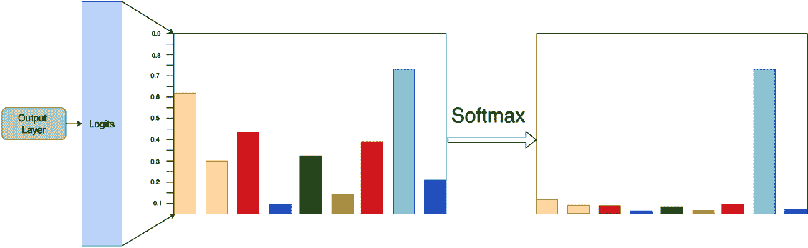

*图 8.5：应用 softmax 后 logit 值的变化*

理解这种 softmax 变换至关重要，因为接下来我们将探讨的温度缩放会修改这些概率，以控制模型文本生成的确定性或创造性程度。

#### 温度缩放

logits 除以温度参数，该参数控制预测的随机性。较低的温度（< 1.0）通过锐化概率分布使模型更加自信和确定，而较高的温度（> 1.0）通过展平分布增加多样性。数学上，这种缩放定义为：

Pr(l_k) = e^(l_k/T) / Σ_i e^(l_i/T)

其中 l_k 是第 k 个 logit，T 是温度。*图 8.6* 展示了这一现象。随着温度升高，概率分布趋于平坦，使之前不太可能的 token 变得更有可能。

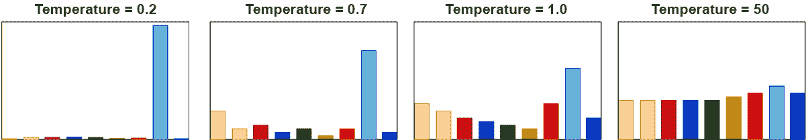

*图 8.6：温度的缩放效果*

对于 LLM，不存在普遍最优的温度值。合适的温度取决于你的具体用例。对于需要确定性、专注输出的任务，如事实问答、代码生成或数据提取，请选择较低的温度（0.0-0.3）。对于希望获得多样可能性和多变输出的创造性应用，如创意写作、头脑风暴或生成多个备选方案，请使用较高的温度。温度参数本质上控制着模型响应中一致性与创造性之间的权衡。上图展示了这一现象：随着温度升高，概率分布趋于平坦，使之前不太可能的 token（以浅蓝色显示）变得更有可能。在非常高的温度（例如 50）下，所有 token 的概率值几乎均匀分布，导致高度随机的选择。

除了温度缩放之外，采样策略的选择也会影响生成质量、多样性和计算效率。

#### 采样策略

在*自回归生成与因果语言建模*一节展示的代码片段中，该函数使用多项式采样来选择下一个 token。这种概率方法允许产生多样化的输出，而不是总是选择最可能的 token。但采样策略不止一种。在本节剩余部分，我们将讨论一些常见策略。这些采样方法的完整实现可在 `https://github.com/PacktPublishing/Deep-Learning-with-C-/blob/main/chapter8/sampling_methods.cpp` 获取。我们将从贪婪解码开始，后续方法都建立在贪婪解码之上。

#### 贪婪解码

贪婪解码是语言生成中最简单的 token 选择方法。在每一步，模型从 softmax 分布中选择概率最高的 token，即本质上选择最自信的预测，而不考虑其他备选。

虽然贪婪解码计算高效且确定，但它也有显著的限制。它在每一步都做出局部最优选择，而不考虑整体序列质量，可能导致整体输出次优。一旦选择了某个 token，模型就无法回溯，即使该选择导致后续预测不佳。这种短视策略往往会产生重复或通用的文本，因为它总是偏向高概率 token，而不探索创造性的备选。下面是一个实现贪婪解码的代码片段：

```cpp
for (int i = 0; i < max_length; ++i) {
    auto input_tensor = torch::from_blob(sequence.data(), {1, static_cast<long>(sequence.size())}, torch::kLong).clone().to(device);
    auto logits = model.forward(input_tensor);
    // Get most likely next token
    auto next_token = torch::argmax(logits, -1);
    int64_t token_id = next_token.item<int64_t>();
    sequence.push_back(token_id);
}
```

该循环运行指定的最大长度。在每次迭代中，它将当前 token 序列转换为模型可以处理的张量，然后将其传入模型的 forward 函数以获得 logits（所有可能的下一个 token 的原始预测分数）。使用贪婪解码，它通过 torch::argmax 选择概率最高的 token，提取其数值标识，并将其追加到序列中。这个新扩展的序列随后成为下一次迭代的输入，形成一个反馈循环，其中每次预测都建立在所有先前生成的 token 之上。

例如，当生成“The cat sat on the ___”时，如果“mat”具有最高概率，贪婪解码总是会选择“mat”，而永远不会探索“roof”、“windowsill”或“fence”等可能带来更有趣或更符合语境的补全。

尽管存在这些缺点，贪婪解码仍然适用于需要快速、确定性输出的应用，在这些应用中，创造性的重要性不如一致性，例如结构化数据提取、模板填充或计算资源严重受限的场景。

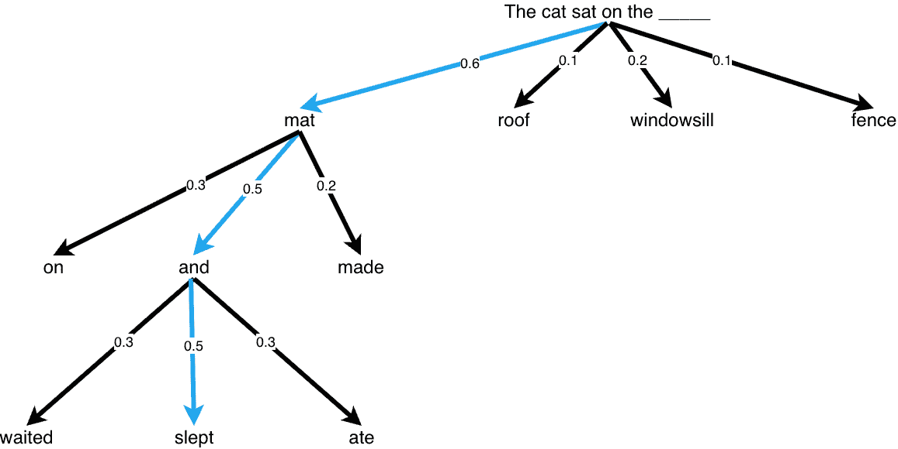

*图 8.7：贪婪解码*

其短视的逐 token 选择阻止了从次优的早期选择中回溯。为了获得更高质量的生成，我们需要一种探索多种假设的方法，我们将在下一部分看到。

#### 束搜索

束搜索通过同时维护多个候选序列来扩展贪婪解码，在保持计算可行性的同时探索更广阔的解决方案空间。束搜索不是每一步只确定一个 token，而是跟踪 top-k 个最有希望的序列（其中 k 是束宽），在概率空间中评估多条路径，然后选择最终输出。束搜索在需要全局连贯性和结构正确性的任务中表现出色，尤其是机器翻译，在机器翻译中，探索多个假设有助于避免过早地选择语法别扭的措辞。它在摘要生成中同样表现良好。


以及在问答任务中，每一步的最佳局部选择可能无法产生最连贯的整体输出。然而，束搜索在创造性生成任务中可能会遇到困难，因为其确定性的本质和对高概率序列的偏好可能会产生安全但平庸的输出。它还受到长度偏差的影响，倾向于选择较短的序列，因为每增加一个 token，概率会相乘（从而减小），不过长度归一化技术可以缓解这个问题。（完整实现请参见上述 GitHub 链接。）

在每一步生成过程中，算法通过考虑所有可能的下一个 token 来扩展当前所有的 k 个候选，并计算每个结果序列的累积概率。然后，它仅保留整体概率最高的 k 个序列，剪除不太有希望的路径。此过程持续进行，直到所有束都到达序列结束标记或达到最大长度，然后选择累积概率最高的序列作为输出。

例如，设束宽 k=3，生成“猫坐在___上”，算法可能同时探索三条路径：“猫坐在垫子上”、“猫坐在屋顶上”和“猫坐在窗台上”。随着 token 的添加，每条路径都会累积概率分数，算法会跟踪哪些完整序列获得最高的整体可能性。

束宽参数控制了探索与计算成本之间的权衡。较大的束宽（k=10-50）会探索更多样化的可能性，通常产生更高质量的输出，尤其在全局连贯性至关重要的机器翻译等任务中。较小的束宽（k=2-5）能降低计算开销，同时仍优于贪心解码。然而，束搜索可能遭受长度偏差，偏向于较短的序列，因为每增加一个 token 概率会相乘（从而减小）。长度归一化技术通过将累积对数概率除以序列长度来解决这个问题。

尽管有这些优势，在固定超参数的情况下，束搜索仍然是确定性的。对于相同的输入，它总是产生相同的输出。这使得它非常适合需要一致性和高质量输出的应用，例如机器翻译、摘要生成和问答等任务，在这些任务中，与贪心解码的短视方法相比，探索多个假设可以改善结果。

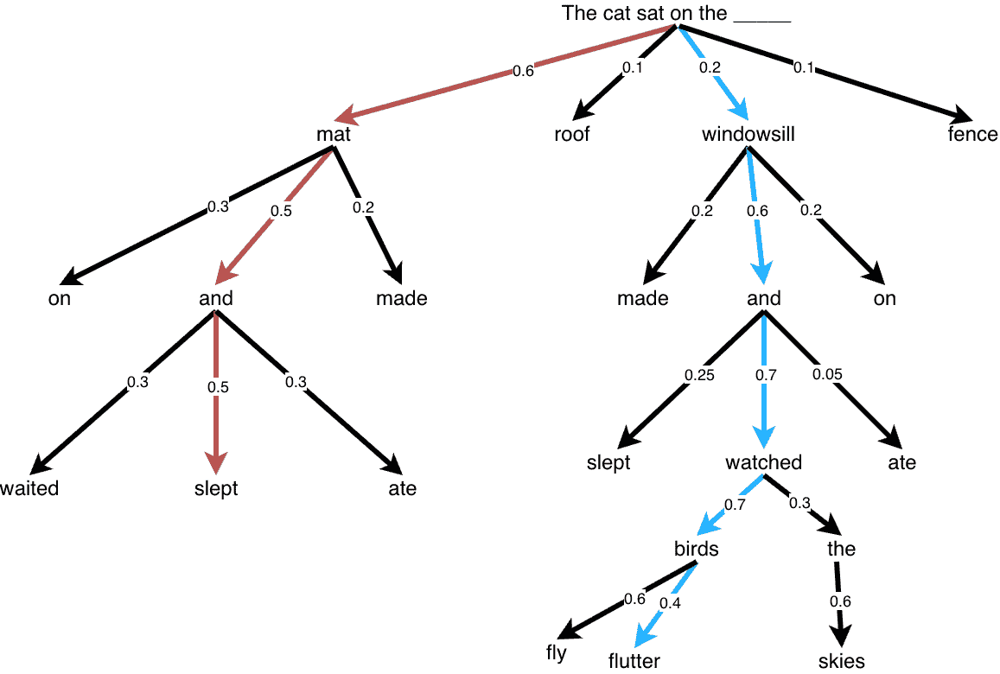

*图 8.8：束搜索*

这种方法的确定性会产生安全但平庸的输出。从确定性选择转向概率性选择，我们现在讨论两种采样策略：Top-K 采样和 Top-P 采样，它们将可控的随机性引入 token 选择。

#### Top-K 采样

Top-k 采样通过将 token 选择限制为每一步生成中最可能的 k 个候选，引入可控随机性。模型不是考虑整个词汇表，而是按概率对所有可能的下一个 token 进行排序，仅保留前 k 个选项，将所有其他概率设为零，然后重新归一化，并从这个缩减的分布中进行采样。

例如，当 top-k=50 时，如果词汇表包含 50,000 个 token，模型在选下一个词时只考虑概率最高的 50 个 token。这种过滤机制可以防止模型选择那些可能出现在概率分布长尾中的极不可能或无意义的 token，同时仍然允许在合理的选择之间产生创造性的变化。

参数 k 控制多样性-质量权衡。较低的值（k=10-40）通过将选择限制为最自信的预测来产生更聚焦、更保守的输出，使生成更加确定和连贯。较高的值（k=100-500）允许更大的多样性，包含概率较低但可能有趣的 token，但这会增加选择不恰当或离题词的风险。

考虑生成“科学家发现了一种新的___”。当 top-k=10 时，模型可能只考虑高概率的补全，如“物种”、“元素”、“行星”或“理论”。当 top-k=100 时，它还可以探索更有创意的选项，如“现象”、“星座”或“算法”，在引入多样性的同时仍然排除无意义的选择。

top-k 采样的一个局限性是其固定性。无论概率分布的形状如何，它总是恰好考虑 k 个 token。当模型高度自信时（概率质量集中在少数几个 token 上），top-k 可能不必要地包含许多低质量的选项。相反，当模型不确定时（概率质量分布在许多 token 上），top-k 可能会排除合理的备选词。这种不灵活性催生了如 top-p 采样等替代方法，后者能动态适应概率分布。

尽管存在这一局限性，top-k 采样仍然被广泛使用，因为它简单且能有效防止退化输出，同时保持合理的多样性，使其适用于对话系统、内容生成和创意写作辅助等既重视质量又重视多样性的应用。

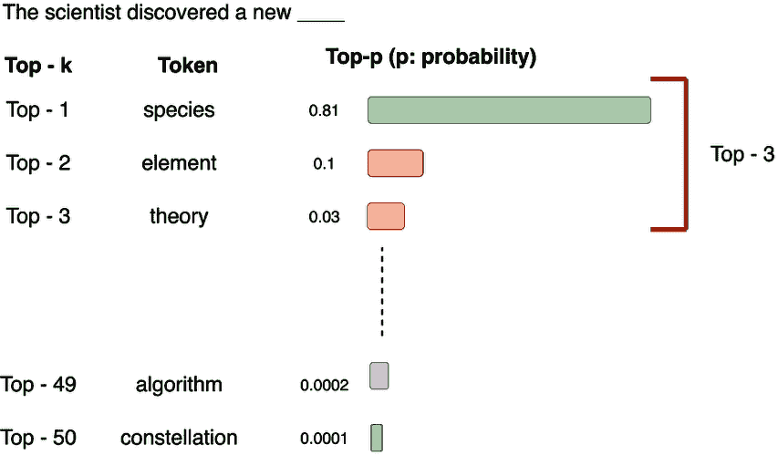

*图 8.9：Top-K 采样*

#### Top-p 采样

Top-p 采样（也称为核采样）引入了一种动态的 token 选择方法，能适应模型在每一步生成中的置信度。与 top-k 采样选择固定数量的 token 不同，top-p 采样从一组最小的 token 中进行选择，这些 token 的组合概率超过阈值 p（通常在 0.0 到 1.0 之间）。

其过程如下：在每一步生成中，模型计算所有可能的下一个 token 的概率，并按降序排序。然后从最高概率开始累积，将 token 加入候选池，直到累计和超过阈值 p。该“核”之外的所有 token 都被丢弃，剩余的概率会重新归一化，使其总和为 1，然后进行采样。

例如，当 top-p=0.9 生成“科学家发现了一种新的___”时，模型可能会发现“物种”（0.35）、“元素”（0.25）、“行星”（0.15）和“理论”（0.15）这些 token 合计占了概率质量的 90%。这四个 token 构成了核，模型仅从这些选项中采样，无论其他 token 有多少都会被排除。与贪心解码等更简单的方法相比，每一步生成时的排序操作会增加计算开销。

参数 p 控制多样性-连贯性权衡。较低的值（p=0.5-0.7）会形成较小的核，通过将选择限制在高置信度的 token 上来产生更聚焦、更保守的输出。较高的值（p=0.9-0.95）允许更大的核，能够实现更有创意和多样化的生成，同时仍然排除可能导致无意义输出的高不可能性的长尾 token。核的大小变化会使生成行为更难预测，因为候选 token 的数量在步骤之间大幅波动，可能导致输出质量不稳定。

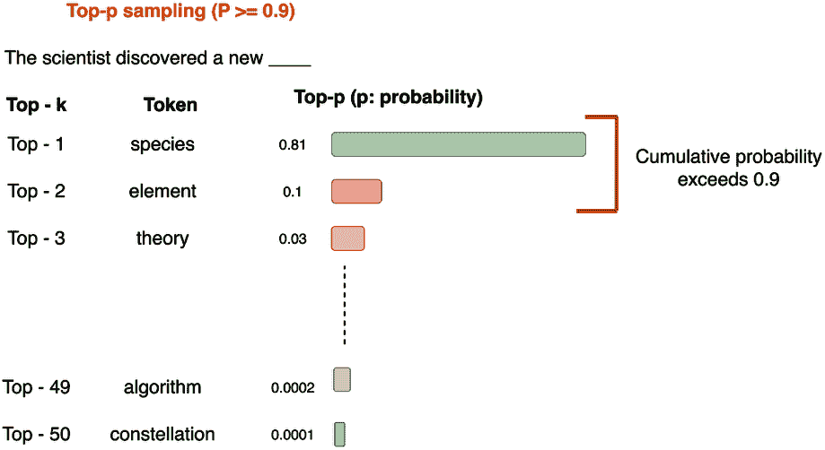

*图 8.10：Top-p 采样*

考虑这种差异：如果模型对下一个词非常确定（例如，补全“科学家发现了一种新的___”），top-p=0.9 可能只包含“物种”以及可能的一两个备选词，因为仅“物种”一词的概率就可能达到 0.81。相反，对于一个许多续写都合理的创造性提示，同样的 p=0.9 阈值可能会包含数十个 token，所有 token 都对累积概率有显著贡献。p 参数的选择会显著影响输出质量，且不存在普遍最优值。


top-p 采样的关键优势在于它对概率分布形态的适应性。当模型高度自信时（概率质量集中在少数几个 token 上），核保持较小，通过将选择限制在最可能的选项上来保证质量。当模型不确定时（概率质量分散在许多 token 上），核会自动扩大以纳入更多候选，从而允许更大的多样性。这种动态调整解决了 top-k 采样的不灵活性——top-k 采样无论上下文如何，总是只考虑恰好 k 个 token。

尽管存在上述一些局限性，Top-p 采样在现代 LLM 中仍被广泛使用，因为它在平衡质量和多样性方面非常有效。它能防止产生退化输出（重复或无意义的文本），同时保持创造性灵活性，使其特别适用于对话式 AI、内容生成以及需要自然、多样化响应的应用。该技术通常与温度缩放结合使用，以实现对生成行为更精细的控制。

Top-P 采样有几个关键缺点：

- 它使用固定的累积概率阈值（如 0.9），而不考虑模型的置信水平，这可能在模型高度确定时无必要地包含低质量选项，或在模型不确定时排除合理的备选选项。

- 它需要在每个生成步骤按概率对所有词表 token 进行排序，与贪婪解码等更简单的方法相比增加了计算开销。

- p 参数的选择会显著影响输出质量，且没有通用最优值，需要针对具体任务进行调整：较低的值（0.5-0.7）产生保守输出，而较高的值（0.9-0.95）能带来更多创造性，但存在包含不合适 token 的风险；此外，适应性也常被视为一大优势。

- 核大小的变化会使生成行为变得不太可预测，因为候选 token 的数量在不同步骤之间波动巨大，可能导致输出质量不稳定。

到目前为止，我们已经了解了 LLM 生成所用的采样策略。接下来，我们将了解一些常见的文本生成终止条件。

### 终止条件

在自回归文本生成过程中，模型必须决定何时停止生成 token。有几种终止条件控制着生成过程的结束时机：

- **序列结束（EOS）Token**：最自然的终止方式是模型生成一个特殊的 EOS token，表示文本已完成。这个 token 在训练期间学习到，代表模型认定生成的序列在语义上是完整的。例如，在生成完整句子或段落后，模型可能会预测 EOS token，表示无需继续生成。

- **最大长度约束**：为了防止无限生成和内存溢出，强制执行最大序列长度（`max_seq_len`）。如果生成的序列达到该限制，无论是否生成了 EOS token，生成都会终止。这种硬约束确保系统保持稳定并防止资源耗尽，在计算资源有限的生产环境中尤其重要。

- **最大新 token 数**：用户可以指定要生成的最大 token 数量（`max_new_tokens`），与总序列长度无关。该参数控制模型在初始提示之外生成多少新内容。例如，如果提示包含 50 个 token，且 `max_new_tokens` 设置为 100，那么即使模型尚未生成 EOS token 且长度未达到 `max_seq_len`，生成也会在产生额外 100 个 token 后停止。

- **提前停止条件**：某些实现会包含额外的停止标准，例如检测重复模式（模型连续多次生成相同的 token 或序列）、遇到用户定义的特定停止序列（例如，当模型生成“结束段落”时停止），或达到置信度阈值（模型对下一个 token 的概率低于最小值，表示模型对如何继续存在不确定性）。

在前面展示的 C++ 实现中，生成循环整合了这些条件：

```cpp
for (int i = 0; i < max_new_tokens; ++i) {
    // ... token generation logic ...
    // Stop if sequence gets too long
    if (generated_sequence.size() >= max_seq_len) break;
}
```

循环会一直继续，直到 `max_new_tokens` 次迭代完成，或序列长度达到 `max_seq_len`。在实践中，实现通常也会检查 EOS token，检测到后就跳出循环。恰当的终止处理能确保生成的文本既连贯又计算高效，在质量与资源约束之间取得平衡。

由于我们在前面章节没有学习基于经典统计的 NLP 方法，因此遗漏了 NLP 中几个基础概念，例如**词频-逆文档频率**（**TF-IDF**）和 n-gram。我们在这里简要讨论这两者，因为理解这些概念将使我们更容易讨论用于生成模型的一些统计评估指标。

### TF-IDF

TF-IDF 是一种用于自然语言处理的统计度量，用于评估一个词在文档中相对于文档集合（语料库）的重要性。它结合了两个组成部分：词频（Term Frequency，衡量一个词在特定文档中出现的频率）和逆文档频率（Inverse Document Frequency，衡量该词在所有文档中是罕见还是常见），在考虑语料库中普遍性的同时量化词项相关性。

TF-IDF 由两个关键部分组成：

- **词频（TF）**：它衡量一个词项在文档中出现的频率，并按该文档中的总词项数进行归一化。TF 值越高，表示该词在特定文档中出现得越频繁。

  TF(t, d) = (词项 t 在文档 d 中出现的次数) / (文档 d 中的总词项数)

- **逆文档频率（IDF）**：它量化一个词项在整个语料库中的罕见程度或特殊性。稀有词获得较高的 IDF 分数，而常见词（如“the”或“and”）获得较低分数。计算公式如下：

  IDF(t, d) = log(语料库中的文档总数 / 包含词项 t 的文档数)

- **TF-IDF 分数**：最终得分是这两个组成部分的乘积。这种对局部（TF）和全局（IDF）词项重要性的双重考量，使得 TF-IDF 在捕捉文档特定和语料库范围的词项关系方面特别有效。

TF-IDF 的主要优势在于其简单性、可解释性和计算效率。该技术能有效过滤常见停用词，同时保留中等稀有词项。然而，TF-IDF 也有明显的局限性：它无法理解同义词或语义含义。它还忽略词序和上下文，将文档视为词袋。此外，该方法无法捕捉词项之间的关系，也无法处理一词多义（具有多种含义的词）。

### N-gram

N-gram 是从文本或语音数据中提取的 n 个连续项构成的序列，是自然语言处理中的基础概念之一。“n”指定要考虑的连续项数量：unigram（n=1）表示单个词，bigram（n=2）捕获连续词对，trigram（n=3）包含连续三元词。

例如，句子“The wind is blowing”可以分解为：

- **Unigrams**：“The”、“wind”、“is”、“blowing”。

- **Bigrams**：“The wind”、“wind is”、“is blowing”

- **Trigrams**：“The wind is”、“wind is blowing”

N-gram 作为文本的统计表示，帮助计算机理解语言模式并预测序列中接下来可能出现哪些词。它们捕捉局部的词语依赖关系和上下文信息，而如果孤立地分析词语，这些信息就会丢失。

N-gram 在众多自然语言处理任务中得到广泛应用。在语言建模中，它们帮助预测词序列的概率，构成了自动补全、拼写检查和机器翻译等应用的基础。它们通过捕捉单个词无法发现的短语级模式来实现文本分类。像“New York”、“machine learning”或“credit risk”这样的词组，组合在一起比单独出现时传达更多含义。

n-gram 的主要优势在于其简单性和计算效率。它们提供了一种直接的方法来捕捉局部上下文，而无需复杂的神经架构，使它们具有可解释性且易于实现。然而，n-gram 无法捕捉超出其固定窗口大小的长距离依赖，并且缺乏语义理解，将“good”和“excellent”视为完全不同的 token，尽管它们的含义相似。

既然你已经了解了自回归生成和不同的采样策略是如何工作的，那么理解 LLM 的评估指标也很重要，这将帮助你理解生成过程的准确程度，以及如何为期望的结果设计训练过程。

### 生成模型的评估指标

既然你已经了解了自回归语言模型的工作原理和选择策略，那么了解 LLM 的一些评估指标也很重要。LLM 的评估指标往往根据使用场景而带有主观性，但在 LLM 领域有一些相当流行的统计指标，可用于了解 LLM 的表现是否符合预期。

与传统机器学习系统相比，评估 LLM 面临着独特的挑战。LLM 可以在无数任务中生成多样化的输出，这使得标准化评估变得困难。有效的评估需要多层面的方法，既要考虑通用能力，也要考虑具体的应用需求。评估策略应与你的具体使用场景需求保持一致，因为对一个应用重要的指标，对另一个应用可能不那么相关。


### 评估指标的分类

大语言模型评估指标大致可分为两类：统计指标和基于模型的指标。下面我们将分别讨论这两类指标。

#### 常见统计指标

评估生成式模型需要定量指标，通过直接的文本比较和数学计算来衡量输出质量。虽然这些统计指标提供了直观、可解释的评估结果，但它们主要关注表层相似性，可能无法捕捉更深层的语义等价关系。在本节中，我们将讨论常见的统计指标，如困惑度（Perplexity）、交叉熵损失（Cross-Entropy Loss）、**双语评估替补**（**BLEU**）、**面向召回性的摘要评估替补**（**ROUGE**）和**显式排序翻译评估指标**（**METEOR**）。每个指标从不同角度衡量生成质量，从预测准确度到结构连贯性。理解这些基础评估工具，有助于我们系统地衡量模型在文本生成质量的各个维度上的表现。

##### 困惑度

衡量模型在文本序列中预测下一个词的能力。它表示模型对测试集的概率的倒数。数学上，困惑度定义为：

困惑度 = 2^(H(p))

其中 H(p) 是模型预测的熵。它衡量模型输出的不确定性水平。自然，熵越低意味着模型对预测越有把握，从而导致困惑度越低。这表明模型的预测性能更好，对语言和上下文的理解更深入。困惑度特别适用于评估通用语言建模和流畅性。如果困惑度为 1，则模型预测的序列 100% 准确，而困惑度为 15 则表明模型的预测具有高度不可预测性。

困惑度的计算公式如下：

困惑度 = ( ∏_{i=1}^{N} P(w_i | w_1, w_2, ..., w_{i-1}) )^(-1/N)

其中 P(w_i | w_1, w_2, ..., w_{i-1}) 是在给定前 i-1 个词序列的条件下第 i 个词的条件概率，N 是序列中的总词数。

尽管困惑度相当直观，但它并不能衡量模型对语言的理解能力。它还对分词过程敏感，并且无法捕捉长期依赖关系。

##### 交叉熵损失

交叉熵损失是分类问题中的基础。在分类中，它量化了预测的类别概率与真实标签的匹配程度。模型输出一个关于类别的概率分布，交叉熵衡量该预测与实际类别之间的差异性。类似地，在语言建模中，每个下一个词预测本质上都是对词汇表的一次分类任务，模型在所有可能的词元上预测一个概率分布。这种共同的数学基础使交叉熵损失在离散分类（在类别间选择）和序列文本生成（从词汇表中选择下一个词）中都非常有效。

下面我们来看三个常见指标：BLEU、ROUGE 和 METEOR。它们在大规模评估中被广泛使用。BLEU、ROUGE 和 METEOR 具有若干共同优势，使其适用于大规模评估。这三个指标计算效率高且易于实现。它们无需修改即可跨多种语言使用，并因其在 NLP 社区中的广泛采用而便于基准测试。这些指标可以容纳多个参考文本，在存在多种合理正确输出时提供了灵活性。

尽管这些指标很有用，但它们也具有根本性的局限。它们缺乏深层语义理解，主要关注表层词汇重叠而非含义。它们都不评估事实准确性，也无法防止生成内容中的错误。它们难以处理同义词、释义以及诸如不同时态或词形等合理变体。要进行全面评估，这些指标最好与 BERTScore 等语义感知工具和人工判断结合使用。现在让我们看看这些指标及其数学表达：

##### BLEU

BLEU 最初为机器翻译设计，衡量生成文本与参考文本之间的 n-gram 精确率（通常 n=1-4）。它使用 n-gram 精确率的几何平均值来评估翻译或生成的准确程度。BLEU 分数越高表明与人工参考越接近，但该指标对措辞严格，且忽略语义含义。数学上：

BLEU = BP * exp( ∑_{i=1}^{N} w_i * ln(p_i) )

其中 BP 代表简短惩罚，w_i 是第 i 阶 n-gram 精确率的权重，p_i 是 n-gram 的精确率。

其独特的局限性在于对词序不敏感。具有相同单词但排列不同的句子，即使含义可能存在显著差异，也会获得相同的 unigram 分数。它平等对待所有词，无法区分关键实义词和不那么重要的功能词。

##### ROUGE

ROUGE 衡量生成摘要与参考文本之间的 n-gram 召回率，通过 n-gram 重叠和最长公共子序列来评估完整性。存在多个变体：

**ROUGE-N（ROUGE-1、ROUGE-2）：** 衡量参考文本与预测文本之间的 n-gram 重叠程度。其计算公式为：

ROUGE-N = 匹配的 n-gram 数量 / 参考文本中 n-gram 的总数

**ROUGE-L：** 计算考虑词序的最长公共子序列。它有助于捕捉结构相似性。

ROUGE-L = ((1 + β²) * P * R) / (β² * P + R)

其中 P 是精确率，R 是召回率，β 是一个参数，通常设为 1。

- ROUGE-W：这是 ROUGE 的另一个版本，对较长匹配短语赋予更大权重。
- ROUGE-S：它关注在两个文本中按相同顺序出现的词对。

与 BLEU 侧重精确率不同，ROUGE 强调召回率。它衡量生成的文本中覆盖了多少参考内容。这使得它特别适用于完整性至关重要的摘要任务。

##### METEOR

这是 BLEU 的一个更稳健的版本，结合了召回率、精确率以及基于词干和释义的额外语义匹配。它通过考虑同义词和词干还原解决了 BLEU 的一些局限性。以下是 METEOR 的一些关键特征：

- **精确率与召回率的调和平均值：** METEOR 使用调和平均值结合精确率和召回率。它对精确率给予更高权重，这确保了生成文本与参考文本紧密匹配，并且能覆盖大部分参考内容。
- **语言特征：** METEOR 融入了多项语言增强功能，如同义词、词干还原和释义。这使得 METEOR 更具语义感知能力。
- **对齐与基于分块的匹配：** 它识别在内容和顺序上都匹配的连续词序列，并对重新排序施加惩罚。
- **碎片惩罚：** 抑制零散的匹配，倾向于匹配词以连续块出现的连贯结构。

METEOR 通过语言特征实现的语义感知能力以及结构连贯性惩罚，使其比 BLEU 或 ROUGE 更为精细，能更好地捕捉超越精确词汇匹配的语义等价关系。

#### 基于模型的指标

基于模型的指标利用预训练语言模型，以更具语义感知的方式并结合上下文理解来评估质量。与依赖文本比较的统计指标不同，基于模型的方法可以识别释义、同义词和上下文含义。

基于模型的指标示例包括：BERTScore（使用 BERT、RoBERTa 或 XLNet 等 Transformer 模型计算语义相似度）、**基于 Transformer 表示的双语评估替补**（**BLEURT**，基于人工评分训练）、**跨语言翻译评估优化指标**（**COMET**，使用基于人工判断训练的神经网络），以及基于 GPT 的评估系统——利用大语言模型根据指定标准对输出进行评分。

这里我们重点讨论 BERTScore，作为基于模型的指标的代表，因为它展示了上下文嵌入如何捕捉超出精确词汇匹配的语义相似性。

##### BERTScore

BERTScore 超越了传统的 n-gram 指标，利用上下文嵌入来评估语义相似性，通过上下文表示而非表层词汇匹配来评估生成文本。

该指标通过几个关键步骤运作。参考句和候选句都使用预训练的 Transformer 模型（BERT、RoBERTa 或 XLNet）进行编码，生成上下文嵌入，其中每个词元的表示都依赖于其周围上下文。对于每个候选词元，BERTScore 使用余弦相似度找到最相似的参考词元，并进行双向匹配（候选到参考用于精确率，参考到候选用于召回率）。这些测量通过 F1 分数组合，产生最终的 BERTScore。可选地，**逆文档频率**（**IDF**）加权可用来强调稀有、承载内容的词，而非常见功能词。


## 第8章：C++中的生成网络、自编码器与大语言模型

### 优势与局限

BERTScore能够捕捉超越精确匹配的语义含义，识别释义和同义表达，同时通过独立的精确率、召回率和F1分数提供全面评估。对于大规模评估，它依然保持计算效率。

然而，该指标对架构相似的模型表现出偏差。使用BERT嵌入可能会偏向基于BERT的生成器。评估质量取决于底层语言模型的能力。BERTScore不考虑句法结构，并且可能在处理习语表达、文化引用或预训练数据中不存在的领域特定术语时遇到困难。

### 实际应用

BERTScore已被广泛用于摘要生成、机器翻译、对话系统和释义生成。当与BLEU或ROUGE等传统指标以及人工评估结合使用时，它的效果最佳，能够提供涵盖语义质量以及事实准确性和连贯性等其他维度的全面评估。

### 小结

本章在前几章关于CNN以及RNN和LSTM等时间神经网络的基础上，探讨了三种主要的生成式AI范式。尽管本章介绍的神经网络按照当今Transformer的标准可能已经过时，但这些神经网络具有重要的历史意义，有助于真正理解我们将在下一章讨论的Transformer和大语言模型。

评估维度：除了这些核心指标之外，LLM评估通常涵盖以下几个关键维度：

- **准确性**：衡量模型输出的正确性（精确率、召回率、F1分数）
- **相关性**：评估回答是否恰当地回应了查询
- **有用性**：评估回答的实际效用
- **安全性**：检验模型避免有害内容的能力（毒性评级、偏差指标）
- **效率**：衡量计算资源的使用情况（延迟、吞吐量、成本）
- **鲁棒性**：测试在不同输入下的一致性

我们探讨了三种主要的生成式AI范式：自编码器、VAE和GAN。自编码器通过编码器-解码器框架对数据进行压缩和重建。它们可以被视为数据压缩机制，其中瓶颈层的潜在向量包含足够的信息来重建整个数据（图像）。然后我们考察了自编码器的一种变体——VAE，它可以根据输入数据的概率分布生成新的数据点。接着我们学习了GAN。GAN采用对抗训练，生成器创建合成数据，判别器区分真假，双方在极小极大博弈中竞争。我们在图像数据的背景下学习了这些神经网络，但同时也为序列数据提供了完整的代码示例，包括针对序列数据的自编码器变体。

我们还介绍了文本生成背景下的自回归生成。我们讨论了文本生成的采样策略和评估指标。评估指标包括侧重于词重叠的统计度量（困惑度、BLEU、ROUGE、METEOR）以及通过上下文嵌入捕捉语义相似性的基于模型的方法（BERTScore）。全面评估需要跨多个维度的互补指标，如准确性、相关性和鲁棒性。这些采样策略和评估指标对于下一章关于Transformer和大语言模型的内容将非常宝贵。定义Transformer的注意力机制和位置编码从根本上改变了模型处理序列信息的方式，超越了我们在前面探讨的自回归约束。从传统生成模型到Transformer的转变代表了架构上的范式转移，但受控生成和严格评估的原则保持不变。它们为我们理解现代LLM提供了分析视角。

### 延伸阅读

如果你想加深理解，以下资源提供了清晰的解释和有用的背景信息：

- *自动编码变分贝叶斯* 作者：Kingma & Welling（2013）——介绍重参数化技巧的原始VAE论文
- *变分自编码器教程* 作者：Carl Doersch（2016）——对VAE数学的通俗易懂的解释
- *去噪自编码器* 作者：Vincent等人（2008）——鲁棒特征学习的基础
- *生成对抗网络* 作者：Goodfellow等人（2014）——原始GAN论文
- *利用深度卷积GAN进行无监督表示学习* 作者：Radford等人（2015）——DCGAN架构
- *改进的GAN训练技术* 作者：Salimans等人（2016）——解决训练稳定性问题
- *Wasserstein GAN* 作者：Arjovsky等人（2017）——用于更好收敛的替代损失函数
- *基于神经网络的序列到序列学习* 作者：Sutskever等人（2014）——原始seq2seq架构
- *使用RNN编码器-解码器学习短语表示* 作者：Cho等人（2014）——引入了编码器-解码器框架
- *神经文本退化的奇异案例* 作者：Holtzman等人（2019）——引入了核采样（top-p）
- *BERT：深度双向Transformer的预训练* 作者：Devlin等人（2018）——上下文嵌入
- *BLEU：一种机器翻译自动评估方法* 作者：Papineni等人（2002）
- *ROUGE：一个用于摘要自动评估的软件包* 作者：Lin（2004）
- *BERTScore：使用BERT评估文本生成* 作者：Zhang等人（2019）——基于模型的评估
- *深度学习* 作者：Goodfellow、Bengio和Courville（2016）——第14章（自编码器）和第20章（生成模型）
- 斯坦福大学CS231n关于GAN和生成模型的课堂笔记
- Lil'Log博客系列：*从自编码器到Beta-VAE，从GAN到WGAN*
- 代码示例：`https://github.com/PacktPublishing/Deep-Learning-with-C-/tree/main/chapter8`

### 获取本书PDF版本及更多内容

扫描二维码（或访问`packtpub.com/unlock`）。按书名搜索本书，确认版本，然后按照页面上的步骤操作。


*注意：请妥善保管您的发票。直接从Packt购买则无需发票。*

## 9 C++中的Transformer与大语言模型微调

2017年的论文*注意力即一切*引入了Transformer架构，从根本上改变了机器处理序列数据的方式。该架构的核心创新——自注意力机制——使模型能够并行处理所有标记，同时计算每个词之间的关系。这直接解决了早期方法的局限性：**循环神经网络**（**RNN**）和**长短期记忆**（**LSTM**）按顺序处理标记，造成计算瓶颈，阻碍并行化；而且随着上下文经历许多顺序步骤，信息会逐渐衰减，使得维持长距离依赖变得困难。

尽管自编码器、VAE和GAN奠定了生成建模的基础，但它们在文本生成中的应用揭示了这些架构限制。自回归模型逐个标记地生成文本，但基于序列架构构建时，每个标记都需要一次完整的前向传播，没有并行化的机会。GAN在处理离散标记时还面临额外挑战，因为当你无法在“企鹅”和“鸟”这样的词之间创建中间表示时，梯度流就会中断。

自注意力解决了这些问题，它允许模型无需顺序处理即可解决上下文歧义（根据周围的词（如“tickets”）区分“book”作为名词和作为动词）。多头注意力同时捕获多种语言模式，而**旋转位置嵌入**（**RoPE**）等位置编码机制则保留了并行处理否则会丢失的词序信息。


本章将剖析驱动当前大型语言模型的 Transformer 架构。

我们将使用 LibTorch 提供一个覆盖编码器和解码器组件的完整 C++ 实现，然后讨论大规模训练和部署这些模型时面临的实际工程挑战。你将了解**分布式数据并行**（**DDP**）和**全分片数据并行**（**FSDP**）如何实现跨多 GPU 训练，以及压缩技术（知识蒸馏、剪枝、量化与低秩近似）如何使部署在资源受限设备上成为可能。例如，量化通过 8 位表示实现了 4 倍压缩，而迭代剪枝已在 AlexNet 等网络上实现了 9 倍参数缩减，且没有精度损失。

学完本章后，你将掌握用 C++ 构建、训练和优化基于 Transformer 的模型所需的理论基础与实践实现细节。

本章将涵盖以下主题：

- Transformer 架构简介
- 位置编码
- 完整的 Transformer 实现
- 预训练语言模型
- 模型并行化
- 模型压缩技术

### Transformer 架构简介

Transformer 架构代表了深度学习领域的一次突破，从根本上改变了我们处理序列建模和自然语言处理的方式。RNN 和 LSTM 这类系统的一个主要缺点是，它们只能回看一定大小的窗口或之前的文本，因此难以处理长距离依赖。

在神经机器翻译等任务中，RNN 必须从开头开始，逐词严格按顺序处理输入序列，依次经过每个元素直到末尾。这种顺序依赖严重限制了并行计算的机会，因为每一步都必须等待前一步完成。对于一个包含 *T* 个单词的句子，模型需要 *T* 个顺序时间步来编码信息，这意味着处理时间随序列长度线性增长。更关键的是，这种架构造成了很长的信息传播路径：要将信息从第一个单词传递到最终输出，需要遍历全部 *T* 个顺序步骤，这会导致两个显著问题。首先，重要的上下文信息在经过许多中间状态时往往会衰减或丢失，尤其是在较长的序列中。其次，延长的计算路径加剧了反向传播中的梯度消失问题，使网络难以有效学习长距离依赖。虽然 LSTM 网络和**门控循环单元**（**GRU**）是为了通过专门的门控机制缓解这些问题而提出的，但即使是这些架构在处理很长的序列时也难以保持性能。

RNN 模型存在的计算效率低下、信息丢失和梯度不稳定等问题，最终推动了 Transformer 等替代架构的发展。这些架构通过注意力机制解决了上述局限，从而实现并行处理，并在序列中的任意位置之间建立直接连接。Transformer 引入了“注意力”的概念，我们接下来将研究它。

### 注意力机制的变革

注意力机制的发展是解决循环架构根本局限的关键突破。由于 RNN 和 LSTM 的顺序处理特性，它们难以处理长距离依赖，而注意力机制引入了一种根本不同的方法：它允许模型直接访问并权衡输入序列中任意位置的相关性，无论距离远近。这种范式转变消除了信息经过多个顺序步骤传播的需要，从而解决了早期架构在计算效率和信息退化方面的问题。

注意力机制允许模型在生成每个输出元素时动态关注输入的不同部分。这有助于从看似遥远的上下文中收集信息，而不是将整个输入序列压缩成一个固定长度的上下文向量。权重（即注意力分数）由模型学习得到，反映了每个输入位置与当前生成输出的相关程度。这种方法从人类认知过程中获得灵感：正如我们在处理复杂输入时有选择地关注相关信息一样，注意力机制也让神经网络能够为每个预测识别并突出最相关的特征。

注意力的数学基础简洁而优雅，却非常强大。给定一组输入表示，该机制会计算三个关键组件：查询（queries）、键（keys）和值（values）。这些术语借自信息检索系统，体现了一种直觉：我们通过比较“键”来“查询”相关信息，并检索相应的“值”。查询与每个键向量之间的注意力分数通过余弦相似度函数（向量间的点积）计算。然后使用 softmax 函数对该值进行归一化，得到概率分布。这个分布决定了每个输入位置对当前输出的贡献程度，最终表示是值的加权和。关键在于，这些计算可以在所有位置上并行执行，因此注意力机制在计算效率上远高于顺序 RNN 处理方式，从而能够在更长的序列上训练更大的模型。

注意力机制的引入不仅解决了 RNN 的技术局限，还带来了可解释性方面的好处，因为注意力权重可以被可视化，从而了解模型在特定预测中认为输入的哪些部分重要。这一创新为 Transformer 架构奠定了基础。Transformer 完全依赖注意力机制而没有任何循环结构，进一步推进了这一概念，在众多自然语言处理任务上取得了最先进的性能，同时保持了计算效率和有效捕获长距离依赖的能力。

注意力机制在两个不同序列之间运作。例如，当将“Hello”翻译成对应的法语单词“Bonjour”时，解码器会关注编码器对英语句子的表示。查询来自一个序列（解码器），而键和值来自另一个序列（编码器）。

现在我们将研究注意力机制的一种特殊变体——自注意力（self-attention）。它在单个序列内运作。每个词都会关注同一序列中的其他所有词，包括自身。简单来说，这是一种让模型通过查看句子中周围所有其他词来理解每个词的方式。

### 自注意力机制

理解语言要求我们摒弃一个根本性的误解：即词语具有固定的、与上下文无关的含义。实际上，一个词语的语义内容是在其周围的语境中产生的。以常见英语单词的一词多义现象为例。“book”既可以指装订成册的阅读材料，也可以指预订行为（“book a hotel”）。同样，“ring”可能指环状首饰，也可能指电话发出的声音信号。这种词汇歧义在自然语言中无处不在。

自注意力是一种让神经网络通过从相邻词元中推导上下文含义来解决这种歧义的机制。自注意力不是将每个词视为孤立的语义单元，而是允许模型计算序列中所有词之间的关系，从而根据具体的使用语境消除多义词的歧义。这种上下文编码构成了 Transformer 架构表征能力的基础。

在下一节中，我们将研究注意力机制背后的数学原理。


#### 自注意力的数学基础

自注意力机制将输入嵌入转换为具有上下文感知的表示。输入嵌入 X 被投影到三个不同的向量空间，即查询（Q）、键（K）和值（V）。正如我们在前几章中看到的，我们通过分词过程将单词转换为数字，然后将这种分词表示转换为嵌入向量。注意力机制正是这一方向的又一进步。在这里，嵌入向量被拆分为三个不同的向量空间。自注意力本质上是在向句子中的每个单词提出三个基本问题：

- **查询（Q）**：我在寻找什么？
- **键（K）**：我能提供什么？
- **值（V）**：我的实际内容是什么？

你可以想象，句子中的每个单词都在与其他单词进行对话，试图找出哪些单词对理解其含义很重要。让我通过一个例子来解释。让我们考虑一个句子：“I want to book my tickets.”（“我想预订我的机票。”）

“book”的查询向量会询问：我周围有哪些上下文线索？

相邻单词“tickets”（票）的键会回应：我们在这里，我们与预订相关。

相关单词的值会提供：这里是实际含义，“这是关于预订，与阅读无关。”

注意力计算的核心是查询矩阵和键矩阵的缩放点积。

Attention(Q, K, V) = softmax(QK^T / sqrt(d_k)) V

其中 `d_k` 表示键向量的维度。计算分三步进行。

- 计算相似度分数：在上述公式中，查询矩阵 Q 与键矩阵的转置相乘，产生一个注意力分数，用于衡量每个查询与每个键的匹配程度。
- 缩放相似度分数：然后将相似度分数除以缩放因子 (sqrt(d_k)) 以保持稳定性。这个缩放因子对于在训练过程中保持梯度稳定至关重要，尤其是在嵌入维度增加时。如果没有这种缩放，点积的方差会随 `d_k` 成比例增长，使 softmax 函数进入梯度变得极小的区域。
- 归一化并加权：接着对缩放后的分数应用 softmax 函数，生成总和为 1 的归一化权重。然后，将这些归一化权重与值矩阵 V 相乘，以产生最终的上下文感知表示。

*图9.1：自注意力机制的计算流程*

在左侧，输入词元（以黄色显示）通过注意力机制进行处理。每个输入词元都会被转换为三个不同的向量表示：查询（Q）、键（K）和值（V）向量。然后，注意力计算按照上述三个步骤进行。

现在，我们使用 LibTorch 在 C++ 中实现这三步注意力计算。

#### 自注意力的 C++ 实现

该实现直接遵循三步注意力计算。首先，它从键张量的第二维提取键维度 `d_k`，并计算缩放因子 1/sqrt(d_k)。这种缩放可防止点积随着嵌入维度的增加而变得过大，否则会将 softmax 函数推入梯度消失的区域。

```cpp
class TorchAttention {
public:
    // Scaled Dot-Product Attention using LibTorch
    static torch::Tensor scaledDotProductAttention(
        const torch::Tensor& Q, // queries [seq_len, d_k]
        const torch::Tensor& K, // keys [seq_len, d_k]
        const torch::Tensor& V  // values [seq_len, d_v]
    ) {
        auto d_k = K.size(1);
        auto scale = 1.0 / std::sqrt(d_k);
        // Attention(Q,K,V) = softmax(QK^T/sqrt(d_k))V
        auto scores = torch::matmul(Q, K.transpose(-2, -1)) * scale;
        auto attention_weights = torch::softmax(scores, -1);
        return torch::matmul(attention_weights, V);
    }
};
```

注意力分数通过 `torch::matmul(Q, K.transpose(-2, -1))` 计算，该操作执行矩阵乘法 QK^T。`.transpose(-2, -1)` 操作翻转 K 的最后两个维度，将其从 `[seq_len, d_k]` 变换为 `[d_k, seq_len]`，以便正确进行矩阵乘法。紧随其后的缩放因子相乘可防止数值不稳定。

`torch::softmax(scores, -1)` 操作沿最后一个维度对缩放后的分数进行归一化，将原始相似度分数转换为概率分布，其中每行总和为 1。这确保了注意力机制能够将 100% 的“注意力预算”精确分配到序列中的所有词元上。

最后，`torch::matmul(attention_weights, V)` 将归一化注意力权重与值矩阵相乘，生成代表上下文感知输出的值的加权组合。每个输出向量通过计算所有值向量的加权和来整合来自所有位置的信息。该操作对与查询更相关的位置赋予更大的权重。

该实现利用了 LibTorch 的自动微分能力，能够无缝集成到训练流程中。整个注意力机制仅需五行计算，却捕捉到了驱动现代 Transformer 架构的核心创新。批处理矩阵运算的使用确保了在 GPU 上的高效执行，在这些 GPU 上，这些运算可以在序列长度上高度并行化。完整代码可在 `https://github.com/PacktPublishing/Deep-Learning-with-C-/blob/main/chapter9/torch_attention.cpp` 获取。

自注意力检查同一输入序列内单词之间的关系，而标准注意力则在两个不同序列之间进行操作。在自注意力中，一个单独的句子生成自身的查询、键和值，从而使每个单词都能确定其与该句子中其他每个单词的相关性。相比之下，在编码器-解码器注意力（也称为交叉注意力）中，查询来自一个序列（通常是解码器的目标语言），而键和值来自另一个序列（编码器的源语言）。这种区别在机器翻译等任务中至关重要，因为解码器必须关注源句子才能生成恰当的译文，而不是仅仅检查目标句子内部的关系。

这里介绍的单头自注意力使模型能够捕获单词之间的上下文关系。其自然的延伸是多头注意力。借助多头注意力，模型可以同时学习多种类型的模式和依赖关系。我们将在下一节中讨论这一点。

### 多头注意力

多头注意力是自注意力机制的一种扩展，它使 Transformer 能够理解多样化的模式识别并生成更丰富的表示。

可以把多头注意力想象成有多个专家在检查同一个句子，每个专家都专注于检测不同的模式。这类似于卷积神经网络中的多个特征图：正如不同的 CNN 滤波器关注不同的视觉方面（边缘、纹理、形状），不同的注意力头关注不同的语言模式，如句法关系、语义联系、长距离依赖和局部单词交互。

多头注意力通过并行的注意力计算来运作。与之前一样，输入被投影到多组查询（Q）、键（K）和值（V）矩阵中，每个注意力头对应一组。每个头独立执行缩放点积注意力操作，产生自己的上下文感知表示。所有并行注意力头的输出被拼接起来，并应用线性变换，以产生最终输出。

在实践中，每个头的维度会按头的数量成比例缩减（例如，8 个头和 512 维嵌入时，每个头处理 64 维投影），从而在保持计算效率的同时显著提高表示能力。


## 第9章

下图展示了多头注意力并行操作的示意图。

```text
K
Q
V
a
Weighted sum
concat
K
Q
V
a
Weighted sum
O
O
```

*图9.2：多头注意力的并行操作*

现在我们将多头注意力架构用 LibTorch 实现为实际的 C++ 代码。

#### 多头注意力的 C++ 实现

下面是一个多头注意力的 C++ 实现（[multihead_attention.cpp](https://github.com/PacktPublishing/Deep-Learning-with-C-/blob/main/chapter9/multihead_attention.cpp)）。以下函数实现了多头注意力机制。在实现过程中，每个头的维度通常会按头的数量等比例缩小，从而保持总计算成本不变。例如，如果模型维度为 512，并使用 8 个头，那么每个头处理 64 维的投影。这种设计选择在显著提升模型表示能力的同时，也保持了计算效率。

```cpp
static torch::Tensor multiHeadAttention(
    const torch::Tensor& Q, // queries [seq_len, d_model]
    const torch::Tensor& K, // keys [seq_len, d_model]
    const torch::Tensor& V, // values [seq_len, d_model]
    int num_heads
) {
    auto seq_len = Q.size(0);
    auto d_model = Q.size(1);
    auto d_k = d_model / num_heads;

    // Reshape to [seq_len, num_heads, d_k]
    auto Q_heads = Q.view({seq_len, num_heads, d_k}).transpose(0, 1); // [num_heads, seq_len, d_k]
    auto K_heads = K.view({seq_len, num_heads, d_k}).transpose(0, 1);
    auto V_heads = V.view({seq_len, num_heads, d_k}).transpose(0, 1);

    // Apply attention to each head
    std::vector<torch::Tensor> head_outputs;
    for (int i = 0; i < num_heads; i++) {
        auto head_out = scaledDotProductAttention(Q_heads[i], K_heads[i], V_heads[i]);
        head_outputs.push_back(head_out);
    }

    // Concatenate heads and return
    auto concat = torch::cat(head_outputs, -1);
    return concat;
}
```

我想强调上述函数中的几个关键步骤。第一个关键特性是对输入进行如下重塑：

```cpp
auto Q_heads = Q.view({seq_len, num_heads, d_k}).transpose(0, 1);
```

原始的 Q、K、V 矩阵从 `[seq_len, d_model]` 重塑为 `[seq_len, num_heads, d_k]`，然后转置为 `[num_heads, seq_len, d_k]`。这种重组使得每个头可以独立处理自己的那部分数据。

每个头分别运行注意力机制，从而让不同的头学习不同类型的关系（例如，一个头可能关注语法，另一个关注语义，还有一个关注长距离依赖）。这一过程在 `for` 循环中完成。

最后，所有头的输出被重新拼接在一起，将来自所有“专家”的洞察融合为统一的表示。

虽然多头注意力使 Transformer 能够捕捉输入序列中的多样关系，但该机制本身无法感知位置，它不能天然地区分词序。这带来了一个根本性的挑战：没有位置信息，模型会将“猫追赶老鼠”和“老鼠追赶猫”视为完全相同的输入。为了克服这一局限，使模型能够理解序列结构，我们必须在架构中加入位置编码。

到目前为止，我们已经看到了注意力机制如何让 Transformer 捕捉输入序列中的多种关系。然而，这一机制本质上无法理解词序。为了引入这些信息，我们接下来必须学习位置编码。

### 位置编码

Transformer 架构面临的一个根本挑战是缺乏固有的序列信息。与 RNN 和 LSTM 网络不同——它们按顺序处理词元，并通过循环结构自然地编码位置——Transformer 中的自注意力机制允许所有词元直接且同时地相互交互。这种并行化虽然有利于计算，但也带来了一个关键问题：如果没有额外信息，Transformer 对位置不敏感，无法区分序列中词元的顺序。

考虑“猫追赶老鼠”和“老鼠追赶猫”这两个句子。在没有位置信息的情况下，对模型而言，这两个句子是相同的“词元集合”。位置编码通过将依赖于位置的信息注入模型来解决这个问题，使模型能够理解并利用词序。当前文献中流行几种位置编码变体，每种都有各自的优缺点。在接下来的几节中，我们将探讨这些变体。

#### 学习式位置嵌入

最直接的位置编码方法是为序列中的每个位置学习一个专门的嵌入向量。在这种方法中，每个位置索引（1、2、3，……，直到最大序列长度）都被分配一个维度为 `d_model` 的可学习向量，该维度与词元嵌入维度相同。这些位置嵌入在训练过程中与其他模型参数一样被随机初始化，并通过梯度下降进行优化。

在前向传播过程中，每个词元所在位置的位置嵌入会直接加到其词元嵌入上。

\[
x_i = \text{token\_embedding}_i + \text{position\_embedding}_i
\]

虽然这种方法简单有效，但也有明显的局限。模型只能学习训练中见过的最大序列长度以内的位置，因此在推理时无法推广到更长的序列。此外，学习到的嵌入可能会根据训练数据中的模式产生偏差，而不能很好地捕捉序列位置的本质属性。

#### 正弦位置编码

原始 Transformer 论文提出了一种优雅的替代方案：基于正弦和余弦函数的确定性位置编码。这种方法使用预先确定的数学公式，无需学习，并且可以扩展到任意的序列长度。

对于位置 \(m\) 处的词元和嵌入维度索引 \(i\)，正弦编码定义为：

\[
PE(m, 2i) = \sin(\omega_i \times m)
\]

\[
PE(m, 2i+1) = \cos(\omega_i \times m)
\]

其中每个维度的频率由下式给出：

\[
\omega_i = \frac{1}{10000^{2i / d_{\text{model}}}}
\]

这种公式通过在不同维度上使用不同的频率，为每个位置创建了唯一的编码。维度越低，其振荡频率越高，能够捕捉更细粒度的位置差异；而维度越高，振荡频率越低，编码的是更粗略的位置信息。选择 10000 作为底数可以在典型序列长度上保持良好的位置区分能力。

这种编码的一个关键数学性质是：位置 \(m\) 和 \(n\) 处的位置嵌入之间的点积成为它们相对距离（\(m - n\)）的函数，如下所示：

\[
\begin{aligned}
PE(m) \cdot PE(n) &= [\sin(m), \cos(m)] \cdot [\sin(n), \cos(n)] \\
&= \sin(m)\sin(n) + \cos(m)\cos(n) \\
&= \cos(m - n)
\end{aligned}
\]

因此，点积与词的绝对位置无关，而依赖于两个词的相对位置。这意味着，对于位于 \(m\) 和 \(n\) 的两个词，结果只取决于它们之间的距离，即（\(m - n\)）。所以，位置是 5 和 8 还是 101 和 104 并不重要；重要的是它们之间的差值，在这里是 3。这一性质使模型能够基于相对位置而非绝对位置进行注意力学习，这对语言理解往往更有用。此外，位置更接近的词元在位置编码上天然具有更高的相似度得分，这提供了一种归纳偏置：相邻的词更可能相关。这种编码的其他明显优点包括：值被限制并归一化在 -1 到 1 之间，并且函数是连续可微的。

正弦方法可以无缝地推广到训练中未见过的序列长度，这使其对需要变长输入的应用尤其有价值。下面是用于计算上述位置编码的 C++ 代码：

```cpp
Matrix positional_encoding(int seq_len, int d_model) {
    Matrix pe(seq_len, std::vector<float>(d_model));
    for (int pos = 0; pos < seq_len; ++pos) {
        for (int i = 0; i < d_model; i += 2) {
            float div_term = std::exp(i * -std::log(10000.0f) / d_model);
            pe[pos][i] = std::sin(pos * div_term);
            if (i + 1 < d_model)
                pe[pos][i + 1] = std::cos(pos * div_term);
        }
    }
    return pe;
}
```

位置编码器首先将变量 `pe` 初始化为维度为 `[seq_len, d_model]` 的零矩阵。完整代码可在 [simple_positional_encoding.cpp](https://github.com/PacktPublishing/Deep-Learning-with-C-/blob/main/chapter9/simple_positional_encoding.cpp) 中找到。在 `for` 循环中，对嵌入向量中的每个位置计算编码值。下图以热力图的形式展示了位置编码：x 轴表示序列中的位置（0 到 512），y 轴表示嵌入维度（0 到 14）。红色和蓝色分别代表负值和正值。


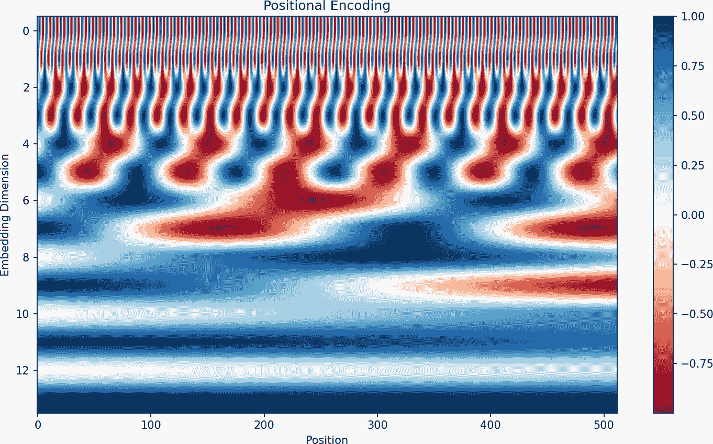

*图 9.3：位置编码热力图*

此热力图展示了序列位置（x轴，0-512）和嵌入维度（y轴，0-14）上的位置编码。红色和蓝色分别代表负值和正值。

图中值得注意的一点是，对于较低的嵌入维度，频率 \(\omega_i\) 较高，这表现为红蓝交替的高频变化。如果你回顾 \(\omega_i\) 的公式，就会发现嵌入维度与频率成反比。较高频率的嵌入有助于区分邻近位置，而较高嵌入维度上的慢振荡则捕捉更广泛的文本上下文。从图像中沿所有嵌入维度取一条垂直切片，相当于给定单词在上下文中的一个指纹。下面另一幅图展示了每个维度的正弦波和余弦波：

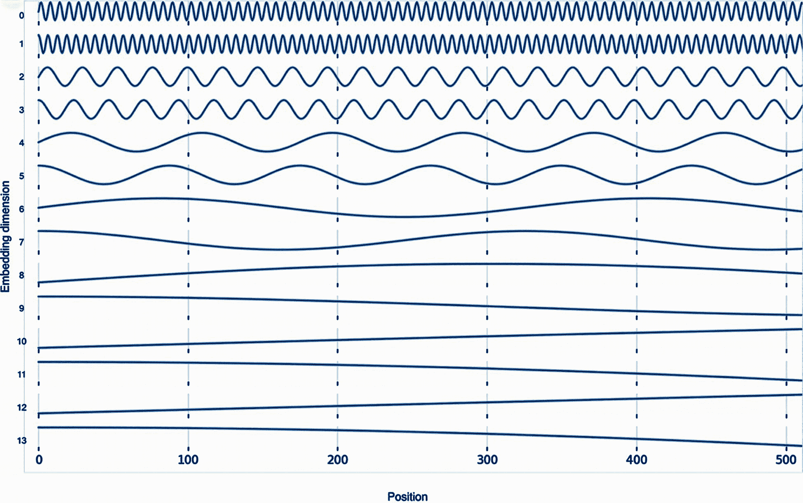

*图 9.4：正弦位置编码可视化*

正弦波和余弦波模式表示每个嵌入维度的位置编码方案。

尽管正弦位置嵌入具有若干优势，例如无需额外参数即可泛化到未见过的序列长度，但它们也带来了一些实际挑战。当添加到词元向量时，随着位置变化，它们会导致向量的模长和方向发生不可预测的偏移。这种混沌运动使得模型难以识别清晰模式，尤其是在标准 Transformer 所使用的高维空间（数百个维度）中。

这种不稳定性迫使模型记忆特定位置，而不是学习可泛化的模式。尽管模型拥有数十亿参数并在数万亿词元上训练，但本质上仍是对训练中遇到的确切位置过拟合。结果是：在处理比训练时更长的序列时，模型表现出不稳定行为和更高的困惑度，无法泛化到其记忆的位置空间之外。接下来，我们将研究 RoPE，一种解决这些挑战的替代方案。

### RoPE

现代大型语言模型大多已汇聚到 RoPE 上，它代表了位置编码的下一次演进。RoPE 不是将位置信息添加到输入嵌入中，而是通过基于位置旋转查询向量和键向量来直接修改注意力计算。该方法最早在 RoFormer 论文中讨论。

考虑一个基本情形：上下文向量是二维的。在复数空间中，它可以表示为一个复数。指数函数的性质与我们的旋转函数所需性质相似。为了定义这种旋转，我们可以乘以一个指数项，但这会带来一个问题：随着序列增长，模长会爆炸。因此，乘以单位复指数 \(e^{i\theta}\) 是理想的选择，因为它可以在将向量旋转角度 \(\theta\) 的同时保持模长不变。

RoPE 的核心思想是将旋转矩阵应用于注意力机制中的查询向量和键向量。对于位置 \(m\)，查询向量旋转角度 \(\theta_m\)；对于位置 \(n\)，键向量旋转角度 \(\theta_n\)。在二维子空间中，这种旋转通过标准旋转矩阵完成：

\[
R(\theta) = \begin{bmatrix} \cos(\theta) & -\sin(\theta) \\ \sin(\theta) & \cos(\theta) \end{bmatrix}
\]

在计算位置 m 和 n 之间的注意力分数时，旋转角度的选择使得最终的点积仅取决于相对距离 \(m-n\)。这是通过将 \(\theta_m\) 和 \(\theta_n\) 设置为各自位置的函数来实现的，通常使用类似于正弦编码的频率模式。接下来我们将展示其背后的数学运算。

#### 数学机制：奇偶维度配对

RoPE 通过将连续的嵌入维度配对来运作。对于一个 d 维嵌入向量，维度被分组为 (0,1), (2,3), (4,5), ..., (d-2, d-1)。每一对构成一个二维子空间，并经历旋转。

考虑位置 \(m\) 处的查询向量 \(q\)，其分量为 \([q_0, q_1, q_2, ..., q_{d-1}]\)。RoPE 通过对每个维度对应用旋转矩阵来变换该向量：

对于第一对（维度 0 和 1）：

\[
\begin{bmatrix} q_0' \\ q_1' \end{bmatrix} = \begin{bmatrix} \cos(m\theta_0) & -\sin(m\theta_0) \\ \sin(m\theta_0) & \cos(m\theta_0) \end{bmatrix} \begin{bmatrix} q_0 \\ q_1 \end{bmatrix}
\]

对于第二对（维度 2 和 3）：

\[
\begin{bmatrix} q_2' \\ q_3' \end{bmatrix} = \begin{bmatrix} \cos(m\theta_1) & -\sin(m\theta_1) \\ \sin(m\theta_1) & \cos(m\theta_1) \end{bmatrix} \begin{bmatrix} q_2 \\ q_3 \end{bmatrix}
\]

每个维度对 \(i\) 的旋转角度为：\(\theta_i = 10000^{-2i/d}\)。这为不同的维度对创造了不同的旋转频率。较低的维度旋转较快（捕捉细粒度的位置差异），而较高的维度旋转较慢（编码粗粒度的位置模式）。

#### 为什么点积依赖于相对位置

当我们计算位置 m 处的查询与位置 n 处的键之间的注意力分数时，旋转相互作用产生了相对位置编码。

让我们通过一个具体的二维示例来逐步推导这是如何产生相对位置编码的。

假设我们有：

位置 \(m\) 处的查询向量：\(q = [q_0, q_1]\)

位置 \(n\) 处的键向量：\(k = [k_0, k_1]\)

旋转频率：\(\theta\)

**步骤 1**：将上述方程中所示的 RoPE 旋转变换应用于位置 m 处的查询向量，得到：

\[
q_0' = q_0 \cos(m\theta) - q_1 \sin(m\theta)
\]
\[
q_1' = q_0 \sin(m\theta) + q_1 \cos(m\theta)
\]

类似地，位置 \(n\) 处的旋转后键向量：

\[
k_0' = k_0 \cos(n\theta) - k_1 \sin(n\theta)
\]
\[
k_1' = k_0 \sin(n\theta) + k_1 \cos(n\theta)
\]

**步骤 2**：计算点积

注意力分数是点积 \(q' \cdot k'\)：

\[
q' \cdot k' = q_0' k_0' + q_1' k_1'
\]

\[
= [q_0 \cos(m\theta) - q_1 \sin(m\theta)] [k_0 \cos(n\theta) - k_1 \sin(n\theta)] + [q_0 \sin(m\theta) + q_1 \cos(m\theta)] [k_0 \sin(n\theta) + k_1 \cos(n\theta)]
\]

**步骤 3**：使用三角恒等式展开并化简

展开所有项并应用以下恒等式后：

\[
\cos(A)\cos(B) + \sin(A)\sin(B) = \cos(A-B)
\]
\[
\sin(A)\cos(B) - \cos(A)\sin(B) = \sin(A-B)
\]

结果化简为：

\[
q' \cdot k' = [q_0 k_0 + q_1 k_1] \cdot \cos((m-n)\theta) + [q_0 k_1 - q_1 k_0] \cdot \sin((m-n)\theta)
\]

我们可以看到，点积仅取决于相对距离 \((m-n)\)，而不是单独的绝对位置 m 或 n。

这表明模型学习的是根据词元之间的“距离有多远”来进行注意力，而不是“它们在哪里”，并且这自然泛化到训练中未见过的序列长度。因此，继续此前的例子，位置 (5, 8) 和 (105, 108) 会产生相同的注意力模式（两者的相对距离都是 3）。

我们也可以将其推广到更高维度。对于 d 维嵌入，该过程以不同的频率 \(\theta_i\) 对每个维度对重复进行。最终的点积变为 d/2 项之和，每一项在不同频率尺度上编码相对位置。这种多尺度编码使得模型能够同时捕捉局部上下文（高频）和全局结构（低频）。我们在 `https://github.com/PacktPublishing/Deep-Learning-with-C-/blob/main/chapter9/rope.cpp` 分享了 RoPE 嵌入的实现。我们鼓励读者查看这些示例来学习具体实现。

与早期方法相比，RoPE 具有几个显著的优点：

- **自然的相对位置编码**：注意力权重天然反映相对位置，无需模型学习这一关系。
- **长期衰减保证**：数学公式确保相距较远的词元变得不那么相似，为语言建模提供了有用的归纳偏置。
- **与注意力集成**：通过将位置信息直接嵌入注意力机制而非输入层，RoPE 更高效地利用了模型的容量。
- **无额外参数**：与学习式嵌入不同，RoPE 不需要额外参数。

许多当代大型语言模型，包括 LLaMA 系列和近期基于 GPT 的架构，都因这些优势而采用 RoPE 作为其位置编码方法。接下来，


## 第 9 章

我们将简要介绍几种其他的位置编码方法。我们建议读者阅读本章末尾 *进一步阅读* 部分列出的相应研究论文。

### 其他现代方法

虽然 RoPE 已成为主流，但其他现代方法因其创新设计也值得一提：

- **相对位置偏置（T5）**：该方法学习偏置项，并将其添加到注意力机制的 softmax 运算内部。相对距离 (m-n) 被分桶，模型为每个桶学习嵌入。注意力计算变为：

`Attention(Q,K,V) = softmax(QK^T / sqrt(d_k) + bias) V`

- **ALiBi（带线性偏置的注意力）**：该方法使用基于相对距离的确定性公式，在 softmax 内部添加与 (m-n) 成比例的线性偏置。与其他方法不同，ALiBi 无需位置编码的可学习参数，并且对较长序列表现出很强的外推能力。

### 实现注意事项

在使用 LibTorch 用 C++ 实现位置编码时，需要考虑几个实际问题：

- 位置嵌入的维度必须与词元嵌入（`d_model`）的维度一致，才能进行逐元素相加。
- 像 RoPE 这样的现代方法是在注意力层而非输入处注入位置信息，因此需要修改注意力计算。
- 所有方法的基本目标保持一致：让序列中距离较近的词元比距离较远的词元更相似，从而为模型提供语言理解所需的序列结构。

位置编码从简单的可学习嵌入，到正弦函数，再到旋转嵌入的演进，反映了该领域逐步朝着更好捕捉序列数据本质、同时提高泛化能力和计算效率的方法发展。

到目前为止，我们已经研究了 Transformer 网络的各个组成部分，例如单头注意力、多头注意力和位置编码。在下一节中，我们将讨论这些元素如何组合在一起，构建出完整的 Transformer 实现。

### 完整的 Transformer 实现

下面给出原始论文中的完整架构。左侧部分称为编码器，神经网络右半部分称为解码器。

```text
Encoder:
  Inputs
  Input Embedding
  Positional Encoding
  Nx:
    Multi-Head Attention
    Add & Norm
    Feed Forward
    Add & Norm

Decoder:
  Outputs (shifted right)
  Output Embedding
  Positional Encoding
  Nx:
    Masked Multi-Head Attention
    Add & Norm
    Multi-Head Attention
    Add & Norm
    Feed Forward
    Add & Norm
  Linear
  Softmax
  Output Probabilities
```

*图 9.5：基于编码器-解码器的 Transformer 架构*

如图所示，编码器和解码器共享相似的构建模块：嵌入层、位置编码和多头注意力。掩码多头注意力组件是解码器独有的，将在下面的解码器部分中解释。

理解 Transformer 架构需要从序列到序列（Seq-2-Seq）模型的视角来看待它。正如 Seq-2-Seq 模型将潜在表示从编码器传递给解码器以进行生成一样，Transformer 也会将编码器输出发送到解码器的多头注意力模块，但有一个关键修改：只有来自编码器的键值对馈入解码器，而查询来自解码器本身。

Transformer 提供了灵活的训练配置。传统上，仅编码器模型用于语言理解任务，而仅解码器模型用于文本生成。机器翻译等应用使用完整的编码器-解码器模型。下面我们结合代码示例系统地分析这一架构。

#### 编码器堆栈实现

编码器由 N 个相同的层按顺序堆叠而成（在原始实现中通常 N=6），其中每一层包含两个主要子组件：多头自注意力层和逐位置前馈网络。在本节中，我们将跟踪输入文本如何在编码器堆栈中流动，从嵌入生成和位置编码开始；这些内容将在后续小节中介绍。

**处理流程**

在进入编码器堆栈之前，输入会经历我们先前提到的变换：分词将文本转换为数值表示，词元嵌入将每个词元映射到一个可学习的 D 维向量（例如 D=512 或 768），位置编码使用 *位置编码* 一节中介绍的正弦函数注入位置信息。

```cpp
auto pe = positional_encoding(seq_len, d_model).unsqueeze(1);
x = x + pe; // Adds sinusoidal positional encoding
```

每个编码器层都会应用我们在本章中构建的注意力和前馈操作。

**自注意力**

通过多头注意力机制，每个词元都会关注输入序列中的所有位置。正是在这里，模型根据上下文来消除歧义，例如区分作名词的“book”和作动词的“book”。

```cpp
auto attn_out = std::get<0>(attn->forward(x, x, x)); // Multi-head self-attention
x = norm1->forward(x + attn_out); // Residual connection + Layer Norm
```

现在，我们将应用下一组操作。

**加和归一化**

在多头注意力层之后，有两个关键操作。残差连接将原始输入加到注意力输出上，形成一条残差流，有利于反向传播时梯度的流动，并防止深层网络中梯度消失。层归一化随后在单个词元的特征维度上操作，独立计算每个词元的均值和方差统计量。

**前馈网络**

逐位置前馈网络应用两次线性变换，中间使用 ReLU 激活函数。中间层的维度通常（2048）高于输入/输出维度（512），使网络能够学习复杂的变换。上一步的归一化层（**加和归一化（Add & Normalize）**）的输出被送入该前馈网络，如下所示：

```cpp
auto ff_out = fc2->forward(torch::relu(fc1->forward(x))); // Two linear layers with ReLU
return norm2->forward(x + ff_out); // Residual connection + Layer Norm
```

前馈网络之后还有另一个残差连接和层归一化，从而完成一个编码器块。

**堆叠各层**

完整的编码器由多个相同层按顺序堆叠而成：

```cpp
for (auto& layer : *layers)
    x = layer->as<EncoderBlock>()->forward(x); // 6 encoder blocks
```

`as<EncoderBlock>()` 用于类型转换。它将泛型层指针转换为具体的 `EncoderBlock` 类型。`layers` 容器将模块存储为通用类型（`torch::nn::Module`），以便灵活处理。要调用 `EncoderBlock` 特定的 forward 方法，我们必须显式地将其转换为该类型。

#### 解码器堆栈实现

解码器是 Transformer 神经网络中位于编码器之后的下一个模块。编码器-解码器架构共同执行序列到序列操作，例如机器翻译。编码器产生富含上下文的表示，解码器利用这些表示逐个词元地构建输出序列。在本节中，我们将像编码器堆栈实现那样跟踪输入序列的流动。

**处理流程**

解码器首先接收目标序列，也就是要被翻译*成*的句子。该输入以一个特殊起始标记开始，表示生成的开始，随后是目标句子的实际单词、一个结束标记，以及用于保持固定输入大小的填充标记。每个句子都表示为一个张量，其维度为：批大小 × 最大序列长度 × 嵌入维度（512）。

然后应用**位置编码**来保持词序。每个单词的 512 维嵌入被转换为三个不同的向量：查询、键和值。

与使用标准自注意力块的编码器不同，解码器采用掩码自注意力。与编码器类似，解码器使用具有八个并行注意力头的多头注意力。它与编码器的不同之处在于增加了一个掩码功能。该掩码功能本质上是一个应用于注意力矩阵的三角掩码。三角矩阵的上半部分包含负无穷。这可以防止解码器在训练期间通过关注未来单词来“作弊”。当我们应用 softmax 函数时，这些负无穷值会变成 0，从而有效地将其屏蔽。这确保每个单词只能关注自身及其前面的单词，从而模拟推理时生成的自回归特性。该掩码被定义为下三角矩阵：

```cpp
auto tgt_mask = torch::triu(torch::ones({tgt_len, tgt_len}) * -1e9, 1);
```

在缩放（以稳定训练）并应用 softmax 之后，我们将注意力矩阵与值向量相乘，生成上下文相关的表示。来自全部八个注意力头的输出被重新拼接在一起，得到维度为“批大小 × 最大序列长度 × 512”的张量。

**掩码注意力**

*这里不再是单词，而是注意力权重。*

注意力矩阵 + 掩码矩阵 = 结果矩阵

**注意力矩阵**

|       | 这个 | 蛋糕 | 是 | 酸的 |
|-------|------|------|-----|------|
| 这个 | 注意力权重 | 注意力权重 | 注意力权重 | 注意力权重 |
| 蛋糕 | 注意力权重 | 注意力权重 | 注意力权重 | 注意力权重 |
| 是   | 注意力权重 | 注意力权重 | 注意力权重 | 注意力权重 |
| 酸的 | 注意力权重 | 注意力权重 | 注意力权重 | 注意力权重 |

**掩码矩阵**

|       | 这个 | 蛋糕 | 是 | 酸的 |
|-------|------|------|-----|------|
| 这个 | 0 | -inf | -inf | -inf |
| 蛋糕 | 0 | 0 | -inf | -inf |
| 是   | 0 | 0 | 0 | -inf |
| 酸的 | 0 | 0 | 0 | 0 |

**结果矩阵**

|       | 这个 | 蛋糕 | 是 | 酸的 |
|-------|------|------|-----|------|
| 这个 | 注意力权重 | 0 | 0 | 0 |
| 蛋糕 | 注意力权重 | 注意力权重 | 0 | 0 |
| 是   | 注意力权重 | 注意力权重 | 注意力权重 | 0 |
| 酸的 | 注意力权重 | 注意力权重 | 注意力权重 | 注意力权重 |

*图 9.6：使用下三角矩阵创建掩码自注意力*


掩码多头注意力的输出会加到原始输入张量上。然后进行层归一化，即计算均值和标准差，并相应地对值进行缩放。解码器块还包含残差连接，以确保梯度流动和训练稳定性，从而支持更深的网络。

#### 多头交叉注意力

这是注意力机制领域中另一个我们此前尚未讨论过的新概念。它被称为交叉注意力。这是解码器的第二种注意力机制，它将解码器与编码器块连接起来。查询向量来自解码器（表示目标语言），而键向量和值向量来自编码器（表示源语言）。

该机制允许目标句子中的每个词关注源句子中的所有词，从而确定哪些源词与生成每个目标词最相关。与解码器中的自注意力不同，交叉注意力不使用掩码，因为在推理过程中，解码器始终可以访问完整的编码源句子。

该过程与自注意力类似：我们计算注意力分数，应用 softmax，乘以值向量，然后拼接所有 8 个头的输出。接下来是另一个残差连接和层归一化。

交叉注意力在 `decoder.cpp` 中定义为一个 `MultiheadAttention`，代码如下：

```cpp
cross_attn = register_module("cross_attn", torch::nn::MultiheadAttention(
    torch::nn::MultiheadAttentionOptions(d_model, nhead)));
```

`register_module("cross_attn", ...)` 将该组件注册到 PyTorch 的模块系统中，以便对其进行跟踪、保存和训练。`torch::nn::MultiheadAttention` 与之前一样创建多头注意力层，`d_model` 是嵌入维度数，`nhead` 是头的数量。前向函数调用如下：

```cpp
auto cross_attn_out = std::get<0>(cross_attn->forward(x, enc_out, enc_out));
```

`cross_attn->forward(x, enc_out, enc_out)` 使用三个输入调用交叉注意力层：`x`（来自解码器的查询向量）、`enc_out`（来自编码器的键向量）和 `enc_out`（来自编码器的值向量）。与之前一样，`std::get<0>(...)` 从返回的元组中提取第一个元素。PyTorch 的 `MultiheadAttention` 返回一个包含 `attention_output` 和 `attention_weights` 的元组。对于交叉注意力，我们只需要 `attention_output`，因为它包含流经网络的变换后的表示。`attention_weights` 则指示哪些位置获得了更多关注。它们有助于可视化模型正在关注的内容，从而在研究或可解释性方面解释模型的决策。

#### 前馈网络与层堆叠

在注意力机制之后，每个词的表示都会经过一个前馈神经网络。这为模型提供了额外的能力，以学习数据中复杂的模式和关系。

```cpp
x = norm2->forward(x + cross_attn_out); // Cross-attention + Add & Norm
auto ff_out = fc2->forward(torch::relu(fc1->forward(x)));
return norm3->forward(x + ff_out); // FFN + Add & Norm
```

下面是一个完整的解码器块：

```cpp
// Masked self-attention + cross-attention + FFN decoder block
DecoderBlock::DecoderBlock(int d_model, int nhead, int d_ff) {
    self_attn = register_module("self_attn",
        torch::nn::MultiheadAttention(torch::nn::MultiheadAttentionOptions(d_model, nhead)));
    cross_attn = register_module("cross_attn",
        torch::nn::MultiheadAttention(
            torch::nn::MultiheadAttentionOptions(d_model, nhead)));
    norm1 = register_module("norm1", torch::nn::LayerNorm(d_model));
    norm2 = register_module("norm2", torch::nn::LayerNorm(d_model));
    norm3 = register_module("norm3", torch::nn::LayerNorm(d_model));
    fc1 = register_module("fc1", torch::nn::Linear(d_model, d_ff));
    fc2 = register_module("fc2", torch::nn::Linear(d_ff, d_model));
}
```

前向函数定义如下：

```cpp
torch::Tensor DecoderBlock::forward(torch::Tensor x, torch::Tensor enc_out, torch::Tensor mask) {
    auto self_attn_out = std::get<0>(self_attn->forward(x, x, x,
        torch::Tensor(), torch::Tensor(), mask));
    x = norm1->forward(x + self_attn_out); // Masked self-attention + Add & Norm
    auto cross_attn_out = std::get<0>(cross_attn->forward(x, enc_out, enc_out));
    x = norm2->forward(x + cross_attn_out); // Cross-attention + Add & Norm
    auto ff_out = fc2->forward(torch::relu(fc1->forward(x)));
    return norm3->forward(x + ff_out); // FFN + Add & Norm
}
```

解码器由多个解码器层组成。这些层定义如下：

```cpp
Decoder::Decoder(int num_layers, int d_model, int nhead, int d_ff) {
    layers = register_module("layers", torch::nn::ModuleList());
    for (int i = 0; i < num_layers; ++i)
        layers->push_back(std::make_shared<DecoderBlock>(d_model, nhead, d_ff));
}
```

`Decoder` 构造函数构建了一个由多个解码器块组成的堆栈。与之前一样，`register_module` 创建了一个空容器来容纳多个模块。该模块被命名为 `"layers"`。在 for 循环中，每次迭代都会使用 `std::make_shared` 创建一个新的 `DecoderBlock`，以生成智能指针。智能指针会自动管理内存，当最后一个指向该对象的指针超出作用域时，对象会被自动删除。因此，无需手动管理内存。如果我们把解码器块定义为：

```cpp
DecoderBlock* block = new DecoderBlock(d_model, nhead, d_ff);
```

我们就必须记得删除这个块。`push_back` 会将单个 `DecoderBlock` 添加到 `layers` 列表的末尾。前向函数与编码器块中定义的类似。其定义如下：

```cpp
torch::Tensor Decoder::forward(torch::Tensor x, torch::Tensor enc_out, torch::Tensor mask) {
    for (auto& layer : *layers)
        x = layer->as<DecoderBlock>()->forward(x, enc_out, mask);
    return x;
}
```

流程如下图所示。需要理解的是，在整个前向传播过程中，`x` 会依次经过所有解码器层，而 `enc_out` 和 `mask` 始终保持不变。

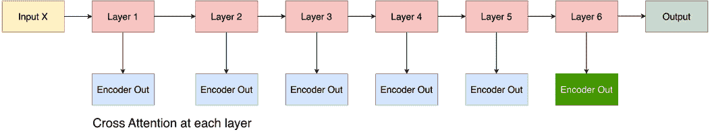

*图 9.7：输入数据（X）在每一层都会被处理。编码器的输出对所有层保持不变*

整个解码器层由掩码自注意力、交叉注意力、前馈网络以及它们相应的残差连接和归一化组成，会重复 *N* 次（通常为 6 次或更多）。这种堆叠方式使模型能够逐步细化对源语言和目标语言的理解。

### 整合所有部分

现在我们已经详细了解了编码器块和解码器块，在本节中，我们将查看完整的 Transformer 架构，并理解这两个块是如何连接起来的。`transformer.cpp` 代码给出了完整实现。Transformer 模块定义如下：

```cpp
struct Transformer : torch::nn::Module {
    Encoder encoder{nullptr}; // Processes source sequence
    Decoder decoder{nullptr}; // Generates target sequence
};
```

编码器与解码器之间的连接发生在前向函数中：

```cpp
torch::Tensor forward(torch::Tensor src, torch::Tensor tgt, torch::Tensor tgt_mask) {
    auto enc_out = encoder->forward(src); // Step 1: Encode source
    return decoder->forward(tgt, enc_out, tgt_mask); // Step 2: Decode with cross-attention
}
```

编码器输出（`enc_out`）会被传递给每个解码器层，交叉注意力使解码器能够关注源句子。交叉注意力的这一方面已在前面关于多头交叉注意力的部分中做了说明。


## C++ 中的 Transformer 与大语言模型微调

336

图 9.8：完整的 Transformer 架构

图 9.8 展示了数据从源输入经过编码器堆叠到解码器堆叠的流动过程，其中交叉注意力使解码器能够在每一层关注编码器的输出。

经过所有解码器层之后，最终的张量通过一个前馈层投影到目标语言的词表大小。这为序列中的每个位置生成了词表中所有可能单词的概率分布。

### 训练与推理

**在训练期间**，整个目标句子被同时送入解码器。模型并行预测每个位置的下一个单词，我们同时计算所有位置的损失（通常是交叉熵），忽略填充标记。这种并行处理与批处理相结合，使得即使模型很复杂，也能高效训练。

**在推理期间**，生成是自回归且顺序进行的。我们仅以起始标记开始，生成第一个单词，将其追加到输入中，并重复此过程。每个单词逐词生成，解码器只关注先前生成的单词。这一过程持续到生成结束标记或达到最大长度为止。

337

到目前为止，我们已经详细了解了 Transformer 架构，包括其编码器和解码器等组件。但我们还没有讨论该模型的训练相关的内容。正如我们将在接下来的章节中看到的，Transformer 模型可以通过多种方式进行训练。可以只训练编码器或解码器，也可以训练完整的 Transformer 模型。在与本章相关的代码中，你可以找到所有这些场景的示例训练代码。

在本章中，到目前为止，我们已经讨论了 Transformer 架构的构建块及其组件：注意力机制、编码器、解码器和训练策略。在前面的章节中，我们讨论了 LLM 常见的处理和评估机制。所有这些概念共同构成了基于 Transformer 的 LLM 的训练。在大多数情况下，以我们个人的能力，我们不会训练如此大的模型，但作为机器学习的学习者，理解这些概念如何相互作用是很重要的。大多数时候，我们会微调一个预训练的 LLM。预训练使我们能够在海量文本语料库上构建通用语言理解能力，创建能够捕捉丰富语言模式、语义关系和上下文细微差别的模型。然后，这些预训练模型可以通过微调适配到下游任务，大幅减少实现最先进性能所需的计算资源和标注数据。这种迁移学习方法使得强大的语言模型变得人人可及，并在从问答、情感分析到机器翻译和文本生成等众多应用中催生了突破性进展。因此，我们自然需要了解一些预训练语言模型，并理解它们的架构和用例。

### 预训练语言模型

预训练语言模型的演进是自然语言处理领域最重要的进展之一。BERT 和 GPT 架构都建立在 Vaswani 等人于 2017 年在开创性论文 *《注意力即一切》* 中提出的 Transformer 架构之上。我们将考察这两种架构，并指出它们之间的关键差异。

### BERT：双向上下文理解

**来自 Transformer 的双向编码器表示**（**BERT**）由 Google 于 2018 年发布，通过引入用于语言表示的双向预训练，标志着范式的转变。BERT 的编码器从每个单词的左右两侧读取整个单词序列。这种双向特性帮助 BERT 理解语言结构以及相距较远的单词之间的语义关系。这种架构使得 BERT 非常适合需要完整上下文的阅读理解任务，如问答、情感分析和命名实体识别。让我们来看看该模型的关键特性。

338

BERT 的关键特性：

- **架构**：仅使用 Transformer 的编码器组件，由 12 层（BERT-base）或 24 层（BERT-large）组成
- **嵌入大小**：BERT-base 为 768 维，BERT-large 为 1,024 维
- **训练目标**：BERT 模型的训练旨在实现以下目标：
  - 掩码语言建模（MLM）：随机掩码 15% 的标记，并利用双向上下文预测它们
  - 下一句预测（NSP）：预测两个句子是否按顺序连续出现
- **注意力机制**：无因果掩码的双向自注意力，允许每个标记关注序列中的所有其他标记

### GPT：自回归文本生成

**生成式预训练 Transformer**（**GPT**）由 OpenAI 于 2018 年推出，仅使用了 Transformer 架构的解码器组件以及掩码自注意力。该模型以自回归方式进行训练，预测序列中的下一个标记（单词）。（我们在上一章讨论 LLM 时已经讨论了自回归。）这种选择使得 GPT 非常适用于文本生成、创意写作、代码生成，以及（但不限于）少样本学习（用极少的示例适应新任务）等任务。与 BERT 类似，让我们来看看该模型的重要特性。

GPT 的关键特性：

- **架构**：仅解码器架构，由堆叠的 Transformer 解码器层组成
- **训练目标**：因果语言建模——仅基于先前的标记预测下一个标记
- **注意力机制**：使用因果掩码防止标记关注未来位置，保持单向（从左到右）信息流
- **演进**：截至 2026 年（本书写作时），GPT 系列模型已变得越来越大、能力越来越强。从 2018 年拥有 117M 参数的 GPT-1，到 2019 年拥有 1.5B 参数的 GPT-2，2020 年拥有 175B 参数的 GPT-3，2023 年拥有约 1.8T 参数的 GPT-4，再到 2026 年的 GPT-5。

OpenAI 尚未公布 GPT-5 的官方参数数量。在模型参数数量的语境中，M、B、T 分别代表百万（Million）、十亿（Billion）和万亿（Trillion）。

339

### BERT 与 GPT 的架构差异

BERT 和 GPT 的根本区别在于它们的架构选择和训练范式：

- **BERT（仅编码器）**：
  - 双向处理整个序列
  - 擅长需要完整上下文的理解任务（分类、命名实体识别、问答）
  - 无法自回归生成文本
  - 使用双向掩码语言建模作为预训练目标
- **GPT（仅解码器）**：
  - 单向（从左到右）处理序列
  - 擅长生成任务（文本补全、对话、创意写作）
  - 使用因果注意力掩码以保持自回归特性
  - 以下一个标记预测为目标进行训练

### 模型并行化

正如你在上一节中看到的 GPT 那样，模型规模持续增长，并且随着模型每次迭代变得更强，这一趋势预计将持续下去。GPU 的内存大小也随着时间推移而增加，但模型的长远增长早已超过了 GPU 内存的增长。如今，使用多 GPU 训练模型几乎已成为标准做法，无论是在单个节点（计算机）上，还是使用多节点设置（网络内连接的多台计算机）。你不仅可以容纳更大的模型，还可以更快地训练模型。这里我们将讨论两种不同的、流行的多 GPU 训练设置策略。我们将结合理论概念，看看相应的 C++ 实现。

#### DDP

随着 Transformer 模型的增长和训练数据集的扩大，单 GPU 训练变得不切实际。DDP 训练通过跨多个 GPU 或机器并行化训练过程来解决这一挑战，在保持模型精度的同时显著减少训练时间。数据并行是分布式训练的两种主要方法之一（另一种是模型并行）。在数据并行中，模型完全适合单个 GPU，但训练数据被分割到多个 GPU 上。每个 GPU 维护模型的完整副本，并并行处理不同的数据批次。在反向传播期间同步梯度，所有 GPU 以相同方式更新其模型参数。


##### 理解 DDP 实现：代码详解

本节详细讲解了使用 LibTorch 的完整 C++ DDP 实现（`https://github.com/PacktPublishing/Deep-Learning-with-C-/blob/main/chapter9/ddp_training.cpp`），逐步拆解各个组件，并解释它们如何协同工作以实现分布式训练。该代码展示了 DDP 训练的三大关键组件。让我们逐一详细分析每个组件。

##### DistributedSampler

`DistributedSampler` 负责将数据集划分到多个进程中，确保每个 GPU 处理不同的数据且互不重叠。

```
// Calculate samples per rank (pad if necessary)
num_samples_per_rank = (num_samples + world_size - 1) / world_size;
```

这种计算采用向上取整除法，以确保均匀分配。例如，有 100 个样本和 3 个 GPU 时：
- num_samples_per_rank = (100 + 3 - 1) / 3 = 102 / 3 = 34
- 每个 GPU 获得 34 个样本（总共 102 个，其中 2 个样本是重复的）

如果不进行填充，最后一个 GPU 可能会获得较少的样本，从而在 all-reduce 操作期间引发同步问题。所有 GPU 在每个 epoch 中必须执行相同数量的训练步骤。

##### 基于 Epoch 的数据打乱

epoch 编号会被添加到随机种子中（`seed + epoch`）。这样做是为了确保可复现性、一致性和多样性。使用这种公式，同一个 epoch 总是产生相同的打乱结果，且所有 GPU 使用相同的打乱顺序。所有 GPU 使用相同的打乱顺序（`seed + epoch`）。不同的 epoch 会产生不同的打乱结果。

```
void set_epoch(int epoch) {
    // Create full index list
    std::vector<size_t> all_indices(num_samples);
    std::iota(all_indices.begin(), all_indices.end(), 0);
    // Shuffle using epoch as seed
    if (shuffle) {
        std::mt19937 gen(seed + epoch);
        std::shuffle(all_indices.begin(), all_indices.end(), gen);
    }
}
```

##### DDPTrainer 类

`DDPTrainer` 封装了所有分布式训练逻辑，负责管理通信与同步。进程组初始化如下：

```
// FileStore: Shared file-based key-value store
auto store = std::make_shared<c10d::FileStore>(master_addr, world_size);
// Create NCCL process group
process_group = std::make_shared<c10d::ProcessGroupNCCL>(
    store, rank, world_size, options);
```

这里提到的 `FileStore` 是一个所有进程都可以读写的共享文件。它用于初始协调（交换 IP 地址、端口）。每个进程写入自己的信息，并读取其他进程的信息。初始化完成后，实际的数据传输使用 **NVIDIA 集合通信库**（**NCCL**）。该库针对 GPU 到 GPU 的通信进行了优化。它在可用时使用 NVLink，并实现了诸如 broadcast 和 all-reduce 之类的高效集合操作。

##### 参数广播

模型的权重通常在 GPU 0 上初始化，然后广播到所有 GPU。如果没有广播这一步，每个 GPU 将拥有不同的初始权重。而经过广播之后，所有 GPU 都以相同的参数开始训练。下面我们将逐步查看这个函数的实现。

```
void broadcast_parameters() {
    std::vector<torch::Tensor> params;
    for (const auto& param : model->parameters()) {
        params.push_back(param.data());
    }
    for (auto& param : params) {
        std::vector<torch::Tensor> tensor_list = {param};
        c10d::BroadcastOptions opts;
        opts.rootRank = 0; // Rank 0 is source
        process_group->broadcast(tensor_list, opts)->wait();
    }
}
```

第一个 `for` 循环收集模型的所有参数（权重和偏置），并将它们放入一个列表中。第二个 `for` 循环将参数包装成 broadcast 函数所需的列表格式。`rootRank = 0` 表示 GPU 0。它调用 `broadcast()` 函数将该参数发送给其余的 GPU。broadcast 方法默认是异步的，而 `-> wait()` 确保所有其他 GPU 在训练开始前都收到各自的参数。

现在让我们来看 all-reduce 操作，它是分布式训练中的另一种通信模式，与 broadcast 操作正好相反。

##### 梯度 All-Reduce

每个 GPU 在其本地数据批次上计算出梯度后，`all_reduce` 函数会从所有 GPU 收集这些梯度，将它们累加求和，再将平均后的结果分发回每个 GPU。下面我们来看 all-reduce 操作：

```
void all_reduce_gradients() {
    std::vector<torch::Tensor> gradients;
    for (const auto& param : model->parameters()) {
        if (param.grad().defined()) {
            gradients.push_back(param.grad());
        }
    }
 
    for (auto& grad : gradients) {
        std::vector<torch::Tensor> tensor_list = {grad};
        c10d::AllreduceOptions opts;
        opts.reduceOp = c10d::ReduceOp::SUM;
        process_group->allreduce(tensor_list, opts)->wait();
        grad.div_(world_size); // Average the gradients
    }
}
```

第一个 `for` 循环遍历模型的所有参数，并收集它们的梯度（如果存在的话）。`if (param.grad().defined())` 这个检查很重要，因为某些参数可能被冻结（不参与训练），因而不会有梯度。

第二个 `for` 循环执行 reduce 操作。`allreduce` 方法在所有 GPU 上同时执行集合操作。和之前一样，`->wait()` 确保操作完成后再继续执行。`grad.div_(world_size)` 操作用 GPU 数量（`world_size`）去除总和，从而计算出平均值。对梯度取平均看起来似乎是显而易见的选择，但这个选择确实有其好处。首先也是最重要的一点是，梯度不随 GPU 数量的变化而改变。此外，学习率也不需要任何调整。在执行完 `all_reduce_gradients()` 之后，所有 GPU 都拥有相同的梯度和优化器状态。这保证了所有模型副本完全同步。

##### 分布式采样与训练循环

训练循环与一般深度学习训练循环类似，但有一个关键区别：在 DDP 中，送入训练循环的数据要经过一个**分布式采样器**。这个看似微小的补充，正是实现高效多 GPU 训练的关键。下面我们来看 C++ 中的训练循环实现。

```
for (int epoch = 0; epoch < num_epochs; ++epoch) {
    sampler.set_epoch(epoch); // Shuffle data for this epoch
    const auto& indices = sampler.get_indices();
    for (size_t idx : indices) {
        size_t data_idx = idx % train_data.size();
        train_step(train_data[data_idx], train_labels[data_idx], 
optimizer);
    }
}
```

`sampler` 会根据 `epoch` 编号触发一次新的确定性采样。`sampler.get_indices()` 方法返回一个数据索引列表，表示这个特定 GPU 应该处理的数据。`for` 循环遍历分配给该 GPU 的每个索引。`idx % train_data.size()` 确保索引在超过数据集大小时能够回绕，最后 `train_step(...)` 执行一次训练步骤。下面我们来看这个方法的实现，它是训练过程的核心。

```
void train_step(torch::Tensor input, torch::Tensor target,
 torch::optim::Optimizer& optimizer) {
// Step 1: Forward Pass - Compute predictions and loss
// Each GPU processes its own batch independently
    auto output = model->forward(input);
    auto loss = torch::nn::functional::cross_entropy(output, target);
// Step 2: Backward Pass - Compute gradients
// Clear previous gradients
    optimizer.zero_grad();
    // Backpropagate to compute gradients
    loss.backward();
    // Step 3: Gradient Synchronization - Average gradients across GPUs
    // This is the key DDP operation that keeps models synchronized
    all_reduce_gradients();
    // Step 4: Parameter Update - Apply averaged gradients
}
```

```cpp
// All GPUs now have identical gradients, so they update identically
// This keeps all model replicas in sync
optimizer.step();
}
```

过程中每一步的具体功能在代码行周围的注释中都有说明。

这份详细的讲解介绍了 DDP 实现的每个组成部分，重点说明了关键设计决策、常见陷阱和优化机会。我们在相关的 GitHub 仓库（https://github.com/PacktPublishing/Deep-Learning-with-C-/blob/main/chapter9/ddp_transformer.cpp）中分享了一个实用的 C++ 实现，展示了一个仅包含编码器的简单 transformer 模型。我们鼓励读者自行查看。

DDP 训练对于将 transformer 训练扩展到生产负载至关重要。通过利用高效的集合通信原语和精心实现，DDP 能够在合理的时间范围内，在海量数据集上训练大型语言模型。其关键原则是参数同步、梯度累积和容错。这些原则适用于各种框架，并且可以使用 LibTorch 在 C++ 中高效实现，以获得最佳性能。

随着模型规模不断增大，我们已经到了一个单模型无法放入单个 GPU 的地步。尽管 DDP 有助于提高模型训练速度，但它并不是最节省内存的实现。为了训练内存占用大于 GPU 内存的超大模型，我们应该研究一种称为全分片数据并行（Fully Sharded Data Parallel，FSDP）的新技术。我们接下来将学习这项技术。

### 全分片数据并行

FSDP 通过在所有可用 GPU 上**分片**（分区）模型参数、优化器状态和梯度，扩展了数据并行范式。与 DDP 中每个 GPU 都保留一份完整模型副本不同，FSDP 确保每个 GPU 仅存储这些组件的一小部分。

在深入探讨 FSDP 过程之前，了解几个原语非常重要。我们将首先理解这些原语，然后再来看 FSDP 的通信过程。

#### 理解 FSDP：代码讲解

对模型进行分片有几种方式。最直观的策略是在每个 GPU 上保留多个层块。这称为模型并行。可以想象，这是一种低效的模型分片方式，因为在前向传播过程中，训练批次会从一个 GPU 移动到下一个 GPU。当一个 GPU 正在处理一个批次时，其余 GPU 都在排队等待。为了避免 GPU 上的这种等待时间，人们引入了流水线并行。这使得多个微批次可以在模型的不同部分并发执行。

还有一个并行概念叫做**张量并行**。大多数深度学习都涉及矩阵乘法。简单来说，张量并行就是将矩阵进行划分，使得矩阵运算可以分布到多个 GPU 上。

在本节中，我们将先了解 FSDP 并行的几个关键原语，然后再看一个 C++ 实现。

在学习分布式数据并行时，我们了解了*广播（broadcast）*和*全规约（all-reduce）*操作。这里，我们需要理解两个新操作：*全收集（all-gather）*和*规约散射（reduce-scatter）*。

##### 全收集

与收集（gather）操作（将全部分片收集到单个 GPU 上）不同，全收集操作将完整模型广播到所有 GPU。因此，它是收集和广播操作的组合。在前向或反向传播之前，FSDP 必须通过收集所有 GPU 上的所有参数分片来重建完整模型。以下是全收集过程的 C++ 实现：

```cpp
void all_gather_parameters() {
    full_params.clear();
    for (const auto& shard : sharded_params) {
        // Prepare buffers to receive shards from all ranks
        std::vector<torch::Tensor> gathered_shards;
        for (int i = 0; i < world_size; ++i) {
            gathered_shards.push_back(torch::empty_like(shard));
        }
        // All-gather: Each rank sends its shard to all others
        std::vector<std::vector<torch::Tensor>> output_tensors = {gathered_shards};
        std::vector<torch::Tensor> input_tensors = {shard};

        c10d::AllgatherOptions opts;
        process_group->allgather(output_tensors, input_tensors, opts)->wait();

        // Concatenate all shards to form full parameter
        torch::Tensor full_param = torch::cat(gathered_shards);
        full_params.push_back(full_param);
    }

    // Update model with gathered parameters
    update_model_params(full_params);
}
```

在 `all_gather_parameter()` 操作期间，每个 GPU 会临时持有完整模型。这会导致临时的内存峰值。为了便于说明，这里我们使用了一个简单的神经网络。在现实场景中，如果模型太大而无法放入单个 GPU，你可能会耗尽 GPU 内存。在生产环境中，会使用一种称为逐层全收集（layer-wise all-gather）操作的变体技术。另一种方法是 CPU 卸载（CPU offloading），即分片的模型参数存储在 CPU 内存中，仅在计算需要时才将所需的分片传输到 GPU 内存。这里我们不讨论这些操作，但鼓励读者通过*进一步阅读*部分中的链接了解更多信息。

##### 规约散射

这是一种两步集合操作，结合了全规约和散射的元素。它本质上与全收集相反。FSDP 对三个组件进行分片：模型参数、梯度和优化器状态。现在，我们将以一个简单的神经网络为例，逐步说明完整的 FSDP 过程。该网络有 3 层，每层的节点数分别为 784、128 和 10。对于 DDP，我们不共享模型权重，每个 GPU 节点都拥有完整的模型副本。因此，我们没有讨论模型参数和模型的细节。分片过程包括 3 个步骤：

- **步骤 1**：展平所有参数

  ```text
  fc1: [784, 128] → 100,352 parameters
  fc2: [128, 128] → 16,384 parameters
  fc3: [128, 10] → 1,280 parameters

  // Flatten into single vector
  all_params = [p1, p2, p3, ..., p118016] // Total: 118,016 params
  ```

- **步骤 2**：计算分片大小

  ```text
  total_size = 118,016
  world_size = 4
  shard_size = (118,016 + 4 - 1) / 4 = 29,504 // Ceiling division
  ```

- **步骤 3**：分发分片

  ```text
  Rank 0: params[0:29504] // 29,504 parameters
  Rank 1: params[29504:59008] // 29,504 parameters
  Rank 2: params[59008:88512] // 29,504 parameters
  Rank 3: params[88512:118016] // 29,504 parameters
  ```

下面是一个用于实现模型参数分片的 C++ 函数：

```cpp
void shard_parameters() {
    // 1. Collect all parameters
    std::vector<torch::Tensor> all_params;
    for (const auto& param : model->parameters()) {
        all_params.push_back(param.data().flatten());
    }

    // Concatenate into single tensor
    torch::Tensor concat_params = torch::cat(all_params);
    int64_t total_size = concat_params.numel();

    // 2. Calculate this rank's shard boundaries
    int64_t shard_size = (total_size + world_size - 1) / world_size;
    int64_t start_idx = rank * shard_size;
    int64_t end_idx = std::min(start_idx + shard_size, total_size);

    // 3. Extract and store this rank's shard
    if (start_idx < total_size) {
        torch::Tensor shard = concat_params.slice(0, start_idx, end_idx).clone();
        sharded_params.push_back(shard);
    }
}
```

在反向传播之后，FSDP 会聚合所有 GPU 上的梯度并分发结果，使每个 GPU 只接收其参数分片对应的梯度。

##### FSDPTrainer 类

让我们通过一个具体示例来了解 FSDP 实现。完整的代码以及补充文档可在本章附带的 GitHub 仓库中找到。为了便于解释和说明，我们将为模型设定以下参数：

-   模型：1000 个参数
-   GPU：4（Rank 0、1、2、3）
-   数据集：100 个样本
-   训练轮数：3


在初始化过程中，四个终端命令会分别启动四个独立的训练进程。每个终端运行相同的程序 `fsdp_training`。第一个参数是 GPU 的秩（rank），第二个参数是 GPU 总数。

```bash
# Terminal 1
./fsdp_training 0 4
# Terminal 2
./fsdp_training 1 4
# Terminal 3
./fsdp_training 2 4
# Terminal 4
./fsdp_training 3 4
```

下一步是创建模型并将其移动到相应的 GPU 上：

```cpp
auto model = std::make_shared<SimpleNet>(784, 128, 10);
model->to(device); // Each rank moves to its GPU
```

让我们初始化 `FSDPTrainer` 类。与之前（在 DDP 中）一样，它通过 `FileStore` 建立进程组。

```cpp
FSDPTrainer trainer(model, rank, world_size, "/tmp/fsdp_store");
```

与 `DDPTrainer` 类似，NCCL 通信器建立 GPU 到 GPU 的通信，并调用 `broadcast_parameters()` 函数从秩 0 广播初始参数。与 DDP 不同，在 FSDP 中，模型通过 `shard_parameters()` 函数进行分片共享。

在建立这些基础组件之后，我们就可以着手训练模型了。这里我将描述一个典型的训练步骤。下面的 `train_step` 函数在 FSDP 设置中编排一次完整的训练迭代，协调多个 GPU 之间的协作，每个 GPU 仅持有模型的一部分（分片）。

```cpp
void train_step(torch::Tensor input, torch::Tensor target,
                torch::optim::Optimizer& optimizer) {
    // Step 1: All-Gather - Reconstruct full model from shards
    all_gather_parameters();
    // Step 2: Forward Pass - Compute loss with full model
    auto output = model->forward(input);
    auto loss = torch::nn::functional::cross_entropy(output, target);
    // Step 3: Backward Pass - Compute gradients
    optimizer.zero_grad();
    loss.backward();
    // Step 4: Reduce-Scatter
    reduce_scatter_gradients();
    // Step 5: Optimizer Update
    optimizer.step();
    // Step 6: Free full parameters to save memory
    full_params.clear();
}
```

正如你在代码块中看到的，接下来发生的事件序列如下：

- **全收集参数（All-Gather parameters）**：在开始任何计算之前，每个 GPU 都需要完整的模型。此操作收集所有 GPU 上的所有参数分片，并在每个设备上重建完整模型。这是必要的，因为前向传播需要访问所有模型权重。

    ```cpp
    all_gather_parameters();
    ```

- **前向传播（Forward Pass）**：现在完整模型已可用，每个 GPU 独立地将其分配到的数据批次输入模型进行处理并计算损失。每个 GPU 处理不同的数据（数据并行），但使用相同的完整模型。

    ```cpp
    auto output = model->forward(input);
    auto loss = torch::nn::functional::cross_entropy(output, target);
    ```

- **反向传播（Backward Pass）**：将优化器的梯度清零，然后反向传播计算所有参数的梯度。此时，每个 GPU 已根据其本地数据批次计算出梯度。

    ```cpp
    optimizer.zero_grad();
    loss.backward();
    ```

- **归约-散播梯度（Reduce-Scatter Gradients）**：如前所述，这是全收集的逆操作。所有 GPU 的梯度被加在一起（以聚合来自所有批次的学习），然后将结果分割并分发，使得每个 GPU 只接收到与其参数分片对应的梯度分片。这确保了每个 GPU 拥有其负责更新的参数的平均梯度。

    ```cpp
    reduce_scatter_gradients();
    ```

- **优化器更新（Optimizer Update）**：每个 GPU 仅使用其接收到的聚合梯度更新其参数分片。由于所有 GPU 在不同数据上计算梯度并对其求平均，因此产生的结果与在单个大批次上训练相同。

    ```cpp
    optimizer.step();
    ```

- **释放完整参数（Free Full Parameters）**：反向传播之后，在下一次前向传播之前不再需要完整的模型参数，因此将它们从内存中释放。每个 GPU 现在只存储其参数分片，从而大幅减少内存使用。这正是训练那些无法容纳在单个 GPU 上的模型成为可能的原因。

    ```cpp
    full_params.clear();
    ```

该循环在每个 epoch 中重复，直到训练完成。

本节介绍了 FSDP 并行训练策略的基本组成部分。我们的目标是让读者深入理解支撑分布式训练的并行化技术和通信流模式。有了这个基础，你就可以探索更高级的实现和优化。

这里展示的 FSDP 实现仅用于教学目的，不应部署到生产环境中。一个关键的限制是全收集操作期间出现的内存峰值。当完整模型大小超过单个 GPU 的内存容量时，此峰值将触发**内存不足（out-of-memory）**（**OOM**）错误，导致训练失败。

为了解决这一限制，生产系统采用了更精细的分片策略。随附的代码仓库中包含一个演示程序，该程序实现了逐层全收集操作与流水线并行相结合。这些技术逐层增量地重建模型，而不是一次性全部重建，从而显著降低峰值内存使用。我们强烈建议你研究该实现，以理解 FSDP 如何扩展到无法容纳在单个 GPU 上的模型。

为你的模型选择 DDP 还是 FSDP 取决于多种因素。总的来说，模型大小和基础设施决定了你的选择。下表将有助于指导你的决策过程。

| 因素 | 选择 DDP | 选择 FSDP |
| --- | --- | --- |
| 模型大小 | 适合单张 GPU | 不适合单张 GPU |
| 互连 | 任意 | 高带宽（NVLink/IB） |
| 优先级 | 速度 | 内存效率 |
| 扩展规模 | <8 张 GPU | >8 张 GPU |
| 模型类型 | 中小型 | 大型至超大型 |

*表 9.1：FSDP 与 DDP 决策矩阵*

虽然 DDP 和 FSDP 等分布式训练策略使我们能够在多个 GPU 上训练越来越大的模型，但由此产生的模型通常仍然过大且计算成本过高，无法实际部署。这在训练能力与实际应用需求之间造成了一个关键差距。模型压缩技术通过减小模型大小、内存占用和计算需求来弥合这一差距，同时保持准确性，从而使得在内存、带宽和能量有限的边缘设备、移动平台和资源受限环境中部署此类大型模型成为可能。

### 模型压缩技术

现代 Transformer 模型的卓越能力伴随着一个重大挑战：其巨大的规模。最先进的语言模型可能包含数十亿甚至数万亿参数，需要大量的计算资源和内存。虽然这种规模使其在复杂任务上表现出色，但也为实际部署造成了障碍——尤其是在边缘设备、移动平台或延迟和能耗至关重要的场景中。

试想一下当今从业者面临的约束：内存和电池寿命有限的智能手机、在本地处理数据的物联网设备，或管理着数百万次请求推理成本的云服务。在每种情况下，全尺寸模型都变得不切实际。模型压缩技术正是为了解决这一差距，使我们能够在资源受限的环境中部署此类大型模型，而不会牺牲准确性。

在本节中，我们将讨论三种常用的模型压缩技术。我们的目标是向你介绍相关概念，并提供一些示例代码展示如何构建这些技术。你可以在此基础上继续构建。让我们从知识蒸馏开始讨论。


#### 知识蒸馏

如今的大型语言模型不仅从原始文本中学习——它们还相互学习。Google 的 Gemma 3 由 Gemini 训练而成。Meta 较小的 Llama 4 模型（Maverick 和 Scout）则由更大的 Behemoth 训练而成。这一过程被称为知识蒸馏，尽管它引发了大量讨论，但这一概念经常被误解。

知识蒸馏是一种模型压缩技术，它将知识从大型的“教师”模型迁移到更小、更高效的“学生”模型。这一方法由 Geoffrey Hinton、Oriol Vinyals 和 Jeff Dean 在他们 2014 年的开创性论文 *蒸馏神经网络中的知识* 中率先提出，该论文发表于 NIPS 深度学习与表示学习研讨会。

在训练过程中，我们会采用资源密集型技术——集成方法、深层架构、海量数据集——来最大化学习效果。在部署过程中，我们需要能在资源受限设备上运行的高效模型。关键问题在于：我们能否从强大的模型中提取已学到的模式，并将其迁移到紧凑的替代模型中？

早期的模型压缩研究（Caruana，2006）表明这是可行的，但也存在局限性。当教师模型非常准确时，其输出近似于独热编码，从而丢失了类别之间有价值的关系信息。

教师模型的输出包含比单独硬标签更丰富的信息。以对一张“2”的图像进行分类为例：

- 类别 2：0.85
- 类别 3：0.10
- 类别 7：0.03
- 其他类别：~0.02

这表明“2”与“3”的相似程度高于“7”——这种关系信息被称为 *暗知识*，是独热标签无法捕捉的。标准的交叉熵损失只专注于最大化正确类别的概率，忽略了这些有价值的类别相似性。为了形式化这一概念，知识蒸馏使用了温度缩放，正如 *第 8 章* 中关于自回归生成部分所讨论的那样。与之前一样，较高的温度会揭示类别之间的相对相似性，否则这些相似性会隐藏在尖锐的分布中。

##### 训练过程：双重目标

知识蒸馏采用了一种精妙的双重目标训练方法，在向教师模型学习和从原始数据学习之间取得平衡。

**第 1 步：训练教师模型**

首先，针对你的任务训练一个庞大而笨重的模型（或模型集成），使其达到较高精度。该教师模型能够捕捉数据中复杂的模式和关系。

**第 2 步：生成软目标**

使用升高的温度 T 将训练数据输入教师模型，生成保留暗知识的软概率分布。

**第 3 步：使用组合损失训练学生模型**

学生模型同时从两个来源学习：

- **a. 软目标损失**：学生模型从教师模型的软预测中学习（两个模型都使用升高的温度 T）。这通常使用 KL 散度计算：

  `L_soft = KL_divergence(student_T || teacher_T)`

- **b. 硬目标损失**：学生模型还从真实标签中学习（使用 T = 1）。这是标准的交叉熵损失：

  `L_hard = CrossEntropy(student, ground_truth)`

最终的损失函数结合了两个目标：

`L_total = α * L_soft * T² + (1 - α) * L_hard`

其中：
α 是一个权重因子（通常为 0.5-0.9），用于平衡从教师模型和真实标签中学习；T² 缩放因子用于补偿温度缩放带来的量级缩减。

当在 softmax 中使用温度 T 时，梯度会按 1/T² 进行缩放。乘以 T² 可确保软目标损失相对于硬目标损失以适当的量级发挥作用。下图解释了这一训练过程：

```text
Transfer
Data Set
Layer 1
Layer 2
Layer n
......
Teacher Model (pre-trained)
Layer 1
Layer 2
Layer m
......
Student Model (to be trained)
Softmax
T=t
Knowledge
Softmax
T=t
Softmax
T=1
Soft
Targets
Ground
Truth Label
Student
Loss
Soft
Targets
Soft
Targets
Distillation
Loss
```

图 5 基准知识蒸馏的具体架构（Hinton 等人，2015）

*图 9.9：用于知识蒸馏的教师-学生模型。*

我们在 `https://github.com/PacktPublishing/Deep-Learning-with-C-/blob/main/chapter9/knowledge_distillation.cpp` 提供了上述代码的 C++ 示例实现。基于之前关于模型训练的讨论，你应该能够理解。不过，我们将在下面重点介绍学生模型的训练：

```cpp
for (int epoch = 0; epoch < 100; ++epoch) {
    student_opt.zero_grad();
    auto student_logits = student->forward(data);
    torch::Tensor teacher_logits;
    {
        torch::NoGradGuard no_grad;
        teacher_logits = teacher->forward(data);
    }
    auto loss = distillation_loss(student_logits, teacher_logits,
                                  labels, temperature, alpha);
    loss.backward();
    student_opt.step();
    if (epoch % 20 == 0)
        std::cout << " Epoch " << epoch << ", Loss: " << loss.item<float>() << std::endl;
}
```

该训练循环通过迭代 100 个 epoch 来实现知识蒸馏，在此过程中，学生模型同时从教师模型的指导和真实标签中学习。每次迭代都会清除梯度、生成两个模型的预测（教师模型处于无梯度模式以防止权重更新）、计算结合了来自教师模型的软目标和来自真实标签的硬标签的组合蒸馏损失，然后反向传播以仅更新学生模型的权重。每 20 个 epoch 记录一次进度以监控收敛情况，损失值反映了学生模型在模仿教师模型精细的类别关系以及正确分类方面的学习效果。

知识蒸馏的另一种变体是 *基于特征的蒸馏*。在这种变体中，学生模型学习的不是教师模型的输出，而是其特征。实际上，学生模型试图匹配教师模型的中间特征。蒸馏过程本身可以是离线的（使用预训练模型作为教师来教导学生）、在线的（教师和学生同时训练）或自蒸馏（模型向自己学习）。我们鼓励读者参阅 *延伸阅读* 部分，以获取有关该主题的补充阅读材料。

我们知道，知识蒸馏帮助我们从较大的模型训练出较小的模型，同时保持相似的精度指标。这些较小的模型也适合在边缘设备（或 GPU 较小的设备）上部署。然而，这种性能提升并非没有局限性。具体来说，训练过程对温度和超参数非常敏感。额外增加的复杂度可能会导致知识蒸馏的效果不佳。训练过程和计算成本可能会抵消在生产环境中部署稍大模型的便利性。因此，知识蒸馏是否是一个可行的选项，需要根据具体情况进行评估。

#### 剪枝

在大规模数据集上训练的神经网络通常包含大量冗余。一个在 ImageNet 的 1,000 个类别上训练、用于区分犬种的模型，不需要区分公交车与小轿车的特征也能正确识别出比格犬。这一观察催生了 **剪枝**：系统地移除不必要的参数，以创建更小、更快且精度损失不大的模型。

考虑一个权重矩阵为 W^(m×n) 的简单全连接层。m×n 个参数中的每一个都对层的输出有所贡献，但它们的贡献差异巨大。有些权重在重要特征上持续产生较大的激活值，而另一些权重在各种输入下都接近为零。剪枝就是要识别并移除这些低影响的参数。在思考剪枝时，你应该考虑以下三个问题：

1. 剪什么？
2. 何时剪？
3. 如何决定要剪什么？

要回答第一个问题，主要有两种剪枝范式：非结构化剪枝和结构化剪枝。**非结构化剪枝**通过将单个权重设为零来消除它们，从而产生稀疏的权重矩阵。**结构化剪枝**则移除整个架构组件：卷积层中的滤波器、Transformer 中的注意力头或完整的神经元。


## 第9章：C++中的Transformer与大语言模型微调

关于剪枝，下一个关键问题是**何时**进行剪枝。可以在训练之前、训练期间或训练之后进行。像**单次网络剪枝**（**SNIP**）和**梯度信号保留**（**GraSP**）等方法会在任何训练开始之前，识别随机初始化网络中的重要连接。这些技术通过分析梯度流或连接敏感性来决定保留哪些参数。训练期间剪枝通过在训练过程中定期移除低幅值权重，同时在有潜力的位置添加新连接，从而使网络在整个训练过程中保持稀疏性。训练后剪枝作用于完全训练好的稠密网络，在微调以恢复精度之前，识别并移除最不重要的组件。由于这种传统方法可靠性高且实证表现优异，因此在实际应用中占据主导地位。我们鼓励读者阅读Frankle和Carbin在2019年发表的论文*彩票假说*（`https://arxiv.org/abs/1803.03635`）。该论文为以下观点提供了理论依据：稠密网络包含稀疏的“中奖彩票”子网络，当从适当的初始化开始训练时，这些子网络能够达到与完整网络相当的精度。

上述所有方法在剪枝过程中都涉及某种形式的训练。然而，还有一种训练后剪枝的变体，它不需要重新训练。其基本概念借鉴了线性代数。这类方法的例子包括**SparseGPT**和**Wanda**。SparseGPT利用逐层重构目标：对于每一层\(l\)，最小化：

\[
\| W_l X - \hat{W}_l X \|^2
\]

其中\(W_l\)是原始权重矩阵，\(\hat{W}_l\)是剪枝后的版本，\(X\)表示校准激活。Wanda使用一种更简单的评分启发式方法来对权重进行排序。它通过权重与激活幅值的乘积来定义权重的重要性。然后，它会将重要性较低的权重置为零。

最后，这引导我们回答第三个也最具技术性的问题：如何决定剪掉什么。到目前为止，你可能已经猜到了一些方法。

- 基于幅值的剪枝
- 基于梯度的重要性剪枝
- 激活感知剪枝

顾名思义，基于幅值的剪枝是最简单的方法，即移除绝对值最小的权重。在基于梯度的剪枝中，我们近似估计剪掉每个权重所带来的损失变化。我们使用泰勒级数展开来近似移除权重时的损失变化。以下是移除权重时损失变化的一阶和二阶近似：

\[
\Delta L \approx \left| \frac{\partial L}{\partial w} \cdot w \right| \quad \text{(一阶)}
\]

\[
\Delta L \approx \frac{1}{2} \left| \frac{\partial^2 L}{\partial w^2} \cdot w^2 \right| \quad \text{(二阶)}
\]

我们在随附的GitHub仓库（`https://github.com/PacktPublishing/Deep-Learning-with-C-/blob/main/chapter9`）中提供了这些方法的C++实现，对应文件为`magnitude_pruning.cpp`、`gradient_pruning.cpp`和`wanda_pruning.cpp`。基于你目前对C++的掌握程度，你应该能够结合内联文档理解这些代码。

到目前为止，我们看到的都是非结构化剪枝，即通过将权重设为零来移除它们。我们看到了几种用于确定哪些权重应被置零、何时置零以及为何应剪掉某些权重的判据。接下来，我们将研究Transformer中的一些结构化剪枝方法。完整的Transformer剪枝方法可在GitHub（`https://github.com/PacktPublishing/Deep-Learning-with-C-/blob/main/chapter9/transformer_pruning_pipeline.cpp`）中获取。该代码实现了一种三层次结构化剪枝策略，与Transformer的架构层次相对应：

**流水线概览**

- **层级别剪枝（最粗粒度）：** 根据Transformer块对模型输出的影响，识别并移除整个Transformer块。
- **头级别剪枝（中等粒度）：** 在剩余层中，移除冗余的注意力头。
- **神经元级别剪枝（最细粒度）：** 在剩余的前馈网络块中，移除单个中间神经元。

这种层级顺序至关重要：移除一个层会同时消除其所有的头和神经元，因此层级别剪枝必须先于更细粒度的方法进行。这种级联方法通过结构化稀疏性实现了大幅压缩（60-80%的稀疏度），同时保持了计算效率。组合后的流水线展示了这一序列：

```cpp
// Step 1: Remove 1 entire layer
LayerPruner::prune_least_important_layer(*combined, data, combined_pruned);

// Step 2: Remove 4/8 heads in remaining layers
AttentionHeadPruner::prune_heads(*combined->layers->ptr<TransformerBlock>(l), 4);

// Step 3: Remove 50% FFN neurons in remaining layers
FFNPruner::prune_neurons(*combined->layers->ptr<TransformerBlock>(l), 0.5f);
```

该代码包含说明文档，你应该能够理解。我们还将讨论一种称为**迭代剪枝**的剪枝方法。该方法采用渐进式剪枝，并辅以中间微调。和之前一样，完整代码可在`https://github.com/PacktPublishing/Deep-Learning-with-C-/blob/main/chapter9/iterative_pruning.cpp`获取。

这段代码演示了一个完整的**迭代剪枝流水线**，它通过微调在逐步压缩神经网络的同时恢复精度。该实现遵循了一种结构化方法，与模型压缩中使用的生产级剪枝工作流相对应。

代码定义了一个简单的三层前馈网络（`SimpleNet`），使用ReLU激活函数，作为演示剪枝效果的基线模型。该网络通过一个64节点的隐藏层处理20维输入，以生成5类预测。它实现了以下步骤：

- **渐进式稀疏度计划**（30% → 50% → 70% → 90%）：每次迭代都会提高稀疏度，使模型能够逐步适应。
- **剪枝 → 评估 → 微调循环**：在剪枝到每个目标稀疏度后，对模型进行评估以衡量精度的即时下降，然后以较小的学习率（1e-4）微调20个周期以恢复性能。
- **微调期间的梯度掩蔽**：每次优化器步骤后关键的`reapply_masks()`调用可确保被剪枝的连接保持失活——如果没有这一步，优化器会复活被置零的权重。

主函数首先训练一个稠密基线模型50个周期，确立精度目标。然后，迭代流水线系统地压缩模型，同时在每个稀疏度级别跟踪三个指标：剪枝后的即时精度（显示下降）、微调后的精度（显示恢复），以及“恢复”指标（恢复的百分点）。

这种方法在压缩比与精度保持之间取得平衡，说明神经网络包含大量冗余——代码显示，即使在90%稀疏度（移除90%的参数）下，通过精心剪枝和微调也能保持合理的性能。

在本节中，我们研究了各种基于剪枝的模型压缩技术，以及结构化剪枝和非结构化剪枝的子类型。我们还分享了一些用于Transformer剪枝和迭代剪枝策略的示例实现。

接下来，我们将研究另一种流行的模型压缩方法——量化。该技术基于模型权重的数值精度实现模型压缩，并且已成为每一位数据科学家工具包中的重要工具。

#### 量化

量化通过将高精度浮点数（通常为32位）转换为低精度整数（通常为8位），减少了表示模型参数所需的比特数。这种转换利用了神经网络在数值表示上的冗余性，许多应用能够容忍精度降低而不会出现显著的性能下降。

其根本动机源于两个关键观察：在大多数硬件架构上，整数运算的执行速度明显快于浮点运算；降低数值精度可直接转化为更小的内存占用和更低的带宽需求。从32位浮点数转换为8位整数可实现4×的压缩比，将28 GB的模型缩减至约7 GB。

在本节中，我们将探讨量化技术的主要类别，并理解量化范围的概念以及范围选择策略。之后，我们将研究量化训练及其C++实现。让我们从两种量化技术开始：

**非对称量化**

非对称量化将浮点范围\([β, α]\)映射到完整的整数范围，对于8位无符号整数，通常为\([0, 255]\)。该变换使用两个参数：缩放因子（\(S\)）和零点（\(Z\)），定义如下：

\[
S = \frac{\alpha - \beta}{2^n - 1}
\]

\[
Z = \operatorname{round}\left(-\frac{\beta}{S}\right)
\]

量化公式：

\[
\text{quantized\_value} = \operatorname{clamp}\left[\operatorname{round}\left(\frac{\text{float\_value}}{S}\right) + Z,\; 0,\; 255\right]
\]

*clamp*（钳位）函数通过将值“夹取”在最小值（0）和最大值（255）之间，来限制其不超过指定范围。反量化将上述操作反转，以恢复上述`float_value(s)`：

\[
\text{float\_value} = S \times (\text{quantized\_value} - Z)
\]

这种方法通过充分利用整个量化范围（无论原始值是否以零为中心），能够有效处理非对称分布的数据。接下来，我们将研究另一种称为对称量化的方法。


##### 对称量化

对称量化假设输入范围围绕零对称，将 [-α, α] 映射到 [-127, 127]（8 位有符号整数）。这通过消除零点参数简化了量化过程。缩放系数计算公式：

S = α / (2^(n-1) - 1)

###### 量化公式

quantized_value = clamp(round(float_value / S), -127, 127)

其主要优势在于计算效率，因为缺少零点参数减少了推理过程中的算术运算。然而，对于不对称分布的数据，它可能会引入更高的量化误差。这些量化方法的 C++ 实现可在 `https://github.com/PacktPublishing/Deep-Learning-with-C-/blob/main/chapter9/basic_quantization_functions.cpp` 获取。

在量化过程中，你可能会思考为什么我们分别选择 (0, 255) 和 (-127, 127) 作为非对称与对称量化的范围。接下来，我们将探讨不同的范围选择策略，这对量化质量有着重要影响。

##### 范围选择策略

范围参数（α 和 β）的选择显著影响量化质量：

- **最小值-最大值策略**将 α 设为张量中的最大值，β 设为最小值。虽然简单直接，但该方法对异常值高度敏感。单个极端值可能迫使量化范围过宽，从而导致大多数值的量化误差较高。
- **百分位策略**使用百分位值（例如第 99.99 百分位）而非绝对极值来缓解异常值敏感性。这牺牲了异常值的精度，但显著降低了大部分数据分布的量化误差。
- **均方误差（MSE）策略**搜索能够最小化原始值与反量化值之间 MSE 的 α 和 β 值。通常通过网格搜索实现，它为范围选择提供了原则性框架，但需要额外的计算开销。
- **交叉熵策略**与具有 softmax 输出的语言模型尤为相关，它保留值的相对分布而非绝对幅度。这确保量化后最大值依然是最大值，从而维持模型输出的概率解释。

最后，我们将介绍何时应用量化的一些方法，包括训练后或训练过程中。

##### 训练后量化（PTQ）

训练后量化在无需修改训练过程的情况下，对已完全训练好的模型应用量化。具体流程为：获取一个预训练的浮点模型，在小型校准数据集（未标注数据即可）上运行推理，使用观察器收集每一层的统计信息，基于收集的统计信息计算缩放系数和零点参数，然后将模型转换为其量化表示形式。

动态量化是 PTQ 的一种变体，它在推理过程中即时量化激活值，而非预先计算量化参数。当激活分布在不同输入之间差异显著时，这种方法尤为有用。

##### 量化感知训练（QAT）

量化感知训练将量化模拟集成到训练过程中。该方法在训练期间在各层之间插入“伪量化”操作（先量化紧接着反量化）。这些操作在前向传播中模拟量化误差，同时允许梯度在反向传播中流动。

QAT 引导优化过程朝着损失景观中更宽的极小值方向发展。训练后量化可能使模型陷入狭窄的极小值，此时量化引起的小扰动会导致损失大幅增加。QAT 则鼓励模型找到更宽的极小值，使得量化引起的权重偏移对性能的影响最小化。

必须指出的是，通过量化操作的反向传播需要特殊处理，因为量化函数（舍入和截断）是不可微的。

我们想说明的是，我们仅触及了模型量化的皮毛，整个领域非常广阔，我们在本章末尾提供了一些进一步阅读的资源。

现在让我们聚焦于神经网络量化技术的实现。我们将首先在一个简单神经网络的背景下研究非对称和对称量化，然后实现 QAT。

##### 神经网络量化的 C++ 实现

对于计算 Y = W × X + B 的典型线性层，量化过程如下：训练后一次性量化权重（W）并以量化格式存储，类似地量化偏置（B），推理过程中使用校准参数动态量化输入（X），利用硬件优化的整数算术执行整数矩阵乘法，将输出（Y）反量化回浮点形式以传递给下一层，并透明地传递至后续层。

现代 GPU 和专用加速器包含针对 8 位整数运算优化的乘累加模块。这些单元对量化矩阵中的 8 位整数进行乘法运算，并将结果累加在 32 位寄存器中以防止溢出，从而能够在矩阵元素间实现大规模并行化。想象一下将许多小数字相加，最终总和会大到无法放入小容器中。当两个 8 位数字相乘时，结果可能达到 16 位。如果持续累加这些乘积（矩阵乘法中会发生成千上万次），很快就会超过 16 位。32 位累加寄存器就像一个“更大的桶”，能够容纳不断增长的总和而不丢失信息。由于这些运算简单且统一（全部为 8 位整数运算），GPU 可以在矩阵的不同元素上同时执行数千次此类运算。一个低层 CUDA 代码可在 `https://github.com/PacktPublishing/Deep-Learning-with-C-/blob/main/chapter9/int8_matmul_accumulate.cu` 获取。

##### Transformer 的逐通道量化

逐通道量化为层中的每个输出通道或滤波器计算独立的量化参数（缩放系数和零点），而非对整个张量使用单一参数集。在神经网络中，不同通道往往学习到幅度范围差异巨大的特征。例如，在卷积层或 Transformer 的线性层中：

- 通道 1 的权重范围可能在 [-0.5, 0.5]
- 通道 2 的权重范围可能在 [-5.0, 5.0]

如果使用逐张量量化（整个权重矩阵使用一个缩放系数），就需要容纳最宽的范围（[-5.0, 5.0]）。这会浪费通道 1 的量化精度，因为其较小的值被压缩到更少的量化级别，从而增加误差。让我们看一个 C++ 中逐通道量化的实现。

```cpp
void calibrate_linear_layer(const torch::Tensor& weight) {
    int64_t num_channels = weight.size(0);
    scales.resize(num_channels);
    zero_points.resize(num_channels);
    for (int64_t i = 0; i < num_channels; ++i) {
        auto channel = weight[i];
        float min_val = channel.min().item<float>();
        float max_val = channel.max().item<float>();
        scales[i] = (max_val - min_val) / 255.0f;
        if (scales[i] == 0.0f) scales[i] = 1.0f; // avoid division by zero
        zero_points[i] = static_cast<int>(-std::round(min_val / scales[i]));
    }
}
```

`calibrate_linear_layer` 函数（`https://github.com/PacktPublishing/Deep-Learning-with-C-/blob/main/chapter9/per_channel_quanitzation_transformer.cpp`）为权重矩阵中的每个输出通道（行）计算独立的量化参数。它从权重张量的第一维提取通道数，然后遍历每个通道，找出其最小值和最大值。对于每个通道，它通过将数值范围除以 255（8 位量化范围）来计算缩放因子，并计算零点偏移，以将最小值映射到量化空间中的零。该函数包含一个安全检查，当通道内所有权重相同时将缩放因子设为 1.0，以防止除零。

尽管该方法需要稍多的存储和计算，但精度上的提升远超这些微小缺点。这些方法在 Transformer 的注意力头和前馈网络层中得到了有效应用。

接下来，我们将研究 Transformer 的训练后量化，以及如何利用它加速推理。

##### C++ 中的训练后量化实现

PTQ 是另一种模型压缩方法，可在无需重新训练的情况下减少内存占用并加速推理。我们鼓励读者阅读完整的训练后实现（`https://github.com/PacktPublishing/Deep-Learning-with-C-/blob/main/chapter9/post_training_quantization_transformer.cpp`）。这里，我们重点介绍 `calibrate` 和 `quantize_model` 两个函数。首先，让我们看看 `calibrate` 函数，以理解逐层量化是如何工作的：

```cpp
void calibrate(std::shared_ptr<Transformer> model,
               const torch::Tensor& calibration_data) {
    torch::NoGradGuard no_grad;
```


```cpp
// Run a forward pass so batch-norm / layer-norm stats are
// populated
model->forward(calibration_data);

for (const auto& named_param : model->named_parameters()) {
    if (named_param.value().dim() == 2) {
        AsymmetricQuantizer quantizer;
        quantizer.calibrate(named_param.value());
        layer_quantizers[named_param.key()] = quantizer;
    }
}
```

`calibrate`函数通过分析Transformer层中的权重分布来建立量化参数，无需重新训练。使用校准数据的前向传播会填充归一化层的统计信息（批归一化/层归一化的运行平均值），确保这些层在量化前具有真实值。然后，该函数遍历模型参数，筛选出表示线性层权重的二维张量，同时排除偏置和归一化参数。对于每个权重矩阵，`AsymmetricQuantizer`计算最小-最大范围以确定最优的缩放因子和零点值，并将这些值存储在以层名作为键的映射（`layer_quantizers`）中，供模型转换为压缩表示时在量化阶段检索使用。

`quantize_model`函数应用校准后的量化参数，对Transformer模型进行原地压缩。

```cpp
void quantize_model(std::shared_ptr<Transformer> model) {
    torch::NoGradGuard no_grad;
    for (auto& named_param : model->named_parameters()) {
        auto it = layer_quantizers.find(named_param.key());
        if (it != layer_quantizers.end()) {
            auto& quantizer = it->second;
            auto quantized = quantizer.quantize(named_param.value());
            named_param.value().data().copy_(quantizer.dequantize(quantized));
        }
    }
}
```

该函数遍历所有模型参数，并尝试使用`layer_quantizers.find(named_param.key())`在校准期间创建的映射中找到对应的量化器。只有经过校准的参数（二维权重矩阵）会被处理，而没有校准量化器的参数（偏置、归一化参数）保持不变。

顾名思义，PTQ是在模型训练完成后实施的。不过，了解量化对训练的影响并看看能否进一步改进将是很有意义的。

接下来，我们将探讨QAT在C++中的实现。

##### QAT在C++中的实现

QAT在我们之前讨论的基础上，在训练过程中实现量化。如上文所有章节所述，请参阅相关GitHub仓库（`https://github.com/PacktPublishing/Deep-Learning-with-C-/blob/main/chapter9/qat_transformers.cpp`）中的完整实现。该流程在训练期间使用`fake_quantization`来让模型学会处理精度损失：

```cpp
torch::Tensor fake_quantize(const torch::Tensor& input, float scale, int zero_point) {
    // Quantize: map float to integer grid
    auto quantized = torch::clamp(
        torch::round(input / scale) + zero_point, 0, 255
    );
    // Dequantize: map back to float (now restricted to quantization levels)
    return scale * (quantized - zero_point);
}
```

`fake_quantize`函数实现了一种量化模拟，它在保持浮点精度的同时，将值限制为8位整数空间可表示的值。该函数实现了非对称量化-反量化公式。结果是得到一个浮点张量，其值仅限定为通过8位量化所能达到的值。它也被用于PTQ，以保持与现有FP32推理管道的兼容性，从而测试模型在量化精度损失下的表现。

接下来，QAT实现遵循`train_with_qat`函数中常规的训练循环。该函数在每次训练迭代中编排并模拟量化效果。对于每个批次，函数先将原始的全精度权重保存为主副本，然后根据当前值范围为每个二维权重张量校准量化参数（缩放因子和零点）。接着对所有权重应用伪量化，使前向传播在保持与标准浮点运算兼容的同时经历量化噪声。以下是训练循环中为每个层应用伪量化的代码片段：

```cpp
{
    torch::NoGradGuard no_grad;
    for (const auto& name : linear_names) {
        auto& w = params[name];
        auto [scale, zp] = calibrate(w.data());
        w.data().copy_(fake_quantize(w.data(), scale, zp));
    }
}
```

在计算损失并反向传播梯度之后，函数在优化器更新之前恢复原始的FP32主权重。这个循环确保优化器始终更新全精度权重，同时模型学习对量化约束的鲁棒性，最终在训练完成后应用真正的训练后量化时实现最小精度损失。

至此，我们关于模型压缩量化技术的讨论就结束了。量化是一种强大且实用的模型压缩方法，能够在精度影响极小的情况下大幅减少内存占用和计算需求。训练后量化与量化感知训练之间的选择取决于具体的应用需求：PTQ提供简单性和速度，而QAT以重新训练为代价提供更优的精度保持。通过仔细选择量化类型、范围选择策略和粒度级别，您可以根据特定的部署约束定制量化方案，同时保持模型性能。还可以级联和组合不同的压缩技术，以在保持精度的同时实现更高的压缩比。

最优选择取决于部署约束：可用内存、延迟要求、目标硬件能力以及可接受的精度权衡。现代部署场景通常受益于组合多种技术，以在保持模型质量的同时实现激进压缩。

### 总结

本章带领你全面深入地探索了Transformer架构及其对现代人工智能的深远影响。我们首先考察了循环神经网络的根本局限性——其顺序处理瓶颈以及处理长距离依赖的困难——这些局限性促使了注意力机制的发展。自注意力机制作为一种优雅的解决方案应运而生，使模型能够通过并行计算直接捕捉序列中所有位置之间的关系。

我们探索了缩放点积注意力的数学基础，理解了查询、键和值如何协同工作以创建上下文感知的表示。多头注意力扩展了这一概念，使模型能够同时捕捉多样化的语言模式——从句法结构到语义关系。位置编码解决了将序列信息融入与位置无关的注意力机制这一关键挑战，而RoPE等现代方法则提供了对更长序列更优异的泛化能力。

在这些组件的基础上，我们使用LibTorch在C++中实现了完整的编码器和解码器架构。编码器通过堆叠的自注意力和前馈网络层处理输入序列，而解码器则使用掩码自注意力和交叉注意力机制自回归地生成输出序列。这些实现展示了残差连接和层归一化如何使深层网络的训练成为可能，同时保持梯度流动。

随后，本章考察了预训练语言模型，将BERT的双向编码器架构——针对理解任务优化——与GPT的自回归解码器设计——擅长文本生成——进行对比。这种区别凸显了架构选择如何与特定应用需求保持一致，从问答和分类到创意写作和对话。

随着模型规模扩展到数十亿参数，分布式训练变得至关重要。我们探讨了DDP训练，它跨GPU复制模型并并行处理数据，以及FSDP，它对模型参数、梯度和优化器状态进行分片，从而能够训练超出单GPU内存容量的模型。理解all-gather、reduce-scatter和all-reduce等通信原语对于实现高效的分布式训练流程被证明至关重要。


最后，我们通过压缩技术解决了部署大模型的实际挑战。知识蒸馏将大型教师模型学到的表示迁移到高效的学生模型中。剪枝在保持准确率的同时移除冗余连接。量化降低数值精度以减少内存占用并加速推理。低秩近似利用矩阵冗余来压缩权重矩阵。结合这些技术，可以在资源受限的设备上部署强大的模型。

本章涵盖的原理与实现，为你提供了构建、训练、优化和部署基于 Transformer 的模型所需的理论理解与实践技能。随着该领域持续发展——高效注意力机制、混合专家架构和多模态学习等创新不断涌现——这里探讨的基础概念对于理解并推动下一代 AI 系统仍将至关重要。

到目前为止，本书已经学习了针对不同用例（图像和文本）训练模型的方法。我们还了解了可应用于这些数据类型的预处理方式，并探索了包括 Transformer 在内的多种常用网络架构。在下一章中，我们将从训练模型转向在生产环境中提供服务。你将学习如何在 C++ 中导出、部署、优化和运行深度学习模型，以满足速度、可扩展性和可靠性方面的实际需求。

### 延伸阅读

如果你希望加深理解，以下资源提供了清晰的解释和有用的背景信息：

- 1. **Transformer 解释器**：Transformer 架构的交互式可视化 `https://poloclub.github.io/transformer-explainer/`。
- 2. **图解 Transformer**：理解 Transformer 的视觉指南 `https://jalammar.github.io/illustrated-transformer/`。
- 3. **可视化神经机器翻译**：注意力机制可视化 `http://jalammar.github.io/visualizing-neural-machine-translation-mechanics-of-seq2seq-models-with-attention/`。
- 4. **详解 Transformer**：来自哈佛 NLP 的逐行实现指南 `https://nlp.seas.harvard.edu/annotated-transformer/`。
- 5. **Vaswani et al. (2017)**：*注意力即一切*：原始 Transformer 论文 `https://arxiv.org/abs/1706.03762`。
- 6. **Su et al. (2021)**：*RoFormer：通过旋转位置嵌入增强的 Transformer*：RoPE 位置编码 `https://arxiv.org/abs/2104.09864`。
- 7. **Devlin et al. (2018)**：*BERT：深度双向 Transformer 的预训练* `https://arxiv.org/abs/1810.04805`。
- 8. **Radford et al. (2018)**：*通过生成式预训练改进语言理解*：GPT 原始论文 `https://cdn.openai.com/research-covers/language-unsupervised/language_understanding_paper.pdf`。
- 9. **Hinton et al. (2014)**：*蒸馏神经网络中的知识*：蒸馏基础论文 `https://arxiv.org/abs/1503.02531`。
- 10. **Frankle & Carbin (2019)**：*彩票假说*：寻找稀疏子网络 `https://arxiv.org/abs/1803.03635`。
- 11. **Frantar & Alistarh (2023)**：*SparseGPT：大规模语言模型可以一次性精确剪枝* `https://arxiv.org/abs/2301.00774`。
- 12. **Sun et al. (2023)**：*一种简单有效的大语言模型剪枝方法*：Wanda 剪枝方法 `https://arxiv.org/abs/2306.11695`。
- 13. **Jacob et al. (2018)**：*仅整数运算高效推理的神经网络量化与训练* `https://arxiv.org/abs/1712.05877`。
- 14. **Dettmers et al. (2022)**：*LLM.int8()：大规模 Transformer 的 8 位矩阵乘法* `https://arxiv.org/abs/2208.07339`。
- 15. **NVIDIA Megatron 文档**：CPU 卸载与内存优化 `https://docs.nvidia.com/nemo/megatron-bridge/0.2.0/training/cpu-offloading.html`。
- 16. **Rajbhandari et al. (2020)**：*ZeRO：面向训练万亿参数模型的内存优化*：FSDP 基础 `https://arxiv.org/abs/1910.02054`。
- 17. **Li et al. (2021)**：*PyTorch 分布式：加速数据并行训练的经验* `https://arxiv.org/abs/2006.15704`。
- 18. **Transformer 神经网络播放列表**：关于 Transformer 的全面视频系列 `https://www.youtube.com/playlist?list=PL4bm2lr9UVG0HvePBXvsceO4yuLC8HhUh`。
- 19. **Press et al. (2021)**：*短训练，长测试：带线性偏置的注意力实现输入长度外推*：ALiBi 位置编码 `https://arxiv.org/abs/2108.12409`。
- 20. **Raffel et al. (2020)**：*探索统一文本到文本 Transformer 迁移学习的极限*：T5 与相对位置偏置 `https://arxiv.org/abs/1910.10683`。
- 21. **Tay et al. (2020)**：*高效 Transformer：综述*：效率技术的全面综述 `https://arxiv.org/abs/2009.06732`。
- 22. **Dao et al. (2022)**：*FlashAttention：具有 IO 感知的快速且内存高效的精确注意力* `https://arxiv.org/abs/2205.14135`。
- 23. **Hugging Face Transformers 文档**：实用实现指南 `https://huggingface.co/docs/transformers/`。
- 24. **PyTorch Transformer 教程**：PyTorch 官方指南 `https://pytorch.org/tutorials/beginner/transformer_tutorial.html`。
- 25. **LibTorch C++ 文档**：C++ API 参考 `https://pytorch.org/cppdocs/`。
- 26. **Papers with Code - Transformers**：最新研究与基准 `https://paperswithcode.com/methods/category/transformers`。
- 27. **本章代码**：`https://github.com/PacktPublishing/Deep-Learning-with-C-/blob/main/chapter9`。

### 获取本书 PDF 版本及更多内容

扫描二维码（或访问 `packtpub.com/unlock`）。按名称搜索本书，确认版本，然后按照页面上的步骤操作。


*注意：请保管好您的发票。直接从 Packt 购买的订单无需发票。*

# 第三部分：在生产环境中部署、监控和解释深度学习系统

在本书的最后一部分，你将专注于 C++ 中深度学习的运维层面。我们将介绍如何导出和部署模型以进行推理，针对生产性能优化模型，调试故障，随着数据变化重新训练模型，并长期监控质量与系统健康。你还将学习如何通过可解释性技术让模型行为更加透明，这些技术在关键领域尤为重要。完成本部分后，你将能够在生产环境中运行具有更强性能、可靠性和可解释性的深度学习系统。

本书的这一部分包括以下章节：

- *第 10 章*，*部署和优化推理模型*
- *第 11 章*，*调试和重新训练已部署的模型*
- *第 12 章*，*监控已部署的模型*
- *第 13 章*，*深度学习模型中的可解释性与透明度*

## 10. 部署和优化推理模型

你训练了一个在离线状态下表现出色的模型。现在困难的部分来了：将其交付上线——并在使用量增长时保持其快速、可靠且经济高效。本章讨论*真实世界中的推理*：将检查点转换成一个可预测的 C++ 服务，满足严格的延迟/吞吐量**服务水平目标**（**SLOs**），能够干净地扩展，并长期保持健康。

这里的“推理”是指运行训练好的模型来产生预测；“服务”则是将该计算暴露在 API 或流之后，同时管理版本、扩展和可观测性。我们将介绍你可能会遇到的常见模式：**在线/实时**（低延迟请求）、**流式**（例如，LLM 的 token 输出）、**批量**（吞吐优先的任务）和**边缘/端侧**（隐私/延迟）。在生产中重要的是 SLO：**延迟**（p50/p95/p99；首字节/首 token 时间）、**吞吐量**（QPS/每秒 token 数）、**可用性**、**每请求成本**和**质量**（准确性/安全性）。要达到这些目标，需要消除端到端的瓶颈——预处理/后处理、模型计算、CPU↔GPU 传输、框架/内核开销、网络/序列化、冷启动以及排队/批处理。

在本章中，你将学习如何将训练好的模型转变为 C++ 中可用于生产的推理系统。我们首先将模型导出为便于部署的格式，如 TorchScript 和 ONNX，验证数值一致性，并在 C++ 运行时中加载产物。接下来，我们将探讨如何将模型部署到真实环境中——云、本地基础设施或边缘设备——同时介绍打包策略、微批处理和并发控制。


接着，我们重点讨论性能和成本优化技术，包括量化、剪枝、蒸馏，以及对精度、布局和线程数的运行时调优。之后，我们使用C++结合HTTP或gRPC构建实时服务端点，支持流式响应、批处理和背压机制，以维持低尾部延迟。最后，我们涵盖运维实践，例如指标、日志和追踪的埋点与采集，数据漂移检测，通过金丝雀发布和回滚执行安全部署，以及维护再训练闭环以保持模型长期准确性。

请牢记这个心智模型：**定义SLO** | **导出与验证** | **优化** | **服务** | **观测** | **迭代**。服务是模型与真实世界交汇的环节；我们将使其快速、可靠且可度量。

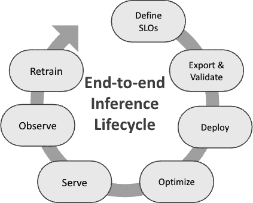

一个典型的生产工作流从定义SLO开始，经历导出已训练模型、验证数值一致性、部署产物、优化运行时性能、通过API提供预测服务，并随着数据和需求演变持续观测与再训练系统。

在本章中，我们将讨论以下主题：

- 为C++推理导出模型
- 生成TorchScript产物（从C++）
- 一致性：产物是否与原生计算图匹配
- 将模型部署到真实目标环境
- 为速度和成本优化模型
- 实时提供模型服务
- 运维并演进生产系统

学完本章，你将能够将训练好的模型导出为TorchScript和ONNX格式，并使用HTTP或gRPC构建满足具体SLO的C++推理服务。你还将学习如何通过量化、剪枝和蒸馏等技术降低延迟和成本，以及如何使用指标、日志、追踪、金丝雀发布和漂移监控来维护系统健康。我们将从锁定导出格式和一致性测试开始，接着进行打包和部署，应用模型/运行时优化，构建实时服务器，最后讨论云、本地和边缘环境下的监控与持续更新。

### 为C++推理导出模型

训练产物（检查点文件、优化器状态）非常适合研究循环，但生产环境需要一种稳定、自包含的模型表示。在C++中，我们关注两种这样的表示：

- **TorchScript** (`.ts`)：一个序列化的PyTorch模块，可以直接使用**LibTorch**加载。它完整保留了PyTorch语义，是纯C++技术栈最直接的路径。
- **ONNX** (`.onnx`)：一种由**ONNX Runtime**（以及TensorRT、OpenVINO等加速器）消费的交换格式。当你需要跨运行时和硬件的可移植性时，它是理想选择。

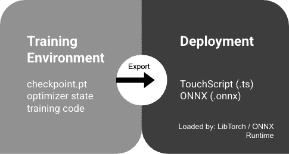

训练检查点包含优化器状态和研究元数据，而生产系统需要诸如TorchScript或ONNX等稳定产物，这些产物可以被C++运行时直接加载。

在本节中，我们将使用PyTorch C++前端定义一个微型模型，从C++导出TorchScript（不涉及Python），在C++中加载并运行该产物，并可选择从C++使用ONNX以进行一致性和可移植性验证。在此过程中，我们将引入一个简洁的、纯C++的一致性检查，以便你确信导出的产物与原生前向传播匹配。

#### 在C++前端中定义一个紧凑模型

我们将使用一个小型**卷积神经网络**（**CNN**）作为贯穿示例。该架构刻意保持简单——两个卷积层后接全局平均池化和一个线性分类器——但它抓住了生产系统中真实推理图的典型结构。以下头文件使用LibTorch C++前端定义了该模型。

`c++ tinynet.h`：一个用LibTorch实现的微型CNN：

```cpp
#pragma once
#include <torch/torch.h>

// A tiny CNN: Conv-ReLU-Conv-ReLU -> GlobalAvgPool -> Linear
struct TinyNetImpl : torch::nn::Module {
    torch::nn::Conv2d c1{nullptr}, c2{nullptr};
    torch::nn::Linear fc{nullptr};
    TinyNetImpl(int in_ch=3, int num_classes=10)
        : c1(torch::nn::Conv2dOptions(in_ch, 8, 3).padding(1)),
          c2(torch::nn::Conv2dOptions(8, 16, 3).padding(1)),
          fc(16, num_classes) {
        register_module("c1", c1);
        register_module("c2", c2);
        register_module("fc", fc);
    }
    torch::Tensor forward(torch::Tensor x) {
        x = torch::relu(c1->forward(x));
        x = torch::relu(c2->forward(x));
        x = torch::adaptive_avg_pool2d(x, {1,1}); // [N,16,1,1]
        x = x.view({x.size(0), 16}); // [N,16]
        return fc->forward(x); // [N,C]
    }
};
TORCH_MODULE(TinyNet);
```

*图 10.3* 展示了我们使用上述代码实现的TinyNet架构。


TinyNet架构由两个卷积层后接全局平均池化和一个线性分类器组成。尽管简单，但该结构捕捉了推理系统中使用的**卷积神经网络**（**CNN**）的典型流程。

模型定义完成后，下一步是将其转换为一个可直接加载并在生产推理服务中执行的、可部署的产物。

#### 生成TorchScript产物（从C++）

导出是一次性操作，可在CI中运行。我们切换到`eval()`模式，创建一个示例输入，并**追踪**该模块以生成`tinynet.ts`。

`C++ trace_and_save_ts.cpp`：追踪并序列化：

```cpp
#include <torch/script.h>
#include <iostream>
#include <unordered_map>
#include "tinynet.h"

int main() {
    torch::NoGradGuard ng;
    TinyNet model(/*in_ch=*/3, /*num_classes=*/10);
    model->eval();
    // If you trained with LibTorch, you can restore weights here:
    // torch::load(model, "tinynet_state.pt");
    // Example input for tracing (matches your deployment contract)
    auto example = torch::randn({1,3,224,224});
    // Trace the module's "forward" from C++
    std::unordered_map<std::string, std::vector<torch::jit::IValue>> inputs;
    inputs["forward"] = {example};
    auto traced = torch::jit::trace_module(*model, inputs);
    traced.save("tinynet.ts");
    std::cout << "Saved TorchScript artifact: tinynet.ts\n";
    return 0;
}
```

**构建说明（仅一次）：** 链接LibTorch的头文件和库文件；对于GPU构建，请链接 `-ltorch_cuda -lc10_cuda`。确保编译器/标准库版本与你的LibTorch发行版保持一致。

产物生成后，下一步是验证它能在C++推理程序中被正确加载和执行。

`c++ infer_torchscript.cpp`：加载并推理：

```cpp
#include <torch/script.h>
#include <iostream>

int main() {
    torch::NoGradGuard ng;
    torch::jit::script::Module m = torch::jit::load("tinynet.ts");
    m.eval();
    auto x = torch::randn({1,3,224,224}, torch::kFloat);
    if (torch::cuda::is_available()) {
        m.to(torch::kCUDA);
        x = x.to(torch::kCUDA).to(torch::MemoryFormat::ChannelsLast);
    }
    // Warm-up passes to remove cold-start effects
    for (int i = 0; i < 5; ++i) (void)m.forward({x});
    auto y = m.forward({x}).toTensor();
    std::cout << "TorchScript output shape: " << y.sizes() << "\n";
    return 0;
}
```

TorchScript产物成功加载并执行后，下一步是验证其行为是否与原始LibTorch模型一致。这一步验证（通常称为*一致性检查*）可确保序列化后的产物在部署到生产推理服务之前产生数值上一致的输出。

#### 一致性：产物是否与原生计算图匹配？

在发布之前，请确认**原生LibTorch前向传播**与**TorchScript前向传播**在代表性输入上数值一致。对于FP32模型，最大绝对差在1e-4到1e-6量级是典型的；更大的差异几乎总是可追溯到前后处理不匹配、形状/数据类型漂移或不支持的操作。

`c++ parity_check.cpp`：原生 vs TorchScript：

```cpp
#include <torch/script.h>
#include <iostream>
#include <vector>
#include <cmath>
#include "tinynet.h"

static float max_abs_diff(const std::vector<float>& a, const std::vector<float>& b);
```


```cpp
std::vector<float>& b) {
    float m = 0.f;
    for (size_t i = 0; i < a.size(); ++i) m = std::max(m, std::fabs(a[i] - b[i]));
    return m;
}

int main() {
    torch::NoGradGuard ng;
    // Native LibTorch forward
    TinyNet model(3, 10);
    model->eval();
    auto x = torch::randn({2,3,224,224});
    auto ref = model->forward(x).contiguous();
    std::vector<float> ref_v(ref.data_ptr<float>(), ref.data_ptr<float>() + ref.numel());
    // TorchScript forward
    auto ts = torch::jit::load("tinynet.ts");
    ts.eval();
    auto ts_out = ts.forward({x}).toTensor().contiguous();
    std::vector<float> ts_v(ts_out.data_ptr<float>(), ts_out.data_ptr<float>() + ts_out.numel());
    std::cout << "max|native - ts| = " << max_abs_diff(ref_v, ts_v) << "\n";
    return 0;
}
```


*图 10.4：原生模型与序列化模型之间的数值一致性验证*

在部署之前，导出的产物应产生与原始模型实现一致的输出。一致性检查使用相同的输入比较两条执行路径的预测结果。

如果一致性检查失败，不要猜测——记录输入张量的元数据（形状、dtype、内存格式、归一化范围），并仔细比较训练路径与服务路径之间的前后处理步骤。

### 从 C++ 使用 ONNX 以提升可移植性

虽然 ONNX 的**导出**通常在 CI 阶段用 Python 完成，但 ONNX 的**服务化**在 C++ 中借助 **ONNX Runtime** 非常直接。下面的加载器展示了你的 C++ 服务如何运行预先生成的 `tinynet.onnx`，并且可以与 TorchScript 并排使用以进行 A/B 一致性验证。

```cpp
#include <onnxruntime_cxx_api.h>
#include <iostream>
#include <vector>
#include <array>

int main() {
    Ort::Env env(ORT_LOGGING_LEVEL_WARNING, "onnxrt");
    Ort::SessionOptions opt;
    opt.SetIntraOpNumThreads(4); // tune for your CPU
    Ort::Session sess(env, "tinynet.onnx", opt); // assumes artifact exists
    std::array<int64_t,4> shape{1,3,224,224};
    std::vector<float> data(1*3*224*224, 0.5f);
    Ort::MemoryInfo mem = Ort::MemoryInfo::CreateCpu(OrtArenaAllocator, OrtMemTypeDefault);
    Ort::Value input = Ort::Value::CreateTensor<float>(mem, data.data(), data.size(), shape.data(), shape.size());
    Ort::AllocatorWithDefaultOptions alloc;
    const char* in_name = sess.GetInputName(0, alloc);
    const char* out_name = sess.GetOutputName(0, alloc);
    auto outs = sess.Run(Ort::RunOptions{}, &in_name, &input, 1, &out_name, 1);
    auto& y = outs.front();
    float* yptr = y.GetTensorMutableData<float>();
    std::cout << "ONNX Runtime ran; first logit = " << yptr[0] << "\n";
    return 0;
}
```

对于 GPU 目标，请使用带有 **CUDA** 或 **TensorRT** 执行提供程序的 ONNX Runtime 构建，并在构造会话时传入提供程序选项。

### 需要保持一致的事项

在部署模型之前，重要的是在训练、导出和服务环境中保持若干运行时假设的一致性。应仔细控制以下方面，以避免隐蔽的错误和性能回退：

- **I/O 契约：** 锁定形状、dtype、布局和归一化。大多数“一致性错误”出在这里，而不是在网络结构中。
- **精度与布局：** 如果之后为了速度启用 FP16/BF16 或 **channels-last**，请对 FP32 基线重新运行一致性检查。
- **预热：** 服务启动时运行几次前向传播，以避免冷延迟（cuDNN 启发式算法、内核 JIT）。
- **线程设置：** 根据部署的核数调整 `at::set_num_threads()`（LibTorch CPU）和 `SetIntraOpNumThreads()`（ONNX Runtime）。

现在你拥有了数值上一致的导出产物和 C++ 加载器——这是下一节我们将继续构建的基础。在下一节中，我们将模型打包成一个精简的 C++ 服务，并部署到云端、本地或边缘，同时根据你的延迟 SLO 调整微批处理和并发度。

在确立了导出格式和运行时一致性之后，我们现在可以专注于如何打包模型并部署为真实环境中可靠的推理服务。

### 将模型部署到真实目标环境

生产环境推理是一个披着模型问题的系统问题。你导出的产物只有在被包装成可预测的服务后才有用：该服务需要处理突发流量、为加速器合并计算工作，并保护尾部延迟。无论你运行在云端、数据中心机架还是边缘设备上，相同的架构模式总会出现：

1. 一个加载模型并完成预热的小型 C++ 二进制程序，
2. 一个请求前端（进程边缘的 HTTP/gRPC），以及
3. 一个将大量小请求转化为高效微批次、同时强制实施并发限制和背压的调度器。

下面，我们用 C++ 构建这个调度器，并展示它如何插入到 API 层和模型之间。在下一节中，你将添加 HTTP/gRPC 外壳；这里我们专注于云端/本地/边缘都适用的核心机制。

#### 打包二进制程序（你要交付的那一个）

从部署的角度来看，你会希望有一个完全自包含、没有任何意外的单一可执行文件。以下要点概述了实现这一目标的关键步骤：

- **嵌入契约**：输入形状/dtype/布局、归一化常量以及任何类别映射。
- **就近放置产物**：将 `tinynet.ts`（TorchScript）或 `model.onnx` 与二进制程序放在一起，而不是放在慢速网络路径上。
- **预热**：启动时运行几次前向传播以消除冷延迟。
- **固定并限制**：显式设置 CPU 线程数限制、GPU 设备和内存格式（例如 channels-last）。

容器化（例如使用包含 LibTorch/ONNX Runtime 的最小基础镜像）在云端/本地部署中很常见。在边缘，你可能会交付一个带产物文件夹的静态二进制程序。打包问题解决后，下一个挑战是管理实时流量。在生产系统中，推理请求往往逐个到达，但 GPU 和向量化 CPU 在处理批次时性能最佳。下面的示例展示了一个紧凑的 C++ 微批处理调度器，它收集请求、组成小批次、每批执行一次推理，并将结果返回给各个调用方。

#### 服务的核心：带并发控制的微批处理器

真实流量以单个样本的流形式到达。GPU（甚至向量化 CPU）最喜欢批量处理。**微批处理器**会短暂等待（例如最多 8 毫秒）以收集少量请求，将它们堆叠起来，执行一次推理，然后将**每个切片的结果返回**给调用方。由于窗口很小，p95/p99 保持平稳；吞吐量大幅提升。


*图 10.5：微批处理期间请求到达的时间线*

在短暂批处理窗口内到达的请求会被分组成一个批次。当达到最大批次大小或批处理延迟到期时，调度器会刷新该批次。

我们将实现的设计选择如下：

- **有界队列** | 当服务饱和时提供背压（返回“忙碌”而不是永远排队）。
- **延迟或大小触发** | 当收集到 max_batch 个条目或窗口定时器到期时刷新批次。
- **单工作线程**起步；根据 VRAM 余量扩展到 **N 个工作线程**或**多个模型实例**。
- 使用 **Futures** 将结果**返回给调用线程（即你的 API 处理器）**。

c++ **micro_batcher_demo.cpp**（自包含调度器 + LibTorch 推理）：

包含指令和辅助别名：这些头文件提供了批处理和并发请求处理所需的 LibTorch 运行时、同步原语、futures/promises 以及标准容器。

```cpp
#include <torch/script.h>
#include <atomic>
#include <chrono>
#include <condition_variable>
#include <deque>
#include <future>
```


## 第10章 部署与优化推理模型

```cpp
#include <iostream>
#include <mutex>
#include <optional>
#include <thread>
#include <vector>

using Clock = std::chrono::steady_clock;
using ms = std::chrono::milliseconds;
```

定义微批处理器接口：我们首先定义一个小的结构体来表示一次推理请求。每个任务包含一个预处理后的输入张量和一个用于异步返回对应输出的 promise。

```cpp
struct InferenceTask {
    torch::Tensor sampleCHW; // [C,H,W] float, preprocessed
    std::promise<torch::Tensor> promise; // fulfills with [C_out] or one row slice
};
```

定义微批处理器接口：接下来，我们定义调度器的公共接口。请求通过 **submit()** 提交，该方法要么将任务加入队列，要么在有界队列已满时立即拒绝该任务。

```cpp
class MicroBatcher {
public:
    MicroBatcher(torch::jit::script::Module& module,
                 int maxBatch, int maxDelayMs, size_t queueCap)
        : mod_(module), maxBatch_(maxBatch),
          maxDelay_(maxDelayMs), cap_(queueCap), stop_(false) {
        worker_ = std::thread(&MicroBatcher::run, this);
    }

    ~MicroBatcher() { shutdown(); }

    // Submit one request; returns a future to the result tensor (one row of logits)
    std::future<torch::Tensor> submit(torch::Tensor chw) {
        std::promise<torch::Tensor> p;
        auto fut = p.get_future();
        {
            std::unique_lock<std::mutex> lk(mu_);
            if (queue_.size() >= cap_) {
                // back-pressure: reject quickly instead of inflating tail latency
                p.set_exception(std::make_exception_ptr(std::runtime_error("server busy")));
                return fut;
            }
            queue_.push_back(InferenceTask{std::move(chw), std::move(p)});
        }
        cv_.notify_one();
        return fut;
    }

    void shutdown() {
        bool expected = false;
        if (stop_.compare_exchange_strong(expected, true)) {
            cv_.notify_all();
            if (worker_.joinable()) worker_.join();
        }
    }
```

展示批处理工作线程逻辑：工作线程实现了核心的批处理逻辑。它等待请求，开启一个短暂的批处理窗口，将多个任务聚合成单个张量，执行一次前向传播，然后将每个输出行路由回对应的调用方。

```cpp
private:
    void run() {
        torch::NoGradGuard ng;
        while (!stop_) {
            std::vector<InferenceTask> batch;
            batch.reserve(maxBatch_);
            {
                std::unique_lock<std::mutex> lk(mu_);
                cv_.wait(lk, [&]{ return stop_ || !queue_.empty(); });
                if (stop_) break;
                // start window
                auto t0 = Clock::now();
                // pull first item
                if (!queue_.empty()) {
                    batch.push_back(std::move(queue_.front()));
                    queue_.pop_front();
                }
                // accumulate until full or delay exceeded
                while (batch.size() < (size_t)maxBatch_) {
                    auto elapsed = std::chrono::duration_cast<ms>(Clock::now() - t0).count();
                    if (elapsed >= maxDelay_) break;
                    if (queue_.empty()) {
                        // brief wait to accumulate more within window
                        cv_.wait_for(lk, ms(maxDelay_ - (int)elapsed), [&]{ return stop_ || !queue_.empty(); });
                        if (stop_) break;
                        if (queue_.empty()) break;
                    }
                    batch.push_back(std::move(queue_.front()));
                    queue_.pop_front();
                }
            }
            if (batch.empty()) continue;
            // Build [N,C,H,W] batch
            std::vector<torch::Tensor> rows;
            rows.reserve(batch.size());
            for (auto& t : batch) rows.push_back(t.sampleCHW.unsqueeze(0)); // [1,C,H,W]
            auto x = torch::cat(rows, /*dim=*/0); // [N,C,H,W]
            // Device/format knobs
            if (torch::cuda::is_available()) {
                x = x.to(torch::kCUDA).to(torch::MemoryFormat::ChannelsLast);
                mod_.to(torch::kCUDA);
            }
            // First few iterations may be a bit slower; consider warm-up at process start
            torch::Tensor y = mod_.forward({x}).toTensor().contiguous(); // [N,classes]
            // Split and fulfill promises
            for (size_t i = 0; i < batch.size(); ++i) {
                torch::Tensor row = y.index({(int64_t)i}).cpu(); // per-request slice
                batch[i].promise.set_value(row);
            }
        }
    }

    torch::jit::script::Module& mod_;
    const int maxBatch_;
    const int maxDelay_; // ms window
    const size_t cap_;
    std::mutex mu_;
    std::condition_variable cv_;
    std::deque<InferenceTask> queue_;
    std::atomic<bool> stop_;
    std::thread worker_;
};
```

展示演示程序 **main()**：最后，以下驱动程序加载 TorchScript 模型，构建微批处理器，并模拟多个生产者线程并发提交请求。

```cpp
// --- Demo main: loads TorchScript and simulates concurrent callers ---
int main() {
    try {
        torch::jit::script::Module net = torch::jit::load("tinynet.ts");
        net.eval();
        MicroBatcher mb(net, /*maxBatch=*/16, /*maxDelayMs=*/8, /*queueCap=*/256);
        // Simulate N producer threads submitting work
        const int producers = 4;
        std::vector<std::thread> threads;
        for (int p = 0; p < producers; ++p) {
            threads.emplace_back([&mb, p]{
                for (int i = 0; i < 8; ++i) {
                    // Pretend this came from your HTTP/gRPC handler (already preprocessed)
                    auto chw = torch::randn({3,224,224}, torch::kFloat);
                    auto fut = mb.submit(chw);
                    try {
                        auto out = fut.get(); // [classes]
                        if (p == 0) std::cout << "producer " << p << " logit[0]=" << out[0].item<float>() << "\n";
                    } catch (const std::exception& e) {
                        std::cerr << "submit failed: " << e.what() << "\n";
                    }
                    std::this_thread::sleep_for(ms(2));
                }
            });
        }
        for (auto& t : threads) t.join();
        mb.shutdown();
    } catch (const std::exception& e) {
        std::cerr << "fatal: " << e.what() << "\n";
        return 1;
    }
    return 0;
}
```

上面的示例展示了调度器的核心机制。在生产系统中，该组件位于 API 层和模型运行时之间。

#### 如何映射到真实服务：

你的 HTTP/gRPC 处理器会将载荷**预处理**为约定形状/数据类型/布局的 torch::Tensor，然后调用 submit()。微批处理器负责**合并**请求并将结果**路由**返回。仅 8 ms 的窗口足以吸收突发流量而不会损害 p95；16 条的上限可防止产生耗尽内存或拉高尾延迟的“超大批次”。

照常编译（无需 CMake）：

```bash
export TORCH=/path/to/libtorch
clang++ -std=c++17 -O2 micro_batcher_demo.cpp \
    -I"$TORCH/include" -I"$TORCH/include/torch/csrc/api/include" \
    -L"$TORCH/lib" -Wl,-rpath,"$TORCH/lib" \
    -ltorch -lc10 -pthread -o mb_demo
./mb_demo
```

如果你使用 CUDA 构建了 LibTorch，请添加 `-ltorch_cuda -lc10_cuda`，并确保驱动/工具链正确。

#### 并发控制（保证 p95/p99 真实可靠）

-   **有界队列**：当队列满时，**快速拒绝**（HTTP 429）或向客户端发送“忙碌”信号，而不是让队列无限制增长。
-   **微批窗口**：小而固定（例如 2–8 ms）。较大的窗口有助于提高吞吐量，但会损害尾延迟。
-   **每设备实例数**：最初每张 GPU 运行一个模型实例；只有当显存和流允许且不会导致抖动时，才添加第二个实例。
-   **线程配置**：使 CPU 线程数与核心数匹配（不要过度订阅），并将 I/O 线程与推理线程分离。
-   **热路径**：通过运行预热和定期保活，让热内核、分配器和算法启发式策略保持“热度”。

在支持多租户的 GPU 上（例如支持 MIG 的 A100/H100），你可能更倾向于**每个 MIG 切片一个实例**，以实现强隔离。在边缘 CPU 上，调高 ONNX Runtime（ORT）中的 `SetIntraOpNumThreads()` 或 LibTorch 中的 `at::set_num_threads()`，并保持较小的批次以减少抖动。

#### 云、本地部署与边缘：实际有什么区别？

虽然核心推理代码通常保持不变，但部署环境会影响你打包、扩缩容和调优服务的方式。以下考虑因素突出了云、本地部署和边缘部署中优先级通常如何不同：

-   **云**：容器镜像 + 产物包、自动扩缩容，以及将指标发送到可观测性技术栈。GPU 节点在突发流量下受益于**动态批处理**。
-   **本地部署**：硬件稳定、变更窗口更严格。针对持续吞吐量进行调优；你通常可以承受稍大一些的微批次。
-   **边缘**：内存/计算预算紧张，网络连接具有间歇性。优先选择 **TorchScript CPU** 或 ONNX Runtime CPU/NNAPI；微批次大小可能为 1–4，窗口为 0–2 ms，优先保证响应性而非吞吐量。


## 第10章：部署和优化模型以进行推理


*图10.6：云、本地和边缘部署之间的差异*

尽管推理代码通常保持不变，但部署环境对硬件资源、扩展行为和延迟要求施加了不同的约束。

在所有情况下，**微批处理 + 并发**核心保持不变。您添加的“外壳”——HTTP/gRPC处理器、**传输层安全**（**TLS**）、身份验证——属于边界部分，不应渗透到调度逻辑中。

现在您拥有了一个可部署的C++核心，可以将大量小请求转化为高效、有界延迟的推理。在下一节中，我们将使用**实时服务器**（HTTP/gRPC）包装这个核心，在网络边界添加**超时和背压**，并接入**指标**，以便您在生产环境中监控p50/p95/p99、利用率和队列深度。

### 优化模型以提高速度和降低成本

推理性能取决于两个方面：您交付的**模型**和**运行方式**。在模型方面，我们可以*移除或压缩*工作（量化、剪枝、蒸馏）。在运行时方面，我们可以*高效地供给硬件*（精度、布局、线程、批处理、CUDA图）。本节重点介绍提高推理效率的实用C++技术。在以下小节中，您将学习如何部署更轻量的模型工件、应用运行时优化，以及调整批处理、精度和系统设置，以在保持数值正确性的同时改善延迟和吞吐量。


*图10.7：常见推理优化技术之间的权衡*

量化、剪枝、蒸馏和运行时调整对延迟、吞吐量、内存使用和准确性的影响各不相同。生产系统通常结合多种技术来平衡性能与模型质量。

#### 量化：更少的位，更高的吞吐量

量化用较低精度（FP16/BF16或INT8）替换浮点运算和存储。您可以通过两种方式获益：**更小的权重/激活**（更少的带宽）以及针对这些精度优化的硬件上**更快的内核**。

#### FP16混合精度（TorchScript、CUDA）

在NVIDIA GPU上，以FP16运行CNN的大部分计算可以降低延迟并提高吞吐量。在C++中，您可以将模块和输入都转换为半精度；在消费端将数值敏感的步骤（如softmax、归约）保留为FP32。

#### 在C++中使用FP16进行TorchScript推理（CNN采用channels-last）

以下示例演示了如何在FP16下运行TorchScript推理，同时使用channels-last内存格式，这可以提高CNN在现代GPU上的性能。

```cpp
#include <torch/script.h>
#include <iostream>
#include <chrono>

using clk = std::chrono::steady_clock;

int main() {
    torch::NoGradGuard ng;

    auto m = torch::jit::load("tinynet.ts");
    m.eval();

    if (!torch::cuda::is_available()) {
        std::cerr << "GPU required for FP16 speedups.\n";
        return 1;
    }

    // Move model & example input to GPU + half + NHWC (channels-last) for CNN perf
    m.to(torch::kCUDA);
    auto x = torch::randn({8,3,224,224}).to(torch::kCUDA).to(torch::kHalf);
    x = x.to(torch::MemoryFormat::ChannelsLast);

    // Warm-up
    for (int i=0;i<10;++i) (void)m.forward({x});

    // Timed run
    auto t0 = clk::now();
    auto y = m.forward({x}).toTensor(); // y is FP16 logits
    auto ms = std::chrono::duration_cast<std::chrono::milliseconds>(clk::now()-t0).count();

    // If you need FP32 downstream (e.g., for softmax), upcast once here
    auto y32 = y.to(torch::kFloat);
    std::cout << "batch=8 elapsed(ms): " << ms << " first=" << y32[0][0].item<float>() << "\n";

    return 0;
}
```

**注意：** FP16推理在GPU上效果最佳，通常应避免在CPU上使用，因为半精度在CPU上往往收效甚微，甚至可能降低性能。对于卷积密集的模型，将FP16与channels-last内存布局结合可以进一步提高吞吐量。在启用降低精度或更改内存布局后，始终重新运行数值一致性测试，以确认优化后的配置仍能产生可接受的结果。

#### INT8（ONNX Runtime，Q/DQ图）

INT8通常在CPU和基于TensorRT的GPU上能带来最大的速度和内存收益。在实践中，量化的ONNX模型使用**Q/DQ节点**，因此您的C++服务可以继续传递**浮点**输入；量化和反量化已嵌入图中。

#### 在C++中运行量化的ONNX模型

下一个示例展示了如何使用ONNX Runtime在C++中加载并运行量化的ONNX模型。它设置运行时、创建会话、准备输入并执行推理。

```cpp
#include <onnxruntime_cxx_api.h>
#include <iostream>
#include <vector>
#include <array>

int main() {
    Ort::Env env(ORT_LOGGING_LEVEL_WARNING, "int8");
    Ort::SessionOptions opt;
    opt.SetGraphOptimizationLevel(GraphOptimizationLevel::ORT_ENABLE_ALL);
    opt.SetIntraOpNumThreads(8);

    // If built with CUDA/TensorRT EPs, append providers here for GPU INT8
    // OrtSessionOptionsAppendExecutionProvider_CUDA(opt, device_id);

    Ort::Session sess(env, "model.int8.onnx", opt);

    // Float input (Q/DQ inside graph)
    std::array<int64_t,4> shape{16,3,224,224};
    std::vector<float> data(16*3*224*224, 0.5f);

    auto mem = Ort::MemoryInfo::CreateCpu(OrtArenaAllocator, OrtMemTypeDefault);
    auto inp = Ort::Value::CreateTensor<float>(mem, data.data(), data.size(), shape.data(), shape.size());

    Ort::AllocatorWithDefaultOptions a;
    const char* in_name = sess.GetInputName(0, a);
    const char* out_name = sess.GetOutputName(0, a);

    // Warm-up
    for (int i=0;i<5;++i) (void)sess.Run(Ort::RunOptions{}, &in_name, &inp, 1, &out_name, 1);

    auto outs = sess.Run(Ort::RunOptions{}, &in_name, &inp, 1, &out_name, 1);
    auto& y = outs.front();
    std::cout << "ran INT8 graph; first=" << y.GetTensorMutableData<float>()[0] << "\n";

    return 0;
}
```

INT8最有效的情况：INT8量化通常对以矩阵乘法和卷积运算为主的模型收益最大。当与oneDNN等优化库结合用于大规模CPU推理时，效果尤为显著，因为较低精度可以大幅提高吞吐量。在GPU上，INT8通常与TensorRT结合使用，通过校准或量化感知训练（QAT）在保持可接受准确性的同时实现降低精度。

#### 剪枝：移除结构，而不仅仅是数值

“剪枝”删除参数；只有**结构化剪枝**（丢弃整个通道/滤波器/头）才能真正提升推理性能，因为它减少了张量形状和内核工作量。剪枝后，**重新导出精简模型**，使计算图与更小的形状匹配。

#### 在C++中加载剪枝后的TorchScript模型（更小的通道）

下一个示例演示了如何在C++中加载剪枝后的TorchScript模型并运行推理。它加载经过微调的精简模型，准备输入，可选地使用CUDA，并在执行推理之前进行几次预热运行。

```cpp
#include <torch/script.h>
#include <iostream>

int main() {
    torch::NoGradGuard ng;

    // tinynet_slim.ts was saved after channel pruning & fine-tuning
    auto m = torch::jit::load("tinynet_slim.ts");
    m.eval();

    auto x = torch::randn({8,3,224,224});
    if (torch::cuda::is_available()) {
        m.to(torch::kCUDA);
        x = x.to(torch::kCUDA).to(torch::MemoryFormat::ChannelsLast);
    }

    for (int i=0;i<5;++i) (void)m.forward({x}); // warm-up
    auto y = m.forward({x}).toTensor();
    std::cout << "slim output: " << y.sizes() << "\n";

    return 0;
}
```

**指南：** 在应用剪枝时，首选结构化剪枝——移除整个通道或滤波器——然后进行一段时间的微调，再重新导出优化后的模型。除非您的部署运行时提供了专门的稀疏内核，否则避免使用非结构化稀疏掩码，因为大多数稠密运行时不会从中受益，速度提升可能微乎其微甚至没有。最后，维护一个一致性测试框架，将剪枝后的模型与基线进行比较，确保优化后质量指标保持在可接受的范围内。

#### 蒸馏：部署学生模型

知识蒸馏训练一个**较小的学生模型**来模仿**较大的教师模型**。在服务时，您只需部署学生模型——在有限的准确性损失下，缩小内存占用和延迟。

- 适用于跨架构（例如，ConvNeXt | MobileNet，大型MLP | 小型MLP）。
- 与**量化**结合时尤其有效：例如，INT8学生模型。
- 在C++中无需任何更改——只需加载student.ts或student.onnx即可受益。


*图 10.8：用于模型压缩的知识蒸馏*

一个较小的学生模型学习模仿较大的教师模型的输出，从而在减少内存使用的情况下实现更快的推理。

#### C++：一个小型基准测试工具（学生模型与基线模型对比）

以下示例展示了一个极简的 C++ 基准测试工具，用于比较基线模型与蒸馏后的“学生”模型的推理性能。它会重复执行前向传播、测量延迟，并帮助验证优化后的模型在提升速度的同时，没有引入不可接受的精度或数值差异。

```cpp
#include <torch/script.h>
#include <chrono>
#include <iostream>

using clk = std::chrono::steady_clock;

static double bench(torch::jit::script::Module& m, int B, int iters) {
    torch::NoGradGuard ng;
    auto x = torch::randn({B, 3, 224, 224});
    if (torch::cuda::is_available()) { m.to(torch::kCUDA); x = x.to(torch::kCUDA); }
    for (int i = 0; i < 10; ++i) (void)m.forward({x}); // warm-up
    auto t0 = clk::now();
    for (int i = 0; i < iters; ++i) (void)m.forward({x});
    auto ms = std::chrono::duration_cast<std::chrono::milliseconds>(clk::now() - t0).count();
    return 1000.0 * iters * B / (double)ms; // images/sec
}

int main() {
    auto base = torch::jit::load("teacher.ts"); base.eval();
    auto stud = torch::jit::load("student.ts"); stud.eval();
    std::cout << "teacher img/s: " << bench(base, 16, 50) << "\n";
    std::cout << "student img/s: " << bench(stud, 16, 50) << "\n";
}
```

使用此工具测量速度，并在 CI 中保留精度检查，以确认学生模型满足你的服务等级目标（SLO）。

### 运行时调优：高效喂给硬件

即使不改变模型本身，**运行时配置** 也会对尾部延迟产生很大影响——尤其是在 p95 或 p99 级别。调整内存布局、线程使用和内核选择，可以在保持正确性的同时显著提高吞吐量。

#### 布局、线程、算法（LibTorch）

LibTorch 中的几个运行时选项可以根据硬件和模型架构来提升性能：

- **通道在后的布局（Channels-last）：** 对于卷积密集型网络，使用 `x.to(torch::MemoryFormat::ChannelsLast)` 并在 CUDA 上运行模型，可以改善内存局部性和内核效率。
- **线程配置（CPU）：** 根据可用的 CPU 插槽和核心数量，调整 `at::set_num_threads(n);` 和 `at::set_num_interop_threads(k);`。
- **cuDNN 自动调优：** 对于固定形状，启用基准模式让 cuDNN 选择优化的内核：`at::globalContext().setBenchmarkCuDNN(true);`
- **CUDA 图：** 捕获静态前向传播可以消除稳定工作负载中每次迭代的内核启动开销。

#### 为固定形状推理捕获 CUDA 图（C++）

以下示例演示了如何在 LibTorch 中为固定形状推理捕获并重放 CUDA 图。这种方法可以显著减少高度重复工作负载中的内核启动开销。

```cpp
#include <torch/script.h>
#include <ATen/cuda/CUDAEvent.h>
#include <ATen/cuda/CUDAGraph.h>
#include <iostream>

int main() {
    if (!torch::cuda::is_available()) return 0;
    torch::NoGradGuard ng;
    auto m = torch::jit::load("tinynet.ts"); m.eval().to(torch::kCUDA);
    auto static_in = torch::randn({8, 3, 224, 224}, torch::kCUDA);
    auto static_out = torch::empty({8, 10}, static_in.options());

    // Warm-up
    for (int i = 0; i < 5; ++i) (void)m.forward({static_in});

    at::cuda::CUDAGraph g;
    {
        at::cuda::CUDAStreamCaptureModeGuard guard(at::cuda::CaptureMode::Relaxed);
        g.capture_begin();
        auto y = m.forward({static_in}).toTensor();
        static_out.copy_(y);
        g.capture_end();
    }

    // Now replay the whole forward with near-zero launch overhead
    for (int i = 0; i < 100; ++i) g.replay();
    std::cout << "Captured/replayed CUDA graph.\n";
}
```

CUDA 图需要固定形状和预热；将其与微批次处理配合使用，以获得稳定的流水线。

#### 使用 ONNX Runtime 进行运行时调优

在使用 ONNX Runtime 部署模型时，多个运行时配置选项会显著影响推理性能和资源使用。以下设置通常在生成环境中进行调整：

- **图优化：** 启用 `ORT_ENABLE_ALL` 以激活算子融合和常量折叠。
- **线程数：** 配置 `SetIntraOpNumThreads` 并可选地设置 `SetInterOpNumThreads`，以匹配可用的 CPU 核心。
- **执行提供程序：** 选择合适的后端，如 CPU（oneDNN）、CUDA 或 TensorRT。
- **内存池：** 在高吞吐量工作负载下保持内存池启用，并在可能的情况下预分配缓冲区。

#### C++ —— 会话选项一览

以下 C++ 代码片段展示了创建 ONNX Runtime 会话时配置这些选项的一个简单示例。

```cpp
Ort::SessionOptions opt;
opt.SetGraphOptimizationLevel(GraphOptimizationLevel::ORT_ENABLE_ALL);
opt.SetIntraOpNumThreads(8);
// 对于并行图执行：
// opt.SetExecutionMode(ExecutionMode::ORT_PARALLEL);
// 示例：如果可用则追加 CUDA EP
// OrtCUDAProviderOptions cuda_opts;
// cuda_opts.device_id = 0; cuda_opts.arena_extend_strategy = 0;
// OrtSessionOptionsAppendExecutionProvider_CUDA(opt, &cuda_opts);
```

#### 整合起来：一个简单、可复现的基准

优化应该是**可测量的**，而不是假设的。在你的代码库中保留一个小的基准测试工具，它可以加载任何产物，进行预热，并在几个批次大小下报告 **img/s**（或 seq/s、tokens/s）。用它来比较：

- FP32 vs FP16（TorchScript）
- 基线 vs 精简（剪枝后）
- 浮点 vs INT8（ONNX Runtime）
- 无图 vs CUDA 图

在代码库中保留这个基准工具，有助于确保性能提升是真实的，并便于轻松检测回归。

#### 实用行动手册

以下步骤总结了优化推理性能同时保持正确性和可衡量改进的一个实用工作流：

1. **先达到基线同等效果**（FP32、稳定布局）。
2. **调整运行时参数**：通道在后、线程、cuDNN benchmark、微批次。
3. **尝试 FP16**（GPU）并**测量**；将数值敏感的后续处理保留为 FP32。
4. **在支持的地方采用 INT8**（ONNX/TensorRT/CPU）；验证精度损失。
5. **进行结构化剪枝**并**蒸馏**为小型学生模型；重新导出并重新基准测试。
6. 将获胜的变体锁定在**功能标志**之后，并在预发布环境中将其余变体保留用于 A/B 测试。

在下一节中，我们将把这个引擎作为实时服务来呈现：支持流式输出的 C++ HTTP/gRPC 端点，以及针对延迟 SLO 调优的背压和批处理。

### 实时模型服务

快速推理是基本要求；*可预测的* 推理才是让系统在生产环境中长久运行的关键。实时服务是将你导出的模型工件转变为一个可靠的服务，该服务必须满足 95 和 99 百分位的延迟 SLO，在爆发性流量下保持平稳扩展，并在饱和时优雅降级。在 C++ 中，最健壮的设计会分离三个关注点：

1. **推理核心** —— 最小化的二进制程序，负责加载模型、预热模型，并确定性地执行前向传播。
2. **调度器** —— 一个微批处理器，将许多小请求转换为高效的批次，同时实施**并发限制**和**背压**。
3. **API 边缘** —— HTTP 或 gRPC 端点，负责验证输入、应用**截止时间**，并在适当的情况下**流式**输出部分结果以减少感知延迟。


*图 10.9：实时推理服务的分层架构*

生产级推理系统将 API 边缘、请求调度器和推理核心分离。这种模块化设计提升了可扩展性、可观测性和可维护性。

下面的细节不是一个配方，而是一个模式：少量纪律性的选择可以保持尾部延迟平稳，同时不牺牲吞吐量。


## 第10章

在接下来的小节中，我们将考察构建此类服务所需的实际组件。首先定义服务契约，它规定了输入、截止时间和批处理策略如何处理。然后我们研究诸如微批处理和并发控制之类的调度策略，接着是服务边缘如何通过 HTTP 或 gRPC 暴露推理能力，同时保持可预测的延迟并在负载下提供安全的背压。


*图10.10：推理服务内部的微批处理调度器*

传入请求被放入一个有界队列中，并短暂累积成小批量。调度器每批执行一次模型前向传播，并将相应输出返回给每个请求。

#### 边界契约

在编写代码之前，让服务契约变得明确且可测试：

- **张量约定**：形状/布局/数据类型（例如，NCHW float32、ImageNet 均值/标准差归一化、RGB 顺序）。
- **截止时间**：客户端的预算时间（例如 150 毫秒）应传递到服务器并影响调度。
- **批处理策略**：固定的微批窗口（例如“≤16 个请求或 ≤8 毫秒，以先到者为准”）。
- **背压语义**：饱和时快速失败（HTTP **429**；gRPC **RESOURCE_EXHAUSTED**），而不是让队列膨胀。

尽早锁定这些约定可以防止“差之毫厘”的等同性问题，并为运维人员提供清晰的 SLO（服务等级目标）控制杠杆。

#### 调度层：带并发控制的微批处理

流量很少以预批处理的形式到达。另一方面，加速器在处理多个样本时效率最高。**微批处理器** 协调了这两个世界：

- 它持有一个**有界队列**来存放请求。
- 当队列非空时，它启动一个短**收集窗口**（例如，最多 8 毫秒），并聚合到**最大批大小**（例如，16）。
- 它执行一次前向传播，并将**结果切片**返回给调用方。
- 如果队列已满，它会立即拒绝——**背压**保护尾部延迟。

在 CPU 方面，future/promise 提供了一种简单机制，将结果返回给每个请求的处理线程。在 GPU 方面，保持模型常驻，对于卷积网络优先使用 channels-last 内存格式，并在进程启动时预热几次运行，以避免冷启动尾部延迟。

#### C++ —— 一个紧凑的微批处理器（仅核心）

以下示例展示了微批处理调度器的简化 C++ 实现。它演示了生产级推理调度器的关键组件：有界任务队列、短批处理窗口，以及一个将请求聚合为单个批次执行的工作线程。

首先，我们创建任务定义：每个请求都被包装在一个 `Task` 对象中，该对象存储预处理后的张量，以及一个用于将结果返回给调用方的 `std::promise`。

```cpp
// Essence of a scheduler: bounded queue, short window, single worker.
struct Task {
  torch::Tensor chw; // [C,H,W] preprocessed
  std::promise<torch::Tensor> done; // fulfills with one row of logits
};
```

然后，我们构建 `MicroBatcher` 接口：`submit()` 方法由请求处理器（例如 HTTP 或 gRPC 处理器）调用。每个请求被放入有界队列中，并返回一个将包含推理结果的 `future`。

```cpp
class MicroBatcher {
public:
  MicroBatcher(torch::jit::script::Module& m, int maxB, int windowMs, size_t cap)
      : mod_(m), maxB_(maxB), window_(windowMs), cap_(cap), stop_(false),
        worker_(&MicroBatcher::run, this) {}

  ~MicroBatcher() { shutdown(); }

  std::future<torch::Tensor> submit(torch::Tensor chw) {
    std::promise<torch::Tensor> p;
    auto f = p.get_future();
    {
      std::lock_guard<std::mutex> lk(mu_);
      if (q_.size() >= cap_) {
        p.set_exception(std::make_exception_ptr(std::runtime_error("busy")));
        return f;
      }
      q_.push_back(Task{std::move(chw), std::move(p)});
    }
    cv_.notify_one();
    return f;
  }

  void shutdown() {
    if (!stop_.exchange(true)) {
      cv_.notify_all();
      if (worker_.joinable()) worker_.join();
    }
  }
```

最后，我们构建调度器工作线程和批处理逻辑：工作线程在短时间窗口内累积请求，构建批量张量 `[N,C,H,W]`，执行一次模型推理，并将结果张量的每一行返回给对应的调用方。

```cpp
private:
  void run() {
    torch::NoGradGuard ng;
    if (torch::cuda::is_available()) mod_.to(torch::kCUDA);
    while (!stop_) {
      std::vector<Task> batch;
      batch.reserve(maxB_);
      {
        std::unique_lock<std::mutex> lk(mu_);
        cv_.wait(lk, [&]{ return stop_ || !q_.empty(); });
        if (stop_) break;

        auto t0 = std::chrono::steady_clock::now();
        // pull at least one
        batch.push_back(std::move(q_.front()));
        q_.pop_front();

        // accumulate within window
        while ((int)batch.size() < maxB_) {
          auto elapsed = std::chrono::duration_cast<std::chrono::milliseconds>(
              std::chrono::steady_clock::now() - t0).count();
          if (elapsed >= window_) break;
          if (q_.empty())
            cv_.wait_for(lk,
                         std::chrono::milliseconds(window_ - (int)elapsed),
                         [&]{ return stop_ || !q_.empty(); });
          if (stop_ || q_.empty()) break;
          batch.push_back(std::move(q_.front()));
          q_.pop_front();
        }
      }
      if (batch.empty()) continue;

      // Build [N,C,H,W]
      std::vector<torch::Tensor> rows;
      rows.reserve(batch.size());
      for (auto& t : batch) rows.push_back(t.chw.unsqueeze(0));
      auto X = torch::cat(rows, 0).contiguous();
      if (torch::cuda::is_available()) {
        X = X.to(torch::kCUDA).to(torch::MemoryFormat::ChannelsLast);
      }
      auto Y = mod_.forward({X}).toTensor().contiguous(); // [N,classes]
      for (size_t i = 0; i < batch.size(); ++i)
        batch[i].done.set_value(Y.index({(int64_t)i}).cpu());
    }
  }

  torch::jit::script::Module& mod_;
  const int maxB_, window_;
  const size_t cap_;
  std::mutex mu_;
  std::condition_variable cv_;
  std::deque<Task> q_;
  std::atomic<bool> stop_;
  std::thread worker_;
};
```

上述代码的设计说明：

- **短窗口**（2–8 毫秒）可以在捕获有意义的突发流量的同时保持 p95/p99 延迟。
- 队列满时的**拒绝**是特性而非缺陷：调用方可以加入抖动后重试。
- 从**每个加速器一个工作线程**开始；只有当内存和内核重叠确实能改善 p99 时，才增加更多。

#### 将 HTTP 和 gRPC 作为服务边缘

API 边缘应保持精简且可预测。它将网络负载转换为约定的张量约定，转发给调度器，并渲染结果。两种传输方式占主导地位：

在接下来的小节中，我们探讨对外提供推理服务的两种最常见方式——HTTP 和 gRPC——并讨论每种传输方式分别适用于哪种实时模型服务场景。

##### HTTP（REST 与服务器发送事件）

HTTP 仍然是跨语言集成和外部客户端的最简单选择。典型设计通常会提供：

- 对一元请求使用 POST /predict——遵循每个请求的**截止时间**请求头，并在饱和时返回 **429**。
- 当响应性很重要（例如逐 token 解码）时，通过 GET /stream（服务器发送事件）以**流式**方式返回部分结果。

在 C++ 中，仅头文件服务器（例如 cpp-httplib）足以满足嵌入需求；成熟框架（Boost.Beast、Pistache）在需要时可提供更多控制。将 I/O 线程与调度线程分离，这样慢客户端永远不会阻塞批处理。

##### gRPC（一元调用与服务器流式）

对于内部微服务和多语言集群，gRPC 提供：

- 通过 .proto 定义的**强类型契约**。
- 可传递的**截止时间**，服务器可以读取并遵守。
- 支持**服务器流式**输出部分结果，并带有内置流控。
- 对背压有清晰的映射：当队列满时返回 RESOURCE_EXHAUSTED。

一元 Predict 与 HTTP POST 一一对应；StreamPredict 可以在不重新建立连接的情况下流式传输 token 或中间置信度。

#### 尾部延迟纪律

在负载下，p50 很容易实现；p99 则是一种文化。几个习惯可以带来不同：

- **限制一切**：通过截止时间来限制队列长度、批大小、负载大小和服务时间。
- **预热路径**：在启动时进行 JIT 特化、分配器池、cuDNN 启发式优化——将冷启动从关键路径中移除。


- **分离 I/O 与计算**：不要让慢速的 socket 处理器阻塞批处理循环。
- 在热点路径中**优先使用固定形状**，并考虑使用 **CUDA Graphs** 来消除稳定流水线的启动开销。
- **衡量正确的指标**：队列深度、队列停留时间、批大小分布、p50/p95/p99（对于流式场景还包括 TTFB/TTFT）。

当系统真正饱和时，**快速失败**。快速的 429/RESOURCE_EXHAUSTED 响应加上重试预算，远比让延迟爆炸对用户更有利。

### 云、本地与边缘

服务核心在不同目标环境中保持一致；变化的是运行约束：

- **云** – 容器化二进制 + 制品、自动伸缩、集中式可观测性。动态微批处理在突发流量下表现出色。
- **本地** – 硬件稳定，负载可预测。更大的微批次可以用几毫秒换取显著的吞吐量提升。
- **边缘** – 内存紧张、网络间歇性。推荐在 CPU 上使用 TorchScript/ONNX，批大小较小（1–4），窗口接近零；流式通常不必要，但截止时间仍然重要。

在每个环境中，保持服务**单一职责**。除了推理之外，你的二进制承载的职责越少，就越容易预测、剖析和加固。

### 最小端到端形态

把所有部分组合起来：

1. **模型加载器**：读取 tinynet.ts 或 model.onnx，设置评估模式，预热。
2. **调度器**：`MicroBatcher(mod, /*maxB=*/16, /*window=*/8 ms, /*cap=*/512)`。
3. **API 边缘**：HTTP/gRPC 处理器，负责 (a) 校验/解析载荷，(b) 执行截止时间，(c) 调用 `submit()` 并响应或在超时/饱和时返回快速错误，(d) 在改善用户体验时进行流式输出。
4. **插桩**：用于队列深度和拒绝次数的计数器，队列停留时间和端到端延迟的直方图，批大小和设备利用率仪表。

实现细节会因你的代码库而异，但模式是稳定的：*机会式批处理、约束系统、尊重时间*。

有了这一服务层，你导出的模型就成为一个产品可以依赖的服务：突发流量下低尾延迟，饱和时优雅失败，为客户端和运维人员提供清晰的契约。

在下一节中，我们将加入可观测性——指标、日志和追踪——让你能在生产环境中看到这些行为，并在用户之前发现回归。

### 运维与发展生产系统

部署后的模型不是一件制品；它是一个嵌入变化世界中的活系统。评判你的不是上个季度取得的 AUC，而是你的服务今天履行承诺的**连续性**——延迟、可用性、成本——以及其预测反映不断变化的数据和业务目标的**忠实度**。因此，推理运维是一场长期游戏：度量一切、安全发布、及早发现变化、有目的地重建。

在以下小节中，我们将探讨让生产推理系统长期保持可靠的运维实践。你将学习如何通过可观测性工具让系统行为可见，检测并应对数据和概念漂移，安全部署新模型版本，并维护一个再训练循环，使模型与不断演化的数据和业务需求保持一致。

#### 让行为可见

生产性能始于**可观测性**。指标、日志和追踪回答不同的问题；它们结合在一起，让你无需猜测就能从症状走向根因。

- **指标**捕获系统随时间变化的形态。追踪“黄金信号”：*延迟*（p50/p95/p99，流式场景还包括首字节/首 token 时间）、*吞吐量*（QPS/每秒 token 数/每秒图像数）、*错误*（按类别划分——超时、校验失败、资源耗尽、推理失败）和*饱和度*（GPU/CPU/内存利用率、队列深度、批大小分布）。添加模型感知的指标：置信度直方图、校准误差、拒绝/弃权率、缓存命中率和每 1k 请求成本。
- **日志**讲述指标所概括掉的故事。要使日志结构化。每个请求都应携带一个关联 ID，从边缘到模型再到后处理，包含输入模式版本、模型版本和决策。出于隐私考虑，记录**解释行为所需的信息**，而不是原始 PII：特征哈希、分桶值和数据治理策略下的采样示例。
- **追踪**连接路径：解析 | 预处理 | 调度/排队 | 推理 | 后处理 | 网络写入。尾延迟尖峰出现时，追踪可以一键回答“在哪里”。对于 LLM，追踪 token 吞吐量和 KV 缓存事件；对于视觉任务，将解码/调整大小与推理分开测量。


*图 10.11：生产推理服务的监控看板示例*

运营看板跟踪延迟、吞吐量、硬件利用率、队列深度和错误率，以确保 SLO 得到满足（`https://en.wikipedia.org/wiki/Grafana#/media/File:Grafana_dashboard_for_MusicBrainz_Hetzner_Yamaoka_server_screenshot.webp`）。看板应读起来像服务的 **SLO 契约**：一个页面显示你是否在履行承诺，如果没有，下一步该看哪里。

#### 在用户之前发现漂移

世界在变化。输入分布会偏移（季节性、新用户群体、新设备），标签会演化（策略、欺诈手段），而模型的决策边界会过时。将**漂移**视为一级信号，而不是事后剖析的产物。

漂移通常以几种形式出现，可以在生产推理期间监控：

- **数据漂移（协变量偏移）：** 在服务边缘监控特征分布——数值的分桶、Top-K 类别以及可行的联合统计。简单的检验（PSI、KS、KL）足以标记变化；目标是**早期预警**，而不是法庭级别的证明。
- **预测漂移：** 随时间跟踪类别/分数直方图和校准。输入世界稳定但输出偏移，通常表明模型脆弱、阈值错位或反馈循环。
- **概念漂移：** 当正确的*含义*发生变化时（新的欺诈手法、产品更新），离线准确率保持绿色，而业务 KPI 变红。通过**影子标签**（对采样流进行人工裁决）、延迟的真实标签关联，以及**先行指标**（申诉率、退款率、用户报告的质量）来弥合差距。

建立一个小的“漂移笔记本”，团队中任何人都可以每周运行：特征增量、输出增量、校准曲线的图表，以及一个明确说明“什么变了、变了多少、从何时开始”的表格。

#### 安全发布：影子、金丝雀、回滚

大多数故障都是因为“好心”发布得太快而引入的。将每个新模型视为一个假设，并在**生产条件下证明它**。

- **影子模式**将线上流量的副本发送给新模型，而不影响用户体验。记录*预测和延迟*，与冠军模型进行比较，并在相同载荷上计算**分歧**和**成本差异**。影子模式是真实分布下的一致性测试。
- **金丝雀**将一小部分真实用户（1–5%）切换到新模型。定义**自动中止条件**，使其反映你的 SLO 和业务指标：p99 延迟、错误率、收入代理指标、安全阈值。如果任何触发条件被命中，**回滚才是核心功能**——立即切回并离线调查。
- **蓝绿部署**（或 A/B）使切换明确：两套相同的堆栈，一套在线，一套预热。当暗侧健康时进行切换。保持旧版本热状态，直到新版本经过完整的负荷周期验证自己。


纪律在于**提交前**：在推送之前写下成功标准、观察窗口和回滚规则。这样自动化就可以变得主观而乏味——这正是你在凌晨两点想要的。

#### 闭环：有目的地重新训练

从不改变的模型会失败；不断改变的模型会喧嚣地失败。你想要的是**有原因有节奏**。

- **触发器：** 将**基于时间**的重训（例如，每月一次，以分摊成本并刷新季节性）与**基于事件**的重训（漂移警报、KPI回退、重大功能或策略变更）结合起来。对频率设定上限，以便系统其余部分能够稳定。
- **管道：** 重训应该是**可复现的**。对数据集、特征、代码和超参数进行版本控制；在注册表中记录谱系。每个候选者都成为一个带有元数据和冻结评估报告的产物。
- **门禁：** 离线评估必须包含准确性**和**运营指标（延迟、内存、冷启动时间、成本），以及与你领域相关的公平性/安全性检查。一个准确率提高0.2%但成本增加40%的候选者可能无法满足产品SLO。
- **冠军/挑战者：** 你很少完全在离线状态下加冕赢家。将挑战者提升为**影子**，然后是**金丝雀**，只有在其通过与前身相同的生产门禁之后，才能提升为**冠军**。
- **人在回路：** 当标签稀缺或缓慢时，投入资源从高不确定性或高商业价值的区域进行定向采样。这是低成本的准确性。

在许多团队中，最成功的模式是**每季度一次重大重训**，配合**每周小更新**（阈值、小功能修复）以及针对概念冲击的**按需热修复**。重点不在于精确的时间表，而在于它是**有意的**。

#### 可靠性、成本与治理

模型并非在真空中运行；它们在预算中、在共享硬件上、在策略下运行。

- **可靠性：** 编写从症状（“p99跃升了2倍”）开始、并逐渐进入你可以在几分钟内执行的检查（队列深度、批大小分布、最近的部署、GPU限流）的运行手册。进行事件演练。保持“大红按钮”（流量削减、功能开关、缓存回退）可见。
- **成本：** 关注*每1k请求/令牌的成本*以及延迟。量化、批处理窗口和并发上限比架构辩论更能影响这一指标。将预算线放入与延迟相同的仪表板中：工程师会优化他们能看到的东西。
- **治理：** 了解你记录什么、为什么记录、记录多长时间；将原始用户数据与派生信号分离；自动化保留。记录哪个模型版本服务了哪个请求。当你能在几秒钟内回答“哪个模型在何种输入下做出了什么决策”时，你就能赢得用户和审计人员的信任。

#### 稳定的系统是可测量的系统

本章开始时，你导出模型并将其包装在快速的C++服务中。到现在应该清楚，发布只是中点。让服务保持价值的循环是：*观察* | *比较* | *更改* | *验证*。将仪表板和警报放在人们真正会看的地方。让安全发布成为默认。重训是因为你本就想这么做，而不是因为世界让你感到意外——尽管世界确实会让你感到意外。

推理的技艺不仅关乎数学或内核；它关乎管理。模型会老化。流量会激增。硬件会故障。真正持久的是你嵌入代码中的文化：设计上的可见性、默认的安全性，以及在每次变更后重新测量的谦逊。

### 总结

在本章中，你学习了如何将训练好的模型转变为C++中可投入生产的推理系统。你首先将模型导出为部署友好的格式，如TorchScript和ONNX，并验证原生执行与序列化产物之间的数值一致性。然后你探索了如何在云、本地和边缘环境中打包和部署这些模型，使用微批处理和并发控制等技术来维持高效的吞吐量和稳定的延迟。本章还介绍了优化方法——包括量化、剪枝、蒸馏和运行时调优——以提高速度并降低成本。最后，你学习了如何通过C++ HTTP或gRPC端点提供服务，并使用可观测性、漂移检测、安全发布和重训循环在生产中运行它们。在下一章中，你将在此基础上进一步探索GPU加速和高级系统设计如何进一步扩展和优化模型推理工作负载。

在下一章中，我们将扩展这些想法，探讨大规模推理系统如何利用GPU加速和分布式架构来高效服务越来越复杂的模型。你将学习如何管理GPU资源、优化数据移动，并在多个设备和节点之间扩展推理工作负载。

### 问题

在继续之前，为了帮助你检查理解情况，请思考以下问题：

1. 权重和偏置在神经元中的作用是什么？
2. 为什么我们需要非线性激活？
3. 解释批量梯度下降（batch GD）、随机梯度下降（SGD）和小批量随机梯度下降（mini-batch SGD）——每种方法分别何时更可取？
4. 学习率控制什么？如果太大或太小会怎样？

### 延伸阅读

如果你想加深理解，以下资源提供了清晰的解释和有用的背景：

- *深度学习* —— 古德费洛（Goodfellow）、本吉奥（Bengio）、库维尔（Courville）（第6–8章：MLP、优化、正则化）
- *模式识别与机器学习* —— 毕晓普（Bishop）（第4–5章：线性/逻辑模型、神经网络）
- 斯坦福CS231n笔记：*反向传播与神经网络优化*
- PyTorch（LibTorch）C++ API教程：*模型、优化器与张量基础*
- *反向传播入门*风格的博客文章，用于建立直觉（链式法则、计算图）

### 答案

当你准备好后，将你的回答与下面的简要答案进行对比，以确认你的理解：

1. 权重缩放输入以形成特征；偏置移动激活，使神经元不必强制通过原点。
2. 没有非线性，堆叠的仿射层会坍缩为单个仿射映射，无法建模弯曲的决策边界。
3. 批量梯度下降：使用整个数据集的梯度——稳定但每步较慢。随机梯度下降：每步使用一个样本——快速但有噪声。小批量：在一个小批量（例如32–256）上取平均——最佳折衷，是深度学习的默认选择。
4. 它控制步长。太大→发散/震荡；太小→收敛缓慢或卡住。

### 获取本书PDF版本及更多

扫描二维码（或访问`packtpub.com/unlock`）。按名称搜索这本书，确认版本，然后按照页面上的步骤操作。


*注意：请备好发票。直接从Packt购买不需要发票。*

## 11 调试与重新训练已部署模型

在实验室中表现良好的模型最终会在生产中出现问题——不是因为模型“变坏了”，而是因为其周围的环境发生了变化。新的用户行为、产品更新、变化的流量模式以及不断演进的数据源，会逐渐改变模型训练时所依据的统计假设。

这些变化表现为**分布漂移**。输入p(x)可能发生偏移（协变量漂移），类别频率p(y)可能改变（先验偏移），或者输入与结果之间的关系p(y|x)可能演变（概念漂移）。甚至在标签到达之前，警告信号常常表现为预测分布或校准的变化。

与此同时，生产系统引入了自身的动态。排队、批处理、缓存行为和硬件条件会影响延迟、可靠性和成本。由于这些影响只有在真实流量下才会出现，调试已部署模型需要将推理服务视为一个可观察的系统，而不是一个静态产物。

本章聚焦于在该环境中运营模型。你将学习如何通过轻量级监控检测和分类漂移，使用结构化日志、指标和追踪来调试故障，并使用可复现的管道和受控的发布来有意识地重新训练模型。

在本章中，我们将涵盖以下主题：

- 识别和处理漂移
- 用证据进行调试
- 有目的地重新训练


## 调试与重新训练已部署模型

读完本章后，你将理解如何将已部署的 ML 模型作为生产系统来运维。你将学会如何检测和解释漂移，包括协变量（特征）漂移 p(x)、先验（标签）偏移 p(y) 和概念漂移 p(y|x)，并使用轻量级监控技术（如滚动直方图）和统计检验（如**总体稳定性指数**（**PSI**）、**柯尔莫哥洛夫-斯米尔诺夫**（**KS**）检验和**卡方（χ²）检验**）来量化数据分布是否随时间发生了变化。

你还将学会如何利用结构化日志、指标和追踪来诊断运维问题，以及如何通过审慎的重新训练工作流和受控发布（如影子测试和金丝雀发布）来维持模型质量。这些实践共同帮助将模型准确率、延迟和可靠性维持在定义的**服务级别目标**（**SLOs**）内，即生产系统预期要达成的性能目标。

### 识别并处理漂移

在生产系统中，模型性能下降通常不是因为它“遗忘”，而是因为周围环境发生了变化。数据生成过程随时间演化，这意味着联合分布 p(x, y)，包括输入分布 p(x)、类别频率 p(y) 和条件关系 p(y|x)，可能不再与训练时的数据匹配。当这种情况发生时，模型决策边界当初被验证所依赖的统计条件开始发生偏移。在实践中，这种现象被称为**分布漂移**。

由于漂移是真实世界系统的一种正常属性，应当对其进行度量和管理，而不是将其视为故障。不同类型的漂移往往需要不同的缓解措施。例如，在电商系统中，节假日期间礼品购买数量飙升，改变了类别频率 p(y)。在许多情况下，这种先验（标签）偏移可以通过调整决策阈值或对模型重新校准来处理。在移动遥测中，新的操作系统版本可能会引入以前未见过的设备类别。这种协变量（特征）漂移通常指向特征管道问题，例如词汇表过时或归一化常数过期。在其他情况下，输入与结果之间的关系发生变化，例如欺诈模式演变或政策重新定义了什么算作有害内容。这种情况被称为概念漂移，此时条件关系 p(y|x) 本身发生改变，重新训练变得必要。

因此，处理漂移的第一步是在干预之前先进行度量。输入分布 p(x) 可以通过滚动直方图和统计比较（如 PSI 或 KS 检验）来监控，这些方法用于衡量两个分布是否存在显著差异。预测行为可以通过类别分布和校准诊断（如**期望校准误差**（**ECE**））来追踪，后者衡量预测概率与观测结果之间的匹配程度。

当真值标签最终到达时，它们允许直接检验 p(y|x) 关系是否发生了变化。

这些度量有助于确定适当的应对方式。有时修复很小，例如重新校准概率或更新特征变换。在其他情况下，需要在更新的数据上重新训练。将漂移视为可度量的信号，而不是立即以重新训练应对，有助于保持生产系统稳定，同时允许模型随着环境演进进行适应。在实践中，这些不同形式的漂移在真实系统中会以可识别的模式出现。下一节将说明漂移如何在生产环境中显现，以及工程师通常如何识别它。

### 在实践中观察漂移

在生产环境中，模型运行在**非平稳的数据生成过程**之下。支配训练的联合分布 p(x, y) 很少保持不变；相反，它的一个或多个组成部分会发生移动：

- **特征（协变量）漂移**：输入分布 p(x) 发生变化，而输入与标签之间的关系 p(y|x) 大致保持稳定。

    以下是一些示例：

    - 广告**点击率**（**CTR**）模型在操作系统发布后观察到新设备类型激增；`device_model` 分类特征突然包含许多以前从未见过的 token
    - 价格弹性模型现在摄入以欧元而非美元报价的数据源，导致价格相关特征的数值范围和缩放发生变化
    - 计算机视觉管道更换了摄像头：亮度和噪声特性的变化改变了像素直方图，但标签没有改变

- **预测漂移**：这发生在模型输出的分布发生变化时（类别构成、置信度形态或校准），甚至在标签到达之前就可能出现。它可能表现为预测类别频率、置信度分数或校准的偏移。

    以下是一些示例：

    - 在相同的产品表面上，分类器的 top-1 类别频率从 [30%, 70%] 倾斜到 [55%, 45%]
    - 置信度分数聚集在 0.95 附近，而不是分布在 [0.5, 0.9] 之间，这可能表明过度自信或群体偏移

- **先验（标签）偏移**：当**类别分布** p(y) 发生变化，而条件分布 p(x|y) 大致不变时，就会发生这种情况。

    以下是一些示例：

    - 在假日季节，“礼品购买”事件的基础发生率显著上升
    - 在电子邮件服务商加强上游过滤规则后，垃圾邮件过滤器的正类率下降

- **概念漂移**：当条件关系 p(y|x) 发生变化时，就会发生这种情况，这意味着模型原来的决策边界不再反映当前环境。

    以下是一些示例：

    - 欺诈者采用新的行为模式，导致以前表示合法活动的特征现在与滥用行为相关
    - 医学影像站点升级扫描仪，改变了定义“异常”外观的放射密度分布和细微纹理
    - 政策更新重新定义了什么算“有害内容”，即使底层文本特征保持不变，标注标准也发生了变化

不同类型的漂移通常需要不同的应对方式。先验（标签）偏移通常可以通过调整决策阈值或重新校准模型输出来解决。协变量（特征）漂移通常指向特征管道中的问题，例如过时的词汇表或归一化常数。概念漂移更为严重，因为 p(y|x) 关系本身已经改变，通常需要重新训练模型，有时需要加入新特征，甚至可能需要对特征进行重新设计。在生产环境中，关键挑战是利用轻量级监控信号尽快识别出正在发生哪种类型的漂移。


*图 11.1：漂移分类及应对措施*

特征（协变量）漂移、预测漂移、先验（标签）偏移和概念漂移分别对应典型的生产环境示例及其常用干预手段。该图强调，并非所有异常都需要重新训练：某些情况更适合通过特征管道更新、校准调整或阈值调优来解决，而概念漂移通常需要模型重新训练，并可能需要对特征进行重新设计。

### 构建常驻漂移监控

漂移检测必须**廉价**、**可解释**且**持续**。不要存储大量原始负载，而是在服务层直接维护**滚动摘要**。这些摘要使系统能够高效监控分布变化，而不会增加存储或延迟开销。以下是特征类型及相应的监控策略示例：

- **数值特征**：对于数值特征，维护汇总分布的轻量级统计：
    - 每个特征的固定分箱直方图（例如 20–50 个分箱）
    - 通过 Welford 算法计算流式均值和方差，该算法提供数值稳定的在线更新
    - 最小值和最大值，以及在需要跟踪百分位数时可选择的分位数草图

- **分类特征**：应通过频率摘要来监控这些特征：
    - Top-K 频率表加上一个“其他”桶
    - 显式跟踪 *未知/未见过* token 的占比（数据契约金丝雀）

- **预测**：监控模型输出以检测预测行为的变化：
    - 类别直方图；分数十分位数
    - 校准桶：一旦标签到达，计算每个分数桶中观测到的正样本，以观察 ECE 漂移

- **健康信号**：运维信号可以揭示在统计漂移之前出现的问题：
    - `NaN`/`Inf`、全零向量、空字符串、模式不匹配和归一化失败的比率


## 调试与重新训练已部署模型

- **比较与测试**：将最近的时间窗口（例如，过去30–60分钟）与参考窗口（例如一周前的同一小时）进行比较，以考虑季节性因素。监控应依赖稳定的统计度量，以量化当前分布与参考分布之间的差异：

- 对分箱数值特征使用PSI。PSI将生产环境中特征的分布与参考分布（通常是训练数据）进行比较。其计算公式为 `PSI = Σ_{i=1}^{k} (P_i - Q_i) ln(P_i / Q_i)`，其中 `P_i` 是当前分布中第 i 个分箱的比例，`Q_i` 是参考分布中对应分箱的比例。在实践中，当 PSI 在多个监控窗口中超过 0.2 时，系统应向工程或机器学习运维团队触发告警。

- **库尔贝克–莱布勒（KL）散度**度量一个概率分布相对于参考分布的差异程度。其定义为 `D_KL(P ∥ Q) = Σ P(i) log(P(i) / Q(i))`，其中 `P(i)` 表示观测概率，`Q(i)` 表示参考概率。KL散度是**非对称的**，即从 P 到 Q 的散度不一定等于从 Q 到 P 的散度。

- **詹森–香农（JS）散度**源自KL散度，用于度量两个概率分布之间的相似性。与KL散度不同，它是**对称且始终有限的**，因此更适用于监控：`JS(P, Q) = 1/2 D_KL(P ∥ M) + 1/2 D_KL(Q ∥ M)`，其中 `M = 1/2(P + Q)`。

- 针对连续分数分布的**KS检验**度量两个累积分布函数之间的最大距离：`KS = sup_x |F_P(x) - F_Q(x)|`，其中 `F_P(x)` 和 `F_Q(x)` 分别是当前样本和参考样本的累积分布。

- 针对类别分布的**卡方（χ²）检验**比较观测频率与期望频率：`χ² = Σ_{i=1}^{k} (O_i - E_i)² / E_i`，其中 `O_i` 是观测计数，`E_i` 是参考分布下的期望计数。

- **告警**：应仅在**持续偏差**时触发，并且系统应采用**滞回机制**，使得信号恢复正常范围后告警才能解除。

- **分组（Cohorting）**：始终按地域、设备、应用版本、获客渠道或任何能划分用户群体的因素进行分层；漂移通常在扩散之前先局部化。

下表总结了生产机器学习系统中需要监控的主要信号，以及对应的汇总统计、更新频率和典型告警条件。

| 特征类型 | 汇总统计 | 更新频率 | 典型告警信号 |
| --- | --- | --- | --- |
| 数值特征 | 固定分箱直方图（20–50箱）；流式均值/方差（Welford算法）；最小值/最大值；可选分位数草图 | 滚动窗口（如30–60分钟） | 群体稳定性指数（PSI）> 0.2；均值/方差偏移；百分位数漂移 |
| 类别特征 | Top-K频率表及“其他”分箱；未知标记比例 | 持续聚合 | 未知标记增加；卡方（χ²）检验检测到变化 |
| 模型预测 | 类别分布直方图；分数十分位数；校准分箱 | 持续；当标签到达时评估 | ECE上升；类别构成偏移 |
| 运行健康信号 | `NaN/Inf`值计数；全零向量；模式不匹配；归一化失败 | 实时计数器 | 无效值激增；模式违规告警 |
| 延迟/吞吐量指标 | 延迟百分位数（p50/p95/p99）；队列深度；批量大小分布 | 每30–60秒导出指标 | p95/p99延迟增加；队列增长 |
| 群体指标 | 按地域/设备/应用版本/渠道计算的统计量 | 滚动窗口与全局监控对齐 | 漂移局限于特定群体 |

*表11.2：持续漂移监控的汇总统计*

该表将每种特征或信号类型映射到生产监控中使用的轻量级汇总、更新频率和典型告警条件。它展示了如何持续监控数值特征、类别特征、预测结果、运行健康信号、延迟指标和群体级汇总，以便在不对推理路径增加显著开销的情况下及早检测漂移。

**实现说明**：将计数器和环形缓冲区保留在C++推理进程内。即使有数十个特征，每个特征有数十个分箱，监控状态也足够小，可以容纳在**二级（L2）缓存**中，因此更新成本很低。每30–60秒导出一次汇总，以便仪表盘和告警直接消费指标，而不是从日志中重建。

以下示例展示了如何在C++中实现轻量级监控结构。固定分箱直方图高效地跟踪特征分布，PSI将参考分布与当前分布进行比较以检测漂移：

1. **固定分箱直方图结构**：`Histogram` 结构在有限的数值范围内存储固定数量分箱的计数：

   ```cpp
   #include <cmath>
   #include <cstdint>
   #include <iomanip>
   #include <iostream>
   #include <numeric>
   #include <stdexcept>
   #include <string>
   #include <vector>

   struct Histogram {
       double min_val;
       double max_val;
       std::vector<std::uint64_t> bins;
       Histogram(double min_v, double max_v, std::size_t n_bins)
           : min_val(min_v), max_val(max_v), bins(n_bins, 0) {
           if (n_bins == 0) {
               throw std::invalid_argument("n_bins must be > 0");
           }
           if (max_val <= min_val) {
               throw std::invalid_argument("max_val must be greater than min_val");
           }
       }
   };
   ```

2. **将值分配到分箱**：创建一个函数，将数值映射到其对应的直方图分箱：

   ```cpp
   std::size_t bin_index(const Histogram& h, double value) {
       if (value <= h.min_val) return 0;
       if (value >= h.max_val) return h.bins.size() - 1;
       const double width =
           (h.max_val - h.min_val) / static_cast<double>(h.bins.size());
       std::size_t idx = static_cast<std::size_t>((value - h.min_val) / width);
       if (idx >= h.bins.size()) {
           idx = h.bins.size() - 1;
       }
       return idx;
   }
   ```

3. **更新直方图**：每个输入的特征值递增一个分箱。此更新在常数时间内完成：

   ```cpp
   void update_histogram(Histogram& h, double value) {
       const std::size_t idx = bin_index(h, value);
       h.bins[idx]++;
   }
   ```

4. **将计数转换为比例**：在计算PSI之前，必须将直方图计数归一化为比例：

   ```cpp
   std::vector<double> to_proportions(const Histogram& h, double epsilon = 1e-12) {
       const std::uint64_t total =
           std::accumulate(h.bins.begin(), h.bins.end(), std::uint64_t{0});
       std::vector<double> proportions(h.bins.size(), 0.0);
       if (total == 0) {
           const double uniform = 1.0 / static_cast<double>(h.bins.size());
           std::fill(proportions.begin(), proportions.end(), uniform);
           return proportions;
       }
       for (std::size_t i = 0; i < h.bins.size(); ++i) {
           proportions[i] =
               std::max(static_cast<double>(h.bins[i]) / static_cast<double>(total),
                        epsilon);
       }
       const double sum =
           std::accumulate(proportions.begin(), proportions.end(), 0.0);
   ```


```cpp
for (double& p : proportions) {
    p /= sum;
}
return proportions;
}
```

#### 5. 计算 PSI

PSI 将参考分布与当前分布进行比较。数值越高表示分布偏移越大。以下是一种典型的解释：

- **PSI < 0.1**：轻微或没有漂移
- **PSI 0.1 到 0.25**：中等漂移
- **PSI > 0.25**：显著漂移

下面的代码用 C++ 实现了 PSI：先针对两个比例向量，再针对两个转换为归一化分箱比例的直方图。

```cpp
double compute_psi(const std::vector<double>& ref,
                   const std::vector<double>& cur) {
    if (ref.size() != cur.size()) {
        throw std::invalid_argument("ref and cur must have the same size");
    }
    double psi = 0.0;
    for (std::size_t i = 0; i < ref.size(); ++i) {
        psi += (cur[i] - ref[i]) * std::log(cur[i] / ref[i]);
    }
    return psi;
}

double compute_psi(const Histogram& reference,
                   const Histogram& current,
                   double epsilon = 1e-12) {
    if (reference.bins.size() != current.bins.size()) {
        throw std::invalid_argument("Histogram bin counts must match");
    }
    if (reference.min_val != current.min_val ||
        reference.max_val != current.max_val) {
        throw std::invalid_argument("Histogram ranges must match");
    }

    const std::vector<double> ref = to_proportions(reference, epsilon);
    const std::vector<double> cur = to_proportions(current, epsilon);
    return compute_psi(ref, cur);
}
```

上述代码片段展示了一个固定分箱直方图的简单实现，以及用于比较参考分布与当前生产窗口的 PSI 计算。

这些轻量级摘要和统计检验共同提供了一种持续监控数据和预测行为的实用方法，使生产系统能够在不给推理路径增加显著开销的情况下及早发现分布变化。

#### 选择正确的响应

并非所有漂移都需要重新训练。请选择能够以最低风险恢复性能的**最小充分**干预措施。以下指南概述了常见的漂移场景以及用于应对这些场景的典型响应：

- **先验/标签偏移（类别频率改变；特征看起来熟悉）**：从**决策阈值调整**或更新分数到动作的映射开始。如果概率保真度很重要，请应用**事后校准**（例如，温度缩放或 Platt 缩放）。在推出之前，请在**影子**模式下验证更改。

    - **示例**：在 KYC 改进后，欺诈模型的正样本基础比率减半。保持旧阈值会导致过度的拒绝。重新调整阈值并重新校准模型头部，可以在不改变权重的情况下恢复精确率/召回率。

- **存在明显数据问题的特征（协变量）漂移**：审计**特征管道**——过期的归一化常量、单位变化（kPa→psi）、词汇表爆炸或缺失值处理退化。对变换应用**热修复**（例如，提升 schema 版本），回填参考窗口，并重新评估。

    - **示例**：一个电子商务数据源开始以美分输出价格，但管道仍然除以 100，导致特征范围被压缩。修复变换立即可恢复准确性。

- **没有管道错误但质量下降的特征漂移**：边界可能需要移动。安排针对近期数据的**定向重新训练**，同时保持模型架构不变，以隔离影响。通过**影子评估**或**金丝雀发布**推广更新后的模型，并将自动回滚与 p99 延迟、错误率和领域**关键绩效指标**（**KPI**）关联。

    - **示例**：推荐模型面临目录刷新。新的长尾商品改变了共现结构。使用最新交互数据进行重新训练可恢复 CTR。

- **标签稳定且 KPI 可接受的预测漂移**：监控**校准**和置信度阈值。这种偏移可能是良性的（例如，具有不同先验的新群体），也可能是概念变化的早期指标。在影子模式中引入**挑战者**模型以构建先行指标。

    - **示例**：语音模型为具有新口音的地区提供服务。置信度得分下降，但**词错误率**（**WER**）保持稳定。在收集带标签样本以确定是否需要重新训练的同时，继续监控校准。

- **概念漂移（策略或世界已改变）**：预期需要**重新训练**，并可能需要**特征重新设计**。考虑从更新的教师模型训练**蒸馏学生模型**，以满足延迟或成本目标。如果群体发生分化，则部署**特定于群体的模型**或路由。

    - **示例**：审核策略扩展了禁止类别。新标签需要重新标注的数据和更新的词汇或语义特征。学生模型将教师模型的能力蒸馏到适用于边缘部署的 INT8 工件中。

- **区分操作错误与统计漂移**：未知类别或 `NaN` 值的激增是**数据契约违规**，应触发管道所有者的调查。相比之下，在数据契约完好情况下，PSI 平稳但持续上升通常表明真正的**统计漂移**，应提醒模型所有者。

虽然这些响应处理了可以从输入和预测中立即观察到的漂移信号，但生产系统通常只在延迟之后才收到真实标签。下一节将解释当标签在数小时或数天后到达时，如何监控模型质量并检测性能变化。

#### 处理延迟标签

在许多生产系统中，真实标签在做出预测后数小时、数天甚至数周才到达。这种延迟使得无法立即评估模型质量，因此在真实结果可用之前，监控系统必须依赖**先行指标**。

常见的先行指标包括以下内容：

- **冠军–挑战者分歧**（在影子流量上）。模型之间的分歧通常表明生产模型正在遇到新的情况。

- **弃权率或覆盖率**，例如人工审核队列增加或基于规则的回退增加。

- **预测分布监控**，包括类别构成、置信度分布或得分百分位数，这些即使在实际标签到达之前也能揭示行为变化。

- **下游代理信号**，例如退款率、申诉、安全标记或推荐系统中的点击率变化。

当标签最终到达时，使用**滞后感知滚动窗口**评估模型性能，确保仅将预测与已完成的结果进行比较。跨**群体切片**（例如，区域、设备类型或获客渠道）计算准确率、提升度和校准指标，以避免**辛普森悖论**，即聚合指标看起来稳定，而子组性能却在恶化。

如果资源允许，维护一个**定向仲裁**或**主动学习流**；对高不确定性或高影响的预测进行采样以进行人工标注。这会加速反馈循环，并在怀疑漂移时帮助更快地识别真正的性能回退。


*图 11.2：生产 ML 系统中带延迟标签的滞后感知评估*

预测通过冠军–挑战者分歧、预测分布检查和代理信号立即得到监控。一旦真实标签到达，滞后评估使用滚动窗口和回填分析、静态留出集以及延迟偏差校正来评估真实模型性能。表现不佳的群体以及不确定或高影响的案例随后可被路由到主动学习流中，以进行人工标注和更快的模型改进。

#### 操作化漂移监控

只有系统能够以一致且低风险的方式响应漂移时，漂移检测才有价值。在实践中，这意味着将漂移监控视为正常生产操作的一部分，而不是特殊情况的故障排查任务。目标是尽早让分布变化变得可见，为采取行动定义明确的阈值，并将这些信号连接到标准的运营工作流。

一个实用的漂移监控设置通常包括以下要素：

- **漂移预算**：为每个特征和每个输出定义预算，例如 PSI 阈值或允许的 ECE 范围，以及延迟、可靠性和成本 SLO。

- **核心仪表盘**：在与生产健康状态相同的仪表盘中显示漂移。警报应报告发生了什么变化、变化了多少、从何时开始、以及针对哪些群体。


## 第 11 章：调试与重新训练已部署模型

- **变更即代码**：将漂移应对措施——阈值调整、特征管道修复和重新训练——视为正常的生产变更。尽可能使用影子评估，通过金丝雀发布并配合自动回滚来推进，同时保持上一代冠军模型处于热备状态。变更成功后，轮换参考窗口，使监控不再将系统与过时的基线进行比较。

按这种方式处理，漂移将更易于管理。轻量级监控让变更可见，清晰的运行手册让应对措施保持适度，重新训练则成为**计划性维护步骤**，而非紧急反应。一个可用于生产的漂移监控工作流应包含以下内容：

- 针对数值特征、类别特征、预测结果和健康信号的实时监控
- 清晰定义并可视化的分群（cohort）
- 带滞回的告警阈值
- 链接到阈值更新、管道修复和重新训练的运行手册
- 用于影子评估、金丝雀发布和回滚的模板
- 明确定义的参考窗口处理流程

下一节将把这些监控信号转化为调试工作流，展示如何使用结构化日志、指标和追踪来复现故障并隔离其根因。

### 用证据进行调试

生产调试是一个经验性过程，而非凭空猜测。当出现异常时，例如准确率下降、p99 延迟飙升或**内存不足**（**OOM**）事件，任务是确定到底发生了什么变化，在受控条件下复现问题，并隔离根因是数值问题、数据问题还是并发问题。要可靠地做到这一点，依赖于三个核心的可观测性工具：

- **结构化日志**：每个请求都自带描述信息且可查询
- **指标**：随时间汇总速率、延迟、负载大小和错误
- **追踪**：将端到端延迟分解为命名阶段（解析、预处理、排队、推理和后处理）

有了这些工具，复现过程变得更加系统化：固定随机种子、固定形状，并捕获代表性输入。根因分析也更有针对性，因为搜索范围可以缩小到特定阶段、子系统或故障类别，而不必依赖猜测。

下图总结了可观测性如何通过将观察、复现和隔离故障的工作流与三个核心工具（结构化日志、指标和追踪）联系起来，从而支持生产调试。


*图 11.3：模型推理可观测性的三大支柱*

该图将调试工作流——观察、复现、隔离——与使该工作流切实可行的三个可观测性工具联系起来：

- 结构化日志捕获请求级细节，如请求标识、模型版本、预处理版本以及输入形状或数据类型
- 指标随时间汇总系统行为，包括请求速率、延迟分位数、错误率和负载大小
- 追踪将端到端延迟分解为命名跨度，如解析、预处理、排队、推理和后处理，从而更容易定位时间消耗在哪里

这些工具共同帮助工程师检测回归、在受控条件下复现故障，并隔离导致问题的阶段或子系统。下一步是将这些想法落实到代码中。以下示例展示了如何在 C++ 中为结构化日志、指标和追踪实现轻量级插桩。

#### 结构化日志

结构化日志应紧凑、机器可读，并且每行只输出一个事件，以便下游系统能够高效地过滤、分组和关联。每条记录至少应包含以下内容：

- **身份**：`request_id`、用户/租户、区域、分群（例如 `app_version`）
- **模型**：`model_name`、`model_version`、`preprocess_version`、`schema_version`
- **负载摘要**（**不含 PII**）：形状、数据类型、范围、批大小、设备
- **预算**：提示信息，如 `deadline_ms` 或**请求优先级**
- **结果**：状态、延迟切片、内存余量、缓存命中信息

以下示例展示了一个简单的 C++ 结构化日志辅助函数：

```cpp
#include <chrono>
#include <iomanip>
#include <iostream>
#include <sstream>
#include <string>

inline std::string iso8601_now() {
    using namespace std::chrono;
    auto t = system_clock::now();
    auto s = time_point_cast<std::chrono::seconds>(t);
    auto subsecs = duration_cast<microseconds>(t - s).count();
    std::time_t tt = system_clock::to_time_t(t);
    std::tm tm = *std::gmtime(&tt);
    std::ostringstream os;
    os << std::put_time(&tm, "%FT%T") << "." << std::setw(6)
       << std::setfill('0') << subsecs << "Z";
    return os.str();
}
```

在实践中，这个辅助函数在请求生命周期的关键点（如入口和完成时）调用最为有用。

以下是在推理前后使用它的示例：

```cpp
log_structured("INFO", "recv", "r-7f23", "resnet50", "1.12.3", "cuda:0", 8,
               "{\"shape\":[8,3,224,224],\"deadline_ms\":200}");
// ... inference happens ...
log_structured("INFO", "done", "r-7f23", "resnet50", "1.12.3", "cuda:0", 8,
               "{\"p50_ms\":12.1,\"p99_ms\":27.4,\"gpu_mem_mb\":1420,\"cache_hit\":true}");
```

结构化日志对于基于分群的调试尤其有价值。例如，假设在来自 `app_version=17.2` 的流量增加后不久出现准确率回退。由于日志包含分群标识、输入形状和预处理版本，工程师可以快速发现只有该分群出现了新的输入形状和预处理范围。这指向的是数据契约问题，而非模型质量回退。

#### 进程内指标

日志提供了细节，但不是监控趋势的最佳方式。为此，你需要在推理进程内部维护低成本、始终开启的指标。一个小的进程内聚合器——通常由原子操作和环形缓冲区构建——可以用极小的开销汇总请求计数、排队时间、推理时间、负载大小和错误计数。

以下示例展示了一个最小的指标结构体：

```cpp
#include <atomic>
#include <cstdint>

struct Metrics {
    std::atomic<uint64_t> req_total{0};
    std::atomic<uint64_t> err_total{0};
    std::atomic<uint64_t> q_time_us{0};
    std::atomic<uint64_t> infer_time_us{0};
    std::atomic<uint64_t> bytes_in{0};
    std::atomic<uint64_t> bytes_out{0};

    void observe_request(uint64_t q_us, uint64_t i_us,
                         uint64_t in_b, uint64_t out_b) {
        req_total++;
        q_time_us += q_us;
        infer_time_us += i_us;
        bytes_in += in_b;
        bytes_out += out_b;
    }

    void observe_error() {
        err_total++;
    }
};
```

当指标以你的监控栈可以抓取或摄入的格式定期导出时，它们就变得有用了。一种简单的方法是每隔几秒刷新一次快照。以下 C++ 代码是定期刷新指标的辅助函数：

```cpp
#include <iostream>

inline void flush_metrics(const Metrics& m) {
    std::cout
        << "req_total " << m.req_total.load() << "\n";
}
```


```cpp
 << "err_total " << m.err_total.load() << "\n"
 << "q_time_us " << m.q_time_us.load() << "\n"
 << "infer_time_us " << m.infer_time_us.load() << "\n"
 << "bytes_in " << m.bytes_in.load() << "\n"
 << "bytes_out " << m.bytes_out.load() << "\n";
}
```

一旦这些指标可用，调试问题就变得更加具体。平均批大小是否下降，导致利用率降低？队列时间增长而推理时间保持不变，是否意味着存在批处理截止时间问题？`bytes_in` 是否突增，表明有效载荷膨胀？这些信号有助于确定下一步实验。

#### 追踪

指标告诉你延迟发生了变化；追踪则告诉你在哪里发生变化。追踪将端到端延迟分解为命名的时间片段（span），使工程师能够区分，例如，解析请求所花费的时间与在微批处理器中等待或在 GPU 上执行所花费的时间。

添加追踪的一种简单方式是使用作用域计时器，将 span 的持续时间写入结构化日志：

```cpp
#include <chrono>
#include <string>

struct Span {
    std::string name, req_id;
    std::chrono::high_resolution_clock::time_point t0;
    Span(std::string n, std::string r)
        : name(std::move(n)), req_id(std::move(r)), t0(std::chrono::high_resolution_clock::now()) {}

    ~Span() {
        auto us = std::chrono::duration_cast<std::chrono::microseconds>(
            std::chrono::high_resolution_clock::now() - t0).count();
        log_structured("TRACE", "span", req_id, "resnet50", "1.12.3", "cuda:0", 1, std::string("{\"span\":\"") + name + "\", \"dur_us\":" + std::to_string(us) + "}");
    }
};
```

然后可以按阶段对请求处理器进行插桩：

```cpp
void handle_request(const Request& r) {
    Span s_all("req_total", r.id);
    { Span s_parse("parse", r.id); /* parse request */ }
    { Span s_pre("preprocess", r.id); /* preprocess */ }
    { Span s_queue("queue", r.id); /* micro-batcher wait */ }
    { Span s_infer("infer", r.id); /* model.forward(...) */ }
    { Span s_post("postprocess", r.id); /* postprocess */ }
}
```

如果 P99 延迟上升了 80 毫秒，而追踪显示 queue span 增加了约 70 毫秒，同时推理时间保持平稳，那么问题很可能出在节奏控制或批处理上，而不是模型内核变慢。下图展示了这一模式。


*图 11.4：推理请求的瀑布式追踪示例*

请求追踪将端到端延迟分解为解析、预处理、排队、推理和后处理等 span。展开的 queue span 显示，延迟主要来自批处理等待时间，而不是计算时间。

结构化日志、指标和追踪共同提供了调试所需的原始证据。下一步是让故障可复现，从而将这些信号转化为受控的诊断过程。

#### 使故障可复现

无法复现的缺陷很难有信心去修复。复现需要相同的位、相同的数学运算和相同的控制流。在实践中，这意味着要固定随机性来源、记录足够的元数据以重建请求，并部署低成本的哨兵检查，以便在故障源头附近捕获故障。

从随机性、形状和输入入手：

- **随机种子**：固定所有随机数生成器，包括 `std::mt19937` 和库随机数生成器（RNG）。
- **形状和数据类型**：显式记录它们；隐式广播和类型提升常常隐藏缺陷。
- **复现包（repro pack）**：当异常发生时，捕获一个紧凑的数据包，其中包含模型版本、预处理版本、标志位、随机种子、归一化输入或可复现哈希，以及设备和驱动/运行时信息。

以下代码片段展示了一个最小化的复现包定义：

```cpp
#include <random>
#include <string>

struct ReproPack {
    std::string model_ver;
    std::string preprocess_ver;
    std::string device;
    std::string flags;
    uint64_t seed;
    // Optional: small binary blob for normalized inputs, or hashes plus reconstruction method.
};

inline std::mt19937 make_rng(uint64_t seed) {
    return std::mt19937{static_cast<unsigned>(seed)};
}
```

一条实用的运维准则是：只存储复现故障所需的内容，同时避免保存原始用户负载，除非策略明确允许。在许多系统中，复现包应包含以下之一：

- 经过归一化的张量，敏感字段已脱敏
- 稳定的哈希以及一种确定性的重建方法
- 受限环境中隔离样本的指针

这样既能保持调试流程高效，又不会使其变成不受控的数据留存途径。

另一个实用的防护措施是，在数值上有风险的操作（如归一化、除法、对数、指数或 softmax）之后，立即添加哨兵检查，例如廉价的 `NaN`/`Inf` 守卫：

```cpp
#include <cmath>

template <typename T>
bool has_nan_inf(const T* data, size_t n) {
    for (size_t i=0;i<n;++i)
        if (!std::isfinite(static_cast<double>(data[i]))) return true;
    return false;
}
```

如果哨兵被触发，请记录当前活跃的 span 路径并持久化一个复现包。在金丝雀或影子环境中，通常最好快速失败。在生产环境中，系统通常需要一条回退路径，例如基于规则的响应、缓存结果或降级但安全的输出。

掌握了可复现的故障后，下一个任务就是正确地对缺陷进行分类。

### 隔离缺陷类别

大多数生产环境调试可归为三大类：数值类缺陷、数据契约类缺陷和并发类缺陷。关键在于快速分类，因为每个类别对应不同的诊断工具和可能的修复方案。

#### 数值类缺陷

数值类缺陷通常表现为概率不稳定、`NaN` 或 `Inf` 传播，或不同设备和精度下的输出差异。常见症状包括：

- Softmax 或 sigmoid 意外饱和
- FP16 或 BF16 失败而 FP32 保持稳定
- 输出随编译器或硬件目标而变化
- 量化模型将置信度压缩到极端值

典型策略包括：

- 使用数值稳定的形式，例如对 softmax 使用 `log-sum-exp`
- 为除法或平方根添加 epsilon 截断
- 将 FP32 与 FP16 或 BF16 的输出进行比较
- 诊断期间禁用激进的快速数学优化
- 检查平台上的非规范数（denormal）和刷新为零（flush-to-zero）行为

以下辅助函数展示了稳定的 `log-sum-exp` 实现：

```cpp
#include <algorithm>
#include <cmath>

float stable_logsumexp(const float* x, int n) {
    float m = x[0];
    for (int i = 1; i < n; ++i) {
        m = std::max(m, x[i]);
    }
    double acc = 0.0;
    for (int i = 0; i < n; ++i) {
        acc += std::exp(double(x[i] - m));
    }
    return m + float(std::log(acc));
}
```

根据用例不同，例如 INT8 量化模型，对于较大的 logits，置信度可能会饱和到 0 或 1，而 FP32 参考值依然表现良好。这种情况下，修复方案很可能涉及在易受影响的层进行重新缩放、重新校准或混合精度。

#### 数据契约类缺陷

数据契约类缺陷发生在模型与传入数据在结构、编码、单位或允许值上不再一致时。症状包括：

- 未知类别突然增多
- 特征上的 PSI 或 KS 指标突增
- 形状或数据类型不匹配
- 权重不变但校准漂移

典型策略包括：

- 在每个请求上强制使用模式版本
- 对未知模式版本进行路由或拒绝
- 监控未知 token 的比例
- 从已知良好的时间窗口重新计算归一化统计量
- 为单位假设编写显式测试，例如毫秒与秒、美分与美元


## 调试与重新训练已部署模型

一个常见的例子是：支付数据流将货币单位从美元切换为美分，而特征管线仍然继续除以 100。于是，模型看到的特征范围被压缩，校准效果下降，准确率也随之降低——尽管权重并没有改变。问题出在变换（transform）环节，而不是重新训练。

#### 并发与同步错误

当服务在并行执行时的行为与单独执行时不同，就会出现并发错误。常见症状包括：

- 非确定性故障
- 偶发超时
- 死锁
- 释放后使用（use-after-free）
- GPU 内核故障在远离原始 bug 的位置才暴露

在 CPU 侧，常见策略包括：

- 使用 **AddressSanitizer**（**ASan**）、**ThreadSanitizer**（**TSan**）以及未定义行为检测器（undefined-behavior sanitizers）进行编译
- 尽量减少共享的可变状态
- 在可行的情况下优先使用队列或消息传递
- 在热点路径上，使用原子操作处理简单计数器，而不是加锁

在 GPU 侧，首先要逐一检查每个 CUDA 调用，并在可疑路径上强制同步。下面的代码片段展示了 CUDA 错误检查宏：

```cpp
#include <cassert>
#include <cuda_runtime.h>
#include <iostream>

#define CUDA_CHECK(call) do { \
    cudaError_t err__ = (call); \
    if (err__ != cudaSuccess) { \
        std::cerr << "CUDA error " \
                  << cudaGetErrorString(err__) \
                  << " @ " << __FILE__ << ":" << __LINE__ << "\n"; \
        assert(false); \
    } \
} while (0)
```

在诊断时，通常值得设置 `CUDA_LAUNCH_BLOCKING=1`，或者在可疑启动之后插入 `cudaDeviceSynchronize()`，这样故障会在更接近真正源头的位置暴露出来。`compute-sanitizer` 等设备端工具对于捕获非法访问和竞争条件特别有用。还要检查缓冲区生命周期、流顺序和分配器行为；很多看似随机的 GPU 故障其实是由高负载下的释放后使用或碎片化引起的。

下表总结了常见的 CUDA 故障以及首要诊断步骤：

| CUDA 症状 | 可能原因 | 首要诊断步骤 |
|---|---|---|
| 非法内存访问 | 索引越界、过期指针、已释放缓冲区 | 使用 `compute-sanitizer` 运行 |
| 未指定的启动失败 | 较早的异步内核故障延迟暴露 | 设置 `CUDA_LAUNCH_BLOCKING=1` |
| 突发负载下的 OOM | 碎片化、分配器频繁波动、批次突增 | 检查分配器日志和批次大小 |
| 非确定性错误输出 | 流顺序问题、竞争、过期缓冲区重用 | 添加显式同步/事件，并对比隔离运行 |

*表11.1：常见 CUDA 运行时问题快速诊断参考*

只有在高 **每秒查询数**（**QPS**）下才会出现的罕见崩溃，往往其实是并发问题，而不是数值问题。例如，如果追踪数据显示队列等待时间很长，而分配器日志显示频繁重新分配，那么使用带有预分配内存区域的池化分配器，或许能同时消除碎片化和该崩溃。

一旦理解了主要的 bug 类型，就更容易诊断服务系统中最常见的运维困惑之一：排队时间与计算时间。

#### 区分排队时间与计算时间

当 p99 延迟上升时，原因往往不是模型内核本身，而是请求等待分批所花费的时间。一个带有监控的小型微批处理器可以让这种区别变得显而易见。下面的示例展示了一个极简的批处理工作线程：

- 以下是所需的头文件：

  ```cpp
  #include <condition_variable>
  #include <deque>
  #include <future>
  #include <mutex>
  #include <thread>
  ```

  这些头文件提供了微批处理器所使用的同步与并发原语。条件变量让工作线程休眠，直到新请求到达；deque 存储排队任务；promise–future 对则允许异步返回结果。互斥锁保护共享状态，thread 头文件则用于在后台运行批处理工作线程。

- 以下是张量占位符：

  ```cpp
  using Tensor = torch::Tensor;
  ```

  这一行将 `Tensor` 定义为应用实际使用的张量类型的别名。在本示例中，它指代 `torch::Tensor`，但分批逻辑换成其他张量表示方式也同样适用。使用别名能让代码更紧凑，也便于以后更换为不同的后端。

- 以下是一个排队请求：

  ```cpp
  struct Task {
      std::string id;
      Tensor x;
      std::promise<Tensor> p;
  };
  ```

  每个排队的请求都表示为一个任务。它包含请求标识符、输入张量，以及一个最终会保存输出张量的 promise。这让调用方可以立即提交工作，稍后通过与之一一对应的 future 获取结果。

- 以下是类定义：

  ```cpp
  class MicroBatcher {
  public:
      MicroBatcher(size_t max_batch, int max_delay_ms);
      ~MicroBatcher();
      std::future<Tensor> submit(std::string id, Tensor x);
  private:
      void run();
      size_t max_batch_;
      int max_delay_ms_;
      std::mutex mu_;
      std::condition_variable cv_;
      std::deque<Task> q_;
      std::thread worker_;
      bool stop_;
  };
  ```

  `MicroBatcher` 类拥有队列、同步原语和后台工作线程。两个配置参数 `max_batch_` 和 `max_delay_ms_` 决定了最多能合并多少个请求，以及系统在处理一个未满批次前愿意等待多长时间。这两个参数共同控制吞吐量与延迟之间的权衡。

- 以下是构造函数：

  ```cpp
  MicroBatcher::MicroBatcher(size_t max_batch, int max_delay_ms)
      : max_batch_(max_batch),
        max_delay_ms_(max_delay_ms),
        stop_(false) {
      worker_ = std::thread([this] { run(); });
  }
  ```

  构造函数初始化分批参数并启动后台工作线程。从此刻起，批处理器就可以接受请求了。让工作线程在独立线程中运行，可以使提交与执行异步进行。

- 以下是析构函数：

  ```cpp
  MicroBatcher::~MicroBatcher() {
      {
          std::lock_guard<std::mutex> lk(mu_);
          stop_ = true;
      }
      cv_.notify_all();
      worker_.join();
  }
  ```

  析构函数会干净地关闭工作线程。它在持有互斥锁时设置 **stop** 标志，如果工作线程正在条件变量上等待，则将其唤醒，然后 join 该线程。这可以确保所有资源都被安全释放，也确保批处理器不会在仍有工作进行时退出。

- 以下是提交请求的方法：

  ```cpp
  std::future<Tensor> MicroBatcher::submit(std::string id, Tensor x) {
      std::promise<Tensor> p;
      auto f = p.get_future();
      {
          std::lock_guard<std::mutex> lk(mu_);
          q_.push_back({std::move(id), std::move(x), std::move(p)});
      }
      cv_.notify_one();
      return f;
  }
  ```

  `submit` 函数将请求封装为任务，追加到共享队列中，并唤醒工作线程。它会立即返回一个 future，使调用方无需阻塞即可继续执行。一旦批次处理完成，工作线程会兑现对应的 promise，调用方就可以通过该 future 获取结果。

- 以下是工作线程主循环：

  ```cpp
  void MicroBatcher::run() {
      for (;;) {
          std::deque<Task> batch;
          {
              std::unique_lock<std::mutex> lk(mu_);
              if (stop_ && q_.empty()) break;
              if (q_.empty()) {
                  cv_.wait(lk);
                  continue;
              }
              auto deadline =
                  std::chrono::steady_clock::now() +
                  std::chrono::milliseconds(max_delay_ms_);
              while (q_.size() < max_batch_) {
                  if (cv_.wait_until(lk, deadline) == std::cv_status::timeout) {
                      break;
                  }
                  if (stop_) break;
              }
          }
      }
  }
  ```


## 调试与重新训练已部署模型

```cpp
while (!q_.empty() && batch.size() < max_batch_) {
    batch.push_back(std::move(q_.front()));
    q_.pop_front();
}
}
// Run one batched inference here.
for (auto& t : batch) {
    t.p.set_value(Tensor{});
}
}
}
```

工作循环是微批处理器的核心。它等待请求出现，然后启动一个计时器并持续收集请求，直到批次达到配置的最大大小，或等待时间达到配置的上限。批次组装完成后，工作器释放锁，并通常会执行一次批推理调用。推理完成后，它会兑现每个 promise，让原始调用方收到各自的输出。这种设计让排队时间变得明确，并帮助工程师在排查延迟退化时，将批处理延迟与计算时间区分开来。

一种常见的故障模式是这样的：为了提升吞吐量，批处理截止时间从 8 毫秒增加到 25 毫秒，但移动端用户的 p95 延迟突然变差。追踪显示额外时间花在了 `queue` 上，而不是 `infer` 上。修复方法不是修改模型架构或权重，而是对延迟敏感的分群使用更小的批处理延迟。

### 使用以证据为先的运维手册

一份有用的运维手册应当从最具区分度的信号开始，再逐步推进到成本最高的调查手段。一个简单的顺序如下：

1. **追踪**：定位有问题的 span：队列、预处理、推理，还是后处理？
2. **批处理统计**：平均/p95 批大小是下降（利用率损失）还是飙升（队列截止时间过长）？
3. **分配器日志**：GPU 余量是否缩小（碎片化/新模型）？是否出现 OOM 重试？
4. **缓存**：分词器/嵌入缓存是否变冷？淘汰策略是否改变？
5. **部署**：模型、预处理、驱动或运行时是否有更新？将时间戳关联起来，如果对齐则回滚。
6. **分群**：是否有新的 `app_version`、设备或区域出现了更重的预处理或更大的负载？
7. **GPU 健康状态**：时钟是否被限制，或是否存在流式多处理器（SM）占用率回退？如果需要，对一个样本进行剖析。

以下清单可供值班工程师在事件期间用作值班调试清单：

- 从追踪中识别占主导地位的慢 span
- 比较排队时间和推理时间
- 检查批大小分布
- 按分群检查错误率峰值
- 确认最近的部署和配置变更
- 检查分配器和缓存健康状况
- 确认问题是否在固定种子和固定形状下可复现

以这种方式使用时，以证据为先的调试用可复现的方法取代了直觉猜测。结构化日志解释每个请求，指标揭示趋势，追踪显示时间消耗在哪里。一旦故障可复现并被正确分类，修复就会变得有针对性，而不是猜测性的。

下一节将从诊断转向干预：如何有目的地重新训练、安全地发布，并让部署与不断变化的环境保持同步。

### 有目的地重新训练

生产模型应该因为证据表明有必要而刷新，而不是因为某个仪表盘略微变动，或团队感到不安。有目的地重训意味着三件事：决定何时需要重训，让重训过程可复现，并在与生产环境相同的约束下评估候选模型。

#### 决定何时重训

并非每个异常都值得一个新模型。首要任务是区分两类情况：一类可以通过阈值更新或校准修复来处理，另一类则是学到的决策边界已经不再合适。

例如，在欺诈系统中，周末假期可能同时改变设备分布和欺诈基准率。如果特征分布发生漂移，但在线校准仍然良好，模型可能不需要重训。如果特征管道保持稳定，而校准变差，那么更新阈值或校准可能就足够了。相比之下，概念漂移发生在特征与结果之间的关系发生变化时——由于新的攻击者行为、策略更新或底层任务的变化。这时重训才变得必要。

推荐系统也表现出类似的模式。目录刷新可能会改变物品共现结构和冷启动行为。如果评分分布变窄，并且点击率或停留时长指标专门对新用户或新物品下降，那么重训最相关的模型组件可以在不改变整个系统的情况下恢复性能。下图总结了这一决策流程。


*图 11.6：重训触发条件与决策流程*

系统监控特征、预测和标签漂移，在线 KPI 输入决策节点。如果问题是校准或阈值，该路径会先更新这些；否则，重训分支会启动管道。

一旦重训有理有据，下一个要求就是可复现性。生产重训应当可重复、可审计，并与服务阶段使用的数据和特征逻辑保持一致。

#### 让重训具有确定性

重训应该在几个月后也能被另一位工程师复现。这首先要冻结一个限定时间范围的数据快照并记录其哈希。分割应基于时间或实体，具体取决于泄漏风险。如果季节性很重要，可以显式地对近期数据重新加权，而不是通过临时采样隐式实现。

特征生成应与生产完全一致，理想情况下通过共享库或特征存储实现。当变换改变时，模式版本也应随之改变。种子、超参数、损失定义和正则化设置都应作为训练配方的一部分记录下来。

然后，模型注册表应记录以下内容：

- 数据集版本和哈希
- 特征模式版本
- 代码提交
- 种子值
- 离线指标
- 导出的产物，如 FP32、FP16、BF16 或 INT8 变体

如果候选模型无法从这些要素中重建，就不能安全上线。下图展示了从快照到发布的重训漏斗。


*图 11.7：候选模型评估漏斗*

候选模型依次经过数据快照、训练、离线评估、硬件基准测试、影子测试、金丝雀发布和完全部署。在发布之前，必须同时验证模型质量和服务行为。

候选评估漏斗概述了发布的各个阶段；下一节将说明用于决定候选模型是否可以进入下一阶段的统计与系统标准。

#### 在服务约束下评估模型

离线胜利是必要的，但还不够。从大型教师模型蒸馏出的学生模型可能显示 AUC 提升 0.3 个百分点，但延迟预算超了 2 倍，或内存上限超出 1 GB。需要从两个维度进行评估：

- **统计质量**应包含在 AUC、F1 和对数损失等指标上的持平或改进，以及 ECE 或 Brier 分数等校准度量。这些检查还应按区域、设备、应用版本或其他关键分群进行切片，以确保收益没有掩盖某个子组中的回退。
- **系统性能**应包含 p50、p95 和 p99 延迟；稳态和峰值内存；加载时间；以及在目标硬件上以实际批大小运行的吞吐量。如果 INT8 提高了速度，但使校准劣化超过约定阈值，那么即使吞吐量更好，也可能不可接受。

将这些期望编码下来的一种实用方式是通过一个小型版本化验收门禁。下面是一个示例：

```yaml
# acceptance.yaml
offline:
  require:
    auc_delta: ">= -0.001" # no worse than -0.1 pt vs champion
    logloss_pct: "<= +2%"  # ≤2% regression
    ece_pct: "<= +10%"     # calibration within 10%
systems:
  target: "A10G"
  require:
    p95_ms: "<= 35"
    max_mem_gb: "<= 3.0"
    load_ms: "<= 500"
    throughput_qps: ">= champion"
```

只有同时通过这两个部分的候选模型才能进入在线测试。


## 第 11 章：调试和重新训练已部署的模型

### 安全发布

通过渐进式发布阶梯，将模型从实验室推向生产环境。在**影子模式**下，将所有请求镜像到候选模型，同时不影响用户。将候选模型的决策、分数和延迟与当前线上模型（champion）进行对比。如果分歧集中在某一个群体（cohort），例如一种新设备类型，往往就能揭示概念漂移正在哪里显现。当标签延迟到达时，影子评估尤其有价值，因为它能在真实结果可用之前提供早期信号。

如果影子评估表现正常，模型就可以进入**金丝雀发布**（canary rollout）。一份实用的发布计划应包含以下要素：

- **从小流量开始**：先接入一小部分流量，例如 5%
- **定义自动化护栏**：按群体监控 p95 延迟、错误率和领域 KPI 变化量
- **设置回滚条件**：例如，如果高风险商户的拒付率上升 0.15 个百分点，或 p95 延迟连续超过 45 毫秒达 10 分钟以上，欺诈模型应回滚
- **逐步放量**：如果金丝雀保持健康，就逐步增加流量占比，例如 5%、25%、50%、100%
- **让此前的线上模型保持热备**：之前的模型应常驻内存，这样回滚只是一次配置变更，而不是冷启动

这种分阶段的方法降低了部署风险，同时确保在发布推进过程中，模型质量和在线服务行为都保持在可接受的范围内。


*图 11.8：带护栏的发布阶梯*

图中展示了一条从影子模式到 5%、25%、50%、100% 的阶梯式发布路径，每一道关口都会检查延迟、错误率和领域 KPI 的回滚阈值。逐步推进；一旦触发护栏即自动回滚。

### 发布后闭环

发布并不是终点——而是重置基线的时刻。将漂移检测和校准所用的参考基准更新为新模型，归档**血缘信息**（lineage）——数据哈希、代码、产物、验收报告以及影子/金丝雀仪表盘——并按你偏好的节奏安排下一次检查点，同时让漂移触发器保持启用。如果你保留了**人在回路**（human-in-the-loop）通道（例如一个用于高不确定度案例的小型人工裁决队列），就将这些新鲜、富含信息的标签喂入下一个快照，以便在模型最吃力的地方加以改进。

### 两个具体场景

第一个场景是金融科技欺诈检测。在移动操作系统发布之后，漂移监控发出告警：`device_type` 的 PSI 不断上升，“unknown”值增加了 15%。你首先修补特征管道（SDK 开始产生一个新的枚举值）并提升 schema 版本号；无需改动模型，校准便迅速恢复。两个月后，假日购物改变了商户构成和基础比率；尽管特征稳定，校准仍然恶化。你重新校准阈值，并在几分钟内完成部署。到了 1 月，攻击者转变策略；影子模式显示分歧集中在礼品卡商户上。你用最近六周的数据重新训练，保持架构不变，导出 FP16 和 INT8 变体，以 p95 ≤35 ms 为门槛，并通过带拒付率护栏的金丝雀发布上线。

第二个场景是电商搜索排序。春季商品目录刷新新增了数千个 SKU。预测漂移表现为分数分布变宽；冷启动商品的 CTR 趋于平缓。你只用最新的目录数据和用户行为重新训练了物品塔（item tower）的嵌入，保留用户塔（user tower）以降低风险。学生模型通过了离线关卡，在 FP16 下 p95 延迟改善 20%，并顺利通过 10% 的金丝雀发布，没有任何 KPI 回退。全量发布在 48 小时内完成；参考基准和预算也随之更新。

按照这种方式，重新训练变成了一项常规的系统运维操作，而不是一场救火演习：触发条件有统计依据，管道端到端可复现，评估遵循生产约束，发布在改进模型的同时保护用户和收入。

### 小结

本章将已部署的模型视为一个处于持续观察之下的系统。我们首先展示了生产模型如何随环境变化而发生漂移，以及如何用轻量级、常驻运行的摘要和稳定的统计检验来检测这种漂移。你学会了如何区分特征漂移、预测漂移、先验偏移和概念漂移，以及如何使用基于群体的监控，将局部故障与大规模系统变更区分开。

随后，我们转向生产环境中的调试。结构化日志、指标和追踪提供了观察回退、复现故障和定位根因所需的证据。借助固定种子、可复现的输入，以及针对数值不稳定、数据契约违例和并发 bug 的定向检查，调试变成了一种有章可循的过程，而不是靠猜测。

最后，我们把重新训练视为一项运维决策。重新训练应当由证据触发，通过可复现的管道实施，在真实的服务约束下评估，并通过影子测试和带回滚护栏的金丝雀发布逐步推进。综合起来，这些实践有助于让模型质量、延迟和成本保持在生产环境所要求的服务水平之内。

在下一章中，我们将延续这一运维视角，专注于对已部署模型进行长期监控。你将学习如何定义面向生产的指标、在标签延迟到达时追踪质量，以及如何将监控信号连接到告警和更长期的系统维护。

### 思考题

以下问题回顾了本章的主要观点，并帮助你强化有效调试、监控和重新训练已部署模型所需的运维思维：

1. 定义并对比协变量（特征）漂移、标签/先验偏移、预测漂移和概念漂移。针对每一种，说明一个可能的补救措施。

2. 你的仪表盘显示，分类特征 `device_type` 的“unknown”值突然激增，而模型权重没有变化，准确率却在下降。你首先会调查什么？为什么？

3. 你为数值特征维护固定分箱直方图，并计算一小时实时窗口与季节匹配参考窗口之间的 PSI。`amount_usd` 的 PSI 反复测得 0.28。你会如何应对？

4. 在高吞吐量服务的漂移检测中，为什么我们更倾向于使用滚动摘要（直方图、分位数和 Top-K 表），而不是存储原始负载？

5. 一次部署后，p95 延迟回退了 20 毫秒。在日志、指标或追踪这三大可观测性支柱中，哪一个能告诉你时间消耗在哪里？为什么？

6. 尽管模型计算耗时没有变化，p99 延迟却随流量峰值翻了一倍。请说出两个可能的原因，以及一种确认它们的方法。

7. 请列出在一条结构化、自描述的推理日志行中应包含的五个字段（不含个人身份信息，PII）。

8. 在制作可复现包（repro pack）时，为什么要固定 RNG 种子并记录张量形状/数据类型？

9. 在 GPU 上，某个内核会间歇性失败，而且失败发生的时间远晚于导致它的代码。请解释 `CUDA_LAUNCH_BLOCKING=1` 会改变什么，以及你会在何时使用 compute-sanitizer（`cuda-memcheck` 的现代替代工具）。

10. 在线校准发生了漂移，但输入的 PSI 保持平稳。在重新训练之前，可以尝试哪种低风险修复？

11. 针对候选模型，定义影子测试与金丝雀发布的区别，并分别给出你在每个阶段会监控的一项指标。

12. 某个候选模型在离线评估中使 AUC 提升了 0.3 个百分点，但在目标 GPU 上的延迟超出了你的延迟 SLO 达 2 倍。它是否应该进入金丝雀发布？请解释你的答案。

13. 在在线测试之前，说出你会编入验收策略的一项离线关卡和一项系统关卡。

14. 描述一种快速流程，用于在生产环境中区分数值稳定性 bug 与数据契约 bug。

15. 在发布新的线上模型后，列出三项“闭环”后续工作。

### 延伸阅读

以下参考资料为想要更深入探索本章主题的读者提供了额外的背景知识和实践细节：

- 斯库利等人（Sculley et al.），*《机器学习系统中隐藏的技术债务》*。一篇关于模型训练之外运维陷阱的经典论文。
- 布雷克等人（Breck et al.），*《ML 测试评分》*。一份适用于 ML 系统生产就绪性和监控的检查清单。
- OpenTelemetry 规范。提供了追踪、指标和日志的标准概念；有助于设计横跨预处理、推理和后处理的追踪跨度。
- *Prometheus 文档*。涵盖指标暴露格式、直方图/摘要语义、SLO 告警规则和漂移预算。


## 第 11 章

- *NVIDIA CUDA C++ 编程指南 / Nsight Systems 与 Nsight Compute 指南*。它们是用于 GPU 调试、性能分析和稳定性检查的实用工具。
- *Evidently AI 文档（漂移和数据质量报告）*。PSI/KS、校准检查和分群仪表盘的具体实现。
- *Alibi Detect（漂移检测）*。适用于在线服务的协变量漂移和概念漂移方法。
- Bird 等人，《公平性与校准》。为什么校准很重要，以及如何衡量它（ECE/Brier），尤其是在分布偏移情况下。
- *关于量化和蒸馏的论文*（例如 Jacob 等人的 INT8 量化；Hinton 等人的蒸馏）。当重训练与系统约束交织时。
- *Google SRE 工作手册（SLI/SLO）*。告警设计（延迟/错误预算）的基础，可复用于机器学习端点。

### 答案

以下是复习题的答案，并强化本章介绍的核心概念：

1. **答案：**
   - **协变量漂移**：输入分布发生变化
   - **标签/先验偏移**：类别比例发生变化
   - **预测漂移**：模型输出分布发生变化
   - **概念漂移**：潜在的 X→Y 关系发生变化
2. 在特征管道中排查数据契约问题（新的 `device_type` 枚举或解析逻辑变更）。未知率飙升指向数据摄取/编码环节，而非学到的决策边界。
3. 如果 PSI 在多个监控窗口内保持在 0.28 左右，说明特征分布存在实质性漂移。确认没有单位/schema 变更；如果管道干净，安排一次针对性的新数据重训练。如果是季节性/预期变化，可考虑分群特定阈值或重新校准。
4. 摘要统计具有隐私保护、维护成本低、比较速度快等优点。它们避免了繁重的存储/连接操作，让你能在微秒级计算 PSI/KS，从而在热路径上实现持续监控。
5. 追踪（span）可以精准定位慢速阶段（排队 vs 预处理 vs 推理 vs 后处理）。指标显示延迟上升；追踪则显示*具体在哪里*。
6. 原因：排队/微批处理效率低下（批次更小、等待更长），以及资源争用/冷缓存（分词器/嵌入缓存未命中）。可通过追踪（更大的“queue” span）和指标中的批次大小分布来确认；缓存命中率指标可佐证。
7. 示例字段：`ts`、`request_id`、`model_name`、`model_version`、`schema_version`、`device`（`cpu/cuda:0`）、`batch_size`、形状/数据类型，以及时间预算（截止时间）。
8. 随机种子和形状/dtype 可确保相同数值路径的确定性重现；细微的 bug 往往取决于广播规则、精度和由 RNG（随机数生成器）驱动的分支。
9. `CUDA_LAUNCH_BLOCKING=1` 强制内核同步启动，因此失败点会立即显现。使用 compute-sanitizer 捕获设备上的非法内存访问、竞态条件和越界访问。
10. 应用阈值和/或校准更新（例如 Platt 缩放/温度缩放）。这会使预测概率与观测结果对齐；阈值调整在不重训练模型的情况下改变决策规则。
11. **影子模式**：候选模型运行在镜像流量上，对用户无影响；监控分歧率和延迟持平情况。**金丝雀发布**：候选模型服务一小部分真实请求；按分群监控 p95 延迟、错误率和领域 KPI，并支持自动回滚。
12. 不能。候选模型除了满足离线质量外，还必须达到系统 SLO。延迟超出预算 2 倍会损害用户体验；应继续迭代（编译/量化/剪枝）或拒绝。
13. **离线门禁**：AUC ≥ 冠军模型 − 0.001，且 ECE ≤ +10%。**系统门禁**：在 A10G、batch=8 下，p95 ≤ 35 ms 且 VRAM ≤ 3 GB。两项都必须通过才能进行在线测试。
14. **数值问题与数据契约**：在固定输入集上分别用 FP32 与 FP16 复现；如果 FP32 稳定而 FP16 失败，应怀疑数值稳定性。如果失败与 schema/版本不匹配或未知率飙升相关，应怀疑数据契约。在变换边界添加 `NaN`/`Inf` 哨兵值。
15. 重置参考基准（漂移/校准基线），归档血缘关系（数据/代码/工件与验收报告），并在保持漂移触发器激活的同时安排下一次检查（节奏）；将人工判定的困难样本输入下一个快照。

### 获取本书 PDF 版本及更多资源

扫描二维码（或访问 `packtpub.com/unlock`）。按书名搜索本书，确认版本，然后按照页面上的步骤操作。


*注意：请准备好发票。直接从 Packt 网站购买则无需发票。*

## 12 监控已部署模型

一旦模型进入生产环境，目标就从强大的离线准确率转向稳定的真实世界行为。关键问题不再仅仅是它在留出测试集上表现是否良好，还包括它在真实流量下是否依然快速、可靠、成本高效且可观测。监控正是让这些预期变得可衡量的手段。

在本章中，我们将模型及服务栈视为一个真实运行的生产系统。我们为质量、延迟和资源使用定义核心**服务级别指标**（**SLI**），并展示如何用 C++ 以低开销直接对这些指标进行埋点。我们还会区分**监控**与**可观测性**：监控聚焦于你主动跟踪并设置告警的一小组信号，而可观测性则提供日志、指标和追踪，用于在信号变化时解释这些信号。

由于生产环境中的标签往往延迟到达，本章还介绍在真实标注延迟时如何监控**在线质量**。我们引入领先指标，例如置信度漂移、冠军模型-挑战者模型分歧率和弃权率，并展示如何在不拖慢热路径的情况下，将延迟标签重新合并到滚动质量指标中。

在本章中，我们将探讨几个相关主题：

- 模型监控的重要性
- 需要跟踪的关键指标
- C++ 埋点：Prometheus 风格指标、结构化日志和追踪/span
- 真实世界中的在线质量
- 从信号到行动

学完本章后，你将能为你的 C++ 推理服务构建一个低开销的**监控层**。你会为延迟、质量和资源使用定义有意义的 SLI 和 SLO；通过一个极简的 `/metrics` 端点暴露指标；输出带有请求 ID、模型版本、张量形状和时序数据的结构化日志；并添加作用域追踪来分解请求延迟。有了这些信号，仪表盘和告警就能尽早呈现漂移、性能退化或资源压力，使团队能够在问题影响用户之前调整阈值、重新校准模型或触发重训练工作流。

### 模型监控的重要性

机器学习模型在线上取得成功，不仅仅是因为它在离线评估中表现良好。它成功的原因在于，随着真实世界条件的变化，周边服务仍保持可观测、可靠，并处于既定的运维限制之内。监控将“快速”“准确”“可靠”等宽泛目标转化为团队可以可视化并采取行动的可衡量、具体信号。

这些信号被称为**服务级别指标**（**SLI**）。推理服务的常见示例包括请求延迟百分位数（**p95 或 p99**，对应第 95 或第 99 百分位的响应时间）、**错误率**、**吞吐量**（每秒查询数或每秒 token 数）、**GPU 内存余量**（可用 VRAM），以及**期望校准误差**（**ECE**）等模型质量指标。

**服务级别目标**（**SLO**）定义这些信号的可接受边界，例如 p95 延迟低于 120ms（P95 <120ms）、可用性高于 99.9%（availability ≥ 99.9%），或 ECE 低于既定阈值。SLI 和 SLO 共同将模糊的愿望转化为可操作的运维契约。

**延迟**是最重要的 SLI 之一，因为用户感受到的是**尾部**，而不是中位数。一个中位数 30ms 的系统，如果 p95 上升到 180ms，用户仍可能觉得卡顿。对于**大语言模型**（**LLM**）等流式模型，**首字节/首个 Token 时间**（**TTFB/TTFT**）与总完成时间同等重要，因为更早返回第一个 token 会锚定用户对响应速度的感知。

**可用性**是另一个基础信号。一个目标可用性为 99.9% 的服务（通常称为“三个九”）每月允许约 43.8 分钟的停机时间。目标与完美正常运行时间之间的差值就是错误预算，团队可以将其用于计划内变更（如部署和迁移），而不是反复处理事故。跟踪**错误预算**的消耗情况，可以让发布决策更依赖数据，而非直觉。

**质量与校准**和速度同等重要。仅凭准确率无法说明概率模型在生产环境中是否表现可靠。如果一个分类器报告 0.80 的置信度，那么随着时间的推移，这些样本中大约 80% 应当是正确的。ECE 衡量预测概率与观测结果在置信区间上的吻合程度。当校准误差恶化，而


## 第 12 章 监控已部署模型

在准确率保持稳定的情况下，温度缩放等重校准方法通常可以在需要重新训练之前恢复可靠性。

监控还能让推理成本变得可见。由于生产工作负载通常主导稳态支出，成本应与延迟和质量一并跟踪。每 1,000 次请求的成本、VRAM 余量、传输开销和吞吐量等信号，有助于揭示 INT8 量化或更紧凑的批处理等变更是否真正提升了效率。

有效的监控还需要群体感知（cohort-aware）的 SLI。按区域、设备类别、应用版本、流量来源或输入形状细分指标，使局部回归不会消失在全局平均值之中。整体 p95 保持稳定，仍可能掩盖特定区域或设备分段的性能下降。

最重要的是，监控应当指导行动。延迟以排队为主时，意味着需要调整批处理或并发设置。资源压力可能要求降低精度、缩小批次或修改并发限制。校准漂移可能要求在考虑重新训练之前更新阈值或进行重校准。

简而言之，监控在模型质量、运维可靠性和成本之间形成了闭环。当流量模式或输入分布发生变化时，SLI 能够揭示回归是来自排队、计算、数据漂移还是基础设施约束。这些证据正是生产系统在现实变化中保持可管理性的关键。

为了具体说明，下一个示例展示了如何在滚动采样窗口上高效计算 p95。由于尾延迟支撑着多个重要的 SLI，百分位计算常常是最值得优先实现的基础组件之一。

```cpp
#include <vector>
#include <cmath>
#include <algorithm>

// Returns the 95th percentile in O(n) average time by partially selecting
// the kth element.
double p95(std::vector<double>& samples) {
    if (samples.empty()) return 0.0;
    const auto k = static_cast<size_t>(std::ceil(0.95 * samples.size())) - 1;
    std::nth_element(samples.begin(), samples.begin() + k, samples.end());
    return samples[k];
}
```

这个小型工具说明了 p95 延迟等常见监控信号如何在不完全排序采样窗口的情况下被高效计算。

本章其余部分会反复出现几个术语。SLI 是你测量的信号，SLO 是你为这些信号设定的目标边界。其他运维术语也经常出现在监控仪表盘中。TTFB（首字节时间，time to first byte）和 TTFT（首令牌时间，time to first token）衡量流式系统的响应速度。QPS，即每秒令牌数，描述吞吐量。VRAM 余量指可用于批处理和模型执行的空闲 GPU 内存量。微批处理（micro-batching）在遵守延迟限制的前提下临时将兼容的请求分组，以提高硬件利用率。准入控制（admission control）通过在容量超限时尽早拒绝请求（例如返回 HTTP 429）来保护服务可靠性。

这些术语共同构成了生产推理服务的运维词汇。你选择监控的指标以及为它们设定的目标，最终决定了你的 C++ 部署在真实流量下的可靠性表现。

为了让这些概念落地，我们接下来将测量本身与基于测量构建的目标和承诺区分开来，然后概述生产推理服务中值得跟踪的指标。

### 从愿景到契约：定义有用的 SLI 与 SLO

**SLI** 是你所测量的质量指标，例如 p95 延迟、ECE 或 VRAM 余量。**SLO** 是为该信号设定的目标边界，例如 p95 延迟低于 120ms 或可用性高于 99.9%。**服务级别协议**（**SLA**）是叠加在 SLO 之上的业务承诺，通常带有惩罚条款，因此 SLA 只应在系统能够持续满足的稳定 SLO 确立之后设定。好的 SLO 应同时具备**群体感知**和**可操作性。** 单一的全局指标可能掩盖局部故障，因此 SLO 应按设备、区域、应用版本或输入大小进行拆分。它们还应指明工程师可以调节的具体旋钮，例如批大小、微批延迟、精度、并发度、缓存预算或准入控制。

目标一旦确定，接下来的问题就是测量什么。在实践中，生产监控依赖四种指标类型。**计数器**（Counter）跟踪请求数、错误数或输出的令牌数等总量。**仪表**（Gauge）跟踪队列深度或可用 VRAM 等上下波动的值。直方图（Histogram）捕获延迟和负载大小等分布，在需要关注 p95 或 p99 时通常是正确选择。摘要（Summary）提供预计算的统计快照，但由于跨实例聚合较为困难，通常谨慎使用。例如，请求延迟通常用直方图监控，而 VRAM 余量最好以仪表形式暴露。

基数纪律与指标选择同样重要。按模型版本、设备、区域、应用版本和粗略的输入形状桶标记的直方图可能非常有用。按请求 ID 标记的指标则是灾难性的，因为高基数标签会造成指标爆炸，压垮后端并掩盖你真正需要的信号。

以下固定桶延迟直方图的更新成本足够低，可以在每次请求时更新，并且可以让你从桶计数中离线计算百分位数：

```cpp
struct Histo {
    // Buckets up to 1s: [0-100),[100-200),...,[900000-1000000),[>=1s]
    static constexpr int kN = 11;
    static constexpr int kWidth = 100000; // 100 ms in us
    std::array<std::atomic<uint64_t>, kN> buckets{};
    void observe(uint64_t us) {
        size_t idx = (us >= kWidth * (kN - 1)) ? (kN - 1) : (us / kWidth);
        buckets[idx].fetch_add(1, std::memory_order_relaxed);
    }
};
```

这种轻量结构说明了一条重要的监控原则：有用的生产遥测数据应当采集成本低、易于聚合，并直接与治理系统的 SLI 和 SLO 相关联。

### 解读性能、质量与资源信号

指标告诉你什么发生了变化；追踪则帮助你解释为什么发生变化。追踪将端到端延迟分解为具名的**跨度**（span）。你并不需要追踪厂商才能开始：作用域计时器和结构化日志就足以让关键路径变得可见，后续还可以将相同的边界导出到 OpenTelemetry（一个开源的端到端分布式追踪工具）。为 `parse`、`preprocess`、`queue`、`infer`、`postprocess`、`serialize`、`network_write` 等跨度命名，有助于在几分钟而不是几小时内回答“额外的 120ms 花到哪里去了？”这样的问题。如果排队时间飙升，问题很可能出在批处理或并发上。如果 `infer` 时间增长而批大小保持稳定，回归更可能出在模型、内核或运行时。如果 `postprocess` 增长，瓶颈可能是 CPU 密集型的令牌化或图像变换。

一个最小化的作用域跨度如下所示：

```cpp
struct Span {
    const char* name;
    std::chrono::high_resolution_clock::time_point t0;
    Span(const char* n) : name(n), t0(std::chrono::high_resolution_clock::now()) {}
    ~Span() {
        auto us = std::chrono::duration_cast<std::chrono::microseconds>(
            std::chrono::high_resolution_clock::now() - t0).count();
        std::cout << "{\"span\":\"" << name << "\",\"dur_us\":" << us << "}\n";
    }
};
```

在模型调用周围像这样使用它：`Span s("infer");`。之后，相同的计时可以导出到指标接收器或追踪后端。

**尾延迟**通常是排队问题，而非计算问题。利特尔定律（Little’s Law）告诉我们：系统中的平均请求数等于到达率乘以平均等待时间。当突发到达超过服务能力（计算能力）时，`queue` 会增长，p99 会迅速上升。**微批处理**通过摊薄内核启动开销并改善矩阵尺寸来提高 GPU 效率，但等待过久才形成批次会增大 TTFB 或 TTFT。因此，监控需要在延迟之外同时显示**批大小分布**和**排队等待时间**，以便你根据 SLO 调整微批截止时间。例如，8ms 的最大延迟可能仍能让 TTFT 保持在 100ms 以下，同时使 p95 ≤ 120ms 的延迟保持在目标范围内。

延迟并不是唯一重要的信号。校准和 ECE 也应放在同一讨论中，因为两者都是生产环境中的一等公民 SLI：一个衡量响应能力，另一个衡量可信度。要计算 **ECE**，按置信度对预测分桶（例如 10 个桶），然后将每个桶中的**平均预测概率**与**实际正确率**进行比较。ECE 就是这些绝对差距的加权平均值。如果 ECE 上升而准确率保持平稳，模型可能仍然能很好地对样本进行排序，但不再给出可靠的预测概率。在这种情况下，温度缩放或 Platt 缩放等**重校准**方法通常比立即重新训练更合适。


## 第十二章：监控已部署模型

即使标签稍后才到达，也可以仅用分箱计数和置信度之和来维护一个紧凑的流式 ECE 摘要：

```cpp
struct CalibBin {
    std::atomic<uint64_t> n{0}, correct{0};
    std::atomic<double> sum_conf{0.0};
};

struct ECE {
    std::vector<CalibBin> bins;
    explicit ECE(int k=10) : bins(k) {}
    static int bindex(double p, int k){ int i = int(p * k); return (i>=k)? (k-1): (i<0?0:i); }
    void observe(double p, bool is_correct) {
        int i = bindex(p, bins.size());
        bins[i].n.fetch_add(1, std::memory_order_relaxed);
        bins[i].sum_conf.fetch_add(p, std::memory_order_relaxed);
        if (is_correct) bins[i].correct.fetch_add(1, std::memory_order_relaxed);
    }
    double ece() const {
        uint64_t N=0; for (auto& b: bins) N += b.n.load();
        if (!N) return 0.0;
        double total = 0.0;
        for (auto& b: bins) {
            auto n = b.n.load();
            if (!n) continue;
            double conf = b.sum_conf.load() / double(n);
            double acc = double(b.correct.load()) / double(n);
            total += (double(n)/double(N)) * std::abs(acc - conf);
        }
        return total;
    }
};
```

应定期计算 `ece()`，而不是在每个请求上都计算；仅当其在持续窗口内超过 SLO 时才发出告警。

资源可见性同样重要。在基于 GPU 的推理服务器上，**利用率**、**流式多处理器**（**SM**）**占用率**、**VRAM 余量**以及**主机到设备**（**H2D**）或**设备到主机（D2H）** 传输量（字节/秒）的可观测性不足是最常见的盲点之一。将空闲 VRAM 和分配失败（OOM）导出为仪表（gauge）和计数器（counter）；将 **H2D** 和 **D2H** **传输量**作为 PCIe 压力的代理指标进行跟踪，并将内核启动次数与平均批大小进行对比，以检测利用率不足和过多的内核开销。一个简单的经验法则：如果利用率低于 40% 且 p95 延迟很高，那么服务可能正在遭受排队或批处理不佳的问题，而不是原始计算饱和。如果利用率很高而 VRAM 余量很低，那么量化、剪枝或模型分片可能是更好的干预手段。

这些信号还应该区分队列（cohort）。模型行为很少是静止不变的，许多性能回退都始于某一条狭窄的流量切片。按**队列**（地区、设备、应用版本、流量来源、输入长度/形状）细分 SLI，并比较**时间对齐**的窗口，例如上周二上午 9–10 点与本周二上午 9–10 点。这种方法尊重季节性，并且更容易区分真正的性能回退与正常流量模式。队列感知监控有助于团队修复正确的层级——无论是预处理 bug、阈值问题、数据契约不匹配，还是区域性基础设施问题——而无需在全局模型层面过度反应。

### 将监控转化为实践

监控只有在能够驱动决策时才有意义。每个重要的 SLI 都应对应一份操作手册。如果 p95 上升且主要由排队时间主导，则建议缩短微批次截止时间或增加 worker 并发。如果 ECE 上升而准确率稳定，则建议重新校准或调整阈值。如果 VRAM 余量缩小，则建议降低精度（如 FP16 或 INT8）、缩小批大小或调整并发限制。如果可用性燃尽率超过阈值，则可能需要暂停或回滚发布。这些是通常可以快速调整的运行时杠杆。重新训练是一个较慢的工作流，应保持独立，并拥有自己的保护措施和 SLO。

支持这一循环所需的埋点并不一定要很重。一个实用的起点是使用计数器、仪表和直方图进行小型的进程内注册，每 30 到 60 秒刷新到一个文本端点或结构化日志中。在每个阶段周围添加作用域 span（scoped spans），并为每个请求输出一行 JSON，包含请求 ID、模型版本、设备、批大小、形状信息和各阶段耗时。避免记录原始 PII 或完整载荷。这种程度的埋点能在仅增加极小开销的同时，为你提供生产监控所需的大部分价值。

一条结构化请求日志可能如下所示：

```cpp
std::cout
    << "{\"ts\":\"" << /* ISO8601 */ << "\","
    << "\"req\":\"" << request_id << "\","
    << "\"model\":\"my_model\",\"ver\":\"1.3.2\","
    << "\"device\":\"cuda:0\",\"batch\":" << batch
    << ",\"shape\":[ " << B << "," << C << "," << H << "," << W << " ],"
    << "\"ttft_ms\":" << ttft_ms << ",\"p95_ms\":" << p95_ms
    << ",\"vram_free_mb\":" << vram_free_mb << "}\n";
```

这些日志在事故期间会成为你的事实依据，也是仪表盘、告警和事后复盘（postmortems）的原始素材。

监控不是一项附带任务；它是生产推理服务操作系统的一部分。它把期望转变为可度量的契约，揭示性能损失发生的位置，让成本可见，并将漂移从意外变成可控信号。实际目标是选择少量有意义的 SLI，设定切合实际的 SLO，对它们进行轻量但正确的埋点，并确保每个重要信号都指向一个具体的行动。生产生命周期中的其他一切——导出、部署、优化和运维——都依赖于把这个基础打牢。

*图 12.1* 从高层概括了这一思路。它的三个面板将生产监控的主要维度整合到一个运维视图中。按队列（cohort）划分的 ECE 显示了概率估计是否仍然可信；延迟分位数和 TTFB 显示了服务在真实流量下是否响应良好；相对于 GPU 利用率的每千请求成本则让效率可见。综合来看，这些面板说明了为什么单一指标是不够的。一个服务可能在满足平均延迟目标的同时出现某个队列的漂移，或者保持准确却因效率问题而变得过于昂贵。监控之所以重要，不是因为它产生更多仪表盘，而是因为它将系统行为与用户和服务应该维护的业务结果联系在一起。


*图 12.1：SLO 一览——质量、延迟和成本*

一个三面板仪表盘视图，显示（a）按队列划分的校准误差（ECE），（b）包含 p50、p95、p99 和 TTFB 的延迟分布，以及（c）每千请求成本与 GPU 利用率的对比。

如果说*图 12.1*展示了监控的广度，那么*图 12.2*则聚焦于其中最重要的一课：平均延迟是不够的。图中展示的两个服务具有几乎相同的平均延迟，但它们的分布却暗示着截然不同的用户体验。服务 A 紧凑且可预测，p95 和 p99 仍然相对接近中心；而服务 B 有一条很长的右尾，将高百分位延迟推得远得多。只报告平均值的仪表盘会让人觉得它们之间几乎没什么差别。百分位数揭示了真实情况：服务 B 上有相当一部分用户经历的延迟远比平均值所暗示的更差。这种模式在生产系统中很典型。延迟有一个由计算设定的实际下界，但没有可比的上界，因此排队延迟、重试、垃圾回收停顿或瞬时争用都可能使右尾急剧拉长。


*图 12.2：为什么尾部很重要*

两个服务可能拥有相似的平均延迟，但尾部行为却大不相同；用户感受到的是 p95 和 p99，而不是平均值。

下一幅图将这一思路从单纯的延迟扩展到吞吐量、延迟和成本之间更广泛的运维权衡。*图 12.3* 使用合成的但合理的数值来说明吞吐量–延迟–成本边界在实践中的典型形态。随着批大小增大，每千请求成本最初会下降，因为固定 GPU 成本被分摊到更多工作上，而 p95 延迟在一个有用的中间范围内保持低于 SLO。超出该范围后，延迟急剧上升，因为更大的批会增加排队延迟并使服务更接近饱和。INT8 曲线绘制在 FP16 曲线的下方和右方，以反映一种常见的生产模式：较低精度通常会减少内存压力并提高吞吐量，使系统


## 第12章

#### 吞吐量、延迟与成本

这些具体数值仅用于说明，并非来自特定部署的实际测量，但整体趋势是合理的，因为它反映了常见的服务动态：摊销效应初期会提升效率，而当利用率逼近实际极限时，排队效应将占据主导。


*图12.3：吞吐量–延迟–成本前沿*

随着批处理大小增大，成本起初会下降，同时p95延迟保持在SLO范围内，但更大的批处理最终会将服务推向饱和。降低精度（如INT8）可以通过减少内存压力和提高吞吐量来移动这一前沿。

在掌握了监控词汇和核心SLI/SLO概念之后，下一步是确定在实时推理服务中哪些信号值得持续关注，以及如何在实践中解读它们。

#### 需要跟踪的关键指标

监控框架就绪后，下一步是确定在实时推理服务中哪些信号值得持续关注。在实践中，三组指标决定您的C++服务系统是否保持可靠、响应迅速且成本高效：**在线准确性与校准**（模型是否保持正确？其概率是否可信？）、**延迟与吞吐量**，以及**CPU、GPU和内存利用率**。这些指标共同不仅显示模型是否行为正确，还显示周围的推理服务栈是否达到运营目标。让我们逐一审视这些指标。

#### 在线准确性与校准

**在线准确性**是模型在真实流量下测量到的预测质量，而不仅仅是在离线测试集上的表现。在生产环境中，真实标签往往在预测结果交付几分钟、几小时甚至几天后才到达，因此质量监控通常会将即时代理指标与后续对账相结合。换句话说，你通常无法实时或在高频路径上计算完整的混淆矩阵，但你可以跟踪早期预警信号（*代理指标*），然后稍后关联标签来计算精确指标。

**校准**问的是一个不同但同样重要的问题：当模型输出0.8的置信度时，它是否真的在80%的情况下正确？仅靠准确性无法回答这个问题——它只告诉你最高概率的预测是否正确，而不能告诉你分数本身是否可信。一个模型可以对每个案例进行正确排序，但输出的概率仍然毫无意义。这一点很重要，因为生产系统几乎总是依据分数采取行动，而不仅仅是标签。例如，欺诈检测系统会将任何超过0.7置信度阈值的内容转交给人工审核。一个过度自信的模型——在只有40%正确率的案例上输出0.8的置信度——会用它发出的误报淹没该队列。而一个不够自信的模型会将真正的欺诈压制在阈值以下，使其漏过。无论哪种情况，阈值都会悄然失效。量化或温度缩放等常见干预措施可能在不影响top-1准确性的情况下显著改变校准，这意味着模型可能通过你的准确性检查，却仍然破坏你的决策逻辑。在任何由分数驱动下游操作的系统中，校准不是可选项。两个特别有用的指标是：

- **期望校准误差（ECE）**：按置信度水平对预测分桶，并在每个桶内将平均预测概率与实际观测准确率进行比较。一个校准良好的模型，在80%时间正确的桶中，其平均预测概率应约为0.8。ECE是所有桶的加权平均差距；越低越好。


*图12.4：ECE图*

(a) 一个校准良好的模型——每个条形代表一个置信度分桶，其高度与对角线一致，意味着模型声明的置信度与实际准确率相符。ECE较低。(b) 一个过度自信的模型——条形始终低于对角线，意味着模型声称高置信度，但实际正确的频率远低于其暗示的水平。ECE较高。双箭头标记了每个桶中预测置信度与实际准确率之间的差距；ECE是所有这些差距的加权平均值。完美模型的每个条形都应恰好触及对角线，且ECE为零。

- **布里尔分数**：预测概率与实际结果（二分类中为0或1）之间的均方误差，同时惩罚较差的判别能力和较差的校准。与ECE只衡量置信度分数是否诚实不同，布里尔分数还会在模型正确时自信、错误时不确定的情况下给予奖励。越低越好。


*图12.5：布里尔分数图*

(a) 来自欺诈检测系统的四个具体案例，说明布里尔分数如何对每个预测进行惩罚。一个自信而正确的预测（分数0.8，结果1）产生0.04的小惩罚。一个自信而错误的预测（分数0.8，结果0）产生0.64的大惩罚——同样的置信度，相反的结果，成本却是十六倍。任一方向的不确定预测都落在中间。所有案例的平均值即为布里尔分数。(b) 两种结果的完整惩罚曲线。红色曲线显示真实结果为欺诈（1）时的惩罚：当分数接近1时惩罚向零下降，而当模型自信地预测错误方向时惩罚急剧上升。蓝色曲线对非欺诈结果呈镜像关系。关键见解是对称性——模型因正确时自信而获得奖励，也因错误时自信而受到同等严厉的惩罚。一个始终输出0.5模型的分数为0.25，与结果无关；低于该值意味着模型在提供真正的信息。

两者都应按**队列**（如设备类别、地区、应用版本或输入长度）进行监控，这样局部性的退化才不会消失在全局平均值中。

#### 如何实现埋点（C++）

在实践中，在线质量监控通常遵循两阶段模式：先跟踪廉价的代理指标，然后在真实标签可用时稍后进行精确对账。在标签到达之前，有用的在线信号包括类别直方图、置信度十分位数以及主模型–挑战者模型分歧率。这些指标有助于在不减慢推理速度的情况下检测输出分布漂移、日益增长的过度自信或早期漂移迹象。

当标签真正到达时，服务可以在后台更新滚动混淆摘要和校准统计信息。这些时间窗口应尽可能与季节性对齐——例如，将本周二上午与上周二上午进行比较，而不是将不相关的流量时段进行对比。下表总结了在线质量监控的两个阶段及各阶段的用途。

| **阶段** | **信号或更新** | **目的** |
|-----------|------------------------|-------------|
| 标签到达前 | 类别直方图、置信度十分位数、主模型–挑战者分歧 | 跟踪输出漂移、过度自信和概念漂移的早期在线代理指标 |
| 标签到达后 | 滚动混淆矩阵和校准摘要 | 使用延迟的真实标签重建精确质量指标，窗口与季节性对齐 |

*表12.1：延迟标签到达前后监控模型质量*

以下ECE聚合器（10个分桶）说明了如何将延迟标签折叠回轻量级的滚动校准摘要中。

```cpp
struct CalibBin {
    uint64_t n = 0, correct = 0;
    double sum_conf = 0.0;
};

struct ECE {
    std::vector<CalibBin> bins;
    explicit ECE(int k=10) : bins(k) {}
};
```


```cpp
static int bindex(double p, int k){
    int i = int(p * k);
    return std::min(std::max(i, 0), k-1);
}

void observe(double prob, bool is_correct) {
    int i = bindex(prob, (int)bins.size());
    bins[i].n++;
    bins[i].sum_conf += prob;
    if (is_correct) bins[i].correct++;
}

double value() const {
    uint64_t N = 0; for (auto &b: bins) N += b.n;
    if (!N) return 0.0;
    double ece = 0.0;
    for (auto &b: bins) if (b.n) {
        double acc = double(b.correct) / double(b.n);
        double conf = b.sum_conf / double(b.n);
        ece += (double(b.n)/double(N)) * std::abs(acc - conf);
    }
    return ece;
}
};
```

在实践中，ECE 可以衡量预测概率与置信度分箱内观测结果是否一致。另一个补充指标是 Brier 分数（如下所示），它以单一流式统计量汇总概率预测的总体平方误差。

```cpp
struct Brier {
    uint64_t n = 0; double sum = 0.0;
    void observe(double prob, int label01) {
        double err = prob - double(label01);
        sum += err * err; n++;
    }
    double value() const { return n ? sum / double(n) : 0.0; }
};
```

这两个指标结合在一起，可以更容易地判断在真实流量下预测概率是否仍然可信。

#### 如何解读数据

对这些指标的解读与计算本身同样重要。如果某个群体的 ECE 急剧上升而准确率保持平稳，那么问题很可能是校准漂移，而不是排序质量完全崩溃。在这种情况下，重新校准或调整阈值通常是首选应对措施。同样，在完整标签到达之前，冠军模型与挑战模型之间不断上升的不一致率也可能预示着漂移或特定群体的性能退化。

例如，在“Android 低内存”群体中，如果 ECE 从 1.5% 跃升至 5%，而准确率保持稳定，通常重新校准比重新训练更合适。如果在欧盟流量中冠军与挑战模型的不一致率上升，下一步应先调查特征分布，之后再对比（延迟的）标注性能，然后再决定是否更改发布策略。

综上所述，这些指标即使在标签延迟的情况下也能让在线质量可观测。下一类指标将从预测质量转向服务响应能力。

### 延迟与吞吐量

**延迟**决定了用户感知的响应速度。在实践中，应跟踪端到端延迟的 **p50**、**p95** 和 **p99**，然后将总请求时间分解为主要*阶段*，如解析、预处理、排队、推理、后处理和序列化。对于 LLM 或 TTS 等流式响应端点，首字节/首 token 时间（TTFB/TTFT）与完整完成时间同样重要，因为早期输出会强烈影响用户体验。

*表 12.2：用于追踪端到端推理延迟的请求处理阶段*

| 阶段 | 含义 |
| --- | --- |
| parse | 读取并校验原始请求 |
| preprocess | 对输入进行分词、调整尺寸、归一化或其他转换，使其成为模型可用的格式。 |
| queue | 因 GPU 或工作进程繁忙，请求等待所花费的时间 |
| infer | 实际的模型前向计算 |
| postprocess | 对原始模型输出进行解码、过滤和格式化。 |
| serialize | 对最终响应（如 JSON 或 protobuf）进行编码，并写入传输通道 |

为了让这些阶段更具体，下图拆解了一个推理请求，展示延迟在服务路径上是如何累积的。同时还说明了为什么阶段级可见性对于定位真正的性能瓶颈至关重要。


*图 12.6：单个推理请求的剖析*

*图 12.6* 将单个推理请求分解为六个按顺序排列的阶段——解析（4ms）、预处理（1ms）、排队（28ms）、推理（85ms）、后处理（10ms）和序列化（6ms）——端到端总延迟为 145ms。（a）面板显示，TTFB/TTFT 在 129ms 时达到，此时解析、预处理、排队、推理均已完成，而后处理和序列化在响应完全发送前又增加了最后 16ms。（b）面板清楚地表明，推理（59%）和排队（19%）主导了总延迟，合计占请求时间的大部分，而解析和序列化贡献相对较小。（c）面板进一步展示了为什么阶段级监控很重要：当只有排队阶段从 28ms 增加到 95ms 时，即使其他所有阶段保持不变，端到端延迟也由 145ms 上升到 212ms。因此，该图既说明了延迟在服务路径上的分布，也说明了每个阶段的可见性对于诊断真实瓶颈至关重要。

**吞吐量**是指服务在满足延迟 SLO 的前提下能够处理的持续负载量：请求/响应场景用 **QPS** 衡量，生成式负载用**每秒 token 数**衡量。两者都很重要：在可接受的 p95 下保持高 QPS 说明服务具备良好的扩展能力；在低 TTFT 下保持高 token/s 则说明生成路径依然高效且响应迅速。如*图 12.2* 和 *图 12.3* 所示，吞吐量不能孤立解读。*图 12.2* 说明了为什么尾部延迟比单一中心统计量更重要；*图 12.3* 则展示了追求更高批处理效率如何最终将系统推向排队和饱和。在实践中，负载增加通常首先表现为 p95 和 p99 的退化，而非中位延迟的大幅变化。因此，吞吐量应始终与尾部延迟及阶段级计时（尤其是排队时间与推理时间）一起解读，这样才能将扩展瓶颈归因到服务路径中正确的部分。

#### 如何埋点（C++）

在实践中，延迟和吞吐量埋点应首先从两个互补视角入手：一是阶段级计时，用于定位时间消耗在何处；二是轻量级分布跟踪，用于汇总大量请求的行为特征。

- a. **端到端与阶段计时器：**

  ```cpp
  struct Span {
      const char* name;
      std::chrono::high_resolution_clock::time_point t0;

      Span(const char* n) : name(n), t0(std::chrono::high_resolution_clock::now()) {}

      ~Span() {
          using namespace std::chrono;
          auto us = duration_cast<microseconds>(high_resolution_clock::now() - t0).count();
          std::cout << "{\"span\":\"" << name << "\",\"dur_us\":" << us << "}\n";
      }
  };

  // Usage:
  void handle_request(...) {
      Span s_all("request_total");
      { Span s("parse"); /* ... */ }
      { Span s("preprocess"); /* ... */ }
      { Span s("queue"); /* micro-batch wait ... */ }
      { Span s("infer"); /* model forward ... */ }
      { Span s("postprocess"); /* ... */ }
      { Span s("serialize"); /* ... */ }
  }
  ```

- b. 这些作用域计时器将排队、推理和后处理的影响分开，而不是把所有内容合并成一个端到端数字，从而让关键路径变得可见。

- c. 阶段计时就绪后，下一步就是将请求延迟作为分布而不是单一平均值来跟踪。固定分桶的直方图非常适合这一需求，因为它们可以以极低的开销支持百分位估算。

- d. **固定分桶直方图：**

  ```cpp
  struct LatHisto {
      // 0–10ms, 10–20ms, ..., 90–100ms, >=100ms (microseconds)
      static constexpr int kN=11, kStepUs=10000;
      std::array<std::atomic<uint64_t>, kN> b{};
      void observe(uint64_t us) {
          size_t i = (us >= kStepUs*(kN-1)) ? (kN-1) : (us/kStepUs);
          b[i].fetch_add(1, std::memory_order_relaxed);
      }
  };
  ```

- e. 通过累积分桶离线计算百分位数，这样在热路径上无需执行完整排序。

对于 LLM 或 TTS 等流式端点，总请求延迟还不够。还需要测量输出开始的速度以及持续输出的稳定性。记录第一个 token 或字节发出时的时间戳以计算 TTFT；维护已生成 token 的移动总计以估算每秒 token 数；跟踪 token 之间的时间间隔以检测解码器停滞。

#### 如何解读数据

这些指标的价值在于它们如何指导诊断。如果 p95 延迟从 85 ms 上升到 140 ms，同时排队阶段占主导且推理保持稳定，那么问题不在于模型执行，而在于排队：流量突发超出了服务容量。在这种情况下，正确的应对措施是缩短微批截止时间、增加副本或提高工作进程并发度，而不是花时间优化内核。如果 TTFT 从 70 ms 恶化到 150 ms，而每秒 token 数保持不变，那么瓶颈更可能出在分词或提示词组装环节，而非解码本身。将分词移到专用线程池或缓存已分词的提示前缀往往是更好的修复方式。如果 QPS 卡在 300，而 GPU 利用率仍约为 35%，平均批大小只有 1.2，则说明服务处于欠批处理状态。启用微批处理（例如预留 5-8 ms 的延迟预算）可以提高平均批大小、提升利用率，并在 p95 仍满足 SLO 的前提下增加吞吐量。

## 3) CPU/GPU/内存利用率


## 监控已部署模型

### CPU、GPU 与内存利用率

利用率指标可以揭示服务栈是否在高效利用硬件资源。

**CPU 利用率**有助于判断瓶颈是预处理、分词、图像解码还是网络 I/O。较高的 iowait 往往指向外部存储或网络压力，而非计算压力。线程池也需要密切关注，因为过度订阅会增加上下文切换开销，并拖累尾延迟。

**GPU 利用率**反映设备繁忙程度，而 VRAM 余量则指示当前批处理策略是否接近内存上限。这两个指标应结合解读。GPU 利用率低且延迟高，通常意味着存在排队或批处理不佳。利用率高但 VRAM 所剩无几，则提示相反的问题：服务接近 OOM、分配器碎片化，或内存驱动的不稳定。

内存利用率在主机端和设备端都很重要。在主机端，**常驻内存集**（**RSS**）——进程当前占用的物理 RAM 部分——是反映真实内存压力的有用粗略信号。主机 RSS 上升会影响进程稳定性、缩小批处理余量，并可能表明存在泄漏或缓冲区增长。在设备端，GPU VRAM 决定服务能否安全扩展批量大小而不触发内存耗尽。因此，分配失败、缺页和碎片化症状都应被视作头等运维信号。

#### 如何埋点（C++）

主机内存和 CPU 指标通常可直接从操作系统获取，而 GPU 指标通常需要厂商接口，例如 **NVIDIA 管理库**（**NVML**）——一种 C API，可暴露 GPU 利用率、内存使用量和可用 VRAM 等运行信号。目标不是收集所有可能的信号，而是暴露最能解释硬件压力的一小组仪表和计数器。

- **CPU（Linux）：** 采样 `/proc/stat` 和进程时间以估算使用率，或使用 `getrusage`。如需粗略的主机内存信号，可从 `/proc/self/status`（`VmRSS`）读取进程的 RSS。

```cpp
#include <fstream>

size_t read_rss_kb() {
    std::ifstream f("/proc/self/status");
    std::string k; size_t v;
    while (f >> k >> v) if (k == "VmRSS:") return v; // in kB
    return 0;
}
```

- **通过 NVIDIA NVML 获取 GPU 指标**

```cpp
#include <nvml.h>

struct GpuStats { unsigned util=0; unsigned mem_used=0, mem_total=0; };

GpuStats sample_gpu(int idx=0) {
    static bool inited = (nvmlInit()==NVML_SUCCESS);
    (void)inited;
    nvmlDevice_t dev; nvmlDeviceGetHandleByIndex(idx, &dev);
    nvmlUtilization_t u; nvmlDeviceGetUtilizationRates(dev, &u);
    nvmlMemory_t m; nvmlDeviceGetMemoryInfo(dev, &m);
    return { (unsigned)u.gpu, (unsigned)(m.used/1024/1024), 
            (unsigned)(m.total/1024/1024) };
}
```

通常在后台线程中每隔几秒采样这些值即可。将它们作为 `gpu_util`、`vram_used_mb`、`vram_free_mb` 等仪表暴露，可直接了解服务距离饱和有多近。

复制量也值得跟踪，因为 H2D 和 D2H 传输开销可能成为本已优化良好的系统中隐藏的瓶颈。

- **H2D/D2H 字节数。** 封装复制操作并递增计数器：

```cpp
std::atomic<uint64_t> h2d_bytes{0}, d2h_bytes{0};
// When copying:
h2d_bytes += nbytes; // cudaMemcpyHostToDevice
d2h_bytes += nbytes; // cudaMemcpyDeviceToHost
```

最后，分配器级别的信号有助于在内存不稳定演变为崩溃之前识别问题。统计成功和失败的分配次数，并记录来自 `cudaMalloc` 的内存耗尽情况，能提供最后一道有用的可见性保障。

#### 如何解读数字

当这些利用率信号指向可能的瓶颈时最为有用：

- **GPU 利用率约 30%、p95 延迟高、平均批量大小≈1**：加速器未得到充分利用，瓶颈更可能出在批处理或并发上，而非原始模型计算。请开启微批处理，例如将队列截止时间设为 8ms 或更短，并/或通过每个 GPU 运行多个模型实例来增加并发，从而在不破坏 TTFT 目标的前提下提升利用率。

- **VRAM 余量 < 5%，负载下 OOM 激增**：服务正接近内存上限。可考虑**量化**（FP16/INT8）、更小的批量大小，或使用池化分配器以减少碎片化。如果使用统一内存，可执行预取（`cudaMemPrefetchAsync`）并提供内存建议以减少缺页。

- **高峰期 CPU iowait 激增**：瓶颈可能在于预处理、存储或外部 I/O，而非模型执行本身。可缓存预处理产物（如分词后的提示词或解码后的图像），或将前后处理拆分为一个具有独立自动扩缩策略的服务。对于文本系统，将分词器进程绑定到专用 CPU 核心可能会有所帮助；对于图像工作负载，有界工作线程池通常更有效。

### 指标如何驱动行动（关联 SLO）

指标之所以重要，是因为它们能触发具体且可逆的行动：

- **某个群体（cohort）的在线准确率或 ECE 越界：** 对该群体重新校准，例如使用温度缩放（temperature scaling），并按需调整阈值。如果之后确认存在概念漂移，可安排一次有针对性的重新训练，并通过影子阶段和金丝雀阶段推行变更，同时具备回滚保护。

- 当 p95 或 p99 延迟上升且队列跨度占主导时，减小微批处理截止时间、增加服务实例或每 GPU 并发度，或添加准入控制（如 HTTP 429 快速失败）以保护尾延迟。

- 如果每秒 token 数保持稳定而 TTFT 上升，则应并行化或优化提示词组装、缓存分词后的前缀，或更早地流式输出部分结果。瓶颈可能是预处理或分词，而非解码。

- **GPU 利用率低且批量大小很小：** 服务很可能处于欠批处理状态。可启用微批处理和请求合并，或考虑 FP16 或 INT8 等更低精度，以提高可行的批处理上限。

- **VRAM 余量不断缩小：** 通过量化或剪枝降低内存压力，限制每个请求的上下文长度，池化并复用设备缓冲区，使用固定主机内存以提高主机到设备的传输效率

这些调节手段应纳入服务运行手册。每次 SLO 违规都应映射到一份简短的变更清单，这些变更可以快速应用，然后用同一组指标进行验证。长期来看，保持这三类指标族的健康——质量、延迟与吞吐、利用率——可以预防许多事故，并有助于同时控制面向用户的性能和运营成本。

在关键指标及其解读就位后，下一步是在服务内部暴露这些指标。在实践中，这意味着一个轻量级埋点层，既能低成本采集信号，又能以运维人员可以检查和告警的形式呈现。下一节将展示如何在 C++ 中使用指标、结构化日志和链路追踪来实现这一点。

### C++ 埋点：Prometheus 风格指标、结构化日志与链路追踪/跨度

一个生产模型直到你能逐分钟、逐请求地**观测**它，才算真正可运维。在 C++ 中，这通常意味着三个组件协同工作：

- 一个监控栈可抓取的**指标**端点，
- 采用机器可解析 JSON 的**结构化日志**，便于用户搜索和关联，
- 轻量级**链路追踪**或**跨度**，将端到端延迟分解为具名阶段。


*图 12.7：生产可观测性的三个组件及其关系*

*图 12.7* 展示了三个互补组件——指标、结构化日志和链路追踪——如何协同工作以提供这种可见性，以及它们如何串联成一条从告警到根因的单一诊断路径。本小节将解释每个组件为何重要、如何在热路径上安全使用，以及如何用可放入服务的小型自包含 C++ 代码片段实现。目标很务实：你应该能够快速暴露 /metrics、输出结构化日志并用跨度标注关键路径，然后逐步完善实现，例如添加 OpenTelemetry，而无需抛弃最初的设计。


## 监控已部署的模型

### 格式、设计原则与一个最小化注册表

Prometheus 文本暴露格式是 C++ 推理服务的一个实用默认选择，因为它对人类可读、易于生成，并且被 Grafana 和 Alertmanager 等工具广泛理解。你不需要引入重量级依赖就能开始。在实践中，目标是以一种在请求路径上更新成本低、且易于从服务外部抓取的形式，暴露一小部分计数器、仪表和直方图。几条简单的设计规则就能让这一点成为可能。

下表总结了本章中引用的主要工具、接口和运维系统，以及它们在监控和插桩一个生产级 C++ 推理服务时的典型作用。

| 类别 | 工具/接口 | 本章中的典型用途 |
| --- | --- | --- |
| 监控 | Prometheus | 从一个 `/metrics` 端点抓取计数器、仪表和直方图 |
| 监控 | Grafana, Datadog | 展示延迟、质量、吞吐量和利用率的仪表板 |
| 告警 | Alertmanager | 当阈值或 SLO 被违反时发出告警 |
| 追踪 | OpenTelemetry, Jaeger, Tempo, OTLP | 导出并检查整个服务路径上的追踪与跨度信息 |
| 日志记录 | spdlog | 为 JSON 风格日志提供结构化日志后端 |
| GPU 监控 | NVML | 读取 GPU 利用率、内存使用量和空闲显存（VRAM） |
| Linux 主机指标 | /proc/stat, getrusage, /proc/self/status | 收集 CPU 使用率和主机内存信号，如 RSS |
| CUDA 内存与传输 | cudaMemcpy, cudaMalloc, cudaMemPrefetchAsync | 跟踪拷贝开销、分配失败和内存行为 |
| C++ 指标导出 | prometheus-cpp, Prometheus text exposition | 以易于抓取的格式暴露指标 |
| 服务端点 | POSIX socket HTTP handler | 从进程提供轻量级 `/metrics` 端点 |

*表 12.3：部署推理系统中用于监控、告警、追踪、日志记录和资源可见性的常用工具与接口*

上面列出的工具只有在插桩本身经过精心设计时才有用。在实践中，几条简单的原则能让指标采集保持轻量、稳定，并且适合生产环境使用。

#### 设计原则

少数几条设计规则就能让指标在一个生产推理服务中安全且实用。目标是在请求路径上保持低成本更新、保持标签有限，并保持暴露格式足够简单，以便无需重量级依赖即可集成。

- **线程安全**：在快速路径更新中使用原子操作，并避免在请求路径上加锁。这很重要，因为指标经常被多个工作线程并发更新。热路径上的锁竞争会增加延迟、降低吞吐量，并扭曲你试图测量的信号本身。
- **基数控制**：保持标签集合小而有限，例如 `model`、`version`、`device`，绝不要使用按请求区分的标识符。这很重要，因为高基数的标签会产生过多唯一的时间序列，从而增加内存使用、拖慢查询，并可能压垮监控后端。
- **固定桶直方图**：优先使用有界直方图，这类直方图更新成本低，足以用于 p95 和 p99 估算。这很重要，因为百分位数在运维上很关键，但采集原始样本或在每个请求上计算精确分位数对于生产流量来说成本过高。
- **单一导出器线程**：定期或在收到 `/metrics` 请求时构建暴露文本，而不是在每次更新时格式化指标。这很重要，因为渲染输出的成本远高于递增计数器或直方图。将导出与更新分离可以保持请求处理的高效，并使插桩层更简单、更可预测。

因此，一个最小化的指标注册表可以由几个简单的构建块组成：指标原语、标签、注册表和一个小型导出器。在查看计数器、仪表、直方图和注册表本身的代码之前，先了解一下这些组件在更大的监控路径中的位置会很有帮助。


*图 12.8：从 C++ 推理服务到基于 Prometheus 的监控技术栈的指标流*

该图展示了在 C++ 推理服务内部添加的插桩如何融入更大的运维系统。服务通过 `/metrics` 端点导出计数器、仪表和直方图。然后，这些指标由指标服务器抓取、存储和评估，被仪表板和外部工具查询，并在阈值或规则被突破时路由到告警路径。在接下来的讨论中，焦点将缩小到服务端实现：小型指标原语、进程内注册表，以及用于暴露这些指标的最小端点。

在了解了整体流程之后，我们现在可以转向最小的构建块：指标原语本身。

#### 指标原语（metrics.hpp）

第一步是定义服务将导出的基本指标类型。在实践中，计数器跟踪总量，仪表跟踪当前值，直方图捕获分布信息，例如延迟。

```cpp
// metrics.hpp
#pragma once

#include <array>
#include <atomic>
#include <cstdint>

struct Counter {
    std::atomic<uint64_t> value{0};
    void inc(uint64_t n = 1) {
        value.fetch_add(n, std::memory_order_relaxed);
    }
    uint64_t get() const {
        return value.load(std::memory_order_relaxed);
    }
};

struct Gauge {
    std::atomic<long long> value{0};
    void set(long long v) {
        value.store(v, std::memory_order_relaxed);
    }
    long long get() const {
        return value.load(std::memory_order_relaxed);
    }
};

struct Histogram {
    // Fixed buckets in microseconds: 1,2,4,8,16,32,64,128,256, >=256 ms
    static constexpr int K = 10;
    static constexpr std::array<uint64_t, K - 1> bounds_us{
        1000, 2000, 4000, 8000, 16000, 32000, 64000, 128000, 256000};
    std::array<std::atomic<uint64_t>, K> buckets{};
    std::atomic<uint64_t> sum_us{0};
    std::atomic<uint64_t> count{0};
    void observe(uint64_t us) {
        size_t i = 0;
        while (i < K - 1 && us > bounds_us[i]) ++i;
        buckets[i].fetch_add(1, std::memory_order_relaxed);
        sum_us.fetch_add(us, std::memory_order_relaxed);
        count.fetch_add(1, std::memory_order_relaxed);
    }
};
```

这些原语有意设计得很小。它们的更新成本足够低，可以在请求路径上使用，表达力也足以覆盖本章前面讨论的大多数运维信号。

#### 标签

如*图 12.8*所示，同一个指标通常需要按模型、版本或设备等维度进行拆分。标签通过为每个时间序列附加键值对来提供这种额外的上下文。

```cpp
#include <sstream>
#include <string>
#include <utility>
#include <vector>

struct Labels {
    std::vector<std::pair<std::string, std::string>> kv;
    std::string to_text() const {
        if (kv.empty()) return "";
        std::ostringstream os;
        os << "{";
        for (size_t i = 0; i < kv.size(); ++i) {
            if (i) os << ",";
            os << kv[i].first << "=\"" << kv[i].second << "\"";
        }
        os << "}";
        return os.str();
    }
};
```

这种表示方式有意保持简单，但它足以按有限的操作维度对指标进行分组，并通过 `/metrics` 渲染导出。

#### 注册表

有了标签之后，下一步是将多个带标签的序列组织到同一个注册表下。注册表将指标名称和标签集合映射到对应的计数器、仪表或直方图，以便服务能够一致地更新和导出它们。

```cpp
#include <mutex>
#include <unordered_map>

class Registry {
public:
    Counter& counter(const std::string& name, const Labels& lbl = {}) {
        return get<Counter>(counters_, name, lbl);
    }
};
```


## 监控已部署模型

```cpp
    Gauge& gauge(const std::string& name, const Labels& lbl = {}) {
        return get<Gauge>(gauges_, name, lbl);
    }

    Histogram& histo(const std::string& name, const Labels& lbl = {}) {
        return get<Histogram>(histos_, name, lbl);
    }
```

注册表不仅存储指标对象；它还需要以可供抓取的文本格式渲染它们。

```cpp
    std::string render_metrics_text() const {
        std::ostringstream os;
        // Counters
        for (auto& it : counters_) {
            os << "# TYPE " << it.first << " counter\n";
            for (auto& row : it.second) {
                os << it.first << row.first.to_text() << " "
                   << row.second.get() << "\n";
            }
        }
        // Gauges
        for (auto& it : gauges_) {
            os << "# TYPE " << it.first << " gauge\n";
            for (auto& row : it.second) {
                os << it.first << row.first.to_text() << " "
                   << row.second.get() << "\n";
            }
        }
        // Histograms
        for (auto& it : histos_) {
            os << "# TYPE " << it.first << " histogram\n";
            for (auto& row : it.second) {
                const auto& lbl = row.first;
                const auto& h = row.second;
                uint64_t cum = 0;
                for (size_t i = 0; i < Histogram::K - 1; ++i) {
                    cum += h.buckets[i].load(std::memory_order_relaxed);
                    Labels l = lbl;
                    l.kv.emplace_back(
                        "le", std::to_string(Histogram::bounds_us[i] / 1000.0));
                    os << it.first << "_bucket" << l.to_text() << " "
                       << cum << "\n";
                }
                cum += h.buckets[Histogram::K - 1].load(std::memory_order_relaxed);
                Labels linf = lbl;
                linf.kv.emplace_back("le", "+Inf");
                os << it.first << "_bucket" << linf.to_text() << " "
                   << cum << "\n";
                os << it.first << "_sum" << lbl.to_text() << " "
                   << (h.sum_us.load() / 1000.0) << "\n";
                os << it.first << "_count" << lbl.to_text() << " "
                   << h.count.load() << "\n";
            }
        }
        return os.str();
    }
```

一个小助手就足以在需要时查找现有序列或创建新序列。

```cpp
private:
    template <typename T>
    using Table =
        std::unordered_map<std::string, std::vector<std::pair<Labels, T>>>;

    template <typename T>
    static T& get(Table<T>& table,
                  const std::string& name,
                  const Labels& lbl) {
        std::lock_guard<std::mutex> lk(mu_);
        auto& vec = table[name];
        for (auto& row : vec) {
            if (row.first.kv == lbl.kv) return row.second;
        }
        vec.push_back({lbl, T{}});
        return vec.back().second;
    }

    inline static std::mutex mu_;
    Table<Counter> counters_;
    Table<Gauge> gauges_;
    Table<Histogram> histos_;
};
```

此时，服务可以在进程内维护带标签的计数器、仪表和直方图。下一步是通过 HTTP 暴露它们，以便*图 12.8*中的指标服务器能够抓取它们。

### 导出 /metrics (小型 HTTP 处理器)

图中，离开推理服务的箭头对应于对`/metrics`的抓取。一个小型 HTTP 处理器足以演示这一模式。

```cpp
// metrics_server.cpp
#include "metrics.hpp"
#include <netinet/in.h>
#include <thread>
#include <unistd.h>

void serve_metrics(Registry& reg, int port = 9100) {
    int fd = socket(AF_INET, SOCK_STREAM, 0);
    int yes = 1;
    setsockopt(fd, SOL_SOCKET, SO_REUSEADDR, &yes, sizeof(yes));
    sockaddr_in addr{};
    addr.sin_family = AF_INET;
    addr.sin_addr.s_addr = INADDR_ANY;
    addr.sin_port = htons(port);
    bind(fd, (sockaddr*)&addr, sizeof(addr));
    listen(fd, 16);
    std::thread([fd, &reg]() {
        for (;;) {
            int c = accept(fd, nullptr, nullptr);
            if (c < 0) continue;
            std::string body = reg.render_metrics_text();
            std::ostringstream resp;
            resp << "HTTP/1.1 200 OK\r\n"
                 << "Content-Type: text/plain; version=0.0.4\r\n"
                 << "Content-Length: " << body.size() << "\r\n\r\n"
                 << body;
            auto s = resp.str();
            (void)write(c, s.data(), s.size());
            close(c);
        }
    }).detach();
}
```

然后，服务可以注册具体指标，并在请求处理期间更新它们。

```cpp
Registry R;
auto& req_total = R.counter(
    "inference_requests_total",
    {{{"model", "m1"}, {"version", "1.3"}}});
auto& err_total = R.counter(
    "inference_errors_total",
    {{{"model", "m1"}, {"version", "1.3"}}});
auto& lat_histo = R.histo(
    "inference_latency_us",
    {{{"model", "m1"}, {"version", "1.3"}}});
auto& gpu_util = R.gauge(
    "gpu_util_percent",
    {{{"device", "cuda:0"}}});
auto& vram_free = R.gauge(
    "gpu_vram_free_mb",
    {{{"device", "cuda:0"}}});
serve_metrics(R, 9100);
```

然后，在你的请求处理器中：

```cpp
// In the request handler
uint64_t t0 = /* now_us */;
req_total.inc();
// ... work ...
uint64_t dur = /* now_us */ - t0;
lat_histo.observe(dur);
```

这是服务参与图中所示指标路径所需的最低要求：本地埋点、抓取端点，以及一个存储和查询结果时间序列的下游指标服务器。

#### 结构化日志

指标总结了一段时间内的行为，但日志保留了请求级别的证据。结构化 JSON 日志比自由格式的`printf`输出更易于搜索和关联，尤其是在始终包含请求 ID 和追踪 ID 的情况下。

一个小助手就足以开始了：

```cpp
// log.hpp
#pragma once

#include <chrono>
#include <iomanip>
#include <iostream>
#include <sstream>
#include <string>

inline std::string iso8601_now() {
    using namespace std::chrono;
    auto t = system_clock::now();
    auto s = time_point_cast<std::chrono::seconds>(t);
    auto sub = duration_cast<microseconds>(t - s).count();
    std::time_t tt = system_clock::to_time_t(t);
    std::tm tm = *std::gmtime(&tt);
    std::ostringstream os;
    os << std::put_time(&tm, "%FT%T") << "."
       << std::setw(6) << std::setfill('0') << sub << "Z";
    return os.str();
}
```

示例用法：

```cpp
log_json("INFO", "recv", "r-7f23", "t-9ab1",
         "resnet50", "1.12.3", "cuda:0", 8,
         "{\"shape\":[8,3,224,224]}");
log_json("INFO", "done", "r-7f23", "t-9ab1",
         "resnet50", "1.12.3", "cuda:0", 8,
         "{\"ttfb_ms\":38.2,\"lat_ms\":91.5,\"p99_ms\":128.0,\"mem_mb\":1420}");
```

这些日志不会经过图中所示的指标路径，但它们通过保留仅靠仪表盘无法提供的请求级上下文来补充指标。

### 追踪与跨度

指标显示延迟发生了变化；跨度则显示变化发生的位置。这正是本章前面讨论过的请求路径分解，现在在服务内部可见。

一个基于 RAII 的小型跨度辅助工具就足够了：

```cpp
// trace.hpp
#pragma once

#include "metrics.hpp"
#include "log.hpp"
#include <chrono>
#include <string>

struct Span {
    const char* name;
    std::string req_id, trace_id, model, version, device;
    Registry* reg;
    std::chrono::high_resolution_clock::time_point t0;

    Span(const char* n,
         std::string req,
         std::string trace,
         std::string m,
         std::string v,
         std::string dev,
         Registry* r)
        : name(n),
          req_id(std::move(req)),
          trace_id(std::move(trace)),
          model(std::move(m)),
          version(std::move(v)),
          device(std::move(dev)),
          reg(r),
          t0(std::chrono::high_resolution_clock::now()) {}

    ~Span() {
        using namespace std::chrono;
        auto us = duration_cast<microseconds>(
            high_resolution_clock::now() - t0).count();
        log_json("TRACE", "span", req_id, trace_id, model, version, device, 1,
                 std::string("{\"span\":\"") + name + "\",\"dur_us\":" +
                 std::to_string(us) + "}");
    }
};
```


## 第 12 章：监控已部署模型

```cpp
if (reg) {
    Labels L;
    L.kv = {{"model", model},
            {"version", version},
            {"span", name},
            {"device", device}};
    reg->histo("span_latency_us", L).observe((uint64_t)us);
}
}
};
```

在请求处理器内部使用：

```cpp
void handle_request(const Request& r, Registry& R) {
    Span s_all("request_total", r.id, r.trace, "m1", "1.3", r.device, &R);
    { Span s("parse", r.id, r.trace, "m1", "1.3", r.device, &R); }
    { Span s("preprocess", r.id, r.trace, "m1", "1.3", r.device, &R); }
    { Span s("queue", r.id, r.trace, "m1", "1.3", r.device, &R); }
    { Span s("infer", r.id, r.trace, "m1", "1.3", r.device, &R); }
    { Span s("postprocess", r.id, r.trace, "m1", "1.3", r.device, &R); }
    { Span s("serialize", r.id, r.trace, "m1", "1.3", r.device, &R); }
}
```

这些 span 同时对指标和日志形成补充。如果 `queue` 增长而 `infer` 保持平稳，可能的修复措施是批处理或并发。如果 `preprocess` 出现尖峰，那么分词或转换更有可能是罪魁祸首。

### 将各个部分整合在一起

*图 12.8* 展示了完整的下游路径：服务发出指标，指标服务器抓取并存储指标，仪表盘查询指标，告警被向外路由。日志和 span 通过在服务内部保留请求级上下文和关键路径时序，对该路径形成补充。

这正是本节的主要实现目标：先构建最小可用的埋点层，之后再以更丰富的工具替换其中的各个部分。一旦服务能够暴露指标、输出结构化日志并记录 span，将 SLO 违反与具体的运维操作关联起来就会容易得多。埋点就位后，我们现在就可以从系统遥测转向真实流量下的在线模型质量，包括延迟标签、领先指标和分群感知监控。

### 真实世界中的在线质量

在离线评估中，ground truth（真实标签）可以即时获得。而在生产环境中，情况很少如此。点击标签可能几分钟后才到达，拒付可能几周后才浮现，人工审核可能需要数天。然而，服务仍然必须在今天就保持在质量 SLO 之内。这就是**在线质量监控**的核心挑战：即使确切的标签稍后才会到达，现在也必须做出决策。在实践中，解决方案包含三个部分：将标签视为**异步流**，监控实时变动的**领先指标**，并对一切进行**分群**，让局部问题在演变为全局问题之前就显现出来。接下来的几个小节将这一挑战转化为一种可操作的模式。首先，它们展示如何将延迟标签排除在热路径之外并在之后进行对账；随后介绍实时领先指标和基于分群的视图，帮助在滞后的 ground truth 到达之前发现新出现的质量问题。

### 延迟标签：稍后关联，而非在热路径中

**延迟标签**是指正确结果在预测已经对外服务之后才到达。这在点击率系统、欺诈检测、物流、支持工单分类和许多安全流程中都很常见。关键在于保持请求路径的快速，同时保留足够的信息以供日后对账标签：一个稳定的标识符、预测分数、所做的决策，以及分群的紧凑描述（如地区、设备和应用版本）。

第一步是定义一个紧凑的分群键和一个轻量级的预测记录，该记录可以在推理时存储，而不会拖慢请求路径。

```cpp
// quality.hpp
#pragma once
#include <cmath>
#include <cstdint>
#include <mutex>
#include <string>
#include <unordered_map>

struct CohortKey {
    std::string region, device, app;
    bool operator==(const CohortKey& o) const {
        return region == o.region && device == o.device && app == o.app;
    }
};

struct CohortKeyHash {
    size_t operator()(const CohortKey& k) const noexcept {
        std::hash<std::string> H;
        return H(k.region) ^ (H(k.device) << 1) ^ (H(k.app) << 2);
    }
};

// Record persisted or queued at prediction time.
struct PredRecord {
    std::string id; // stable request or event id (not PII)
    CohortKey cohort;
    float score; // predicted probability or confidence
    int decision; // thresholded action, e.g., 0/1
    int64_t ts_ms; // event time
};
```

这条记录刻意保持小巧。它包含足够的信息来支持后续对账，而无需存储原始载荷或个人身份识别数据。一旦预测可以按分群进行键控，下一步就是构建一个滚动摘要，用于累积带标签的结果并支持校准和概率误差指标。

```cpp
struct RollingQuality {
    uint64_t n = 0, n_pos = 0;
    double brier_sum = 0.0;
    // Reliability buckets for ECE (10 bins)
    uint64_t bins[10]{}, bin_pos[10]{};
    void observe(float score, int label) {
        n++;
        if (label) n_pos++;
        double d = double(score) - double(label);
        brier_sum += d * d;
        int b = std::min(9, std::max(0, int(score * 10)));
        bins[b]++;
        if (label) bin_pos[b]++;
    }
    double ece() const {
        if (n == 0) return 0.0;
        double e = 0.0;
        for (int b = 0; b < 10; ++b) {
            if (!bins[b]) continue;
            double conf = (b + 0.5) / 10.0;
            double acc = double(bin_pos[b]) / double(bins[b]);
            e += (double(bins[b]) / double(n)) * std::abs(acc - conf);
        }
        return e;
    }
    double brier() const {
        return n ? brier_sum / double(n) : 0.0;
    }
};
```

这个滚动摘要提供了概率质量的两个有用视角：用于校准的 ECE，以及用于整体概率误差的 Brier 分数。延迟标签路径的最后一部分是一个小型关联器（joiner），它临时存储预测记录，并在标签稍后到达时进行对账。

```cpp
class DelayedLabelJoiner {
public:
    void on_prediction(const PredRecord& pr) {
        std::lock_guard<std::mutex> lk(mu_);
        preds_[pr.id] = pr;
        prune();
    }

    void on_label(const std::string& id, int label) {
        std::lock_guard<std::mutex> lk(mu_);
        auto it = preds_.find(id);
        if (it == preds_.end()) return; // too old or missing
        const PredRecord& pr = it->second;
        quality_[pr.cohort].observe(pr.score, label);
        preds_.erase(it);
    }

    RollingQuality get(const CohortKey& k) const {
        std::lock_guard<std::mutex> lk(mu_);
        auto it = quality_.find(k);
        return (it == quality_.end()) ? RollingQuality{} : it->second;
    }

private:
    void prune() {
        // Optional: drop stale predictions by TTL to bound memory.
    }

    mutable std::mutex mu_;
    std::unordered_map<std::string, PredRecord> preds_;
    std::unordered_map<CohortKey, RollingQuality, CohortKeyHash> quality_;
};
```

在实践中，预测记录通常会写入持久化队列，关联器则在 sidecar 或后台工作进程中运行。重点在于架构层面：预测时延保持较低，而精确的质量指标在标签到达后才更新，如*图 12.9* 所示。


*图 12.9：延迟标签时间线*

预测在时刻 立即对外服务，而标签在较晚的时刻 才到达。后台关联器对两者进行对账，并更新分群级别的校准和误差指标，而不会触及请求路径。

*图 12.9* 展示了延迟标签如何在预测时间之后进行对账。下一步是用实时信号补充这一较慢的反馈回路，以便在标签到达之前就能预警质量变化。

### 领先指标：无需标签的质量信号

在标签延迟期间，服务仍然需要与质量相关的实时信号。有三类信号尤其有用：不确定性度量、冠军-挑战者（champion-challenger）分歧，以及弃权（abstention）或覆盖（override）率。

一个有用的无标签信号家族来自不确定性本身。如果模型输出 logits 或概率，那么熵（entropy）和 top-2 间隔等简单函数可以提供廉价的置信度代理。

```cpp
#include <algorithm>
#include <cmath>
#include <vector>

inline float softmax_entropy(const std::vector<float>& logits) {
    float m = *std::max_element(logits.begin(), logits.end());
    double Z = 0.0;
```


```cpp
std::vector<double> p(logits.size());
for (size_t i = 0; i < logits.size(); ++i) {
    p[i] = std::exp(double(logits[i] - m));
    Z += p[i];
}
double H = 0.0;
for (double& pi : p) {
    pi /= Z;
    if (pi > 0) H -= pi * std::log(pi + 1e-12);
}
return float(H);
```

第二个置信度代理是前两个概率之间的差距，随着模型置信度降低，该差距会缩小。

```cpp
inline float top2_margin(const std::vector<float>& probs) {
    float a = 0.0f, b = 0.0f;
    for (float v : probs) {
        if (v > a) {
            b = a;
            a = v;
        } else if (v > b) {
            b = v;
        }
    }
    return a - b; // smaller means less certain
}
```

另一个领先指标来自在线模型与影子挑战者的对比。一个简单的分歧计数器就足以跟踪两个模型是否开始出现分歧。

```cpp
#include <atomic>

struct Disagreement {
    std::atomic<uint64_t> n{0}, diff{0};

    void observe(int y_hat, int y_hat_shadow) {
        n.fetch_add(1, std::memory_order_relaxed);
        if (y_hat != y_hat_shadow) {
            diff.fetch_add(1, std::memory_order_relaxed);
        }
    }

    double rate() const {
        uint64_t N = n.load(), D = diff.load();
        return N ? double(D) / double(N) : 0.0;
    }
};
```

如果将低置信度案例路由到人工复核或更安全的基于规则的兜底方案，弃权率或覆盖（override）率就会成为另一个有用的领先指标。突然的上升往往指向上游数据问题、阈值漂移或概念变化。

这些信号应当始终按分组（cohort）进行监控。全局熵均值很容易掩盖某类设备或某个应用版本已开始表现异常的事实。


*图 12.10：按分组划分的领先指标*

(a) 各应用版本的 Softmax 熵中位数；(b) 各区域的主模型–挑战者分歧；(c) 各设备的弃权率。这里的尖峰通常先于带标签准确率下降出现。

图 12.10 展示了领先指标如何在标注指标恶化之前提供早期预警。某个应用版本的熵上升、某个区域的分歧激增、某个设备分组的弃权增加，而其余分组保持相对稳定。关键在于并非每个信号都在所有地方变化，而是分组感知的视图能让局部回归及早显形，趁它们尚未被全局均值稀释、或被延迟标签确认之前。无标签指标就位后，下一步是按分组组织这些指标，使局部问题保持局部可见。

### 分组（Cohorting）：在问题变大之前将其化小

**分组（Cohorting）** 是指按区域、设备类别、应用版本或输入形状等稳定标签对事件进行分组，并为每个分组维护指标。这不是可选项。当某个分组在悄然劣化时，单一的全局延迟或 ECE 数值仍可能看起来健康。

为了让这些指标可操作，应当按分组而不是仅按全局均值进行跟踪。下面的结构为每个组维护一份紧凑的滑动摘要。

```cpp
// cohort_quality.hpp
#pragma once
#include "quality.hpp"
#include <mutex>
#include <unordered_map>

struct CohortLeading {
    double ent_ewma = 0.0;
    double margin_ewma = 0.0;
    double disagree_ewma = 0.0;
    double abstain_ewma = 0.0;
    bool inited = false;

    void update(double ent,
                double margin,
                double disagree,
                double abstain,
                double alpha = 0.2) {
        if (!inited) {
            ent_ewma = ent;
            margin_ewma = margin;
            disagree_ewma = disagree;
            abstain_ewma = abstain;
            inited = true;
            return;
        }
        ent_ewma = (1 - alpha) * ent_ewma + alpha * ent;
        margin_ewma = (1 - alpha) * margin_ewma + alpha * margin;
        disagree_ewma = (1 - alpha) * disagree_ewma + alpha * disagree;
        abstain_ewma = (1 - alpha) * abstain_ewma + alpha * abstain;
    }
};
```

接着，一个轻量级分组监控器可以在请求处理和影子评估期间更新这些摘要，同时沿用延迟标签连接器所用的同一组分组定义。

```cpp
class CohortMonitor {
public:
    void on_request(const CohortKey& k,
                    double entropy,
                    double margin,
                    bool abstain) {
        std::lock_guard<std::mutex> lk(mu_);
        auto& c = lead_[k];
        c.update(entropy, margin, /*disagree=*/0.0, abstain ? 1.0 : 0.0);
    }

    void on_shadow_pair(const CohortKey& k,
                        int y_hat,
                        int y_hat_shadow) {
        std::lock_guard<std::mutex> lk(mu_);
        auto& c = lead_[k];
        double disagree = (y_hat != y_hat_shadow) ? 1.0 : 0.0;
        c.update(c.ent_ewma, c.margin_ewma, disagree, c.abstain_ewma);
    }

    CohortLeading get(const CohortKey& k) const {
        std::lock_guard<std::mutex> lk(mu_);
        auto it = lead_.find(k);
        return (it == lead_.end()) ? CohortLeading{} : it->second;
    }

private:
    mutable std::mutex mu_;
    std::unordered_map<CohortKey, CohortLeading, CohortKeyHash> lead_;
};
```

`DelayedLabelJoiner` 与 `CohortMonitor` 共同提供在线质量的两个视角：当下看领先指标，之后看精确的标注指标，两者都按同一分组结构进行拆分。

### 从信号到行动

信号只有能引导相应规模的应对才有意义。某个分组的**熵**和**分歧**上升，而标注 ECE 仍在 SLO 以内时，可能需要更严格的**弃权策略**，或对挑战者模型进行**影子评估**。某个分组的 ECE 随后突破 SLO，则可能需要**重新校准**、**阈值更新**或针对性重训练。某个应用构建的**弃权率**突然上升，可能表明**数据契约**或**预处理**存在问题，而不是模型漂移。

由于一切都是以分组为感知的，应对措施可以保持局部化，而不必强制全局回滚或重训练。

### 将在线质量接入你已有的遥测系统

本章前面用过的指标与日志基础设施，同样可以暴露这些在线质量信号。保持标签集有界，例如区域限定为 `{NA, EU, APAC}`，设备限定为 `{ios, android, web}`，应用版本采用主次版本粒度，而不是完整构建字符串。

质量指标示例可能包括：

- `quality_ece{region="EU",device="ios",app="4.9"} 0.021`
- `quality_brier{region="EU",device="ios",app="4.9"} 0.067`
- `lead_entropy_ewma{region="EU",device="ios",app="4.9"} 0.45`
- `lead_disagreement_ewma{region="EU",device="ios",app="4.9"} 0.08`
- `abstain_rate_ewma{region="EU",device="ios",app="4.9"} 0.12`

同样的分组感知信号也可以通过结构化日志呈现，这便于在事件响应期间检查回归。

```json
{
  "cohort": {
    "region": "EU",
    "device": "ios",
    "app": "4.9"
  },
  "score": 0.74,
  "entropy": 0.39,
  "margin": 0.22,
  "abstain": false
}
```

这让事件分析容易得多：哪个分组最先变动，哪个信号最先变动，以及传播速度有多快？

在线质量工作流引入了本章后续反复出现的几个概念。以下术语总结了用于描述延迟反馈、领先指标和分组感知质量监控的核心词汇。

- **延迟标签（Delayed labels）：** 真实值在预测已对外服务之后才到达
- **领先指标（Leading indicators）：** 不确定性、分歧或弃权等无标签信号，它们实时变动并与质量相关
- **分组（Cohorting）：** 按区域、设备或应用版本等标签分组，使局部回归不会消失在全局均值中
- **校准 / ECE（Calibration / ECE）：** 预测概率与观测结果的一致程度；ECE 用分桶可靠性近似这一差距
- **Brier 分数（Brier score）：** 预测概率与二分类结果之间的均方误差；越低越好

当精确标签有所延迟、但运维决策仍需实时做出时，这些术语为在线质量的推理提供了基本词汇。


*图 12.11：按分组划分的可靠性图（区域 × 设备，应用版本 4.9）*


上图每个面板都在 x 轴上绘制预测置信度，在 y 轴上绘制观测准确率。一个完美校准的模型会完全沿着对角线分布——置信度 0.8 的预测应有 80% 的准确率。曲线位于对角线上方表示置信不足（模型实际比声称的更准确）；曲线位于对角线下方表示过度自信（模型声称的确定性高于实际水平）。曲线与对角线之间的阴影间隙正是 ECE 所衡量的内容：所有置信区间内这些间隙的加权平均值。六个群组中有五个处于健康或临界状态。欧盟 Android 群组（底部中间，红色）是离群值——其曲线在高置信度区间内明显偏离对角线，ECE 突破了 0.06 的阈值，并被标记为需要重新校准。这种模式——一个群组质量下降而全局平均值仍在正常范围内——正是群组级监控旨在捕获的故障模式。

按这种方式处理，在线质量变得可观测而非神秘难测。预测可以立即提供，精确标签可以稍后回流，领先指标可以实时监控，问题可以被控制在它们最初产生的群组范围内。有了在线质量层之后，下一节将讨论这些信号如何驱动告警、漂移预算和运维响应。

### 从信号到行动

没有行动的观测只是一块仪表盘。收集 SLI（如延迟、可用性、校准、漂移和资源余量）的意义在于**决定**何时呼叫人工介入、何时应用小型运行时调整、以及何时将问题移交给较慢的工作流（如重新校准、调试或重新训练）。接下来的小节将展示如何把前面介绍的指标转化为具体策略：不会抖动的告警、让变化可见的漂移预算，以及将遥测连接到安全运维响应的轻量级控制钩子。

#### 从 SLI 到策略

告警应当表示持续的**合约违约**，而不是短暂的统计波动。在实践中，这意味着要在滚动窗口上评估指标，将指标与 SLO 或预算进行比较，要求持续最短时长，并加入**回滞**机制，使告警只在信号回到舒适区间之后才解除。

以下示例展示了策略层的具体形态。服务导出底层指标，告警系统评估规则。

```yaml
# alerts.yml
groups:
  - name: inference-slo
    rules:
      - alert: P95LatencySLOViolated
        expr: histogram_quantile(0.95, sum(rate(req_latency_ms_bucket[5m])) by (le,endpoint,cohort)) > 120
        for: 10m
        labels: {severity: page, team: inference}
        annotations:
          summary: "p95 latency breach on {{ $labels.endpoint }} ({{ $labels.cohort }})"
          detail: "p95={{ $value | printf \"%.1f\" }} ms (>120) for 10m; check batching and queue spans"
      - alert: AvailabilityBudgetBurn
        expr: sum(rate(http_5xx_total[5m])) by (endpoint) / sum(rate(http_requests_total[5m])) by (endpoint) > 0.001
        for: 15m
        labels: {severity: page, team: platform}
        annotations:
          summary: "Availability budget burning on {{ $labels.endpoint }}"
          detail: "5xx share >0.1% sustained; inspect recent deploys and error logs"
```

这两条规则捕捉了最常见的面向用户的故障：延迟过高且持续时间过长，以及可用性消耗错误预算过快。接下来是校准和漂移告警：

```yaml
      - alert: CalibrationDrift
        expr: quality_ece{cohort!=""} > 0.03
        for: 30m
        labels: {severity: ticket, team: ml}
        annotations:
          summary: "ECE breach in {{ $labels.cohort }}"
          detail: "ECE={{ $value | printf \"%.3f\" }} (>0.03); consider recalibration or threshold update"
      - alert: FeatureDriftPSI
        expr: feature_psi{feature=~"price|country|device"} > 0.2
        for: 30m
        labels: {severity: ticket, team: data}
        annotations:
          summary: "Feature drift on {{ $labels.feature }} ({{ $labels.cohort }})"
          detail: "PSI > 0.2 for 3 windows; inspect transforms, units, and unseen-category rate"
```

具体阈值仅供参考，但背后的推理是实用的（*图 12.12*）。如果 p95 超过 120 ms，服务通常就会让人感觉响应迟钝。如果 ECE 超过 3%，阈值和审核队列可能开始偏离。PSI 达到 0.2 通常被视为有意义的数据分布偏移，但不会因细微的季节性波动而呼叫告警。`for` 持续时间带来了回滞，使告警代表真实事件而非噪声。


*图 12.12：从信号到行动*

指标触发告警；告警触发行动。延迟违规呼叫值班人员，校准违规开启重新校准任务，特征漂移违规路由到数据管道负责人。

告警阈值就位后，下一步是跟踪系统已经历的漂移或退化程度。

#### 漂移预算

**错误预算**量化了可用性 SLO 在给定时间段内允许的不可靠程度。**漂移预算**对**分布变化**和**校准**做同样的事：它把需要采取行动之前允许的变化量明确化。一个简单有效的台账可以按群组跟踪三个有用的量：

- **校准预算**：ECE 随时间累积的总量；如果在固定时间窗口内总量超过限制，则需要重新校准或重新训练。
- **协变量预算**：特征漂移超过阈值（如 PSI > 0.2）的时间窗口数量。
- **质量预算**：延迟标签到达后，超出质量 SLO 的标记超支。

这些不是硬性法规，而是护栏。其目的是让漂移响应变得可预测、可见。一个小型的进程内台账足以表达这一思想：

```cpp
struct DriftBudget {
    double ece_cum = 0.0; // cumulative daily ECE
    uint32_t psi_breaches = 0; // number of drift windows above threshold
    uint32_t quality_overspend = 0;

    void accrue_daily(double ece_day, uint32_t psi_windows_over) {
        ece_cum += ece_day;
        psi_breaches += psi_windows_over;
    }

    bool needs_recalibration(double ece_limit = 0.30) const {
        return ece_cum > ece_limit;
    }

    bool needs_retrain(uint32_t psi_limit = 12) const {
        return psi_breaches > psi_limit;
    }
};
```

这些值可以导出为普通仪表指标，例如 `budget_ece_cum{cohort=...}` 和 `budget_psi_breaches{cohort=...}`，并放在与延迟和成本相同的仪表盘上。

预算使系统更易于推理。告警展示当前发生的情况，预算展示在需要更强干预之前还剩多少余地。

#### 将告警连接到行动

告警不应只是向渠道中添加噪声。在实践中，有三类响应。有些是即时的服务端调整，不涉及模型更改，例如降低微批处理延迟、提高并发度或收紧阈值。有些属于调试手册，例如提高追踪详细程度或收集复现包。另一些属于较慢的离线循环，例如重新校准或定向重新训练。

一个有用的模式是让服务端操作保持保守且可逆。服务暴露少量运行时调节旋钮，告警层或运维控制台只直接调整这些旋钮。更重量级的更改保持在服务进程之外。

一个安全的小型模式是在 C++ 服务内部实现一个 **ActionRouter**，它接收告警系统发送的“指令”（通常通过 webhook），并应用**保守**、可逆的更改；更重量级的操作则交由外部管道处理。

```cpp
// action_router.hpp
#pragma once
#include <atomic>
#include <iostream>
#include <string>

struct Tuning {
    std::atomic<int> microbatch_delay_ms{8};
    std::atomic<int> max_concurrency{4};
    std::atomic<float> score_threshold{0.7f};
};
```

一个小型的运行时调优状态可以保存告警可能需要调整的服务端参数。


## 第 12 章：监控已部署的模型

这些旋钮通常可以在不改变模型权重或重新部署服务的情况下立即调整。随后，操作路由器（action router）可以通过将告警驱动的命令映射到一小组运行时调整项，以可控的方式应用这些更改。

```cpp
class ActionRouter {
public:
    explicit ActionRouter(Tuning& t) : t_(t) {}
    void apply(const std::string& kind, const std::string& payload) {
        if (kind == "set_threshold") {
            float th = std::stof(payload);
            float old = t_.score_threshold.exchange(th);
            log("threshold", old, th);
        } else if (kind == "set_microbatch_delay") {
            int ms = std::stoi(payload);
            int old = t_.microbatch_delay_ms.exchange(ms);
            log("microbatch_delay_ms", old, ms);
        } else if (kind == "set_concurrency") {
            int k = std::stoi(payload);
            int old = t_.max_concurrency.exchange(k);
            log("max_concurrency", old, k);
        } else if (kind == "enable_debug_mode") {
            debug_mode_ = true;
            std::cerr << "[action] debug_mode=on\n";
        }
    }

private:
    template <typename T>
    void log(const char* key, T oldv, T newv) {
        std::cerr << "[action] " << key << ": " << oldv << " -> " << newv << "\n";
    }

    Tuning& t_;
    bool debug_mode_{false};
};
```

这种模式让控制回路保持明确且可审计。每次更改都应记录由谁触发、为何触发以及何时发生。下面几个示例可以让这种映射更加具体：

- **某个群体的校准违规：** 导出该群体最近的 `{score, label}` 对，离线拟合新的温度参数，编写带有群体标记的校准产物，并让服务加载它。如果 ECE 下降并保持在 SLO 范围内，告警会在无需完整重新训练的情况下消除。
- **某个输入字段的特征漂移违规：** 首先将问题转交给数据管道负责人。价格上的 PSI 告警可能表示单位变化、缺失值或 schema 问题，而非模型问题。
- **延迟违规且 span 中排队严重：** 首先将问题转交给数据管道负责人。在修改模型代码之前，先减少微批延迟或增加容量。

关键在于比例性：并非每次告警都意味着需要重新训练，也并非每次回退都属于模型的职责范围。

### 通过护栏触发更慢的循环

重新训练不应是一种自动反射。更安全的推进方式通常是 **影子（shadow）** | **金丝雀（canary）** | **升级（promote）**，一旦运维或质量 SLO 被违反，就自动回滚。因此，告警或预算违规可能会触发一个外部管道，而不是立即更改线上模型，例如：

```text
POST /pipeline/retrain
{
    "model": "clickranker",
    "reason": "drift_budget_exhausted",
    "cohort": {"region":"EU","device":"ios"},
    "window": {"start":"2025-08-01","end":"2025-09-01"},
    "constraints": {"p95_ms": 120, "ece": 0.03, "cost_per_1k": 0.12}
}
```

该管道在服务必须满足的相同运维**约束（constraints）**下训练候选模型，然后将最佳模型注册为**影子（shadow）**部署：

```text
POST /control/serve
{
    "action": "shadow",
    "model_version": "clickranker-2025-09-01-eu-ios",
    "traffic_share": 0.0, // no user impact
    "collect": ["disagreement","latency","mem"]
}
```

如果影子遥测持续表现更好，就可以推进到小型金丝雀部署，并在 p95、p99、ECE、服务器错误率（HTTP 5xx）和成本上设置回滚门禁。具体的服务栈因实现而异，但原则是相同的：升级取决于实测行为，而非乐观估计。


*图 12.13：影子 | 金丝雀 | 升级*

候选模型必须先通过影子阶段（领先指标），再通过金丝雀阶段（完整 SLO），之后才能升级；回滚门禁保护尾部延迟和校准。

当告警指向一个仍无法解释的问题时，更深入的调试流程属于 *第 11 章* 中描述的运行手册。本章的作用是让这些运行手册变得及时且基于证据。

### 在生产环境之前测试你的策略

策略应该在需要之前刻意演练。以下两种简单的演练尤其有用：

1. **合成漂移注入**：在预发布环境中扰动特征分布或重映射某个类别。漂移告警应当触发，校准应当出现波动，并且在标签数据证明有必要之前，不应启动任何重新训练任务。
2. **延迟混沌**：在服务路径中注入队列延迟。延迟告警应当触发，控制回路应当降低微批延迟或提高并发度，p95 应当回归到 SLO 附近。

如果告警在预期时没有触发，或者在不该触发时反复抖动，应在广泛部署之前修正该策略。

以这种方式处理，服务会变得更容易掌控。告警反映的是持续性的违规而非噪声，预算让漂移在变成意外之前就可见，运行时操作保持小而明确且可逆。延迟、校准和成本之所以能保持在可控范围内，靠的不是英雄主义，而是设计。

综合来看，这些部分共同构成了完整的监控闭环。服务暴露正确的信号，策略层将它们转化为告警和预算，控制路径将持续性违规映射为相称的操作。有了这个框架，本章现在可以通过总结让生产监控行之有效的核心思想来收尾。

### 总结

在生产环境中，只有当周围的服务在真实流量下保持可观测、可靠且高效时，模型才算成功。本章定义了延迟、质量、吞吐量和利用率的核心 SLI，并展示了如何将它们转化为 C++ 推理服务的实用 SLO。随后展示了如何通过轻量级埋点来暴露这些信号：易于抓取的指标、结构化日志和基于 span 的追踪。这些工具使得持续测量服务行为并在回退出现时定位它们成为可能。由于生产环境中的标签通常会有延迟，本章还介绍了基于延迟标签指标和实时领先指标两者的在线质量监控。通过按群体跟踪这些信号，团队可以及早发现局部回退，而不是依赖可能掩盖这些问题的全局平均值。

本章最后通过告警、漂移预算和小型运行时控制，将可观测性与行动联系起来。这些部分加在一起，让已部署的模型不仅可监控，而且可在运维上被管理。下一章将在此基础上，聚焦当信号超出预期范围时如何响应。它将展示如何系统性地调查回退、隔离可能的原因，并利用来自指标、日志和追踪的证据来指导调试、重新校准和恢复。

### 问题

以下问题有助于复习本章引入的主要概念。

1. 在模型服务的语境下定义 **SLI** 和 **SLO**。请各举两个例子。
2. 为什么我们要跟踪 **p95/p99 延迟**，而不是依赖平均值？请提供一个用户体验方面的例子。
3. 什么是 **首字节/首个 token 时间**（**TTFB/TTFT**）？为什么它对 LLM 端点很重要？
4. 区分**在线准确率**与**校准（calibration）**。在什么情况下准确率看起来正常但校准却很糟糕？
5. 你的可用性 SLO 是 **99.9%**。在一个 30 天的月份中，这大约允许多少停机时间？
6. 说出你会从 C++ 推理服务导出的三种 Prometheus 指标类型，以及每种类型捕获的内容。
7. 与临时的 printf 日志相比，**结构化日志**能为你带来什么？说出你会包含的三个字段。
8. 追踪和 span 如何帮助区分计算瓶颈与排队瓶颈？
9. 定义协变量（特征）漂移、标签/先验偏移和概念漂移。请为每种提供一个具体例子。
10. 你的某个群体的 ECE 突破了 3%，但准确率没有变化。你会首先尝试什么操作，为什么？
11. p99 延迟刚刚翻倍，但 GPU 利用率保持平稳且批处理大小缩小了。你会先调整哪个旋钮？
12. 解释**漂移预算（drift budget）**。它与错误预算有何相似之处？你会如何将其落地执行？

### 延伸阅读

以下参考资料提供了本章涉及的主要主题的额外阅读。

- *站点可靠性工程*（谷歌）—— SLI、SLO 与错误预算基础
- *OpenTelemetry 规范* —— 分布式系统的追踪模型与 span 语义
- *Prometheus：监控系统与 TSDB* —— 指标类型、直方图与告警模式
- *论现代神经网络的校准*（Guo 等人，ICML 2017）—— 实用的 ECE 与温度缩放
- *群体稳定性指数（PSI）指南*（行业白皮书）—— 生产环境中简单且稳健的漂移检测
- *规模下的延迟与尾部*（Dean & Barroso）—— 为什么 p95/p99 驱动用户体验
- *NVIDIA Nsight / VTune / perf* —— 将 span 与实际计算和内存行为关联起来的分析器


### 答案

准备好后，请将你的回答与下面的简要答案进行比对，以确认你的理解：

1. **SLI**：服务行为的可测量信号（例如 p95 延迟、HTTP 5xx 错误率、ECE、GPU 内存余量）。**SLO**：你为该 SLI 承诺的目标（例如 p95 ≤ 120 ms、可用性 ≥ 99.9%、ECE ≤ 3%）。
2. 平均值会掩盖尾部问题；用户感受到的是离群值。如果自动补全端点的平均值为 40 ms，但 p95 为 180 ms，那么每二十次按键就会有一次“卡顿”，削弱感知速度。
3. **TTFB/TTFT** 是发送第一个字节或令牌所用的时间。对于大语言模型，快速的首个令牌能锚定用户感知；即使总时间很长，及早进行流式输出也能改善用户体验，并减少会话取消次数。
4. **准确率**是正确率；**校准**衡量预测概率是否与观测频率匹配。你可能很准确（标签正确），但校准不佳（0.9 的分数并不意味着大约 90% 的正确率），这会破坏阈值设定和复核规模的确定。
5. 约 **43 分钟**（30 天共 43,200 分钟中的 0.1%）
6. **Counter**（例如 `http_requests_total`）、**Gauge**（例如 `gpu_mem_used_bytes`）、**Histogram**（例如 `req_latency_ms_bucket`）
7. 结构化日志允许机器解析和关联。至少应包含：`request_id`、模型/版本、分组（地区/设备/应用版本）、形状/数据类型、`latency_ms`（或每个 span 的延迟）以及 `result_status`
8. 追踪每个阶段的时间跨度。如果队列增长而推理保持不变，问题在于准入或批处理；如果推理增长，则是计算问题（模型或回退、精度变化、内核问题）。
9. **协变量漂移**：输入特征发生变化（例如，新设备组合提高了图像分辨率）。**标签/先验偏移**：类别频率改变（例如，欺诈率下降一半）。**概念漂移**：输入到输出的映射改变（例如，新政策重新定义了什么是“垃圾邮件”）。
10. **重新校准**（温度缩放/Platt 缩放）或调整该分组的阈值；校准可以在不重新训练权重的情况下修复概率质量。
11. 提高**微批处理**的有效性（如果队列截止时间过长并拉高尾部延迟，则缩短它；或者，由于批处理规模缩小了，可略微**增加**最大延迟以重建批大小）。目标是在修改模型之前恢复健康的批分布。
12. **漂移预算**量化了在一段时间内你容忍的分布或校准变化量（例如 PSI 窗口 > 0.2 或累积 ECE）。与错误预算类似，超出预算会**触发行动**（修复流水线、重新校准或重新训练），并在变更推出后重置。

### 获取本书 PDF 版本及更多资源

扫描二维码（或访问 `packtpub.com/unlock`）。按名称搜索本书，确认版本，然后按照页面上的步骤操作。


*注意：请保留你的发票。直接从 Packt 购买则无需发票。*

## 13. 深度学习模型中的可解释性与透明性

在某些应用中，仅有一个预测结果是不够的。当模型影响医疗、贷款、招聘或安全决策时，人们需要理解它为何做出该判断，以及应该给予多大程度的信心。这正是可解释性的价值所在。本章将探讨让深度学习模型更易理解的实用方法，使用你可以与 C++ 推理栈一起部署的技术。

我们将沿着实践中会用到的三个轴来构建可解释性：**局部 vs. 全局**（解释单个决策 vs. 模型整体行为）、**事后 vs. 内生**（分析已训练模型 vs. 一开始就为可解释性而设计）以及**模型无关 vs. 模型特定**。模型无关方法如**局部可解释模型无关解释**（**LIME**）和**SHapley 加法解释**（**SHAP**）可以跨架构使用；而模型特定方法如**梯度加权类激活映射**（**Grad-CAM**）则为特定模型族设计，例如**卷积神经网络**（**CNN**）。你还将学习在**忠实度**（解释是否真正反映模型的内部机制）与**有用性**（对人类读者来说是否可理解、可操作）之间取得平衡。在此过程中，我们还会指出常见陷阱，包括特征相关性、梯度饱和、具有误导性但看似合理的归因，以及基于扰动方法的计算成本。

从工程角度看，我们将尽可能贴近底层。你将使用已经部署的同一套推理后端（如 LibTorch 或 ONNX Runtime）在 **C++** 中实现 **LIME**、**SHAP** 和 **Grad-CAM**。我们还会介绍用于伴随预测一起提供解释的 API 设计、用于控制延迟的缓存与批处理策略，以及在用户界面中负责任地呈现解释的方法。

在本章中，我们将涵盖以下主题：

- 理解可解释性在深度学习中的重要性
- 介绍核心技术（LIME、SHAP、Grad-CAM）
- 在 C++ 中实现 LIME 和 SHAP
- 将 Grad-CAM 应用于卷积神经网络
- 处理伦理考量

到本章结束时，你将理解在 C++ 系统中解释深度学习模型的主要方法，包括 LIME、SHAP 和 Grad-CAM。你还将了解如何在真实应用中负责任地使用这些解释，同时关注实际部署与伦理边界。

### 理解可解释性在深度学习中的重要性

高准确率很重要，但在许多领域仅靠准确率本身并不足够。当模型输出影响医疗、信贷决策、招聘、安全系统或法律程序时，利益相关者不仅仅需要知道做出了一个预测。他们需要理解预测**为什么**做出，应该对其赋予**多大的**信心，以及**哪些因素**可能改变结果。这正是可解释性的作用：将一个复杂函数转化为人类可以评估并据此行动的原因，同时又不过度简化模型的实际行为。

可解释性不是单一的概念或工具。在实践中，可以从三个主要轴来思考它：

- **局部 vs. 全局**：我们是在解释某个特定决策，还是模型的整体行为？
- **事后 vs. 内生**：我们是事后分析已训练好的模型，还是从一开始就设计可解释的模型？
- **模型无关 vs. 模型特定**：我们是使用可跨架构工作的技术（如 LIME 和 SHAP），还是专门针对特定模型族的方法（如用于 CNN 的 Grad-CAM）？


*图 13.1：在可解释性轴上比较 LIME、SHAP 与 Grad-CAM*

*图 13.1* 中的雷达图展示了这三种方法在范围、训练策略和模型耦合度上的差异。LIME 主要面向局部且模型无关；SHAP 可同时支持局部和全局解释；Grad-CAM 则是一种用于可视化**卷积神经网络**（**CNN**）决策的模型特定方法。

这些区别有助于阐明为什么没有任何一种解释方法适用于所有用例。下一小节将探讨何时需要解释、不同利益相关者对其有何期望，以及可解释性如何在已部署系统中支撑信任、安全与治理。

### 识别何时需要解释

每当模型的输出对人的权益、安全或责任归属产生重大影响时，解释就变得尤为重要。在医疗保健领域，分诊或诊断模型应提供患者层面的原因（例如显著的测量值或图像区域），并附上一定程度的不确定性提示，以便临床医生核实或推翻建议。在金融领域，诸如贷款利率变更或拒绝贷款等决策通常需要理由代码和文档记录，以支持一致性与复核。在安全关键型系统（如自动驾驶或工业检测）中，解释有助于团队调查故障，并判断问题究竟来自分布偏移、传感器问题还是糟糕的决策边界。在面向公众的产品（如推荐或内容审核系统）中，可解释性还能减少“决策由不透明黑箱做出”的感觉，从而增强用户信任。


### 了解不同利益相关者的需求

不同的受众需要不同形式的解释、不同的详细程度以及不同的响应时间：

- **临床医生和其他领域专家**通常需要基于领域特征的*案例级解释*。他们可能需要知道哪些测量值、症状或图像区域对预测的贡献最大，还需要校准的风险评分、置信区间，以及提示*何时不应信任模型*的信号，例如分布外输入、图像质量差，或缺少关键特征或字段。

- **审计人员、合规与风险审查人员**通常需要更广泛的*文档*。这些文档可能包括模型卡片、数据血缘、队列级性能和校准、公平性分析、特征治理，以及与当时使用的确切模型版本、阈值和输入模式相关联的*决策日志*。

- **最终用户**需要更*简短清晰*且带有*补救措施*的解释。他们受益于*通俗易懂的*影响结果的主要因素摘要，并适当提供相关资源，例如哪些行动可以改善未来的结果，或者缺失信息如何影响决策。

- **工程师和运维人员**需要*准确*反映模型行为并支持调试的解释。他们可能会使用显著性图、归因模式、分歧信号和队列摘要来识别脆弱特征、追踪故障模式和检测漂移。对于这类受众，*保真度*比呈现方式更重要。

### 将可解释性与信任、安全和监管联系起来

可解释性是在深度学习系统中建立**信任**的一个组成部分。其他部分包括校准、鲁棒性和补救措施，但解释发挥着特殊作用，因为它允许人们检查、质疑和挑战模型输出。既*忠实*又*可理解*的解释使专家更容易验证系统，也使受影响的用户更容易解读其决策。

可解释性也是一种**安全**机制。归因方法和激活图可以揭示捷径学习、不稳定代理，或当条件变化时模型所依赖特征的转移。与监控（*第12章*）相结合时，可解释性有助于决定何时优雅降级、触发人工审查或将模型下线。

此外，可解释性支持*监管预期*和内部*治理要求*。在许多情况下，组织必须以支持审查和审计的方式记录模型的目的、局限性、输入、结果和决策逻辑。即使法律没有明确要求可解释性，将解释工件作为生产界面的一部分保留下来，也会使审查、风险管理和事件分析变得更加容易。

### 应用实际设计原则

在实际系统中设计可解释性时，有两条原则尤其重要：

1. **解释必须符合延迟和隐私预算。** 计算密集型的扰动方法无法在紧张的p95延迟下同步运行；你可能需要在线上使用缓存或近似的归因，在线下生成更完整的报告。解释绝不应泄露敏感字段或导致被利用；在适当的地方应进行脱敏和聚合。

2. **一致性优先于精巧。** 除非模型行为确实发生变化，否则解释应在小的输入变化下保持稳定，并跨模型版本保持一致。如果近乎相同的输入会导致归因结果大幅跳动，那么它们将无法支持临床或监管用途，并会困扰最终用户。


*图13.2（占位图）：利益相关者需求矩阵*

不同的利益相关者看重不同的解释工件（*图13.2*）。临床医生、审计人员、最终用户和运维人员需要不同平衡的局部与全局解释、叙述性与数值输出，以及同步与离线报告。有了这个基础，我们现在可以转向实践中使用的主要可解释性方法。下一节将介绍LIME、SHAP和Grad-CAM，并展示它们在目的、假设和部署权衡方面的差异。

### 核心技术概述（LIME、SHAP、Grad-CAM）

并非所有解释都回答相同的问题。有些方法显示*某个特定决策中哪些特征重要*；另一些方法强调*视觉模型关注的位置*；还有一些方法提供跨许多案例汇总的*加性归因*。在本节中，我们将介绍三种在C++推理栈上开发时广泛使用的技术：LIME、SHAP和**梯度加权类激活映射**（**Grad-CAM**）。我们将解释每种方法旨在估计什么、在何处最有用，以及它在保真度、延迟和实现复杂性方面带来了哪些权衡。接下来的各小节将依次深入讨论每种方法，展示其工作原理、依赖的假设，以及在实际系统中使用时需要牢记的实际问题。这些小节将帮助你决定哪种解释方法最适合你的模型、用户和部署约束。

#### LIME——针对单个预测的局部、模型无关解释

LIME是局部可解释性的一个有用起点，因为它只需对服务栈进行相对较少的改动即可应用于许多不同的模型类型。在本小节中，你将了解LIME旨在估计什么、在实践中如何工作，以及在生产环境中使用它时需要注意哪些权衡。

- **直觉与目标**：LIME通过在输入周围的小邻域内近似黑盒模型来解释*单个*决策。它生成原始样本的小扰动，对这些变体查询模型，根据每个样本与原始点的接近程度对其加权，并拟合一个简单的替代模型——通常是稀疏线性模型。然后，该替代模型的系数被解释为局部特征重要性——即对于*这个*特定输入、在*微小且合理的改变*下的重要性。

- **所估计的内容**：对于输入x₀，LIME通过求解下式来拟合替代模型g_β：

  β̂ = argmin_β ∑_{i=1}^{N} π(x_i, x₀) (f(x_i) − g_β(x_i))² + Ω(β),

  其中x_i是扰动样本，f是原始模型，g_β是替代模型，π(x_i, x₀)是一个邻近核函数，用于降低远端样本的权重，而Ω(β)是一个鼓励稀疏性的正则化项。拟合得到的β可解读为f在x₀附近的*局部*线性近似。

- **具体示例**：

  - **表格型信用评分**：对收入施加±5–10%的抖动，微调余额，切换少量二元标志，将稀有类别掩蔽到“其他”桶中。对于该申请人的拒绝，替代模型可能报告“负债收入比 +0.24，近期逾期 +0.18，工作年限 −0.07”。

  - **文本情感**：将句子表示为可解释的标记，通过掩码单词或用中性同义词替换来生成扰动，在打分后的变体上拟合替代模型，以对影响性标记进行排序。

  - **图像**：将图像分割为超像素，随机关闭超像素（用中性色或模糊替换），对每个变体评分，并在二值的开/关掩码上拟合替代模型。（注意，超像素生成本身会增加计算量，并可能影响稳定性。）

- **陷阱与护栏**：LIME的保真度取决于你的*扰动*。如果你采样了不可能的状态（如负年龄、不一致的特征组合），你将在不好的邻域上拟合出良好的替代模型。相关特征可能会在彼此之间转移重要性；特征缩放和合理的核宽度很重要。使用固定的随机数种子来稳定结果，限制显示的特征数量，并记录你的扰动策略。在性能方面，LIME需要数十到数百次额外的前向传播；在C++中，你可以对这些查询进行微批量处理，并重用缓冲区，以将p95延迟控制在预算内。


*图13.3：LIME在表格型信用风险中的应用。使用抖动特征围绕一位申请人拟合局部替代模型（稀疏线性模型）；系数大小对该单一决策的影响因素进行排序。*


LIME 提供了一种灵活且与模型无关的方式来解释单个预测，但它在很大程度上依赖于其采样的局部扰动的质量。下一小节将介绍 SHAP，它通过为特征分配具有更强理论基础的可加性贡献，从不同角度处理局部归因问题。

#### SHAP：具有博弈论保证的可加性归因

当你需要既适用于单个预测、又适用于更大范围群体级汇总的解释时，SHAP 尤其有用。在本小节中，你将了解 SHAP 如何分配特征贡献、它与 LIME 的区别，以及为什么在需要一致性和聚合时它往往是首选。

- **直觉与目标：** SHAP 使用合作博弈论中的 **Shapley 值** 为每个特征分配对预测的贡献。你可以将预测 \(f(x)\) 视为一个特征联盟的收益，其中每个特征的价值是它在所有可能加入其他特征的方式中的 *平均边际贡献*。结果是具有若干有用性质的**可加性**解释：归因之和等于 \(f(x) - E[f(X)]\)，即满足局部准确性；对称特征被平等对待；当模型变化时归因也一致地变化。

理解 SHAP 的一个有用方法是从基线预测开始，然后询问当每个特征加入其他特征的不同联盟时，它对该预测产生了多大改变。对这些边际贡献取平均，便得到每个特征的归因，而这些归因之和会回到相对于基线的模型输出。这就是为什么 SHAP 在数学上根基扎实，并且在实践中易于可视化。

- **被估计的内容：** 对于特征 \(j\)，Shapley 值为：

\[
\phi_j = \sum_{S \subseteq F \setminus \{j\}} \frac{|S|!\,(|F|-|S|-1)!}{|F|!} \left[ f_{S \cup \{j\}}(x_{S \cup \{j\}}) - f_S(x_S) \right],
\]

其中 \(F\) 是特征全集，\(S\) 是不包含特征 \(j\) 的子集，\(\phi_j\) 是特征 \(j\) 的贡献。该公式表明，每个特征获得的贡献等于其在其余特征所有可能联盟中的平均边际贡献。

精确的 Shapley 值需要对所有 \(2^d\) 个联盟取平均，这使得除非常小的 \(d\) 之外很快变得不可行。因此，在实践中需要使用近似方法。KernelSHAP 与模型无关，并且与 LIME 类似，求解加权线性回归，但它使用专门设计的 Shapley 核和二元联盟特征。TreeSHAP 为树集成提供精确值，而 DeepSHAP 在特定层假设下利用网络结构。你还必须选择一个背景数据集 \(X_{\text{bg}}\) 来定义基线 \(E[f(X)]\)。

*图 13.4* 通过从理论转向可视化来帮助具体化 SHAP。面板 (a) 展示了联盟视角，其中某个特征的 Shapley 值被计算为其在其他特征子集上的平均边际贡献。面板 (b) 展示了单个预测的局部解释，从基线开始逐步加入特征贡献，直到达到最终输出。面板 (c) 展示了跨多个示例的全局蜂群汇总，说明哪些特征具有最大的总体影响，以及其效应如何在整个数据集中变化。

- **具体示例：**
  - 欺诈检测：计算某一天流量的 SHAP，然后按群体聚合，可以看到“商户类别”和“距离家庭的距离”在区域 A 中占主导，而“设备风险评分”在区域 B 中占主导。将单案例 SHAP 用于争议处理，将全局 SHAP 汇总用于风险治理。
  - 医疗分诊：使用从上个月入院记录中抽取的背景集，SHAP 显示乳酸升高和呼吸频率异常是高危标记的主要驱动因素；临床医生随后可以核对案例级归因和群体级模式。

- **陷阱与护栏：** KernelSHAP 通常假设联盟内的特征相互独立，因此严重的多重共线性会使归因产生偏差。常见的缓解方法包括对相关特征进行分组、采用条件变体，或选择能反映部署分布（例如按区域、设备或季节）的背景集。背景选择*很重要*，因为相对于健康人群与相对于最近 ICU 入院患者解释某个案例会产生不同的基线，从而产生不同的归因，因此应明确记录该选择。KernelSHAP 还需要大量模型评估；在 C++ 批量联盟查询中，应缓存重复掩码、预分配缓冲区并固定内存，以保持尾部延迟可预测。


*图 13.4：SHAP 如何分解预测*

*图 13.4* 展示了 SHAP 如何通过将预测分解为可在局部和全局层面解读的特征级贡献来解释模型。对于单个预测，SHAP 显示每个特征如何使模型输出偏离基线；对于许多预测，它揭示哪些特征最重要，以及它们的效应如何在数据集中变化。面板 (a) 展示了特征 \(A\) 的联盟机制：每个节点代表模型对不同特征子集的输出，\(\varphi_A\) 是特征 \(A\) 在所有四个联盟上边际贡献的加权平均值。面板 (b) 将此思想应用于一所房屋。基线 \(E[f(X)]\) 为 $22,500，即所有 506 所房屋的平均预测值，表示模型在不知道某所房屋的任何具体信息时会预测的值。然后，每个 Shapley 值显示知道该特征的实际值如何使预测偏离该平均值：*劳动阶层百分比* 将其推高 $2,550，*房间数量* 增加 $1,250，*NOX 浓度* 将其拉低 $2,100，最终预测为 $24,200。根据构造，这些贡献之和恰好等于基线与预测之间的差距。面板 (c) 将其扩展到整个数据集：每个点代表一所房屋，颜色表示原始特征值，水平分布同时显示每个特征效应的方向和变化范围——而单个平均重要性条形图会将这些信息压缩成一个数字。

当你需要在同时个体和群体层面起作用的可加性归因时，SHAP 尤其有价值。下一小节转向 Grad-CAM，它通过展示卷积神经网络在做出基于图像的决策时关注的位置，来应对另一种不同的解释需求。

#### Grad-CAM：展示 CNN 在类别决策中关注的位置

当目标是理解哪些图像区域对卷积神经网络的预测贡献最大时，Grad-CAM 尤其有用。在本小节中，你将了解 Grad-CAM 如何将激活和梯度转换为类别特定的热力图，以及在实际系统中使用它时需要注意哪些实际问题。

- **直觉与目标：** Grad-CAM 在卷积网络中定位某一类别的**空间证据**。它将类别得分 \(y^c\) 的梯度反向传播到所选的卷积层特征图 \(A^k\)，然后将通道权重 \(\alpha_k^c\) 计算为全局平均梯度。类别特定的热力图构造如下：

\[
L_{\text{Grad-CAM}}^c = \operatorname{ReLU}\left(\sum_k \alpha_k^c A^k\right),
\]

随后将所得热力图调整为与原始输入图像分辨率一致。ReLU 移除负面证据，并突出最能提高类别得分的区域。

- **具体示例：**
  - 胸部 X 光分类器：在预测肺炎时，热力图集中在局灶性不透明区域；临床医生可以将其与放射学发现进行比较。
  - 制造检测：对于“裂纹”类别，Grad-CAM 突出显示金属表面上的裂缝区域；热力图漂移到徽标或边缘的误触发揭示了捷径学习。

- **陷阱与护栏：** 谨慎选择层（通常是最后一个卷积块）：太浅会产生噪声较大的图；太深则会因步幅而变得粗糙。注意梯度饱和（某些激活）；Grad-CAM++ 和 SmoothGrad 叠加可以提高特异性。热力图忠实于*该层的表示*，而非绝对真值；需验证高激活区域是否与领域相关线索一致。对于非卷积架构（ViT），应使用注意力展开或 LRP 风格方法，而非经典 Grad-CAM。


## 深度学习模型中的可解释性与透明度


*图 13.5：CNN 上的 Grad-CAM。叠加在输入上的类别特定热力图显示了最后一个卷积块中驱动“肺炎”决策的区域。*

Grad-CAM 通过为基于图像的模型提供视觉解释，补充了 LIME 和 SHAP，而不是为表格或文本输入提供特征归因视图。下一节将在此基础上，展示如何在必须满足实时延迟、可用性和部署约束的 C++ 系统中实现解释方法。

### 在真实约束下选择与组合方法

方法的选择应与所提出的问题、接收解释的受众以及可用的延迟或计算预算保持一致。如果目标是展示视觉模型在最小开销下聚焦于何处，Grad-CAM 通常是最佳选择。如果需要可聚合到大规模人群和长时间窗口的加性、可审计归因，**SHAP** 提供了更坚实的基础。如果需要快速、模型无关、且设置最少的单个预测解释，**LIME** 最容易集成到任何 C++ 推理服务中。

在生产环境中，这些方法通常被**组合**使用，而不是孤立使用。信贷决策系统可能会向申请人返回一段简短的、LIME 风格的局部叙述，同时向风险和合规部门返回 SHAP 摘要。医学影像系统可能会向临床医生展示 Grad-CAM 热力图，同时对相关的表格特征（如生命体征或化验值）使用 SHAP，以解释预测中非图像部分。方法选择还应与 **SLO** 挂钩：为在线使用提供缓存或近似的解释可能是合适的，而更丰富、更昂贵的报告可以异步生成，用于审计或审查工作流。为保持**可复现性**，应固定随机种子，对扰动策略和背景数据集进行版本控制，并记录生成每个解释时使用的确切模型和预处理版本。

解释必须在**运维上诚实**。它们不应泄露敏感属性；当输入分布外时，它们应优雅地退化；并且在输入发生微小变化时应保持稳定。解释不是装饰——它们是产品界面和问责模型的一部分。在考虑这些约束的前提下选择和实现 LIME、SHAP 和 Grad-CAM，可以交付既对专家有用、对用户可理解、又能在实际延迟预算内实用的解释。

下一节将从方法选择转向实现。它展示了如何将 LIME 和 SHAP 构建到 C++ 流水线中，重点关注扰动设计、加权、代理模型拟合，以及在生产环境中保持解释可用所需的性能权衡。

### 在 C++ 中实现 LIME 和 SHAP

可以随 C++ 推理服务一起部署的解释必须同时满足三个约束：必须**足够准确**以有用，**足够快**以符合延迟预算，并且**足够简单**以在生产中维护。LIME 和 SHAP 在仔细实现时非常适合这种权衡空间。这两种方法都将生产模型视为黑盒 f(x) → y，但它们在估计内容上有所不同：LIME 在单个预测周围拟合一个**可解释模型**，而 SHAP 分配**加性归因**，这些归因总和等于预测差值。在实践中，重要的实现选择是如何**扰动输入**、如何**对邻域加权**、如何**拟合代理模型**，以及如何**批量查询**，以免解释导致尾延迟爆炸。

#### 从预测函数到解释器

我们从一个简单的假设开始：模型已经可以从 C++ 调用。这足以构建 LIME 和 SHAP，因为这两种方法都不需要访问模型内部权重。

```cpp
// 一个最小的、模型无关的接口。
struct Model {
    // 返回标量分数：类别 c 的概率、logit 或
    // 回归输出。
    double score(const Eigen::VectorXd& x) const;

    // 可选的批处理变体，用于性能优化。
    void score_batch(const std::vector<Eigen::VectorXd>& X,
                     std::vector<double>& out) const;
};
```

以下所有内容都将 `Model` 视为不透明。解释器只需要生成输入、对其评分，并在结果上拟合一个小型辅助模型。

#### LIME：局部代理模型需要可信的扰动

当特征空间和扰动策略被明确定义时，LIME 最容易实现。本小节的目标是展示如何生成邻近样本、如何对它们加权，以及如何拟合一个小型代理模型并将其作为可用解释返回。

LIME 通过对邻近点进行采样并拟合一个微小的、人类可读的模型来解释点 x0。“邻近”是在一个**可解释特征空间**中定义的：原始、标准化的表格特征；文本的 token 开/关指示符；图像的超像素掩码。选择用户能读回的表征。扰动设计最重要的规则是*保持在数据流形上*。只采样可能实际出现的值。

- **连续特征：** 使用训练缩放器标准化为零均值和单位方差，然后添加小的高斯噪声：\(x_j^{(t)} = x_{0j} + \epsilon,\ \epsilon \sim \mathcal{N}(0, \sigma_j^2)\)，并截断回有效范围
- **分类特征：** 从该特征的训练分布中采样，或切换少量高频类别，同时将稀有类别映射到“其他”桶
- **混合类型：** 使用 **Gower 风格距离**，使数值和分类特征的差异按范围缩放；分类特征采用 0/1 匹配，因此邻域加权能公平地处理异构特征

每个扰动样本 \(x_i\) 获得一个邻近权重 \(\pi_i = \exp(-D(x_i, x0)^2 / \sigma^2)\)，其中 \(D\) 是邻域距离，\(\sigma\) 控制拟合的局部程度。如果 \(\sigma\) 太小，代理模型会变得嘈杂；如果太大，解释就不再是局部的。

LIME 通常拟合一个**稀疏线性模型**，以便只需显示一短串驱动因素。在 C++ 中有两种常见选择：

- **加权岭回归（L2）：** 拟合一个稳定的线性模型，然后按幅值保留前 K 个系数。
- **真正的 LASSO（L1）：** 如果需要精确的零和固有稀疏性，则使用坐标下降求解器。

以下是用 Eigen 求解的紧凑加权岭回归。第一步是定义配置和解释负载。

```cpp
struct LimeConfig {
    int n_samples = 512;        // 扰动次数
    int top_k = 8;              // 显示多少特征
    double ridge_lambda = 1e-3; // L2 正则化
    double kernel_width = 0.75; // 局部性核
};
```

```cpp
struct LimeExplanation {
    std::vector<int> feat_index;
    std::vector<double> feat_weight;  // 带符号的重要性
    double intercept;
};
```

接下来，在标准化空间中采样扰动点，并在单个批次中对它们评分。

```cpp
std::vector<Eigen::VectorXd> sample_lime_points(
    const Eigen::VectorXd& x0,
    const Eigen::VectorXd& mu,
    const Eigen::VectorXd& sigma,
    int n_samples) {
    using namespace Eigen;
    const int d = x0.size();
    std::vector<VectorXd> Xs;
    Xs.reserve(n_samples);
    std::mt19937 rng(42);
    std::normal_distribution<double> N01(0.0, 1.0);
    for (int i = 0; i < n_samples; ++i) {
        VectorXd z = (x0 - mu).cwiseQuotient(sigma);  // 标准化
        for (int j = 0; j < d; ++j) z[j] += 0.2 * N01(rng);
        VectorXd x = z.cwiseProduct(sigma) + mu;       // 反标准化
        Xs.push_back(x);
    }
    return Xs;
}
```

```cpp
std::vector<double> score_lime_batch(const Model& model,
                                     const std::vector<Eigen::VectorXd>& Xs) {
    std::vector<double> ys(Xs.size());
    model.score_batch(Xs, ys);
    return ys;
}
```


然后构建加权设计矩阵并求解岭回归。

```cpp
Eigen::VectorXd fit_lime_ridge(const std::vector<Eigen::VectorXd>& Xs,
                               const std::vector<double>& ys,
                               const Eigen::VectorXd& x0,
                               const Eigen::VectorXd& mu,
                               const Eigen::VectorXd& sigma,
                               double kernel_width,
                               double ridge_lambda) {
    using namespace Eigen;
    const int n = static_cast<int>(Xs.size());
    const int d = x0.size();
    MatrixXd X(n, d + 1);
    VectorXd y(n), w(n);
    VectorXd z0 = (x0 - mu).cwiseQuotient(sigma);
    for (int i = 0; i < n; ++i) {
        VectorXd zi = (Xs[i] - mu).cwiseQuotient(sigma);
        double dist2 = (zi - z0).squaredNorm();
        w[i] = std::exp(-dist2 / (kernel_width * kernel_width));
        X(i, 0) = 1.0; // bias
        for (int j = 0; j < d; ++j) X(i, j + 1) = Xs[i][j];
        y[i] = ys[i];
    }
    MatrixXd W = w.asDiagonal();
    MatrixXd XtWX = X.transpose() * W * X;
    for (int j = 1; j <= d; ++j) XtWX(j, j) += ridge_lambda;
    return XtWX.ldlt().solve(X.transpose() * W * y);
}
```

最后，提取前 K 个系数以构建解释对象。

```cpp
LimeExplanation build_lime_explanation(const Eigen::VectorXd& beta, int top_k) {
    struct Item { int j; double w; };
    std::vector<Item> items;
    for (int j = 1; j < beta.size(); ++j) {
        items.push_back({j - 1, beta[j]});
    }
    std::partial_sort(
        items.begin(),
        items.begin() + std::min(top_k, static_cast<int>(items.size())),
        items.end(),
        [](const Item& a, const Item& b) {
            return std::fabs(a.w) > std::fabs(b.w);
        });
    LimeExplanation out;
    out.intercept = beta[0];
    for (int k = 0; k < std::min(top_k, static_cast<int>(items.size())); ++k) {
        out.feat_index.push_back(items[k].j);
        out.feat_weight.push_back(items[k].w);
    }
    return out;
}
```

这样就得到了稳定的局部线性化；如果你确实需要零系数，可以选择用一个小型**坐标下降**替换岭回归求解器，以获得真正的 L1 稀疏性。

有了局部替代模型之后，下一步是从邻域解释过渡到加性特征归因。这正是 KernelSHAP 的作用：它用基于联盟的加权替代了局部扰动拟合。

#### SHAP：KernelSHAP 作为一种实用且与模型无关的估计器

SHAP 从另一个角度处理解释问题。它不是直接在原始特征空间中拟合局部替代模型，而是估计在其余特征的众多可能联盟中，每个特征的平均贡献。

对于规模为 M 的特征集合，特征 j 的 Shapley 值是该特征在其他 M−1 个特征的*所有*联盟中的平均边际贡献。精确计算是指数级的，因此 **KernelSHAP** 通过将问题重构为对随机采样联盟进行的**加权线性回归**，使其变得可处理。

SHAP 相对于基线 E[f(X)] 来解释 f(x)，因此你必须选择一个能代表典型服务输入的背景数据集 B = {b^(1), ..., b^(K)}。这一选择很重要：从近期 ICU 患者中抽取的背景数据所得出的基线，与从初级保健就诊中抽取的背景数据不同，因此应仔细记录这一选择。

一个联盟由二进制掩码 z ∈ {0,1}^M 表示，其中每个位指示相应特征来自实例还是背景。掩码后的输入为 x̂(z,b) = z ⊙ x + (1 − z) ⊙ b。

对于每个联盟，KernelSHAP 分配一个 Shapley 核权重 ω(z) = (M−1) / (C(M, |z|) · |z| · (M−|z|))，该权重强调中等规模的联盟。然后它拟合加权线性模型 f(x̂(z,b)) ≈ φ0 + Σ_{j=1}^{M} φ_j z_j，其中拟合得到的 φ_j 值即为 SHAP 归因，φ0 近似于基线。

与 LIME 一样，将实现拆分为小块会很有帮助。先从配置和联盟采样开始。

```cpp
struct ShapConfig {
    int n_coalitions = 2048; // number of sampled masks
    int background_K = 64;   // number of baseline examples
    double ridge_lambda = 1e-6; // numerical stability
    unsigned seed = 1337;
};

struct ShapValues {
    std::vector<double> phi;
    double phi0 = 0.0;
};

inline std::vector<uint8_t> sample_mask(int M, std::mt19937& rng) {
    std::uniform_int_distribution<int> size_dist(1, std::max(1, M - 1));
    int k = size_dist(rng);
    std::vector<uint8_t> z(M, 0);
    std::vector<int> idx(M);
    std::iota(idx.begin(), idx.end(), 0);
    std::shuffle(idx.begin(), idx.end(), rng);
    for (int i = 0; i < k; ++i) z[idx[i]] = 1;
    return z;
}
```

接下来，构建设计矩阵 Z 和核权重 ω(z)。

```cpp
void build_kernelshap_design(int M,
                             const ShapConfig& cfg,
                             Eigen::MatrixXd& Z,
                             Eigen::VectorXd& w,
                             std::vector<std::vector<uint8_t>>& masks) {
    Z.resize(cfg.n_coalitions, M + 1);
    w.resize(cfg.n_coalitions);
    masks.clear();
    masks.reserve(cfg.n_coalitions);
    std::mt19937 rng(cfg.seed);
    auto comb = [](int n, int k) -> double {
        if (k < 0 || k > n) return 0.0;
        k = std::min(k, n - k);
        double c = 1.0;
        for (int i = 1; i <= k; ++i) c = c * (n - k + i) / i;
        return c;
    };
    for (int i = 0; i < cfg.n_coalitions; ++i) {
        auto z = sample_mask(M, rng);
        int k = std::accumulate(z.begin(), z.end(), 0);
        double omega = (M > 1)
            ? static_cast<double>(M - 1) / (comb(M, k) * k * (M - k))
            : 1.0;
        masks.push_back(z);
        w[i] = std::max(omega, 1e-12);
        Z(i, 0) = 1.0;
        for (int j = 0; j < M; ++j) Z(i, j + 1) = static_cast<double>(z[j]);
    }
}
```

然后生成掩码输入并对它们进行批量评分。

```cpp
std::vector<Eigen::VectorXd> build_masked_batch(
    const Eigen::VectorXd& x,
    const std::vector<Eigen::VectorXd>& background,
    const std::vector<std::vector<uint8_t>>& masks) {
    std::vector<Eigen::VectorXd> batch;
    batch.reserve(masks.size());
    for (size_t i = 0; i < masks.size(); ++i) {
        const auto& z = masks[i];
        const auto& b = background[i % background.size()];
        Eigen::VectorXd xmask = x;
        for (int j = 0; j < x.size(); ++j) {
            if (!z[j]) xmask[j] = b[j];
        }
        batch.push_back(std::move(xmask));
    }
    return batch;
}

std::vector<double> score_kernelshap_batch(const Model& model,
                                           const std::vector<Eigen::VectorXd>& batch) {
    std::vector<double> y(batch.size());
    model.score_batch(batch, y);
    return y;
}
```

最后，求解加权回归并得到归因值。

```cpp
ShapValues solve_kernelshap(const Eigen::MatrixXd& Z,
                            const Eigen::VectorXd& w,
                            const std::vector<double>& y,
                            double ridge_lambda) {
    using namespace Eigen;
    VectorXd vy = Map<const VectorXd>(y.data(), static_cast<Eigen::Index>(y.size()));
    MatrixXd W = w.asDiagonal();
    MatrixXd ZtWZ = Z.transpose() * W * Z;
    for (int j = 0; j < Z.cols(); ++j) ZtWZ(j, j) += ridge_lambda;
    VectorXd theta = ZtWZ.ldlt().solve(Z.transpose() * W * vy);
    ShapValues out;
    out.phi0 = theta[0];
    out.phi.resize(Z.cols() - 1);
    for (int j = 0; j < out.phi.size(); ++j) out.phi[j] = theta[j + 1];
    return out;
}
```


## 第13章：深度学习模型中的可解释性与透明性

有几个关键杠杆会强烈影响准确性和稳定性：

- **背景集**：选择能够适配缓存并代表*所服务的*分布（按地区、设备、季节或其他重要维度）的K值。
- **采样**：按联盟大小分层，使小、中、大掩码都得到代表；固定随机种子以确保可复现性。
- **相关性**：高度相关的特征违反了独立性假设；尽可能对特征分组或使用条件变体。
- **合理性检查**：通过检查归因加基线是否约等于模型输出来验证**局部准确性**。

### 将解释控制在你的SLO之内

解释不应让p95延迟飙升。在实践中，一些工程经验法则比任何单一算法技巧都更重要：

- **批量处理一切**：LIME和KernelSHAP都极其消耗查询；因此始终使用`score_batch`。保持一个单一的`std::vector<Eigen::VectorXd>`，并在请求之间重用容量，以避免分配器抖动。
- **预分配并固定**：如果桥接到GPU，请固定主机内存并重用设备缓冲区。避免在热路径中为每个解释进行malloc/free。
- **限制工作量**：用每个请求的预算约束`n_samples`（LIME）和`n_coalitions`（SHAP）；在高负载下自适应降低。为在线界面提供“快速模式”（较少样本），为离线审计提供“完整模式”。
- **在合理的地方缓存**：对于SHAP，当相同输入类型反复出现时（例如热门SKU），缓存重复掩码/背景行的模型分数。对于LIME，缓存图像ID的超像素分割结果。
- **稳定输出**：固定RNG种子；报告样本数量、核宽度和背景摘要，使同一案例的两次解释可重复。
- **明智地分组**：在**用户理解的同一特征空间**（缩放后、PCA前）中运行解释，并清晰标注特征（单位、类别值）。
- **护栏**：检测**分布外**输入（与背景的距离过大）并优雅降级（警告解释可能不稳定）。

### 展示什么（以及不展示什么）

呈现方式与估计结果几乎同等重要。对于LIME，展示带有符号和单位的前K个系数，以及代理模型的局部R²，以便读者了解线性模型的拟合程度。对于SHAP，显示从基线$\phi_0$开始、逐项加上$\phi_i$直至达到$f(x)$的瀑布图；跨群体时，显示汇总图（条形图或蜂群图），以揭示哪些特征在全局上驱动决策。避免泄露敏感属性，并警惕**代理特征**；解释是产品隐私面的一部分。

### 排查保真性问题

当解释看起来不合理时，首先检查输入到解释器的内容，而非模型本身。如果LIME在不同运行之间给出不同结果，则核宽度可能过大或过小，或者扰动可能已经偏离数据流形。收紧扰动范围，将其限制在有效范围内，并标准化距离。如果SHAP与领域直觉不符，请重新检查背景集并检查多重共线性。对冗余特征进行分组或移除，或者采用可用的条件掩码策略。始终验证**可加性**：

$\phi_0 + \sum_i \phi_i \approx f(x)$

当解释与留出的反事实测试（如对收入或剂量的受控变化）相冲突时，请将反事实视为更强有力的现实检验。

归根结底，LIME和KernelSHAP在C++技术栈中是可行的，但前提是要严格处理**扰动真实性**、**邻域加权**、**数值稳定性**和**批处理**。如果做得好，它们能产生足够快以用于生产、且足够可靠以供临床医生、审计人员和最终用户使用的解释。

本节聚焦于通过扰动和加性归因工作的表格型和文本型解释方法。下一节将转向视觉模型，展示Grad-CAM如何利用激活和梯度来突出驱动卷积神经网络决策的图像区域。

### 在CNN中使用Grad-CAM

Grad-CAM回答单个预测的局部问题：最后一个卷积模块内部的哪些图像区域对某个类别的分数影响最大？该方法很紧凑：

1. 进行前向传播，并从目标卷积层捕获激活张量 $A^{C \times H \times W}$
2. 将标量类别分数 $y^c$ 反向传播到该层，以获得梯度 $\partial y^c / \partial A$；
3. 计算通道权重 $\alpha_k^c$ 作为这些梯度的空间平均值
4. 形成粗略的显著图：

   $M = \left(\sum_k \alpha_k^c A^k\right)$；

5. 调整生成的热图 $M$ 的大小，使其与原始输入图像的分辨率匹配，然后将其叠加在图像上。

下面是一个自包含的演示，它在小型CNN中暴露最后的卷积激活，为所选类别计算Grad-CAM，并渲染叠加图。同样的步骤适用于真实的主干网络（例如TorchScript化的ResNet）——你只需访问目标模块的激活张量。

#### 构建暴露目标卷积特征的最小CNN

首要要求是能够访问目标卷积模块的激活张量。在LibTorch中，一种简单的方法是在前向传播期间保存该张量并调用`retain_grad()`，以便在反向传播后其梯度仍然可用。

```cpp
// gradcam_demo.cpp
#include <torch/torch.h>
#include <opencv2/opencv.hpp>
#include <iostream>
#include <vector>
#include <string>

// ----- Small CNN with an exposed "last conv" activation -----
struct SmallCNN : torch::nn::Module {
    SmallCNN(int num_classes=2)
        : conv1(torch::nn::Conv2dOptions(3, 16, 3).padding(1)),
          conv2(torch::nn::Conv2dOptions(16, 32, 3).padding(1)),
          fc(32, num_classes) {
        register_module("conv1", conv1);
        register_module("conv2", conv2);
        register_module("fc", fc);
    }

    torch::Tensor last_conv_activation; // [N, 32, H, W]

    torch::Tensor forward(torch::Tensor x) {
        x = torch::relu(conv1->forward(x));
        x = torch::relu(conv2->forward(x));
        last_conv_activation = x; // capture activations
        last_conv_activation.retain_grad(); // keep grads for non-leaf
        x = torch::adaptive_avg_pool2d(x, {1,1});
        x = x.view({x.size(0), -1});
        return fc->forward(x); // logits
    }

    torch::nn::Conv2d conv1{nullptr}, conv2{nullptr};
    torch::nn::Linear fc{nullptr};
};
```

这个小模型使机制一目了然：最后的卷积激活在`forward()`中被捕获，然后在Grad-CAM计算梯度和热图时被重用。

#### 使用OpenCV辅助函数进行图像到张量的转换和叠加

在计算Grad-CAM之前，最好将两个工具步骤分离出来：将图像转换为可供模型消费的张量，以及将生成的热图转换为可检查或保存的叠加图。

```cpp
// Load image, resize, convert to [1,3,H,W] float in [0,1]
torch::Tensor load_image_tensor(const std::string& path, int H=224, int W=224) {
    cv::Mat bgr = cv::imread(path, cv::IMREAD_COLOR);
    if (bgr.empty()) throw std::runtime_error("Failed to read image: " + path);
    cv::Mat rgb; cv::cvtColor(bgr, rgb, cv::COLOR_BGR2RGB);
    cv::Mat resized; cv::resize(rgb, resized, cv::Size(W, H));
    resized.convertTo(resized, CV_32F, 1.0/255.0);
    auto t = torch::from_blob(resized.data, {H, W, 3}, torch::kFloat32).clone();
    t = t.permute({2,0,1}).unsqueeze(0); // [1,3,H,W]
    return t;
}

// Make a color overlay (JET) from a [H,W] heatmap (0..1) onto an RGB base (0..1)
cv::Mat overlay_heatmap(const torch::Tensor& heat01, const cv::Mat& base_
```


## 第13章：深度学习模型中的可解释性与透明度

```cpp
cv::Mat overlay_heatmap(torch::Tensor heat01, const cv::Mat& base_rgb, double alpha=0.5) {
    torch::Tensor h = heat01.clamp(0, 1).mul(255).to(torch::kU8).contiguous();
    cv::Mat heat(h.size(0), h.size(1), CV_8U, h.data_ptr<uint8_t>());
    cv::Mat heat_color;
    cv::applyColorMap(heat, heat_color, cv::COLORMAP_JET);
    cv::Mat base_u8;
    base_rgb.convertTo(base_u8, CV_8UC3, 255.0);
    cv::Mat overlay;
    cv::addWeighted(heat_color, alpha, base_u8, 1.0 - alpha, 0.0, overlay);
    return overlay; // BGR 8-bit
}
```

这些辅助函数使 Grad-CAM 的核心专注于解释逻辑，而非图像处理细节。

#### 从激活与梯度计算 Grad-CAM 图

一旦模型能够暴露其最后一个卷积层的激活，Grad-CAM 计算本身就非常直接。执行一次前向传播，仅对目标类别分数进行反向传播，对梯度在空间上求平均以获得通道权重，然后对激活进行加权求和。应用 ReLU 后，对结果进行归一化，并调整到输入图像大小。

```cpp
torch::Tensor gradcam_map(SmallCNN& model,
                          torch::Tensor input, // [1,3,H,W]
                          int target_class, // class index
                          torch::Device device) // cpu / cuda:0
{
    model.to(device);
    input = input.to(device);

    // Forward with autograd enabled (we need grads wrt last_conv_activation)
    model.eval();
    auto logits = model.forward(input); // [1,C]
    auto score = logits.index({0, target_class}); // scalar

    // Backprop only this score
    score.backward(); // populates last_conv_activation.grad()

    // Fetch activations and grads for the last conv block
    auto A = model.last_conv_activation.detach(); // [1,K,Hc,Wc]
    auto dAdy = model.last_conv_activation.grad().detach(); // [1,K,Hc,Wc]

    auto device_cpu = torch::kCPU;

    // Channel weights α_k = mean_{h,w} grad[k,h,w]
    auto weights = dAdy.mean({2,3}); // [1,K]

    // Weighted sum over channels → [Hc,Wc]
    auto cam = torch::relu(torch::sum(A * weights.unsqueeze(-1).unsqueeze(-1), 1)); // [1,Hc,Wc]
    cam = cam.squeeze(0);

    // Normalize to [0,1]
    auto cam_min = std::get<0>(cam.min({}));
    auto cam_max = std::get<0>(cam.max({}));
    cam = (cam - cam_min) / (cam_max - cam_min + 1e-8);

    // Upsample to input size
    auto H = input.size(2), W = input.size(3);
    cam = torch::nn::functional::interpolate(cam.unsqueeze(0).unsqueeze(0),
         torch::nn::functional::InterpolateFuncOptions()
         .size(std::vector<int64_t>{H, W})
         .mode(torch::kBilinear)
         .align_corners(false))
         .squeeze(); // [H,W]

    return cam.to(device_cpu);
}
```

这个函数是方法的核心。它精确展示了激活和梯度如何组合成类别特定的解释图。

#### 运行端到端演示

模型和辅助例程就位后，完整演示便易于理解：加载图像、计算 Grad-CAM 热力图、渲染叠加层并保存。

```cpp
int main(int argc, char** argv) {
    try {
        if (argc < 3) {
            std::cerr << "Usage: " << argv[0] << " <image_path> <target_class>\n";
            return 1;
        }

        std::string img_path = argv[1];
        int target_class = std::stoi(argv[2]);

        torch::Device device(torch::cuda::is_available() ? torch::kCUDA : torch::kCPU);

        // Load image and keep an OpenCV copy for overlay
        cv::Mat bgr = cv::imread(img_path, cv::IMREAD_COLOR);
        if (bgr.empty()) throw std::runtime_error("Failed to read: " + img_path);

        cv::Mat rgb;
        cv::cvtColor(bgr, rgb, cv::COLOR_BGR2RGB);
        cv::Mat rgb_resized;
        cv::resize(rgb, rgb_resized, cv::Size(224, 224));
        cv::Mat rgb_f;
        rgb_resized.convertTo(rgb_f, CV_32F, 1.0/255.0);

        auto x = load_image_tensor(img_path, 224, 224);

        // Model (random weights for demo; replace with a trained TorchScript or LibTorch model)
        SmallCNN net(5); // pretend 5 classes
        net.to(device);

        // Produce Grad-CAM heatmap
        auto heat = gradcam_map(net, x, target_class, device); // [H,W] on CPU

        // Render overlay and save
        cv::Mat overlay = overlay_heatmap(heat, rgb_f, 0.5);
        cv::imwrite("gradcam_overlay.png", overlay);

        std::cout << "Saved: gradcam_overlay.png\n";
    } catch (const std::exception& e) {
        std::cerr << "Error: " << e.what() << "\n";
        return 2;
    }

    return 0;
}
```

#### 构建 (Linux/macOS)

```bash
# Set TORCH to your LibTorch root
c++ -std=c++17 gradcam_demo.cpp -I"$TORCH/include" -I"$TORCH/include/torch/csrc/api/include" \
    -L"$TORCH/lib" -Wl,-rpath,"$TORCH/lib" -ltorch -lc10 \
    `pkg-config --cflags --libs opencv4` -O2 -o gradcam_demo

./gradcam_demo cat.jpg 3
```

为简单起见，示例使用随机权重，但集成模式与训练后的网络相同。

### 在真实网络上应用 Grad-CAM

玩具示例清晰地展示了机制，但生产模型会引入一些实际考量。

- **目标层选择**：选择全局池化之前的最后一个卷积块——其特征仍具有空间结构。对于 TorchScript 化的主干网络，暴露该激活（例如，通过拆分模块或添加一个小的包装器），或在原生 LibTorch 模型中注册一个前向钩子以捕获张量。
- **类别分数选择**：对于分类任务，反向传播类别 *c* 的 **logit**（softmax 之前）。对于多标签任务，对感兴趣的类别的 logit 求和。对于回归任务，直接反向传播标量输出。
- **评估/推理设置**：使用 `model.eval()` 冻结批量归一化统计量并禁用 dropout 随机性；仅为你需要的张量（激活和类别分数）保持 autograd 开启，以限制开销。
- **性能**：为 Grad-CAM 添加一次反向传播；在 GPU 上，常见主干网络通常只需 2–10 毫秒。如果离线批量生成热力图，可批量处理图像；在线路径中，用功能开关控制。
- **缩放与颜色**：在颜色映射之前，始终将 CAM 按图像归一化到 [0,1]。如果依赖跨图像的定量比较，请固定全局归一化策略并记录下来。
- **局限性**：Grad-CAM 是**类别区分性**和**粗粒度**（特征图分辨率）的：它突出显示*类别证据所在之处*，而非特征空间中*为什么*。当需要在输入维度级别进行归因时（前一节），请与 SHAP/LIME 结合用于表格或文本特征。

有了这些组件，Grad-CAM 就成为在 C++ 中部署的视觉模型的一种实用解释方法。它为产品团队、审计人员和最终用户提供了关于 CNN 关注位置的快速视觉提示，同时与已经用于预测的推理栈保持一致。

下一节将从实现机制转向负责任的使用。重点讨论伦理考量：传达不确定性、避免误导性归因、记录已知故障模式，以及决定何时人工审查应覆盖自动化解释。

### 伦理考量

解释不仅仅是一个用户界面功能。它们影响决策、责任和信任。一个过度夸大置信度、不准确地归因重要性或隐藏已知脆弱性的解释，可能比没有解释更糟。在受监管的领域——信贷、招聘、医疗保健——这些问题决定了系统是否可部署。本节概述了 C++ 推理系统中负责任可解释性的四大支柱：传达不确定性、避免误导性归因、记录已知故障模式，以及建立带可审计痕迹的人工覆盖策略。

### 传达不确定性而不制造虚假精确

每次预测都带有不确定性，包括来自世界中不可避免噪声的**偶然不确定性（aleatoric uncertainty）**，以及来自有限、有偏或偏移训练数据的**认知不确定性（epistemic uncertainty）**。诚实地传达这种不确定性有助于防止过度依赖，并为下游用户提供更好的行动依据。

- **优先使用校准概率而非原始分数**。当 0.82 的分数表现得像“约 82% 正确”时，它比仅仅是未校准的输出有用得多。在验证集上使用温度缩放或等渗回归，并在生产环境中监控**期望校准误差**（**ECE**）。在接口和 API 中，同时暴露类别标签和校准概率，或至少指明分数是否已校准。
- **在适用处提供*范围*或*置信区间***。对于回归模型，预测区间（如保形区间）比仅有点估计更有信息量。对于分类器，熵或 top-1 与 top-2 的间隔可以作为紧凑的不确定性信号。
- **明确标记“未知/弃权”**。当样本**分布外**（**OOD**）或不确定性超过策略阈值时，返回*弃权*结果并转交人工审查。这对于高成本或安全关键的决策尤为重要。“我不知道”是一个特性，而不是缺陷。
- **用通俗语言解释不确定性的含义**。避免暗示必然性或不当预测的措辞。例如：“模型基于与过去案例相似的模式估计概率为 0.73（±0.08）；由于近期数据与训练示例不同，不确定性更高。”


## 第13章：深度学习模型中的可解释性与透明度

在信贷承销示例中，对于处于边缘的申请人，系统可能返回“批准：0.58 ± 0.06（已校准）。置信度适中；缺少收入验证。”如果策略将任何高于 ±0.07 的不确定性视为高风险，则应将案例转交人工裁决。

#### 避免误导性归因

LIME、SHAP 和 Grad-CAM 是**局部、近似**的解释方法。它们不是因果关系的证明。如果使用不当，它们可能助长错误的叙述，或泄露足够多的细节让人钻系统的空子。

- **明确范围与局限**：LIME 和 KernelSHAP 假设实例周围局部线性，并依赖扰动假设；SHAP 值估计的是在所选背景分布下的边际贡献，而不是“如果我改变一件事而保持其他一切不变会怎样”。Grad-CAM 显示网络关注的位置，而非特征空间中的原因。请在文档和工具提示中明确说明这些局限。

- **稳定输出并做健全性检查**：当模型或标签被随机化时，解释应当发生变化；在无害的输入对称性下，解释应保持合理稳定。运行离线健全性检查，例如验证随机化模型权重会破坏归因模式。

- **保持可视化一致性**：使用固定的颜色映射、稳定的比例和明确的单位，如“概率点”。避免高度饱和的可视化，以免暗示超出方法所支持的精度。对于表格型 SHAP，在中性基线附近显示 top-k 带符号贡献。对于 Grad-CAM，使用一致的 alpha 混合，并在适当时包含比例参考。

- **防止泄漏与博弈**：暴露受保护属性、狭窄阈值或精确决策规则的解释可能招致操纵。在面向外部的场景中，给出基于策略的粗略原因，如“还款历史较短”或“使用率较高”，而不是原始权重，并在需要时对解释访问进行速率限制。

对于欺诈检测，在内部，SHAP 揭示“交易速率”和“IP 信誉”主导了高风险决策。在外部，为降低博弈风险，系统可能返回：“决策基于行为异常和设备完整性；请联系支持。”

#### 记录已知失败模式

每个模型都有难以应对的场景。明确这些场景有助于操作人员识别何时不应信任系统，并为审计人员提供针对性评估的图谱。

- **维护动态模型卡**：保留一份简短的、带版本号的文档，记录预期用途、训练数据年份范围、已知盲点（如罕见语言或极端光照）、公平性考量、校准质量，以及操作限制（如批大小、输入形状和延迟预算）。在服务 README 或控制台中链接该文档。

- **定义数据契约与假设**：明确预期的单位、范围、编码和模式版本。许多生产故障源于单位不匹配和模式漂移，而非模型本身。同时记录类似“图像被中心裁剪为 224×224”或“人脸至少占画面 20%”的假设。

- **保留边界测试和红队产物**：维护一小套对抗性和边缘案例输入，例如模糊、遮挡或反事实编辑，并在每次发布时重新运行。在模型卡中总结任何性能差异。

- **将失败映射到系统响应**：对于每个已知的失败模式，明确预期响应：弃权、降级到后备规则或模型，或带警告继续。将这些行为与可测量的触发条件（如漂移指标、OOD 分数或不确定性阈值）挂钩。

例如，对于糖尿病视网膜病变预测，记录性能在超宽视野图像和低于特定分辨率的设备上会下降。部署策略可能要求在分辨率低于该阈值或 OOD 分数超过 0.3 时弃权，并转交眼科医生审查。

#### 人工覆写与审计追踪

本小节探讨可解释性的治理层面：自动决策何时应升级给人工审核者，以及应如何维护审计记录以便日后验证这些决策。可解释性必须接入治理。这里有两个核心的实际要求：清晰的人工覆写路径，以及能够重建决策的审计追踪。

- **定义升级与覆写**：写明系统必须转交人工的情况：高不确定性、OOD 检测、策略关键字、不利安全信号。在你的 C++ 服务中，实现“弃权”状态，使其贯穿 API 响应，并集成一个人工审核队列。跟踪人工决策结果以改进再训练数据。

- **不可变的审计日志**：对于每个决策，记录：时间戳、请求 ID、模型/推理镜像摘要、预处理和特征版本、输入哈希（或在允许情况下的加密 blob）、预测 + 校准分数、不确定性度量、解释产物（例如 top-k SHAP 条目或 Grad-CAM 热图哈希），以及最终动作（自动 vs 人工）。使日志**防篡改**（仅追加存储、签名），并通过角色/保留策略控制访问。

- **原因代码与用户申诉**：在受监管领域（信贷、就业），为不利行动提供标准化原因代码。提供有文档记录的决策质疑流程，并确保系统能够检索决策时使用的确切产物。

- **关注点分离**：在存储和传输中，将**个人身份信息（PII）** 与模型特征分开；解释应引用特征语义，而非原始 PII。对审计数据实施最小权限访问。

例如，在贷款拒绝决策中，服务返回：`decision=deny, prob=0.71 (calibrated)`、`uncertainty=moderate`、原因代码 `[INSUFFICIENT_HISTORY, HIGH_UTILIZATION]`、`ref=REQ-2025-10-05-1234`。在内部，审计存储将该引用链接到模型版本 `v3.14`、特征模式 `s2.7`、SHAP top-k，以及审核者后续的任何覆写。

### 付诸实践

在你的代码库中，将伦理脚手架视为一等公民：

- **API**：添加诸如 `calibrated_score`、`uncertainty`、`abstain`、`reasons[]` 和 `audit_ref` 的字段。

- **服务**：实现 OOD 和不确定性门控，将其连接到人工审核队列，并持久化带签名的审计包。

- **文档**：随部署说明发布模型卡和数据契约；将其保留在源代码控制中，并在每次发布时更新。

- **运维**：将校准、弃权率和审核者一致性作为服务器级指标进行监控，并对异常峰值发出警报。

只有当解释对不确定性坦诚、基于模型实际使用的信息、对已知弱点直言不讳，并嵌入一个允许人类干预和审计人员验证的流程中时，解释才能建立信任。如此使用，可解释性不是自动化之上的一层装饰。它是运营纪律的一部分，使部署的模型与用户、监管者和现实保持一致。

### 总结

本章将可解释性呈现为一项工程要求，而非可选项。你了解了为什么不同的利益相关者——临床医生、审计人员、风险团队和最终用户——需要不同形式的解释，以及可解释性如何直接与信任、安全和监管相联系。本章还区分了**局部**解释（阐明单个预测）和**全局**理解（揭示模型依赖的更广泛模式）。在此过程中，它强调了不确定性（包括偶然不确定性和认知不确定性）应与任何解释一起传达。

在技术方面，你考察了 LIME 和 SHAP 分别估计什么、它们的假设有何不同，以及如何用 C++ 高效实现它们。这包括扰动设计、邻域加权、稀疏代理模型拟合，以及带性能护栏的实用 KernelSHAP 近似。对于卷积神经网络，你还看到了如何用 C++、LibTorch 和 OpenCV 端到端构建 Grad-CAM，方法是捕获激活和梯度、计算通道权重、生成热图，并将其叠加供检查。

本章最后从机制转向负责任的部署。解释不仅必须有用，还必须对不确定性诚实、避免误导，并得到文档、弃权策略和审计追踪的支持。贯穿全文的主要信息是操作性的：解释应足够可靠以指导行动，足够高效以在需要的地方运行，并且足够透明以支持现实世界中的问责。

以下问题有助于巩固本章的主要思想，并让你有机会检查概念理解和实践记忆。

### 问题

使用以下问题来复习本章的主要概念、方法和实现细节。

1. **范围**：**局部**和**全局**可解释性之间有什么区别？各举一个例子。

2. **LIME 与 SHAP（直觉）**：LIME 实际拟合的是什么？在什么假设下它才能产生有意义的归因？SHAP 估计的是什么？Shapley 值保证了什么关键性质？

3. **KernelSHAP（实用性）**：对于许多特征，为什么精确的 SHAP 难以处理？KernelSHAP 如何近似它？请说出你在 C++ 推理环境中会应用的两个性能技巧。


## 第13章：深度学习模型中的可解释性与透明度

4. **Grad-CAM（机制）：** 给定目标类别得分 y^c，写出 Grad-CAM 权重 α_k 和粗略热图 M 的公式。为什么要应用 ReLU？

5. **C++/LibTorch：** 在 LibTorch 模型中，如何捕获最后一个卷积层的激活*及其*梯度以计算 Grad-CAM？请给出相关的 API 调用。

6. **稳定性检查：** 说出两种有助于检测显著性/Grad-CAM 类方法中**误导性归因**的合理性检查。

7. **伦理：** 举出两个例子，说明在受监管的产品中，即使解释在技术上正确，也可能具有**误导性**。

8. **弃权策略：** 系统何时应返回“我不知道”并转交人工审核？请说出至少两种可用于触发弃权的信号。

9. **模型卡：** 列出模型卡中应包含的四个项目，用于记录已知故障模式和运行限制。

10. **隐私与对抗利用：** 为什么应避免公开暴露原始 SHAP 值？为最终用户提供一种更安全的替代方案。

11. **校准：** 什么是**期望校准误差**（**ECE**）？为什么在解释旁边显示概率时它很重要？

### 进一步阅读

以下参考文献为本章涵盖的主要可解释性方法提供了更深入的内容，并提供了关于归因、显著性、文档编制和负责任模型治理的更广泛视角。

- Ribeiro、Singh、Guestrin（2016）。*我为什么要相信你？* 解释任何分类器的预测——LIME
- Lundberg 和 Lee（2017）。*解释模型预测的统一方法* — SHAP 理论
- Selvaraju 等人（2017）。*Grad-CAM：基于梯度定位的深度网络视觉解释*
- Sundararajan 等人（2017）。*深度网络的公理化归因* — 积分梯度
- Smilkov 等人（2017）。*SmoothGrad：通过添加噪声来去除噪声*
- Adebayo 等人（2018）。*显著性图的合理性检查*
- Mitchell 等人（2019）。*用于模型报告的模型卡*
- Gebru 等人（2018）。*数据集数据表*
- Doshi-Velez 和 Kim（2017）。*走向可解释机器学习的严谨科学*
- Molnar，《可解释机器学习》（书籍，在线持续更新）
- 监管背景：欧盟《人工智能法案》（风险等级、透明度义务）；GDPR（通用数据保护条例）中“解释权”的讨论；行业指南（例如 FDA 的 SaMD（软件即医疗器械）、信用模型原因代码）

### 答案

以下答案对复习问题提供了简明扼要的解释，并强调了本章涉及的关键概念、方法和实现要点。

1. **局部与全局**：局部解释*单个*预测（例如，单一贷款申请的 SHAP 值）。全局概括整体模型行为（例如，某个队列中的特征重要性趋势、部分依赖图）。在个案决策中使用局部解释，在审计和政策制定中使用全局解释。

2. **LIME 与 SHAP**：LIME 在实例周围拟合一个**稀疏、加权的线性代理模型**，假设在选定的邻域或扰动分布下具有**局部线性**。SHAP 估计**Shapley 值**（每个特征在联盟中平均的边际贡献），这些值具有**可加性，并满足有效性、对称性和零玩家**等性质。

3. **KernelSHAP 及技巧**：精确 SHAP 随特征数量呈指数增长；KernelSHAP 使用带 SHAP 核的**加权线性回归**在采样的联盟上进行。性能提示：（i）通过筛选或特征分组来限制特征集；（ii）缓存模型评估结果；（iii）使用低差异采样；（iv）在少量代表性基线背景上运行；（v）在 C++ 中使用时间或迭代上限来限制运行时间。

4. **Grad-CAM 公式**：Grad-CAM 通道权重计算为类别得分对每个特征图的梯度的空间平均值：

α_k^c = (1/(H × W)) Σ_{i,j} (∂y^c / ∂A^k_{i,j})。

然后粗略热图表示为 M = ReLU(Σ_k α_k^c A^k)。

ReLU 仅保留对目标类别得分有正贡献的区域，这使热图更容易被解释为该类别的支持证据。

5. **LibTorch 捕获**：在 `forward()` 中保存目标卷积激活，并对其调用 `retain_grad()`。在从标量类别得分反向传播后，读取 `last_conv_activation.grad()`。或者，注册一个前向钩子来捕获激活。关键 API：`retain_grad()`、`backward()`、`eval()` 以及张量 `.grad()` 访问。

6. **合理性检查**：
    - **随机化权重**：归因应崩溃
    - **标签打乱**：显著性应退化
    - **输入对称性**：小的旋转/裁剪不应完全翻转解释
    - **插入/删除测试**：扰动高归因区域；预测应相应做出反应

7. **误导性解释**：
    - 在敏感/受保护属性上展示细粒度的 SHAP 值可能隐含因果关系，或引发歧视主张
    - 对误定位输入使用 Grad-CAM 可能会突出背景，当模型依赖的是虚假上下文时，这会带来虚假的安慰（“模型看了肿瘤区域”）

8. **弃权触发条件**：预测熵高或置信度间隔接近零；OOD（分布外）检测器超过阈值；校准漂移超出服务等级目标（SLO）；关键特征缺失或无效；与规则或启发式方法不一致。将这些情况转入人工审核队列。

9. **模型卡项目**：预期用途/限制；训练数据的时间范围与覆盖度；已知故障模式（例如，稀有语言、极端光照）；校准质量；公平性说明；运行约束（输入形状、延迟预算）；按队列划分的评估指标；更新/回滚策略。

10. **隐私与对抗利用**：原始 SHAP 值可能泄露敏感属性以及用户可能利用的阈值。最好采用**原因代码**或**粗略分组因子**（例如“还款历史”、“使用率”）并附上说明，而不是原始数字。对对外可见的解释进行速率限制和聚合。

11. **期望校准误差（ECE）**：它衡量预测概率与观测频率在不同分数区间之间的差距。低 ECE 意味着“预测概率为0.8的事件实际也会以80%的频率发生”。这很重要，因为用户（以及下游阈值和工作流）依赖概率的可信度。

### 获取本书的 PDF 版本及更多内容

扫描二维码（或访问 `packtpub.com/unlock`）。按名称搜索本书，确认版本，然后按照页面上的步骤操作。


**注意**：请随身携带您的发票。直接从 Packt 购买则无需发票。

## 14 解锁您的专属权益

您持有的这本书包含以下专属权益：


请按照以下指南解锁。该过程只需几分钟，且只需完成一次。

### 通过 3 个简单步骤解锁本书的免费权益

**第1步**

请准备好购买发票，以备*第3步*使用。如果您持有实体书，请用手机扫描并将其保存为 PDF、JPG 或 PNG 格式。

如需有关查找发票的更多帮助，请访问 `https://www.packtpub.com/en-us/unlock?step=1`。

**注意**：如果您直接从 Packt 购买本书，则无需发票。完成*第2步*后，您就可以立即访问专属内容。

**第2步**

扫描二维码或访问 `packtpub.com/unlock`。


在打开的页面上（类似于桌面上的*图14.1*），按名称搜索本书并选择正确的版本。


*图14.1：Packt 桌面端解锁登录页*

**第3步**

选择书籍后，登录您的 Packt 账户或免费创建一个。然后上传您的发票（PDF、PNG 或 JPG，最大 10 MB）。按照屏幕上的说明完成操作。

### 需要帮助

如果您遇到困难需要帮助，请访问 `https://www.packtpub.com/unlock-benefits/help`，查看关于如何查找发票等问题的详细常见问题解答。此二维码将带您进入帮助页面。


**注意**：如果您仍然遇到问题，请联系 `customercare@packt.com`。


`packtpub.com`

订阅我们的在线数字图书馆，即可完整访问超过 7,000 本图书和视频，以及行业领先的工具，帮助你规划个人发展、推进职业发展。如需了解更多信息，请访问我们的网站。

### 为什么订阅？

- 通过 4,000 多位行业专业人士的实用电子书和视频，减少学习时间，增加编码时间
- 使用专为你定制的技能计划提升学习效果
- 每月免费获取一本电子书或一个视频
- 支持全文搜索，轻松访问关键信息
- 可复制、粘贴、打印和收藏内容

在 `packtpub.com` 上，你还可以阅读一系列免费技术文章、订阅多种免费通讯，并获得 Packt 图书和电子书的专属折扣和优惠。

### 你可能还喜欢的其他图书


#### C++ 机器学习实战

Kirill Kolodiazhnyi

ISBN: 978-1-80512-057-5

- 利用各种 C++ 库应用关键机器学习算法
- 将不同数据类型加载并预处理为适合的 C++ 数据结构
- 了解如何为机器学习模型确定最佳参数
- 使用异常检测过滤用户数据
- 应用协同过滤管理动态用户偏好
- 利用 C++ 库和 API 管理模型结构与参数
- 使用现代神经网络实现目标检测的 C++ 代码

#### 深度学习数学练习册

Tom Yeh

ISBN: 978-1-80667-477-0

- 将手工计算与现代深度神经网络的行为联系起来
- 将深度学习数学拆分为可解决的小谜题
- 揭示点积、矩阵乘法和归一化等核心运算背后的含义
- 了解线性层、激活函数和损失函数如何组合在一起
- 将简单神经元的数学与现代深度网络联系起来
- 通过逐步推理而非死记公式，培养对 AI 的真正直觉

### Packt 正在寻找像你一样的作者

如果你有兴趣成为 Packt 的作者，请访问 `authors.packt.com` 并立即申请。我们已经与数千名像你一样的开发者和技术专业人士合作，帮助他们向全球技术社区分享见解。你可以进行一般性申请，申请我们正在招募作者的特定热门主题，或提交自己的想法。

### 分享你的想法

既然你已经读完了*C++ 深度学习*，我们非常希望听到你的想法！如果你从亚马逊购买了这本书，请点击此处直接前往本书的亚马逊评论页面分享你的反馈，或在购买本书的网站上发表评论。

你的评论对我们和技术社区都非常重要，将帮助我们确保提供优质的内容。

## 索引

### A

- **操作**
  - 警报发生时触发 506-508
- **激活函数** 144
- **C++ 中的激活函数**
  - 使用 LibTorch 实现 116-120
- **AdaDelta 162-165**
  - 概念与技术 165
- **AdaGrad 160-162**
- **自适应矩估计（Adam）127**
  - 优化器 158-160
- **对抗正则化自编码器（ARAE）** 287
- **亚马逊云服务（AWS）** 79
- **存档谱系** 450
- **Armadillo**
  - 用于特征交互工程 56
  - 用于特征缩放与标准化 53
- **关联规则学习** 11
- **非对称量化** 359
- **异步流** 492
- **注意力机制**
  - 变革 311, 312
- **带线性偏置的注意力（ALiBi）** 327
- **数据增强技术** 70-72
  - 增强（词元丢弃）71
  - 图像增强 70
  - 数值数据增强 71
  - 文本增强 70
- **自编码器（AEs）** 33, 267
  - 架构 268
  - 使用 LibTorch 的 C++ 实现 268, 269
  - 损失函数 268
  - 重构误差 268
- **自回归生成与因果语言建模** 288, 289
  - N-gram 300
  - 采样策略 292
  - 温度与采样策略 290
  - 温度缩放 291
  - TF-IDF 300
- **可用性** 458
- **平均预测概率** 462

### B

- **随时间反向传播（BPTT）** 216
  - C++ 实现 218
  - 数学基础 216
- **向后填充** 35
- **反向传播** 121
- **基本线性代数子程序（BLAS）** 179
- **批量（分块）处理** 73
- **批量梯度下降** 123
- **批大小分布** 462
- **束搜索** 293-295
- **BERTScore** 305, 306
- **来自 Transformer 的双向编码器表示（BERT）** 57, 337
  - 特点 338
- **双语评估替补（BLEU）** 302, 303
- **基于 Transformer 表示的双语评估替补（BLEURT）** 305
- **二元交叉熵** 111-113
- **二进制编码** 39
- **蓝/绿（或 A/B）** 409
- **有界队列** 390
- **构建工具** 18
  - CMake 18
  - Make 18
- **字节对编码（BPE）** 57, 245, 246

### C

- **C++**
  - 实现 173
  - 实现 SHAP 527
- **基于 C++ 的神经网络**
  - 构建图像分类模型 183-186
- **C++ 代码**
  - 使用 CUDA 优化 86
- **C++（用于深度学习）**
  - 优点 12, 13
  - 在本地搭建开发环境 17-22
  - 使用 Google Colab 13-17
  - 关键性能优势 22-24
  - 环境搭建 13
  - 实现简单神经网络 24, 25
- **C++ 前端**
  - 紧凑模型 376, 377
- **BPTT 的 C++ 实现** 218
  - 基于 Eigen 的实现 220
  - 基于 LibTorch 的实现 220
  - 基于向量的实现 219, 220
- **生成对抗网络（GANs）的 C++ 实现** 283
  - 判别器网络架构 285
  - 生成器网络架构 284
  - 训练 285-287
- **神经网络量化的 C++ 实现** 362
  - 用于 Transformer 的逐通道量化 362, 363
  - 在 C++ 中实现 PTQ 363, 364
  - 在 C++ 中实现 QAT 365, 366
- **使用 LibTorch 的 C++ 实现**
  - 瓶颈层 269
  - 解码器 269
  - 编码器 268
  - 前向传播实现 270
  - 训练循环 270, 271
- **C++ 插桩**
  - 设计原则 481, 482
  - 指标原语（metrics.hpp）482
  - Prometheus 风格指标 479
  - 结构化日志 479
  - 追踪与跨度 479
- **校准** 468, 505
  - 插桩 470, 471
  - 读取数值 472
- **金丝雀发布** 449
- **金丝雀切换** 409
- **因果语言建模** 288
- **字符级分词** 244
- **卡方（X²）检验** 416, 420
- **类别分布** 418
- **缺陷类别**
  - 并发与同步缺陷 439, 440
  - 数据契约缺陷 438
  - 隔离 437
  - 数值缺陷 437, 438
- **点击率（CTR）** 417
- **CLion** 18
- **云** 390, 406
- **基于云的 CUDA 环境**
  - 使用 82-86
- **聚类** 11
- **CMake** 18
- **合并访问** 389
- **Code::Blocks** 18
- **队列** 464, 492
- **队列划分** 498-501
- **常见激活函数** 9
  - ReLU 8
  - sigmoid 8
  - tanh 8
- **统一计算设备架构（CUDA）**
  - 检查 API 调用 100
  - 在 C++ 中实现数组加法 87, 88
  - 检查异步执行错误 101
  - 代码转换 89
  - 调试 100
  - 错误处理函数 102, 103
  - 完整实现 90, 91
  - 安装 79
  - 检查内核启动错误 101
  - 启动内核 89, 90
  - 使用多个块扩展 96-100
  - 使用多个线程 93-96
  - 性能剖析 92
  - 编程模型 86, 87
  - 环境搭建 79
  - 线程层次结构 92, 93
- **概念漂移** 416, 418
- **容器化** 383
- **连续词袋模型（CBOW）** 249
- **契约违约** 502
- **受控并行性** 390
- **卷积**
  - 数学基础 171, 172
- **卷积神经网络（CNNs）** 169, 376
  - 特征图 205
  - 使用 Grad-CAM 536, 537
  - 历史 170
  - 池化 204
  - 步长 205
  - 术语 203, 205
- **计数器** 460
- **纯 CPU 应用**
  - 与 GPU 加速应用对比 78, 79
- **CPU 利用率** 476
  - 用于触发操作的数值 478
- **裁剪** 193, 194
- **交叉注意力** 316, 332
- **交叉熵损失** 303
- **跨语言翻译评估优化指标（COMET）** 305
- **cuBLAS 操作** 179
- **CUDA** 382
  - 用于 GPU 加速实现 178-181
  - 用于实现 MLP 135-139
- **CUDA Graph**
  - 为固定形状推理进行捕获 397, 398
- **CUDA 实现**
  - 以高昂成本实现最大性能 141
- **CUDA 随机数生成器（cuRAND）** 179


## 索引

- **CUDA 线程**
  - 与 CPU 线程对比 87
- **CUDA 工具包**
  - 安装依赖 82
  - 下载 80, 81
  - 安装 80, 81

### D

- **暗知识 352**
- **数据增强 70**
- **数据契约缺陷 438, 439**
- **数据契约违反 426**
- **数据漂移（协变量偏移）409**
- **数据管道**
  - 用于集成 PyTorch Dataset API 72
- **数据预处理**
  - 在深度学习中（DL）31
  - 作用 32
- **数据集 110**
- **DDP 实现**
  - 分布式采样器 340
  - 基于 Epoch 的洗牌 340
- **DDPTrainer 类 341**
  - 分布式采样 343, 344
  - 梯度 All-Reduce 342
  - 参数广播 341
  - 训练循环 343, 344
- **决策边界 111**
- **解码器 268**
- **解码器路径（扩展路径）188**
- **解码器堆栈实现 330**
  - 前馈网络 333
  - 层堆叠 333, 334
  - 多头交叉注意力 332, 333
  - 处理流程 331, 332
- **反卷积 191**
- **深度学习（DL）7, 77**
  - C++ 的优势 12, 13
  - 数据预处理的重要性 31
  - 可解释性的重要性 516, 517
  - 解释 517
  - 图像处理 191
  - 神经网络 7, 8
  - 强化学习（RL）9, 12
  - 半监督学习 9, 12
  - 监督学习 9, 10
  - 文本处理流水线 254
  - 无监督学习 9, 11
- **深度学习训练概念**
  - 激活函数 144
  - AdaDelta 162-165
  - AdaGrad 160-162
  - ADAM 优化器 158-160
  - 高级函数 150-152
  - 探索 144
  - 梯度下降 153, 155
  - 动量 156-158
  - 优化技术 152, 153
  - ReLU 系列 146-150
  - RMS Prop 155, 156
  - sigmoid 系列 145, 146
- **延迟标签 492-495**
  - 处理 427, 428
- **去噪自编码器 271**
- **已部署模型**
  - 特性 411
- **结构化数据详细示例**
  - 降维 44, 45
  - 特征交互工程 49, 51
  - 特征缩放与标准化 41-44
  - 缺失值处理 33-36
  - 编码类别特征的技术 37-40
  - 时间序列工程 46-48
- **设备到主机（D2H）464**
- **降维 11**
- **判别模型 266**
- **蒸馏 395, 396**
  - C++：一个微型基准测试框架 396, 397
- **分布式数据并行（DDP）310, 339**
  - DDPTrainer 类 341
  - 实现 340
- **分布式采样器 343**
- **分布漂移 415, 416**
- **漂移**
  - 类别特征 419
  - 比较与测试 420
  - 处理 416
  - 健康信号 419
  - 识别 416
  - 实现 417, 418
  - Kullback-Leibler（KL）420
  - 数值特征 419
  - 预测 419
  - 分类 419
- **漂移预算 505**
- **漂移监控**
  - 落地实施 428, 429
- **动态批处理 390**
- **动态并行 89**

### E

- **Eclipse CDT 18**
- **边缘 390, 406**
- **Eigen 176**
  - 用于基于矩阵的实现 176
- **基于 Eigen 的方法 214, 216**
- **基于 Eigen 的实现 220**
- **Eigen 实现 141**
- **特征值分解（EVD）51**
- **嵌入编码 40**
- **编码器 268**
- **编码器路径（收缩路径）188**
- **编码器堆栈实现 329**
  - 加法运算 330
  - 前馈网络 330
  - 层堆叠 330
  - 归一化运算 330
  - 处理流程 329
  - 自注意力机制 329
- **端到端形状 406, 407**
- **错误预算 505**
  - 消耗 458
- **错误率、吞吐量 458**
- **伦理考量 543**
  - 审计跟踪 545, 546
  - 伦理框架 546
  - 人工接管 545, 546
  - 记录已知故障模式 545
  - 避免误导性归因 544
  - 沟通不确定性时不作虚假精确 543, 544
- **生成模型的评估指标 301**
  - 分类 302
  - 基于模型的指标 305
- **基于事件的重新训练 410**
- **以证据为先的运行手册**
  - 使用 444, 445
- **证据下界（ELBO）274**
- **执行配置 78**
- **期望校准误差（ECE）416, 458, 468, 469, 543**
- **深度学习的可解释性**
  - 与信任和法规的关联 518
  - 与安全性的关联 518
  - 应用实用设计原则 519
  - 利益相关者需求 518
- **指数移动平均（EMA）46**

### F

- **快速失败 406**
- **故障**
  - 使可复现 435-437
- **快速傅里叶变换（FFT）48**
- **特征（协变量）漂移 417**
- **特征图 205**
- **特征 110**
- **前馈网络 333, 334**
- **翻转 197, 198**
- **前向填充插补 34**
- **前向传播 121**
- **前向传播与损失**
  - 构建 111-115
- **前向传播实现 174, 175**
- **FP16 混合精度**
  - C++ TorchScript 推理 392, 393
- **频率编码 38**
- **全分片数据并行（FSDP）310, 344, 345**
  - All Gather 345, 346
  - FSDPTrainer 类 347-351
  - Reduce-scatter 346, 347

### G

- **GAN 架构**
  - 判别器网络 280
  - 生成器网络 280
  - 训练动态 281
- **GAN 损失函数 281**
  - 判别器损失 281
  - 生成器损失 281
- **生成对抗网络（GANs）279**
- **GAN 训练过程 282, 283**
  - 替代损失函数 283
- **门控循环单元（GRUs）311**
- **仪表 460**
- **高斯误差线性单元（GELU）149**
- **生成模型 266, 267**
  - 评估指标 301
- **生成式预训练 Transformer（GPT）338**
  - 特性 338
  - 与 BERT 对比 339
  - 与 GPT 对比 339
- **词表示的全局向量（GloVe）57**
- **谷歌云平台（GCP）79**
- **Google Colab 13**
- **GPU 加速应用**
  - 与仅 CPU 应用对比 77-79
- **GPU 内存余量 458**
- **GPU 利用率 476**
  - 数字解读 477
- **Grad-CAM 图**
  - 从激活和梯度计算 539, 540
  - 运行端到端演示 540, 542
- **梯度提升机（GBMs）36**
- **梯度裁剪 217**
- **梯度下降 153, 155**
- **通过门控的梯度流 236**
  - 参数梯度累积 236
  - 实际实现注意事项 236
- **梯度**
  - 推导/反向传播 121-124
- **梯度信号保留（GraSP）356**
- **梯度加权类激活映射（Grad-CAM）520**
  - 在真实网络上应用 542, 543
  - 在真实约束下组合方法 526
  - 重定向到 CNN 聚焦的类别决策 525, 526
  - 用于 CNN 536, 537
- **图形处理单元（GPU）77**
- **贪心解码 290-293**
- **gRPC 405**
- **护栏**
  - 用于触发较慢循环 508, 509

### H

- **异构并行计算 78**
- **合页损失 283**
- **主机到设备（H2D）464**
- **热修复 425**
- **HTTP 405**
- **人在回路通道 450**
- **双曲正切（tanh）145**
- **滞后 502**

### I

- **用于 C++ 设置的 IDE**
  - CLion（跨平台）18
  - Code::Blocks（跨平台）18
  - Eclipse CDT（跨平台）18
  - Visual Studio（Windows）17
- **图像分类**
  - 构建基于 C++ 的神经网络 183-186
- **ImageNet 大规模视觉识别挑战赛（ILSVRC）171**
- **用于深度学习的图像处理 191**
  - 裁剪 193, 194
  - 翻转 197, 198
  - 填充 199
  - 重采样 200-203
  - 旋转 191, 192
  - 缩放 194
  - 平移 192, 193
  - 放大 196
- **图像分割**
  - 使用 U-Net 186-191
- **C++ 实现 173**
  - 使用 PyTorch C++ API 的卷积层 182, 183
  - 前向传播实现 174, 175
  - 使用 CUDA 的 GPU 加速实现 178-182
  - 与更大网络的集成 175, 176
  - 使用 Eigen 的基于矩阵的实现 176-178
- **推理 336, 337**
- **进程内度量 433**
- **INT8**
  - C++ TorchScript 推理 393
  - 在 C++ 中运行量化 ONNX 模型 393, 394
- **集成开发环境（IDE）79**
- **Unicode 国际组件（ICU）237**
- **四分位距（IQR）43**
- **逆文档频率（IDF）300, 305**
- **迭代剪枝 358**

### J

- **詹森-香农（JS）散度 420**

### K

- **内核 78**
- **KernelSHAP 531**
- **关键绩效指标（KPI）426**
- **K 近邻（k-NN）33**
- **k-NN 插补 35**
- **知识蒸馏 352**
  - 双重目标 353-355
- **科尔莫戈罗夫-斯米尔诺夫（KS）检验 416**
- **KS 检验 420**

### L

- **标签 110, 484**
- **大语言模型（LLMs）458**
- **大规模数据集**
  - 批处理 73
  - 管理 73
  - 内存映射 73
- **延迟 458, 472, 473**
- **隐空间 268**
- **先行指标 409, 492**
- **学习到的位置嵌入 319**
- **最小二乘损失（LSGAN）283**
- **基于库的预处理 51**
  - 使用 mlpack 编码类别特征 52
  - 降维 54
  - 使用 Armadillo 进行特征交互工程 56
  - 使用 Armadillo 进行特征缩放与标准化 53
  - 使用 mlpack 处理缺失值 51
  - 标准模板库（STL）52
  - 使用 mlpack 和 OpenCV 进行时间序列工程 55
- **LibTorch**
  - C++ 实现 250-253
  - 使用（LibTorch）构建序列到序列翻译器 259
  - 用于实现 MLP 139, 140
  - 用于在 C++ 中实现神经元和激活函数 116-120
  - 用于 C++ 实现 268
- **基于 LibTorch 的实现 220, 231, 232**
  - 裁剪 233, 234
  - 梯度缩放 233
  - 混合精度训练 232
- **LibTorch 实现**
  - 生产系统的实用默认配置 142
- **轻量级监控结构**
  - 实现 422-425
- **线性回归 10, 111**
- **局部可解释模型无关解释（LIME）520-522**
  - 保真度故障排除 536
  - 实现 527-531
  - 呈现 536
- **逻辑回归 10, 111**
- **逻辑 S 型函数（标准 S 型函数）145**
- **长短期记忆（LSTM）209, 309**
- **损失函数 268**
- **LSTM 反向传播 234**
  - 通过门控的梯度流 236
  - 数学框架 235
- **LSTM 网络 221, 222**
  - C++ 实现 225
  - 信息流动态 224, 225
  - 与……集成 253, 254
  - 数学公式 223, 224


### L

- 内存高速通道 222, 223
- **LSTM 网络，C++ 实现 225**
  - 基于 LibTorch 的实现 231
  - 基于矩阵的实现 227-230
  - 基于向量的实现 225

### M

- **机器学习（ML）109**
- **Make 18**
- **数学公式**
  - 特征 150, 151
- **用于 BPTT 的数学基础 216**
  - 时间上的梯度流 216
  - 参数梯度累积 217
  - 实际实现注意事项 217, 218
- **最大似然估计（MLE）44**
- **均方误差（MSE）111, 133, 268**
- **梅尔频率倒谱系数（MFCCs）56**
- **内存映射 73**
- **内存利用率 476**
  - 插桩检测 476, 477
  - 读取数值 477
- **显式排序翻译评估指标（METEOR）302-305**
- **指标 407, 429, 430**
- **微批处理器 402**
  - 带并发控制 383-389
- **微批处理 462**
- **小批量 SGD 124**
- **最小 CNN**
  - 构建，用于展示目标卷积特征 537, 538
- **最小-最大缩放 41**
- **mlpack**
  - 用于编码分类特征 52
  - 用于处理缺失值 51
- **MLP 实现方法**
  - CUDA 实现 141
  - 混合方法 142, 143
  - LibTorch 实现 142
  - 原始 C++（使用 Eigen）141
- **C++ 中的 MLP**
  - Layer 类 131, 132
  - MultilayerPerceptron 类 132-135
- **模型压缩技术 351**
  - 知识蒸馏 352
  - 剪枝 355-357
  - 量化 359, 360
- **模型监控**
  - 实现 464-467
  - 重要性 458, 460
- **模型并行 344**
- **模型并行化 339**
  - DDP 339
- **修改版美国国家标准与技术研究院（MNIST）170**
- **动量 156, 158**
- **监控层 458**
- **多头注意力机制 316, 317**
  - C++ 实现 317, 318
- **多头交叉注意力 332**
- **MultilayerPerceptron 类 132-135**
- **多层感知机（MLP）109, 127, 169**
  - 架构 129
  - 选择实现方法 141
  - 在 C++ 中实现 130
  - 使用 CUDA 实现 135-139
  - 使用 LibTorch 实现 139, 140

### N

- **命名实体识别（NER）57, 212**
- **原生 LibTorch 前向传播 379**
- **自然语言处理（NLP）56**
- **神经网络（NN）7, 8, 33**
- **C++ 中的神经元**
  - 使用 LibTorch 实现 116-120
- **N-元语法 300, 301**
- **非线性边界 111**
- **非平稳数据生成过程 417**
- **归一化策略 69, 70**
  - 图像数据 69
  - 数值数据 69
  - 文本数据 69
  - 文本归一化（嵌入）70
- **核采样 296**
- **数值错误 437**
- **NVIDIA 集合通信库（NCCL）341**
- **NVIDIA 驱动程序**
  - 安装 79, 80
- **NVIDIA 管理库（NVML）476**

### O

- **可观测性 407**
- **独热编码 37**
- **在线准确率 468**
  - 插桩检测 470
  - 读取数值 472
- **在线质量**
  - 接入遥测 500-502
  - 监控 492
- **ONNX 375**
- **ONNX Runtime 375, 381**
  - 配置选项 399
  - 用于运行时调优 398
- **本地部署 390, 406**
- **OpenCV 辅助工具**
  - 用于图像到张量转换和叠加 538, 539
- **开放神经网络交换（ONNX）51**
  - 从 C++ 中使用以实现可移植性 381, 382
- **序数编码 39**
- **分布外（OOD）543**
- **内存不足（OOM）350, 429**

### P

- **填充 199**
- **一致性 379**
  - 使用原生图检查 379, 381
  - ONNX，从 C++ 中使用以实现可移植性 381, 382
  - 保持运行时假设一致 382
- **个人身份信息（PII）546**
- **策略**
  - 测试 509, 510
- **池化**
  - 平均池化 204
  - 最大池化 204
- **群体稳定性指数（PSI）416**
- **可移植操作系统接口（POSIX）73**
- **位置编码 319, 331**
  - 其他现代方法 327
  - 实现注意事项 327
  - 学习的位置嵌入 319
  - RoPE 324
  - 正弦位置嵌入 320-323
- **可预测推理 400**
- **预测漂移 417**
- **预训练语言模型 337**
  - BERT 337
  - GPT 338
  - GPT 与 BERT 对比 339
- **主成分分析（PCA）33, 44**
- **先验（标签）偏移 418**
- **生产环境调试 429**
- **生产环境推理 382**
- **剪枝 355-357, 394**
  - C++ 加载剪枝后的 TorchScript 395
  - 流水线概述 357, 358
- **PyTorch C++ API**
  - 与 ConvolutionLayer 一起使用 182, 183
- **PyTorch C++ API（LibTorch）19**
- **PyTorch 数据集 API**
  - 集成，用于数据流水线 72

### Q

- **质量信号 495-497**
- **量化 358-360, 392, 478**
  - 用于神经网络的 C++ 实现 362
  - 蒸馏 395, 396
  - FP16 混合精度（TorchScript、CUDA）392
  - FP16 混合精度（ONNX Runtime、Q/DQ 图）393
  - 训练后量化（PTQ）361
  - 剪枝 394
  - 量化感知训练（QAT）361
  - 范围选择策略 360
- **量化感知训练（QAT）361**
- **队列时间**
  - 与计算时间分离 440-444
- **队列等待时间 462**

### R

- **随机 ReLU（RReLU）149**
- **实时推理服务 400**
  - API 边缘 400
  - 推理核心 400
  - 微批调度器 401
  - 调度器 400
- **实时服务器 391**
- **实时服务 400**
- **重新校准方法 462**
- **面向召回率的摘要评估指标（ROUGE）302, 304**
- **重构误差 268**
- **循环神经网络（RNNs）309**
  - 架构 211
  - C++ 实现 214
  - C++ 实现，基于 Eigen 的方法 214
  - 数学基础 212, 213
  - 记忆动态与信息流 214
  - 类型 212
- **红、绿、蓝（RGB）184**
- **感兴趣区域（ROI）193**
- **注册表 484, 486**
- **强化学习（RL）9, 12**
- **相对位置偏置（T5）327**
- **ReLU 家族 146-150**
- **重采样 200-203**
- **常驻内存大小（RSS）476**
- **资源获取即初始化（RAII）73, 233**
- **有目的的重训练 445**
  - 具体场景 450
  - 上线后的闭环 450
  - 实现确定性 446-448
  - 在服务约束下的模型评估 448
  - 场景 445, 446
  - 影子评估 449, 450
- **稳健优化的 BERT 预训练方法（RoBERTa）57**
- **鲁棒缩放 43**
- **均方根传播（RMSprop）155, 156**
- **旋转 191, 192**
- **旋转位置嵌入（RoPE）309, 324**
  - 点积对相对位置的依赖 325-327
  - 偶数和奇数维度的配对 324
- **路由 389**
- **运行时调优 397**
  - LibTorch 中的选项 397

### S

- **采样策略 292**
  - 束搜索 293, 294
  - 贪心解码 292
  - Top-K 采样 295, 297, 298
- **缩放指数线性单元（SELU）148**
- **缩放 194**
- **调度层 402**
  - 紧凑型微批处理器 402, 404
- **安全外壳（SSH）83**
- **自注意力机制 312**
  - C++ 实现 314, 315
  - 数学基础 313, 314
- **半监督学习 9, 12**
- **基于策略梯度的序列生成对抗网络（SeqGAN）287**
- **序列到序列（Seq2Seq）自编码器 278**
- **序列到序列转换器**
  - 使用 LibTorch 构建 259
  - 编码器-解码器前向传播 261
  - 通过自回归解码进行推理 262
  - 使用教师强制训练 261
  - 词汇表构建与词元管理 260
- **序列数据 210**
- **服务契约**
  - 使其明确且可测试 401
- **服务级别指标（SLIs）458-461**
  - 迁移到策略 502, 503, 504
- **服务级别目标（SLOs）373, 416, 458, 460**
  - 说明 535
- 影子部署 409
- 影子标签 409
- 影子模式 449
- **SHapley 加法解释（SHAP）522, 531-535**
  - 在 C++ 中实现 527
- **分片 344**
- **sigmoid 111, 118**
- **Sigmoid 家族 145, 146**
- **SIMD 指令 23**
- **简单神经网络**
  - 在 C++ 中实现 24, 25
- **单指令多数据（SIMD）30, 176**
- **单次网络剪枝（SNIP）356**
- **奇异值分解（SVD）51**
- **正弦位置嵌入 320-323**
- **Skip-gram 模型 249**
  - 数学公式 249
- **SLA 460**
- **SLO 契约 409**
- **Softplus 145**
- **Softsign 146**
- **跨度 461, 489, 491**
- **SparseGPT 356**
- **堆叠层 111**
- **标准模板库（STL）52, 134**
- **统计指标 302**
  - BLEU 303
  - 交叉熵损失 303
  - METEOR 304
  - 困惑度 302
  - ROUGE 304
- **随机梯度下降**
  - 用于更新权重 121-124
- **随机梯度下降（SGD）119, 140**
- **停用词**
  - 在序列文本处理中 246, 247
- **流式多处理器（SMs）96**
- **步长 205**
- **结构化数据**
  - 详细示例 33
  - 基于库的预处理 51
  - 预处理技术 33
  - 与非结构化数据的对比 32
- **结构化日志 429-432, 488, 489**
- **结构化剪枝 355**
- **submit() 方法 402**
- **子词分词 245**
- **监督学习 9, 10**
  - 线性回归 10
  - 逻辑回归 10
- **持续偏差 420**
- **对称量化 360**

### T

- **尾部 458**
- **尾部延迟准则 405**
- **目标 110**
- **t 分布随机邻域嵌入（t-SNE）33**
- **TensorFlow C++ API 22**
- **张量并行 345**
- **TensorRT 382**
- **词频-逆文档频率（TF-IDF）300**
- **词频（TF）300**
- **测试 110**
- **文本处理 237**
  - C++ 中的增强字符串操作 237, 238
  - 用于文本数据的文件 I/O 操作 238-240
  - 字符串操作与处理 240-248
- **文本处理流水线 254, 255**
  - RNN 在语言任务上的应用 255-259
  - 使用 LibTorch 构建序列到序列转换器 259
- **吞吐量 473, 474**
  - 插桩检测 474, 475
  - 读取数值 475
- **基于时间的重新训练 410**
- **时间序列 210**
- **首字节/首词元时间（TTFB/TTFT）458**
- **分词 243**
- **Top-K 采样 295-298**
  - 缺点 298
  - 终止条件 298, 299


## 索引

- **TorchScript 375**
  - 加载 378, 379
  - 运行 378
- **TorchScript 产物**
  - 生成 378
- **TorchScript CPU 390**
- **TorchScript 前向 379, 381**
- **追踪 408, 429-435, 489**
- **训练 336**
- **Transformer 架构 310, 311**
  - 注意力机制的革命 311, 312
  - 多头注意力，C++ 实现 317, 319
  - 多头注意力机制 316, 317
  - 自注意力，C++ 实现 314-316
  - 自注意力，数学基础 313, 314
  - 自注意力机制 312
- **Transformer 实现 328, 329**
  - 架构 335, 336
  - 解码器堆栈实现 330
  - 编码器堆栈实现 329
  - 训练与推理对比 336, 337
- **翻译 192, 193**
- **截断的 BPTT 217**
- **t-SNE 45**

### U

- **U-Net 188**
  - 用于图像分割 186-191
- **统一内存 78**
- **均匀流形近似与投影（UMAP） 45**
- **非结构化数据 57**
  - 音频/视频数据 68, 69
  - 图像数据 67
  - 文本数据 57, 58
  - 与结构化数据对比 32
- **非结构化数据，文本数据**
  - 基于嵌入的向量化 60, 61
  - 命名实体识别/情感分析/词形还原（ONNX Runtime） 64-67
  - 序列填充与截断（仅头文件辅助工具） 63
  - 词干提取 58
  - 停用词去除 58
  - 分词 58
- **非结构化剪枝 355**
- **无监督学习 9-11**

### V

- **VAEs 271**
  - C++ 实现 274-279
  - 重参数化技巧 272-274
- **VAEs 架构**
  - 解码器网络 271
  - 编码器网络 271
  - 采样层 271
- **基于向量的实现 219, 220, 225**
  - 细胞状态与隐藏状态更新 227
  - 核心 LSTM 架构 225
  - 门控计算实现 226
  - 初始化策略 226
  - 数值稳定性考虑 226
- **Visual Studio 17**

### W

- **Wanda 356**
- **Wasserstein 损失（WGAN） 283**
- **加权线性回归 531**
- **Word2Vec 249**
- **词嵌入 248**
- **词错误率（WER） 426**
- **词级分词 244**

### Z

- **缩放 196**
- **Z 分数归一化 42**

