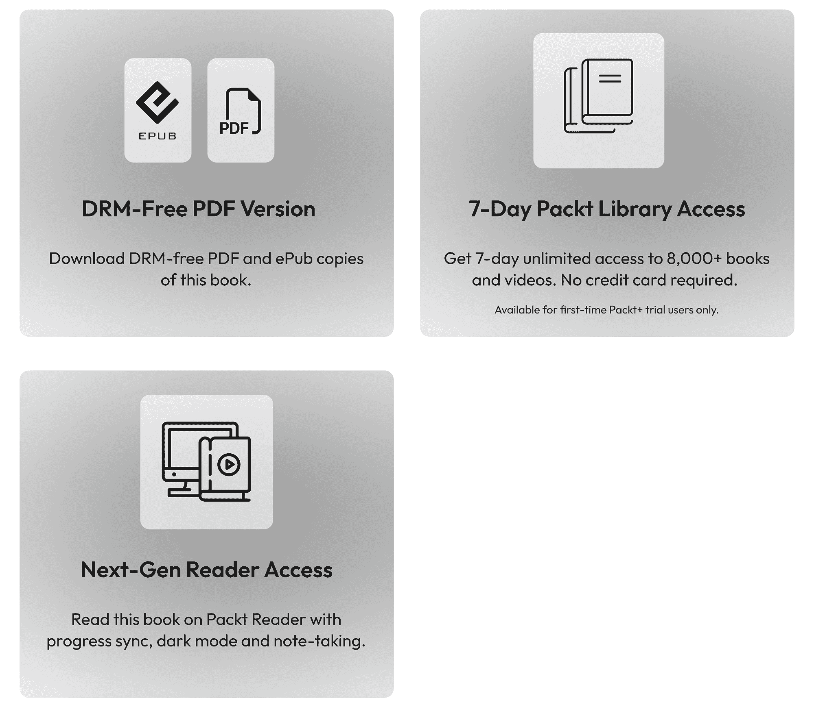

## 序言

深度学习重塑了现代软件，为视觉、语言、语音、推荐、医疗健康和机器人等应用提供动力。虽然 Python 已成为实验的标准语言，但生产系统往往依赖 C++ 来获得性能、效率和可控性。当延迟、内存使用和硬件优化至关重要时，C++ 仍然是深度学习技术栈中的关键组成部分。

这正是本书的价值所在。它为读者提供了一条从深度学习概念到 C++ 实际实现的实用路径。本书并未将 C++ 视为次要工具，而是将其作为构建、优化和部署现代深度学习系统的重要环境。

我最欣赏的是本书全生命周期的方法。它从环境搭建、数据准备和 CUDA 加速等基础内容开始，接着介绍核心模型家族，包括神经网络、CNN、RNN、LSTM 和生成模型。它还涵盖了分布式训练、模型压缩、推理优化、部署、调试、监控和可解释性。

这使得本书既适用于进入深度学习领域的 C++ 工程师，也适用于希望从 Python 原型转向生产级系统的机器学习从业者。它弥合了理论与部署之间的鸿沟，展示了如何构建不仅准确，而且高效、可靠和实用的模型。

希望你喜欢这本书。

*Bill Chen*

## 贡献者

### 关于作者

**Bill Chen** 是 Meta 的机器学习工程师，专注于深度学习、CUDA 和 C++。他拥有肯塔基大学的生物信息学博士学位，并在应用 AI 领域担任过生产和教学职务。他曾在 NVIDIA 深度学习学院授课，获得了 NVIDIA 认证助理：生成式 AI 多模态资格认证，并曾担任 UCSC 硅谷延伸学院的兼职机器学习教员。他的工作包括 Facebook 群组搜索建模和手术时长预测。在本书中，他结合行业经验和教学经验，指导读者使用 C++ 构建高性能深度学习系统。

*我衷心感谢我的编辑 Nathanya，感谢她在本书写作过程中给予的耐心、灵活性和支持，尤其是当我在美国陆军服役期间。她的理解和鼓励使我在那段艰苦时期能够继续这个项目。我也感谢审稿人提出的宝贵意见和对稿件的仔细阅读，并感谢整个 Packt 团队在出版过程中给予的指导和支持。*

**Vikash Gupta Ph.D.** 是位于华盛顿州西雅图的 **Amazon Web Services**（**AWS**）的高级解决方案架构师。他在法国 INRIA 获得计算生物学博士学位，研究重点为神经影像和统计建模。在 AWS，他应用深度学习和人工智能推进医学影像技术，为 MONAI 等医疗健康开源计划做出贡献。他还曾担任俄亥俄州立大学的研究科学家和梅奥诊所的助理教授。他已发表 60 多篇同行评审论文。

*我要感谢家人一直以来的支持，尤其是我的妻子 Garima Saraowgi，她在整个写作过程中给予了我极大的支持。我还要感谢我的老师们，特别是 Xavier Pennec 教授，他在我的职业生涯中不断挑战和引导我。此外，我要感谢 Packt 团队的贡献，特别是 Nathanya Dias，她对此书内容进行了认真审校，并让我保持动力和专注。最后，本书献给所有努力学习并构建新解决方案的学生们——为了后来者。*

*— Gustave, Claire Obscure*

### 关于审稿人

**Sriram M** 是一位 AI 架构师、顾问和技术作者，拥有二十年的行业经验。他专注于量子 AI、高级机器学习和安全模型部署。他是《使用生成式 AI 进行时间序列预测》的合著者，并担任技术书籍审稿人，以严谨、研究驱动的方式评估每份手稿。作为导师和客座教员，他向多样化的学习者教授 Python 和 AI，并通过出版物、同行评审和量子储层计算方面的持续研究为学术界做出积极贡献。他还是行业活动的特邀演讲者。

**Vishwas BV** 是一位高级首席数据科学家和 AI 研究员，拥有 13 年以上在制造、能源、电信和零售领域构建可扩展机器学习、生成式 AI 和智能体 AI 系统的经验。Vishwas 专注于将复杂的业务问题转化为生产级 AI 架构，包括 RAG、多智能体工作流和时间序列基础模型。他是 Springer 出版的两本书的作者，也是一项已获授权的美国专利的共同发明人，该专利涉及 AI 驱动的排放建模，支持了一笔数十亿美元的交易。他拥有 AWS ML 和 Azure ML 认证，将深厚的技术专长与可衡量的业务影响力相结合。

## 前言

深度学习已成为现代软件系统中最重要的技术之一，为计算机视觉、语音、语言、推荐、医疗健康、金融、机器人以及实时决策等应用提供动力。虽然大多数深度学习工作流都是基于 Python 实现的，但许多生产环境最终需要 C++ 提供的速度、控制力和系统级效率。本书旨在向你展示如何弥合这一差距。本书面向机器学习工程师、深度学习从业者、软件工程师以及具备技术背景的数据科学家，他们希望了解如何在 C++ 中构建、训练、优化、部署和监控深度学习系统。在本书中，你将经历以下过程：从搭建 C++ 深度学习环境和准备数据开始，到构建核心神经架构（如多层感知机、卷积网络、循环网络、生成模型和基于 Transformer 的系统），最后在性能至关重要的环境中部署、调试、监控和解释生产模型。

C++ 依然是高性能深度学习应用最强大的语言之一，因为它提供了对内存、并发、CPU/GPU 资源及运行时行为的精细控制。当你需要低延迟推理、高效模型服务、硬件感知优化或在资源受限系统上部署时，这一点至关重要。然而，对许多从业者而言，从基于 Python 的实验转向 C++ 实现，可能会感觉像跨越一道缺乏实用指南的鸿沟。本书旨在通过将深度学习概念与现代 C++ 的动手实现模式相结合来弥合这一鸿沟。

我们首先奠定让你高效工作所需的基础。你将首先回顾关键的深度学习概念，并为模型开发搭建一个可用的 C++ 环境。接下来，你将学习如何高效地准备和预处理数据，以及如何使用 CUDA 在 GPU 上加速训练和推理。这些早期章节旨在为你提供在 C++ 中开展严肃深度学习工作所需的概念基础与工具。


在环境和基础知识准备就绪后，本书将转向模型构建与训练。你将从基础神经网络开始，理解 C++ 中的前向传播、反向传播、优化和评估。然后，你将把这些思想扩展到多层感知器、用于图像任务的卷积神经网络，以及用于序列数据的循环架构，如 C++ 中的**循环神经网络**（**RNNs**）和**长短期记忆网络**（**LSTMs**）。接下来，本书将扩展到生成建模，涵盖自编码器、**生成对抗网络**（**GANs**）以及核心大语言模型概念，然后进入分布式训练、多 GPU 执行、并行化以及量化、剪枝等模型压缩策略。

本书的最后部分聚焦于模型在开发中工作之后会发生什么。你将学习如何使用 TorchScript 和**开放神经网络交换**（**ONNX**）等格式为推理准备模型，将其部署到云、本地或边缘环境，并针对现实世界性能进行优化。在此基础上，本书还涵盖调试生产故障、在数据变化时重新训练模型、监控生产系统，以及通过**局部可解释模型无关解释**（**LIME**）、**SHapley 加法解释**（**SHAP**）和**梯度加权类激活映射**（**Grad-CAM**）等可解释性技术提高透明度。最后，你将获得关于 C++ 中完整深度学习生命周期的实际视角，从实现到运营可靠性。

本书刻意注重实践。它不是将 C++ 仅仅视为机器学习的另一种语法，而是将 C++ 视为构建可部署深度学习系统的严肃工程环境。在此过程中，你将看到性能问题、软件设计选择、部署约束和可观测性考量如何影响生产级 AI 系统的构建方式。我的目标不仅是帮助你理解深度学习在 C++ 中如何工作，还要帮助你编写快速、健壮且适合实际使用的系统。

在撰写本书时，我希望能将许多从业者分别经历的两个世界结合起来：深度学习理论与实验的世界，以及生产级系统工程的世界。C++ 正处于这一交汇点。它使我们能够超越原型，进入可靠、高效的实现，从而大规模服务于要求苛刻的应用。我希望这本书能帮助你对此转变充满信心，并为在现代 C++ 中构建深度学习系统提供实用的基础。

## 本书读者对象

本书面向希望在 C++ 中构建高性能深度学习系统的机器学习工程师、深度学习工程师、软件工程师和数据科学家。对于那些已经熟悉机器学习和神经网络基础知识，并希望进一步接近生产级实现、优化和部署的读者来说，本书尤其有用。

你应该熟悉 C++ 的核心编程概念，例如类、内存管理和基本并发。对机器学习和深度学习概念（包括神经网络、训练循环和常见模型架构）有基础到中级的理解，将有助于你充分利用本书。熟悉 PyTorch 或 TensorFlow 等框架是有帮助的，但事先有使用其 Python API 的经验就足够了；本书将帮助你把这些经验转化为 C++ 工作流。

如果你是以 Python 为先的从业者，希望了解深度学习系统如何在更低级、对性能敏感的环境中实现，本书将帮助你完成这一转变。如果你是希望将系统背景应用于现代 AI 工作负载的 C++ 开发者，本书将为你提供一条进入深度学习的结构化路径。如果你从事实时或资源受限的应用程序，且延迟、吞吐量和效率至关重要，那么本书正是根据这些约束编写的。

## 本书涵盖的内容

- *第 1 章*，*C++ 深度学习入门与环境搭建*，介绍深度学习的核心概念，解释为什么 C++ 对性能密集型 AI 工作负载具有价值，并逐步讲解一个实用 C++ 深度学习环境的搭建。
- *第 2 章*，*C++ 中的数据准备与预处理*，涵盖深度学习的数据流水线方面，包括归一化、数据增强、高效加载、大数据集的内存感知处理，以及 C++ 中的自定义数据集加载器。
- *第 3 章*，*CUDA 在 C++ 深度学习中的 GPU 加速*，介绍 CUDA，并展示如何使用 GPU 加速来加速训练和推理、优化关键性能代码路径以及分析瓶颈。
- *第 4 章*，*在 C++ 中构建基础神经网络*，逐步讲解一个简单神经网络的实现，包括神经元、激活函数、前向传播、损失计算、反向传播和基于梯度的优化。
- *第 5 章*，*C++ 中的多层感知器*，扩展到更深的前馈网络，展示如何添加隐藏层、使用 dropout 和批归一化、调整超参数，并评估在实际任务上的性能。
- *第 6 章*，*C++ 中的卷积神经网络*，介绍基于图像的数据，展示如何使用神经网络进行图像分类、图像分割，以及各种图像预处理和数据增强技术。
- *第 7 章*，*C++ 中的循环神经网络与长短期记忆网络*，讨论序列数据，特别是文本数据，涵盖其数学基础、训练算法（BPTT）、实用的 C++ 实现、文本处理技术、词嵌入，以及在文本预测和神经机器翻译中的实际应用。
- *第 8 章*，*C++ 中的生成网络、自编码器与大语言模型*，涵盖基础生成式 AI 架构和 GANs，以及自回归文本生成原理、采样策略，以及用于评估生成模型性能的综合评价指标。
- *第 9 章*，*C++ 中的 Transformer 与大语言模型微调*，探讨 Transformer 架构及其组件、其编码器-解码器实现，进而介绍分布式训练策略和模型压缩。
- *第 10 章*，*部署和优化推理模型*，说明如何导出模型用于部署、在生产环境中提供服务、优化推理性能，以及构建 C++ 实时推理 API。
- *第 11 章*，*已部署模型的调试与重新训练*，展示如何诊断性能下降、检测并应对模型漂移、改进日志记录和调试工作流，以及构建实用的重新训练策略。
- *第 12 章*，*监控已部署模型*，聚焦于生产可观测性，包括跟踪延迟、准确率和资源利用率，设置日志系统，并长期维护模型质量。
- *第 13 章*，*深度学习模型中的可解释性与透明性*，介绍 LIME、SHAP 和 Grad-CAM 等实用可解释性技术，并讨论可解释性如何支持更安全、更可信的部署。

## 如何充分利用本书

要充分利用本书，你需要具备 C++ 的实用知识，并对机器学习和深度学习基础有基本了解。你不必是这里涵盖的每个模型家族的专家，但你应该已经熟悉监督学习、损失函数、梯度下降以及训练和评估模型的一般概念。使用 Python 深度学习框架的经验也会有所帮助，尤其是在你使用本书向更注重性能的 C++ 实现转变时。

如果你准备直接动手实践代码示例，而不是只在概念上阅读，你将从本书中获得更多收获。当你亲自编译、运行、分析和修改代码时，本书中的主题会变得更加清晰。由于本书涵盖环境搭建、CUDA 加速、分布式训练、部署格式和推理优化，因此最好能有一个开发环境，让你在学习过程中同时实验 CPU 和 GPU 工作流。

## 下载示例代码文件

本书的代码包托管在 GitHub 上，地址为 `https://github.com/PacktPublishing/Deep-Learning-with-C-`。我们还有来自丰富图书和视频目录的其他代码包，可在 `https://github.com/PacktPublishing` 获取。快去看看！

## 使用的约定

本书通篇使用了一些文本约定。

`CodeInText`：表示文本中的代码词、类名、函数名、文件名、文件扩展名、路径名、模型文件、库名和命令行参数。例如：“我们切换到 `eval()`，创建一个示例输入，并**跟踪**模块以生成 `tinynet.ts`。”

代码块设置如下：

```bash
export TORCH=/path/to/libtorch
clang++ -std=c++17 -O2 micro_batcher_demo.cpp \
  -I"$TORCH/include" -I"$TORCH/include/torch/csrc/api/include" \
  -L"$TORCH/lib" -Wl,-rpath,"$TORCH/lib" \
  -ltorch -lc10 -pthread -o mb_demo
./mb_demo
```


## 前言

所有命令行输入或输出都按如下格式书写：

```
!nvcc --version
!nvidia-smi
```

**粗体**：表示新术语、重要词语或你屏幕上看到的文字。例如，菜单或对话框中的词语在文本中这样显示。比如：“在深入探讨之前，我们先从**结构化/表格**信号转向**非结构化**模态。”

### 联系我们

我们始终欢迎读者的反馈。

**一般反馈**：如果你对本书的任何方面有疑问，或有任何一般性反馈，请发送电子邮件至 `customercare@packt.com`，并在邮件主题中提及书名。

**勘误**：尽管我们已尽力确保内容的准确性，但错误仍可能发生。如果你在本书中发现错误，我们将不胜感激你能向我们报告。请访问 `http://www.packt.com/submit-errata`，点击**提交勘误**，并填写表单。

**盗版**：如果你在互联网上以任何形式遇到我们的作品的非法副本，请将地址或网站名称提供给我们，我们将不胜感激。请通过 `copyright@packt.com` 联系我们，并附上材料链接。

**如果你有兴趣成为作者**：如果你有擅长的主题，并且有兴趣撰写或参与编写一本书，请访问 `http://authors.packt.com/`。

警告或重要说明会以这种方式显示。

提示和技巧会以这种方式显示。

### 随书免费福利

本书附带免费福利以支持你的学习。立即激活它们以获得即时访问权限（有关说明，请参阅“*如何解锁*”一节）。

以下是购买后可立即解锁内容的快速概览：



### 如何解锁

扫描二维码（或访问 `packtpub.com/unlock`）。按名称搜索本书，确认版本，然后按照页面上的步骤操作。


*注：请妥善保管你的发票。直接从 Packt 购买不需要发票。*

### 分享你的想法

一旦你阅读了*使用C++进行深度学习*，我们很乐意听到你的想法！请点击此处直接前往本书的亚马逊评论页面并分享你的反馈。

你的评论对我们和技术社区都很重要，并将帮助我们确保提供优质的内容。
