## 第1章：使用C++进行深度学习与环境搭建简介

深度学习已成为现代**人工智能**（**AI**）的基石，为从自动驾驶汽车到高级推荐系统的一切提供动力。在本章中，我们将介绍深度学习的核心原理，并引导你完成使用 C++ 搭建深度学习环境的过程。你将理解为什么 C++ 在高性能任务中备受青睐，尤其是在优化内存使用和高效利用 CPU 与 GPU 资源方面。

除了涵盖理论基础外，本章还将为你提供配置 C++ 开发环境的实用技能，包括安装相关的深度学习库。

在本章中，我们将讨论以下主题：

- 深度学习概念简介
- 使用 C++ 进行深度学习的优势
- 为深度学习搭建 C++ 环境
- C++ 在深度学习中的关键性能优势

到本章结束时，你将能够开始用 C++ 编写深度学习模型，这使本章成为你深度学习之旅中至关重要的第一步。

### 技术要求

本节详细说明阅读本章及本书内容所需的前提条件：

- **硬件**：
  - **CPU（必需）**：64位 x86-64 或 Apple Silicon
  - 推荐：支持 AVX2（大多数现代 Intel/AMD CPU）以获得更快的 BLAS/线性代数性能
  - **内存**：≥8 GB RAM（对于较大示例，推荐 ≥16 GB）
  - **磁盘**：≥15 GB 可用空间（工具链 + 库 + 示例数据）
  - **GPU（可选，适用于 CUDA 章节）**：计算能力 ≥7.0 的 NVIDIA GPU（例如 V100/T4/A10/A100/H100）：
    - **驱动程序**：与你的 CUDA Toolkit 版本匹配的最新 NVIDIA 驱动程序
    - **显存（VRAM）**：推荐 ≥8 GB 以获得良好体验
  - Apple Silicon 没有 CUDA；请在本地使用仅 CPU 的构建，或为 GPU 章节使用带 NVIDIA GPU 的云虚拟机。
- **操作系统**：
  - **Linux**：Ubuntu 20.04/22.04（或同等版本）
  - **Windows**：Windows 10/11（x64）
  - **macOS**：13 Ventura 或更高版本（Apple Silicon 或 Intel）
  - **WSL2（Windows）**：支持并推荐用于类 Linux 的工作流程
- **编译器和构建工具**：
  - **C++ 标准**：C++17（部分示例也可用 C++20 编译）
  - **编译器**：
    - **Linux**：GCC ≥11 或 Clang ≥14
    - **Windows**：**微软 Visual C++**（**MSVC**）— Visual Studio 2022，v19.3x
    - **macOS**：Apple Clang ≥14

**你的购买包含一份免费 PDF 副本 + 独家附加内容**

你的购买包含本书的一份无 DRM 的 PDF 副本、Packt+ 图书馆的 7 天试用（无需信用卡）以及额外的独家附加内容。请参阅*前言*中的*随书免费福利*一节，立即解锁它们并最大化你的学习体验。

- **构建系统**：CMake ≥3.22（主要），不过许多代码片段也显示单文件 g++/clang++ 命令
- **包管理器（可选但有帮助）**：Linux 上的 `apt`/`dnf`，macOS 上的 `Homebrew`，Windows 上的 `vcpkg` 或 `choco`
- **本书使用的核心库**：
  - **Eigen 3.4+（仅头文件）**：用于从零开始演示的线性代数（CPU）
  - **LibTorch（PyTorch C++ API）**：推理/训练示例（所有操作系统上均可 CPU 构建；在 Linux/Windows 上支持 NVIDIA GPU 的 CUDA 构建）：
    - 预计下载量较大（约 1–2 GB）
  - **OpenCV 4.x（可选）**：在少数示例中用于图像 I/O 可视化
  - **GoogleTest（可选）**：在部分章节中用于单元测试

我们会始终注明仅使用 CPU 的路径。当存在 GPU 路径时，我们会明确标注。

- **CUDA（可选 GPU 路径）**：
  - **CUDA Toolkit**：12.x（Toolkit + `nvcc`）
  - **驱动程序**：匹配的 NVIDIA 驱动程序（使用 `nvidia-smi` 验证）
  - **Nsight 工具（可选但推荐）**：Nsight Systems/Compute，用于性能分析
  - **nvidia-container-toolkit（可选）**：用于 Docker GPU 工作流
- **编辑器和集成开发环境（IDE）**：
  - 任何现代 C++ IDE/编辑器均可：**VS Code**、**CLion** 或 **Visual Studio**
  - 启用 CMake Tools 或正确设置你的编译器套件
- **网络访问**：
  - 需要稳定的互联网连接来获取工具链、LibTorch 归档、模型和小型数据集。某些构件较大，因此快速连接会有所帮助。
- **云（如果你没有本地 NVIDIA GPU）**：
  - 从 AWS/Azure/GCP 租用带 NVIDIA GPU 的按需虚拟机（推荐 Ubuntu LTS 镜像）
  - 对于轻量级探索，Colab/Kaggle 可用于不需要系统级安装的 CUDA 部分


## 使用C++的深度学习简介与环境设置

- **环境验证（快速检查）**：

  运行以下代码（根据您的操作系统/Shell调整）；您应该看到合理的版本且没有错误：

  ```bash
  # Compiler & CMake
  g++ --version
  cmake --version

  # (Linux/WSL) Check BLAS-friendly CPU flags
  lscpu | egrep 'avx|sse' # Look for AVX/AVX2

  # LibTorch headers present (after you download & set TORCH path)
  ls $TORCH/include/torch/torch.h

  # Optional: CUDA toolchain & driver
  nvcc --version
  nvidia-smi
  ```

- **已知兼容性说明**：

  - **Windows + LibTorch**：确保MSVC工具集与LibTorch构建匹配；将 `c10.dll/torch_cpu.dll`（以及CUDA **动态链接库**（**DLL**），如果使用）与可执行文件一起放在 `PATH` 中。
  - **macOS（Apple Silicon）**：使用*仅CPU*的LibTorch构建；没有CUDA。Homebrew有助于处理Eigen/OpenCV。
  - **WSL2**：在Windows上安装NVIDIA驱动程序，并在Ubuntu中安装WSL2 CUDA用户空间；在WSL内使用 `nvidia-smi` 验证。

- **最低配置与推荐配置**：

  - **最低配置（仅CPU）**：C++17编译器、CMake、Eigen、LibTorch（CPU）、8 GB内存
  - **推荐配置（为了舒适体验和GPU章节）**：支持C++20的工具链、CMake、Eigen、LibTorch（CPU + CUDA）、OpenCV、Nsight工具、16 GB内存、NVIDIA GPU（≥8 GB显存）

## 第1章：深度学习概念简介

深度学习已经改变了人工智能，使机器能够学习复杂模式并以前所未有的准确性做出明智决策。从核心来看，深度学习主要依赖于神经网络——一种受人类大脑结构和功能启发的深度学习算法。

### 神经网络——深度学习的构建模块

神经网络由相互连接的人工神经元（或节点）层组成，这些层执行计算并传播结果。神经网络的基本结构包括以下内容：

- **输入层**：接收初始数据
- **隐藏层**：处理信息
- **输出层**：产生最终结果或预测

在*图1.1*中，我们展示了一个具有相互连接的输入层、隐藏层和输出层的简单神经网络。

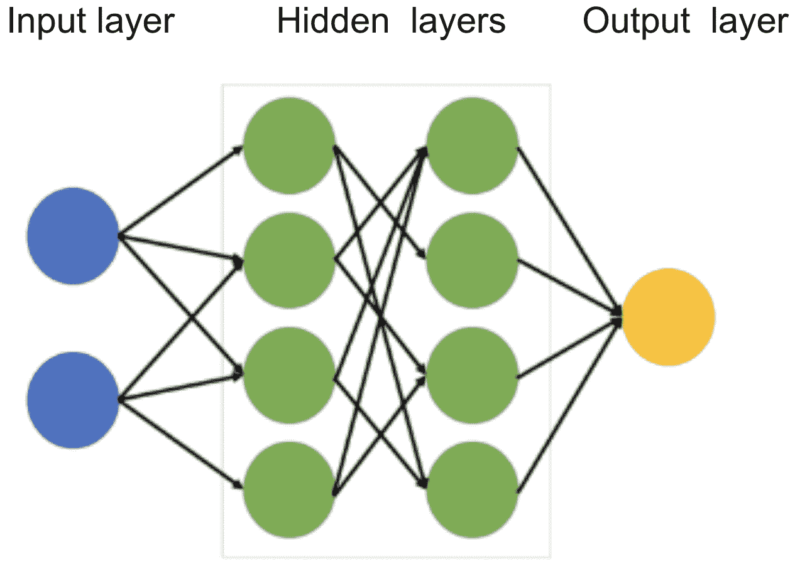

*图1.1：具有输入层、隐藏层和输出层的简单神经网络概览*

每个节点之间的连接都带有在训练过程中调整的权重。网络通过缩小其预测与实际结果之间的差距来学习，这个过程称为反向传播。神经网络的核心是感知器——一个基本单元，可以看作一个线性模型，其输出通过非线性激活函数传递，以引入灵活性并捕获复杂模式。

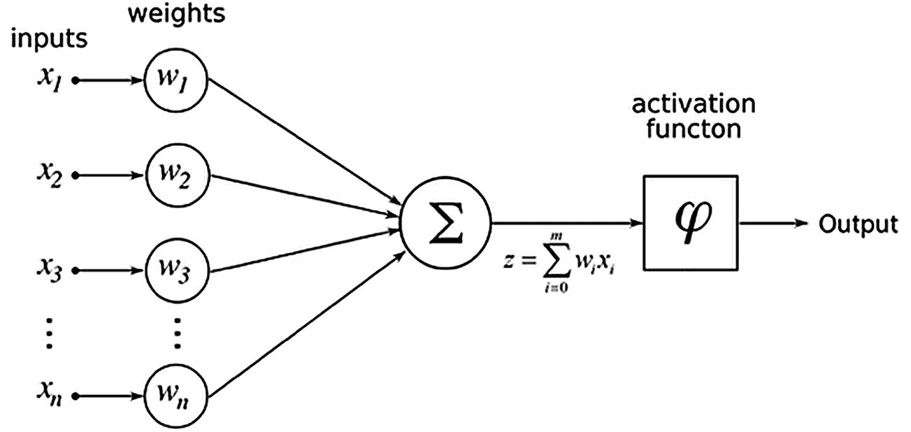

*图1.2：这是感知器的简化版本*

在*图1.2*中，我们可以看到感知器的前半部分实际上是输入\(x\)和权重\(w\)的线性组合，即\(z = \sum_{i=1}^{n} w_i x_i\)。然后，得到的值将传入激活函数\(\varphi\)。这提供了非线性。非线性防止神经网络中的所有神经元坍缩成一个等效神经元，从而使网络能够学习复杂函数。

最常用的激活函数是**ReLU**、**sigmoid**和**tanh**。它们引入了以下能力：

- **增加非线性**：如果没有激活函数，无论我们堆叠多少层，网络都会表现得像一条大直线。这些函数将输出弯曲成**曲线**，使模型能够捕获更复杂的模式。
- **做出更好的决策**：例如，在图像分类中，一条直线可能不足以区分猫和狗。激活函数让网络绘制**弯曲的边界**，这更擅长分离混乱的现实世界数据。
- **塑造输出**：
  - ReLU像一个开关：它保留正数并将负数变为零。它快速且高效。
  - Sigmoid将值压缩到0和1之间。它非常适合输出类似于概率的场景。
  - Tanh将值压缩到-1和1之间，因此它可以表示正负信号。
- **释放深度学习的力量**：由于激活函数，神经网络的每一层都可以学习不同的东西。将它们堆叠在一起，网络便有能力表示非常复杂的关系——从识别语音，到检测照片中的物体，再到理解语言。

下图展示了常见的激活函数。

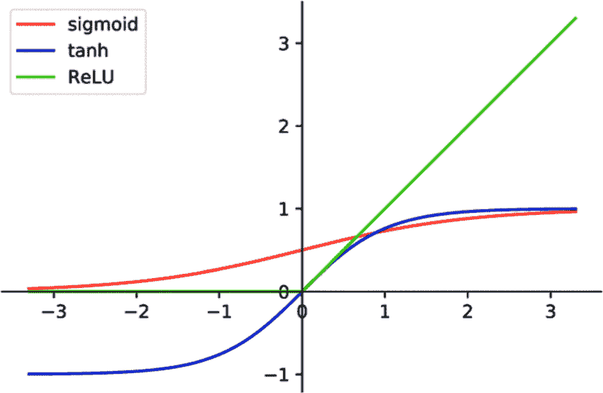

*图1.3：常见激活函数：ReLU、sigmoid和tanh（https://www.researchgate.net/figure/Sigmoid-tanh-and-ReLU-functions_fig4_358602222）*

我们已经了解了激活函数；现在，让我们看看深度学习的类别。

### 学习范式的类型

深度学习包含多种学习范式，每种范式适用于不同类型的问题：

- **监督学习**：使用数据集训练模型，其中每个输入都与正确的输出配对。模型从这些示例中学习模式，以便为新输入预测适当的输出。常见应用包括图像分类和语音识别。
- **无监督学习**：模型在未标记的数据中发现模式。聚类和降维是常见的应用。
- **半监督学习**：结合了监督方法（使用少量标记数据）和无监督方法（使用大量未标记数据）。
- **强化学习（RL）**：模型通过与环境的反馈进行学习，环境根据其行为给予奖励或惩罚。

让我们更详细地了解每种深度学习类型。

#### 监督学习

监督学习是深度学习和机器学习中最广泛使用的方法之一。它依赖于标记数据集，通常称为真实值（ground truth），其中每个输入都与正确的输出配对。通过反复将模型暴露于这些标记示例，算法学习将输入映射到所需输出，并将其知识泛化到新的、未见过的数据。

两种最常见的监督学习任务是分类和回归。对于分类任务，模型将预测一个离散标签。最常见的示例之一是判断一封电子邮件是否是垃圾邮件。另一个示例是预测0到9之间的手写数字。

下图对比了**线性回归**和**逻辑回归**——一个显示为简单的线性模型，另一个显示为单神经元（感知器）神经网络。

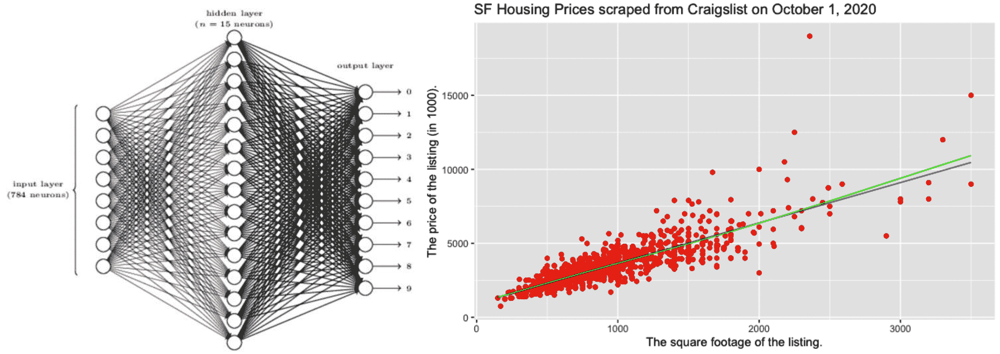

*图1.4：左：使用神经网络进行数字分类。右：使用回归模型进行房价预测*

相比之下，对于回归任务，模型将预测一个连续值。示例包括根据房屋特征预测房价、根据身高和年龄估算人的体重，或预测第二天的温度。与分类（输出属于固定类别集合）不同，回归输出可以取广泛的数值。

监督学习支撑着许多实际应用，包括图像识别、语音转文本系统、医疗诊断支持和金融预测。其有效性在很大程度上取决于标记数据的可用性和质量，以及模型在不过度拟合训练集的情况下捕获模式的能力。

#### 无监督学习

无监督学习本质上是监督学习的对立面。在这种情况下，输入数据没有标签。你可能会问：“如果没有提供答案，模型到底在学习什么？”模型通过发现数据本身的模式、结构或分组来学习，而无需


## 第 1 章

而不是被告知什么是“正确”的输出。

例如，无监督学习可以根据购买行为将相似客户聚类在一起，即使我们事先不知道他们的类别。它还可以降低大型数据集的维度，突出最重要的特征。与专注于使用有标签结果进行预测的监督学习不同，无监督学习更关乎**发现**——揭示人类可能不易察觉的隐藏关系和洞见。

常见技术包括以下几种：

- **聚类（例如 k-means、层次聚类）**：将具有相似特征的数据点分组
- **降维（例如 PCA、t-SNE）**：在保留重要结构的同时简化数据
- **关联规则学习（例如购物篮分析）**：发现特征或事件如何共现的规则

下图展示了聚类的核心思想。左图是 k-means 演示，将数据点划分为多个组；右图是一个生物医学示例，聚类揭示了基因共表达关系。

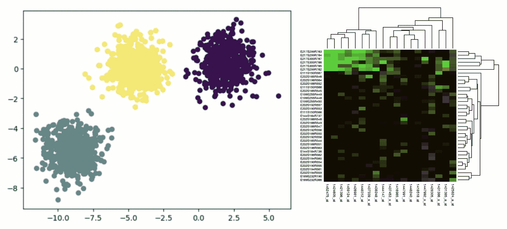

*图 1.5：左图：K-means 聚类。右图：无监督学习在生物医学用例中的应用（https://commons.wikimedia.org/wiki/File%3AHeatmap.png）*

简而言之，监督学习使用标签回答特定问题，而无监督学习则让数据自己讲述故事，帮助我们探索未知。

接下来，我们来看看半监督学习和强化学习。

### 半监督学习与强化学习

**半监督学习**融合了监督学习和无监督学习的原理。监督学习完全依赖有标签数据，无监督学习则在无标签情况下工作，而半监督学习则兼取两者之长。少量有标签数据与大量无标签数据一起使用，使模型能够更有效地泛化，同时减少昂贵的标注成本。例如，在医学影像中，可能只有数量有限的扫描带有专家验证的诊断，但存在数千张无标签扫描图像。半监督方法——如伪标签自训练、一致性正则化或基于图的技术——可以利用这两种数据源，构建出比仅使用监督数据更强的模型。

相比之下，强化学习完全不涉及标签，而是关乎交互和决策。智能体通过与环境交互、采取行动并获得奖励或惩罚来学习。随着时间推移，它会不断优化其策略——即将状态映射到动作的策略——以最大化长期奖励。这种设置使强化学习非常适合序列决策问题，在序列决策中，每个选择都会影响未来的结果。现实世界的例子包括 AlphaGo 等游戏系统、学习导航的自主机器人，以及适应用户行为的推荐引擎。

总之，半监督学习和强化学习展示了深度学习如何超越经典的监督模型：前者利用有标签和无标签数据来提高效率，后者则通过试错和奖励来掌握复杂行为。

既然你已经掌握了深度学习的核心内容——核心思想、示例算法及其构建模块——让我们来探讨为什么 C++ 是实现和部署这些系统的理想选择。

### 使用 C++ 进行深度学习的优势

虽然 Python 等语言因其在深度学习中的易用性而广受欢迎，但 C++ 具有几个显著优势，使其成为高性能深度学习应用的绝佳选择：

- **性能优先**：C++ 编译为本地机器码，避免了解释器开销，通常比脚本运行时提供更低的延迟和更高的吞吐量
- **内存管理**：C++ 提供对内存分配和释放的细粒度控制，这对于优化大规模深度学习模型至关重要
- **硬件优化**：C++ 允许进行底层硬件优化，使开发者能够充分利用 CPU 和 GPU 的能力
- **与现有系统集成**：许多生产系统都是用 C++ 构建的，因此更容易将深度学习模型集成到现有基础设施中
- **可移植性**：C++ 代码可以针对多种平台编译，确保在不同系统上具有一致的性能

在了解了 C++ 的这些优势之后，我相信你已经迫不及待想要直接开始写代码了！但在那之前，我们先来了解一下如何搭建一个合适的 C++ 深度学习环境。

### 搭建 C++ 深度学习环境

要开启你的 C++ 深度学习之旅，你需要搭建一个合适的开发环境。这个过程涉及几个步骤，我们将在接下来的章节中逐一介绍。

#### 使用免费的 Google Colab

Google Colab 是一个很好的起点，它免费且提供了一个强大的编码平台，无需高端硬件即可使用。在 Colab 上搭建 C++ 环境需要安装必要的库，并配置环境以兼容深度学习框架。这种方法让你可以在云端测试和运行代码，从而更容易地试验模型和算法。Colab 对 GPU 和 TPU 的支持还可以加速你的工作，为探索 C++ 在深度学习中的应用提供了一种经济高效的解决方案。

开始使用 Google Colab 的步骤如下：

1. **创建笔记本**：前往 Google Colab，选择 **新建笔记本** 开始编码。
2. **编写代码单元格**：Colab 使用单元格来编写代码和 Markdown，允许用户同时编写代码和说明。
3. **执行单元格**：按 *Shift* + *Enter* 运行单元格，或使用每个单元格上的 **运行** 按钮。
4. **设置运行时环境**：在 **运行时** | **更改运行时类型** 下，你可以选择 CPU、GPU 或 TPU。

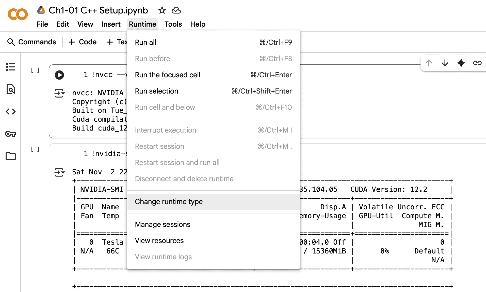

*图 1.6：单击“更改运行时类型”选项*

5. 选择 GPU 选项，即可在 Colab 中使用 GPU。

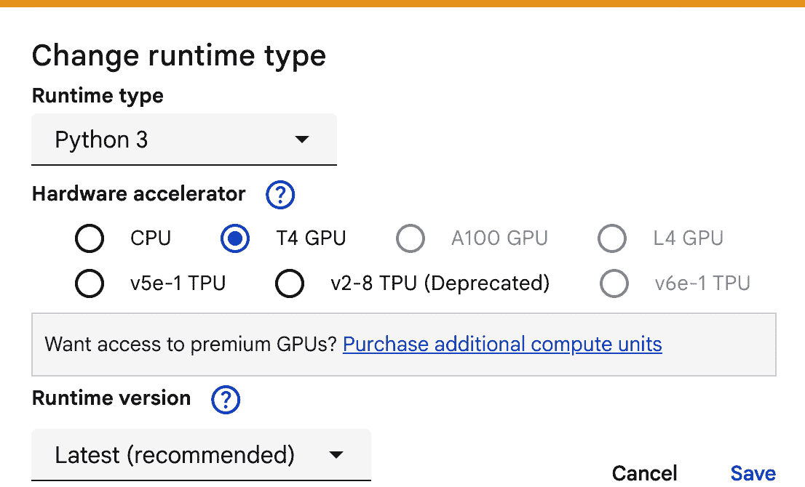

*图 1.7：在下一页中，选择你可用的 GPU 选项*

6. 在 Colab 中选定 GPU 后，编程环境就可以使用了。为了验证设置是否正确以及 CUDA 是否可用，请在 Colab 笔记本中打开一个新的代码单元格，输入以下命令：

```
!nvcc --version
!nvidia-smi
```

在 Colab 代码单元格中运行这些命令后，你应该会看到类似下面的输出：

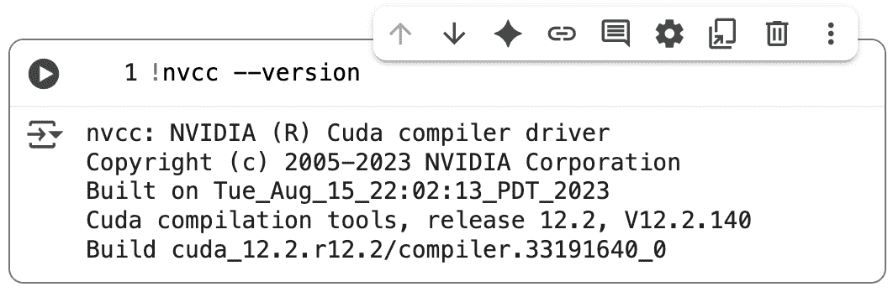

*图 1.8：使用 !nvcc --version 检查 CUDA 编译器版本*

第一个命令（`!nvcc --version`）显示系统中安装的 NVIDIA CUDA 编译器驱动（`nvcc`）的版本。输出显示以下信息：

- 编译器驱动程序来自 NVIDIA，专为 CUDA 构建
- 构建日期为 2023 年 8 月 15 日
- CUDA 编译工具为 12.2 发行版，具体版本为 12.2.140

下面是第二个命令的输出。你可以看到当前 Colab 中 GPU 的规格。

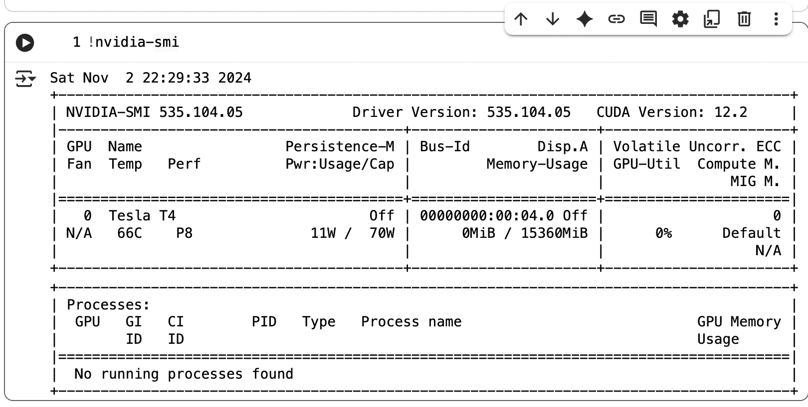

*图 1.9：使用 !nvidia-smi 显示 NVIDIA 系统信息*

第二个命令（`!nvidia-smi`）全称是 NVIDIA 系统管理接口，它提供系统中可用 NVIDIA GPU 的详细信息。输出包括以下内容：

- **驱动版本**：535.104.05
- **CUDA 版本**：12.2
- **GPU 信息**：
  - **型号**：Tesla T4
  - **温度**：66°C
  - **功耗**：11 W，最大为 70 W
  - **显存**：总显存为 15,360 MiB，当前已使用 0 MiB
  - **GPU 利用率**：当前为 0%，表示 GPU 处于空闲状态
  - **进程**：当前没有活动进程正在使用 GPU

现在，你已经准备好通过一个 C++ 程序来了解深度学习的实际示例了。

让我们在 Colab 中编写一些 CUDA 代码并运行它：

```
%%writefile welcome_from_cuda.c
#include <stdio.h>
__global__ void welcome() {
printf("Welcome to DL with C++ — block %d, thread %d\n", blockIdx.x, 
threadIdx.x);
}
int main() {
welcome<<<3,3>>>(); // 3 blocks, 3 threads each
cudaDeviceSynchronize();
return 0;
}
```

在单元格中运行以下命令：

```
%%bash
nvcc -std=c++14 -x cu -arch=sm_75 welcome_from_cuda.c -o welcome
```


## 第1章

让我们看一下代码的输出：

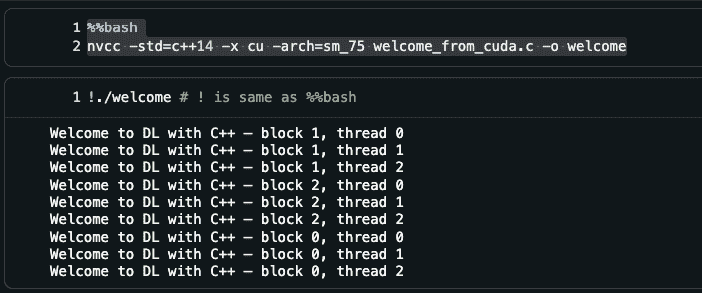

*图 1.10：“welcome from”练习的输出，演示了如何使用 C++ 访问 GPU，并打印消息 “Welcome to DL with C++ from block x, thread y”*

你已经看到，利用免费的在线资源可以轻松地为 C++ 深度学习项目编写代码。现在让我们看看如何在本地搭建环境。

### 本地搭建 C++ 开发环境

要在本地使用 C++ 构建和运行深度学习应用程序，你需要准备一个合适的环境。该设置包括四个主要步骤——安装编译器、选择 IDE、配置构建工具以及添加深度学习库：

1. **安装 C++ 编译器**：选择并安装适合你操作系统的 C++ 编译器：

   - **Windows**：MSVC 或 MinGW
   - **macOS**：Xcode 命令行工具（包含 Clang）
   - **Linux**：**GNU 编译器套件**（**GCC**）

2. **设置 IDE**：虽然并非严格必需，但 IDE 可以极大地提升你的生产力。常见的选择包括：

   - **Visual Studio（Windows）**：微软出品的功能丰富的 IDE，与 MSVC 编译器紧密集成。它提供了优秀的调试工具、GUI 设计能力和项目模板。Visual Studio 还能轻松管理 NuGet 包和外部库。
   - **CLion（跨平台）**：JetBrains 出品的商业 IDE，提供智能代码补全、重构以及与 CMake 的紧密集成。CLion 因其现代 UI 和高生产力特性而在 C++ 社区广受欢迎。
   - **Eclipse CDT（跨平台）**：Eclipse 的 **C++ 开发工具**（**CDT**）是一款免费开源 IDE。虽然不如 CLion 精美，但健壮且高度可定制，非常适合偏好开源工具的用户。
   - **Code::Blocks（跨平台）**：一款轻量级开源 IDE。虽然比 Visual Studio 或 CLion 简单，但设置快速便捷，是初学者的良好起点。

3. **安装构建工具**：除了编译器和 IDE 之外，你还需要 **构建工具** 来管理项目的编译和链接。对于小型 `Hello World` 程序，运行一条 `g++ file.cpp -o output` 命令就足够了。但随着项目规模的增长——尤其是使用依赖多个外部组件的深度学习库时——手动编译变得不切实际。两个最重要的工具如下：

   - **CMake**：
     - 一个广泛使用的跨平台构建系统生成器。
     - 无需编写复杂的编译器命令，你只需在一个简单的文本文件（`CMakeLists.txt`）中描述你的项目。然后 CMake 会生成特定于平台的构建文件（例如，Windows 上的 Visual Studio 项目，Linux 上的 Makefile）。
     - 它是许多深度学习框架（例如 PyTorch、TensorFlow）的标准构建系统。
     - 以下是一个 CMake 文件示例：

       ```cmake
       cmake_minimum_required(VERSION 3.10)
       project(HelloWorld)
       set(CMAKE_CXX_STANDARD 14)
       add_executable(hello main.cpp)
       ```

     - 运行 `cmake . && make` 将把 `main.cpp` 编译成可执行文件。

   - **Make**：
     - 常用于 Linux 和 Unix 系统。
     - 依靠 Makefile 来指定文件应如何编译和链接。
     - 仍然被广泛使用，不过在较大的项目中，通常通过 CMake 来管理。
     - 以下是一个 Makefile 示例：

       ```makefile
       all:
       	g++ main.cpp -o hello
       ```

   构建工具对深度学习项目至关重要，因为它们能自动化依赖管理（例如链接 CUDA、cuDNN、LibTorch 和 TensorFlow）；简化多文件项目的编译；确保跨 Windows、macOS 和 Linux 的跨平台兼容性；并提供一致的配置，使团队协作更加高效。

4. **安装深度学习库**：有多种 C++ 库可用于深度学习。我们将重点关注其中最流行的一些：

   - **PyTorch C++ API（LibTorch）**：PyTorch 的 C++ 前端 LibTorch 为 C++ 深度学习提供了一个强大而灵活的框架。要安装 LibTorch，请执行以下步骤：

     1. 从 PyTorch 网站下载预构建库（`https://pytorch.org/get-started/locally/`）。

        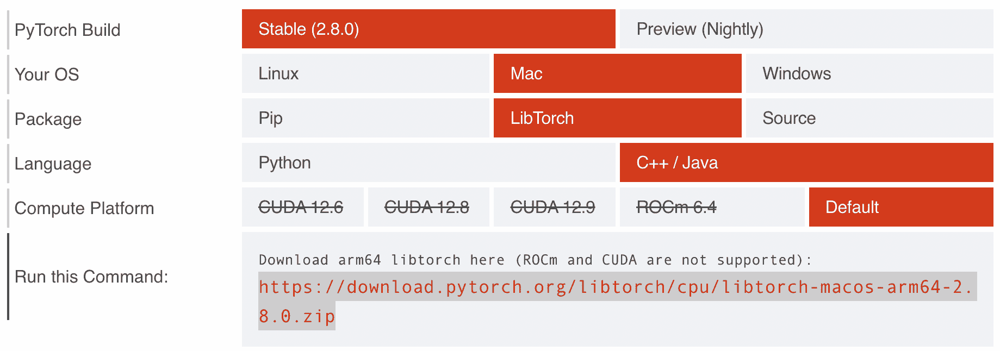

        *图 1.11：来自 pytorch.org 的 PyTorch 设置快速参考*

     2. 在终端中，从 PyTorch 网站复制并运行该命令：

        ```bash
        % wget https://download.pytorch.org/libtorch/cpu/libtorch-macos-arm64-2.8.0.zip
        ```

     3. 使用 `unzip libtorch-macos-arm64-2.8.0.zip` 将下载的压缩包解压到系统上的某个位置。

     4. 使用适当的环境变量配置你的 `compile` 命令，使其指向你的 LibTorch 安装位置（参见下面的 Bash 示例）。

     *在你的 C++ 项目中包含 LibTorch 的示例*：

     ```cpp
     #include <torch/torch.h>
     #include <iostream>

     int main() {
         // Create a 3x3 tensor with random values between 0 and 1
         torch::Tensor X = torch::rand({3, 3});
         // Add a constant value to every element
         torch::Tensor Y = X + 5;
         // Apply ReLU activation
         torch::Tensor Z = torch::relu(Y);
         // Print all results
         std::cout << "Original tensor X:\n" << X << "\n\n";
         std::cout << "After adding 5 (Y):\n" << Y << "\n\n";
         std::cout << "After ReLU activation (Z):\n" << Z << std::endl;
         return 0;
     }
     ```

     *运行以下 bash 命令*：

     ```bash
     % clang++ example.cpp -o example \
       -I ./libtorch/include \
       -I ./libtorch/include/torch/csrc/api/include \
       -L ./libtorch/lib \
       -ltorch -ltorch_cpu -lc10 \
       -Wl,-rpath,./libtorch/lib \
       -std=c++17
     ```

     *输出应为*：

     ```text
     % ./example
     Original tensor X:
      0.4462 0.4752 0.4493
      0.1307 0.3102 0.7832
      0.4145 0.7671 0.9496
     [ CPUFloatType{3,3} ]

     After adding 5 (Y):
      5.4462 5.4752 5.4493
      5.1307 5.3102 5.7832
      5.4145 5.7671 5.9496
     [ CPUFloatType{3,3} ]

     After ReLU activation (Z):
      5.4462 5.4752 5.4493
      5.1307 5.3102 5.7832
      5.4145 5.7671 5.9496
     [ CPUFloatType{3,3} ]
     ```

   - **开放神经网络交换（ONNX）运行时**：ONNX 提供了一种在不同框架之间交换深度学习模型的方法。ONNX Runtime 是一个专注于性能的 ONNX 模型推理引擎。要安装 ONNX Runtime，请执行以下步骤：

     5. 从 ONNX Runtime 的 GitHub 发布页面（`https://github.com/microsoft/onnxruntime/`）下载预构建二进制文件。
     6. 在你的项目中包含必要的头文件并链接该库。

     *在 C++ 中使用 ONNX Runtime 的示例*：

     ```cpp
     #include <onnxruntime_cxx_api.h>

     int main() {
         Ort::Env env(ORT_LOGGING_LEVEL_WARNING, "test");
         Ort::SessionOptions session_options;
         Ort::Session session(env, "path/to/model.onnx", session_options);
         // ... (model inference code)
         return 0;
     }
     ```

   - **TensorFlow C++ API**：虽然 TensorFlow 主要用于 Python，但它也为高性能应用提供了 C++ API。要使用 TensorFlow 的 C++ API，请执行以下步骤：

     7. 从源代码构建 TensorFlow，或使用预构建库。
     8. 将你的项目与 TensorFlow C++ 库链接。

     *在 C++ 中使用 TensorFlow 的示例*：

     ```cpp
     #include "tensorflow/cc/client/client_session.h"
     #include "tensorflow/cc/ops/standard_ops.h"

     int main() {
         tensorflow::Scope root = tensorflow::Scope::NewRootScope();
         auto A = tensorflow::ops::Const(root, {{1, 2}, {3, 4}});
         auto B = tensorflow::ops::Const(root, {{5, 6}, {7, 8}});
         auto C = tensorflow::ops::MatMul(root, A, B);
         tensorflow::ClientSession session(root);
         std::vector<tensorflow::Tensor> outputs;
         TF_CHECK_OK(session.Run({C}, &outputs));
         std::cout << outputs[0].matrix<int>() << std::endl;
         return 0;
     }
     ```

工具链就绪后，让我们开始使用 C++。首先，我们将考察它的关键性能优势——精确的内存控制、CPU 级调优（SIMD、缓存感知布局和自定义分配器），以及基于 CUDA 的 GPU 加速。然后，我们将通过在 LibTorch 中实现一个小型前馈网络来验证这些想法，从而端到端地验证整个环境。

### C++ 在深度学习中的关键性能优势

C++ 提供了一些与深度学习尤为相关的性能优势：

- **内存管理**：C++ 允许精确控制内存的分配和释放，这在使用大型数据集和复杂模型时至关重要。这种控制能力让开发者能够优化内存使用并降低开销。

  *C++ 中自定义内存管理的示例*：

  ```cpp
  class MyTensor {
  private:
      float* data;


## 第1章：使用C++进行深度学习简介与环境搭建

```cpp
size_t size;

public:
    MyTensor(size_t s) : size(s) {
        data = new float[size];
    }

    ~MyTensor() {
        delete[] data;
    }

    // ... (other methods)
};
```

- **CPU优化**：C++允许进行底层优化，可显著提升CPU性能：
  - **SIMD指令**：利用**单指令多数据**（**SIMD**）指令进行并行处理
  - **缓存友好的数据结构**：设计最大化缓存效率的数据结构
  - **自定义内存分配器**：为特定用例实现专用分配器

*使用Intel Intrinsics的SIMD指令示例*：

```cpp
#include <immintrin.h>
#include <cstddef>

// Adds two input arrays and writes the result to the output array.
void addArraysAVX(const float* lhs, const float* rhs, float* out, std::size_t length) {
    std::size_t i = 0;
    const std::size_t step = 8; // AVX processes 8 float values at once
    for (; i + step <= length; i += step) {
        __m256 leftVec = _mm256_loadu_ps(lhs + i);
        __m256 rightVec = _mm256_loadu_ps(rhs + i);
        __m256 sumVec = _mm256_add_ps(leftVec, rightVec);
        _mm256_storeu_ps(out + i, sumVec);
    }
    // Handle any remaining elements that do not fill a full AVX register.
    for (; i < length; ++i) {
        out[i] = lhs[i] + rhs[i];
    }
}
```

- **GPU加速**：C++与GPU计算库（如用于NVIDIA GPU的CUDA）集成良好，可对深度学习计算进行大规模并行化。请在此处阅读示例：`https://www.adaface.com/blog/software-development-interview-questions/`。

### 在C++中实现简单神经网络

为了演示深度学习概念在C++中的实际应用，让我们实现一个基本的前馈神经网络。这个LibTorch示例定义了一个微型的全连接MNIST风格网络，包含两个线性层（784→128→10）和中间的ReLU激活函数，将一批64个虚拟的28×28灰度“图像”展平，执行一次前向传播，应用`log_softmax`生成每类对数概率，并打印输出形状`[64, 10]`。这对于验证你的C++/LibTorch设置和模型连接非常有用（不涉及训练）。

*以下C++代码片段来自mnist_fc.cpp，我们首先定义神经网络结构：*

```cpp
#include <torch/torch.h>
#include <iostream>

// Define the neural network structure
struct Net : torch::nn::Module {
    Net() {
        // Input layer to hidden layer
        fc1 = register_module("fc1", torch::nn::Linear(784, 128));
        // Hidden layer to output layer
        fc2 = register_module("fc2", torch::nn::Linear(128, 10));
    }

    torch::Tensor forward(torch::Tensor x) {
        x = torch::relu(fc1->forward(x.reshape({x.size(0), 784})));
        x = fc2->forward(x);
        return torch::log_softmax(x, /*dim=*/1);
    }

    torch::nn::Linear fc1{nullptr}, fc2{nullptr};
};
```

*然后定义如何使用网络的主函数。*

```cpp
int main() {
    // Create an instance of the network
    auto net = std::make_shared<Net>();

    // Create a dummy input tensor
    auto input = torch::randn({64, 1, 28, 28});

    // Forward pass
    auto output = net->forward(input);

    std::cout << "Output size: " << output.sizes() << std::endl;

    return 0;
}
```

此示例演示了如何定义简单的神经网络结构、创建网络实例，并使用虚拟输入数据执行前向传播。

*在bash中运行以下命令：*

```bash
% clang++ mnist_fc.cpp -std=c++17 -O2 \
    -I ./libtorch/include \
    -I ./libtorch/include/torch/csrc/api/include \
    -L ./libtorch/lib \
    -ltorch -ltorch_cpu -lc10 \
    -Wl,-rpath,$PWD/libtorch/lib \
    -o mnist_fc
```

*输出应为：*

```text
./mnist_fc
Output size: [64, 10]
```

`Output size: [64, 10]`表示网络处理了一批64张图像，并为每张图像生成了10个分类——每个类别（数字0–9）一个。由于模型以`log_softmax`结尾，每行包含对数概率（其指数化后的概率之和为1）。该形状确认了前向传播以及输入/层维度连接正确。

### 小结

本章向你介绍了深度学习的基本概念，并为设置用于深度学习任务的C++环境提供了全面指南。我们探讨了使用C++进行深度学习的优势，包括其性能优势和底层系统资源控制。通过理解这些核心原则并设置开发环境，你现在已准备好开始使用C++探索深度学习世界。随着不断深入，你将能够利用C++的强大功能来构建和优化复杂的深度学习模型，突破人工智能的可能性边界。

### 问题

在继续之前，这里有一些常见问题解答，以澄清示例中你会遇到的常见符号和构建/运行时问题——尤其是涉及LibTorch设置和平台差异的问题：

1. 神经网络中输入层、隐藏层和输出层的作用分别是什么？
2. 为什么ReLU、sigmoid和tanh等激活函数在深度学习中很重要？
3. 监督学习和无监督学习有什么区别？
4. 为什么C++是高性能深度学习应用的强有力选择？
5. 在LibTorch神经网络示例中，输出大小`[64, 10]`表示什么？

### 延伸阅读

如需深入研究和主要参考——尤其是当你需要确切的C++ API或平台细节时——请从以下资源开始：

- PyTorch C++ (LibTorch)教程：*使用PyTorch C++前端* (`https://docs.pytorch.org/tutorials/advanced/cpp_frontend.html`)
- 适用于macOS GPU的PyTorch MPS (Metal)后端说明 (`https://docs.pytorch.org/docs/stable/notes/mps.html`)
- ONNX Runtime C/C++ API文档及C++入门指南 (`https://onnxruntime.ai/docs/api/`)
- TensorFlow C++ API参考和从源码构建指南 (`https://www.tensorflow.org/api_docs/cc`)

### 答案

以下是FAQ的简明答案，包含macOS友好的编译/运行细节以及关于Apple硬件上GPU支持的说明：

1. 输入层接收原始特征并将其传递到网络中。隐藏层通过应用学习到的权重、偏置和激活函数，将这些特征转换为更有用的内部表示。输出层将最终的隐藏表示转换为任务所需的预测，例如类别分数、概率或数值。
2. 激活函数很重要，因为它们为网络引入非线性。如果没有它们，具有多层结构的神经网络将表现得像单一线性变换，这将严重限制网络的学习能力。
3. 因此，关键区别在于：监督学习从有标签数据中学习，而无监督学习处理的是无标签数据。
4. C++为开发者提供了对内存、执行和硬件交互的细粒度控制，这在性能关键型系统中非常重要。它与GPU库和推理运行时集成良好，开销极小，非常适合注重延迟、吞吐量和资源效率的生产环境。
5. 形状`[64, 10]`表示模型为一个包含64个示例的批次产生了输出，每个示例有10个输出值。在分类场景中，这10个值通常代表10个类别的分数或logits。

### 获取本书的PDF版本及更多内容

扫描二维码（或前往`packtpub.com/unlock`）。按名称搜索本书，确认版本，然后按照页面上的步骤操作。


*注意：请准备好你的发票。直接从Packt网站购买则无需发票。*


