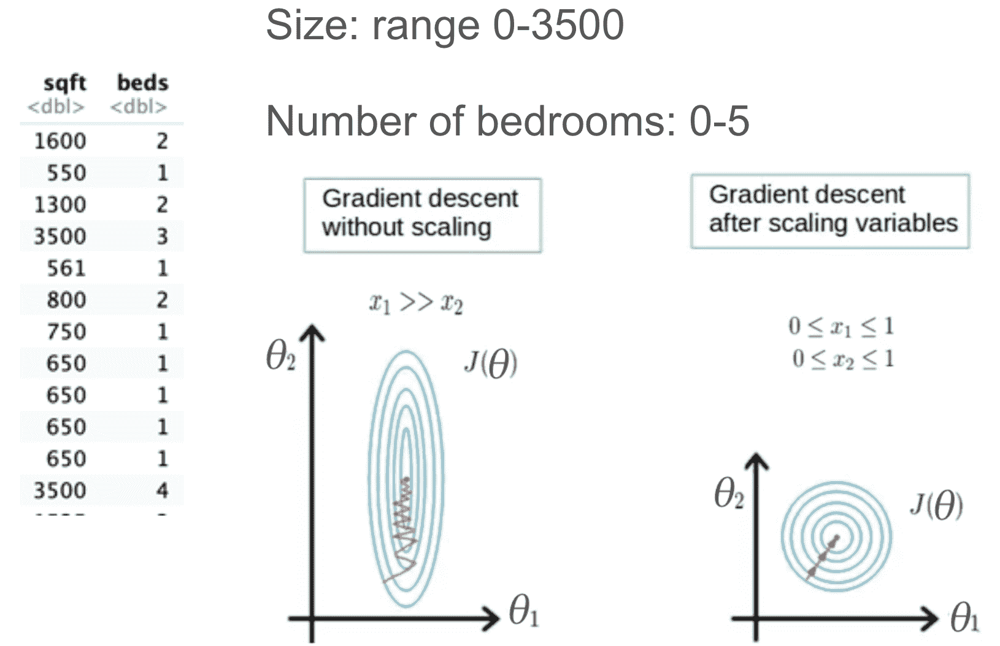

## 2 C++ 中的数据准备与预处理

数据准备是高效**深度学习**（**DL**）工作流的基石。输入数据的表示、结构和质量直接影响模型的学习效率、性能和泛化能力。现代数据通常是异构的，融合了数值、文本、图像和时间序列元素，因此需要能够处理多模态复杂性的预处理流水线。本章探讨 C++ 中的高级**预处理**技术，重点关注性能和生产级流水线，涵盖**结构化**和**非结构化**数据处理、缺失值填补、特征工程、数据增强以及与 PyTorch 的高效集成。

通过详细的代码示例和理论支撑，本章展示了如何设计可扩展的 C++ 预处理工作流，使其在各种数据集上都能高效运行。讨论还将强调预处理与硬件约束、可扩展性和分布式计算之间的相互作用，为生产环境中的高效数据流水线管理提供见解。此外，将特别强调多模态数据处理和领域特定变换，以最大化模型的鲁棒性和实用性。

本章将涵盖以下主题：

- 理解数据预处理在深度学习中的重要性
- 结构化与非结构化数据——综合技术与示例
- 探索归一化和数据增强技术
- 集成 PyTorch Dataset API 以构建数据流水线
- 管理大规模数据集

学完本章后，你将了解如何构建生产级的 C++ 预处理流程：类型安全的加载器（表格/文本/图像/时间序列）；缺失值填补、缩放、分词和特征工程；确定性/即时数据增强；与 PyTorch 的紧密集成；基于 mmap/**单指令多数据**（**SIMD**）的高吞吐并行 I/O；面向分布式训练的分片、缓存和流式处理；以及用于可重现、健壮流水线的模式检查、测试、性能分析和版本控制。

### 技术要求

本节详细说明遵循本章内容所需的先决条件。由于重点在于 C++ 中的数据准备与预处理，你应该有一个可用的 C++ 开发环境，并且能够访问示例中使用的库。

建议使用**兼容 C++17 或更高版本的编译器**。在 Linux 上，这意味着 **GCC 11+** 或 **Clang 14+**。在 Windows 上，建议使用**搭配 Visual Studio 2022 的 MSVC**。在 macOS 上，**Apple Clang 14+** 或更高版本应该可以正常工作。由于许多示例涉及多文件程序和外部依赖，还建议使用 **CMake 3.22 或更高版本**作为主要构建系统。

本章设计为可在 **Linux、Windows 和 macOS** 上运行。大多数示例都是**基于 CPU 的**，因此不需要 GPU。至少 **8 GB 内存**的机器足以进行较小的实验，而建议使用 **16 GB 或更高**内存，以便更顺畅地处理更大的数据集、图像流水线和外部库。

本章使用了多个库。**LibTorch** 用于基于张量的预处理、Dataset API 示例和基于自编码器的降维。**Eigen 3.4+** 和 **Armadillo** 用于矩阵运算、缩放、嵌入和特征变换。**mlpack** 用于缺失值填补、PCA 和 t-SNE 等任务。**OpenCV 4.x** 用于图像预处理示例，包括调整大小、裁剪、直方图均衡化和边缘检测。

某些部分还依赖可选库。**ONNX Runtime** 可用于运行预训练的自然语言处理（NLP）模型，例如用于嵌入、命名实体识别和情感分析的 BERT。**SentencePiece** 可用于子词分词，而 **libstemmer** 支持词干提取示例。对于音频预处理和语谱图生成，建议使用 **FFTW**。

本章的实用最小环境配置包括 **C++17 编译器**、**CMake**、**LibTorch**、**Eigen**、**Armadillo**、**mlpack** 和 **OpenCV**。如果你想同时运行 NLP 和音频示例，还应额外安装 **ONNX Runtime**、**SentencePiece**、**libstemmer** 和 **FFTW**。

在整个章节中，我们会指出某个库何时是可选的，以及何时可以使用更简单的仅 CPU 路径。

### 理解数据预处理在深度学习中的重要性

数据预处理在深度学习中的重要性如下图所示：假设我们想根据两个特征预测房价；即使不考虑缺失值和噪声问题——也就是说，即使数据集完全“干净”——我们仍然必须进行预处理。因为面积特征的取值范围很大，从 `0` 到 `3500`，而卧室特征的范围仅在 0 到 5 之间，这导致模型的代价/损失曲面呈现病态，梯度下降呈之字形震荡，模型难以收敛。对每个特征进行归一化（例如，将 `min-max` 归一化到 `[0,1]`）的预处理可以重塑这些等高线，使其接近圆形，从而实现更大、更稳定的步长，带来更快、更可靠的收敛。



*图 2.1：说明数据预处理重要性的示意图*

在设计模型之前，我们需要驯服数据——从 *图 2.1* 中强调的尺度不匹配开始，再到通常需要排查的问题：缺失值、异常值、不一致的编码、偏斜分布和潜在的数据泄漏。弥合这一差距正是预处理的工作：通过有条理的步骤，将杂乱无章的原始输入转换成尺度可比、表现良好的张量。带着这个目标，让我们看看预处理的作用以及它如何为深度学习准备数据。

#### 预处理的作用

如前所述，原始数据很少能直接用于模型——通常是不完整、有噪声且不一致的。预处理将其转换为结构化、归一化、有意义的表示，以针对深度学习进行优化。

预处理的好处包括以下几点：

- **更快的收敛**，因为归一化输入减少了训练早期的梯度不稳定性
- **降噪**，通过去除无关信息和有影响力的异常值
- **更高的效率**，通过紧凑的表示减少内存占用和计算成本
- **更强的泛化能力**，当数据增强被保守地应用以保持标签语义时
- **多模态支持**，能够在文本、表格、图像和信号数据之间实现共享变换
- **领域特定适配**，流水线针对医疗保健、金融和**计算机视觉**（**CV**）工作负载进行调优

然而，预处理并非没有挑战，包括以下内容：

- 类别不平衡
- 异构数据的跨特征归一化
- 大数据集上的内存/计算限制
- 跨分布式系统的扩展
- 满足实时/近实时要求

让我们首先看看数据的两大类：结构化数据和非结构化数据。

### 结构化与非结构化数据——综合技术与示例

真实世界的数据集分为两大类：结构化数据（具有显式模式的表格/时间序列）和非结构化数据（图像、文本、音频、视频）。虽然两者都需要清洗和归一化，但目标不同——结构化数据强调模式验证、缺失值填补、编码和缩放；非结构化数据则侧重于解码、分词、调整大小/裁剪和数据增强。本节对比这些工作流，并提供简洁、地道的 C++ 模式（LibTorch、Dataset/DataLoader、OpenCV、SentencePiece），可直接用于生产环境。


## 第 2 章

### 结构化数据

结构化数据遵循固定的模式，例如关系数据库或 CSV 文件。示例包括数值测量、类别标签和时间序列。结构化数据通常需要理解其统计属性和领域特定的细微之处，才能实现最优预处理。

结构化数据的一些全面预处理技术如下：

- **处理缺失值**：均值替换、前向填充、后向填充、*k* 近邻（**k-NN**）插补以及基于回归的插补等技术
- **编码类别特征**：独热编码、频率编码、序数编码、二进制编码，以及为**神经网络**（**NN**）输入层定制的嵌入
- **特征缩放与标准化**：方法包括最小-最大缩放、Z-score 标准化、鲁棒缩放、对数变换和幂变换
- **降维**：**主成分分析**（**PCA**）、**t-分布随机邻域嵌入**（**t-SNE**）和**自编码器**（**AEs**），用于减少冗余或噪声特征
- **时间序列工程**：滚动窗口聚合、指数平滑、差分、傅里叶变换和基于时间的特征提取等技术
- **特征交互工程**：多项式特征生成和交互项计算，以增强模型表达能力

### 详细示例

下面来看上一节中提到的预处理技术的详细示例。

#### 处理缺失值

处理缺失值有多种方法：

- **均值替换**：用特征的列均值替换每个缺失值。实现简单、速度快（单次遍历），并能保持特征的尺度不变——适合用作快速基线或在缺失较少时使用。然而，它会扭曲分布、缩小方差并减弱相关性，这可能会使模型产生偏差——尤其是当数据并非完全随机缺失时。

`mean_substitution_example.cpp`:

```cpp
#include <vector>
#include <numeric>

// Replace missing values (NaN) with the mean of the column
std::vector<double> meanSubstitution(const std::vector<double>& data) {
    double sum = 0;
    int count = 0;
    for (const auto& val : data) {
        if (!std::isnan(val)) {
            sum += val;
            count++;
        }
    }
    double mean = sum / count;
    std::vector<double> filledData = data;
    for (auto& val : filledData) {
        if (std::isnan(val)) {
            val = mean;
        }
    }
    return filledData;
}
```

- **前向填充**：将最后一个观测值向前传递，以填充时间序列中后续的缺口。它速度快，能保持短期水平的连续性，并且对有状态信号（例如设备模式）效果良好，但它可能会在较长缺口上传播过时或异常值，并抹平真实的动态变化。

`forward_fill_example.cpp`:

以下代码实现了**前向填充插补**，将每个 NaN 替换为其左侧最近的非缺失值（注意：开头的 NaN 保持不变）：

```cpp
#include <vector>
#include <cmath>

// Replace missing values with the last non-missing value
std::vector<double> forwardFill(const std::vector<double>& data) {
    std::vector<double> filledData = data;
    for (size_t i = 1; i < filledData.size(); ++i) {
        if (std::isnan(filledData[i])) {
            filledData[i] = filledData[i - 1];
        }
    }
    return filledData;
}
```

- **后向填充**：用下一个观测值填充每个缺失点，实质上是沿时间向后传播信息。与前向填充插补一样，它简单高效，但如果用在训练流程中，可能会泄漏未来信息，并且可能过度平滑长缺口。

`backward_fill_example.cpp`:

```cpp
#include <vector>
#include <cmath>

// Replace missing values with the next non-missing value
std::vector<double> backwardFill(const std::vector<double>& data) {
    std::vector<double> filledData = data;
    for (size_t i = filledData.size() - 1; i > 0; --i) {
        if (std::isnan(filledData[i - 1])) {
            filledData[i - 1] = filledData[i];
        }
    }
    return filledData;
}
```

- **k-NN 插补**：通过在两行均观测到的特征子集上计算距离，找到 *k* 个最相似的行来填充缺失值，然后聚合这些邻居（数值型用均值/中位数，类别型用众数；通常按距离加权）。它要求进行特征缩放并仔细选择距离度量（例如欧氏距离或马氏距离）；性能取决于 *k*，并且在高维空间中可能会下降。

`knn_imputation_example.cpp`:

```cpp
int main() {
    using std::numeric_limits; using std::cout; using std::endl;
    double NaN = numeric_limits<double>::quiet_NaN();
    std::vector<std::vector<double>> data = {
        {1.00, 2.00, 3.00},
        {1.10, NaN, 3.20}, // <- target row to impute
        {0.90, 2.10, 2.90},
        {1.20, 1.90, 3.10}
    };
    int targetIndex = 1;
    int k = 2;
    auto print_row = [&](const char* label, const std::vector<double>& r){
        cout << label << " [";
        for (size_t j = 0; j < r.size(); ++j) {
            if (std::isnan(r[j])) cout << "NaN";
            else cout << r[j];
            if (j + 1 < r.size()) cout << ", ";
        }
        cout << "]" << endl;
    };
    print_row("Before:", data[targetIndex]);
    auto imputed = knnImputation(data, k, targetIndex);
    print_row("After: ", imputed);
    return 0;
}
```

- **基于回归的插补**：通过在该特征存在的行上训练模型，然后将其应用于缺口，从而从其他观测特征预测该特征的缺失值。模型可以是线性的（岭回归/Lasso）或非线性的（随机森林/**梯度提升机**（**GBMs**）），并且应在每个训练折*内部*（或通过交叉拟合）进行拟合，以避免数据泄漏。

`regression_imputation_example.cpp`:

```cpp
#include <vector>
#include <cmath>

// Replace missing values using linear regression coefficients
std::vector<double> regressionImputation(const std::vector<double>& target, const std::vector<double>& predictor, double slope, double intercept) {
    std::vector<double> filledData = target;
    for (size_t i = 0; i < filledData.size(); ++i) {
        if (std::isnan(filledData[i])) {
            filledData[i] = slope * predictor[i] + intercept;
        }
    }
    return filledData;
}
```

#### 编码类别特征

下面来看编码类别特征的技术：

- **独热编码**：将具有 *N* 个类别的类别特征转换为 *N* 个二进制列（当前类别为 1，否则为 0），避免虚假的序数关系，并在线性/NN 模型中表现良好。注意高基数特征可能导致维度爆炸——可以使用 `<UNK>` 桶、哈希或正则化来缓解。
- 当类别特征的所有独热指示变量都被保留时，它们按构造必然是线性相关的，因为每个样本恰好只有一个指示变量为激活状态。对于线性模型，可以通过省略一个类别作为参考水平，或对系数施加显式约束（例如零和约束）来消除这种共线性。这些调整恢复了可辨识性，主要影响系数的解释而非预测性能，并且对于正则化模型或基于树的模型通常不是必需的。

`one_hot_example.cpp`:

```cpp
#include <vector>
#include <map>
#include <string>
```


## 第二章：C++ 中的数据准备与预处理

```cpp
// Convert categorical variables into binary vectors
std::vector<std::vector<int>> oneHotEncode(const std::vector<std::string>& categories) {
    std::map<std::string, int> categoryMap;
    int index = 0;
    for (const auto& cat : categories) {
        if (categoryMap.find(cat) == categoryMap.end()) {
            categoryMap[cat] = index++;
        }
    }
    std::vector<std::vector<int>> encoded(categories.size(), std::vector<int>(categoryMap.size(), 0));
    for (size_t i = 0; i < categories.size(); ++i) {
        encoded[i][categoryMap[categories[i]]] = 1;
    }
    return encoded;
}
```

- **频数编码**：将每个类别映射为它在训练数据中出现的次数或相对频率，生成一个单一的数值特征，既保留了类别流行度，又不会导致维度爆炸。在每个训练折内分别计算频数以避免数据泄漏，并可考虑使用对数频数或截断来处理长尾类别。

代码示例 `frequency_encode_example.cpp`：

```cpp
#include <vector>
#include <map>
#include <string>

// Encode categories based on their frequency
std::vector<int> frequencyEncode(const std::vector<std::string>& categories) {
    std::map<std::string, int> freqMap;
    for (const auto& cat : categories) {
        freqMap[cat]++;
    }
    std::vector<int> encoded;
    for (const auto& cat : categories) {
        encoded.push_back(freqMap[cat]);
    }
    return encoded;
}
```

- **序数编码**：将类别映射为体现有意义顺序的整数（例如 XS < S < M < L < XL），生成一个保留排序关系的单一数值特征。仅当顺序确实存在时才可使用，否则会引入虚假的序数关系；在训练集上拟合映射，并将未见过的类别路由到 `<UNK>` 编码。

代码示例：`ordinal_encode_example.cpp`

```cpp
#include <vector>
#include <map>
#include <string>

// Assign an ordinal value to each category
std::vector<int> ordinalEncode(const std::vector<std::string>& categories) {
    std::map<std::string, int> categoryMap;
    int index = 0;
    for (const auto& cat : categories) {
        if (categoryMap.find(cat) == categoryMap.end()) {
            categoryMap[cat] = index++;
        }
    }
    std::vector<int> encoded;
    for (const auto& cat : categories) {
        encoded.push_back(categoryMap[cat]);
    }
    return encoded;
}
```

- **二进制编码**：先将每个类别映射为一个整数 ID，再将该 ID 表示为二进制的 ⌈log₂N⌉ 位，从而大幅降低维度。注意事项：它会引入伪序数结构和虚假的邻近性；应在训练集上拟合 ID，并为未见过的类别保留一个 `<UNK>` 标记。

代码示例：`binary_encoding_demo.cpp`

```cpp
#include <vector>
#include <string>
#include <bitset>

// Convert categories to binary-encoded values
std::vector<std::string> binaryEncode(const std::vector<int>& categories) {
    std::vector<std::string> encoded;
    for (const auto& cat : categories) {
        encoded.push_back(std::bitset<8>(cat).to_string());
    }
    return encoded;
}
```

- **嵌入编码**：将每个类别表示为一个与模型联合训练得到的稠密向量，既能捕捉类别之间的相似性，又避免了独热编码的维度爆炸。请为未见过的类别使用 `<UNK>/OOV` 标记，并保持适当的嵌入维度，配合正则化以避免过拟合。

下面的代码实现了一个简易的类别嵌入编码器：它将每个唯一的字符串类别映射为索引，构建一个（`num_categories` × `embeddingSize`）的嵌入表，表中填充确定性的正弦值（sin(i + j)），并为每个输入类别返回对应的嵌入向量：

```cpp
#include <vector>
#include <map>
#include <string>
#include <cmath>

// Dummy embedding logic
std::vector<std::vector<double>> embeddingEncode(const std::vector<std::string>& categories, int embeddingSize) {
    std::map<std::string, int> categoryMap;
    int index = 0;
    for (const auto& cat : categories) {
        if (categoryMap.find(cat) == categoryMap.end()) {
            categoryMap[cat] = index++;
        }
    }
    std::vector<std::vector<double>> embeddings(categoryMap.size(), std::vector<double>(embeddingSize, 0));
    for (size_t i = 0; i < embeddings.size(); ++i) {
        for (size_t j = 0; j < embeddingSize; ++j) {
            embeddings[i][j] = std::sin(i + j); // Example: sinusoidal encoding
        }
    }
    std::vector<std::vector<double>> encoded;
    for (const auto& cat : categories) {
        encoded.push_back(embeddings[categoryMap[cat]]);
    }
    return encoded;
}
```

### 特征缩放与标准化

特征缩放与标准化的常用技术如下：

- **最小-最大缩放**：通过 (x-最小值)/(最大值-最小值) 将特征线性映射到固定区间（通常是 `[0,1]`），保留相对距离。它简单快速，但对异常值敏感——应在训练集上估计取值范围，并考虑使用截断或稳健变体。

代码示例：`minmax_scale_demo.cpp`

```cpp
#include <vector>
#include <algorithm>

// Scale features to a specific range [minRange, maxRange]
std::vector<double> minMaxScale(const std::vector<double>& data, double minRange, double maxRange) {
    double minVal = *std::min_element(data.begin(), data.end());
    double maxVal = *std::max_element(data.begin(), data.end());
    std::vector<double> scaledData;
    for (const auto& val : data) {
        double scaled = minRange + ((val - minVal) / (maxVal - minVal)) * (maxRange - minRange);
        scaledData.push_back(scaled);
    }
    return scaledData;
}
```

- **Z-score 标准化**：使用 (x-均值)/标准差 将特征标准化为零均值和单位方差（其中均值和标准差在训练集上计算），使特征具有可比性并稳定优化过程。它适用于近似高斯分布的数据，但对异常值敏感；若存在重尾分布，可考虑稳健缩放。

代码示例：`zscore_normalize_demo.cpp`

```cpp
#include <vector>
#include <cmath>
#include <numeric>

// Standardize features to have a mean of 0 and standard deviation of 1
std::vector<double> zScoreNormalize(const std::vector<double>& data) {
    double mean = std::accumulate(data.begin(), data.end(), 0.0) / data.size();
    double variance = 0.0;
    for (const auto& val : data) {
        variance += std::pow(val - mean, 2);
    }
    variance /= data.size();
    double stddev = std::sqrt(variance);
    std::vector<double> normalizedData;
    for (const auto& val : data) {
        normalizedData.push_back((val - mean) / stddev);
    }
    return normalizedData;
}
```

- **稳健缩放**：以中位数为中心，并按**四分位距**（IQR = Q3-Q1）进行缩放：即 (x-中位数)/IQR，使其对异常值和重尾分布具有鲁棒性。应在训练集上计算统计量；当 IQR 接近零时，使用截断或回退策略加以防范。

代码示例：`scaling.robust_scale_demo.cpp`

```cpp
#include <vector>
#include <algorithm>

// Scale features using the median and interquartile range (IQR)
std::vector<double> robustScale(const std::vector<double>& data) {
    std::vector<double> sortedData = data;
    std::sort(sortedData.begin(), sortedData.end());
    double median = sortedData[sortedData.size() / 2];
    double q1 = sortedData[sortedData.size() / 4];
    double q3 = sortedData[3 * sortedData.size() / 4];
    double iqr = q3 - q1;
    std::vector<double> scaledData;
    for (const auto& val : data) {
        scaledData.push_back((val - median) / iqr);
    }
    return scaledData;
}
```

- **对数变换**：压缩较大数值并降低右偏，通常能稳定方差并改善线性模型的拟合效果。使用 `log1p(x)` 来处理零值；对于负数或混合符号数据，可考虑使用 Yeo-Johnson 变换；同时务必在训练集上计算参数，以避免数据泄漏。

代码示例：`log_transform_demo.cpp`

```cpp
#include <vector>
#include <cmath>

// Apply a log transformation to reduce skewness in data
std::vector<double> logTransform(const std::vector<double>& data) {
    std::vector<double> transformedData;
    for (const auto& val : data) {
        transformedData.push_back(std::log(val));
    }
    return transformedData;
}
```


```cpp
transformedData.push_back(std::log1p(val)); // log(1 + x) to handle zero values
}
return transformedData;
}
```

- **幂变换**：应用单调幂函数（例如，Box-Cox 用于 x>0，Yeo-Johnson 用于 x∈R）来稳定方差并使特征更接近高斯分布，从而改善线性模型的假设和优化。通过训练集上的**最大似然估计**（**MLE**）/交叉验证选择 λ；当存在零或负值时使用 Yeo-Johnson。

- `power_transform_demo.cpp`:

```cpp
#include <vector>
#include <cmath>

// Apply a power transformation to stabilize variance
std::vector<double> powerTransform(const std::vector<double>& data, double power) {
    std::vector<double> transformedData;
    for (const auto& val : data) {
        transformedData.push_back(std::pow(val, power));
    }
    return transformedData;
}
```

### 降维

降维技术包括以下内容：

- **PCA**：将数据投影到最大方差的正交方向上，压缩特征、减少噪声并使输入去相关。仅拟合训练集；先标准化，然后根据解释方差（例如95%）或交叉验证选择分量。（请先用Eigen安装。）

- `pca_demo.cpp`:

```cpp
#include <vector>
#include <Eigen/Dense>

// Perform PCA to reduce data dimensions
Eigen::MatrixXd performPCA(const Eigen::MatrixXd& data, int numComponents) {
    Eigen::MatrixXd mean = data.colwise().mean();
    Eigen::MatrixXd centered = data.rowwise() - mean;
    Eigen::MatrixXd cov = (centered.adjoint() * centered) / double(data.rows() - 1);
    Eigen::SelfAdjointEigenSolver<Eigen::MatrixXd> solver(cov);
    Eigen::MatrixXd eigenvectors = solver.eigenvectors().rightCols(numComponents);
    return centered * eigenvectors;
}
```

- **t-SNE**：一种非线性技术，将高维数据映射到2D/3D以进行可视化，保留局部邻域但不保留全局距离（簇间间隙没有意义）。它对困惑度/学习率/种子敏感，并且不是自然的归纳式方法——如果需要嵌入新点，请使用参数化t-SNE或**均匀流形近似与投影**（**UMAP**）。

- `tsne_demo.cpp`:

```cpp
#include <vector>
#include "TSNE.h" // External library required

// Use t-SNE for visualizing high-dimensional data
std::vector<std::vector<double>> performTSNE(const std::vector<std::vector<double>>& data, int dimensions = 2) {
    TSNE tsne;
    std::vector<std::vector<double>> reducedData;
    tsne.run(data, reducedData, dimensions);
    return reducedData;
}
```

- **AEs**：通过低维瓶颈重构输入来学习非线性降维，产生紧凑、任务有用的嵌入。诸如**去噪**和**变分自编码器**（**VAE**）等变体可提高鲁棒性或施加概率结构；标准化输入并仅在训练集上拟合以避免泄漏。

- `autoencoder_demo.cpp`:

```cpp
struct AE : torch::nn::Module {
    torch::nn::Linear enc{nullptr}, dec{nullptr};
    AE(int d, int h){ enc=register_module("enc", torch::nn::Linear(d,h));
        dec=register_module("dec", torch::nn::Linear(h,d)); }
    torch::Tensor forward(torch::Tensor x){ return dec(torch::relu(enc(x))); }
};
```

### 时间序列工程

现在，让我们继续介绍时间序列工程技术：

- **滚动窗口聚合**：在滑动时间窗口上计算特征（例如，均值、总和、标准差、最小/最大值、**指数移动平均**（**EMA**））以捕获局部水平和波动性。仔细选择滞后窗口与居中窗口，处理边缘效应/缺失数据，并避免训练中的前视泄漏。

- `rolling_mean_demo.cpp`:

```cpp
#include <vector>

// Compute rolling averages over a fixed window size
std::vector<double> rollingMean(const std::vector<double>& data, int windowSize) {
    std::vector<double> result(data.size(), 0.0);
    for (size_t i = 0; i <= data.size() - windowSize; ++i) {
        double sum = 0;
        for (int j = 0; j < windowSize; ++j) {
            sum += data[i + j];
        }
        result[i + windowSize - 1] = sum / windowSize;
    }
    return result;
}
```

- **指数平滑**：通过对过去观测值应用几何衰减权重来生成平滑水平（以及短期预测）：，0<α<1。诸如Holt（趋势）和Holt-Winters（趋势+季节性）等扩展可处理更丰富的时间序列动态；在训练集上调整参数以避免泄漏。

- `exponential_smoothing_demo.cpp`:

```cpp
#include <vector>

// Apply exponential smoothing
std::vector<double> exponentialSmoothing(const std::vector<double>& data, double alpha) {
    std::vector<double> smoothed(data.size(), 0.0);
    smoothed[0] = data[0];
    for (size_t i = 1; i < data.size(); ++i) {
        smoothed[i] = alpha * data[i] + (1 - alpha) * smoothed[i - 1];
    }
    return smoothed;
}
```

- **差分**：将序列转换为变化而非水平——例如，一阶差分（或季节性差分）——以去除趋势/季节性并促进平稳性。使用所需的最小阶数（过度差分会放大噪声），因果计算以避免泄漏，并记得通过累积求和进行反转以用于预测。

- `differencing_demo.cpp`:

```cpp
#include <vector>

// Perform first-order differencing to remove trends
std::vector<double> differencing(const std::vector<double>& data) {
    std::vector<double> differencedData;
    for (size_t i = 1; i < data.size(); ++i) {
        differencedData.push_back(data[i] - data[i - 1]);
    }
    return differencedData;
}
```

- **傅里叶变换**：将信号分解为正弦分量，暴露主频率/周期和频谱功率，用于特征或季节性建模（通过**快速傅里叶变换**（**FFT**））。在训练窗口上应用，并进行去趋势/加窗以减少频谱泄漏，同时因果计算以避免前视。

- `fft_demo.cpp`:

```cpp
#include <vector>
#include <complex>

// Apply Fourier Transformation
std::vector<std::complex<double>> performFFT(const std::vector<double>& data) {
    size_t n = data.size();
    std::vector<std::complex<double>> transformed(n);
    for (size_t k = 0; k < n; ++k) {
        std::complex<double> sum(0.0, 0.0);
        for (size_t t = 0; t < n; ++t) {
            double angle = 2 * M_PI * t * k / n;
            sum += std::polar(data[t], -angle);
        }
        transformed[k] = sum;
    }
    return transformed;
}
```

- **基于时间的特征提取**：直接从时间戳中提取基于日历和时钟的预测因子，例如一天中的小时、一周中的星期几、月份、季度、周末标志和节假日指示器。当季节性、商业周期或人类行为影响目标变量时，这些特征尤其有用。诸如一天中的小时或一年中的月份等周期性变量通常使用正弦和余弦变换进行编码，以保留其周期性。与其他时间序列预处理步骤一样，特征应以因果方式生成，以避免来自未来时间戳的泄漏。


- `time_feature_demo.cpp`:

  ```cpp
  #include <cmath>

  struct TimeFeatures {
      int hour;
      int dayOfWeek;
      int month;
      double hourSin;
      double hourCos;
  };

  TimeFeatures extractTimeFeatures(int hour, int dayOfWeek, int month)
  {
      TimeFeatures f;
      f.hour = hour;
      f.dayOfWeek = dayOfWeek;
      f.month = month;
      f.hourSin = std::sin(2.0 * M_PI * hour / 24.0);
      f.hourCos = std::cos(2.0 * M_PI * hour / 24.0);
      return f;
  }
  ```

因此，序列变为：

- 滚动窗口聚合
- 指数平滑
- 差分
- 傅里叶变换
- 基于时间的特征提取

### 特征交互工程

以下是特征交互工程技术：

- **多项式特征生成**：通过幂次和交互项扩展输入（例如，），使线性模型能够捕捉曲线和交叉效应。使用适度的阶数，先进行标准化，并应用正则化（岭回归/Lasso）来抑制多重共线性和特征爆炸。

- `polynomial_features_demo.cpp`:

  ```cpp
  #include <vector>

  // Generate polynomial features of degree 2
  std::vector<std::vector<double>> generatePolynomialFeatures(const std::vector<double>& data) {
      std::vector<std::vector<double>> polynomialFeatures;
      for (const auto& val : data) {
          polynomialFeatures.push_back({val, val * val});
      }
      return polynomialFeatures;
  }
  ```

- **交互项**：将特征相乘或组合（例如，或），以捕捉纯线性项遗漏的非加法效应。结合领域知识谨慎添加，先进行标准化/中心化以限制多重共线性，并使用正则化或特征选择来防止过拟合。

- `interaction_terms_demo.cpp`:

  ```cpp
  #include <vector>

  // Compute interaction terms between features
  std::vector<std::vector<double>> computeInteractionTerms(const std::vector<std::vector<double>>& features) {
      std::vector<std::vector<double>> interactionTerms(features.size());
      for (size_t i = 0; i < features.size(); ++i) {
          for (size_t j = 0; j < features[i].size(); ++j) {
              for (size_t k = j + 1; k < features[i].size(); ++k) {
                  interactionTerms[i].push_back(features[i][j] * features[i][k]);
              }
          }
      }
      return interactionTerms;
  }
  ```

本节阐述了*是什么*——缺失值填充、编码、缩放、降维、时间序列特征和交互——以便你理解目标和陷阱（数据泄漏、稳定性、队列效应）。接下来，让我们用 C++ 库来解决*怎么做*：同样的技术通过 Eigen/Armadillo、mlpack/oneDAL 和 FFT 后端（可选 GPU 上的 cuBLAS/cuFFT/cuML）实现，以获得简洁的代码、更好的数值稳定性和生产级速度。

### 库驱动的预处理（相同技术，更少的代码）

本节重新审视了你之前看到的相同预处理技术（缺失值填充、编码、缩放、降维、时间序列操作），但使用成熟支持的 C++ 库来实现。数学原理和意图没有改变；库主要为你提供简洁的代码、速度（SIMD/GPU）和经过实战检验的数值算法。在相关之处，我们会指出库特有的变体（例如，基于奇异值分解（SVD）与基于特征值分解（EVD）的 PCA、FFT 后端）以及任何 API 细节，但从概念上讲，这些仍然是相同的预处理。

我们还可以使用现有的库以少得多的代码完成相同的预处理：

- **dlib**：机器学习和数据处理工具
- **Eigen**：用于变换和嵌入的线性代数库
- **mlpack**：可扩展的机器学习与预处理
- **Armadillo**：用于数据处理的线性代数库
- **开放神经网络交换（ONNX）运行时**：用于降维和嵌入的预训练模型
- **OpenCV**：图像和数据操作（例如，用于傅里叶变换）。
- **libtorch**：面向 C++ 的 PyTorch 绑定

### 使用 mlpack 处理缺失值

让我们看看如何使用 mlpack 处理缺失值（为此，你需要安装 mlpack 和 Armadillo）。这里，我们通过 mlpack 加载一个 Armadillo 矩阵，然后填充列均值并进行前向填充——这与之前的技术相同，但使用 Armadillo 操作完成。这种方法可靠、简洁且快速。

- `mlpack_impute_demo.cpp`:

  ```cpp
  #include <mlpack/core.hpp>
  #include <mlpack/methods/imputation/map.hpp>

  arma::mat data;
  mlpack::data::Load("data.csv", data); // Load data into Armadillo matrix

  // Mean Substitution
  mlpack::data::MeanImputation<double> meanImputer;
  meanImputer.Impute(data, 0, arma::datum::nan, 0);

  // Forward Fill
  mlpack::data::MapImputation<double> forwardImputer(
      [](double prev, double curr) { return std::isnan(curr) ? prev : curr; });
  forwardImputer.Impute(data, 0, arma::datum::nan, 0);

  // Save processed data
  mlpack::data::Save("processed_data.csv", data);
  ```

### 使用 mlpack 和标准模板库（STL）编码分类特征

你可以使用 mlpack 和 STL 执行分类特征编码，如下所示：

- `mlpack_encoding_demo_min.cpp`:

  ```cpp
  #include <mlpack/core.hpp>
  #include <unordered_map>
  #include <string>
  #include <vector>

  // One-Hot Encoding
  std::unordered_map<std::string, int> categoryToIndex;
  int index = 0;
  for (const auto& category : categories) {
      if (categoryToIndex.find(category) == categoryToIndex.end()) {
          categoryToIndex[category] = index++;
      }
  }

  arma::mat oneHotMatrix(categories.size(), categoryToIndex.size(), arma::fill::zeros);
  for (size_t i = 0; i < categories.size(); ++i) {
      oneHotMatrix(i, categoryToIndex[categories[i]]) = 1;
  }

  // Frequency Encoding
  std::unordered_map<std::string, int> frequency;
  for (const auto& category : categories) {
      frequency[category]++;
  }

  arma::vec frequencyEncoded(categories.size());
  for (size_t i = 0; i < categories.size(); ++i) {
      frequencyEncoded(i) = frequency[categories[i]];
  }
  ```

### 使用 Armadillo 进行特征缩放与标准化

使用 Armadillo，我们可以执行特征缩放和标准化，如下所示：

- `armadillo_scaling_demo.cpp`:

  ```cpp
  #include <armadillo>

  // Min-Max Scaling
  arma::mat minMaxScaled = (data - arma::min(data)) / (arma::max(data) - arma::min(data));

  // Z-Score Normalization
  arma::mat zScoreNormalized = (data - arma::mean(data)) / arma::stddev(data);

  // Robust Scaling
  arma::mat q1 = arma::quantile(data, 0.25);
  arma::mat q3 = arma::quantile(data, 0.75);
  arma::mat robustScaled = (data - arma::median(data)) / (q3 - q1);

  // Log Transformation
  arma::mat logTransformed = arma::log(1 + data);

  // Power Transformation
  arma::mat powerTransformed = arma::pow(data, 0.5);
  ```

### 降维

降维可以按如下方式进行：

- **使用 mlpack**：

  - `pca_mlpack4_demo.cpp`:

    ```cpp
    #include <mlpack/methods/pca/pca.hpp>
    #include <mlpack/methods/tsne/tsne.hpp>

    // PCA
    mlpack::pca::PCA<> pca;
    arma::mat reducedData;
    pca.Apply(data, reducedData, 2); // Reduce to 2 components

    // t-SNE
    mlpack::tsne::TSNE<> tsne;
    arma::mat tsneResult;
    tsne.Apply(data, tsneResult, 2); // Reduce to 2 dimensions
    ```

- **使用 libtorch 进行自编码器（AE）**：

  - `autoencoder_libtorch_demo.cpp`:

    ```cpp
    #include <torch/torch.h>

    // Define autoencoder
    struct Autoencoder : torch::nn::Module {
        torch::nn::Linear encoder{nullptr}, decoder{nullptr};

        Autoencoder(int inputDim, int hiddenDim) {
            encoder = register_module("encoder", torch::nn::Linear(inputDim, hiddenDim));
            decoder = register_module("decoder", torch::nn::Linear(hiddenDim, inputDim));
        }

        torch::Tensor forward(torch::Tensor x) {
            x = torch::relu(encoder->forward(x));
            return decoder->forward(x);
        }
    };
    ```


```cpp
}
};

torch::Tensor autoencode(torch::Tensor data, int hiddenDim) {
    int inputDim = data.size(1);
    Autoencoder model(inputDim, hiddenDim);
    auto optimizer = torch::optim::Adam(model.parameters(), 0.01);
    for (int epoch = 0; epoch < 100; ++epoch) {
        optimizer.zero_grad();
        auto output = model.forward(data);
        auto loss = torch::mse_loss(output, data);
        loss.backward();
        optimizer.step();
    }
    return model.encoder->forward(data);
}
```

#### 使用 mlpack 和 OpenCV 进行时间序列工程

我们可以使用 mlpack 和 OpenCV 按如下方式执行时间序列工程：

- `ts_preproc_armadillo_opencv_demo.cpp`：

```cpp
#include <mlpack/core.hpp>
#include <opencv2/opencv.hpp>

// Rolling Window Aggregation
arma::mat rollingMean = arma::conv(data, arma::ones(5) / 5, "same");

// Exponential Smoothing
arma::mat smoothed(data.n_rows, data.n_cols);
smoothed.row(0) = data.row(0);
for (size_t i = 1; i < data.n_rows; ++i) {
    smoothed.row(i) = 0.3 * data.row(i) + 0.7 * smoothed.row(i - 1);
    // Alpha = 0.3
}

// Differencing
arma::mat differenced = data.rows(1, data.n_rows - 1) - data.rows(0, data.n_rows - 2);

// Fourier Transform
cv::Mat fftResult;
cv::dft(cv::Mat(data), fftResult, cv::DFT_COMPLEX_OUTPUT);
```

#### 使用 Armadillo 进行特征交互工程

以下是如何在特征交互工程中使用 Armadillo 的示例：

- 使用以下 Armadillo 代码片段从矩阵数据（`rows` = 样本，`cols` = 特征）构造多项式（平方）特征和两两交互项；它会先追加平方列，然后构建所有特征间的乘积：

```cpp
#include <armadillo>

// Polynomial Features
arma::mat polyFeatures(data.n_rows, data.n_cols * 2);
polyFeatures.cols(0, data.n_cols - 1) = data;
polyFeatures.cols(data.n_cols, polyFeatures.n_cols - 1) = arma::square(data);

// Interaction Terms
arma::mat interactionTerms(data.n_rows, data.n_cols * (data.n_cols - 1) / 2);
size_t col = 0;
for (size_t i = 0; i < data.n_cols; ++i) {
    for (size_t j = i + 1; j < data.n_cols; ++j) {
        interactionTerms.col(col++) = data.col(i) % data.col(j);
    }
}
```

在深入探讨之前，我们从**结构化/表格型**信号转向**非结构化**模态。目标保持不变——在不泄漏的情况下进行清洗、规范化和合理的增强——但基本操作发生了变化：**自然语言处理**（NLP）中的分词和文本规范化，**图像**中的尺寸调整/色彩空间规范化和几何增强，**音频**中的重采样/去噪和频谱图（例如，**梅尔频率倒谱系数**（MFCCs）），以及**视频**中的帧采样和时间增强。接下来，我们将在按模态分类的标题（例如，*图像归一化*、*文本分词*）下复刻前面的技术，并展示简洁、基于库的解决方案（OpenCV、libtorch、tokenizers/ONNX），用更少的代码实现同样的目标。

### 非结构化数据

非结构化数据包括图像、文本数据、音频和视频。这些格式缺乏内在组织，需要专门的技术将其预处理为模型兼容的表示。非结构化数据的动态特性要求灵活且模块化的预处理方法，以适应不断变化的模型需求和数据特征。

在本节中，我们将介绍非结构化数据的全面预处理技术。

#### 文本数据

文本数据的预处理技术包括：

- 分词、停用词去除、词干提取和大小写规范化
- 基于嵌入的向量化，使用**全局词向量表示**（GloVe）、Word2Vec 或 Transformers（例如，**来自 Transformers 的双向编码器表示**（BERT））
- 序列填充和截断，以统一模型输入长度
- 高级技术，例如**命名实体识别**（NER）、情感分析和词形还原

以下示例使用了成熟的 C++ 库来处理 NLP 任务。这些库简化了流程，使您可以用最少的代码执行分词、嵌入和文本预处理等任务。

C++ 中用于 NLP 和预处理的库包括：

- **SentencePiece（C++）**：子词分词（**字节对编码**（BPE）/Unigram）；Unicode 安全
- **libstemmer（Snowball，C）**：快速词干提取（Porter2 等），带有可从 C++ 调用的简单 C API
- **ICU/Boost.Locale**：提供 Unicode 规范化、大小写折叠和分割功能
- **Eigen/Armadillo**：用于加载/平均词向量及其他变换的线性代数库
- **FastText/GloVe（文件）**：可以加载到 Eigen/Armadillo 中的预训练词向量
- **ONNX Runtime（C/C++）**：无需 Python 即可运行导出的 Transformer 模型（BERT/**稳健优化的 BERT 预训练方法**（RoBERTa）、NER、情感分析）
- **UDPipe（C++）**：分词 + **词性标注**（POS）+ **词形还原**（支持多种语言），并带有预训练模型

让我们详细回顾这些技术。

#### 分词、停用词去除、词干提取

让我们看看如何使用标准 C++ 和 libstemmer 进行经典的文本清理；如果您需要模型兼容的 ID，可以换用 SentencePiece 进行子词分词：

- `tokenize_stem_demo.cpp`：

```cpp
std::vector<std::string> tokenizeWords(const std::string &s)
{
    static const std::regex rx(R"([A-Za-z]+(?:'[A-Za-z]+)?)");
    std::sregex_iterator it(s.begin(), s.end(), rx), end;
    std::vector<std::string> out;
    for (; it != end; ++it)
    {
        std::string t = it->str();
        std::transform(t.begin(), t.end(), t.begin(), ::tolower);
        out.push_back(std::move(t));
    }
    return out;
}

std::vector<std::string> removeStop(const std::vector<std::string> &toks)
{
    static const std::unordered_set<std::string> stop = {
        "a", "an", "the", "and", "or", "but", "if", "in", "on", "of",
        "to", "for", "is", "are", "was", "were", "with", "as", "by", "at"
    };
    std::vector<std::string> out;
    out.reserve(toks.size());
    for (const auto &w : toks)
    {
        if (!stop.count(w))
        {
            out.push_back(w);
        }
    }
    return out;
}

std::vector<std::string> stemEnglish(const std::vector<std::string> &toks)
{
    std::vector<std::string> out;
    out.reserve(toks.size());
    sb_stemmer *st = sb_stemmer_new("english", nullptr);
    for (const auto &w : toks)
    {
        const sb_symbol *s = sb_stemmer_stem(
            st,
            (const sb_symbol *)w.data(),
            (int)w.size()
        );
        out.emplace_back((const char *)s, sb_stemmer_length(st));
    }
    sb_stemmer_delete(st);
    return out;
}
```

#### 基于嵌入的向量化

让我们看看如何使用预训练的 GloVe 和 Eigen 将词元转换为向量——这与手动部分中关于独热/频率/序数编码和基本词元到向量映射的向量化概念相同——现在通过简洁的向量化库操作来实现，以提高速度和清晰度：

- `glove_eigen_demo.cpp`：

```cpp
#include <Eigen/Dense>
#include <unordered_map>
#include <fstream>
#include <sstream>
#include <vector>
#include <string>

using EmbMap = std::unordered_map<std::string, Eigen::VectorXd>;

EmbMap loadGlove(const std::string &path, int dim)
{
    EmbMap E;
    std::ifstream f(path);
    std::string line, w;
    while (std::getline(f, line))
    {
        std::istringstream ss(line);
        if (!(ss >> w))
        {
            continue;
        }
        Eigen::VectorXd v(dim);
        for (int i = 0; i < dim; ++i)
        {
            ss >> v[i];
        }
```


## 第2章：C++中的数据准备与预处理

```cpp
}
E.emplace(std::move(w), std::move(v));
}
return E;
}

Eigen::MatrixXd embedTokens(
    const std::vector<std::string> &toks,
    const EmbMap &E,
    int dim
)
{
    Eigen::MatrixXd M = Eigen::MatrixXd::Zero(toks.size(), dim);
    for (size_t i = 0; i < toks.size(); ++i)
    {
        auto it = E.find(toks[i]);
        if (it != E.end())
        {
            M.row(i) = it->second.transpose();
        }
    }
    return M;
}
```

#### 上下文嵌入（通过ONNX Runtime的BERT）

要使用ONNX Runtime生成上下文嵌入，请从你的分词器中传递令牌ID和掩码（例如，通过SentencePiece或Hugging Face分词器的C API）：

-   `bert_onnx_demo.cpp`：

```cpp
#include <onnxruntime/onnxruntime_cxx_api.h>
#include <vector>
#include <array>

std::vector<float> runBertCLS(
    const std::vector<int64_t> &ids,
    const std::vector<int64_t> &mask,
    const char *model_path
)
{
    Ort::Env env{ORT_LOGGING_LEVEL_ERROR, "bert"};
    Ort::Session session{env, model_path, Ort::SessionOptions{}};
    std::array<int64_t, 2> shape{1, (int64_t)ids.size()};
    auto mem = Ort::MemoryInfo::CreateCpu(
        OrtArenaAllocator,
        OrtMemTypeDefault
    );
    auto t_ids = Ort::Value::CreateTensor<int64_t>(
        mem,
        const_cast<int64_t *>(ids.data()),
        ids.size(),
        shape.data(),
        2
    );
    auto t_mask = Ort::Value::CreateTensor<int64_t>(
        mem,
        const_cast<int64_t *>(mask.data()),
        mask.size(),
        shape.data(),
        2
    );
    const char *in_names[] = {"input_ids", "attention_mask"};
    const char *out_names[] = {"last_hidden_state"}; // or "logits", etc.
    Ort::Value in_vals[] = {
        std::move(t_ids),
        std::move(t_mask)
    };
    auto outs = session.Run(
        Ort::RunOptions{},
        in_names,
        in_vals,
        2,
        out_names,
        1
    );
    float *p = outs[0].GetTensorMutableData<float>();
    return std::vector<float>(p, p + 768); // adjust hidden size if needed
}
```

#### 序列填充与截断（仅头文件的辅助工具）

让我们看看如何将分词后的ID序列填充/截断到固定长度（为Transformer做好准备）：

-   `pad_truncate_demo.cpp`：

```cpp
#include <vector>
#include <algorithm>

// Pad/truncate to fixed length (e.g., Transformer input)
template <class T>
std::vector<T> padOrTruncate(const std::vector<T>& ids, size_t max_len, T pad) {
    if (ids.size() >= max_len) return {ids.begin(), ids.begin() + max_len};
    auto out = ids; out.resize(max_len, pad); return out;
}

// 1 for real tokens, 0 for padding
inline std::vector<int64_t> makeMask(size_t len, size_t max_len) {
    std::vector<int64_t> m(std::min(len, max_len), 1); m.resize(max_len, 0); return m;
}
```

#### 高级技术 – 命名实体识别/情感分析/词形还原（ONNX Runtime）

NER、情感分析和词形还原是核心的NLP任务：NER定位并标注文本中的真实世界实体；情感分析对作者的态度进行分类（例如正面/负面）；词形还原则将单词还原为词典中的基本形式，以规范化语言。现代Transformer模型为NER和情感分析学习丰富的上下文，而词形还原依赖于语言学规则和词典，共同为下游应用形成干净、结构化的信号。

让我们看看如何用C++运行这些经典任务：

-   `nlp_advanced_demo.cpp`：

```cpp
// NER (ONNX Runtime, dtype-aware INT32/INT64).
void run_ner(const std::string& onnx_path) {
    Ort::Env env(ORT_LOGGING_LEVEL_WARNING, "ner");
    Ort::Session sess(env, onnx_path.c_str(), Ort::SessionOptions{});
    // Toy example: [CLS] John lives in New York . [SEP]
    std::vector<i64> ids{101,2198,3268,1999,2047,2259,1012,102};
    std::vector<i64> ones(ids.size(),1), zeros(ids.size(),0);
    Shape2 shp{1,(i64)ids.size()};
    auto mem = Ort::MemoryInfo::CreateCpu(OrtArenaAllocator, OrtMemTypeDefault);
    // Match model dtypes (some models want INT32, others INT64).
    auto d_ids = dtype_of(sess, "input_ids");
    auto d_mask = dtype_of(sess, "attention_mask");
    auto d_seg = dtype_of(sess, "token_type_ids"); // may be absent
    std::vector<const char*> names; names.reserve(3);
    std::vector<Ort::Value> vals; vals.reserve(3);
    names.push_back("input_ids"); vals.emplace_back(make_tensor(mem, d_ids, ids, shp));
    names.push_back("attention_mask"); vals.emplace_back(make_tensor(mem, d_mask, ones, shp));
    if (d_seg != ONNX_TENSOR_ELEMENT_DATA_TYPE_UNDEFINED) {
        names.push_back("token_type_ids"); vals.emplace_back(make_tensor(mem, d_seg, zeros, shp));
    }
    const char* out = "logits"; // typical for token-classification exports
    auto outs = sess.Run(Ort::RunOptions{}, names.data(), vals.data(), vals.size(), &out, 1);
    // Argmax over label dimension per token.
    const float* y = outs.front().GetTensorData<float>();
    auto info = outs.front().GetTensorTypeAndShapeInfo();
    auto s = info.GetShape(); // [1, T, C]
    i64 T = s[1], C = s[2];
    for (i64 t = 0; t < T; ++t) {
        const float* row = y + t*C;
        auto idx = std::max_element(row, row + C) - row;
        std::cout << idx << (t + 1 < T ? ' ' : '\n');
    }
}
```

上述函数加载一个词元分类ONNX模型，并为单个句子构建最小输入，自动将你的整数向量转换为模型所需的数据类型（`INT32`或`INT64`）。它执行一次前向传播以获得每个词元的logits，并为每个词元打印一个`argmax`标签索引——这正是NER背后的核心步骤：

```cpp
// Sentiment (ONNX Runtime, dtype-aware INT32/INT64)
void run_sentiment(const std::string& onnx_path) {
    Ort::Env env(ORT_LOGGING_LEVEL_WARNING, "sent");
    Ort::SessionOptions so; Ort::Session sess(env, onnx_path.c_str(), so);
    std::vector<int64_t> ids = {101, 1996, 3185, 2001, 2307, 999, 102}; // [CLS] the movie was great ! [SEP]
    std::vector<int64_t> ones(ids.size(), 1), zeros(ids.size(), 0);
    std::array<int64_t,2> shape{1, (int64_t)ids.size()};
    Ort::MemoryInfo mem = Ort::MemoryInfo::CreateCpu(OrtArenaAllocator, OrtMemTypeDefault);
    auto dids = dtype_for(sess, "input_ids");
    auto dmask = dtype_for(sess, "attention_mask");
    auto dseg = dtype_for(sess, "token_type_ids");
    std::vector<const char*> in_names = {"input_ids","attention_mask"};
    std::vector<Ort::Value> in_vals;
    in_vals.emplace_back(make_int_tensor(mem, dids, ids, shape));
    in_vals.emplace_back(make_int_tensor(mem, dmask, ones, shape));
    if (dseg != ONNX_TENSOR_ELEMENT_DATA_TYPE_UNDEFINED) {
        in_names.push_back("token_type_ids");
        in_vals.emplace_back(make_int_tensor(mem, dseg, zeros, shape));
    }
    const char* out_name = "logits";
    auto outs = sess.Run(Ort::RunOptions{}, in_names.data(), in_vals.data(), in_vals.size(), &out_name, 1);
    const float* y = outs.front().GetTensorData<float>();
    auto info = outs.front().GetTensorTypeAndShapeInfo(); auto shp = info.GetShape(); // [1,C]
    int64_t C = shp[1];
    std::cout << "sentiment=" << (int)std::distance(y, std::max_element(y, y + C)) << "\n";
}
```

此函数加载一个序列分类（情感）ONNX模型，为单个句子构建最小输入，并针对`input_ids`、`attention_mask`以及可选的`token_type_ids`适配模型的整数数据类型（`INT32`或`INT64`）。它运行模型，读取`[1, C]`形状的logits，并打印`argmax`类别索引——你之后可以将索引映射到标签名称（例如，negative/positive）。

在介绍了高级NLP工具之后，我们现在转向其他数据类型预处理——图像、视频和音频。图像通常需要调整大小/裁剪、RGB转换、按模型的均值/标准差进行缩放/归一化，并排列通道（例如NCHW）。视频则增加了时间维度：均匀或关键帧采样、时间维度上的尺寸调整、逐帧变换，有时还需要光流或视频片段归一化。音频通常涉及重采样（例如16 kHz）、混音为单声道、响度归一化，以及诸如log-mel频谱图之类的时频变换。在所有这些模态中，匹配模型原始的训练流程和张量形状对于稳定精度至关重要。


## 第 2 章

由于篇幅限制，我们只展示几个小而高效的功能——足以演示如何导入正确的库并组合一个最小的预处理流水线。目标是清晰而非面面俱到：调整大小/裁剪和归一化图像，对音频进行重采样和加窗，以及为短视频片段采样帧，同时匹配模型期望的形状和数据类型。每个片段都倾向于惯用的、依赖较少的模式，你可以将其直接引入自己的代码库并按需扩展。

#### 图像数据

要预处理图像数据，可以应用以下技术：

- 调整大小、裁剪、翻转、旋转和透视变换
- 直方图均衡化、颜色归一化和对比度调整
- 使用 Sobel 或 Canny 滤波器进行边缘检测和特征提取

请看下面的示例：

`image_preproc_demo.cpp`：

```cpp
#include <opencv2/opencv.hpp>
#include <iostream>

int main(int argc, char** argv) {
    if (argc < 2) { std::cerr << "usage: " << argv[0] << " input.jpg\n"; return 1; }
    cv::Mat img = cv::imread(argv[1]);
    if (img.empty()) { std::cerr << "load fail\n"; return 2; }

    // 1) Geometry: resize -> center-crop 224x224
    cv::Mat r;
    cv::resize(img, r, {256, 256});
    int s = 224, x = (r.cols - s) / 2, y = (r.rows - s) / 2;
    cv::Mat crop = r(cv::Rect(x, y, s, s));

    // 2) Contrast: histogram equalization on Y (luminance)
    cv::Mat ycc, eq;
    cv::cvtColor(crop, ycc, cv::COLOR_BGR2YCrCb);
    std::vector<cv::Mat> ch;
    cv::split(ycc, ch);
    cv::equalizeHist(ch[0], ch[0]);
    cv::merge(ch, ycc);
    cv::cvtColor(ycc, eq, cv::COLOR_YCrCb2BGR);

    // 3) Edges: Canny
    cv::Mat gray, edges;
    cv::cvtColor(eq, gray, cv::COLOR_BGR2GRAY);
    cv::Canny(gray, edges, 100, 200);

    cv::imwrite("resized.jpg", r);
    cv::imwrite("crop.jpg", crop);
    cv::imwrite("equalized.jpg", eq);
    cv::imwrite("edges.jpg", edges);

    return 0;
}
```

#### 音频/视频数据

音频/视频数据预处理技术包括以下内容：

- 音频的 MFCC 等特征提取技术
- 视频帧和音轨的时间对齐与同步
- 面向音乐和语音处理的语谱图与色度特征生成

来看一个生成语谱图的示例：

`spectrogram_demo.cpp`：

```cpp
// Core spectrogram loop (after reading mono samples into
// std::vector<double> x)
const int N = 512, H = 160, B = N / 2 + 1;
std::vector<double> win(N);
for (int n = 0; n < N; ++n)
    win[n] = 0.5 * (1 - cos(2 * M_PI * n / (N - 1)));

double* in = (double*)fftw_malloc(sizeof(double) * N);
fftw_complex* out = (fftw_complex*)fftw_malloc(sizeof(fftw_complex) * B);
fftw_plan plan = fftw_plan_dft_r2c_1d(N, in, out, FFTW_ESTIMATE);

int T = (int)((x.size() + H - 1) / H);
std::vector<double> S((size_t)T * B);  // log-magnitude spectrogram [time t, bin k]

for (int t = 0; t < T; ++t) {
    size_t start = (size_t)t * H;
    for (int n = 0; n < N; ++n) {
        double s = (start + n < x.size()) ? x[start + n] : 0.0;
        in[n] = s * win[n];  // Hann window
    }
    fftw_execute(plan);  // FFT frame
    for (int k = 0; k < B; ++k) {
        double re = out[k][0], im = out[k][1];
        S[(size_t)t * B + k] = 20.0 * log10(std::sqrt(re * re + im * im) + 1e-12);  // dB
    }
}
```

接下来，我们将深入探讨归一化（缩放/标准化）和数据增强（噪声、平移、时间/频率掩蔽），以提升模型的鲁棒性。

### 探索归一化与数据增强技术

在本节中，所有代码都将汇集到 `multimodal_preproc_demo.cpp` 文件中。

#### 归一化策略

在多模态流水线中，归一化可确保各特征范围的一致性，从而促进模型训练并改善收敛。它还能缓解多模态输入中数据尺度不一致所带来的问题。实践中，请按如下方式对各模态进行归一化：

- **文本数据**：使用预训练模型（例如 BERT 和 GloVe）对嵌入进行归一化。实施缩放以保持维度一致性。
- **图像数据**：将像素强度缩放到 `[0, 1]` 或 `[-1, 1]` 等范围，并对深度学习模型执行按通道的标准化。
- **数值数据**：使用对数缩放、Box-Cox 或 Yeo-Johnson 等变换来处理偏态分布。

以下是一个图像归一化示例：

```cpp
#include <opencv2/opencv.hpp>

cv::Mat normalizeImage(const cv::Mat& image) {
    cv::Mat normalized;
    image.convertTo(normalized, CV_32F, 1.0 / 255.0);
    return normalized;
}
```

- **文本归一化（嵌入）**：对向量进行 L2 缩放，使余弦相似度有意义，且向量模长不会占主导地位：

```cpp
#include <vector>
#include <cmath>

void l2_normalize(std::vector<float> &x)
{
    double s = 0;
    for (float v : x)
        s += v * v;
    s = std::sqrt(s);
    if (s)
        for (float &v : x)
            v /= (float)s;
}
```

在深入建模之前，最后一个手段是强化数据集本身。**数据增强**通过生成保留标签且让模型接触自然变化的逼真变体，拓宽有效训练分布——在样本稀缺、类别不平衡或出现过拟合时至关重要。

#### 数据增强技术

数据增强通过对现有数据施加变换来生成多样化的数据集。这种方法可以提高模型的泛化能力并防止过拟合。实践中，可以按如下方式对各模态进行增强：

- **图像增强**：应用随机旋转、翻转、高斯噪声、颜色抖动和仿射变换
- **文本增强**：使用释义、回译、同义词替换，以及随机插入或删除词元
- **数值数据增强**：添加高斯噪声、通过插值生成合成样本，或实现自助采样

来看一个向图像添加高斯噪声的示例：

```cpp
#include <opencv2/opencv.hpp>
#include <random>

cv::Mat addGaussianNoise(const cv::Mat& image, double mean, double stddev) {
    cv::Mat noise(image.size(), CV_32F);
    std::default_random_engine generator;
    std::normal_distribution<float> distribution(mean, stddev);
    for (int i = 0; i < noise.rows; ++i) {
        for (int j = 0; j < noise.cols; ++j) {
            noise.at<float>(i, j) = distribution(generator);
        }
    }
    cv::Mat noisyImage;
    image.convertTo(noisyImage, CV_32F);
    noisyImage += noise;
    return noisyImage;
}
```

- **增强（词元丢弃）**：随机丢弃词元，以提升对缺失/含噪单词的鲁棒性：

```cpp
#include <vector>
#include <string>
#include <random>

std::vector<std::string> token_dropout(const std::vector<std::string> &toks, float p)
{
    std::mt19937 rng(42);
    std::bernoulli_distribution keep(1.0f - p);
    std::vector<std::string> out;
    out.reserve(toks.size());
    for (auto &t : toks)
        if (keep(rng))
            out.push_back(t);
    return out;
}
```

现在，我们从单样本变换转向端到端数据流水线，展示逐项预处理如何通过 PyTorch Dataset API（用于加载器/迭代器）接入训练和生产流程。

### 集成 PyTorch Dataset API 构建数据流水线

PyTorch Dataset API 支持灵活的自定义实现，用于高效的数据加载和预处理。模块化设计可无缝集成到复杂的数据工作流和分布式环境中。

以下是一个自定义 PyTorch 实现：

`custom_dataset_demo.cpp`：

```cpp
#include <torch/torch.h>

struct CustomDataset : torch::data::datasets::Dataset<CustomDataset> {
    CustomDataset(torch::Tensor X, torch::Tensor y)
        : data_(X.contiguous().to(torch::kFloat32)),
          labels_(y.contiguous().to(torch::kLong)) {}

    torch::data::Example<> get(size_t index) override {
        return {data_[index], labels_[index]};
    }

    torch::optional<size_t> size() const override {
        return data_.size(0);
    }

private:
    torch::Tensor data_, labels_;
};
```

到目前为止，我们优化了数据的内容；接下来，我们要优化数据的移动方式。当数据集超出 RAM 容量时，内存映射、分布式文件系统和批量 I/O 等技术可以让流水线保持高速度和资源高效——在扩展规模之前，让我们先从一个最小的 mmap 示例开始。


## 第2章

### 管理大规模数据集

当数据集超出RAM容量时，有三种模式可以派上用场：内存映射、批量（流式）I/O和分布式文件系统。这里我们重点介绍前两种，因为它们可移植性强，并且易于在独立C++中演示；分布式文件系统需要集群基础设施，超出了本书范围。有关代码片段来源的可运行示例，请参阅`bigdata_demo.cpp`。

#### 内存映射

内存映射I/O允许你将文件视为连续的内存块，避免了显式读取循环和额外复制——非常适合对大型数据集进行快速随机访问。接下来展示的**资源获取即初始化**（**RAII**）包装器以只读方式打开文件，将其映射到进程地址空间，并确保在销毁时干净地取消映射/关闭（**可移植操作系统接口**（**POSIX**）mmap；在Windows上，使用`CreateFileMapping/MapViewOfFile`）：

```cpp
struct MappedFile {
    void* data=nullptr; size_t size=0; int fd=-1;
    explicit MappedFile(const std::string& path) {
        fd = ::open(path.c_str(), O_RDONLY);
        if (fd < 0) throw std::runtime_error("open failed");
        struct stat st{}; if (fstat(fd, &st) != 0) throw std::runtime_error("fstat failed");
        size = static_cast<size_t>(st.st_size);
        data = ::mmap(nullptr, size, PROT_READ, MAP_PRIVATE, fd, 0);
        if (data == MAP_FAILED) throw std::runtime_error("mmap failed");
    }
    ~MappedFile(){ if (data && data!=MAP_FAILED) ::munmap(data,size); if (fd>=0) ::close(fd); }
};
```

当不应映射整个文件时——因为它太大、位于远程，或者你希望严格控制内存边界——可以改用分块读取；在下一节中，我们将以固定大小的批次流式处理数据。

#### 批量处理

对于无法轻松放入RAM的文件——或者当你希望内存使用可预测时——**批量（分块）处理**会读取固定大小的块，处理后再前进到下一个。以下辅助函数以B字节块流式读取文件，以便你可以增量处理每个部分：

```cpp
// Stream large files without loading all at once.
#include <fstream>
#include <vector>

void process_in_batches(const std::string& path, size_t B=1<<20) {
    std::ifstream f(path, std::ios::binary);
    std::vector<char> buf(B);
    while (f) {
        f.read(buf.data(), buf.size());
        std::streamsize n = f.gcount();
        // process buf[0..n)
    }
}
```

总而言之，这些预处理模式——涵盖文本、图像、音频和大规模存储——构成了一个实用的工具包，可用于准备任意规模的数据。有了这些基础组件，我们现在进入本章总结。

### 总结

在本章中，你学习了如何将杂乱、异构的数据转换为可供模型使用的张量。我们诊断了常见问题（尺度不匹配、缺失值、异常值、数据泄漏），并应用了有原则的修复方法：前向/后向填充和统计插补器；从独热和频率到学习嵌入的分类编码器；通过最小-最大、Z-score和稳健变换进行缩放；以及使用PCA进行降维。对于时间序列数据，你构建了滚动统计量、差分和频谱特征；对于表格数据，你构建了交互项和多项式项。我们还强调了数据增强，以在不改变标签的情况下拓宽有效的训练分布。

在工程方面，你练习了用C++实现这些想法：用于插补和编码的小型可测试实用程序；用于向量化变换的Armadillo/Eigen；以及用于生产速度和数值稳定性的库驱动版本（例如PCA、k-NN插补、FFT后端）。你学会了使用内存映射和批量处理来流式处理大型数据集，并通过将**拟合**（在训练窗口/队列上）与**变换**（在验证/测试/生产上）分离来防范数据泄漏。

这些技能立竿见影：更干净的输入意味着更快的收敛、更好的泛化以及更可靠的推理。稳健的预处理还能减少运维意外——定义良好的模式、一致的缩放和无泄漏的流水线是任何高质量深度学习系统的基础。

在下一章，我们将从*数据*转向*计算*。你将设置**计算统一设备架构**（**CUDA**），编写并启动你的第一个内核，管理设备内存，并分析性能——以便本章准备好的张量能够高效地流经GPU加速的训练和推理。

### 问题

在继续之前，请使用以下提示检查你的理解：

1. 为什么对输入进行归一化？最小-最大缩放和标准化有何不同？
2. 对于输出为`[1, C]`的序列分类，如何获得预测类别？
3. 列举两种保持标签不变的图像增强方法，以及一种在卷积神经网络之前常用的归一化技术。
4. **短时傅里叶变换**（**STFT**）频谱图捕捉到什么？窗口大小与时间/频率分辨率之间的权衡是什么？

### 延伸阅读

以下是一些推荐的资源，可加深你的理解（我们会在每章中使用相同的标识）：

- ONNX Runtime C++ API（会话、张量、I/O绑定）
- Hugging Face Optimum：将Transformers导出为ONNX
- OpenCV文档：调整大小、色彩空间、直方图均衡化
- PyTorch C++（LibTorch）数据集/DataLoader指南
- STFT/频谱图入门（信号处理文本）
- POSIX mmap 和内存映射I/O参考资料
- 数据密集型应用系统设计：构建可靠、可扩展、可维护系统的核心思想，Martin Kleppmann 著，O'Reilly Media（大规模数据模式）

### 答案

以下是我们建议的答案——请对照检查你的回答：

1. 归一化可以稳定训练并加速收敛。最小-最大缩放将数据缩放到固定范围（例如`[0,1]`）；标准化使数据以零均值和单位方差为中心和缩放。
2. 在类别维度C上取`argmax`来选取预测标签。
3. 增强方法：随机翻转、随机旋转（也可以裁剪/亮度扰动）。归一化：将像素缩放到`[0,1]`，并应用逐通道的均值/标准差标准化。
4. 频谱图展示能量随时间和频率的变化。较大的窗口提高频率分辨率，但会降低时间分辨率（反之亦然）。

### 获取本书的PDF版本及更多信息

扫描二维码（或访问`packtpub.com/unlock`）。按书名搜索本书，确认版本，然后按照页面上的步骤操作。


*注意：请保留发票。直接从Packt购买不需要发票。*
