## 第3章：CUDA在C++深度学习中的GPU加速

**计算统一设备架构**（**CUDA**）是NVIDIA的并行计算平台和编程模型，用于**图形处理单元**（**GPU**）。通过暴露数千个轻量级线程，CUDA可以加速数值模拟、**深度学习**（**DL**）和图像处理等工作负载，远超典型CPU性能。在本章中，你将设置工具链，学习CUDA的执行和内存模型（内核、网格/块/线程、共享/全局内存），并使用核心库构建第一个内核。到本章结束时，你将能够理解GPU/CPU数据移动，编写和启动内核，分析和优化代码，并避免常见的性能陷阱。

在本章中，我们将涵盖以下主题：

- GPU加速应用与纯CPU应用
- 安装和设置CUDA
- 使用CUDA优化C++代码
- 如何在CUDA中进行调试

### GPU加速应用与纯CPU应用

GPU是一种面向吞吐量的处理器，设计用于并行运行*大量*轻量级线程，而CPU则针对*少量*低延迟的复杂线程进行了优化。这种差异改变了你组织工作、管理内存和分析性能的方式。GPU加速应用与纯CPU应用在几个重要方面有所不同：


- **大规模并行**：现代 GPU 可包含数千个核心，允许多个操作同时发生。与一个或少数几个 CPU 核心迭代处理数据不同，成百上千个线程会并行处理数据块。

- **编程模型**：借助 CUDA，你可以决定应用程序中哪些部分适合并行化，并将它们转换为**内核（kernels）**。然后，通过**执行配置**（块和线程的数量）启动这些内核，该配置决定了 GPU 资源的使用方式。

- **内存考量**：由于 GPU 是带有自己内存的独立设备，你需要处理数据传输，或使用 CPU 和 GPU 都能访问的**统一内存（Unified Memory）**（`cudaMallocManaged`）。

优秀的应用程序越来越多地同时使用这两种设备；这也被称为异构并行计算。不过，在本章中，我们将重点放在 GPU 上。


*图 3.1：CPU（汽车）与 GPU（自行车队）——延迟与吞吐量*

可以把 CPU 想象成一辆快车，把 GPU 想象成一支自行车队。对于蜿蜒路线上的单个乘客来说，汽车（CPU）非常出色：核心速度高、缓存大，旨在最小化延迟。自行车队（GPU）则同时将许多小包裹运送到附近的地址：成千上万个更简单的*骑手*（线程）并行投递，从而最大化吞吐量。

- **GPU（自行车）胜出的场景**：大规模、规整、数据并行的负载，可以干净地拆分到许多线程上——矩阵乘法、卷积、图像滤波器、蒙特卡洛——尤其是在大批次和合并内存访问的情况下。

- **CPU（汽车）胜出的场景**：具有紧密串行依赖、分支密集逻辑、频繁同步的任务，或者内核启动/主机-设备传输开销和线程发散会吞没收益的情况。

异构并行计算将延迟优化的 CPU 与面向吞吐量的 GPU 配对，让各自运行最擅长的工作。用 CUDA 的术语来说，CPU（*主机*）负责编排控制密集型逻辑、I/O 和批处理，而 GPU（*设备*）执行数据并行内核。良好的设计会尽量减少 PCIe/NVLink 上的主机-设备通信量，让热数据驻留在 GPU 上，使用页锁定内存，并通过流和事件将传输与计算重叠。统一内存可以加快开发速度；若要达到峰值性能，则应优先使用显式拷贝，并在需要时使用预取（prefetch）和建议（advice）。构建并发地分阶段处理输入、计算和输出的流水线，以充分利用两种引擎；在能够减少启动开销或全局内存遍历时，融合内核。使用 Nsight Systems/Compute 进行性能分析，以平衡利用率、暴露带宽瓶颈，并决定哪些部分留在 CPU 上、哪些放在 GPU 上。

在编写第一个内核之前，我们需要一个可用的 CUDA 工具链。本节将引导你在 Linux/WSL 和 Windows 上安装 NVIDIA 驱动和 CUDA 工具包、设置路径并验证环境，同时介绍版本兼容性相关注意事项。

### 安装并配置 CUDA

在开始编写和运行 CUDA 程序之前，你需要搭建合适的开发环境。这包括确保你拥有支持 CUDA 的 GPU、安装合适的驱动、下载并配置 CUDA 工具包，以及可选地设置**集成开发环境（IDE）**或代码编辑器。本节将指导你在 Windows、Linux 和 macOS 系统上完成必要步骤，并提供备选的云方案。

#### 安装 NVIDIA 驱动

如果你没有合适的本地系统，可以从 **亚马逊云服务（AWS）**、Azure、**谷歌云平台（GCP）** 或 IBM Cloud 等云服务商租用 GPU 加速的**虚拟机（VM）**或实例。这些服务可让你无需安装任何本地硬件即可快速搭建 CUDA 环境。

CUDA 需要较新且兼容的 NVIDIA 驱动。在大多数系统上，安装 CUDA 工具包时也会安装合适的驱动。不过，你也可以按以下方式独立安装驱动：

- **Windows**：
  - 从 NVIDIA 的*下载驱动*页面（`https://www.nvidia.com/en-us/drivers/`）下载最新的 NVIDIA 驱动。
  - 运行安装程序并按照提示操作。可能需要重启。
  - 安装完成后，打开 NVIDIA 控制面板或运行 `nvidia-smi` 以验证驱动已生效。

- **Linux（基于 Ubuntu/Debian）**：
  - 使用包管理器或 NVIDIA 网站提供的 `.run` 文件安装驱动。例如，在 Ubuntu 上，你可以运行以下命令：
    `sudo apt-get update`
    `sudo apt-get install nvidia-driver-xxx`
  - 将 `xxx` 替换为推荐的驱动版本号。安装完成后，重启系统并使用 `nvidia-smi` 进行验证。

- **Linux（基于 RHEL/CentOS/SUSE）**：
  - 遵循特定发行版的说明，或使用 NVIDIA CUDA 仓库提供的软件包。更详细的指南可在 NVIDIA Linux 安装指南（`https://docs.nvidia.com/cuda/`）中找到。

- **macOS**：
  - 官方对较新 macOS 版本的 NVIDIA 驱动支持有限。如果你使用的是仍支持 NVIDIA Web Driver 的旧版 macOS（10.14 之前），请从 NVIDIA 网站下载并安装最新的兼容驱动。
  - 由于原生支持有限，许多 macOS 用户现在选择**外置 GPU（eGPU）**扩展坞或云方案。

#### 下载并安装 CUDA 工具包

CUDA 工具包包含 CUDA 编译器（`nvcc`）、库、示例代码和必要的开发工具。安装步骤如下：

1. **下载 CUDA 工具包**：访问 NVIDIA CUDA 工具包下载页面（`https://developer.nvidia.com/cuda-downloads`），选择你的操作系统、架构、发行版（Linux）和安装程序类型。

2. **运行安装程序**，具体操作如下：
   - **Windows**：双击 `.exe` 安装程序并按照屏幕上的说明操作。默认情况下，CUDA 工具包将安装在 `C:\Program Files\NVIDIA GPU Computing Toolkit\CUDA\vXX.X`。
   - **Linux**：使用 `.run` 文件，或按照下载页面上的说明使用你的包管理器。例如，在 Ubuntu 上，你可以执行以下操作：
     `sudo dpkg -i cuda-repo-ubuntuXXXX.deb`
     `sudo apt-get update`
     `sudo apt-get install cuda`
     安装后，通过编辑 `~/.bashrc`，将 CUDA 的 bin 目录添加到 `PATH` 环境变量中：
     `echo 'export PATH=/usr/local/cuda/bin:$PATH' >> ~/.bashrc`
     `echo 'export LD_LIBRARY_PATH=/usr/local/cuda/lib64:$LD_LIBRARY_PATH' >> ~/.bashrc`
     `source ~/.bashrc`
   - **macOS**：官方已逐步停止在较新 macOS 版本上支持 CUDA 工具包。对于较旧的 macOS 版本，请运行 `.pkg` 安装程序并按照 NVIDIA 的说明操作。

3. **验证**：安装完成后，运行以下命令，验证 `nvcc` 是否已加入 `PATH` 环境变量：

   `nvcc --version`

   你应该会看到输出，其中详细列出了所安装的 CUDA 版本。

安装 CUDA 有时可能颇具挑战，尤其是在处理驱动兼容性、编译器版本或缺少运行时库（如 Windows 上的 DLL 文件或 Linux 上的共享库）时。开发人员还可能遇到与 `PATH` 或 `LD_LIBRARY_PATH` 等环境变量相关的问题；这些变量必须包含 CUDA 的二进制目录和库目录，`nvcc` 等工具才能正常运行。

如果在安装过程中遇到问题，以下外部资源提供了详细的分步指南和故障排查步骤：

- NVIDIA CUDA 工具包下载页面：`https://developer.nvidia.com/cuda-downloads`
- NVIDIA CUDA 快速入门指南：`https://docs.nvidia.com/cuda/cuda-quick-start-guide/`
- CUDA 安装指南（Linux）：`https://docs.nvidia.com/cuda/cuda-installation-guide-linux/`
- CUDA 安装指南（Windows）：`https://docs.nvidia.com/cuda/cuda-installation-guide-microsoft-windows/`


- CUDA 和 cuDNN 安装实用教程（含故障排除）：`https://www.digitalocean.com/community/tutorials/install-cuda-cudnn-for-gpu`

这些指南包含分步说明、兼容性注意事项，以及针对环境配置和依赖问题的常见修复方法。在解决安装问题或版本冲突时，NVIDIA 官方文档通常是最可靠的参考资料。

### 安装其他依赖项

根据你的项目需求，可能需要以下工具：

- **C++ 编译器**：
  - 在 Linux 上，`gcc` 和 `g++` 通常可通过包管理器获取。
  - 在 Windows 上，可以使用 Microsoft Visual Studio（2019 或 2022），或依赖 Visual Studio Build Tools。
  - 在 macOS 上，如果你的 CUDA 版本兼容，可以使用 `clang++`（属于 Xcode 命令行工具的一部分）。
- **IDE（集成开发环境）**：
  - **Windows**：Microsoft Visual Studio 与 CUDA 项目集成良好。
  - **Linux 和 macOS**：常见选择包括 Visual Studio Code、带 CUDA 插件的 Eclipse 或 JetBrains CLion。这些 IDE 通常为 CUDA 代码提供语法高亮、代码补全和集成调试功能。
- **库和框架**：
  - NVIDIA 提供了众多加速库（`cuBLAS`、`cuFFT`、`cuDNN` 等）。如果你的项目涉及线性代数、信号处理或深度学习，请安装并链接这些库。
  - 有关库安装和使用的详细信息，请查阅 NVIDIA CUDA Toolkit 文档（`https://docs.nvidia.com/cuda/`）。

### 使用基于云的 CUDA 环境

如果硬件兼容性或环境搭建的复杂性成为问题，可以考虑使用基于云的开发环境：

- **AWS**：提供配备 NVIDIA GPU 的 EC2 实例（P3、G4 和 P4 实例）
- **Microsoft Azure**：为计算密集型任务提供各种支持 GPU 的 VM 实例
- **GCP**：提供配备 NVIDIA GPU 的计算实例，用于训练和推理工作负载
- **NVIDIA LaunchPad 或 NGC 容器**：提供预配置的容器，其中包含 CUDA、各类库和 AI 框架，可简化环境搭建流程

你可以通过**安全外壳**（**SSH**）连接到这些环境，并像在本地机器上一样运行 CUDA 程序。

在本节中，我们将通过 Google Colab 使用 CUDA 来走一条捷径：

1. 在 Colab 中使用 CUDA 有两种方式——一种是将 CUDA 代码写入 `.cpp` 文件，另一种是使用 `nvcc4jupyter` Colab 扩展：

   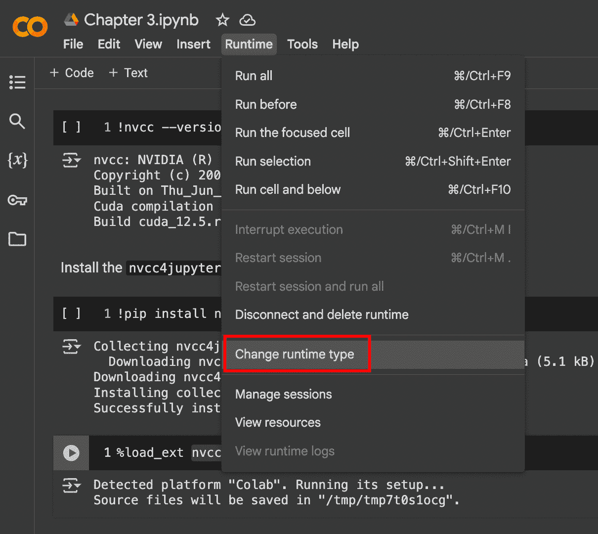

   *图 3.2：要更改运行时，请转到“运行时”选项卡并选择“更改运行时类型”*

2. 接下来，在对话框中，将**硬件加速器**设置为 **T4 GPU**，然后点击**保存**以启用 CUDA，如下所示。

   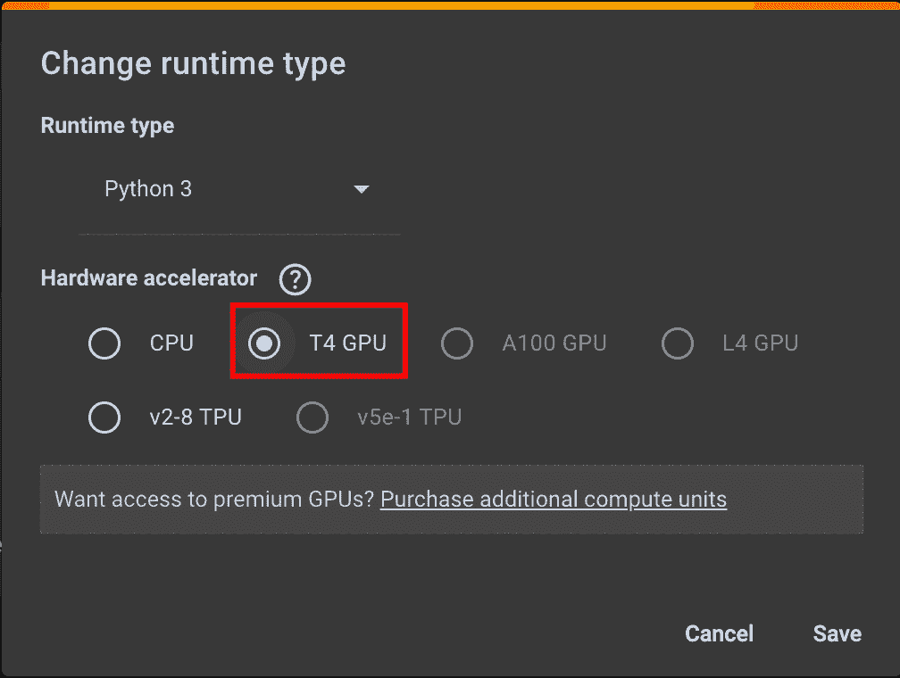

   *图 3.3：将运行时类型更改为 GPU 可启用 GPU 编程*

启用 GPU 运行时后，让我们验证 CUDA 工具链并加载 Colab 扩展，以便直接从 Notebook 单元格编译 CUDA 代码。

3. 使用 Google Colab，你可以通过以下命令检查 CUDA 的安装情况：

   ```
   !nvcc --version
   ```

   输出的结果应如下所示：

   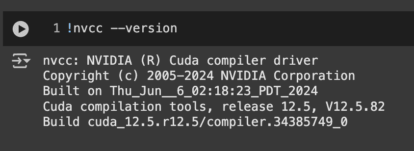

   *图 3.4：`!nvcc --version` 命令的输出*

4. 接下来，我们需要安装 `nvcc4jupyter` 扩展，以便从 Notebook 单元格运行 `nvcc`：

   ```
   !pip install nvcc4jupyter
   %load_ext nvcc4jupyter
   ```

   *图 3.5* 显示了输出应该是什么样子。

   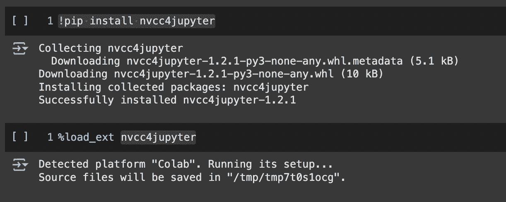

   *图 3.5：安装 nvcc4jupyter 并加载其扩展*

之后，你可以使用以下任一方式处理代码：

5. 在 `.cpp` 文件中编写代码。Colab 是为编写 Python 代码而设计的；但是，借助新安装的扩展，我们实际上可以编写出 `.cpp` 文件并在本地编译。*图 3.6* 展示了具体做法。

   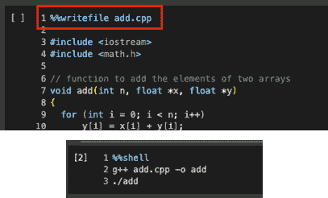

   *图 3.6：如何使用 Colab 编写 .cpp 文件并编译*

6. 直接使用 `nvcc4jupyter` 扩展编写代码。使用该扩展时，你可能会注意到 Python 静态检查器给出的一些警告。请忽略这些警告。

   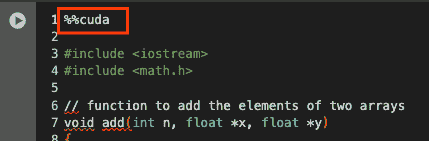

   *图 3.7：如何在 Colab 中编译 .cpp 文件*

当你拥有支持 CUDA 的 GPU 时，请安装兼容的 NVIDIA 驱动程序和 CUDA Toolkit（包含 `nvcc` 和核心库），然后进行端到端验证：`nvidia-smi` 命令应列出你的 GPU/驱动程序，`nvcc --version` 命令应报告预期的工具包版本，并且像 `deviceQuery`（或 `bandwidthTest`）这样的示例程序应能成功编译和运行。你可以在 Windows/Linux/WSL 上进行本地开发，或使用云选项（例如，通过 `nvcc4jupyter` 或编写/编译 `.cpp` 文件的 Colab）。请注意驱动程序与工具包之间可能不匹配、Linux 上可能缺失 `PATH/LD_LIBRARY_PATH`、WSL2 的要求以及 Colab 的临时会话限制。确认兼容性并成功运行测试后，你就可以编写、启动和分析你的第一个 CUDA 内核了。

### 使用 CUDA 优化 C++ 代码

本节将展示如何利用 CUDA 将性能关键的 C++ 代码转变为快速、GPU 加速的实现。我们将从识别热点和建立 CPU 基线开始，然后将数据并行任务映射到内核，选择有效的网格/块大小，并管理主机与设备间的内存以尽量减少数据传输。你将学习实用技术——合并访问、共享内存分块、占用率调整和基于流的重叠操作——以及何时应该使用 cuBLAS/cuFFT/cuDNN 而不是手写代码。我们将使用 Nsight Systems/Compute 进行测量，分析加速比（Amdahl 定律/Roofline 模型），并通过正确性测试安全地迭代，以确保优化带来真实、可复现的性能提升。

#### CUDA 编程模型

CUDA 提供了一种异构编程模型，其中*主机*代码在 CPU 上运行，而*设备*代码（内核）在 GPU 上运行。CPU 和 GPU 各自拥有独立的内存空间和执行上下文，通常需要显式的数据拷贝（除非使用统一内存）。通常，你需要识别算法中数据并行的部分，并以内核的形式将其卸载到 GPU 上。

CUDA 内核本质上是一个在 GPU 上运行的 C/C++ 函数（带有一些语言扩展和限制）。现代 NVIDIA GPU 实际上可以并发运行多个内核，但为了简单起见，在示例或入门章节中，我们通常假设某一时刻只有一个内核处于活动状态。内核一经启动，便由 GPU 上的众多线程执行。

CUDA 线程与 CPU 线程在几个重要方面存在差异：

- **大规模并行性**：每次内核启动可涉及数千到数百万个线程，所有线程在不同数据元素或数据区域上执行相同的代码
- **轻量级创建**：GPU 线程的创建开销极小，线程间的上下文切换主要由硬件管理，与 CPU 线程相比速度极快
- **数据并行聚焦**：每个线程通常独立处理整个数据集的一部分（或*子集*），使得 GPU 能够实现大规模并行

主机负责启动内核，并在设备内核启动之间执行串行代码；也就是说，管理内存、与设备之间的数据交换以及错误处理。

#### CPU 基线：C++ 中的数组加法

让我们从一个简单的基于 CPU 的程序开始，该程序将两个浮点数数组相加：

```cpp
#include <iostream>
#include <algorithm>
#include <cmath>

// 对两个向量执行逐元素累加
void vectorAddCPU(int length, float* inputA, float* inputB)
{
    for (int idx = 0; idx < length; ++idx)
    {
        inputB[idx] += inputA[idx];
    }
}

int main()
{
    const int SIZE = 1 << 20; // 1,048,576 个元素
    // 在主机（CPU）上分配内存
    float* vecA = new float[SIZE];
    float* vecB = new float[SIZE];
    // 用示例值填充数组
```


## 第 3 章

```cpp
for (int i = 0; i < SIZE; ++i)
{
    vecA[i] = 0.5f;
    vecB[i] = 2.5f;
}

// Execute vector addition
vectorAddCPU(SIZE, vecA, vecB);

// Verify correctness
float largestDeviation = 0.0f;
for (int i = 0; i < SIZE; ++i)
{
    float expected = 3.0f;
    largestDeviation = std::max(largestDeviation, std::fabs(vecB[i] - expected));
}

std::cout << "Largest deviation: " << largestDeviation << std::endl;

// Release allocated memory
delete[] vecA;
delete[] vecB;

return 0;
}
```

编译并运行该程序：

```bash
$ g++ vector_add_cpu.cpp -o vector_add_cpu
$ ./vector_add_cpu
```

输出如下：

```text
Max error: 0.000000
```

在代码中，`*x` 表示指向浮点数组的指针。在 C++（以及 CUDA）中，星号（`*`）表示该变量是一个指针，也就是说它存储的是某个值的内存地址，而不是值本身（例如，`float *x` 表示 `x` 是一个指向浮点数的指针）。如果为其分配了内存（例如 `x = new float[N]; // In CPU memory` 或 `cudaMallocManaged(&x, N * sizeof(float)); // In CUDA Unified Memory`），那么 `x` 就保存着这块已分配内存的地址，我们可以使用数组下标来访问其中的元素：`x[0] = 1.0f;` 将 `1.0f` 赋给第一个元素。或者，我们也可以使用指针运算：`*(x + 0) = 1.0f;`，这与 `x[0] = 1.0f` 等价。

#### 转换为 CUDA 代码

为了在 GPU 上并行化这种计算，我们将 `add()` 函数修改为作为 CUDA 内核运行。`__global__` 关键字用于指定一个在 GPU 上运行的函数：

```cpp
__global__
void add(int n, float *x, float *y) {
    int index = threadIdx.x;
    int stride = blockDim.x;
    for (int i = index; i < n; i += stride)
        y[i] = x[i] + y[i];
}
```

CUDA 提供了可以从 CPU 和 GPU 两方面访问的统一内存（Unified Memory）。使用 `cudaMallocManaged()` 分配内存，使用 `cudaFree()` 释放内存：

```cpp
float *x, *y;

cudaMallocManaged(&x, N*sizeof(float));
cudaMallocManaged(&y, N*sizeof(float));
```

这个 CPU 基线程序既为我们提供了正确性检查，也提供了性能参考：我们分配并初始化两个数组，运行一个直接的 `add()` 循环，然后验证 `Max error: 0.0` 以确认逻辑无误。请保留该版本（及其运行时间），作为后续所有工作的基准。接下来，我们将把这同一段计算移植到 CUDA——把 `add` 变成内核，将迭代映射到线程/线程块，并管理内存（统一内存或显式拷贝）——然后重新验证结果，并与这个基线对比加速比。

#### 启动 CUDA 内核

我们不直接调用 `add()`，而是使用三尖括号语法在 GPU 上启动它：

```cpp
add<<<1, 1>>>(N, x, y);
```

由于 CUDA 内核是异步执行的，我们需要在访问结果之前同步设备：

```cpp
cudaDeviceSynchronize();
```

让我们仔细看看这段代码：

- `__global__ void GPUFunction()`：`__global__` 修饰符标记一个内核——这是一个在 GPU 上执行、通常由 CPU（主机）启动的函数。内核的返回类型必须是 `void`。对于**动态并行**（计算能力 ≥ 3.5，`-rdc=true`），内核实际上可以从设备端启动其他内核。

- `GPUFunction<<<1, 1>>>();`：*三尖括号启动配置*指定了线程层次结构：`<<<gridDim, blockDim, [sharedMemBytes], [stream]>>>`。`<<<1,1>>>` 表示 *一个线程块，每个块中一个线程*——这对 “hello world” 演示很有用；实际工作负载会使用许多线程块和线程。在内核内部，`blockIdx`、`blockDim`、`threadIdx` 等内建变量让每个线程可以计算自己的工作索引。

- `cudaDeviceSynchronize();`：内核启动是*异步*的——主机会立即继续执行。`cudaDeviceSynchronize()` 函数会阻塞主机，直到默认流中此前所有工作完成为止（有助于计时和错误检查）。*提示*：在启动后立即使用 `cudaGetLastError()` 或 `cudaPeekAtLastError()` 检查启动错误。

#### 完整的 CUDA 实现

我们已经介绍了编写 CUDA 所需的样板内容；现在，让我们把它组合成一个完整且可运行的示例：

```cpp
#include <iostream>
#include <math.h>

__global__
void add(int n, float *x, float *y) {
    int index = threadIdx.x;
    int stride = blockDim.x;
    for (int i = index; i < n; i += stride)
        y[i] = x[i] + y[i];
}

int main(void) {
    int N = 1<<20;
    float *x, *y;

    cudaMallocManaged(&x, N*sizeof(float));
    cudaMallocManaged(&y, N*sizeof(float));

    for (int i = 0; i < N; i++) {
        x[i] = 1.0f;
        y[i] = 2.0f;
    }

    add<<<1, 256>>>(N, x, y);

    cudaDeviceSynchronize();

    float maxError = 0.0f;
    for (int i = 0; i < N; i++)
        maxError = fmax(maxError, fabs(y[i]-3.0f));

    std::cout << "Max error: " << maxError << std::endl;

    cudaFree(x);
    cudaFree(y);

    return 0;
}
```

现在，你可以使用 `nvcc`（NVIDIA 的 CUDA C/C++ 编译器）来构建并可选地运行你的程序，命令如下：

```bash
$ nvcc -arch=sm_70 -o out some-CUDA.cu -run
```

我们来分解一下上述命令：

- `nvcc`：NVIDIA CUDA 编译器驱动程序。
- `-arch=sm_70`：指定为计算能力 7.0 的 GPU（例如 V100）编译。请根据你的系统按需调整。
- `-o out`：将编译生成的二进制文件写入名为 `out` 的可执行文件。
- `-run`：在成功编译后自动运行该可执行文件。

如果省略 `-run`，你只需编译：

```bash
nvcc -arch=sm_70 -o out some-CUDA.cu
./out
```

在 Colab notebook 中，你可以执行以下内容：

```text
%%shell
nvcc add.cu -o add_cuda
./add_cuda
```

预期输出如下：

```text
Max error: 0.000000
```

正确性和编译都已验证之后，下一个考虑因素是时间花在了哪里。在下一节中，我们将对该程序进行性能分析——使用 CUDA 事件对主机-设备传输和内核计时，然后使用 Nsight Systems/Compute 检查实际占用率、内存吞吐量以及线程束/分支效率——从而定位瓶颈并指导优化。

#### 分析 CUDA 性能

使用 `nvprof` 对执行过程进行性能分析：

```bash
$ nvprof ./add_cuda
```

该命令的输出打印结果如*图 3.8* 所示：

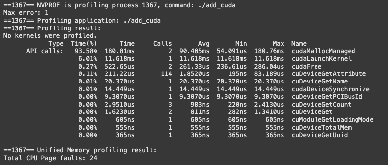

*图 3.8：使用 CUDA 进行数组加法的性能分析结果*

你的计时结果可能因 GPU 不同而有所差异。

#### CUDA 线程层次结构

一个 CUDA 内核可能由*数千甚至数百万*个线程执行。这些线程被组织成线程块，线程块又被组织成网格。理解这种线程层次结构对于扩展你的应用程序至关重要：

- **线程**：执行内核代码的最小工作单元
- **线程块**：一组线程（一维上最多 1,024 个），它们可以共享内存并彼此同步
- **网格**：一个或多个线程块的集合

*图 3.9* 展示了 CUDA 的执行层次结构（线程 → 线程块 → 网格）以及每一层的内存空间（每线程的寄存器/局部内存、每线程块的共享内存、设备全局内存）。在选择启动维度和规划数据移动时，请牢记这一模型。

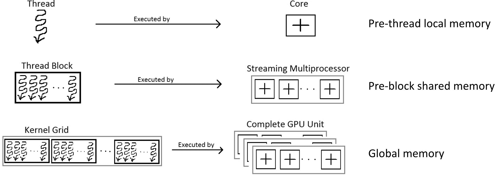

*图 3.9：CUDA 线程层次结构与内存空间（线程 ↔ 局部内存，线程块 ↔ 共享内存，网格 ↔ 全局内存）*

有了这些信息，你就可以通过 CUDA 的三尖括号语法来指定执行配置——线程块数量与每线程块线程数——从而启动内核。执行配置可以如下所示：

```cpp
someKernel<<<NUMBER_OF_BLOCKS, THREADS_PER_BLOCK>>>(parameters);
```

接下来，我们将看到如何利用刚才学到的知识，使用多个线程来加速这个 `for` 循环。

#### 使用多个线程加速

现在你已经用单个线程运行了执行加法操作的内核；要充分利用 GPU，我们需要让它并行化。关键就在于 CUDA 的 `<<<1, 1>>>` 语法。`<<< >>>` 中的值是执行配置——它们设置启动时的网格和线程块维度，这决定了有多少个 GPU 线程来运行该内核。具体来说，我们有如下内容：

- 第一个参数表示要启动的*线程块数量*
- 第二个参数表示*每个线程块中的线程数量*

`add<<<1, 1>>>` 这一配置意味着：

- 创建了一个线程块
- 在该线程块中创建了一个线程


前面的示例中，内核`add()`函数只启动了一个线程；因为它逐个遍历整个数组，所以它可以正确地完成整个数组的加法。然而，如果你启动多个线程，它们在没有协调的情况下读写同一个`y[i]`元素，就会产生*竞争条件*——最终值取决于哪个线程先读或先写。例如，一个线程可能写入`y[i] = x[i] + y_old`，而另一个线程看到这个更新后的值，可能计算出`y[i] = x[i] + (x[i] + y_old)`，从而得到错误结果。

为了利用GPU的并行性，需要将工作分配到多个线程。由于NVIDIA硬件以32线程的线程束（warp）为单位调度线程，因此请选择32的倍数作为块大小（例如256），并启动足够多的块来覆盖数据。相应地更新代码：

```cpp
add<<<1, 256>>>(N, x, y);
```

如果按原样运行，*并行*版本仍然会让每个线程重复同样的工作，而不是将工作划分开。为了在多个线程之间划分数组，可以使用CUDA的内建变量为每个线程计算唯一索引。这里，`threadIdx.x`是线程在块内的位置，`blockDim.x`是块中的线程数，`blockIdx.x`标识块。一种常见模式是`int i = blockIdx.x * blockDim.x + threadIdx.x`；这样，每个线程只更新自己的元素，从而实现真正的并行执行。

我们需要修改循环，让并行线程跨步遍历数组：

```cpp
int blockSize = 256;
int numBlocks = (N + blockSize - 1) / blockSize;
add<<<numBlocks, blockSize>>>(N, x, y);
```

修改内核，使其在所有线程上计算：

```cpp
__global__
void add(int n, float *x, float *y)
{
    int index = threadIdx.x;
    int stride = blockDim.x;
    for (int i = index; i < n; i += stride)
        y[i] = x[i] + y[i];
}
```

以下是我们加法函数或内核的修改后代码。我们将其保存到`add_block.cu`文件中。代码分解如下：

- 我们创建一个使数组元素相加的内核：

```cpp
__global__
void add(int n, float *x, float *y) {
    int index = threadIdx.x;
    int stride = blockDim.x;
    for (int i = index; i < n; i += stride)
        y[i] = x[i] + y[i];
}
```

- 我们启动`main`，设置元素总数（`N = 1<<20 = 1,048,576`），并声明输入/输出数组的指针：

```cpp
int main(void) {
    int N = 1 << 20; // 1M elements
    float *x, *y;
```

- 我们分配统一内存（Unified Memory），使CPU和GPU都能访问`x`和`y`，而无需显式调用`cudaMemcpy`：

```cpp
cudaMallocManaged(&x, N * sizeof(float));
cudaMallocManaged(&y, N * sizeof(float));
```

- 我们以**1个块 × 256个线程**启动内核（网格跨步循环覆盖所有`N`个元素）。`cudaDeviceSynchronize()`函数会在主机读取结果之前等待GPU工作完成：

```cpp
add<<<1, 256>>>(N, x, y);
cudaDeviceSynchronize();
```

- 我们释放GPU托管内存并从`main`返回：

```cpp
cudaFree(x);
cudaFree(y);
return 0;
```

然后，我们编译并对其运行性能分析器：

```bash
$ nvcc add_block.cu -o add_block
$ nvprof ./add_block
```

与之前的性能分析相比，速度有了很大的提升。

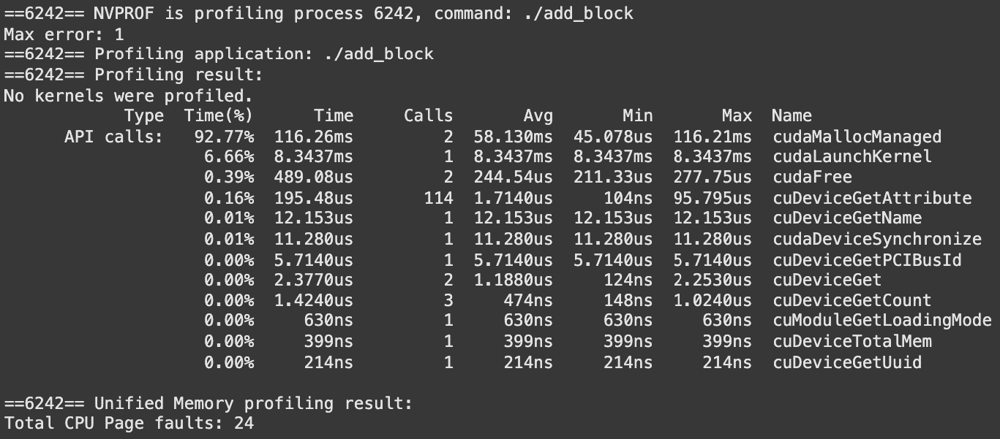

*图3.10：对内核进行并行化（add<<<blocks,256>>>）后的nvprof摘要*

在*图3.10*中，我们可以看到与单线程基线相比，时间显著下降；现在大多数开销来自分配（`cudaMallocManaged`）和同步（`cudaDeviceSynchronize`），内核通过`cudaLaunchKernel`启动。统一内存显示有24次CPU缺页错误。

我们能否进一步提高速度以获得更高性能？让我们开始吧。

#### 使用多个块进行扩展

CUDA GPU由多个并行处理器组成，称为**流式多处理器**（**SM**），每个处理器能够并发运行多个线程块。例如，基于Ampere架构的*NVIDIA A100 GPU*拥有*108个SM*，每个SM最多支持*2048个活动线程*。为了充分利用GPU的并行处理能力，内核应该以多个线程块启动。

执行配置（`<<<numBlocks, blockSize>>>`）中的第一个参数定义*线程块数量*，第二个参数指定*每块线程数*。这些线程块共同构成了所谓的*网格*。给定需要处理的*N*个元素和*每块256个线程*，所需的块数可按如下方式计算：

```
numBlocks = (N + blockSize - 1) / blockSize
```

这确保*所有元素都被处理*，即使*N*不是`blockSize`的整数倍。让我们使用以下设置：

```cpp
int blockSize = 256;
int numBlocks = (N + blockSize - 1) / blockSize;
add<<<numBlocks, blockSize>>>(N, x, y);
```

使用**扁平线程索引**为每个线程分配唯一的工作：`i = blockIdx.x * blockDim.x + threadIdx.x`。*图3.11*展示了`gridDim.x = 4096`和`blockDim.x = 256`时的映射关系；例如，`blockIdx.x = 2, threadIdx.x = 3 → i = 2*256 + 3 = 515`。

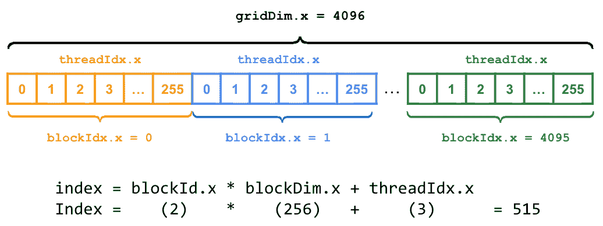

*图3.11：计算全局线程索引——对于gridDim.x = 4096和blockDim.x = 256，每个块贡献256个连续索引；全局索引为 i = blockIdx.x * blockDim.x + threadIdx.x*

上图展示了在CUDA中使用`blockDim.x`、`gridDim.x`和`threadIdx.x`对一维数组进行索引的方法。每个线程首先计算其块的偏移量（`blockIdx.x * blockDim.x`），然后加上其在块内的位置（`threadIdx.x`），从而确定其唯一索引。由此得到以下公式：

```
index = blockIdx.x * blockDim.x + threadIdx.x
```

这种索引策略是CUDA编程中的基本模式，确保每个线程都能高效地处理数据的不同部分。

使用块和线程更新后的内核代码如下：

```cpp
__global__
void add(int n, float *x, float *y)
{
    int index = blockIdx.x * blockDim.x + threadIdx.x;
    int stride = blockDim.x * gridDim.x;
    for (int i = index; i < n; i += stride)
        y[i] = x[i] + y[i];
}
```

完整代码概述如下：

1. 包含CUDA内核。

该内核使用网格跨步循环模式，因此任意数量的线程/块都可以覆盖`n`个元素：

```cpp
#include <iostream>
#include <math.h>

// Kernel function to add the elements of two arrays
__global__
void add(int n, float *x, float *y)
{
    int index = blockIdx.x * blockDim.x + threadIdx.x;
    int stride = blockDim.x * gridDim.x;
    for (int i = index; i < n; i += stride)
        y[i] = x[i] + y[i];
}
```

2. 接下来，编写`main()`，设置问题规模`N`，并在统一内存中分配数组。

分配CPU和GPU都可以访问的数组（CUDA统一内存）：

```cpp
int main(void)
{
    int N = 1<<20;
    float *x, *y;

    // Allocate Unified Memory – accessible from CPU or GPU
    cudaMallocManaged(&x, N*sizeof(float));
    cudaMallocManaged(&y, N*sizeof(float));
```

3. 我们在主机上初始化输入。

只需将`x`填充为1，将`y`填充为2，这样所有位置的正确答案都是3：

```cpp
    // initialize x and y arrays on the host
    for (int i = 0; i < N; i++) {
        x[i] = 1.0f;
        y[i] = 2.0f;
    }
```

4. 选择启动配置并运行内核。

选择一个合理的块大小（32的倍数）和足够覆盖`N`的块数：

```cpp
    // Run kernel on 1M elements on the GPU
    int blockSize = 256;
    int numBlocks = (N + blockSize - 1) / blockSize;
    add<<<numBlocks, blockSize>>>(N, x, y);
```

5. 同步、验证并清理。

等待GPU完成，检查结果，然后释放内存：

```cpp
    // Wait for GPU to finish before accessing on host
    cudaDeviceSynchronize();

    // Check for errors (all values should be 3.0f)
    float maxError = 0.0f;
    for (int i = 0; i < N; i++)
        maxError = fmax(maxError, fabs(y[i]-3.0f));
    std::cout << "Max error: " << maxError << std::endl;

    // Free memory
    cudaFree(x);
    cudaFree(y);
    return 0;
}
```

为了编译和执行，让我们运行以下命令：

```bash
nvcc add_grid.cu -o add_grid
nvprof ./add_grid
```


对其执行进行性能分析后，结果如*图 3.12*所示：

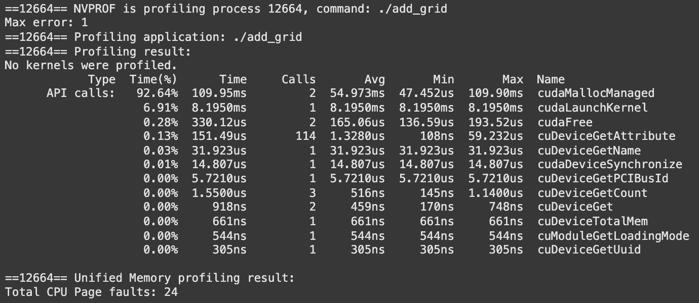

*图 3.12：add_grid 的 nvprof 摘要——grid-stride 内核运行正确；大部分时间花在 cudaMallocManaged 以及内核启动/同步开销上，报告了 24 次统一内存 CPU 缺页*

这是运行多个块带来的又一次巨大提速！或者你可能还不觉得这有什么了不起；这是因为该示例足够小，能够快速完成计算，所以你没有看到明显的收益，不过让我们看看接下来的例子。

### 如何在 CUDA 中进行调试

在 CUDA 中，错误可能出现在三个地方——API 调用、内核启动本身，以及异步执行期间。首先检查每个运行时 API 的返回代码。

#### 检查 CUDA API 调用

大多数 CUDA 函数会返回一个 `cudaError_t` 错误码。你应该检查返回值：

```cpp
cudaError_t err = cudaMallocManaged(&a, size);
if (err != cudaSuccess) {
    printf("Error: %s\n", cudaGetErrorString(err));
}
```

即使所有 API 调用都成功，*启动*本身仍可能无效（例如，维度错误）。由于内核返回 `void`，可以使用 `cudaGetLastError()` 捕获启动时的错误。

#### 检查内核启动错误

内核的返回类型是 `void`，因此启动本身不会产生 `cudaError_t` 错误。要检测*启动时*发生的问题——例如非法的网格/块大小或资源限制——可以使用 `cudaGetLastError()`（或 `cudaPeekAtLastError()`）查询运行时，它会为最近一次启动返回一个 `cudaError_t` 错误；请注意，`cudaGetLastError()` 同时也会清除错误状态：

```cpp
someKernel<<<1, -1>>>(); // -1 is not a valid number of threads.
cudaError_t err;
err = cudaGetLastError(); // cudaGetLastError will return the error from above.
if (err != cudaSuccess)
{
    printf("Error: %s\n", cudaGetErrorString(err));
}
```

成功的启动并不保证*执行*一定成功。由于内核是异步运行的，需要进行同步（例如 `cudaDeviceSynchronize()`）并检查结果，才能发现设备端的失败。

#### 检查异步执行错误

由于内核是异步运行的，你必须调用一个*同步函数*（例如 `cudaDeviceSynchronize`）并检查其结果，以捕获内核执行期间发生的任何错误：

```cpp
err = cudaDeviceSynchronize();
if (err != cudaSuccess) {
    printf("Kernel Execution Error: %s\n", cudaGetErrorString(err));
}
```

为避免重复的样板代码，可以将 CUDA 调用封装在一个检查状态并打印可读错误信息的小型辅助函数/宏中——请在整个练习中都使用这种模式。

#### CUDA 错误处理函数

为了减少样板代码，可以定义一个宏来封装 CUDA 调用并检查其返回代码——下面是可供后续练习复用的示例：

```cpp
#include <stdio.h>
#include <assert.h>
inline cudaError_t checkCuda(cudaError_t result)
{
    if (result != cudaSuccess) {
        fprintf(stderr, "CUDA Runtime Error: %s\n",
            cudaGetErrorString(result));
        assert(result == cudaSuccess);
    }
    return result;
}

int main()
{
    checkCuda(cudaDeviceSynchronize());
}
```

在许多深度学习和高性能计算应用中，数据并不严格是一维的。相反，你可能会处理多维张量——例如具有高度和宽度的图像，或者具有批量大小和通道维度的高阶张量。一维执行配置（例如 `<<<gridSize, blockSize>>>`）仍然可以通过将数据索引展平到单个轴上来工作，但如果需要跟踪多个维度（例如卷积层中的批量、通道、高度和宽度），这种方法可能会变得笨拙且容易出错。

幸运的是，CUDA 通过 `dim3` 类型支持**二维**（**2D**）和**三维**（**3D**）**线程块和网格**。要定义二维或三维的网格或块，可以这样使用 CUDA 的 `dim3` 类型：

```cpp
dim3 threads_per_block(16, 16, 1);
dim3 number_of_blocks(16, 16, 1);
someKernel<<<number_of_blocks, threads_per_block>>>();
```

`<<<>>>` 实例中的顺序很重要。每个块的最大线程总数为 `1024`。以下是每个维度的最大值表。

| 维度 | 最大值 |
| --- | --- |
| 网格大小 `dGrid.x` | 2^31 - 1 |
| 网格大小 `dGrid.y` | 65535 |
| 网格大小 `dGrid.z` | 65535 |
| 块大小 `dBlock.x` | 1024 |
| 块大小 `dBlock.y` | 1024 |
| 块大小 `dBlock.z` | 64 |

*表 3.1：CUDA 最大启动维度和每块线程限制*

CUDA 错误会在三个地方出现：**API 调用**、**内核启动**和**异步执行**。始终检查每个运行时调用的返回值；在 `<<<grid, block>>>` 之后，调用 `cudaGetLastError()` 来捕获启动问题，然后调用 `cudaDeviceSynchronize()` 并再次检查以发现设备端故障。使用一个小型错误检查辅助函数/宏来保持一致性。对于索引和性能，在 2D/3D 网格/块中优先使用 `dim3`；请记住顺序是 `<<<grid, block>>>`，并遵守*每块 1,024 个线程*的限制（参见*表 3.1*）。

### 摘要

本章介绍了 CUDA 作为 NVIDIA 的并行模型，用于在 GPU 上运行海量轻量级线程，将其与仅使用 CPU 的执行进行了对比，并展示了各自何时更胜一筹。你搭建了工作环境（驱动程序 + CUDA 工具包），对其进行了验证（使用 `nvidia-smi`、`nvcc --version` 和示例运行），并了解了在 Colab 中使用 `nvcc4jupyter` 的快速路径。我们建立了一个 CPU 基线（通过数组相加内核），然后将其移植到 CUDA：编写内核、选择启动配置 `(<<<grid, block>>>)`，并使用每线程索引和 grid-stride 循环将迭代映射到线程。你学习了 CUDA 执行层次结构（线程 | 块 | 网格）和内存作用域（线程本地、共享、全局），了解了为什么块大小应为 32（线程束）的倍数，以及如何从一个块扩展到多个块以充分利用 SM。我们使用 `nvprof` 对运行进行了性能分析（并提到 Nsight Systems/Compute 可进行更深入的分析），解释了统一内存缺页，并识别了常见瓶颈（启动开销、数据传输、同步）。最后，你为 API 调用、启动错误和异步故障添加了健壮的错误处理，并了解了当数据是多维时如何使用 2D/3D `dim3` 网格/块。

在下一章中，我们将从使用 Eigen 手动实现**神经网络**（**NN**）转向使用 LibTorch（PyTorch 官方 C++ API），它为张量、NN 模块、优化器和数据集提供了高级抽象。你将学习如何使用 `torch::nn` 层定义模型，使用内置优化器训练模型，并利用自动微分而不是手动计算梯度。我们还将通过 LibTorch 引入 CUDA 的 GPU 加速，使相同的模型能够高效扩展到更大的数据集和更深的架构。

### 问题

检查你的理解——在继续之前回答这些问题：

1. `<<<grid, block>>>` 中的执行配置指定了什么？
2. 如果多个线程在没有协调的情况下更新同一 `i` 实例的 `y[i]`，会出现什么问题？在数组相加内核中我们如何避免这个问题？
3. 说出两个端到端验证 CUDA 安装的命令（一个用于驱动程序，一个用于工具包）。

### 扩展阅读

以下是一些推荐参考，可帮助你加深 CUDA 调试和优化技能：

- **CUDA C 编程指南（NVIDIA）**：核心模型、内存、执行层次结构
- **CUDA 最佳实践指南（NVIDIA）**：占用率、内存合并、流、统一内存技巧
- **Nsight Systems 和 Nsight Compute 用户指南**：性能分析方法和指标
- **CUDA 示例**：grid-stride 循环、归约等的参考实现
- **Mark Harris，《如何优化 CUDA 中的数据传递》**：页锁定内存、重叠
- 关于 Roofline 和 Amdahl 定律的论文/文章，用于推理可实现的加速比
- **cuBLAS/cuDNN/cuFFT 文档**：何时优先使用库而不是自定义内核


## 第 3 章

### 答案

以下是前面问题的答案（请先尝试回答问题后再查看）：

1. 它定义了内核的并行形状：网格中有多少个**块**以及**每块线程数**（可选地指定共享内存字节数和流）。

2. **数据竞争**；多个线程不可预测地读取/写入同一位置。避免方法是给每个线程分配一个**唯一索引**（并且只更新它自己的元素）；例如，`i = blockIdx.x * blockDim.x + threadIdx.x`（或者当多个线程需要合并结果时，使用原子操作/归约）。

3. `nvidia-smi`（驱动/GPU 可见性）和 `nvcc --version`（工具包）；编译/运行如 `deviceQuery` 这样的示例即可完成检查。

**获取本书的 PDF 版本及更多内容**

扫描二维码（或访问 `packtpub.com/unlock`）。按名称搜索这本书，确认版本，然后按照页面上的步骤操作。


*注意：请保管好你的发票。从 Packt 直接购买无需发票。*
