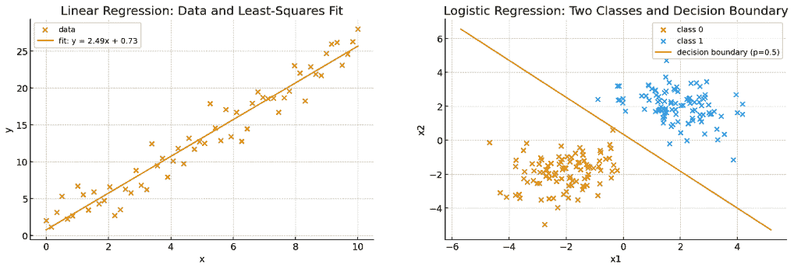
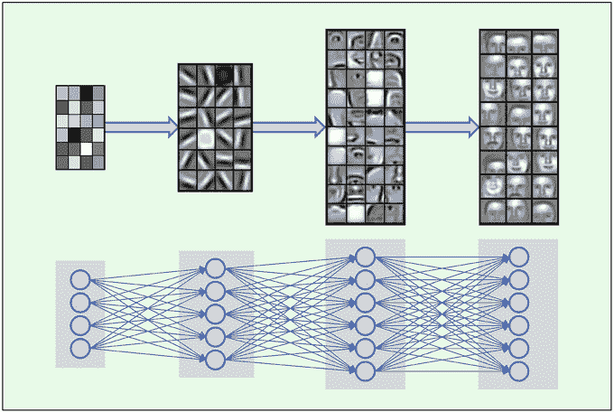
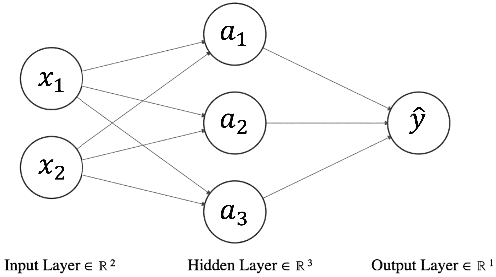
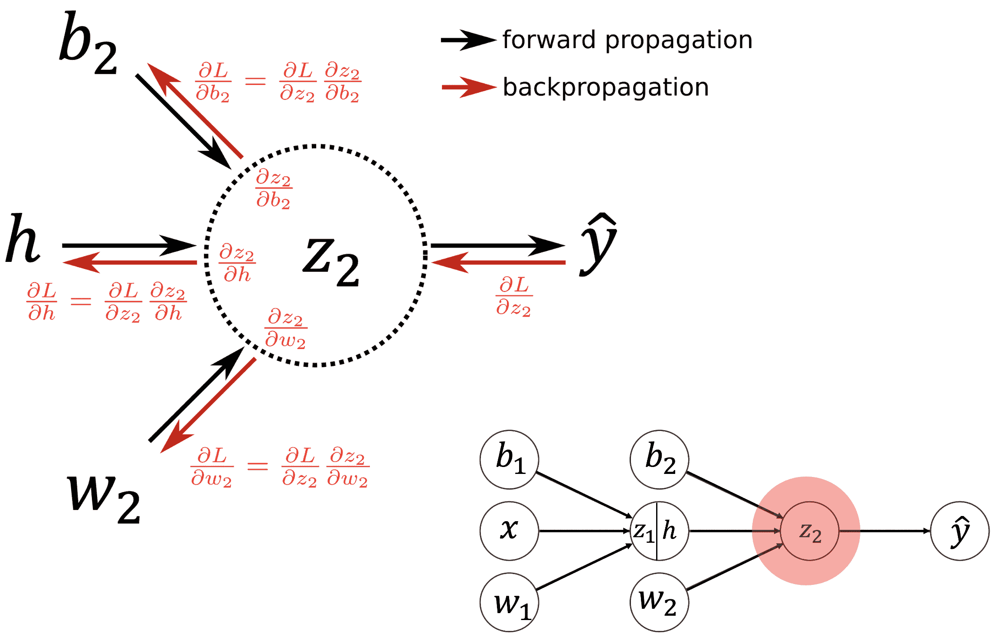
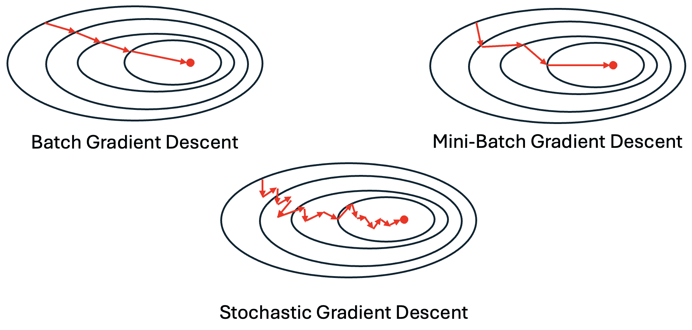

## 第 4 章：在 C++ 中构建基础神经网络

**机器学习**（ML）使算法能够发现数据中的模式，并利用这些模式对新出现的未见示例进行预测，而无需为每种情况手工编码规则。神经网络是受大脑（粗略地）启发的一类 ML 模型。在 *图 4.1* 中，生物神经元通过树突接收信号，在细胞体中整合信号，并沿轴突发出输出。感知机——神经网络的基本构建块——与此对应：输入 `x_i` 通过具有强度（权重）`w_i` 的 *突触* 到达，组合成加权和 `z = Σ w_i x_i + b`（**偏置** `b` 的作用类似于阈值），然后通过**激活**函数 `y = σ(z)`（例如 ReLU、sigmoid、tanh）产生输出。你可以回看本书的 *第 1 章* 来复习这些内容。

突触前神经元通过突触沿轴突将信号发送到突触后神经元的树突。具有突触强度 `w_i` 的输入 `x_i` 在胞体中被整合为 `Σ w_i x_i`。如果足够强，就会产生一个输出脉冲——这正是感知机加权和与激活函数的灵感来源。*改编自 Nature*：`https://www.nature.com/articles/s41427-018-0101-y`。

将许多感知机堆叠起来形成层（输入 → 隐藏 → 输出），使网络能够逼近复杂的非线性映射：从像素到标签、从特征到概率、从文本到嵌入向量，等等。我们通过损失函数度量误差，并通过梯度下降和反向传播调整 `{w_i, b}`，从而使网络未来的预测不断改进。

在接下来的篇幅中，我们将把这个示意图变为代码：从单个感知机开始，添加常见的激活函数和损失函数，在 C++ 中组装一个最小的**多层感知机**（MLP），并在一个玩具数据集上训练它——为后续更深的网络和 GPU 加速打下基础。

在本章中，我们将介绍以下主题：

- 理解基础知识
- 构建前向传播与损失函数（例如用于分类的 BCE/交叉熵）
- 使用 LibTorch 在 C++ 中实现神经元和激活函数
- 推导/反向传播梯度，并使用随机梯度下降更新权重

到本章结束时，你将拥有一个自包含的 C++ 程序，用于训练基本的感知机——包括前向传播、反向传播和优化循环——并且有信心扩展它（更多层/激活函数、正则化、更好的初始化），之后继续迈向 GPU 加速。

### 理解基础知识

机器学习的核心是*学习*：通过调整内部参数——权重和偏置——来捕获训练数据中的模式，并能泛化到新的未见示例。我们从**数据集**开始，它是一组示例的集合；每个示例包含**特征**（可测量的输入），在监督学习中还包含**标签**或**目标**（期望的输出）。在**训练**期间，算法迭代地调整参数，以减小衡量训练集预测误差的损失。之后，我们在独立的**测试**（或验证）集上进行评估，以估计学到的关系在模型训练期间未见过的数据上的泛化能力。



*图 4.1：线性回归与逻辑回归对比。左：对带噪声的一维数据进行线性回归，最小二乘拟合为 ŷ = 0.77x + 0.68。右：对两个二维类别进行逻辑回归，决策边界为 p = 0.5（σ(w^T x + b) = 0.5）。线性模型最小化 MSE；逻辑模型通过 sigmoid 输出概率，并使用二元交叉熵进行训练。*

单个神经元本质上是一个仿射模型加上可选的非线性。在**线性回归**（*图 4.1*）中，我们用 `ŷ = w_0 + Σ_j w_j x_j` 预测一个标量，并通过使用诸如**MSE**（均方误差）的损失函数最小化预测值（`ŷ`）与正确标签（`y`）之间的差异来学习 `{w_j}`。当然，对于较小的问题，你可以使用正规方程求得闭式解，但随着数据规模和特征数量的增加，正规方程不再可行；相反，我们使用梯度下降——这也是我们将在深度神经网络中依赖的优化器。

逻辑回归（*图 4.1*）通过将 sigmoid 应用于线性得分 `ŷ = σ(z) = 1 / (1 + e^{-z})`（其中 `z = w_0 + Σ_j w_j x_j`）将输出转换为概率，并使用二元交叉熵损失函数训练神经元。二元逻辑回归的**决策边界**是超平面 `w^T x + b = 0`（等价于 `y = 0`）；**非线性**边界来自特征变换或**堆叠层**。

在深入神经网络之前，让我们先说明如何在 C++ 中实现线性和逻辑回归。本节将在更简单的上下文中介绍权重更新和代价函数的概念。

### 构建前向传播和损失函数（例如用于分类的 BCE/交叉熵）

单个神经元计算 `z = w x + b`，然后应用激活函数 `ŷ = σ(z)`。使用**恒等**激活函数（`σ(z) = z`），得到**线性回归**，通过最小化**MSE**来训练。使用**sigmoid**（`σ(z) = 1 / (1 + e^{-z})`），得到**逻辑回归**，使用**二元交叉熵**进行训练。你可以将这两种情况视为神经网络的最简形式或特例：一个神经元、一个输出。掌握它们后，过渡到多层网络就会很自然——在各层之间堆叠相同的构建块，并对所有层进行反向传播。

让我们使用梯度下降在 C++ 中实现线性回归。

1. 导入合成数据集：我们将对从 `y = 2.5x + 0.9 + ε` 采样得到的带噪声的点拟合一条直线。

```cpp
int main() {
    mt19937 rng(42);
    uniform_real_distribution<double> U(0.0, 1.0);
    normal_distribution<double> N(0.0, 0.2);
    // Synthetic data
    const int n = 200;
    vector<double> x(n), y(n);
```


## 在C++中构建基础神经网络

```cpp
for (int i = 0; i < n; ++i) {
    x[i] = U(rng);
    y[i] = 2.5 * x[i] + 0.7 + N(rng);
}
```

- **2. 初始化参数和超参数：** 初始化权重`w`和偏置`b`（初始化为0即可），并设置学习率和迭代周期。

```cpp
double w = 0.0; // weight
double b = 0.0; // bias
double lr = 0.1; // learning rate
const int epochs = 1000;
```

- **3. 对于每个迭代周期，我们将数据遍历一次。** 对于每个数据点 `(x, y)`：
   - **预测：** `y_hat = w * x + b`。
   - **单样本MSE：** `mse = (y_hat - y)^2`。
   - **梯度：** `∂mse/∂w = 2 * (y_hat - y) * x`，`∂mse/∂b = 2 * (y_hat - y)`。
   - **更新参数。**

```cpp
for (int i = 0; i < n; ++i) {
    double y_hat = w * x[i] + b; // prediction
    double resid = y_hat - y[i]; // residual
    double mse_i = resid * resid; // per-sample MSE (for clarity/logging if desired)
    w -= lr * (2.0 * resid * x[i]); // gradient step from MSE
    b -= lr * (2.0 * resid);
}
```

既然我们已经完成了线性回归，接下来转向它的概率近亲——逻辑回归——它通过 sigmoid 函数将线性得分映射为类别概率。我们将用一个 sigmoid 神经元对两个二维高斯簇进行分类来演示它。

- **1. sigmoid函数可以如下创建：**

```cpp
static inline double sigmoid(double z) {
    return 1.0 / (1.0 + std::exp(-z));
}
```

- **2. 创建简单的线性可分数据集：** 两个簇：类别0在(-2, -2)附近，类别1在(2, 2)附近。

```cpp
// Synthetic 2D dataset (two Gaussian blobs)
std::mt19937 rng(123);
std::normal_distribution<double> N0x(-2.0, 1.0), N0y(-2.0, 1.0);
std::normal_distribution<double> N1x(2.0, 1.0), N1y(2.0, 1.0);
const int n_per = 200;
std::vector<std::array<double,2>> X;
std::vector<int> y;
X.reserve(2 * n_per);
y.reserve(2 * n_per);
for (int i = 0; i < n_per; ++i) {
    X.push_back({N0x(rng), N0y(rng)}); y.push_back(0);
    X.push_back({N1x(rng), N1y(rng)}); y.push_back(1);
}
const int n = static_cast<int>(X.size());
```

- **3. 初始化参数和超参数：** 一个逻辑回归神经元具有权重`w1`、`w2`和偏置`b`。我们将使用固定的学习率。

```cpp
double w1 = 0.0, w2 = 0.0, b = 0.0;
double lr = 0.1;
const int epochs = 3000;
```

- **4. 梯度下降循环（交叉熵损失）：** 对于每个迭代周期，计算**二分类交叉熵**的梯度。对于样本 `(x, y)`，其中 `z = w^T x + b`，`p = σ(z)`，

- **5.** `∂BCE/∂z = p - y`。链式法则得到：`∂BCE/∂w = (p - y) * x`，`∂BCE/∂b = (p - y)`。我们对整个数据集的梯度求平均，然后更新参数。

```cpp
for (int epoch = 1; epoch <= epochs; ++epoch) {
    double gw1 = 0.0, gw2 = 0.0, gb = 0.0;
    for (int i = 0; i < n; ++i) {
        double z = w1 * X[i][0] + w2 * X[i][1] + b; // linear score
        double p = sigmoid(z); // probability (ŷ)
        double diff = (p - y[i]); // d(BCE)/dz
        gw1 += diff * X[i][0] / n;
        gw2 += diff * X[i][1] / n;
        gb += diff / n;
    }
    w1 -= lr * gw1;
    w2 -= lr * gw2;
    b -= lr * gb;
}
```

- **6. 用BCE监控训练：** 计算平均二分类交叉熵来跟踪训练进度。

```cpp
if (epoch % 500 == 0) {
    double loss = 0.0;
    for (int i = 0; i < n; ++i) {
        double p = sigmoid(w1*X[i][0] + w2*X[i][1] + b);
        p = std::clamp(p, 1e-12, 1.0 - 1e-12); // numeric safety
        loss += -( y[i]*std::log(p) + (1 - y[i])*std::log(1 - p) );
    }
    loss /= n;
    std::cout << "Epoch " << epoch << " BCE=" << loss
              << " w=[" << w1 << "," << w2 << "] b=" << b << "\n";
}
```

- **7. 评估准确率并展示决策边界：** 我们使用0.5阈值进行分类；决策边界为 `w1 * x1 + w2 * x2 + b = 0`。

```cpp
int correct = 0;
for (int i = 0; i < n; ++i) {
    double p = sigmoid(w1*X[i][0] + w2*X[i][1] + b);
    int pred = (p >= 0.5);
    if (pred == y[i]) correct++;
}
std::cout << "\nAccuracy: " << (100.0 * correct / n) << "%\n";
std::cout << "Decision boundary (p=0.5): w1*x1 + w2*x2 + b = 0\n";
```

线性回归和逻辑回归是很好的基线——快速、简单且可解释——但它们只能建模线性关系。除非你手工设计特征（多项式、交互项、核函数），否则它们的决策边界仍然是仿射的，在复杂数据上很快就会碰壁。特征工程可以有所帮助，但它是手动的、脆弱的，而且随着模式变得高阶或非平稳，很难扩展。



*图4.2：深度神经网络中的层次化特征学习*

从原始像素出发，早期层检测明暗模式和边缘；中层将边缘组合成图案和部件；后续层组装出高级特征。输出层将这些学习到的表示映射为类别标签。

*图4.2*改编自Fraija-Fernández N.等人发表于《Frontiers in Environmental Science》3:80 (2016)的*《用于监测海洋生态系统的环境DNA宏条形码：现状与未来展望综述》*中的*图2*。https://doi.org/10.3389/fenvs.2015.00080——采用知识共享署名许可（CC BY 4.0）。

如*图4.2*所示，深度网络通过端到端学习特征来避免手动特征工程：堆叠带非线性激活的仿射层，可以产生丰富的决策边界和层次化表示。这种能力支撑了计算机视觉、自然语言处理和强化学习领域的最先进成果。在本章剩余部分，我们将用C++和LibTorch实现一个MLP，让你的模型可以直接从数据中学习这些变换。

### 使用LibTorch在C++中实现神经元和激活函数

一个*神经元*只是一个仿射变换加上（可选的）非线性：`z = W x + b, y = σ(z)`。在LibTorch中，你可以使用内置的`torch::nn::Linear`层来实现`W x + b`，并通过`torch::relu`、`torch::sigmoid`、`torch::tanh`或`torch::nn::ReLU`等函数/模块应用激活。在`neuron_demo.cpp`中，我们提供了一个包含一个仿射层和激活（ReLU）的简单架构。

```cpp
// neuron_demo.cpp
#include <torch/torch.h>
#include <iostream>

int main()
{
    torch::manual_seed(42);

    // Pick device (CUDA if available)
    torch::Device device = torch::cuda::is_available() ? torch::kCUDA : torch::kCPU;
    std::cout << "Using device: " << (device.is_cuda() ? "CUDA" : "CPU") << "\n";

    const int64_t batch = 4, in_f = 5, out_f = 3;

    auto x = torch::randn({batch, in_f}).to(device);

    torch::nn::Linear fc(in_f, out_f);
    fc->to(device);

    torch::nn::init::kaiming_uniform_(fc->weight, /*a=*/std::sqrt(5.0));
    torch::nn::init::zeros_(fc->bias);

    auto z = fc->forward(x); // [batch, out_f]
    auto y = torch::relu(z); // activation

    std::cout << "Input shape : " << x.sizes() << "\n";
    std::cout << "Logits shape: " << z.sizes() << "\n";
    std::cout << "Output shape: " << y.sizes() << "\n";
}
```


## 第 4 章：在 C++ 中构建基础神经网络

```cpp
std::cout << "Output sample:\n"
          << y.slice(/*dim=*/0, 0, 2) << "\n";
return 0;
}
```

你刚刚构建了一个带有非线性激活（如 ReLU）的单一仿射层。很自然的下一步是将这些层堆叠起来：第一层学习简单模式，下一层将它们组合成更丰富的特征，最后一层将这些特征映射到预测。这就是 MLP——最小的*深度*网络——也是我们在用 LibTorch/CUDA 扩展之前所使用的骨架。

为了让数学和代码更透明，我们将从一个极小的 MLP 和一个具有 2 个特征的玩具数据集开始：

- **架构**：
  - 输入层：**2** 个单元
  - 隐藏层：**3** 个单元
  - 输出层：**1** 个单元（二分类或简单回归）

  

  *图 4.3：我们将实现的 MLP 架构*

- **数据流**：**输入向量**与输入到隐藏层的权重相乘，再加上偏置；我们应用 **sigmoid** 得到隐藏激活。这些激活再与隐藏层到输出层的权重相乘，再次加上偏置，并通过另一个 **sigmoid** 产生输出。

- **训练与损失**：为简单起见，我们将使用 **MSE** 通过 **梯度下降** 进行训练（后续分类任务可换成交叉熵）。梯度通过 **反向传播** 计算，并用于更新两组权重和偏置。

我们将使用 Eigen 进行矩阵运算，以从头展示其机制。一旦你明白了这一点，就可以用同样的逻辑将张量和模块替换为 LibTorch。

我们先创建 `NeuralNetwork` 类（头文件）。这个头文件列出了模型的**参数**和**API**。我们存储两个权重矩阵（`[hidden, input]` 和 `[output, hidden]`）和两个偏置向量（每层一个）。激活函数是 **sigmoid**，通过 Eigen 逐元素实现。公有方法包括：构造函数用于设置大小和学习率，feedforward 用于预测，train 用于在单个样本上执行一步学习。（所有向量都是列向量；Eigen 的 `VectorXd` 默认是列向量。）

```cpp
#ifndef NEURAL_NETWORK_H
#define NEURAL_NETWORK_H

#include <Eigen/Dense>
#include <cmath>

using namespace Eigen;

class NeuralNetwork {
private:
    MatrixXd weights_input_hidden; // [hidden, input]
    MatrixXd weights_hidden_output; // [output, hidden]
    VectorXd bias_hidden; // [hidden]
    VectorXd bias_output; // [output]
    double learning_rate;

    // Sigmoid activation applied elementwise
    VectorXd sigmoid(const VectorXd& x) {
        return 1.0 / (1.0 + (-x.array()).exp());
    }

    // Derivative of sigmoid given its output (y = sigmoid(x))
    VectorXd sigmoid_derivative(const VectorXd& y) {
        return y.array() * (1.0 - y.array());
    }

public:
    NeuralNetwork(int input_size, int hidden_size, int output_size, double lr);

    // Forward pass for a single example
    VectorXd feedforward(const VectorXd& input);

    // One training step on a single (input, target) pair
    void train(const VectorXd& input, const VectorXd& target);
};

#endif
```

接下来，我们将实现构造函数。我们随机初始化权重和偏置，这样隐藏单元就不会全都学到相同的东西（对称破缺）。`learning_rate`（double）控制每个梯度步长的大小。出于教学目的，我们使用 `Random()`；对于更深的网络，请考虑 `Xavier/He` 初始化。

```cpp
NeuralNetwork::NeuralNetwork(int input_size, int hidden_size, int output_size, double lr) {
    learning_rate = lr;

    // Random init (for teaching; in practice consider Xavier/He)
    weights_input_hidden = MatrixXd::Random(hidden_size, input_size);
    weights_hidden_output = MatrixXd::Random(output_size, hidden_size);
    bias_hidden = VectorXd::Random(hidden_size);
    bias_output = VectorXd::Random(output_size);
}
```

对于前向传播，给定输入向量 `x`，我们计算隐藏层预激活 \(z_1 = W_1 x + b_1\)，用 sigmoid 压缩得到 \(a_1 = \sigma(z_1)\)，然后计算输出层预激活 \(z_2 = W_2 a_1 + b_2\)，再次应用 sigmoid 得到最终预测。这与数学图示一致，也正好为反向传播做好了准备。

```cpp
VectorXd NeuralNetwork::feedforward(const VectorXd& input) {
    // Hidden layer: z1 = W1*x + b1; a1 = sigmoid(z1)
    VectorXd hidden_input = weights_input_hidden * input + bias_hidden;
    VectorXd hidden_output = sigmoid(hidden_input);

    // Output layer: z2 = W2*a1 + b2; a2 = sigmoid(z2)
    VectorXd final_input = weights_hidden_output * hidden_output + bias_output;
    VectorXd final_output = sigmoid(final_input);

    return final_output;
}
```

最后，反向传播使我们能够把误差转化为参数更新。训练要做两件事：一次前向传播获得预测，然后一次反向传播把损失信号转化为梯度。对于 MSE 和 sigmoid 输出，输出层 delta \(\delta_{\text{out}}\) 为 \((y - \hat{y}) \odot \sigma'(\hat{y})\)；隐藏层 delta \(\delta_{\text{hid}}\) 为 \((W_{\text{ho}}^\top \delta_{\text{out}}) \odot \sigma'(a_{\text{hid}})\)。然后我们执行简单的**随机梯度下降**（**SGD**）更新：在每个权重矩阵上加上 \(\eta \times \nabla_W\)，在每个偏置上加上 \(\eta \times \nabla_b\)。如果你不太理解下面的内容，别担心，我们将在下一节更详细地解释反向传播。

```cpp
void NeuralNetwork::train(const VectorXd& input, const VectorXd& target) {
    // 1) Forward
    VectorXd hidden_input = weights_input_hidden * input + bias_hidden;
    VectorXd hidden_output = sigmoid(hidden_input);
    VectorXd final_input = weights_hidden_output * hidden_output + bias_output;
    VectorXd final_output = sigmoid(final_input);

    // 2) Error (MSE-style)
    VectorXd output_error = target - final_output; // size: [output]

    // 3) Backprop deltas (use deltas, not raw error)
    VectorXd output_delta = sigmoid_derivative(final_output).cwiseProduct(output_error);
    VectorXd hidden_error = weights_hidden_output.transpose() * output_delta;
    VectorXd hidden_delta = sigmoid_derivative(hidden_output).cwiseProduct(hidden_error);

    // 4) SGD updates (+= because delta uses (target - output))
    weights_hidden_output += learning_rate * (output_delta * hidden_output.transpose());
    bias_output += learning_rate * output_delta;
    weights_input_hidden += learning_rate * (hidden_delta * input.transpose());
    bias_hidden += learning_rate * hidden_delta;
}
```

有了前向传播和合适的损失函数（BCE/交叉熵），我们现在就可以反向传播这些误差并搭建训练循环——将原始预测转变为一个真正会学习的模型。

### 推导/反向传播梯度并用随机梯度下降更新权重

你已经见识过反向传播的实际应用。其核心就是链式法则在网络中**反向**运行：**前向传播**计算出预测值 \(\hat{y}\) 和损失 \(L = (y - \hat{y})^2\) 之后，一次**反向传播**会复用中间值，高效地获得每一层的梯度，如 *图 4.4* 所示。具体来说，从输出端开始，形成一个误差信号（即“delta”），然后通过权重的**转置**和激活函数的**导数**将其向后传递，从而获得更早层的 delta。



*图 4.4：围绕输出预激活 \(z_2\) 的局部反向传播*

对于 **MSE** 和 **sigmoid** 输出，两层 MLP 的 delta 和梯度如下：

- **输出层 delta**：\(\delta_{\text{out}} = (y - \hat{y}) \odot \sigma'(\hat{y})\)

- **隐藏层 delta**：\(\delta_{\text{hid}} = (W_{\text{ho}}^\top \delta_{\text{out}}) \odot \sigma'(a_{\text{hid}})\)

- **梯度（外积）**：

\[
\frac{\partial L}{\partial W_{\text{ho}}} = \delta_{\text{out}} a_{\text{hid}}^\top, \quad
\frac{\partial L}{\partial b_{\text{o}}} = \delta_{\text{out}}
\]

\[
\frac{\partial L}{\partial W_{\text{ih}}} = \delta_{\text{hid}} x^\top, \quad
\frac{\partial L}{\partial b_{\text{h}}} = \delta_{\text{hid}}
\]


**梯度下降**随后会以小步长（即**学习率** `lr`）沿梯度的反方向微调参数。根据我们这里的 δ 定义（使用 y = sigmoid(z)），这些更新表现为**加法形式**：

W ← W + lr × (δ × a^⊤), b ← b + lr × δ.

下面是一个单样本反向传播 + SGD（MSE + sigmoid）示例：

```cpp
static VectorXd sigmoid(const VectorXd& v) {
    return 1.0 / (1.0 + (-v.array()).exp());
}

static VectorXd sigmoid_deriv_from_output(const VectorXd& y) { // y = sigmoid(z)
    return y.array() * (1.0 - y.array());
}

double train_one_mse(const VectorXd& x, const VectorXd& t) {
    // ----- Forward -----
    VectorXd z1 = Wih * x + bh;
    VectorXd a1 = sigmoid(z1);
    VectorXd z2 = Who * a1 + bo;
    VectorXd y = sigmoid(z2);

    // ----- Deltas (backprop) -----
    VectorXd delta_out = sigmoid_deriv_from_output(y).cwiseProduct(t - y); // [O]
    VectorXd delta_hid = (Who.transpose() * delta_out).cwiseProduct(sigmoid_deriv_from_output(a1)); // [H]

    // ----- Gradients (outer products) -----
    MatrixXd dWho = delta_out * a1.transpose();
    VectorXd dbo = delta_out;
    MatrixXd dWih = delta_hid * x.transpose();
    VectorXd dbh = delta_hid;

    // ----- SGD update (+= because delta uses t - y) -----
    Who += lr * dWho; bo += lr * dbo;
    Wih += lr * dWih; bh += lr * dbh;

    return 0.5 * (y - t).squaredNorm();
}
```

如*图 4.5*所示，不同的梯度下降变体在同一个损失曲面上会走出截然不同的路径。



*图 4.5：批量梯度下降与小批量梯度下降及随机梯度下降的对比*

椭圆代表损失曲面的等高线。批量梯度下降（Batch GD）每一步都需要计算整个数据集的梯度，因此轨迹平滑且稳定，但每次更新的代价很高。随机梯度下降（SGD）每次只根据一个样本进行更新，产生一条噪声大、抖动明显的路径，移动虽快但方差很高。小批量梯度下降（Mini-batch GD）在一个小批量（如 32–256）上对梯度求平均，得到分段平滑的更新步，在稳定性、速度和硬件效率之间取得平衡——因此成为训练神经网络的默认选择。

在**批量梯度下降**中，每次更新前都要在整个**训练集**上计算梯度：

W ← W − lr × (1/N) Σ_{i=1}^{N} ∇_W L(x_i, t_i),  
b ← b − lr × (1/N) Σ_{i=1}^{N} ∇_b L(x_i, t_i).

它能给出平滑、稳定的更新步，但每次更新的代价都很高（必须遍历全部 N 个样本），而且可能非常消耗内存。

在**SGD**中，你每次使用**一个样本**进行更新：

W ← W − lr × ∇_W L(x_i, t_i),  
b ← b − lr × ∇_b L(x_i, t_i),

以随机顺序遍历数据。更新既廉价又频繁，固有的噪声有助于逃离浅的局部最小值，但损失曲线会抖动，更新步也可能不稳定。

**小批量SGD**在一个由 m 个样本组成的小批量（如 32–256）上对梯度求平均，然后更新一次：

W ← W − lr × (1/m) Σ_{j=1}^{m} ∇_W L(x_{i_j}, t_{i_j}),

这兼顾了稳定性与速度。小批量在 GPU 上能很好地向量化，充分利用内存带宽，也是深度学习的默认选择。

### 何时使用哪种方法（实用要点）

- **批量梯度下降**：适用于很小的数据集，此时完整遍历一次代价不高；否则每次更新太慢。
- **SGD（单样本）**：适用于流式数据，或需要非常快速、带噪声的探索；往往需要更小的学习率。
- **小批量（推荐）**：对大多数工作负载而言是最佳折衷；选择能放进内存的最大批量（常见范围：32–1024）。每个 epoch 都做 shuffle 以保证批次无偏。

### 可在训练循环中配合使用的技巧

- 将**epoch**定义为对数据集的一次完整遍历；**iteration/step**则是一次参数更新（处理一个批次）。
- 随着批量增大，通常可以调大 `lr`（例如采用线性缩放规则，并配合短暂 warmup）。
- 更大的批量能提升吞吐量，但若过度增大可能损害泛化能力；请监控验证集指标。
- 分批次前一定要**shuffle**以减少样本间的相关性；在更深的网络上使用小批量 + momentum/Adam 可加快收敛。

简而言之：批量梯度下降稳定但缓慢；纯 SGD 快速但有噪声；**小批量SGD**则兼得两者之长，也是本章训练网络时所采用的方法。

### 本章小结

在本章中，你从第一性原理出发，逐步构建起了用 C++ 训练小型神经网络的整套机制。你从线性回归和逻辑回归入手，为损失函数和梯度的数学打下了基础；随后将神经元建模为“仿射变换 + 非线性激活”。你用 Eigen 实现了一个微型 MLP，编写了**前向传播**（`z = Wx + b, a = σ(z)`），并通过链式法则推导了**反向传播**，得到逐层的 δ 与外积梯度。你使用**梯度下降**的各变体（批量、随机、小批量）训练模型，在留出集上监控准确率 / MSE，并学会了实用的训练习惯：每个 epoch 进行 shuffle、选择与任务匹配的输出激活函数和损失函数、把学习率理解为更新步长。在这个过程中，你看到一旦数据被映射为向量，*相同*的“前向 | 反向 | 更新”循环就能跨领域工作。这为你将这些逻辑直接扩展到 LibTorch，以及后续通过 CUDA 实现 GPU 加速做好了准备。

在下一章中，我们将从*从零开始*编写的 Eigen 代码转向 PyTorch C++ API（LibTorch），引入模块、优化器以及 dataset/dataloader 抽象。你将构建更深的网络，在可用时用 GPU 训练，并学习如何保存和加载模型，以及如何为更大的项目组织训练循环。

### 思考题

在继续之前，为了帮助你检查自己的理解，请思考以下问题：

1. 神经元的权重和偏置各有什么作用？
2. 为什么需要非线性激活？
3. 解释批量梯度下降、SGD 和小批量SGD——各自在什么时候更适用？
4. 学习率控制什么？如果太大或太小会怎样？

### 延伸阅读

如果你想加深理解，以下资源提供了清晰的解释和有用的背景：

- *深度学习——Goodfellow、Bengio、Courville（第 6–8 章：MLP、优化、正则化）*
- *模式识别与机器学习——Bishop* *（第 4–5 章：线性/逻辑模型、神经网络）*
- *斯坦福 CS231n 笔记*：反向传播与神经网络优化
- *PyTorch（LibTorch）C++ API 教程*：模型、优化器与张量基础
- *反向传播通俗入门*：帮助建立直觉的博客文章（链式法则、计算图）

### 参考答案

当你准备好后，可将自己的回答与下面的简要答案进行对照，以确认理解是否正确：

1. 权重对输入进行缩放以形成特征；偏置对激活进行平移，使神经元不必强制经过原点。
2. 没有非线性的话，堆叠的仿射层会坍缩成一个仿射映射，从而无法建模弯曲的决策边界。
3. 批量梯度下降：使用全量数据集的梯度——稳定但每步较慢。SGD：每步一个样本——快速但有噪声。小批量：在一个小批量（如 32–256）上求平均——最佳折衷，也是深度学习的默认选择。
4. 它决定更新步长。太大：发散/震荡；太小：收敛缓慢或陷入停滞。

### 获取本书 PDF 版及更多内容

扫描二维码（或访问 `packtpub.com/unlock`）。按书名搜索本书，确认版本，然后按照页面上的步骤操作。


*注意：请保管好发票。从 Packt 直接购买则无需发票。*


