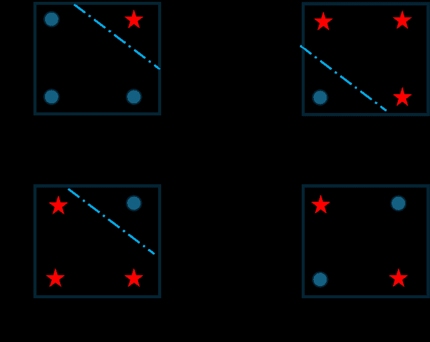
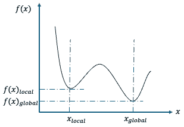

## 5 C++ 中的多层感知机

**多层感知机**（**MLPs**）代表了神经网络架构中的关键进步，将简单的感知机转变为强大的学习系统，能够解决复杂的非线性可分问题。通过堆叠多层相互连接的神经元——每一层都应用加权变换和非线性激活函数——MLPs 创建了分层表示，能够捕获数据中的复杂模式。本章探讨了 MLPs 的理论基础和 C++ 中的实践实现，探索三种不同的方法：使用 Eigen 库的基础 CPU 实现、使用 CUDA 的高性能 GPU 加速解决方案，以及使用 LibTorch（PyTorch 的 C++ API）的生产级实现。

我们首先通过 XOR 问题的视角剖析 MLP 架构，说明为什么单层网络无法成功而多层架构可以。随后，本章全面探索激活函数——从经典的 sigmoid 和 tanh 函数到现代变体，如 ReLU、Leaky ReLU、Swish 和 Mish——解释每种函数如何引入学习复杂映射所必需的非线性。最后，我们研究驱动学习过程的优化算法，包括梯度下降、动量、RMSprop、**自适应矩估计**（**Adam**）、Adagrad 和 Adadelta，并为每种算法提供数学直觉和完整的 C++ 实现。

学完本章后，你将掌握在 C++ 中实现、训练和优化多层神经网络的理论理解和实践技能，并能够根据你的具体需求选择最合适的实现策略——无论是用于嵌入式系统的原生 C++、追求最大性能的 CUDA，还是用于生产部署的 LibTorch。

本章将涵盖以下主题：

- 理解 MLP 架构
- 选择你的 MLP 实现方法：策略指南
- 探索深度学习训练概念

### 技术要求

要跟随本章的实现，你需要以下内容：

- 软件要求：
  - 支持 C++14 或更高版本的 C++ 编译器
  - 用于矩阵运算的 Eigen 库（版本 3.3 或更高）
  - 用于 GPU 实现的 CUDA 工具包（版本 11.0 或更高）
  - 用于 PyTorch 实现的 LibTorch（PyTorch C++ API）
- 硬件要求：
  - 支持 CUDA 的 NVIDIA GPU（用于 GPU 实现）
  - 至少 8GB 内存
  - 建议使用多核 CPU 进行并行处理
- 开发环境：
  - 支持 C++ 的 IDE（Visual Studio、PyCharm 或类似工具）
  - 用于访问代码仓库的 Git
  - 用于构建和运行示例的命令行界面
- 先备知识：
  - 对 C++ 编程的基本理解
  - 熟悉神经网络概念
  - 理解基础线性代数
  - 具有构建系统和包管理经验

### 理解 MLP 架构

MLP 的架构是一种复杂的层次化结构，每个组件在网络功能中都扮演着关键角色。MLP 架构的核心遵循层级化设计，起始于输入层，它充当网络的感知系统，接受各种维度的原始数据特征。这些输入随后进入一个或多个隐藏层。每个隐藏层包含大量神经元，它们通过带权重的突触相互连接，形成复杂的计算路径网络。每个神经元通过激活函数处理其输入，引入非线性，使网络能够学习模式和关系。层之间的加权连接充当知识库，在训练过程中存储学到的模式。最后，架构在输出层达到顶点，其结构由手头的特定任务决定——可能是用于二分类的单个神经元，也可能是用于更复杂预测的多个神经元。这种受生物神经网络启发的架构设计，使 MLP 能够通过连续的抽象层转换输入数据，有效学习输入空间的层次化表示。我们将通过一个 C++ 程序来探索基本的 MLP。首先，我们将查看整个程序，然后在后续章节中剖析上述每个组件。

```text
Illustrative example of Multilayer perceptron, a Feedforward neural network

Input layer
Hidden layer
Output layer

h1
h2
yk
x1
1
x2
w1k
w2k
w11
w21
w31
w12
w22
w32

input
input

To model bias
```

| 变量 | 含义 |
| --- | --- |
| x1, x2 | 输入数据特征 |
| wij | 网络权重 |
| h1, h2 | 隐藏层中的节点 |
| yk | 输出变量 |

该示例由以下部分组成：(a) 一个包含两个输入节点和一个偏置节点的输入层，(b) 一个包含两个神经元的隐藏层，(c) 一个包含一个神经元的输出层

*图 5.1：多层感知机。图片由 AIML.com 提供*

现在我们对 MLP 架构有了概念性的理解，接下来让我们深入实践实现，探索这些组件如何在代码中协同工作。

### 在 C++ 中实现 MLP

在 C++ 中实现 MLP 需要仔细考虑各种组件及其交互。在本节中，我们将创建一个完整的 MLP 实现，用于解决异或（XOR）问题，演示如何使用类来构建网络，并利用 Eigen 库进行高效的矩阵运算。

在深入研究代码之前，让我们先看看 XOR 问题，以及为什么单层感知机不足以解决 XOR 问题。XOR 是一个逻辑门问题，它接受两个二进制输入并产生一个二进制输出。当输入值不同时，XOR 操作的输出为 1。与 AND、OR 或 NAND 等其他具有线性可分边界的逻辑门不同，如*图 5.2*所示，XOR 数据不是线性可分的。感兴趣的读者可以参考*延伸阅读*部分，以更深入地理解该问题。



*图 5.2：逻辑门 AND、OR、NAND 和 XOR。除 XOR 之外的所有逻辑门都具有线性可分边界*

我们的实现将包含两个主要类：一个处理单个层操作的 Layer 类，以及一个管理整个网络架构的 MultilayerPerceptron 类。通过这个实现，你将学习如何使用现代 C++ 实践执行前向传播、反向传播和神经网络训练。在本节中，我们将只强调 C++ 代码的重要方面。完整代码可以从相关的 GitHub 页面下载（`https://github.com/PacktPublishing/Deep-Learning-with-C-/blob/main/chapter5/eigen_mlp_xor.cpp`）。让我们从 Layer 类开始，它是我们网络的基本构建块。

#### Layer 类

Layer 类是神经网络实现中的基本构建块，表示单个神经元层。在下面的代码中，你会看到一个层类的实例化。有一些关键变量，如 weights、biases、activation、input 和 output。weights 是一个矩阵，其维度由输入层和输出层的节点数决定。因此，如果输入层和输出层分别有 2 个和 3 个节点，则权重矩阵的大小为 (2, 3)。biases 是每层的默认激活值。activation 变量存储中间计算，如 activation = f(weights * input + bias)。其中 f 是激活函数。我们将在本章后面讨论各种激活函数。

```cpp
class Layer {
private:
    Eigen::MatrixXd weights;
    Eigen::VectorXd biases;
    Eigen::MatrixXd activation;
    Eigen::MatrixXd input;
    Eigen::MatrixXd output;
public:
    Layer(int input_size, int output_size) {
        weights = Eigen::MatrixXd::Random(output_size, input_size) * 0.1;
        biases = Eigen::VectorXd::Zero(output_size);
    }
```

Layer 类有两个主要操作：

- **前向传播**：这就像将信息向前传递穿过层。它接收输入数据，乘以权重，加上偏置，并应用激活函数（此处为 ReLU）来产生输出。

```cpp
Eigen::MatrixXd forward(const Eigen::MatrixXd& x)
{
    input = x;
    activation = (weights * input + biases.replicate(1, input.cols()));
    output = relu(activation);
    return output;
}
```


b. **反向传播**：这是一个学习阶段，层会根据自身产生的误差调整权重和偏置。就像学生在看到正确答案后改正自己的错误一样。

```cpp
Eigen::MatrixXd backward(const Eigen::MatrixXd& grad_output, double learning_rate) {
    Eigen::MatrixXd grad_activation = grad_output.array() * relu_derivative(activation).array();

    // Calculate gradients
    Eigen::MatrixXd grad_weights = grad_activation * input.transpose();
    Eigen::VectorXd grad_biases = grad_activation.rowwise().sum();
    Eigen::MatrixXd grad_input = weights.transpose() * grad_activation;

    // Update weights and biases
    weights -= learning_rate * grad_weights;
    biases -= learning_rate * grad_biases;

    return grad_input;
}
```

现在，我们已经定义了 `Layer` 类，可以利用它来构建 `MLP` 类，该类将多个层编排成一个完整的神经网络架构。

#### MultilayerPerceptron 类

在 `Layer` 类奠定的基础之上，我们可以构建 `MultilayerPerceptron` 类——这是一个完整的神经网络，将多个层编排成一个内聚的架构。该类作为训练模型的神经网络，管理从初始化到预测的整个学习过程。

MLP 网络通过指定层大小来创建——层大小是一个向量，定义了网络中每一层的节点数量。构造函数使用 `for` 循环遍历该向量，通过连接相邻的层大小依次创建每一层。

网络结构建立后，`MultilayerPerceptron` 类实现了一个 `forward` 函数，该函数建立在 `Layer` 类中定义的 `forward` 函数之上。这个函数编排数据在整个网络中的流动，将每一层的输出作为下一层的输入，从而有效地将各层操作串联起来，形成一个能够解决 XOR 分类任务等复杂问题的深度学习架构。

```cpp
class MultilayerPerceptron {
private:
    std::vector<Layer> layers;
    double learning_rate;
public:
    MultilayerPerceptron(const std::vector<int>& layer_sizes, double lr = 0.01)
    : learning_rate(lr) {
        for (size_t i = 0; i < layer_sizes.size() - 1; ++i) {
            layers.emplace_back(layer_sizes[i], layer_sizes[i + 1]);
        }
    }

    Eigen::MatrixXd forward(const Eigen::MatrixXd& input) {
        Eigen::MatrixXd current_input = input;
        for (auto& layer : layers) {
            current_input = layer.forward(current_input);
        }
        return current_input;
    }
```

最后，我们可以定义训练循环，对 MLP 网络进行训练。这个 *train* 函数会按给定的 *epochs*（轮数）进行迭代。在每个 epoch 中，它计算损失函数**均方误差**（**MSE**）。每一步都会执行前向传播和反向传播函数，同时尽量降低损失值。

```cpp
    void train(const Eigen::MatrixXd& X, const Eigen::MatrixXd& y, int epochs) {
        for (int epoch = 0; epoch < epochs; ++epoch) {
            // Forward pass
            auto prediction = forward(X);
            // Calculate loss (MSE)
            double loss = (prediction - y).array().square().mean();
            if (epoch % 100 == 0) {
                std::cout << "Epoch " << epoch << ", Loss: " << loss << std::endl;
            }
            // Backpropagation
            Eigen::MatrixXd grad = 2.0 * (prediction - y) / y.cols(); // MSE derivative
            // Backward pass through all layers in reverse
            for (int i = layers.size() - 1; i >= 0; --i) {
                grad = layers[i].backward(grad, learning_rate);
            }
        }
    }

    // Method to make predictions after training
    Eigen::MatrixXd predict(const Eigen::MatrixXd& X) {
        return forward(X);
    }
};
```

在这个程序中，我们使用了一些术语，如 ReLU（激活函数）、epochs（轮数）和学习率（learning rate）。我们将在*探索深度学习训练概念*一节中讨论这些术语。

与此同时，让我们看看编写此程序时使用的一些 C++ 库。它们包括：

- **Eigen**：Eigen 是一个高性能的 C++ 模板库，用于线性代数、矩阵、向量及相关算法。在 MLP 代码中，它用于：
  - `MatrixXd`：动态大小矩阵运算
  - `VectorXd`：动态大小向量运算
  - 高效的矩阵乘法和数学运算
  - 管理神经网络层中的权重和偏置
- **向量库（std::vector）**：C++ **标准模板库**（**STL**）中的 vector 在代码中用于：
  - 存储和管理 `Layer` 对象的集合
  - 为神经网络架构提供动态数组功能
  - 管理网络配置中的层大小
- **数学库（cmath）**：C++ 数学库提供基本的数学运算。在神经网络实现的上下文中，它用于：
  - 数学函数和运算
  - 激活函数中的计算
  - 计算损失和梯度

以上说明都是针对上述 C++ 代码的。如需详细了解，请参阅相关参考资料。这里给出的 MLP 代码没有使用**图形处理器**（**GPU**）提供的任何并行处理。现在，我们将看看使用 GPU 并行化的同一段 C++ 代码。

### 使用 CUDA 实现 MLP

GPU 并行化是现代深度学习实现的基石，它提供了训练和部署复杂神经网络所需的大规模计算加速能力。虽然 PyTorch 和 TensorFlow 等框架抽象掉了大部分 GPU 处理细节，但理解 C++ 中 GPU 加速的底层机制对于优化性能和构建自定义解决方案至关重要。本节探讨如何在 C++ 中直接利用 GPU 能力，重点关注那些与金融、自动驾驶系统和医疗保健等高风险应用中尤为相关的实际实现，这些领域对计算效率和低延迟的要求极高。与之前一样，完整代码将在本章关联的 GitHub（`https://github.com/PacktPublishing/Deep-Learning-with-C-/tree/main/chapter5`）中提供。这里，我们将拆解代码中最重要的部分。

以下是为 CUDA 核函数定义的头部，它们处理基本的 CUDA 操作并定义 GPU 专用函数：

```cpp
#include <cuda_runtime.h>
#include <curand.h>
#include <cublas_v2.h>

// CUDA kernels for ReLU activation and its derivative
__global__ void reluKernel(float* data, int size)
__global__ void reluDerivativeKernel(float* data, float* output, int size)
```

接下来，我们定义 `CudaLayer` 类。这与上一节中定义的 `Layer` 类类似。

```cpp
class CudaLayer {
private:
    int input_size, output_size;
    float *d_weights, *d_biases;
    float *d_input, *d_output;
    float *d_activation;
    cublasHandle_t handle;
public:
    CudaLayer(int in_size, int out_size) : input_size(in_size), output_size(out_size) {
        cublasCreate(&handle);
        // Allocate memory on GPU
        cudaMalloc(&d_weights, output_size * input_size * sizeof(float));
        cudaMalloc(&d_biases, output_size * sizeof(float));
        cudaMalloc(&d_input, input_size * sizeof(float));
        cudaMalloc(&d_output, output_size * sizeof(float));
        cudaMalloc(&d_activation, output_size * sizeof(float));
        // Initialize weights randomly
        curandGenerator_t gen;
        curandCreateGenerator(&gen, CURAND_RNG_PSEUDO_DEFAULT);
        curandGenerateUniform(gen, d_weights, output_size * input_size);
        curandDestroyGenerator(gen);
        // Initialize biases to zero
        cudaMemset(d_biases, 0, output_size * sizeof(float));
    }
```

该函数展示了变量的初始化过程。它使用 `cudaMalloc` 在 GPU 上分配内存。这与标准 C++ 中的 malloc 函数类似，但专门用于 GPU 内存分配。我们对每个变量都使用了 malloc 函数（这里指 `cudaMalloc`）。接下来，我们希望使用随机数生成器 `curandGenerator` 来随机初始化权重。`curandGenerateUniform` 利用该随机数生成器从均匀分布中采样随机数。最后，我们使用 `cudaMemset` 将偏置初始化为零。

初始化之后，让我们来看看前向传播函数。

```cpp
void forward(float* input, int batch_size) {
    const float alpha = 1.0f;
    const float beta = 0.0f;
    // Matrix multiplication: activation = weights * input + biases
    cublasSgemm(handle, CUBLAS_OP_N, CUBLAS_OP_N,
        output_size, batch_size, input_size,
        &alpha, d_weights, output_size,
        input, input_size, &beta,
        d_activation, output_size);
    // Add biases
    for (int i = 0; i < batch_size; ++i) {
        cublasSaxpy(handle, output_size, &alpha,
            d_biases, 1,
            d_activation + i * output_size, 1);
    }
}
```


## 第5章：C++ 中的多层感知机

```cpp
    // Apply ReLU
    int block_size = 256;
    int num_blocks = (output_size * batch_size + block_size - 1) / block_size;
    reluKernel<<<num_blocks, block_size>>>(d_activation, output_size * batch_size);
}
```

`cublasSgemm` 执行权重与输入之间的矩阵乘法。该函数对于 GPU 上神经网络计算中的高效矩阵运算至关重要。我们建议查看 *进一步阅读* 部分以及 `cublas` 库以了解各个参数的含义。然后我们使用 `cublasSaxpy` 将偏置加到之前乘法的结果上。接着我们对结果应用 ReLU 操作。这就完成了前向传播。

现在让我们来看反向传播。下面的代码展示了如何通过 ReLU 计算梯度。

```cpp
void backward(float* grad_output, float learning_rate, int batch_size) {
    const float alpha = learning_rate;
    const float beta = 1.0f;
    // Compute gradient through ReLU
    int block_size = 256;
    int num_blocks = (output_size * batch_size + block_size - 1) / block_size;
    float* d_grad_activation;
    cudaMalloc(&d_grad_activation, output_size * batch_size * sizeof(float));
    reluDerivativeKernel<<<num_blocks, block_size>>>(d_activation, d_grad_activation, output_size * batch_size);
    // Update weights
    cublasSgemm(handle, CUBLAS_OP_N, CUBLAS_OP_T,
                output_size, input_size, batch_size,
                &alpha, d_grad_activation, output_size,
                d_input, input_size, &beta, d_weights, output_size);
    // Update biases
    cublasSgemv(handle, CUBLAS_OP_N,
                output_size, batch_size,
                &alpha,
                d_grad_activation, output_size,
                d_input, 1,
                &beta,
                d_biases, 1);
    cudaFree(d_grad_activation);
}
```

然后它使用相同的 `cublasSgemm` 来更新模型权重，并使用 `cublasSgemv` 来更新偏置。与执行矩阵-矩阵乘法的 `cublasSgemm` 不同，`cublasSgemv` 执行的是矩阵-向量乘法。

最后，我们可以使用 `CudaLayer` 类来构建多层感知机，如下所示。

```cpp
class CudaMLP {
private:
    std::vector<CudaLayer> layers;
    float learning_rate;
public:
    CudaMLP(const std::vector<int>& layer_sizes, float lr = 0.01)
        : learning_rate(lr) {
        for (size_t i = 0; i < layer_sizes.size() - 1; ++i) {
            layers.emplace_back(layer_sizes[i], layer_sizes[i + 1]);
        }
    }
```

在这个函数中，`layers` 是一个存储 `CudaLayer` 对象的向量。`layer_sizes` 是一个存储每层大小的向量。构造函数遍历 `layer_sizes` 来创建网络结构。它使用 `emplace_back` 操作来创建层。C++ 中常见的操作是 `push_back`，它会创建一个临时变量，然后将其存储到向量中；而 `emplace_back` 则通过在向量中直接构造 `CudaLayer` 对象，提供了一种更高效的操作。例如，如果 `layer_sizes` = {2, 4, 3, 1}，该函数将创建一个 MLP，其中第一层有 2 个输入和 4 个输出，第二层有 4 个输入和 3 个输出，最后第三层有 3 个输入和 1 个输出。

请参阅 `chapter_5/cuda_mlp.cpp` 获取完整代码。要执行此程序，首先使用以下命令编译：

```sh
nvcc -o cuda_mlp cuda_mlp.cpp -lcublas -lcurand
```

然后按如下方式执行代码：

```sh
./cuda_mlp
```

到目前为止，我们已经看到了使用 C++ 解决相同的 XOR 问题，然后使用 CUDA 库进行高效加速计算。这些是底层库，可能不适用于构建复杂的神经网络架构。因此，我们现在将使用 LibTorch（PyTorch 的 C++ 实现）来查看相同的程序。

### 使用 LibTorch 实现 MLP

LibTorch 是 PyTorch 的 C++ 发行版，为 PyTorch 的机器学习能力提供了原生的 C++ 接口。它允许开发者用 C++ 构建和训练神经网络。它还通过 CUDA 库提供 GPU 加速。LibTorch 还通过 `torch::nn` 接口提供了预构建的神经网络组件。它还自动处理内存管理，大大减少了开发者的操作负担。

让我们来看一下 C++ 中的 LibTorch 接口：

```cpp
#include <torch/torch.h>
#include <iostream>

// Define the MLP structure
struct MLP : torch::nn::Module {
    torch::nn::Linear layer1{nullptr}, layer2{nullptr}, layer3{nullptr};
    MLP() {
        // Same architecture as before: 2-4-3-1
        layer1 = register_module("layer1", torch::nn::Linear(2, 4));
        layer2 = register_module("layer2", torch::nn::Linear(4, 3));
        layer3 = register_module("layer3", torch::nn::Linear(3, 1));
    }
    torch::Tensor forward(torch::Tensor x) {
        x = torch::relu(layer1->forward(x));
        x = torch::relu(layer2->forward(x));
        x = layer3->forward(x);
        return x;
    }
};
```

MLP 类初始化了三个层，节点大小分别为 2、4、3，最后输出。它使用 `register_module` 将层添加到模型中。还应注意，这里只实现了前向传播。在 LibTorch 中，不需要显式实现反向传播，因为它使用自动微分（autograd），并通过在损失对象上调用 `backward()` 方法来计算，如这个训练循环所示。

```cpp
for (size_t epoch = 0; epoch < 1000; ++epoch) {
    // Forward pass
    auto output = model->forward(X);
    auto loss = torch::mse_loss(output, y);
    // Backward pass and optimize
    optimizer.zero_grad();
    loss.backward();
    optimizer.step();
    if (epoch % 100 == 0) {
        std::cout << "Epoch " << epoch << ", Loss: "
                  << loss.item<float>() << std::endl;
    }
}
```

上述函数是使用 LibTorch 的 C++ API 编写的典型训练/优化循环。我们使用 MSE 损失函数，损失函数上的 `backward()` 函数在每一步计算反向传播。优化步骤包括三个步骤：

- `zero_grad()`：清除旧的梯度或重置其跟踪的所有参数的梯度，确保当前步骤的梯度不会与之前步骤的梯度累积。
- `loss.backward()`：该步骤启动反向传播过程并计算新的梯度。
- `optimizer.step()`：根据所使用的优化算法，应用计算出的梯度来调整模型的可训练参数。在我们的例子中，我们使用了**随机梯度下降**（**SGD**）。

到目前为止，我们探讨了实现 MLP 解决 XOR 问题的三种不同方法：

- 使用 C++ 和 Eigen 库的传统 CPU 实现
- 使用 CUDA 的 GPU 加速方案
- 使用 PyTorch 的 C++ API（LibTorch）的现代方法

### 选择你的 MLP 实现方案：一份策略指南

在完成了同一个 XOR 问题的三种完整实现——先用 Eigen，再用 CUDA，最后用 LibTorch——之后，你现在可以为自己的项目做出明智的选择了。每种方法都反映了不同的权衡，只有当你实际看到它们时才会变得清晰。接下来，让我们逐一看看这些方法。

#### 使用 Eigen 的纯 C++

Eigen 实现要求我们手动编写每个组件：权重初始化、前向传播、反向传播循环和梯度更新步骤。这并非限制——而正是重点所在。当你的部署环境禁止外部框架依赖时，当你的目标是内存预算严格的嵌入式或物联网硬件时，或者当你在一个要求每行代码都可审计的受监管领域（医疗设备、航空航天）工作时，这种透明度是一种要求，而非偏好。

成本与控制力成正比。正如你在 Layer 类中所看到的，即使是一个简单的网络也需要手动实现梯度计算和权重更新。将其扩展到更深的架构或更复杂的损失函数，会显著增加这一负担。这种方法最适合拥有强大 C++ 专业能力，并且面临明确、具体约束的团队，因为这些约束使这种努力是值得的。

#### CUDA：以高昂成本换取最大性能

CUDA 实现展示了 GPU 加速在代码层面实际上涉及什么：为每个张量显式调用 cudaMalloc 和 cudaFree、仔细管理 CPU 到 GPU 的数据传输，以及直接调用 cuBLAS 例程（如 cublasSgemm 和 cublasSgemv）进行矩阵运算。性能上限很高——对于大规模工作负载，GPU 并行化相比 CPU 实现可以实现 10–100 倍的加速——但维护负担同样巨大。

在这个层面编写的代码可移植性较差，更难调试，并且需要持续的 GPU 专业知识来维护。当训练时间是主要瓶颈时，当你在为现有框架不支持的运算构建自定义 GPU 内核时，或者当你的应用程序需要大规模实时推理时，它是一个正确的选择。然而，对于大多数项目来说，除非这些条件得到明确满足，否则很难证明这种复杂性的合理性。


#### LibTorch：生产系统的实用默认选择

相同 XOR 网络的 LibTorch 实现只需要一次前向传播。反向传播通过调用 `loss.backward()` 自动处理，三步优化循环 —— `zero_grad()`、`backward()`、`optimizer.step()` —— 取代了前两种实现中手动编写的梯度累积和权重更新逻辑。跨平台部署、自动内存管理，以及对完整 PyTorch 生态系统的访问都无需额外代码。

这些权衡是真实存在的，但很少具有决定性：更大的二进制文件、框架依赖，以及对底层操作的可见性稍低。对于从原型转向生产的团队，或需要长期维护和扩展的系统而言，这些成本通常会被实现复杂度的降低所抵消。

#### 混合方法

许多生产系统并不会只采用某一种方法。一种常见模式是使用 LibTorch 作为主要框架，同时针对构成可衡量性能瓶颈的特定操作编写自定义 CUDA 内核，并在资源受限的环境中使用原生 C++ 处理预处理或后处理步骤。这样既保留了 LibTorch 的大部分生产力优势，又为确实需要的地方保留了针对性优化的空间。

**建议**：对于大多数用例 —— 包括本章探讨的各类面向生产的架构 —— LibTorch 都是合适的起点。自动微分、内置优化器和跨平台支持满足了最常见的实际需求，而无需承担 CUDA 所需的基础设施投入，也无须承受原生 Eigen 的手动实现开销。只有当框架无法满足某个具体且可衡量的需求时，才应偏离这一默认选择。最有效的实现是能够交付、维护和迭代的实现，而不是理论上最优的实现。

下表总结了本章涉及的三种实现 —— 原生 C++/Eigen、CUDA 和 LibTorch —— 在内存管理、抽象级别、性能和实际用例等维度上的主要差异。

| 特性 | CPU 实现 | CUDA 实现 | LibTorch 实现 |
| --- | --- | --- | --- |
| 使用的库 | Eigen | cuBLAS、cuRAND | PyTorch C++ API |
| 内存管理 | 自动（C++） | 显式（cudaMalloc、cudaFree） | 自动 |
| 处理单元 | CPU | GPU | CPU/GPU |
| 抽象级别 | 中层 | 低层 | 高层 |
| 矩阵运算 | `Eigen::MatrixXd` | `cublasSgemm`、`cublasSgemv` | `torch::Tensor` |
| 实现复杂度 | 中等 | 复杂 | 简单 |
| 要求 | - C++ 编译器<br>- Eigen 库<br>- 8 GB 内存 | - CUDA 工具包<br>- cuBLAS 库<br>- NVIDIA GPU | - LibTorch<br>- CMake<br>- C++14 或更高版本 |
| 性能 | 大型计算较慢 | 大型计算最快 | 良好的平衡 |
| 内存访问 | 直接 | 需要 CPU-GPU 传输 | 抽象化 |
| 用例 | 原型开发、小型数据集 | 高性能计算 | 生产部署 |
| 梯度计算 | 手动实现 | 手动实现 | 自动微分 |

*表 5.1：MLP 实现方法对比*

在接下来的章节中，我们将使用 PyTorch 的 C++ API 重点介绍深度学习在 C++ 中的实际应用，提供更多动手实践示例和真实场景的实现。

### 探索深度学习训练概念

在本章中，我们使用了激活函数和优化技术等概念，但并未明确定义它们。在本节中，我们将稍微偏离主题，正式定义这两个概念。学习这些概念并建立直观理解，将在你的深度学习之旅中至关重要。

#### 激活函数

在本章中，我们在 MLP 实现中一直使用 ReLU 函数。然而，激活函数的选择远非随意——它会显著影响网络学习和泛化的能力。激活函数是将非线性引入神经网络的数学门户，它将输入的加权和转换为有意义的输出，使网络能够学习数据中复杂的模式和关系。

如果没有激活函数，任何多层网络无论多深都会退化为一个简单的线性模型，从而丧失学习实际应用中存在的复杂非线性模式的能力。我们之前探讨的 XOR 问题完美地说明了这一局限性——线性模型无法解决它，但添加非线性激活函数后，网络就能学会解决方案。

几十年来，激活函数的格局经历了相当大的演变。早期神经网络严重依赖 sigmoid 和双曲正切（tanh）函数，它们提供平滑且有界的输出，适合某些应用。然而，随着网络越来越深，研究人员发现这些函数存在梯度消失问题，即反向传播过程中梯度变得越来越小，实际上使更深层的学习陷入停滞。这一局限性推动了 ReLU 函数族的发展，它通过支持训练更深的网络而彻底改变了深度学习。概括地说，激活函数可以分为两个主要家族：Sigmoid 家族和 ReLU 家族。

在本节中，我们将探索这两个家族的激活函数，考察它们的数学公式和关键特征。理解这些函数及其权衡，将使你在设计神经网络架构时能够做出明智的决策，最终带来更好的模型性能和训练稳定性。

第一个家族以平滑、有界的输出为特征，尽管后来暴露出诸多挑战，它仍然主导了早期神经网络架构。

#### Sigmoid 家族

Sigmoid 家族损失函数是机器学习中具有独特 S 形曲线的基础数学工具。这些函数巧妙地将任意实数值转换为 0 到 1 之间的概率值，使其在二分类问题中极具价值。其中最著名的成员——逻辑损失函数——是逻辑回归的支柱，也是神经网络的重要组成部分。它们提供平滑的梯度和自然的概率解释，使其成为机器学习工具箱中不可或缺的部分。现在，我们来看一些属于 Sigmoid 家族的常见损失函数：

a. **逻辑 Sigmoid（标准 Sigmoid）**：这是一种数学函数，将任意实数映射到 0 到 1 之间的值，其定义公式如下：

$$
\sigma(x) = \frac{1}{1 + e^{-x}}
$$

主要特征：

- 输出范围限定在 0 到 1 之间
- S 形曲线（sigmoid 形状）
- 平滑、连续且可微
- 可用于输出概率预测

b. **双曲正切（tanh）**：该函数与 sigmoid 类似，但将输入值映射到 -1 到 1 之间的输出。其定义公式如下：

$$
\tanh(x) = \frac{e^x - e^{-x}}{e^x + e^{-x}}
$$

主要特征：

- 零中心化（不同于以 0.5 为中心的 sigmoid）
- S 形曲线（与 sigmoid 类似但更陡峭）
- 平滑、连续且可微
- 与 sigmoid 相比梯度更强
- 适用于需要围绕 0 对称的数据

c. **Softplus**：它是 ReLU 函数的平滑、可微近似，可确保整个过程中梯度连续。其定义公式如下：

$$
f(x) = \ln(1 + e^x)
$$


主要特点：

- 连续可微
- 输出范围为 [0, ∞)
- 比 ReLU 更平滑
- 计算成本更高
- 实践中较少使用

- **软符号（Softsign）**：它是一种与 tanh 类似但渐近行为不同的激活函数。其定义如下：

  `softsign(x) = x / (1 + |x|)`

  主要特点：
  - 输出范围在 -1 和 1 之间
  - 与 tanh 一样以零为中心
  - 与 tanh 相比，更平滑地趋近渐近线
  - 采用多项式饱和而非指数饱和
  - 计算上比 tanh 更简单

虽然 Sigmoid 系列凭借其平滑、有界的输出提供了理论基础，但更深网络中梯度消失的挑战促使了新型激活函数的开发。ReLU 系列作为一种革命性的替代方案出现，提供了计算简单性以及更好的梯度流，从而能够训练深度显著增加的神经网络。

#### ReLU 系列

ReLU 系列激活函数以其简单而有效的神经网络计算方式彻底改变了深度学习。它们的核心是允许正值不变地通过，同时将负值设为零（`f(x) = max(0, x)`），解决了早期基于 sigmoid 的网络中一直存在的梯度消失问题。该系列包括重要的变体，如允许少量负值通过的 Leaky ReLU，以及为负输入提供可学习斜率的 Parametric ReLU。它们的高计算效率、促进稀疏性以及生物学合理性，使 ReLU 系列函数在深度学习架构中无处不在，从而能够训练更深的网络。

- **修正线性单元（ReLU）**：它是现代神经网络中最常用的激活函数之一。其定义如下：

  `ReLU(x) = max(0, x)`

  主要特点：
  - 输出范围为 [0, ∞)
  - 计算简单（仅取 0 和输入之间的最大值），从而加快训练速度
  - 对正值非饱和
  - 有助于解决梯度消失问题
  - 在网络中引入稀疏性

- **带泄漏的修正线性单元（Leaky ReLU）**：与标准 ReLU 不同，这一变体为负值维持一个小的非零输出，解决了神经元完全停止学习的问题。其定义如下：

  `LeakyReLU(x) = max(αx, x)`

  其中 α 是一个小的常数（通常为 0.01）。

  主要特点：
  - 输出范围为 (-∞, ∞)
  - 与 ReLU 类似，但允许小的负值
  - 通过为负输入维持小梯度，防止 ReLU 死亡问题
  - α 参数决定负值的斜率
  - 保持 ReLU 的大部分计算效率

Leaky ReLU 在 ReLU 的优点与保留部分负输入信息的需求之间提供了折衷，使其成为许多深度学习架构中的流行选择。

- **参数化修正线性单元（Parametric ReLU）**：它是 ReLU 的一种自适应变体，其中负斜率是在训练期间学习得到的，而不是预先定义的。其定义如下：

  `f(x) = max(αx, x)`

  其中 α 是一个可学习参数。

  主要特点：
  - 自适应的负斜率参数
  - 输出范围为 (-∞, ∞)
  - 如果 α 变为 0，则退化为 ReLU
  - 比 Leaky ReLU 更灵活
  - 需要额外的参数训练

- **指数线性单元（ELU）**：它是一种平滑的激活函数，允许负值，并有助于减少 ReLU 网络所经历的偏差偏移。其定义如下：

  `f(x) = x, x ≥ 0`  
  `f(x) = α(e^x − 1), x < 0`

  其中 α 是一个可调参数。

  主要特点：
  - 包含负值的平滑函数
  - 可以产生负输出
  - 有助于减少偏差偏移
  - 自正则化
  - 计算成本比 ReLU 更高

- **缩放指数线性单元（SELU）**：它是 ELU 的一种自归一化变体，可自动保持网络中激活的归一化。其定义如下：

  `f(x) = λx, x ≥ 0`  
  `f(x) = λα(e^x − 1), x < 0`

  其中 λ ≈ 1.0507 且 α ≈ 1.6733。

  主要特点：
  - 自动归一化网络激活
  - 在层间保持均值和方差
  - 有助于深层网络训练
  - 需要特定的初始化
  - 最好用于全连接层

- **高斯误差线性单元（GELU）**：它根据高斯分布下的累积分布函数对输入进行加权，使网络能够学习更细致的表示。随着输入值减小，其被抑制的概率会逐渐增加而非突然增加，从而产生平滑的概率门控效果。这使得它对于上下文和微妙模式很重要的自然语言处理任务特别有效。其定义如下：

  `f(x) = 0.5 * x * (1 + tanh(√(2/π) * (x + 0.044715 * x^3)))`

  主要特点：
  - 比 ReLU 更平滑
  - 用于现代 Transformer
  - 概率式激活方法
  - 计算成本更高
  - 在某些语言模型和 Transformer 架构中表现更好

- **随机化修正线性单元（RReLU）**：它是 ReLU 的一种变体，在训练期间使用随机的负斜率以获得更好的正则化。与在反向传播中学习斜率的 PReLU 不同，RReLU 中的斜率在训练期间从随机分布中采样。其定义如下：

  `f(x) = max(αx, x)`

  其中 `α ~ U(l, u), l < u` 且 `l, u ∈ [0, 1)`。

  主要特点：
  - 训练期间使用随机斜率参数
  - 测试期间使用固定斜率
  - 起到正则化作用
  - 有助于防止过拟合
  - 实现比标准 ReLU 更复杂

Sigmoid 系列和 ReLU 系列代表了在神经网络中引入非线性的两种基本方法，各自具有不同的特点，因此适用于不同的场景。

从 sigmoid 到基于 ReLU 的函数的演变，反映了该领域向更高效率和可扩展架构的迈进。虽然 sigmoid 函数为神经网络奠定了理论基础，但 ReLU 及其变体已成为现代深度学习隐藏层的默认选择，使得训练更深层的网络成为可能，这些网络支撑着当今最先进的模型。在这两个系列之间做出选择最终取决于你的具体需求：当你需要有界输出和概率解释时，请使用 sigmoid 系列函数；当构建需要计算效率、更快收敛和更好梯度流的深层网络时，请选择 ReLU 系列函数。

#### 其他高级函数

虽然 Sigmoid 系列和 ReLU 系列构成了神经网络中激活函数的基础，但深度学习的发展催生了几种超越这些传统类别的高级激活函数。这些函数代表了神经网络设计的下一代，它们结合了多种方法的优点，或引入了全新的机制，以应对现代架构中的特定挑战。

这些函数中的每一个都是为了解决特定问题而开发的——无论是改善极深网络中的梯度流、降低边缘设备的计算开销，还是提升 Transformer 等前沿架构的性能。

对于研究最先进模型的研究人员来说，理解这些高级激活函数至关重要，因为它们通常能提供在竞争性应用中所需要的性能优势。在本节中，我们将探讨这些函数的工作原理、数学公式和主要特点。

- **Swish**：它是一种自门控激活函数，将输入乘以该输入的 sigmoid。它是 sigmoid 函数的一种变换。其定义如下：

  `f(x) = x * sigmoid(βx)`

  其中 β 可以是常数（通常为 1），也可以是可训练的。

  主要特点：
  - 光滑且非单调
  - 上方无界，下方有界


- 自门控激活机制
- 计算成本比 ReLU 更高
- 提供更好的梯度流动
- 在深度神经网络中提供比 ReLU 更好的性能

- **Mish**：它是一种与 Swish 相关的自正则化非单调激活函数。与 Swish 类似，Mish 对双曲正切函数进行变换。它通过以下公式定义：

    `f(x) = x * tanh(ln(1 + e^x))`

    主要特点：
    - 平滑且非单调
    - 几乎始终为正
    - 上方无界，下方有界
    - 比 ReLU 具有更好的梯度流动
    - 自正则化特性
    - 提供更好的训练稳定性

- **Hard Swish**：它是 Swish 激活函数的一种更快、更高效的近似，通过以下公式定义：

    `f(x) = 1/6 * x * min(max(x + 3, 0), 6)`

    主要特点：
    - Swish 的分段线性近似
    - 计算效率更高
    - 与 Swish 具有相似的特性
    - 更适合移动设备
    - 计算有界

- **Hard Tanh**：它是双曲正切函数的分段线性近似。通过以下公式定义：

    `f(x) = max(-1, min(1, x))`

    主要特点：
    - 输出有界于 [-1, 1]
    - 计算高效
    - 中心区域线性
    - 分段线性函数
    - 比 tanh 更简单

理解这些激活函数及其特性，能够帮助你在架构设计上做出明智的决策。不要将激活函数的选择视为一成不变的决定，而应将其视为网络设计过程中不可分割的一部分——需要与其他超参数一起反复审视和优化。最适合你特定应用的激活函数，往往是通过系统性的实验得出的，这些实验依据本节所述的原理和权衡进行。

在深度学习之旅中不断前进时，请记住，激活函数不仅仅是数学形式，更是强大的工具，从根本上塑造网络学习和泛化的方式。理解它们行为所获得的洞见，将在你应对日益复杂的问题和架构时证明其价值非凡。

到目前为止，我们已经了解了如何在 C++ 中使用不同方法实现多层感知机，并探索了各种能将非线性引入神经网络的激活函数。然而，构建网络架构和选择激活函数只是问题的一部分。为了有效训练这些网络并实现最佳性能，我们需要了解优化技术，这将在下一节中讨论。我们将研究关键的优化算法，如梯度下降、Adam、RMSprop、动量、Adagrad 和 AdaDelta。

#### 优化技术

深度学习本质上是一个围绕成本函数（也称为损失函数）的优化问题。理解优化技术对于有效训练神经网络至关重要，因为训练过程涉及寻找可微损失函数的最小（或最大）值。损失函数必须是平滑且可微的，以便进行梯度计算。在之前探讨了各种损失函数之后，我们现在将研究几种流行的优化技术，从最基础的方法开始。在下图中，我绘制了一个损失函数 f(x)。你可以看到它有多个（此处为两个）局部最小值，但只有一个全局最小值。



*图 5.3：损失函数*

在优化过程中，我们的主要目标是找到损失函数的最小点。这个最小值可以是局部的（在邻近区域内最优）或全局的（在整个函数空间内最优）。然而，在复杂的神经网络架构中，判断所发现的最小值究竟是真正的全局最小值还是仅仅局部最小值，是一个重大的技术挑战。这在深度学习中尤其重要，因为损失函数的形态通常是高度非凸的，存在许多局部最小值。

在接下来的部分，我们将了解当今使用的一些常见优化技术。这些算法是相互构建的，因此请注意后续技术是如何在彼此基础上发展的。

##### 梯度下降

梯度下降是一种用于训练神经网络的优化技术，通过连续参数调整来降低损失函数的值。在每次迭代中，算法计算损失函数相对于每个参数的导数。然后，它沿着梯度的反方向调整这些参数——向更低的损失值下降。每次调整的幅度取决于学习率，这是一个关键的超参数，需要在训练速度与稳定性之间取得平衡。如果学习率设置过高，可能会越过最优值；设置过低，则会导致不必要的长时间训练。

下面的 `gradient_descent` C++ 实现演示了这一优化过程。通过基于梯度信息的迭代参数更新，该函数沿着最陡下降路径系统性地降低损失。代码执行以下步骤：

- **初始化**：接收张量 `x`（要优化的参数），并通过 `requires_grad_(true)` 启用梯度跟踪
- **迭代优化循环**：最多执行 1,000 次迭代（或直到收敛）：
    - 使用提供的 `loss_fn` 计算损失
    - 通过 `loss.backward()` 计算梯度
    - 更新参数：`x = x - learning_rate * x.grad()`
    - 将梯度归零，为下一次迭代做准备
- **收敛检查**：如果梯度幅度低于 1e-6，则提前停止，表示已达到局部最小值
- **返回**：优化后的参数（从计算图中分离）

`NoGradGuard` 块在参数更新期间临时禁用梯度跟踪，以防止构建不必要的计算图，从而提高内存效率。

该实现代表了构建 Adam 和 RMSprop 等更复杂优化器的基础，正如你文档后续部分所讨论的那样。

```cpp
torch::Tensor gradient_descent(
    torch::Tensor x,
    std::function<torch::Tensor(torch::Tensor)> loss_fn,
    float learning_rate = 0.01,
    int max_iterations = 1000
) {
    x = x.detach().requires_grad_(true);
    for(int i = 0; i < max_iterations; i++) {
        auto loss = loss_fn(x);
        loss.backward();
        {
            torch::NoGradGuard no_grad;
            x = x - learning_rate * x.grad();
            x.grad().zero_();
        }
        if(x.grad().abs().max().item<float>() < 1e-6) {
            break;
        }
    }
    return x.detach();
}
```

虽然梯度下降为优化提供了很好的基础，但它的固定学习率在处理不同尺度的参数以及不同方向曲率不同的损失景观时可能会遇到困难。这一局限性促使了自适应优化器 RMSprop 的发展，我们将在下一节中研究它。

##### RMS Prop

**均方根传播**（**RMSprop**）跟踪每个参数平方梯度的移动平均值，并使用该值对当前梯度进行缩放。这种归一化有助于防止在处理不同量级梯度时学习率变得过小。

这种自适应行为使算法能够更有效地穿越损失景观中的陡峭和平缓区域，与标准梯度下降相比，收敛速度更快。下面是一个用于 `rmsprop` 的 C++ 函数：

```cpp
torch::Tensor rmsprop_optimize_gpu(
    torch::Tensor x,
    std::function<torch::Tensor(torch::Tensor)> loss_fn,
    float learning_rate = 0.01,
    float decay_rate = 0.99,
    float epsilon = 1e-8,
    int max_iterations = 1000
) {
    // Move tensors to GPU
    x = x.detach().cuda().requires_grad_(true);
    auto cache = torch::zeros_like(x).cuda();
    for(int i = 0; i < max_iterations; i++) {
        auto loss = loss_fn(x);
        loss.backward();
        {
            torch::NoGradGuard no_grad;
            // Update moving average of squared gradients
            cache = decay_rate * cache + (1 - decay_rate) * x.grad().pow(2);
            // Update parameters
            x = x - learning_rate * x.grad() / (cache.sqrt() + epsilon);
            x.grad().zero_();
        }
        if(x.grad().abs().max().item<float>() < 1e-6) {
            break;
```


## 第5章：C++中的多层感知机

```cpp
}
}
    return x.detach().cpu(); // Return result back to CPU
}
```

承载算法逻辑的代码如下：

```cpp
cache = decay_rate * cache + (1 - decay_rate) * x.grad().pow(2);
```

该缓存（cache）追踪近期梯度的幅值，并赋予近期历史更大的权重（由 `decay_rate` 控制，取值为 0.99）。

参数更新步骤 `x = x - learning_rate * x.grad() / (cache.sqrt() + epsilon)` 正是 RMSprop 自适应行为大放异彩之处：它将梯度除以缓存的平方根，从而对每个参数独立地归一化学习率。接收较大且一致梯度的参数会累积较大的缓存值，因此有效步长较小；梯度较小的参数则获得按比例更大的步长。`epsilon` 项可在训练早期缓存接近零时防止除零错误。更新参数后，梯度通过 `.zero_()` 重置为零，为下一次迭代做准备。

与之前的实现相比，一个结构上的差异：张量通过 `.cuda()` 移动到 GPU，并通过 `.detach().cpu()` 返回 CPU。RMSprop 利用梯度历史来归一化更新幅度，而一种新技术——动量（momentum）则关注方向一致性——通过累积过去梯度的运行平均值来平滑振荡，而不是对每个梯度独立做出反应。

##### 动量

动量是一种优化技术，通过引入物理学中的速度概念来增强梯度下降。它累积过去梯度的移动平均值，并利用这些信息决定当前更新的方向和幅度。通过将先前更新的一部分加到当前更新上，动量帮助优化过程在持续梯度下降的方向上保持一致的移动，同时在梯度变化不一致的方向上抑制振荡。这种方法在处理高曲率、微小但一致的梯度或含噪梯度时尤为有效。动量项帮助优化器穿越损失曲面中纯梯度下降可能难以处理的区域，例如狭窄的谷地或平坦区域，从而加快收敛，并更好地逃离局部最小值。以下是动量优化的 C++ 示例代码：

```cpp
torch::Tensor momentum_optimize(
    torch::Tensor x,
    std::function<torch::Tensor(torch::Tensor)> loss_fn,
    float learning_rate = 0.01,
    float momentum = 0.9,
    int max_iterations = 1000
) {
    x = x.detach().requires_grad_(true);
    auto velocity = torch::zeros_like(x);
    for(int i = 0; i < max_iterations; i++) {
        auto loss = loss_fn(x);
        loss.backward();
        {
            torch::NoGradGuard no_grad;
            // Update velocity using momentum
            velocity = momentum * velocity + learning_rate * x.grad();
            // Update parameters using velocity
            x = x - velocity;
            x.grad().zero_();
        }
        if(x.grad().abs().max().item<float>() < 1e-6) {
            break;
        }
    }

    return x.detach();
}
```

速度更新 `velocity = momentum * velocity + learning_rate * x.grad();` 保留了先前速度的 90%（`momentum = 0.9`），并加上当前缩放后的梯度。在梯度持续指向相同方向的方向上，速度不断累积，有效步长随之增大。在梯度符号交替的方向上——即振荡情形——正负贡献相互抵消，从而抑制不稳定性。随后，参数更新直接应用累积的速度：`x = x - velocity`，而不是像标准梯度下降那样直接使用梯度。

与 RMSprop 不同，动量不会针对每个参数自适应步长——所有参数共享相同的 `learning_rate` 和 `momentum` 系数。其收益体现在方向上：一致的下降方向会加速；不一致的方向则被抑制。这使得动量在梯度下降停滞的平台区域和浅层区域特别有效，但对于各参数梯度幅度相差数量级的问题则不太适用——而这正是 RMSprop 所针对的场景。

该算法包含一个提前停止条件：当最大绝对梯度低于 1e-6 时终止，表示已收敛。最后，优化后的参数从计算图中分离并返回，可用于预测或进一步处理。

下一个优化器 Adam 结合了我们刚刚看到的两种方法——像动量那样使用速度估计来保持方向一致性，像 RMSprop 那样使用梯度幅度估计来做自适应缩放。

##### ADAM 优化器

Adam 扩展了前几节介绍的两种方法。动量通过运行中的速度估计来追踪梯度方向，RMSprop 通过平方梯度的运行平均值来追踪梯度幅度，而 Adam 同时维护两者——根据每个参数自身的梯度历史，独立地调整其有效学习率。由于两个估计都初始化为零，Adam 引入了一个其他优化器不需要的偏差校正步骤，确保矩估计从第一次迭代起就是准确的，而不仅仅是在预热期之后。

下面的 C++ 函数使用两个矩累加器，并在每次迭代中应用显式的偏差校正步骤来实现这一点：

```cpp
torch::Tensor adam_optimize(
    torch::Tensor x,
    std::function<torch::Tensor(torch::Tensor)> loss_fn,
    float learning_rate = 0.001,
    float beta1 = 0.9,
    float beta2 = 0.999,
    float epsilon = 1e-8,
    int max_iterations = 1000
) {
    x = x.detach().requires_grad_(true);
    auto m = torch::zeros_like(x);
    auto v = torch::zeros_like(x);
    for(int i = 0; i < max_iterations; i++) {
        auto loss = loss_fn(x);
        loss.backward();
        {
            torch::NoGradGuard no_grad;
            // Update biased first moment estimate
            m = beta1 * m + (1 - beta1) * x.grad();
            // Update biased second raw moment estimate
            v = beta2 * v + (1 - beta2) * x.grad().pow(2);
            // Bias correction
            auto m_hat = m / (1 - std::pow(beta1, i + 1));
            auto v_hat = v / (1 - std::pow(beta2, i + 1));
            // Update parameters
            x = x - learning_rate * m_hat / (v_hat.sqrt() + epsilon);
            x.grad().zero_();
        }
        if(x.grad().abs().max().item<float>() < 1e-6) {
            break;
        }
    }

    return x.detach();
}
```

该函数接受多个参数：参数张量 x、损失函数、学习率（默认 0.001）、beta1（默认 0.9）、beta2（默认 0.999）、用于数值稳定性的 epsilon（默认 1e-8）以及最大迭代次数（1000）。

优化开始时，先将参数张量分离（detach），并通过 `.requires_grad_(true)` 启用梯度追踪。两个矩向量被初始化为零：

- **m**：追踪梯度的指数加权运行均值（一阶矩）
- **v**：追踪平方梯度的指数加权运行均值（二阶矩）

在每次迭代中，计算损失，并通过 `.backward()` 将梯度沿计算图反向传播。

一阶矩累加器的更新方式如下：

```cpp
m = beta1 * m + (1 - beta1) * x.grad();
```

`beta1` 系数（0.9）决定了运行均值相对于当前梯度方向保留先前梯度方向的强度。二阶矩累加器的更新方式如下：

```cpp
v = beta2 * v + (1 - beta2) * x.grad().pow(2);
```

`beta2` 系数（0.999）控制平方梯度平均值的衰减速率，使估计对梯度幅度具有较长的记忆。

由于两个累加器都初始化为零，其早期估计会被系统性地低估。偏差校正项可以抵消这一影响：

```cpp
auto m_hat = m / (1 - std::pow(beta1, i + 1));
auto v_hat = v / (1 - std::pow(beta2, i + 1));
```

随着迭代次数 `i` 增大，分母趋近于 1，校正变得可忽略不计。随后，校正后的估计用于计算参数更新：

```cpp
x = x - learning_rate * m_hat / (v_hat.sqrt() + epsilon);
```

`epsilon` 项在 `v_hat` 接近零时防止除零错误。每次更新后，通过 `.zero_()` 清除梯度，以防止跨迭代累积。

Adam 优化器具有若干关键优势，使其成为神经网络训练中的稳健选择。每个参数都能基于梯度历史获得自己的有效学习率，这使得 Adam 在不同参数尺度下都表现稳健。一阶矩估计融入了动量，有助于加速收敛并穿越鞍点；偏差校正则确保训练早期迭代中的矩估计准确。由于几乎不需要调整超参数，默认值在众多应用中都能良好工作，不过学习率可能仍需要调整以获得最佳性能。

对于剩余的优化器函数，请尝试逐行理解代码。代码结构与前几个函数类似，因此我们认为你很容易跟上。

##### AdaGrad

AdaGrad 通过维护平方梯度的运行总和，为每个参数调整学习率。累积的历史会反比地缩放学习率——累积梯度较大的参数获得逐渐变小的更新，而累积梯度较小的参数获得较大的更新。这种逐参数自适应使 AdaGrad 在稀疏数据上很有效，其中不常出现的特征受益于更大的学习率。然而，平方梯度的单调累积会导致有效学习率不断缩小，往往在收敛之前就变得可以忽略不计。


与 RMSprop 的关键区别在于累积策略：RMSprop 使用指数衰减平均值，会遗忘较早的历史，而 Adagrad 则不加衰减地累加所有过去梯度的平方，因此在长时间训练中表现出其特有的学习率不断减小的行为。

下面的 C++ 实现演示了 Adagrad 的核心机制——累加梯度的平方，从而为每个参数自适应地缩放学习率：

```cpp
torch::Tensor adagrad_optimize(
    torch::Tensor x,
    std::function<torch::Tensor(torch::Tensor)> loss_fn,
    float learning_rate = 0.01,
    float epsilon = 1e-8,
    int max_iterations = 1000
) {
    x = x.detach().requires_grad_(true);
    auto cache = torch::zeros_like(x);
    for (int i = 0; i < max_iterations; i++) {
        auto loss = loss_fn(x);
        loss.backward();
        {
            torch::NoGradGuard no_grad;
            // Accumulate squared gradients
            cache = cache + x.grad().pow(2);
            // Update parameters
            x = x - learning_rate * x.grad() / (cache.sqrt() + epsilon);
            x.grad().zero_();
        }
        if (x.grad().abs().max().item<float>() < 1e-6) {
            break;
        }
    }
    return x.detach();
}
```

该实现的核心是优化循环中的两个关键操作：

```cpp
cache = cache + x.grad().pow(2);
```

这一行持续将梯度的平方累加到缓存中——与 RMSprop 的指数衰减不同，这是纯粹的累积。每个参数都会构建一个不断增长的梯度幅度历史。

自适应参数更新：

```cpp
x = x - learning_rate * x.grad() / (cache.sqrt() + epsilon);
```

该更新将梯度除以累积缓存的平方根。随着缓存每次迭代不断增大，分母也随之增大，从而逐步缩小有效步长。在训练过程中经历过较大梯度的参数会累积更大的缓存值，因此得到的更新会越来越小。`epsilon` 项用于防止缓存接近零时出现数值不稳定。

RMSprop 的缓存会随时间衰减（如果最近的梯度较小，学习率可以再次增大），而 Adagrad 的缓存只会不断增长。这种单调累积意味着有效学习率只能减小，无法恢复——这解释了为什么在长时间训练中它可能会过早停止学习，尽管在稀疏数据场景中它非常有效，因为不频繁出现的特征需要持续的大幅更新。

##### AdaDelta

Adadelta 通过用指数衰减窗口替代无界累积来解决 Adagrad 学习率不断减小的问题。它不是对所有历史梯度平方求和，而是维护一个移动平均值，该平均值强调最近的梯度，同时逐渐遗忘较早的梯度。这种窗口化方法防止分母无限增长，使得有效学习率能够在整个训练过程中动态调整。

该算法通过由两个累积量（近期梯度的均方根和近期参数更新的均方根）的比值构造更新，从而消除了手动指定学习率的需要。这种基于比值的机制会自动适当地缩放更新，并确保分子与分母之间的量纲一致性——这是一项理论上的改进，使 Adadelta 有别于那些简单地将梯度除以其历史幅度的算法。

下面是为 AdaDelta 优化器提供的 C++ 代码。请逐行阅读以理解其功能。

```cpp
torch::Tensor adadelta_optimize(
    torch::Tensor x,
    std::function<torch::Tensor(torch::Tensor)> loss_fn,
    float rho = 0.95,
    float epsilon = 1e-8,
    int max_iterations = 1000
) {
    x = x.detach().requires_grad_(true);
    auto grad_square_avg = torch::zeros_like(x);
    auto delta_square_avg = torch::zeros_like(x);
    for (int i = 0; i < max_iterations; i++) {
        auto loss = loss_fn(x);
        loss.backward();
        {
            torch::NoGradGuard no_grad;
            // Update running average of gradient squares
            grad_square_avg = rho * grad_square_avg + (1 - rho) * x.grad().pow(2);

            // Compute update
            auto delta = torch::sqrt(delta_square_avg + epsilon) /
                         torch::sqrt(grad_square_avg + epsilon) *
                         x.grad();
            // Update running average of parameter updates
            delta_square_avg = rho * delta_square_avg + (1 - rho) * delta.pow(2);
            // Apply update
            x = x - delta;
            x.grad().zero_();
        }
        if (x.grad().abs().max().item<float>() < 1e-6) {
            break;
        }
    }
    return x.detach();
}
```

Adadelta 实现维护了两个不同的指数加权平均值，它们共同构造无参数更新。第一个是梯度历史累积：

```cpp
grad_square_avg = rho * grad_square_avg + (1 - rho) * x.grad().pow(2);
```

这使用衰减因子 rho（0.95）跟踪梯度平方的移动平均值，类似于 RMSprop 的缓存机制，但在更新计算中用途不同。

接下来我们计算更新幅度：

```cpp
auto delta = torch::sqrt(delta_square_avg + epsilon) /
             torch::sqrt(grad_square_avg + epsilon) *
             x.grad();
```

该更新被构造为一个比值：近期参数变化的均方根（分子）除以近期梯度的均方根（分母），再乘以当前梯度。这个比值取代了固定学习率——当近期更新的幅度相对于近期梯度较大时，有效步长会增大；当它们较小时，有效步长会减小。

计算完更新后，其平方幅度被累加到 `delta_square_avg` 中。这第二个累加器会反馈到下一次迭代的更新计算中，形成一种自我调节机制，即过去更新的规模直接影响未来的更新。

```cpp
delta_square_avg = rho * delta_square_avg + (1 - rho) * delta.pow(2);
```

我们已经探讨了几种关键的优化算法，每种算法都有其独特的特点和优势。梯度下降简单且基础，为参数更新提供了基本框架。更复杂的方法如 Adam 结合了动量和自适应学习率的优点，而 RMSprop 则能高效处理不同幅度的梯度。动量通过累积过去的梯度来加速收敛，Adagrad 为每个参数自适应地调整学习率，而 Adadelta 则进一步解决了学习率不断减小的问题。

每种优化器都有不同的权衡：梯度下降实现简单但可能收敛缓慢，Adam 在许多应用中表现稳健但复杂度更高，RMSprop 擅长处理非平稳目标，Adadelta 则消除了手动设置学习率的需要。选择哪种优化器取决于具体需求，例如收敛速度、内存限制以及待优化问题的性质。

现代实现利用 PyTorch 的 C++ API 通过 GPU 加速，能够高效执行这些优化算法，使其适用于大规模深度学习应用。

在探索了多种优化技术之后，有必要理解神经网络优化中固有的更广泛挑战。根本挑战在于在高维参数空间中导航，以找到能够最小化损失函数的配置。


同时保持模型对未见过数据的泛化能力。要全面理解优化算法，你应该熟悉几个影响训练效果的关键概念和技术。它们是：

- **a. 学习率策略**：这些技术控制模型学习的速度。它们包括在训练过程中自动调整学习率的方法，以实现更好的收敛并避免局部最小值。
- **b. 正则化技术**：这些方法通过在训练过程中增加约束来帮助防止过拟合。如dropout和批量归一化等技术有助于模型更好地泛化到未见数据。
- **c. 参数初始化**：这些技术决定了如何设置神经网络中的初始权重和偏置。正确的初始化对于成功的训练和收敛至关重要。
- **d. 批量优化**：这些方法决定了训练期间数据的处理方式，包括批次大小选择和处理的策略。
- **e. 架构优化**：这些技术侧重于改进网络结构本身，包括使网络更高效和更有效的方法。
- **f. 损失函数设计**：这些方法涉及设计和修改损失函数，以更好地适应特定的训练目标和问题。

### 总结

在本章中，我们探讨了多层感知器（MLPs）——深度学习中的一种基础架构，它通过多层相互连接的神经元处理信息。我们考察了三种不同的C++实现方法：使用Eigen库进行矩阵运算的基础实现，展示了面向对象的设计原则；基于CUDA的实现，利用GPU加速通过并行处理和优化内存管理获得显著的性能提升；以及使用LibTorch（PyTorch的C++ API）的高级实现，它在保持计算效率的同时抽象了复杂操作。

本章全面介绍了激活函数，探讨了sigmoid和双曲正切等传统方法，以及ReLU、Leaky ReLU、Swish和Mish等现代变体。每种激活函数都提供了适合不同架构需求和训练场景的独特特性。我们还研究了基本的优化技术——包括梯度下降、RMSprop、动量、Adam、Adagrad和Adadelta——这些构成了有效神经网络训练的支柱。这些优化算法与适当的学习率策略和正则化方法相结合，为在C++中开发高效且稳健的神经网络提供了一套完整的工具。

在下一章中，我们将探讨**卷积神经网络**（**CNNs**）——一类专门用于处理视觉数据的神经网络。CNN已成为计算机视觉任务的基石架构，包括图像分类、目标检测和语义分割，在这些任务中，它们擅长自动从图像中学习分层模式和空间特征。

### 进一步阅读

- Rumelhart, D. E., Hinton, G. E., & Williams, R. J. (1986). *通过反向传播误差学习表示.* *Nature*, 323(6088), 533-536. 介绍反向传播的开创性论文。
- Glorot, X., & Bengio, Y. (2010). *理解训练深层前馈神经网络的难度*. *Proceedings of AISTATS*. 关于初始化策略和激活函数选择的重要读物。
- Kingma, D. P., & Ba, J. (2014). *Adam：一种随机优化方法.* *arXiv:1412.6980*. Adam优化器的原始论文，包含理论基础。
- Tieleman, T., & Hinton, G. (2012). “第6.5讲-rmsprop：将梯度除以其最近幅度的运行平均值。” *COURSERA：机器学习神经网络*。
- Zeiler, M. D. (2012). *ADADELTA：一种自适应学习率方法.* *arXiv:1212.5701*. 对Adadelta算法的全面论述。
- Ramachandran, P., Zoph, B., & Le, Q. V. (2017). *搜索激活函数.* *arXiv:1710.05941*. 介绍了Swish，并讨论了系统化的激活函数发现。
- Misra, D. (2019). *Mish：一种自正则化的非单调激活函数*. *arXiv:1908.08681*. 详细介绍了Mish激活函数及其性质。
- Clevert, D. A., Unterthiner, T., & Hochreiter, S. (2015). *通过指数线性单元（ELUs）实现快速准确的深度网络学习.* *arXiv:1511.07289*.
- *Eigen文档：* `https://eigen.tuxfamily.org/` — 本章使用的Eigen线性代数库的综合指南。
- *LibTorch文档*：`https://pytorch.org/cppdocs/` — 带有教程和示例的官方PyTorch C++ API文档。
- *CUDA编程指南*：`https://docs.nvidia.com/cuda/cuda-c-programming-guide/`：NVIDIA官方的GPU编程指南。
- *cuBLAS库文档*：`https://docs.nvidia.com/cuda/cublas/` — GPU加速线性代数运算的参考。
- Goodfellow, I., Bengio, Y., & Courville, A. (2016). *深度学习*. MIT Press. 第6-8章全面涵盖了前馈网络、优化和正则化。
- Nielsen, M. A. (2015). *神经网络与深度学习*. Determination Press. 可免费在线阅读，配有出色的反向传播和梯度下降可视化。
- 代码示例：`https://github.com/PacktPublishing/Deep-Learning-with-C-/tree/main/chapter5`
- *CS231n：用于视觉识别的卷积神经网络*（斯坦福大学）：`http://cs231n.stanford.edu/` — 关于神经网络基础和优化的优秀讲义。
- *XOR问题详解*：`https://towardsdatascience.com/how-neural-networks-solve-the-xor-problem-59763136bdd7` — 直观解释为什么非线性可分问题需要MLP。

### 获取本书的PDF版本及更多信息

扫描二维码（或访问 `packtpub.com/unlock`）。按名称搜索本书，确认版本，然后按照页面上的步骤操作。


*注意：请随身准备好您的发票。直接从Packt购买不需要发票。*
