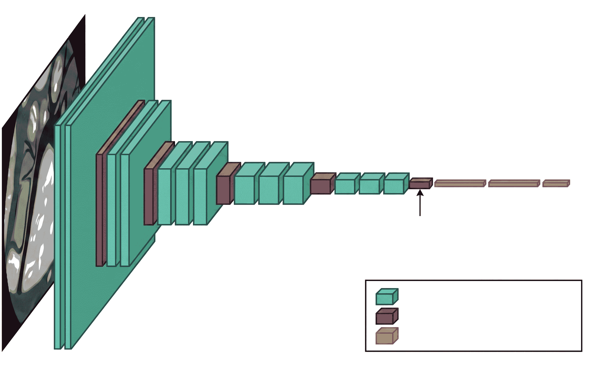
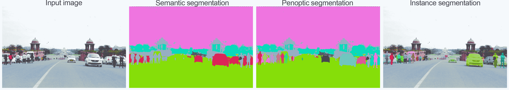
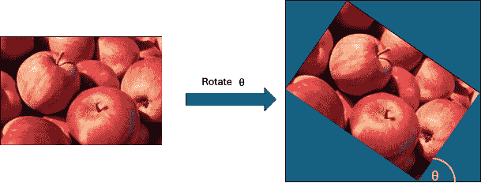
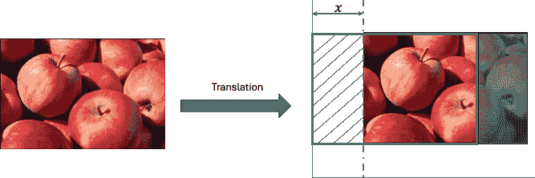
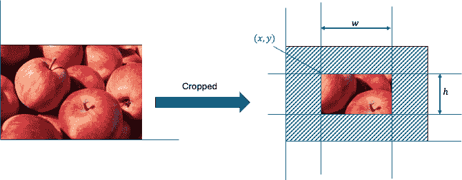
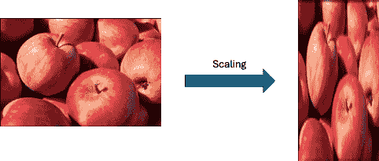
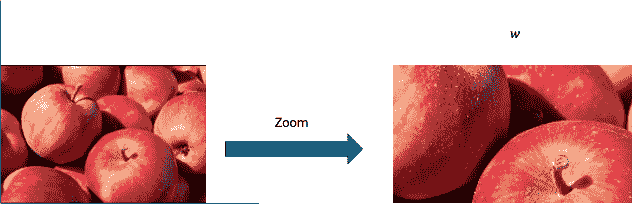
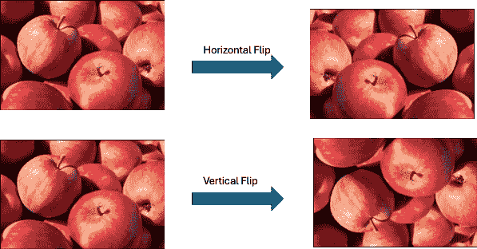
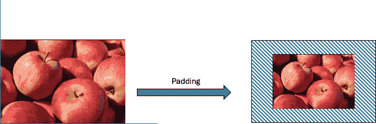
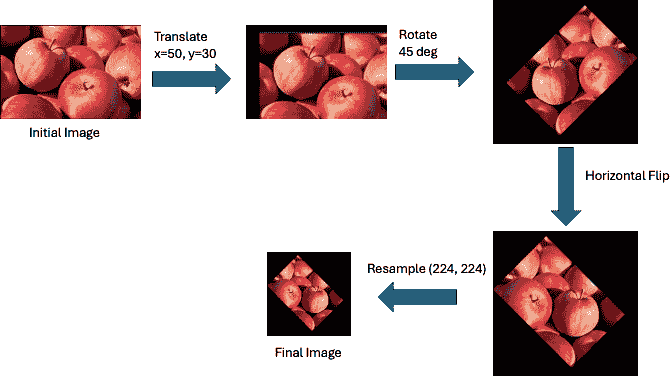

## 6 C++中的卷积神经网络

**卷积神经网络**（**CNNs**）是一种深度学习架构，主要设计用于处理图像和视频等网格状数据。这些神经网络使用称为**卷积**的数学运算，从原始输入数据中自动学习层级特征表示，这使它们与传统神经网络有着根本的不同。CNN受到动物视觉皮层组织的启发，凭借保持空间关系的能力以及通过共享权重和平移不变性保持计算效率，彻底改变了计算机视觉任务。

本章全面探讨了使用现代C++实现CNN的方法。你将学习卷积运算的数学基础，并理解它们与传统的**多层感知器**（**MLPs**）有何不同。本章涵盖了使用C++集成PyTorch的实际实现技术，包括通过CUDA进行GPU加速以增强性能。我们将通过动手项目探索实际应用，包括在MNIST数据集上实现用于图像分类的VGG-16，以及用于图像分割任务的U-Net架构。此外，你还将了解基本的图像处理技术，如数据增强方法（旋转、缩放、裁剪和翻转）。

在本章结束时，你将获得使用C++从零实现CNN架构的实践技能，理解卷积运算背后的数学原理，并应用现代优化技术来训练深度神经网络。这种渐进式设计是有意为之：而不是直接给你一个现成的框架，我们会带你逐步了解每一层抽象，这样当你接触到PyTorch C++ API时，你不仅理解

## C++ 中的卷积神经网络

如何使用它，以及它为什么以这种方式工作。在此过程中，你将构建高效的图像分类和分割系统，集成 GPU 加速以提升性能，并实现全面的图像增强流水线，以增强模型的鲁棒性和泛化能力。

在本章中，我们将介绍以下主题：

- CNN 的历史
- 卷积的数学基础
- C++ 实现
- 构建基于 C++ 的图像分类神经网络
- 使用 U-Net 进行图像分割
- 用于深度学习的图像处理
- 与 CNN 相关的术语

继续阅读本章时，你可能会遇到一些不易立刻理解的术语。我们鼓励你继续读下去，因为这些术语会在本章后面用适当的术语加以定义。

### CNN 的历史

CNN 的发展代表着人工智能和计算机视觉领域的一个重要里程碑。CNN 的基础可以追溯到 20 世纪 60 年代，休伯尔和维塞尔对猫视觉皮层进行了开创性研究，揭示了大脑神经元如何对特定模式的视觉刺激作出反应。1980 年，福岛邦彦提出了新认知机（Neocognitron），它被认为是 CNN 架构的第一个实现。然而，我们今天所熟知的现代 CNN 架构，是由杨立昆（Yann LeCun）及其同事于 1989 年在 LeNet 系列神经网络上的工作开创的。这项工作最终形成了 LeNet-5，它在**改良版美国国家标准与技术研究院**（**MNIST**）数据集上取得了非凡的 98.5% 准确率。该数据集包含由美国邮政管理局提供的 16x16 灰度手写数字，数字范围从 0 到 9。

| 0 | 1 | 2 | 3 | 4 | 5 | 6 | 7 | 8 | 9 |
|---|---|---|---|---|---|---|---|---|---|
| 0 | 1 | 2 | 3 | 4 | 5 | 6 | 7 | 8 | 9 |
| 0 | 1 | 2 | 3 | 4 | 5 | 6 | 7 | 8 | 9 |
| 0 | 1 | 2 | 3 | 4 | 5 | 6 | 7 | 8 | 9 |
| 0 | 1 | 2 | 3 | 4 | 5 | 6 | 7 | 8 | 9 |
| 0 | 1 | 2 | 3 | 4 | 5 | 6 | 7 | 8 | 9 |
| 0 | 1 | 2 | 3 | 4 | 5 | 6 | 7 | 8 | 9 |
| 0 | 1 | 2 | 3 | 4 | 5 | 6 | 7 | 8 | 9 |
| 0 | 1 | 2 | 3 | 4 | 5 | 6 | 7 | 8 | 9 |
| 0 | 1 | 2 | 3 | 4 | 5 | 6 | 7 | 8 | 9 |

*图 6.1：MNIST 数据库中的图像示例*

2012 年，亚历克斯·克里热夫斯基、伊利亚·苏茨克弗和杰弗里·辛顿开发了 AlexNet，并以显著优势赢得了 **ImageNet 大规模视觉识别挑战赛**（**ILSVRC**），这是一个重大突破。这一成功重新激发了人们对 CNN 以及整个深度学习的兴趣。此后，涌现出众多架构，包括 VGGNet、GoogLeNet、ResNet 等，每一种都在不断拓展计算机视觉任务的可能性边界。如今，CNN 构成了许多现代计算机视觉应用的支柱，从人脸识别系统到自动驾驶汽车——从识别简单的手写数字，到以人类水平或超人类水平对数千种复杂物体类别进行分类。如今，CNN 构成了许多现代计算机视觉应用的支柱，从人脸识别系统到自动驾驶汽车。

### 卷积的数学基础

CNN 的核心是一种称为卷积的重要数学运算。到目前为止，我们一直在讨论 CNN，却没有定义卷积。现在，是时候正式定义它了。卷积运算在数学上定义如下：

(f * g)(x) = ∫ f(τ) g(x - τ) dτ

让我们分解一下：

- f 和 g 是函数
- τ（tau）是积分变量
- ∗ 表示卷积运算
- x 是自变量
- ∫ 表示对所有可能的 τ 值进行积分

卷积是 CNN 中的主要数学运算。在处理图像和执行计算机视觉任务时，这种运算遵循一种结构化的方式：一个核（或滤波器），也就是一个小矩阵，按照定义好的模式在输入数据上移动。在移动过程中，核与其覆盖的输入值进行逐元素乘法。然后将这些乘积相加，生成一个值，这个值位于所谓的特征图中。这一结构化过程实现了层级化特征学习：早期层检测边缘或颜色变化等基本特征，而更深层则将这些特征组合成越来越复杂的模式——纹理、形状，最终形成完整的物体。在整个过程中保持空间关系，使得卷积成为图像处理和模式识别中一种特别有效的方法。

在处理 RGB 图像时，卷积运算扩展到多个颜色通道。核的深度必须与输入通道的数量匹配，运算会同时处理所有通道。这些通道的结果组合起来，形成特征图中的各个值。两个关键参数控制这一过程：`stride` 定义了核在每一步移动的距离，`padding` 由在输入数据周围添加的零组成，以管理输出尺寸。

**二维数组**

| 1 | 2 | 3 | 4 |
|---|---|---|---|
| 5 | 6 | 7 | 8 |
| 9 | 10 | 11 | 12 |
| 13 | 14 | 15 | 16 |

**滤波器**

| -1 | -1 | -1 |
|---|---|---|
| -1 | 4 | -1 |
| -1 | -1 | -1 |

**输出**

| -24 | -28 |
|---|---|
| -40 | -44 |

1*-1 + 2*-1 + 3*-1 + 5*-1 + 6*4 + 7*-1 + 9*-1 + 10*-1 + 11*-1 = -24

6*-1 + 7*-1 + 8*-1 + 10*-1 + 11*4 + 12*-1 + 14*-1 + 15*-1 + 16*-1 = -44

*图 6.2：二维卷积示例*

你可以看到颜色匹配框下方那个框的计算过程。

### C++ 实现

在本节中，我们介绍卷积层的一个基本实现。卷积层类包含用于存储 `stride`、`padding` 和 `filters` 参数的私有成员，并实现了用于卷积运算的前向方法。前向方法接受一个输入矩阵（表示为向量的向量）。它使用指定的步幅在输入上滑动每个滤波器。在每个位置，它计算逐元素乘法和求和，然后进行 ReLU 激活。这将为每个滤波器创建特征图。本章的完整代码可在 GitHub 上获取。在这里，我们将拆解整个代码的重要部分，以解释神经网络的结构。`ConvolutionalLayer` 类封装了卷积层的三个基本要素（`filters`、`stride` 和 `padding`），如下所示：

```cpp
vector<vector<float>> filters; // Convolution filters/kernels
int stride; // Filter stride
int padding; // Padding size
```

`filters` 成员存储多个可学习的核，这些核用于检测输入数据中的特定模式。为了提高计算效率，每个滤波器都表示为一个扁平化的向量。`stride` 参数控制滤波器在输入上移动时的步长大小，而 `padding` 决定边界处理方式（尽管在这个基础版本中并未完全实现）。

构造函数建立层的配置并初始化可学习参数：

```cpp
ConvolutionalLayer(int numFilters, int filterSize, int strideSize, int paddingSize)
```

这种设计允许灵活的层配置，支持不同的滤波器数量、大小和步长模式。构造函数将滤波器初始化委托给一个私有方法，从而保持了关注点的清晰分离。`initializeFilters` 方法采用高斯随机初始化：

```cpp
normal_distribution<float> dist(0.0f, 0.1f);
```

这种方法使用以零为中心的小随机值初始化权重，既能防止对称性破坏问题，又能在训练期间保持梯度流动。`0.1` 的标准差为学习提供了一个均衡的起点。

在层正确初始化且权重配置为最佳梯度流动之后，我们现在可以检查数据在前向传播过程中如何流经卷积层——这是这些学习到的滤波器检测输入数据模式的核心操作。


#### 前向传播实现

`forward` 方法通过四层嵌套循环实现了完整的卷积操作，系统地将每个滤波器应用于输入：

```cpp
for (auto& filter : filters) {
    // Slide filter across input
    vector<float> featureMap;
    for (int i = 0; i < input.size() - filter.size() + 1; i += stride) {
        for (int j = 0; j < input.size() - filter.size() + 1; j += stride) {
            // Calculate convolution at current position
            float sum = 0;
            for (int k = 0; k < filter.size(); k++) {
                for (int l = 0; l < filter.size(); l++) {
                    sum += input[i + k][j + l] * filter[k][l];
                }
            }
            // Apply ReLU activation
            featureMap.push_back(max(0.0f, sum));
        }
    }
    featureMaps.push_back(featureMap);
}
```

最外层的 `for(auto& filter: filters)` 循环独立地处理每个学习到的滤波器。在具有多个滤波器的层中，每个滤波器检测不同的模式。接下来的两个 `for` 循环控制滤波器在输入上滑动时的位置。`input.size() - filter.size() + 1` 边界条件确保滤波器不会超出输入边界，防止无效的内存访问。`stride` 参数控制移动步长：`stride 1` 每次移动一个像素，而 `stride 2` 跳过每隔一个位置，从而减小输出尺寸。对于 5×5 的输入、3×3 的滤波器和 `stride 1`，有效位置范围为 `(0,0)` 到 `(2,2)`，生成 3×3 的输出特征图。

最内层的循环执行实际的卷积运算——计算滤波器与当前输入区域之间的点积。每次迭代将对应元素相乘并累加结果。这种数学运算衡量了滤波器模式与局部输入区域的匹配程度。以下方程以编程方式表达了卷积运算：

Output[i,j] = ReLU(Σ Σ Input[i+m,j+n] × Filter[m,n])

卷积运算后，结果被存储在当前的特征图中，构建出该滤波器的完整响应模式。扫描完整个输入后，每个滤波器的完整特征图被添加到输出集合中。最终结果包含每个滤波器的一个特征图。`featureMap` 被推入 `featureMaps` 向量，如下所示：

```cpp
featureMaps.push_back(featureMap);
```

让我们来看一下该实现的时间复杂度和内存模式：

- **时间复杂度**：*O(F × H × W × K²)*，其中 *F* 是滤波器数量，*H × W* 是输出尺寸，*K × K* 是滤波器尺寸
- **内存模式**：该算法以缓存友好的方式处理数据，按顺序访问空间局部的输入区域

当前实现存在某些局限性，具体如下：

- **仅支持二维输入**：它假设输入矩阵是方阵
- **无偏置项**：它缺少现代实现中常见的偏置参数
- **简化的填充**：`padding` 参数已声明但未实现
- **内存效率**：它可以针对更大的输入进行优化

#### 与更大网络的集成

在实践中，多个 `ConvolutionalLayer` 实例会与池化层、归一化层和全连接层组合，以构建完整的神经网络。该类作为一个基础组件，可以通过以下附加功能进行扩展：

- 偏置项以提高表达能力
- ReLU 之外的不同激活函数
- 用于边界处理的适当填充实现
- 支持 RGB 图像的多通道输入
- 针对生产使用优化的内存管理

该实现的简洁性使其成为理解驱动现代计算机视觉系统的基本操作的理想起点。

#### 基于 Eigen 的矩阵实现

前述实现可以通过利用广受认可的高性能 Eigen 库提供的矩阵运算进一步增强。**Eigen** 是一个专门为线性代数设计的 C++ 模板库。如前所述，完整代码可在 GitHub 上获取。在本节中，我们将重点关注此增强实现的主要方面。首先要查看的重要函数是 `im2col`。这是一种常见的数据转换技术，用于在 CNN 中实现更快的矩阵计算。它从输入中提取所有滤波器大小的图像块，并将它们排列为矩阵列，如下图所示：

```text
(0,3) (0,2) (0,1) (0,0) (1,3) (2,3) (3,3) (0,3) (0,2) (0,1) (0,0) (1,3) (2,3) (3,3) (0,3) (0,2) (0,1) (0,0) (1,3) (1,2) (1,1) (1,0) (2,3) (2,2) (2,1) (2,0) (3,3) (3,2) (3,1) (3,0)
36 35 34 33 40 44 48 20 19 18 17 24 28 32 4 3 2 1 8 7 6 5 12 11 10 9 16 15 14 13 5 3 2 1 6 4 3 2 9 7 6 5 10 8 7 6 10 9 7 6 11 10 8 7 14 13 11 10 15 14 12 11 11 12 15 16 21 19 18 17 22 20 19 18 25 23 22 21 26 24 23 22 26 25 23 22 27 26 24 23 30 29 27 26 31 30 28 27 27 28 31 32 37 35 34 33 38 36 35 34 41 39 38 37 42 40 39 38 42 41 39 38 43 42 40 39 46 45 43 42 47 46 44 43 43 44 47 48 9 (possible sliding window position) 12 indices (i, j)
```

*图 6.3：(im2col) 一个 2×2 图像块被存储为一列。后续通道（RGB）在同一列中拼接*

这种转换支持**单指令多数据**（**SIMD**）操作，并利用了诸如 **BLAS** 之类的高效线性代数库。它还使得在多个核心和 GPU 之间进行分布式计算变得容易，从而加快执行速度。下面是 `im2col` 函数：

```cpp
Matrix im2col(const Matrix& input, int kSize, int stride) {
    int inputRows = input.rows();
    int inputCols = input.cols();
    int outputRows = (inputRows - kSize) / stride + 1;
    int outputCols = (inputCols - kSize) / stride + 1;
    Matrix result(kSize * kSize, outputRows * outputCols);
    int colIdx = 0;
    for(int i = 0; i <= inputRows - kSize; i += stride) {
        for(int j = 0; j <= inputCols - kSize; j += stride) {
            int rowIdx = 0;
            for(int ki = 0; ki < kSize; ki++) {
                for(int kj = 0; kj < kSize; kj++) {
                    result(rowIdx++, colIdx) = input(i + ki, j + kj);
                }
            }
            colIdx++;
        }
    }
    return result;
}
```

在这段代码中，首先，我们定义了一个 `result` 矩阵，通过从输入中提取相关图像块来填充该矩阵的相关部分。外部两个 `for` 循环在输入上滑动滤波器，内部循环提取指定大小的图像块并将其展平为列格式。

这是基本的预处理步骤之一，它极大地简化了卷积运算，我们将在下面的函数中看到这一点：

```cpp
OptimizedConvolutionalLayer(int inChannels, int outChannels, int kSize, int strideSize) {
    inputChannels = inChannels;
    outputChannels = outChannels;
    kernelSize = kSize;
    stride = strideSize;
    // Initialize filters as matrix
    filters = Matrix::Random(outChannels, inChannels * kernelSize * kernelSize);
}

Matrix forward(const Matrix& input) {
    // Convert input to matrix format for efficient computation
    Matrix inputMatrix = im2col(input, kernelSize, stride);
    // Perform matrix multiplication instead of explicit convolution
    Matrix output = filters * inputMatrix;
    // Apply ReLU activation
    applyReLU(output);

    return output;
}
```

该实现通过利用矩阵运算显著降低了代码复杂度：`im2col` 转换使整个前向传播过程可以浓缩为一行：`filters * inputMatrix`。这种从显式嵌套循环到矩阵乘法的转变不仅简化了代码，还通过高效的线性代数库实现了在多个 CPU 核心和 GPU 线程上的同时并行化。虽然总体时间复杂度与嵌套循环方法相当，并且转换需要更大的内存分配，但这种权衡带来了 5–6 倍性能提升——使得基于矩阵的方法特别适合现代 GPU 架构。

#### 基于 CUDA 的 GPU 加速实现

到目前为止，我们已经探讨了基于 CPU 的实现，它们展示了卷积运算的基本原理。然而，`ConvolutionalLayer` 类可以通过集成 CUDA 功能来利用 GPU 加速能力，从而得到显著增强。与之前的实现一样，本章相关的 GitHub 仓库中提供了一个完整的基于 CUDA 的版本（`https://github.com/PacktPublishing/Deep-Learning-with-C-/tree/main/chapter6`）。

我们强烈建议您检查并比较所有三种实现方法——基本的嵌套循环版本、使用 Eigen 的基于矩阵的实现，以及这种 GPU 加速变体。根据我们的经验，这种并排比较是本章中最具启发性的练习之一：观察一个概念上简单的想法如何系统地转变为越来越复杂且高性能的解决方案，能让每一步优化的价值都立刻变得具体可感。您应该亲自运行每种实现，以直接体验 GPU 加速带来的计算效率的显著提升。在这里，我们将指出代码的一些特性，以帮助您理解所提出的实现。要全面理解 CUDA 库函数，我们强烈建议您查阅官方指南：`https://docs.nvidia.com/cuda/cuda-c-programming-guide/`。


由于使用 CUDA 进行 GPU 编程涉及几个新概念，我们将先列举关键的 CUDA 函数并解释各自的用途，然后再讨论实现细节。在这些函数中，你会多次看到 **BLAS** 一词，它代表 **基础线性代数子程序**（Basic Linear Algebra Subprograms）。接下来让我们了解这些函数：

- **cublasHandle_t**：这是一个不透明指针，代表 cuBLAS 库的上下文句柄。它存储 cuBLAS 操作所需的状态和配置，包括使用哪个 GPU 设备、工作内存和执行流。
- **cublasCreate**：这是一个初始化函数，用于创建并设置新的 cuBLAS 库上下文句柄。它与 `cublasDestroy()` 配对用于上下文清理，并且应在 cuBLAS 操作之前调用。这是执行任何 GPU 线性代数操作之前必须完成的第一步。
- **cudaMalloc**：这是一个 CUDA 函数，用于在 GPU 设备上分配内存，类似于 CPU 内存分配中的 `malloc()`。
- **curandGenerator_t**：这是 **CUDA 随机数生成器**（**cuRAND**）的句柄类型，用于在 GPU 设备上生成随机数。
- **cublasSscal**：这是一个 cuBLAS 函数，用于将向量按标量值缩放，例如 `x = α × x`。
- **cublasSaxpy**：与前面的函数类似，它执行操作 `y = α × x + y`。
- **cublasSgemm**：这是一个 cuBLAS 函数，用于 GPU 加速的矩阵乘法，即 `C = α × A × B + β × C`。
- **curandDestroyGenerator**：这是一个用于清理并释放与随机数生成器相关资源的函数。

以下是一个基于 CUDA 的卷积层实现：

```cpp
class CudaConvolutionalLayer {
    float *d_filters, *d_input, *d_im2col_output, *d_conv_output;
    int inputChannels, outputChannels, kernelSize, stride;
    cublasHandle_t cublasHandle;
public:
    CudaConvolutionalLayer(int inChannels, int outChannels, int kSize, int strideSize)
        : inputChannels(inChannels), outputChannels(outChannels),
          kernelSize(kSize), stride(strideSize) {
        cublasCreate(&cublasHandle);
        int filterSize = outChannels * inChannels * kernelSize * kernelSize;
        cudaMalloc(&d_filters, filterSize * sizeof(float));
        curandGenerator_t gen;
        curandCreateGenerator(&gen, CURAND_RNG_PSEUDO_DEFAULT);
        curandSetPseudoRandomGeneratorSeed(gen, 1234ULL);
        curandGenerateUniform(gen, d_filters, filterSize);
        float alpha = 0.2f, beta = -0.1f;
        cublasSscal(cublasHandle, filterSize, &alpha, d_filters, 1);
        cublasSaxpy(cublasHandle, filterSize, &beta, d_filters, 1, d_filters, 1);
        curandDestroyGenerator(gen);
    }

    ~CudaConvolutionalLayer() {
        cudaFree(d_filters); cudaFree(d_input); cudaFree(d_im2col_output); cudaFree(d_conv_output);
        cublasDestroy(cublasHandle);
    }
};
```

掌握了这些 CUDA 库的信息后，你可以逐行理解上述代码。这里，初始化设置了层参数，创建了 cuBLAS 上下文（`cublasCreate`），并根据层维度为权重分配了 GPU 内存（`cudaMalloc`）。接着，使用 cuRAND 通过三个步骤生成随机权重：`curandCreateGenerator`、`curandSetPseudoRandomGeneratorSeed` 和 `curandGenerateUniform`。然后，使用 `cublasSscal` 对权重进行缩放（乘以 `0.2`），并使用 `cublasSaxpy` 进行平移，以获得状态良好的初始值，从而保证稳定的训练。最后，销毁资源以释放内存。

现在，我们来看一下 `forward` 函数：

```cpp
vector<float> forward(const vector<float>& input, int inputRows, int inputCols) {
    int outputRows = (inputRows - kernelSize) / stride + 1;
    int outputCols = (inputCols - kernelSize) / stride + 1;
    int totalOutputs = outputRows * outputCols;
    int outputSize = outputChannels * totalOutputs;

    cudaMalloc(&d_input, input.size() * sizeof(float));
    cudaMalloc(&d_im2col_output, kernelSize * kernelSize * totalOutputs * sizeof(float));
    cudaMalloc(&d_conv_output, outputSize * sizeof(float));
    cudaMemcpy(d_input, input.data(), input.size() * sizeof(float), cudaMemcpyHostToDevice);

    int blockSize = 256, gridSize = (totalOutputs + blockSize - 1) / blockSize;
    im2col_relu_kernel<<<gridSize, blockSize>>>(d_input, d_im2col_output, inputRows, inputCols, kernelSize, stride, outputRows, outputCols);

    const float alpha = 1.0f, beta = 0.0f;
    cublasSgemm(cublasHandle, CUBLAS_OP_N, CUBLAS_OP_N, totalOutputs, outputChannels, kernelSize * kernelSize,
                &alpha, d_im2col_output, totalOutputs, d_filters, kernelSize * kernelSize, &beta, d_conv_output, totalOutputs);

    gridSize = (outputSize + blockSize - 1) / blockSize;
    relu_kernel<<<gridSize, blockSize>>>(d_conv_output, outputSize);

    vector<float> result(outputSize);
    cudaMemcpy(result.data(), d_conv_output, outputSize * sizeof(float), cudaMemcpyDeviceToHost);

    return result;
}
```

`forward` 方法首先根据卷积参数计算输出维度，然后为输入数据、中间 `im2col` 变换结果和最终卷积结果动态分配 GPU 内存。输入张量通过 `cudaMemcpy` 从主机内存传输到设备内存，为后续的 GPU 操作奠定基础。

核心计算序列包含在 GPU 上执行的三个关键操作。首先，一个自定义 CUDA 内核执行 `im2col` 变换（如上一节所示），以便进行高效的矩阵操作。

卷积计算本身利用 cuBLAS 矩阵乘法（`cublasSgemm`）在变换后的输入数据和已学习的滤波器权重之间进行。这种方法充分发挥了现代 GPU 架构固有的并行处理能力，数千个核心可以同时在矩阵的不同元素上执行算术运算。卷积操作之后，一个 ReLU 激活内核通过逐元素应用修正线性单元函数来引入非线性。方法最后将处理后的结果传回主机内存，使计算得到的特征图可供后续网络层或最终输出处理使用。

这个 CUDA 实现是我们探索卷积层优化的自然演进。通过对比三种方法的基准测试，你将获得关于算法选择和硬件利用策略如何显著影响深度学习应用性能的实用见解。从基础 CPU 操作到优化的矩阵计算，再到最终的 GPU 并行执行，这一演进过程展示了现代神经网络开发中典型的迭代优化流程。

在探索了从基础 CPU 实现到复杂的 GPU 加速解决方案的演进之后，我们现在将目光转向 PyTorch 的 C++ API。它提供了一个高层抽象层，封装了我们先前手动实现的计算复杂性。这个综合性框架是我们优化之旅的必然总结，它提供了预优化的卷积操作实现、内存管理例程和 GPU 加速框架，让开发者能够专注于架构设计和算法创新，而不是低层实现细节。

### 使用 PyTorch C++ API 的卷积层

以下部分将展示 PyTorch API 如何简化开发流程，使从业者能够以显著降低的代码复杂度来实现 CNN 架构，同时保留我们通过手动实现所达到的计算效率。以下是一个类似的单卷积层实现：

```cpp
struct ConvNetImpl : torch::nn::Module {
    ConvNetImpl(int64_t input_channels, int64_t output_channels, int64_t kernel_size)
        : conv1(torch::nn::Conv2dOptions(input_channels, output_channels, kernel_size).padding(0)),
          relu() {
        register_module("conv1", conv1);
        register_module("relu", relu);
    }

    torch::Tensor forward(torch::Tensor x) {
        x = conv1(x);
        x = relu(x);
        return x;
    }

    torch::nn::Conv2d conv1{nullptr};
    torch::nn::ReLU relu{nullptr};
};
```

要在 GPU（如果可用）上执行这些计算，请使用以下代码片段：

```cpp
torch::Device device(torch::kCPU);
if (torch::cuda::is_available()) {
    std::cout << "CUDA available! Training on GPU." << std::endl;
    device = torch::Device(torch::kCUDA);
}
```


## 第6章

在后续章节中，我们将利用这些PyTorch实现来展示先进的CNN架构和训练方法，这些方法构建在我们通过手动实现所建立的基础概念之上，并受益于框架强大的优化能力。

后续章节将演示这些基础概念如何汇聚于两个关键的计算机视觉领域：图像分类和图像分割。这些应用代表了现代深度学习中的基本范式，每个都应对不同的计算挑战，同时利用我们已经建立的核心CNN原理。

### 构建基于C++的神经网络用于图像分类

图像分类是一项计算机视觉任务，我们训练神经网络（或机器学习模型）将图像归类到预定义类别中。在本节中，我们将实现著名的VGG-16神经网络用于图像分类。我们使用的数据集是MNIST数据集。MNIST数据集包含0到9数字的灰度图像，通常用于训练和测试机器学习模型。该数据集是用于实现和训练CNN进行图像分类任务的基础资源。使用MNIST数据时，输入图像以单通道（灰度）格式处理，非常适合初期的CNN实现和教学目的。数据集的结构允许有效训练各种神经网络架构，包括像VGG-16这样复杂的模型，可以针对MNIST数字所呈现的10类分类问题进行专门调整。

VGG架构是深度神经网络的一个重要里程碑，具有参数量大、需要大量计算资源的特点。虽然计算密集且速度慢，但VGG16不同层的特征激活值特别丰富且通用。该架构于2014年开发，并因其有效性而继续被广泛使用。网络堆叠了五个卷积块——每个块都加深特征表示——然后将输出传递给一系列全连接层进行最终分类。其优势在于能够通过深层架构提取丰富特征，这一点已通过在多个基准数据集上取得的最先进结果得到证明。该架构可以通过修改灰度图像的输入通道并调整输出层以匹配目标类别数量，来适应不同任务，例如处理MNIST数据集。为了获得最佳性能，现代VGG-16实现利用GPU加速和基于矩阵的计算，而非传统的基于向量的方法。

该模型包含ReLU激活函数、最大池化操作和dropout层，以防止训练过程中的过拟合。



224 x 224 x64  
112 x 112 x128  
56 x 56 x 256  
fc6  
fc7  
fc8  
28 x 28 x 512  
14 x 14 x 512  
7 x 7 x 512  
1 x 1 x 4096  
1 x 1 x 1000  
conv5  
conv4  
conv3  
conv2  
conv1  
卷积+ReLU  
全连接+ReLU  
最大池化  

*图 6.4：VGG-16 架构*

完整的VGG16实现可在本书配套的GitHub页面（`https://github.com/PacktPublishing/Deep-Learning-with-C-/blob/main/chapter6/VGG16.cpp`）上获得。这里，在本节中，我们将查看代码的一些重要部分，以便更好地理解。该网络被划分为若干个块。以下是一个示例块：

```cpp
torch::nn::Conv2d(torch::nn::Conv2dOptions(3, 64, 3).padding(1)),
torch::nn::ReLU(true),
torch::nn::Conv2d(torch::nn::Conv2dOptions(64, 64, 3).padding(1)),
torch::nn::ReLU(true),
torch::nn::MaxPool2d(torch::nn::MaxPool2dOptions(2).stride(2)),
```

该块将原始的**红、绿、蓝**（**RGB**）通道转换为64个特征图。两个连续的带填充3x3卷积在保持空间维度的同时，通过ReLU激活引入非线性。此外，最大池化操作将空间分辨率降低一半，创建层次化表示。在VGG-16中，添加了五个这样的卷积层块，但通道深度逐渐增加：分别为64、128、256、512和512。这种设计使网络能够捕获越来越复杂的视觉模式——从早期层的边缘和纹理到更深层的物体部分和语义概念。

此外，还添加了一个分类器模块，通常称为分类头，如下所示：

```cpp
classifier = register_module("classifier", torch::nn::Sequential(
  torch::nn::Linear(512 * 7 * 7, 4096),
  torch::nn::ReLU(true),
  torch::nn::Dropout(0.5),
  torch::nn::Linear(4096, 4096),
  torch::nn::ReLU(true),
  torch::nn::Dropout(0.5),
  torch::nn::Linear(4096, num_classes)
));
}
```

在网络架构中逐步应用最大池化操作，系统地减小特征图的空间维度，最终将表示压缩到7×7的空间分辨率。在这个最后的卷积阶段，网络保持512个通道的特征深度，总共产生25,088个特征值（512×7×7）。随后，这种高维特征表示通过由两个全连接层组成的架构进行变换，每个全连接层包含4,096个神经元。

该架构设计在这些全连接层之间加入ReLU激活函数，以引入非线性并增强网络的表示能力。为了减轻训练过程中的过拟合，采用概率为`0.5`的dropout正则化机制，在每次训练迭代中有效停用一半的神经元。这种随机正则化技术可防止模型对特定神经元路径产生过度依赖，从而提高对未见数据的泛化性能。

网络架构以最终分类层收尾，其维度与分类任务中目标类别的数量精确对应。该最终层生成所有可能类别标签上的概率分布，使网络能够基于先前各层学到的层次化特征表示做出明智的预测。

以下是VGG-16神经网络前向传播的实现：

```cpp
torch::Tensor forward(torch::Tensor x) {
    x = features->forward(x);
    x = x.view({x.size(0), -1}); // Flatten
    x = classifier->forward(x);
    return x;
}
```

在前面的实现中，`features`模块代表了构成特征提取路径的所有五个卷积块的整体架构。网络接受格式为`[batch, 3, 224, 224]`的RGB输入张量，其中批次维度同时容纳多个图像，空间维度符合标准ImageNet预处理要求。卷积层前向传播完成后，`features`模块生成维度为`[batch, 512, 7, 7]`的输出张量，表示512个不同的特征图，每个特征图的空间分辨率为7×7像素。

随后的维度变换通过张量重塑操作完成：

```cpp
x = x.view({x.size(0), -1});
```

该操作在深度学习术语中通常称为展平，通过`x.size(0)`保留批次维度，同时使用`-1`参数自动计算剩余维度。自动计算产生25,088个元素（512×7×7=25,088），从而将多维特征图转换为适合全连接层处理的一维特征向量。

展平后的特征表示随后传入分类器模块，该模块应用前一节讨论的全连接层变换和正则化技术。网络的最终输出由对应每个目标类别的类别logits组成——在用于ImageNet分类的标准VGG-16实现中为1,000个类别——为多类别分类决策提供所需的概率分布。

这种架构设计体现了基于CNN的分类系统的基本原理：通过分层特征学习和降维，从空间特征表示系统性地转变为抽象语义分类。


## 第 6 章

### 使用 U-Net 进行图像分割

图像分割是一项涉及为像素分配标签并识别图像中感兴趣对象的任务。该过程通过从边界周围的图像像素构建初始背景模型来工作，其中背景和前景模型表示为多个 RGB 聚类的直方图。然后，程序动态地将对象边界向内收缩，同时更新和评估新的图像强度和梯度模型，直到获得具有强边缘屏障的稳定前景和背景模型。

图像分割技术已在多个领域得到广泛应用。基于深度学习的分割在自动驾驶、精准农业和生物医学应用中取得了显著成功。在文档处理系统中，分割有助于提取和分析特定区域（如驾照上的条形码），从而提高数据提取的精确率和召回率。

CNN 也可用于图像分割算法。在本节中，我们将讨论用于图像分割的 U-Net 算法。U-Net 架构是分割任务中一种轻量且有效的方法，采用全 CNN 设计。该架构由一个编码步骤和随后的转置卷积层组成，特别适合处理非序列数据。当使用适当的训练参数（如 Adam 优化器和二元交叉熵损失）实现时，U-Net 在二分类任务中可以取得很高的准确率。该架构已被证明在生物医学图像分割应用中特别有效，能够在保持计算效率的同时处理复杂的分割任务。还有其他复杂的算法，如 Mask R-CNN。为完整起见，你还应熟悉*语义*、*实例*和*全景分割*等术语。下图对此进行了说明。



*图 6.5：语义、实例和全景分割*

不同类型的分割在图像分析中服务于不同目的。在语义分割中，同一类别的所有对象都被标记为相同的标签，这在自动驾驶汽车和机器人技术中尤其有用，因为这些场景中的环境上下文至关重要。例如，在语义分割中，所有汽车都会被标记为相同。

全景分割结合了实例（对象）分割和语义（背景）分割两种方法。它要求标注者围绕所有对象绘制紧贴的边界，直到所有像素都被覆盖，并通过不同的颜色/标签将相似对象标记为不同实例。该技术在卫星图像等应用中尤其有价值，可用于检测保护区中的变化。

目前用于分割的典型神经网络之一称为 **U-Net**。U-Net 最初由德国弗莱堡大学的 Olaf Ronneberger、Philipp Fischer 和 Thomas Brox 于 2015 年提出。该网络因其独特的 U 形架构而得名，该架构由两条主要路径组成：

- **编码器路径（收缩路径）**：编码器路径构成 *U* 的向下部分。该路径在增加特征深度的同时逐步减小空间维度。它从输入图像中捕获上下文和特征信息。
- **解码器路径（扩展路径）**：解码器构成 *U* 的向上部分。与编码器路径不同，它在减小特征深度的同时逐步增加空间维度。它还重建空间信息以实现精确定位。

U-Net 的一个关键特征是跳跃连接，它将编码器和解码器路径中相应的层级连接起来。这些连接在每一分辨率级别上桥接收缩路径和扩展路径，使解码器能够通过直接引入来自编码器的高分辨率特征图，恢复在下采样过程中丢失的空间精度——这正是赋予 U-Net 特有的分割准确率的机制。

U-Net 已被证明在生物医学图像分割应用中特别有效，能够在保持计算效率的同时处理复杂的分割任务。该架构被认为是轻量且有效的，采用全 CNN 设计，特别适合处理非序列数据。自其问世以来，已出现了其他 U-Net 变体，如 Attention U-Net、U-Net++、ResUNet 和 3D U-Net 等。

| 块 | 操作 | 尺寸 | 通道数 |
|---|---|---|---|
| 输入 | 输入图像块 | 572 x 572 | 1 |
| 编码器 1A | 卷积 3x3, ReLU | 570 x 570 | 64 |
| 编码器 1B | 卷积 3x3, ReLU | 568 x 568 | 64 |
| 池化 1 | 最大池化 2x2 | 284 x 284 | 64 |
| 编码器 2A | 卷积 3x3, ReLU | 282 x 282 | 128 |
| 编码器 2B | 卷积 3x3, ReLU | 280 x 280 | 128 |
| 池化 2 | 最大池化 2x2 | 140 x 140 | 128 |
| 编码器 3A | 卷积 3x3, ReLU | 138 x 138 | 256 |
| 编码器 3B | 卷积 3x3, ReLU | 136 x 136 | 256 |
| 池化 3 | 最大池化 2x2 | 68 x 68 | 256 |
| 编码器 4A | 卷积 3x3, ReLU | 66 x 66 | 512 |
| 编码器 4B | 卷积 3x3, ReLU | 64 x 64 | 512 |
| 池化 4 | 最大池化 2x2 | 32 x 32 | 512 |
| 瓶颈 A | 卷积 3x3, ReLU | 30 x 30 | 1024 |
| 瓶颈 B | 卷积 3x3, ReLU | 28 x 28 | 1024 |
| 上卷积 1 | 上卷积 2x2 + 复制和裁剪 | 56 x 56 | 512 |
| 解码器 1A | 卷积 3x3, ReLU | 54 x 54 | 512 |
| 解码器 1B | 卷积 3x3, ReLU | 52 x 52 | 512 |
| 上卷积 2 | 上卷积 2x2 + 复制和裁剪 | 104 x 104 | 256 |
| 解码器 2A | 卷积 3x3, ReLU | 102 x 102 | 256 |
| 解码器 2B | 卷积 3x3, ReLU | 100 x 100 | 256 |
| 上卷积 3 | 上卷积 2x2 + 复制和裁剪 | 200 x 200 | 128 |
| 解码器 3A | 卷积 3x3, ReLU | 198 x 198 | 128 |
| 解码器 3B | 卷积 3x3, ReLU | 196 x 196 | 128 |
| 上卷积 4 | 上卷积 2x2 + 复制和裁剪 | 392 x 392 | 64 |
| 解码器 4A | 卷积 3x3, ReLU | 390 x 390 | 64 |
| 解码器 4B | 卷积 3x3, ReLU | 388 x 388 | 64 |
| 输出 | 卷积 1x1 | 388 x 388 | 2 |

*图 6.6：原始 U-Net 的架构*

有关 UNet 的完整实现，请参阅 GitHub 上的相关代码（`https://github.com/PacktPublishing/Deep-Learning-with-C-/blob/main/chapter6/UNet.cpp`）。让我们来看一下编码器和解码器的实现。

以下是编码器的代码：

```cpp
encoder1 = register_module("encoder1", torch::nn::Sequential(
    torch::nn::Conv2d(torch::nn::Conv2dOptions(in_channels, 64, 3).padding(1)),
    torch::nn::BatchNorm2d(64),
    torch::nn::ReLU(),
    torch::nn::Conv2d(torch::nn::Conv2dOptions(64, 64, 3).padding(1)),
    torch::nn::BatchNorm2d(64),
    torch::nn::ReLU()
));
```

在上述代码中，`register_module` 函数是 PyTorch C++ API 中的一个方法，负责将神经网络模块注册为当前模块的子模块。在此上下文中，当前模块是一个名为 `UNetImpl` 的 C++ 类，它继承自 PyTorch 的基础神经网络模块类，具体来说是 `torch::nn::Module`。

`UNetImpl` 类接受带有 `in_channels` 参数的输入（对于灰度图像默认为 `1`）。它生成 64 个特征图，同时通过填充保持空间维度。应用 `BatchNorm2d` 对特征图进行归一化，然后是 `ReLU()` 激活。随后，使用第二个卷积层。

理解几个关键且重要的 PyTorch 函数和方法至关重要。`torch::nn::Sequential` 类负责编排层的串联，确保数据按顺序流经这些层。`register_module` 函数自动管理已注册模块的参数，有助于梯度在整个注册模块中的传播。此外，它还处理训练模式和评估模式之间的切换、管理设备迁移，以及保存和加载完整的模型状态。

现在，让我们来看一下解码器子模块：

```cpp
decoder4 = register_module("decoder4", torch::nn::Sequential(
    torch::nn::Conv2d(torch::nn::Conv2dOptions(512, 256, 3).padding(1)),
    torch::nn::BatchNorm2d(256),
    torch::nn::ReLU(),
    torch::nn::Conv2d(torch::nn::Conv2dOptions(256, 256, 3).padding(1)),
    torch::nn::BatchNorm2d(256),
    torch::nn::ReLU()
));
```

与编码器的情况一样，解码器实现使用 PyTorch 的 C++ API 遵循类似的模式。解码器接收编码后的特征，在减小特征深度的同时逐步重建空间维度。

让我们也来看一下这个神经网络的前向传播：

```cpp
torch::Tensor forward(torch::Tensor x) {
    // Encoder path
    auto e1 = encoder1->forward(x);
    auto e2 = encoder2->forward(maxpool(e1));
    auto e3 = encoder3->forward(maxpool(e2));
    auto e4 = encoder4->forward(maxpool(e3));
```


```cpp
// Decoder path with skip connections
auto d4 = decoder4->forward(upconv4(e4));
auto d3 = decoder3->forward(upconv3(d4));
auto d2 = decoder2->forward(upconv2(d3));
return torch::sigmoid(final_layer(d2));
}
```

上述代码表示前向传播方法，定义了数据在 U-Net 中的流动方式。在前向传播的每一步中，先进行卷积，然后进行最大池化。在 U-Net 的编码器部分，空间尺寸减半，通道数加倍。它在多个尺度上捕获特征。解码器部分使用 `upconv4` 对 `e4` 进行上采样，`upconv4` 是一个转置卷积层（也称为反卷积）。转置卷积在输入像素之间插入零，并应用卷积，从而在训练过程中学习上采样权重的同时有效提高空间分辨率。最后，对 U-Net 的最后一个输出 `d2` 执行 sigmoid 操作。最终输出是与输入尺寸相同的分割概率图。

### 面向深度学习的图像处理

在本章中，我们探讨了 CNN 的两个关键应用：使用 VGG-16 进行图像分类和使用 U-Net 架构进行图像分割。虽然我们已经实现了这些神经网络的基本版本，但要获得最佳模型性能还需要其他技术。一种同时提高模型准确性和泛化能力的常用方法是图像增强（或更一般地说，数据增强）。图像增强包含一系列工具和技术，通过创建多样化的训练数据变体来提升模型性能。图像增强的目标是训练一个对输入数据的微小变化具有不变性的模型。在本节中，我们将探讨一些计算机视觉中常用的图像增强技术，并提供相应的代码片段。

#### 旋转

旋转是最常见的图像增强技术之一，它使图像围绕其中心点旋转不同角度。这种变换有助于 CNN 学习识别图像中任意方向的物体。在 C++ 中实现旋转时，你可以指定随机旋转和固定角度旋转，通常范围从 -180 度到 +180 度。然而，需要注意的是，旋转可能会在图像角落产生空白区域，如下图所示。这些空白区域需要通过填充、裁剪或重采样等技术来处理，以保持 CNN 所需的输入尺寸。



在日常实践中，最好利用 LibTorch 的 C++ 实现所提供的内置实现：

```cpp
#include <torch/torch.h>
#include <torchvision/transforms/functional.h>

torch::Tensor image_tensor = torch::rand({1, 256, 256}).cuda(); // Example: a 256x256 grayscale image
double angle = 45.0; // Rotate by 45 degrees
torch::Tensor rotated_image =
    torchvision::transforms::functional::rotate(image_tensor, angle);
```

#### 平移

平移是另一种图像增强技术，它通过指定像素数沿 *x* 轴和/或 *y* 轴移动图像。这种变换通过让 CNN 学习识别图像中任意位置的物体，帮助其发展位置不变性。在 C++ 中实现平移时，你可以使用固定的像素值进行确定性平移，也可以在定义范围内进行随机平移。该变换需要仔细处理边界区域，可以通过各种填充策略来管理。对于目标检测和图像分类等任务，平移增强对于提高模型鲁棒性尤其有价值，因为在这些任务中，物体可能出现在输入图像的不同位置。



在*图 6.8*中，图像沿水平轴平移。由于这种平移，图像的部分区域为空白，需要用某个常数值进行填充。

#### 裁剪

裁剪通过选择特定的**感兴趣区域**（**ROI**）来提取原始图像的一部分。这种变换通过迫使 CNN 从图像的不同部分学习，使其更加鲁棒。在 C++ 中实现裁剪时，你可以执行固定尺寸的中心裁剪，也可以在指定边界内改变裁剪区域的位置和大小进行随机裁剪。随机裁剪尤其有效，因为它通过关注图像的不同部分来创建多样的训练样本，帮助模型学习识别即使部分可见的物体。当目标物体不一定出现在画面中心或可能被部分遮挡时，这种技术尤其有价值。

以下是用于裁剪图像的 Torch 示例代码。在这段代码中，我们使用一个 100 像素的随机 `torch` 数组作为占位符来裁剪 RGB 图像：

```cpp
torch::Tensor image = torch::rand({3, 100, 100});

// Define the crop region:
int crop_x = 20; // starting row index
int crop_y = 30; // starting column index
int crop_h = 50; // height of cropped region
int crop_w = 60; // width of cropped region

torch::Tensor cropped_image = image.index({
    torch::indexing::Slice(), // All channels
    torch::indexing::Slice(crop_x, crop_x + crop_h), // Sliced height
    torch::indexing::Slice(crop_y, crop_y + crop_w) // Sliced width
});
```



#### 缩放

缩放涉及通过放大或缩小操作来调整图像尺寸。这种变换通过让 CNN 学习识别不同尺寸的物体，帮助其发展尺度不变性。在 C++ 中实现缩放时，你可以应用均匀缩放（保持宽高比）和非均匀缩放（独立调整宽度和高度）。该变换需要仔细考虑插值方法以保持图像质量，尤其是在放大时。缩放增强对于训练需要处理现实应用中各种距离或尺寸物体的模型尤其有价值，例如监控或自动驾驶系统中的目标检测。

下图演示了对图像应用缩放变换的效果，其中通过指定因子调整尺寸来放大或缩小图像，并可选地保持宽高比。



该函数根据指定的缩放因子对图像进行缩放，并在调整大小操作期间提供保持或调整宽高比的选项：

```cpp
torch::Tensor scale_image(
    torch::Tensor input,
    float scale_factor,
    bool maintain_aspect_ratio = true
) {
    input = input.detach();

    // Get original dimensions
    int height = input.size(-2);
    int width = input.size(-1);

    // Calculate new dimensions
    int new_height, new_width;
    if (maintain_aspect_ratio) {
        new_height = static_cast<int>(height * scale_factor);
        new_width = static_cast<int>(width * scale_factor);
    } else {
        new_height = static_cast<int>(height * scale_factor);
        new_width = static_cast<int>(width * scale_factor);
    }

    // Use PyTorch's interpolate function for scaling
    auto output = torch::nn::functional::interpolate(
        input.unsqueeze(0), // Add batch dimension
        torch::nn::functional::InterpolateFuncOptions()
            .size(std::vector<int64_t>({new_height, new_width}))
            .mode(torch::kBilinear)
            .align_corners(true)
    );

    return output.squeeze(0); // Remove batch dimension
}
```


## 第 6 章

#### 变焦

变焦是一种数据增强技术，通过放大或缩小图像中特定感兴趣区域来模拟相机变焦效果。与均匀影响整幅图像的缩放（scaling）不同，变焦关注特定区域，从而产生类似透视的效果。在 C++ 中实现变焦时，可以执行放大（zoom in）和缩小（zoom out）操作，并支持随机或固定的缩放因子。该变换需要处理外围区域，可以通过填充或裁剪来实现。变焦增强对于训练 CNN 处理物体距离和细节层次的变化尤其有价值，使其在人脸识别或医学图像分析等应用中不可或缺，因为在这些应用中，不同放大倍率下的特征细节至关重要。



*图 6.11：变焦操作*

`zoom_image` 函数通过裁剪感兴趣区域并将其缩放回原始尺寸来模拟数字变焦。它接受一个图像张量、一个用于放大倍率的缩放因子，以及一个可选的中心点（默认为图像中心）。该函数根据缩放因子计算裁剪尺寸，确保边界仍然有效，使用张量切片提取区域，并应用双线性插值将裁剪区域调整回原始大小：

```cpp
torch::Tensor zoom_image(
    torch::Tensor input,
    float zoom_factor,
    std::pair<int, int> center = {-1, -1}
) {
    input = input.detach();
    // Get original dimensions
    int height = input.size(-2);
    int width = input.size(-1);
    // If center not specified, use image center
    if (center.first == -1 || center.second == -1) {
        center = {height/2, width/2};
    }
    // Calculate crop dimensions
    int crop_height = static_cast<int>(height / zoom_factor);
    int crop_width = static_cast<int>(width / zoom_factor);
    // Calculate crop coordinates
    int start_h = center.first - crop_height/2;
    int start_w = center.second - crop_width/2;
    // Ensure crop bounds are within image
    start_h = std::max(0, std::min(start_h, height - crop_height));
    start_w = std::max(0, std::min(start_w, width - crop_width));
    // Crop the region of interest
    auto cropped = input.slice(-2, start_h, start_h + crop_height)
                       .slice(-1, start_w, start_w + crop_width);
    // Resize back to original dimensions
    auto output = torch::nn::functional::interpolate(
        cropped.unsqueeze(0),
        torch::nn::functional::InterpolateFuncOptions()
            .size(std::vector<int64_t>({height, width}))
            .mode(torch::kBilinear)
            .align_corners(true)
    );
    return output.squeeze(0);
}
```

#### 翻转

图像翻转是指将图像沿水平方向（左右）或垂直方向（上下）进行镜像。通过为现有图像创建镜像版本，这种变换可以有效地将训练数据集扩大一倍。在 C++ 中实现翻转时，可以沿指定轴执行确定性翻转，也可以按可配置概率执行随机翻转。水平翻转对于可能以任一方向出现的物体（如汽车或动物）特别有用，而垂直翻转较少使用，因为它可能产生不真实的场景。翻转增强有助于 CNN 形成镜像不变性，使其在现实应用中无论物体水平朝向如何，都能更鲁棒地识别物体。



*图 6.12：水平翻转和垂直翻转操作*

以下代码实现了一个**图像翻转函数**，可以水平或垂直镜像图像：

```cpp
torch::Tensor flip_image(
    torch::Tensor input,
    bool flip_horizontal = true,
    bool flip_vertical = false
) {
    input = input.detach();
    auto output = input;
    // Apply horizontal flip
    if (flip_horizontal) {
        output = output.flip(-1);
    }
    // Apply vertical flip
    if (flip_vertical) {
        output = output.flip(-2);
    }
    return output;
}
```

#### 填充

图像填充是一种基本的图像增强技术，它涉及在图像边界周围添加像素。这种变换有助于在卷积或旋转等其他操作期间保持空间维度，否则边缘信息可能会丢失。在 C++ 中实现填充时，可以应用多种策略，包括零填充（用零填充）、反射填充（镜像边缘像素）或复制填充（复制边缘像素）。填充量可以围绕图像边界对称或不对称。填充在 CNN 架构中尤其重要，它可以在卷积层中保持空间维度，并确保边缘特征得到正确处理，因此在图像分割和目标检测等边界信息至关重要的任务中，填充是基础。下图展示了在图像上应用边界填充的效果：在边缘周围添加额外像素，以保持空间维度，并确保在卷积操作期间正确处理边界信息。



*图 6.13：图像填充操作*

`pad_image` 函数为输入张量实现边界填充，在图像边缘周围添加像素，以在卷积操作期间保持空间维度，或在图像处理流程中处理边界条件：

```cpp
torch::Tensor pad_image(
    torch::Tensor input,
    int pad_height,
    int pad_width,
    std::string pad_mode = "constant",
    float pad_value = 0.0
) {
    input = input.detach();
    // Define padding size for all sides [left, right, top, bottom]
    std::vector<int64_t> padding = {
        pad_width, // left
        pad_width, // right
        pad_height, // top
        pad_height // bottom
    };
    // Apply padding using PyTorch's pad function
    auto output = torch::nn::functional::pad(
        input,
        torch::nn::functional::PadFuncOptions(padding)
            .mode(pad_mode)
            .value(pad_value)
    );
    return output;
}
```

#### 重采样

图像重采样是一种基本的图像增强技术，通过改变图像的采样率，创建具有更多或更少像素的新表示。这种变换涵盖上采样（增加分辨率）和下采样（降低分辨率）操作。在 C++ 中实现重采样时，可以使用各种插值方法，例如最近邻插值、双线性插值或双三次插值，每种方法都在计算复杂度和输出质量之间提供不同的权衡。重采样对于训练 CNN 处理不同分辨率和质量水平的图像特别有价值，它使模型在处理来自不同来源和采集设备的真实世界数据时更加鲁棒。

下面是 `resample_image` 函数，它处理各种插值方法：

```cpp
torch::Tensor resample_image(
    torch::Tensor input,
    std::vector<int64_t> new_size,
    std::string mode = "bilinear"
) {
    input = input.detach();

    // Use PyTorch's interpolate function for resampling
    auto output = torch::nn::functional::interpolate(
        input.unsqueeze(0), // Add batch dimension
        torch::nn::functional::InterpolateFuncOptions()
            .size(new_size)
            .mode(mode)
            .align_corners(true)
    );
    return output.squeeze(0); // Remove batch dimension
}

// Example modes:
// "nearest" - nearest neighbor interpolation
// "bilinear" - bilinear interpolation
// "bicubic" - bicubic interpolation
```

除了我们已经讨论过的基本变换（旋转、平移、缩放、变焦、翻转和填充）之外，还有很多其他增强技术可以提升模型训练效果。其中包括颜色空间变换（例如调整亮度和对比度、颜色抖动等）、强度变换（例如直方图均衡化和伽马变换），以及向图像添加噪声。

在神经网络流水线中实现这些变换时，必须仔细考虑操作顺序及其参数，以确保它们能为训练数据生成有意义且逼真的变化，同时保留学习任务所需的重要特征。下面是一个组合变换的 C++ 实现示例：

```cpp
torch::Tensor apply_combined_transforms(
    torch::Tensor input,
    int translate_x = 50,
    int translate_y = 30,
    float rotation_angle = 45.0,
    std::vector<int64_t> resample_size = {224, 224}
```


```cpp
) {
    // 1. Translation
    auto translated = torch::nn::functional::pad(
        input,
        torch::nn::functional::PadFuncOptions({translate_x, translate_x, translate_y, translate_y})
            .mode(torch::kConstant)
            .value(0.0)
    ).slice(-2, translate_y, -translate_y)
     .slice(-1, translate_x, -translate_x);

    // 2. Rotation
    auto rotated = torchvision::transforms::functional::rotate(translated, rotation_angle);

    // 3. Horizontal flip
    auto flipped = rotated.flip(-1);

    // 4. Resampling
    return torch::nn::functional::interpolate(
        flipped.unsqueeze(0),
        torch::nn::functional::InterpolateFuncOptions()
            .size(resample_size)
            .mode(torch::kBilinear)
            .align_corners(true)
    ).squeeze(0);
}
```

`apply_combined_transforms` 函数基于 PyTorch 的 C++ API 实现了一条高效的图像处理流水线。该函数按固定顺序执行一系列几何变换：

1. **平移**：使用填充和切片操作执行空间位移
2. **旋转**：围绕图像中心应用角度变换
3. **翻转**：执行水平镜像
4. **重采样**：使用双线性插值调整到目标尺寸

这种有序的序列确保产生确定性的变换结果，同时在每个处理阶段保持图像质量。该流水线的架构允许在保留变换数据空间关系的同时，实现一致的图像增强。以下是该变换的结果：



*图 6.14：对图像依次执行平移、旋转、水平翻转和重采样的输出结果*

这些变换中的每一个都会直接检验你的 C++ 流水线所利用的不变性：旋转和翻转操作对卷积层中已学习的滤波器进行压力测试，而平移、缩放和变焦变化则迫使网络在 `stride` 和 `pooling` 参数所定义的空间位置和感受野大小上进行泛化。当训练集较小时，这一点尤为重要——与其收集更多带标签的图像，不如使用你在此构建的增强流水线，从已有数据中生成逼真的变体，从而以合成方式成倍增加有效数据集大小。这样得到的模型会对实践中出现的输入偏移类型具备鲁棒性：同一物体在医学扫描、监控画面或检测输入中出现在不同的位置、尺度或方向。在下一节中，我们将整合本章中出现的几个关键 CNN 术语，给出精确的定义，以巩固到目前为止所涵盖的概念。

### 与 CNN 相关的术语

在本章中，我们探索了 CNN 的基本概念，研究了它们在图像分类和分割任务中的应用。我们从理解卷积运算及其数学基础入手，随后讨论了 C++ 中的实际实现。后半部分的讨论重点在于提升模型性能的关键技术。我们探讨了多种图像增强方法，包括缩放、变焦、填充、翻转和重采样。为了进一步增进理解，我们现在正式定义讨论中出现过的几个重要术语，为这些概念提供清晰的技术背景。

#### 池化

池化是 CNN 中的一项关键操作，它在保留重要信息的同时减小特征图的空间尺寸。它的操作方式是将输入特征图划分为不重叠的区域，并对每个区域应用特定操作。两种最常见的池化类型如下：

- **最大池化**：取每个区域的最大值，有效捕获最显著的特征。这对于检测关键特征特别有用，无论其在区域内的确切位置如何。
- **平均池化**：计算每个区域的平均值，提供该区域内所有特征的汇总。

以下是使用 PyTorch 的 C++ API 的简单实现：

```cpp
torch::Tensor apply_pooling(
    torch::Tensor input,
    std::vector<int64_t> kernel_size,
    std::string pool_type = "max"
) {
    if (pool_type == "max") {
        return torch::max_pool2d(input, kernel_size);
    } else if (pool_type == "avg") {
        return torch::avg_pool2d(input, kernel_size);
    }
    return input;
}
```

池化有助于以下方面：

- 降低计算复杂度
- 为特征检测提供空间不变性
- 通过减少参数数量来控制过拟合
- 保持层次化的特征表示

#### 步幅

步幅是 CNN 中的一个基本参数，决定了卷积核或滤波器在输入数据上的移动方式。它表示卷积操作中滤波器每一步移动的像素数。当 `stride` 为 `1` 时，滤波器每次移动一个像素，连续位置之间的重叠最大。较大的 `stride` 值会使滤波器跳过像素，从而减小输出特征图的空间尺寸。例如，`stride` 值为 `2` 意味着滤波器每次移动两个像素，从而使输出尺寸实际上减少一半。该参数在控制特征图的空间分辨率和网络的计算复杂度方面起着至关重要的作用：

```cpp
torch::Tensor apply_stride(
    torch::Tensor input,
    int stride_height,
    int stride_width,
    int kernel_size = 3
) {
    // Create convolutional layer with specified stride
    torch::nn::Conv2d conv(
        torch::nn::Conv2dOptions(
            input.size(1), // in_channels
            input.size(1), // out_channels
            kernel_size // kernel_size
        ).stride(stride_height, stride_width)
    );

    // Apply convolution with stride
    auto output = conv->forward(input.unsqueeze(0));
    return output.squeeze(0);
}
```

#### 特征图

特征图是 CNN 中卷积滤波器对输入数据进行处理后产生的输出。当卷积核（滤波器）通过卷积运算应用于输入图像时，会创建一个新的表示形式，突出显示该滤波器检测到的特定特征。每个特征图代表其对应滤波器在输入中不同空间位置上的响应。在 CNN 的浅层，这些特征图通常捕获边缘或颜色过渡等基本元素，而更深的层则组合这些基本特征，以检测更复杂的模式、纹理，并最终识别出完整的目标。特征图的维度由卷积操作中使用的输入尺寸、卷积核尺寸、`stride` 和 `padding` 参数等因素决定。

### 总结

本章以实际 C++ 实现的视角对 CNN 进行了全面探索，展示了从基础数学概念到复杂的生产级系统的演进过程。我们的旅程始于卷积运算的数学基础，并系统地经历了越来越复杂的实现，最终形成了用于实际计算机视觉应用的高级架构。

从基本的嵌套循环实现到矩阵优化解决方案，再到 GPU 加速的 CUDA 实现，这一演进过程展示了现代深度学习开发所特有的迭代式优化过程。每一步演进——从最初的 `ConvolutionalLayer` 类，到基于 Eigen 的矩阵运算，再到 `CudaConvolutionalLayer` 实现——都在保持概念清晰和代码可维护性的同时，展现了显著的性能提升。

我们通过 VGG-16 图像分类和 U-Net 图像分割对实际应用的探索，展示了理论理解如何转化为复杂计算机视觉挑战的有效解决方案。这些实现通过包括旋转、缩放、裁剪和翻转在内的全面图像增强技术得到增强，展示了稳健 CNN 部署所需的整体方法。

本章所探讨的架构原则和优化策略为应对日益复杂的计算机视觉应用奠定了基础。随着 CNN 架构的不断演进和计算资源的扩展，本文所介绍的卷积运算、特征学习层次和优化动态的基本理解，对于开发下一代计算机视觉系统仍然至关重要。

这篇关于 C++ 中 CNN 的全面论述弥合了理论理解与实际实现之间的差距，为从业者提供了必要的概念框架和技术技能，以通过高效、可扩展的神经网络解决方案推进计算机视觉领域的发展。最后一节将图像增强作为改善模型鲁棒性和泛化能力的实用工具包进行了讨论。其中介绍了八种核心技术的 C++ 实现：旋转、平移、裁剪、缩放、变焦、翻转、填充和重采样。组合变换流水线演示了如何将这些操作按确定性顺序链接起来，以实现一致的训练数据增强。

本章最后以术语参考的形式定义了池化、步幅和特征图，从而整合了全文介绍的关键概念。


本章探讨的架构原则、优化策略和增强技术，共同提供了在C++中构建高效、可扩展的基于CNN的计算机视觉系统所需的概念框架和实践技能。

尽管CNN擅长从图像等网格状数据中提取空间特征，但许多现实世界的问题涉及信息*顺序*至关重要的数据——金融时间序列、自然语言、语音以及其他序列输入，其中每个元素的含义都取决于其之前的元素。*第7章*通过**循环神经网络**（**RNN**）和**长短期记忆网络**（**LSTM**）来解决这类问题，探讨反馈连接和门控机制如何使网络能够跨时间步保持记忆。下一章沿用本章所使用的渐进式实现方法，从基于向量的基础RNN单元开始，历经Eigen优化的矩阵运算，直至构建支持GPU加速的生产级LibTorch实现——最终落地到实际应用，包括使用序列到序列编码器-解码器架构的下一词文本预测和神经机器翻译。

### 延伸阅读

如果你想加深理解，以下资源提供了清晰的解释和有用的背景资料：

- PyTorch优化器文档：`https://docs.pytorch.org/docs/stable/optim.html`
- *NVIDIA CUDA C++编程指南*（本章引用）：`https://docs.nvidia.com/cuda/cuda-c-programming-guide/`
- *CS231n*：面向视觉识别的*卷积神经网络*（斯坦福大学）——经典而全面的课程资源：`https://cs231n.github.io/convolutional-networks/`
- 维基百科：*卷积神经网络*，一个广泛概述，包括著名的C++库（Caffe、Dlib等）：`https://en.wikipedia.org/wiki/Convolutional\_neural\_network`
- EmergentMind上的CNN概述：`https://www.emergentmind.com/topics/convolutional-neural-networks-cnns`
- VGG-16深度卷积架构——架构及其设计原则概述：`https://www.emergentmind.com/topics/vgg-16-net`
- VGG-16完整实现（本章配套代码，位于GitHub）：`https://github.com/PacktPublishing/Deep-Learning-with-C-/blob/main/chapter6/VGG16.cpp`
- U-Net原始论文：`https://arxiv.org/pdf/1505.04597`（本章引用）
- *论文精读：U-Net*——原始架构的详细解读：`https://towardsdatascience.com/paper-walkthrough-u-net-98877a2cd33c/`
- *精通U-Net：使用PyTorch从零开始进行分割的分步指南*：`https://medium.com/@fernandopalominocobo/mastering-u-net-a-step-by-step-guide-to-segmentation-from-scratch-with-pytorch-6a17c5916114`
- 使用PyTorch训练U-Net（`PyImageSearch`）：`https://pyimagesearch.com/2021/11/08/u-net-training-image-segmentation-models-in-pytorch/`
- *U-Net完整实现*（本章配套代码，位于GitHub）：`https://github.com/PacktPublishing/Deep-Learning-with-C-/blob/main/chapter6/UNet.cpp`
- *语义、实例和全景分割论文*：`https://arxiv.org/pdf/2111.10250`（本章引用）
- *使用PyTorch的高级图像分割技术*：`https://markaicode.com/advanced-image-segmentation-techniques-with-pytorch/`
- `im2col`解释（本章引用）：`https://hackmd.io/@machine-learning/blog-post-cnnumpy-fast`

### 获取本书PDF版本及更多资源

扫描二维码（或访问 `packtpub.com/unlock`）。按名称搜索本书，确认版本，然后按照页面上的步骤操作。


*注意：请将您的发票放在手边。直接从Packt购买无需提供发票。*
