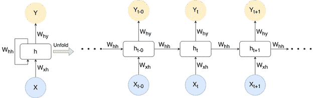

## 7 C++中的循环神经网络与长短期记忆网络

**循环神经网络**（**RNN**）及其进阶变体**长短期记忆网络**（**LSTM**）已成为处理此类序列数据的强大架构。这些网络能够维持对先前输入的内部记忆，从而学习并预测不同长度序列中的模式。从预测股票市场趋势、翻译语言，到生成类人文本和处理语音，RNN和LSTM彻底改变了我们处理序列数据问题的方式。

序列数据——如文本、语音和时间序列——给神经网络带来了根本性挑战：每个元素的含义取决于其时间上下文。传统的前馈网络独立处理输入，丢弃了定义序列的顺序信息。金融数据清楚地说明了这一局限性：如果不了解股价处于上涨还是下跌趋势中，150美元的股价便毫无意义。同样，单词"bank"需要借助周围的词才能区分金融机构（银行）与河岸。

在本章中，我们探讨RNN和LSTM网络的基本概念、架构及C++实现，特别关注**语言作为序列数据**。我们研究这些架构如何通过记忆机制处理序列数据，理解包括梯度消失问题在内的数学基础和训练挑战，并使用现代C++库实现实用解决方案。通过从基于Eigen的方法到生产级LibTorch系统的详细代码实现，以及文本预测和机器翻译等自然语言处理任务的动手实践，你将掌握构建和部署面向语言应用的序列学习模型所需的技能。

在本章中，我们将涵盖以下主题：

- 理解时间序列与序列数据
- RNN架构与数学基础
- BPTT
- LSTM网络
- LSTM反向传播
- 文本处理
- 词嵌入：连接离散标记与连续表示
- 用于深度学习的文本处理流水线

### 理解时间序列与序列数据

与图像不同——图像中的信息同时存在于二维网格中，使**卷积神经网络**（**CNN**）能够并行处理相邻像素——序列数据随时间展开，含义逐步呈现。在图像中，像素与其相邻像素的关系在空间上是固定的：猫耳朵的边缘通过空间邻近性与周围像素相关联。序列数据的运作方式则根本不同：每个元素的重要性取决于其之前的元素，可能还取决于其之后的元素，由此形成的是时间依赖而非空间依赖。

想一想我们如何处理语言与图像。看照片时，你可以先查看任何区域——背景、前景或中心——都不会影响理解。无论查看顺序如何，空间关系始终保持不变。然而，文本却需要顺序处理："The bank approved the loan"（银行批准了贷款）与"The river bank eroded"（河岸被侵蚀）表明，相同的词语只有通过其时间上下文才能获得含义。这种时间依赖性不仅限于语言：测量到120 bpm的心率所代表的情况也截然不同，取决于它是在静息后（令人担忧）还是运动后（正常）测得。

序列数据的数学表示明确引入了时间维度，其中序列 \(X = \{x_1, x_2, \ldots, x_T\}\) 包含 \(T\) 个时间步，每个元素 \(x_t\) 都依赖于历史上下文 \(\{x_1, x_2, \ldots, x_{t-1}\}\)。这种时间依赖性为神经网络架构带来了机遇与挑战，要求模型能够在扩展的序列中保持并利用记忆，同时学习可能跨越多个时间尺度的复杂模式。


## 第7章

序列数据中的时间依赖以多种不同方式体现，包括：

- **因果关系：** 早期事件影响后续事件时
- **上下文含义：** 相同数据点根据其在序列中的位置而具有不同解释时
- **模式涌现：** 只有将多个时间步放在一起查看时，有意义的模式才会显现
- **记忆需求：** 需要保留来自先前状态的信息才能理解当前状态

这些时间依赖共同解释了为什么传统神经网络在序列任务上表现不佳，以及为什么带有记忆机制的专门架构对于有效的序列数据处理变得至关重要。在接下来的章节中，我们将研究RNN的基础知识以及驱动这些架构的数学原理。

### RNN架构与数学

RNN专门设计用于处理时间关系至关重要的序列数据，这导致了允许RNN保持记忆的关键架构差异。它们创建了一个反馈回路，其中网络的输出成为其下一个时间步输入的一部分。这种递归结构使网络能够记住先前的输入，并利用这些信息来指导当前预测。

考虑预测句子中下一个单词的任务。当我们遇到短语“The cat sat on the...”时，我们对下一个单词的预测（可能是“mat”、“chair”或“floor”）完全取决于对前面单词所建立上下文的理解。序列中的每个单词不仅单独承载含义，还与其之前的单词相关联。

这种时间依赖正是RNN被设计用来捕获的。网络维护一个内部状态——通常称为隐藏状态——作为其记忆。该隐藏状态在每个时间步更新，整合当前输入的信息，同时保留先前时间步的相关信息。我们现在将探讨不同类型的RNN及其数学基础的细节，重点关注隐藏状态如何实现时间记忆。

#### RNN的类型

从**架构**上讲，根据**输入**和输出的数量以及不同RNN单元之间的连接方式，共有4种不同类型的RNN。它们分别是：

- **一对一：** 单个输入，单个输出
- **一对多：** 单个输入，多个**输出**
- **多对一：** 多个**输入**，单个输出。这用于情感分类。
- **多对多：** 这些多对多网络有两种变体

第一种变体发生在输入数量与输出数量相同时。这用于像**命名实体识别**（**NER**）这样的任务，这是一项专注于识别文本中名称和关键信息的语言任务，例如人名、组织名、地名和日期。第二种变体发生在输入数量和输出数量不同时，主要用于神经机器翻译。我们将在名为*使用LibTorch构建序列到序列翻译器*的应用部分看到此类RNN的示例。但首先，我们应该看看RNN的数学基础。

#### 数学基础

RNN的数学框架可以通过在每个时间步发生的三个基本操作来理解。这些操作共同作用，使网络在处理序列输入时能够保持时间上下文。在每个时间步，RNN执行以下计算：

- **隐藏状态更新**：网络将当前输入\(x(t)\)与先前的隐藏状态\(h(t-1)\)组合，生成新的隐藏状态\(h(t)\)：

  \[
  h(t) = \sigma(W_{xh}x(t) + W_{hh}h(t-1) + b_h)
  \]

  其中\(h(t)\)表示当前隐藏状态，\(W_{xh}\)和\(W_{hh}\)分别是输入连接和循环连接的权重矩阵，\(b_h\)是偏置向量，\(\sigma\)是激活函数（通常是tanh或ReLU）。

- **输出生成**：利用当前隐藏状态，网络生成输出\(y(t)\)：

  \[
  y(t) = f(W_{hy}h(t) + b_y)
  \]

  其中\(W_{hy}\)是输出权重矩阵，\(b_y\)是输出偏置，\(f\)是输出激活函数（对于分类任务通常是softmax，对于回归任务通常是线性函数）。

- **记忆传播**：隐藏状态\(h(t)\)被前向传递到下一个时间步，携带来自所有先前输入的累积信息。

这种递归计算创建了一个操作链，信息在理论上可以从第一个输入流到最终输出，使网络能够维持整个序列上的长期依赖。隐藏状态充当网络的记忆，在处理新输入时不断更新以编码相关历史信息。

循环连接——即输出作为输入反馈回来——赋予了RNN独特的能力。这种架构允许单个网络使用同一组学习参数处理不同长度的序列，从短语到整个文档。网络本质上是随时间“展开”的，创建了一个能够捕获复杂时间模式的深度计算图。

*图7.1* 说明了这个展开过程，展示了单个RNN单元如何跨时间步复制以处理序列输入。



*图7.1：RNN架构，展示单个RNN单元跨时间步展开以处理序列输入*

RNN前向传播中激活函数的选择显著影响网络跨时间步维持和传播信息的能力。双曲正切（*tanh*）函数通常用于隐藏状态计算，因为它产生\([-1, 1]\)范围内的输出，提供可以表示多种信息类型的正负激活。

*tanh*函数在反向传播过程中也具有有利的梯度特性，尽管它仍然会在很长的序列中导致梯度消失问题。一些实现使用ReLU激活来缓解梯度消失，但这可能会引入其他挑战，例如激活值爆炸。

#### 记忆动态与信息流

RNN中的隐藏状态充当网络的工作记忆，编码来自序列历史的相关信息。在前向传播过程中，这种记忆经历持续转换——新信息被整合，而现有信息可能根据学习到的权重矩阵被保留、修改或遗忘。

在每个时间步，网络必须平衡两个相互竞争的目标：整合来自当前输入的新信息，同时保留来自先前时间步的相关上下文。权重矩阵\(W_{xh}\)和\(W_{hh}\)决定了这种平衡，其学习到的值编码了历史上下文与当前输入的相对重要性。

通过\(W_{hh}\)的循环连接允许信息从早期时间步流向后期时间步，理论上使网络能够维持长期依赖。然而，在实践中，由于重复的矩阵乘法和非线性变换，这种信息流在长序列上会退化。

### C++实现RNN

在本节中，我们将使用C++和Eigen库为RNN实现一个全面的类架构，延续前几章探索中一贯的系统化教学方法。我们的实现策略强调算法透明性和计算效率，通过基于矩阵的操作清晰展示理论概念如何转化为实际代码。

虽然备选实现方法——包括基础的基于矩阵的实现和生产级LibTorch系统——可在相关GitHub仓库（`https://github.com/PacktPublishing/Deep-Learning-with-Cpp/chapter7`）中获取，但这种基于Eigen的实现可在概念清晰性与实际性能之间达到最佳平衡。通过这种专注的方法，我们确保定义RNN架构的复杂记忆机制和时间依赖保持易于理解，同时展示支撑现代序列学习模型的计算技术。

#### 基于Eigen的方法

基于Eigen的方法将所有四个LSTM门（遗忘门、输入门、候选门和输出门）整合为统一的矩阵操作，并将它们组织在连续内存块中以提升计算效率。该实现采用策略性内存组织，其中`4 * hidden_size`维度系统地容纳所有门，Xavier/Glorot初始化可防止早期训练期间的梯度消失或爆炸。遗忘门被初始化为


## 第7章：C++中的循环神经网络与长短期记忆网络

1.0 以保持细胞状态信息流，帮助对抗困扰早期RNN架构的梯度消失问题。

下面的代码块展示了用C++实现的`RNNCell`。完整代码可在相关的GitHub仓库（`https://github.com/PacktPublishing/Deep-Learning-with-C-/blob/main/chapter7/RNNCell.cpp`）中获取。`RNNCell`是一个C++类，只有三个参数：`input_size`、`hidden_size`和`output_size`。根据前面的公式，`W_xh`处理新输入的信息，`W_hh`是循环连接，`W_hy`是将最终隐藏层转换为`output_layer`的矩阵。`initialize_weights()`函数使用Xavier方法初始化参数。

```cpp
class RNNCell {
private:
    int input_size;
    int hidden_size;
    int output_size;

    // Weight matrices
    Eigen::MatrixXf W_xh; // Input to hidden
    Eigen::MatrixXf W_hh; // Hidden to hidden (recurrent)
    Eigen::MatrixXf W_hy; // Hidden to output

    // Bias vectors
    Eigen::VectorXf b_h; // Hidden bias
    Eigen::VectorXf b_y; // Output bias

    // Activation functions
    std::function<Eigen::MatrixXf(const Eigen::MatrixXf&)> hidden_activation;
    std::function<Eigen::MatrixXf(const Eigen::MatrixXf&)> output_activation;

public:
    RNNCell(int input_sz, int hidden_sz, int output_sz)
        : input_size(input_sz), hidden_size(hidden_sz), output_size(output_sz) {
        // Initialize weights with Xavier initialization
        initializeWeights();
        // Set default activation functions
        hidden_activation = ActivationFunctions::tanh;
        output_activation = ActivationFunctions::sigmoid;
    }
};
```

我们现在来探讨训练中的挑战：计算必须随时间反向流动的梯度，以应对时间依赖性。这种专门的算法被称为**通过时间反向传播**（**BPTT**）。

### BPTT

训练RNN会带来一些独特的挑战，使其有别于前馈网络。传统神经网络可以通过直接的反向传播计算梯度，而RNN需要一种称为BPTT的专门训练算法。该算法通过跨时间步“展开”网络，来解决顺序数据处理中固有的时间依赖性。

在前馈网络中，从输入到输出的路径是直接且无环的，因此梯度计算很直接。然而，RNN创建了一个时间计算图，其中相同的参数（权重矩阵\(W_{xh}\)、\(W_{hh}\)和偏置\(b\)）在多个时间步中重复使用。这种跨时间的参数共享产生了训练时必须小心处理的依赖性。

考虑一个处理长度为\(T\)序列的RNN。网络的最终输出不仅取决于当前输入，还通过隐藏状态链取决于所有先前的输入。在计算梯度时，我们必须考虑每个参数在它所使用的每个时间步上如何影响损失。

#### BPTT的数学基础

BPTT背后的核心思想是将展开后的RNN视为一个非常深的前馈网络。对于长度为\(T\)的序列，我们在概念上创建\(T\)层，每一层对应一个时间步。损失相对于时间\(t\)处隐藏状态的梯度依赖于所有未来时间步的梯度。

#### 时间中的梯度流动

损失\(L\)相对于隐藏状态\(h(t)\)的梯度计算如下：

\[
\frac{\partial L}{\partial h(t)} = \frac{\partial L}{\partial h(t+1)} \frac{\partial h(t+1)}{\partial h(t)} + \frac{\partial L}{\partial y(t)} \frac{\partial y(t)}{\partial h(t)}
\]

这个递归关系展示了梯度如何随时间向后流动，并累积所有未来时间步的贡献。

#### 参数梯度的累积

由于相同的参数在每个时间步都被使用，它们的梯度必须在整个序列上累积。

\[
\frac{\partial L}{\partial W_{xh}} = \sum_{t=1}^{T} \frac{\partial L}{\partial h(t)} \frac{\partial h(t)}{\partial W_{xh}}
\]

\[
\frac{\partial L}{\partial W_{hh}} = \sum_{t=1}^{T} \frac{\partial L}{\partial h(t)} \frac{\partial h(t)}{\partial W_{hh}}
\]

\[
\frac{\partial L}{\partial b} = \sum_{t=1}^{T} \frac{\partial L}{\partial h(t)} \frac{\partial h(t)}{\partial b}
\]

当梯度通过许多时间步向后传播时，它们会反复乘以权重矩阵\(W\)和激活函数的导数。当这些值很小（通常小于1）时，梯度会随着时间步数呈指数级减小。

损失相对于\(h(1)\)的梯度涉及雅可比矩阵的乘积。

\[
\frac{\partial L}{\partial h(1)} = \frac{\partial L}{\partial h(T)} \times \prod_{t=2}^{T} \frac{\partial h(t)}{\partial h(t-1)}
\]

每一项\(\frac{\partial h(t)}{\partial h(t-1)}\)的大小通常小于1，导致整体梯度随着\(T\)的增大而消失。这使得网络难以学习长期依赖性，因为早期时间步接收到的梯度信号可以忽略不计。

#### 实际实现注意事项

为了解决BPTT的数学基础所揭示的计算和数值挑战，两种关键技术已成为标准做法：截断BPTT和梯度裁剪。

- **截断BPTT：** 对于非常长的序列，在整个序列上计算梯度的计算成本变得过高，并可能导致数值不稳定。截断BPTT通过限制梯度传播的时间步数来解决这个问题，通常使用10到50个时间步的固定窗口。

- **梯度裁剪：** 为了防止梯度爆炸（即梯度变得过大的相反问题），通常采用梯度裁剪。该技术限制了训练过程中梯度的大小。

让我们看一下梯度裁剪函数的C++实现：

```cpp
void clip_gradients(GradientState& grads) {
    float total_norm = 0.0f;

    // Compute total gradient norm across all parameters
    for (const auto& row : grads.dW_xh) {
        for (float val : row) {
            total_norm += val * val;
        }
    }
    total_norm = std::sqrt(total_norm);

    // Apply clipping if necessary
    if (total_norm > gradient_clip_threshold) {
        float clip_factor = gradient_clip_threshold / total_norm;

        for (auto& row : grads.dW_xh) {
            for (float& val : row) {
                val *= clip_factor;
            }
        }
    }
}
```

我们现在将这些概念转化为可行的C++实现，以应对训练RNN时的计算和数值挑战。

#### C++实现BPTT

在确立了BPTT的理论基础及其数学表述之后，我们现在转向在C++中实际实现BPTT。从数学概念到可用代码的转换需要仔细考虑计算效率、数值稳定性和内存管理——这些挑战在处理跨时间步梯度计算的递归特性时尤为突出。

在C++中实现BPTT为生产级RNN训练提供了几个优势。该语言显式的内存管理允许精确控制计算图的存储，而其性能特性使其适合处理在高级语言中难以承受的长序列。然而，这种实现的复杂性需要系统化的方法来处理时间步与参数更新之间错综复杂的依赖关系。

BPTT的C++实现必须解决算法递归结构带来的几个关键计算挑战。与前向传播按顺序处理时间步不同，BPTT需要同时维护所有时间步的梯度，这会为长序列带来显著的内存开销。此外，跨多个时间步累积梯度需要仔细管理数值精度，以防止梯度消失和梯度爆炸问题。

我们的实现策略聚焦于三个核心组件：最小化内存分配开销的高效梯度存储结构、处理BPTT固有递归依赖的数值稳定梯度计算，以及使训练在实际应用中可行的实用优化技术（如梯度裁剪和截断BPTT）。

##### 基于向量的实现

下面的C++实现演示了BPTT的核心机制：跨时间步的梯度累积、通过隐藏状态的递归反向传播，以及包括梯度裁剪在内的数值稳定技术。该代码为在序列数据上训练RNN提供了可用的基础。

```cpp
// Backward pass through time
for (int t = sequence_length - 1; t >= 0; --t) {
    // Compute output error (combining current loss and future gradients)
    std::vector<float> output_error(hidden_size);
    for (int i = 0; i < hidden_size; ++i) {
        output_error[i] = forward_state.hidden_states[t][i] - targets[t][i] + grads.dh[i];
    }
    // Compute gradients through activation function
    std::vector<float> pre_activation_grad(hidden_size);
    for (int i = 0; i < hidden_size; ++i) {
        pre_activation_grad[i] = output_error[i] * tanh_derivative(forward_state.pre_activations[t][i]);
    }
    // Accumulate weight gradients
    for (int i = 0; i < hidden_size; ++i) {
```


```cpp
for (int j = 0; j < input_size; ++j) {
    grads.dW_xh[i][j] += pre_activation_grad[i] * forward_state.inputs[t][j];
}
```

这结合了两个误差来源：即时的预测误差（预测值与目标值之差）以及未来的梯度流（`grads.dh[i]`）。第二项至关重要——它将来自后续时间步的“责任”反向传播，使网络能够学习长期依赖关系。

##### 基于 Eigen 的实现

与前面章节一样，我们将使用 Eigen 库来优化矩阵运算：

```cpp
EigenGradients backward(const std::vector<Eigen::VectorXf>& hidden_states,
                        const std::vector<Eigen::VectorXf>& targets,
                        const Eigen::MatrixXf& W_hh) {
    Eigen::VectorXf dh_next = Eigen::VectorXf::Zero(hidden_size);
    for (int t = sequence_length - 1; t >= 0; --t) {
        // Vectorized error computation
        Eigen::VectorXf output_error = hidden_states[t] - targets[t] + dh_next;
        // Vectorized activation derivative
        Eigen::VectorXf pre_activation_grad = output_error.cwiseProduct(tanh_derivative(pre_activations[t]));
        // Efficient outer product for gradient accumulation
        grads.dW_xh += pre_activation_grad * inputs[t].transpose();
        // Matrix-vector multiplication for next time step gradient
        dh_next = W_hh.transpose() * pre_activation_grad;
    }
}
```

##### 基于 Libtorch 的实现

然而，在生产环境中，我们可以使用优化的 `libtorch` 库进一步改进：

```cpp
torch::Tensor backward_mixed_precision(torch::nn::LSTM& model,
                                       const torch::Tensor& inputs,
                                       const torch::Tensor& targets) {
    torch::Tensor loss;
    if (use_amp) {
        // Forward pass with autocast for FP16 computation
        {
            torch::autocast::autocast_mode autocast_guard(torch::kCUDA, true);
            auto [output, hidden] = model->forward(inputs);
            loss = torch::mse_loss(output, targets);
        }
        // Backward pass with gradient scaling
        scaler.scale(loss).backward();
        // Unscale gradients before clipping
        scaler.unscale_(optimizer);
        torch::nn::utils::clip_grad_norm_(model->parameters(), 5.0);
        // Scaled optimizer step
        scaler.step(optimizer);
        scaler.update();
    }
    return loss;
}
```

尽管有了这些实用的训练技巧，根本性的梯度消失问题依然存在，这限制了 RNN 捕捉长期依赖的能力，并推动了 LSTM 网络的发展。

### LSTM 网络

在上一节中，我们探讨了梯度在长序列中反向传播时如何呈指数级衰减。这使得标准 RNN 几乎不可能学习跨越多个时间步的依赖关系。这一局限严重制约了它们捕捉长期模式的能力，而这些模式对于理解序列数据往往至关重要。

LSTM 网络由 Hochreiter 和 Schmidhuber 于 1997 年提出，通过一种精妙的门控机制解决了这一关键限制，该机制提供了对信息流的显式控制。与依赖简单循环连接的标准 RNN 不同，LSTM 引入了一种复杂的内部架构，旨在跨扩展的时间序列中选择性地保留、更新和遗忘信息。

LSTM 设计的关键洞察在于认识到，并非来自先前时间步的所有信息对未来的预测都具有同等重要性。例如，在自然语言处理中，句子的主语可能对多个词之后的动词一致性至关重要，而中间的形容词和介词短语对此特定语法关系可能不那么重要。LSTM 提供了维持这种长期依赖的机制，同时让不太相关的信息逐渐衰减。

#### 细胞状态：LSTM 的记忆高速公路

LSTM 架构的根本创新在于引入了细胞状态——一条独立的信息通路，与标准 RNN 中的隐藏状态并行运行。这条细胞状态充当“记忆高速公路”，可以以最小的修改将信息跨多个时间步传递，绕过了导致传统 RNN 中梯度消失的重复变换。

三个专门的门控调节细胞状态：遗忘门决定丢弃什么，输入门控制要存储哪些新信息，输出门决定暴露什么。每个门都采用 Sigmoid 激活函数（σ），输出值介于 0 和 1 之间，充当信息流的可学习过滤器。门输出为 0 时完全阻断信息流，而输出为 1 时则允许信息原样通过。

*图 7.2* 展示了完整的 LSTM 细胞架构，说明了这三个门如何与细胞状态和隐藏状态交互以调节信息流。

```text
Memory cell
internal state

Ct -1

Hidden state
H t -1

+

Ct

tanh

Ht

σ

σ

σ

tanh

Forget
gate

Ft

Input
gate

It

Input
node

Ct

Output
gate

Ot

Input Xt

σ

FC layer with
activation function

Elementwise
operator

Copy

Concatenate
```

*图 7.2：LSTM 细胞*

在下一节关于 LSTM 数学公式的内容中，我们将理解这三个门以及流经它们的信息是如何相互作用的。

### LSTM 数学公式

在建立了 LSTM 网络及其门控机制的概念基础之后，我们现在转向精确的数学公式，这些公式使网络能够在时间步之间选择性地管理信息流。LSTM 的数学精妙之处在于其通过四个相互关联的计算组件在每一步协同工作，以系统化方式进行记忆管理。

在每个时间步 t，LSTM 细胞执行以下计算序列：

- **遗忘门**：遗忘门决定应从细胞状态中丢弃哪些信息

    `f(t) = σ(W_f [h(t-1), x(t)] + b_f)`

    其中 `f(t)` 是遗忘门输出，`W_f` 是遗忘门权重矩阵，`h(t-1)` 是先前隐藏状态，`x(t)` 是当前输入，`b_f` 是遗忘门偏置，`σ` 是 Sigmoid 激活函数。

- **输入门**：输入门控制应将哪些新信息存储在细胞状态中

    `i(t) = σ(W_i [h(t-1), x(t)] + b_i)`

    其中 `i(t)` 表示输入门输出，决定哪些值将被更新。

- **候选值**：生成可能被添加到细胞状态的新候选值

    `C̃(t) = tanh(W_c [h(t-1), x(t)] + b_c)`

    其中 `C̃(t)` 表示候选值，使用双曲正切激活函数生成，取值范围为 [-1, 1]。

- **细胞状态更新**：通过将遗忘门的选择性保留与输入门的选择性添加相结合来更新细胞状态

    `C(t) = f(t) ⊙ C(t-1) + i(t) ⊙ C̃(t)`

    其中 `⊙` 表示逐元素乘法。该方程代表了核心记忆机制：遗忘门 `f(t)` 决定从先前细胞状态 `C(t-1)` 中保留什么，而输入门 `i(t)` 控制要纳入哪些新的候选信息 `C̃(t)`。

- **输出门**：输出门决定细胞状态的哪些部分应影响隐藏状态

    `o(t) = σ(W_o [h(t-1), x(t)] + b_o)`

- **隐藏状态生成**：通过输出门过滤细胞状态来计算隐藏状态

    `h(t) = o(t) ⊙ tanh(C(t))`

tanh 激活确保隐藏状态值保持在 [-1, 1] 范围内，而输出门 `o(t)` 则选择性地决定处理后的细胞状态中哪些组件被暴露为隐藏状态。

#### 信息流动态

数学公式揭示了 LSTM 如何通过其细胞状态通路解决梯度消失问题。当遗忘门输出接近 1 时，细胞状态 `C(t)` 可以以最小的变换从一个时间步流向下一个时间步。这创建了一条“梯度高速公路”，使误差信号能够在时间上反向传播，而不会出现困扰标准 RNN 的指数衰减。

细胞状态更新方程中的逐元素操作（⊙）对梯度流至关重要。在反向传播过程中，当门控值接近 1 时，梯度可以以最小的衰减通过这些乘法门，有效绕过了传统 RNN 中导致梯度消失的重复矩阵乘法。这种选择性保留使 LSTM 能够维持和学习跨越数百甚至数千个时间步的依赖关系——这一能力使它们在需要长期记忆的任务中特别有效。

LSTM 设计的数学精妙之处在于其学习记住什么和忘记什么的能力。通过训练，网络会发现哪些模式和关系值得跨时间保留，自动开发一种针对训练数据中特定序列模式进行优化的内部记忆管理系统。

LSTM 架构保持了 RNN 的参数共享原则——在每个时间步使用相同的权重矩阵（`W_f`、`W_i`、`W_c`、`W_o`）和偏置（`b_f`、`b_i`、`b_c`、`b_o`）。这使得 LSTM 能够处理任意长度的序列，同时保持固定的参数数量，尽管与标准 RNN 相比复杂度有所增加，但计算效率依然很高。


## 第7章：C++中的循环神经网络与长短期记忆网络

拼接操作 `[h_{t-1}, x_t]` 将先前的隐藏状态与当前输入合并为一个向量，使每个门在进行门控决策时能够同时考虑当前输入和历史上下文。这种统一的方法确保所有门都能访问相同的上下文信息，同时学习专门用于记忆管理的功能。

现在，我们将把这些抽象方程转换为能够执行这些计算的高效C++代码。

### C++实现

与RNN的C++实现类似，我们将通过三个阶段来实现LSTM网络。我们的实现方法保持了本章研究过程中一贯的系统化方法，在构建可投入生产的解决方案时优先考虑概念清晰性。我们首先采用基于向量的实现来强调算法的透明性，然后采用基于Eigen矩阵的方法以提高计算效率，最后使用LibTorch实现用于生产部署。

##### 基于向量的实现

我们C++ LSTM实现的完整代码可在相关的GitHub仓库中获取（`https://github.com/PacktPublishing/Deep-Learning-with-C-/blob/main/chapter7/lstm_simple.cpp`）。在接下来的小节中，我们将检视最关键的组成部分，以展示数学公式如何转化为可运行的代码。

##### 核心LSTM架构

我们LSTM实现的基础在于为四个门精心组织权重矩阵和偏置向量：

```cpp
// Weight matrices for all four gates
std::vector<std::vector<float>> W_f, W_i, W_c, W_o; // Input weights
std::vector<std::vector<float>> U_f, U_i, U_c, U_o; // Hidden weights
std::vector<float> b_f, b_i, b_c, b_o; // Bias vectors
```

这一结构直接反映了我们在*LSTM数学公式*一节中探讨的数学表达，其中每个门——例如遗忘门、输入门、候选门和输出门——都有自己的权重矩阵和偏置。这种分离使得LSTM的选择性记忆机制成为可能，允许每个门学习专门用于跨时间步管理信息的函数。

##### 数值稳定性考虑

生产级LSTM实现必须解决门控计算中指数函数带来的数值稳定性挑战。我们的sigmoid实现包含钳位机制以防止上溢和下溢情况：

```cpp
float sigmoid(float x) {
    return 1.0f / (1.0f + std::exp(-std::max(-50.0f, std::min(50.0f, x))));
}
```

在处理长序列时，这种钳位机制对稳定训练至关重要，因为重复计算可能导致数值不稳定。有界的输入范围确保了指数计算保持在可管理的数值范围内。

##### 初始化策略

恰当的权重初始化会显著影响LSTM的训练动态。我们的实现将遗忘门偏置初始化为1.0，遵循既定的最佳实践：

```cpp
b_f.resize(hidden_size, 1.0f); // Forget gate bias = 1.0
```

这种初始化策略在训练的早期阶段促进信息流动，有助于在网络学习适当的门控行为之前防止梯度消失。由于初始时偏向于记住信息，LSTM可以在训练过程中逐渐学会有选择地遗忘。

##### 门计算实现

核心LSTM计算实现了我们之前推导的数学方程，每个门在记忆管理系统中发挥其专门作用：

```cpp
// Forget gate: f_t = σ(W_f * x_t + U_f * h_{t-1} + b_f)
forget_gate[h] = sigmoid(f_sum);
// Input gate: i_t = σ(W_i * x_t + U_i * h_{t-1} + b_i)
input_gate[h] = sigmoid(i_sum);
// Candidate gate: C̃_t = tanh(W_c * x_t + U_c * h_{t-1} + b_c)
candidate_gate[h] = tanh_activation(c_sum);
// Output gate: o_t = σ(W_o * x_t + U_o * h_{t-1} + b_o)
output_gate[h] = sigmoid(o_sum);
```

每个门实现其对应的数学方程，并协同调节细胞状态更新。

##### 细胞状态与隐藏状态更新

LSTM记忆机制的核心在于细胞状态更新方程，它选择性地组合保留的信息和新信息：

```cpp
// Update cell state: C_t = f_t ⊙ C_{t-1} + i_t ⊙ C̃_t
new_cell[h] = forget_gate[h] * prev_cell[h] +
              input_gate[h] * candidate_gate[h];
```

该方程体现了LSTM的根本创新：能够有选择地遗忘旧信息，同时纳入新信息。逐元素乘法运算创建了能够实现有效BPTT的“梯度高速公路”。

最后一步通过输出门过滤细胞状态来生成隐藏状态：

```cpp
// Update hidden state: h_t = o_t ⊙ tanh(C_t)
new_hidden[h] = output_gate[h] * tanh_activation(new_cell[h]);
```

输出门的选择性过滤确保只有细胞状态中相关的部分影响网络输出和后续时间步，从而完成了定义LSTM行为的复杂记忆管理循环。

这种实现优先考虑概念清晰性而非计算优化，非常适合理解LSTM机制，并作为更复杂实现的基础。简洁的结构使读者能够直接在代码中追溯数学概念，巩固本章建立的理论理解，同时为构建生产就绪的LSTM系统提供实用基础。

下一节将演示如何通过高效的矩阵实现来优化这些操作。然后，我们将使用前面讨论的基本LSTM单元构建一个LSTM神经网络，并探索驱动网络顺序处理能力的前向传播函数。

#### 基于矩阵的实现

本节介绍的`EigenLSTMCell`实现相比前面章节展示的基于向量的方法是一个显著进步。该实现将所有四个LSTM门整合到统一的矩阵操作中，以提高计算效率。该实现不是为每个门（遗忘门、输入门、候选门和输出门）分别设置矩阵，而是将四个门合并到单个更大的矩阵中。`4 * hidden_size`维度将所有的门容纳在连续的内存块中。该因子来自四个LSTM门，我们知道它们是：

- 遗忘门（第0行到第`hidden_size`-1行）
- 输入门（第`hidden_size`行到第`2 * hidden_size`-1行）
- 候选门（第`2 * hidden_size`行到第`3 * hidden_size`-1行）
- 输出门（第`3 * hidden_size`行到第`4 * hidden_size`-1行）

我们使用Xavier/Glorot初始化来防止训练初期出现梯度消失或梯度爆炸。遗忘门被初始化为1.0。这有助于在训练早期几乎完全保留细胞状态。信息可以不受即时衰减地流过网络。这有助于缓解困扰早期RNN架构的梯度消失问题。

```cpp
class EigenLSTMCell {
private:
    int input_size, hidden_size;
    // Combined weight matrices for all four gates
    Eigen::MatrixXf W_combined; // [4*hidden_size, input_size]
    Eigen::MatrixXf U_combined; // [4*hidden_size, hidden_size]
    Eigen::VectorXf b_combined; // [4*hidden_size]
public:
    EigenLSTMCell(int input_sz, int hidden_sz)
        : input_size(input_sz), hidden_size(hidden_sz) {
        // Xavier initialization for stable gradients
        W_combined = Eigen::MatrixXf::Random(4 * hidden_size, input_size) *
                     std::sqrt(2.0f / (input_size + hidden_size));
        U_combined = Eigen::MatrixXf::Random(4 * hidden_size, hidden_size) *
                     std::sqrt(2.0f / (hidden_size + hidden_size));
        b_combined = Eigen::VectorXf::Zero(4 * hidden_size);
        // Critical: Initialize forget gate bias to 1.0
        b_combined.segment(0, hidden_size).setOnes();
    }
};
```

下面的代码定义了LSTM单元的`forward`方法。和之前一样，它执行单个时间步的核心计算。该方法接受三个输入：`input`（当前时间步输入向量）、`prev_hidden`（先前的隐藏状态）和`prev_cell`（先前的细胞状态），返回一对表示新隐藏状态和细胞状态的向量。该方法不是分别计算每个门，而是通过一次矩阵乘法计算出所有四个门。


## 第7章：C++中的循环神经网络与长短期记忆网络

变量`new_hidden`应用了隐藏状态生成公式。该公式使用tanh将单元状态值压缩到[-1, 1]范围，并且梯度裁剪可防止tanh饱和。

```cpp
std::pair<Eigen::VectorXf, Eigen::VectorXf> forward(
    const Eigen::VectorXf& input,
    const Eigen::VectorXf& prev_hidden,
    const Eigen::VectorXf& prev_cell) {
    // Single matrix multiplication for all gates
    Eigen::VectorXf gates = W_combined * input + U_combined * prev_hidden + b_combined;

    // Extract gates using efficient block operations
    Eigen::VectorXf forget_gate = gates.segment(0, hidden_size);
    Eigen::VectorXf input_gate = gates.segment(hidden_size, hidden_size);
    Eigen::VectorXf candidate_gate = gates.segment(2 * hidden_size, hidden_size);
    Eigen::VectorXf output_gate = gates.segment(3 * hidden_size, hidden_size);

    // Vectorized activation functions with gradient clipping
    forget_gate = forget_gate.unaryExpr([](float x) {
        return 1.0f / (1.0f + std::exp(-std::max(-50.0f, std::min(50.0f, x))));
    });

    // Cell state update: selective forgetting + selective input
    Eigen::VectorXf new_cell = forget_gate.cwiseProduct(prev_cell) +
                               input_gate.cwiseProduct(candidate_gate);

    // Hidden state: filtered cell state output
    Eigen::VectorXf new_hidden = output_gate.cwiseProduct(
        new_cell.unaryExpr([](float x) {
            return std::tanh(std::max(-10.0f, std::min(10.0f, x)));
        })
    );

    return std::make_pair(new_hidden, new_cell);
}
```

现在我们已经定义了LSTM单元和forward函数，接下来我们将看到`LSTMNetwork`类如何实现一个完整的基于LSTM的神经网络用于序列处理。该实现采用多对一架构，处理可变长度的输入序列。它使用了关键组件`LSTMCell`及其`forward`函数。网络类接受`input_size`、`output_size`和`hidden_sz`（表示网络中LSTM单元的数量）。

```cpp
class LSTMNetwork {
private:
    EigenLSTMCell lstm_cell;
    Eigen::MatrixXf W_output;
    Eigen::VectorXf b_output;
    int hidden_size;

public:
    LSTMNetwork(int input_size, int hidden_sz)
        : lstm_cell(input_size, hidden_sz), hidden_size(hidden_sz) {
        W_output = Eigen::MatrixXf::Random(1, hidden_size) * 0.1f;
        b_output = Eigen::VectorXf::Zero(1);
    }

    float forward(const std::vector<Eigen::VectorXf>& sequence) {
        Eigen::VectorXf hidden = Eigen::VectorXf::Zero(hidden_size);
        Eigen::VectorXf cell = Eigen::VectorXf::Zero(hidden_size);

        // Process sequence step by step
        for (const auto& input : sequence) {
            auto result = lstm_cell.forward(input, hidden, cell);
            hidden = result.first;
            cell = result.second;
        }

        // Final prediction from last hidden state
        return (W_output * hidden + b_output)(0);
    }
};
```

完整的训练循环代码可在与本章相关的GitHub仓库中获取（`https://github.com/PacktPublishing/Deep-Learning-with-C-/blob/main/chapter7/lstm_matrix.cpp`）。最后，我们将了解一个使用LibTorch构建的生产级LSTM网络。

### 基于LibTorch的实现

LibTorch实现标志着从教学探索到生产级神经网络部署的关键转变。虽然我们之前的手动实现提供了对LSTM数学和计算机制的重要洞见，但这种生产级方法利用PyTorch的C++ API提供自动微分、GPU加速和行业标准优化，将理论理解转化为可部署的解决方案。完整代码可在`https://github.com/PacktPublishing/Deep-Learning-with-C-/blob/main/chapter7/lstm_libtorch.cpp`获取。

`ProductionLSTM`类通过继承`torch::nn::Module`（PyTorch神经网络组件的基础基类）体现了现代神经网络设计模式：

```cpp
class ProductionLSTM : public torch::nn::Module {
private:
    torch::nn::LSTM lstm{nullptr};
    torch::nn::Linear output_projection{nullptr};
    torch::nn::Dropout dropout{nullptr};
```

这种设计分离了三个关键职责：LSTM层处理序列数据和时间依赖性，线性层将输出转换为目标维度，dropout防止过拟合。每个组件都与PyTorch的模块系统无缝集成，实现自动参数管理和梯度计算。

LSTM初始化展示了序列学习系统的行业最佳实践：

```cpp
lstm = register_module("lstm", torch::nn::LSTM(
    torch::nn::LSTMOptions(input_size, hidden_size)
        .num_layers(num_layers)
        .dropout(dropout_rate)
        .batch_first(true)
        .bidirectional(false)
));
```

这些配置选择反映了生产需求和性能考量：

- **多层架构**：堆叠的LSTM层增加了模型容量，并支持跨时间尺度的分层特征学习
- **集成Dropout**：在LSTM层之间应用，防止过拟合，同时保持网络中的梯度流动
- **批次优先约定**：一种现代张量组织方式，批次维度位于序列维度之前，优化内存访问模式
- **单向处理**：因果序列建模的标准配置，其中未来信息不可用

前向传播展示了PyTorch的计算图构建和自动梯度计算：

```cpp
auto [lstm_out, new_hidden] = lstm->forward(input, hidden);
lstm_out = dropout->forward(lstm_out);
auto output = output_projection->forward(lstm_out);
```

与我们之前探讨的手动反向传播实现不同，PyTorch在前向传播期间自动构建计算图。每个操作都会记录其梯度函数，从而实现高效的反向模式自动微分，无需显式梯度计算。这种自动化消除了容易出错的手动梯度计算，同时通过优化的内核实现提供了卓越的性能。

`train_step`方法融合了多项关键的生产优化技术。接下来让我们来理解它们。

#### 混合精度训练

混合精度训练是一种优化技术，通过策略性地结合16位（FP16）和32位（FP32）浮点运算，在减少内存消耗的同时加速LSTM训练。这种方法利用了半精度运算的计算效率（在现代GPU架构上执行速度约为原来的两倍），同时通过在需要的地方选择性地使用全精度，保持了基于梯度的优化所必需的数值稳定性。

混合精度训练的核心洞见在于认识到不同计算阶段对数值精度有不同的要求。前向传播计算在训练时间中占主导地位，可以安全地以FP16运行而不会显著降低精度，因为降低的精度仍然足以捕获序列数据中的关键模式。然而，梯度累积和参数更新需要FP32精度，以防止数值下溢，否则会导致训练不稳定，尤其是在处理LSTM应用中常见的长序列时。下面是一个相应的实现：

```cpp
torch::autocast::autocast_mode autocast_guard(torch::kCUDA, true);
auto predictions = forward(input);
loss = torch::mse_loss(predictions, target);
```


## 第7章：C++中的循环神经网络与长短期记忆网络

上述代码的第一行创建了一个自动类型转换保护器，可为CUDA操作启用自动混合精度训练。以下是每个组件的作用：

- `torch::autocast::autocast_mode` - PyTorch的自动混合精度上下文管理器，可自动为不同操作选择适当的精度（FP16或FP32）
- `autocast_guard` - 该**资源获取即初始化**（**RAII**）保护器对象的变量名。当此对象超出作用域时，自动类型转换模式会自动禁用。
- `torch::kCUDA` - 指定自动类型转换应应用于CUDA（GPU）操作。混合精度带来的性能优势在此最为显著。
- `true` - 启用自动类型转换模式。将其设置为false将禁用该模式。

当此保护器处于活动状态时，其作用域内的操作会在安全且有益的计算（如前向传播中的矩阵乘法）中自动使用FP16（半精度），同时为需要更高数值稳定性的操作（如损失计算和梯度累积）保持FP32精度。

#### 梯度缩放与梯度裁剪

梯度缩放可防止16位算术运算中的数值下溢，而梯度裁剪则解决常影响RNN训练的梯度爆炸问题。范数裁剪机制确保梯度幅度保持在指定阈值以下，从而在长序列训练中维持训练稳定性。

```
scaler.scale(loss).backward();
scaler.unscale_(optimizer);
torch::nn::utils::clip_grad_norm_(parameters(), 5.0);
```

`scaler.scale(loss)` 这行代码通过将损失乘以一个较大的因子（通常为2^16或65536）来放大损失。在计算梯度前先放大损失，生成的梯度也会被放大，使其保持在FP16算术可表示的范围内。`unscale` 方法会恢复真实的梯度值。

`clip_grad_norm_(parameters(), 5.0)` 通过将总梯度范数限制为最大值5.0来防止梯度爆炸。如果所有梯度的组合幅度超过5.0，则会按比例缩小。

PyTorch会自动管理不同硬件配置下的内存分配、内核调度和数据传输。这种抽象使相同的代码能够高效地在CPU或GPU系统上执行，从而无需修改即可在各种计算环境中灵活部署。

与前面部分的手动实现相比，这具有显著的生产优势。具体包括：

- **自动微分**：消除手动梯度计算，降低实现复杂度
- **GPU加速**：利用优化的CUDA内核和高效的内存管理获得卓越性能
- **内存效率**：混合精度训练和优化的张量操作减少了内存占用
- **生产级特性**：全面支持梯度裁剪、dropout正则化以及多层架构
- **部署就绪**：提供模型序列化能力和推理优化，以便生产部署

LibTorch实现（`https://github.com/PacktPublishing/Deep-Learning-with-C-/blob/main/chapter7/lstm_libtorch.cpp`）是我们学习历程的集大成之作，展示了如何将LSTM数学的理论理解转化为生产级系统。该方法将手动实现中获得的概念性见解与真实世界部署所需的工程精密性相结合，弥合了学术理解与工业应用之间的鸿沟，同时保持了生产神经网络系统所必需的性能和可靠性标准。

### LSTM反向传播

在确立了LSTM前向传播的数学基础以及实现选择性信息流的复杂门控机制之后，我们现在转向通过反向传播训练这些网络的关键挑战。LSTM反向传播扩展了BPTT（随时间反向传播）的原理，同时考虑了门控架构和双状态路径引入的复杂相互依赖性。

LSTM中的反向传播过程不仅需要计算传统隐藏状态路径的梯度，还需要计算细胞状态以及全部四个门控机制的梯度。与标准RNN相比，这构建了一个显著更复杂的计算图，要求在每一步相互作用的多个并行路径中仔细管理梯度流。

#### LSTM反向传播的数学框架

LSTM中的梯度计算通过多个互连路径遵循链式法则。在每个时间步t，我们需要计算以下梯度：

**细胞状态梯度**：相对于细胞状态的梯度通过两个路径传播

$$
\frac{\partial L}{\partial C(t)} = \frac{\partial L}{\partial h(t)} \cdot \frac{\partial h(t)}{\partial C(t)} + \frac{\partial L}{\partial C(t+1)} \cdot \frac{\partial C(t+1)}{\partial C(t)}
$$

其中第一项代表通过隐藏状态的直接贡献，第二项代表来自未来时间步的贡献。

**门控梯度**：每个门都需要单独计算梯度：

- **输出门**：$\frac{\partial L}{\partial o(t)} = \frac{\partial L}{\partial h(t)} \cdot \tanh(C(t))$
- **遗忘门**：$\frac{\partial L}{\partial f(t)} = \frac{\partial L}{\partial C(t)} \cdot C(t-1)$
- **输入门**：$\frac{\partial L}{\partial i(t)} = \frac{\partial L}{\partial C(t)} \cdot \tilde{C}(t)$
- **候选门**：$\frac{\partial L}{\partial \tilde{C}(t)} = \frac{\partial L}{\partial C(t)} \cdot i(t)$

**隐藏状态梯度**：隐藏状态梯度会累积来自当前输出和未来循环连接的贡献。

$$
\frac{\partial L}{\partial h(t)} = \frac{\partial L}{\partial y(t)} \cdot \frac{\partial y(t)}{\partial h(t)} + \frac{\partial L}{\partial h(t+1)} \cdot \frac{\partial h(t+1)}{\partial h(t)}
$$

这些数学公式揭示了使LSTM能够有效学习长期依赖的计算机制，创建了可跨长序列保留学习信号的梯度路径。

#### 通过门的梯度流

门控机制创建了必须仔细管理的多条梯度路径。当遗忘门值接近1时，细胞状态梯度可以相对无阻碍地流动，从而形成解决梯度消失问题的“梯度高速公路”。然而，当门值接近0时，它们仍可能造成梯度瓶颈。

**激活函数导数**：每个门使用特定的激活函数，其导数会影响梯度流：

- **Sigmoid门**（遗忘、输入、输出）：$\sigma'(x) = \sigma(x)(1 - \sigma(x))$
- **Tanh激活**（候选值、隐藏状态）：$\tanh'(x) = 1 - \tanh^2(x)$

#### 参数梯度累积

每个门的权重矩阵会在其被使用的所有时间步上累积梯度：

$$
\frac{\partial L}{\partial W_f} = \sum_{t=1}^{T} \left( \frac{\partial L}{\partial f(t)} \sigma'_f\left(W_f \cdot [h(t-1), x(t)] + b_f\right) \right) [h(t-1), x(t)]^T
$$

类似的累积过程也发生在 $W_i$、$W_o$ 和 $W_c$ 以及它们对应的循环权重矩阵和偏置项上。

#### 实际实现注意事项

尽管架构上有所改进，但实际考虑因素仍然很重要：

- **LSTM的截断BPTT**：即使梯度流有所改善，很长的序列仍然可能导致计算和内存问题。截断BPTT仍然很重要，通常LSTM训练使用50到200个时间步的窗口。
- **针对特定门的梯度裁剪**：某些实现对不同的门应用不同的裁剪阈值，认识到细胞状态路径可能需要与门控机制不同的处理方式。

LSTM反向传播的数学复杂性反映了这些网络提供的复杂内存管理能力。虽然计算上比标准RNN训练更费力，但这种复杂性使LSTM能够学习长期依赖关系，这使它们在复杂的序列学习任务中变得不可或缺。


## 第七章：C++中的循环神经网络与长短期记忆网络

到目前为止，我们已经奠定了RNN和LSTM及其训练算法BPTT的基础。我们详细讨论了门控机制如何调节时序数据中的信息流。接下来，我们将探索两个实际应用：使用RNN进行下一个词预测，以及使用LSTM进行语言翻译。然而，在实现这些应用之前，我们必须首先理解基本的文本处理技术，就像我们在*第六章*中研究图像处理技术，然后才将CNN应用于图像分类和分割任务一样。

### 文本处理

随着现代语言标准（特别是C++17、C++20和C++23）的引入，C++中的文本处理能力得到了显著发展，这些标准提供了对自然语言处理应用至关重要的强大字符串操作能力。有效的文本处理基础始于理解C++的字符串处理机制以及用于国际文本处理的Unicode支持。

现代C++标准显著增强了文本处理能力，提供了自然语言处理应用所必需的复杂字符串操作工具。从C++17到C++23的演进引入了越来越强大的文本数据处理机制，反映出高效字符串操作在计算语言学中日益增长的重要性。

#### 现代C++中的增强字符串操作

C++23引入的`contains()`函数代表了子串检测方面的重大改进。这一增强功能与C++20中用于前缀和后缀验证的`starts_with()`和`ends_with()`函数相结合，为常见的文本处理操作提供了更直观、更具表现力的接口。这些新增功能反映了C++在字符串处理方面变得更加易用的更广泛趋势，同时保持了对生产级NLP系统至关重要的性能特征。

对于需要稳健的国际文本处理的应用，**Unicode国际组件**（**ICU**）库提供了全面的国际化功能，其能力远远超出了标准C和C++库的范围。ICU 75（根据实现语言要求C++17或C11）为处理多语言文本数据的NLP应用提供了必要的复杂Unicode处理能力。

在现代NLP应用中，适当Unicode支持的重要性怎么强调都不为过，因为文本数据经常跨越多种语言、书写系统和文化背景。ICU国际化处理的全面性确保了文本处理操作能够在不同语言环境中保持语义正确性，这是全球NLP部署的关键要求。

这种增强的文本处理基础为实施本章讨论的基于LSTM的复杂语言模型提供了必要的基础设施，确保序列学习的理论进展能够有效应用于现实世界中的多语言文本处理挑战。

接下来，我们将探讨深度学习领域中使用的几种重要文本操作。

#### 用于文本数据的文件I/O操作

有效的文本处理始于强大的文件处理能力，这些能力必须能够满足自然语言处理工作流程的多样化需求，从小的实验数据集到包含数百万文档的大规模语料库。

文件I/O操作构成了任何文本处理流程的基础，决定了应用能否从实验原型扩展到能够处理真实数据集的系统。C++文本文件读取器可在`https://github.com/PacktPublishing/Deep-Learning-with-C-/blob/main/chapter7/text_file_reader.cpp`获取。在此，我们将详细分析文件I/O操作的重要方面。首先，将`TextFileProcessor`类定义为：

```cpp
TextFileProcessor(const std::string& file) : filename(file) {}
```

它创建一个存储`filename`的类，并通过构造函数对其进行初始化。该文件名作为私有成员变量存储，供类所有方法使用。

文件读取可以通过两种方法完成。此处介绍的第一种方法是一次性读取整个文件。相应的函数如下：

```cpp
std::string readEntireFile() {
    std::ifstream file(filename, std::ios::binary);
    if (!file) {
        throw std::runtime_error("Cannot open file: " + filename);
    }
    // 获取文件大小以进行高效内存分配
    file.seekg(0, std::ios::end);
    size_t size = file.tellg();
    file.seekg(0, std::ios::beg);
    std::string content(size, '\0');
    file.read(&content, size);
    return content;
}
```

此方法使用`std::ifstream`以二进制模式打开文件，并包含错误处理，如果文件无法打开则抛出异常。为优化内存分配，该方法首先通过将文件指针移到文件末尾（`seekg(0, std::ios::end)`）、用`tellg()`检索位置，然后返回文件开头来确定文件大小。它通过创建一个填充了空字符、大小与文件完全相同的字符串来预分配内存，然后通过单一操作将整个文件读入这个预分配的字符串。此方法最适合需要一次性加载所有内容的中小文件。

第二种方法使用基于流的逐行处理：

```cpp
void processLineByLine(std::function<void(const std::string&)> processor) 
{
    std::ifstream file(filename);
    std::string line;
    while (std::getline(file, line)) {
        processor(line);
    }
}
```

此方法接受一个回调函数（`processor`），该函数定义了对每一行的处理方式，并按默认以文本模式打开文件。它使用`std::getline`逐行读取，这对大文件是内存高效的，并通过调用所提供的函数处理每一行。此方法最适合那些无法完全装入内存的大文件，或只需一次处理一行时使用。下面是示例用法：

```cpp
processor.processLineByLine([](const std::string& line) {
    std::cout << "Processing: " << line << std::endl;
});
```

最后，我们需要一个将文本写入文件的函数：

```cpp
void writeToFile(const std::vector<std::string>& lines,
                 const std::string& outputFile) {
    std::ofstream out(outputFile);
    for (const auto& line : lines) {
        out << line << '\n';
    }
}
```

此方法接受一个字符串向量（处理后的行）和一个输出文件名，然后使用`std::ofstream`打开输出文件。它写入每行（每行后跟一个换行符），使其最适合将处理后的文本数据写回磁盘。

在程序中，`TextFileProcessor`类为C++应用处理文本数据提供了基础。该类封装了基本的文件操作，为文本和数据管理提供了内存高效与性能优化两种方法。

此实现可作为本章讨论的基于LSTM的文本处理应用的基础组件，提供有效地处理输入到序列学习模型中的文本数据所需的基础设施。该类的设计同时考虑了生产级NLP系统的内存和性能需求，又保持了教学和实验应用所需的简单性。

从文件读取文本后，在训练神经网络之前我们必须对文本进行预处理。正如*第六章*涵盖了用于CNN的图像处理和增强技术，以下各节将研究类似对训练高效序列学习模型至关重要的文本处理策略。

#### 基本字符串操作与处理

自然语言文本对计算处理提出了独特挑战，表现为由语言元素构成的复杂序列，在有效分析之前需进行系统性规范化。一般文本由句子和段落构成，这些句子和段落由单词序列组成，包含大写和小写字母、标点符号，以及各种携带特定语言环境中语义含义的符号表示。

文本规范化是准备原始文本数据以供序列学习模型使用的基础步骤。考虑自然语言中固有的基本不一致性：以单词“Wood”开头的句子，由于语法惯例会包含大写的“W”，而出现在句子中间的“wood”一词则会使用小写字母。这种大小写的位置性差异造成了人为的区分，会混淆试图识别语义等价性的学习算法。


# 7 

除了大小写不一致之外，自然语言文本中还包含大量的标点符号和特殊标记——句号（.）、逗号（,）、分号（;）、引号以及各种空白字符——这些符号承担着语法和句法功能，但对于许多 NLP 任务所需的语义内容可能没有直接贡献。这些语言产物需要谨慎处理，以便在保留关键结构信息的同时提取其底层含义。虽然本章聚焦于英文文本处理，但处理其他语言的技术人员必须应用类似的语言特定预处理策略，包括合适的标记化（tokenization）、字符编码和词法形态考量。

#### 针对特定语言的考量

在处理多语言内容时，文本归一化的复杂性会显著增加。英语使用特定的标点约定，如用句号结束句子、用逗号分隔子句，而其他书写系统则使用完全不同的符号表示。印地语文本使用天城文（Devanagari）书写体系，并有自己的一套标点系统，其中使用 danda（。) 来表示句子停顿，而俄语则使用西里尔字母，并遵循不同的大小写规则和标点习惯。

这种语言多样性要求针对每种书写系统的独特特性设计相应的归一化策略。有效的预处理流水线必须能够识别并适当地处理这些差异，从而确保无论源语言是什么，底层语义内容都能被序列学习模型有效获取。本书主要侧重于英语，因此所展示的预处理技术将反映这一侧重点。

通过认真关注这些预处理基础细节，我们将为实现高级 LSTM 应用奠定必要的基础，这些应用将充分展示序列学习在自然语言处理任务中的巨大潜力。

接下来，我们将结合相应的代码片段，讨论一些针对英文的文本归一化技术。

#### 转换为小写

将文本转换为小写是自然语言处理和文本分析中一个重要的预处理步骤。此操作通过消除大小写不一致来归一化文本，因为这些不一致可能会干扰机器学习算法，并在语义上等价的词语之间造成人为的差异。转换为小写的主要好处是确保语义一致性、减少词汇量以及提升模式识别能力。小写转换通常在预处理流水线的早期进行，通常是在基础文本清洗之后的第一步。以下是将字符串转换为小写的代码片段：

```cpp
std::string to_lowercase(const std::string& text) {
    std::string result = text;
    std::transform(result.begin(), result.end(), result.begin(),
        ::tolower);
    return result;
}
```

#### 移除标点符号和特殊字符

移除标点符号和特殊字符是自然语言处理中一个关键的预处理步骤，它通过消除可能干扰文本分析和机器学习算法的非字母符号来补充小写转换。此操作有助于标准化文本输入，并将处理重点放在核心的语言内容上。移除诸如句号（.）、逗号（,）、分号（;）等标点符号和特殊符号，往往对 NLP 任务所需的语义贡献不大。这有助于简化词汇表并实现一致的标记化。

```cpp
std::string remove_punctuation_and_special_chars(const std::string& text)
{
    std::string result;
    result.reserve(text.length()); // 预先分配空间以提高效率
    for (char c : text) {
        if (std::isalnum(c) || std::isspace(c)) {
            result += c;
        }
    }
    // 清理多个连续空格
    std::regex multiple_spaces("\\s+");
    result = std::regex_replace(result, multiple_spaces, " ");
    // 去除首尾空白字符
    result.erase(0, result.find_first_not_of(" \t\n\r"));
    result.erase(result.find_last_not_of(" \t\n\r") + 1);
    return result;
}
```

此外，还可以进行更精细的文本处理，以实现选择性字符移除：

```cpp
std::string remove_selective_punctuation(const std::string& text,
                                         const std::string& keep_chars = "") {
    std::string result;
    std::unordered_set<char> keep_set(keep_chars.begin(), keep_chars.end());
    for (char c : text) {
        if (std::isalnum(c) || std::isspace(c) || keep_set.count(c)) {
            result += c;
        }
    }
    return result;
}
```

#### 将句子拆分为单词

将句子拆分成单词，通常被称为标记化（tokenization），是自然语言处理中另一个基础的预处理步骤，它将连续的文本流转换为离散的、可分析的单元。此操作成为原始文本输入与处理序列信息的机器学习算法所需的结构化数据格式之间的桥梁。

```cpp
// 将文本拆分为句子
std::vector<std::string> split_sentences(const std::string& text) {
    std::vector<std::string> sentences;
    std::string current_sentence;
    for (char c : text) {
        current_sentence += c;
        if (c == '.' || c == '!' || c == '?') {
            if (!current_sentence.empty()) {
                sentences.push_back(current_sentence);
                current_sentence.clear();
            }
        }
    }

    if (!current_sentence.empty()) {
        sentences.push_back(current_sentence);
    }
    return sentences;
}
```

虽然这些代码片段为了解文本处理操作的基本机制提供的宝贵的见解，但生产环境需要更复杂且久经考验的解决方案。我们探索的这些手动实现方式具有重要的教育意义，展示了驱动现代 NLP 系统的基本算法，但它们缺乏实际应用所需的健壮性、性能优化和全面的功能集。

对于生产环境部署，开发人员应利用经过广泛优化和在多样化语言环境中测试过的专业 NLP 库。诸如 spaCy（`spacy.io/universe/project/spacy-cpp`）之类的库提供了 C++ 绑定，这些绑定结合了高吞吐量应用必需的性能特性和专门 NLP 研究团队开发的高级语言处理能力。

除了基础的字符串操作，标记化将连续的文本转换为离散单元——词、字符或子词——作为序列学习模型的输入。

文本标记化构成了自然语言处理流水线的基石，充当原始文本输入与 LSTM 网络所需的结构化数值表示之间的关键桥梁。这一基础的预处理步骤将连续的字符流转换为离散的、有意义的单元，以便序列学习模型能有效地处理。现代标记化方法的复杂性反映了人类语言的复杂性，其中单词边界、语义单元和上下文含义以错综复杂的方式交织在一起。

现代的 NLP 系统采用多种标记化策略，每种策略都为序列建模提供了不同的优势。让我们通过示例来了解每种标记化技术。

- **词级标记化**：这种方法保留了完整的语义单元，便于人类直观理解。每个标记对应一个有意义的语言元素，有助于依赖单词级特征的下游处理任务。然而，这种方法在处理词汇表之外的单词时会带来挑战，并会导致词汇量过大，进而可能占用大量内存资源。示例如下：

```text
输入: "Machine learning algorithms can revolutionize healthcare diagnostics."
标记: ["Machine", "learning", "algorithms", "can", "revolutionize", "healthcare", "diagnostics", "."]
标记数量: 8
```

- **字符级标记化**：通过将文本分解为单个字符，这种方法消除了词汇量的限制，并且理论上可以处理任何文本输入。网络必须学习将字符组合成有意义的单词表示，这要求 LSTM 能够捕获更长距离的依赖关系，以便理解单词级别的语义。虽然这种方法很健壮，但它会显著增加序列长度，这可能会挑战网络维持长期记忆的能力。字符级标记化的示例如下：


```
Input: "Machine learning algorithms can revolutionize healthcare diagnostics."
Tokens: ["M", "a", "c", "h", "i", "n", "e", " ", "l", "e", "a", "r", "n", "i", "n", "g", " ", "a", "l", "g", "o", "r", "i", "t", "h", "m", "s", " ", "c", "a", "n", " ", "r", "e", "v", "o", "l", "u", "t", "i", "o", "n", "i", "z", "e", " ", "h", "e", "a", "l", "t", "h", "c", "a", "r", "e", " ", "d", "i", "a", "g", "n", "o", "s", "t", "i", "c", "s", "."]
Token Count: 68
```

- **子词分词**：这种混合方法平衡了词级分词对语义的保留与字符级处理的灵活性。通过学习频繁出现的字符组合，子词分词能够处理形态变化和罕见词，同时保持可管理的词表大小。像“algorithms”和“diagnostics”这样的词展示了不同方法之间的权衡。子词分词有效地捕获了形态成分（“algor-ithms”、“diagn-os-tics”），使模型能够通过共享的子词单元潜在地泛化到“algorithmic”或“diagnostic”等相关词汇。最后，我们来看子词分词处理同一个示例的结果：

```
Input: "Machine learning algorithms can revolutionize healthcare diagnostics."
Tokens: ["Mach", "ine", "learn", "ing", "algor", "ithms", "can", "revol", "ution", "ize", "health", "care", "diagn", "ostics", "."]
Token Count: 15
```

序列长度（8 个、68 个和 15 个 token）的巨大差异直接影响 LSTM 的计算需求。字符级处理会使内存使用和训练时间增加近一个数量级，而子词方法则提供了一种平衡的折中方案，既能保持语义连贯性，又能控制计算开销。

这个示例说明了技术与科学文本处理中常见的挑战，这类文本中专业词汇和复杂的形态结构普遍存在。在处理领域特定的语料库时，分词策略的选择尤为关键，因为该方法必须在词表覆盖与计算效率之间取得平衡，同时保留对有效序列学习至关重要的语义关系。

子词分词使用一种称为字节对编码（Byte-Pair Encoding，简称 BPE）的算法，它解决了自然语言处理中词表大小与语义保留之间的根本性权衡。

### BPE

BPE 最初是作为一种数据压缩算法开发的。它通过学习一种最优词表，平衡了词级分词的语义完整性与字符级方法的灵活性，从而在神经语言建模中取得了显著成功。

该算法通过迭代合并过程运作，从字符级词表开始，逐步将最频繁出现的字符对合并为单一 token。这种数据驱动的方法使 BPE 能够发现反映目标语言潜在结构的形态模式和常见子词单元。例如，在处理英文文本时，BPE 会自然地学会合并“un-”这类常见前缀和“-ing”这类后缀，创建出既能捕获有意义语言单元又保持计算效率的子词 token。

BPE 的精妙之处在于它能够通过组合式理解来处理词表外的词汇。当遇到罕见或从未见过的词时，该算法可将其分解为已学习到的子词组件，使 LSTM 网络能够通过熟悉的形态模式处理新词汇。这一能力在领域特定应用中尤为宝贵，因为在这些应用中，技术术语和专有名词经常出现在训练词表之外。

对于基于 LSTM 的序列模型，BPE 分词在序列长度和语义连贯性之间提供了最佳平衡。通过学习通常范围在 8,000 到 50,000 个子词单元的词表，BPE 使网络能够处理复杂的形态变化，同时保持可管理的计算需求。这种方法已成为许多最先进语言模型的基础，证明了预处理中的算法精细度能够显著增强序列学习架构的有效性。

在进一步讨论之前，我们应该谈谈文本处理中的另一个概念：停用词。

### 序列文本处理中的停用词

停用词是自然语言处理流水线中的基本预处理考量因素，尤其是在为基于 LSTM 的序列学习模型准备文本数据时。这些高频语言元素——包括冠词、介词、连词和助动词——在各种文本语料库中出现的规律性如此之强，以至于在许多计算任务中往往只能提供极少的判别信息。挑战不在于它们的语言学重要性（这一点对语法结构和语义连贯性仍然具有重要意义），而在于它们在统计上的普遍性，这种普遍性可能会淹没特征空间，并稀释对有效模式识别至关重要的学习信号。

在序列建模应用中，策略性地移除停用词可服务于多个计算目标。通过过滤这些普遍存在的词汇，我们将网络的注意力集中在承载语义负荷的内容词上，这些词对于情感分析、主题分类和文档相似度评估等任务至关重要。然而，这一预处理决策需要仔细考虑特定的应用领域和建模目标。虽然移除常见功能词可能会提升文档分类任务的性能，但对于需要句法理解或语法分析的应用而言，移除它们可能是有害的，因为在这些应用中，由这些看似普通的元素编码的结构关系对于准确的序列预测至关重要。

停用词包含多种类别的高频语言元素，它们一致地出现在不同的文本语料库中。理解这些类别有助于说明为什么移除它们可以提升序列学习性能，同时也凸显了预处理流水线中所需的细致决策。下面我们列举一些常见英语停用词的示例：

- *冠词和限定词*：
  - “the”、“a”、“an”、“this”、“that”、“these”、“those”
- *介词*：
  - “in”、“on”、“at”、“by”、“for”、“with”、“from”、“to”、“of”、“about”、“under”、“over”
- *连词*：
  - “and”、“or”、“but”、“so”、“yet”、“nor”、“for”
- *代词*：
  - “I”、“you”、“he”、“she”、“it”、“we”、“they”、“me”、“him”、“her”、“us”、“them”
- *助动词*：
  - “is”、“are”、“was”、“were”、“be”、“been”、“being”、“have”、“has”、“had”、“do”、“does”、“did”
- *常见副词*：
  - “very”、“really”、“quite”、“rather”、“too”、“also”、“just”、“only”

考虑这个句子：**“The machine learning algorithms are very powerful tools for analyzing large datasets.”** **原始句子：** 14 个词 **移除停用词后：** “machine learning algorithms powerful tools analyzing large datasets”（8 个词） **移除的停用词：** “The”、“are”、“very”、“for”

这一缩减幅度约为 43%，展示了停用词过滤如何在消除语法支撑结构的同时集中语义内容。剩余的 token——“machine”、“learning”、“algorithms”、“powerful”、“tools”、“analyzing”、“large”、“datasets”——承载着大多数 NLP 任务（如主题分类或文档相似度）所需的基本语义。

停用词移除的有效性在很大程度上取决于具体的应用领域。在情感分析中，移除“not”、“never”或“very”等词可能会消除关键的否定和强度标记。类似地，在语法解析任务中，介词和冠词提供了指导句法理解的基本结构信息。

分词产生离散单元，但神经网络需要连续的数值表示，而词嵌入通过在向量空间中编码语义关系弥合了这一鸿沟。

### 词嵌入：弥合离散 token 与连续表示之间的鸿沟

在确立了准备序列数据所需的基本文本处理操作之后，我们现在转向自然语言处理中的一个关键挑战：如何以一种神经网络能够有效处理的形式来表示离散的语言 token。分词将连续文本转换为离散单元，而 LSTM 网络需要捕获词间语义关系的连续数值表示。词嵌入为这些离散符号表示与神经网络运作的连续向量空间之间提供了重要的桥梁。

传统的词表示方法，如独热编码（one-hot encoding），会创建稀疏的二元向量，其中每个词在词表大小的空间中占据一个单独维度。对于一个包含 50,000 个词的词表，每个词都会变成一个 50,000 维的向量，其中只有一个 1 和 49,999 个 0。这种表示存在一些根本性的局限，制约了神经网络的有效性：

- **维度**：向量大小随词表大小线性增长，为大规模应用带来了计算和内存方面的挑战
- **语义盲区**：独热向量将所有词视为彼此等距，无法捕获定义自然语言的语义关系。“king”和“queen”之间的关系并不比“king”和“bicycle”更紧密。
- **稀疏性**：独热表示中的绝大多数值都是零，导致计算和存储效率低下


词嵌入通过将单词映射到稠密的低维连续向量空间来解决这些局限，在该空间中，语义关系表现为几何性质。含义相近的单词在该学习到的空间中聚集在一起，使神经网络能够在语义相关的词语之间进行泛化。

### Word2Vec：学习语义表示

Word2Vec 由 Mikolov 等人于 2013 年提出，它通过简单的神经网络架构从大规模文本语料库中学习有意义的单词表示，从而彻底改变了自然语言处理。该方法基于分布假说：出现在相似上下文中的单词往往具有相似的含义。

Word2Vec 采用两种互补的架构来学习词嵌入：

- **跳字模型（Skip-gram）**：给定中心词，模型预测固定窗口内的周围上下文词。该方法在稀有词的表示学习上尤为有效，因为每个词在不同上下文中会多次作为训练样本出现。
- **连续词袋模型（CBOW）**：给定上下文词，模型预测中心词。该方法训练速度更快，对高频词效果良好，但可能难以处理稀有词汇。

接下来，我们考察跳字模型的数学公式。我们鼓励你基于该公式，运用类似原理在 C++ 中实现 CBOW 方法。

#### 数学公式

我们在 C++ 示例中实现的跳字模型优化以下目标函数：

\[
\frac{1}{T}\sum_{t=1}^{T}\sum_{-c \le j \le c,\ j \neq 0} \log p(w_{t+j} \mid w_t)
\]

其中 \(T\) 表示语料库长度，\(c\) 定义上下文窗口大小，概率 \(p(w_{t+j} \mid w_t)\) 通过在整个词汇表上使用 softmax 计算：

\[
p(w_O \mid w_I) = \frac{\exp\left(v_{w_O}'^\top v_{w_I}\right)}{\sum_{w=1}^{W}\exp\left(v_w'^\top v_{w_I}\right)}
\]

这里，\(v_w\) 和 \(v_w'\) 分别表示单词 \(w\) 的输入和输出向量表示。

#### 使用 LibTorch 的 C++ 实现

在本节中，我们将展示 `WordEmbeddings` 类的关键部分，并提供使用 LibTorch 的跳字模型的生产级实现。与之前一样，完整代码可在 `https://github.com/PacktPublishing/Deep-Learning-with-C-/blob/main/chapter7/word_embeddings.cpp` 获取。

该架构由三个主要组件组成：

- **词汇表构建**：`buildVocabulary` 方法处理训练语料库，创建单词到索引的映射，并过滤低于最低频率阈值的单词，以在保持语义覆盖的同时控制词汇表大小。让我们看一个代码片段：

  ```cpp
  while (std::getline(file, line)) {
      std::istringstream iss(line);
      while (iss >> word) {
          std::transform(word.begin(), word.end(), word.begin(), ::tolower);
          word.erase(std::remove_if(word.begin(), word.end(), [](char c) { return !std::isalnum(c); }), word.end());
          if (!word.empty()) word_counts[word]++;
      }
  }
  ```

  该循环逐行读取文本文件，然后将每行按空白字符拆分为单词。每个单词通过 `std::transform` 转为小写，并使用 remove-erase 惯用法去除非字母数字字符。如果清洗后的单词非空，则其在 `word_counts` 映射中的计数加一。结果得到文件中所有规范化单词的频率映射。例如，如果表达式为 “Hello World, hello world, Deep Learning”，它将生成如下词频字典：

  ```cpp
  {"hello": 2, "world": 2, "deep": 1, "learning": 1}
  ```

- **Skip-gram 训练对生成**：`generateSkipGramPairs` 方法通过在语料库上滑动上下文窗口来创建训练样本，生成（`center_word`，`context_word`）训练对，以捕获局部共现模式。执行该操作的代码片段如下所示：

  ```cpp
  while (std::getline(file, line)) {
      std::vector<int> sentence;
      std::istringstream iss(line);
      while (iss >> word) {
          std::transform(word.begin(), word.end(), word.begin(), ::tolower);
          word.erase(std::remove_if(word.begin(), word.end(), [](char c) { return !std::isalnum(c); }), word.end());
          if (!word.empty()) {
              auto it = word_to_id.find(word);
              sentence.push_back(it != word_to_id.end() ? it->second : word_to_id["<UNK>"]);
          }
      }

      for (int i = 0; i < sentence.size(); ++i) {
          for (int j = std::max(0, i - window_size);
               j <= std::min((int)sentence.size() - 1, i + window_size); ++j) {
              if (i != j) {
                  pairs.emplace_back(sentence[i], sentence[j]);
              }
          }
      }
  }
  ```

  该方法读取文本文件并为跳字词嵌入模型生成训练对。内层 `while (iss >> word)` 循环对每行进行分词，使用 `std::transform` 和 `word.erase(std::remove_if(...))` 规范化单词，然后通过 `word_to_id.find(word)` 将每个单词映射为词汇表 ID，对于未知单词则回退到 `word_to_id["<UNK>"]`。嵌套的 for 循环随后生成训练对——外层循环依次将每个词作为中心词，内层循环使用 `std::max(0, i - window_size)` 和 `std::min((int)sentence.size() - 1, i + window_size)` 定义围绕中心词的受限滑动窗口。`if (i != j)` 检查用于跳过自身对，`pairs.emplace_back(sentence[i], sentence[j])` 存储每个（中心词，上下文词）训练对用于训练。

- **神经网络训练**：`trainSkipGram` 方法实现了核心学习算法，使用嵌入层将单词表示为稠密向量，并使用线性输出层根据中心词嵌入预测上下文词。训练循环如下所示：

  ```cpp
  void trainSkipGram(const std::string& filename, int epochs = 100,
                     float learning_rate = 0.01f) {
      auto pairs = generateSkipGramPairs(filename);
      torch::nn::Linear output_layer(embed_dim, vocab_size);
      output_layer->to(device);
      torch::optim::SGD optimizer({embedding->parameters(),
                                   output_layer->parameters()}, learning_rate);
      for (int epoch = 0; epoch < epochs; ++epoch) {
          float total_loss = 0.0f;
          for (const auto& pair : pairs) {
              auto center_word = torch::tensor({pair.first}).to(device);
              auto context_word = torch::tensor({pair.second}).to(device);
              optimizer.zero_grad();
              auto embed_vec = embedding->forward(center_word);
              auto logits = output_layer->forward(embed_vec);
              auto loss = torch::nn::functional::cross_entropy(logits, context_word);

              loss.backward();
              optimizer.step();
              total_loss += loss.item<float>();
          }
          if (epoch % 10 == 0) {
              std::cout << "Epoch " << epoch << ", Loss: " <<
                  total_loss / pairs.size() << std::endl;
          }
      }
  }
  ```

  该方法首先调用 `generateSkipGramPairs` 获取所有（中心词，上下文词）训练对，然后初始化一个 `torch::nn::Linear` 输出层，将嵌入投影回词汇表大小，以此训练跳字模型。`torch::optim::SGD` 优化器则被用来同时更新 `embedding` 和 `output_layer` 参数。在每个 epoch 中，它遍历每一个训练对——`embedding->forward(center_word)` 查找中心词的稠密向量，`output_layer->forward(embed_vec)` 在词汇表上产生 logits，`torch::nn::functional::cross_entropy(logits, context_word)` 计算预测分布与实际上下文词之间的损失。`loss.backward()` 调用计算两个层上的梯度，`optimizer.step()` 更新权重。每 10 个 epoch，它会通过 `total_loss / pairs.size()` 打印平均损失，以跟踪训练进度。

学习到的嵌入表现出从训练过程中自然涌现的语义性质。向量空间捕获了类比关系，使得词向量上的代数运算能够反映语义变换：

**向量(“国王”) - 向量(“男人”) + 向量(“女人”) ≈ 向量(“女王”)**

该性质表明，嵌入空间不仅编码了相似性，还编码了定义概念变换的语义关系。

#### 与 LSTM 网络的集成

词嵌入充当基于 LSTM 的文本处理系统的输入层，为序列学习提供所需的连续表示。在处理文本以进行预测或生成任务时，处理流程按以下顺序进行：

1. **分词**：原始文本被拆分为离散的词元
2. **词汇表映射**：词元被转换为整数索引
3. **嵌入查找**：索引被映射为稠密向量表示
4. **LSTM 处理**：嵌入后的序列流经 LSTM 层
5. **输出生成**：LSTM 隐藏状态生成预测

嵌入层可以使用预训练的 Word2Vec 向量进行初始化，也可以在特定任务的训练过程中与 LSTM 联合学习。预训练嵌入提供了来自大规模语料库的语义知识，而任务特定训练则使表示适应领域需求。以下几种优化技术可提升 Word2Vec 在生产应用中的训练效率：

- **负采样**：负采样不是在整个词汇表上计算 softmax，而是通过将目标词与少量随机采样的“负”样本区分开来近似目标函数，从而将计算复杂度从 O(V) 降低到 O(k)，其中 k 是负样本的数量（通常为 5 到 20）

- **频繁词子采样**：以与其频率成比例的概率丢弃“the”和“a”等常见词，这些词提供的语义信息有限，却在训练样本中占主导地位，从而提高训练速度和嵌入质量。
- **层次Softmax**：作为负采样的一种替代方案，层次Softmax使用二叉树结构将预测复杂度从 O(V) 降低到 O(log V)，对非常大的词汇量尤其有效。

这些优化技术将 Word2Vec 从理论框架转化为能够高效处理大规模文本语料库的实用工具。WordEmbeddings 实现为后续章节探讨的文本预测和机器翻译应用奠定了基础，展示了学习到的语义表示如何使 LSTM 网络能够捕获定义自然语言理解和生成的复杂模式。

### 用于深度学习的文本处理流水线

文本处理流水线按以下顺序进行：**文本清理** | **小写转换** | **标点处理** | **词语分词** | **嵌入生成**/**词汇映射**。它表示一种基本的预处理流水线，对于为基于 LSTM 和 RNN 的序列学习模型准备自然语言数据至关重要。这种系统化的方法将原始文本输入转换为神经网络可以有效处理的结构化数值表示。

该流水线在计算效率与语义保留之间取得平衡，使 LSTM 架构中的复杂记忆机制能够捕获文本预测、情感分析和机器翻译等任务所必需的长距离依赖。该流水线的系统性确保了 LSTM 网络中复杂的门控机制——遗忘门、输入门和输出门——能够接收到格式正确的输入，从而最大限度地发挥它们在时间步之间选择性管理信息流的能力。

在本章中，我们探讨了序列数据处理的基本方面以及 RNN 和 LSTM 网络的强大架构。我们的旅程涵盖了理论基础和实际的 C++ 实现，为你提供了理解和实现这些复杂序列学习模型的基本构件。

我们首先研究了序列数据带来的独特挑战，其中时间依赖和上下文关系定义了每个数据点的含义和重要性。基于这一基础，我们形成了对 RNN 架构及其数学公式的全面理解，探讨了这些网络如何通过递归结构在时间步之间保持记忆。

对 BPTT 的探索揭示了标准 RNN 的优势和局限性，尤其是梯度消失问题，它限制了 RNN 学习长期依赖的能力。这种理解自然引导我们走向 LSTM 网络，其复杂的门控机制为这些基本挑战提供了优雅的解决方案。

通过详细的数学公式和实际的 C++ 实现，我们证明了 LSTM 网络如何在序列学习任务中实现卓越的性能。遗忘门、输入门、候选值和输出门的组合创建了一个强大的记忆管理系统，使这些网络能够在扩展的时间序列中有选择地保留、更新和利用信息。

我们的实际实现涵盖了从基础 C++ 类到使用 Eigen 的优化矩阵解决方案，再到利用 LibTorch 等现代框架的生产级系统。这些实现弥合了理论理解与实际应用之间的鸿沟，为你提供了在生产环境中部署 LSTM 网络所需的工具。

我们探讨的文本处理应用展示了这些理论概念的实际影响，说明了复杂的记忆管理如何转化为自然语言处理领域的突破性能力，从分词策略到处理多语言内容和停用词处理。

凭借在序列数据处理、RNN 架构和 LSTM 实现方面的全面基础，你现在已经具备了应对复杂时间学习挑战和构建能够跨不同领域理解与生成序列模式的复杂应用的能力。

现在，我们将继续探讨这些任务的一些实际应用。

### RNN 在语言任务中的应用

神经网络在解决不同领域的序列数据挑战方面表现出非凡的多功能性。这些应用涵盖了从金融市场预测、气象预报到机器语言翻译和预测性文本生成等范围。然而，它们真正强大的地方体现在利用时间依赖和上下文关系的应用中。RNN 和 LSTM 的基本架构及其记忆机制和门控结构，为处理跨越多个学科的复杂序列学习问题提供了必要的计算基础。

在本节中，我们将通过两个综合示例，使用第一性原理方法演示这些理论概念的实际应用。我们的第一个应用聚焦于文本预测，展示 LSTM 网络如何通过捕获自然语言中固有的复杂模式和依赖来学习和生成连贯的文本序列。第二个应用探讨神经机器翻译，说明这些相同的架构原则如何实现跨语言边界的序列信息转换。下一个词预测是 RNN 和 LSTM 等时间网络最明显的应用之一。文本预测构成了众多实际应用的基础，如自动补全系统和写作助手。语言的时间特性给预测系统带来了独特的挑战。与空间关系相对稳定的图像识别任务不同，文本预测必须考虑长距离依赖，即早期上下文可能影响序列中更晚的预测。考虑预测下面句子中的最后一个词：“那位发现了治愈困扰偏远村庄数十年的罕见疾病的方法的科学家终于……”——合适的补全取决于对序列中更早建立的关系的理解。

与 RNN 相比，LSTM 因其门控机制而在文本预测方面表现更好。这些门控机制能够有选择地保留相关上下文，同时过滤掉不相关的信息。遗忘门学会丢弃过时的上下文，输入门决定要纳入哪些新信息，输出门控制将学习到的表示的哪些方面暴露给预测。

在深入探讨文本预测的 C++ 实现之前，我们应该熟悉三个主要的底层上下文：

- **词汇管理**：文本预测系统必须高效地处理大型词汇表。上文讨论的 BPE 等子词分词方法有助于在词汇量大小和语义保留之间取得平衡，使模型能够通过组合式理解来处理罕见词。
- **温度采样**：在生成过程中，可以使用温度缩放来调整模型的输出概率，从而控制预测的随机性。较低的温度会生成更保守、更可预测的文本，而较高的温度则会鼓励更具创造性但可能连贯性较差的生成。
- **上下文窗口**：模型考虑的上下文长度同时影响计算需求和预测质量。更长的上下文可以实现更好的长距离依赖建模，但会增加内存使用和训练复杂度。


## 第7章：C++ 中的循环神经网络与长短期记忆网络

任何文本预测系统的核心都是 LSTM 单元，它同时维护短期记忆（隐藏状态）和长期记忆（单元状态）。我们的实现（`https://github.com/PacktPublishing/Deep-Learning-with-C-/blob/main/chapter7/text_prediction_libtorch.cpp`）使用 LibTorch 实现演示了基本的 LSTM 公式：

```cpp
class TextPredictorTorch {
    torch::nn::LSTM lstm{nullptr};
    torch::nn::Linear output_layer{nullptr};
    torch::Device device;
public:
    TextPredictorTorch(int hidden_sz = 128) : hidden_size(hidden_sz) {
        device = torch::cuda::is_available() ? torch::kCUDA : torch::kCPU;

        lstm = torch::nn::LSTM(torch::nn::LSTMOptions(vocab_size, hidden_size).batch_first(true));
        output_layer = torch::nn::Linear(hidden_size, vocab_size);
        lstm->to(device);
        output_layer->to(device);
    }
```

`TextPredictorTorch` 类实现了一个神经文本预测模型，它将 LSTM 网络与线性输出层相结合，用于下一个词预测任务。线性输出层将 LSTM 隐藏状态映射为词汇表预测。

构造函数会自动检测 CUDA 是否可用，并在可能的情况下将模型配置为使用 GPU 加速，否则回退到 CPU 处理。

LSTM 网络采用 `batch_first(true)` 约定以符合现代张量组织方式，并具有可配置的隐藏大小（默认 128）以平衡模型容量。输出层通过学习到的嵌入将输入词汇表大小与隐藏维度连接起来。

现在我们可以为这个 LSTM 程序编写完整的训练循环。`train` 函数使用 Adam 优化器进行训练，并接收以下三个输入：

- 语料库（训练文本）
- 轮数（epochs）
- 学习率

以下是完整的训练函数实现：

```cpp
void train(const std::vector<std::string>& corpus, int epochs, float learning_rate) {
    torch::optim::Adam optimizer(
        torch::nn::ModuleList({lstm, output_layer})->parameters(), learning_rate);
    for (int epoch = 0; epoch < epochs; ++epoch) {
        for (const auto& sequence : sequences) {
            auto input_ids = torch::tensor(sequence).unsqueeze(0).to(device);
            auto target_ids = torch::tensor(targets).to(device);
            optimizer.zero_grad();
            auto lstm_out = lstm->forward(torch::nn::functional::one_hot(input_ids, vocab_size));
            auto logits = output_layer->forward(std::get<0>(lstm_out));
            auto loss = torch::nn::functional::cross_entropy(logits, target_ids);

            loss.backward();
            optimizer.step();
        }
    }
}
};
```

`train` 函数通过从文本语料库中学习模式，训练 LSTM 神经网络来预测序列中的下一个词。该函数使用 Adam 优化器，它会在训练过程中自适应地调整学习率以获得更好的收敛效果。它同时优化来自 LSTM 层和输出层的参数。外层循环运行指定的轮数（完整遍历训练数据的次数），而内层循环处理训练语料库中的每个序列。对于每个序列，代码会：

- 将输入序列转换为张量格式，并将其移动到合适的设备（CPU 或 GPU）上
- 应用独热（one-hot）编码将词表示为向量
- 将编码后的输入传入 LSTM 网络
- 使用输出层将 LSTM 输出投影到词汇表大小，以获取预测 logits

交叉熵损失衡量模型的预测与实际目标词的匹配程度。这是类似于下一个词预测等分类任务的标准损失函数。`loss.backward()` 调用通过 BPTT（随时间反向传播）计算梯度，计算出每个参数应如何调整以减小损失。`optimizer.step()` 根据计算出的梯度更新模型权重，从而逐步改进模型的预测。

这个训练循环体现了机器学习的核心循环：做出预测、衡量误差、计算梯度，以及更新参数以最小化未来误差。

### 使用 LibTorch 构建序列到序列翻译器

现在我们把注意力转向机器翻译的第二个问题。序列到序列（Seq2Seq）架构代表了神经机器翻译的重大进步，它采用编码器-解码器框架，其中两个组件都是 LSTM 网络。和之前一样，完整代码位于 。在这里，我们将对代码进行拆解。同一文件夹中有一个单独的代码文件 `lstm_translator_v2.cpp`。我们鼓励你仔细阅读这第二个版本的代码。

`Seq2SeqTranslator` 类封装了一个基于 LibTorch 构建的完整翻译系统。其核心架构由五个基本组件组成：

```cpp
torch::nn::Embedding src_embedding{nullptr};
torch::nn::Embedding tgt_embedding{nullptr};
torch::nn::LSTM encoder{nullptr};
torch::nn::LSTM decoder{nullptr};
torch::nn::Linear output_projection{nullptr};
```

嵌入层将离散的词索引转换为连续的向量表示，而编码器和解码器 LSTM 分别处理源序列和目标序列。输出投影层将解码器的隐藏状态映射为词汇表概率。对于翻译任务，我们还需要为源语言和目标语言构建词汇表，并对它们进行分词。接下来我们将介绍这个函数。

#### 词汇表构建与词元管理

为了构建词汇表，我们实现了一个名为 `buildVocabulary` 的方法，如下所示：

```cpp
void buildVocabulary(const std::vector<std::pair<std::string, std::string>>& pairs) {
    src_vocab["<PAD>"] = src_vocab_size++;
    src_vocab["<SOS>"] = src_vocab_size++;
    src_vocab["<EOS>"] = src_vocab_size++;
    src_vocab["<UNK>"] = src_vocab_size++;
    for (const auto& pair : pairs) {
        std::istringstream src_iss(pair.first), tgt_iss(pair.second);
        std::string word;
        while (src_iss >> word) {
            if (src_vocab.find(word) == src_vocab.end()) {
                src_vocab[word] = src_vocab_size++;
            }
        }
        // Similar processing for target vocabulary
    }
}
```

该实现引入了四个用途各异的特殊词元：`<PAD>` 用于序列填充，`<SOS>`（序列开始）用于指示翻译开始，`<EOS>`（序列结束）用于标记完成，`<UNK>` 用于处理词汇表外的词。这些词元是编码器-解码器范式的基础，使模型能够理解序列边界并处理可变长度的输入。代码使用了 `std::istringstream`，这是一种字符串流，可以让你像使用输入流（如 `std::cin`）一样从字符串中读取数据。模式 `if (src_vocab.find(word) == src_vocab.end())` 用于检查该词是否为新词。如果是，则将 `src_vocab_size++` 分配为其标识符（ID）。它先分配当前值，然后再将其递增。表达式 `src_vocab.end()` 返回一个迭代器，指向无序映射中最后一个元素之后的位置。它并不指向任何实际元素，而是一个表示“未找到”的哨兵值。

我们还需要构建一个反向的目标映射。这在推理阶段是必需的。解码器输出的是 ID，我们需要将它们映射回实际的词。只有目标词汇表需要这个反向映射，因为你只需要解码模型的输出语言，而无需解码输入。这可以通过以下方式完成：


```cpp
for (const auto& pair : tgt_vocab) {
    tgt_id_to_word[pair.second] = pair.first;
}
```

还有另外两个函数，它们不言自明，分别叫做 `sentenceToIds` 和 `idsToSentence`，用于将句子（单词序列）转换为 ID 序列，反之亦然。完成所有这些预处理后，我们现在就可以开始训练机器翻译模型了。接下来，我们将介绍前向传播。

#### 编码器-解码器的前向传播

翻译过程通过一次精心编排的前向传播来展开：

```cpp
torch::Tensor forward(torch::Tensor src_ids, torch::Tensor tgt_ids) {
    // Encoder: compress source sequence into context
    auto src_embeds = src_embedding->forward(src_ids);
    auto encoder_out = encoder->forward(src_embeds);
    auto context = std::get<1>(encoder_out);
    // Decoder: generate target sequence from context
    auto tgt_embeds = tgt_embedding->forward(tgt_ids);
    auto decoder_out = decoder->forward(tgt_embeds, context);
    auto hidden_states = std::get<0>(decoder_out);
    return output_projection->forward(hidden_states);
}
```

编码器处理源句子，并生成一个上下文向量——一种捕获输入语义内容的压缩表示。该上下文包含编码器最后时间步的隐藏状态和细胞状态，用于初始化解码器。然后，解码器以该上下文为条件生成目标序列。这种架构体现了翻译可以被分解为理解（编码）和生成（解码）这一基本洞见。

#### 使用教师强制进行训练

训练循环实现了教师强制（teacher forcing），这是一种让解码器接收真实目标词元作为输入，而不是自身预测结果的技术：

```cpp
auto tgt_input = torch::tensor(std::vector<int>(tgt_ids.begin(), tgt_ids.end() - 1))
    .unsqueeze(0).to(device);
auto tgt_output = torch::tensor(std::vector<int>(tgt_ids.begin() + 1, tgt_ids.end()))
    .to(device);
auto logits = forward(src_tensor, tgt_input);
auto loss = torch::nn::functional::cross_entropy(logits.squeeze(0), tgt_output);
```

请注意，`tgt_input` 排除了最后一个词元，而 `tgt_output` 排除了第一个——这种偏移确保了模型学会根据所有先前词元预测下一个词元。教师强制通过在每个时间步为模型提供正确的上下文来加速训练收敛，尽管它可能在推理过程中导致暴露偏差（exposure bias）。

#### 通过自回归解码进行推理

在翻译过程中，模型以自回归方式运行，一次生成一个词元：

```cpp
std::string translate(const std::string& source, int max_length = 20) {
    // Encode source
    auto src_embeds = src_embedding->forward(src_tensor);
    auto encoder_out = encoder->forward(src_embeds);
    auto context = std::get<1>(encoder_out);
    // Decode iteratively
    int current_id = tgt_vocab.at("<SOS>");
    for (int i = 0; i < max_length; ++i) {
        auto input_tensor = torch::tensor({current_id}).unsqueeze(0).to(device);
        auto input_embed = tgt_embedding->forward(input_tensor);
        auto decoder_out = decoder->forward(input_embed, context);
        auto hidden = std::get<0>(decoder_out);
        context = std::get<1>(decoder_out);
        auto logits = output_projection->forward(hidden.squeeze(0));
        current_id = torch::argmax(logits, 1).item<int>();
        if (current_id == tgt_vocab.at("<EOS>")) break;
    }
}
```

翻译从 `<SOS>` 词元开始，并迭代进行：解码器在每一步使用 `argmax` 预测最可能的下一个词元，该词元随后成为下一步的输入。上下文状态在每次预测后更新，使解码器能够保持生成序列的一致性。当模型预测出 `<EOS>` 或达到最大长度限制时，翻译终止。

这一实现展示了 LibTorch 的高级抽象如何支持对复杂神经架构进行快速原型设计，同时保持实现自定义训练和推理流程的灵活性。`Seq2Seq` 框架虽然在概念上优雅，但仅仅是个开始——现代翻译系统采用注意力机制和 Transformer 架构来达到最先进的性能。

### 总结

本章探讨了在 C++ 中处理序列数据的 RNN 和 LSTM 网络。我们研究了标准 RNN 如何维持时间依赖关系，但存在梯度消失问题，以及 LSTM 如何通过门控机制——遗忘门、输入门和输出门——来克服这一限制，以选择性地管理通过细胞状态的信息流。

我们依次介绍了三种实现方法：基于向量的实现侧重于清晰性，基于 Eigen 的实现侧重于效率，而 LibTorch 则用于生产环境部署，支持自动微分和 GPU 加速。这些实现被应用于实际的自然语言处理任务，包括使用编码器-解码器架构进行文本预测和神经机器翻译。

本章涵盖了核心的文本处理技术——分词策略、BPE 和 Word2Vec 嵌入——以及诸如 BPTT、梯度裁剪和截断 BPTT 等训练方法。现在，你已经具备了在 C++ 中为真实应用构建和训练复杂序列模型的基础。

在下一章中，我们将探讨 Transformer 架构和注意力机制。

### 进一步阅读

如果你想加深理解，以下资源提供了清晰的解释和有用的背景信息：

- PyTorch RNN 文档：https://pytorch.org/docs/stable/nn.html#recurrent-layers
- PyTorch LSTM 教程：https://pytorch.org/tutorials/beginner/nlp/sequence_models_tutorial.html
- 章节 GitHub 仓库：https://github.com/PacktPublishing/Deep-Learning-with-C-/tree/main/chapter7
- 理解 LSTM 网络（Colah 的博客）：关于 LSTM 架构的优秀可视化解释：https://colah.github.io/posts/2015-08-Understanding-LSTMs/
- Hochreiter 与 Schmidhuber 的 LSTM 原始论文（1997）：https://www.bioinf.jku.at/publications/older/2604.pdf
- 循环神经网络的神奇有效性（Andrej Karpathy）：https://karpathy.github.io/2015/05/21/rnn-effectiveness/
- 使用神经网络的序列到序列学习（Sutskever 等人）：https://arxiv.org/abs/1409.3215
- 通过联合学习对齐和翻译的神经机器翻译（Bahdanau 等人）：https://arxiv.org/abs/1409.0473
- Word2Vec 论文（Mikolov 等人）：https://arxiv.org/abs/1301.3781
- 词向量空间表示的高效估计：https://arxiv.org/abs/1301.3781
- CS224n：使用深度学习的自然语言处理（斯坦福）：https://web.stanford.edu/class/cs224n/
- 随时间反向传播（BPTT）详解：https://machinelearningmastery.com/gentle-introduction-backpropagation-time/
- 梯度裁剪技术：https://neptune.ai/blog/understanding-gradient-clipping-and-how-it-can-fix-exploding-gradients-problem
- LibTorch C++ API 文档：https://pytorch.org/cppdocs/
- BPE 分词：https://huggingface.co/learn/nlp-course/chapter6/5
- RNN 完整实现（章节 GitHub）：https://github.com/PacktPublishing/Deep-Learning-with-C-/blob/main/chapter7/RNN.cpp
- LSTM 完整实现（章节 GitHub）：https://github.com/PacktPublishing/Deep-Learning-with-C-/blob/main/chapter7/LSTM.cpp
- Seq2Seq 完整实现（章节 GitHub）：https://github.com/PacktPublishing/Deep-Learning-with-C-/blob/main/chapter7/Seq2Seq.cpp

### 获取本书的 PDF 版本及更多内容

扫描二维码（或访问 `packtpub.com/unlock`）。按名称搜索本书，确认版本，然后按照页面上的步骤操作。


*注意：请保管好您的发票。直接从 Packt 购买的书籍无需提供发票。*


