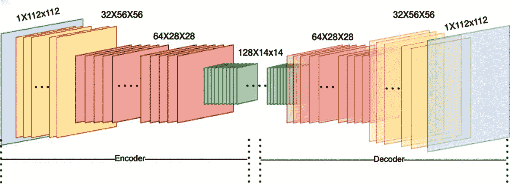
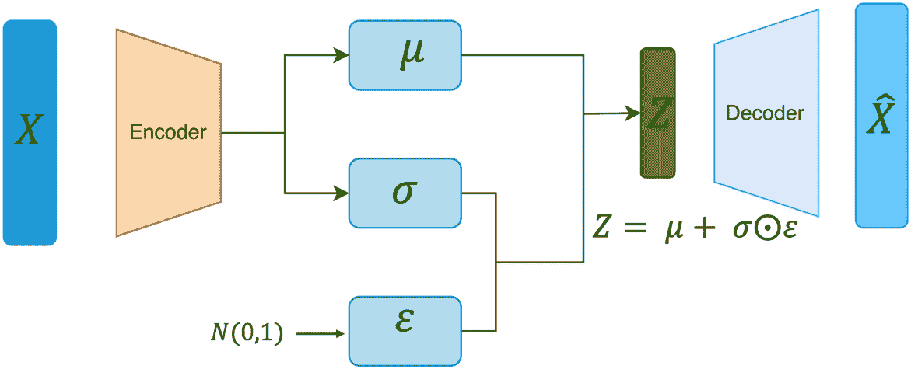
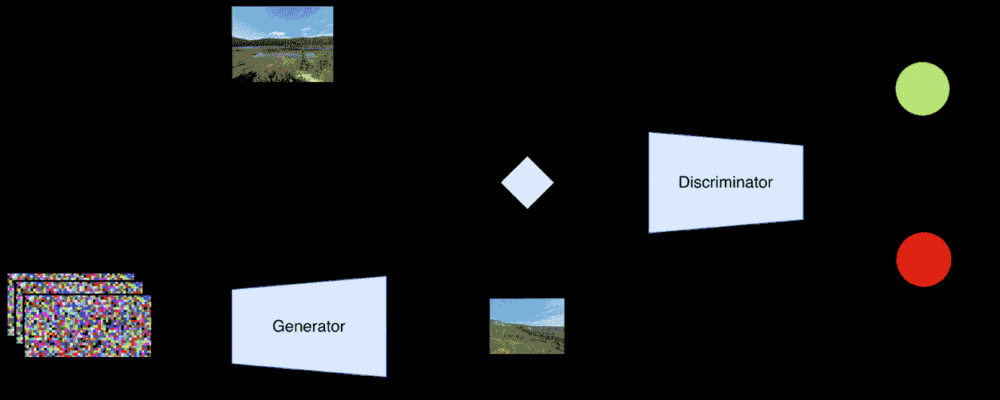
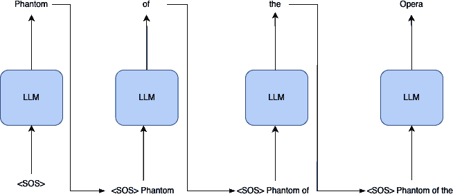
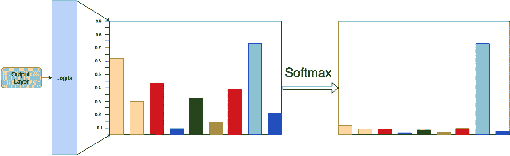
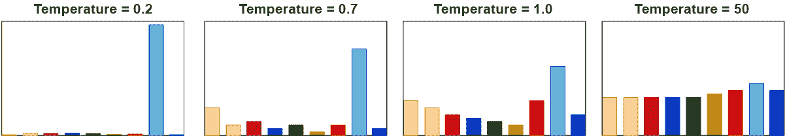
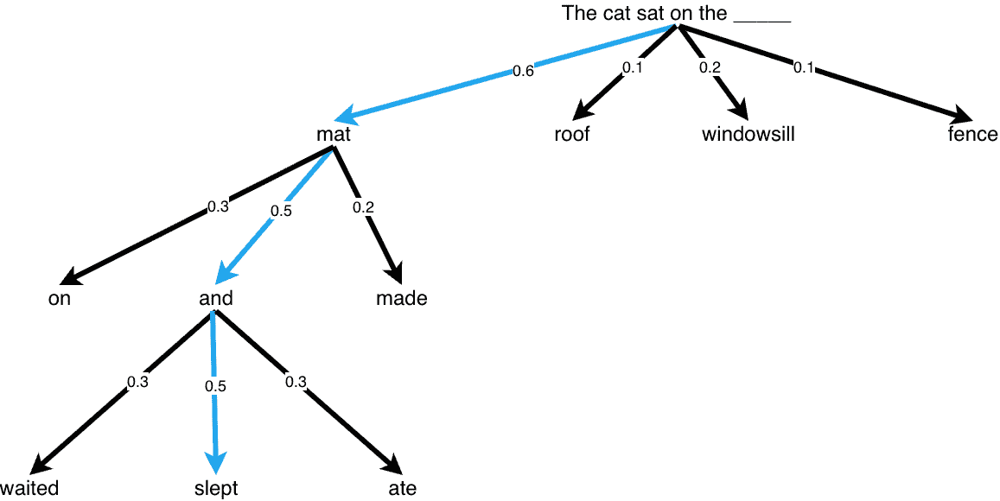
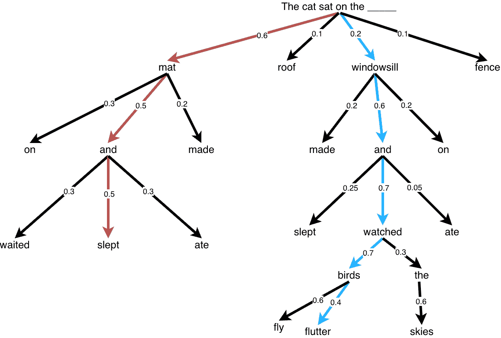
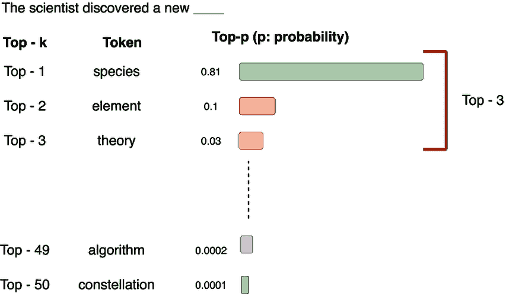
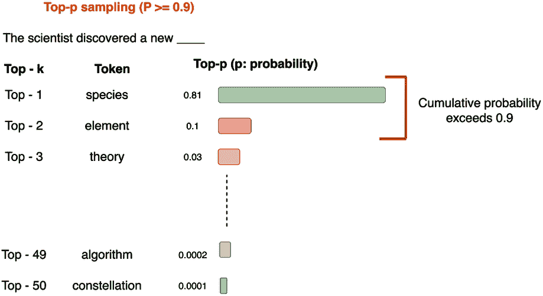

## 8 C++ 中的生成网络、自编码器与大语言模型

生成模型代表了现代人工智能领域最具变革性的发展之一，它使机器能够创建捕获训练数据统计属性和模式的新内容。与专注于区分类别的判别模型不同，生成模型学习的是底层数据分布本身，从而能够合成保持原始数据集本质特征的新实例（无论是文本、图像、音频还是其他数据类型）。

本章将帮助我们理解通往现代生成式人工智能的概念演进。变分自编码器引入的概率思维、GAN 开创的对抗训练动态以及自回归生成原理，都直接指导着我们设计、训练和排查当代系统的方式。如果不掌握这些基础概念，你可能会把现代大语言模型当作黑盒，无法有效诊断故障或优化性能。本章在经典与现代方法之间架起桥梁，既提供了历史背景，也提供了实用的 C++ 实现技能，这些技能在你进入下一章学习 Transformer 时依然适用。

此外，这些架构解决了许多仅靠现代架构无法解决的问题。自编码器在降维和异常检测方面表现出色，与传统基于 Transformer 的系统形成互补。VAE 为受控生成提供了原则性的概率框架，并带有显式的不确定性量化。在对抗训练能够产生更优视觉质量的某些图像合成任务中，GAN 仍是最先进的方法。理解何时以及如何应用每种范式，或将它们与其他架构相结合，将让你更精通机器学习概念。在本章中，我们提供了用于阐述本章概念的 C++ 代码片段。

在本章中，我们将涵盖以下主题：

- 生成模型简介
- 自编码器：生成式学习的基础
- VAE
- GAN – 基础知识
- 自回归生成与因果语言建模
- 生成模型的评估指标

### 生成模型简介

**生成模型**是一类机器学习模型，旨在学习数据的底层模式和分布，以创建与原始数据集相似的新合成样本。这些模型通过让机器生成逼真的文本、图像、音频和其他形式的数据，彻底改变了人工智能。其基本方法涉及学习输入数据上的概率分布，然后可以从中采样以产生保持训练数据统计属性的新样本。

**判别模型**和**生成模型**代表了两种根本不同的机器学习方法，各自具有不同的目标和方法论。

**判别模型**专注于学习不同类别之间的边界。它们对条件概率 $P(y|x)$ 建模，其中 $y$ 是标签，$x$ 是输入数据。这类模型通过寻找分隔类别的决策边界来区分不同类别。示例包括逻辑回归、支持向量机以及大多数用于分类任务的神经网络。判别模型擅长预测任务，即目标是将输入分配到特定类别，例如判断一封电子邮件是否为垃圾邮件，或将图像分类到预定义类别中。在前面的章节中，每当我们研究图像分类、分割或下一个词预测等问题时，它们本质上都是判别模式。在分类场景中这一点显而易见，因为你试图“区分”多个类别；在分割场景中，你试图区分一个像素是否属于某个掩码类别。而在下一个词预测中，这实际上是伪装成生成任务的判别任务，因为模型扮演了一个“分类器”，选择下一个最可能的词或 token。

相比之下，**生成模型**旨在理解并捕获完整的數據分布。它们学习联合概率 $P(x, y)$ 或数据分布 $P(x)$ 本身，从而能够生成与原始数据集相似的新合成样本。生成模型不仅仅是在类别之间进行区分，而是寻求理解数据底层的模式和结构。这使得它们能够创建保持训练数据统计属性的新实例，无论数据模态如何（文本、图像或音频）。示例包括 VAE、GAN 以及大语言模型等自回归模型。

这种区别使得生成模型在创造性任务、数据增强以及需要深入理解数据模式的情境中尤其有价值。掌握完整的数据分布意味着理解整个数据流形——一旦学会，你就可以从中采样新的数据点。我们从深度学习中一种最基础且最直观的方法开始，称为自编码器。

### 自编码器：生成式学习的基础

自编码器是一种神经网络，它先将数据压缩成紧凑的表示，然后重建其原始形式。你可以把它们想象成一台精密的复印机：先将图像缩小到极小尺寸（编码），然后尝试将其放大（解码），以尽可能接近原始图像。网络的“瓶颈”——即压缩后的中间层——迫使它学习数据最本质的特征。

自编码器无需监督即可学习这些表示。它们在降维、数据去噪和新内容生成方面已被证明极具价值。例如，它们可以清理含噪图像，在保留关键信息的同时压缩数据，甚至通过识别无法良好重建的数据来帮助检测异常。它们的应用涵盖图像处理、声音增强、推荐系统和欺诈检测等多个领域。

在接下来的小节中，我们将以图像数据作为主要示例来探索自编码器概念。然而，需要指出的是，自编码器非常通用，可以处理各种输入类型：1-D 信号、2-D 图像、3-D 体积，甚至视频序列。神经网络架构会相应调整以适应每种信号类型。对于 1-D 信号，架构类似于多层感知器；对于 2-D 图像，架构则引入**卷积神经网络**（**CNN**）。接下来的小节将介绍基础的自编码器架构，并展示从输入到重建的数据转换流程。我们将使用图像数据集，并采用卷积层来捕获层次化视觉模式。

#### 基础自编码器架构

最基本的自编码器架构由按逐步收缩模式排列的层组成，通常采用离散步骤。这些层逐步变窄，直到达到瓶颈层。超过这一点后，架构开始扩展，经过若干逐渐增大的层，直到与原始输入层的维度相匹配。

通向瓶颈的初始层构成**编码器**，而瓶颈之后的层构成**解码器**。这些名称很形象：编码器将输入数据压缩成紧凑的潜在表示，解码器则从该压缩表示中重建原始输入。潜在空间本质上捕获了重建输入所需的全部信息，不过重建的输出可能与原始输入略有差异。

我们通过计算输出与输入之间的误差来衡量这种差异。根据具体问题，有多种指标可用于比较；前面章节已经讨论过其中几种损失函数。瓶颈层也称为**潜在空间**，存储着精确重建所需的关键特征。

#### 损失函数与重建误差

**重建误差**描述的是自编码器输入与其重建输出之间的差异。它衡量自编码器在学习重建原始输入方面的表现。

**损失函数**是用于计算这种重建误差的数学公式。在实践中，这两个术语经常互换使用，因为损失函数直接在训练过程中量化重建误差。根据输入类型的不同，所使用的损失函数可能会有很大差异。在前面关于多层感知器和 CNN 的章节中，我们讨论了几种实践中常用的损失函数。在本节中，我们将使用一种非常易于理解的**均方误差**（**MSE**）损失。MSE 是输入与输出之间平方差的平均值。

#### 使用 LibTorch 的 C++ 实现

CNN 自编码器继承自 `torch::nn::Module`，并定义了对称的编码器-解码器结构。完整代码位于 `https://github.com/PacktPublishing/Deep-Learning-with-C-/blob/main/chapter8/autoencoder.cpp`。该架构由三个主要组件组成，它们协同工作以压缩和重建图像数据：

- **编码器**：三个卷积层，逐步增加特征通道数（1→32→64→128），提取输入图像越来越抽象的表示。


# 8 

#### 基于 CNN 的自编码器

- **瓶颈层**：单个卷积层，将特征从 128 通道压缩到 64 通道，形成紧凑的潜在表示，捕获重建所需的关键信息。
- **解码器**：三个转置卷积层，将维度从 64→128→64→1 重建回原始尺寸，逆转编码过程以生成输出。

下图展示了这种对称的编码器-解码器架构：



*图 8.1：基于 CNN 的自编码器*

该结构使用每个层的成员变量进行定义：

```cpp
struct CNNAutoEncoder : torch::nn::Module {
    torch::nn::Conv2d conv1{nullptr}, conv2{nullptr}, conv3{nullptr};
    torch::nn::Conv2d bottleneck{nullptr};
    torch::nn::ConvTranspose2d deconv1{nullptr}, deconv2{nullptr}, deconv3{nullptr};
};
```

每一层都必须向模块系统注册，以便在训练期间实现正确的梯度跟踪：

```cpp
conv1 = register_module("conv1", torch::nn::Conv2d(1, 32, 3));
bottleneck = register_module("bottleneck", torch::nn::Conv2d(128, 64, 3));
deconv1 = register_module("deconv1", torch::nn::ConvTranspose2d(64, 128, 3));
```

接下来，我们将研究该神经网络的前向传播，并追踪数据如何流经神经网络的每一层。

#### 前向传播实现

前向传播通过一系列变换展示了压缩-重建范式：

```cpp
// Encoder: Downsample with convolution + max pooling
x = torch::relu(torch::max_pool2d(conv1->forward(x), 2));

// Bottleneck: Feature compression
x = torch::relu(bottleneck->forward(x));

// Decoder: Upsample with transpose convolution + interpolation
x = torch::relu(torch::upsample_nearest2d(deconv1->forward(x), {4, 4}));
x = torch::sigmoid(torch::upsample_nearest2d(deconv3->forward(x), {28, 28}));
```

编码阶段使用最大池化在每个层将空间维度减半，同时 ReLU 激活函数引入非线性。解码阶段通过上采样操作恢复空间维度，并在最后一层使用 sigmoid 激活函数，以产生适合重建的输出值范围。

#### 训练循环

训练过程遵循标准的自编码器原理，最小化输入与重建输出之间的差异：

```cpp
auto output = model.forward(data);
auto loss = torch::mse_loss(output, data);
loss.backward();
optimizer.step();
```

模型使用 **均方误差**（**MSE**）损失来最小化重建误差，这迫使瓶颈层学习高效的数据表示。Adam 优化器负责参数更新，并利用 LibTorch 的 autograd 系统自动计算梯度。通过迭代训练，网络学会将输入图像压缩到紧凑的潜在空间中，同时保留准确重建所需的信息。类似于这种针对视觉数据的自编码器实现，我们还提供了一个基于 LLM 的自编码器实现（`https://github.com/PacktPublishing/Deep-Learning-with-C-/blob/main/chapter8/autoencoder_llm.cpp`）。我们鼓励读者阅读这些示例。如果你已经读过 *第 7 章* 中的语言模型讨论，应该很容易理解。

#### 去噪自编码器

去噪自编码器是自编码器架构的一种专门变体，旨在去除数据（尤其是图像）中的噪声。其训练方法涉及一个刻意的损坏-恢复过程：首先向数据集中的干净图像引入合成噪声，生成一组退化的输入。然后，这些带噪图像被送入自编码器网络，网络学习重建原始、干净的版本。在训练过程中，将去噪后的重建结果与原始干净图像（真实值）进行比较，从而使模型能够学习有效的噪声过滤策略，同时保留必要的数据特征。

我们可以通过引入概率潜在表示来扩展这个自编码器框架，使其具备真正的生成能力，即使用变分自编码器（VAE），我们将在下一节中讨论。

#### 变分自编码器（VAE）

变分自编码器（VAE）代表了一种强大的概率生成建模方法，通过引入统计基础扩展了基本自编码器框架。与学习确定性映射的传统自编码器不同，VAE 学习将数据编码为概率分布，从而能够在保持训练数据基本特征的同时生成新的、多样化的样本。

VAE 的核心是一种视角的根本转变：不是将数据压缩为潜在空间中的固定点，而是将输入表示为概率分布，具体地说是由其均值和方差刻画的高斯（正态）分布。这种概率方法使模型能够捕获数据中的不确定性和变异性，使其在生成任务中特别有效。

该架构由三个关键组件组成：

- **编码器网络**：将输入数据映射为潜在空间中的概率分布参数（均值 μ 和方差 σ²）
- **采样层**：使用重参数化技巧从学习到的分布中采样，以保持可微性
- **解码器网络**：从采样得到的潜在表示中重建数据



*图 8.2：VAE 编码器将输入映射为概率潜在分布（μ, σ²），通过重参数化对潜在编码进行采样，并通过解码器重建输出*

为了理解 VAE 如何在随机采样操作下实现端到端的可训练性，我们必须研究重参数化技巧。该技巧在反向传播过程中保持梯度流。

#### 重参数化技巧

重参数化技巧是一项关键创新，它使 VAE 能够通过标准反向传播进行训练。它解决了一个根本性问题：如何在随机采样操作中计算梯度。

在 VAE 中，编码器为每个输入产生一个概率分布的参数（均值 μ 和方差 σ²）。为了生成潜在表示，我们需要从这个分布中采样：z ~ N(μ, σ²)。然而，这个采样操作是随机的。它涉及随机性，从而在反向传播过程中破坏了梯度流。你无法通过随机采样操作计算关于 μ 和 σ 的梯度，这使得网络无法使用标准优化方法进行训练。让我们把这个过程分解为更简单的步骤：

- **解决方案**：重参数化技巧重新表述了采样过程，将随机成分与可学习参数分开。我们不直接从 N(μ, σ²) 中采样，而是：
  - 从标准正态分布中采样：ε ~ N(0, 1)
  - 使用学习到的参数对这个样本进行变换：z = μ + σ ⊙ ε。

  这里，⊙ 表示逐元素相乘。关键洞察在于 ε 从一个固定的分布（标准正态）中采样，该分布不依赖于任何网络参数，而 μ 和 σ 是编码器网络的确定性输出。

- **为什么有效？**：这种重新表述保持了 z 的相同概率分布（仍然服从 N(μ, σ²)），但现在随机性来自 ε，它独立于网络参数。变换 z = μ + σ ⊙ ε 关于 μ 和 σ 是确定性的且可微的，从而使梯度能够流动：
  - ∂z/∂μ = 1（梯度直接流过）
  - ∂z/∂σ = ε（梯度流过但被随机样本缩放）

  在反向传播过程中，梯度现在可以从解码器的重建损失通过 z 流回编码器的参数，从而实现端到端训练。

- **数学视角**：重参数化技巧利用了高斯分布的位置-尺度性质。来自 N(μ, σ²) 的任何样本都可以表示为标准正态样本的线性变换：

  z = μ + σ ⊙ ε，其中 ε ~ N(0, 1)

  这等价于从 N(μ, σ²) 中采样，但该公式使对 μ 和 σ 的依赖性变得显式且可微。

- **实现注意事项**：在实践中，编码器输出 log(σ²) 而不是直接输出 σ²，以提高数值稳定性。采样操作随后变为：

  z = μ + exp(0.5 × log(σ²)) ⊙ ε
  z = μ + exp(0.5 × log_var) ⊙ ε

  这确保了方差保持为正，并防止训练期间出现数值溢出。

- **对训练的影响**：重参数化技巧实现了：
  - 对整个 VAE 架构进行基于梯度的优化
  - 通过在整个网络中保持可微性实现稳定训练
  - 在训练和生成过程中高效采样
  - 可扩展到高维潜在空间

- **平衡重建与正则化**：VAE 优化一个复合损失函数，该函数平衡两个相互竞争的目标：
  - 重建损失：衡量解码器从潜在表示重建原始输入的效果（通常使用 MSE 或二元交叉熵）
  - KL 散度：对学习到的潜在分布进行正则化，使其保持接近标准正态分布，防止过拟合并确保平滑、连续的潜在空间


这种组合被称为**证据下界**（**ELBO**），它确保 VAE 能够学习有意义且结构化的潜在表示，从而支持准确的重建和多样化的生成（`https://arxiv.org/abs/1909.03765`）。

我们将从四个部分来审视这个 VAE 的 C++ 实现：神经网络架构、重参数化技术、损失函数和前向传播。

#### VAE 的 C++ 实现

VAE 采用对称架构，编码器压缩信息，解码器重建信息。然而，关键区别在于瓶颈层，它融入了重参数化技术。

我们不是将数据压缩为潜在空间中的固定点，而是将潜在表示拆分为两个独立的线性层：一个用于均值（`fc_mu`），一个用于对数方差（`fc_logvar`）。这种双头方法代表了视角的根本性转变：VAE 学习的不是确定性映射，而是将输入编码为概率分布。具体来说，这些分布是高斯分布，由编码器输出的均值（μ）和方差（σ²）参数来刻画。完整实现可在 `https://github.com/PacktPublishing/Deep-Learning-with-C-/blob/main/chapter8/vae.cpp` 获取。这里我们只查看代码的重要部分。结构通过每个层的成员变量来定义：

```cpp
struct VAE : torch::nn::Module {
    torch::nn::Conv2d conv1{nullptr}, conv2{nullptr}, conv3{nullptr},
        conv4{nullptr};
    torch::nn::Linear fc_mu{nullptr}, fc_logvar{nullptr};
    torch::nn::Linear fc_decode{nullptr};
    torch::nn::ConvTranspose2d deconv1{nullptr}, deconv2{nullptr},
        deconv3{nullptr}, deconv4{nullptr};
};
```

每一层都必须注册到模块系统中，以便在训练期间实现正确的梯度追踪。网络分为三个部分：编码器、潜在空间和解码器，初始化如下：

- **编码器架构**：VAE 架构采用 128 的潜在维度，定义了压缩表示的大小。编码器通过一系列卷积层逐步缩小 28×28 的输入图像：`conv1` 将空间维度从 28×28 减小到 14×14，`conv2` 进一步压缩到 7×7，`conv3` 缩小到 3×3，最后 `conv4` 压缩为具有 256 个特征通道的单个 1×1 特征图。

  ```cpp
  // Encoder: 28x28 -> 1x1 feature map
  conv1 = register_module("conv1", torch::nn::Conv2d(torch::nn::Conv2dOptions(1, 32, 4).stride(2).padding(1))); // 28->14
  conv2 = register_module("conv2", torch::nn::Conv2d(torch::nn::Conv2dOptions(32, 64, 4).stride(2).padding(1))); // 14->7
  conv3 = register_module("conv3", torch::nn::Conv2d(torch::nn::Conv2dOptions(64, 128, 4).stride(2).padding(1))); // 7->3
  conv4 = register_module("conv4", torch::nn::Conv2d(torch::nn::Conv2dOptions(128, 256, 3).stride(1).padding(0))); // 3->1
  ```

- **概率瓶颈**：在这个瓶颈处，架构偏离了传统的自编码器。它不是产生单个压缩表示，而是通过全连接层将 256 个特征转换为两个独立的输出：`fc_mu` 产生均值（μ）参数，`fc_logvar` 生成对数方差参数，两者都映射到 128 维的潜在空间。这种双头方法使 VAE 能够将输入编码为概率分布，具体来说是由这些均值和方差参数刻画的高斯分布。

  ```cpp
  // Latent space
  fc_mu = register_module("fc_mu", torch::nn::Linear(256, latent_dim));
  fc_logvar = register_module("fc_logvar", torch::nn::Linear(256, latent_dim));
  ```

- **解码器架构**：解码器逆转编码过程，从 `fc_decode` 开始，将采样得到的潜在编码转换回 256 个特征。随后的转置卷积层逐步扩展空间维度：`deconv1` 从 1×1 扩展到 3×3，`deconv2` 扩展到 7×7，`deconv3` 扩展到 14×14，最后 `deconv4` 重建出原始 28×28 的图像尺寸。

  ```cpp
  // Decoder
  fc_decode = register_module("fc_decode", torch::nn::Linear(latent_dim, 256));

  deconv1 = register_module("deconv1", torch::nn::ConvTranspose2d(torch::nn::ConvTranspose2dOptions(256, 128, 3).stride(1).padding(0))); // 1->3
  deconv2 = register_module("deconv2", torch::nn::ConvTranspose2d(torch::nn::ConvTranspose2dOptions(128, 64, 4).stride(2).padding(1))); // 3->7
  deconv3 = register_module("deconv3", torch::nn::ConvTranspose2d(torch::nn::ConvTranspose2dOptions(64, 32, 4).stride(2).padding(1))); // 7->14
  deconv4 = register_module("deconv4", torch::nn::ConvTranspose2d(torch::nn::ConvTranspose2dOptions(32, 1, 4).stride(2).padding(1))); // 14->28
  ```

这三个模块按顺序组装如下：

```cpp
VAE(int latent_dim = 128) : latent_dim(latent_dim) {
    // Encoder Block
    // Probabilistic Bottleneck
    // Decoder Block
}
```

- **重参数化实现**：如前几节所讨论，我们采用重参数化技巧。C++ 实现如下：

  ```cpp
  torch::Tensor reparameterize(torch::Tensor mu, torch::Tensor logvar) {
      auto std = torch::exp(0.5 * logvar);
      auto eps = torch::randn_like(std);
      return mu + eps * std;
  }
  ```

该函数通过 `torch::exp(0.5 * logvar)` 将对数方差转换为标准差，利用了 σ = exp(0.5 ⋅ logvar) 这一数学关系。然后使用 `torch::randn_like(std)` 从标准正态分布中采样随机噪声 ε，该函数生成与标准差张量形状相同的值。最后，它应用变换 z = μ + σ ⊙ ε，其中 ⊙ 表示逐元素相乘。这种重新表述保持了相同的概率分布 N(μ, σ²)，同时确保梯度在反向传播过程中能够流回学习参数 μ 和 σ，从而实现 VAE 架构的端到端训练。

- **损失函数实现**：标准 VAE 损失可以实现如下：

  ```cpp
  torch::Tensor vae_loss(torch::Tensor recon_x, torch::Tensor x,
                         torch::Tensor mu, torch::Tensor logvar, float beta = 1.0) {
      // Reconstruction loss (Binary Cross Entropy)
      auto recon_loss = torch::binary_cross_entropy(recon_x, x, {}, torch::Reduction::Sum);
      // KL divergence loss
      auto kl_loss = -0.5 * torch::sum(1 + logvar - mu.pow(2) - logvar.exp());
      return recon_loss + beta * kl_loss;
  }
  ```

该函数通过将重建损失和 KL 散度损失相加来计算 VAE 的总训练损失。beta 参数平衡这两个目标，控制图像质量与学习到的潜在空间表示规则性之间的权衡。当 beta ≠ 1 时，这也被称为 β-VAE 损失。

在实现中，另一个考虑因素是容量约束。容量参数为 KL 散度设置一个目标水平。它不是将 KL 散度推向零，而是允许受控的信息流通过潜在瓶颈。当 KL 散度偏离目标容量时，gamma 乘数会放大惩罚，从而形成一个软约束。以下是使用容量约束计算 VAE 损失的 C++ 函数：

```cpp
torch::Tensor beta_vae_loss(torch::Tensor recon_x, torch::Tensor x,
                            torch::Tensor mu, torch::Tensor logvar,
                            float beta, float capacity = 0.0, float gamma = 1000.0) {
    // Reconstruction loss
    auto recon_loss = torch::binary_cross_entropy(recon_x, x, {}, torch::Reduction::Sum);
    // KL divergence
    auto kl_div = -0.5 * torch::sum(1 + logvar - mu.pow(2) - logvar.exp());
    // Capacity constrained KL loss
    auto kl_loss = gamma * torch::abs(kl_div - capacity);
    return recon_loss + beta * kl_loss;
}
```

在前向传播过程中，编码器生成均值（μ）和方差的对数（logvar）。然后我们通过对潜在向量进行重参数化，并使用解码器进行重构。

```cpp
std::tuple<torch::Tensor, torch::Tensor, torch::Tensor> forward(torch::Tensor x) {
    auto [mu, logvar] = encode(x);
    auto z = reparameterize(mu, logvar);
    auto recon = decode(z);
    return std::make_tuple(recon, mu, logvar);
}
```

前向传播协调了通过 VAE 架构的完整数据流。编码器通过卷积层处理输入图像，产生定义潜在分布的均值和对数方差参数。然后，reparameterize函数通过重参数化技巧从这个学习到的分布中采样一个点 z，确保反向传播时的梯度流动。最后，解码器从采样的潜在编码重构图像。该函数返回三个张量：重构图像（recon），以及均值和对数方差参数，这些参数在训练期间计算损失函数的 KL 散度分量时需要用到。

这种“概率”部分（重参数化）使得 VAE 具有生成能力，而不仅仅是压缩能力。

到目前为止，我们从计算机视觉的角度探讨了自编码器和VAE，重点关注去噪和图像重构等应用。与用于计算机视觉的自编码器类似，也有针对时间数据的自编码器实现。它们被称为序列到序列（Seq2Seq）自编码器。在这种情况中，Seq2Seq模型不是像编码器和解码器部分那样使用卷积滤波器，而是使用LSTM或RNN块来编码和解码时间数据。

Seq2Seq自编码器用于机器翻译任务，例如在不同语言之间翻译句子。它们擅长处理可变长度的输入和输出序列。

在解码过程中，模型以自回归方式运行，根据编码器的隐藏状态和先前生成的输出生成每个输出元素。我们已经在*第7章*中讨论了RNN和LSTM，并且我们为这个自编码器实现了LSTM版本（https://github.com/PacktPublishing/Deep-Learning-with-C-/blob/main/chapter8/seq2seq_autoencoder.cpp）和RNN版本（https://github.com/PacktPublishing/Deep-Learning-with-C-/blob/main/chapter8/seq2seq_rnn_autoencoder.cpp）。我们鼓励读者仔细阅读代码，以加深对这些序列自编码器的理解。

现在，我们准备探索**生成对抗网络**（**GANs**），这是一场范式转变，为生成式AI领域的许多新颖思想奠定了基础。

### GANs – 基础

GAN代表了一类强大的生成式AI模型，通过训练两个相互竞争的神经网络来创建新的合成数据。GAN由Ian Goodfellow及其同事于2014年提出，它彻底改变了机器学习如何在各个领域生成逼真内容的方式。在本节及后续小节中，你将：

-   理解GAN的基本架构，包括生成器和判别器网络如何通过对抗训练进行交互
-   学习使用LibTorch在C++中实现生成器和判别器网络，并提供用于图像生成的实用代码示例
-   掌握GAN损失函数的数学基础以及驱动训练的极小极大优化过程
-   获得GAN五步训练过程的实践经验，包括数据准备、合成数据生成和交替网络更新
-   探索将GAN应用于文本生成的独特挑战，并发现SeqGAN等专门解决方案
-   培养诊断和解决常见GAN训练问题的技能，例如模式崩溃和梯度消失
-   在本节结束时，你将能够设计、实现和训练自己的GAN架构，以在各种领域生成逼真的合成数据

GAN的架构由两个相互对抗的神经网络组成，形成一个竞争性学习环境，如下图所示。



*图8.3：GAN*

GAN框架由两个相互竞争的网络组成：一个从随机噪声中创建合成数据的生成器，以及一个区分真实样本和生成样本的判别器。这种对抗过程。

接下来，我们将更详细地了解GAN架构：

-   **生成器网络**：生成器将从标准正态分布中采样的随机噪声向量转换为逼真的合成数据样本。它由多个层组成，逐渐对噪声进行上采样和细化，形成结构化输出。对于图像生成，该架构通常采用转置卷积层（也称为反卷积层），在逐渐增加空间维度的同时学习创建逼真的特征。生成器首先使用一个密集层将噪声向量重塑为一个小特征图，然后应用连续的转置卷积以及批归一化和激活函数（通常是ReLU或LeakyReLU）来扩展维度。最后一层使用tanh激活函数生成在适当范围内的输出值。

-   **判别器网络**：判别器作为二元分类器，评估样本是来自训练数据集中的真实样本还是生成器产生的虚假样本。它的架构与生成器呈镜像关系：它使用标准卷积层逐步对输入数据进行下采样，在每一层提取越来越抽象的特征。网络通常采用LeakyReLU激活函数以避免梯度问题，并且可能包含dropout层进行正则化。最后的层将特征图展平，并通过密集层，最终到达一个具有sigmoid激活函数的单一输出神经元，产生一个概率分数，指示输入是真实的还是虚假的。

-   **训练动态**：在训练过程中，两个网络交替更新。判别器在包含真实样本（标记为1）和生成样本（标记为0）的批次上进行训练，学习最大化其分类准确性。然后训练生成器以最大化判别器的误差，学习生成判别器分类为真实的样本。这种对抗过程形成了一个极小极大博弈：随着生成器在创建逼真样本方面不断改进，判别器同时增强其检测能力，通过竞争推动两个网络迈向更高性能。

### GAN损失函数

GAN为生成器和判别器网络采用不同的损失函数，两者通过对抗性的极小极大优化过程进行训练。标准GAN损失函数基于二元交叉熵（BCE），可以表示为生成器G和判别器D之间的极小极大博弈：

$$\min_G \max_D V(D, G) = \mathbb{E}_{x \sim p_{\text{data}}(x)}[\log D(x)] + \mathbb{E}_{z \sim p_z(z)}[\log(1 - D(G(z)))]$$

这里的目标是相对于生成器$G$最小化损失函数$V(D, G)$，同时相对于判别器$D$最大化损失函数。项$\mathbb{E}_{x \sim p_{\text{data}}(x)}$表示对数据分布的期望，$\mathbb{E}_{z \sim p_z(z)}$表示对随机噪声分布的期望。

#### 判别器损失

判别器试图通过学习对真实样本输出1、对生成样本输出0来最大化其分类准确性。判别器损失会对错误分类进行惩罚。在实践中，这通过二元交叉熵实现，其中真实样本标记为1，生成样本标记为0。

#### 生成器损失

生成器的目标是产生判别器分类为真实的样本，从而骗过判别器。这通过最大化$D(G(z))$来实现，该过程鼓励判别器对生成样本输出接近1的值。


### GAN 训练过程

GAN 的训练遵循一个结构化的五步迭代过程，在更新判别器和生成器之间交替进行：

- **步骤 1：数据准备**：收集代表你想要完成任务的训练数据。该数据集作为生成器学习模仿的基准真值。

- **步骤 2：生成合成数据**：从标准分布（高斯分布或均匀分布）中采样随机噪声，通过生成器生成合成数据（标记为 0）。生成器学习从该潜在空间映射到输出域，建立随机噪声与逼真样本之间的关系。

- **步骤 3：创建训练对**：将生成数据（标签 = 0）与训练集中的真实数据（标签 = 1）组合成训练批次。这些数据对被输入判别器进行分类。

- **步骤 4：训练判别器**：判别器评估每个样本，为真实样本分配标签 1，为生成样本分配标签 0，然后计算二元交叉熵损失以量化分类性能。这训练判别器区分真实样本和合成样本。

- **步骤 5：反向传播与权重更新**：将损失通过两个网络反向传播，并相应更新其权重。通常使用 Adam 或随机梯度下降等优化算法。反向传播更新生成器以最小化判别器的准确率，并更新判别器以最大化其分类性能。

在整个 GAN 训练实现中，我们坚持一个关键原则：交替更新。在训练判别器时，我们完全冻结生成器的参数。这对训练的稳定性至关重要。可以这样想：确保每个网络都在与一个固定的对手学习，而不是追逐一个移动的目标。在我们的 C++ 实现中，你会注意到在判别器训练阶段，我们在将生成的图像输入判别器之前调用 `detach()`。这可以防止梯度过早地回流到生成器。

以下是从实现经验中得出的实用见解：在引入生成器之前，先在真实数据上对判别器进行几个迭代的预训练，可以显著提高早期训练的稳定性。判别器需要足够的能力来提供有意义的反馈；否则，生成器会收到阻碍学习的噪声信号。

判别器的有效性直接源于训练数据集的特性。我们在卷积架构中看到它如何学习分层特征。较浅的层检测边缘和纹理，较深的层识别能够区分真实样本和合成样本的复杂模式。训练数据的质量和多样性从根本上限制了判别器能够学习识别的内容。

与此同时，生成器应对着不同的挑战：将我们的随机噪声分布转换为反映训练数据底层结构的样本。与受益于显式标签的判别器不同，生成器通过我们实现的对抗过程隐式学习。它构建了一个内部概率模型，随着训练在我们之前探讨的极小极大博弈中推进，逐步完善其生成令人信服样本的能力。

#### 替代损失函数

虽然二元交叉熵是标准选择，但已经开发了几种变体来解决训练不稳定的问题：

- **Wasserstein 损失（WGAN）**：使用 Wasserstein 距离代替二元交叉熵，提供更平滑的梯度，并解决梯度消失和模式崩溃等问题。
- **最小二乘损失（LSGAN）**：用最小二乘损失替代二元交叉熵，以生成更高质量的图像。
- **Hinge 损失**：用于谱归一化 GAN，以提高稳定性。
- 损失函数的选择显著影响训练稳定性、收敛速度和生成样本的质量。

### C++ 实现

让我们使用 LibTorch 实现一个图像生成系统。该实现（`https://github.com/PacktPublishing/Deep-Learning-with-C-/blob/main/chapter8/structured_vision_gan.cpp`）将生成器网络、判别器网络以及我们讨论过的对抗训练过程整合在一起。我们将系统地研究每个组件，审视代码如何将我们的概念理解转化为一个可用的生成模型。

#### 生成器网络架构

生成器架构通过转置卷积层逐步上采样随机噪声，从紧凑的表示开始，逐步扩展到全分辨率输出：

```cpp
Generator(int latent_dim = 100, int img_channels = 3)
    : latent_dim(latent_dim), img_channels(img_channels)
{
    fc1 = register_module("fc1", torch::nn::Linear(latent_dim, 512 * 4 * 4));
    deconv1 = register_module("deconv1", torch::nn::ConvTranspose2d(
        torch::nn::ConvTranspose2dOptions(512, 256, 4).stride(2).padding(1)));
    bn1 = register_module("bn1", torch::nn::BatchNorm2d(256));
    deconv2 = register_module("deconv2", torch::nn::ConvTranspose2d(
        torch::nn::ConvTranspose2dOptions(256, 128, 4).stride(2).padding(1)));
    bn2 = register_module("bn2", torch::nn::BatchNorm2d(128));
    deconv3 = register_module("deconv3", torch::nn::ConvTranspose2d(
        torch::nn::ConvTranspose2dOptions(128, 64, 4).stride(2).padding(1)));
    bn3 = register_module("bn3", torch::nn::BatchNorm2d(64));
    deconv4 = register_module("deconv4", torch::nn::ConvTranspose2d(
        torch::nn::ConvTranspose2dOptions(64, img_channels, 4).stride(2).padding(1)));
}
```

初始全连接层（fc1）将 100 维噪声向量转换为 512×4×4 的特征。四个转置卷积层（deconv1-4）从 4×4 逐步上采样到 64×64 像素。批归一化层（bn1-3）通过归一化层间激活来稳定训练。最后一层使用 tanh 激活函数，使得输出值在 [-1, 1] 范围内。

前向传播展示了上采样流程：

```cpp
x = x.view({x.size(0), 512, 4, 4}); // Reshape to 4×4 feature map
x = torch::relu(bn1->forward(deconv1->forward(x))); // 4×4 -> 8×8
// ... progressive upsampling continues
x = torch::tanh(deconv4->forward(x)); // Final 64×64 output
```

#### 判别器网络架构

判别器在结构上与生成器相反，通过卷积层进行下采样：

```cpp
Discriminator(int img_channels = 3)
    : img_channels(img_channels) {
    conv1 = register_module("conv1", torch::nn::Conv2d(
        torch::nn::Conv2dOptions(img_channels, 64, 4).stride(2).padding(1)));
    conv2 = register_module("conv2", torch::nn::Conv2d(
        torch::nn::Conv2dOptions(64, 128, 4).stride(2).padding(1)));
    bn1 = register_module("bn1", torch::nn::BatchNorm2d(128));
    conv3 = register_module("conv3", torch::nn::Conv2d(
        torch::nn::Conv2dOptions(128, 256, 4).stride(2).padding(1)));
    bn2 = register_module("bn2", torch::nn::BatchNorm2d(256));
    conv4 = register_module("conv4", torch::nn::Conv2d(
        torch::nn::Conv2dOptions(256, 512, 4).stride(2).padding(1)));
    bn3 = register_module("bn3", torch::nn::BatchNorm2d(512));
    fc1 = register_module("fc1", torch::nn::Linear(512 * 4 * 4, 1));
    dropout = register_module("dropout", torch::nn::Dropout(0.3));
}
```

四个卷积层（conv1-4）从 64×64 下采样到 4×4，同时提取分层特征。负斜率为 0.2 的 LeakyReLU 激活函数防止神经元死亡。Dropout（概率 0.3）提供正则化。最后的全连接层产生一个标量，通过 Sigmoid 激活函数得到概率得分。接下来，我们将看看训练神经网络的步骤。

#### 训练 GAN

该实现遵循结构化的五步 GAN 训练方法：

```cpp
//Step 1: Load real training data
auto real_images = torch::randn({batch_size, img_channels, img_size, img_size}).to(device);
//Step 2: Generate Synthetic samples
auto noise = torch::randn({batch_size, latent_dim}).to(device);
auto fake_images = gan.generator.forward(noise);
//Step 3: Create Training Pairs
```


```cpp
auto real_labels = torch::ones({batch_size, 1}).to(device); // Label = 1
auto fake_labels = torch::zeros({batch_size, 1}).to(device); // Label = 0
// Step 4: Discriminator Training
auto real_pred = gan.discriminator.forward(real_images);
auto real_loss = adversarial_loss(real_pred, real_labels);
auto fake_pred = gan.discriminator.forward(fake_images.detach()); // detach() prevents generator gradients
auto fake_loss = adversarial_loss(fake_pred, fake_labels);
auto disc_loss = (real_loss + fake_loss) / 2;
// Update discriminator
disc_loss.backward();
disc_optimizer.step();
// Step 5: Train generator
gen_optimizer.zero_grad();
noise = torch::randn({batch_size, latent_dim}).to(device);
fake_images = gan.generator.forward(noise);
auto gen_pred = gan.discriminator.forward(fake_images);
auto gen_loss = adversarial_loss(gen_pred, real_labels); // Note: real_labels!
gen_loss.backward();
gen_optimizer.step();
```

在判别器训练期间，对 `fake_images` 调用 `detach()` 会断开计算图，阻止梯度流向生成器。在训练生成器时，我们将预测值与 `real_labels`（即 1）而非 `fake_labels` 进行比较，从而实现欺骗判别器的目标。

代码使用二元交叉熵来实现极小极大目标：

```cpp
torch::Tensor adversarial_loss(torch::Tensor pred, torch::Tensor target) {
    return torch::binary_cross_entropy(pred, target);
}
```

GAN 需要仔细调整优化超参数以保持训练稳定性。Adam 优化器是 GAN 训练的标准选择，但与典型的深度学习应用相比，其参数有所修改：

```cpp
torch::optim::Adam gen_optimizer(gan.generator.parameters(),
    torch::optim::AdamOptions(lr).betas(std::make_tuple(0.5, 0.999)));
```

学习率 0.0002 可以防止对抗动态中的振荡。Beta1 设置为 0.5（低于默认值 0.9）以减少动量累积，这有助于在损失曲面快速变化时稳定训练。Beta2 保持 0.999 以维持自适应学习率的优势。

该实现提供了一个完整、可用于生产的 GAN 系统。通过 `detach()` 对梯度流的精心管理、对称的架构设计以及专门的优化器配置共同作用，实现了稳定的对抗训练，从而能够生成逼真的图像。

研究人员也将 GAN 技术应用于语言任务。核心原理相同。然而，文本生成引入了图像生成中不存在的基本挑战。与连续的图像数据不同（像素值可以逐步调整，例如将 1.0 变为 1.0001），文本使用离散的词元。你不能把 “penguin” 修改为 “penguin + 0.001”，因为在自然语言中不存在这样的中间表示。这种离散性破坏了标准 GAN 训练所必需的梯度流，使生成器无法获得关于如何逐步调整输出以欺骗判别器的直接反馈。

为了克服这一根本障碍，研究人员开发了**基于策略梯度的序列生成对抗网络**（**SeqGAN**），将文本生成重新构建为强化学习问题。SeqGAN 将生成器视为随机策略，通过直接梯度策略更新来规避微分挑战。判别器评估生成的序列并提供奖励信号来引导生成器的策略，使对抗训练能够处理离散输出。

除了 SeqGAN，还出现了多种架构来解决离散序列生成问题：**对抗正则化自编码器**（**ARAE**）方法通过使用序列自编码器将离散文本映射到连续潜在编码空间，从而绕开离散序列问题。GAN 在这个连续表示中运行，生成器产生的编码模仿自编码器从真实文本中创建的编码。通过从生成器中采样一个编码并将其解码回离散序列，即可生成新文本。

在本书中我们不会深入讨论 SeqGAN，因为现在有更高效的解决方案（如 Transformer）可用于文本生成（以及图像生成）。不过，我们希望读者了解 GAN 及其起源，以提供背景。我们将在下一章详细介绍 Transformer。

然而，在学习 LLM 和 Transformer 之前，我们应该将 LLM 作为生成系统来研究，并学习一些用于文本生成的采样策略以及大型语言系统的评估指标。在深入探讨 Transformer 之前，研究这些系统有助于建立对语言生成的直观理解。

### 自回归生成与因果语言建模

LLM 本质上是一个预测模型，根据输入生成统计上最可能的下一个词元。一旦生成了一个词元，它就成为输入上下文的一部分，模型再预测下一个词元。这个过程迭代进行，直到产生序列结束词元（见图）。预期是这种自回归生成过程将产生连贯且上下文合适的文本。我们在之前关于 RNN 的章节中已经讨论过词元。这也被称为因果语言建模，其中下一个词的预测仅依赖于之前生成的词。

该图通过一个具体示例说明了因果语言建模的机制。



*图 8.4：自回归生成。因果语言建模*

该过程以一个初始的句首（`<SOS>`）词元作为种子开始。当 LLM 生成第一个词 “Phantom” 时，该词元被追加到输入序列 `<SOS>` 中，形成上下文 `<SOS> Phantom`。然后，模型基于这个扩展的上下文预测下一个词 “of”。这个新生成的词元再次与现有序列拼接，形成 `<SOS> Phantom of`。自回归过程继续，每个预测都建立在所有先前生成的词元之上，直到模型生成完整短语 “Phantom of the Opera”。

这种从左到右的迭代生成策略确保每个词元都以先前词元的完整历史为条件，使模型能够在整个生成序列中保持连贯性和上下文一致性。这种方法的因果性（即未来词元不能影响过去的预测）使其区别于双向模型，并构成了现代 LLM 生成文本的基础。

我们在 GitHub 仓库（`https://github.com/PacktPublishing/Deep-Learning-with-C-/blob/main/chapter8/autoregressive_llm.cpp`）中提供了一个完整的自回归生成设置（一个玩具示例）。这里我们专门讨论代码的生成部分。以下 C++ 函数实现了该功能：

```cpp
std::vector<int64_t> generate(std::vector<int64_t> prompt, int max_new_tokens = 50, float temperature = 1.0, torch::Device device = torch::kCPU) 
{
    torch::NoGradGuard no_grad;
    eval();
    std::vector<int64_t> generated_sequence = prompt;
    for (int i = 0; i < max_new_tokens; ++i) {
        // Convert current sequence to tensor
        auto input_tensor = torch::tensor({generated_sequence}, torch::kLong).to(device);
        // Get logits for next token
        auto logits = forward(input_tensor);
        // Extract logits for last position
        auto next_token_logits = logits[0][-1] / temperature;
        // Sample next token (using multinomial sampling)
        auto probs = torch::softmax(next_token_logits, -1);
        auto next_token = torch::multinomial(probs, 1);
        int64_t token_id = next_token.item<int64_t>();
        generated_sequence.push_back(token_id);
        // Stop if sequence gets too long
        if (generated_sequence.size() >= max_seq_len) break;
    }
    return generated_sequence;
}
```

上面的 `generate` 函数接受一个提示（词元 ID 序列）、要生成的最大词元数量、用于控制随机性的温度参数以及计算设备。它首先通过 `torch::NoGradGuard` 禁用梯度计算，并将模型切换到评估模式，以优化推理。以下是文本生成代码的关键方面：

- **迭代词元生成循环**：该函数进入一个循环，逐次生成词元，直到达到 `max_new_tokens`。在每次迭代中，它将当前序列转换为张量，通过模型的 `forward` 函数获取下一个词元的 logits（原始预测分数），并提取序列中最后一个位置对应的 logits。


- **温度缩放**：将 logits 除以温度参数，该参数控制预测的随机性。较低的温度（< 1.0）通过锐化概率分布使模型更加自信和确定，而较高的温度（> 1.0）通过展平分布增加多样性。

- **采样策略**：该函数应用 softmax 将 logits 转换为概率，然后使用多项式采样选择下一个 token。这种概率方法允许产生多样化的输出，而不是总是选择最可能的 token。选中的 token 被附加到序列中，该序列成为下一次迭代的输入。

- **终止条件**：生成持续进行，直到产生指定数量的 token 或序列达到允许的最大长度（`max_seq_len`），从而防止内存溢出。

在本程序中，我们使用了几种采样策略以及一些术语（如温度），但没有实际定义它们。在下一节中，我们将定义其中一些术语。

### 温度与采样策略

在生成过程的每一步，LLM 应用 softmax 函数将 logits（原始预测分数）转换为所有可能的下一个 token 的概率分布。最简单的方法是总是选择概率最高的 token，这种策略称为贪婪解码。大多数现代 LLM 采用更复杂的采样策略，在生成过程中引入受控的随机性。我们将在本节中研究这些采样策略。这种创造性灵活性避免了过于确定性的输出，使模型能够生成更多样、更自然、更能捕捉人类语言细微差别的文本。*图 8.5* 展示了 softmax 归一化如何将模型的原始预测分数（logits）转换为概率：



*图 8.5：应用 softmax 后 logit 值的变化*

理解这种 softmax 变换至关重要，因为接下来我们将探讨的温度缩放会修改这些概率，以控制模型文本生成的确定性或创造性程度。

#### 温度缩放

logits 除以温度参数，该参数控制预测的随机性。较低的温度（< 1.0）通过锐化概率分布使模型更加自信和确定，而较高的温度（> 1.0）通过展平分布增加多样性。数学上，这种缩放定义为：

Pr(l_k) = e^(l_k/T) / Σ_i e^(l_i/T)

其中 l_k 是第 k 个 logit，T 是温度。*图 8.6* 展示了这一现象。随着温度升高，概率分布趋于平坦，使之前不太可能的 token 变得更有可能。



*图 8.6：温度的缩放效果*

对于 LLM，不存在普遍最优的温度值。合适的温度取决于你的具体用例。对于需要确定性、专注输出的任务，如事实问答、代码生成或数据提取，请选择较低的温度（0.0-0.3）。对于希望获得多样可能性和多变输出的创造性应用，如创意写作、头脑风暴或生成多个备选方案，请使用较高的温度。温度参数本质上控制着模型响应中一致性与创造性之间的权衡。上图展示了这一现象：随着温度升高，概率分布趋于平坦，使之前不太可能的 token（以浅蓝色显示）变得更有可能。在非常高的温度（例如 50）下，所有 token 的概率值几乎均匀分布，导致高度随机的选择。

除了温度缩放之外，采样策略的选择也会影响生成质量、多样性和计算效率。

#### 采样策略

在*自回归生成与因果语言建模*一节展示的代码片段中，该函数使用多项式采样来选择下一个 token。这种概率方法允许产生多样化的输出，而不是总是选择最可能的 token。但采样策略不止一种。在本节剩余部分，我们将讨论一些常见策略。这些采样方法的完整实现可在 `https://github.com/PacktPublishing/Deep-Learning-with-C-/blob/main/chapter8/sampling_methods.cpp` 获取。我们将从贪婪解码开始，后续方法都建立在贪婪解码之上。

#### 贪婪解码

贪婪解码是语言生成中最简单的 token 选择方法。在每一步，模型从 softmax 分布中选择概率最高的 token，即本质上选择最自信的预测，而不考虑其他备选。

虽然贪婪解码计算高效且确定，但它也有显著的限制。它在每一步都做出局部最优选择，而不考虑整体序列质量，可能导致整体输出次优。一旦选择了某个 token，模型就无法回溯，即使该选择导致后续预测不佳。这种短视策略往往会产生重复或通用的文本，因为它总是偏向高概率 token，而不探索创造性的备选。下面是一个实现贪婪解码的代码片段：

```cpp
for (int i = 0; i < max_length; ++i) {
    auto input_tensor = torch::from_blob(sequence.data(), {1, static_cast<long>(sequence.size())}, torch::kLong).clone().to(device);
    auto logits = model.forward(input_tensor);
    // Get most likely next token
    auto next_token = torch::argmax(logits, -1);
    int64_t token_id = next_token.item<int64_t>();
    sequence.push_back(token_id);
}
```

该循环运行指定的最大长度。在每次迭代中，它将当前 token 序列转换为模型可以处理的张量，然后将其传入模型的 forward 函数以获得 logits（所有可能的下一个 token 的原始预测分数）。使用贪婪解码，它通过 torch::argmax 选择概率最高的 token，提取其数值标识，并将其追加到序列中。这个新扩展的序列随后成为下一次迭代的输入，形成一个反馈循环，其中每次预测都建立在所有先前生成的 token 之上。

例如，当生成“The cat sat on the ___”时，如果“mat”具有最高概率，贪婪解码总是会选择“mat”，而永远不会探索“roof”、“windowsill”或“fence”等可能带来更有趣或更符合语境的补全。

尽管存在这些缺点，贪婪解码仍然适用于需要快速、确定性输出的应用，在这些应用中，创造性的重要性不如一致性，例如结构化数据提取、模板填充或计算资源严重受限的场景。



*图 8.7：贪婪解码*

其短视的逐 token 选择阻止了从次优的早期选择中回溯。为了获得更高质量的生成，我们需要一种探索多种假设的方法，我们将在下一部分看到。

#### 束搜索

束搜索通过同时维护多个候选序列来扩展贪婪解码，在保持计算可行性的同时探索更广阔的解决方案空间。束搜索不是每一步只确定一个 token，而是跟踪 top-k 个最有希望的序列（其中 k 是束宽），在概率空间中评估多条路径，然后选择最终输出。束搜索在需要全局连贯性和结构正确性的任务中表现出色，尤其是机器翻译，在机器翻译中，探索多个假设有助于避免过早地选择语法别扭的措辞。它在摘要生成中同样表现良好。


以及在问答任务中，每一步的最佳局部选择可能无法产生最连贯的整体输出。然而，束搜索在创造性生成任务中可能会遇到困难，因为其确定性的本质和对高概率序列的偏好可能会产生安全但平庸的输出。它还受到长度偏差的影响，倾向于选择较短的序列，因为每增加一个 token，概率会相乘（从而减小），不过长度归一化技术可以缓解这个问题。（完整实现请参见上述 GitHub 链接。）

在每一步生成过程中，算法通过考虑所有可能的下一个 token 来扩展当前所有的 k 个候选，并计算每个结果序列的累积概率。然后，它仅保留整体概率最高的 k 个序列，剪除不太有希望的路径。此过程持续进行，直到所有束都到达序列结束标记或达到最大长度，然后选择累积概率最高的序列作为输出。

例如，设束宽 k=3，生成“猫坐在___上”，算法可能同时探索三条路径：“猫坐在垫子上”、“猫坐在屋顶上”和“猫坐在窗台上”。随着 token 的添加，每条路径都会累积概率分数，算法会跟踪哪些完整序列获得最高的整体可能性。

束宽参数控制了探索与计算成本之间的权衡。较大的束宽（k=10-50）会探索更多样化的可能性，通常产生更高质量的输出，尤其在全局连贯性至关重要的机器翻译等任务中。较小的束宽（k=2-5）能降低计算开销，同时仍优于贪心解码。然而，束搜索可能遭受长度偏差，偏向于较短的序列，因为每增加一个 token 概率会相乘（从而减小）。长度归一化技术通过将累积对数概率除以序列长度来解决这个问题。

尽管有这些优势，在固定超参数的情况下，束搜索仍然是确定性的。对于相同的输入，它总是产生相同的输出。这使得它非常适合需要一致性和高质量输出的应用，例如机器翻译、摘要生成和问答等任务，在这些任务中，与贪心解码的短视方法相比，探索多个假设可以改善结果。



*图 8.8：束搜索*

这种方法的确定性会产生安全但平庸的输出。从确定性选择转向概率性选择，我们现在讨论两种采样策略：Top-K 采样和 Top-P 采样，它们将可控的随机性引入 token 选择。

#### Top-K 采样

Top-k 采样通过将 token 选择限制为每一步生成中最可能的 k 个候选，引入可控随机性。模型不是考虑整个词汇表，而是按概率对所有可能的下一个 token 进行排序，仅保留前 k 个选项，将所有其他概率设为零，然后重新归一化，并从这个缩减的分布中进行采样。

例如，当 top-k=50 时，如果词汇表包含 50,000 个 token，模型在选下一个词时只考虑概率最高的 50 个 token。这种过滤机制可以防止模型选择那些可能出现在概率分布长尾中的极不可能或无意义的 token，同时仍然允许在合理的选择之间产生创造性的变化。

参数 k 控制多样性-质量权衡。较低的值（k=10-40）通过将选择限制为最自信的预测来产生更聚焦、更保守的输出，使生成更加确定和连贯。较高的值（k=100-500）允许更大的多样性，包含概率较低但可能有趣的 token，但这会增加选择不恰当或离题词的风险。

考虑生成“科学家发现了一种新的___”。当 top-k=10 时，模型可能只考虑高概率的补全，如“物种”、“元素”、“行星”或“理论”。当 top-k=100 时，它还可以探索更有创意的选项，如“现象”、“星座”或“算法”，在引入多样性的同时仍然排除无意义的选择。

top-k 采样的一个局限性是其固定性。无论概率分布的形状如何，它总是恰好考虑 k 个 token。当模型高度自信时（概率质量集中在少数几个 token 上），top-k 可能不必要地包含许多低质量的选项。相反，当模型不确定时（概率质量分布在许多 token 上），top-k 可能会排除合理的备选词。这种不灵活性催生了如 top-p 采样等替代方法，后者能动态适应概率分布。

尽管存在这一局限性，top-k 采样仍然被广泛使用，因为它简单且能有效防止退化输出，同时保持合理的多样性，使其适用于对话系统、内容生成和创意写作辅助等既重视质量又重视多样性的应用。



*图 8.9：Top-K 采样*

#### Top-p 采样

Top-p 采样（也称为核采样）引入了一种动态的 token 选择方法，能适应模型在每一步生成中的置信度。与 top-k 采样选择固定数量的 token 不同，top-p 采样从一组最小的 token 中进行选择，这些 token 的组合概率超过阈值 p（通常在 0.0 到 1.0 之间）。

其过程如下：在每一步生成中，模型计算所有可能的下一个 token 的概率，并按降序排序。然后从最高概率开始累积，将 token 加入候选池，直到累计和超过阈值 p。该“核”之外的所有 token 都被丢弃，剩余的概率会重新归一化，使其总和为 1，然后进行采样。

例如，当 top-p=0.9 生成“科学家发现了一种新的___”时，模型可能会发现“物种”（0.35）、“元素”（0.25）、“行星”（0.15）和“理论”（0.15）这些 token 合计占了概率质量的 90%。这四个 token 构成了核，模型仅从这些选项中采样，无论其他 token 有多少都会被排除。与贪心解码等更简单的方法相比，每一步生成时的排序操作会增加计算开销。

参数 p 控制多样性-连贯性权衡。较低的值（p=0.5-0.7）会形成较小的核，通过将选择限制在高置信度的 token 上来产生更聚焦、更保守的输出。较高的值（p=0.9-0.95）允许更大的核，能够实现更有创意和多样化的生成，同时仍然排除可能导致无意义输出的高不可能性的长尾 token。核的大小变化会使生成行为更难预测，因为候选 token 的数量在步骤之间大幅波动，可能导致输出质量不稳定。



*图 8.10：Top-p 采样*

考虑这种差异：如果模型对下一个词非常确定（例如，补全“科学家发现了一种新的___”），top-p=0.9 可能只包含“物种”以及可能的一两个备选词，因为仅“物种”一词的概率就可能达到 0.81。相反，对于一个许多续写都合理的创造性提示，同样的 p=0.9 阈值可能会包含数十个 token，所有 token 都对累积概率有显著贡献。p 参数的选择会显著影响输出质量，且不存在普遍最优值。


top-p 采样的关键优势在于它对概率分布形态的适应性。当模型高度自信时（概率质量集中在少数几个 token 上），核保持较小，通过将选择限制在最可能的选项上来保证质量。当模型不确定时（概率质量分散在许多 token 上），核会自动扩大以纳入更多候选，从而允许更大的多样性。这种动态调整解决了 top-k 采样的不灵活性——top-k 采样无论上下文如何，总是只考虑恰好 k 个 token。

尽管存在上述一些局限性，Top-p 采样在现代 LLM 中仍被广泛使用，因为它在平衡质量和多样性方面非常有效。它能防止产生退化输出（重复或无意义的文本），同时保持创造性灵活性，使其特别适用于对话式 AI、内容生成以及需要自然、多样化响应的应用。该技术通常与温度缩放结合使用，以实现对生成行为更精细的控制。

Top-P 采样有几个关键缺点：

- 它使用固定的累积概率阈值（如 0.9），而不考虑模型的置信水平，这可能在模型高度确定时无必要地包含低质量选项，或在模型不确定时排除合理的备选选项。

- 它需要在每个生成步骤按概率对所有词表 token 进行排序，与贪婪解码等更简单的方法相比增加了计算开销。

- p 参数的选择会显著影响输出质量，且没有通用最优值，需要针对具体任务进行调整：较低的值（0.5-0.7）产生保守输出，而较高的值（0.9-0.95）能带来更多创造性，但存在包含不合适 token 的风险；此外，适应性也常被视为一大优势。

- 核大小的变化会使生成行为变得不太可预测，因为候选 token 的数量在不同步骤之间波动巨大，可能导致输出质量不稳定。

到目前为止，我们已经了解了 LLM 生成所用的采样策略。接下来，我们将了解一些常见的文本生成终止条件。

### 终止条件

在自回归文本生成过程中，模型必须决定何时停止生成 token。有几种终止条件控制着生成过程的结束时机：

- **序列结束（EOS）Token**：最自然的终止方式是模型生成一个特殊的 EOS token，表示文本已完成。这个 token 在训练期间学习到，代表模型认定生成的序列在语义上是完整的。例如，在生成完整句子或段落后，模型可能会预测 EOS token，表示无需继续生成。

- **最大长度约束**：为了防止无限生成和内存溢出，强制执行最大序列长度（`max_seq_len`）。如果生成的序列达到该限制，无论是否生成了 EOS token，生成都会终止。这种硬约束确保系统保持稳定并防止资源耗尽，在计算资源有限的生产环境中尤其重要。

- **最大新 token 数**：用户可以指定要生成的最大 token 数量（`max_new_tokens`），与总序列长度无关。该参数控制模型在初始提示之外生成多少新内容。例如，如果提示包含 50 个 token，且 `max_new_tokens` 设置为 100，那么即使模型尚未生成 EOS token 且长度未达到 `max_seq_len`，生成也会在产生额外 100 个 token 后停止。

- **提前停止条件**：某些实现会包含额外的停止标准，例如检测重复模式（模型连续多次生成相同的 token 或序列）、遇到用户定义的特定停止序列（例如，当模型生成“结束段落”时停止），或达到置信度阈值（模型对下一个 token 的概率低于最小值，表示模型对如何继续存在不确定性）。

在前面展示的 C++ 实现中，生成循环整合了这些条件：

```cpp
for (int i = 0; i < max_new_tokens; ++i) {
    // ... token generation logic ...
    // Stop if sequence gets too long
    if (generated_sequence.size() >= max_seq_len) break;
}
```

循环会一直继续，直到 `max_new_tokens` 次迭代完成，或序列长度达到 `max_seq_len`。在实践中，实现通常也会检查 EOS token，检测到后就跳出循环。恰当的终止处理能确保生成的文本既连贯又计算高效，在质量与资源约束之间取得平衡。

由于我们在前面章节没有学习基于经典统计的 NLP 方法，因此遗漏了 NLP 中几个基础概念，例如**词频-逆文档频率**（**TF-IDF**）和 n-gram。我们在这里简要讨论这两者，因为理解这些概念将使我们更容易讨论用于生成模型的一些统计评估指标。

### TF-IDF

TF-IDF 是一种用于自然语言处理的统计度量，用于评估一个词在文档中相对于文档集合（语料库）的重要性。它结合了两个组成部分：词频（Term Frequency，衡量一个词在特定文档中出现的频率）和逆文档频率（Inverse Document Frequency，衡量该词在所有文档中是罕见还是常见），在考虑语料库中普遍性的同时量化词项相关性。

TF-IDF 由两个关键部分组成：

- **词频（TF）**：它衡量一个词项在文档中出现的频率，并按该文档中的总词项数进行归一化。TF 值越高，表示该词在特定文档中出现得越频繁。

  TF(t, d) = (词项 t 在文档 d 中出现的次数) / (文档 d 中的总词项数)

- **逆文档频率（IDF）**：它量化一个词项在整个语料库中的罕见程度或特殊性。稀有词获得较高的 IDF 分数，而常见词（如“the”或“and”）获得较低分数。计算公式如下：

  IDF(t, d) = log(语料库中的文档总数 / 包含词项 t 的文档数)

- **TF-IDF 分数**：最终得分是这两个组成部分的乘积。这种对局部（TF）和全局（IDF）词项重要性的双重考量，使得 TF-IDF 在捕捉文档特定和语料库范围的词项关系方面特别有效。

TF-IDF 的主要优势在于其简单性、可解释性和计算效率。该技术能有效过滤常见停用词，同时保留中等稀有词项。然而，TF-IDF 也有明显的局限性：它无法理解同义词或语义含义。它还忽略词序和上下文，将文档视为词袋。此外，该方法无法捕捉词项之间的关系，也无法处理一词多义（具有多种含义的词）。

### N-gram

N-gram 是从文本或语音数据中提取的 n 个连续项构成的序列，是自然语言处理中的基础概念之一。“n”指定要考虑的连续项数量：unigram（n=1）表示单个词，bigram（n=2）捕获连续词对，trigram（n=3）包含连续三元词。

例如，句子“The wind is blowing”可以分解为：

- **Unigrams**：“The”、“wind”、“is”、“blowing”。

- **Bigrams**：“The wind”、“wind is”、“is blowing”

- **Trigrams**：“The wind is”、“wind is blowing”

N-gram 作为文本的统计表示，帮助计算机理解语言模式并预测序列中接下来可能出现哪些词。它们捕捉局部的词语依赖关系和上下文信息，而如果孤立地分析词语，这些信息就会丢失。

N-gram 在众多自然语言处理任务中得到广泛应用。在语言建模中，它们帮助预测词序列的概率，构成了自动补全、拼写检查和机器翻译等应用的基础。它们通过捕捉单个词无法发现的短语级模式来实现文本分类。像“New York”、“machine learning”或“credit risk”这样的词组，组合在一起比单独出现时传达更多含义。

n-gram 的主要优势在于其简单性和计算效率。它们提供了一种直接的方法来捕捉局部上下文，而无需复杂的神经架构，使它们具有可解释性且易于实现。然而，n-gram 无法捕捉超出其固定窗口大小的长距离依赖，并且缺乏语义理解，将“good”和“excellent”视为完全不同的 token，尽管它们的含义相似。

既然你已经了解了自回归生成和不同的采样策略是如何工作的，那么理解 LLM 的评估指标也很重要，这将帮助你理解生成过程的准确程度，以及如何为期望的结果设计训练过程。

### 生成模型的评估指标

既然你已经了解了自回归语言模型的工作原理和选择策略，那么了解 LLM 的一些评估指标也很重要。LLM 的评估指标往往根据使用场景而带有主观性，但在 LLM 领域有一些相当流行的统计指标，可用于了解 LLM 的表现是否符合预期。

与传统机器学习系统相比，评估 LLM 面临着独特的挑战。LLM 可以在无数任务中生成多样化的输出，这使得标准化评估变得困难。有效的评估需要多层面的方法，既要考虑通用能力，也要考虑具体的应用需求。评估策略应与你的具体使用场景需求保持一致，因为对一个应用重要的指标，对另一个应用可能不那么相关。


### 评估指标的分类

大语言模型评估指标大致可分为两类：统计指标和基于模型的指标。下面我们将分别讨论这两类指标。

#### 常见统计指标

评估生成式模型需要定量指标，通过直接的文本比较和数学计算来衡量输出质量。虽然这些统计指标提供了直观、可解释的评估结果，但它们主要关注表层相似性，可能无法捕捉更深层的语义等价关系。在本节中，我们将讨论常见的统计指标，如困惑度（Perplexity）、交叉熵损失（Cross-Entropy Loss）、**双语评估替补**（**BLEU**）、**面向召回性的摘要评估替补**（**ROUGE**）和**显式排序翻译评估指标**（**METEOR**）。每个指标从不同角度衡量生成质量，从预测准确度到结构连贯性。理解这些基础评估工具，有助于我们系统地衡量模型在文本生成质量的各个维度上的表现。

##### 困惑度

衡量模型在文本序列中预测下一个词的能力。它表示模型对测试集的概率的倒数。数学上，困惑度定义为：

困惑度 = 2^(H(p))

其中 H(p) 是模型预测的熵。它衡量模型输出的不确定性水平。自然，熵越低意味着模型对预测越有把握，从而导致困惑度越低。这表明模型的预测性能更好，对语言和上下文的理解更深入。困惑度特别适用于评估通用语言建模和流畅性。如果困惑度为 1，则模型预测的序列 100% 准确，而困惑度为 15 则表明模型的预测具有高度不可预测性。

困惑度的计算公式如下：

困惑度 = ( ∏_{i=1}^{N} P(w_i | w_1, w_2, ..., w_{i-1}) )^(-1/N)

其中 P(w_i | w_1, w_2, ..., w_{i-1}) 是在给定前 i-1 个词序列的条件下第 i 个词的条件概率，N 是序列中的总词数。

尽管困惑度相当直观，但它并不能衡量模型对语言的理解能力。它还对分词过程敏感，并且无法捕捉长期依赖关系。

##### 交叉熵损失

交叉熵损失是分类问题中的基础。在分类中，它量化了预测的类别概率与真实标签的匹配程度。模型输出一个关于类别的概率分布，交叉熵衡量该预测与实际类别之间的差异性。类似地，在语言建模中，每个下一个词预测本质上都是对词汇表的一次分类任务，模型在所有可能的词元上预测一个概率分布。这种共同的数学基础使交叉熵损失在离散分类（在类别间选择）和序列文本生成（从词汇表中选择下一个词）中都非常有效。

下面我们来看三个常见指标：BLEU、ROUGE 和 METEOR。它们在大规模评估中被广泛使用。BLEU、ROUGE 和 METEOR 具有若干共同优势，使其适用于大规模评估。这三个指标计算效率高且易于实现。它们无需修改即可跨多种语言使用，并因其在 NLP 社区中的广泛采用而便于基准测试。这些指标可以容纳多个参考文本，在存在多种合理正确输出时提供了灵活性。

尽管这些指标很有用，但它们也具有根本性的局限。它们缺乏深层语义理解，主要关注表层词汇重叠而非含义。它们都不评估事实准确性，也无法防止生成内容中的错误。它们难以处理同义词、释义以及诸如不同时态或词形等合理变体。要进行全面评估，这些指标最好与 BERTScore 等语义感知工具和人工判断结合使用。现在让我们看看这些指标及其数学表达：

##### BLEU

BLEU 最初为机器翻译设计，衡量生成文本与参考文本之间的 n-gram 精确率（通常 n=1-4）。它使用 n-gram 精确率的几何平均值来评估翻译或生成的准确程度。BLEU 分数越高表明与人工参考越接近，但该指标对措辞严格，且忽略语义含义。数学上：

BLEU = BP * exp( ∑_{i=1}^{N} w_i * ln(p_i) )

其中 BP 代表简短惩罚，w_i 是第 i 阶 n-gram 精确率的权重，p_i 是 n-gram 的精确率。

其独特的局限性在于对词序不敏感。具有相同单词但排列不同的句子，即使含义可能存在显著差异，也会获得相同的 unigram 分数。它平等对待所有词，无法区分关键实义词和不那么重要的功能词。

##### ROUGE

ROUGE 衡量生成摘要与参考文本之间的 n-gram 召回率，通过 n-gram 重叠和最长公共子序列来评估完整性。存在多个变体：

**ROUGE-N（ROUGE-1、ROUGE-2）：** 衡量参考文本与预测文本之间的 n-gram 重叠程度。其计算公式为：

ROUGE-N = 匹配的 n-gram 数量 / 参考文本中 n-gram 的总数

**ROUGE-L：** 计算考虑词序的最长公共子序列。它有助于捕捉结构相似性。

ROUGE-L = ((1 + β²) * P * R) / (β² * P + R)

其中 P 是精确率，R 是召回率，β 是一个参数，通常设为 1。

- ROUGE-W：这是 ROUGE 的另一个版本，对较长匹配短语赋予更大权重。
- ROUGE-S：它关注在两个文本中按相同顺序出现的词对。

与 BLEU 侧重精确率不同，ROUGE 强调召回率。它衡量生成的文本中覆盖了多少参考内容。这使得它特别适用于完整性至关重要的摘要任务。

##### METEOR

这是 BLEU 的一个更稳健的版本，结合了召回率、精确率以及基于词干和释义的额外语义匹配。它通过考虑同义词和词干还原解决了 BLEU 的一些局限性。以下是 METEOR 的一些关键特征：

- **精确率与召回率的调和平均值：** METEOR 使用调和平均值结合精确率和召回率。它对精确率给予更高权重，这确保了生成文本与参考文本紧密匹配，并且能覆盖大部分参考内容。
- **语言特征：** METEOR 融入了多项语言增强功能，如同义词、词干还原和释义。这使得 METEOR 更具语义感知能力。
- **对齐与基于分块的匹配：** 它识别在内容和顺序上都匹配的连续词序列，并对重新排序施加惩罚。
- **碎片惩罚：** 抑制零散的匹配，倾向于匹配词以连续块出现的连贯结构。

METEOR 通过语言特征实现的语义感知能力以及结构连贯性惩罚，使其比 BLEU 或 ROUGE 更为精细，能更好地捕捉超越精确词汇匹配的语义等价关系。

#### 基于模型的指标

基于模型的指标利用预训练语言模型，以更具语义感知的方式并结合上下文理解来评估质量。与依赖文本比较的统计指标不同，基于模型的方法可以识别释义、同义词和上下文含义。

基于模型的指标示例包括：BERTScore（使用 BERT、RoBERTa 或 XLNet 等 Transformer 模型计算语义相似度）、**基于 Transformer 表示的双语评估替补**（**BLEURT**，基于人工评分训练）、**跨语言翻译评估优化指标**（**COMET**，使用基于人工判断训练的神经网络），以及基于 GPT 的评估系统——利用大语言模型根据指定标准对输出进行评分。

这里我们重点讨论 BERTScore，作为基于模型的指标的代表，因为它展示了上下文嵌入如何捕捉超出精确词汇匹配的语义相似性。

##### BERTScore

BERTScore 超越了传统的 n-gram 指标，利用上下文嵌入来评估语义相似性，通过上下文表示而非表层词汇匹配来评估生成文本。

该指标通过几个关键步骤运作。参考句和候选句都使用预训练的 Transformer 模型（BERT、RoBERTa 或 XLNet）进行编码，生成上下文嵌入，其中每个词元的表示都依赖于其周围上下文。对于每个候选词元，BERTScore 使用余弦相似度找到最相似的参考词元，并进行双向匹配（候选到参考用于精确率，参考到候选用于召回率）。这些测量通过 F1 分数组合，产生最终的 BERTScore。可选地，**逆文档频率**（**IDF**）加权可用来强调稀有、承载内容的词，而非常见功能词。


## 第8章：C++中的生成网络、自编码器与大语言模型

### 优势与局限

BERTScore能够捕捉超越精确匹配的语义含义，识别释义和同义表达，同时通过独立的精确率、召回率和F1分数提供全面评估。对于大规模评估，它依然保持计算效率。

然而，该指标对架构相似的模型表现出偏差。使用BERT嵌入可能会偏向基于BERT的生成器。评估质量取决于底层语言模型的能力。BERTScore不考虑句法结构，并且可能在处理习语表达、文化引用或预训练数据中不存在的领域特定术语时遇到困难。

### 实际应用

BERTScore已被广泛用于摘要生成、机器翻译、对话系统和释义生成。当与BLEU或ROUGE等传统指标以及人工评估结合使用时，它的效果最佳，能够提供涵盖语义质量以及事实准确性和连贯性等其他维度的全面评估。

### 小结

本章在前几章关于CNN以及RNN和LSTM等时间神经网络的基础上，探讨了三种主要的生成式AI范式。尽管本章介绍的神经网络按照当今Transformer的标准可能已经过时，但这些神经网络具有重要的历史意义，有助于真正理解我们将在下一章讨论的Transformer和大语言模型。

评估维度：除了这些核心指标之外，LLM评估通常涵盖以下几个关键维度：

- **准确性**：衡量模型输出的正确性（精确率、召回率、F1分数）
- **相关性**：评估回答是否恰当地回应了查询
- **有用性**：评估回答的实际效用
- **安全性**：检验模型避免有害内容的能力（毒性评级、偏差指标）
- **效率**：衡量计算资源的使用情况（延迟、吞吐量、成本）
- **鲁棒性**：测试在不同输入下的一致性

我们探讨了三种主要的生成式AI范式：自编码器、VAE和GAN。自编码器通过编码器-解码器框架对数据进行压缩和重建。它们可以被视为数据压缩机制，其中瓶颈层的潜在向量包含足够的信息来重建整个数据（图像）。然后我们考察了自编码器的一种变体——VAE，它可以根据输入数据的概率分布生成新的数据点。接着我们学习了GAN。GAN采用对抗训练，生成器创建合成数据，判别器区分真假，双方在极小极大博弈中竞争。我们在图像数据的背景下学习了这些神经网络，但同时也为序列数据提供了完整的代码示例，包括针对序列数据的自编码器变体。

我们还介绍了文本生成背景下的自回归生成。我们讨论了文本生成的采样策略和评估指标。评估指标包括侧重于词重叠的统计度量（困惑度、BLEU、ROUGE、METEOR）以及通过上下文嵌入捕捉语义相似性的基于模型的方法（BERTScore）。全面评估需要跨多个维度的互补指标，如准确性、相关性和鲁棒性。这些采样策略和评估指标对于下一章关于Transformer和大语言模型的内容将非常宝贵。定义Transformer的注意力机制和位置编码从根本上改变了模型处理序列信息的方式，超越了我们在前面探讨的自回归约束。从传统生成模型到Transformer的转变代表了架构上的范式转移，但受控生成和严格评估的原则保持不变。它们为我们理解现代LLM提供了分析视角。

### 延伸阅读

如果你想加深理解，以下资源提供了清晰的解释和有用的背景信息：

- *自动编码变分贝叶斯* 作者：Kingma & Welling（2013）——介绍重参数化技巧的原始VAE论文
- *变分自编码器教程* 作者：Carl Doersch（2016）——对VAE数学的通俗易懂的解释
- *去噪自编码器* 作者：Vincent等人（2008）——鲁棒特征学习的基础
- *生成对抗网络* 作者：Goodfellow等人（2014）——原始GAN论文
- *利用深度卷积GAN进行无监督表示学习* 作者：Radford等人（2015）——DCGAN架构
- *改进的GAN训练技术* 作者：Salimans等人（2016）——解决训练稳定性问题
- *Wasserstein GAN* 作者：Arjovsky等人（2017）——用于更好收敛的替代损失函数
- *基于神经网络的序列到序列学习* 作者：Sutskever等人（2014）——原始seq2seq架构
- *使用RNN编码器-解码器学习短语表示* 作者：Cho等人（2014）——引入了编码器-解码器框架
- *神经文本退化的奇异案例* 作者：Holtzman等人（2019）——引入了核采样（top-p）
- *BERT：深度双向Transformer的预训练* 作者：Devlin等人（2018）——上下文嵌入
- *BLEU：一种机器翻译自动评估方法* 作者：Papineni等人（2002）
- *ROUGE：一个用于摘要自动评估的软件包* 作者：Lin（2004）
- *BERTScore：使用BERT评估文本生成* 作者：Zhang等人（2019）——基于模型的评估
- *深度学习* 作者：Goodfellow、Bengio和Courville（2016）——第14章（自编码器）和第20章（生成模型）
- 斯坦福大学CS231n关于GAN和生成模型的课堂笔记
- Lil'Log博客系列：*从自编码器到Beta-VAE，从GAN到WGAN*
- 代码示例：`https://github.com/PacktPublishing/Deep-Learning-with-C-/tree/main/chapter8`

### 获取本书PDF版本及更多内容

扫描二维码（或访问`packtpub.com/unlock`）。按书名搜索本书，确认版本，然后按照页面上的步骤操作。


*注意：请妥善保管您的发票。直接从Packt购买则无需发票。*
