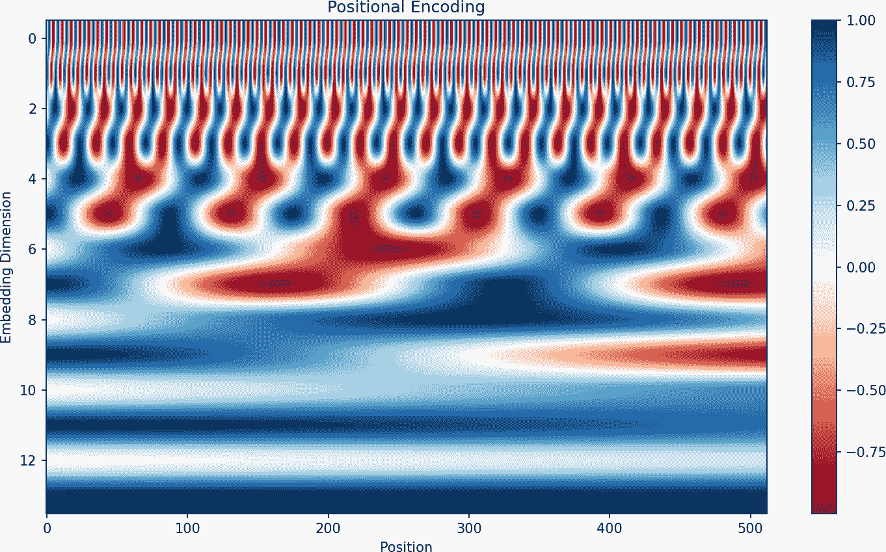
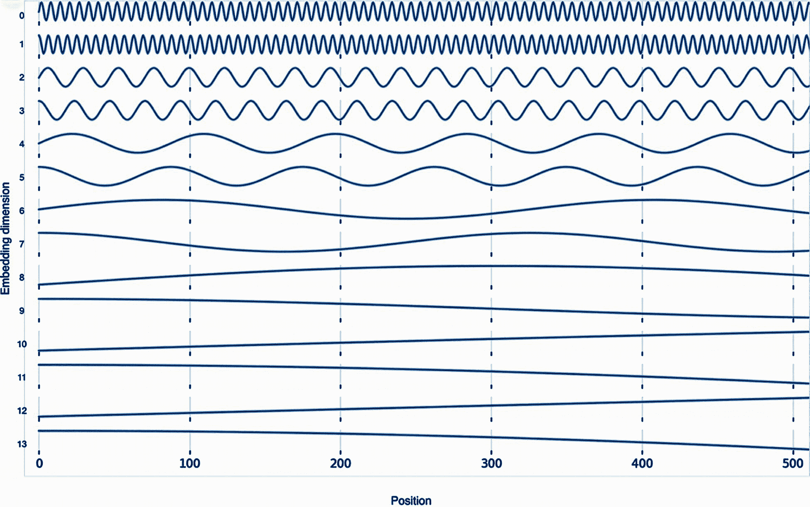
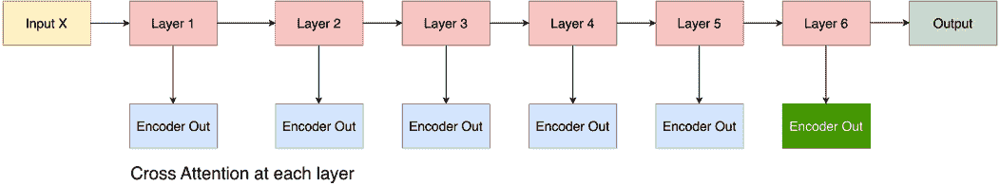

## 9 C++中的Transformer与大语言模型微调

2017年的论文*注意力即一切*引入了Transformer架构，从根本上改变了机器处理序列数据的方式。该架构的核心创新——自注意力机制——使模型能够并行处理所有标记，同时计算每个词之间的关系。这直接解决了早期方法的局限性：**循环神经网络**（**RNN**）和**长短期记忆**（**LSTM**）按顺序处理标记，造成计算瓶颈，阻碍并行化；而且随着上下文经历许多顺序步骤，信息会逐渐衰减，使得维持长距离依赖变得困难。

尽管自编码器、VAE和GAN奠定了生成建模的基础，但它们在文本生成中的应用揭示了这些架构限制。自回归模型逐个标记地生成文本，但基于序列架构构建时，每个标记都需要一次完整的前向传播，没有并行化的机会。GAN在处理离散标记时还面临额外挑战，因为当你无法在“企鹅”和“鸟”这样的词之间创建中间表示时，梯度流就会中断。

自注意力解决了这些问题，它允许模型无需顺序处理即可解决上下文歧义（根据周围的词（如“tickets”）区分“book”作为名词和作为动词）。多头注意力同时捕获多种语言模式，而**旋转位置嵌入**（**RoPE**）等位置编码机制则保留了并行处理否则会丢失的词序信息。


本章将剖析驱动当前大型语言模型的 Transformer 架构。

我们将使用 LibTorch 提供一个覆盖编码器和解码器组件的完整 C++ 实现，然后讨论大规模训练和部署这些模型时面临的实际工程挑战。你将了解**分布式数据并行**（**DDP**）和**全分片数据并行**（**FSDP**）如何实现跨多 GPU 训练，以及压缩技术（知识蒸馏、剪枝、量化与低秩近似）如何使部署在资源受限设备上成为可能。例如，量化通过 8 位表示实现了 4 倍压缩，而迭代剪枝已在 AlexNet 等网络上实现了 9 倍参数缩减，且没有精度损失。

学完本章后，你将掌握用 C++ 构建、训练和优化基于 Transformer 的模型所需的理论基础与实践实现细节。

本章将涵盖以下主题：

- Transformer 架构简介
- 位置编码
- 完整的 Transformer 实现
- 预训练语言模型
- 模型并行化
- 模型压缩技术

### Transformer 架构简介

Transformer 架构代表了深度学习领域的一次突破，从根本上改变了我们处理序列建模和自然语言处理的方式。RNN 和 LSTM 这类系统的一个主要缺点是，它们只能回看一定大小的窗口或之前的文本，因此难以处理长距离依赖。

在神经机器翻译等任务中，RNN 必须从开头开始，逐词严格按顺序处理输入序列，依次经过每个元素直到末尾。这种顺序依赖严重限制了并行计算的机会，因为每一步都必须等待前一步完成。对于一个包含 *T* 个单词的句子，模型需要 *T* 个顺序时间步来编码信息，这意味着处理时间随序列长度线性增长。更关键的是，这种架构造成了很长的信息传播路径：要将信息从第一个单词传递到最终输出，需要遍历全部 *T* 个顺序步骤，这会导致两个显著问题。首先，重要的上下文信息在经过许多中间状态时往往会衰减或丢失，尤其是在较长的序列中。其次，延长的计算路径加剧了反向传播中的梯度消失问题，使网络难以有效学习长距离依赖。虽然 LSTM 网络和**门控循环单元**（**GRU**）是为了通过专门的门控机制缓解这些问题而提出的，但即使是这些架构在处理很长的序列时也难以保持性能。

RNN 模型存在的计算效率低下、信息丢失和梯度不稳定等问题，最终推动了 Transformer 等替代架构的发展。这些架构通过注意力机制解决了上述局限，从而实现并行处理，并在序列中的任意位置之间建立直接连接。Transformer 引入了“注意力”的概念，我们接下来将研究它。

### 注意力机制的变革

注意力机制的发展是解决循环架构根本局限的关键突破。由于 RNN 和 LSTM 的顺序处理特性，它们难以处理长距离依赖，而注意力机制引入了一种根本不同的方法：它允许模型直接访问并权衡输入序列中任意位置的相关性，无论距离远近。这种范式转变消除了信息经过多个顺序步骤传播的需要，从而解决了早期架构在计算效率和信息退化方面的问题。

注意力机制允许模型在生成每个输出元素时动态关注输入的不同部分。这有助于从看似遥远的上下文中收集信息，而不是将整个输入序列压缩成一个固定长度的上下文向量。权重（即注意力分数）由模型学习得到，反映了每个输入位置与当前生成输出的相关程度。这种方法从人类认知过程中获得灵感：正如我们在处理复杂输入时有选择地关注相关信息一样，注意力机制也让神经网络能够为每个预测识别并突出最相关的特征。

注意力的数学基础简洁而优雅，却非常强大。给定一组输入表示，该机制会计算三个关键组件：查询（queries）、键（keys）和值（values）。这些术语借自信息检索系统，体现了一种直觉：我们通过比较“键”来“查询”相关信息，并检索相应的“值”。查询与每个键向量之间的注意力分数通过余弦相似度函数（向量间的点积）计算。然后使用 softmax 函数对该值进行归一化，得到概率分布。这个分布决定了每个输入位置对当前输出的贡献程度，最终表示是值的加权和。关键在于，这些计算可以在所有位置上并行执行，因此注意力机制在计算效率上远高于顺序 RNN 处理方式，从而能够在更长的序列上训练更大的模型。

注意力机制的引入不仅解决了 RNN 的技术局限，还带来了可解释性方面的好处，因为注意力权重可以被可视化，从而了解模型在特定预测中认为输入的哪些部分重要。这一创新为 Transformer 架构奠定了基础。Transformer 完全依赖注意力机制而没有任何循环结构，进一步推进了这一概念，在众多自然语言处理任务上取得了最先进的性能，同时保持了计算效率和有效捕获长距离依赖的能力。

注意力机制在两个不同序列之间运作。例如，当将“Hello”翻译成对应的法语单词“Bonjour”时，解码器会关注编码器对英语句子的表示。查询来自一个序列（解码器），而键和值来自另一个序列（编码器）。

现在我们将研究注意力机制的一种特殊变体——自注意力（self-attention）。它在单个序列内运作。每个词都会关注同一序列中的其他所有词，包括自身。简单来说，这是一种让模型通过查看句子中周围所有其他词来理解每个词的方式。

### 自注意力机制

理解语言要求我们摒弃一个根本性的误解：即词语具有固定的、与上下文无关的含义。实际上，一个词语的语义内容是在其周围的语境中产生的。以常见英语单词的一词多义现象为例。“book”既可以指装订成册的阅读材料，也可以指预订行为（“book a hotel”）。同样，“ring”可能指环状首饰，也可能指电话发出的声音信号。这种词汇歧义在自然语言中无处不在。

自注意力是一种让神经网络通过从相邻词元中推导上下文含义来解决这种歧义的机制。自注意力不是将每个词视为孤立的语义单元，而是允许模型计算序列中所有词之间的关系，从而根据具体的使用语境消除多义词的歧义。这种上下文编码构成了 Transformer 架构表征能力的基础。

在下一节中，我们将研究注意力机制背后的数学原理。


#### 自注意力的数学基础

自注意力机制将输入嵌入转换为具有上下文感知的表示。输入嵌入 X 被投影到三个不同的向量空间，即查询（Q）、键（K）和值（V）。正如我们在前几章中看到的，我们通过分词过程将单词转换为数字，然后将这种分词表示转换为嵌入向量。注意力机制正是这一方向的又一进步。在这里，嵌入向量被拆分为三个不同的向量空间。自注意力本质上是在向句子中的每个单词提出三个基本问题：

- **查询（Q）**：我在寻找什么？
- **键（K）**：我能提供什么？
- **值（V）**：我的实际内容是什么？

你可以想象，句子中的每个单词都在与其他单词进行对话，试图找出哪些单词对理解其含义很重要。让我通过一个例子来解释。让我们考虑一个句子：“I want to book my tickets.”（“我想预订我的机票。”）

“book”的查询向量会询问：我周围有哪些上下文线索？

相邻单词“tickets”（票）的键会回应：我们在这里，我们与预订相关。

相关单词的值会提供：这里是实际含义，“这是关于预订，与阅读无关。”

注意力计算的核心是查询矩阵和键矩阵的缩放点积。

Attention(Q, K, V) = softmax(QK^T / sqrt(d_k)) V

其中 `d_k` 表示键向量的维度。计算分三步进行。

- 计算相似度分数：在上述公式中，查询矩阵 Q 与键矩阵的转置相乘，产生一个注意力分数，用于衡量每个查询与每个键的匹配程度。
- 缩放相似度分数：然后将相似度分数除以缩放因子 (sqrt(d_k)) 以保持稳定性。这个缩放因子对于在训练过程中保持梯度稳定至关重要，尤其是在嵌入维度增加时。如果没有这种缩放，点积的方差会随 `d_k` 成比例增长，使 softmax 函数进入梯度变得极小的区域。
- 归一化并加权：接着对缩放后的分数应用 softmax 函数，生成总和为 1 的归一化权重。然后，将这些归一化权重与值矩阵 V 相乘，以产生最终的上下文感知表示。

*图9.1：自注意力机制的计算流程*

在左侧，输入词元（以黄色显示）通过注意力机制进行处理。每个输入词元都会被转换为三个不同的向量表示：查询（Q）、键（K）和值（V）向量。然后，注意力计算按照上述三个步骤进行。

现在，我们使用 LibTorch 在 C++ 中实现这三步注意力计算。

#### 自注意力的 C++ 实现

该实现直接遵循三步注意力计算。首先，它从键张量的第二维提取键维度 `d_k`，并计算缩放因子 1/sqrt(d_k)。这种缩放可防止点积随着嵌入维度的增加而变得过大，否则会将 softmax 函数推入梯度消失的区域。

```cpp
class TorchAttention {
public:
    // Scaled Dot-Product Attention using LibTorch
    static torch::Tensor scaledDotProductAttention(
        const torch::Tensor& Q, // queries [seq_len, d_k]
        const torch::Tensor& K, // keys [seq_len, d_k]
        const torch::Tensor& V  // values [seq_len, d_v]
    ) {
        auto d_k = K.size(1);
        auto scale = 1.0 / std::sqrt(d_k);
        // Attention(Q,K,V) = softmax(QK^T/sqrt(d_k))V
        auto scores = torch::matmul(Q, K.transpose(-2, -1)) * scale;
        auto attention_weights = torch::softmax(scores, -1);
        return torch::matmul(attention_weights, V);
    }
};
```

注意力分数通过 `torch::matmul(Q, K.transpose(-2, -1))` 计算，该操作执行矩阵乘法 QK^T。`.transpose(-2, -1)` 操作翻转 K 的最后两个维度，将其从 `[seq_len, d_k]` 变换为 `[d_k, seq_len]`，以便正确进行矩阵乘法。紧随其后的缩放因子相乘可防止数值不稳定。

`torch::softmax(scores, -1)` 操作沿最后一个维度对缩放后的分数进行归一化，将原始相似度分数转换为概率分布，其中每行总和为 1。这确保了注意力机制能够将 100% 的“注意力预算”精确分配到序列中的所有词元上。

最后，`torch::matmul(attention_weights, V)` 将归一化注意力权重与值矩阵相乘，生成代表上下文感知输出的值的加权组合。每个输出向量通过计算所有值向量的加权和来整合来自所有位置的信息。该操作对与查询更相关的位置赋予更大的权重。

该实现利用了 LibTorch 的自动微分能力，能够无缝集成到训练流程中。整个注意力机制仅需五行计算，却捕捉到了驱动现代 Transformer 架构的核心创新。批处理矩阵运算的使用确保了在 GPU 上的高效执行，在这些 GPU 上，这些运算可以在序列长度上高度并行化。完整代码可在 `https://github.com/PacktPublishing/Deep-Learning-with-C-/blob/main/chapter9/torch_attention.cpp` 获取。

自注意力检查同一输入序列内单词之间的关系，而标准注意力则在两个不同序列之间进行操作。在自注意力中，一个单独的句子生成自身的查询、键和值，从而使每个单词都能确定其与该句子中其他每个单词的相关性。相比之下，在编码器-解码器注意力（也称为交叉注意力）中，查询来自一个序列（通常是解码器的目标语言），而键和值来自另一个序列（编码器的源语言）。这种区别在机器翻译等任务中至关重要，因为解码器必须关注源句子才能生成恰当的译文，而不是仅仅检查目标句子内部的关系。

这里介绍的单头自注意力使模型能够捕获单词之间的上下文关系。其自然的延伸是多头注意力。借助多头注意力，模型可以同时学习多种类型的模式和依赖关系。我们将在下一节中讨论这一点。

### 多头注意力

多头注意力是自注意力机制的一种扩展，它使 Transformer 能够理解多样化的模式识别并生成更丰富的表示。

可以把多头注意力想象成有多个专家在检查同一个句子，每个专家都专注于检测不同的模式。这类似于卷积神经网络中的多个特征图：正如不同的 CNN 滤波器关注不同的视觉方面（边缘、纹理、形状），不同的注意力头关注不同的语言模式，如句法关系、语义联系、长距离依赖和局部单词交互。

多头注意力通过并行的注意力计算来运作。与之前一样，输入被投影到多组查询（Q）、键（K）和值（V）矩阵中，每个注意力头对应一组。每个头独立执行缩放点积注意力操作，产生自己的上下文感知表示。所有并行注意力头的输出被拼接起来，并应用线性变换，以产生最终输出。

在实践中，每个头的维度会按头的数量成比例缩减（例如，8 个头和 512 维嵌入时，每个头处理 64 维投影），从而在保持计算效率的同时显著提高表示能力。


## 第9章

下图展示了多头注意力并行操作的示意图。

```text
K
Q
V
a
Weighted sum
concat
K
Q
V
a
Weighted sum
O
O
```

*图9.2：多头注意力的并行操作*

现在我们将多头注意力架构用 LibTorch 实现为实际的 C++ 代码。

#### 多头注意力的 C++ 实现

下面是一个多头注意力的 C++ 实现（[multihead_attention.cpp](https://github.com/PacktPublishing/Deep-Learning-with-C-/blob/main/chapter9/multihead_attention.cpp)）。以下函数实现了多头注意力机制。在实现过程中，每个头的维度通常会按头的数量等比例缩小，从而保持总计算成本不变。例如，如果模型维度为 512，并使用 8 个头，那么每个头处理 64 维的投影。这种设计选择在显著提升模型表示能力的同时，也保持了计算效率。

```cpp
static torch::Tensor multiHeadAttention(
    const torch::Tensor& Q, // queries [seq_len, d_model]
    const torch::Tensor& K, // keys [seq_len, d_model]
    const torch::Tensor& V, // values [seq_len, d_model]
    int num_heads
) {
    auto seq_len = Q.size(0);
    auto d_model = Q.size(1);
    auto d_k = d_model / num_heads;

    // Reshape to [seq_len, num_heads, d_k]
    auto Q_heads = Q.view({seq_len, num_heads, d_k}).transpose(0, 1); // [num_heads, seq_len, d_k]
    auto K_heads = K.view({seq_len, num_heads, d_k}).transpose(0, 1);
    auto V_heads = V.view({seq_len, num_heads, d_k}).transpose(0, 1);

    // Apply attention to each head
    std::vector<torch::Tensor> head_outputs;
    for (int i = 0; i < num_heads; i++) {
        auto head_out = scaledDotProductAttention(Q_heads[i], K_heads[i], V_heads[i]);
        head_outputs.push_back(head_out);
    }

    // Concatenate heads and return
    auto concat = torch::cat(head_outputs, -1);
    return concat;
}
```

我想强调上述函数中的几个关键步骤。第一个关键特性是对输入进行如下重塑：

```cpp
auto Q_heads = Q.view({seq_len, num_heads, d_k}).transpose(0, 1);
```

原始的 Q、K、V 矩阵从 `[seq_len, d_model]` 重塑为 `[seq_len, num_heads, d_k]`，然后转置为 `[num_heads, seq_len, d_k]`。这种重组使得每个头可以独立处理自己的那部分数据。

每个头分别运行注意力机制，从而让不同的头学习不同类型的关系（例如，一个头可能关注语法，另一个关注语义，还有一个关注长距离依赖）。这一过程在 `for` 循环中完成。

最后，所有头的输出被重新拼接在一起，将来自所有“专家”的洞察融合为统一的表示。

虽然多头注意力使 Transformer 能够捕捉输入序列中的多样关系，但该机制本身无法感知位置，它不能天然地区分词序。这带来了一个根本性的挑战：没有位置信息，模型会将“猫追赶老鼠”和“老鼠追赶猫”视为完全相同的输入。为了克服这一局限，使模型能够理解序列结构，我们必须在架构中加入位置编码。

到目前为止，我们已经看到了注意力机制如何让 Transformer 捕捉输入序列中的多种关系。然而，这一机制本质上无法理解词序。为了引入这些信息，我们接下来必须学习位置编码。

### 位置编码

Transformer 架构面临的一个根本挑战是缺乏固有的序列信息。与 RNN 和 LSTM 网络不同——它们按顺序处理词元，并通过循环结构自然地编码位置——Transformer 中的自注意力机制允许所有词元直接且同时地相互交互。这种并行化虽然有利于计算，但也带来了一个关键问题：如果没有额外信息，Transformer 对位置不敏感，无法区分序列中词元的顺序。

考虑“猫追赶老鼠”和“老鼠追赶猫”这两个句子。在没有位置信息的情况下，对模型而言，这两个句子是相同的“词元集合”。位置编码通过将依赖于位置的信息注入模型来解决这个问题，使模型能够理解并利用词序。当前文献中流行几种位置编码变体，每种都有各自的优缺点。在接下来的几节中，我们将探讨这些变体。

#### 学习式位置嵌入

最直接的位置编码方法是为序列中的每个位置学习一个专门的嵌入向量。在这种方法中，每个位置索引（1、2、3，……，直到最大序列长度）都被分配一个维度为 `d_model` 的可学习向量，该维度与词元嵌入维度相同。这些位置嵌入在训练过程中与其他模型参数一样被随机初始化，并通过梯度下降进行优化。

在前向传播过程中，每个词元所在位置的位置嵌入会直接加到其词元嵌入上。

\[
x_i = \text{token\_embedding}_i + \text{position\_embedding}_i
\]

虽然这种方法简单有效，但也有明显的局限。模型只能学习训练中见过的最大序列长度以内的位置，因此在推理时无法推广到更长的序列。此外，学习到的嵌入可能会根据训练数据中的模式产生偏差，而不能很好地捕捉序列位置的本质属性。

#### 正弦位置编码

原始 Transformer 论文提出了一种优雅的替代方案：基于正弦和余弦函数的确定性位置编码。这种方法使用预先确定的数学公式，无需学习，并且可以扩展到任意的序列长度。

对于位置 \(m\) 处的词元和嵌入维度索引 \(i\)，正弦编码定义为：

\[
PE(m, 2i) = \sin(\omega_i \times m)
\]

\[
PE(m, 2i+1) = \cos(\omega_i \times m)
\]

其中每个维度的频率由下式给出：

\[
\omega_i = \frac{1}{10000^{2i / d_{\text{model}}}}
\]

这种公式通过在不同维度上使用不同的频率，为每个位置创建了唯一的编码。维度越低，其振荡频率越高，能够捕捉更细粒度的位置差异；而维度越高，振荡频率越低，编码的是更粗略的位置信息。选择 10000 作为底数可以在典型序列长度上保持良好的位置区分能力。

这种编码的一个关键数学性质是：位置 \(m\) 和 \(n\) 处的位置嵌入之间的点积成为它们相对距离（\(m - n\)）的函数，如下所示：

\[
\begin{aligned}
PE(m) \cdot PE(n) &= [\sin(m), \cos(m)] \cdot [\sin(n), \cos(n)] \\
&= \sin(m)\sin(n) + \cos(m)\cos(n) \\
&= \cos(m - n)
\end{aligned}
\]

因此，点积与词的绝对位置无关，而依赖于两个词的相对位置。这意味着，对于位于 \(m\) 和 \(n\) 的两个词，结果只取决于它们之间的距离，即（\(m - n\)）。所以，位置是 5 和 8 还是 101 和 104 并不重要；重要的是它们之间的差值，在这里是 3。这一性质使模型能够基于相对位置而非绝对位置进行注意力学习，这对语言理解往往更有用。此外，位置更接近的词元在位置编码上天然具有更高的相似度得分，这提供了一种归纳偏置：相邻的词更可能相关。这种编码的其他明显优点包括：值被限制并归一化在 -1 到 1 之间，并且函数是连续可微的。

正弦方法可以无缝地推广到训练中未见过的序列长度，这使其对需要变长输入的应用尤其有价值。下面是用于计算上述位置编码的 C++ 代码：

```cpp
Matrix positional_encoding(int seq_len, int d_model) {
    Matrix pe(seq_len, std::vector<float>(d_model));
    for (int pos = 0; pos < seq_len; ++pos) {
        for (int i = 0; i < d_model; i += 2) {
            float div_term = std::exp(i * -std::log(10000.0f) / d_model);
            pe[pos][i] = std::sin(pos * div_term);
            if (i + 1 < d_model)
                pe[pos][i + 1] = std::cos(pos * div_term);
        }
    }
    return pe;
}
```

位置编码器首先将变量 `pe` 初始化为维度为 `[seq_len, d_model]` 的零矩阵。完整代码可在 [simple_positional_encoding.cpp](https://github.com/PacktPublishing/Deep-Learning-with-C-/blob/main/chapter9/simple_positional_encoding.cpp) 中找到。在 `for` 循环中，对嵌入向量中的每个位置计算编码值。下图以热力图的形式展示了位置编码：x 轴表示序列中的位置（0 到 512），y 轴表示嵌入维度（0 到 14）。红色和蓝色分别代表负值和正值。




*图 9.3：位置编码热力图*

此热力图展示了序列位置（x轴，0-512）和嵌入维度（y轴，0-14）上的位置编码。红色和蓝色分别代表负值和正值。

图中值得注意的一点是，对于较低的嵌入维度，频率 \(\omega_i\) 较高，这表现为红蓝交替的高频变化。如果你回顾 \(\omega_i\) 的公式，就会发现嵌入维度与频率成反比。较高频率的嵌入有助于区分邻近位置，而较高嵌入维度上的慢振荡则捕捉更广泛的文本上下文。从图像中沿所有嵌入维度取一条垂直切片，相当于给定单词在上下文中的一个指纹。下面另一幅图展示了每个维度的正弦波和余弦波：



*图 9.4：正弦位置编码可视化*

正弦波和余弦波模式表示每个嵌入维度的位置编码方案。

尽管正弦位置嵌入具有若干优势，例如无需额外参数即可泛化到未见过的序列长度，但它们也带来了一些实际挑战。当添加到词元向量时，随着位置变化，它们会导致向量的模长和方向发生不可预测的偏移。这种混沌运动使得模型难以识别清晰模式，尤其是在标准 Transformer 所使用的高维空间（数百个维度）中。

这种不稳定性迫使模型记忆特定位置，而不是学习可泛化的模式。尽管模型拥有数十亿参数并在数万亿词元上训练，但本质上仍是对训练中遇到的确切位置过拟合。结果是：在处理比训练时更长的序列时，模型表现出不稳定行为和更高的困惑度，无法泛化到其记忆的位置空间之外。接下来，我们将研究 RoPE，一种解决这些挑战的替代方案。

### RoPE

现代大型语言模型大多已汇聚到 RoPE 上，它代表了位置编码的下一次演进。RoPE 不是将位置信息添加到输入嵌入中，而是通过基于位置旋转查询向量和键向量来直接修改注意力计算。该方法最早在 RoFormer 论文中讨论。

考虑一个基本情形：上下文向量是二维的。在复数空间中，它可以表示为一个复数。指数函数的性质与我们的旋转函数所需性质相似。为了定义这种旋转，我们可以乘以一个指数项，但这会带来一个问题：随着序列增长，模长会爆炸。因此，乘以单位复指数 \(e^{i\theta}\) 是理想的选择，因为它可以在将向量旋转角度 \(\theta\) 的同时保持模长不变。

RoPE 的核心思想是将旋转矩阵应用于注意力机制中的查询向量和键向量。对于位置 \(m\)，查询向量旋转角度 \(\theta_m\)；对于位置 \(n\)，键向量旋转角度 \(\theta_n\)。在二维子空间中，这种旋转通过标准旋转矩阵完成：

\[
R(\theta) = \begin{bmatrix} \cos(\theta) & -\sin(\theta) \\ \sin(\theta) & \cos(\theta) \end{bmatrix}
\]

在计算位置 m 和 n 之间的注意力分数时，旋转角度的选择使得最终的点积仅取决于相对距离 \(m-n\)。这是通过将 \(\theta_m\) 和 \(\theta_n\) 设置为各自位置的函数来实现的，通常使用类似于正弦编码的频率模式。接下来我们将展示其背后的数学运算。

#### 数学机制：奇偶维度配对

RoPE 通过将连续的嵌入维度配对来运作。对于一个 d 维嵌入向量，维度被分组为 (0,1), (2,3), (4,5), ..., (d-2, d-1)。每一对构成一个二维子空间，并经历旋转。

考虑位置 \(m\) 处的查询向量 \(q\)，其分量为 \([q_0, q_1, q_2, ..., q_{d-1}]\)。RoPE 通过对每个维度对应用旋转矩阵来变换该向量：

对于第一对（维度 0 和 1）：

\[
\begin{bmatrix} q_0' \\ q_1' \end{bmatrix} = \begin{bmatrix} \cos(m\theta_0) & -\sin(m\theta_0) \\ \sin(m\theta_0) & \cos(m\theta_0) \end{bmatrix} \begin{bmatrix} q_0 \\ q_1 \end{bmatrix}
\]

对于第二对（维度 2 和 3）：

\[
\begin{bmatrix} q_2' \\ q_3' \end{bmatrix} = \begin{bmatrix} \cos(m\theta_1) & -\sin(m\theta_1) \\ \sin(m\theta_1) & \cos(m\theta_1) \end{bmatrix} \begin{bmatrix} q_2 \\ q_3 \end{bmatrix}
\]

每个维度对 \(i\) 的旋转角度为：\(\theta_i = 10000^{-2i/d}\)。这为不同的维度对创造了不同的旋转频率。较低的维度旋转较快（捕捉细粒度的位置差异），而较高的维度旋转较慢（编码粗粒度的位置模式）。

#### 为什么点积依赖于相对位置

当我们计算位置 m 处的查询与位置 n 处的键之间的注意力分数时，旋转相互作用产生了相对位置编码。

让我们通过一个具体的二维示例来逐步推导这是如何产生相对位置编码的。

假设我们有：

位置 \(m\) 处的查询向量：\(q = [q_0, q_1]\)

位置 \(n\) 处的键向量：\(k = [k_0, k_1]\)

旋转频率：\(\theta\)

**步骤 1**：将上述方程中所示的 RoPE 旋转变换应用于位置 m 处的查询向量，得到：

\[
q_0' = q_0 \cos(m\theta) - q_1 \sin(m\theta)
\]
\[
q_1' = q_0 \sin(m\theta) + q_1 \cos(m\theta)
\]

类似地，位置 \(n\) 处的旋转后键向量：

\[
k_0' = k_0 \cos(n\theta) - k_1 \sin(n\theta)
\]
\[
k_1' = k_0 \sin(n\theta) + k_1 \cos(n\theta)
\]

**步骤 2**：计算点积

注意力分数是点积 \(q' \cdot k'\)：

\[
q' \cdot k' = q_0' k_0' + q_1' k_1'
\]

\[
= [q_0 \cos(m\theta) - q_1 \sin(m\theta)] [k_0 \cos(n\theta) - k_1 \sin(n\theta)] + [q_0 \sin(m\theta) + q_1 \cos(m\theta)] [k_0 \sin(n\theta) + k_1 \cos(n\theta)]
\]

**步骤 3**：使用三角恒等式展开并化简

展开所有项并应用以下恒等式后：

\[
\cos(A)\cos(B) + \sin(A)\sin(B) = \cos(A-B)
\]
\[
\sin(A)\cos(B) - \cos(A)\sin(B) = \sin(A-B)
\]

结果化简为：

\[
q' \cdot k' = [q_0 k_0 + q_1 k_1] \cdot \cos((m-n)\theta) + [q_0 k_1 - q_1 k_0] \cdot \sin((m-n)\theta)
\]

我们可以看到，点积仅取决于相对距离 \((m-n)\)，而不是单独的绝对位置 m 或 n。

这表明模型学习的是根据词元之间的“距离有多远”来进行注意力，而不是“它们在哪里”，并且这自然泛化到训练中未见过的序列长度。因此，继续此前的例子，位置 (5, 8) 和 (105, 108) 会产生相同的注意力模式（两者的相对距离都是 3）。

我们也可以将其推广到更高维度。对于 d 维嵌入，该过程以不同的频率 \(\theta_i\) 对每个维度对重复进行。最终的点积变为 d/2 项之和，每一项在不同频率尺度上编码相对位置。这种多尺度编码使得模型能够同时捕捉局部上下文（高频）和全局结构（低频）。我们在 `https://github.com/PacktPublishing/Deep-Learning-with-C-/blob/main/chapter9/rope.cpp` 分享了 RoPE 嵌入的实现。我们鼓励读者查看这些示例来学习具体实现。

与早期方法相比，RoPE 具有几个显著的优点：

- **自然的相对位置编码**：注意力权重天然反映相对位置，无需模型学习这一关系。
- **长期衰减保证**：数学公式确保相距较远的词元变得不那么相似，为语言建模提供了有用的归纳偏置。
- **与注意力集成**：通过将位置信息直接嵌入注意力机制而非输入层，RoPE 更高效地利用了模型的容量。
- **无额外参数**：与学习式嵌入不同，RoPE 不需要额外参数。

许多当代大型语言模型，包括 LLaMA 系列和近期基于 GPT 的架构，都因这些优势而采用 RoPE 作为其位置编码方法。接下来，


## 第 9 章

我们将简要介绍几种其他的位置编码方法。我们建议读者阅读本章末尾 *进一步阅读* 部分列出的相应研究论文。

### 其他现代方法

虽然 RoPE 已成为主流，但其他现代方法因其创新设计也值得一提：

- **相对位置偏置（T5）**：该方法学习偏置项，并将其添加到注意力机制的 softmax 运算内部。相对距离 (m-n) 被分桶，模型为每个桶学习嵌入。注意力计算变为：

`Attention(Q,K,V) = softmax(QK^T / sqrt(d_k) + bias) V`

- **ALiBi（带线性偏置的注意力）**：该方法使用基于相对距离的确定性公式，在 softmax 内部添加与 (m-n) 成比例的线性偏置。与其他方法不同，ALiBi 无需位置编码的可学习参数，并且对较长序列表现出很强的外推能力。

### 实现注意事项

在使用 LibTorch 用 C++ 实现位置编码时，需要考虑几个实际问题：

- 位置嵌入的维度必须与词元嵌入（`d_model`）的维度一致，才能进行逐元素相加。
- 像 RoPE 这样的现代方法是在注意力层而非输入处注入位置信息，因此需要修改注意力计算。
- 所有方法的基本目标保持一致：让序列中距离较近的词元比距离较远的词元更相似，从而为模型提供语言理解所需的序列结构。

位置编码从简单的可学习嵌入，到正弦函数，再到旋转嵌入的演进，反映了该领域逐步朝着更好捕捉序列数据本质、同时提高泛化能力和计算效率的方法发展。

到目前为止，我们已经研究了 Transformer 网络的各个组成部分，例如单头注意力、多头注意力和位置编码。在下一节中，我们将讨论这些元素如何组合在一起，构建出完整的 Transformer 实现。

### 完整的 Transformer 实现

下面给出原始论文中的完整架构。左侧部分称为编码器，神经网络右半部分称为解码器。

```text
Encoder:
  Inputs
  Input Embedding
  Positional Encoding
  Nx:
    Multi-Head Attention
    Add & Norm
    Feed Forward
    Add & Norm

Decoder:
  Outputs (shifted right)
  Output Embedding
  Positional Encoding
  Nx:
    Masked Multi-Head Attention
    Add & Norm
    Multi-Head Attention
    Add & Norm
    Feed Forward
    Add & Norm
  Linear
  Softmax
  Output Probabilities
```

*图 9.5：基于编码器-解码器的 Transformer 架构*

如图所示，编码器和解码器共享相似的构建模块：嵌入层、位置编码和多头注意力。掩码多头注意力组件是解码器独有的，将在下面的解码器部分中解释。

理解 Transformer 架构需要从序列到序列（Seq-2-Seq）模型的视角来看待它。正如 Seq-2-Seq 模型将潜在表示从编码器传递给解码器以进行生成一样，Transformer 也会将编码器输出发送到解码器的多头注意力模块，但有一个关键修改：只有来自编码器的键值对馈入解码器，而查询来自解码器本身。

Transformer 提供了灵活的训练配置。传统上，仅编码器模型用于语言理解任务，而仅解码器模型用于文本生成。机器翻译等应用使用完整的编码器-解码器模型。下面我们结合代码示例系统地分析这一架构。

#### 编码器堆栈实现

编码器由 N 个相同的层按顺序堆叠而成（在原始实现中通常 N=6），其中每一层包含两个主要子组件：多头自注意力层和逐位置前馈网络。在本节中，我们将跟踪输入文本如何在编码器堆栈中流动，从嵌入生成和位置编码开始；这些内容将在后续小节中介绍。

**处理流程**

在进入编码器堆栈之前，输入会经历我们先前提到的变换：分词将文本转换为数值表示，词元嵌入将每个词元映射到一个可学习的 D 维向量（例如 D=512 或 768），位置编码使用 *位置编码* 一节中介绍的正弦函数注入位置信息。

```cpp
auto pe = positional_encoding(seq_len, d_model).unsqueeze(1);
x = x + pe; // Adds sinusoidal positional encoding
```

每个编码器层都会应用我们在本章中构建的注意力和前馈操作。

**自注意力**

通过多头注意力机制，每个词元都会关注输入序列中的所有位置。正是在这里，模型根据上下文来消除歧义，例如区分作名词的“book”和作动词的“book”。

```cpp
auto attn_out = std::get<0>(attn->forward(x, x, x)); // Multi-head self-attention
x = norm1->forward(x + attn_out); // Residual connection + Layer Norm
```

现在，我们将应用下一组操作。

**加和归一化**

在多头注意力层之后，有两个关键操作。残差连接将原始输入加到注意力输出上，形成一条残差流，有利于反向传播时梯度的流动，并防止深层网络中梯度消失。层归一化随后在单个词元的特征维度上操作，独立计算每个词元的均值和方差统计量。

**前馈网络**

逐位置前馈网络应用两次线性变换，中间使用 ReLU 激活函数。中间层的维度通常（2048）高于输入/输出维度（512），使网络能够学习复杂的变换。上一步的归一化层（**加和归一化（Add & Normalize）**）的输出被送入该前馈网络，如下所示：

```cpp
auto ff_out = fc2->forward(torch::relu(fc1->forward(x))); // Two linear layers with ReLU
return norm2->forward(x + ff_out); // Residual connection + Layer Norm
```

前馈网络之后还有另一个残差连接和层归一化，从而完成一个编码器块。

**堆叠各层**

完整的编码器由多个相同层按顺序堆叠而成：

```cpp
for (auto& layer : *layers)
    x = layer->as<EncoderBlock>()->forward(x); // 6 encoder blocks
```

`as<EncoderBlock>()` 用于类型转换。它将泛型层指针转换为具体的 `EncoderBlock` 类型。`layers` 容器将模块存储为通用类型（`torch::nn::Module`），以便灵活处理。要调用 `EncoderBlock` 特定的 forward 方法，我们必须显式地将其转换为该类型。

#### 解码器堆栈实现

解码器是 Transformer 神经网络中位于编码器之后的下一个模块。编码器-解码器架构共同执行序列到序列操作，例如机器翻译。编码器产生富含上下文的表示，解码器利用这些表示逐个词元地构建输出序列。在本节中，我们将像编码器堆栈实现那样跟踪输入序列的流动。

**处理流程**

解码器首先接收目标序列，也就是要被翻译*成*的句子。该输入以一个特殊起始标记开始，表示生成的开始，随后是目标句子的实际单词、一个结束标记，以及用于保持固定输入大小的填充标记。每个句子都表示为一个张量，其维度为：批大小 × 最大序列长度 × 嵌入维度（512）。

然后应用**位置编码**来保持词序。每个单词的 512 维嵌入被转换为三个不同的向量：查询、键和值。

与使用标准自注意力块的编码器不同，解码器采用掩码自注意力。与编码器类似，解码器使用具有八个并行注意力头的多头注意力。它与编码器的不同之处在于增加了一个掩码功能。该掩码功能本质上是一个应用于注意力矩阵的三角掩码。三角矩阵的上半部分包含负无穷。这可以防止解码器在训练期间通过关注未来单词来“作弊”。当我们应用 softmax 函数时，这些负无穷值会变成 0，从而有效地将其屏蔽。这确保每个单词只能关注自身及其前面的单词，从而模拟推理时生成的自回归特性。该掩码被定义为下三角矩阵：

```cpp
auto tgt_mask = torch::triu(torch::ones({tgt_len, tgt_len}) * -1e9, 1);
```

在缩放（以稳定训练）并应用 softmax 之后，我们将注意力矩阵与值向量相乘，生成上下文相关的表示。来自全部八个注意力头的输出被重新拼接在一起，得到维度为“批大小 × 最大序列长度 × 512”的张量。

**掩码注意力**

*这里不再是单词，而是注意力权重。*

注意力矩阵 + 掩码矩阵 = 结果矩阵

**注意力矩阵**

|       | 这个 | 蛋糕 | 是 | 酸的 |
|-------|------|------|-----|------|
| 这个 | 注意力权重 | 注意力权重 | 注意力权重 | 注意力权重 |
| 蛋糕 | 注意力权重 | 注意力权重 | 注意力权重 | 注意力权重 |
| 是   | 注意力权重 | 注意力权重 | 注意力权重 | 注意力权重 |
| 酸的 | 注意力权重 | 注意力权重 | 注意力权重 | 注意力权重 |

**掩码矩阵**

|       | 这个 | 蛋糕 | 是 | 酸的 |
|-------|------|------|-----|------|
| 这个 | 0 | -inf | -inf | -inf |
| 蛋糕 | 0 | 0 | -inf | -inf |
| 是   | 0 | 0 | 0 | -inf |
| 酸的 | 0 | 0 | 0 | 0 |

**结果矩阵**

|       | 这个 | 蛋糕 | 是 | 酸的 |
|-------|------|------|-----|------|
| 这个 | 注意力权重 | 0 | 0 | 0 |
| 蛋糕 | 注意力权重 | 注意力权重 | 0 | 0 |
| 是   | 注意力权重 | 注意力权重 | 注意力权重 | 0 |
| 酸的 | 注意力权重 | 注意力权重 | 注意力权重 | 注意力权重 |

*图 9.6：使用下三角矩阵创建掩码自注意力*


掩码多头注意力的输出会加到原始输入张量上。然后进行层归一化，即计算均值和标准差，并相应地对值进行缩放。解码器块还包含残差连接，以确保梯度流动和训练稳定性，从而支持更深的网络。

#### 多头交叉注意力

这是注意力机制领域中另一个我们此前尚未讨论过的新概念。它被称为交叉注意力。这是解码器的第二种注意力机制，它将解码器与编码器块连接起来。查询向量来自解码器（表示目标语言），而键向量和值向量来自编码器（表示源语言）。

该机制允许目标句子中的每个词关注源句子中的所有词，从而确定哪些源词与生成每个目标词最相关。与解码器中的自注意力不同，交叉注意力不使用掩码，因为在推理过程中，解码器始终可以访问完整的编码源句子。

该过程与自注意力类似：我们计算注意力分数，应用 softmax，乘以值向量，然后拼接所有 8 个头的输出。接下来是另一个残差连接和层归一化。

交叉注意力在 `decoder.cpp` 中定义为一个 `MultiheadAttention`，代码如下：

```cpp
cross_attn = register_module("cross_attn", torch::nn::MultiheadAttention(
    torch::nn::MultiheadAttentionOptions(d_model, nhead)));
```

`register_module("cross_attn", ...)` 将该组件注册到 PyTorch 的模块系统中，以便对其进行跟踪、保存和训练。`torch::nn::MultiheadAttention` 与之前一样创建多头注意力层，`d_model` 是嵌入维度数，`nhead` 是头的数量。前向函数调用如下：

```cpp
auto cross_attn_out = std::get<0>(cross_attn->forward(x, enc_out, enc_out));
```

`cross_attn->forward(x, enc_out, enc_out)` 使用三个输入调用交叉注意力层：`x`（来自解码器的查询向量）、`enc_out`（来自编码器的键向量）和 `enc_out`（来自编码器的值向量）。与之前一样，`std::get<0>(...)` 从返回的元组中提取第一个元素。PyTorch 的 `MultiheadAttention` 返回一个包含 `attention_output` 和 `attention_weights` 的元组。对于交叉注意力，我们只需要 `attention_output`，因为它包含流经网络的变换后的表示。`attention_weights` 则指示哪些位置获得了更多关注。它们有助于可视化模型正在关注的内容，从而在研究或可解释性方面解释模型的决策。

#### 前馈网络与层堆叠

在注意力机制之后，每个词的表示都会经过一个前馈神经网络。这为模型提供了额外的能力，以学习数据中复杂的模式和关系。

```cpp
x = norm2->forward(x + cross_attn_out); // Cross-attention + Add & Norm
auto ff_out = fc2->forward(torch::relu(fc1->forward(x)));
return norm3->forward(x + ff_out); // FFN + Add & Norm
```

下面是一个完整的解码器块：

```cpp
// Masked self-attention + cross-attention + FFN decoder block
DecoderBlock::DecoderBlock(int d_model, int nhead, int d_ff) {
    self_attn = register_module("self_attn",
        torch::nn::MultiheadAttention(torch::nn::MultiheadAttentionOptions(d_model, nhead)));
    cross_attn = register_module("cross_attn",
        torch::nn::MultiheadAttention(
            torch::nn::MultiheadAttentionOptions(d_model, nhead)));
    norm1 = register_module("norm1", torch::nn::LayerNorm(d_model));
    norm2 = register_module("norm2", torch::nn::LayerNorm(d_model));
    norm3 = register_module("norm3", torch::nn::LayerNorm(d_model));
    fc1 = register_module("fc1", torch::nn::Linear(d_model, d_ff));
    fc2 = register_module("fc2", torch::nn::Linear(d_ff, d_model));
}
```

前向函数定义如下：

```cpp
torch::Tensor DecoderBlock::forward(torch::Tensor x, torch::Tensor enc_out, torch::Tensor mask) {
    auto self_attn_out = std::get<0>(self_attn->forward(x, x, x,
        torch::Tensor(), torch::Tensor(), mask));
    x = norm1->forward(x + self_attn_out); // Masked self-attention + Add & Norm
    auto cross_attn_out = std::get<0>(cross_attn->forward(x, enc_out, enc_out));
    x = norm2->forward(x + cross_attn_out); // Cross-attention + Add & Norm
    auto ff_out = fc2->forward(torch::relu(fc1->forward(x)));
    return norm3->forward(x + ff_out); // FFN + Add & Norm
}
```

解码器由多个解码器层组成。这些层定义如下：

```cpp
Decoder::Decoder(int num_layers, int d_model, int nhead, int d_ff) {
    layers = register_module("layers", torch::nn::ModuleList());
    for (int i = 0; i < num_layers; ++i)
        layers->push_back(std::make_shared<DecoderBlock>(d_model, nhead, d_ff));
}
```

`Decoder` 构造函数构建了一个由多个解码器块组成的堆栈。与之前一样，`register_module` 创建了一个空容器来容纳多个模块。该模块被命名为 `"layers"`。在 for 循环中，每次迭代都会使用 `std::make_shared` 创建一个新的 `DecoderBlock`，以生成智能指针。智能指针会自动管理内存，当最后一个指向该对象的指针超出作用域时，对象会被自动删除。因此，无需手动管理内存。如果我们把解码器块定义为：

```cpp
DecoderBlock* block = new DecoderBlock(d_model, nhead, d_ff);
```

我们就必须记得删除这个块。`push_back` 会将单个 `DecoderBlock` 添加到 `layers` 列表的末尾。前向函数与编码器块中定义的类似。其定义如下：

```cpp
torch::Tensor Decoder::forward(torch::Tensor x, torch::Tensor enc_out, torch::Tensor mask) {
    for (auto& layer : *layers)
        x = layer->as<DecoderBlock>()->forward(x, enc_out, mask);
    return x;
}
```

流程如下图所示。需要理解的是，在整个前向传播过程中，`x` 会依次经过所有解码器层，而 `enc_out` 和 `mask` 始终保持不变。



*图 9.7：输入数据（X）在每一层都会被处理。编码器的输出对所有层保持不变*

整个解码器层由掩码自注意力、交叉注意力、前馈网络以及它们相应的残差连接和归一化组成，会重复 *N* 次（通常为 6 次或更多）。这种堆叠方式使模型能够逐步细化对源语言和目标语言的理解。

### 整合所有部分

现在我们已经详细了解了编码器块和解码器块，在本节中，我们将查看完整的 Transformer 架构，并理解这两个块是如何连接起来的。`transformer.cpp` 代码给出了完整实现。Transformer 模块定义如下：

```cpp
struct Transformer : torch::nn::Module {
    Encoder encoder{nullptr}; // Processes source sequence
    Decoder decoder{nullptr}; // Generates target sequence
};
```

编码器与解码器之间的连接发生在前向函数中：

```cpp
torch::Tensor forward(torch::Tensor src, torch::Tensor tgt, torch::Tensor tgt_mask) {
    auto enc_out = encoder->forward(src); // Step 1: Encode source
    return decoder->forward(tgt, enc_out, tgt_mask); // Step 2: Decode with cross-attention
}
```

编码器输出（`enc_out`）会被传递给每个解码器层，交叉注意力使解码器能够关注源句子。交叉注意力的这一方面已在前面关于多头交叉注意力的部分中做了说明。


## C++ 中的 Transformer 与大语言模型微调

336

图 9.8：完整的 Transformer 架构

图 9.8 展示了数据从源输入经过编码器堆叠到解码器堆叠的流动过程，其中交叉注意力使解码器能够在每一层关注编码器的输出。

经过所有解码器层之后，最终的张量通过一个前馈层投影到目标语言的词表大小。这为序列中的每个位置生成了词表中所有可能单词的概率分布。

### 训练与推理

**在训练期间**，整个目标句子被同时送入解码器。模型并行预测每个位置的下一个单词，我们同时计算所有位置的损失（通常是交叉熵），忽略填充标记。这种并行处理与批处理相结合，使得即使模型很复杂，也能高效训练。

**在推理期间**，生成是自回归且顺序进行的。我们仅以起始标记开始，生成第一个单词，将其追加到输入中，并重复此过程。每个单词逐词生成，解码器只关注先前生成的单词。这一过程持续到生成结束标记或达到最大长度为止。

337

到目前为止，我们已经详细了解了 Transformer 架构，包括其编码器和解码器等组件。但我们还没有讨论该模型的训练相关的内容。正如我们将在接下来的章节中看到的，Transformer 模型可以通过多种方式进行训练。可以只训练编码器或解码器，也可以训练完整的 Transformer 模型。在与本章相关的代码中，你可以找到所有这些场景的示例训练代码。

在本章中，到目前为止，我们已经讨论了 Transformer 架构的构建块及其组件：注意力机制、编码器、解码器和训练策略。在前面的章节中，我们讨论了 LLM 常见的处理和评估机制。所有这些概念共同构成了基于 Transformer 的 LLM 的训练。在大多数情况下，以我们个人的能力，我们不会训练如此大的模型，但作为机器学习的学习者，理解这些概念如何相互作用是很重要的。大多数时候，我们会微调一个预训练的 LLM。预训练使我们能够在海量文本语料库上构建通用语言理解能力，创建能够捕捉丰富语言模式、语义关系和上下文细微差别的模型。然后，这些预训练模型可以通过微调适配到下游任务，大幅减少实现最先进性能所需的计算资源和标注数据。这种迁移学习方法使得强大的语言模型变得人人可及，并在从问答、情感分析到机器翻译和文本生成等众多应用中催生了突破性进展。因此，我们自然需要了解一些预训练语言模型，并理解它们的架构和用例。

### 预训练语言模型

预训练语言模型的演进是自然语言处理领域最重要的进展之一。BERT 和 GPT 架构都建立在 Vaswani 等人于 2017 年在开创性论文 *《注意力即一切》* 中提出的 Transformer 架构之上。我们将考察这两种架构，并指出它们之间的关键差异。

### BERT：双向上下文理解

**来自 Transformer 的双向编码器表示**（**BERT**）由 Google 于 2018 年发布，通过引入用于语言表示的双向预训练，标志着范式的转变。BERT 的编码器从每个单词的左右两侧读取整个单词序列。这种双向特性帮助 BERT 理解语言结构以及相距较远的单词之间的语义关系。这种架构使得 BERT 非常适合需要完整上下文的阅读理解任务，如问答、情感分析和命名实体识别。让我们来看看该模型的关键特性。

338

BERT 的关键特性：

- **架构**：仅使用 Transformer 的编码器组件，由 12 层（BERT-base）或 24 层（BERT-large）组成
- **嵌入大小**：BERT-base 为 768 维，BERT-large 为 1,024 维
- **训练目标**：BERT 模型的训练旨在实现以下目标：
  - 掩码语言建模（MLM）：随机掩码 15% 的标记，并利用双向上下文预测它们
  - 下一句预测（NSP）：预测两个句子是否按顺序连续出现
- **注意力机制**：无因果掩码的双向自注意力，允许每个标记关注序列中的所有其他标记

### GPT：自回归文本生成

**生成式预训练 Transformer**（**GPT**）由 OpenAI 于 2018 年推出，仅使用了 Transformer 架构的解码器组件以及掩码自注意力。该模型以自回归方式进行训练，预测序列中的下一个标记（单词）。（我们在上一章讨论 LLM 时已经讨论了自回归。）这种选择使得 GPT 非常适用于文本生成、创意写作、代码生成，以及（但不限于）少样本学习（用极少的示例适应新任务）等任务。与 BERT 类似，让我们来看看该模型的重要特性。

GPT 的关键特性：

- **架构**：仅解码器架构，由堆叠的 Transformer 解码器层组成
- **训练目标**：因果语言建模——仅基于先前的标记预测下一个标记
- **注意力机制**：使用因果掩码防止标记关注未来位置，保持单向（从左到右）信息流
- **演进**：截至 2026 年（本书写作时），GPT 系列模型已变得越来越大、能力越来越强。从 2018 年拥有 117M 参数的 GPT-1，到 2019 年拥有 1.5B 参数的 GPT-2，2020 年拥有 175B 参数的 GPT-3，2023 年拥有约 1.8T 参数的 GPT-4，再到 2026 年的 GPT-5。

OpenAI 尚未公布 GPT-5 的官方参数数量。在模型参数数量的语境中，M、B、T 分别代表百万（Million）、十亿（Billion）和万亿（Trillion）。

339

### BERT 与 GPT 的架构差异

BERT 和 GPT 的根本区别在于它们的架构选择和训练范式：

- **BERT（仅编码器）**：
  - 双向处理整个序列
  - 擅长需要完整上下文的理解任务（分类、命名实体识别、问答）
  - 无法自回归生成文本
  - 使用双向掩码语言建模作为预训练目标
- **GPT（仅解码器）**：
  - 单向（从左到右）处理序列
  - 擅长生成任务（文本补全、对话、创意写作）
  - 使用因果注意力掩码以保持自回归特性
  - 以下一个标记预测为目标进行训练

### 模型并行化

正如你在上一节中看到的 GPT 那样，模型规模持续增长，并且随着模型每次迭代变得更强，这一趋势预计将持续下去。GPU 的内存大小也随着时间推移而增加，但模型的长远增长早已超过了 GPU 内存的增长。如今，使用多 GPU 训练模型几乎已成为标准做法，无论是在单个节点（计算机）上，还是使用多节点设置（网络内连接的多台计算机）。你不仅可以容纳更大的模型，还可以更快地训练模型。这里我们将讨论两种不同的、流行的多 GPU 训练设置策略。我们将结合理论概念，看看相应的 C++ 实现。

#### DDP

随着 Transformer 模型的增长和训练数据集的扩大，单 GPU 训练变得不切实际。DDP 训练通过跨多个 GPU 或机器并行化训练过程来解决这一挑战，在保持模型精度的同时显著减少训练时间。数据并行是分布式训练的两种主要方法之一（另一种是模型并行）。在数据并行中，模型完全适合单个 GPU，但训练数据被分割到多个 GPU 上。每个 GPU 维护模型的完整副本，并并行处理不同的数据批次。在反向传播期间同步梯度，所有 GPU 以相同方式更新其模型参数。


##### 理解 DDP 实现：代码详解

本节详细讲解了使用 LibTorch 的完整 C++ DDP 实现（`https://github.com/PacktPublishing/Deep-Learning-with-C-/blob/main/chapter9/ddp_training.cpp`），逐步拆解各个组件，并解释它们如何协同工作以实现分布式训练。该代码展示了 DDP 训练的三大关键组件。让我们逐一详细分析每个组件。

##### DistributedSampler

`DistributedSampler` 负责将数据集划分到多个进程中，确保每个 GPU 处理不同的数据且互不重叠。

```
// Calculate samples per rank (pad if necessary)
num_samples_per_rank = (num_samples + world_size - 1) / world_size;
```

这种计算采用向上取整除法，以确保均匀分配。例如，有 100 个样本和 3 个 GPU 时：
- num_samples_per_rank = (100 + 3 - 1) / 3 = 102 / 3 = 34
- 每个 GPU 获得 34 个样本（总共 102 个，其中 2 个样本是重复的）

如果不进行填充，最后一个 GPU 可能会获得较少的样本，从而在 all-reduce 操作期间引发同步问题。所有 GPU 在每个 epoch 中必须执行相同数量的训练步骤。

##### 基于 Epoch 的数据打乱

epoch 编号会被添加到随机种子中（`seed + epoch`）。这样做是为了确保可复现性、一致性和多样性。使用这种公式，同一个 epoch 总是产生相同的打乱结果，且所有 GPU 使用相同的打乱顺序。所有 GPU 使用相同的打乱顺序（`seed + epoch`）。不同的 epoch 会产生不同的打乱结果。

```
void set_epoch(int epoch) {
    // Create full index list
    std::vector<size_t> all_indices(num_samples);
    std::iota(all_indices.begin(), all_indices.end(), 0);
    // Shuffle using epoch as seed
    if (shuffle) {
        std::mt19937 gen(seed + epoch);
        std::shuffle(all_indices.begin(), all_indices.end(), gen);
    }
}
```

##### DDPTrainer 类

`DDPTrainer` 封装了所有分布式训练逻辑，负责管理通信与同步。进程组初始化如下：

```
// FileStore: Shared file-based key-value store
auto store = std::make_shared<c10d::FileStore>(master_addr, world_size);
// Create NCCL process group
process_group = std::make_shared<c10d::ProcessGroupNCCL>(
    store, rank, world_size, options);
```

这里提到的 `FileStore` 是一个所有进程都可以读写的共享文件。它用于初始协调（交换 IP 地址、端口）。每个进程写入自己的信息，并读取其他进程的信息。初始化完成后，实际的数据传输使用 **NVIDIA 集合通信库**（**NCCL**）。该库针对 GPU 到 GPU 的通信进行了优化。它在可用时使用 NVLink，并实现了诸如 broadcast 和 all-reduce 之类的高效集合操作。

##### 参数广播

模型的权重通常在 GPU 0 上初始化，然后广播到所有 GPU。如果没有广播这一步，每个 GPU 将拥有不同的初始权重。而经过广播之后，所有 GPU 都以相同的参数开始训练。下面我们将逐步查看这个函数的实现。

```
void broadcast_parameters() {
    std::vector<torch::Tensor> params;
    for (const auto& param : model->parameters()) {
        params.push_back(param.data());
    }
    for (auto& param : params) {
        std::vector<torch::Tensor> tensor_list = {param};
        c10d::BroadcastOptions opts;
        opts.rootRank = 0; // Rank 0 is source
        process_group->broadcast(tensor_list, opts)->wait();
    }
}
```

第一个 `for` 循环收集模型的所有参数（权重和偏置），并将它们放入一个列表中。第二个 `for` 循环将参数包装成 broadcast 函数所需的列表格式。`rootRank = 0` 表示 GPU 0。它调用 `broadcast()` 函数将该参数发送给其余的 GPU。broadcast 方法默认是异步的，而 `-> wait()` 确保所有其他 GPU 在训练开始前都收到各自的参数。

现在让我们来看 all-reduce 操作，它是分布式训练中的另一种通信模式，与 broadcast 操作正好相反。

##### 梯度 All-Reduce

每个 GPU 在其本地数据批次上计算出梯度后，`all_reduce` 函数会从所有 GPU 收集这些梯度，将它们累加求和，再将平均后的结果分发回每个 GPU。下面我们来看 all-reduce 操作：

```
void all_reduce_gradients() {
    std::vector<torch::Tensor> gradients;
    for (const auto& param : model->parameters()) {
        if (param.grad().defined()) {
            gradients.push_back(param.grad());
        }
    }
 
    for (auto& grad : gradients) {
        std::vector<torch::Tensor> tensor_list = {grad};
        c10d::AllreduceOptions opts;
        opts.reduceOp = c10d::ReduceOp::SUM;
        process_group->allreduce(tensor_list, opts)->wait();
        grad.div_(world_size); // Average the gradients
    }
}
```

第一个 `for` 循环遍历模型的所有参数，并收集它们的梯度（如果存在的话）。`if (param.grad().defined())` 这个检查很重要，因为某些参数可能被冻结（不参与训练），因而不会有梯度。

第二个 `for` 循环执行 reduce 操作。`allreduce` 方法在所有 GPU 上同时执行集合操作。和之前一样，`->wait()` 确保操作完成后再继续执行。`grad.div_(world_size)` 操作用 GPU 数量（`world_size`）去除总和，从而计算出平均值。对梯度取平均看起来似乎是显而易见的选择，但这个选择确实有其好处。首先也是最重要的一点是，梯度不随 GPU 数量的变化而改变。此外，学习率也不需要任何调整。在执行完 `all_reduce_gradients()` 之后，所有 GPU 都拥有相同的梯度和优化器状态。这保证了所有模型副本完全同步。

##### 分布式采样与训练循环

训练循环与一般深度学习训练循环类似，但有一个关键区别：在 DDP 中，送入训练循环的数据要经过一个**分布式采样器**。这个看似微小的补充，正是实现高效多 GPU 训练的关键。下面我们来看 C++ 中的训练循环实现。

```
for (int epoch = 0; epoch < num_epochs; ++epoch) {
    sampler.set_epoch(epoch); // Shuffle data for this epoch
    const auto& indices = sampler.get_indices();
    for (size_t idx : indices) {
        size_t data_idx = idx % train_data.size();
        train_step(train_data[data_idx], train_labels[data_idx], 
optimizer);
    }
}
```

`sampler` 会根据 `epoch` 编号触发一次新的确定性采样。`sampler.get_indices()` 方法返回一个数据索引列表，表示这个特定 GPU 应该处理的数据。`for` 循环遍历分配给该 GPU 的每个索引。`idx % train_data.size()` 确保索引在超过数据集大小时能够回绕，最后 `train_step(...)` 执行一次训练步骤。下面我们来看这个方法的实现，它是训练过程的核心。

```
void train_step(torch::Tensor input, torch::Tensor target,
 torch::optim::Optimizer& optimizer) {
// Step 1: Forward Pass - Compute predictions and loss
// Each GPU processes its own batch independently
    auto output = model->forward(input);
    auto loss = torch::nn::functional::cross_entropy(output, target);
// Step 2: Backward Pass - Compute gradients
// Clear previous gradients
    optimizer.zero_grad();
    // Backpropagate to compute gradients
    loss.backward();
    // Step 3: Gradient Synchronization - Average gradients across GPUs
    // This is the key DDP operation that keeps models synchronized
    all_reduce_gradients();
    // Step 4: Parameter Update - Apply averaged gradients
}
```

```cpp
// All GPUs now have identical gradients, so they update identically
// This keeps all model replicas in sync
optimizer.step();
}
```

过程中每一步的具体功能在代码行周围的注释中都有说明。

这份详细的讲解介绍了 DDP 实现的每个组成部分，重点说明了关键设计决策、常见陷阱和优化机会。我们在相关的 GitHub 仓库（https://github.com/PacktPublishing/Deep-Learning-with-C-/blob/main/chapter9/ddp_transformer.cpp）中分享了一个实用的 C++ 实现，展示了一个仅包含编码器的简单 transformer 模型。我们鼓励读者自行查看。

DDP 训练对于将 transformer 训练扩展到生产负载至关重要。通过利用高效的集合通信原语和精心实现，DDP 能够在合理的时间范围内，在海量数据集上训练大型语言模型。其关键原则是参数同步、梯度累积和容错。这些原则适用于各种框架，并且可以使用 LibTorch 在 C++ 中高效实现，以获得最佳性能。

随着模型规模不断增大，我们已经到了一个单模型无法放入单个 GPU 的地步。尽管 DDP 有助于提高模型训练速度，但它并不是最节省内存的实现。为了训练内存占用大于 GPU 内存的超大模型，我们应该研究一种称为全分片数据并行（Fully Sharded Data Parallel，FSDP）的新技术。我们接下来将学习这项技术。

### 全分片数据并行

FSDP 通过在所有可用 GPU 上**分片**（分区）模型参数、优化器状态和梯度，扩展了数据并行范式。与 DDP 中每个 GPU 都保留一份完整模型副本不同，FSDP 确保每个 GPU 仅存储这些组件的一小部分。

在深入探讨 FSDP 过程之前，了解几个原语非常重要。我们将首先理解这些原语，然后再来看 FSDP 的通信过程。

#### 理解 FSDP：代码讲解

对模型进行分片有几种方式。最直观的策略是在每个 GPU 上保留多个层块。这称为模型并行。可以想象，这是一种低效的模型分片方式，因为在前向传播过程中，训练批次会从一个 GPU 移动到下一个 GPU。当一个 GPU 正在处理一个批次时，其余 GPU 都在排队等待。为了避免 GPU 上的这种等待时间，人们引入了流水线并行。这使得多个微批次可以在模型的不同部分并发执行。

还有一个并行概念叫做**张量并行**。大多数深度学习都涉及矩阵乘法。简单来说，张量并行就是将矩阵进行划分，使得矩阵运算可以分布到多个 GPU 上。

在本节中，我们将先了解 FSDP 并行的几个关键原语，然后再看一个 C++ 实现。

在学习分布式数据并行时，我们了解了*广播（broadcast）*和*全规约（all-reduce）*操作。这里，我们需要理解两个新操作：*全收集（all-gather）*和*规约散射（reduce-scatter）*。

##### 全收集

与收集（gather）操作（将全部分片收集到单个 GPU 上）不同，全收集操作将完整模型广播到所有 GPU。因此，它是收集和广播操作的组合。在前向或反向传播之前，FSDP 必须通过收集所有 GPU 上的所有参数分片来重建完整模型。以下是全收集过程的 C++ 实现：

```cpp
void all_gather_parameters() {
    full_params.clear();
    for (const auto& shard : sharded_params) {
        // Prepare buffers to receive shards from all ranks
        std::vector<torch::Tensor> gathered_shards;
        for (int i = 0; i < world_size; ++i) {
            gathered_shards.push_back(torch::empty_like(shard));
        }
        // All-gather: Each rank sends its shard to all others
        std::vector<std::vector<torch::Tensor>> output_tensors = {gathered_shards};
        std::vector<torch::Tensor> input_tensors = {shard};

        c10d::AllgatherOptions opts;
        process_group->allgather(output_tensors, input_tensors, opts)->wait();

        // Concatenate all shards to form full parameter
        torch::Tensor full_param = torch::cat(gathered_shards);
        full_params.push_back(full_param);
    }

    // Update model with gathered parameters
    update_model_params(full_params);
}
```

在 `all_gather_parameter()` 操作期间，每个 GPU 会临时持有完整模型。这会导致临时的内存峰值。为了便于说明，这里我们使用了一个简单的神经网络。在现实场景中，如果模型太大而无法放入单个 GPU，你可能会耗尽 GPU 内存。在生产环境中，会使用一种称为逐层全收集（layer-wise all-gather）操作的变体技术。另一种方法是 CPU 卸载（CPU offloading），即分片的模型参数存储在 CPU 内存中，仅在计算需要时才将所需的分片传输到 GPU 内存。这里我们不讨论这些操作，但鼓励读者通过*进一步阅读*部分中的链接了解更多信息。

##### 规约散射

这是一种两步集合操作，结合了全规约和散射的元素。它本质上与全收集相反。FSDP 对三个组件进行分片：模型参数、梯度和优化器状态。现在，我们将以一个简单的神经网络为例，逐步说明完整的 FSDP 过程。该网络有 3 层，每层的节点数分别为 784、128 和 10。对于 DDP，我们不共享模型权重，每个 GPU 节点都拥有完整的模型副本。因此，我们没有讨论模型参数和模型的细节。分片过程包括 3 个步骤：

- **步骤 1**：展平所有参数

  ```text
  fc1: [784, 128] → 100,352 parameters
  fc2: [128, 128] → 16,384 parameters
  fc3: [128, 10] → 1,280 parameters

  // Flatten into single vector
  all_params = [p1, p2, p3, ..., p118016] // Total: 118,016 params
  ```

- **步骤 2**：计算分片大小

  ```text
  total_size = 118,016
  world_size = 4
  shard_size = (118,016 + 4 - 1) / 4 = 29,504 // Ceiling division
  ```

- **步骤 3**：分发分片

  ```text
  Rank 0: params[0:29504] // 29,504 parameters
  Rank 1: params[29504:59008] // 29,504 parameters
  Rank 2: params[59008:88512] // 29,504 parameters
  Rank 3: params[88512:118016] // 29,504 parameters
  ```

下面是一个用于实现模型参数分片的 C++ 函数：

```cpp
void shard_parameters() {
    // 1. Collect all parameters
    std::vector<torch::Tensor> all_params;
    for (const auto& param : model->parameters()) {
        all_params.push_back(param.data().flatten());
    }

    // Concatenate into single tensor
    torch::Tensor concat_params = torch::cat(all_params);
    int64_t total_size = concat_params.numel();

    // 2. Calculate this rank's shard boundaries
    int64_t shard_size = (total_size + world_size - 1) / world_size;
    int64_t start_idx = rank * shard_size;
    int64_t end_idx = std::min(start_idx + shard_size, total_size);

    // 3. Extract and store this rank's shard
    if (start_idx < total_size) {
        torch::Tensor shard = concat_params.slice(0, start_idx, end_idx).clone();
        sharded_params.push_back(shard);
    }
}
```

在反向传播之后，FSDP 会聚合所有 GPU 上的梯度并分发结果，使每个 GPU 只接收其参数分片对应的梯度。

##### FSDPTrainer 类

让我们通过一个具体示例来了解 FSDP 实现。完整的代码以及补充文档可在本章附带的 GitHub 仓库中找到。为了便于解释和说明，我们将为模型设定以下参数：

-   模型：1000 个参数
-   GPU：4（Rank 0、1、2、3）
-   数据集：100 个样本
-   训练轮数：3


在初始化过程中，四个终端命令会分别启动四个独立的训练进程。每个终端运行相同的程序 `fsdp_training`。第一个参数是 GPU 的秩（rank），第二个参数是 GPU 总数。

```bash
# Terminal 1
./fsdp_training 0 4
# Terminal 2
./fsdp_training 1 4
# Terminal 3
./fsdp_training 2 4
# Terminal 4
./fsdp_training 3 4
```

下一步是创建模型并将其移动到相应的 GPU 上：

```cpp
auto model = std::make_shared<SimpleNet>(784, 128, 10);
model->to(device); // Each rank moves to its GPU
```

让我们初始化 `FSDPTrainer` 类。与之前（在 DDP 中）一样，它通过 `FileStore` 建立进程组。

```cpp
FSDPTrainer trainer(model, rank, world_size, "/tmp/fsdp_store");
```

与 `DDPTrainer` 类似，NCCL 通信器建立 GPU 到 GPU 的通信，并调用 `broadcast_parameters()` 函数从秩 0 广播初始参数。与 DDP 不同，在 FSDP 中，模型通过 `shard_parameters()` 函数进行分片共享。

在建立这些基础组件之后，我们就可以着手训练模型了。这里我将描述一个典型的训练步骤。下面的 `train_step` 函数在 FSDP 设置中编排一次完整的训练迭代，协调多个 GPU 之间的协作，每个 GPU 仅持有模型的一部分（分片）。

```cpp
void train_step(torch::Tensor input, torch::Tensor target,
                torch::optim::Optimizer& optimizer) {
    // Step 1: All-Gather - Reconstruct full model from shards
    all_gather_parameters();
    // Step 2: Forward Pass - Compute loss with full model
    auto output = model->forward(input);
    auto loss = torch::nn::functional::cross_entropy(output, target);
    // Step 3: Backward Pass - Compute gradients
    optimizer.zero_grad();
    loss.backward();
    // Step 4: Reduce-Scatter
    reduce_scatter_gradients();
    // Step 5: Optimizer Update
    optimizer.step();
    // Step 6: Free full parameters to save memory
    full_params.clear();
}
```

正如你在代码块中看到的，接下来发生的事件序列如下：

- **全收集参数（All-Gather parameters）**：在开始任何计算之前，每个 GPU 都需要完整的模型。此操作收集所有 GPU 上的所有参数分片，并在每个设备上重建完整模型。这是必要的，因为前向传播需要访问所有模型权重。

    ```cpp
    all_gather_parameters();
    ```

- **前向传播（Forward Pass）**：现在完整模型已可用，每个 GPU 独立地将其分配到的数据批次输入模型进行处理并计算损失。每个 GPU 处理不同的数据（数据并行），但使用相同的完整模型。

    ```cpp
    auto output = model->forward(input);
    auto loss = torch::nn::functional::cross_entropy(output, target);
    ```

- **反向传播（Backward Pass）**：将优化器的梯度清零，然后反向传播计算所有参数的梯度。此时，每个 GPU 已根据其本地数据批次计算出梯度。

    ```cpp
    optimizer.zero_grad();
    loss.backward();
    ```

- **归约-散播梯度（Reduce-Scatter Gradients）**：如前所述，这是全收集的逆操作。所有 GPU 的梯度被加在一起（以聚合来自所有批次的学习），然后将结果分割并分发，使得每个 GPU 只接收到与其参数分片对应的梯度分片。这确保了每个 GPU 拥有其负责更新的参数的平均梯度。

    ```cpp
    reduce_scatter_gradients();
    ```

- **优化器更新（Optimizer Update）**：每个 GPU 仅使用其接收到的聚合梯度更新其参数分片。由于所有 GPU 在不同数据上计算梯度并对其求平均，因此产生的结果与在单个大批次上训练相同。

    ```cpp
    optimizer.step();
    ```

- **释放完整参数（Free Full Parameters）**：反向传播之后，在下一次前向传播之前不再需要完整的模型参数，因此将它们从内存中释放。每个 GPU 现在只存储其参数分片，从而大幅减少内存使用。这正是训练那些无法容纳在单个 GPU 上的模型成为可能的原因。

    ```cpp
    full_params.clear();
    ```

该循环在每个 epoch 中重复，直到训练完成。

本节介绍了 FSDP 并行训练策略的基本组成部分。我们的目标是让读者深入理解支撑分布式训练的并行化技术和通信流模式。有了这个基础，你就可以探索更高级的实现和优化。

这里展示的 FSDP 实现仅用于教学目的，不应部署到生产环境中。一个关键的限制是全收集操作期间出现的内存峰值。当完整模型大小超过单个 GPU 的内存容量时，此峰值将触发**内存不足（out-of-memory）**（**OOM**）错误，导致训练失败。

为了解决这一限制，生产系统采用了更精细的分片策略。随附的代码仓库中包含一个演示程序，该程序实现了逐层全收集操作与流水线并行相结合。这些技术逐层增量地重建模型，而不是一次性全部重建，从而显著降低峰值内存使用。我们强烈建议你研究该实现，以理解 FSDP 如何扩展到无法容纳在单个 GPU 上的模型。

为你的模型选择 DDP 还是 FSDP 取决于多种因素。总的来说，模型大小和基础设施决定了你的选择。下表将有助于指导你的决策过程。

| 因素 | 选择 DDP | 选择 FSDP |
| --- | --- | --- |
| 模型大小 | 适合单张 GPU | 不适合单张 GPU |
| 互连 | 任意 | 高带宽（NVLink/IB） |
| 优先级 | 速度 | 内存效率 |
| 扩展规模 | <8 张 GPU | >8 张 GPU |
| 模型类型 | 中小型 | 大型至超大型 |

*表 9.1：FSDP 与 DDP 决策矩阵*

虽然 DDP 和 FSDP 等分布式训练策略使我们能够在多个 GPU 上训练越来越大的模型，但由此产生的模型通常仍然过大且计算成本过高，无法实际部署。这在训练能力与实际应用需求之间造成了一个关键差距。模型压缩技术通过减小模型大小、内存占用和计算需求来弥合这一差距，同时保持准确性，从而使得在内存、带宽和能量有限的边缘设备、移动平台和资源受限环境中部署此类大型模型成为可能。

### 模型压缩技术

现代 Transformer 模型的卓越能力伴随着一个重大挑战：其巨大的规模。最先进的语言模型可能包含数十亿甚至数万亿参数，需要大量的计算资源和内存。虽然这种规模使其在复杂任务上表现出色，但也为实际部署造成了障碍——尤其是在边缘设备、移动平台或延迟和能耗至关重要的场景中。

试想一下当今从业者面临的约束：内存和电池寿命有限的智能手机、在本地处理数据的物联网设备，或管理着数百万次请求推理成本的云服务。在每种情况下，全尺寸模型都变得不切实际。模型压缩技术正是为了解决这一差距，使我们能够在资源受限的环境中部署此类大型模型，而不会牺牲准确性。

在本节中，我们将讨论三种常用的模型压缩技术。我们的目标是向你介绍相关概念，并提供一些示例代码展示如何构建这些技术。你可以在此基础上继续构建。让我们从知识蒸馏开始讨论。


#### 知识蒸馏

如今的大型语言模型不仅从原始文本中学习——它们还相互学习。Google 的 Gemma 3 由 Gemini 训练而成。Meta 较小的 Llama 4 模型（Maverick 和 Scout）则由更大的 Behemoth 训练而成。这一过程被称为知识蒸馏，尽管它引发了大量讨论，但这一概念经常被误解。

知识蒸馏是一种模型压缩技术，它将知识从大型的“教师”模型迁移到更小、更高效的“学生”模型。这一方法由 Geoffrey Hinton、Oriol Vinyals 和 Jeff Dean 在他们 2014 年的开创性论文 *蒸馏神经网络中的知识* 中率先提出，该论文发表于 NIPS 深度学习与表示学习研讨会。

在训练过程中，我们会采用资源密集型技术——集成方法、深层架构、海量数据集——来最大化学习效果。在部署过程中，我们需要能在资源受限设备上运行的高效模型。关键问题在于：我们能否从强大的模型中提取已学到的模式，并将其迁移到紧凑的替代模型中？

早期的模型压缩研究（Caruana，2006）表明这是可行的，但也存在局限性。当教师模型非常准确时，其输出近似于独热编码，从而丢失了类别之间有价值的关系信息。

教师模型的输出包含比单独硬标签更丰富的信息。以对一张“2”的图像进行分类为例：

- 类别 2：0.85
- 类别 3：0.10
- 类别 7：0.03
- 其他类别：~0.02

这表明“2”与“3”的相似程度高于“7”——这种关系信息被称为 *暗知识*，是独热标签无法捕捉的。标准的交叉熵损失只专注于最大化正确类别的概率，忽略了这些有价值的类别相似性。为了形式化这一概念，知识蒸馏使用了温度缩放，正如 *第 8 章* 中关于自回归生成部分所讨论的那样。与之前一样，较高的温度会揭示类别之间的相对相似性，否则这些相似性会隐藏在尖锐的分布中。

##### 训练过程：双重目标

知识蒸馏采用了一种精妙的双重目标训练方法，在向教师模型学习和从原始数据学习之间取得平衡。

**第 1 步：训练教师模型**

首先，针对你的任务训练一个庞大而笨重的模型（或模型集成），使其达到较高精度。该教师模型能够捕捉数据中复杂的模式和关系。

**第 2 步：生成软目标**

使用升高的温度 T 将训练数据输入教师模型，生成保留暗知识的软概率分布。

**第 3 步：使用组合损失训练学生模型**

学生模型同时从两个来源学习：

- **a. 软目标损失**：学生模型从教师模型的软预测中学习（两个模型都使用升高的温度 T）。这通常使用 KL 散度计算：

  `L_soft = KL_divergence(student_T || teacher_T)`

- **b. 硬目标损失**：学生模型还从真实标签中学习（使用 T = 1）。这是标准的交叉熵损失：

  `L_hard = CrossEntropy(student, ground_truth)`

最终的损失函数结合了两个目标：

`L_total = α * L_soft * T² + (1 - α) * L_hard`

其中：
α 是一个权重因子（通常为 0.5-0.9），用于平衡从教师模型和真实标签中学习；T² 缩放因子用于补偿温度缩放带来的量级缩减。

当在 softmax 中使用温度 T 时，梯度会按 1/T² 进行缩放。乘以 T² 可确保软目标损失相对于硬目标损失以适当的量级发挥作用。下图解释了这一训练过程：

```text
Transfer
Data Set
Layer 1
Layer 2
Layer n
......
Teacher Model (pre-trained)
Layer 1
Layer 2
Layer m
......
Student Model (to be trained)
Softmax
T=t
Knowledge
Softmax
T=t
Softmax
T=1
Soft
Targets
Ground
Truth Label
Student
Loss
Soft
Targets
Soft
Targets
Distillation
Loss
```

图 5 基准知识蒸馏的具体架构（Hinton 等人，2015）

*图 9.9：用于知识蒸馏的教师-学生模型。*

我们在 `https://github.com/PacktPublishing/Deep-Learning-with-C-/blob/main/chapter9/knowledge_distillation.cpp` 提供了上述代码的 C++ 示例实现。基于之前关于模型训练的讨论，你应该能够理解。不过，我们将在下面重点介绍学生模型的训练：

```cpp
for (int epoch = 0; epoch < 100; ++epoch) {
    student_opt.zero_grad();
    auto student_logits = student->forward(data);
    torch::Tensor teacher_logits;
    {
        torch::NoGradGuard no_grad;
        teacher_logits = teacher->forward(data);
    }
    auto loss = distillation_loss(student_logits, teacher_logits,
                                  labels, temperature, alpha);
    loss.backward();
    student_opt.step();
    if (epoch % 20 == 0)
        std::cout << " Epoch " << epoch << ", Loss: " << loss.item<float>() << std::endl;
}
```

该训练循环通过迭代 100 个 epoch 来实现知识蒸馏，在此过程中，学生模型同时从教师模型的指导和真实标签中学习。每次迭代都会清除梯度、生成两个模型的预测（教师模型处于无梯度模式以防止权重更新）、计算结合了来自教师模型的软目标和来自真实标签的硬标签的组合蒸馏损失，然后反向传播以仅更新学生模型的权重。每 20 个 epoch 记录一次进度以监控收敛情况，损失值反映了学生模型在模仿教师模型精细的类别关系以及正确分类方面的学习效果。

知识蒸馏的另一种变体是 *基于特征的蒸馏*。在这种变体中，学生模型学习的不是教师模型的输出，而是其特征。实际上，学生模型试图匹配教师模型的中间特征。蒸馏过程本身可以是离线的（使用预训练模型作为教师来教导学生）、在线的（教师和学生同时训练）或自蒸馏（模型向自己学习）。我们鼓励读者参阅 *延伸阅读* 部分，以获取有关该主题的补充阅读材料。

我们知道，知识蒸馏帮助我们从较大的模型训练出较小的模型，同时保持相似的精度指标。这些较小的模型也适合在边缘设备（或 GPU 较小的设备）上部署。然而，这种性能提升并非没有局限性。具体来说，训练过程对温度和超参数非常敏感。额外增加的复杂度可能会导致知识蒸馏的效果不佳。训练过程和计算成本可能会抵消在生产环境中部署稍大模型的便利性。因此，知识蒸馏是否是一个可行的选项，需要根据具体情况进行评估。

#### 剪枝

在大规模数据集上训练的神经网络通常包含大量冗余。一个在 ImageNet 的 1,000 个类别上训练、用于区分犬种的模型，不需要区分公交车与小轿车的特征也能正确识别出比格犬。这一观察催生了 **剪枝**：系统地移除不必要的参数，以创建更小、更快且精度损失不大的模型。

考虑一个权重矩阵为 W^(m×n) 的简单全连接层。m×n 个参数中的每一个都对层的输出有所贡献，但它们的贡献差异巨大。有些权重在重要特征上持续产生较大的激活值，而另一些权重在各种输入下都接近为零。剪枝就是要识别并移除这些低影响的参数。在思考剪枝时，你应该考虑以下三个问题：

1. 剪什么？
2. 何时剪？
3. 如何决定要剪什么？

要回答第一个问题，主要有两种剪枝范式：非结构化剪枝和结构化剪枝。**非结构化剪枝**通过将单个权重设为零来消除它们，从而产生稀疏的权重矩阵。**结构化剪枝**则移除整个架构组件：卷积层中的滤波器、Transformer 中的注意力头或完整的神经元。


## 第9章：C++中的Transformer与大语言模型微调

关于剪枝，下一个关键问题是**何时**进行剪枝。可以在训练之前、训练期间或训练之后进行。像**单次网络剪枝**（**SNIP**）和**梯度信号保留**（**GraSP**）等方法会在任何训练开始之前，识别随机初始化网络中的重要连接。这些技术通过分析梯度流或连接敏感性来决定保留哪些参数。训练期间剪枝通过在训练过程中定期移除低幅值权重，同时在有潜力的位置添加新连接，从而使网络在整个训练过程中保持稀疏性。训练后剪枝作用于完全训练好的稠密网络，在微调以恢复精度之前，识别并移除最不重要的组件。由于这种传统方法可靠性高且实证表现优异，因此在实际应用中占据主导地位。我们鼓励读者阅读Frankle和Carbin在2019年发表的论文*彩票假说*（`https://arxiv.org/abs/1803.03635`）。该论文为以下观点提供了理论依据：稠密网络包含稀疏的“中奖彩票”子网络，当从适当的初始化开始训练时，这些子网络能够达到与完整网络相当的精度。

上述所有方法在剪枝过程中都涉及某种形式的训练。然而，还有一种训练后剪枝的变体，它不需要重新训练。其基本概念借鉴了线性代数。这类方法的例子包括**SparseGPT**和**Wanda**。SparseGPT利用逐层重构目标：对于每一层\(l\)，最小化：

\[
\| W_l X - \hat{W}_l X \|^2
\]

其中\(W_l\)是原始权重矩阵，\(\hat{W}_l\)是剪枝后的版本，\(X\)表示校准激活。Wanda使用一种更简单的评分启发式方法来对权重进行排序。它通过权重与激活幅值的乘积来定义权重的重要性。然后，它会将重要性较低的权重置为零。

最后，这引导我们回答第三个也最具技术性的问题：如何决定剪掉什么。到目前为止，你可能已经猜到了一些方法。

- 基于幅值的剪枝
- 基于梯度的重要性剪枝
- 激活感知剪枝

顾名思义，基于幅值的剪枝是最简单的方法，即移除绝对值最小的权重。在基于梯度的剪枝中，我们近似估计剪掉每个权重所带来的损失变化。我们使用泰勒级数展开来近似移除权重时的损失变化。以下是移除权重时损失变化的一阶和二阶近似：

\[
\Delta L \approx \left| \frac{\partial L}{\partial w} \cdot w \right| \quad \text{(一阶)}
\]

\[
\Delta L \approx \frac{1}{2} \left| \frac{\partial^2 L}{\partial w^2} \cdot w^2 \right| \quad \text{(二阶)}
\]

我们在随附的GitHub仓库（`https://github.com/PacktPublishing/Deep-Learning-with-C-/blob/main/chapter9`）中提供了这些方法的C++实现，对应文件为`magnitude_pruning.cpp`、`gradient_pruning.cpp`和`wanda_pruning.cpp`。基于你目前对C++的掌握程度，你应该能够结合内联文档理解这些代码。

到目前为止，我们看到的都是非结构化剪枝，即通过将权重设为零来移除它们。我们看到了几种用于确定哪些权重应被置零、何时置零以及为何应剪掉某些权重的判据。接下来，我们将研究Transformer中的一些结构化剪枝方法。完整的Transformer剪枝方法可在GitHub（`https://github.com/PacktPublishing/Deep-Learning-with-C-/blob/main/chapter9/transformer_pruning_pipeline.cpp`）中获取。该代码实现了一种三层次结构化剪枝策略，与Transformer的架构层次相对应：

**流水线概览**

- **层级别剪枝（最粗粒度）：** 根据Transformer块对模型输出的影响，识别并移除整个Transformer块。
- **头级别剪枝（中等粒度）：** 在剩余层中，移除冗余的注意力头。
- **神经元级别剪枝（最细粒度）：** 在剩余的前馈网络块中，移除单个中间神经元。

这种层级顺序至关重要：移除一个层会同时消除其所有的头和神经元，因此层级别剪枝必须先于更细粒度的方法进行。这种级联方法通过结构化稀疏性实现了大幅压缩（60-80%的稀疏度），同时保持了计算效率。组合后的流水线展示了这一序列：

```cpp
// Step 1: Remove 1 entire layer
LayerPruner::prune_least_important_layer(*combined, data, combined_pruned);

// Step 2: Remove 4/8 heads in remaining layers
AttentionHeadPruner::prune_heads(*combined->layers->ptr<TransformerBlock>(l), 4);

// Step 3: Remove 50% FFN neurons in remaining layers
FFNPruner::prune_neurons(*combined->layers->ptr<TransformerBlock>(l), 0.5f);
```

该代码包含说明文档，你应该能够理解。我们还将讨论一种称为**迭代剪枝**的剪枝方法。该方法采用渐进式剪枝，并辅以中间微调。和之前一样，完整代码可在`https://github.com/PacktPublishing/Deep-Learning-with-C-/blob/main/chapter9/iterative_pruning.cpp`获取。

这段代码演示了一个完整的**迭代剪枝流水线**，它通过微调在逐步压缩神经网络的同时恢复精度。该实现遵循了一种结构化方法，与模型压缩中使用的生产级剪枝工作流相对应。

代码定义了一个简单的三层前馈网络（`SimpleNet`），使用ReLU激活函数，作为演示剪枝效果的基线模型。该网络通过一个64节点的隐藏层处理20维输入，以生成5类预测。它实现了以下步骤：

- **渐进式稀疏度计划**（30% → 50% → 70% → 90%）：每次迭代都会提高稀疏度，使模型能够逐步适应。
- **剪枝 → 评估 → 微调循环**：在剪枝到每个目标稀疏度后，对模型进行评估以衡量精度的即时下降，然后以较小的学习率（1e-4）微调20个周期以恢复性能。
- **微调期间的梯度掩蔽**：每次优化器步骤后关键的`reapply_masks()`调用可确保被剪枝的连接保持失活——如果没有这一步，优化器会复活被置零的权重。

主函数首先训练一个稠密基线模型50个周期，确立精度目标。然后，迭代流水线系统地压缩模型，同时在每个稀疏度级别跟踪三个指标：剪枝后的即时精度（显示下降）、微调后的精度（显示恢复），以及“恢复”指标（恢复的百分点）。

这种方法在压缩比与精度保持之间取得平衡，说明神经网络包含大量冗余——代码显示，即使在90%稀疏度（移除90%的参数）下，通过精心剪枝和微调也能保持合理的性能。

在本节中，我们研究了各种基于剪枝的模型压缩技术，以及结构化剪枝和非结构化剪枝的子类型。我们还分享了一些用于Transformer剪枝和迭代剪枝策略的示例实现。

接下来，我们将研究另一种流行的模型压缩方法——量化。该技术基于模型权重的数值精度实现模型压缩，并且已成为每一位数据科学家工具包中的重要工具。

#### 量化

量化通过将高精度浮点数（通常为32位）转换为低精度整数（通常为8位），减少了表示模型参数所需的比特数。这种转换利用了神经网络在数值表示上的冗余性，许多应用能够容忍精度降低而不会出现显著的性能下降。

其根本动机源于两个关键观察：在大多数硬件架构上，整数运算的执行速度明显快于浮点运算；降低数值精度可直接转化为更小的内存占用和更低的带宽需求。从32位浮点数转换为8位整数可实现4×的压缩比，将28 GB的模型缩减至约7 GB。

在本节中，我们将探讨量化技术的主要类别，并理解量化范围的概念以及范围选择策略。之后，我们将研究量化训练及其C++实现。让我们从两种量化技术开始：

**非对称量化**

非对称量化将浮点范围\([β, α]\)映射到完整的整数范围，对于8位无符号整数，通常为\([0, 255]\)。该变换使用两个参数：缩放因子（\(S\)）和零点（\(Z\)），定义如下：

\[
S = \frac{\alpha - \beta}{2^n - 1}
\]

\[
Z = \operatorname{round}\left(-\frac{\beta}{S}\right)
\]

量化公式：

\[
\text{quantized\_value} = \operatorname{clamp}\left[\operatorname{round}\left(\frac{\text{float\_value}}{S}\right) + Z,\; 0,\; 255\right]
\]

*clamp*（钳位）函数通过将值“夹取”在最小值（0）和最大值（255）之间，来限制其不超过指定范围。反量化将上述操作反转，以恢复上述`float_value(s)`：

\[
\text{float\_value} = S \times (\text{quantized\_value} - Z)
\]

这种方法通过充分利用整个量化范围（无论原始值是否以零为中心），能够有效处理非对称分布的数据。接下来，我们将研究另一种称为对称量化的方法。


##### 对称量化

对称量化假设输入范围围绕零对称，将 [-α, α] 映射到 [-127, 127]（8 位有符号整数）。这通过消除零点参数简化了量化过程。缩放系数计算公式：

S = α / (2^(n-1) - 1)

###### 量化公式

quantized_value = clamp(round(float_value / S), -127, 127)

其主要优势在于计算效率，因为缺少零点参数减少了推理过程中的算术运算。然而，对于不对称分布的数据，它可能会引入更高的量化误差。这些量化方法的 C++ 实现可在 `https://github.com/PacktPublishing/Deep-Learning-with-C-/blob/main/chapter9/basic_quantization_functions.cpp` 获取。

在量化过程中，你可能会思考为什么我们分别选择 (0, 255) 和 (-127, 127) 作为非对称与对称量化的范围。接下来，我们将探讨不同的范围选择策略，这对量化质量有着重要影响。

##### 范围选择策略

范围参数（α 和 β）的选择显著影响量化质量：

- **最小值-最大值策略**将 α 设为张量中的最大值，β 设为最小值。虽然简单直接，但该方法对异常值高度敏感。单个极端值可能迫使量化范围过宽，从而导致大多数值的量化误差较高。
- **百分位策略**使用百分位值（例如第 99.99 百分位）而非绝对极值来缓解异常值敏感性。这牺牲了异常值的精度，但显著降低了大部分数据分布的量化误差。
- **均方误差（MSE）策略**搜索能够最小化原始值与反量化值之间 MSE 的 α 和 β 值。通常通过网格搜索实现，它为范围选择提供了原则性框架，但需要额外的计算开销。
- **交叉熵策略**与具有 softmax 输出的语言模型尤为相关，它保留值的相对分布而非绝对幅度。这确保量化后最大值依然是最大值，从而维持模型输出的概率解释。

最后，我们将介绍何时应用量化的一些方法，包括训练后或训练过程中。

##### 训练后量化（PTQ）

训练后量化在无需修改训练过程的情况下，对已完全训练好的模型应用量化。具体流程为：获取一个预训练的浮点模型，在小型校准数据集（未标注数据即可）上运行推理，使用观察器收集每一层的统计信息，基于收集的统计信息计算缩放系数和零点参数，然后将模型转换为其量化表示形式。

动态量化是 PTQ 的一种变体，它在推理过程中即时量化激活值，而非预先计算量化参数。当激活分布在不同输入之间差异显著时，这种方法尤为有用。

##### 量化感知训练（QAT）

量化感知训练将量化模拟集成到训练过程中。该方法在训练期间在各层之间插入“伪量化”操作（先量化紧接着反量化）。这些操作在前向传播中模拟量化误差，同时允许梯度在反向传播中流动。

QAT 引导优化过程朝着损失景观中更宽的极小值方向发展。训练后量化可能使模型陷入狭窄的极小值，此时量化引起的小扰动会导致损失大幅增加。QAT 则鼓励模型找到更宽的极小值，使得量化引起的权重偏移对性能的影响最小化。

必须指出的是，通过量化操作的反向传播需要特殊处理，因为量化函数（舍入和截断）是不可微的。

我们想说明的是，我们仅触及了模型量化的皮毛，整个领域非常广阔，我们在本章末尾提供了一些进一步阅读的资源。

现在让我们聚焦于神经网络量化技术的实现。我们将首先在一个简单神经网络的背景下研究非对称和对称量化，然后实现 QAT。

##### 神经网络量化的 C++ 实现

对于计算 Y = W × X + B 的典型线性层，量化过程如下：训练后一次性量化权重（W）并以量化格式存储，类似地量化偏置（B），推理过程中使用校准参数动态量化输入（X），利用硬件优化的整数算术执行整数矩阵乘法，将输出（Y）反量化回浮点形式以传递给下一层，并透明地传递至后续层。

现代 GPU 和专用加速器包含针对 8 位整数运算优化的乘累加模块。这些单元对量化矩阵中的 8 位整数进行乘法运算，并将结果累加在 32 位寄存器中以防止溢出，从而能够在矩阵元素间实现大规模并行化。想象一下将许多小数字相加，最终总和会大到无法放入小容器中。当两个 8 位数字相乘时，结果可能达到 16 位。如果持续累加这些乘积（矩阵乘法中会发生成千上万次），很快就会超过 16 位。32 位累加寄存器就像一个“更大的桶”，能够容纳不断增长的总和而不丢失信息。由于这些运算简单且统一（全部为 8 位整数运算），GPU 可以在矩阵的不同元素上同时执行数千次此类运算。一个低层 CUDA 代码可在 `https://github.com/PacktPublishing/Deep-Learning-with-C-/blob/main/chapter9/int8_matmul_accumulate.cu` 获取。

##### Transformer 的逐通道量化

逐通道量化为层中的每个输出通道或滤波器计算独立的量化参数（缩放系数和零点），而非对整个张量使用单一参数集。在神经网络中，不同通道往往学习到幅度范围差异巨大的特征。例如，在卷积层或 Transformer 的线性层中：

- 通道 1 的权重范围可能在 [-0.5, 0.5]
- 通道 2 的权重范围可能在 [-5.0, 5.0]

如果使用逐张量量化（整个权重矩阵使用一个缩放系数），就需要容纳最宽的范围（[-5.0, 5.0]）。这会浪费通道 1 的量化精度，因为其较小的值被压缩到更少的量化级别，从而增加误差。让我们看一个 C++ 中逐通道量化的实现。

```cpp
void calibrate_linear_layer(const torch::Tensor& weight) {
    int64_t num_channels = weight.size(0);
    scales.resize(num_channels);
    zero_points.resize(num_channels);
    for (int64_t i = 0; i < num_channels; ++i) {
        auto channel = weight[i];
        float min_val = channel.min().item<float>();
        float max_val = channel.max().item<float>();
        scales[i] = (max_val - min_val) / 255.0f;
        if (scales[i] == 0.0f) scales[i] = 1.0f; // avoid division by zero
        zero_points[i] = static_cast<int>(-std::round(min_val / scales[i]));
    }
}
```

`calibrate_linear_layer` 函数（`https://github.com/PacktPublishing/Deep-Learning-with-C-/blob/main/chapter9/per_channel_quanitzation_transformer.cpp`）为权重矩阵中的每个输出通道（行）计算独立的量化参数。它从权重张量的第一维提取通道数，然后遍历每个通道，找出其最小值和最大值。对于每个通道，它通过将数值范围除以 255（8 位量化范围）来计算缩放因子，并计算零点偏移，以将最小值映射到量化空间中的零。该函数包含一个安全检查，当通道内所有权重相同时将缩放因子设为 1.0，以防止除零。

尽管该方法需要稍多的存储和计算，但精度上的提升远超这些微小缺点。这些方法在 Transformer 的注意力头和前馈网络层中得到了有效应用。

接下来，我们将研究 Transformer 的训练后量化，以及如何利用它加速推理。

##### C++ 中的训练后量化实现

PTQ 是另一种模型压缩方法，可在无需重新训练的情况下减少内存占用并加速推理。我们鼓励读者阅读完整的训练后实现（`https://github.com/PacktPublishing/Deep-Learning-with-C-/blob/main/chapter9/post_training_quantization_transformer.cpp`）。这里，我们重点介绍 `calibrate` 和 `quantize_model` 两个函数。首先，让我们看看 `calibrate` 函数，以理解逐层量化是如何工作的：

```cpp
void calibrate(std::shared_ptr<Transformer> model,
               const torch::Tensor& calibration_data) {
    torch::NoGradGuard no_grad;
```


```cpp
// Run a forward pass so batch-norm / layer-norm stats are
// populated
model->forward(calibration_data);

for (const auto& named_param : model->named_parameters()) {
    if (named_param.value().dim() == 2) {
        AsymmetricQuantizer quantizer;
        quantizer.calibrate(named_param.value());
        layer_quantizers[named_param.key()] = quantizer;
    }
}
```

`calibrate`函数通过分析Transformer层中的权重分布来建立量化参数，无需重新训练。使用校准数据的前向传播会填充归一化层的统计信息（批归一化/层归一化的运行平均值），确保这些层在量化前具有真实值。然后，该函数遍历模型参数，筛选出表示线性层权重的二维张量，同时排除偏置和归一化参数。对于每个权重矩阵，`AsymmetricQuantizer`计算最小-最大范围以确定最优的缩放因子和零点值，并将这些值存储在以层名作为键的映射（`layer_quantizers`）中，供模型转换为压缩表示时在量化阶段检索使用。

`quantize_model`函数应用校准后的量化参数，对Transformer模型进行原地压缩。

```cpp
void quantize_model(std::shared_ptr<Transformer> model) {
    torch::NoGradGuard no_grad;
    for (auto& named_param : model->named_parameters()) {
        auto it = layer_quantizers.find(named_param.key());
        if (it != layer_quantizers.end()) {
            auto& quantizer = it->second;
            auto quantized = quantizer.quantize(named_param.value());
            named_param.value().data().copy_(quantizer.dequantize(quantized));
        }
    }
}
```

该函数遍历所有模型参数，并尝试使用`layer_quantizers.find(named_param.key())`在校准期间创建的映射中找到对应的量化器。只有经过校准的参数（二维权重矩阵）会被处理，而没有校准量化器的参数（偏置、归一化参数）保持不变。

顾名思义，PTQ是在模型训练完成后实施的。不过，了解量化对训练的影响并看看能否进一步改进将是很有意义的。

接下来，我们将探讨QAT在C++中的实现。

##### QAT在C++中的实现

QAT在我们之前讨论的基础上，在训练过程中实现量化。如上文所有章节所述，请参阅相关GitHub仓库（`https://github.com/PacktPublishing/Deep-Learning-with-C-/blob/main/chapter9/qat_transformers.cpp`）中的完整实现。该流程在训练期间使用`fake_quantization`来让模型学会处理精度损失：

```cpp
torch::Tensor fake_quantize(const torch::Tensor& input, float scale, int zero_point) {
    // Quantize: map float to integer grid
    auto quantized = torch::clamp(
        torch::round(input / scale) + zero_point, 0, 255
    );
    // Dequantize: map back to float (now restricted to quantization levels)
    return scale * (quantized - zero_point);
}
```

`fake_quantize`函数实现了一种量化模拟，它在保持浮点精度的同时，将值限制为8位整数空间可表示的值。该函数实现了非对称量化-反量化公式。结果是得到一个浮点张量，其值仅限定为通过8位量化所能达到的值。它也被用于PTQ，以保持与现有FP32推理管道的兼容性，从而测试模型在量化精度损失下的表现。

接下来，QAT实现遵循`train_with_qat`函数中常规的训练循环。该函数在每次训练迭代中编排并模拟量化效果。对于每个批次，函数先将原始的全精度权重保存为主副本，然后根据当前值范围为每个二维权重张量校准量化参数（缩放因子和零点）。接着对所有权重应用伪量化，使前向传播在保持与标准浮点运算兼容的同时经历量化噪声。以下是训练循环中为每个层应用伪量化的代码片段：

```cpp
{
    torch::NoGradGuard no_grad;
    for (const auto& name : linear_names) {
        auto& w = params[name];
        auto [scale, zp] = calibrate(w.data());
        w.data().copy_(fake_quantize(w.data(), scale, zp));
    }
}
```

在计算损失并反向传播梯度之后，函数在优化器更新之前恢复原始的FP32主权重。这个循环确保优化器始终更新全精度权重，同时模型学习对量化约束的鲁棒性，最终在训练完成后应用真正的训练后量化时实现最小精度损失。

至此，我们关于模型压缩量化技术的讨论就结束了。量化是一种强大且实用的模型压缩方法，能够在精度影响极小的情况下大幅减少内存占用和计算需求。训练后量化与量化感知训练之间的选择取决于具体的应用需求：PTQ提供简单性和速度，而QAT以重新训练为代价提供更优的精度保持。通过仔细选择量化类型、范围选择策略和粒度级别，您可以根据特定的部署约束定制量化方案，同时保持模型性能。还可以级联和组合不同的压缩技术，以在保持精度的同时实现更高的压缩比。

最优选择取决于部署约束：可用内存、延迟要求、目标硬件能力以及可接受的精度权衡。现代部署场景通常受益于组合多种技术，以在保持模型质量的同时实现激进压缩。

### 总结

本章带领你全面深入地探索了Transformer架构及其对现代人工智能的深远影响。我们首先考察了循环神经网络的根本局限性——其顺序处理瓶颈以及处理长距离依赖的困难——这些局限性促使了注意力机制的发展。自注意力机制作为一种优雅的解决方案应运而生，使模型能够通过并行计算直接捕捉序列中所有位置之间的关系。

我们探索了缩放点积注意力的数学基础，理解了查询、键和值如何协同工作以创建上下文感知的表示。多头注意力扩展了这一概念，使模型能够同时捕捉多样化的语言模式——从句法结构到语义关系。位置编码解决了将序列信息融入与位置无关的注意力机制这一关键挑战，而RoPE等现代方法则提供了对更长序列更优异的泛化能力。

在这些组件的基础上，我们使用LibTorch在C++中实现了完整的编码器和解码器架构。编码器通过堆叠的自注意力和前馈网络层处理输入序列，而解码器则使用掩码自注意力和交叉注意力机制自回归地生成输出序列。这些实现展示了残差连接和层归一化如何使深层网络的训练成为可能，同时保持梯度流动。

随后，本章考察了预训练语言模型，将BERT的双向编码器架构——针对理解任务优化——与GPT的自回归解码器设计——擅长文本生成——进行对比。这种区别凸显了架构选择如何与特定应用需求保持一致，从问答和分类到创意写作和对话。

随着模型规模扩展到数十亿参数，分布式训练变得至关重要。我们探讨了DDP训练，它跨GPU复制模型并并行处理数据，以及FSDP，它对模型参数、梯度和优化器状态进行分片，从而能够训练超出单GPU内存容量的模型。理解all-gather、reduce-scatter和all-reduce等通信原语对于实现高效的分布式训练流程被证明至关重要。


最后，我们通过压缩技术解决了部署大模型的实际挑战。知识蒸馏将大型教师模型学到的表示迁移到高效的学生模型中。剪枝在保持准确率的同时移除冗余连接。量化降低数值精度以减少内存占用并加速推理。低秩近似利用矩阵冗余来压缩权重矩阵。结合这些技术，可以在资源受限的设备上部署强大的模型。

本章涵盖的原理与实现，为你提供了构建、训练、优化和部署基于 Transformer 的模型所需的理论理解与实践技能。随着该领域持续发展——高效注意力机制、混合专家架构和多模态学习等创新不断涌现——这里探讨的基础概念对于理解并推动下一代 AI 系统仍将至关重要。

到目前为止，本书已经学习了针对不同用例（图像和文本）训练模型的方法。我们还了解了可应用于这些数据类型的预处理方式，并探索了包括 Transformer 在内的多种常用网络架构。在下一章中，我们将从训练模型转向在生产环境中提供服务。你将学习如何在 C++ 中导出、部署、优化和运行深度学习模型，以满足速度、可扩展性和可靠性方面的实际需求。

### 延伸阅读

如果你希望加深理解，以下资源提供了清晰的解释和有用的背景信息：

- 1. **Transformer 解释器**：Transformer 架构的交互式可视化 `https://poloclub.github.io/transformer-explainer/`。
- 2. **图解 Transformer**：理解 Transformer 的视觉指南 `https://jalammar.github.io/illustrated-transformer/`。
- 3. **可视化神经机器翻译**：注意力机制可视化 `http://jalammar.github.io/visualizing-neural-machine-translation-mechanics-of-seq2seq-models-with-attention/`。
- 4. **详解 Transformer**：来自哈佛 NLP 的逐行实现指南 `https://nlp.seas.harvard.edu/annotated-transformer/`。
- 5. **Vaswani et al. (2017)**：*注意力即一切*：原始 Transformer 论文 `https://arxiv.org/abs/1706.03762`。
- 6. **Su et al. (2021)**：*RoFormer：通过旋转位置嵌入增强的 Transformer*：RoPE 位置编码 `https://arxiv.org/abs/2104.09864`。
- 7. **Devlin et al. (2018)**：*BERT：深度双向 Transformer 的预训练* `https://arxiv.org/abs/1810.04805`。
- 8. **Radford et al. (2018)**：*通过生成式预训练改进语言理解*：GPT 原始论文 `https://cdn.openai.com/research-covers/language-unsupervised/language_understanding_paper.pdf`。
- 9. **Hinton et al. (2014)**：*蒸馏神经网络中的知识*：蒸馏基础论文 `https://arxiv.org/abs/1503.02531`。
- 10. **Frankle & Carbin (2019)**：*彩票假说*：寻找稀疏子网络 `https://arxiv.org/abs/1803.03635`。
- 11. **Frantar & Alistarh (2023)**：*SparseGPT：大规模语言模型可以一次性精确剪枝* `https://arxiv.org/abs/2301.00774`。
- 12. **Sun et al. (2023)**：*一种简单有效的大语言模型剪枝方法*：Wanda 剪枝方法 `https://arxiv.org/abs/2306.11695`。
- 13. **Jacob et al. (2018)**：*仅整数运算高效推理的神经网络量化与训练* `https://arxiv.org/abs/1712.05877`。
- 14. **Dettmers et al. (2022)**：*LLM.int8()：大规模 Transformer 的 8 位矩阵乘法* `https://arxiv.org/abs/2208.07339`。
- 15. **NVIDIA Megatron 文档**：CPU 卸载与内存优化 `https://docs.nvidia.com/nemo/megatron-bridge/0.2.0/training/cpu-offloading.html`。
- 16. **Rajbhandari et al. (2020)**：*ZeRO：面向训练万亿参数模型的内存优化*：FSDP 基础 `https://arxiv.org/abs/1910.02054`。
- 17. **Li et al. (2021)**：*PyTorch 分布式：加速数据并行训练的经验* `https://arxiv.org/abs/2006.15704`。
- 18. **Transformer 神经网络播放列表**：关于 Transformer 的全面视频系列 `https://www.youtube.com/playlist?list=PL4bm2lr9UVG0HvePBXvsceO4yuLC8HhUh`。
- 19. **Press et al. (2021)**：*短训练，长测试：带线性偏置的注意力实现输入长度外推*：ALiBi 位置编码 `https://arxiv.org/abs/2108.12409`。
- 20. **Raffel et al. (2020)**：*探索统一文本到文本 Transformer 迁移学习的极限*：T5 与相对位置偏置 `https://arxiv.org/abs/1910.10683`。
- 21. **Tay et al. (2020)**：*高效 Transformer：综述*：效率技术的全面综述 `https://arxiv.org/abs/2009.06732`。
- 22. **Dao et al. (2022)**：*FlashAttention：具有 IO 感知的快速且内存高效的精确注意力* `https://arxiv.org/abs/2205.14135`。
- 23. **Hugging Face Transformers 文档**：实用实现指南 `https://huggingface.co/docs/transformers/`。
- 24. **PyTorch Transformer 教程**：PyTorch 官方指南 `https://pytorch.org/tutorials/beginner/transformer_tutorial.html`。
- 25. **LibTorch C++ 文档**：C++ API 参考 `https://pytorch.org/cppdocs/`。
- 26. **Papers with Code - Transformers**：最新研究与基准 `https://paperswithcode.com/methods/category/transformers`。
- 27. **本章代码**：`https://github.com/PacktPublishing/Deep-Learning-with-C-/blob/main/chapter9`。

### 获取本书 PDF 版本及更多内容

扫描二维码（或访问 `packtpub.com/unlock`）。按名称搜索本书，确认版本，然后按照页面上的步骤操作。


*注意：请保管好您的发票。直接从 Packt 购买的订单无需发票。*
