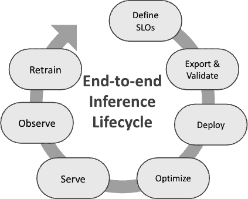
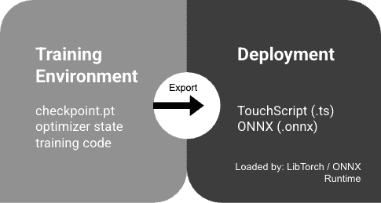
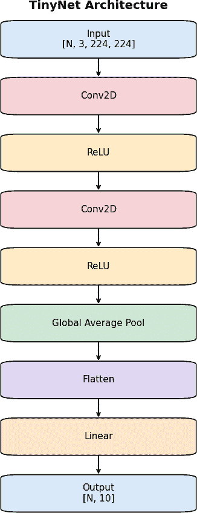
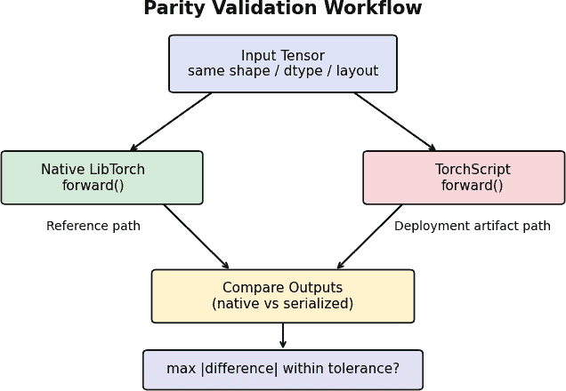
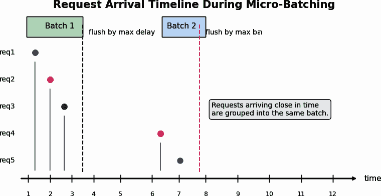
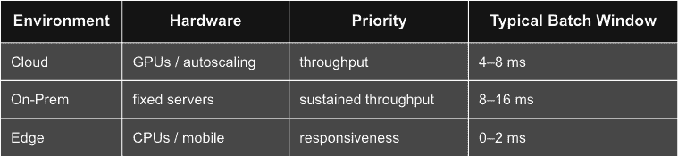
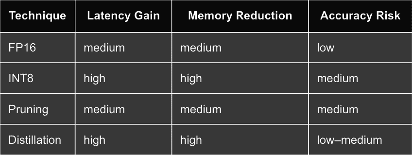
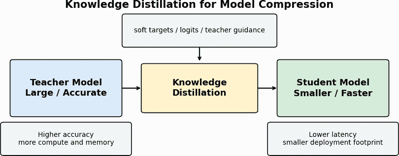
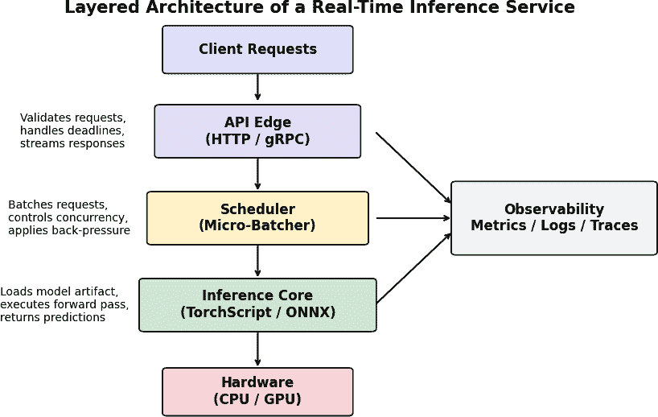
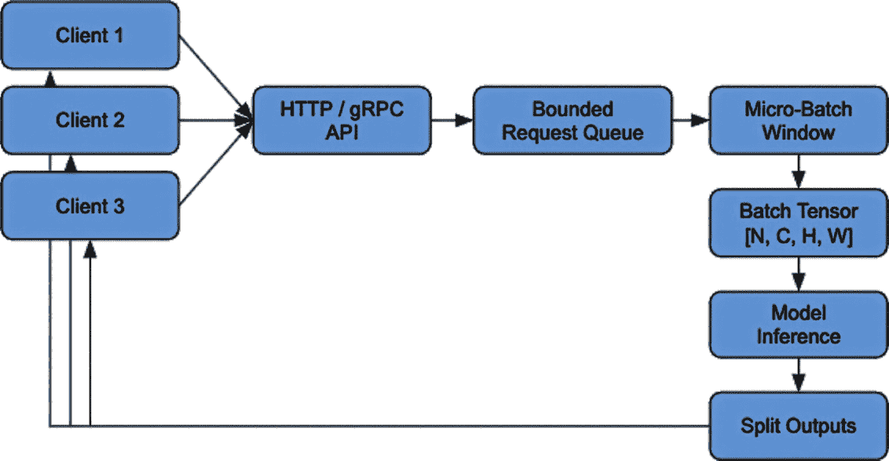

## 10. 部署和优化推理模型

你训练了一个在离线状态下表现出色的模型。现在困难的部分来了：将其交付上线——并在使用量增长时保持其快速、可靠且经济高效。本章讨论*真实世界中的推理*：将检查点转换成一个可预测的 C++ 服务，满足严格的延迟/吞吐量**服务水平目标**（**SLOs**），能够干净地扩展，并长期保持健康。

这里的“推理”是指运行训练好的模型来产生预测；“服务”则是将该计算暴露在 API 或流之后，同时管理版本、扩展和可观测性。我们将介绍你可能会遇到的常见模式：**在线/实时**（低延迟请求）、**流式**（例如，LLM 的 token 输出）、**批量**（吞吐优先的任务）和**边缘/端侧**（隐私/延迟）。在生产中重要的是 SLO：**延迟**（p50/p95/p99；首字节/首 token 时间）、**吞吐量**（QPS/每秒 token 数）、**可用性**、**每请求成本**和**质量**（准确性/安全性）。要达到这些目标，需要消除端到端的瓶颈——预处理/后处理、模型计算、CPU↔GPU 传输、框架/内核开销、网络/序列化、冷启动以及排队/批处理。

在本章中，你将学习如何将训练好的模型转变为 C++ 中可用于生产的推理系统。我们首先将模型导出为便于部署的格式，如 TorchScript 和 ONNX，验证数值一致性，并在 C++ 运行时中加载产物。接下来，我们将探讨如何将模型部署到真实环境中——云、本地基础设施或边缘设备——同时介绍打包策略、微批处理和并发控制。


接着，我们重点讨论性能和成本优化技术，包括量化、剪枝、蒸馏，以及对精度、布局和线程数的运行时调优。之后，我们使用C++结合HTTP或gRPC构建实时服务端点，支持流式响应、批处理和背压机制，以维持低尾部延迟。最后，我们涵盖运维实践，例如指标、日志和追踪的埋点与采集，数据漂移检测，通过金丝雀发布和回滚执行安全部署，以及维护再训练闭环以保持模型长期准确性。

请牢记这个心智模型：**定义SLO** | **导出与验证** | **优化** | **服务** | **观测** | **迭代**。服务是模型与真实世界交汇的环节；我们将使其快速、可靠且可度量。



一个典型的生产工作流从定义SLO开始，经历导出已训练模型、验证数值一致性、部署产物、优化运行时性能、通过API提供预测服务，并随着数据和需求演变持续观测与再训练系统。

在本章中，我们将讨论以下主题：

- 为C++推理导出模型
- 生成TorchScript产物（从C++）
- 一致性：产物是否与原生计算图匹配
- 将模型部署到真实目标环境
- 为速度和成本优化模型
- 实时提供模型服务
- 运维并演进生产系统

学完本章，你将能够将训练好的模型导出为TorchScript和ONNX格式，并使用HTTP或gRPC构建满足具体SLO的C++推理服务。你还将学习如何通过量化、剪枝和蒸馏等技术降低延迟和成本，以及如何使用指标、日志、追踪、金丝雀发布和漂移监控来维护系统健康。我们将从锁定导出格式和一致性测试开始，接着进行打包和部署，应用模型/运行时优化，构建实时服务器，最后讨论云、本地和边缘环境下的监控与持续更新。

### 为C++推理导出模型

训练产物（检查点文件、优化器状态）非常适合研究循环，但生产环境需要一种稳定、自包含的模型表示。在C++中，我们关注两种这样的表示：

- **TorchScript** (`.ts`)：一个序列化的PyTorch模块，可以直接使用**LibTorch**加载。它完整保留了PyTorch语义，是纯C++技术栈最直接的路径。
- **ONNX** (`.onnx`)：一种由**ONNX Runtime**（以及TensorRT、OpenVINO等加速器）消费的交换格式。当你需要跨运行时和硬件的可移植性时，它是理想选择。



训练检查点包含优化器状态和研究元数据，而生产系统需要诸如TorchScript或ONNX等稳定产物，这些产物可以被C++运行时直接加载。

在本节中，我们将使用PyTorch C++前端定义一个微型模型，从C++导出TorchScript（不涉及Python），在C++中加载并运行该产物，并可选择从C++使用ONNX以进行一致性和可移植性验证。在此过程中，我们将引入一个简洁的、纯C++的一致性检查，以便你确信导出的产物与原生前向传播匹配。

#### 在C++前端中定义一个紧凑模型

我们将使用一个小型**卷积神经网络**（**CNN**）作为贯穿示例。该架构刻意保持简单——两个卷积层后接全局平均池化和一个线性分类器——但它抓住了生产系统中真实推理图的典型结构。以下头文件使用LibTorch C++前端定义了该模型。

`c++ tinynet.h`：一个用LibTorch实现的微型CNN：

```cpp
#pragma once
#include <torch/torch.h>

// A tiny CNN: Conv-ReLU-Conv-ReLU -> GlobalAvgPool -> Linear
struct TinyNetImpl : torch::nn::Module {
    torch::nn::Conv2d c1{nullptr}, c2{nullptr};
    torch::nn::Linear fc{nullptr};
    TinyNetImpl(int in_ch=3, int num_classes=10)
        : c1(torch::nn::Conv2dOptions(in_ch, 8, 3).padding(1)),
          c2(torch::nn::Conv2dOptions(8, 16, 3).padding(1)),
          fc(16, num_classes) {
        register_module("c1", c1);
        register_module("c2", c2);
        register_module("fc", fc);
    }
    torch::Tensor forward(torch::Tensor x) {
        x = torch::relu(c1->forward(x));
        x = torch::relu(c2->forward(x));
        x = torch::adaptive_avg_pool2d(x, {1,1}); // [N,16,1,1]
        x = x.view({x.size(0), 16}); // [N,16]
        return fc->forward(x); // [N,C]
    }
};
TORCH_MODULE(TinyNet);
```

*图 10.3* 展示了我们使用上述代码实现的TinyNet架构。



TinyNet架构由两个卷积层后接全局平均池化和一个线性分类器组成。尽管简单，但该结构捕捉了推理系统中使用的**卷积神经网络**（**CNN**）的典型流程。

模型定义完成后，下一步是将其转换为一个可直接加载并在生产推理服务中执行的、可部署的产物。

#### 生成TorchScript产物（从C++）

导出是一次性操作，可在CI中运行。我们切换到`eval()`模式，创建一个示例输入，并**追踪**该模块以生成`tinynet.ts`。

`C++ trace_and_save_ts.cpp`：追踪并序列化：

```cpp
#include <torch/script.h>
#include <iostream>
#include <unordered_map>
#include "tinynet.h"

int main() {
    torch::NoGradGuard ng;
    TinyNet model(/*in_ch=*/3, /*num_classes=*/10);
    model->eval();
    // If you trained with LibTorch, you can restore weights here:
    // torch::load(model, "tinynet_state.pt");
    // Example input for tracing (matches your deployment contract)
    auto example = torch::randn({1,3,224,224});
    // Trace the module's "forward" from C++
    std::unordered_map<std::string, std::vector<torch::jit::IValue>> inputs;
    inputs["forward"] = {example};
    auto traced = torch::jit::trace_module(*model, inputs);
    traced.save("tinynet.ts");
    std::cout << "Saved TorchScript artifact: tinynet.ts\n";
    return 0;
}
```

**构建说明（仅一次）：** 链接LibTorch的头文件和库文件；对于GPU构建，请链接 `-ltorch_cuda -lc10_cuda`。确保编译器/标准库版本与你的LibTorch发行版保持一致。

产物生成后，下一步是验证它能在C++推理程序中被正确加载和执行。

`c++ infer_torchscript.cpp`：加载并推理：

```cpp
#include <torch/script.h>
#include <iostream>

int main() {
    torch::NoGradGuard ng;
    torch::jit::script::Module m = torch::jit::load("tinynet.ts");
    m.eval();
    auto x = torch::randn({1,3,224,224}, torch::kFloat);
    if (torch::cuda::is_available()) {
        m.to(torch::kCUDA);
        x = x.to(torch::kCUDA).to(torch::MemoryFormat::ChannelsLast);
    }
    // Warm-up passes to remove cold-start effects
    for (int i = 0; i < 5; ++i) (void)m.forward({x});
    auto y = m.forward({x}).toTensor();
    std::cout << "TorchScript output shape: " << y.sizes() << "\n";
    return 0;
}
```

TorchScript产物成功加载并执行后，下一步是验证其行为是否与原始LibTorch模型一致。这一步验证（通常称为*一致性检查*）可确保序列化后的产物在部署到生产推理服务之前产生数值上一致的输出。

#### 一致性：产物是否与原生计算图匹配？

在发布之前，请确认**原生LibTorch前向传播**与**TorchScript前向传播**在代表性输入上数值一致。对于FP32模型，最大绝对差在1e-4到1e-6量级是典型的；更大的差异几乎总是可追溯到前后处理不匹配、形状/数据类型漂移或不支持的操作。

`c++ parity_check.cpp`：原生 vs TorchScript：

```cpp
#include <torch/script.h>
#include <iostream>
#include <vector>
#include <cmath>
#include "tinynet.h"

static float max_abs_diff(const std::vector<float>& a, const std::vector<float>& b);
```


```cpp
std::vector<float>& b) {
    float m = 0.f;
    for (size_t i = 0; i < a.size(); ++i) m = std::max(m, std::fabs(a[i] - b[i]));
    return m;
}

int main() {
    torch::NoGradGuard ng;
    // Native LibTorch forward
    TinyNet model(3, 10);
    model->eval();
    auto x = torch::randn({2,3,224,224});
    auto ref = model->forward(x).contiguous();
    std::vector<float> ref_v(ref.data_ptr<float>(), ref.data_ptr<float>() + ref.numel());
    // TorchScript forward
    auto ts = torch::jit::load("tinynet.ts");
    ts.eval();
    auto ts_out = ts.forward({x}).toTensor().contiguous();
    std::vector<float> ts_v(ts_out.data_ptr<float>(), ts_out.data_ptr<float>() + ts_out.numel());
    std::cout << "max|native - ts| = " << max_abs_diff(ref_v, ts_v) << "\n";
    return 0;
}
```



*图 10.4：原生模型与序列化模型之间的数值一致性验证*

在部署之前，导出的产物应产生与原始模型实现一致的输出。一致性检查使用相同的输入比较两条执行路径的预测结果。

如果一致性检查失败，不要猜测——记录输入张量的元数据（形状、dtype、内存格式、归一化范围），并仔细比较训练路径与服务路径之间的前后处理步骤。

### 从 C++ 使用 ONNX 以提升可移植性

虽然 ONNX 的**导出**通常在 CI 阶段用 Python 完成，但 ONNX 的**服务化**在 C++ 中借助 **ONNX Runtime** 非常直接。下面的加载器展示了你的 C++ 服务如何运行预先生成的 `tinynet.onnx`，并且可以与 TorchScript 并排使用以进行 A/B 一致性验证。

```cpp
#include <onnxruntime_cxx_api.h>
#include <iostream>
#include <vector>
#include <array>

int main() {
    Ort::Env env(ORT_LOGGING_LEVEL_WARNING, "onnxrt");
    Ort::SessionOptions opt;
    opt.SetIntraOpNumThreads(4); // tune for your CPU
    Ort::Session sess(env, "tinynet.onnx", opt); // assumes artifact exists
    std::array<int64_t,4> shape{1,3,224,224};
    std::vector<float> data(1*3*224*224, 0.5f);
    Ort::MemoryInfo mem = Ort::MemoryInfo::CreateCpu(OrtArenaAllocator, OrtMemTypeDefault);
    Ort::Value input = Ort::Value::CreateTensor<float>(mem, data.data(), data.size(), shape.data(), shape.size());
    Ort::AllocatorWithDefaultOptions alloc;
    const char* in_name = sess.GetInputName(0, alloc);
    const char* out_name = sess.GetOutputName(0, alloc);
    auto outs = sess.Run(Ort::RunOptions{}, &in_name, &input, 1, &out_name, 1);
    auto& y = outs.front();
    float* yptr = y.GetTensorMutableData<float>();
    std::cout << "ONNX Runtime ran; first logit = " << yptr[0] << "\n";
    return 0;
}
```

对于 GPU 目标，请使用带有 **CUDA** 或 **TensorRT** 执行提供程序的 ONNX Runtime 构建，并在构造会话时传入提供程序选项。

### 需要保持一致的事项

在部署模型之前，重要的是在训练、导出和服务环境中保持若干运行时假设的一致性。应仔细控制以下方面，以避免隐蔽的错误和性能回退：

- **I/O 契约：** 锁定形状、dtype、布局和归一化。大多数“一致性错误”出在这里，而不是在网络结构中。
- **精度与布局：** 如果之后为了速度启用 FP16/BF16 或 **channels-last**，请对 FP32 基线重新运行一致性检查。
- **预热：** 服务启动时运行几次前向传播，以避免冷延迟（cuDNN 启发式算法、内核 JIT）。
- **线程设置：** 根据部署的核数调整 `at::set_num_threads()`（LibTorch CPU）和 `SetIntraOpNumThreads()`（ONNX Runtime）。

现在你拥有了数值上一致的导出产物和 C++ 加载器——这是下一节我们将继续构建的基础。在下一节中，我们将模型打包成一个精简的 C++ 服务，并部署到云端、本地或边缘，同时根据你的延迟 SLO 调整微批处理和并发度。

在确立了导出格式和运行时一致性之后，我们现在可以专注于如何打包模型并部署为真实环境中可靠的推理服务。

### 将模型部署到真实目标环境

生产环境推理是一个披着模型问题的系统问题。你导出的产物只有在被包装成可预测的服务后才有用：该服务需要处理突发流量、为加速器合并计算工作，并保护尾部延迟。无论你运行在云端、数据中心机架还是边缘设备上，相同的架构模式总会出现：

1. 一个加载模型并完成预热的小型 C++ 二进制程序，
2. 一个请求前端（进程边缘的 HTTP/gRPC），以及
3. 一个将大量小请求转化为高效微批次、同时强制实施并发限制和背压的调度器。

下面，我们用 C++ 构建这个调度器，并展示它如何插入到 API 层和模型之间。在下一节中，你将添加 HTTP/gRPC 外壳；这里我们专注于云端/本地/边缘都适用的核心机制。

#### 打包二进制程序（你要交付的那一个）

从部署的角度来看，你会希望有一个完全自包含、没有任何意外的单一可执行文件。以下要点概述了实现这一目标的关键步骤：

- **嵌入契约**：输入形状/dtype/布局、归一化常量以及任何类别映射。
- **就近放置产物**：将 `tinynet.ts`（TorchScript）或 `model.onnx` 与二进制程序放在一起，而不是放在慢速网络路径上。
- **预热**：启动时运行几次前向传播以消除冷延迟。
- **固定并限制**：显式设置 CPU 线程数限制、GPU 设备和内存格式（例如 channels-last）。

容器化（例如使用包含 LibTorch/ONNX Runtime 的最小基础镜像）在云端/本地部署中很常见。在边缘，你可能会交付一个带产物文件夹的静态二进制程序。打包问题解决后，下一个挑战是管理实时流量。在生产系统中，推理请求往往逐个到达，但 GPU 和向量化 CPU 在处理批次时性能最佳。下面的示例展示了一个紧凑的 C++ 微批处理调度器，它收集请求、组成小批次、每批执行一次推理，并将结果返回给各个调用方。

#### 服务的核心：带并发控制的微批处理器

真实流量以单个样本的流形式到达。GPU（甚至向量化 CPU）最喜欢批量处理。**微批处理器**会短暂等待（例如最多 8 毫秒）以收集少量请求，将它们堆叠起来，执行一次推理，然后将**每个切片的结果返回**给调用方。由于窗口很小，p95/p99 保持平稳；吞吐量大幅提升。



*图 10.5：微批处理期间请求到达的时间线*

在短暂批处理窗口内到达的请求会被分组成一个批次。当达到最大批次大小或批处理延迟到期时，调度器会刷新该批次。

我们将实现的设计选择如下：

- **有界队列** | 当服务饱和时提供背压（返回“忙碌”而不是永远排队）。
- **延迟或大小触发** | 当收集到 max_batch 个条目或窗口定时器到期时刷新批次。
- **单工作线程**起步；根据 VRAM 余量扩展到 **N 个工作线程**或**多个模型实例**。
- 使用 **Futures** 将结果**返回给调用线程（即你的 API 处理器）**。

c++ **micro_batcher_demo.cpp**（自包含调度器 + LibTorch 推理）：

包含指令和辅助别名：这些头文件提供了批处理和并发请求处理所需的 LibTorch 运行时、同步原语、futures/promises 以及标准容器。

```cpp
#include <torch/script.h>
#include <atomic>
#include <chrono>
#include <condition_variable>
#include <deque>
#include <future>
```


## 第10章 部署与优化推理模型

```cpp
#include <iostream>
#include <mutex>
#include <optional>
#include <thread>
#include <vector>

using Clock = std::chrono::steady_clock;
using ms = std::chrono::milliseconds;
```

定义微批处理器接口：我们首先定义一个小的结构体来表示一次推理请求。每个任务包含一个预处理后的输入张量和一个用于异步返回对应输出的 promise。

```cpp
struct InferenceTask {
    torch::Tensor sampleCHW; // [C,H,W] float, preprocessed
    std::promise<torch::Tensor> promise; // fulfills with [C_out] or one row slice
};
```

定义微批处理器接口：接下来，我们定义调度器的公共接口。请求通过 **submit()** 提交，该方法要么将任务加入队列，要么在有界队列已满时立即拒绝该任务。

```cpp
class MicroBatcher {
public:
    MicroBatcher(torch::jit::script::Module& module,
                 int maxBatch, int maxDelayMs, size_t queueCap)
        : mod_(module), maxBatch_(maxBatch),
          maxDelay_(maxDelayMs), cap_(queueCap), stop_(false) {
        worker_ = std::thread(&MicroBatcher::run, this);
    }

    ~MicroBatcher() { shutdown(); }

    // Submit one request; returns a future to the result tensor (one row of logits)
    std::future<torch::Tensor> submit(torch::Tensor chw) {
        std::promise<torch::Tensor> p;
        auto fut = p.get_future();
        {
            std::unique_lock<std::mutex> lk(mu_);
            if (queue_.size() >= cap_) {
                // back-pressure: reject quickly instead of inflating tail latency
                p.set_exception(std::make_exception_ptr(std::runtime_error("server busy")));
                return fut;
            }
            queue_.push_back(InferenceTask{std::move(chw), std::move(p)});
        }
        cv_.notify_one();
        return fut;
    }

    void shutdown() {
        bool expected = false;
        if (stop_.compare_exchange_strong(expected, true)) {
            cv_.notify_all();
            if (worker_.joinable()) worker_.join();
        }
    }
```

展示批处理工作线程逻辑：工作线程实现了核心的批处理逻辑。它等待请求，开启一个短暂的批处理窗口，将多个任务聚合成单个张量，执行一次前向传播，然后将每个输出行路由回对应的调用方。

```cpp
private:
    void run() {
        torch::NoGradGuard ng;
        while (!stop_) {
            std::vector<InferenceTask> batch;
            batch.reserve(maxBatch_);
            {
                std::unique_lock<std::mutex> lk(mu_);
                cv_.wait(lk, [&]{ return stop_ || !queue_.empty(); });
                if (stop_) break;
                // start window
                auto t0 = Clock::now();
                // pull first item
                if (!queue_.empty()) {
                    batch.push_back(std::move(queue_.front()));
                    queue_.pop_front();
                }
                // accumulate until full or delay exceeded
                while (batch.size() < (size_t)maxBatch_) {
                    auto elapsed = std::chrono::duration_cast<ms>(Clock::now() - t0).count();
                    if (elapsed >= maxDelay_) break;
                    if (queue_.empty()) {
                        // brief wait to accumulate more within window
                        cv_.wait_for(lk, ms(maxDelay_ - (int)elapsed), [&]{ return stop_ || !queue_.empty(); });
                        if (stop_) break;
                        if (queue_.empty()) break;
                    }
                    batch.push_back(std::move(queue_.front()));
                    queue_.pop_front();
                }
            }
            if (batch.empty()) continue;
            // Build [N,C,H,W] batch
            std::vector<torch::Tensor> rows;
            rows.reserve(batch.size());
            for (auto& t : batch) rows.push_back(t.sampleCHW.unsqueeze(0)); // [1,C,H,W]
            auto x = torch::cat(rows, /*dim=*/0); // [N,C,H,W]
            // Device/format knobs
            if (torch::cuda::is_available()) {
                x = x.to(torch::kCUDA).to(torch::MemoryFormat::ChannelsLast);
                mod_.to(torch::kCUDA);
            }
            // First few iterations may be a bit slower; consider warm-up at process start
            torch::Tensor y = mod_.forward({x}).toTensor().contiguous(); // [N,classes]
            // Split and fulfill promises
            for (size_t i = 0; i < batch.size(); ++i) {
                torch::Tensor row = y.index({(int64_t)i}).cpu(); // per-request slice
                batch[i].promise.set_value(row);
            }
        }
    }

    torch::jit::script::Module& mod_;
    const int maxBatch_;
    const int maxDelay_; // ms window
    const size_t cap_;
    std::mutex mu_;
    std::condition_variable cv_;
    std::deque<InferenceTask> queue_;
    std::atomic<bool> stop_;
    std::thread worker_;
};
```

展示演示程序 **main()**：最后，以下驱动程序加载 TorchScript 模型，构建微批处理器，并模拟多个生产者线程并发提交请求。

```cpp
// --- Demo main: loads TorchScript and simulates concurrent callers ---
int main() {
    try {
        torch::jit::script::Module net = torch::jit::load("tinynet.ts");
        net.eval();
        MicroBatcher mb(net, /*maxBatch=*/16, /*maxDelayMs=*/8, /*queueCap=*/256);
        // Simulate N producer threads submitting work
        const int producers = 4;
        std::vector<std::thread> threads;
        for (int p = 0; p < producers; ++p) {
            threads.emplace_back([&mb, p]{
                for (int i = 0; i < 8; ++i) {
                    // Pretend this came from your HTTP/gRPC handler (already preprocessed)
                    auto chw = torch::randn({3,224,224}, torch::kFloat);
                    auto fut = mb.submit(chw);
                    try {
                        auto out = fut.get(); // [classes]
                        if (p == 0) std::cout << "producer " << p << " logit[0]=" << out[0].item<float>() << "\n";
                    } catch (const std::exception& e) {
                        std::cerr << "submit failed: " << e.what() << "\n";
                    }
                    std::this_thread::sleep_for(ms(2));
                }
            });
        }
        for (auto& t : threads) t.join();
        mb.shutdown();
    } catch (const std::exception& e) {
        std::cerr << "fatal: " << e.what() << "\n";
        return 1;
    }
    return 0;
}
```

上面的示例展示了调度器的核心机制。在生产系统中，该组件位于 API 层和模型运行时之间。

#### 如何映射到真实服务：

你的 HTTP/gRPC 处理器会将载荷**预处理**为约定形状/数据类型/布局的 torch::Tensor，然后调用 submit()。微批处理器负责**合并**请求并将结果**路由**返回。仅 8 ms 的窗口足以吸收突发流量而不会损害 p95；16 条的上限可防止产生耗尽内存或拉高尾延迟的“超大批次”。

照常编译（无需 CMake）：

```bash
export TORCH=/path/to/libtorch
clang++ -std=c++17 -O2 micro_batcher_demo.cpp \
    -I"$TORCH/include" -I"$TORCH/include/torch/csrc/api/include" \
    -L"$TORCH/lib" -Wl,-rpath,"$TORCH/lib" \
    -ltorch -lc10 -pthread -o mb_demo
./mb_demo
```

如果你使用 CUDA 构建了 LibTorch，请添加 `-ltorch_cuda -lc10_cuda`，并确保驱动/工具链正确。

#### 并发控制（保证 p95/p99 真实可靠）

-   **有界队列**：当队列满时，**快速拒绝**（HTTP 429）或向客户端发送“忙碌”信号，而不是让队列无限制增长。
-   **微批窗口**：小而固定（例如 2–8 ms）。较大的窗口有助于提高吞吐量，但会损害尾延迟。
-   **每设备实例数**：最初每张 GPU 运行一个模型实例；只有当显存和流允许且不会导致抖动时，才添加第二个实例。
-   **线程配置**：使 CPU 线程数与核心数匹配（不要过度订阅），并将 I/O 线程与推理线程分离。
-   **热路径**：通过运行预热和定期保活，让热内核、分配器和算法启发式策略保持“热度”。

在支持多租户的 GPU 上（例如支持 MIG 的 A100/H100），你可能更倾向于**每个 MIG 切片一个实例**，以实现强隔离。在边缘 CPU 上，调高 ONNX Runtime（ORT）中的 `SetIntraOpNumThreads()` 或 LibTorch 中的 `at::set_num_threads()`，并保持较小的批次以减少抖动。

#### 云、本地部署与边缘：实际有什么区别？

虽然核心推理代码通常保持不变，但部署环境会影响你打包、扩缩容和调优服务的方式。以下考虑因素突出了云、本地部署和边缘部署中优先级通常如何不同：

-   **云**：容器镜像 + 产物包、自动扩缩容，以及将指标发送到可观测性技术栈。GPU 节点在突发流量下受益于**动态批处理**。
-   **本地部署**：硬件稳定、变更窗口更严格。针对持续吞吐量进行调优；你通常可以承受稍大一些的微批次。
-   **边缘**：内存/计算预算紧张，网络连接具有间歇性。优先选择 **TorchScript CPU** 或 ONNX Runtime CPU/NNAPI；微批次大小可能为 1–4，窗口为 0–2 ms，优先保证响应性而非吞吐量。


## 第10章：部署和优化模型以进行推理



*图10.6：云、本地和边缘部署之间的差异*

尽管推理代码通常保持不变，但部署环境对硬件资源、扩展行为和延迟要求施加了不同的约束。

在所有情况下，**微批处理 + 并发**核心保持不变。您添加的“外壳”——HTTP/gRPC处理器、**传输层安全**（**TLS**）、身份验证——属于边界部分，不应渗透到调度逻辑中。

现在您拥有了一个可部署的C++核心，可以将大量小请求转化为高效、有界延迟的推理。在下一节中，我们将使用**实时服务器**（HTTP/gRPC）包装这个核心，在网络边界添加**超时和背压**，并接入**指标**，以便您在生产环境中监控p50/p95/p99、利用率和队列深度。

### 优化模型以提高速度和降低成本

推理性能取决于两个方面：您交付的**模型**和**运行方式**。在模型方面，我们可以*移除或压缩*工作（量化、剪枝、蒸馏）。在运行时方面，我们可以*高效地供给硬件*（精度、布局、线程、批处理、CUDA图）。本节重点介绍提高推理效率的实用C++技术。在以下小节中，您将学习如何部署更轻量的模型工件、应用运行时优化，以及调整批处理、精度和系统设置，以在保持数值正确性的同时改善延迟和吞吐量。



*图10.7：常见推理优化技术之间的权衡*

量化、剪枝、蒸馏和运行时调整对延迟、吞吐量、内存使用和准确性的影响各不相同。生产系统通常结合多种技术来平衡性能与模型质量。

#### 量化：更少的位，更高的吞吐量

量化用较低精度（FP16/BF16或INT8）替换浮点运算和存储。您可以通过两种方式获益：**更小的权重/激活**（更少的带宽）以及针对这些精度优化的硬件上**更快的内核**。

#### FP16混合精度（TorchScript、CUDA）

在NVIDIA GPU上，以FP16运行CNN的大部分计算可以降低延迟并提高吞吐量。在C++中，您可以将模块和输入都转换为半精度；在消费端将数值敏感的步骤（如softmax、归约）保留为FP32。

#### 在C++中使用FP16进行TorchScript推理（CNN采用channels-last）

以下示例演示了如何在FP16下运行TorchScript推理，同时使用channels-last内存格式，这可以提高CNN在现代GPU上的性能。

```cpp
#include <torch/script.h>
#include <iostream>
#include <chrono>

using clk = std::chrono::steady_clock;

int main() {
    torch::NoGradGuard ng;

    auto m = torch::jit::load("tinynet.ts");
    m.eval();

    if (!torch::cuda::is_available()) {
        std::cerr << "GPU required for FP16 speedups.\n";
        return 1;
    }

    // Move model & example input to GPU + half + NHWC (channels-last) for CNN perf
    m.to(torch::kCUDA);
    auto x = torch::randn({8,3,224,224}).to(torch::kCUDA).to(torch::kHalf);
    x = x.to(torch::MemoryFormat::ChannelsLast);

    // Warm-up
    for (int i=0;i<10;++i) (void)m.forward({x});

    // Timed run
    auto t0 = clk::now();
    auto y = m.forward({x}).toTensor(); // y is FP16 logits
    auto ms = std::chrono::duration_cast<std::chrono::milliseconds>(clk::now()-t0).count();

    // If you need FP32 downstream (e.g., for softmax), upcast once here
    auto y32 = y.to(torch::kFloat);
    std::cout << "batch=8 elapsed(ms): " << ms << " first=" << y32[0][0].item<float>() << "\n";

    return 0;
}
```

**注意：** FP16推理在GPU上效果最佳，通常应避免在CPU上使用，因为半精度在CPU上往往收效甚微，甚至可能降低性能。对于卷积密集的模型，将FP16与channels-last内存布局结合可以进一步提高吞吐量。在启用降低精度或更改内存布局后，始终重新运行数值一致性测试，以确认优化后的配置仍能产生可接受的结果。

#### INT8（ONNX Runtime，Q/DQ图）

INT8通常在CPU和基于TensorRT的GPU上能带来最大的速度和内存收益。在实践中，量化的ONNX模型使用**Q/DQ节点**，因此您的C++服务可以继续传递**浮点**输入；量化和反量化已嵌入图中。

#### 在C++中运行量化的ONNX模型

下一个示例展示了如何使用ONNX Runtime在C++中加载并运行量化的ONNX模型。它设置运行时、创建会话、准备输入并执行推理。

```cpp
#include <onnxruntime_cxx_api.h>
#include <iostream>
#include <vector>
#include <array>

int main() {
    Ort::Env env(ORT_LOGGING_LEVEL_WARNING, "int8");
    Ort::SessionOptions opt;
    opt.SetGraphOptimizationLevel(GraphOptimizationLevel::ORT_ENABLE_ALL);
    opt.SetIntraOpNumThreads(8);

    // If built with CUDA/TensorRT EPs, append providers here for GPU INT8
    // OrtSessionOptionsAppendExecutionProvider_CUDA(opt, device_id);

    Ort::Session sess(env, "model.int8.onnx", opt);

    // Float input (Q/DQ inside graph)
    std::array<int64_t,4> shape{16,3,224,224};
    std::vector<float> data(16*3*224*224, 0.5f);

    auto mem = Ort::MemoryInfo::CreateCpu(OrtArenaAllocator, OrtMemTypeDefault);
    auto inp = Ort::Value::CreateTensor<float>(mem, data.data(), data.size(), shape.data(), shape.size());

    Ort::AllocatorWithDefaultOptions a;
    const char* in_name = sess.GetInputName(0, a);
    const char* out_name = sess.GetOutputName(0, a);

    // Warm-up
    for (int i=0;i<5;++i) (void)sess.Run(Ort::RunOptions{}, &in_name, &inp, 1, &out_name, 1);

    auto outs = sess.Run(Ort::RunOptions{}, &in_name, &inp, 1, &out_name, 1);
    auto& y = outs.front();
    std::cout << "ran INT8 graph; first=" << y.GetTensorMutableData<float>()[0] << "\n";

    return 0;
}
```

INT8最有效的情况：INT8量化通常对以矩阵乘法和卷积运算为主的模型收益最大。当与oneDNN等优化库结合用于大规模CPU推理时，效果尤为显著，因为较低精度可以大幅提高吞吐量。在GPU上，INT8通常与TensorRT结合使用，通过校准或量化感知训练（QAT）在保持可接受准确性的同时实现降低精度。

#### 剪枝：移除结构，而不仅仅是数值

“剪枝”删除参数；只有**结构化剪枝**（丢弃整个通道/滤波器/头）才能真正提升推理性能，因为它减少了张量形状和内核工作量。剪枝后，**重新导出精简模型**，使计算图与更小的形状匹配。

#### 在C++中加载剪枝后的TorchScript模型（更小的通道）

下一个示例演示了如何在C++中加载剪枝后的TorchScript模型并运行推理。它加载经过微调的精简模型，准备输入，可选地使用CUDA，并在执行推理之前进行几次预热运行。

```cpp
#include <torch/script.h>
#include <iostream>

int main() {
    torch::NoGradGuard ng;

    // tinynet_slim.ts was saved after channel pruning & fine-tuning
    auto m = torch::jit::load("tinynet_slim.ts");
    m.eval();

    auto x = torch::randn({8,3,224,224});
    if (torch::cuda::is_available()) {
        m.to(torch::kCUDA);
        x = x.to(torch::kCUDA).to(torch::MemoryFormat::ChannelsLast);
    }

    for (int i=0;i<5;++i) (void)m.forward({x}); // warm-up
    auto y = m.forward({x}).toTensor();
    std::cout << "slim output: " << y.sizes() << "\n";

    return 0;
}
```

**指南：** 在应用剪枝时，首选结构化剪枝——移除整个通道或滤波器——然后进行一段时间的微调，再重新导出优化后的模型。除非您的部署运行时提供了专门的稀疏内核，否则避免使用非结构化稀疏掩码，因为大多数稠密运行时不会从中受益，速度提升可能微乎其微甚至没有。最后，维护一个一致性测试框架，将剪枝后的模型与基线进行比较，确保优化后质量指标保持在可接受的范围内。

#### 蒸馏：部署学生模型

知识蒸馏训练一个**较小的学生模型**来模仿**较大的教师模型**。在服务时，您只需部署学生模型——在有限的准确性损失下，缩小内存占用和延迟。

- 适用于跨架构（例如，ConvNeXt | MobileNet，大型MLP | 小型MLP）。
- 与**量化**结合时尤其有效：例如，INT8学生模型。
- 在C++中无需任何更改——只需加载student.ts或student.onnx即可受益。




*图 10.8：用于模型压缩的知识蒸馏*

一个较小的学生模型学习模仿较大的教师模型的输出，从而在减少内存使用的情况下实现更快的推理。

#### C++：一个小型基准测试工具（学生模型与基线模型对比）

以下示例展示了一个极简的 C++ 基准测试工具，用于比较基线模型与蒸馏后的“学生”模型的推理性能。它会重复执行前向传播、测量延迟，并帮助验证优化后的模型在提升速度的同时，没有引入不可接受的精度或数值差异。

```cpp
#include <torch/script.h>
#include <chrono>
#include <iostream>

using clk = std::chrono::steady_clock;

static double bench(torch::jit::script::Module& m, int B, int iters) {
    torch::NoGradGuard ng;
    auto x = torch::randn({B, 3, 224, 224});
    if (torch::cuda::is_available()) { m.to(torch::kCUDA); x = x.to(torch::kCUDA); }
    for (int i = 0; i < 10; ++i) (void)m.forward({x}); // warm-up
    auto t0 = clk::now();
    for (int i = 0; i < iters; ++i) (void)m.forward({x});
    auto ms = std::chrono::duration_cast<std::chrono::milliseconds>(clk::now() - t0).count();
    return 1000.0 * iters * B / (double)ms; // images/sec
}

int main() {
    auto base = torch::jit::load("teacher.ts"); base.eval();
    auto stud = torch::jit::load("student.ts"); stud.eval();
    std::cout << "teacher img/s: " << bench(base, 16, 50) << "\n";
    std::cout << "student img/s: " << bench(stud, 16, 50) << "\n";
}
```

使用此工具测量速度，并在 CI 中保留精度检查，以确认学生模型满足你的服务等级目标（SLO）。

### 运行时调优：高效喂给硬件

即使不改变模型本身，**运行时配置** 也会对尾部延迟产生很大影响——尤其是在 p95 或 p99 级别。调整内存布局、线程使用和内核选择，可以在保持正确性的同时显著提高吞吐量。

#### 布局、线程、算法（LibTorch）

LibTorch 中的几个运行时选项可以根据硬件和模型架构来提升性能：

- **通道在后的布局（Channels-last）：** 对于卷积密集型网络，使用 `x.to(torch::MemoryFormat::ChannelsLast)` 并在 CUDA 上运行模型，可以改善内存局部性和内核效率。
- **线程配置（CPU）：** 根据可用的 CPU 插槽和核心数量，调整 `at::set_num_threads(n);` 和 `at::set_num_interop_threads(k);`。
- **cuDNN 自动调优：** 对于固定形状，启用基准模式让 cuDNN 选择优化的内核：`at::globalContext().setBenchmarkCuDNN(true);`
- **CUDA 图：** 捕获静态前向传播可以消除稳定工作负载中每次迭代的内核启动开销。

#### 为固定形状推理捕获 CUDA 图（C++）

以下示例演示了如何在 LibTorch 中为固定形状推理捕获并重放 CUDA 图。这种方法可以显著减少高度重复工作负载中的内核启动开销。

```cpp
#include <torch/script.h>
#include <ATen/cuda/CUDAEvent.h>
#include <ATen/cuda/CUDAGraph.h>
#include <iostream>

int main() {
    if (!torch::cuda::is_available()) return 0;
    torch::NoGradGuard ng;
    auto m = torch::jit::load("tinynet.ts"); m.eval().to(torch::kCUDA);
    auto static_in = torch::randn({8, 3, 224, 224}, torch::kCUDA);
    auto static_out = torch::empty({8, 10}, static_in.options());

    // Warm-up
    for (int i = 0; i < 5; ++i) (void)m.forward({static_in});

    at::cuda::CUDAGraph g;
    {
        at::cuda::CUDAStreamCaptureModeGuard guard(at::cuda::CaptureMode::Relaxed);
        g.capture_begin();
        auto y = m.forward({static_in}).toTensor();
        static_out.copy_(y);
        g.capture_end();
    }

    // Now replay the whole forward with near-zero launch overhead
    for (int i = 0; i < 100; ++i) g.replay();
    std::cout << "Captured/replayed CUDA graph.\n";
}
```

CUDA 图需要固定形状和预热；将其与微批次处理配合使用，以获得稳定的流水线。

#### 使用 ONNX Runtime 进行运行时调优

在使用 ONNX Runtime 部署模型时，多个运行时配置选项会显著影响推理性能和资源使用。以下设置通常在生成环境中进行调整：

- **图优化：** 启用 `ORT_ENABLE_ALL` 以激活算子融合和常量折叠。
- **线程数：** 配置 `SetIntraOpNumThreads` 并可选地设置 `SetInterOpNumThreads`，以匹配可用的 CPU 核心。
- **执行提供程序：** 选择合适的后端，如 CPU（oneDNN）、CUDA 或 TensorRT。
- **内存池：** 在高吞吐量工作负载下保持内存池启用，并在可能的情况下预分配缓冲区。

#### C++ —— 会话选项一览

以下 C++ 代码片段展示了创建 ONNX Runtime 会话时配置这些选项的一个简单示例。

```cpp
Ort::SessionOptions opt;
opt.SetGraphOptimizationLevel(GraphOptimizationLevel::ORT_ENABLE_ALL);
opt.SetIntraOpNumThreads(8);
// 对于并行图执行：
// opt.SetExecutionMode(ExecutionMode::ORT_PARALLEL);
// 示例：如果可用则追加 CUDA EP
// OrtCUDAProviderOptions cuda_opts;
// cuda_opts.device_id = 0; cuda_opts.arena_extend_strategy = 0;
// OrtSessionOptionsAppendExecutionProvider_CUDA(opt, &cuda_opts);
```

#### 整合起来：一个简单、可复现的基准

优化应该是**可测量的**，而不是假设的。在你的代码库中保留一个小的基准测试工具，它可以加载任何产物，进行预热，并在几个批次大小下报告 **img/s**（或 seq/s、tokens/s）。用它来比较：

- FP32 vs FP16（TorchScript）
- 基线 vs 精简（剪枝后）
- 浮点 vs INT8（ONNX Runtime）
- 无图 vs CUDA 图

在代码库中保留这个基准工具，有助于确保性能提升是真实的，并便于轻松检测回归。

#### 实用行动手册

以下步骤总结了优化推理性能同时保持正确性和可衡量改进的一个实用工作流：

1. **先达到基线同等效果**（FP32、稳定布局）。
2. **调整运行时参数**：通道在后、线程、cuDNN benchmark、微批次。
3. **尝试 FP16**（GPU）并**测量**；将数值敏感的后续处理保留为 FP32。
4. **在支持的地方采用 INT8**（ONNX/TensorRT/CPU）；验证精度损失。
5. **进行结构化剪枝**并**蒸馏**为小型学生模型；重新导出并重新基准测试。
6. 将获胜的变体锁定在**功能标志**之后，并在预发布环境中将其余变体保留用于 A/B 测试。

在下一节中，我们将把这个引擎作为实时服务来呈现：支持流式输出的 C++ HTTP/gRPC 端点，以及针对延迟 SLO 调优的背压和批处理。

### 实时模型服务

快速推理是基本要求；*可预测的* 推理才是让系统在生产环境中长久运行的关键。实时服务是将你导出的模型工件转变为一个可靠的服务，该服务必须满足 95 和 99 百分位的延迟 SLO，在爆发性流量下保持平稳扩展，并在饱和时优雅降级。在 C++ 中，最健壮的设计会分离三个关注点：

1. **推理核心** —— 最小化的二进制程序，负责加载模型、预热模型，并确定性地执行前向传播。
2. **调度器** —— 一个微批处理器，将许多小请求转换为高效的批次，同时实施**并发限制**和**背压**。
3. **API 边缘** —— HTTP 或 gRPC 端点，负责验证输入、应用**截止时间**，并在适当的情况下**流式**输出部分结果以减少感知延迟。



*图 10.9：实时推理服务的分层架构*

生产级推理系统将 API 边缘、请求调度器和推理核心分离。这种模块化设计提升了可扩展性、可观测性和可维护性。

下面的细节不是一个配方，而是一个模式：少量纪律性的选择可以保持尾部延迟平稳，同时不牺牲吞吐量。


## 第10章

在接下来的小节中，我们将考察构建此类服务所需的实际组件。首先定义服务契约，它规定了输入、截止时间和批处理策略如何处理。然后我们研究诸如微批处理和并发控制之类的调度策略，接着是服务边缘如何通过 HTTP 或 gRPC 暴露推理能力，同时保持可预测的延迟并在负载下提供安全的背压。



*图10.10：推理服务内部的微批处理调度器*

传入请求被放入一个有界队列中，并短暂累积成小批量。调度器每批执行一次模型前向传播，并将相应输出返回给每个请求。

#### 边界契约

在编写代码之前，让服务契约变得明确且可测试：

- **张量约定**：形状/布局/数据类型（例如，NCHW float32、ImageNet 均值/标准差归一化、RGB 顺序）。
- **截止时间**：客户端的预算时间（例如 150 毫秒）应传递到服务器并影响调度。
- **批处理策略**：固定的微批窗口（例如“≤16 个请求或 ≤8 毫秒，以先到者为准”）。
- **背压语义**：饱和时快速失败（HTTP **429**；gRPC **RESOURCE_EXHAUSTED**），而不是让队列膨胀。

尽早锁定这些约定可以防止“差之毫厘”的等同性问题，并为运维人员提供清晰的 SLO（服务等级目标）控制杠杆。

#### 调度层：带并发控制的微批处理

流量很少以预批处理的形式到达。另一方面，加速器在处理多个样本时效率最高。**微批处理器** 协调了这两个世界：

- 它持有一个**有界队列**来存放请求。
- 当队列非空时，它启动一个短**收集窗口**（例如，最多 8 毫秒），并聚合到**最大批大小**（例如，16）。
- 它执行一次前向传播，并将**结果切片**返回给调用方。
- 如果队列已满，它会立即拒绝——**背压**保护尾部延迟。

在 CPU 方面，future/promise 提供了一种简单机制，将结果返回给每个请求的处理线程。在 GPU 方面，保持模型常驻，对于卷积网络优先使用 channels-last 内存格式，并在进程启动时预热几次运行，以避免冷启动尾部延迟。

#### C++ —— 一个紧凑的微批处理器（仅核心）

以下示例展示了微批处理调度器的简化 C++ 实现。它演示了生产级推理调度器的关键组件：有界任务队列、短批处理窗口，以及一个将请求聚合为单个批次执行的工作线程。

首先，我们创建任务定义：每个请求都被包装在一个 `Task` 对象中，该对象存储预处理后的张量，以及一个用于将结果返回给调用方的 `std::promise`。

```cpp
// Essence of a scheduler: bounded queue, short window, single worker.
struct Task {
  torch::Tensor chw; // [C,H,W] preprocessed
  std::promise<torch::Tensor> done; // fulfills with one row of logits
};
```

然后，我们构建 `MicroBatcher` 接口：`submit()` 方法由请求处理器（例如 HTTP 或 gRPC 处理器）调用。每个请求被放入有界队列中，并返回一个将包含推理结果的 `future`。

```cpp
class MicroBatcher {
public:
  MicroBatcher(torch::jit::script::Module& m, int maxB, int windowMs, size_t cap)
      : mod_(m), maxB_(maxB), window_(windowMs), cap_(cap), stop_(false),
        worker_(&MicroBatcher::run, this) {}

  ~MicroBatcher() { shutdown(); }

  std::future<torch::Tensor> submit(torch::Tensor chw) {
    std::promise<torch::Tensor> p;
    auto f = p.get_future();
    {
      std::lock_guard<std::mutex> lk(mu_);
      if (q_.size() >= cap_) {
        p.set_exception(std::make_exception_ptr(std::runtime_error("busy")));
        return f;
      }
      q_.push_back(Task{std::move(chw), std::move(p)});
    }
    cv_.notify_one();
    return f;
  }

  void shutdown() {
    if (!stop_.exchange(true)) {
      cv_.notify_all();
      if (worker_.joinable()) worker_.join();
    }
  }
```

最后，我们构建调度器工作线程和批处理逻辑：工作线程在短时间窗口内累积请求，构建批量张量 `[N,C,H,W]`，执行一次模型推理，并将结果张量的每一行返回给对应的调用方。

```cpp
private:
  void run() {
    torch::NoGradGuard ng;
    if (torch::cuda::is_available()) mod_.to(torch::kCUDA);
    while (!stop_) {
      std::vector<Task> batch;
      batch.reserve(maxB_);
      {
        std::unique_lock<std::mutex> lk(mu_);
        cv_.wait(lk, [&]{ return stop_ || !q_.empty(); });
        if (stop_) break;

        auto t0 = std::chrono::steady_clock::now();
        // pull at least one
        batch.push_back(std::move(q_.front()));
        q_.pop_front();

        // accumulate within window
        while ((int)batch.size() < maxB_) {
          auto elapsed = std::chrono::duration_cast<std::chrono::milliseconds>(
              std::chrono::steady_clock::now() - t0).count();
          if (elapsed >= window_) break;
          if (q_.empty())
            cv_.wait_for(lk,
                         std::chrono::milliseconds(window_ - (int)elapsed),
                         [&]{ return stop_ || !q_.empty(); });
          if (stop_ || q_.empty()) break;
          batch.push_back(std::move(q_.front()));
          q_.pop_front();
        }
      }
      if (batch.empty()) continue;

      // Build [N,C,H,W]
      std::vector<torch::Tensor> rows;
      rows.reserve(batch.size());
      for (auto& t : batch) rows.push_back(t.chw.unsqueeze(0));
      auto X = torch::cat(rows, 0).contiguous();
      if (torch::cuda::is_available()) {
        X = X.to(torch::kCUDA).to(torch::MemoryFormat::ChannelsLast);
      }
      auto Y = mod_.forward({X}).toTensor().contiguous(); // [N,classes]
      for (size_t i = 0; i < batch.size(); ++i)
        batch[i].done.set_value(Y.index({(int64_t)i}).cpu());
    }
  }

  torch::jit::script::Module& mod_;
  const int maxB_, window_;
  const size_t cap_;
  std::mutex mu_;
  std::condition_variable cv_;
  std::deque<Task> q_;
  std::atomic<bool> stop_;
  std::thread worker_;
};
```

上述代码的设计说明：

- **短窗口**（2–8 毫秒）可以在捕获有意义的突发流量的同时保持 p95/p99 延迟。
- 队列满时的**拒绝**是特性而非缺陷：调用方可以加入抖动后重试。
- 从**每个加速器一个工作线程**开始；只有当内存和内核重叠确实能改善 p99 时，才增加更多。

#### 将 HTTP 和 gRPC 作为服务边缘

API 边缘应保持精简且可预测。它将网络负载转换为约定的张量约定，转发给调度器，并渲染结果。两种传输方式占主导地位：

在接下来的小节中，我们探讨对外提供推理服务的两种最常见方式——HTTP 和 gRPC——并讨论每种传输方式分别适用于哪种实时模型服务场景。

##### HTTP（REST 与服务器发送事件）

HTTP 仍然是跨语言集成和外部客户端的最简单选择。典型设计通常会提供：

- 对一元请求使用 POST /predict——遵循每个请求的**截止时间**请求头，并在饱和时返回 **429**。
- 当响应性很重要（例如逐 token 解码）时，通过 GET /stream（服务器发送事件）以**流式**方式返回部分结果。

在 C++ 中，仅头文件服务器（例如 cpp-httplib）足以满足嵌入需求；成熟框架（Boost.Beast、Pistache）在需要时可提供更多控制。将 I/O 线程与调度线程分离，这样慢客户端永远不会阻塞批处理。

##### gRPC（一元调用与服务器流式）

对于内部微服务和多语言集群，gRPC 提供：

- 通过 .proto 定义的**强类型契约**。
- 可传递的**截止时间**，服务器可以读取并遵守。
- 支持**服务器流式**输出部分结果，并带有内置流控。
- 对背压有清晰的映射：当队列满时返回 RESOURCE_EXHAUSTED。

一元 Predict 与 HTTP POST 一一对应；StreamPredict 可以在不重新建立连接的情况下流式传输 token 或中间置信度。

#### 尾部延迟纪律

在负载下，p50 很容易实现；p99 则是一种文化。几个习惯可以带来不同：

- **限制一切**：通过截止时间来限制队列长度、批大小、负载大小和服务时间。
- **预热路径**：在启动时进行 JIT 特化、分配器池、cuDNN 启发式优化——将冷启动从关键路径中移除。


- **分离 I/O 与计算**：不要让慢速的 socket 处理器阻塞批处理循环。
- 在热点路径中**优先使用固定形状**，并考虑使用 **CUDA Graphs** 来消除稳定流水线的启动开销。
- **衡量正确的指标**：队列深度、队列停留时间、批大小分布、p50/p95/p99（对于流式场景还包括 TTFB/TTFT）。

当系统真正饱和时，**快速失败**。快速的 429/RESOURCE_EXHAUSTED 响应加上重试预算，远比让延迟爆炸对用户更有利。

### 云、本地与边缘

服务核心在不同目标环境中保持一致；变化的是运行约束：

- **云** – 容器化二进制 + 制品、自动伸缩、集中式可观测性。动态微批处理在突发流量下表现出色。
- **本地** – 硬件稳定，负载可预测。更大的微批次可以用几毫秒换取显著的吞吐量提升。
- **边缘** – 内存紧张、网络间歇性。推荐在 CPU 上使用 TorchScript/ONNX，批大小较小（1–4），窗口接近零；流式通常不必要，但截止时间仍然重要。

在每个环境中，保持服务**单一职责**。除了推理之外，你的二进制承载的职责越少，就越容易预测、剖析和加固。

### 最小端到端形态

把所有部分组合起来：

1. **模型加载器**：读取 tinynet.ts 或 model.onnx，设置评估模式，预热。
2. **调度器**：`MicroBatcher(mod, /*maxB=*/16, /*window=*/8 ms, /*cap=*/512)`。
3. **API 边缘**：HTTP/gRPC 处理器，负责 (a) 校验/解析载荷，(b) 执行截止时间，(c) 调用 `submit()` 并响应或在超时/饱和时返回快速错误，(d) 在改善用户体验时进行流式输出。
4. **插桩**：用于队列深度和拒绝次数的计数器，队列停留时间和端到端延迟的直方图，批大小和设备利用率仪表。

实现细节会因你的代码库而异，但模式是稳定的：*机会式批处理、约束系统、尊重时间*。

有了这一服务层，你导出的模型就成为一个产品可以依赖的服务：突发流量下低尾延迟，饱和时优雅失败，为客户端和运维人员提供清晰的契约。

在下一节中，我们将加入可观测性——指标、日志和追踪——让你能在生产环境中看到这些行为，并在用户之前发现回归。

### 运维与发展生产系统

部署后的模型不是一件制品；它是一个嵌入变化世界中的活系统。评判你的不是上个季度取得的 AUC，而是你的服务今天履行承诺的**连续性**——延迟、可用性、成本——以及其预测反映不断变化的数据和业务目标的**忠实度**。因此，推理运维是一场长期游戏：度量一切、安全发布、及早发现变化、有目的地重建。

在以下小节中，我们将探讨让生产推理系统长期保持可靠的运维实践。你将学习如何通过可观测性工具让系统行为可见，检测并应对数据和概念漂移，安全部署新模型版本，并维护一个再训练循环，使模型与不断演化的数据和业务需求保持一致。

#### 让行为可见

生产性能始于**可观测性**。指标、日志和追踪回答不同的问题；它们结合在一起，让你无需猜测就能从症状走向根因。

- **指标**捕获系统随时间变化的形态。追踪“黄金信号”：*延迟*（p50/p95/p99，流式场景还包括首字节/首 token 时间）、*吞吐量*（QPS/每秒 token 数/每秒图像数）、*错误*（按类别划分——超时、校验失败、资源耗尽、推理失败）和*饱和度*（GPU/CPU/内存利用率、队列深度、批大小分布）。添加模型感知的指标：置信度直方图、校准误差、拒绝/弃权率、缓存命中率和每 1k 请求成本。
- **日志**讲述指标所概括掉的故事。要使日志结构化。每个请求都应携带一个关联 ID，从边缘到模型再到后处理，包含输入模式版本、模型版本和决策。出于隐私考虑，记录**解释行为所需的信息**，而不是原始 PII：特征哈希、分桶值和数据治理策略下的采样示例。
- **追踪**连接路径：解析 | 预处理 | 调度/排队 | 推理 | 后处理 | 网络写入。尾延迟尖峰出现时，追踪可以一键回答“在哪里”。对于 LLM，追踪 token 吞吐量和 KV 缓存事件；对于视觉任务，将解码/调整大小与推理分开测量。


*图 10.11：生产推理服务的监控看板示例*

运营看板跟踪延迟、吞吐量、硬件利用率、队列深度和错误率，以确保 SLO 得到满足（`https://en.wikipedia.org/wiki/Grafana#/media/File:Grafana_dashboard_for_MusicBrainz_Hetzner_Yamaoka_server_screenshot.webp`）。看板应读起来像服务的 **SLO 契约**：一个页面显示你是否在履行承诺，如果没有，下一步该看哪里。

#### 在用户之前发现漂移

世界在变化。输入分布会偏移（季节性、新用户群体、新设备），标签会演化（策略、欺诈手段），而模型的决策边界会过时。将**漂移**视为一级信号，而不是事后剖析的产物。

漂移通常以几种形式出现，可以在生产推理期间监控：

- **数据漂移（协变量偏移）：** 在服务边缘监控特征分布——数值的分桶、Top-K 类别以及可行的联合统计。简单的检验（PSI、KS、KL）足以标记变化；目标是**早期预警**，而不是法庭级别的证明。
- **预测漂移：** 随时间跟踪类别/分数直方图和校准。输入世界稳定但输出偏移，通常表明模型脆弱、阈值错位或反馈循环。
- **概念漂移：** 当正确的*含义*发生变化时（新的欺诈手法、产品更新），离线准确率保持绿色，而业务 KPI 变红。通过**影子标签**（对采样流进行人工裁决）、延迟的真实标签关联，以及**先行指标**（申诉率、退款率、用户报告的质量）来弥合差距。

建立一个小的“漂移笔记本”，团队中任何人都可以每周运行：特征增量、输出增量、校准曲线的图表，以及一个明确说明“什么变了、变了多少、从何时开始”的表格。

#### 安全发布：影子、金丝雀、回滚

大多数故障都是因为“好心”发布得太快而引入的。将每个新模型视为一个假设，并在**生产条件下证明它**。

- **影子模式**将线上流量的副本发送给新模型，而不影响用户体验。记录*预测和延迟*，与冠军模型进行比较，并在相同载荷上计算**分歧**和**成本差异**。影子模式是真实分布下的一致性测试。
- **金丝雀**将一小部分真实用户（1–5%）切换到新模型。定义**自动中止条件**，使其反映你的 SLO 和业务指标：p99 延迟、错误率、收入代理指标、安全阈值。如果任何触发条件被命中，**回滚才是核心功能**——立即切回并离线调查。
- **蓝绿部署**（或 A/B）使切换明确：两套相同的堆栈，一套在线，一套预热。当暗侧健康时进行切换。保持旧版本热状态，直到新版本经过完整的负荷周期验证自己。


纪律在于**提交前**：在推送之前写下成功标准、观察窗口和回滚规则。这样自动化就可以变得主观而乏味——这正是你在凌晨两点想要的。

#### 闭环：有目的地重新训练

从不改变的模型会失败；不断改变的模型会喧嚣地失败。你想要的是**有原因有节奏**。

- **触发器：** 将**基于时间**的重训（例如，每月一次，以分摊成本并刷新季节性）与**基于事件**的重训（漂移警报、KPI回退、重大功能或策略变更）结合起来。对频率设定上限，以便系统其余部分能够稳定。
- **管道：** 重训应该是**可复现的**。对数据集、特征、代码和超参数进行版本控制；在注册表中记录谱系。每个候选者都成为一个带有元数据和冻结评估报告的产物。
- **门禁：** 离线评估必须包含准确性**和**运营指标（延迟、内存、冷启动时间、成本），以及与你领域相关的公平性/安全性检查。一个准确率提高0.2%但成本增加40%的候选者可能无法满足产品SLO。
- **冠军/挑战者：** 你很少完全在离线状态下加冕赢家。将挑战者提升为**影子**，然后是**金丝雀**，只有在其通过与前身相同的生产门禁之后，才能提升为**冠军**。
- **人在回路：** 当标签稀缺或缓慢时，投入资源从高不确定性或高商业价值的区域进行定向采样。这是低成本的准确性。

在许多团队中，最成功的模式是**每季度一次重大重训**，配合**每周小更新**（阈值、小功能修复）以及针对概念冲击的**按需热修复**。重点不在于精确的时间表，而在于它是**有意的**。

#### 可靠性、成本与治理

模型并非在真空中运行；它们在预算中、在共享硬件上、在策略下运行。

- **可靠性：** 编写从症状（“p99跃升了2倍”）开始、并逐渐进入你可以在几分钟内执行的检查（队列深度、批大小分布、最近的部署、GPU限流）的运行手册。进行事件演练。保持“大红按钮”（流量削减、功能开关、缓存回退）可见。
- **成本：** 关注*每1k请求/令牌的成本*以及延迟。量化、批处理窗口和并发上限比架构辩论更能影响这一指标。将预算线放入与延迟相同的仪表板中：工程师会优化他们能看到的东西。
- **治理：** 了解你记录什么、为什么记录、记录多长时间；将原始用户数据与派生信号分离；自动化保留。记录哪个模型版本服务了哪个请求。当你能在几秒钟内回答“哪个模型在何种输入下做出了什么决策”时，你就能赢得用户和审计人员的信任。

#### 稳定的系统是可测量的系统

本章开始时，你导出模型并将其包装在快速的C++服务中。到现在应该清楚，发布只是中点。让服务保持价值的循环是：*观察* | *比较* | *更改* | *验证*。将仪表板和警报放在人们真正会看的地方。让安全发布成为默认。重训是因为你本就想这么做，而不是因为世界让你感到意外——尽管世界确实会让你感到意外。

推理的技艺不仅关乎数学或内核；它关乎管理。模型会老化。流量会激增。硬件会故障。真正持久的是你嵌入代码中的文化：设计上的可见性、默认的安全性，以及在每次变更后重新测量的谦逊。

### 总结

在本章中，你学习了如何将训练好的模型转变为C++中可投入生产的推理系统。你首先将模型导出为部署友好的格式，如TorchScript和ONNX，并验证原生执行与序列化产物之间的数值一致性。然后你探索了如何在云、本地和边缘环境中打包和部署这些模型，使用微批处理和并发控制等技术来维持高效的吞吐量和稳定的延迟。本章还介绍了优化方法——包括量化、剪枝、蒸馏和运行时调优——以提高速度并降低成本。最后，你学习了如何通过C++ HTTP或gRPC端点提供服务，并使用可观测性、漂移检测、安全发布和重训循环在生产中运行它们。在下一章中，你将在此基础上进一步探索GPU加速和高级系统设计如何进一步扩展和优化模型推理工作负载。

在下一章中，我们将扩展这些想法，探讨大规模推理系统如何利用GPU加速和分布式架构来高效服务越来越复杂的模型。你将学习如何管理GPU资源、优化数据移动，并在多个设备和节点之间扩展推理工作负载。

### 问题

在继续之前，为了帮助你检查理解情况，请思考以下问题：

1. 权重和偏置在神经元中的作用是什么？
2. 为什么我们需要非线性激活？
3. 解释批量梯度下降（batch GD）、随机梯度下降（SGD）和小批量随机梯度下降（mini-batch SGD）——每种方法分别何时更可取？
4. 学习率控制什么？如果太大或太小会怎样？

### 延伸阅读

如果你想加深理解，以下资源提供了清晰的解释和有用的背景：

- *深度学习* —— 古德费洛（Goodfellow）、本吉奥（Bengio）、库维尔（Courville）（第6–8章：MLP、优化、正则化）
- *模式识别与机器学习* —— 毕晓普（Bishop）（第4–5章：线性/逻辑模型、神经网络）
- 斯坦福CS231n笔记：*反向传播与神经网络优化*
- PyTorch（LibTorch）C++ API教程：*模型、优化器与张量基础*
- *反向传播入门*风格的博客文章，用于建立直觉（链式法则、计算图）

### 答案

当你准备好后，将你的回答与下面的简要答案进行对比，以确认你的理解：

1. 权重缩放输入以形成特征；偏置移动激活，使神经元不必强制通过原点。
2. 没有非线性，堆叠的仿射层会坍缩为单个仿射映射，无法建模弯曲的决策边界。
3. 批量梯度下降：使用整个数据集的梯度——稳定但每步较慢。随机梯度下降：每步使用一个样本——快速但有噪声。小批量：在一个小批量（例如32–256）上取平均——最佳折衷，是深度学习的默认选择。
4. 它控制步长。太大→发散/震荡；太小→收敛缓慢或卡住。

### 获取本书PDF版本及更多

扫描二维码（或访问`packtpub.com/unlock`）。按名称搜索这本书，确认版本，然后按照页面上的步骤操作。


*注意：请备好发票。直接从Packt购买不需要发票。*
