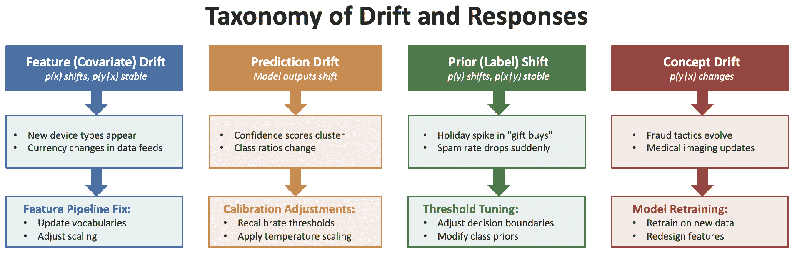
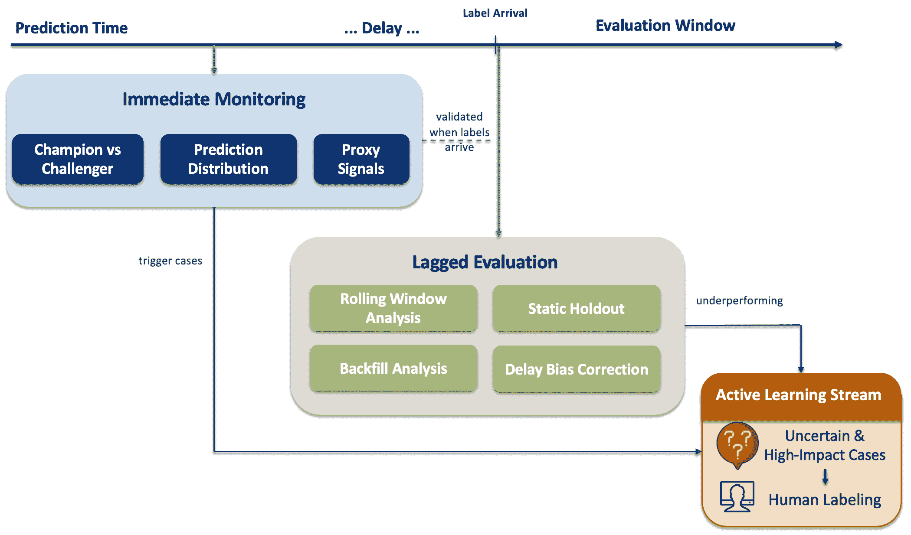
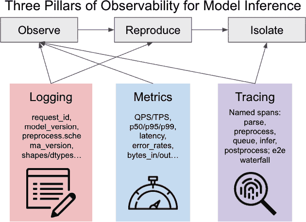
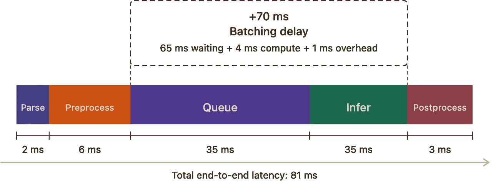
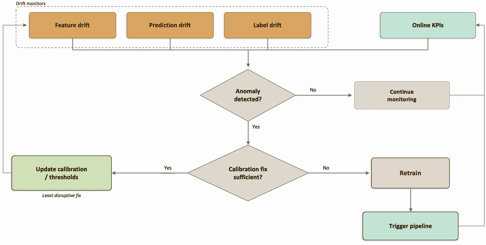
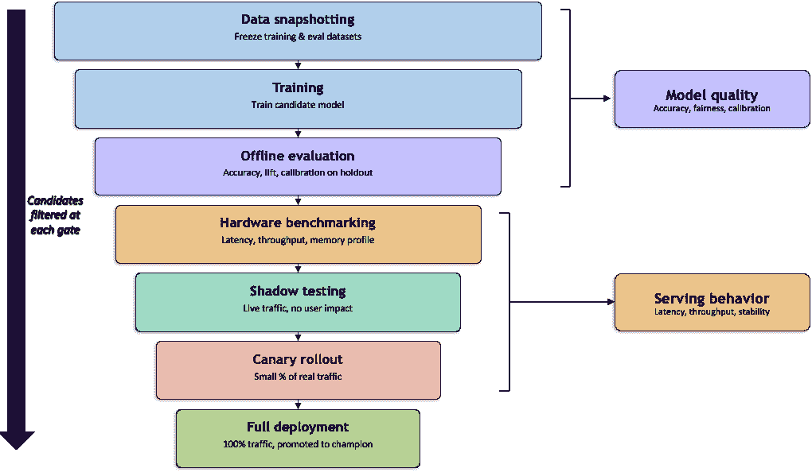
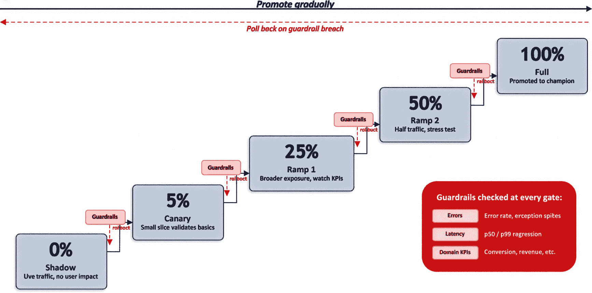

## 11 调试与重新训练已部署模型

在实验室中表现良好的模型最终会在生产中出现问题——不是因为模型“变坏了”，而是因为其周围的环境发生了变化。新的用户行为、产品更新、变化的流量模式以及不断演进的数据源，会逐渐改变模型训练时所依据的统计假设。

这些变化表现为**分布漂移**。输入p(x)可能发生偏移（协变量漂移），类别频率p(y)可能改变（先验偏移），或者输入与结果之间的关系p(y|x)可能演变（概念漂移）。甚至在标签到达之前，警告信号常常表现为预测分布或校准的变化。

与此同时，生产系统引入了自身的动态。排队、批处理、缓存行为和硬件条件会影响延迟、可靠性和成本。由于这些影响只有在真实流量下才会出现，调试已部署模型需要将推理服务视为一个可观察的系统，而不是一个静态产物。

本章聚焦于在该环境中运营模型。你将学习如何通过轻量级监控检测和分类漂移，使用结构化日志、指标和追踪来调试故障，并使用可复现的管道和受控的发布来有意识地重新训练模型。

在本章中，我们将涵盖以下主题：

- 识别和处理漂移
- 用证据进行调试
- 有目的地重新训练


## 调试与重新训练已部署模型

读完本章后，你将理解如何将已部署的 ML 模型作为生产系统来运维。你将学会如何检测和解释漂移，包括协变量（特征）漂移 p(x)、先验（标签）偏移 p(y) 和概念漂移 p(y|x)，并使用轻量级监控技术（如滚动直方图）和统计检验（如**总体稳定性指数**（**PSI**）、**柯尔莫哥洛夫-斯米尔诺夫**（**KS**）检验和**卡方（χ²）检验**）来量化数据分布是否随时间发生了变化。

你还将学会如何利用结构化日志、指标和追踪来诊断运维问题，以及如何通过审慎的重新训练工作流和受控发布（如影子测试和金丝雀发布）来维持模型质量。这些实践共同帮助将模型准确率、延迟和可靠性维持在定义的**服务级别目标**（**SLOs**）内，即生产系统预期要达成的性能目标。

### 识别并处理漂移

在生产系统中，模型性能下降通常不是因为它“遗忘”，而是因为周围环境发生了变化。数据生成过程随时间演化，这意味着联合分布 p(x, y)，包括输入分布 p(x)、类别频率 p(y) 和条件关系 p(y|x)，可能不再与训练时的数据匹配。当这种情况发生时，模型决策边界当初被验证所依赖的统计条件开始发生偏移。在实践中，这种现象被称为**分布漂移**。

由于漂移是真实世界系统的一种正常属性，应当对其进行度量和管理，而不是将其视为故障。不同类型的漂移往往需要不同的缓解措施。例如，在电商系统中，节假日期间礼品购买数量飙升，改变了类别频率 p(y)。在许多情况下，这种先验（标签）偏移可以通过调整决策阈值或对模型重新校准来处理。在移动遥测中，新的操作系统版本可能会引入以前未见过的设备类别。这种协变量（特征）漂移通常指向特征管道问题，例如词汇表过时或归一化常数过期。在其他情况下，输入与结果之间的关系发生变化，例如欺诈模式演变或政策重新定义了什么算作有害内容。这种情况被称为概念漂移，此时条件关系 p(y|x) 本身发生改变，重新训练变得必要。

因此，处理漂移的第一步是在干预之前先进行度量。输入分布 p(x) 可以通过滚动直方图和统计比较（如 PSI 或 KS 检验）来监控，这些方法用于衡量两个分布是否存在显著差异。预测行为可以通过类别分布和校准诊断（如**期望校准误差**（**ECE**））来追踪，后者衡量预测概率与观测结果之间的匹配程度。

当真值标签最终到达时，它们允许直接检验 p(y|x) 关系是否发生了变化。

这些度量有助于确定适当的应对方式。有时修复很小，例如重新校准概率或更新特征变换。在其他情况下，需要在更新的数据上重新训练。将漂移视为可度量的信号，而不是立即以重新训练应对，有助于保持生产系统稳定，同时允许模型随着环境演进进行适应。在实践中，这些不同形式的漂移在真实系统中会以可识别的模式出现。下一节将说明漂移如何在生产环境中显现，以及工程师通常如何识别它。

### 在实践中观察漂移

在生产环境中，模型运行在**非平稳的数据生成过程**之下。支配训练的联合分布 p(x, y) 很少保持不变；相反，它的一个或多个组成部分会发生移动：

- **特征（协变量）漂移**：输入分布 p(x) 发生变化，而输入与标签之间的关系 p(y|x) 大致保持稳定。

    以下是一些示例：

    - 广告**点击率**（**CTR**）模型在操作系统发布后观察到新设备类型激增；`device_model` 分类特征突然包含许多以前从未见过的 token
    - 价格弹性模型现在摄入以欧元而非美元报价的数据源，导致价格相关特征的数值范围和缩放发生变化
    - 计算机视觉管道更换了摄像头：亮度和噪声特性的变化改变了像素直方图，但标签没有改变

- **预测漂移**：这发生在模型输出的分布发生变化时（类别构成、置信度形态或校准），甚至在标签到达之前就可能出现。它可能表现为预测类别频率、置信度分数或校准的偏移。

    以下是一些示例：

    - 在相同的产品表面上，分类器的 top-1 类别频率从 [30%, 70%] 倾斜到 [55%, 45%]
    - 置信度分数聚集在 0.95 附近，而不是分布在 [0.5, 0.9] 之间，这可能表明过度自信或群体偏移

- **先验（标签）偏移**：当**类别分布** p(y) 发生变化，而条件分布 p(x|y) 大致不变时，就会发生这种情况。

    以下是一些示例：

    - 在假日季节，“礼品购买”事件的基础发生率显著上升
    - 在电子邮件服务商加强上游过滤规则后，垃圾邮件过滤器的正类率下降

- **概念漂移**：当条件关系 p(y|x) 发生变化时，就会发生这种情况，这意味着模型原来的决策边界不再反映当前环境。

    以下是一些示例：

    - 欺诈者采用新的行为模式，导致以前表示合法活动的特征现在与滥用行为相关
    - 医学影像站点升级扫描仪，改变了定义“异常”外观的放射密度分布和细微纹理
    - 政策更新重新定义了什么算“有害内容”，即使底层文本特征保持不变，标注标准也发生了变化

不同类型的漂移通常需要不同的应对方式。先验（标签）偏移通常可以通过调整决策阈值或重新校准模型输出来解决。协变量（特征）漂移通常指向特征管道中的问题，例如过时的词汇表或归一化常数。概念漂移更为严重，因为 p(y|x) 关系本身已经改变，通常需要重新训练模型，有时需要加入新特征，甚至可能需要对特征进行重新设计。在生产环境中，关键挑战是利用轻量级监控信号尽快识别出正在发生哪种类型的漂移。



*图 11.1：漂移分类及应对措施*

特征（协变量）漂移、预测漂移、先验（标签）偏移和概念漂移分别对应典型的生产环境示例及其常用干预手段。该图强调，并非所有异常都需要重新训练：某些情况更适合通过特征管道更新、校准调整或阈值调优来解决，而概念漂移通常需要模型重新训练，并可能需要对特征进行重新设计。

### 构建常驻漂移监控

漂移检测必须**廉价**、**可解释**且**持续**。不要存储大量原始负载，而是在服务层直接维护**滚动摘要**。这些摘要使系统能够高效监控分布变化，而不会增加存储或延迟开销。以下是特征类型及相应的监控策略示例：

- **数值特征**：对于数值特征，维护汇总分布的轻量级统计：
    - 每个特征的固定分箱直方图（例如 20–50 个分箱）
    - 通过 Welford 算法计算流式均值和方差，该算法提供数值稳定的在线更新
    - 最小值和最大值，以及在需要跟踪百分位数时可选择的分位数草图

- **分类特征**：应通过频率摘要来监控这些特征：
    - Top-K 频率表加上一个“其他”桶
    - 显式跟踪 *未知/未见过* token 的占比（数据契约金丝雀）

- **预测**：监控模型输出以检测预测行为的变化：
    - 类别直方图；分数十分位数
    - 校准桶：一旦标签到达，计算每个分数桶中观测到的正样本，以观察 ECE 漂移

- **健康信号**：运维信号可以揭示在统计漂移之前出现的问题：
    - `NaN`/`Inf`、全零向量、空字符串、模式不匹配和归一化失败的比率


## 调试与重新训练已部署模型

- **比较与测试**：将最近的时间窗口（例如，过去30–60分钟）与参考窗口（例如一周前的同一小时）进行比较，以考虑季节性因素。监控应依赖稳定的统计度量，以量化当前分布与参考分布之间的差异：

- 对分箱数值特征使用PSI。PSI将生产环境中特征的分布与参考分布（通常是训练数据）进行比较。其计算公式为 `PSI = Σ_{i=1}^{k} (P_i - Q_i) ln(P_i / Q_i)`，其中 `P_i` 是当前分布中第 i 个分箱的比例，`Q_i` 是参考分布中对应分箱的比例。在实践中，当 PSI 在多个监控窗口中超过 0.2 时，系统应向工程或机器学习运维团队触发告警。

- **库尔贝克–莱布勒（KL）散度**度量一个概率分布相对于参考分布的差异程度。其定义为 `D_KL(P ∥ Q) = Σ P(i) log(P(i) / Q(i))`，其中 `P(i)` 表示观测概率，`Q(i)` 表示参考概率。KL散度是**非对称的**，即从 P 到 Q 的散度不一定等于从 Q 到 P 的散度。

- **詹森–香农（JS）散度**源自KL散度，用于度量两个概率分布之间的相似性。与KL散度不同，它是**对称且始终有限的**，因此更适用于监控：`JS(P, Q) = 1/2 D_KL(P ∥ M) + 1/2 D_KL(Q ∥ M)`，其中 `M = 1/2(P + Q)`。

- 针对连续分数分布的**KS检验**度量两个累积分布函数之间的最大距离：`KS = sup_x |F_P(x) - F_Q(x)|`，其中 `F_P(x)` 和 `F_Q(x)` 分别是当前样本和参考样本的累积分布。

- 针对类别分布的**卡方（χ²）检验**比较观测频率与期望频率：`χ² = Σ_{i=1}^{k} (O_i - E_i)² / E_i`，其中 `O_i` 是观测计数，`E_i` 是参考分布下的期望计数。

- **告警**：应仅在**持续偏差**时触发，并且系统应采用**滞回机制**，使得信号恢复正常范围后告警才能解除。

- **分组（Cohorting）**：始终按地域、设备、应用版本、获客渠道或任何能划分用户群体的因素进行分层；漂移通常在扩散之前先局部化。

下表总结了生产机器学习系统中需要监控的主要信号，以及对应的汇总统计、更新频率和典型告警条件。

| 特征类型 | 汇总统计 | 更新频率 | 典型告警信号 |
| --- | --- | --- | --- |
| 数值特征 | 固定分箱直方图（20–50箱）；流式均值/方差（Welford算法）；最小值/最大值；可选分位数草图 | 滚动窗口（如30–60分钟） | 群体稳定性指数（PSI）> 0.2；均值/方差偏移；百分位数漂移 |
| 类别特征 | Top-K频率表及“其他”分箱；未知标记比例 | 持续聚合 | 未知标记增加；卡方（χ²）检验检测到变化 |
| 模型预测 | 类别分布直方图；分数十分位数；校准分箱 | 持续；当标签到达时评估 | ECE上升；类别构成偏移 |
| 运行健康信号 | `NaN/Inf`值计数；全零向量；模式不匹配；归一化失败 | 实时计数器 | 无效值激增；模式违规告警 |
| 延迟/吞吐量指标 | 延迟百分位数（p50/p95/p99）；队列深度；批量大小分布 | 每30–60秒导出指标 | p95/p99延迟增加；队列增长 |
| 群体指标 | 按地域/设备/应用版本/渠道计算的统计量 | 滚动窗口与全局监控对齐 | 漂移局限于特定群体 |

*表11.2：持续漂移监控的汇总统计*

该表将每种特征或信号类型映射到生产监控中使用的轻量级汇总、更新频率和典型告警条件。它展示了如何持续监控数值特征、类别特征、预测结果、运行健康信号、延迟指标和群体级汇总，以便在不对推理路径增加显著开销的情况下及早检测漂移。

**实现说明**：将计数器和环形缓冲区保留在C++推理进程内。即使有数十个特征，每个特征有数十个分箱，监控状态也足够小，可以容纳在**二级（L2）缓存**中，因此更新成本很低。每30–60秒导出一次汇总，以便仪表盘和告警直接消费指标，而不是从日志中重建。

以下示例展示了如何在C++中实现轻量级监控结构。固定分箱直方图高效地跟踪特征分布，PSI将参考分布与当前分布进行比较以检测漂移：

1. **固定分箱直方图结构**：`Histogram` 结构在有限的数值范围内存储固定数量分箱的计数：

   ```cpp
   #include <cmath>
   #include <cstdint>
   #include <iomanip>
   #include <iostream>
   #include <numeric>
   #include <stdexcept>
   #include <string>
   #include <vector>

   struct Histogram {
       double min_val;
       double max_val;
       std::vector<std::uint64_t> bins;
       Histogram(double min_v, double max_v, std::size_t n_bins)
           : min_val(min_v), max_val(max_v), bins(n_bins, 0) {
           if (n_bins == 0) {
               throw std::invalid_argument("n_bins must be > 0");
           }
           if (max_val <= min_val) {
               throw std::invalid_argument("max_val must be greater than min_val");
           }
       }
   };
   ```

2. **将值分配到分箱**：创建一个函数，将数值映射到其对应的直方图分箱：

   ```cpp
   std::size_t bin_index(const Histogram& h, double value) {
       if (value <= h.min_val) return 0;
       if (value >= h.max_val) return h.bins.size() - 1;
       const double width =
           (h.max_val - h.min_val) / static_cast<double>(h.bins.size());
       std::size_t idx = static_cast<std::size_t>((value - h.min_val) / width);
       if (idx >= h.bins.size()) {
           idx = h.bins.size() - 1;
       }
       return idx;
   }
   ```

3. **更新直方图**：每个输入的特征值递增一个分箱。此更新在常数时间内完成：

   ```cpp
   void update_histogram(Histogram& h, double value) {
       const std::size_t idx = bin_index(h, value);
       h.bins[idx]++;
   }
   ```

4. **将计数转换为比例**：在计算PSI之前，必须将直方图计数归一化为比例：

   ```cpp
   std::vector<double> to_proportions(const Histogram& h, double epsilon = 1e-12) {
       const std::uint64_t total =
           std::accumulate(h.bins.begin(), h.bins.end(), std::uint64_t{0});
       std::vector<double> proportions(h.bins.size(), 0.0);
       if (total == 0) {
           const double uniform = 1.0 / static_cast<double>(h.bins.size());
           std::fill(proportions.begin(), proportions.end(), uniform);
           return proportions;
       }
       for (std::size_t i = 0; i < h.bins.size(); ++i) {
           proportions[i] =
               std::max(static_cast<double>(h.bins[i]) / static_cast<double>(total),
                        epsilon);
       }
       const double sum =
           std::accumulate(proportions.begin(), proportions.end(), 0.0);
   ```


```cpp
for (double& p : proportions) {
    p /= sum;
}
return proportions;
}
```

#### 5. 计算 PSI

PSI 将参考分布与当前分布进行比较。数值越高表示分布偏移越大。以下是一种典型的解释：

- **PSI < 0.1**：轻微或没有漂移
- **PSI 0.1 到 0.25**：中等漂移
- **PSI > 0.25**：显著漂移

下面的代码用 C++ 实现了 PSI：先针对两个比例向量，再针对两个转换为归一化分箱比例的直方图。

```cpp
double compute_psi(const std::vector<double>& ref,
                   const std::vector<double>& cur) {
    if (ref.size() != cur.size()) {
        throw std::invalid_argument("ref and cur must have the same size");
    }
    double psi = 0.0;
    for (std::size_t i = 0; i < ref.size(); ++i) {
        psi += (cur[i] - ref[i]) * std::log(cur[i] / ref[i]);
    }
    return psi;
}

double compute_psi(const Histogram& reference,
                   const Histogram& current,
                   double epsilon = 1e-12) {
    if (reference.bins.size() != current.bins.size()) {
        throw std::invalid_argument("Histogram bin counts must match");
    }
    if (reference.min_val != current.min_val ||
        reference.max_val != current.max_val) {
        throw std::invalid_argument("Histogram ranges must match");
    }

    const std::vector<double> ref = to_proportions(reference, epsilon);
    const std::vector<double> cur = to_proportions(current, epsilon);
    return compute_psi(ref, cur);
}
```

上述代码片段展示了一个固定分箱直方图的简单实现，以及用于比较参考分布与当前生产窗口的 PSI 计算。

这些轻量级摘要和统计检验共同提供了一种持续监控数据和预测行为的实用方法，使生产系统能够在不给推理路径增加显著开销的情况下及早发现分布变化。

#### 选择正确的响应

并非所有漂移都需要重新训练。请选择能够以最低风险恢复性能的**最小充分**干预措施。以下指南概述了常见的漂移场景以及用于应对这些场景的典型响应：

- **先验/标签偏移（类别频率改变；特征看起来熟悉）**：从**决策阈值调整**或更新分数到动作的映射开始。如果概率保真度很重要，请应用**事后校准**（例如，温度缩放或 Platt 缩放）。在推出之前，请在**影子**模式下验证更改。

    - **示例**：在 KYC 改进后，欺诈模型的正样本基础比率减半。保持旧阈值会导致过度的拒绝。重新调整阈值并重新校准模型头部，可以在不改变权重的情况下恢复精确率/召回率。

- **存在明显数据问题的特征（协变量）漂移**：审计**特征管道**——过期的归一化常量、单位变化（kPa→psi）、词汇表爆炸或缺失值处理退化。对变换应用**热修复**（例如，提升 schema 版本），回填参考窗口，并重新评估。

    - **示例**：一个电子商务数据源开始以美分输出价格，但管道仍然除以 100，导致特征范围被压缩。修复变换立即可恢复准确性。

- **没有管道错误但质量下降的特征漂移**：边界可能需要移动。安排针对近期数据的**定向重新训练**，同时保持模型架构不变，以隔离影响。通过**影子评估**或**金丝雀发布**推广更新后的模型，并将自动回滚与 p99 延迟、错误率和领域**关键绩效指标**（**KPI**）关联。

    - **示例**：推荐模型面临目录刷新。新的长尾商品改变了共现结构。使用最新交互数据进行重新训练可恢复 CTR。

- **标签稳定且 KPI 可接受的预测漂移**：监控**校准**和置信度阈值。这种偏移可能是良性的（例如，具有不同先验的新群体），也可能是概念变化的早期指标。在影子模式中引入**挑战者**模型以构建先行指标。

    - **示例**：语音模型为具有新口音的地区提供服务。置信度得分下降，但**词错误率**（**WER**）保持稳定。在收集带标签样本以确定是否需要重新训练的同时，继续监控校准。

- **概念漂移（策略或世界已改变）**：预期需要**重新训练**，并可能需要**特征重新设计**。考虑从更新的教师模型训练**蒸馏学生模型**，以满足延迟或成本目标。如果群体发生分化，则部署**特定于群体的模型**或路由。

    - **示例**：审核策略扩展了禁止类别。新标签需要重新标注的数据和更新的词汇或语义特征。学生模型将教师模型的能力蒸馏到适用于边缘部署的 INT8 工件中。

- **区分操作错误与统计漂移**：未知类别或 `NaN` 值的激增是**数据契约违规**，应触发管道所有者的调查。相比之下，在数据契约完好情况下，PSI 平稳但持续上升通常表明真正的**统计漂移**，应提醒模型所有者。

虽然这些响应处理了可以从输入和预测中立即观察到的漂移信号，但生产系统通常只在延迟之后才收到真实标签。下一节将解释当标签在数小时或数天后到达时，如何监控模型质量并检测性能变化。

#### 处理延迟标签

在许多生产系统中，真实标签在做出预测后数小时、数天甚至数周才到达。这种延迟使得无法立即评估模型质量，因此在真实结果可用之前，监控系统必须依赖**先行指标**。

常见的先行指标包括以下内容：

- **冠军–挑战者分歧**（在影子流量上）。模型之间的分歧通常表明生产模型正在遇到新的情况。

- **弃权率或覆盖率**，例如人工审核队列增加或基于规则的回退增加。

- **预测分布监控**，包括类别构成、置信度分布或得分百分位数，这些即使在实际标签到达之前也能揭示行为变化。

- **下游代理信号**，例如退款率、申诉、安全标记或推荐系统中的点击率变化。

当标签最终到达时，使用**滞后感知滚动窗口**评估模型性能，确保仅将预测与已完成的结果进行比较。跨**群体切片**（例如，区域、设备类型或获客渠道）计算准确率、提升度和校准指标，以避免**辛普森悖论**，即聚合指标看起来稳定，而子组性能却在恶化。

如果资源允许，维护一个**定向仲裁**或**主动学习流**；对高不确定性或高影响的预测进行采样以进行人工标注。这会加速反馈循环，并在怀疑漂移时帮助更快地识别真正的性能回退。



*图 11.2：生产 ML 系统中带延迟标签的滞后感知评估*

预测通过冠军–挑战者分歧、预测分布检查和代理信号立即得到监控。一旦真实标签到达，滞后评估使用滚动窗口和回填分析、静态留出集以及延迟偏差校正来评估真实模型性能。表现不佳的群体以及不确定或高影响的案例随后可被路由到主动学习流中，以进行人工标注和更快的模型改进。

#### 操作化漂移监控

只有系统能够以一致且低风险的方式响应漂移时，漂移检测才有价值。在实践中，这意味着将漂移监控视为正常生产操作的一部分，而不是特殊情况的故障排查任务。目标是尽早让分布变化变得可见，为采取行动定义明确的阈值，并将这些信号连接到标准的运营工作流。

一个实用的漂移监控设置通常包括以下要素：

- **漂移预算**：为每个特征和每个输出定义预算，例如 PSI 阈值或允许的 ECE 范围，以及延迟、可靠性和成本 SLO。

- **核心仪表盘**：在与生产健康状态相同的仪表盘中显示漂移。警报应报告发生了什么变化、变化了多少、从何时开始、以及针对哪些群体。


## 第 11 章：调试与重新训练已部署模型

- **变更即代码**：将漂移应对措施——阈值调整、特征管道修复和重新训练——视为正常的生产变更。尽可能使用影子评估，通过金丝雀发布并配合自动回滚来推进，同时保持上一代冠军模型处于热备状态。变更成功后，轮换参考窗口，使监控不再将系统与过时的基线进行比较。

按这种方式处理，漂移将更易于管理。轻量级监控让变更可见，清晰的运行手册让应对措施保持适度，重新训练则成为**计划性维护步骤**，而非紧急反应。一个可用于生产的漂移监控工作流应包含以下内容：

- 针对数值特征、类别特征、预测结果和健康信号的实时监控
- 清晰定义并可视化的分群（cohort）
- 带滞回的告警阈值
- 链接到阈值更新、管道修复和重新训练的运行手册
- 用于影子评估、金丝雀发布和回滚的模板
- 明确定义的参考窗口处理流程

下一节将把这些监控信号转化为调试工作流，展示如何使用结构化日志、指标和追踪来复现故障并隔离其根因。

### 用证据进行调试

生产调试是一个经验性过程，而非凭空猜测。当出现异常时，例如准确率下降、p99 延迟飙升或**内存不足**（**OOM**）事件，任务是确定到底发生了什么变化，在受控条件下复现问题，并隔离根因是数值问题、数据问题还是并发问题。要可靠地做到这一点，依赖于三个核心的可观测性工具：

- **结构化日志**：每个请求都自带描述信息且可查询
- **指标**：随时间汇总速率、延迟、负载大小和错误
- **追踪**：将端到端延迟分解为命名阶段（解析、预处理、排队、推理和后处理）

有了这些工具，复现过程变得更加系统化：固定随机种子、固定形状，并捕获代表性输入。根因分析也更有针对性，因为搜索范围可以缩小到特定阶段、子系统或故障类别，而不必依赖猜测。

下图总结了可观测性如何通过将观察、复现和隔离故障的工作流与三个核心工具（结构化日志、指标和追踪）联系起来，从而支持生产调试。



*图 11.3：模型推理可观测性的三大支柱*

该图将调试工作流——观察、复现、隔离——与使该工作流切实可行的三个可观测性工具联系起来：

- 结构化日志捕获请求级细节，如请求标识、模型版本、预处理版本以及输入形状或数据类型
- 指标随时间汇总系统行为，包括请求速率、延迟分位数、错误率和负载大小
- 追踪将端到端延迟分解为命名跨度，如解析、预处理、排队、推理和后处理，从而更容易定位时间消耗在哪里

这些工具共同帮助工程师检测回归、在受控条件下复现故障，并隔离导致问题的阶段或子系统。下一步是将这些想法落实到代码中。以下示例展示了如何在 C++ 中为结构化日志、指标和追踪实现轻量级插桩。

#### 结构化日志

结构化日志应紧凑、机器可读，并且每行只输出一个事件，以便下游系统能够高效地过滤、分组和关联。每条记录至少应包含以下内容：

- **身份**：`request_id`、用户/租户、区域、分群（例如 `app_version`）
- **模型**：`model_name`、`model_version`、`preprocess_version`、`schema_version`
- **负载摘要**（**不含 PII**）：形状、数据类型、范围、批大小、设备
- **预算**：提示信息，如 `deadline_ms` 或**请求优先级**
- **结果**：状态、延迟切片、内存余量、缓存命中信息

以下示例展示了一个简单的 C++ 结构化日志辅助函数：

```cpp
#include <chrono>
#include <iomanip>
#include <iostream>
#include <sstream>
#include <string>

inline std::string iso8601_now() {
    using namespace std::chrono;
    auto t = system_clock::now();
    auto s = time_point_cast<std::chrono::seconds>(t);
    auto subsecs = duration_cast<microseconds>(t - s).count();
    std::time_t tt = system_clock::to_time_t(t);
    std::tm tm = *std::gmtime(&tt);
    std::ostringstream os;
    os << std::put_time(&tm, "%FT%T") << "." << std::setw(6)
       << std::setfill('0') << subsecs << "Z";
    return os.str();
}
```

在实践中，这个辅助函数在请求生命周期的关键点（如入口和完成时）调用最为有用。

以下是在推理前后使用它的示例：

```cpp
log_structured("INFO", "recv", "r-7f23", "resnet50", "1.12.3", "cuda:0", 8,
               "{\"shape\":[8,3,224,224],\"deadline_ms\":200}");
// ... inference happens ...
log_structured("INFO", "done", "r-7f23", "resnet50", "1.12.3", "cuda:0", 8,
               "{\"p50_ms\":12.1,\"p99_ms\":27.4,\"gpu_mem_mb\":1420,\"cache_hit\":true}");
```

结构化日志对于基于分群的调试尤其有价值。例如，假设在来自 `app_version=17.2` 的流量增加后不久出现准确率回退。由于日志包含分群标识、输入形状和预处理版本，工程师可以快速发现只有该分群出现了新的输入形状和预处理范围。这指向的是数据契约问题，而非模型质量回退。

#### 进程内指标

日志提供了细节，但不是监控趋势的最佳方式。为此，你需要在推理进程内部维护低成本、始终开启的指标。一个小的进程内聚合器——通常由原子操作和环形缓冲区构建——可以用极小的开销汇总请求计数、排队时间、推理时间、负载大小和错误计数。

以下示例展示了一个最小的指标结构体：

```cpp
#include <atomic>
#include <cstdint>

struct Metrics {
    std::atomic<uint64_t> req_total{0};
    std::atomic<uint64_t> err_total{0};
    std::atomic<uint64_t> q_time_us{0};
    std::atomic<uint64_t> infer_time_us{0};
    std::atomic<uint64_t> bytes_in{0};
    std::atomic<uint64_t> bytes_out{0};

    void observe_request(uint64_t q_us, uint64_t i_us,
                         uint64_t in_b, uint64_t out_b) {
        req_total++;
        q_time_us += q_us;
        infer_time_us += i_us;
        bytes_in += in_b;
        bytes_out += out_b;
    }

    void observe_error() {
        err_total++;
    }
};
```

当指标以你的监控栈可以抓取或摄入的格式定期导出时，它们就变得有用了。一种简单的方法是每隔几秒刷新一次快照。以下 C++ 代码是定期刷新指标的辅助函数：

```cpp
#include <iostream>

inline void flush_metrics(const Metrics& m) {
    std::cout
        << "req_total " << m.req_total.load() << "\n";
}
```


```cpp
 << "err_total " << m.err_total.load() << "\n"
 << "q_time_us " << m.q_time_us.load() << "\n"
 << "infer_time_us " << m.infer_time_us.load() << "\n"
 << "bytes_in " << m.bytes_in.load() << "\n"
 << "bytes_out " << m.bytes_out.load() << "\n";
}
```

一旦这些指标可用，调试问题就变得更加具体。平均批大小是否下降，导致利用率降低？队列时间增长而推理时间保持不变，是否意味着存在批处理截止时间问题？`bytes_in` 是否突增，表明有效载荷膨胀？这些信号有助于确定下一步实验。

#### 追踪

指标告诉你延迟发生了变化；追踪则告诉你在哪里发生变化。追踪将端到端延迟分解为命名的时间片段（span），使工程师能够区分，例如，解析请求所花费的时间与在微批处理器中等待或在 GPU 上执行所花费的时间。

添加追踪的一种简单方式是使用作用域计时器，将 span 的持续时间写入结构化日志：

```cpp
#include <chrono>
#include <string>

struct Span {
    std::string name, req_id;
    std::chrono::high_resolution_clock::time_point t0;
    Span(std::string n, std::string r)
        : name(std::move(n)), req_id(std::move(r)), t0(std::chrono::high_resolution_clock::now()) {}

    ~Span() {
        auto us = std::chrono::duration_cast<std::chrono::microseconds>(
            std::chrono::high_resolution_clock::now() - t0).count();
        log_structured("TRACE", "span", req_id, "resnet50", "1.12.3", "cuda:0", 1, std::string("{\"span\":\"") + name + "\", \"dur_us\":" + std::to_string(us) + "}");
    }
};
```

然后可以按阶段对请求处理器进行插桩：

```cpp
void handle_request(const Request& r) {
    Span s_all("req_total", r.id);
    { Span s_parse("parse", r.id); /* parse request */ }
    { Span s_pre("preprocess", r.id); /* preprocess */ }
    { Span s_queue("queue", r.id); /* micro-batcher wait */ }
    { Span s_infer("infer", r.id); /* model.forward(...) */ }
    { Span s_post("postprocess", r.id); /* postprocess */ }
}
```

如果 P99 延迟上升了 80 毫秒，而追踪显示 queue span 增加了约 70 毫秒，同时推理时间保持平稳，那么问题很可能出在节奏控制或批处理上，而不是模型内核变慢。下图展示了这一模式。



*图 11.4：推理请求的瀑布式追踪示例*

请求追踪将端到端延迟分解为解析、预处理、排队、推理和后处理等 span。展开的 queue span 显示，延迟主要来自批处理等待时间，而不是计算时间。

结构化日志、指标和追踪共同提供了调试所需的原始证据。下一步是让故障可复现，从而将这些信号转化为受控的诊断过程。

#### 使故障可复现

无法复现的缺陷很难有信心去修复。复现需要相同的位、相同的数学运算和相同的控制流。在实践中，这意味着要固定随机性来源、记录足够的元数据以重建请求，并部署低成本的哨兵检查，以便在故障源头附近捕获故障。

从随机性、形状和输入入手：

- **随机种子**：固定所有随机数生成器，包括 `std::mt19937` 和库随机数生成器（RNG）。
- **形状和数据类型**：显式记录它们；隐式广播和类型提升常常隐藏缺陷。
- **复现包（repro pack）**：当异常发生时，捕获一个紧凑的数据包，其中包含模型版本、预处理版本、标志位、随机种子、归一化输入或可复现哈希，以及设备和驱动/运行时信息。

以下代码片段展示了一个最小化的复现包定义：

```cpp
#include <random>
#include <string>

struct ReproPack {
    std::string model_ver;
    std::string preprocess_ver;
    std::string device;
    std::string flags;
    uint64_t seed;
    // Optional: small binary blob for normalized inputs, or hashes plus reconstruction method.
};

inline std::mt19937 make_rng(uint64_t seed) {
    return std::mt19937{static_cast<unsigned>(seed)};
}
```

一条实用的运维准则是：只存储复现故障所需的内容，同时避免保存原始用户负载，除非策略明确允许。在许多系统中，复现包应包含以下之一：

- 经过归一化的张量，敏感字段已脱敏
- 稳定的哈希以及一种确定性的重建方法
- 受限环境中隔离样本的指针

这样既能保持调试流程高效，又不会使其变成不受控的数据留存途径。

另一个实用的防护措施是，在数值上有风险的操作（如归一化、除法、对数、指数或 softmax）之后，立即添加哨兵检查，例如廉价的 `NaN`/`Inf` 守卫：

```cpp
#include <cmath>

template <typename T>
bool has_nan_inf(const T* data, size_t n) {
    for (size_t i=0;i<n;++i)
        if (!std::isfinite(static_cast<double>(data[i]))) return true;
    return false;
}
```

如果哨兵被触发，请记录当前活跃的 span 路径并持久化一个复现包。在金丝雀或影子环境中，通常最好快速失败。在生产环境中，系统通常需要一条回退路径，例如基于规则的响应、缓存结果或降级但安全的输出。

掌握了可复现的故障后，下一个任务就是正确地对缺陷进行分类。

### 隔离缺陷类别

大多数生产环境调试可归为三大类：数值类缺陷、数据契约类缺陷和并发类缺陷。关键在于快速分类，因为每个类别对应不同的诊断工具和可能的修复方案。

#### 数值类缺陷

数值类缺陷通常表现为概率不稳定、`NaN` 或 `Inf` 传播，或不同设备和精度下的输出差异。常见症状包括：

- Softmax 或 sigmoid 意外饱和
- FP16 或 BF16 失败而 FP32 保持稳定
- 输出随编译器或硬件目标而变化
- 量化模型将置信度压缩到极端值

典型策略包括：

- 使用数值稳定的形式，例如对 softmax 使用 `log-sum-exp`
- 为除法或平方根添加 epsilon 截断
- 将 FP32 与 FP16 或 BF16 的输出进行比较
- 诊断期间禁用激进的快速数学优化
- 检查平台上的非规范数（denormal）和刷新为零（flush-to-zero）行为

以下辅助函数展示了稳定的 `log-sum-exp` 实现：

```cpp
#include <algorithm>
#include <cmath>

float stable_logsumexp(const float* x, int n) {
    float m = x[0];
    for (int i = 1; i < n; ++i) {
        m = std::max(m, x[i]);
    }
    double acc = 0.0;
    for (int i = 0; i < n; ++i) {
        acc += std::exp(double(x[i] - m));
    }
    return m + float(std::log(acc));
}
```

根据用例不同，例如 INT8 量化模型，对于较大的 logits，置信度可能会饱和到 0 或 1，而 FP32 参考值依然表现良好。这种情况下，修复方案很可能涉及在易受影响的层进行重新缩放、重新校准或混合精度。

#### 数据契约类缺陷

数据契约类缺陷发生在模型与传入数据在结构、编码、单位或允许值上不再一致时。症状包括：

- 未知类别突然增多
- 特征上的 PSI 或 KS 指标突增
- 形状或数据类型不匹配
- 权重不变但校准漂移

典型策略包括：

- 在每个请求上强制使用模式版本
- 对未知模式版本进行路由或拒绝
- 监控未知 token 的比例
- 从已知良好的时间窗口重新计算归一化统计量
- 为单位假设编写显式测试，例如毫秒与秒、美分与美元


## 调试与重新训练已部署模型

一个常见的例子是：支付数据流将货币单位从美元切换为美分，而特征管线仍然继续除以 100。于是，模型看到的特征范围被压缩，校准效果下降，准确率也随之降低——尽管权重并没有改变。问题出在变换（transform）环节，而不是重新训练。

#### 并发与同步错误

当服务在并行执行时的行为与单独执行时不同，就会出现并发错误。常见症状包括：

- 非确定性故障
- 偶发超时
- 死锁
- 释放后使用（use-after-free）
- GPU 内核故障在远离原始 bug 的位置才暴露

在 CPU 侧，常见策略包括：

- 使用 **AddressSanitizer**（**ASan**）、**ThreadSanitizer**（**TSan**）以及未定义行为检测器（undefined-behavior sanitizers）进行编译
- 尽量减少共享的可变状态
- 在可行的情况下优先使用队列或消息传递
- 在热点路径上，使用原子操作处理简单计数器，而不是加锁

在 GPU 侧，首先要逐一检查每个 CUDA 调用，并在可疑路径上强制同步。下面的代码片段展示了 CUDA 错误检查宏：

```cpp
#include <cassert>
#include <cuda_runtime.h>
#include <iostream>

#define CUDA_CHECK(call) do { \
    cudaError_t err__ = (call); \
    if (err__ != cudaSuccess) { \
        std::cerr << "CUDA error " \
                  << cudaGetErrorString(err__) \
                  << " @ " << __FILE__ << ":" << __LINE__ << "\n"; \
        assert(false); \
    } \
} while (0)
```

在诊断时，通常值得设置 `CUDA_LAUNCH_BLOCKING=1`，或者在可疑启动之后插入 `cudaDeviceSynchronize()`，这样故障会在更接近真正源头的位置暴露出来。`compute-sanitizer` 等设备端工具对于捕获非法访问和竞争条件特别有用。还要检查缓冲区生命周期、流顺序和分配器行为；很多看似随机的 GPU 故障其实是由高负载下的释放后使用或碎片化引起的。

下表总结了常见的 CUDA 故障以及首要诊断步骤：

| CUDA 症状 | 可能原因 | 首要诊断步骤 |
|---|---|---|
| 非法内存访问 | 索引越界、过期指针、已释放缓冲区 | 使用 `compute-sanitizer` 运行 |
| 未指定的启动失败 | 较早的异步内核故障延迟暴露 | 设置 `CUDA_LAUNCH_BLOCKING=1` |
| 突发负载下的 OOM | 碎片化、分配器频繁波动、批次突增 | 检查分配器日志和批次大小 |
| 非确定性错误输出 | 流顺序问题、竞争、过期缓冲区重用 | 添加显式同步/事件，并对比隔离运行 |

*表11.1：常见 CUDA 运行时问题快速诊断参考*

只有在高 **每秒查询数**（**QPS**）下才会出现的罕见崩溃，往往其实是并发问题，而不是数值问题。例如，如果追踪数据显示队列等待时间很长，而分配器日志显示频繁重新分配，那么使用带有预分配内存区域的池化分配器，或许能同时消除碎片化和该崩溃。

一旦理解了主要的 bug 类型，就更容易诊断服务系统中最常见的运维困惑之一：排队时间与计算时间。

#### 区分排队时间与计算时间

当 p99 延迟上升时，原因往往不是模型内核本身，而是请求等待分批所花费的时间。一个带有监控的小型微批处理器可以让这种区别变得显而易见。下面的示例展示了一个极简的批处理工作线程：

- 以下是所需的头文件：

  ```cpp
  #include <condition_variable>
  #include <deque>
  #include <future>
  #include <mutex>
  #include <thread>
  ```

  这些头文件提供了微批处理器所使用的同步与并发原语。条件变量让工作线程休眠，直到新请求到达；deque 存储排队任务；promise–future 对则允许异步返回结果。互斥锁保护共享状态，thread 头文件则用于在后台运行批处理工作线程。

- 以下是张量占位符：

  ```cpp
  using Tensor = torch::Tensor;
  ```

  这一行将 `Tensor` 定义为应用实际使用的张量类型的别名。在本示例中，它指代 `torch::Tensor`，但分批逻辑换成其他张量表示方式也同样适用。使用别名能让代码更紧凑，也便于以后更换为不同的后端。

- 以下是一个排队请求：

  ```cpp
  struct Task {
      std::string id;
      Tensor x;
      std::promise<Tensor> p;
  };
  ```

  每个排队的请求都表示为一个任务。它包含请求标识符、输入张量，以及一个最终会保存输出张量的 promise。这让调用方可以立即提交工作，稍后通过与之一一对应的 future 获取结果。

- 以下是类定义：

  ```cpp
  class MicroBatcher {
  public:
      MicroBatcher(size_t max_batch, int max_delay_ms);
      ~MicroBatcher();
      std::future<Tensor> submit(std::string id, Tensor x);
  private:
      void run();
      size_t max_batch_;
      int max_delay_ms_;
      std::mutex mu_;
      std::condition_variable cv_;
      std::deque<Task> q_;
      std::thread worker_;
      bool stop_;
  };
  ```

  `MicroBatcher` 类拥有队列、同步原语和后台工作线程。两个配置参数 `max_batch_` 和 `max_delay_ms_` 决定了最多能合并多少个请求，以及系统在处理一个未满批次前愿意等待多长时间。这两个参数共同控制吞吐量与延迟之间的权衡。

- 以下是构造函数：

  ```cpp
  MicroBatcher::MicroBatcher(size_t max_batch, int max_delay_ms)
      : max_batch_(max_batch),
        max_delay_ms_(max_delay_ms),
        stop_(false) {
      worker_ = std::thread([this] { run(); });
  }
  ```

  构造函数初始化分批参数并启动后台工作线程。从此刻起，批处理器就可以接受请求了。让工作线程在独立线程中运行，可以使提交与执行异步进行。

- 以下是析构函数：

  ```cpp
  MicroBatcher::~MicroBatcher() {
      {
          std::lock_guard<std::mutex> lk(mu_);
          stop_ = true;
      }
      cv_.notify_all();
      worker_.join();
  }
  ```

  析构函数会干净地关闭工作线程。它在持有互斥锁时设置 **stop** 标志，如果工作线程正在条件变量上等待，则将其唤醒，然后 join 该线程。这可以确保所有资源都被安全释放，也确保批处理器不会在仍有工作进行时退出。

- 以下是提交请求的方法：

  ```cpp
  std::future<Tensor> MicroBatcher::submit(std::string id, Tensor x) {
      std::promise<Tensor> p;
      auto f = p.get_future();
      {
          std::lock_guard<std::mutex> lk(mu_);
          q_.push_back({std::move(id), std::move(x), std::move(p)});
      }
      cv_.notify_one();
      return f;
  }
  ```

  `submit` 函数将请求封装为任务，追加到共享队列中，并唤醒工作线程。它会立即返回一个 future，使调用方无需阻塞即可继续执行。一旦批次处理完成，工作线程会兑现对应的 promise，调用方就可以通过该 future 获取结果。

- 以下是工作线程主循环：

  ```cpp
  void MicroBatcher::run() {
      for (;;) {
          std::deque<Task> batch;
          {
              std::unique_lock<std::mutex> lk(mu_);
              if (stop_ && q_.empty()) break;
              if (q_.empty()) {
                  cv_.wait(lk);
                  continue;
              }
              auto deadline =
                  std::chrono::steady_clock::now() +
                  std::chrono::milliseconds(max_delay_ms_);
              while (q_.size() < max_batch_) {
                  if (cv_.wait_until(lk, deadline) == std::cv_status::timeout) {
                      break;
                  }
                  if (stop_) break;
              }
          }
      }
  }
  ```


## 调试与重新训练已部署模型

```cpp
while (!q_.empty() && batch.size() < max_batch_) {
    batch.push_back(std::move(q_.front()));
    q_.pop_front();
}
}
// Run one batched inference here.
for (auto& t : batch) {
    t.p.set_value(Tensor{});
}
}
}
```

工作循环是微批处理器的核心。它等待请求出现，然后启动一个计时器并持续收集请求，直到批次达到配置的最大大小，或等待时间达到配置的上限。批次组装完成后，工作器释放锁，并通常会执行一次批推理调用。推理完成后，它会兑现每个 promise，让原始调用方收到各自的输出。这种设计让排队时间变得明确，并帮助工程师在排查延迟退化时，将批处理延迟与计算时间区分开来。

一种常见的故障模式是这样的：为了提升吞吐量，批处理截止时间从 8 毫秒增加到 25 毫秒，但移动端用户的 p95 延迟突然变差。追踪显示额外时间花在了 `queue` 上，而不是 `infer` 上。修复方法不是修改模型架构或权重，而是对延迟敏感的分群使用更小的批处理延迟。

### 使用以证据为先的运维手册

一份有用的运维手册应当从最具区分度的信号开始，再逐步推进到成本最高的调查手段。一个简单的顺序如下：

1. **追踪**：定位有问题的 span：队列、预处理、推理，还是后处理？
2. **批处理统计**：平均/p95 批大小是下降（利用率损失）还是飙升（队列截止时间过长）？
3. **分配器日志**：GPU 余量是否缩小（碎片化/新模型）？是否出现 OOM 重试？
4. **缓存**：分词器/嵌入缓存是否变冷？淘汰策略是否改变？
5. **部署**：模型、预处理、驱动或运行时是否有更新？将时间戳关联起来，如果对齐则回滚。
6. **分群**：是否有新的 `app_version`、设备或区域出现了更重的预处理或更大的负载？
7. **GPU 健康状态**：时钟是否被限制，或是否存在流式多处理器（SM）占用率回退？如果需要，对一个样本进行剖析。

以下清单可供值班工程师在事件期间用作值班调试清单：

- 从追踪中识别占主导地位的慢 span
- 比较排队时间和推理时间
- 检查批大小分布
- 按分群检查错误率峰值
- 确认最近的部署和配置变更
- 检查分配器和缓存健康状况
- 确认问题是否在固定种子和固定形状下可复现

以这种方式使用时，以证据为先的调试用可复现的方法取代了直觉猜测。结构化日志解释每个请求，指标揭示趋势，追踪显示时间消耗在哪里。一旦故障可复现并被正确分类，修复就会变得有针对性，而不是猜测性的。

下一节将从诊断转向干预：如何有目的地重新训练、安全地发布，并让部署与不断变化的环境保持同步。

### 有目的地重新训练

生产模型应该因为证据表明有必要而刷新，而不是因为某个仪表盘略微变动，或团队感到不安。有目的地重训意味着三件事：决定何时需要重训，让重训过程可复现，并在与生产环境相同的约束下评估候选模型。

#### 决定何时重训

并非每个异常都值得一个新模型。首要任务是区分两类情况：一类可以通过阈值更新或校准修复来处理，另一类则是学到的决策边界已经不再合适。

例如，在欺诈系统中，周末假期可能同时改变设备分布和欺诈基准率。如果特征分布发生漂移，但在线校准仍然良好，模型可能不需要重训。如果特征管道保持稳定，而校准变差，那么更新阈值或校准可能就足够了。相比之下，概念漂移发生在特征与结果之间的关系发生变化时——由于新的攻击者行为、策略更新或底层任务的变化。这时重训才变得必要。

推荐系统也表现出类似的模式。目录刷新可能会改变物品共现结构和冷启动行为。如果评分分布变窄，并且点击率或停留时长指标专门对新用户或新物品下降，那么重训最相关的模型组件可以在不改变整个系统的情况下恢复性能。下图总结了这一决策流程。



*图 11.6：重训触发条件与决策流程*

系统监控特征、预测和标签漂移，在线 KPI 输入决策节点。如果问题是校准或阈值，该路径会先更新这些；否则，重训分支会启动管道。

一旦重训有理有据，下一个要求就是可复现性。生产重训应当可重复、可审计，并与服务阶段使用的数据和特征逻辑保持一致。

#### 让重训具有确定性

重训应该在几个月后也能被另一位工程师复现。这首先要冻结一个限定时间范围的数据快照并记录其哈希。分割应基于时间或实体，具体取决于泄漏风险。如果季节性很重要，可以显式地对近期数据重新加权，而不是通过临时采样隐式实现。

特征生成应与生产完全一致，理想情况下通过共享库或特征存储实现。当变换改变时，模式版本也应随之改变。种子、超参数、损失定义和正则化设置都应作为训练配方的一部分记录下来。

然后，模型注册表应记录以下内容：

- 数据集版本和哈希
- 特征模式版本
- 代码提交
- 种子值
- 离线指标
- 导出的产物，如 FP32、FP16、BF16 或 INT8 变体

如果候选模型无法从这些要素中重建，就不能安全上线。下图展示了从快照到发布的重训漏斗。



*图 11.7：候选模型评估漏斗*

候选模型依次经过数据快照、训练、离线评估、硬件基准测试、影子测试、金丝雀发布和完全部署。在发布之前，必须同时验证模型质量和服务行为。

候选评估漏斗概述了发布的各个阶段；下一节将说明用于决定候选模型是否可以进入下一阶段的统计与系统标准。

#### 在服务约束下评估模型

离线胜利是必要的，但还不够。从大型教师模型蒸馏出的学生模型可能显示 AUC 提升 0.3 个百分点，但延迟预算超了 2 倍，或内存上限超出 1 GB。需要从两个维度进行评估：

- **统计质量**应包含在 AUC、F1 和对数损失等指标上的持平或改进，以及 ECE 或 Brier 分数等校准度量。这些检查还应按区域、设备、应用版本或其他关键分群进行切片，以确保收益没有掩盖某个子组中的回退。
- **系统性能**应包含 p50、p95 和 p99 延迟；稳态和峰值内存；加载时间；以及在目标硬件上以实际批大小运行的吞吐量。如果 INT8 提高了速度，但使校准劣化超过约定阈值，那么即使吞吐量更好，也可能不可接受。

将这些期望编码下来的一种实用方式是通过一个小型版本化验收门禁。下面是一个示例：

```yaml
# acceptance.yaml
offline:
  require:
    auc_delta: ">= -0.001" # no worse than -0.1 pt vs champion
    logloss_pct: "<= +2%"  # ≤2% regression
    ece_pct: "<= +10%"     # calibration within 10%
systems:
  target: "A10G"
  require:
    p95_ms: "<= 35"
    max_mem_gb: "<= 3.0"
    load_ms: "<= 500"
    throughput_qps: ">= champion"
```

只有同时通过这两个部分的候选模型才能进入在线测试。


## 第 11 章：调试和重新训练已部署的模型

### 安全发布

通过渐进式发布阶梯，将模型从实验室推向生产环境。在**影子模式**下，将所有请求镜像到候选模型，同时不影响用户。将候选模型的决策、分数和延迟与当前线上模型（champion）进行对比。如果分歧集中在某一个群体（cohort），例如一种新设备类型，往往就能揭示概念漂移正在哪里显现。当标签延迟到达时，影子评估尤其有价值，因为它能在真实结果可用之前提供早期信号。

如果影子评估表现正常，模型就可以进入**金丝雀发布**（canary rollout）。一份实用的发布计划应包含以下要素：

- **从小流量开始**：先接入一小部分流量，例如 5%
- **定义自动化护栏**：按群体监控 p95 延迟、错误率和领域 KPI 变化量
- **设置回滚条件**：例如，如果高风险商户的拒付率上升 0.15 个百分点，或 p95 延迟连续超过 45 毫秒达 10 分钟以上，欺诈模型应回滚
- **逐步放量**：如果金丝雀保持健康，就逐步增加流量占比，例如 5%、25%、50%、100%
- **让此前的线上模型保持热备**：之前的模型应常驻内存，这样回滚只是一次配置变更，而不是冷启动

这种分阶段的方法降低了部署风险，同时确保在发布推进过程中，模型质量和在线服务行为都保持在可接受的范围内。



*图 11.8：带护栏的发布阶梯*

图中展示了一条从影子模式到 5%、25%、50%、100% 的阶梯式发布路径，每一道关口都会检查延迟、错误率和领域 KPI 的回滚阈值。逐步推进；一旦触发护栏即自动回滚。

### 发布后闭环

发布并不是终点——而是重置基线的时刻。将漂移检测和校准所用的参考基准更新为新模型，归档**血缘信息**（lineage）——数据哈希、代码、产物、验收报告以及影子/金丝雀仪表盘——并按你偏好的节奏安排下一次检查点，同时让漂移触发器保持启用。如果你保留了**人在回路**（human-in-the-loop）通道（例如一个用于高不确定度案例的小型人工裁决队列），就将这些新鲜、富含信息的标签喂入下一个快照，以便在模型最吃力的地方加以改进。

### 两个具体场景

第一个场景是金融科技欺诈检测。在移动操作系统发布之后，漂移监控发出告警：`device_type` 的 PSI 不断上升，“unknown”值增加了 15%。你首先修补特征管道（SDK 开始产生一个新的枚举值）并提升 schema 版本号；无需改动模型，校准便迅速恢复。两个月后，假日购物改变了商户构成和基础比率；尽管特征稳定，校准仍然恶化。你重新校准阈值，并在几分钟内完成部署。到了 1 月，攻击者转变策略；影子模式显示分歧集中在礼品卡商户上。你用最近六周的数据重新训练，保持架构不变，导出 FP16 和 INT8 变体，以 p95 ≤35 ms 为门槛，并通过带拒付率护栏的金丝雀发布上线。

第二个场景是电商搜索排序。春季商品目录刷新新增了数千个 SKU。预测漂移表现为分数分布变宽；冷启动商品的 CTR 趋于平缓。你只用最新的目录数据和用户行为重新训练了物品塔（item tower）的嵌入，保留用户塔（user tower）以降低风险。学生模型通过了离线关卡，在 FP16 下 p95 延迟改善 20%，并顺利通过 10% 的金丝雀发布，没有任何 KPI 回退。全量发布在 48 小时内完成；参考基准和预算也随之更新。

按照这种方式，重新训练变成了一项常规的系统运维操作，而不是一场救火演习：触发条件有统计依据，管道端到端可复现，评估遵循生产约束，发布在改进模型的同时保护用户和收入。

### 小结

本章将已部署的模型视为一个处于持续观察之下的系统。我们首先展示了生产模型如何随环境变化而发生漂移，以及如何用轻量级、常驻运行的摘要和稳定的统计检验来检测这种漂移。你学会了如何区分特征漂移、预测漂移、先验偏移和概念漂移，以及如何使用基于群体的监控，将局部故障与大规模系统变更区分开。

随后，我们转向生产环境中的调试。结构化日志、指标和追踪提供了观察回退、复现故障和定位根因所需的证据。借助固定种子、可复现的输入，以及针对数值不稳定、数据契约违例和并发 bug 的定向检查，调试变成了一种有章可循的过程，而不是靠猜测。

最后，我们把重新训练视为一项运维决策。重新训练应当由证据触发，通过可复现的管道实施，在真实的服务约束下评估，并通过影子测试和带回滚护栏的金丝雀发布逐步推进。综合起来，这些实践有助于让模型质量、延迟和成本保持在生产环境所要求的服务水平之内。

在下一章中，我们将延续这一运维视角，专注于对已部署模型进行长期监控。你将学习如何定义面向生产的指标、在标签延迟到达时追踪质量，以及如何将监控信号连接到告警和更长期的系统维护。

### 思考题

以下问题回顾了本章的主要观点，并帮助你强化有效调试、监控和重新训练已部署模型所需的运维思维：

1. 定义并对比协变量（特征）漂移、标签/先验偏移、预测漂移和概念漂移。针对每一种，说明一个可能的补救措施。

2. 你的仪表盘显示，分类特征 `device_type` 的“unknown”值突然激增，而模型权重没有变化，准确率却在下降。你首先会调查什么？为什么？

3. 你为数值特征维护固定分箱直方图，并计算一小时实时窗口与季节匹配参考窗口之间的 PSI。`amount_usd` 的 PSI 反复测得 0.28。你会如何应对？

4. 在高吞吐量服务的漂移检测中，为什么我们更倾向于使用滚动摘要（直方图、分位数和 Top-K 表），而不是存储原始负载？

5. 一次部署后，p95 延迟回退了 20 毫秒。在日志、指标或追踪这三大可观测性支柱中，哪一个能告诉你时间消耗在哪里？为什么？

6. 尽管模型计算耗时没有变化，p99 延迟却随流量峰值翻了一倍。请说出两个可能的原因，以及一种确认它们的方法。

7. 请列出在一条结构化、自描述的推理日志行中应包含的五个字段（不含个人身份信息，PII）。

8. 在制作可复现包（repro pack）时，为什么要固定 RNG 种子并记录张量形状/数据类型？

9. 在 GPU 上，某个内核会间歇性失败，而且失败发生的时间远晚于导致它的代码。请解释 `CUDA_LAUNCH_BLOCKING=1` 会改变什么，以及你会在何时使用 compute-sanitizer（`cuda-memcheck` 的现代替代工具）。

10. 在线校准发生了漂移，但输入的 PSI 保持平稳。在重新训练之前，可以尝试哪种低风险修复？

11. 针对候选模型，定义影子测试与金丝雀发布的区别，并分别给出你在每个阶段会监控的一项指标。

12. 某个候选模型在离线评估中使 AUC 提升了 0.3 个百分点，但在目标 GPU 上的延迟超出了你的延迟 SLO 达 2 倍。它是否应该进入金丝雀发布？请解释你的答案。

13. 在在线测试之前，说出你会编入验收策略的一项离线关卡和一项系统关卡。

14. 描述一种快速流程，用于在生产环境中区分数值稳定性 bug 与数据契约 bug。

15. 在发布新的线上模型后，列出三项“闭环”后续工作。

### 延伸阅读

以下参考资料为想要更深入探索本章主题的读者提供了额外的背景知识和实践细节：

- 斯库利等人（Sculley et al.），*《机器学习系统中隐藏的技术债务》*。一篇关于模型训练之外运维陷阱的经典论文。
- 布雷克等人（Breck et al.），*《ML 测试评分》*。一份适用于 ML 系统生产就绪性和监控的检查清单。
- OpenTelemetry 规范。提供了追踪、指标和日志的标准概念；有助于设计横跨预处理、推理和后处理的追踪跨度。
- *Prometheus 文档*。涵盖指标暴露格式、直方图/摘要语义、SLO 告警规则和漂移预算。


## 第 11 章

- *NVIDIA CUDA C++ 编程指南 / Nsight Systems 与 Nsight Compute 指南*。它们是用于 GPU 调试、性能分析和稳定性检查的实用工具。
- *Evidently AI 文档（漂移和数据质量报告）*。PSI/KS、校准检查和分群仪表盘的具体实现。
- *Alibi Detect（漂移检测）*。适用于在线服务的协变量漂移和概念漂移方法。
- Bird 等人，《公平性与校准》。为什么校准很重要，以及如何衡量它（ECE/Brier），尤其是在分布偏移情况下。
- *关于量化和蒸馏的论文*（例如 Jacob 等人的 INT8 量化；Hinton 等人的蒸馏）。当重训练与系统约束交织时。
- *Google SRE 工作手册（SLI/SLO）*。告警设计（延迟/错误预算）的基础，可复用于机器学习端点。

### 答案

以下是复习题的答案，并强化本章介绍的核心概念：

1. **答案：**
   - **协变量漂移**：输入分布发生变化
   - **标签/先验偏移**：类别比例发生变化
   - **预测漂移**：模型输出分布发生变化
   - **概念漂移**：潜在的 X→Y 关系发生变化
2. 在特征管道中排查数据契约问题（新的 `device_type` 枚举或解析逻辑变更）。未知率飙升指向数据摄取/编码环节，而非学到的决策边界。
3. 如果 PSI 在多个监控窗口内保持在 0.28 左右，说明特征分布存在实质性漂移。确认没有单位/schema 变更；如果管道干净，安排一次针对性的新数据重训练。如果是季节性/预期变化，可考虑分群特定阈值或重新校准。
4. 摘要统计具有隐私保护、维护成本低、比较速度快等优点。它们避免了繁重的存储/连接操作，让你能在微秒级计算 PSI/KS，从而在热路径上实现持续监控。
5. 追踪（span）可以精准定位慢速阶段（排队 vs 预处理 vs 推理 vs 后处理）。指标显示延迟上升；追踪则显示*具体在哪里*。
6. 原因：排队/微批处理效率低下（批次更小、等待更长），以及资源争用/冷缓存（分词器/嵌入缓存未命中）。可通过追踪（更大的“queue” span）和指标中的批次大小分布来确认；缓存命中率指标可佐证。
7. 示例字段：`ts`、`request_id`、`model_name`、`model_version`、`schema_version`、`device`（`cpu/cuda:0`）、`batch_size`、形状/数据类型，以及时间预算（截止时间）。
8. 随机种子和形状/dtype 可确保相同数值路径的确定性重现；细微的 bug 往往取决于广播规则、精度和由 RNG（随机数生成器）驱动的分支。
9. `CUDA_LAUNCH_BLOCKING=1` 强制内核同步启动，因此失败点会立即显现。使用 compute-sanitizer 捕获设备上的非法内存访问、竞态条件和越界访问。
10. 应用阈值和/或校准更新（例如 Platt 缩放/温度缩放）。这会使预测概率与观测结果对齐；阈值调整在不重训练模型的情况下改变决策规则。
11. **影子模式**：候选模型运行在镜像流量上，对用户无影响；监控分歧率和延迟持平情况。**金丝雀发布**：候选模型服务一小部分真实请求；按分群监控 p95 延迟、错误率和领域 KPI，并支持自动回滚。
12. 不能。候选模型除了满足离线质量外，还必须达到系统 SLO。延迟超出预算 2 倍会损害用户体验；应继续迭代（编译/量化/剪枝）或拒绝。
13. **离线门禁**：AUC ≥ 冠军模型 − 0.001，且 ECE ≤ +10%。**系统门禁**：在 A10G、batch=8 下，p95 ≤ 35 ms 且 VRAM ≤ 3 GB。两项都必须通过才能进行在线测试。
14. **数值问题与数据契约**：在固定输入集上分别用 FP32 与 FP16 复现；如果 FP32 稳定而 FP16 失败，应怀疑数值稳定性。如果失败与 schema/版本不匹配或未知率飙升相关，应怀疑数据契约。在变换边界添加 `NaN`/`Inf` 哨兵值。
15. 重置参考基准（漂移/校准基线），归档血缘关系（数据/代码/工件与验收报告），并在保持漂移触发器激活的同时安排下一次检查（节奏）；将人工判定的困难样本输入下一个快照。

### 获取本书 PDF 版本及更多资源

扫描二维码（或访问 `packtpub.com/unlock`）。按书名搜索本书，确认版本，然后按照页面上的步骤操作。


*注意：请准备好发票。直接从 Packt 网站购买则无需发票。*
