## 12 监控已部署模型

一旦模型进入生产环境，目标就从强大的离线准确率转向稳定的真实世界行为。关键问题不再仅仅是它在留出测试集上表现是否良好，还包括它在真实流量下是否依然快速、可靠、成本高效且可观测。监控正是让这些预期变得可衡量的手段。

在本章中，我们将模型及服务栈视为一个真实运行的生产系统。我们为质量、延迟和资源使用定义核心**服务级别指标**（**SLI**），并展示如何用 C++ 以低开销直接对这些指标进行埋点。我们还会区分**监控**与**可观测性**：监控聚焦于你主动跟踪并设置告警的一小组信号，而可观测性则提供日志、指标和追踪，用于在信号变化时解释这些信号。

由于生产环境中的标签往往延迟到达，本章还介绍在真实标注延迟时如何监控**在线质量**。我们引入领先指标，例如置信度漂移、冠军模型-挑战者模型分歧率和弃权率，并展示如何在不拖慢热路径的情况下，将延迟标签重新合并到滚动质量指标中。

在本章中，我们将探讨几个相关主题：

- 模型监控的重要性
- 需要跟踪的关键指标
- C++ 埋点：Prometheus 风格指标、结构化日志和追踪/span
- 真实世界中的在线质量
- 从信号到行动

学完本章后，你将能为你的 C++ 推理服务构建一个低开销的**监控层**。你会为延迟、质量和资源使用定义有意义的 SLI 和 SLO；通过一个极简的 `/metrics` 端点暴露指标；输出带有请求 ID、模型版本、张量形状和时序数据的结构化日志；并添加作用域追踪来分解请求延迟。有了这些信号，仪表盘和告警就能尽早呈现漂移、性能退化或资源压力，使团队能够在问题影响用户之前调整阈值、重新校准模型或触发重训练工作流。

### 模型监控的重要性

机器学习模型在线上取得成功，不仅仅是因为它在离线评估中表现良好。它成功的原因在于，随着真实世界条件的变化，周边服务仍保持可观测、可靠，并处于既定的运维限制之内。监控将“快速”“准确”“可靠”等宽泛目标转化为团队可以可视化并采取行动的可衡量、具体信号。

这些信号被称为**服务级别指标**（**SLI**）。推理服务的常见示例包括请求延迟百分位数（**p95 或 p99**，对应第 95 或第 99 百分位的响应时间）、**错误率**、**吞吐量**（每秒查询数或每秒 token 数）、**GPU 内存余量**（可用 VRAM），以及**期望校准误差**（**ECE**）等模型质量指标。

**服务级别目标**（**SLO**）定义这些信号的可接受边界，例如 p95 延迟低于 120ms（P95 <120ms）、可用性高于 99.9%（availability ≥ 99.9%），或 ECE 低于既定阈值。SLI 和 SLO 共同将模糊的愿望转化为可操作的运维契约。

**延迟**是最重要的 SLI 之一，因为用户感受到的是**尾部**，而不是中位数。一个中位数 30ms 的系统，如果 p95 上升到 180ms，用户仍可能觉得卡顿。对于**大语言模型**（**LLM**）等流式模型，**首字节/首个 Token 时间**（**TTFB/TTFT**）与总完成时间同等重要，因为更早返回第一个 token 会锚定用户对响应速度的感知。

**可用性**是另一个基础信号。一个目标可用性为 99.9% 的服务（通常称为“三个九”）每月允许约 43.8 分钟的停机时间。目标与完美正常运行时间之间的差值就是错误预算，团队可以将其用于计划内变更（如部署和迁移），而不是反复处理事故。跟踪**错误预算**的消耗情况，可以让发布决策更依赖数据，而非直觉。

**质量与校准**和速度同等重要。仅凭准确率无法说明概率模型在生产环境中是否表现可靠。如果一个分类器报告 0.80 的置信度，那么随着时间的推移，这些样本中大约 80% 应当是正确的。ECE 衡量预测概率与观测结果在置信区间上的吻合程度。当校准误差恶化，而


## 第 12 章 监控已部署模型

在准确率保持稳定的情况下，温度缩放等重校准方法通常可以在需要重新训练之前恢复可靠性。

监控还能让推理成本变得可见。由于生产工作负载通常主导稳态支出，成本应与延迟和质量一并跟踪。每 1,000 次请求的成本、VRAM 余量、传输开销和吞吐量等信号，有助于揭示 INT8 量化或更紧凑的批处理等变更是否真正提升了效率。

有效的监控还需要群体感知（cohort-aware）的 SLI。按区域、设备类别、应用版本、流量来源或输入形状细分指标，使局部回归不会消失在全局平均值之中。整体 p95 保持稳定，仍可能掩盖特定区域或设备分段的性能下降。

最重要的是，监控应当指导行动。延迟以排队为主时，意味着需要调整批处理或并发设置。资源压力可能要求降低精度、缩小批次或修改并发限制。校准漂移可能要求在考虑重新训练之前更新阈值或进行重校准。

简而言之，监控在模型质量、运维可靠性和成本之间形成了闭环。当流量模式或输入分布发生变化时，SLI 能够揭示回归是来自排队、计算、数据漂移还是基础设施约束。这些证据正是生产系统在现实变化中保持可管理性的关键。

为了具体说明，下一个示例展示了如何在滚动采样窗口上高效计算 p95。由于尾延迟支撑着多个重要的 SLI，百分位计算常常是最值得优先实现的基础组件之一。

```cpp
#include <vector>
#include <cmath>
#include <algorithm>

// Returns the 95th percentile in O(n) average time by partially selecting
// the kth element.
double p95(std::vector<double>& samples) {
    if (samples.empty()) return 0.0;
    const auto k = static_cast<size_t>(std::ceil(0.95 * samples.size())) - 1;
    std::nth_element(samples.begin(), samples.begin() + k, samples.end());
    return samples[k];
}
```

这个小型工具说明了 p95 延迟等常见监控信号如何在不完全排序采样窗口的情况下被高效计算。

本章其余部分会反复出现几个术语。SLI 是你测量的信号，SLO 是你为这些信号设定的目标边界。其他运维术语也经常出现在监控仪表盘中。TTFB（首字节时间，time to first byte）和 TTFT（首令牌时间，time to first token）衡量流式系统的响应速度。QPS，即每秒令牌数，描述吞吐量。VRAM 余量指可用于批处理和模型执行的空闲 GPU 内存量。微批处理（micro-batching）在遵守延迟限制的前提下临时将兼容的请求分组，以提高硬件利用率。准入控制（admission control）通过在容量超限时尽早拒绝请求（例如返回 HTTP 429）来保护服务可靠性。

这些术语共同构成了生产推理服务的运维词汇。你选择监控的指标以及为它们设定的目标，最终决定了你的 C++ 部署在真实流量下的可靠性表现。

为了让这些概念落地，我们接下来将测量本身与基于测量构建的目标和承诺区分开来，然后概述生产推理服务中值得跟踪的指标。

### 从愿景到契约：定义有用的 SLI 与 SLO

**SLI** 是你所测量的质量指标，例如 p95 延迟、ECE 或 VRAM 余量。**SLO** 是为该信号设定的目标边界，例如 p95 延迟低于 120ms 或可用性高于 99.9%。**服务级别协议**（**SLA**）是叠加在 SLO 之上的业务承诺，通常带有惩罚条款，因此 SLA 只应在系统能够持续满足的稳定 SLO 确立之后设定。好的 SLO 应同时具备**群体感知**和**可操作性。** 单一的全局指标可能掩盖局部故障，因此 SLO 应按设备、区域、应用版本或输入大小进行拆分。它们还应指明工程师可以调节的具体旋钮，例如批大小、微批延迟、精度、并发度、缓存预算或准入控制。

目标一旦确定，接下来的问题就是测量什么。在实践中，生产监控依赖四种指标类型。**计数器**（Counter）跟踪请求数、错误数或输出的令牌数等总量。**仪表**（Gauge）跟踪队列深度或可用 VRAM 等上下波动的值。直方图（Histogram）捕获延迟和负载大小等分布，在需要关注 p95 或 p99 时通常是正确选择。摘要（Summary）提供预计算的统计快照，但由于跨实例聚合较为困难，通常谨慎使用。例如，请求延迟通常用直方图监控，而 VRAM 余量最好以仪表形式暴露。

基数纪律与指标选择同样重要。按模型版本、设备、区域、应用版本和粗略的输入形状桶标记的直方图可能非常有用。按请求 ID 标记的指标则是灾难性的，因为高基数标签会造成指标爆炸，压垮后端并掩盖你真正需要的信号。

以下固定桶延迟直方图的更新成本足够低，可以在每次请求时更新，并且可以让你从桶计数中离线计算百分位数：

```cpp
struct Histo {
    // Buckets up to 1s: [0-100),[100-200),...,[900000-1000000),[>=1s]
    static constexpr int kN = 11;
    static constexpr int kWidth = 100000; // 100 ms in us
    std::array<std::atomic<uint64_t>, kN> buckets{};
    void observe(uint64_t us) {
        size_t idx = (us >= kWidth * (kN - 1)) ? (kN - 1) : (us / kWidth);
        buckets[idx].fetch_add(1, std::memory_order_relaxed);
    }
};
```

这种轻量结构说明了一条重要的监控原则：有用的生产遥测数据应当采集成本低、易于聚合，并直接与治理系统的 SLI 和 SLO 相关联。

### 解读性能、质量与资源信号

指标告诉你什么发生了变化；追踪则帮助你解释为什么发生变化。追踪将端到端延迟分解为具名的**跨度**（span）。你并不需要追踪厂商才能开始：作用域计时器和结构化日志就足以让关键路径变得可见，后续还可以将相同的边界导出到 OpenTelemetry（一个开源的端到端分布式追踪工具）。为 `parse`、`preprocess`、`queue`、`infer`、`postprocess`、`serialize`、`network_write` 等跨度命名，有助于在几分钟而不是几小时内回答“额外的 120ms 花到哪里去了？”这样的问题。如果排队时间飙升，问题很可能出在批处理或并发上。如果 `infer` 时间增长而批大小保持稳定，回归更可能出在模型、内核或运行时。如果 `postprocess` 增长，瓶颈可能是 CPU 密集型的令牌化或图像变换。

一个最小化的作用域跨度如下所示：

```cpp
struct Span {
    const char* name;
    std::chrono::high_resolution_clock::time_point t0;
    Span(const char* n) : name(n), t0(std::chrono::high_resolution_clock::now()) {}
    ~Span() {
        auto us = std::chrono::duration_cast<std::chrono::microseconds>(
            std::chrono::high_resolution_clock::now() - t0).count();
        std::cout << "{\"span\":\"" << name << "\",\"dur_us\":" << us << "}\n";
    }
};
```

在模型调用周围像这样使用它：`Span s("infer");`。之后，相同的计时可以导出到指标接收器或追踪后端。

**尾延迟**通常是排队问题，而非计算问题。利特尔定律（Little’s Law）告诉我们：系统中的平均请求数等于到达率乘以平均等待时间。当突发到达超过服务能力（计算能力）时，`queue` 会增长，p99 会迅速上升。**微批处理**通过摊薄内核启动开销并改善矩阵尺寸来提高 GPU 效率，但等待过久才形成批次会增大 TTFB 或 TTFT。因此，监控需要在延迟之外同时显示**批大小分布**和**排队等待时间**，以便你根据 SLO 调整微批截止时间。例如，8ms 的最大延迟可能仍能让 TTFT 保持在 100ms 以下，同时使 p95 ≤ 120ms 的延迟保持在目标范围内。

延迟并不是唯一重要的信号。校准和 ECE 也应放在同一讨论中，因为两者都是生产环境中的一等公民 SLI：一个衡量响应能力，另一个衡量可信度。要计算 **ECE**，按置信度对预测分桶（例如 10 个桶），然后将每个桶中的**平均预测概率**与**实际正确率**进行比较。ECE 就是这些绝对差距的加权平均值。如果 ECE 上升而准确率保持平稳，模型可能仍然能很好地对样本进行排序，但不再给出可靠的预测概率。在这种情况下，温度缩放或 Platt 缩放等**重校准**方法通常比立即重新训练更合适。


## 第十二章：监控已部署模型

即使标签稍后才到达，也可以仅用分箱计数和置信度之和来维护一个紧凑的流式 ECE 摘要：

```cpp
struct CalibBin {
    std::atomic<uint64_t> n{0}, correct{0};
    std::atomic<double> sum_conf{0.0};
};

struct ECE {
    std::vector<CalibBin> bins;
    explicit ECE(int k=10) : bins(k) {}
    static int bindex(double p, int k){ int i = int(p * k); return (i>=k)? (k-1): (i<0?0:i); }
    void observe(double p, bool is_correct) {
        int i = bindex(p, bins.size());
        bins[i].n.fetch_add(1, std::memory_order_relaxed);
        bins[i].sum_conf.fetch_add(p, std::memory_order_relaxed);
        if (is_correct) bins[i].correct.fetch_add(1, std::memory_order_relaxed);
    }
    double ece() const {
        uint64_t N=0; for (auto& b: bins) N += b.n.load();
        if (!N) return 0.0;
        double total = 0.0;
        for (auto& b: bins) {
            auto n = b.n.load();
            if (!n) continue;
            double conf = b.sum_conf.load() / double(n);
            double acc = double(b.correct.load()) / double(n);
            total += (double(n)/double(N)) * std::abs(acc - conf);
        }
        return total;
    }
};
```

应定期计算 `ece()`，而不是在每个请求上都计算；仅当其在持续窗口内超过 SLO 时才发出告警。

资源可见性同样重要。在基于 GPU 的推理服务器上，**利用率**、**流式多处理器**（**SM**）**占用率**、**VRAM 余量**以及**主机到设备**（**H2D**）或**设备到主机（D2H）** 传输量（字节/秒）的可观测性不足是最常见的盲点之一。将空闲 VRAM 和分配失败（OOM）导出为仪表（gauge）和计数器（counter）；将 **H2D** 和 **D2H** **传输量**作为 PCIe 压力的代理指标进行跟踪，并将内核启动次数与平均批大小进行对比，以检测利用率不足和过多的内核开销。一个简单的经验法则：如果利用率低于 40% 且 p95 延迟很高，那么服务可能正在遭受排队或批处理不佳的问题，而不是原始计算饱和。如果利用率很高而 VRAM 余量很低，那么量化、剪枝或模型分片可能是更好的干预手段。

这些信号还应该区分队列（cohort）。模型行为很少是静止不变的，许多性能回退都始于某一条狭窄的流量切片。按**队列**（地区、设备、应用版本、流量来源、输入长度/形状）细分 SLI，并比较**时间对齐**的窗口，例如上周二上午 9–10 点与本周二上午 9–10 点。这种方法尊重季节性，并且更容易区分真正的性能回退与正常流量模式。队列感知监控有助于团队修复正确的层级——无论是预处理 bug、阈值问题、数据契约不匹配，还是区域性基础设施问题——而无需在全局模型层面过度反应。

### 将监控转化为实践

监控只有在能够驱动决策时才有意义。每个重要的 SLI 都应对应一份操作手册。如果 p95 上升且主要由排队时间主导，则建议缩短微批次截止时间或增加 worker 并发。如果 ECE 上升而准确率稳定，则建议重新校准或调整阈值。如果 VRAM 余量缩小，则建议降低精度（如 FP16 或 INT8）、缩小批大小或调整并发限制。如果可用性燃尽率超过阈值，则可能需要暂停或回滚发布。这些是通常可以快速调整的运行时杠杆。重新训练是一个较慢的工作流，应保持独立，并拥有自己的保护措施和 SLO。

支持这一循环所需的埋点并不一定要很重。一个实用的起点是使用计数器、仪表和直方图进行小型的进程内注册，每 30 到 60 秒刷新到一个文本端点或结构化日志中。在每个阶段周围添加作用域 span（scoped spans），并为每个请求输出一行 JSON，包含请求 ID、模型版本、设备、批大小、形状信息和各阶段耗时。避免记录原始 PII 或完整载荷。这种程度的埋点能在仅增加极小开销的同时，为你提供生产监控所需的大部分价值。

一条结构化请求日志可能如下所示：

```cpp
std::cout
    << "{\"ts\":\"" << /* ISO8601 */ << "\","
    << "\"req\":\"" << request_id << "\","
    << "\"model\":\"my_model\",\"ver\":\"1.3.2\","
    << "\"device\":\"cuda:0\",\"batch\":" << batch
    << ",\"shape\":[ " << B << "," << C << "," << H << "," << W << " ],"
    << "\"ttft_ms\":" << ttft_ms << ",\"p95_ms\":" << p95_ms
    << ",\"vram_free_mb\":" << vram_free_mb << "}\n";
```

这些日志在事故期间会成为你的事实依据，也是仪表盘、告警和事后复盘（postmortems）的原始素材。

监控不是一项附带任务；它是生产推理服务操作系统的一部分。它把期望转变为可度量的契约，揭示性能损失发生的位置，让成本可见，并将漂移从意外变成可控信号。实际目标是选择少量有意义的 SLI，设定切合实际的 SLO，对它们进行轻量但正确的埋点，并确保每个重要信号都指向一个具体的行动。生产生命周期中的其他一切——导出、部署、优化和运维——都依赖于把这个基础打牢。

*图 12.1* 从高层概括了这一思路。它的三个面板将生产监控的主要维度整合到一个运维视图中。按队列（cohort）划分的 ECE 显示了概率估计是否仍然可信；延迟分位数和 TTFB 显示了服务在真实流量下是否响应良好；相对于 GPU 利用率的每千请求成本则让效率可见。综合来看，这些面板说明了为什么单一指标是不够的。一个服务可能在满足平均延迟目标的同时出现某个队列的漂移，或者保持准确却因效率问题而变得过于昂贵。监控之所以重要，不是因为它产生更多仪表盘，而是因为它将系统行为与用户和服务应该维护的业务结果联系在一起。

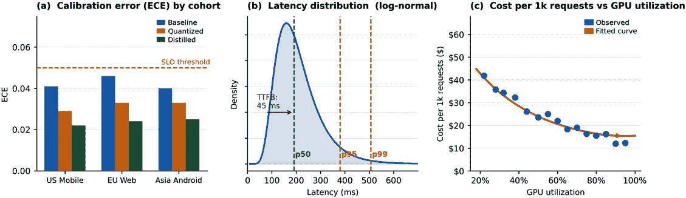

*图 12.1：SLO 一览——质量、延迟和成本*

一个三面板仪表盘视图，显示（a）按队列划分的校准误差（ECE），（b）包含 p50、p95、p99 和 TTFB 的延迟分布，以及（c）每千请求成本与 GPU 利用率的对比。

如果说*图 12.1*展示了监控的广度，那么*图 12.2*则聚焦于其中最重要的一课：平均延迟是不够的。图中展示的两个服务具有几乎相同的平均延迟，但它们的分布却暗示着截然不同的用户体验。服务 A 紧凑且可预测，p95 和 p99 仍然相对接近中心；而服务 B 有一条很长的右尾，将高百分位延迟推得远得多。只报告平均值的仪表盘会让人觉得它们之间几乎没什么差别。百分位数揭示了真实情况：服务 B 上有相当一部分用户经历的延迟远比平均值所暗示的更差。这种模式在生产系统中很典型。延迟有一个由计算设定的实际下界，但没有可比的上界，因此排队延迟、重试、垃圾回收停顿或瞬时争用都可能使右尾急剧拉长。

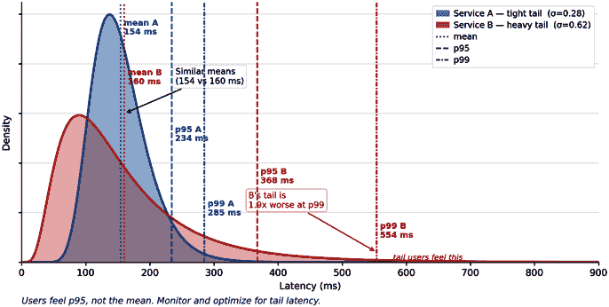

*图 12.2：为什么尾部很重要*

两个服务可能拥有相似的平均延迟，但尾部行为却大不相同；用户感受到的是 p95 和 p99，而不是平均值。

下一幅图将这一思路从单纯的延迟扩展到吞吐量、延迟和成本之间更广泛的运维权衡。*图 12.3* 使用合成的但合理的数值来说明吞吐量–延迟–成本边界在实践中的典型形态。随着批大小增大，每千请求成本最初会下降，因为固定 GPU 成本被分摊到更多工作上，而 p95 延迟在一个有用的中间范围内保持低于 SLO。超出该范围后，延迟急剧上升，因为更大的批会增加排队延迟并使服务更接近饱和。INT8 曲线绘制在 FP16 曲线的下方和右方，以反映一种常见的生产模式：较低精度通常会减少内存压力并提高吞吐量，使系统


## 第12章

#### 吞吐量、延迟与成本

这些具体数值仅用于说明，并非来自特定部署的实际测量，但整体趋势是合理的，因为它反映了常见的服务动态：摊销效应初期会提升效率，而当利用率逼近实际极限时，排队效应将占据主导。

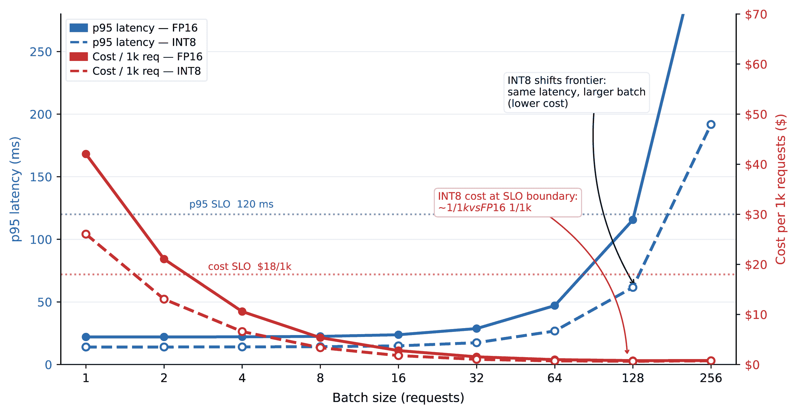

*图12.3：吞吐量–延迟–成本前沿*

随着批处理大小增大，成本起初会下降，同时p95延迟保持在SLO范围内，但更大的批处理最终会将服务推向饱和。降低精度（如INT8）可以通过减少内存压力和提高吞吐量来移动这一前沿。

在掌握了监控词汇和核心SLI/SLO概念之后，下一步是确定在实时推理服务中哪些信号值得持续关注，以及如何在实践中解读它们。

#### 需要跟踪的关键指标

监控框架就绪后，下一步是确定在实时推理服务中哪些信号值得持续关注。在实践中，三组指标决定您的C++服务系统是否保持可靠、响应迅速且成本高效：**在线准确性与校准**（模型是否保持正确？其概率是否可信？）、**延迟与吞吐量**，以及**CPU、GPU和内存利用率**。这些指标共同不仅显示模型是否行为正确，还显示周围的推理服务栈是否达到运营目标。让我们逐一审视这些指标。

#### 在线准确性与校准

**在线准确性**是模型在真实流量下测量到的预测质量，而不仅仅是在离线测试集上的表现。在生产环境中，真实标签往往在预测结果交付几分钟、几小时甚至几天后才到达，因此质量监控通常会将即时代理指标与后续对账相结合。换句话说，你通常无法实时或在高频路径上计算完整的混淆矩阵，但你可以跟踪早期预警信号（*代理指标*），然后稍后关联标签来计算精确指标。

**校准**问的是一个不同但同样重要的问题：当模型输出0.8的置信度时，它是否真的在80%的情况下正确？仅靠准确性无法回答这个问题——它只告诉你最高概率的预测是否正确，而不能告诉你分数本身是否可信。一个模型可以对每个案例进行正确排序，但输出的概率仍然毫无意义。这一点很重要，因为生产系统几乎总是依据分数采取行动，而不仅仅是标签。例如，欺诈检测系统会将任何超过0.7置信度阈值的内容转交给人工审核。一个过度自信的模型——在只有40%正确率的案例上输出0.8的置信度——会用它发出的误报淹没该队列。而一个不够自信的模型会将真正的欺诈压制在阈值以下，使其漏过。无论哪种情况，阈值都会悄然失效。量化或温度缩放等常见干预措施可能在不影响top-1准确性的情况下显著改变校准，这意味着模型可能通过你的准确性检查，却仍然破坏你的决策逻辑。在任何由分数驱动下游操作的系统中，校准不是可选项。两个特别有用的指标是：

- **期望校准误差（ECE）**：按置信度水平对预测分桶，并在每个桶内将平均预测概率与实际观测准确率进行比较。一个校准良好的模型，在80%时间正确的桶中，其平均预测概率应约为0.8。ECE是所有桶的加权平均差距；越低越好。

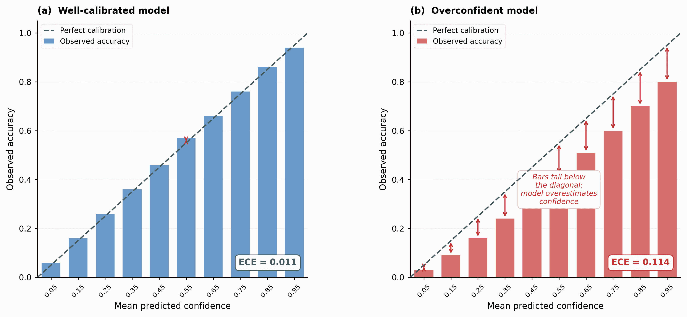

*图12.4：ECE图*

(a) 一个校准良好的模型——每个条形代表一个置信度分桶，其高度与对角线一致，意味着模型声明的置信度与实际准确率相符。ECE较低。(b) 一个过度自信的模型——条形始终低于对角线，意味着模型声称高置信度，但实际正确的频率远低于其暗示的水平。ECE较高。双箭头标记了每个桶中预测置信度与实际准确率之间的差距；ECE是所有这些差距的加权平均值。完美模型的每个条形都应恰好触及对角线，且ECE为零。

- **布里尔分数**：预测概率与实际结果（二分类中为0或1）之间的均方误差，同时惩罚较差的判别能力和较差的校准。与ECE只衡量置信度分数是否诚实不同，布里尔分数还会在模型正确时自信、错误时不确定的情况下给予奖励。越低越好。

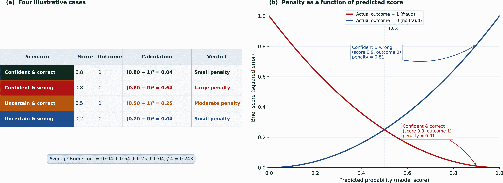

*图12.5：布里尔分数图*

(a) 来自欺诈检测系统的四个具体案例，说明布里尔分数如何对每个预测进行惩罚。一个自信而正确的预测（分数0.8，结果1）产生0.04的小惩罚。一个自信而错误的预测（分数0.8，结果0）产生0.64的大惩罚——同样的置信度，相反的结果，成本却是十六倍。任一方向的不确定预测都落在中间。所有案例的平均值即为布里尔分数。(b) 两种结果的完整惩罚曲线。红色曲线显示真实结果为欺诈（1）时的惩罚：当分数接近1时惩罚向零下降，而当模型自信地预测错误方向时惩罚急剧上升。蓝色曲线对非欺诈结果呈镜像关系。关键见解是对称性——模型因正确时自信而获得奖励，也因错误时自信而受到同等严厉的惩罚。一个始终输出0.5模型的分数为0.25，与结果无关；低于该值意味着模型在提供真正的信息。

两者都应按**队列**（如设备类别、地区、应用版本或输入长度）进行监控，这样局部性的退化才不会消失在全局平均值中。

#### 如何实现埋点（C++）

在实践中，在线质量监控通常遵循两阶段模式：先跟踪廉价的代理指标，然后在真实标签可用时稍后进行精确对账。在标签到达之前，有用的在线信号包括类别直方图、置信度十分位数以及主模型–挑战者模型分歧率。这些指标有助于在不减慢推理速度的情况下检测输出分布漂移、日益增长的过度自信或早期漂移迹象。

当标签真正到达时，服务可以在后台更新滚动混淆摘要和校准统计信息。这些时间窗口应尽可能与季节性对齐——例如，将本周二上午与上周二上午进行比较，而不是将不相关的流量时段进行对比。下表总结了在线质量监控的两个阶段及各阶段的用途。

| **阶段** | **信号或更新** | **目的** |
|-----------|------------------------|-------------|
| 标签到达前 | 类别直方图、置信度十分位数、主模型–挑战者分歧 | 跟踪输出漂移、过度自信和概念漂移的早期在线代理指标 |
| 标签到达后 | 滚动混淆矩阵和校准摘要 | 使用延迟的真实标签重建精确质量指标，窗口与季节性对齐 |

*表12.1：延迟标签到达前后监控模型质量*

以下ECE聚合器（10个分桶）说明了如何将延迟标签折叠回轻量级的滚动校准摘要中。

```cpp
struct CalibBin {
    uint64_t n = 0, correct = 0;
    double sum_conf = 0.0;
};

struct ECE {
    std::vector<CalibBin> bins;
    explicit ECE(int k=10) : bins(k) {}
};
```


```cpp
static int bindex(double p, int k){
    int i = int(p * k);
    return std::min(std::max(i, 0), k-1);
}

void observe(double prob, bool is_correct) {
    int i = bindex(prob, (int)bins.size());
    bins[i].n++;
    bins[i].sum_conf += prob;
    if (is_correct) bins[i].correct++;
}

double value() const {
    uint64_t N = 0; for (auto &b: bins) N += b.n;
    if (!N) return 0.0;
    double ece = 0.0;
    for (auto &b: bins) if (b.n) {
        double acc = double(b.correct) / double(b.n);
        double conf = b.sum_conf / double(b.n);
        ece += (double(b.n)/double(N)) * std::abs(acc - conf);
    }
    return ece;
}
};
```

在实践中，ECE 可以衡量预测概率与置信度分箱内观测结果是否一致。另一个补充指标是 Brier 分数（如下所示），它以单一流式统计量汇总概率预测的总体平方误差。

```cpp
struct Brier {
    uint64_t n = 0; double sum = 0.0;
    void observe(double prob, int label01) {
        double err = prob - double(label01);
        sum += err * err; n++;
    }
    double value() const { return n ? sum / double(n) : 0.0; }
};
```

这两个指标结合在一起，可以更容易地判断在真实流量下预测概率是否仍然可信。

#### 如何解读数据

对这些指标的解读与计算本身同样重要。如果某个群体的 ECE 急剧上升而准确率保持平稳，那么问题很可能是校准漂移，而不是排序质量完全崩溃。在这种情况下，重新校准或调整阈值通常是首选应对措施。同样，在完整标签到达之前，冠军模型与挑战模型之间不断上升的不一致率也可能预示着漂移或特定群体的性能退化。

例如，在“Android 低内存”群体中，如果 ECE 从 1.5% 跃升至 5%，而准确率保持稳定，通常重新校准比重新训练更合适。如果在欧盟流量中冠军与挑战模型的不一致率上升，下一步应先调查特征分布，之后再对比（延迟的）标注性能，然后再决定是否更改发布策略。

综上所述，这些指标即使在标签延迟的情况下也能让在线质量可观测。下一类指标将从预测质量转向服务响应能力。

### 延迟与吞吐量

**延迟**决定了用户感知的响应速度。在实践中，应跟踪端到端延迟的 **p50**、**p95** 和 **p99**，然后将总请求时间分解为主要*阶段*，如解析、预处理、排队、推理、后处理和序列化。对于 LLM 或 TTS 等流式响应端点，首字节/首 token 时间（TTFB/TTFT）与完整完成时间同样重要，因为早期输出会强烈影响用户体验。

*表 12.2：用于追踪端到端推理延迟的请求处理阶段*

| 阶段 | 含义 |
| --- | --- |
| parse | 读取并校验原始请求 |
| preprocess | 对输入进行分词、调整尺寸、归一化或其他转换，使其成为模型可用的格式。 |
| queue | 因 GPU 或工作进程繁忙，请求等待所花费的时间 |
| infer | 实际的模型前向计算 |
| postprocess | 对原始模型输出进行解码、过滤和格式化。 |
| serialize | 对最终响应（如 JSON 或 protobuf）进行编码，并写入传输通道 |

为了让这些阶段更具体，下图拆解了一个推理请求，展示延迟在服务路径上是如何累积的。同时还说明了为什么阶段级可见性对于定位真正的性能瓶颈至关重要。

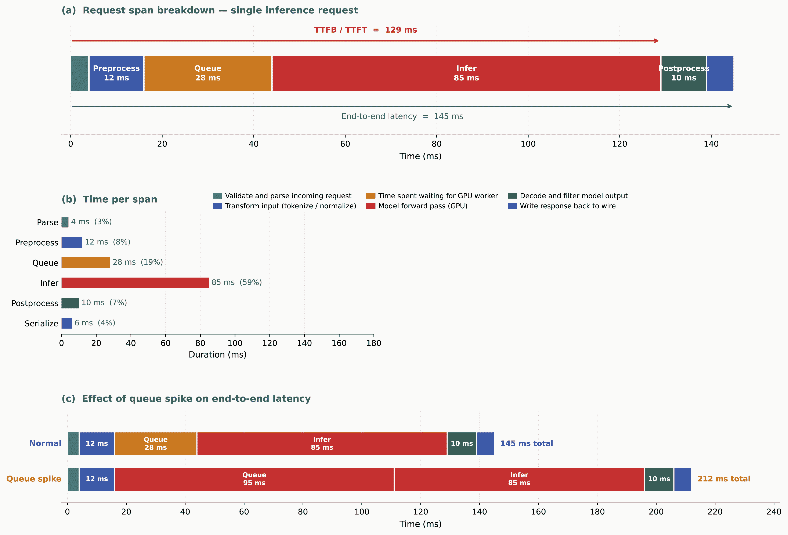

*图 12.6：单个推理请求的剖析*

*图 12.6* 将单个推理请求分解为六个按顺序排列的阶段——解析（4ms）、预处理（1ms）、排队（28ms）、推理（85ms）、后处理（10ms）和序列化（6ms）——端到端总延迟为 145ms。（a）面板显示，TTFB/TTFT 在 129ms 时达到，此时解析、预处理、排队、推理均已完成，而后处理和序列化在响应完全发送前又增加了最后 16ms。（b）面板清楚地表明，推理（59%）和排队（19%）主导了总延迟，合计占请求时间的大部分，而解析和序列化贡献相对较小。（c）面板进一步展示了为什么阶段级监控很重要：当只有排队阶段从 28ms 增加到 95ms 时，即使其他所有阶段保持不变，端到端延迟也由 145ms 上升到 212ms。因此，该图既说明了延迟在服务路径上的分布，也说明了每个阶段的可见性对于诊断真实瓶颈至关重要。

**吞吐量**是指服务在满足延迟 SLO 的前提下能够处理的持续负载量：请求/响应场景用 **QPS** 衡量，生成式负载用**每秒 token 数**衡量。两者都很重要：在可接受的 p95 下保持高 QPS 说明服务具备良好的扩展能力；在低 TTFT 下保持高 token/s 则说明生成路径依然高效且响应迅速。如*图 12.2* 和 *图 12.3* 所示，吞吐量不能孤立解读。*图 12.2* 说明了为什么尾部延迟比单一中心统计量更重要；*图 12.3* 则展示了追求更高批处理效率如何最终将系统推向排队和饱和。在实践中，负载增加通常首先表现为 p95 和 p99 的退化，而非中位延迟的大幅变化。因此，吞吐量应始终与尾部延迟及阶段级计时（尤其是排队时间与推理时间）一起解读，这样才能将扩展瓶颈归因到服务路径中正确的部分。

#### 如何埋点（C++）

在实践中，延迟和吞吐量埋点应首先从两个互补视角入手：一是阶段级计时，用于定位时间消耗在何处；二是轻量级分布跟踪，用于汇总大量请求的行为特征。

- a. **端到端与阶段计时器：**

  ```cpp
  struct Span {
      const char* name;
      std::chrono::high_resolution_clock::time_point t0;

      Span(const char* n) : name(n), t0(std::chrono::high_resolution_clock::now()) {}

      ~Span() {
          using namespace std::chrono;
          auto us = duration_cast<microseconds>(high_resolution_clock::now() - t0).count();
          std::cout << "{\"span\":\"" << name << "\",\"dur_us\":" << us << "}\n";
      }
  };

  // Usage:
  void handle_request(...) {
      Span s_all("request_total");
      { Span s("parse"); /* ... */ }
      { Span s("preprocess"); /* ... */ }
      { Span s("queue"); /* micro-batch wait ... */ }
      { Span s("infer"); /* model forward ... */ }
      { Span s("postprocess"); /* ... */ }
      { Span s("serialize"); /* ... */ }
  }
  ```

- b. 这些作用域计时器将排队、推理和后处理的影响分开，而不是把所有内容合并成一个端到端数字，从而让关键路径变得可见。

- c. 阶段计时就绪后，下一步就是将请求延迟作为分布而不是单一平均值来跟踪。固定分桶的直方图非常适合这一需求，因为它们可以以极低的开销支持百分位估算。

- d. **固定分桶直方图：**

  ```cpp
  struct LatHisto {
      // 0–10ms, 10–20ms, ..., 90–100ms, >=100ms (microseconds)
      static constexpr int kN=11, kStepUs=10000;
      std::array<std::atomic<uint64_t>, kN> b{};
      void observe(uint64_t us) {
          size_t i = (us >= kStepUs*(kN-1)) ? (kN-1) : (us/kStepUs);
          b[i].fetch_add(1, std::memory_order_relaxed);
      }
  };
  ```

- e. 通过累积分桶离线计算百分位数，这样在热路径上无需执行完整排序。

对于 LLM 或 TTS 等流式端点，总请求延迟还不够。还需要测量输出开始的速度以及持续输出的稳定性。记录第一个 token 或字节发出时的时间戳以计算 TTFT；维护已生成 token 的移动总计以估算每秒 token 数；跟踪 token 之间的时间间隔以检测解码器停滞。

#### 如何解读数据

这些指标的价值在于它们如何指导诊断。如果 p95 延迟从 85 ms 上升到 140 ms，同时排队阶段占主导且推理保持稳定，那么问题不在于模型执行，而在于排队：流量突发超出了服务容量。在这种情况下，正确的应对措施是缩短微批截止时间、增加副本或提高工作进程并发度，而不是花时间优化内核。如果 TTFT 从 70 ms 恶化到 150 ms，而每秒 token 数保持不变，那么瓶颈更可能出在分词或提示词组装环节，而非解码本身。将分词移到专用线程池或缓存已分词的提示前缀往往是更好的修复方式。如果 QPS 卡在 300，而 GPU 利用率仍约为 35%，平均批大小只有 1.2，则说明服务处于欠批处理状态。启用微批处理（例如预留 5-8 ms 的延迟预算）可以提高平均批大小、提升利用率，并在 p95 仍满足 SLO 的前提下增加吞吐量。

## 3) CPU/GPU/内存利用率


## 监控已部署模型

### CPU、GPU 与内存利用率

利用率指标可以揭示服务栈是否在高效利用硬件资源。

**CPU 利用率**有助于判断瓶颈是预处理、分词、图像解码还是网络 I/O。较高的 iowait 往往指向外部存储或网络压力，而非计算压力。线程池也需要密切关注，因为过度订阅会增加上下文切换开销，并拖累尾延迟。

**GPU 利用率**反映设备繁忙程度，而 VRAM 余量则指示当前批处理策略是否接近内存上限。这两个指标应结合解读。GPU 利用率低且延迟高，通常意味着存在排队或批处理不佳。利用率高但 VRAM 所剩无几，则提示相反的问题：服务接近 OOM、分配器碎片化，或内存驱动的不稳定。

内存利用率在主机端和设备端都很重要。在主机端，**常驻内存集**（**RSS**）——进程当前占用的物理 RAM 部分——是反映真实内存压力的有用粗略信号。主机 RSS 上升会影响进程稳定性、缩小批处理余量，并可能表明存在泄漏或缓冲区增长。在设备端，GPU VRAM 决定服务能否安全扩展批量大小而不触发内存耗尽。因此，分配失败、缺页和碎片化症状都应被视作头等运维信号。

#### 如何埋点（C++）

主机内存和 CPU 指标通常可直接从操作系统获取，而 GPU 指标通常需要厂商接口，例如 **NVIDIA 管理库**（**NVML**）——一种 C API，可暴露 GPU 利用率、内存使用量和可用 VRAM 等运行信号。目标不是收集所有可能的信号，而是暴露最能解释硬件压力的一小组仪表和计数器。

- **CPU（Linux）：** 采样 `/proc/stat` 和进程时间以估算使用率，或使用 `getrusage`。如需粗略的主机内存信号，可从 `/proc/self/status`（`VmRSS`）读取进程的 RSS。

```cpp
#include <fstream>

size_t read_rss_kb() {
    std::ifstream f("/proc/self/status");
    std::string k; size_t v;
    while (f >> k >> v) if (k == "VmRSS:") return v; // in kB
    return 0;
}
```

- **通过 NVIDIA NVML 获取 GPU 指标**

```cpp
#include <nvml.h>

struct GpuStats { unsigned util=0; unsigned mem_used=0, mem_total=0; };

GpuStats sample_gpu(int idx=0) {
    static bool inited = (nvmlInit()==NVML_SUCCESS);
    (void)inited;
    nvmlDevice_t dev; nvmlDeviceGetHandleByIndex(idx, &dev);
    nvmlUtilization_t u; nvmlDeviceGetUtilizationRates(dev, &u);
    nvmlMemory_t m; nvmlDeviceGetMemoryInfo(dev, &m);
    return { (unsigned)u.gpu, (unsigned)(m.used/1024/1024), 
            (unsigned)(m.total/1024/1024) };
}
```

通常在后台线程中每隔几秒采样这些值即可。将它们作为 `gpu_util`、`vram_used_mb`、`vram_free_mb` 等仪表暴露，可直接了解服务距离饱和有多近。

复制量也值得跟踪，因为 H2D 和 D2H 传输开销可能成为本已优化良好的系统中隐藏的瓶颈。

- **H2D/D2H 字节数。** 封装复制操作并递增计数器：

```cpp
std::atomic<uint64_t> h2d_bytes{0}, d2h_bytes{0};
// When copying:
h2d_bytes += nbytes; // cudaMemcpyHostToDevice
d2h_bytes += nbytes; // cudaMemcpyDeviceToHost
```

最后，分配器级别的信号有助于在内存不稳定演变为崩溃之前识别问题。统计成功和失败的分配次数，并记录来自 `cudaMalloc` 的内存耗尽情况，能提供最后一道有用的可见性保障。

#### 如何解读数字

当这些利用率信号指向可能的瓶颈时最为有用：

- **GPU 利用率约 30%、p95 延迟高、平均批量大小≈1**：加速器未得到充分利用，瓶颈更可能出在批处理或并发上，而非原始模型计算。请开启微批处理，例如将队列截止时间设为 8ms 或更短，并/或通过每个 GPU 运行多个模型实例来增加并发，从而在不破坏 TTFT 目标的前提下提升利用率。

- **VRAM 余量 < 5%，负载下 OOM 激增**：服务正接近内存上限。可考虑**量化**（FP16/INT8）、更小的批量大小，或使用池化分配器以减少碎片化。如果使用统一内存，可执行预取（`cudaMemPrefetchAsync`）并提供内存建议以减少缺页。

- **高峰期 CPU iowait 激增**：瓶颈可能在于预处理、存储或外部 I/O，而非模型执行本身。可缓存预处理产物（如分词后的提示词或解码后的图像），或将前后处理拆分为一个具有独立自动扩缩策略的服务。对于文本系统，将分词器进程绑定到专用 CPU 核心可能会有所帮助；对于图像工作负载，有界工作线程池通常更有效。

### 指标如何驱动行动（关联 SLO）

指标之所以重要，是因为它们能触发具体且可逆的行动：

- **某个群体（cohort）的在线准确率或 ECE 越界：** 对该群体重新校准，例如使用温度缩放（temperature scaling），并按需调整阈值。如果之后确认存在概念漂移，可安排一次有针对性的重新训练，并通过影子阶段和金丝雀阶段推行变更，同时具备回滚保护。

- 当 p95 或 p99 延迟上升且队列跨度占主导时，减小微批处理截止时间、增加服务实例或每 GPU 并发度，或添加准入控制（如 HTTP 429 快速失败）以保护尾延迟。

- 如果每秒 token 数保持稳定而 TTFT 上升，则应并行化或优化提示词组装、缓存分词后的前缀，或更早地流式输出部分结果。瓶颈可能是预处理或分词，而非解码。

- **GPU 利用率低且批量大小很小：** 服务很可能处于欠批处理状态。可启用微批处理和请求合并，或考虑 FP16 或 INT8 等更低精度，以提高可行的批处理上限。

- **VRAM 余量不断缩小：** 通过量化或剪枝降低内存压力，限制每个请求的上下文长度，池化并复用设备缓冲区，使用固定主机内存以提高主机到设备的传输效率

这些调节手段应纳入服务运行手册。每次 SLO 违规都应映射到一份简短的变更清单，这些变更可以快速应用，然后用同一组指标进行验证。长期来看，保持这三类指标族的健康——质量、延迟与吞吐、利用率——可以预防许多事故，并有助于同时控制面向用户的性能和运营成本。

在关键指标及其解读就位后，下一步是在服务内部暴露这些指标。在实践中，这意味着一个轻量级埋点层，既能低成本采集信号，又能以运维人员可以检查和告警的形式呈现。下一节将展示如何在 C++ 中使用指标、结构化日志和链路追踪来实现这一点。

### C++ 埋点：Prometheus 风格指标、结构化日志与链路追踪/跨度

一个生产模型直到你能逐分钟、逐请求地**观测**它，才算真正可运维。在 C++ 中，这通常意味着三个组件协同工作：

- 一个监控栈可抓取的**指标**端点，
- 采用机器可解析 JSON 的**结构化日志**，便于用户搜索和关联，
- 轻量级**链路追踪**或**跨度**，将端到端延迟分解为具名阶段。

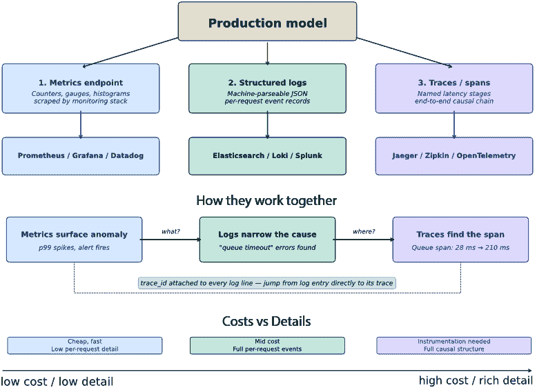

*图 12.7：生产可观测性的三个组件及其关系*

*图 12.7* 展示了三个互补组件——指标、结构化日志和链路追踪——如何协同工作以提供这种可见性，以及它们如何串联成一条从告警到根因的单一诊断路径。本小节将解释每个组件为何重要、如何在热路径上安全使用，以及如何用可放入服务的小型自包含 C++ 代码片段实现。目标很务实：你应该能够快速暴露 /metrics、输出结构化日志并用跨度标注关键路径，然后逐步完善实现，例如添加 OpenTelemetry，而无需抛弃最初的设计。


## 监控已部署的模型

### 格式、设计原则与一个最小化注册表

Prometheus 文本暴露格式是 C++ 推理服务的一个实用默认选择，因为它对人类可读、易于生成，并且被 Grafana 和 Alertmanager 等工具广泛理解。你不需要引入重量级依赖就能开始。在实践中，目标是以一种在请求路径上更新成本低、且易于从服务外部抓取的形式，暴露一小部分计数器、仪表和直方图。几条简单的设计规则就能让这一点成为可能。

下表总结了本章中引用的主要工具、接口和运维系统，以及它们在监控和插桩一个生产级 C++ 推理服务时的典型作用。

| 类别 | 工具/接口 | 本章中的典型用途 |
| --- | --- | --- |
| 监控 | Prometheus | 从一个 `/metrics` 端点抓取计数器、仪表和直方图 |
| 监控 | Grafana, Datadog | 展示延迟、质量、吞吐量和利用率的仪表板 |
| 告警 | Alertmanager | 当阈值或 SLO 被违反时发出告警 |
| 追踪 | OpenTelemetry, Jaeger, Tempo, OTLP | 导出并检查整个服务路径上的追踪与跨度信息 |
| 日志记录 | spdlog | 为 JSON 风格日志提供结构化日志后端 |
| GPU 监控 | NVML | 读取 GPU 利用率、内存使用量和空闲显存（VRAM） |
| Linux 主机指标 | /proc/stat, getrusage, /proc/self/status | 收集 CPU 使用率和主机内存信号，如 RSS |
| CUDA 内存与传输 | cudaMemcpy, cudaMalloc, cudaMemPrefetchAsync | 跟踪拷贝开销、分配失败和内存行为 |
| C++ 指标导出 | prometheus-cpp, Prometheus text exposition | 以易于抓取的格式暴露指标 |
| 服务端点 | POSIX socket HTTP handler | 从进程提供轻量级 `/metrics` 端点 |

*表 12.3：部署推理系统中用于监控、告警、追踪、日志记录和资源可见性的常用工具与接口*

上面列出的工具只有在插桩本身经过精心设计时才有用。在实践中，几条简单的原则能让指标采集保持轻量、稳定，并且适合生产环境使用。

#### 设计原则

少数几条设计规则就能让指标在一个生产推理服务中安全且实用。目标是在请求路径上保持低成本更新、保持标签有限，并保持暴露格式足够简单，以便无需重量级依赖即可集成。

- **线程安全**：在快速路径更新中使用原子操作，并避免在请求路径上加锁。这很重要，因为指标经常被多个工作线程并发更新。热路径上的锁竞争会增加延迟、降低吞吐量，并扭曲你试图测量的信号本身。
- **基数控制**：保持标签集合小而有限，例如 `model`、`version`、`device`，绝不要使用按请求区分的标识符。这很重要，因为高基数的标签会产生过多唯一的时间序列，从而增加内存使用、拖慢查询，并可能压垮监控后端。
- **固定桶直方图**：优先使用有界直方图，这类直方图更新成本低，足以用于 p95 和 p99 估算。这很重要，因为百分位数在运维上很关键，但采集原始样本或在每个请求上计算精确分位数对于生产流量来说成本过高。
- **单一导出器线程**：定期或在收到 `/metrics` 请求时构建暴露文本，而不是在每次更新时格式化指标。这很重要，因为渲染输出的成本远高于递增计数器或直方图。将导出与更新分离可以保持请求处理的高效，并使插桩层更简单、更可预测。

因此，一个最小化的指标注册表可以由几个简单的构建块组成：指标原语、标签、注册表和一个小型导出器。在查看计数器、仪表、直方图和注册表本身的代码之前，先了解一下这些组件在更大的监控路径中的位置会很有帮助。

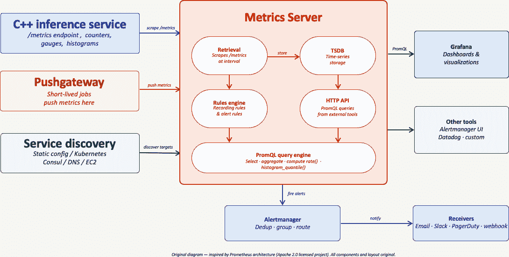

*图 12.8：从 C++ 推理服务到基于 Prometheus 的监控技术栈的指标流*

该图展示了在 C++ 推理服务内部添加的插桩如何融入更大的运维系统。服务通过 `/metrics` 端点导出计数器、仪表和直方图。然后，这些指标由指标服务器抓取、存储和评估，被仪表板和外部工具查询，并在阈值或规则被突破时路由到告警路径。在接下来的讨论中，焦点将缩小到服务端实现：小型指标原语、进程内注册表，以及用于暴露这些指标的最小端点。

在了解了整体流程之后，我们现在可以转向最小的构建块：指标原语本身。

#### 指标原语（metrics.hpp）

第一步是定义服务将导出的基本指标类型。在实践中，计数器跟踪总量，仪表跟踪当前值，直方图捕获分布信息，例如延迟。

```cpp
// metrics.hpp
#pragma once

#include <array>
#include <atomic>
#include <cstdint>

struct Counter {
    std::atomic<uint64_t> value{0};
    void inc(uint64_t n = 1) {
        value.fetch_add(n, std::memory_order_relaxed);
    }
    uint64_t get() const {
        return value.load(std::memory_order_relaxed);
    }
};

struct Gauge {
    std::atomic<long long> value{0};
    void set(long long v) {
        value.store(v, std::memory_order_relaxed);
    }
    long long get() const {
        return value.load(std::memory_order_relaxed);
    }
};

struct Histogram {
    // Fixed buckets in microseconds: 1,2,4,8,16,32,64,128,256, >=256 ms
    static constexpr int K = 10;
    static constexpr std::array<uint64_t, K - 1> bounds_us{
        1000, 2000, 4000, 8000, 16000, 32000, 64000, 128000, 256000};
    std::array<std::atomic<uint64_t>, K> buckets{};
    std::atomic<uint64_t> sum_us{0};
    std::atomic<uint64_t> count{0};
    void observe(uint64_t us) {
        size_t i = 0;
        while (i < K - 1 && us > bounds_us[i]) ++i;
        buckets[i].fetch_add(1, std::memory_order_relaxed);
        sum_us.fetch_add(us, std::memory_order_relaxed);
        count.fetch_add(1, std::memory_order_relaxed);
    }
};
```

这些原语有意设计得很小。它们的更新成本足够低，可以在请求路径上使用，表达力也足以覆盖本章前面讨论的大多数运维信号。

#### 标签

如*图 12.8*所示，同一个指标通常需要按模型、版本或设备等维度进行拆分。标签通过为每个时间序列附加键值对来提供这种额外的上下文。

```cpp
#include <sstream>
#include <string>
#include <utility>
#include <vector>

struct Labels {
    std::vector<std::pair<std::string, std::string>> kv;
    std::string to_text() const {
        if (kv.empty()) return "";
        std::ostringstream os;
        os << "{";
        for (size_t i = 0; i < kv.size(); ++i) {
            if (i) os << ",";
            os << kv[i].first << "=\"" << kv[i].second << "\"";
        }
        os << "}";
        return os.str();
    }
};
```

这种表示方式有意保持简单，但它足以按有限的操作维度对指标进行分组，并通过 `/metrics` 渲染导出。

#### 注册表

有了标签之后，下一步是将多个带标签的序列组织到同一个注册表下。注册表将指标名称和标签集合映射到对应的计数器、仪表或直方图，以便服务能够一致地更新和导出它们。

```cpp
#include <mutex>
#include <unordered_map>

class Registry {
public:
    Counter& counter(const std::string& name, const Labels& lbl = {}) {
        return get<Counter>(counters_, name, lbl);
    }
};
```


## 监控已部署模型

```cpp
    Gauge& gauge(const std::string& name, const Labels& lbl = {}) {
        return get<Gauge>(gauges_, name, lbl);
    }

    Histogram& histo(const std::string& name, const Labels& lbl = {}) {
        return get<Histogram>(histos_, name, lbl);
    }
```

注册表不仅存储指标对象；它还需要以可供抓取的文本格式渲染它们。

```cpp
    std::string render_metrics_text() const {
        std::ostringstream os;
        // Counters
        for (auto& it : counters_) {
            os << "# TYPE " << it.first << " counter\n";
            for (auto& row : it.second) {
                os << it.first << row.first.to_text() << " "
                   << row.second.get() << "\n";
            }
        }
        // Gauges
        for (auto& it : gauges_) {
            os << "# TYPE " << it.first << " gauge\n";
            for (auto& row : it.second) {
                os << it.first << row.first.to_text() << " "
                   << row.second.get() << "\n";
            }
        }
        // Histograms
        for (auto& it : histos_) {
            os << "# TYPE " << it.first << " histogram\n";
            for (auto& row : it.second) {
                const auto& lbl = row.first;
                const auto& h = row.second;
                uint64_t cum = 0;
                for (size_t i = 0; i < Histogram::K - 1; ++i) {
                    cum += h.buckets[i].load(std::memory_order_relaxed);
                    Labels l = lbl;
                    l.kv.emplace_back(
                        "le", std::to_string(Histogram::bounds_us[i] / 1000.0));
                    os << it.first << "_bucket" << l.to_text() << " "
                       << cum << "\n";
                }
                cum += h.buckets[Histogram::K - 1].load(std::memory_order_relaxed);
                Labels linf = lbl;
                linf.kv.emplace_back("le", "+Inf");
                os << it.first << "_bucket" << linf.to_text() << " "
                   << cum << "\n";
                os << it.first << "_sum" << lbl.to_text() << " "
                   << (h.sum_us.load() / 1000.0) << "\n";
                os << it.first << "_count" << lbl.to_text() << " "
                   << h.count.load() << "\n";
            }
        }
        return os.str();
    }
```

一个小助手就足以在需要时查找现有序列或创建新序列。

```cpp
private:
    template <typename T>
    using Table =
        std::unordered_map<std::string, std::vector<std::pair<Labels, T>>>;

    template <typename T>
    static T& get(Table<T>& table,
                  const std::string& name,
                  const Labels& lbl) {
        std::lock_guard<std::mutex> lk(mu_);
        auto& vec = table[name];
        for (auto& row : vec) {
            if (row.first.kv == lbl.kv) return row.second;
        }
        vec.push_back({lbl, T{}});
        return vec.back().second;
    }

    inline static std::mutex mu_;
    Table<Counter> counters_;
    Table<Gauge> gauges_;
    Table<Histogram> histos_;
};
```

此时，服务可以在进程内维护带标签的计数器、仪表和直方图。下一步是通过 HTTP 暴露它们，以便*图 12.8*中的指标服务器能够抓取它们。

### 导出 /metrics (小型 HTTP 处理器)

图中，离开推理服务的箭头对应于对`/metrics`的抓取。一个小型 HTTP 处理器足以演示这一模式。

```cpp
// metrics_server.cpp
#include "metrics.hpp"
#include <netinet/in.h>
#include <thread>
#include <unistd.h>

void serve_metrics(Registry& reg, int port = 9100) {
    int fd = socket(AF_INET, SOCK_STREAM, 0);
    int yes = 1;
    setsockopt(fd, SOL_SOCKET, SO_REUSEADDR, &yes, sizeof(yes));
    sockaddr_in addr{};
    addr.sin_family = AF_INET;
    addr.sin_addr.s_addr = INADDR_ANY;
    addr.sin_port = htons(port);
    bind(fd, (sockaddr*)&addr, sizeof(addr));
    listen(fd, 16);
    std::thread([fd, &reg]() {
        for (;;) {
            int c = accept(fd, nullptr, nullptr);
            if (c < 0) continue;
            std::string body = reg.render_metrics_text();
            std::ostringstream resp;
            resp << "HTTP/1.1 200 OK\r\n"
                 << "Content-Type: text/plain; version=0.0.4\r\n"
                 << "Content-Length: " << body.size() << "\r\n\r\n"
                 << body;
            auto s = resp.str();
            (void)write(c, s.data(), s.size());
            close(c);
        }
    }).detach();
}
```

然后，服务可以注册具体指标，并在请求处理期间更新它们。

```cpp
Registry R;
auto& req_total = R.counter(
    "inference_requests_total",
    {{{"model", "m1"}, {"version", "1.3"}}});
auto& err_total = R.counter(
    "inference_errors_total",
    {{{"model", "m1"}, {"version", "1.3"}}});
auto& lat_histo = R.histo(
    "inference_latency_us",
    {{{"model", "m1"}, {"version", "1.3"}}});
auto& gpu_util = R.gauge(
    "gpu_util_percent",
    {{{"device", "cuda:0"}}});
auto& vram_free = R.gauge(
    "gpu_vram_free_mb",
    {{{"device", "cuda:0"}}});
serve_metrics(R, 9100);
```

然后，在你的请求处理器中：

```cpp
// In the request handler
uint64_t t0 = /* now_us */;
req_total.inc();
// ... work ...
uint64_t dur = /* now_us */ - t0;
lat_histo.observe(dur);
```

这是服务参与图中所示指标路径所需的最低要求：本地埋点、抓取端点，以及一个存储和查询结果时间序列的下游指标服务器。

#### 结构化日志

指标总结了一段时间内的行为，但日志保留了请求级别的证据。结构化 JSON 日志比自由格式的`printf`输出更易于搜索和关联，尤其是在始终包含请求 ID 和追踪 ID 的情况下。

一个小助手就足以开始了：

```cpp
// log.hpp
#pragma once

#include <chrono>
#include <iomanip>
#include <iostream>
#include <sstream>
#include <string>

inline std::string iso8601_now() {
    using namespace std::chrono;
    auto t = system_clock::now();
    auto s = time_point_cast<std::chrono::seconds>(t);
    auto sub = duration_cast<microseconds>(t - s).count();
    std::time_t tt = system_clock::to_time_t(t);
    std::tm tm = *std::gmtime(&tt);
    std::ostringstream os;
    os << std::put_time(&tm, "%FT%T") << "."
       << std::setw(6) << std::setfill('0') << sub << "Z";
    return os.str();
}
```

示例用法：

```cpp
log_json("INFO", "recv", "r-7f23", "t-9ab1",
         "resnet50", "1.12.3", "cuda:0", 8,
         "{\"shape\":[8,3,224,224]}");
log_json("INFO", "done", "r-7f23", "t-9ab1",
         "resnet50", "1.12.3", "cuda:0", 8,
         "{\"ttfb_ms\":38.2,\"lat_ms\":91.5,\"p99_ms\":128.0,\"mem_mb\":1420}");
```

这些日志不会经过图中所示的指标路径，但它们通过保留仅靠仪表盘无法提供的请求级上下文来补充指标。

### 追踪与跨度

指标显示延迟发生了变化；跨度则显示变化发生的位置。这正是本章前面讨论过的请求路径分解，现在在服务内部可见。

一个基于 RAII 的小型跨度辅助工具就足够了：

```cpp
// trace.hpp
#pragma once

#include "metrics.hpp"
#include "log.hpp"
#include <chrono>
#include <string>

struct Span {
    const char* name;
    std::string req_id, trace_id, model, version, device;
    Registry* reg;
    std::chrono::high_resolution_clock::time_point t0;

    Span(const char* n,
         std::string req,
         std::string trace,
         std::string m,
         std::string v,
         std::string dev,
         Registry* r)
        : name(n),
          req_id(std::move(req)),
          trace_id(std::move(trace)),
          model(std::move(m)),
          version(std::move(v)),
          device(std::move(dev)),
          reg(r),
          t0(std::chrono::high_resolution_clock::now()) {}

    ~Span() {
        using namespace std::chrono;
        auto us = duration_cast<microseconds>(
            high_resolution_clock::now() - t0).count();
        log_json("TRACE", "span", req_id, trace_id, model, version, device, 1,
                 std::string("{\"span\":\"") + name + "\",\"dur_us\":" +
                 std::to_string(us) + "}");
    }
};
```


## 第 12 章：监控已部署模型

```cpp
if (reg) {
    Labels L;
    L.kv = {{"model", model},
            {"version", version},
            {"span", name},
            {"device", device}};
    reg->histo("span_latency_us", L).observe((uint64_t)us);
}
}
};
```

在请求处理器内部使用：

```cpp
void handle_request(const Request& r, Registry& R) {
    Span s_all("request_total", r.id, r.trace, "m1", "1.3", r.device, &R);
    { Span s("parse", r.id, r.trace, "m1", "1.3", r.device, &R); }
    { Span s("preprocess", r.id, r.trace, "m1", "1.3", r.device, &R); }
    { Span s("queue", r.id, r.trace, "m1", "1.3", r.device, &R); }
    { Span s("infer", r.id, r.trace, "m1", "1.3", r.device, &R); }
    { Span s("postprocess", r.id, r.trace, "m1", "1.3", r.device, &R); }
    { Span s("serialize", r.id, r.trace, "m1", "1.3", r.device, &R); }
}
```

这些 span 同时对指标和日志形成补充。如果 `queue` 增长而 `infer` 保持平稳，可能的修复措施是批处理或并发。如果 `preprocess` 出现尖峰，那么分词或转换更有可能是罪魁祸首。

### 将各个部分整合在一起

*图 12.8* 展示了完整的下游路径：服务发出指标，指标服务器抓取并存储指标，仪表盘查询指标，告警被向外路由。日志和 span 通过在服务内部保留请求级上下文和关键路径时序，对该路径形成补充。

这正是本节的主要实现目标：先构建最小可用的埋点层，之后再以更丰富的工具替换其中的各个部分。一旦服务能够暴露指标、输出结构化日志并记录 span，将 SLO 违反与具体的运维操作关联起来就会容易得多。埋点就位后，我们现在就可以从系统遥测转向真实流量下的在线模型质量，包括延迟标签、领先指标和分群感知监控。

### 真实世界中的在线质量

在离线评估中，ground truth（真实标签）可以即时获得。而在生产环境中，情况很少如此。点击标签可能几分钟后才到达，拒付可能几周后才浮现，人工审核可能需要数天。然而，服务仍然必须在今天就保持在质量 SLO 之内。这就是**在线质量监控**的核心挑战：即使确切的标签稍后才会到达，现在也必须做出决策。在实践中，解决方案包含三个部分：将标签视为**异步流**，监控实时变动的**领先指标**，并对一切进行**分群**，让局部问题在演变为全局问题之前就显现出来。接下来的几个小节将这一挑战转化为一种可操作的模式。首先，它们展示如何将延迟标签排除在热路径之外并在之后进行对账；随后介绍实时领先指标和基于分群的视图，帮助在滞后的 ground truth 到达之前发现新出现的质量问题。

### 延迟标签：稍后关联，而非在热路径中

**延迟标签**是指正确结果在预测已经对外服务之后才到达。这在点击率系统、欺诈检测、物流、支持工单分类和许多安全流程中都很常见。关键在于保持请求路径的快速，同时保留足够的信息以供日后对账标签：一个稳定的标识符、预测分数、所做的决策，以及分群的紧凑描述（如地区、设备和应用版本）。

第一步是定义一个紧凑的分群键和一个轻量级的预测记录，该记录可以在推理时存储，而不会拖慢请求路径。

```cpp
// quality.hpp
#pragma once
#include <cmath>
#include <cstdint>
#include <mutex>
#include <string>
#include <unordered_map>

struct CohortKey {
    std::string region, device, app;
    bool operator==(const CohortKey& o) const {
        return region == o.region && device == o.device && app == o.app;
    }
};

struct CohortKeyHash {
    size_t operator()(const CohortKey& k) const noexcept {
        std::hash<std::string> H;
        return H(k.region) ^ (H(k.device) << 1) ^ (H(k.app) << 2);
    }
};

// Record persisted or queued at prediction time.
struct PredRecord {
    std::string id; // stable request or event id (not PII)
    CohortKey cohort;
    float score; // predicted probability or confidence
    int decision; // thresholded action, e.g., 0/1
    int64_t ts_ms; // event time
};
```

这条记录刻意保持小巧。它包含足够的信息来支持后续对账，而无需存储原始载荷或个人身份识别数据。一旦预测可以按分群进行键控，下一步就是构建一个滚动摘要，用于累积带标签的结果并支持校准和概率误差指标。

```cpp
struct RollingQuality {
    uint64_t n = 0, n_pos = 0;
    double brier_sum = 0.0;
    // Reliability buckets for ECE (10 bins)
    uint64_t bins[10]{}, bin_pos[10]{};
    void observe(float score, int label) {
        n++;
        if (label) n_pos++;
        double d = double(score) - double(label);
        brier_sum += d * d;
        int b = std::min(9, std::max(0, int(score * 10)));
        bins[b]++;
        if (label) bin_pos[b]++;
    }
    double ece() const {
        if (n == 0) return 0.0;
        double e = 0.0;
        for (int b = 0; b < 10; ++b) {
            if (!bins[b]) continue;
            double conf = (b + 0.5) / 10.0;
            double acc = double(bin_pos[b]) / double(bins[b]);
            e += (double(bins[b]) / double(n)) * std::abs(acc - conf);
        }
        return e;
    }
    double brier() const {
        return n ? brier_sum / double(n) : 0.0;
    }
};
```

这个滚动摘要提供了概率质量的两个有用视角：用于校准的 ECE，以及用于整体概率误差的 Brier 分数。延迟标签路径的最后一部分是一个小型关联器（joiner），它临时存储预测记录，并在标签稍后到达时进行对账。

```cpp
class DelayedLabelJoiner {
public:
    void on_prediction(const PredRecord& pr) {
        std::lock_guard<std::mutex> lk(mu_);
        preds_[pr.id] = pr;
        prune();
    }

    void on_label(const std::string& id, int label) {
        std::lock_guard<std::mutex> lk(mu_);
        auto it = preds_.find(id);
        if (it == preds_.end()) return; // too old or missing
        const PredRecord& pr = it->second;
        quality_[pr.cohort].observe(pr.score, label);
        preds_.erase(it);
    }

    RollingQuality get(const CohortKey& k) const {
        std::lock_guard<std::mutex> lk(mu_);
        auto it = quality_.find(k);
        return (it == quality_.end()) ? RollingQuality{} : it->second;
    }

private:
    void prune() {
        // Optional: drop stale predictions by TTL to bound memory.
    }

    mutable std::mutex mu_;
    std::unordered_map<std::string, PredRecord> preds_;
    std::unordered_map<CohortKey, RollingQuality, CohortKeyHash> quality_;
};
```

在实践中，预测记录通常会写入持久化队列，关联器则在 sidecar 或后台工作进程中运行。重点在于架构层面：预测时延保持较低，而精确的质量指标在标签到达后才更新，如*图 12.9* 所示。

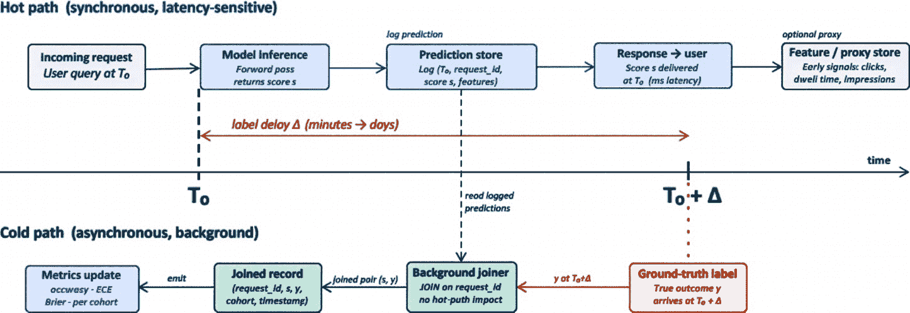

*图 12.9：延迟标签时间线*

预测在时刻 立即对外服务，而标签在较晚的时刻 才到达。后台关联器对两者进行对账，并更新分群级别的校准和误差指标，而不会触及请求路径。

*图 12.9* 展示了延迟标签如何在预测时间之后进行对账。下一步是用实时信号补充这一较慢的反馈回路，以便在标签到达之前就能预警质量变化。

### 领先指标：无需标签的质量信号

在标签延迟期间，服务仍然需要与质量相关的实时信号。有三类信号尤其有用：不确定性度量、冠军-挑战者（champion-challenger）分歧，以及弃权（abstention）或覆盖（override）率。

一个有用的无标签信号家族来自不确定性本身。如果模型输出 logits 或概率，那么熵（entropy）和 top-2 间隔等简单函数可以提供廉价的置信度代理。

```cpp
#include <algorithm>
#include <cmath>
#include <vector>

inline float softmax_entropy(const std::vector<float>& logits) {
    float m = *std::max_element(logits.begin(), logits.end());
    double Z = 0.0;
```


```cpp
std::vector<double> p(logits.size());
for (size_t i = 0; i < logits.size(); ++i) {
    p[i] = std::exp(double(logits[i] - m));
    Z += p[i];
}
double H = 0.0;
for (double& pi : p) {
    pi /= Z;
    if (pi > 0) H -= pi * std::log(pi + 1e-12);
}
return float(H);
```

第二个置信度代理是前两个概率之间的差距，随着模型置信度降低，该差距会缩小。

```cpp
inline float top2_margin(const std::vector<float>& probs) {
    float a = 0.0f, b = 0.0f;
    for (float v : probs) {
        if (v > a) {
            b = a;
            a = v;
        } else if (v > b) {
            b = v;
        }
    }
    return a - b; // smaller means less certain
}
```

另一个领先指标来自在线模型与影子挑战者的对比。一个简单的分歧计数器就足以跟踪两个模型是否开始出现分歧。

```cpp
#include <atomic>

struct Disagreement {
    std::atomic<uint64_t> n{0}, diff{0};

    void observe(int y_hat, int y_hat_shadow) {
        n.fetch_add(1, std::memory_order_relaxed);
        if (y_hat != y_hat_shadow) {
            diff.fetch_add(1, std::memory_order_relaxed);
        }
    }

    double rate() const {
        uint64_t N = n.load(), D = diff.load();
        return N ? double(D) / double(N) : 0.0;
    }
};
```

如果将低置信度案例路由到人工复核或更安全的基于规则的兜底方案，弃权率或覆盖（override）率就会成为另一个有用的领先指标。突然的上升往往指向上游数据问题、阈值漂移或概念变化。

这些信号应当始终按分组（cohort）进行监控。全局熵均值很容易掩盖某类设备或某个应用版本已开始表现异常的事实。

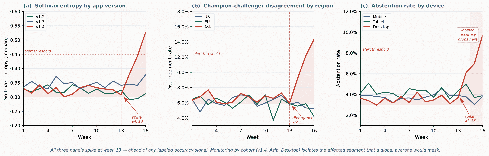

*图 12.10：按分组划分的领先指标*

(a) 各应用版本的 Softmax 熵中位数；(b) 各区域的主模型–挑战者分歧；(c) 各设备的弃权率。这里的尖峰通常先于带标签准确率下降出现。

图 12.10 展示了领先指标如何在标注指标恶化之前提供早期预警。某个应用版本的熵上升、某个区域的分歧激增、某个设备分组的弃权增加，而其余分组保持相对稳定。关键在于并非每个信号都在所有地方变化，而是分组感知的视图能让局部回归及早显形，趁它们尚未被全局均值稀释、或被延迟标签确认之前。无标签指标就位后，下一步是按分组组织这些指标，使局部问题保持局部可见。

### 分组（Cohorting）：在问题变大之前将其化小

**分组（Cohorting）** 是指按区域、设备类别、应用版本或输入形状等稳定标签对事件进行分组，并为每个分组维护指标。这不是可选项。当某个分组在悄然劣化时，单一的全局延迟或 ECE 数值仍可能看起来健康。

为了让这些指标可操作，应当按分组而不是仅按全局均值进行跟踪。下面的结构为每个组维护一份紧凑的滑动摘要。

```cpp
// cohort_quality.hpp
#pragma once
#include "quality.hpp"
#include <mutex>
#include <unordered_map>

struct CohortLeading {
    double ent_ewma = 0.0;
    double margin_ewma = 0.0;
    double disagree_ewma = 0.0;
    double abstain_ewma = 0.0;
    bool inited = false;

    void update(double ent,
                double margin,
                double disagree,
                double abstain,
                double alpha = 0.2) {
        if (!inited) {
            ent_ewma = ent;
            margin_ewma = margin;
            disagree_ewma = disagree;
            abstain_ewma = abstain;
            inited = true;
            return;
        }
        ent_ewma = (1 - alpha) * ent_ewma + alpha * ent;
        margin_ewma = (1 - alpha) * margin_ewma + alpha * margin;
        disagree_ewma = (1 - alpha) * disagree_ewma + alpha * disagree;
        abstain_ewma = (1 - alpha) * abstain_ewma + alpha * abstain;
    }
};
```

接着，一个轻量级分组监控器可以在请求处理和影子评估期间更新这些摘要，同时沿用延迟标签连接器所用的同一组分组定义。

```cpp
class CohortMonitor {
public:
    void on_request(const CohortKey& k,
                    double entropy,
                    double margin,
                    bool abstain) {
        std::lock_guard<std::mutex> lk(mu_);
        auto& c = lead_[k];
        c.update(entropy, margin, /*disagree=*/0.0, abstain ? 1.0 : 0.0);
    }

    void on_shadow_pair(const CohortKey& k,
                        int y_hat,
                        int y_hat_shadow) {
        std::lock_guard<std::mutex> lk(mu_);
        auto& c = lead_[k];
        double disagree = (y_hat != y_hat_shadow) ? 1.0 : 0.0;
        c.update(c.ent_ewma, c.margin_ewma, disagree, c.abstain_ewma);
    }

    CohortLeading get(const CohortKey& k) const {
        std::lock_guard<std::mutex> lk(mu_);
        auto it = lead_.find(k);
        return (it == lead_.end()) ? CohortLeading{} : it->second;
    }

private:
    mutable std::mutex mu_;
    std::unordered_map<CohortKey, CohortLeading, CohortKeyHash> lead_;
};
```

`DelayedLabelJoiner` 与 `CohortMonitor` 共同提供在线质量的两个视角：当下看领先指标，之后看精确的标注指标，两者都按同一分组结构进行拆分。

### 从信号到行动

信号只有能引导相应规模的应对才有意义。某个分组的**熵**和**分歧**上升，而标注 ECE 仍在 SLO 以内时，可能需要更严格的**弃权策略**，或对挑战者模型进行**影子评估**。某个分组的 ECE 随后突破 SLO，则可能需要**重新校准**、**阈值更新**或针对性重训练。某个应用构建的**弃权率**突然上升，可能表明**数据契约**或**预处理**存在问题，而不是模型漂移。

由于一切都是以分组为感知的，应对措施可以保持局部化，而不必强制全局回滚或重训练。

### 将在线质量接入你已有的遥测系统

本章前面用过的指标与日志基础设施，同样可以暴露这些在线质量信号。保持标签集有界，例如区域限定为 `{NA, EU, APAC}`，设备限定为 `{ios, android, web}`，应用版本采用主次版本粒度，而不是完整构建字符串。

质量指标示例可能包括：

- `quality_ece{region="EU",device="ios",app="4.9"} 0.021`
- `quality_brier{region="EU",device="ios",app="4.9"} 0.067`
- `lead_entropy_ewma{region="EU",device="ios",app="4.9"} 0.45`
- `lead_disagreement_ewma{region="EU",device="ios",app="4.9"} 0.08`
- `abstain_rate_ewma{region="EU",device="ios",app="4.9"} 0.12`

同样的分组感知信号也可以通过结构化日志呈现，这便于在事件响应期间检查回归。

```json
{
  "cohort": {
    "region": "EU",
    "device": "ios",
    "app": "4.9"
  },
  "score": 0.74,
  "entropy": 0.39,
  "margin": 0.22,
  "abstain": false
}
```

这让事件分析容易得多：哪个分组最先变动，哪个信号最先变动，以及传播速度有多快？

在线质量工作流引入了本章后续反复出现的几个概念。以下术语总结了用于描述延迟反馈、领先指标和分组感知质量监控的核心词汇。

- **延迟标签（Delayed labels）：** 真实值在预测已对外服务之后才到达
- **领先指标（Leading indicators）：** 不确定性、分歧或弃权等无标签信号，它们实时变动并与质量相关
- **分组（Cohorting）：** 按区域、设备或应用版本等标签分组，使局部回归不会消失在全局均值中
- **校准 / ECE（Calibration / ECE）：** 预测概率与观测结果的一致程度；ECE 用分桶可靠性近似这一差距
- **Brier 分数（Brier score）：** 预测概率与二分类结果之间的均方误差；越低越好

当精确标签有所延迟、但运维决策仍需实时做出时，这些术语为在线质量的推理提供了基本词汇。

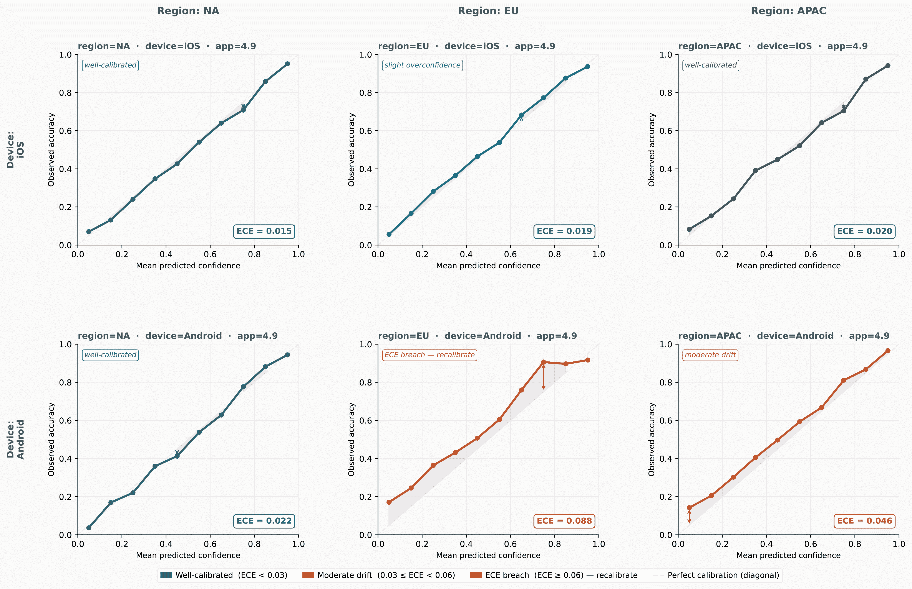

*图 12.11：按分组划分的可靠性图（区域 × 设备，应用版本 4.9）*


上图每个面板都在 x 轴上绘制预测置信度，在 y 轴上绘制观测准确率。一个完美校准的模型会完全沿着对角线分布——置信度 0.8 的预测应有 80% 的准确率。曲线位于对角线上方表示置信不足（模型实际比声称的更准确）；曲线位于对角线下方表示过度自信（模型声称的确定性高于实际水平）。曲线与对角线之间的阴影间隙正是 ECE 所衡量的内容：所有置信区间内这些间隙的加权平均值。六个群组中有五个处于健康或临界状态。欧盟 Android 群组（底部中间，红色）是离群值——其曲线在高置信度区间内明显偏离对角线，ECE 突破了 0.06 的阈值，并被标记为需要重新校准。这种模式——一个群组质量下降而全局平均值仍在正常范围内——正是群组级监控旨在捕获的故障模式。

按这种方式处理，在线质量变得可观测而非神秘难测。预测可以立即提供，精确标签可以稍后回流，领先指标可以实时监控，问题可以被控制在它们最初产生的群组范围内。有了在线质量层之后，下一节将讨论这些信号如何驱动告警、漂移预算和运维响应。

### 从信号到行动

没有行动的观测只是一块仪表盘。收集 SLI（如延迟、可用性、校准、漂移和资源余量）的意义在于**决定**何时呼叫人工介入、何时应用小型运行时调整、以及何时将问题移交给较慢的工作流（如重新校准、调试或重新训练）。接下来的小节将展示如何把前面介绍的指标转化为具体策略：不会抖动的告警、让变化可见的漂移预算，以及将遥测连接到安全运维响应的轻量级控制钩子。

#### 从 SLI 到策略

告警应当表示持续的**合约违约**，而不是短暂的统计波动。在实践中，这意味着要在滚动窗口上评估指标，将指标与 SLO 或预算进行比较，要求持续最短时长，并加入**回滞**机制，使告警只在信号回到舒适区间之后才解除。

以下示例展示了策略层的具体形态。服务导出底层指标，告警系统评估规则。

```yaml
# alerts.yml
groups:
  - name: inference-slo
    rules:
      - alert: P95LatencySLOViolated
        expr: histogram_quantile(0.95, sum(rate(req_latency_ms_bucket[5m])) by (le,endpoint,cohort)) > 120
        for: 10m
        labels: {severity: page, team: inference}
        annotations:
          summary: "p95 latency breach on {{ $labels.endpoint }} ({{ $labels.cohort }})"
          detail: "p95={{ $value | printf \"%.1f\" }} ms (>120) for 10m; check batching and queue spans"
      - alert: AvailabilityBudgetBurn
        expr: sum(rate(http_5xx_total[5m])) by (endpoint) / sum(rate(http_requests_total[5m])) by (endpoint) > 0.001
        for: 15m
        labels: {severity: page, team: platform}
        annotations:
          summary: "Availability budget burning on {{ $labels.endpoint }}"
          detail: "5xx share >0.1% sustained; inspect recent deploys and error logs"
```

这两条规则捕捉了最常见的面向用户的故障：延迟过高且持续时间过长，以及可用性消耗错误预算过快。接下来是校准和漂移告警：

```yaml
      - alert: CalibrationDrift
        expr: quality_ece{cohort!=""} > 0.03
        for: 30m
        labels: {severity: ticket, team: ml}
        annotations:
          summary: "ECE breach in {{ $labels.cohort }}"
          detail: "ECE={{ $value | printf \"%.3f\" }} (>0.03); consider recalibration or threshold update"
      - alert: FeatureDriftPSI
        expr: feature_psi{feature=~"price|country|device"} > 0.2
        for: 30m
        labels: {severity: ticket, team: data}
        annotations:
          summary: "Feature drift on {{ $labels.feature }} ({{ $labels.cohort }})"
          detail: "PSI > 0.2 for 3 windows; inspect transforms, units, and unseen-category rate"
```

具体阈值仅供参考，但背后的推理是实用的（*图 12.12*）。如果 p95 超过 120 ms，服务通常就会让人感觉响应迟钝。如果 ECE 超过 3%，阈值和审核队列可能开始偏离。PSI 达到 0.2 通常被视为有意义的数据分布偏移，但不会因细微的季节性波动而呼叫告警。`for` 持续时间带来了回滞，使告警代表真实事件而非噪声。

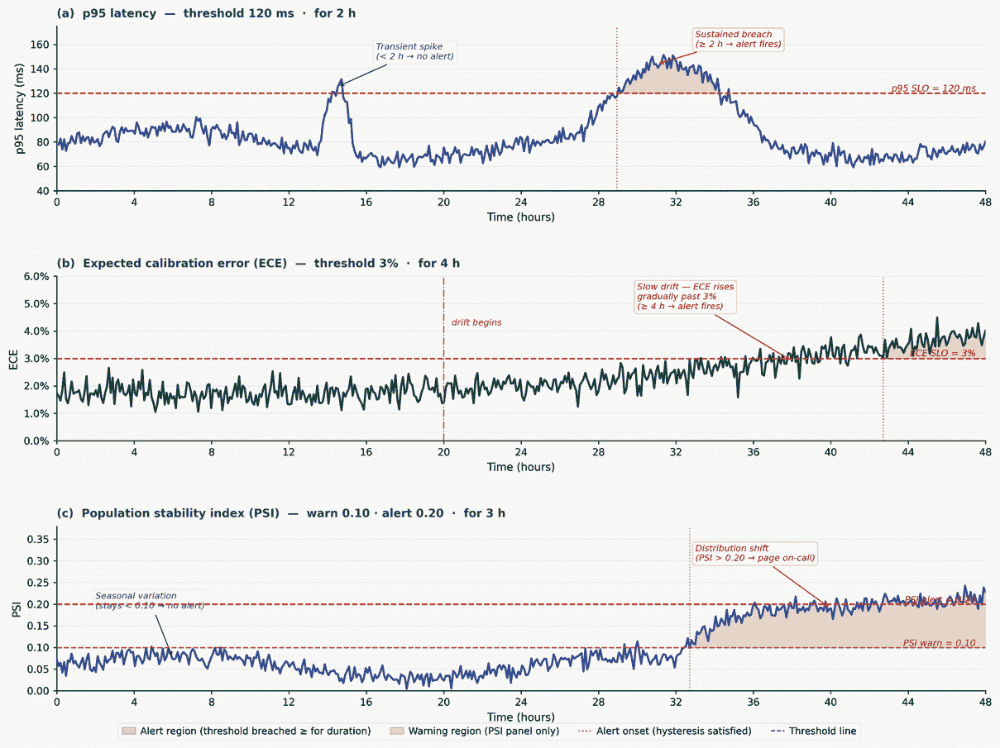

*图 12.12：从信号到行动*

指标触发告警；告警触发行动。延迟违规呼叫值班人员，校准违规开启重新校准任务，特征漂移违规路由到数据管道负责人。

告警阈值就位后，下一步是跟踪系统已经历的漂移或退化程度。

#### 漂移预算

**错误预算**量化了可用性 SLO 在给定时间段内允许的不可靠程度。**漂移预算**对**分布变化**和**校准**做同样的事：它把需要采取行动之前允许的变化量明确化。一个简单有效的台账可以按群组跟踪三个有用的量：

- **校准预算**：ECE 随时间累积的总量；如果在固定时间窗口内总量超过限制，则需要重新校准或重新训练。
- **协变量预算**：特征漂移超过阈值（如 PSI > 0.2）的时间窗口数量。
- **质量预算**：延迟标签到达后，超出质量 SLO 的标记超支。

这些不是硬性法规，而是护栏。其目的是让漂移响应变得可预测、可见。一个小型的进程内台账足以表达这一思想：

```cpp
struct DriftBudget {
    double ece_cum = 0.0; // cumulative daily ECE
    uint32_t psi_breaches = 0; // number of drift windows above threshold
    uint32_t quality_overspend = 0;

    void accrue_daily(double ece_day, uint32_t psi_windows_over) {
        ece_cum += ece_day;
        psi_breaches += psi_windows_over;
    }

    bool needs_recalibration(double ece_limit = 0.30) const {
        return ece_cum > ece_limit;
    }

    bool needs_retrain(uint32_t psi_limit = 12) const {
        return psi_breaches > psi_limit;
    }
};
```

这些值可以导出为普通仪表指标，例如 `budget_ece_cum{cohort=...}` 和 `budget_psi_breaches{cohort=...}`，并放在与延迟和成本相同的仪表盘上。

预算使系统更易于推理。告警展示当前发生的情况，预算展示在需要更强干预之前还剩多少余地。

#### 将告警连接到行动

告警不应只是向渠道中添加噪声。在实践中，有三类响应。有些是即时的服务端调整，不涉及模型更改，例如降低微批处理延迟、提高并发度或收紧阈值。有些属于调试手册，例如提高追踪详细程度或收集复现包。另一些属于较慢的离线循环，例如重新校准或定向重新训练。

一个有用的模式是让服务端操作保持保守且可逆。服务暴露少量运行时调节旋钮，告警层或运维控制台只直接调整这些旋钮。更重量级的更改保持在服务进程之外。

一个安全的小型模式是在 C++ 服务内部实现一个 **ActionRouter**，它接收告警系统发送的“指令”（通常通过 webhook），并应用**保守**、可逆的更改；更重量级的操作则交由外部管道处理。

```cpp
// action_router.hpp
#pragma once
#include <atomic>
#include <iostream>
#include <string>

struct Tuning {
    std::atomic<int> microbatch_delay_ms{8};
    std::atomic<int> max_concurrency{4};
    std::atomic<float> score_threshold{0.7f};
};
```

一个小型的运行时调优状态可以保存告警可能需要调整的服务端参数。


## 第 12 章：监控已部署的模型

这些旋钮通常可以在不改变模型权重或重新部署服务的情况下立即调整。随后，操作路由器（action router）可以通过将告警驱动的命令映射到一小组运行时调整项，以可控的方式应用这些更改。

```cpp
class ActionRouter {
public:
    explicit ActionRouter(Tuning& t) : t_(t) {}
    void apply(const std::string& kind, const std::string& payload) {
        if (kind == "set_threshold") {
            float th = std::stof(payload);
            float old = t_.score_threshold.exchange(th);
            log("threshold", old, th);
        } else if (kind == "set_microbatch_delay") {
            int ms = std::stoi(payload);
            int old = t_.microbatch_delay_ms.exchange(ms);
            log("microbatch_delay_ms", old, ms);
        } else if (kind == "set_concurrency") {
            int k = std::stoi(payload);
            int old = t_.max_concurrency.exchange(k);
            log("max_concurrency", old, k);
        } else if (kind == "enable_debug_mode") {
            debug_mode_ = true;
            std::cerr << "[action] debug_mode=on\n";
        }
    }

private:
    template <typename T>
    void log(const char* key, T oldv, T newv) {
        std::cerr << "[action] " << key << ": " << oldv << " -> " << newv << "\n";
    }

    Tuning& t_;
    bool debug_mode_{false};
};
```

这种模式让控制回路保持明确且可审计。每次更改都应记录由谁触发、为何触发以及何时发生。下面几个示例可以让这种映射更加具体：

- **某个群体的校准违规：** 导出该群体最近的 `{score, label}` 对，离线拟合新的温度参数，编写带有群体标记的校准产物，并让服务加载它。如果 ECE 下降并保持在 SLO 范围内，告警会在无需完整重新训练的情况下消除。
- **某个输入字段的特征漂移违规：** 首先将问题转交给数据管道负责人。价格上的 PSI 告警可能表示单位变化、缺失值或 schema 问题，而非模型问题。
- **延迟违规且 span 中排队严重：** 首先将问题转交给数据管道负责人。在修改模型代码之前，先减少微批延迟或增加容量。

关键在于比例性：并非每次告警都意味着需要重新训练，也并非每次回退都属于模型的职责范围。

### 通过护栏触发更慢的循环

重新训练不应是一种自动反射。更安全的推进方式通常是 **影子（shadow）** | **金丝雀（canary）** | **升级（promote）**，一旦运维或质量 SLO 被违反，就自动回滚。因此，告警或预算违规可能会触发一个外部管道，而不是立即更改线上模型，例如：

```text
POST /pipeline/retrain
{
    "model": "clickranker",
    "reason": "drift_budget_exhausted",
    "cohort": {"region":"EU","device":"ios"},
    "window": {"start":"2025-08-01","end":"2025-09-01"},
    "constraints": {"p95_ms": 120, "ece": 0.03, "cost_per_1k": 0.12}
}
```

该管道在服务必须满足的相同运维**约束（constraints）**下训练候选模型，然后将最佳模型注册为**影子（shadow）**部署：

```text
POST /control/serve
{
    "action": "shadow",
    "model_version": "clickranker-2025-09-01-eu-ios",
    "traffic_share": 0.0, // no user impact
    "collect": ["disagreement","latency","mem"]
}
```

如果影子遥测持续表现更好，就可以推进到小型金丝雀部署，并在 p95、p99、ECE、服务器错误率（HTTP 5xx）和成本上设置回滚门禁。具体的服务栈因实现而异，但原则是相同的：升级取决于实测行为，而非乐观估计。

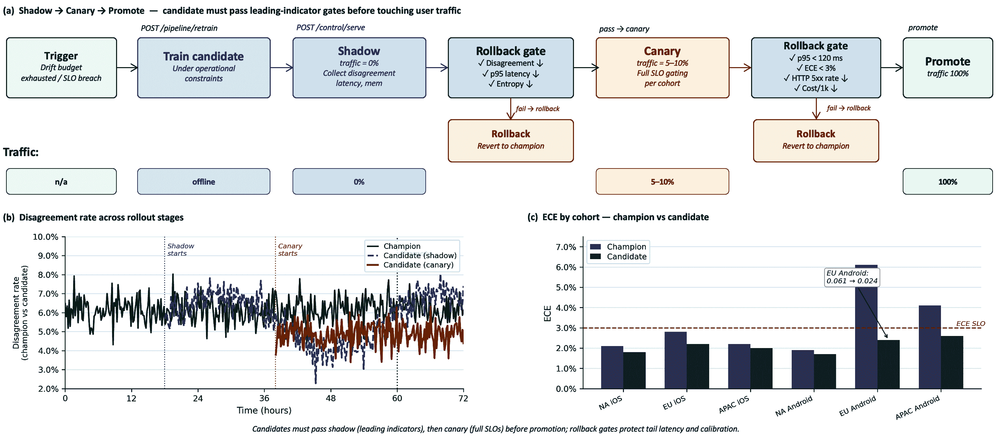

*图 12.13：影子 | 金丝雀 | 升级*

候选模型必须先通过影子阶段（领先指标），再通过金丝雀阶段（完整 SLO），之后才能升级；回滚门禁保护尾部延迟和校准。

当告警指向一个仍无法解释的问题时，更深入的调试流程属于 *第 11 章* 中描述的运行手册。本章的作用是让这些运行手册变得及时且基于证据。

### 在生产环境之前测试你的策略

策略应该在需要之前刻意演练。以下两种简单的演练尤其有用：

1. **合成漂移注入**：在预发布环境中扰动特征分布或重映射某个类别。漂移告警应当触发，校准应当出现波动，并且在标签数据证明有必要之前，不应启动任何重新训练任务。
2. **延迟混沌**：在服务路径中注入队列延迟。延迟告警应当触发，控制回路应当降低微批延迟或提高并发度，p95 应当回归到 SLO 附近。

如果告警在预期时没有触发，或者在不该触发时反复抖动，应在广泛部署之前修正该策略。

以这种方式处理，服务会变得更容易掌控。告警反映的是持续性的违规而非噪声，预算让漂移在变成意外之前就可见，运行时操作保持小而明确且可逆。延迟、校准和成本之所以能保持在可控范围内，靠的不是英雄主义，而是设计。

综合来看，这些部分共同构成了完整的监控闭环。服务暴露正确的信号，策略层将它们转化为告警和预算，控制路径将持续性违规映射为相称的操作。有了这个框架，本章现在可以通过总结让生产监控行之有效的核心思想来收尾。

### 总结

在生产环境中，只有当周围的服务在真实流量下保持可观测、可靠且高效时，模型才算成功。本章定义了延迟、质量、吞吐量和利用率的核心 SLI，并展示了如何将它们转化为 C++ 推理服务的实用 SLO。随后展示了如何通过轻量级埋点来暴露这些信号：易于抓取的指标、结构化日志和基于 span 的追踪。这些工具使得持续测量服务行为并在回退出现时定位它们成为可能。由于生产环境中的标签通常会有延迟，本章还介绍了基于延迟标签指标和实时领先指标两者的在线质量监控。通过按群体跟踪这些信号，团队可以及早发现局部回退，而不是依赖可能掩盖这些问题的全局平均值。

本章最后通过告警、漂移预算和小型运行时控制，将可观测性与行动联系起来。这些部分加在一起，让已部署的模型不仅可监控，而且可在运维上被管理。下一章将在此基础上，聚焦当信号超出预期范围时如何响应。它将展示如何系统性地调查回退、隔离可能的原因，并利用来自指标、日志和追踪的证据来指导调试、重新校准和恢复。

### 问题

以下问题有助于复习本章引入的主要概念。

1. 在模型服务的语境下定义 **SLI** 和 **SLO**。请各举两个例子。
2. 为什么我们要跟踪 **p95/p99 延迟**，而不是依赖平均值？请提供一个用户体验方面的例子。
3. 什么是 **首字节/首个 token 时间**（**TTFB/TTFT**）？为什么它对 LLM 端点很重要？
4. 区分**在线准确率**与**校准（calibration）**。在什么情况下准确率看起来正常但校准却很糟糕？
5. 你的可用性 SLO 是 **99.9%**。在一个 30 天的月份中，这大约允许多少停机时间？
6. 说出你会从 C++ 推理服务导出的三种 Prometheus 指标类型，以及每种类型捕获的内容。
7. 与临时的 printf 日志相比，**结构化日志**能为你带来什么？说出你会包含的三个字段。
8. 追踪和 span 如何帮助区分计算瓶颈与排队瓶颈？
9. 定义协变量（特征）漂移、标签/先验偏移和概念漂移。请为每种提供一个具体例子。
10. 你的某个群体的 ECE 突破了 3%，但准确率没有变化。你会首先尝试什么操作，为什么？
11. p99 延迟刚刚翻倍，但 GPU 利用率保持平稳且批处理大小缩小了。你会先调整哪个旋钮？
12. 解释**漂移预算（drift budget）**。它与错误预算有何相似之处？你会如何将其落地执行？

### 延伸阅读

以下参考资料提供了本章涉及的主要主题的额外阅读。

- *站点可靠性工程*（谷歌）—— SLI、SLO 与错误预算基础
- *OpenTelemetry 规范* —— 分布式系统的追踪模型与 span 语义
- *Prometheus：监控系统与 TSDB* —— 指标类型、直方图与告警模式
- *论现代神经网络的校准*（Guo 等人，ICML 2017）—— 实用的 ECE 与温度缩放
- *群体稳定性指数（PSI）指南*（行业白皮书）—— 生产环境中简单且稳健的漂移检测
- *规模下的延迟与尾部*（Dean & Barroso）—— 为什么 p95/p99 驱动用户体验
- *NVIDIA Nsight / VTune / perf* —— 将 span 与实际计算和内存行为关联起来的分析器


### 答案

准备好后，请将你的回答与下面的简要答案进行比对，以确认你的理解：

1. **SLI**：服务行为的可测量信号（例如 p95 延迟、HTTP 5xx 错误率、ECE、GPU 内存余量）。**SLO**：你为该 SLI 承诺的目标（例如 p95 ≤ 120 ms、可用性 ≥ 99.9%、ECE ≤ 3%）。
2. 平均值会掩盖尾部问题；用户感受到的是离群值。如果自动补全端点的平均值为 40 ms，但 p95 为 180 ms，那么每二十次按键就会有一次“卡顿”，削弱感知速度。
3. **TTFB/TTFT** 是发送第一个字节或令牌所用的时间。对于大语言模型，快速的首个令牌能锚定用户感知；即使总时间很长，及早进行流式输出也能改善用户体验，并减少会话取消次数。
4. **准确率**是正确率；**校准**衡量预测概率是否与观测频率匹配。你可能很准确（标签正确），但校准不佳（0.9 的分数并不意味着大约 90% 的正确率），这会破坏阈值设定和复核规模的确定。
5. 约 **43 分钟**（30 天共 43,200 分钟中的 0.1%）
6. **Counter**（例如 `http_requests_total`）、**Gauge**（例如 `gpu_mem_used_bytes`）、**Histogram**（例如 `req_latency_ms_bucket`）
7. 结构化日志允许机器解析和关联。至少应包含：`request_id`、模型/版本、分组（地区/设备/应用版本）、形状/数据类型、`latency_ms`（或每个 span 的延迟）以及 `result_status`
8. 追踪每个阶段的时间跨度。如果队列增长而推理保持不变，问题在于准入或批处理；如果推理增长，则是计算问题（模型或回退、精度变化、内核问题）。
9. **协变量漂移**：输入特征发生变化（例如，新设备组合提高了图像分辨率）。**标签/先验偏移**：类别频率改变（例如，欺诈率下降一半）。**概念漂移**：输入到输出的映射改变（例如，新政策重新定义了什么是“垃圾邮件”）。
10. **重新校准**（温度缩放/Platt 缩放）或调整该分组的阈值；校准可以在不重新训练权重的情况下修复概率质量。
11. 提高**微批处理**的有效性（如果队列截止时间过长并拉高尾部延迟，则缩短它；或者，由于批处理规模缩小了，可略微**增加**最大延迟以重建批大小）。目标是在修改模型之前恢复健康的批分布。
12. **漂移预算**量化了在一段时间内你容忍的分布或校准变化量（例如 PSI 窗口 > 0.2 或累积 ECE）。与错误预算类似，超出预算会**触发行动**（修复流水线、重新校准或重新训练），并在变更推出后重置。

### 获取本书 PDF 版本及更多资源

扫描二维码（或访问 `packtpub.com/unlock`）。按名称搜索本书，确认版本，然后按照页面上的步骤操作。


*注意：请保留你的发票。直接从 Packt 购买则无需发票。*
