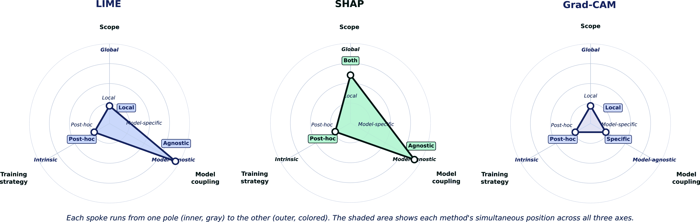
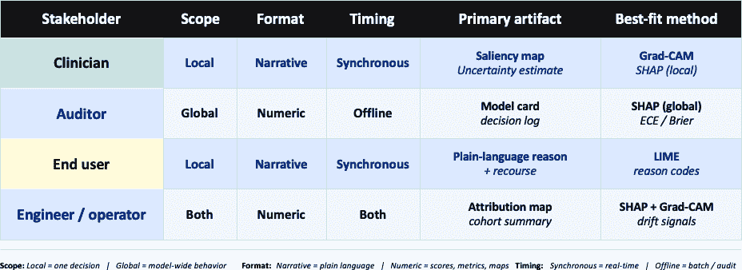
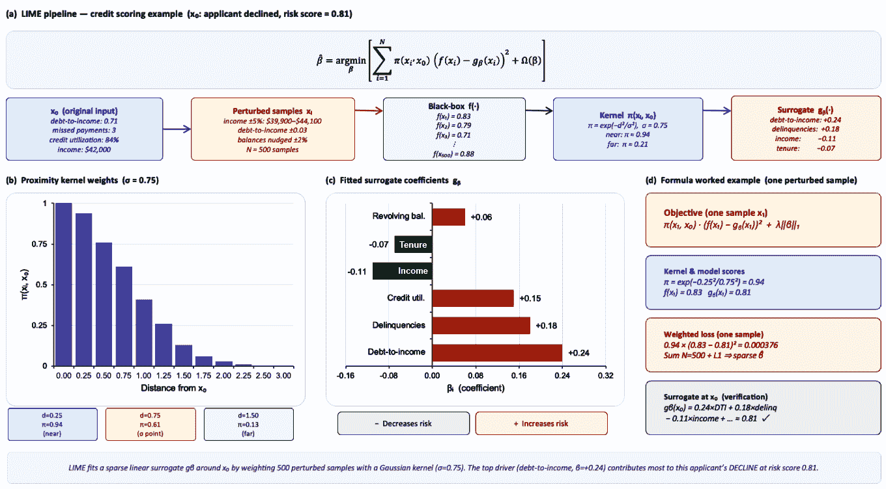
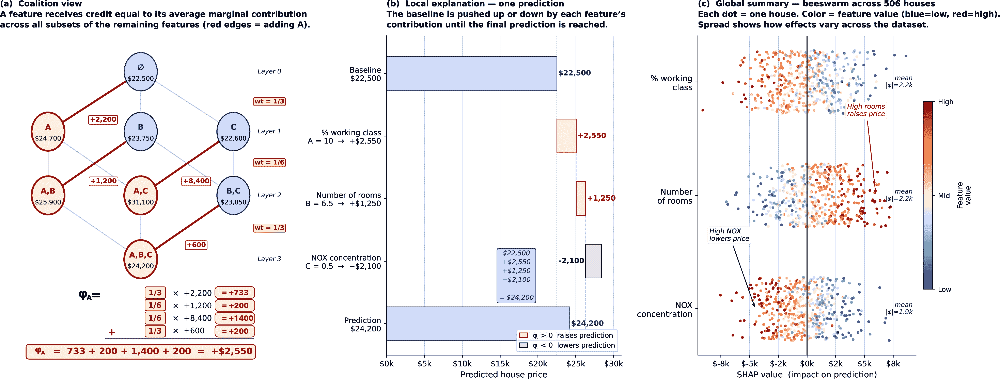
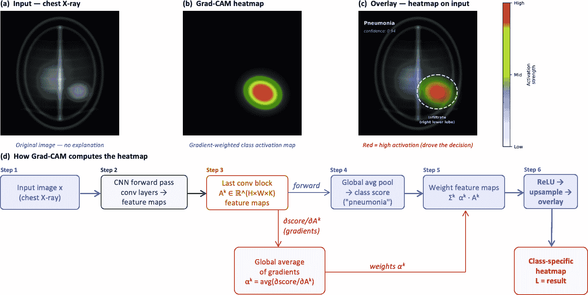
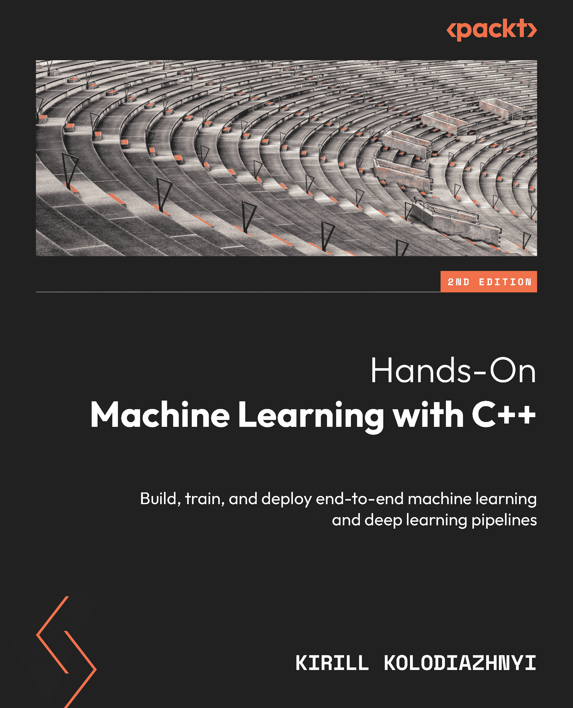

## 13. 深度学习模型中的可解释性与透明性

在某些应用中，仅有一个预测结果是不够的。当模型影响医疗、贷款、招聘或安全决策时，人们需要理解它为何做出该判断，以及应该给予多大程度的信心。这正是可解释性的价值所在。本章将探讨让深度学习模型更易理解的实用方法，使用你可以与 C++ 推理栈一起部署的技术。

我们将沿着实践中会用到的三个轴来构建可解释性：**局部 vs. 全局**（解释单个决策 vs. 模型整体行为）、**事后 vs. 内生**（分析已训练模型 vs. 一开始就为可解释性而设计）以及**模型无关 vs. 模型特定**。模型无关方法如**局部可解释模型无关解释**（**LIME**）和**SHapley 加法解释**（**SHAP**）可以跨架构使用；而模型特定方法如**梯度加权类激活映射**（**Grad-CAM**）则为特定模型族设计，例如**卷积神经网络**（**CNN**）。你还将学习在**忠实度**（解释是否真正反映模型的内部机制）与**有用性**（对人类读者来说是否可理解、可操作）之间取得平衡。在此过程中，我们还会指出常见陷阱，包括特征相关性、梯度饱和、具有误导性但看似合理的归因，以及基于扰动方法的计算成本。

从工程角度看，我们将尽可能贴近底层。你将使用已经部署的同一套推理后端（如 LibTorch 或 ONNX Runtime）在 **C++** 中实现 **LIME**、**SHAP** 和 **Grad-CAM**。我们还会介绍用于伴随预测一起提供解释的 API 设计、用于控制延迟的缓存与批处理策略，以及在用户界面中负责任地呈现解释的方法。

在本章中，我们将涵盖以下主题：

- 理解可解释性在深度学习中的重要性
- 介绍核心技术（LIME、SHAP、Grad-CAM）
- 在 C++ 中实现 LIME 和 SHAP
- 将 Grad-CAM 应用于卷积神经网络
- 处理伦理考量

到本章结束时，你将理解在 C++ 系统中解释深度学习模型的主要方法，包括 LIME、SHAP 和 Grad-CAM。你还将了解如何在真实应用中负责任地使用这些解释，同时关注实际部署与伦理边界。

### 理解可解释性在深度学习中的重要性

高准确率很重要，但在许多领域仅靠准确率本身并不足够。当模型输出影响医疗、信贷决策、招聘、安全系统或法律程序时，利益相关者不仅仅需要知道做出了一个预测。他们需要理解预测**为什么**做出，应该对其赋予**多大的**信心，以及**哪些因素**可能改变结果。这正是可解释性的作用：将一个复杂函数转化为人类可以评估并据此行动的原因，同时又不过度简化模型的实际行为。

可解释性不是单一的概念或工具。在实践中，可以从三个主要轴来思考它：

- **局部 vs. 全局**：我们是在解释某个特定决策，还是模型的整体行为？
- **事后 vs. 内生**：我们是事后分析已训练好的模型，还是从一开始就设计可解释的模型？
- **模型无关 vs. 模型特定**：我们是使用可跨架构工作的技术（如 LIME 和 SHAP），还是专门针对特定模型族的方法（如用于 CNN 的 Grad-CAM）？



*图 13.1：在可解释性轴上比较 LIME、SHAP 与 Grad-CAM*

*图 13.1* 中的雷达图展示了这三种方法在范围、训练策略和模型耦合度上的差异。LIME 主要面向局部且模型无关；SHAP 可同时支持局部和全局解释；Grad-CAM 则是一种用于可视化**卷积神经网络**（**CNN**）决策的模型特定方法。

这些区别有助于阐明为什么没有任何一种解释方法适用于所有用例。下一小节将探讨何时需要解释、不同利益相关者对其有何期望，以及可解释性如何在已部署系统中支撑信任、安全与治理。

### 识别何时需要解释

每当模型的输出对人的权益、安全或责任归属产生重大影响时，解释就变得尤为重要。在医疗保健领域，分诊或诊断模型应提供患者层面的原因（例如显著的测量值或图像区域），并附上一定程度的不确定性提示，以便临床医生核实或推翻建议。在金融领域，诸如贷款利率变更或拒绝贷款等决策通常需要理由代码和文档记录，以支持一致性与复核。在安全关键型系统（如自动驾驶或工业检测）中，解释有助于团队调查故障，并判断问题究竟来自分布偏移、传感器问题还是糟糕的决策边界。在面向公众的产品（如推荐或内容审核系统）中，可解释性还能减少“决策由不透明黑箱做出”的感觉，从而增强用户信任。


### 了解不同利益相关者的需求

不同的受众需要不同形式的解释、不同的详细程度以及不同的响应时间：

- **临床医生和其他领域专家**通常需要基于领域特征的*案例级解释*。他们可能需要知道哪些测量值、症状或图像区域对预测的贡献最大，还需要校准的风险评分、置信区间，以及提示*何时不应信任模型*的信号，例如分布外输入、图像质量差，或缺少关键特征或字段。

- **审计人员、合规与风险审查人员**通常需要更广泛的*文档*。这些文档可能包括模型卡片、数据血缘、队列级性能和校准、公平性分析、特征治理，以及与当时使用的确切模型版本、阈值和输入模式相关联的*决策日志*。

- **最终用户**需要更*简短清晰*且带有*补救措施*的解释。他们受益于*通俗易懂的*影响结果的主要因素摘要，并适当提供相关资源，例如哪些行动可以改善未来的结果，或者缺失信息如何影响决策。

- **工程师和运维人员**需要*准确*反映模型行为并支持调试的解释。他们可能会使用显著性图、归因模式、分歧信号和队列摘要来识别脆弱特征、追踪故障模式和检测漂移。对于这类受众，*保真度*比呈现方式更重要。

### 将可解释性与信任、安全和监管联系起来

可解释性是在深度学习系统中建立**信任**的一个组成部分。其他部分包括校准、鲁棒性和补救措施，但解释发挥着特殊作用，因为它允许人们检查、质疑和挑战模型输出。既*忠实*又*可理解*的解释使专家更容易验证系统，也使受影响的用户更容易解读其决策。

可解释性也是一种**安全**机制。归因方法和激活图可以揭示捷径学习、不稳定代理，或当条件变化时模型所依赖特征的转移。与监控（*第12章*）相结合时，可解释性有助于决定何时优雅降级、触发人工审查或将模型下线。

此外，可解释性支持*监管预期*和内部*治理要求*。在许多情况下，组织必须以支持审查和审计的方式记录模型的目的、局限性、输入、结果和决策逻辑。即使法律没有明确要求可解释性，将解释工件作为生产界面的一部分保留下来，也会使审查、风险管理和事件分析变得更加容易。

### 应用实际设计原则

在实际系统中设计可解释性时，有两条原则尤其重要：

1. **解释必须符合延迟和隐私预算。** 计算密集型的扰动方法无法在紧张的p95延迟下同步运行；你可能需要在线上使用缓存或近似的归因，在线下生成更完整的报告。解释绝不应泄露敏感字段或导致被利用；在适当的地方应进行脱敏和聚合。

2. **一致性优先于精巧。** 除非模型行为确实发生变化，否则解释应在小的输入变化下保持稳定，并跨模型版本保持一致。如果近乎相同的输入会导致归因结果大幅跳动，那么它们将无法支持临床或监管用途，并会困扰最终用户。



*图13.2（占位图）：利益相关者需求矩阵*

不同的利益相关者看重不同的解释工件（*图13.2*）。临床医生、审计人员、最终用户和运维人员需要不同平衡的局部与全局解释、叙述性与数值输出，以及同步与离线报告。有了这个基础，我们现在可以转向实践中使用的主要可解释性方法。下一节将介绍LIME、SHAP和Grad-CAM，并展示它们在目的、假设和部署权衡方面的差异。

### 核心技术概述（LIME、SHAP、Grad-CAM）

并非所有解释都回答相同的问题。有些方法显示*某个特定决策中哪些特征重要*；另一些方法强调*视觉模型关注的位置*；还有一些方法提供跨许多案例汇总的*加性归因*。在本节中，我们将介绍三种在C++推理栈上开发时广泛使用的技术：LIME、SHAP和**梯度加权类激活映射**（**Grad-CAM**）。我们将解释每种方法旨在估计什么、在何处最有用，以及它在保真度、延迟和实现复杂性方面带来了哪些权衡。接下来的各小节将依次深入讨论每种方法，展示其工作原理、依赖的假设，以及在实际系统中使用时需要牢记的实际问题。这些小节将帮助你决定哪种解释方法最适合你的模型、用户和部署约束。

#### LIME——针对单个预测的局部、模型无关解释

LIME是局部可解释性的一个有用起点，因为它只需对服务栈进行相对较少的改动即可应用于许多不同的模型类型。在本小节中，你将了解LIME旨在估计什么、在实践中如何工作，以及在生产环境中使用它时需要注意哪些权衡。

- **直觉与目标**：LIME通过在输入周围的小邻域内近似黑盒模型来解释*单个*决策。它生成原始样本的小扰动，对这些变体查询模型，根据每个样本与原始点的接近程度对其加权，并拟合一个简单的替代模型——通常是稀疏线性模型。然后，该替代模型的系数被解释为局部特征重要性——即对于*这个*特定输入、在*微小且合理的改变*下的重要性。

- **所估计的内容**：对于输入x₀，LIME通过求解下式来拟合替代模型g_β：

  β̂ = argmin_β ∑_{i=1}^{N} π(x_i, x₀) (f(x_i) − g_β(x_i))² + Ω(β),

  其中x_i是扰动样本，f是原始模型，g_β是替代模型，π(x_i, x₀)是一个邻近核函数，用于降低远端样本的权重，而Ω(β)是一个鼓励稀疏性的正则化项。拟合得到的β可解读为f在x₀附近的*局部*线性近似。

- **具体示例**：

  - **表格型信用评分**：对收入施加±5–10%的抖动，微调余额，切换少量二元标志，将稀有类别掩蔽到“其他”桶中。对于该申请人的拒绝，替代模型可能报告“负债收入比 +0.24，近期逾期 +0.18，工作年限 −0.07”。

  - **文本情感**：将句子表示为可解释的标记，通过掩码单词或用中性同义词替换来生成扰动，在打分后的变体上拟合替代模型，以对影响性标记进行排序。

  - **图像**：将图像分割为超像素，随机关闭超像素（用中性色或模糊替换），对每个变体评分，并在二值的开/关掩码上拟合替代模型。（注意，超像素生成本身会增加计算量，并可能影响稳定性。）

- **陷阱与护栏**：LIME的保真度取决于你的*扰动*。如果你采样了不可能的状态（如负年龄、不一致的特征组合），你将在不好的邻域上拟合出良好的替代模型。相关特征可能会在彼此之间转移重要性；特征缩放和合理的核宽度很重要。使用固定的随机数种子来稳定结果，限制显示的特征数量，并记录你的扰动策略。在性能方面，LIME需要数十到数百次额外的前向传播；在C++中，你可以对这些查询进行微批量处理，并重用缓冲区，以将p95延迟控制在预算内。



*图13.3：LIME在表格型信用风险中的应用。使用抖动特征围绕一位申请人拟合局部替代模型（稀疏线性模型）；系数大小对该单一决策的影响因素进行排序。*


LIME 提供了一种灵活且与模型无关的方式来解释单个预测，但它在很大程度上依赖于其采样的局部扰动的质量。下一小节将介绍 SHAP，它通过为特征分配具有更强理论基础的可加性贡献，从不同角度处理局部归因问题。

#### SHAP：具有博弈论保证的可加性归因

当你需要既适用于单个预测、又适用于更大范围群体级汇总的解释时，SHAP 尤其有用。在本小节中，你将了解 SHAP 如何分配特征贡献、它与 LIME 的区别，以及为什么在需要一致性和聚合时它往往是首选。

- **直觉与目标：** SHAP 使用合作博弈论中的 **Shapley 值** 为每个特征分配对预测的贡献。你可以将预测 \(f(x)\) 视为一个特征联盟的收益，其中每个特征的价值是它在所有可能加入其他特征的方式中的 *平均边际贡献*。结果是具有若干有用性质的**可加性**解释：归因之和等于 \(f(x) - E[f(X)]\)，即满足局部准确性；对称特征被平等对待；当模型变化时归因也一致地变化。

理解 SHAP 的一个有用方法是从基线预测开始，然后询问当每个特征加入其他特征的不同联盟时，它对该预测产生了多大改变。对这些边际贡献取平均，便得到每个特征的归因，而这些归因之和会回到相对于基线的模型输出。这就是为什么 SHAP 在数学上根基扎实，并且在实践中易于可视化。

- **被估计的内容：** 对于特征 \(j\)，Shapley 值为：

\[
\phi_j = \sum_{S \subseteq F \setminus \{j\}} \frac{|S|!\,(|F|-|S|-1)!}{|F|!} \left[ f_{S \cup \{j\}}(x_{S \cup \{j\}}) - f_S(x_S) \right],
\]

其中 \(F\) 是特征全集，\(S\) 是不包含特征 \(j\) 的子集，\(\phi_j\) 是特征 \(j\) 的贡献。该公式表明，每个特征获得的贡献等于其在其余特征所有可能联盟中的平均边际贡献。

精确的 Shapley 值需要对所有 \(2^d\) 个联盟取平均，这使得除非常小的 \(d\) 之外很快变得不可行。因此，在实践中需要使用近似方法。KernelSHAP 与模型无关，并且与 LIME 类似，求解加权线性回归，但它使用专门设计的 Shapley 核和二元联盟特征。TreeSHAP 为树集成提供精确值，而 DeepSHAP 在特定层假设下利用网络结构。你还必须选择一个背景数据集 \(X_{\text{bg}}\) 来定义基线 \(E[f(X)]\)。

*图 13.4* 通过从理论转向可视化来帮助具体化 SHAP。面板 (a) 展示了联盟视角，其中某个特征的 Shapley 值被计算为其在其他特征子集上的平均边际贡献。面板 (b) 展示了单个预测的局部解释，从基线开始逐步加入特征贡献，直到达到最终输出。面板 (c) 展示了跨多个示例的全局蜂群汇总，说明哪些特征具有最大的总体影响，以及其效应如何在整个数据集中变化。

- **具体示例：**
  - 欺诈检测：计算某一天流量的 SHAP，然后按群体聚合，可以看到“商户类别”和“距离家庭的距离”在区域 A 中占主导，而“设备风险评分”在区域 B 中占主导。将单案例 SHAP 用于争议处理，将全局 SHAP 汇总用于风险治理。
  - 医疗分诊：使用从上个月入院记录中抽取的背景集，SHAP 显示乳酸升高和呼吸频率异常是高危标记的主要驱动因素；临床医生随后可以核对案例级归因和群体级模式。

- **陷阱与护栏：** KernelSHAP 通常假设联盟内的特征相互独立，因此严重的多重共线性会使归因产生偏差。常见的缓解方法包括对相关特征进行分组、采用条件变体，或选择能反映部署分布（例如按区域、设备或季节）的背景集。背景选择*很重要*，因为相对于健康人群与相对于最近 ICU 入院患者解释某个案例会产生不同的基线，从而产生不同的归因，因此应明确记录该选择。KernelSHAP 还需要大量模型评估；在 C++ 批量联盟查询中，应缓存重复掩码、预分配缓冲区并固定内存，以保持尾部延迟可预测。



*图 13.4：SHAP 如何分解预测*

*图 13.4* 展示了 SHAP 如何通过将预测分解为可在局部和全局层面解读的特征级贡献来解释模型。对于单个预测，SHAP 显示每个特征如何使模型输出偏离基线；对于许多预测，它揭示哪些特征最重要，以及它们的效应如何在数据集中变化。面板 (a) 展示了特征 \(A\) 的联盟机制：每个节点代表模型对不同特征子集的输出，\(\varphi_A\) 是特征 \(A\) 在所有四个联盟上边际贡献的加权平均值。面板 (b) 将此思想应用于一所房屋。基线 \(E[f(X)]\) 为 $22,500，即所有 506 所房屋的平均预测值，表示模型在不知道某所房屋的任何具体信息时会预测的值。然后，每个 Shapley 值显示知道该特征的实际值如何使预测偏离该平均值：*劳动阶层百分比* 将其推高 $2,550，*房间数量* 增加 $1,250，*NOX 浓度* 将其拉低 $2,100，最终预测为 $24,200。根据构造，这些贡献之和恰好等于基线与预测之间的差距。面板 (c) 将其扩展到整个数据集：每个点代表一所房屋，颜色表示原始特征值，水平分布同时显示每个特征效应的方向和变化范围——而单个平均重要性条形图会将这些信息压缩成一个数字。

当你需要在同时个体和群体层面起作用的可加性归因时，SHAP 尤其有价值。下一小节转向 Grad-CAM，它通过展示卷积神经网络在做出基于图像的决策时关注的位置，来应对另一种不同的解释需求。

#### Grad-CAM：展示 CNN 在类别决策中关注的位置

当目标是理解哪些图像区域对卷积神经网络的预测贡献最大时，Grad-CAM 尤其有用。在本小节中，你将了解 Grad-CAM 如何将激活和梯度转换为类别特定的热力图，以及在实际系统中使用它时需要注意哪些实际问题。

- **直觉与目标：** Grad-CAM 在卷积网络中定位某一类别的**空间证据**。它将类别得分 \(y^c\) 的梯度反向传播到所选的卷积层特征图 \(A^k\)，然后将通道权重 \(\alpha_k^c\) 计算为全局平均梯度。类别特定的热力图构造如下：

\[
L_{\text{Grad-CAM}}^c = \operatorname{ReLU}\left(\sum_k \alpha_k^c A^k\right),
\]

随后将所得热力图调整为与原始输入图像分辨率一致。ReLU 移除负面证据，并突出最能提高类别得分的区域。

- **具体示例：**
  - 胸部 X 光分类器：在预测肺炎时，热力图集中在局灶性不透明区域；临床医生可以将其与放射学发现进行比较。
  - 制造检测：对于“裂纹”类别，Grad-CAM 突出显示金属表面上的裂缝区域；热力图漂移到徽标或边缘的误触发揭示了捷径学习。

- **陷阱与护栏：** 谨慎选择层（通常是最后一个卷积块）：太浅会产生噪声较大的图；太深则会因步幅而变得粗糙。注意梯度饱和（某些激活）；Grad-CAM++ 和 SmoothGrad 叠加可以提高特异性。热力图忠实于*该层的表示*，而非绝对真值；需验证高激活区域是否与领域相关线索一致。对于非卷积架构（ViT），应使用注意力展开或 LRP 风格方法，而非经典 Grad-CAM。


## 深度学习模型中的可解释性与透明度



*图 13.5：CNN 上的 Grad-CAM。叠加在输入上的类别特定热力图显示了最后一个卷积块中驱动“肺炎”决策的区域。*

Grad-CAM 通过为基于图像的模型提供视觉解释，补充了 LIME 和 SHAP，而不是为表格或文本输入提供特征归因视图。下一节将在此基础上，展示如何在必须满足实时延迟、可用性和部署约束的 C++ 系统中实现解释方法。

### 在真实约束下选择与组合方法

方法的选择应与所提出的问题、接收解释的受众以及可用的延迟或计算预算保持一致。如果目标是展示视觉模型在最小开销下聚焦于何处，Grad-CAM 通常是最佳选择。如果需要可聚合到大规模人群和长时间窗口的加性、可审计归因，**SHAP** 提供了更坚实的基础。如果需要快速、模型无关、且设置最少的单个预测解释，**LIME** 最容易集成到任何 C++ 推理服务中。

在生产环境中，这些方法通常被**组合**使用，而不是孤立使用。信贷决策系统可能会向申请人返回一段简短的、LIME 风格的局部叙述，同时向风险和合规部门返回 SHAP 摘要。医学影像系统可能会向临床医生展示 Grad-CAM 热力图，同时对相关的表格特征（如生命体征或化验值）使用 SHAP，以解释预测中非图像部分。方法选择还应与 **SLO** 挂钩：为在线使用提供缓存或近似的解释可能是合适的，而更丰富、更昂贵的报告可以异步生成，用于审计或审查工作流。为保持**可复现性**，应固定随机种子，对扰动策略和背景数据集进行版本控制，并记录生成每个解释时使用的确切模型和预处理版本。

解释必须在**运维上诚实**。它们不应泄露敏感属性；当输入分布外时，它们应优雅地退化；并且在输入发生微小变化时应保持稳定。解释不是装饰——它们是产品界面和问责模型的一部分。在考虑这些约束的前提下选择和实现 LIME、SHAP 和 Grad-CAM，可以交付既对专家有用、对用户可理解、又能在实际延迟预算内实用的解释。

下一节将从方法选择转向实现。它展示了如何将 LIME 和 SHAP 构建到 C++ 流水线中，重点关注扰动设计、加权、代理模型拟合，以及在生产环境中保持解释可用所需的性能权衡。

### 在 C++ 中实现 LIME 和 SHAP

可以随 C++ 推理服务一起部署的解释必须同时满足三个约束：必须**足够准确**以有用，**足够快**以符合延迟预算，并且**足够简单**以在生产中维护。LIME 和 SHAP 在仔细实现时非常适合这种权衡空间。这两种方法都将生产模型视为黑盒 f(x) → y，但它们在估计内容上有所不同：LIME 在单个预测周围拟合一个**可解释模型**，而 SHAP 分配**加性归因**，这些归因总和等于预测差值。在实践中，重要的实现选择是如何**扰动输入**、如何**对邻域加权**、如何**拟合代理模型**，以及如何**批量查询**，以免解释导致尾延迟爆炸。

#### 从预测函数到解释器

我们从一个简单的假设开始：模型已经可以从 C++ 调用。这足以构建 LIME 和 SHAP，因为这两种方法都不需要访问模型内部权重。

```cpp
// 一个最小的、模型无关的接口。
struct Model {
    // 返回标量分数：类别 c 的概率、logit 或
    // 回归输出。
    double score(const Eigen::VectorXd& x) const;

    // 可选的批处理变体，用于性能优化。
    void score_batch(const std::vector<Eigen::VectorXd>& X,
                     std::vector<double>& out) const;
};
```

以下所有内容都将 `Model` 视为不透明。解释器只需要生成输入、对其评分，并在结果上拟合一个小型辅助模型。

#### LIME：局部代理模型需要可信的扰动

当特征空间和扰动策略被明确定义时，LIME 最容易实现。本小节的目标是展示如何生成邻近样本、如何对它们加权，以及如何拟合一个小型代理模型并将其作为可用解释返回。

LIME 通过对邻近点进行采样并拟合一个微小的、人类可读的模型来解释点 x0。“邻近”是在一个**可解释特征空间**中定义的：原始、标准化的表格特征；文本的 token 开/关指示符；图像的超像素掩码。选择用户能读回的表征。扰动设计最重要的规则是*保持在数据流形上*。只采样可能实际出现的值。

- **连续特征：** 使用训练缩放器标准化为零均值和单位方差，然后添加小的高斯噪声：\(x_j^{(t)} = x_{0j} + \epsilon,\ \epsilon \sim \mathcal{N}(0, \sigma_j^2)\)，并截断回有效范围
- **分类特征：** 从该特征的训练分布中采样，或切换少量高频类别，同时将稀有类别映射到“其他”桶
- **混合类型：** 使用 **Gower 风格距离**，使数值和分类特征的差异按范围缩放；分类特征采用 0/1 匹配，因此邻域加权能公平地处理异构特征

每个扰动样本 \(x_i\) 获得一个邻近权重 \(\pi_i = \exp(-D(x_i, x0)^2 / \sigma^2)\)，其中 \(D\) 是邻域距离，\(\sigma\) 控制拟合的局部程度。如果 \(\sigma\) 太小，代理模型会变得嘈杂；如果太大，解释就不再是局部的。

LIME 通常拟合一个**稀疏线性模型**，以便只需显示一短串驱动因素。在 C++ 中有两种常见选择：

- **加权岭回归（L2）：** 拟合一个稳定的线性模型，然后按幅值保留前 K 个系数。
- **真正的 LASSO（L1）：** 如果需要精确的零和固有稀疏性，则使用坐标下降求解器。

以下是用 Eigen 求解的紧凑加权岭回归。第一步是定义配置和解释负载。

```cpp
struct LimeConfig {
    int n_samples = 512;        // 扰动次数
    int top_k = 8;              // 显示多少特征
    double ridge_lambda = 1e-3; // L2 正则化
    double kernel_width = 0.75; // 局部性核
};
```

```cpp
struct LimeExplanation {
    std::vector<int> feat_index;
    std::vector<double> feat_weight;  // 带符号的重要性
    double intercept;
};
```

接下来，在标准化空间中采样扰动点，并在单个批次中对它们评分。

```cpp
std::vector<Eigen::VectorXd> sample_lime_points(
    const Eigen::VectorXd& x0,
    const Eigen::VectorXd& mu,
    const Eigen::VectorXd& sigma,
    int n_samples) {
    using namespace Eigen;
    const int d = x0.size();
    std::vector<VectorXd> Xs;
    Xs.reserve(n_samples);
    std::mt19937 rng(42);
    std::normal_distribution<double> N01(0.0, 1.0);
    for (int i = 0; i < n_samples; ++i) {
        VectorXd z = (x0 - mu).cwiseQuotient(sigma);  // 标准化
        for (int j = 0; j < d; ++j) z[j] += 0.2 * N01(rng);
        VectorXd x = z.cwiseProduct(sigma) + mu;       // 反标准化
        Xs.push_back(x);
    }
    return Xs;
}
```

```cpp
std::vector<double> score_lime_batch(const Model& model,
                                     const std::vector<Eigen::VectorXd>& Xs) {
    std::vector<double> ys(Xs.size());
    model.score_batch(Xs, ys);
    return ys;
}
```


然后构建加权设计矩阵并求解岭回归。

```cpp
Eigen::VectorXd fit_lime_ridge(const std::vector<Eigen::VectorXd>& Xs,
                               const std::vector<double>& ys,
                               const Eigen::VectorXd& x0,
                               const Eigen::VectorXd& mu,
                               const Eigen::VectorXd& sigma,
                               double kernel_width,
                               double ridge_lambda) {
    using namespace Eigen;
    const int n = static_cast<int>(Xs.size());
    const int d = x0.size();
    MatrixXd X(n, d + 1);
    VectorXd y(n), w(n);
    VectorXd z0 = (x0 - mu).cwiseQuotient(sigma);
    for (int i = 0; i < n; ++i) {
        VectorXd zi = (Xs[i] - mu).cwiseQuotient(sigma);
        double dist2 = (zi - z0).squaredNorm();
        w[i] = std::exp(-dist2 / (kernel_width * kernel_width));
        X(i, 0) = 1.0; // bias
        for (int j = 0; j < d; ++j) X(i, j + 1) = Xs[i][j];
        y[i] = ys[i];
    }
    MatrixXd W = w.asDiagonal();
    MatrixXd XtWX = X.transpose() * W * X;
    for (int j = 1; j <= d; ++j) XtWX(j, j) += ridge_lambda;
    return XtWX.ldlt().solve(X.transpose() * W * y);
}
```

最后，提取前 K 个系数以构建解释对象。

```cpp
LimeExplanation build_lime_explanation(const Eigen::VectorXd& beta, int top_k) {
    struct Item { int j; double w; };
    std::vector<Item> items;
    for (int j = 1; j < beta.size(); ++j) {
        items.push_back({j - 1, beta[j]});
    }
    std::partial_sort(
        items.begin(),
        items.begin() + std::min(top_k, static_cast<int>(items.size())),
        items.end(),
        [](const Item& a, const Item& b) {
            return std::fabs(a.w) > std::fabs(b.w);
        });
    LimeExplanation out;
    out.intercept = beta[0];
    for (int k = 0; k < std::min(top_k, static_cast<int>(items.size())); ++k) {
        out.feat_index.push_back(items[k].j);
        out.feat_weight.push_back(items[k].w);
    }
    return out;
}
```

这样就得到了稳定的局部线性化；如果你确实需要零系数，可以选择用一个小型**坐标下降**替换岭回归求解器，以获得真正的 L1 稀疏性。

有了局部替代模型之后，下一步是从邻域解释过渡到加性特征归因。这正是 KernelSHAP 的作用：它用基于联盟的加权替代了局部扰动拟合。

#### SHAP：KernelSHAP 作为一种实用且与模型无关的估计器

SHAP 从另一个角度处理解释问题。它不是直接在原始特征空间中拟合局部替代模型，而是估计在其余特征的众多可能联盟中，每个特征的平均贡献。

对于规模为 M 的特征集合，特征 j 的 Shapley 值是该特征在其他 M−1 个特征的*所有*联盟中的平均边际贡献。精确计算是指数级的，因此 **KernelSHAP** 通过将问题重构为对随机采样联盟进行的**加权线性回归**，使其变得可处理。

SHAP 相对于基线 E[f(X)] 来解释 f(x)，因此你必须选择一个能代表典型服务输入的背景数据集 B = {b^(1), ..., b^(K)}。这一选择很重要：从近期 ICU 患者中抽取的背景数据所得出的基线，与从初级保健就诊中抽取的背景数据不同，因此应仔细记录这一选择。

一个联盟由二进制掩码 z ∈ {0,1}^M 表示，其中每个位指示相应特征来自实例还是背景。掩码后的输入为 x̂(z,b) = z ⊙ x + (1 − z) ⊙ b。

对于每个联盟，KernelSHAP 分配一个 Shapley 核权重 ω(z) = (M−1) / (C(M, |z|) · |z| · (M−|z|))，该权重强调中等规模的联盟。然后它拟合加权线性模型 f(x̂(z,b)) ≈ φ0 + Σ_{j=1}^{M} φ_j z_j，其中拟合得到的 φ_j 值即为 SHAP 归因，φ0 近似于基线。

与 LIME 一样，将实现拆分为小块会很有帮助。先从配置和联盟采样开始。

```cpp
struct ShapConfig {
    int n_coalitions = 2048; // number of sampled masks
    int background_K = 64;   // number of baseline examples
    double ridge_lambda = 1e-6; // numerical stability
    unsigned seed = 1337;
};

struct ShapValues {
    std::vector<double> phi;
    double phi0 = 0.0;
};

inline std::vector<uint8_t> sample_mask(int M, std::mt19937& rng) {
    std::uniform_int_distribution<int> size_dist(1, std::max(1, M - 1));
    int k = size_dist(rng);
    std::vector<uint8_t> z(M, 0);
    std::vector<int> idx(M);
    std::iota(idx.begin(), idx.end(), 0);
    std::shuffle(idx.begin(), idx.end(), rng);
    for (int i = 0; i < k; ++i) z[idx[i]] = 1;
    return z;
}
```

接下来，构建设计矩阵 Z 和核权重 ω(z)。

```cpp
void build_kernelshap_design(int M,
                             const ShapConfig& cfg,
                             Eigen::MatrixXd& Z,
                             Eigen::VectorXd& w,
                             std::vector<std::vector<uint8_t>>& masks) {
    Z.resize(cfg.n_coalitions, M + 1);
    w.resize(cfg.n_coalitions);
    masks.clear();
    masks.reserve(cfg.n_coalitions);
    std::mt19937 rng(cfg.seed);
    auto comb = [](int n, int k) -> double {
        if (k < 0 || k > n) return 0.0;
        k = std::min(k, n - k);
        double c = 1.0;
        for (int i = 1; i <= k; ++i) c = c * (n - k + i) / i;
        return c;
    };
    for (int i = 0; i < cfg.n_coalitions; ++i) {
        auto z = sample_mask(M, rng);
        int k = std::accumulate(z.begin(), z.end(), 0);
        double omega = (M > 1)
            ? static_cast<double>(M - 1) / (comb(M, k) * k * (M - k))
            : 1.0;
        masks.push_back(z);
        w[i] = std::max(omega, 1e-12);
        Z(i, 0) = 1.0;
        for (int j = 0; j < M; ++j) Z(i, j + 1) = static_cast<double>(z[j]);
    }
}
```

然后生成掩码输入并对它们进行批量评分。

```cpp
std::vector<Eigen::VectorXd> build_masked_batch(
    const Eigen::VectorXd& x,
    const std::vector<Eigen::VectorXd>& background,
    const std::vector<std::vector<uint8_t>>& masks) {
    std::vector<Eigen::VectorXd> batch;
    batch.reserve(masks.size());
    for (size_t i = 0; i < masks.size(); ++i) {
        const auto& z = masks[i];
        const auto& b = background[i % background.size()];
        Eigen::VectorXd xmask = x;
        for (int j = 0; j < x.size(); ++j) {
            if (!z[j]) xmask[j] = b[j];
        }
        batch.push_back(std::move(xmask));
    }
    return batch;
}

std::vector<double> score_kernelshap_batch(const Model& model,
                                           const std::vector<Eigen::VectorXd>& batch) {
    std::vector<double> y(batch.size());
    model.score_batch(batch, y);
    return y;
}
```

最后，求解加权回归并得到归因值。

```cpp
ShapValues solve_kernelshap(const Eigen::MatrixXd& Z,
                            const Eigen::VectorXd& w,
                            const std::vector<double>& y,
                            double ridge_lambda) {
    using namespace Eigen;
    VectorXd vy = Map<const VectorXd>(y.data(), static_cast<Eigen::Index>(y.size()));
    MatrixXd W = w.asDiagonal();
    MatrixXd ZtWZ = Z.transpose() * W * Z;
    for (int j = 0; j < Z.cols(); ++j) ZtWZ(j, j) += ridge_lambda;
    VectorXd theta = ZtWZ.ldlt().solve(Z.transpose() * W * vy);
    ShapValues out;
    out.phi0 = theta[0];
    out.phi.resize(Z.cols() - 1);
    for (int j = 0; j < out.phi.size(); ++j) out.phi[j] = theta[j + 1];
    return out;
}
```


## 第13章：深度学习模型中的可解释性与透明性

有几个关键杠杆会强烈影响准确性和稳定性：

- **背景集**：选择能够适配缓存并代表*所服务的*分布（按地区、设备、季节或其他重要维度）的K值。
- **采样**：按联盟大小分层，使小、中、大掩码都得到代表；固定随机种子以确保可复现性。
- **相关性**：高度相关的特征违反了独立性假设；尽可能对特征分组或使用条件变体。
- **合理性检查**：通过检查归因加基线是否约等于模型输出来验证**局部准确性**。

### 将解释控制在你的SLO之内

解释不应让p95延迟飙升。在实践中，一些工程经验法则比任何单一算法技巧都更重要：

- **批量处理一切**：LIME和KernelSHAP都极其消耗查询；因此始终使用`score_batch`。保持一个单一的`std::vector<Eigen::VectorXd>`，并在请求之间重用容量，以避免分配器抖动。
- **预分配并固定**：如果桥接到GPU，请固定主机内存并重用设备缓冲区。避免在热路径中为每个解释进行malloc/free。
- **限制工作量**：用每个请求的预算约束`n_samples`（LIME）和`n_coalitions`（SHAP）；在高负载下自适应降低。为在线界面提供“快速模式”（较少样本），为离线审计提供“完整模式”。
- **在合理的地方缓存**：对于SHAP，当相同输入类型反复出现时（例如热门SKU），缓存重复掩码/背景行的模型分数。对于LIME，缓存图像ID的超像素分割结果。
- **稳定输出**：固定RNG种子；报告样本数量、核宽度和背景摘要，使同一案例的两次解释可重复。
- **明智地分组**：在**用户理解的同一特征空间**（缩放后、PCA前）中运行解释，并清晰标注特征（单位、类别值）。
- **护栏**：检测**分布外**输入（与背景的距离过大）并优雅降级（警告解释可能不稳定）。

### 展示什么（以及不展示什么）

呈现方式与估计结果几乎同等重要。对于LIME，展示带有符号和单位的前K个系数，以及代理模型的局部R²，以便读者了解线性模型的拟合程度。对于SHAP，显示从基线$\phi_0$开始、逐项加上$\phi_i$直至达到$f(x)$的瀑布图；跨群体时，显示汇总图（条形图或蜂群图），以揭示哪些特征在全局上驱动决策。避免泄露敏感属性，并警惕**代理特征**；解释是产品隐私面的一部分。

### 排查保真性问题

当解释看起来不合理时，首先检查输入到解释器的内容，而非模型本身。如果LIME在不同运行之间给出不同结果，则核宽度可能过大或过小，或者扰动可能已经偏离数据流形。收紧扰动范围，将其限制在有效范围内，并标准化距离。如果SHAP与领域直觉不符，请重新检查背景集并检查多重共线性。对冗余特征进行分组或移除，或者采用可用的条件掩码策略。始终验证**可加性**：

$\phi_0 + \sum_i \phi_i \approx f(x)$

当解释与留出的反事实测试（如对收入或剂量的受控变化）相冲突时，请将反事实视为更强有力的现实检验。

归根结底，LIME和KernelSHAP在C++技术栈中是可行的，但前提是要严格处理**扰动真实性**、**邻域加权**、**数值稳定性**和**批处理**。如果做得好，它们能产生足够快以用于生产、且足够可靠以供临床医生、审计人员和最终用户使用的解释。

本节聚焦于通过扰动和加性归因工作的表格型和文本型解释方法。下一节将转向视觉模型，展示Grad-CAM如何利用激活和梯度来突出驱动卷积神经网络决策的图像区域。

### 在CNN中使用Grad-CAM

Grad-CAM回答单个预测的局部问题：最后一个卷积模块内部的哪些图像区域对某个类别的分数影响最大？该方法很紧凑：

1. 进行前向传播，并从目标卷积层捕获激活张量 $A^{C \times H \times W}$
2. 将标量类别分数 $y^c$ 反向传播到该层，以获得梯度 $\partial y^c / \partial A$；
3. 计算通道权重 $\alpha_k^c$ 作为这些梯度的空间平均值
4. 形成粗略的显著图：

   $M = \left(\sum_k \alpha_k^c A^k\right)$；

5. 调整生成的热图 $M$ 的大小，使其与原始输入图像的分辨率匹配，然后将其叠加在图像上。

下面是一个自包含的演示，它在小型CNN中暴露最后的卷积激活，为所选类别计算Grad-CAM，并渲染叠加图。同样的步骤适用于真实的主干网络（例如TorchScript化的ResNet）——你只需访问目标模块的激活张量。

#### 构建暴露目标卷积特征的最小CNN

首要要求是能够访问目标卷积模块的激活张量。在LibTorch中，一种简单的方法是在前向传播期间保存该张量并调用`retain_grad()`，以便在反向传播后其梯度仍然可用。

```cpp
// gradcam_demo.cpp
#include <torch/torch.h>
#include <opencv2/opencv.hpp>
#include <iostream>
#include <vector>
#include <string>

// ----- Small CNN with an exposed "last conv" activation -----
struct SmallCNN : torch::nn::Module {
    SmallCNN(int num_classes=2)
        : conv1(torch::nn::Conv2dOptions(3, 16, 3).padding(1)),
          conv2(torch::nn::Conv2dOptions(16, 32, 3).padding(1)),
          fc(32, num_classes) {
        register_module("conv1", conv1);
        register_module("conv2", conv2);
        register_module("fc", fc);
    }

    torch::Tensor last_conv_activation; // [N, 32, H, W]

    torch::Tensor forward(torch::Tensor x) {
        x = torch::relu(conv1->forward(x));
        x = torch::relu(conv2->forward(x));
        last_conv_activation = x; // capture activations
        last_conv_activation.retain_grad(); // keep grads for non-leaf
        x = torch::adaptive_avg_pool2d(x, {1,1});
        x = x.view({x.size(0), -1});
        return fc->forward(x); // logits
    }

    torch::nn::Conv2d conv1{nullptr}, conv2{nullptr};
    torch::nn::Linear fc{nullptr};
};
```

这个小模型使机制一目了然：最后的卷积激活在`forward()`中被捕获，然后在Grad-CAM计算梯度和热图时被重用。

#### 使用OpenCV辅助函数进行图像到张量的转换和叠加

在计算Grad-CAM之前，最好将两个工具步骤分离出来：将图像转换为可供模型消费的张量，以及将生成的热图转换为可检查或保存的叠加图。

```cpp
// Load image, resize, convert to [1,3,H,W] float in [0,1]
torch::Tensor load_image_tensor(const std::string& path, int H=224, int W=224) {
    cv::Mat bgr = cv::imread(path, cv::IMREAD_COLOR);
    if (bgr.empty()) throw std::runtime_error("Failed to read image: " + path);
    cv::Mat rgb; cv::cvtColor(bgr, rgb, cv::COLOR_BGR2RGB);
    cv::Mat resized; cv::resize(rgb, resized, cv::Size(W, H));
    resized.convertTo(resized, CV_32F, 1.0/255.0);
    auto t = torch::from_blob(resized.data, {H, W, 3}, torch::kFloat32).clone();
    t = t.permute({2,0,1}).unsqueeze(0); // [1,3,H,W]
    return t;
}

// Make a color overlay (JET) from a [H,W] heatmap (0..1) onto an RGB base (0..1)
cv::Mat overlay_heatmap(const torch::Tensor& heat01, const cv::Mat& base_
```


## 第13章：深度学习模型中的可解释性与透明度

```cpp
cv::Mat overlay_heatmap(torch::Tensor heat01, const cv::Mat& base_rgb, double alpha=0.5) {
    torch::Tensor h = heat01.clamp(0, 1).mul(255).to(torch::kU8).contiguous();
    cv::Mat heat(h.size(0), h.size(1), CV_8U, h.data_ptr<uint8_t>());
    cv::Mat heat_color;
    cv::applyColorMap(heat, heat_color, cv::COLORMAP_JET);
    cv::Mat base_u8;
    base_rgb.convertTo(base_u8, CV_8UC3, 255.0);
    cv::Mat overlay;
    cv::addWeighted(heat_color, alpha, base_u8, 1.0 - alpha, 0.0, overlay);
    return overlay; // BGR 8-bit
}
```

这些辅助函数使 Grad-CAM 的核心专注于解释逻辑，而非图像处理细节。

#### 从激活与梯度计算 Grad-CAM 图

一旦模型能够暴露其最后一个卷积层的激活，Grad-CAM 计算本身就非常直接。执行一次前向传播，仅对目标类别分数进行反向传播，对梯度在空间上求平均以获得通道权重，然后对激活进行加权求和。应用 ReLU 后，对结果进行归一化，并调整到输入图像大小。

```cpp
torch::Tensor gradcam_map(SmallCNN& model,
                          torch::Tensor input, // [1,3,H,W]
                          int target_class, // class index
                          torch::Device device) // cpu / cuda:0
{
    model.to(device);
    input = input.to(device);

    // Forward with autograd enabled (we need grads wrt last_conv_activation)
    model.eval();
    auto logits = model.forward(input); // [1,C]
    auto score = logits.index({0, target_class}); // scalar

    // Backprop only this score
    score.backward(); // populates last_conv_activation.grad()

    // Fetch activations and grads for the last conv block
    auto A = model.last_conv_activation.detach(); // [1,K,Hc,Wc]
    auto dAdy = model.last_conv_activation.grad().detach(); // [1,K,Hc,Wc]

    auto device_cpu = torch::kCPU;

    // Channel weights α_k = mean_{h,w} grad[k,h,w]
    auto weights = dAdy.mean({2,3}); // [1,K]

    // Weighted sum over channels → [Hc,Wc]
    auto cam = torch::relu(torch::sum(A * weights.unsqueeze(-1).unsqueeze(-1), 1)); // [1,Hc,Wc]
    cam = cam.squeeze(0);

    // Normalize to [0,1]
    auto cam_min = std::get<0>(cam.min({}));
    auto cam_max = std::get<0>(cam.max({}));
    cam = (cam - cam_min) / (cam_max - cam_min + 1e-8);

    // Upsample to input size
    auto H = input.size(2), W = input.size(3);
    cam = torch::nn::functional::interpolate(cam.unsqueeze(0).unsqueeze(0),
         torch::nn::functional::InterpolateFuncOptions()
         .size(std::vector<int64_t>{H, W})
         .mode(torch::kBilinear)
         .align_corners(false))
         .squeeze(); // [H,W]

    return cam.to(device_cpu);
}
```

这个函数是方法的核心。它精确展示了激活和梯度如何组合成类别特定的解释图。

#### 运行端到端演示

模型和辅助例程就位后，完整演示便易于理解：加载图像、计算 Grad-CAM 热力图、渲染叠加层并保存。

```cpp
int main(int argc, char** argv) {
    try {
        if (argc < 3) {
            std::cerr << "Usage: " << argv[0] << " <image_path> <target_class>\n";
            return 1;
        }

        std::string img_path = argv[1];
        int target_class = std::stoi(argv[2]);

        torch::Device device(torch::cuda::is_available() ? torch::kCUDA : torch::kCPU);

        // Load image and keep an OpenCV copy for overlay
        cv::Mat bgr = cv::imread(img_path, cv::IMREAD_COLOR);
        if (bgr.empty()) throw std::runtime_error("Failed to read: " + img_path);

        cv::Mat rgb;
        cv::cvtColor(bgr, rgb, cv::COLOR_BGR2RGB);
        cv::Mat rgb_resized;
        cv::resize(rgb, rgb_resized, cv::Size(224, 224));
        cv::Mat rgb_f;
        rgb_resized.convertTo(rgb_f, CV_32F, 1.0/255.0);

        auto x = load_image_tensor(img_path, 224, 224);

        // Model (random weights for demo; replace with a trained TorchScript or LibTorch model)
        SmallCNN net(5); // pretend 5 classes
        net.to(device);

        // Produce Grad-CAM heatmap
        auto heat = gradcam_map(net, x, target_class, device); // [H,W] on CPU

        // Render overlay and save
        cv::Mat overlay = overlay_heatmap(heat, rgb_f, 0.5);
        cv::imwrite("gradcam_overlay.png", overlay);

        std::cout << "Saved: gradcam_overlay.png\n";
    } catch (const std::exception& e) {
        std::cerr << "Error: " << e.what() << "\n";
        return 2;
    }

    return 0;
}
```

#### 构建 (Linux/macOS)

```bash
# Set TORCH to your LibTorch root
c++ -std=c++17 gradcam_demo.cpp -I"$TORCH/include" -I"$TORCH/include/torch/csrc/api/include" \
    -L"$TORCH/lib" -Wl,-rpath,"$TORCH/lib" -ltorch -lc10 \
    `pkg-config --cflags --libs opencv4` -O2 -o gradcam_demo

./gradcam_demo cat.jpg 3
```

为简单起见，示例使用随机权重，但集成模式与训练后的网络相同。

### 在真实网络上应用 Grad-CAM

玩具示例清晰地展示了机制，但生产模型会引入一些实际考量。

- **目标层选择**：选择全局池化之前的最后一个卷积块——其特征仍具有空间结构。对于 TorchScript 化的主干网络，暴露该激活（例如，通过拆分模块或添加一个小的包装器），或在原生 LibTorch 模型中注册一个前向钩子以捕获张量。
- **类别分数选择**：对于分类任务，反向传播类别 *c* 的 **logit**（softmax 之前）。对于多标签任务，对感兴趣的类别的 logit 求和。对于回归任务，直接反向传播标量输出。
- **评估/推理设置**：使用 `model.eval()` 冻结批量归一化统计量并禁用 dropout 随机性；仅为你需要的张量（激活和类别分数）保持 autograd 开启，以限制开销。
- **性能**：为 Grad-CAM 添加一次反向传播；在 GPU 上，常见主干网络通常只需 2–10 毫秒。如果离线批量生成热力图，可批量处理图像；在线路径中，用功能开关控制。
- **缩放与颜色**：在颜色映射之前，始终将 CAM 按图像归一化到 [0,1]。如果依赖跨图像的定量比较，请固定全局归一化策略并记录下来。
- **局限性**：Grad-CAM 是**类别区分性**和**粗粒度**（特征图分辨率）的：它突出显示*类别证据所在之处*，而非特征空间中*为什么*。当需要在输入维度级别进行归因时（前一节），请与 SHAP/LIME 结合用于表格或文本特征。

有了这些组件，Grad-CAM 就成为在 C++ 中部署的视觉模型的一种实用解释方法。它为产品团队、审计人员和最终用户提供了关于 CNN 关注位置的快速视觉提示，同时与已经用于预测的推理栈保持一致。

下一节将从实现机制转向负责任的使用。重点讨论伦理考量：传达不确定性、避免误导性归因、记录已知故障模式，以及决定何时人工审查应覆盖自动化解释。

### 伦理考量

解释不仅仅是一个用户界面功能。它们影响决策、责任和信任。一个过度夸大置信度、不准确地归因重要性或隐藏已知脆弱性的解释，可能比没有解释更糟。在受监管的领域——信贷、招聘、医疗保健——这些问题决定了系统是否可部署。本节概述了 C++ 推理系统中负责任可解释性的四大支柱：传达不确定性、避免误导性归因、记录已知故障模式，以及建立带可审计痕迹的人工覆盖策略。

### 传达不确定性而不制造虚假精确

每次预测都带有不确定性，包括来自世界中不可避免噪声的**偶然不确定性（aleatoric uncertainty）**，以及来自有限、有偏或偏移训练数据的**认知不确定性（epistemic uncertainty）**。诚实地传达这种不确定性有助于防止过度依赖，并为下游用户提供更好的行动依据。

- **优先使用校准概率而非原始分数**。当 0.82 的分数表现得像“约 82% 正确”时，它比仅仅是未校准的输出有用得多。在验证集上使用温度缩放或等渗回归，并在生产环境中监控**期望校准误差**（**ECE**）。在接口和 API 中，同时暴露类别标签和校准概率，或至少指明分数是否已校准。
- **在适用处提供*范围*或*置信区间***。对于回归模型，预测区间（如保形区间）比仅有点估计更有信息量。对于分类器，熵或 top-1 与 top-2 的间隔可以作为紧凑的不确定性信号。
- **明确标记“未知/弃权”**。当样本**分布外**（**OOD**）或不确定性超过策略阈值时，返回*弃权*结果并转交人工审查。这对于高成本或安全关键的决策尤为重要。“我不知道”是一个特性，而不是缺陷。
- **用通俗语言解释不确定性的含义**。避免暗示必然性或不当预测的措辞。例如：“模型基于与过去案例相似的模式估计概率为 0.73（±0.08）；由于近期数据与训练示例不同，不确定性更高。”


## 第13章：深度学习模型中的可解释性与透明度

在信贷承销示例中，对于处于边缘的申请人，系统可能返回“批准：0.58 ± 0.06（已校准）。置信度适中；缺少收入验证。”如果策略将任何高于 ±0.07 的不确定性视为高风险，则应将案例转交人工裁决。

#### 避免误导性归因

LIME、SHAP 和 Grad-CAM 是**局部、近似**的解释方法。它们不是因果关系的证明。如果使用不当，它们可能助长错误的叙述，或泄露足够多的细节让人钻系统的空子。

- **明确范围与局限**：LIME 和 KernelSHAP 假设实例周围局部线性，并依赖扰动假设；SHAP 值估计的是在所选背景分布下的边际贡献，而不是“如果我改变一件事而保持其他一切不变会怎样”。Grad-CAM 显示网络关注的位置，而非特征空间中的原因。请在文档和工具提示中明确说明这些局限。

- **稳定输出并做健全性检查**：当模型或标签被随机化时，解释应当发生变化；在无害的输入对称性下，解释应保持合理稳定。运行离线健全性检查，例如验证随机化模型权重会破坏归因模式。

- **保持可视化一致性**：使用固定的颜色映射、稳定的比例和明确的单位，如“概率点”。避免高度饱和的可视化，以免暗示超出方法所支持的精度。对于表格型 SHAP，在中性基线附近显示 top-k 带符号贡献。对于 Grad-CAM，使用一致的 alpha 混合，并在适当时包含比例参考。

- **防止泄漏与博弈**：暴露受保护属性、狭窄阈值或精确决策规则的解释可能招致操纵。在面向外部的场景中，给出基于策略的粗略原因，如“还款历史较短”或“使用率较高”，而不是原始权重，并在需要时对解释访问进行速率限制。

对于欺诈检测，在内部，SHAP 揭示“交易速率”和“IP 信誉”主导了高风险决策。在外部，为降低博弈风险，系统可能返回：“决策基于行为异常和设备完整性；请联系支持。”

#### 记录已知失败模式

每个模型都有难以应对的场景。明确这些场景有助于操作人员识别何时不应信任系统，并为审计人员提供针对性评估的图谱。

- **维护动态模型卡**：保留一份简短的、带版本号的文档，记录预期用途、训练数据年份范围、已知盲点（如罕见语言或极端光照）、公平性考量、校准质量，以及操作限制（如批大小、输入形状和延迟预算）。在服务 README 或控制台中链接该文档。

- **定义数据契约与假设**：明确预期的单位、范围、编码和模式版本。许多生产故障源于单位不匹配和模式漂移，而非模型本身。同时记录类似“图像被中心裁剪为 224×224”或“人脸至少占画面 20%”的假设。

- **保留边界测试和红队产物**：维护一小套对抗性和边缘案例输入，例如模糊、遮挡或反事实编辑，并在每次发布时重新运行。在模型卡中总结任何性能差异。

- **将失败映射到系统响应**：对于每个已知的失败模式，明确预期响应：弃权、降级到后备规则或模型，或带警告继续。将这些行为与可测量的触发条件（如漂移指标、OOD 分数或不确定性阈值）挂钩。

例如，对于糖尿病视网膜病变预测，记录性能在超宽视野图像和低于特定分辨率的设备上会下降。部署策略可能要求在分辨率低于该阈值或 OOD 分数超过 0.3 时弃权，并转交眼科医生审查。

#### 人工覆写与审计追踪

本小节探讨可解释性的治理层面：自动决策何时应升级给人工审核者，以及应如何维护审计记录以便日后验证这些决策。可解释性必须接入治理。这里有两个核心的实际要求：清晰的人工覆写路径，以及能够重建决策的审计追踪。

- **定义升级与覆写**：写明系统必须转交人工的情况：高不确定性、OOD 检测、策略关键字、不利安全信号。在你的 C++ 服务中，实现“弃权”状态，使其贯穿 API 响应，并集成一个人工审核队列。跟踪人工决策结果以改进再训练数据。

- **不可变的审计日志**：对于每个决策，记录：时间戳、请求 ID、模型/推理镜像摘要、预处理和特征版本、输入哈希（或在允许情况下的加密 blob）、预测 + 校准分数、不确定性度量、解释产物（例如 top-k SHAP 条目或 Grad-CAM 热图哈希），以及最终动作（自动 vs 人工）。使日志**防篡改**（仅追加存储、签名），并通过角色/保留策略控制访问。

- **原因代码与用户申诉**：在受监管领域（信贷、就业），为不利行动提供标准化原因代码。提供有文档记录的决策质疑流程，并确保系统能够检索决策时使用的确切产物。

- **关注点分离**：在存储和传输中，将**个人身份信息（PII）** 与模型特征分开；解释应引用特征语义，而非原始 PII。对审计数据实施最小权限访问。

例如，在贷款拒绝决策中，服务返回：`decision=deny, prob=0.71 (calibrated)`、`uncertainty=moderate`、原因代码 `[INSUFFICIENT_HISTORY, HIGH_UTILIZATION]`、`ref=REQ-2025-10-05-1234`。在内部，审计存储将该引用链接到模型版本 `v3.14`、特征模式 `s2.7`、SHAP top-k，以及审核者后续的任何覆写。

### 付诸实践

在你的代码库中，将伦理脚手架视为一等公民：

- **API**：添加诸如 `calibrated_score`、`uncertainty`、`abstain`、`reasons[]` 和 `audit_ref` 的字段。

- **服务**：实现 OOD 和不确定性门控，将其连接到人工审核队列，并持久化带签名的审计包。

- **文档**：随部署说明发布模型卡和数据契约；将其保留在源代码控制中，并在每次发布时更新。

- **运维**：将校准、弃权率和审核者一致性作为服务器级指标进行监控，并对异常峰值发出警报。

只有当解释对不确定性坦诚、基于模型实际使用的信息、对已知弱点直言不讳，并嵌入一个允许人类干预和审计人员验证的流程中时，解释才能建立信任。如此使用，可解释性不是自动化之上的一层装饰。它是运营纪律的一部分，使部署的模型与用户、监管者和现实保持一致。

### 总结

本章将可解释性呈现为一项工程要求，而非可选项。你了解了为什么不同的利益相关者——临床医生、审计人员、风险团队和最终用户——需要不同形式的解释，以及可解释性如何直接与信任、安全和监管相联系。本章还区分了**局部**解释（阐明单个预测）和**全局**理解（揭示模型依赖的更广泛模式）。在此过程中，它强调了不确定性（包括偶然不确定性和认知不确定性）应与任何解释一起传达。

在技术方面，你考察了 LIME 和 SHAP 分别估计什么、它们的假设有何不同，以及如何用 C++ 高效实现它们。这包括扰动设计、邻域加权、稀疏代理模型拟合，以及带性能护栏的实用 KernelSHAP 近似。对于卷积神经网络，你还看到了如何用 C++、LibTorch 和 OpenCV 端到端构建 Grad-CAM，方法是捕获激活和梯度、计算通道权重、生成热图，并将其叠加供检查。

本章最后从机制转向负责任的部署。解释不仅必须有用，还必须对不确定性诚实、避免误导，并得到文档、弃权策略和审计追踪的支持。贯穿全文的主要信息是操作性的：解释应足够可靠以指导行动，足够高效以在需要的地方运行，并且足够透明以支持现实世界中的问责。

以下问题有助于巩固本章的主要思想，并让你有机会检查概念理解和实践记忆。

### 问题

使用以下问题来复习本章的主要概念、方法和实现细节。

1. **范围**：**局部**和**全局**可解释性之间有什么区别？各举一个例子。

2. **LIME 与 SHAP（直觉）**：LIME 实际拟合的是什么？在什么假设下它才能产生有意义的归因？SHAP 估计的是什么？Shapley 值保证了什么关键性质？

3. **KernelSHAP（实用性）**：对于许多特征，为什么精确的 SHAP 难以处理？KernelSHAP 如何近似它？请说出你在 C++ 推理环境中会应用的两个性能技巧。


## 第13章：深度学习模型中的可解释性与透明度

4. **Grad-CAM（机制）：** 给定目标类别得分 y^c，写出 Grad-CAM 权重 α_k 和粗略热图 M 的公式。为什么要应用 ReLU？

5. **C++/LibTorch：** 在 LibTorch 模型中，如何捕获最后一个卷积层的激活*及其*梯度以计算 Grad-CAM？请给出相关的 API 调用。

6. **稳定性检查：** 说出两种有助于检测显著性/Grad-CAM 类方法中**误导性归因**的合理性检查。

7. **伦理：** 举出两个例子，说明在受监管的产品中，即使解释在技术上正确，也可能具有**误导性**。

8. **弃权策略：** 系统何时应返回“我不知道”并转交人工审核？请说出至少两种可用于触发弃权的信号。

9. **模型卡：** 列出模型卡中应包含的四个项目，用于记录已知故障模式和运行限制。

10. **隐私与对抗利用：** 为什么应避免公开暴露原始 SHAP 值？为最终用户提供一种更安全的替代方案。

11. **校准：** 什么是**期望校准误差**（**ECE**）？为什么在解释旁边显示概率时它很重要？

### 进一步阅读

以下参考文献为本章涵盖的主要可解释性方法提供了更深入的内容，并提供了关于归因、显著性、文档编制和负责任模型治理的更广泛视角。

- Ribeiro、Singh、Guestrin（2016）。*我为什么要相信你？* 解释任何分类器的预测——LIME
- Lundberg 和 Lee（2017）。*解释模型预测的统一方法* — SHAP 理论
- Selvaraju 等人（2017）。*Grad-CAM：基于梯度定位的深度网络视觉解释*
- Sundararajan 等人（2017）。*深度网络的公理化归因* — 积分梯度
- Smilkov 等人（2017）。*SmoothGrad：通过添加噪声来去除噪声*
- Adebayo 等人（2018）。*显著性图的合理性检查*
- Mitchell 等人（2019）。*用于模型报告的模型卡*
- Gebru 等人（2018）。*数据集数据表*
- Doshi-Velez 和 Kim（2017）。*走向可解释机器学习的严谨科学*
- Molnar，《可解释机器学习》（书籍，在线持续更新）
- 监管背景：欧盟《人工智能法案》（风险等级、透明度义务）；GDPR（通用数据保护条例）中“解释权”的讨论；行业指南（例如 FDA 的 SaMD（软件即医疗器械）、信用模型原因代码）

### 答案

以下答案对复习问题提供了简明扼要的解释，并强调了本章涉及的关键概念、方法和实现要点。

1. **局部与全局**：局部解释*单个*预测（例如，单一贷款申请的 SHAP 值）。全局概括整体模型行为（例如，某个队列中的特征重要性趋势、部分依赖图）。在个案决策中使用局部解释，在审计和政策制定中使用全局解释。

2. **LIME 与 SHAP**：LIME 在实例周围拟合一个**稀疏、加权的线性代理模型**，假设在选定的邻域或扰动分布下具有**局部线性**。SHAP 估计**Shapley 值**（每个特征在联盟中平均的边际贡献），这些值具有**可加性，并满足有效性、对称性和零玩家**等性质。

3. **KernelSHAP 及技巧**：精确 SHAP 随特征数量呈指数增长；KernelSHAP 使用带 SHAP 核的**加权线性回归**在采样的联盟上进行。性能提示：（i）通过筛选或特征分组来限制特征集；（ii）缓存模型评估结果；（iii）使用低差异采样；（iv）在少量代表性基线背景上运行；（v）在 C++ 中使用时间或迭代上限来限制运行时间。

4. **Grad-CAM 公式**：Grad-CAM 通道权重计算为类别得分对每个特征图的梯度的空间平均值：

α_k^c = (1/(H × W)) Σ_{i,j} (∂y^c / ∂A^k_{i,j})。

然后粗略热图表示为 M = ReLU(Σ_k α_k^c A^k)。

ReLU 仅保留对目标类别得分有正贡献的区域，这使热图更容易被解释为该类别的支持证据。

5. **LibTorch 捕获**：在 `forward()` 中保存目标卷积激活，并对其调用 `retain_grad()`。在从标量类别得分反向传播后，读取 `last_conv_activation.grad()`。或者，注册一个前向钩子来捕获激活。关键 API：`retain_grad()`、`backward()`、`eval()` 以及张量 `.grad()` 访问。

6. **合理性检查**：
    - **随机化权重**：归因应崩溃
    - **标签打乱**：显著性应退化
    - **输入对称性**：小的旋转/裁剪不应完全翻转解释
    - **插入/删除测试**：扰动高归因区域；预测应相应做出反应

7. **误导性解释**：
    - 在敏感/受保护属性上展示细粒度的 SHAP 值可能隐含因果关系，或引发歧视主张
    - 对误定位输入使用 Grad-CAM 可能会突出背景，当模型依赖的是虚假上下文时，这会带来虚假的安慰（“模型看了肿瘤区域”）

8. **弃权触发条件**：预测熵高或置信度间隔接近零；OOD（分布外）检测器超过阈值；校准漂移超出服务等级目标（SLO）；关键特征缺失或无效；与规则或启发式方法不一致。将这些情况转入人工审核队列。

9. **模型卡项目**：预期用途/限制；训练数据的时间范围与覆盖度；已知故障模式（例如，稀有语言、极端光照）；校准质量；公平性说明；运行约束（输入形状、延迟预算）；按队列划分的评估指标；更新/回滚策略。

10. **隐私与对抗利用**：原始 SHAP 值可能泄露敏感属性以及用户可能利用的阈值。最好采用**原因代码**或**粗略分组因子**（例如“还款历史”、“使用率”）并附上说明，而不是原始数字。对对外可见的解释进行速率限制和聚合。

11. **期望校准误差（ECE）**：它衡量预测概率与观测频率在不同分数区间之间的差距。低 ECE 意味着“预测概率为0.8的事件实际也会以80%的频率发生”。这很重要，因为用户（以及下游阈值和工作流）依赖概率的可信度。

### 获取本书的 PDF 版本及更多内容

扫描二维码（或访问 `packtpub.com/unlock`）。按名称搜索本书，确认版本，然后按照页面上的步骤操作。


**注意**：请随身携带您的发票。直接从 Packt 购买则无需发票。

## 14 解锁您的专属权益

您持有的这本书包含以下专属权益：


请按照以下指南解锁。该过程只需几分钟，且只需完成一次。

### 通过 3 个简单步骤解锁本书的免费权益

**第1步**

请准备好购买发票，以备*第3步*使用。如果您持有实体书，请用手机扫描并将其保存为 PDF、JPG 或 PNG 格式。

如需有关查找发票的更多帮助，请访问 `https://www.packtpub.com/en-us/unlock?step=1`。

**注意**：如果您直接从 Packt 购买本书，则无需发票。完成*第2步*后，您就可以立即访问专属内容。

**第2步**

扫描二维码或访问 `packtpub.com/unlock`。


在打开的页面上（类似于桌面上的*图14.1*），按名称搜索本书并选择正确的版本。


*图14.1：Packt 桌面端解锁登录页*

**第3步**

选择书籍后，登录您的 Packt 账户或免费创建一个。然后上传您的发票（PDF、PNG 或 JPG，最大 10 MB）。按照屏幕上的说明完成操作。

### 需要帮助

如果您遇到困难需要帮助，请访问 `https://www.packtpub.com/unlock-benefits/help`，查看关于如何查找发票等问题的详细常见问题解答。此二维码将带您进入帮助页面。


**注意**：如果您仍然遇到问题，请联系 `customercare@packt.com`。


`packtpub.com`

订阅我们的在线数字图书馆，即可完整访问超过 7,000 本图书和视频，以及行业领先的工具，帮助你规划个人发展、推进职业发展。如需了解更多信息，请访问我们的网站。

### 为什么订阅？

- 通过 4,000 多位行业专业人士的实用电子书和视频，减少学习时间，增加编码时间
- 使用专为你定制的技能计划提升学习效果
- 每月免费获取一本电子书或一个视频
- 支持全文搜索，轻松访问关键信息
- 可复制、粘贴、打印和收藏内容

在 `packtpub.com` 上，你还可以阅读一系列免费技术文章、订阅多种免费通讯，并获得 Packt 图书和电子书的专属折扣和优惠。

### 你可能还喜欢的其他图书



#### C++ 机器学习实战

Kirill Kolodiazhnyi

ISBN: 978-1-80512-057-5

- 利用各种 C++ 库应用关键机器学习算法
- 将不同数据类型加载并预处理为适合的 C++ 数据结构
- 了解如何为机器学习模型确定最佳参数
- 使用异常检测过滤用户数据
- 应用协同过滤管理动态用户偏好
- 利用 C++ 库和 API 管理模型结构与参数
- 使用现代神经网络实现目标检测的 C++ 代码

#### 深度学习数学练习册

Tom Yeh

ISBN: 978-1-80667-477-0

- 将手工计算与现代深度神经网络的行为联系起来
- 将深度学习数学拆分为可解决的小谜题
- 揭示点积、矩阵乘法和归一化等核心运算背后的含义
- 了解线性层、激活函数和损失函数如何组合在一起
- 将简单神经元的数学与现代深度网络联系起来
- 通过逐步推理而非死记公式，培养对 AI 的真正直觉

### Packt 正在寻找像你一样的作者

如果你有兴趣成为 Packt 的作者，请访问 `authors.packt.com` 并立即申请。我们已经与数千名像你一样的开发者和技术专业人士合作，帮助他们向全球技术社区分享见解。你可以进行一般性申请，申请我们正在招募作者的特定热门主题，或提交自己的想法。

### 分享你的想法

既然你已经读完了*C++ 深度学习*，我们非常希望听到你的想法！如果你从亚马逊购买了这本书，请点击此处直接前往本书的亚马逊评论页面分享你的反馈，或在购买本书的网站上发表评论。

你的评论对我们和技术社区都非常重要，将帮助我们确保提供优质的内容。
