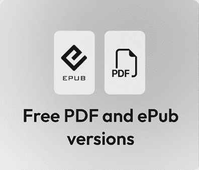

# 前言

大型语言模型 (`LLM`) 领域正以前所未有的速度飞速发展。当我们撰写本文时，`DeepSeek` 团队刚刚发布了一篇新论文，展示了如何利用计算机视觉技术压缩 `LLM` 的上下文。人工智能领域的活跃程度令人惊叹，且没有放缓的迹象。

作为本书的作者，我们曾思考，*关于 `DeepSeek`，我们能写出什么内容而不会使本书立即过时呢？* 我们的答案很简单：我们相信 `AI` 技术的未来是开放的，而这场运动的先锋就是 `DeepSeek`。

`DeepSeek` 不断给人工智能界带来惊喜，从发布功能极其强大的模型到发表专注于 `LLM` 的突破性研究。考虑到这些发展，我们清楚地认识到，我们需要写一本书来记录正在发生的事情。

本书的目标是为你——亲爱的读者——提供掌握 `DeepSeek` 所需的工具。我们希望它能成为你精通开源语言模型的指南。

# DeepSeek 实践指南

### 概述

本书涵盖了使用 DeepSeek 模型时可能遇到的几乎所有内容——从理解 DeepSeek 模型的独特之处，到如何将其用于实际应用。我们还深入探讨了如何精通 DeepSeek 模型的提示工程，以便您成为与该系列模型交互的专家。最后，我们深入实践层面，提供了如何设计、构建和部署由 DeepSeek 模型驱动的智能体（Agentic）与非智能体应用的示例。

在本书中，我们首先介绍 DeepSeek，探讨其基础，并理解它与其他模型的差异（**第 1 章**和**第 2 章**）。一旦您了解了 DeepSeek 的能力，接下来就是学习如何有效地使用它。我们有一整章专门讲解推理模型的提示艺术，向您展示“少即是多”（第 3 章）。

然后，我们进入实际应用，演示如何使用它对复杂问题进行顾问级分析（第 4 章）。在此基础上，我们构建了一个完整的端到端应用，您将从一个简单的 API 开始，直到在 Amazon Web Services 上运行一个完全容器化的服务（第 5 章）。

在本书的最后一部分，我们探索大语言模型和 AI 技术的前沿。您将学习如何使用 DeepSeek 模型作为智能体应用的骨干（第 6 章）。我们还将引导您完成一个更复杂的 MLOps 案例，您将使用更强大的 DeepSeek 模型将知识蒸馏到一个更小的模型中（第 7 章）。在本书的最后一章，我们涵盖了 DeepSeek 模型的部署及其多种权衡，以便您能为自己的用例选择最佳的部署方法（第 8 章）。

本书以**结语**部分收尾，带您回顾关键要点。本书还提供了一个**附录**，指导您使用 DeepSeek 的多种方式。

### 本书的目标读者

本书面向任何想要了解 DeepSeek 模型工作原理的人。无论您是 AI 工程师、软件开发者、机器学习工程师还是研究员——只要您熟悉 Python，就能从本书中获益。如果您有数据科学、API 和一些机器学习概念的经验，您将获益更多！

### 本书涵盖的内容

**第 1 章**，**什么是 DeepSeek**，介绍了 DeepSeek 这一开源大语言模型，探讨了其突破、发展、与其他大语言模型的比较，以及对当今全球 AI 领域的影响。

**第 2 章**，**深入解析 DeepSeek**，深入探讨了 DeepSeek 的架构、推理机制、高级能力，提供了对其独特优势和新兴争议的实践理解。

**第 3 章**，**提示 DeepSeek**，向您展示如何有效地为 DeepSeek 模型构建提示，并特别展示了如何在 V 系列和 R 系列模型之间实现这种差异化。

**第 4 章**，**使用 DeepSeek：案例研究**，展示了真实的 DeepSeek 案例研究，揭示了行业领导者如何应用它来提升生产力、改进开发并使用实用方法实施 AI 辅助工作流程。

**第 5 章**，**使用 DeepSeek 构建**，带您了解如何创建由 DeepSeek 模型支持的真实世界应用，如何迭代改进它，以及如何将 DeepSeek 模型部署到 AWS 作为独立服务。

**第 6 章**，**使用 DeepSeek 构建智能体**，向您展示如何开始使用 DeepSeek 模型构建智能体，存在的不同智能体模式，以及对 MCP 的简要介绍。

**第 7 章**，**使用 DeepSeek 驱动的 Gemma 3 法律推理微调**，涵盖了将 DeepSeek 的 R1 蒸馏到经过微调的 Gemma 3 模型中的过程。我们探索了一个法律案例，并讨论了在生产场景中如何对其进行评估。

**第 8 章**，**部署 DeepSeek 模型**，展示了如何为生产用例部署 DeepSeek 模型。我们向您展示如何在云基础设施上启动全规模模型，并指导您如何将其作为生产技术栈的一部分进行管理。

**第 9 章**，**结语**，回顾了您为理解 DeepSeek 内部原理、从应用到部署的有效使用方法所经历的旅程。

**第 10 章**，**附录**，包含一份 DeepSeek 备忘单，向您展示如何快速入门。

### 如何充分利用本书

*   具备使用 Python、API 以及 `Ollama` 或 `llama.cpp` 等工具的实践经验。
*   具备使用 `uv` 和 `Docker` 等工具和平台的经验。
*   扎实的机器学习概念理解。

## 声明

作者承认使用了尖端 AI（如 ChatGPT），唯一目的是增强本书的语言和清晰度，从而确保为读者提供流畅的阅读体验。

### 下载示例代码文件

本书的代码包托管在 GitHub 上：[`github.com/PacktPublishing/DeepSeek-in-Practice`](https://github.com/PacktPublishing/DeepsSeek-in-Practice)。我们还从丰富的图书和视频目录中提供了其他代码包，地址为：[`github.com/PacktPublishing`](https://github.com/PacktPublishing)。请查看！

### 下载彩色图片

我们还提供了一个 PDF 文件，其中包含本书中使用的截图/图表的彩色图片。您可以在此处下载：[`packt.link/gbp/9781806020850`](https://packt.link/gbp/9781806020850)。

### 本书中的约定

本书中使用了许多文本约定。

`CodeInText`：表示文本中的代码词、数据库表名、文件夹名、文件名、文件扩展名、路径名、虚拟 URL、用户输入和 Twitter 句柄。例如：“执行 `python-garminconnect` 命令：”

代码块设置如下：

```
### 我们将值作为环境变量获取
GARMIN_EMAIL = os.getenv("GARMIN_EMAIL") # 你的邮箱
GARMIN_PASSWORD = os.getenv("GARMIN_PASSWORD") # 你的密码
```

当我们希望将注意力吸引到代码块的特定部分时，相关行或项目用粗体表示：

```
tools = [{
    "type": "function",
    "function": {
        "name": "analyze_sentiment",
        "description": "Analyze the sentiment of text",
        "parameters": {
            "type": "object",
            "properties": {
                "text": {"type": "string"},
                "confidence": {"type": "number",
                               "minimum": 0, "maximum": 1}
            },
            "required": ["text", "confidence"]
        }
    }
}]
```

任何命令行输入或输出均按以下格式编写：

```
git clone https://github.com/PacktPublishing/DeepSeek-in-Practice.git
cd Chapter03
pip install -r requirements.txt
```

**粗体**：表示新术语、重要单词或屏幕上看到的单词。例如，菜单或对话框中的单词在文本中如此显示。例如：“通过 **Settings** 菜单访问 Cursor 模型配置。”

警告或重要注意事项会以这种样式出现。

提示和技巧会以这种样式出现。

### 联系我们

我们随时欢迎读者的反馈。

**一般反馈**：如果您对本书的任何方面有疑问，或有任何一般反馈，请通过电子邮件联系我们：`customercare@packt.com`，并在邮件主题中注明本书的书名。

**勘误**：尽管我们已尽一切努力确保内容准确，但错误仍在所难免。如果您在本书中发现任何错误，请通过 [`www.packt.com/submit-errata`](http://www.packt.com/submit-errata) 报告给我们。请点击 **提交勘误** 并填写表格，我们将不胜感激。

**盗版**：如果您在互联网上以任何形式发现我们作品的任何非法拷贝，请向我们提供地址或网站名称，我们将不胜感激。请通过 `copyright@packt.com` 联系我们并提供相关材料的链接。

**如果您有兴趣成为作者**：如果您对某个主题有专业知识，并且有兴趣撰写或参与一本书，请访问 [`authors.packt.com/`](http://authors.packt.com/)。

### 分享您的想法

阅读完 *《DeepSeek 实践指南》* 后，我们很乐意听到您的想法！扫描下方二维码，直达本书的亚马逊评论页面，分享您的反馈。


[`packt.link/r/180602084X`](https://packt.link/r/180602084X)

您的评论对我们和技术社区都很重要，将帮助我们确保提供高质量的内容。

### 书籍附带的免费福利

本书附带支持您学习的免费福利。立即激活以获得即时访问权限（请参阅“*如何解锁*”部分获取说明）。

以下是您购买后可以立即解锁的内容概览：

| **PDF 和 ePub 副本** | **下一代基于 Web 的阅读器** |
| :--- | :--- |
|  |  |
|  | 获取本书的无 DRM PDF 副本，可在任何设备上随处阅读。 |  | **多设备进度同步**：在任何设备上从上次离开的地方继续阅读。 |
|  | 使用您喜爱的电子阅读器阅读无 DRM ePub 版本。 |  | **高亮和笔记**：捕捉想法，将阅读转化为持久的知识。 |
| | |  | **书签**：保存并随时重新访问关键部分。 |
| | |  | **深色模式**：通过切换到深色或棕褐色主题来减少眼睛疲劳。 |

### 如何解锁

扫描二维码（或访问 packtpub.com/unlock）。按书名搜索本书，确认版本，然后按照页面上的步骤操作。 |  |

**注意***：请保留您的发票。直接从 Packt 购买的不需要发票。*

## 敬请关注

要随时了解生成式 AI 和大语言模型（LLMs）领域的最新动态，请订阅我们的周报 *AI_Distilled*，访问 [`packt.link/8Oz6Y`](https://packt.link/8Oz6Y)。


## 加入我们的 Discord 和 Reddit 社区

对本书有疑问或想参与关于生成式 AI 和大语言模型（LLMs）的讨论？

加入我们的 Discord 服务器 [`packt.link/4Bbd9`](https://packt.link/4Bbd9) 和 Reddit 频道 [`packt.link/wcYOQ`](https://packt.link/wcYOQ)，与志同道合的爱好者联系、分享和协作。

|  |  |

# 第一部分

## 理解与探索 DeepSeek

在本书的第一部分，我们将为理解 DeepSeek 及其在快速演变的 AI 世界中的角色奠定坚实的基础。我们将从介绍 DeepSeek 作为一种开源大语言模型开始，探讨它为何能获得全球关注。接下来，我们将深入研究其内部架构、推理机制和高级能力，以揭示其真正独特之处。我们还将探索有效的提示策略，帮助您充分利用 DeepSeek 模型。

学完本部分后，您将具备所需的背景知识、技术理解和实践见解，从而在现代 AI 工作流中自信地使用 DeepSeek。

本书本部分包含以下章节：

*   第 1 章 *什么是 DeepSeek*
*   第 2 章 *深入探讨 DeepSeek*
*   第 3 章 *提示 DeepSeek*

