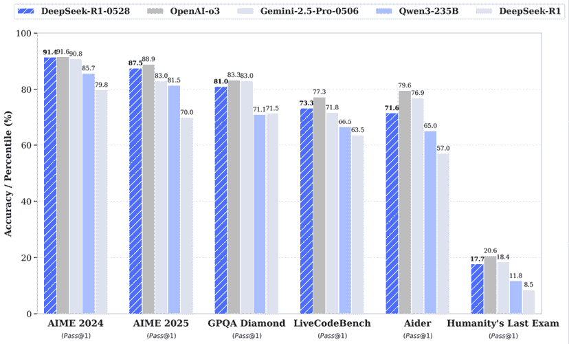
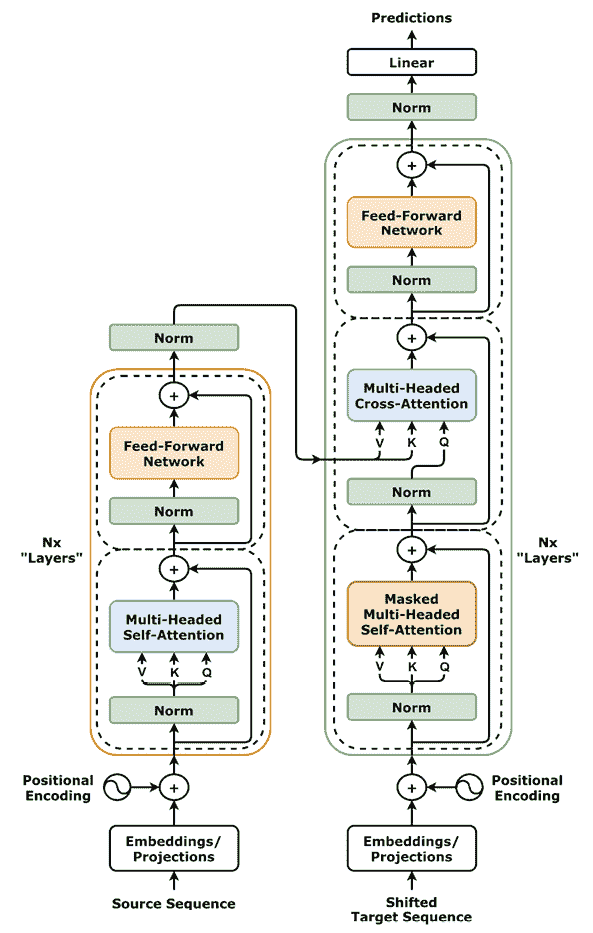
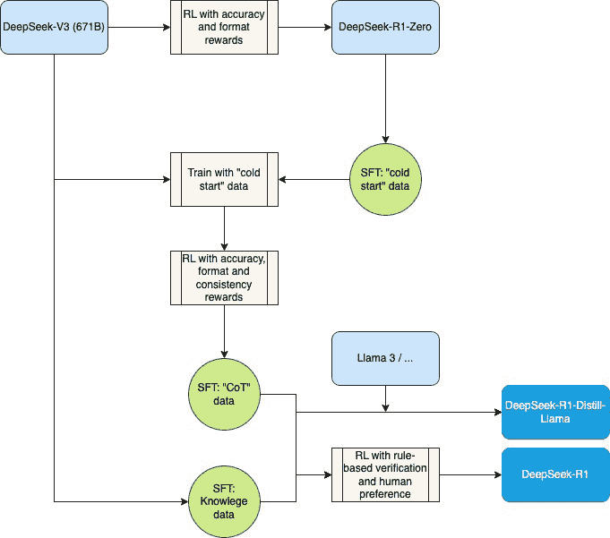
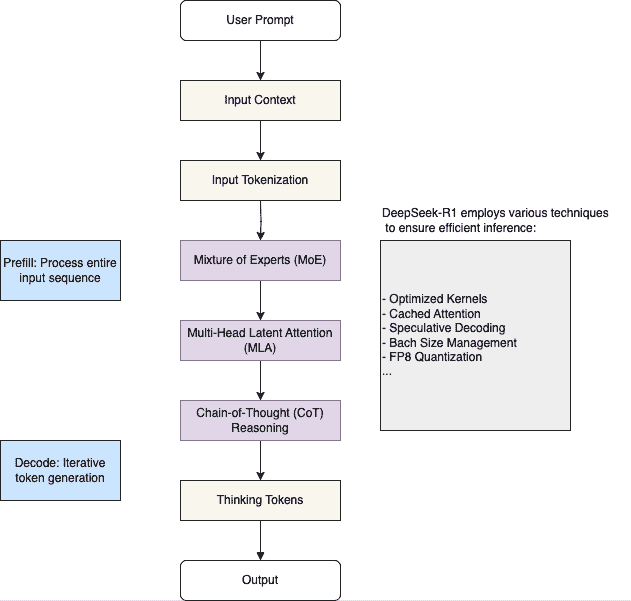
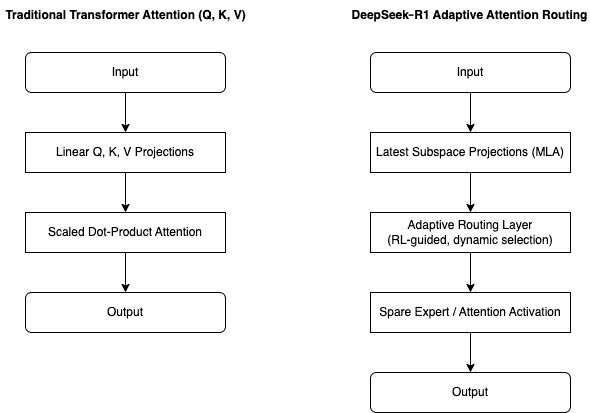
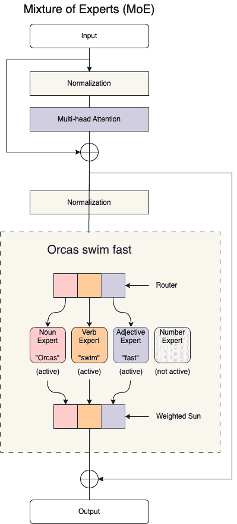

# 1 什么是 DeepSeek？

**人工智能**（**AI**）正在快速发展，随之而来的是一套工具，允许开发者、研究人员和创新者构建更智能、更自适应的系统。其中一个新兴的工具就是 **DeepSeek**：一个强大的、开源的**大语言模型**（**LLM**），旨在与 GPT-4 和 LLaMA 等主要大语言模型（LLM）的功能相媲美。但 DeepSeek 到底是什么，为什么我们应该关注它？

在本章中，我们将深入探讨 DeepSeek 是什么，它如何融入更广泛的 AI 领域，以及为什么它在整个科技行业引起如此兴趣。您将了解 DeepSeek 的独特功能，以及它在训练数据、效率和性能基准方面与其他模型的比较。

学完本章后，您将能够理解 DeepSeek 的发展及其成功的关键贡献者。

在本章中，我们将涵盖以下主要主题：

*   介绍 DeepSeek
*   理解 DeepSeek 的技术突破
*   对全球 AI 生态系统的影响
*   探索 DeepSeek 的版本和演变

### 免费福利

您的购买包含本书的免费 PDF 副本以及其他独家福利。请查看前言中的 *书籍附带的免费福利* 部分以立即解锁它们，并最大化您的学习体验。

### 介绍 DeepSeek

DeepSeek 是一种开源语言模型，旨在使先进 AI 民主化和易于获取。第一个版本 DeepSeek-R1 于 2025 年 1 月 20 日发布，就在中国农历新年前夕。该团队不仅发布了闭源二进制文件，还公开了权重、训练脚本和推理代码，因此任何人都可以检查或重建该系统。

该模型在 MIT 许可证下发布，没有使用费或严格条款。任何人都可以在本地运行它或将其调整用于新任务。这种自由吸引了世界各地的开发者、研究人员、教师和小型公司。他们将 DeepSeek-R1 应用于客服机器人、课堂辅助工具、实验室研究和写作工具。

基准测试显示，DeepSeek-R1 与 OpenAI-o3 和 Gemini-2.5-Pro 竞争。它能处理数学、代码、多种语言和复杂提示。结果表明，强大的模型不一定必须是封闭的，并凸显了中国在前沿人工智能领域日益增长的作用。该模型的发布也重新引发了关于开放获取与安全性、以及改善全球研究合作的辩论。2025 年 9 月 17 日，另一个里程碑达成，DeepSeek-AI 团队在 `Nature` 上发表了关于 DeepSeek-R1 模型的研究论文，并登上了当期封面 ([`www.nature.com/articles/s41586-025-09422-z`](https://www.nature.com/articles/s41586-025-09422-z))。

从架构角度来看，DeepSeek 深度借鉴了基于 Transformer 模型的创新，并在后续版本中加入了自身的特色（在 *DeepSeek 的版本与演进* 章节中有深入探讨）。但真正使其脱颖而出的是其可用性。DeepSeek 可以部署在多种环境中，从云服务器到边缘设备，甚至可以使用轻量版本运行在笔记本电脑上。

图 1.1：DeepSeek-R1 (0528) 的基准性能 (来源：[`api-docs.deepseek.com/news/news250528`](https://api-docs.deepseek.com/news/news250528))

我们来谈谈促成 DeepSeek 突然崛起和普及的各种因素：

*   **开源架构和训练细节**：DeepSeek-R1 附带了一份详细的研究论文 ([`arxiv.org/abs/2501.12948`](https://arxiv.org/abs/2501.12948)) 一起发布，概述了其架构和训练方法，以及在推理、数学和编程任务上的基准分数 ([`artificialanalysis.ai/providers/deepseek`](https://artificialanalysis.ai/providers/deepseek))。此次发布得到了完整的模型权重、配置文件和训练脚本的支持，还包括六个适合本地或低资源环境的较小蒸馏版本 ([`api-docs.deepseek.com/news/news250120`](https://api-docs.deepseek.com/news/news250120))，以及面向需要托管服务开发者的即时 API 可用性 ([`api-docs.deepseek.com/guides/reasoning_model`](https://api-docs.deepseek.com/guides/reasoning_model))。

*   **时机**：其部分流行度源于时机恰当，当时全球组织、科学家和开发者开始探索这一新版本。此外，MIT 许可证提供了商用完全自由——这在高性能模型中已越来越罕见。这次发布还因其并非仅适用于研究；它具有实用性而引发了兴奋。开发者能够对其进行微调，部署到生产环境，并将其集成到现有的 AI 工作流中。这种强大功能与可用性的结合立刻吸引了众人。

*   **初始技术亮点**：DeepSeek-R1 发布时最值得注意的方面包括：
    *   **推理能力**：在涉及数学、代码和逻辑推理的关键基准测试中，它超越或匹敌了领先的模型。
    *   **效率**：它以显著更低的推理成本提供了接近 GPT-4 级别系统的性能。
    *   **强化优先的训练**：不同于依赖监督式人工标注数据的传统微调工作流，DeepSeek 跳过了中间步骤，直接使用 `基于人类反馈的强化学习`（`RLHF`）或类似范式——尽管使用了最小化的人类标注。这一改变加速了推理分数的提升，降低了人工标注成本，并使模型能够处理各种任务，例如数学问题、零样本代码等，而无需狭窄的特定任务指令。
    *   **自定义架构**：虽然基于 Transformer 框架，但 DeepSeek-R1 融入了针对训练稳定性和长上下文理解优化的创新。

这些要素共同使该模型能够发挥远超其体量的实力，特别是在多步推理和问题解决方面。

*   **现实世界就绪性**：DeepSeek 从一开始就展示了现实世界就绪性，这与许多在基准测试中表现出色但在部署时举步维艰的最先进模型不同。与那些需要大量设置或封闭基础设施的模型不同，DeepSeek 可以在实际环境中立即使用。它通过其 API 提供生产就绪访问，通过开放权重和推理代码支持本地部署，并通过 LoRA 微调或提示工程进行定制。与 Trae 和 Windsurf 等企业平台的集成进一步简化了编排。这些能力在发布时很少在其他模型中如此无缝地结合，凸显了 DeepSeek 超越学术性能、致力于实际效用的承诺。

*   **社区兴趣**：DeepSeek-R1 的发布引发了激烈的社区活动。GitHub 上迅速涌现了大量插件、适配器和微调衍生版本，而数千个 Hugging Face 分叉为合同审查、辅导、研究辅助、摘要和编程支持等工具提供了支持。在线论坛分享基准测试和硬件指南，大学将该模型用于课程和实验室项目。Reddit、知乎和 Stack Overflow 等论坛充满了分享的实验、性能测试以及在本地硬件上微调 DeepSeek 的指南。该模型的易获取性将业余爱好者转变为研究人员，将开发者转变为企业家。如今，DeepSeek 也推动着教育计划。许多慕课和大学实验室已开始使用 DeepSeek 作为基础模型教授大语言模型理论和实践，因为它开放且清晰。

*   **哲学愿景**：DeepSeek 的愿景与更广泛的运动保持一致，即构建的 AI 不应是被守门的资产，而是全球共享的资源。正如 Linux 重塑了软件行业一样，DeepSeek 旨在通过将工具交到任何有好奇心或能力使用它们的人手中，来重塑 AI 开发。其战略不仅是与 OpenAI 或 Google 竞争，而是专注于可访问性和协作创新。

DeepSeek-R1 的成功归功于三个因素：`RLHF` 训练、开源承诺以及其在基准测试中具有竞争力的表现。

这些要素共同奠定了基础，使 DeepSeek 不仅仅成为一个模型，更成为一个生态系统。本章剩余部分将探讨 DeepSeek-R1 的反响及其开放哲学背后的动机，什么技术突破推动了它的发展，以及它如何演变成一个完整的生态系统。

### 理解 DeepSeek 的技术突破

真正使 DeepSeek-R1 与众不同的是其架构和训练过程中嵌入的技术创新。这些创新使其能够超越许多当代模型，并帮助重新定义未来大语言模型的构建方式。

#### 训练过程

在开始介绍 DeepSeek 的训练过程之前，我们先看看主流大语言模型的开发过程，通常包括以下步骤：

1.  **在大规模语料库上进行自监督学习预训练**：在这个阶段，模型暴露在大规模、多样化的数据集中，例如书籍、网页和代码。目标是学习通用的语言模式，而无需显式标签。常见的预训练策略包括：
    1.  **自回归建模**（例如，GPT）：模型预测序列中的下一个词。
    2.  **掩码语言建模**（例如，BERT）：模型预测被遮盖（masked）的词。
    3.  **基于排列的建模**（例如，XLNet）：模型学习多种可能的词序。

2.  **Transformer 架构**：大多数大语言模型使用 Transformer 架构（*图 1.2*），以其在**自然语言处理（NLP）**任务中的可扩展性和性能而闻名。它们通常使用自注意力机制来确定词与词之间的上下文关系。其中一些变体如下：

##### 仅编码器、仅解码器与编码器-解码器

1.  **仅编码器**（例如 BERT）用于分类或理解。
2.  **仅解码器**（例如 GPT）用于生成。
3.  **编码器-解码器**（例如 T5）用于翻译和摘要等任务。

图 1.2: Transformer 架构（Attention Is All You Need, Vaswani 等人, [`arxiv.org/pdf/1706.03762`](https://arxiv.org/pdf/1706.03762)）

##### 监督微调与 RLHF

1.  `在精心策划的指令遵循数据集上进行监督微调`：预训练后，模型会在高质量、带标签的数据集上进行微调，学习遵循特定指令并执行有用任务。这些数据集通常包含人工编写的提示和理想响应，帮助模型学习如何更直接和有目的地进行交互。

2.  `RLHF`：为了更好地使模型输出与人类偏好对齐，应用了 RLHF：
    1.  人工评审员评估并排序多个模型响应。
    2.  训练一个 `奖励模型` 来预测这些排名。
    3.  然后使用强化学习算法（常用 `近端策略优化 (PPO)`）对 `LLM` 进行微调，以生成能最大化 `奖励模型` 分数的输出，从而更好地与人类价值观和期望对齐。

DeepSeek-R1 打破了这一惯例，它 `完全绕过了监督微调`。相反，它直接从预训练跳到强化学习，帮助其自主学习到强大的推理能力。

避免 `监督微调 (SFT)` 消除了对昂贵人工标注数据集的依赖。相反，DeepSeek 采用了 `基于规则的奖励机制`，例如自动验证正确答案或检查输出格式。这种方法更具可扩展性且成本效益更高，有助于克服人工数据策划的局限性。此外，使用明确、规则驱动的奖励，例如在指定结构内验证答案或确认代码功能，可以缓解奖励黑客（reward hacking）问题，这是不太可预测的神经奖励模型的一个常见问题。

`图 1.3` 展示了 DeepSeek 模型训练的流程图。

图 1.3: DeepSeek-R1 模型训练

##### DeepSeek-R1 训练流程

DeepSeek-R1 的训练流程始于 `DeepSeek-V3`，一个拥有 6710 亿参数的大型基础模型。这个基础模型使用侧重于准确性和输出格式的奖励进行 `强化学习` (**`RL`**)，产生了一个名为 `DeepSeek-R1-Zero` 的中间模型。该模型作为一个关键的过渡点，使得在后续阶段能够进行更多针对特定任务的训练。

接下来，`DeepSeek-R1-Zero` 使用 `冷启动数据` 进行微调，这指的是广泛多样的指令遵循示例集合。这些数据通常结构良好、经过精心策划，为模型提供了对各种任务格式和领域的基本理解，使其适用于初步的通用指令调整。

在此阶段之后，应用了额外的监督微调（SFT）轮次，使用两个专门的数据集。第一个是 `思维链` (**`CoT`**) **`数据**`，强调多步骤推理。该数据帮助模型学习通过分解为中间步骤来解决复杂问题——这对于数学推理、逻辑推理和多跳问题回答至关重要。第二组是 `知识数据`，包含事实丰富、特定领域的内容，如科学文献、百科全书信息和技术手册。这有助于模型提高事实准确性并扩展领域覆盖。

这些微调阶段完成后，通过先进的 RL 技术进一步增强了得到的模型 DeepSeek-R1。它不仅使用针对准确性和格式的 `奖励` 进行训练，还使用针对一致性的奖励，确保其输出在逻辑上连贯且自洽。此外，应用 `基于规则的验证` 来自动验证数学和代码生成等领域的响应。最后，引入 `人类偏好微调` 以使模型的行为与人类期望和质量判断保持一致。

DeepSeek-R1 已被蒸馏成更小、更高效的变体。这些变体包括 `DeepSeek-R1-Distill-Qwen`，它使用从 15 亿到 320 亿参数不等的 Qwen 2.5 模型；以及 `DeepSeek-R1-Distill-LLaMA`，它利用 80 亿和 700 亿大小的 LLaMA 3 模型。这些蒸馏版本保留了原始 R1 模型的大部分能力，但针对不同的资源和延迟约束进行了优化。

总体而言，DeepSeek-R1 流程代表了一种多阶段策略，结合了监督学习、基于奖励的调整和针对性的模型蒸馏，以提供一系列针对性能、泛化性和部署灵活性进行优化的指令遵循语言模型。

结果，训练过程变得更加稳定和高效，受益于简化、可靠的奖励信号，减少了噪声和歧义。

DeepSeek 的训练方法在以下方面带来了帮助：

*   **`降低人力成本`**：无需手动标注或排列数千条指令。
*   **`更快的开发周期`**：训练时间线被显著精简。
*   **`更强的泛化能力`**：模型通过试错交互而非固定模板学会了泛化指令遵循能力。

尽管缺乏传统的监督指令数据集，DeepSeek-R1 展示了 `强大的指令遵循能力`，与经过微调的模型具有竞争力。这表明，当设计良好时，仅靠强化学习就能赋予模型对指令和意图的深刻理解。

让我们看一下 DeepSeek 的 `推理流水线`，如 `图 1.4` 所示。

图 1.4: DeepSeek-R1 模型推理

##### DeepSeek-R1 推理流程

DeepSeek-R1 的推理流程旨在通过结合 `规则感知解码` 和 `提示优化` 来优先输出结构化、可验证的结果。在推理期间，DeepSeek-R1 利用 `格式感知生成机制`，模型受到鼓励（通常通过提示设计和内部对齐）生成结构良好、可解释的响应，特别是对于涉及代码、数学或 `CoT` 推理的任务。它不仅针对流畅性进行了优化，还针对事实和逻辑一致性进行了优化，通常在答案中包含中间步骤（`CoT`），即使没有明确提示也是如此。这使得 DeepSeek-R1 能够提供分步解决方案和结构化输出（如 JSON、Markdown 或代码块），从而提高了下游应用的可靠性。

DeepSeek-R1 与其他最先进的 `LLMs` 不同之处在于其基于规则的 `奖励对齐推理行为`。许多领先的 `LLMs` 主要依赖端到端训练和人类偏好微调，而 DeepSeek-R1 将 `基于规则的验证` 技术直接集成到 `RL` 循环中。这在推理时产生了下游效应：DeepSeek-R1 更有可能生成与形式化验证器或下游评估器兼容的输出（例如，代码的测试用例，数学的方程式）。因此，它在精度、结构和可解释性至关重要的领域表现出更强的性能，同时略微牺牲了开放式对话的灵活性。

接下来是 DeepSeek 的 `RL` 方法。

#### 强化学习

DeepSeek-R1 的强化学习方法因其独特的设计选择而备受关注，我们将在第 2 章中深入探讨。与许多仅在训练最终阶段应用强化学习的模型不同，DeepSeek-R1 引入了`对齐技术`。`对齐技术`旨在训练早期就引导模型的输出变得更有帮助、更诚实、更无害。这种早期对齐有助于模型在整个发展过程中表现更一致、更理想。

它还用自动化的奖励模型取代了大规模人工标注，显著提升了可扩展性，并减少了对人工标注的依赖。另一个显著特点是它使用了自我博弈和`迭代优化`，使模型能够生成、评估并改进自身的输出。这种方法帮助 DeepSeek-R1 内化了高级推理模式和战略决策能力，使其在多轮推理、代码解释与补全以及解决复杂数学问题方面尤为有效。

此外，强化学习训练通过基于自我生成的成功指标强化事实准确性，帮助`减轻幻觉`。

对于不熟悉 AI 语境中“对齐”概念的读者，它通常指确保模型行为与人类意图和价值观相符的技术。关于这些概念的有用介绍，可以在 OpenAI 的对齐概述（[`openai.com/index/our-approach-to-alignment-research/`](https://openai.com/index/our-approach-to-alignment-research/)）或对齐通讯（[`www.alignmentforum.org/s/dT7CKGXwq9vt76CeX`](https://www.alignmentforum.org/s/dT7CKGXwq9vt76CeX)）中找到。

除此之外，DeepSeek 对 Transformer 架构进行了一些修改。让我们来一探究竟。

#### 架构修改

DeepSeek-R1 构建于广泛采用的 Transformer 架构之上，该架构构成了大多数现代大语言模型的基础。其核心是 Transformer 使用的`自注意力机制`，允许输入序列中的每个 token 无论位置如何，都能权衡所有其他 token 的重要性。这使得模型能够比传统的循环模型更有效地捕捉长程依赖和上下文关系。

然而，标准注意力机制的计算成本会随着输入长度增加而变得高昂。为了解决这个问题，DeepSeek-R1 引入了`自适应注意力路由`，这是一个重大的架构演进。与传统的对所有 token 应用固定全注意力的 Transformer 不同，此机制允许模型根据训练过程中计算的`相关性分数`，`有选择地关注最相关的 token`。这些分数通常源自内部注意力权重或辅助的`门控机制`，优先处理对最小化训练损失贡献最大的 token。通过将计算资源集中在高影响 token 上，尤其是在长序列中，`自适应注意力路由`使 DeepSeek-R1 能够更高效地处理最多 `32,000 tokens` 的输入。这不仅增强了模型理解和总结大型文档的能力，还通过避免对信息量较少的 token 进行冗余注意力计算来减少计算开销。

`图 1.5` 比较了传统 Transformer 注意力机制和 DeepSeek 的`自适应注意力路由`。

图 1.5：传统 Transformer 注意力与 DeepSeek-R1 `自适应注意力路由`对比

此外，DeepSeek-R1 采用了`混合精度优化`，结合 `FP16（半精度）`和 `INT8（量化）`运算以提高训练和推理效率。这种方法在降低内存使用和加速计算的同时，保持了模型在准确率和困惑度方面的竞争力性能。通常，`FP16` 用于模型大部分的一般计算，而 `INT8` 量化则选择性地应用于推理时的矩阵乘法，通常是在注意力和前馈层中，这些地方的精度降低不会显著影响输出质量。通过仔细选择要量化的层，DeepSeek-R1 实现了效率与性能之间的有利权衡。这种方法在保持输出质量的同时显著加速了推理和训练，使其非常适合大规模部署。

该模型还受益于高效的并行化策略。它利用张量并行和激活检查点来减少训练期间的内存使用，使其能够在多 GPU 系统上更有效地进行训练。

总的来说，这些增强使得 DeepSeek-R1 成为 Transformer 架构的演进，它不仅更具可扩展性和上下文感知能力，而且在训练和推理方面也更具成本效益。

现在，让我们将焦点转向 DeepSeek 架构与其他大语言模型架构的比较。

##### 主流大语言模型架构对比（2025 年）

随着大语言模型领域的发展，不同的架构和训练范式应有尽有。本对比（`表 1.1`）重点关注关键差异，特别是近年来一些最具影响力的模型中 `Mixture-of-Experts` (`MoE`) 架构和强化学习的使用情况。

| **模型** | **是否使用 MoE？** | **关键架构亮点** | **RLHF** | **开源？** |
| --- | --- | --- | --- | --- |
| DeepSeek-R1 | 是。稀疏 `MoE` | 671 B 参数；`MoE` + `多头潜在注意力`；以推理为中心 | 无 RLHF，使用纯强化学习 (`GRPO`) | 是 (`MIT`) |
| Claude 4 | 否 | 密集 Transformer；采用 Anthropic 的 Constitutional AI 和 `直接偏好优化` (`DPO`) 构建 | 是，先进的 `RLHF` + `DPO` | 否 |
| Gemini 2.5 Pro | 是。稀疏 `MoE` | 多模态稀疏 `MoE` Transformer；1 M token 上下文（即将支持 2 M） | 是。`RLHF` + 持续对齐 | 否 |
| GPT-4.5 | 否 | 2025 年 2 月 27 日发布；OpenAI 最大的非 CoT 模型 (`Orion`) | 是。`RLHF` + `SFT` | 否 |
| o3 | 未知（可能为密集） | 针对个性化助手任务优化；改进的定位和记忆模块 | 是，先进的 `RLHF` | 否 |
| Grok 3.5 | 无 `MoE` 证据 | 密集 Transformer；增强了 Grok 3 的推理能力；高级 "Think" 模式；仍为专有 | 是。基于 RL 的训练 + `RLHF` 微调 | 否 |
| Gemma 3 | 否，密集型 | 轻量级 `MoE`；经过长上下文指令微调 | 是。`RLHF` | 是 (`Apache 2.0`) |
| LLaMA 4 | 否 | 密集 Transformer；高级记忆和模块化层 | 是。`RLHF` 和安全微调 | 是 |

表 1.1：大语言模型架构对比

领先的语言模型在其架构策略上日益分化，特别是在 `MoE` 的使用方面。像 Gemini 2.5 Pro 和 DeepSeek-R1 这样的模型采用了稀疏 `MoE` 架构，使其能够拥有大规模参数，同时保持高效的计算利用率。基于其强大的性能和低延迟特性，外界普遍认为 GPT-4.1 采用了某种形式的 `MoE` 或稀疏专家路由，尽管具体细节尚未披露。

介于这些方法之间，Grok 3.5 保留了密集 Transformer 架构，针对实时响应能力和集成推理进行了优化。它完全避免了 `MoE`，转而专注于强化学习技术和使用实时反馈数据的`迭代优化`。

相比之下，Claude 4 和 LLaMA 4 继续采用完全密集的设计，优先考虑简单性、对齐稳定性和可预测行为，而非原始的参数规模扩展。

既然我们已经向您介绍了 DeepSeek 的技术创新，我们将更深入地探讨 DeepSeek 的 `MoE` 设计。

#### MoE 架构

DeepSeek-R1 的一个重大架构突破是集成了 `MoE` 设计。

MoE 是一种模块化的神经网络设计，其特点是对于任何给定的输入，只激活一部分参数（称为`experts`）。MoE 并非在每次预测中都使用完整的参数空间，而是动态地、有选择性地激活少数专家。

#### DeepSeek 如何实现 MoE

DeepSeek 采用了一种稀疏的`MoE 架构`，其中门控网络在每一层动态地从`N`个专家网络中选出两个来处理给定的输入。选择两位专家在计算效率和模型表达能力之间取得了平衡。它允许模型利用多样化的专业知识，而无需承担激活所有专家的全部成本。这种方法使得专家能够实现专门化，同时保持推理延迟和资源使用处于可管理的水平。这些专家并非被手动分配给特定任务，如数学或代码；相反，专门化是在训练过程中涌现的。门控机制通过优化来学习，根据上下文线索将输入路由到最有效的专家。随着时间的推移，由于这种学习到的路由机制，某些专家在特定领域（例如语言、推理和编码）被更频繁地激活，从而有效地发展出功能性专门化。

`图 1.6` 概览了此架构。

图 1.6：MoE 架构概念图

每个专家处理相同类型的输入表示，但可能会根据接收到的模式学会强调不同的方面。它们的`角色`由它们最常被路由的数据所塑造，而这反过来又引导着它们的参数更新。这使得专家能够有机地承担不同的角色，而无需不同的输入格式或编码。模型包含一个大型的专家子网络池（每个都是一个小型的前馈网络），但每个输入令牌只激活一小部分——通常是两个。门控网络评估上下文，并动态决定激活哪些专家，允许模型将信息自适应地路由到最有效的处理位置。

这种结构带来了几个关键优势：

*   **可扩展性**：由于任何时刻只有少数专家处于活动状态，模型可以维护大量的总参数，同时每个令牌消耗的计算量比同等规模的密集模型更少。这使得 DeepSeek 能够扩展，而不会线性地增加计算成本。
*   **模块化**：专家可以独立进行训练、冻结、更新甚至替换。这种模块性允许多高效的持续学习、领域适应或特定任务微调，而无需重新训练整个模型。
*   **专门化**：随着门控网络学会将不同的输入路由给不同的专家，这些子网络开始专门化；一些更擅长代码，另一些则更擅长数学推理、自然语言或对话。这降低了过拟合的风险，并增强了模型在多样化任务上的泛化能力。

通过这种架构，DeepSeek-R1 本质上表现得像一个特定领域模型的集成，但没有资源重复或通常与并行运行多个系统相关的延迟开销。

除了 DeepSeek，许多**最先进**（**SOTA**）的 LLM 也采用了 MoE 架构，详细信息见下表：

| **模型** | **参数数量** | **每个令牌激活的专家数** | **总专家数** | **路由类型** | **用例优势** |
| --- | --- | --- | --- | --- | --- |
| `DeepSeek-R1` | 总计约 1300 亿 / 激活约 300 亿 | 2 | 约 64 | 稀疏 + 门控 | 数学、推理、代码和多语言理解 |
| `Gemini 2.5 Pro` | 估计 1 万亿+ (MoE 配置) | 未指定 (可能 2–4) | 数十 | 专有稀疏 | 多模态应用、代码和检索增强推理 |
| `Grok-3` | 估计总参数 4000 亿+ (MoE) | 2–4 (自适应) | 未指定 (20+) | 高级动态 MoE | 增强推理、DeepSearch、视觉+代码+对话，以及长上下文 |
| `Grok-1.5` | 估计总参数 3000 亿 | 2–4 (自适应) | 16+ | 动态路由 | 实时交互、多模态学习和大规模上下文跟踪 |
| `Mixtral 8x7B` | 总计 560 亿 / 激活 129 亿 | 2 | 8 | Top-2 门控 MoE | 通用推理、快速推理和多语言 |
| `Switch Transformer` | 总计 1.6 万亿 / 激活约 150 亿 | 1 | 2,048 | Top-1 路由 | 可扩展性基准；开创了万亿规模的 MoE |
| `GLaM` | 总计 1.2 万亿 / 激活 930 亿 | 2 | 64 | Top-2 路由 | NLP 理解、代码和科学任务 |

表 1.2：MoE 模型比较

随着 MoE 架构获得关注，Mixtral 8×7B 展示了开源模型如何在有限计算资源下获得强大的推理能力，而 Grok 和 Gemini 2.5 等更新系统则增加了自适应或专有路由以及多模态预训练。谷歌的 Switch Transformer 和 GLaM，这两个万亿参数的原型，首先证实了 MoE 可以可靠地扩展。这些项目共同展示了 MoE 如何让超大规模模型发展，同时保持足够快的推理速度以满足实时、高性能任务的需求。

构建 LLM 的另一个基础方面是其训练所用的数据。让我们看看 DeepSeek 如何利用其训练数据集。

#### 训练数据集与理念

在论文`DeepSeek-R1：通过强化学习激发 LLM 的推理能力` (https://arxiv.org/abs/2501.12948) 中，作者指出 DeepSeek-R1 是在一个大规模、多样化且领域丰富的多语言数据集上训练的，旨在支持推理、编程和跨语言理解。

虽然该数据集的确切组成并未公开，但论文概述了使用精心策划的冷启动数据和大约 80 万个 SFT 样本，这些数据被整合到一个多阶段的强化学习框架中以开发模型。

数据选择策略强调跨多个关键领域的高质量来源：

*   模型在`Python`、`JavaScript`和`Rust`等编程语言上接受了大量训练，使用了来自 GitHub 等仓库以及 Stack Overflow 等开发者问答平台的精选代码。
*   为了加强数学和逻辑推理，数据集纳入了形式逻辑语料库、符号数学基准以及竞赛数学问题集（例如`MATH`、`GSM8K`和`ProofWriter`）。
*   科学理解通过在学术出版物和技术手册上进行预训练得到加强，这些资料来源于 arXiv 等平台以及开放获取的研究数据集。
*   数据集的多语言部分以中文和英语为基础，并额外覆盖了主要全球语言，数据来源包括`CCMatrix`和`OPUS`等数据集。

这种多样化的训练基础反映了 DeepSeek-R1 的目标：将高级推理与强大的多语言和领域能力相结合。

在同一篇论文中，作者描述了在构建训练数据时采用了低过滤策略，这与许多其他大语言模型开发者使用的更激进的数据过滤流程形成对比。做出这一设计选择是为了保留语言的自然复杂性和多样性，使模型能更好地捕捉非正式表达、文化特定习语、情感化语言以及边缘案例场景。根据作者的说法，这种语言多样性支持更具表现力、创造性和语境流畅性的模型行为。然而，论文并未明确说明过滤掉了哪些类型的内容，或者是否进行了过滤。由于数据集的组成或过滤标准缺乏透明度，目前尚不清楚训练语料库是否包含了潜在有害内容，如仇恨言论、错误信息或攻击性材料。虽然这种低过滤方法可能增强模型在多样化语言和文化语境下的泛化能力，但它也引入了模型可能学习并再现不良内容的风险。这些权衡凸显了下游安全措施和负责任使用的重要性，尤其是在将模型部署于现实世界环境时。

`DeepSeek-R1`的架构和训练策略使其特别适合开放式任务。它在头脑风暴、创意生成和探索性对话——这些需要灵活性和最少预设的领域——展现出强大能力。得益于其多样化的语言训练，该模型在精细翻译和多语言推理方面也表现出色。此外，`DeepSeek-R1`还以其适应用户语气和对话风格的能力而闻名，许多用户认为这在创意和协作场景中非常有用。

嗯，DeepSeek 已经推出过多个版本，我们预计随着通往通用人工智能竞赛的白热化，未来还会有更新的版本发布。

在下一节中，我们将探讨自 R1 发布以来，DeepSeek 生态系统是如何演进的。

### DeepSeek 的版本与演进

DeepSeek 的故事不仅仅关乎一次模型的发布。它关乎一个持续演进的生态系统。DeepSeek 的每一次迭代都在推理能力、易用性、安全性和跨平台集成方面带来了重大升级。理解 DeepSeek 的演进过程，对于把握其长远愿景和潜力至关重要。

#### DeepSeek 不断演进的生态系统

自首次亮相以来，DeepSeek 在多个领域取得了长足进步，包括语言理解、数学推理、代码生成和多模态能力。每个版本都引入了有意义的增强，强调了 DeepSeek 在不妥协质量的前提下，实现高性能语言模型民主化的目标。

理解 DeepSeek 的演进，能为其增长轨迹、愿景以及它如何持续颠覆闭源和开源 AI 生态提供关键见解。在下面的表格中，我们将按时间顺序探讨构成 DeepSeek 套件的关键里程碑、模型变体和产品层次。

| 版本 | 发布日期 | 关键特性 |
| :--- | :--- | :--- |
| `DeepSeek LLM` | 2025 年 1 月 | 基础模型；多语言，开源权重 |
| `DeepSeek-R1` | 2025 年 1 月 20 日 | 完整 MIT 许可发布，强大推理能力，多语言，聊天+代码 |
| `DeepSeek V2` | 2025 年初 | 更优的对齐性，更好的事实基础 |
| `DeepSeek Coder` | 2025 年 2 月 | 专用编码模型，在 Python 和 JS 方面表现顶尖 |
| `DeepSeek VL` | 2025 年 3 月 | 视觉-语言模型（图像+文本），奠定多模态基础 |
| `DeepSeek Math` | 2025 年 4 月 | 专注于代数、逻辑和多步推理 |
| `DeepSeek V3` | 2025 年 5 月 | 升级的通用模型，具备更好的长上下文和规划能力 |
| `DeepSeek-R1-0528` | 2025 年 5 月 | 最新优化：更强的事实性，32k 词元上下文，改进的对齐 |
| `DeepSeek Coder V2` | 2025 年 6 月 | 代码合成和行内文档生成能力大幅提升 |
| `DeepSeek V3.1` | 2025 年 8 月 | 混合推理，快速思考，更强的智能体技能 |
| `DeepSeek V3.2-Exp` | 2025 年 9 月 | DeepSeek 稀疏注意力（DSA），实现更快、更高效、支持长上下文的推理。 |

表 1.3：DeepSeek 模型演进

每个模型都针对特定用例，从通用的聊天机器人功能到高度聚焦的编码和数学任务。让我们来详细探讨一下它们。

#### 深入解析：每个模型的功能比较

DeepSeek 生态系统已迅速发展成一套专用模型，每个模型都旨在解决推理、编码、视觉和通用 AI 领域的不同用例。虽然所有变体都建立在共同的架构骨干和训练理念之上，但每个模型迭代都引入了新的能力、性能权衡和领域优化。以下是 DeepSeek 家族中主要模型的概述，以及它们在专业化和效用方面的比较：

*   `DeepSeek LLM` (`https://github.com/deepseek-ai/DeepSeek-LLM`)：作为 DeepSeek 家族最初的骨架，`DeepSeek LLM`为所有后续迭代奠定了基础。虽然它缺乏一些专用能力，但它确立了多语言能力和扎实推理作为核心优先事项。

*   `DeepSeek Math` (`https://github.com/deepseek-ai/DeepSeek-Math`)：专为学生、研究人员和技术专业人士量身打造，`DeepSeek Math`专注于代数、微积分、几何和符号逻辑中的多步推理问题。它可作为类似 Wolfram Alpha 推理系统的可行开源替代方案。

*   `DeepSeek Coder` (`https://github.com/deepseek-ai/DeepSeek-Coder`) 和 `Coder V2` (`https://github.com/deepseek-ai/DeepSeek-Coder-V2`)：初代`Coder`模型在 Python 和 JavaScript 方面引入了有竞争力的性能，并与`VS Code`和`GitHub Copilot`等开发环境集成。`Coder V2`（2025 年 6 月）显著提高了标杆，在行内函数合成、文档字符串生成和类型推断方面接近 Claude 3.5 的水平。

*   `DeepSeek VL` (`https://github.com/deepseek-ai/DeepSeek-VL`)：对于多模态应用来说是一个关键发布，`VL`支持图像和文本输入，为视觉问答、光学字符识别、文档摘要等应用打开了大门。尽管在视觉能力方面仍落后于`GPT-4-V`或`Gemini 1.5 Pro`，但它正在快速改进。

*   `DeepSeek V2` (`https://github.com/deepseek-ai/DeepSeek-V2`) 和 `V3` (`https://github.com/deepseek-ai/DeepSeek-V3`)：`V2`更新优先改进了提示对齐性，最大限度地减少了幻觉并扩展了对更长上下文的支持。`V3`则跟进提供了更好的长期记忆支持、更快的推理速度以及内部规划模块，从而实现了早期的智能体行为。

### DeepSeek 模型与产品生态

*   [`DeepSeek-R1`](https://github.com/deepseek-ai/DeepSeek-R1)：这是开启一切的发布版本，于 2025 年 1 月 20 日发布，迅速成为在广泛基准测试中表现最佳的开源模型。其主要亮点包括完全开源、采用 MIT 许可证发布，提供了模型权重、分词器和整个训练流程。`DeepSeek-R1`提供了强大的逻辑推理能力，超越了大多数开源模型，并与一些专有系统相媲美；同时在英文和中文上都表现出强大的多语言性能。如前所述，该发布还包含了一系列小于 20B 参数的蒸馏变体，使其能够在本地或边缘环境中高效使用。实际应用范围从基于 API 的聊天机器人集成、Copilot 风格的编码辅助，到通过 Ollama、VS Code 扩展等平台进行的轻量级部署。

*   [`DeepSeek-R1-0528`](https://github.com/marketplace/models/azureml-deepseek/DeepSeek-R1-0528)：这次更新巩固了`DeepSeek`在开源金字塔顶端的地位。5 月 28 日的版本对核心模型进行了改进，使其在对齐性、准确性和效率方面表现更佳。新功能和增强包括以下方面：
    *   **幻觉大幅减少**：特别是在科学和历史事实上。
    *   **编码流畅度提升**：在许多 Python 任务中达到了与`GPT-4-turbo`相当的水平。
    *   **数学性能增强**：在多步代数、几何和逻辑问题中的准确性得到提高。
    *   **提示词对齐更新**：即使在模糊的提示词下，也能更好地遵循用户指令。
    *   **多模态就绪**：架构已为未来的图像/文本融合做好了准备。

在基准评估中，5 月发布的`DeepSeek-R1-0528`在数学推理任务上比 1 月版本提高了 7%。在`HumanEval`风格的基准测试中，代码生成性能提升了 9%。此外，该模型展示了有效的长上下文推理能力，能够处理多达 32,000 个`token`的输入，且性能下降极小。

`DeepSeek-R1-0528`的发布凸显了`DeepSeek`的开发步伐依然强劲且一致。其改进的性能和开放的可访问性促使许多开发者开始将整个工作流从基于 GPT 的系统迁移到`DeepSeek` API。这种转变进一步得到了生态系统集成激增的支持，包括 Visual Studio Code 插件、`Ollama`兼容性和`Docker`化部署选项，标志着在个人用户和企业级用户中都获得了日益增长的采纳。

*   [`DeepSeek-V3.1`](https://huggingface.co/deepseek-ai/DeepSeek-V3.1)（2025 年 8 月）：`DeepSeek V3.1`是一个前沿的混合推理模型，具有*思考*和*非思考*模式、高级代理和工具使用能力、庞大的 6850 亿参数架构，以及扩展的 128,000 个`token`上下文窗口，适用于长文档理解。该模型专为快速、结构化、多步骤推理而设计，支持代码生成、搜索和代理工作流。得益于混合专家（`MoE`）架构和优化的推理，它在保持低延迟的同时，匹配或超越了之前的`DeepSeek`基准。`DeepSeek V3.1`还具有强大的多语言支持、开源的研究可用性，以及为可靠外部工具集成和减少幻觉而进行的专门训练，使其适用于各种企业和开发者应用。

除了各种模型，`DeepSeek`还创建了许多产品以简化采用和使用。接下来让我们看看这些产品。

#### DeepSeek 产品生态

除了模型本身，`DeepSeek`还开发了一系列不断增长的面向用户的产品和开发者工具，使采用变得无障碍：

*   **DeepSeek 应用**：一款移动端优先的 AI 助手应用，适用于 Android 和 iOS，提供与`DeepSeek-R1`及数学/编码器变体的实时交互。关键功能包括语音输入、代码单元格执行、笔记记录和多语言支持。

*   **DeepSeek 网页应用**：可通过[deepseek.com/chat](http://deepseek.com/chat)访问，提供了一个简洁且响应迅速的界面，用于与各种`DeepSeek`模型变体进行实时交互。它包含对话记忆功能，允许用户在多次交流中保持上下文，以获得更连贯的对话。提示词模板可用于简化重复性任务或结构化输入，便于原型设计或测试特定行为。此外，用户可以将整个聊天会话导出为`Markdown`或`PDF`格式，这对于文档、协作或离线审阅特别有用。

*   **DeepSeek 开发者平台** (https://platform.deepseek.com/)：提供了一个灵活开放的环境，用于构建和部署 AI 驱动的应用程序。开发者可以微调模型以创建针对特定任务或领域的自定义端点。该平台支持在`DeepSeek`系列中无缝选择模型，包括通用（R1）、专注于编码（`Coder`）和多模态（`VL`）变体。支持高达 32,000 个`token`的上下文感知 API 调用，能够实现复杂的多轮推理和长篇内容处理。还提供了一个用于角色和函数调用的测试版功能，允许开发者定义结构化交互，并为工具、代理或工作流自动化扩展模型能力。

`DeepSeek`的价值主张在于其易于获取的模型权重、强大的推理能力和低成本。这种组合使得`DeepSeek-R1`成为教育、研发以及寻求先进 AI 工具而无苛刻许可或高成本的初创公司的有吸引力的选择。

接下来，让我们看看`DeepSeek`提供的集成和部署支持。

#### 平台集成与部署生态

`DeepSeek`的可访问性是其决定性优势之一，这得益于其在本地、云和网络环境中广泛的集成和部署选项。以下是`DeepSeek`可以在何处及如何使用的高层概述：

*   对于本地和边缘部署，`DeepSeek`可以无缝运行在 Ollama (https://ollama.com/library/deepseek-r1 `–` `ollama` `run` `deepseek`)、Docker Hub (https://hub.docker.com/r/devlinrocha/ollama-deepseek-r1-7b/tags) 等平台上，并通过 VS Code 扩展 (https://github.com/enesbasbug/deepseek-vscode-extension) 提供代码补全和内联辅助。它还支持通过`Kubernetes`、`Docker Compose`或直接`GPU`集群设置进行私有云和本地部署。

*   在云环境中，`DeepSeek`已与 Amazon Bedrock (https://aws.amazon.com/bedrock/deepseek)、Amazon SageMaker (https://aws.amazon.com/blogs/machine-learning/deploy-deepseek-r1-distilled-models-on-amazon-sagemaker-using-a-large-model-inference-container/)、Azure ML (https://azure.microsoft.com/en-us/blog/deepseek-r1-is-now-available-on-azure-ai-foundry-and-github/) 以及 Google Cloud Vertex AI (https://cloud.google.com/vertex-ai/generative-ai/docs/maas/deepseek) 集成，支持通过`Hugging Face`或自定义容器进行可扩展的推理。

### DeepSeek 对全球 AI 生态系统的影响

DeepSeek-R1 的发布不仅是一个技术里程碑；对全球 AI 产业而言，它更是一个`战略转折点`。其开源可用性与顶级性能的独特结合，在实验室、初创公司和政策圈都引发了震动。其影响范围涵盖了经济竞争、学术加速、伦理讨论和地缘政治格局调整。

#### 市场颠覆与价格战

在 DeepSeek-R1 之前，前沿级大语言模型通常价格昂贵，仅限于通过 API 访问，或受限于限制商业使用的许可证。DeepSeek-R1 的发布，伴随着可自由获取的模型权重、推理代码以及宽松的许可证，标志着一次重大转变，使得高性能语言模型变得更容易获取。

DeepSeek-R1 通过提供免费、完整地访问一个高性能推理模型，对 AI 领域产生了显著影响。它在数学、编程和形式逻辑等传统上由专有系统主导的领域，展示了具有竞争力的准确性。通过公开提供这些能力，DeepSeek 为研究人员和商业开发者提供了一个可行的替代闭源平台的选择。

或许这次发布最重要的后果是它带来的市场压力。通过降低进行先进 AI 实验的经济门槛，DeepSeek-R1 挑战了该领域关于可获得性和可负担性的普遍假设。其开放可用性促使一些专有实验室加速实施自己的开源策略。此外，这一举措引发了关于 AI 公平性、竞争和全球治理的更广泛讨论，突显了创新、可访问性和负责任部署之间日益紧张的关系。它的开放发布在中国之外也激起了涟漪，激励了欧洲、印度甚至硅谷的初创公司探索更透明的模型。

DeepSeek-R1 的发布引发了 AI 定价和市场定位的显著转变。作为回应，OpenAI 推出了更实惠的选项，例如为 GPT-3.5 Turbo 提供折扣访问，同时为需要顶级性能的用户保留了每月约 200 美元的 GPT-4.1 高级计划。Anthropic 和 Cohere 也做出了反应，推出了更小、成本更低的聊天模型，旨在保持对预算敏感用户的吸引力。与此同时，Meta 重申了对 LLaMA 技术路线图的承诺，暗示将扩大许可选项，并强调转向在模型部署中实现更广泛的可访问性。

开源突然不再是小众领域，DeepSeek 成为对闭源商业模式的一个`严肃经济威胁`。企业，特别是对成本敏感的企业，开始评估将 DeepSeek 用于客服机器人、嵌入式智能体和企业知识库，以替代更昂贵的 API。

#### 催生下一波开源 AI 浪潮

DeepSeek 的开放发布鼓舞了全球的开源运动。此前感觉自己无法对大语言模型做出有意义贡献的开发者和研究人员找到了新的动力。DeepSeek 证明了你不需要数十亿美元的基础设施就能创造出真正有影响力的东西。

这导致了以下情况：

*   **学术实验室**针对专门领域（生物医学、法律和 STEM 教育）对 DeepSeek 进行微调。
*   **初创公司**使用 DeepSeek 作为后端构建 SaaS 工具。
*   **政府部门**研究公共部门部署大语言模型的用例。

在 DeepSeek-R1 发布后，全球的开源开发激增，新的模型在印度、韩国、欧盟和拉丁美洲等地区涌现。在 Hugging Face 上，一个值得注意的印度项目`Deepdive404/Deepseek-fork`发布了 R1 的多个参数规模的蒸馏版本：1.5B、7B、8B、14B、32B 和 70B。您可以在此处找到它：[`huggingface.co/Deepdive404/Deepseek-fork`](https://huggingface.co/Deepdive404/Deepseek-fork)。同时，原始的`deepseek-ai/DeepSeek-R1`代码库在[`huggingface.co/deepseek-ai/DeepSeek-R1`](https://huggingface.co/deepseek-ai/DeepSeek-R1)提供核心 R1 和 R1-Zero 模型及其蒸馏变体。

这些社区驱动的分支版本融合了本地语言、区域使用习惯和各种导出格式，这从诸如`gghfez/DeepSeek-R1-11446-Q2_K`（位于[`huggingface.co/gghfez/DeepSeek-R1-11446-Q2_K`](https://huggingface.co/gghfez/DeepSeek-R1-11446-Q2_K)）等经过量化和优化的版本中可见一斑，该版本专为高效 GPU 推理而定制。短短几个月内，Hugging Face 记录了数百个受 DeepSeek 启发的分支和集成，重点关注本地化模型、量化和社区主导的改进。

该模型还激发了跨国合作。研究人员开始使用 DeepSeek 作为基准发布跨实验室基准测试研究，社区维护的评估排行榜赋予了该模型远超其最初发布热度的可信度（[`artificialanalysis.ai/models/deepseek-r1`](https://artificialanalysis.ai/models/deepseek-r1)、[`www.statista.com/statistics/1552824/deepseek-performance-of-deepseek-r1-compared-to-open-ai-by-benchmark/`](https://www.statista.com/statistics/1552824/deepseek-performance-of-deepseek-r1-compared-to-open-ai-by-benchmark/) 和 [`pubmed.ncbi.nlm.nih.gov/40267969/`](https://pubmed.ncbi.nlm.nih.gov/40267969/)）。

##### 中国技术成熟的象征

托管 API 可通过 Fireworks.ai（[`fireworks.ai/`](https://fireworks.ai/)）、Together.ai（[`www.together.ai/`](https://www.together.ai/)）、Replicate（[[`replicate.com/`](https://replicate.com/)]）和 Modal（[`modal.com/`](https://modal.com/)）等提供商获得，提供快速原型开发和生产就绪的工作流程。

对于轻量级和基于浏览器的访问，用户可以尝试在[deepseek.com/chat](http://deepseek.com/chat)、Hugging Face Spaces 或通过 Google Colab 和 Kaggle 上即用型笔记本中运行模型。

如果您希望探索这些部署选项，我们已在本书末尾为您创建了`附录`供您参考。

DeepSeek 还与 LangChain、Haystack 和 LlamaIndex 等流行的编排框架集成，用于`检索增强生成`（`RAG`），以及与 Turing、Trae 和 Windsurf 等无代码工具集成，用于构建结构化的智能体工作流程。

DeepSeek 即将到来的路线图概述了其模型能力和部署策略的雄心勃勃的扩张计划。计划中的开发包括整合图像和音频理解的多模态训练，以及创建配备记忆、规划和工具使用功能以处理复杂工作流程的自主智能体。团队还在开发针对医疗问答、法律分析和 STEM 教育等领域定制的小型、特定任务变体。此外，DeepSeek 正通过联邦学习方法和安全的本地部署大语言模型投资于注重隐私的部署方案。继 R1 系列成功之后，人们对可能于 2025 年底发布的 DeepSeek-R2 抱有期待。虽然尚未确认，但早期报告表明它可能提供可与 GPT-5 媲美的结构化推理能力，同时保持完全开源的框架。

但伴随着所有的炒作，质疑也随之而来。下一节将探讨 DeepSeek 的选择如何影响更广泛的 AI 生态系统，包括定价模型、竞争和全球政策动态。我们还将讨论社区中普遍关注的一些担忧和风险。

DeepSeek-R1 标志着一个里程碑，它是首批在全球公认基准测试上取得有竞争力性能的中国开源模型之一。其在需要深度推理的任务中表现强劲，并迅速获得国际认可，挑战了西方在前沿 AI 领域占据主导地位的固有观念。该模型的反响凸显了开放协作和跨境评估在确立全球 AI 创新合法性方面日益增长的重要性。

独立实验室的基准测试证实，`DeepSeek-R1-0528` 的性能可与 `OpenAI` 的 `O3` 和 `Google` 的 `Gemini 2.5 Pro` 相媲美。对于一个开源模型而言，这是前所未有的。

它证明了两件关键事情：

*   DeepSeek 并非昙花一现——它正在成为一个不断壮大的生态系统。

*   在社区协作和巧妙工程的支持下，开源开发能够跟上闭源实验室的步伐。

2025 年 5 月 28 日发布的 `DeepSeek-R1-0528` 在数学推理、代码生成和事实检索方面带来了性能提升。它还在事实问答基准测试中展示了降低的幻觉率，并引入了改进的长上下文处理能力，现在支持最多 32,000 个 token 的输入长度——因此，它对于复杂的多轮任务和扩展文档分析更加有效，并通过此次新版本的发布，再次确认了模型的持续改进。

`DeepSeek-R1` 的发布也引发了一些关键问题和持续的讨论。让我们谈谈围绕 DeepSeek 的一些争议。

#### 围绕 DeepSeek 的争议

如同 AI 领域的任何重大进展一样，DeepSeek 的出现也伴随着争议。尽管它因其技术复杂性、开源立场和开创性的推理方法而广受赞誉，但它的崛起在研究伦理与安全、地缘政治战略到知识产权等多个领域引发了辩论。本节探讨了伴随 DeepSeek 崛起而来的多方面争议，承认了在技术进步与负责任创新之间的张力。

##### 存在偏见和被滥用的可能性

一个令人担忧的领域源于 DeepSeek 决定仅依靠 `RL` 进行对齐，而未采用传统的 `SFT` 或 `RLHF`。批评者认为，这可能会使模型随着时间的推移容易发生对齐漂移或不可预测的行为。其他人则质疑，尽管与团队所宣称的透明和协作目标一致，但模型的开放访问性质是否增加了被滥用的可能性。公开讨论中也涉及到该模型是否会抑制或软化对政治敏感话题的回答，这引发了对内容审核和训练数据选择透明度的质疑。

DeepSeek 团队已发表多篇论文，例如 `DeepSeekR1` ([`arxiv.org/abs/2501.12948`](https://arxiv.org/abs/2501.12948)) 和新闻文档 ([`api-docs.deepseek.com/news/news250120`](https://api-docs.deepseek.com/news/news250120))，为社区、研究人员和批评者描述了评估方法。DeepSeek 还发布了较小的变体，用于在敏感、更保守或资源受限的环境中部署。其中一些模型是 `DeepSeek-R1-Zero` 和几个蒸馏的 1.5B–70B 模型；它们可通过官方 `GitHub` 仓库 `deepseek-ai/DeepSeek-R1` ([`github.com/deepseek-ai/DeepSeek-R1`](https://github.com/deepseek-ai/DeepSeek-R1)) 和 `Hugging Face` 仓库 `deepseek-ai/DeepSeek-R1` ([`huggingface.co/deepseek-ai/DeepSeek-R1`](https://huggingface.co/deepseek-ai/DeepSeek-R1)) 获取。

虽然这些措施已帮助安抚了开发者和研究社区中的许多人，但它们并未完全解决开放性与控制之间的张力。这凸显了一个现实：平衡强大的通用人工智能与负责任的部署仍是一个尚未解决且不断演变的挑战。

DeepSeek 的极端透明性重新引发了 AI 社区关于**访问与控制**的辩论：

*   发布一个功能强大但防护措施最少的模型是否负责任？

*   它是否可能被滥用以生成虚假信息或有害内容？

*   社区的红队测试足以确保安全吗？

支持者认为，这种开放性使得对大型语言模型对齐和可信度的学术研究得以进行，这是任何闭源模型都无法实现的。批评者则坚持认为应采取更多措施来防止滥用。尽管如此，DeepSeek 表明，围绕安全性的对话不必局限于公司内部的走廊。它可以是开放的、协作的，并由社区治理。

对于好奇的读者，一份关于 `DeepSeek-R1` 模型可信度的高层评估报告《Trust Report: Vijil DeepSeek-R1 Trust Report》 ([`www.vijil.ai/blog/deepseek-trust-report`](https://www.vijil.ai/blog/deepseek-trust-report)) 可供参考，该报告总结了模型在安全、隐私、幻觉、毒性、刻板印象、伦理、性能和稳健性等维度的风险水平，以及缓解这些风险的通用建议。

##### 开放性与国家安全关切

DeepSeek 最具争议的方面之一是其极端的开放性。虽然这受到学术和开源社区的赞誉，但模型完整的权重发布、训练方案和 `RL` 协议却受到了国家安全分析师和政策智库的批评。有人认为，`DeepSeek-V3` 和 `R1` 的复杂性足以匹敌或超越许多闭源模型，可能被滥用以增强恶意行为者的能力。

例如，情报分析师对 DeepSeek 在自动宣传生成、网络入侵规划和合成虚假信息活动中的潜在应用表示担忧，特别是考虑到它的 `RAG` 和代码编写能力。通过思维链（`CoT`）框架进行推理、解释复杂概念乃至操纵对话模式的能力，使得 DeepSeek 在不法之徒手中变得异常强大。

这场辩论反映了人工智能领域更广泛的紧张关系：多少开放性才算过多？具备自主推理能力的模型是否应在没有约束的情况下发布？虽然 DeepSeek 已实施内容过滤器和基于 `RL` 的伦理指令，但缺乏像 `OpenAI` 或 `Anthropic` 那样的 `API` 门控意味着对最终使用的限制更少。该模型的效用显而易见，但被滥用的风险也同样清晰。

尽管如此，支持者辩称，以安全为名审查开放科学可能会适得其反。他们认为，透明性能够促进关于对齐和安全性的更大研究合作，使创新去中心化，并建立公众信任。截至 2025 年中，DeepSeek 团队仍坚持其立场：受控的开放——结合稳健的文档和红队测试——仍是负责任的 AI 发展的最佳路径。

##### 文化与政治认知

鉴于 DeepSeek 起源于中国，并使用英语和中文进行双语训练，它已成为地缘政治审视的焦点。一些西方评论者指责 DeepSeek 是一个用于软实力投射的战略工具——试图不仅通过能力，还通过影响全球开源生态系统来确立 AI 主导地位。虽然这种说法具有推测性且往往带有政治色彩，但它们反映了在多极世界中对 AI 领导地位的真切焦虑。开源软件曾被视为中立地带，如今却越来越多地被视为地缘政治资产。DeepSeek 在关键推理基准测试上超越西方模型的成功，加剧了这一叙事。

然而，在全球 AI 社区内，DeepSeek 的双语基础通常被视为更加正面——是多元主义和语言包容性的标志。通过以多种语言发布其模型和推理数据，DeepSeek 可以说比大多数同行更支持跨文化研究合作。它也促进了 AI 基准测试、训练和评估中更多样化的参与——这些是科学公平的关键要素。

尽管如此，批评者对该模型的内容审核标准提出了质疑。虽然模型设置了防范敏感或暴力内容输出的护栏，但地区规范和政治敏感性不可避免地影响了训练数据和奖励机制。这引发了关于跨文化价值对齐的疑问——模型推理框架中编码的是谁的规范？开源模型是否应被要求明确披露意识形态偏见？

##### 学术界与产业界的抵制

另一争议点源于`DeepSeek`对传统研究等级制度的冲击。通过普及世界顶级`LLM`的访问权限，`DeepSeek`无意中挑战了长期主导 AI 发展的学术-产业联合体。部分大型实验室和商业机构批评`DeepSeek`侵蚀了专有模型享有的竞争优势。

尽管`DeepSeek`采用透明化发布，学术界仍对可复现性表示担忧。有人担心在缺乏共享基准治理或引用规范的情况下，`DeepSeek`衍生模型的泛滥可能模糊科学归属、干扰标准化进程。此外，`DeepSeek`快速发布的节奏可能助长重数量轻同行评审的倾向，形成`先发布、后完善`的文化，削弱学术研究的严谨性。

然而，其他人将`DeepSeek`视为打破学术垄断的必要制衡力量。其模型权重和训练方案让学生、独立研究者及非西方机构得以按自身条件参与顶级研究。支持者认为这并非降低学术标准，而是通过开放工程与学术目标融合提供了互补路径。

### 关于`RL`方法的伦理辩论

`DeepSeek`的`R1-Zero`方法采用稀疏`二元奖励`构建思维链框架，在对齐研究领域引发热议。虽然其简洁优雅备受赞誉，但批评者指出该方法在伦理边缘案例中缺乏细致考量。二元正确性可能无法捕捉道德推理、社会公平或用户中心对齐中的微妙差异。

例如，仅通过结构格式和正确性评分的`R1-Zero`，可能忽略输出中的语气、歧义或非预期含义。与`Claude`的多信号偏好建模或`GPT-4o`的精细化风格加权奖励系统相比，`DeepSeek`的`RL`策略可能显得过于粗糙。

辩护者则强调`R1-Zero`并非终极方案而是起点。它通过证明思维链推理可从稀疏信号中涌现，推动学界重新思考如何高效且可扩展地实现对齐。这引出了一个关键问题：`清晰思考、准确回答`的范式是否足以确保 AI 安全交互？抑或对齐必须依赖复杂的偏好网络？

明确的是，`DeepSeek`的对齐选择——无论是奖励机制还是忽略要素——都将塑造未来模型的推理方式。学界通过批判或复现对这些方法的探讨，将决定其演进方向。

##### 话语特性：非缺陷而是标志

`DeepSeek`的争议并非功能失调的信号，而是其重要性的体现。它们反映了该模型在 AI 开放性、安全性、公平性和治理等持续对话中的核心地位。虽然没有任何模型可称完美，但`DeepSeek`勇于发布、迭代并参与公共讨论的姿态，使其在生态系统中占据独特位置。

无论视`DeepSeek`为民主化力量还是颠覆性变量，其影响都毋庸置疑。通过激发新问题、挑战旧假设，`DeepSeek`不仅参与 AI 辩论——更助力塑造这场辩论。

## 总结

本章我们探讨了`DeepSeek`的基础，这个强大的开源语言模型系列正引领下一波 AI 创新浪潮。我们从了解`DeepSeek`的本质及其在`LLM`领域的独特性入手，深入剖析了其技术突破——从训练方法论、架构设计到关键基准测试的卓越表现。同时考察了`DeepSeek`对全球 AI 生态的广泛影响，特别是在开源获取、创新民主化和地区发展方面。最后章节概述了`DeepSeek`的不同版本，展现其快速演进过程与能力持续改进。现在你应该能清晰阐述`DeepSeek`的定义、技术重要性、对全球 AI 领域的影响，以及不同版本如何体现随时间推移的战略设计选择。这些基础认知将成为你实践中评估和使用`DeepSeek`的透镜。

下一章我们将深入模型内部机制，探究`DeepSeek`的推理方式、多模态处理方法及其系统的广泛意义与局限。这次探索将帮助你不仅能批判性评估`DeepSeek`的功能，更能理解其实现方式与原理。

### 获取本书 PDF 版本与独家资源

扫描二维码（或访问[packtpub.com/unlock](https://packtpub.com/unlock)）。通过书名搜索本书，确认版本后按照页面指引操作。

 

*注意：请保留您的发票。直接从 Packt 购买无需发票。*

