# 2. 深入解析 DeepSeek

本章我们将全面剖析`DeepSeek`的内部机制。你将获得关于`DeepSeek`独特性及其在 AI 模型演进格局中定位的实践性理解。首先讲解`DeepSeek`的技术架构、组件构成与训练数据集，随后逐步演示这些组件如何协同形成`DeepSeek`的推理机制。你还将了解`DeepSeek`新兴的多模态功能及其在多模态领域中的定位。

本章涵盖以下主题：

*   `DeepSeek`的核心架构组件

*   理解`DeepSeek`的推理机制

*   `DeepSeek`的高级能力

### `DeepSeek`的核心架构组件

正如`第 1 章`所述，`DeepSeek`建立在 Vaswani 等人（2017 年）提出的`transformer`基础架构上，以其核心组件作为后续创新的基线。我们将首先讨论关键架构组件。

`DeepSeek`的关键架构组件包括`解码器`、`多头潜在注意力`（`MLA`）和`混合专家模型`（`MoE`），如*图 2.1*所示。

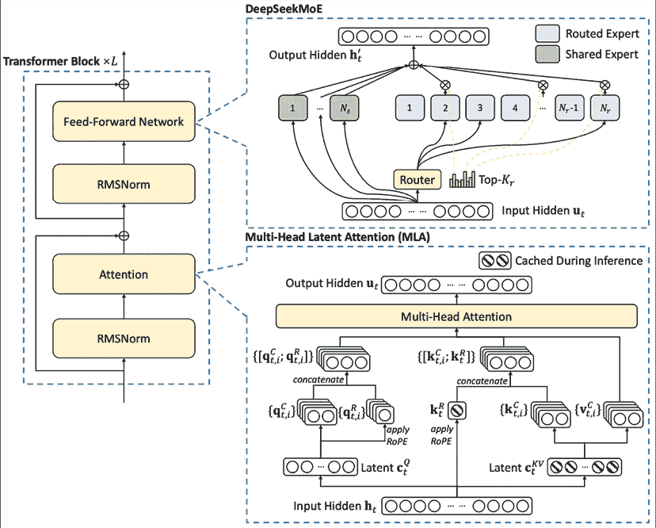

图 2.1：`DeepSeek` V3/R1 架构

该架构与训练流程支持模块化与专业化设计，直接增强推理能力。`DeepSeek`不依赖单一庞大的`transformer`，而是将提示词路由至专用组件处理。

首先探讨`提示词路由`机制。

#### `DeepSeek`中的提示词路由

观察下图，了解`DeepSeek`如何将提示词路由至各组件。

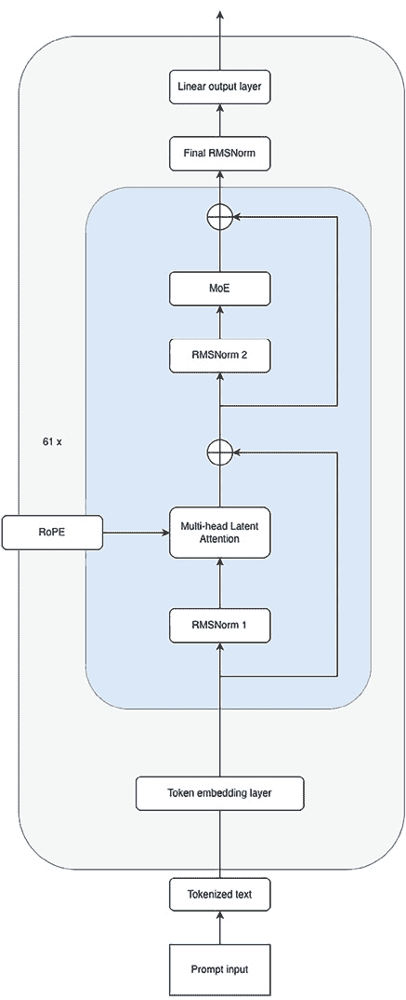

图 2.2：`DeepSeek`中的提示词路由

提示词输入并分词后，系统执行以下流程：

1.  **检索模块**获取相关知识。

2.  接着，**重排序模块**评估并优化检索到的信息，优先排列逻辑最相关的内容。

3.  `轻量级解码器`随后利用`MoE`动态激活专攻数学推理与逻辑推演的子网络，逐步构建响应内容。


例如，让我们看看当处理提示词 `奇数之和为偶数` 时会发生什么：

1.  DeepSeek 首先从其知识库中检索关于奇偶和的基础原理（此处指奇数和偶数的算术性质）。

2.  重排序模块提升那些正确解释了为何奇数加奇数等于偶数的说明，并丢弃无关或误导性的信息。

3.  解码器随后生成逐步解释，激活专注于算术性质和逻辑推导的专家模块，最终在给出最终答案之前生成一个连贯的论证。

这种模块化流程使得 DeepSeek 能够动态调整推理深度和路径，即使在需要多层次理解的话题上，也能确保输出精确、符合上下文且透明。这种灵活的架构为实现比传统自回归模型更加细致入微的推理奠定了基础。

现在，让我们来讨论解码器模块。

#### 解码器

通过 `DeepSeek-R1` ([`arxiv.org/abs/2501.12948`](https://arxiv.org/abs/2501.12948))，DeepSeek 采用了一个 `仅解码器的自回归 Transformer`，该模型将推理过程和解释作为其输出的一部分。图 2.3 展示了 DeepSeek-R1 解码器的框图。

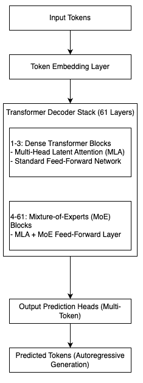

DeepSeek 的解码器模块由以下部分组成：

*   `嵌入层`：此层将输入 token 转换为向量表示。

*   `第 1-3 层`：前三层使用以下组件：

    *   `MLA`（多头潜在注意力）以实现高效注意力机制，以及 `旋转位置编码` (`RoPE`) 用于处理扩展序列。

    *   标准的稠密 `前馈网络` (`FFN`)。

*   `第 4-61 层`：这些层使用以下结构：

    *   每个模块依然包含 `MLA`。

    *   前馈网络被 `MoE`（混合专家）层取代：一个路由机制为每个 token 选择一个专门化的 `FFN` `专家` 子集，从而同时提升容量和效率。

*   `预测头`：最终输出会传递到一个或多个预测头，以支持下一个 token 和多 token 预测，这是一种提升生成可靠性的技术。

当 token 进入 `嵌入层` 时，它们会通过由 61 个 Transformer 解码器模块组成的堆栈进行处理。初始的模块是完全稠密的，而第 4-61 模块则采用了 `MoE` 架构，每个模块利用 `MLA` 从被激活的专家那里获取响应。然后，该输出通过 `预测头` 以自回归方式生成下一个 token（或多个 token）。

好的，现在你了解了提示词和 token 如何在解码器中流动。我们知道你现在一定迫切想了解这背后发生了什么。让我们直接深入探讨。

##### 解码器模块的内部机制

DeepSeek-R1 的解码器模块由 61 个 Transformer 层组成，其中前三层是稠密层，其余 58 层采用了 `MoE` 结构。在每个 `MoE` 层中，包含一个始终活跃的 `共享专家`，以及 256 个路由专家，总计在模型中分布了 14,906 个专家。

让我们看看所有处理 token 的组件。

###### 通过路由器进行的 token 处理与生成

对于每个输入或生成的 token，一个轻量级的 `路由器` 会评估哪些专门的子网络（即路由专家）应该处理该 token。具体来说，`路由器` 在每一层从 256 个路由专家中动态选择 8 个，再加上始终开启的 `共享专家`。这种选择并非随机的；它针对每个 token 确定，通过考虑该 token 的上下文，并将其特征与每个专家的 *亲和度* 或专业特长进行匹配。哪些专家被激活取决于提示词的性质和生成的 token 类型。例如，当生成涉及数学论证或代码的推理过程时，模型会优先激活那些专精于数学推理或编程的专家。同样，对于推理或拒绝行为，使用 `功能 token 共振成像` (`fTRI`) 的分析表明，某些可识别的专家会根据所需响应的类别被持续激活。

最终，检索候选结果得以生成。

在 DeepSeek-R1 中，重排序在将检索候选转化为高质量、易于人类理解的论证方面起着核心作用。通常，模型遵循如下图所示的过程。

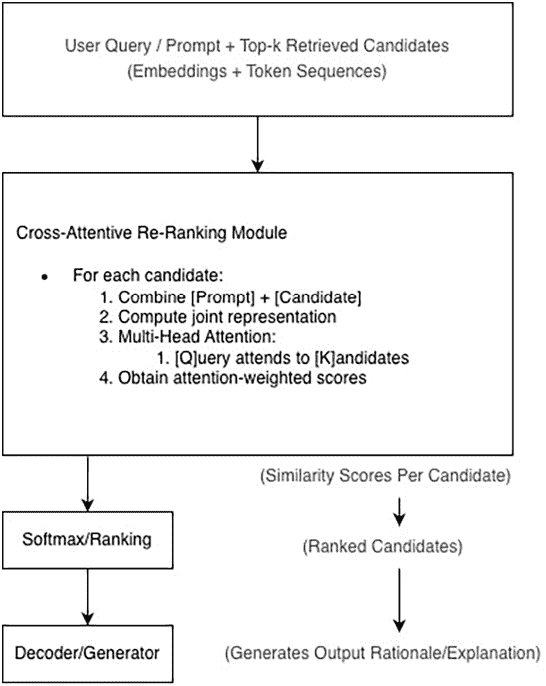

以下是它为你的提示词工作的原理：

1.  `Top-k 检索`：给定一个提示词（例如用户查询或推理任务），初始检索器使用快速、通常基于向量的相似度（例如嵌入空间中的余弦相似度或点积）选择 *k* 个最相关的候选段落或答案。

2.  `跨注意力重排序`：这些候选内容、它们的嵌入向量以及原始提示词被输入到一个专门的 Transformer 模块中。该模块使用跨注意力——同时关注查询词和每个候选内容——来计算精炼的相似度分数，并生成重排序后的输出，以指导下一步生成。

3.  `最终论证生成`：经过对齐和重排序的候选内容（加上中间评分向量）随后在解码器中处理，解码器生成一个推理过程或解释作为其输出的一部分。

例如，考虑以下提示词：

```
"法国的首都是什么？"
```

假设 *k=3*，检索到的前 3 个段落如下：

```
["巴黎是欧洲的主要城市。", "柏林是德国的首都。", "巴黎有许多博物馆。"]
```

`跨注意力重排序器` 通过同时关注查询和答案，给 `巴黎是欧洲的主要城市` 这段内容打出了最高分，因为 `巴黎` 与 `首都` 高度对齐。

在 `top-k 检索` 和 `跨注意力重排序` 之后，模型利用对齐后的嵌入向量和 token 序列，通过其标准生成过程生成易于人类理解的论证。

因此，当 DeepSeek-R1 逐步为一个推理过程生成 token 时，被激活的专家确切子集可以从一个 token 动态地转移到下一个。

对于每个 token，会发生以下步骤：

1.  `路由器` 接收对应于该 token 的隐藏状态，并快速计算其与每个专家的中心表示之间的相似度分数。

2.  然后，它选择分数最高的前 k 个（例如 *k=8*）专家，并将该 token 路由到仅由这些专家（加上始终活跃的 `共享专家`）在该层进行处理。

3.  在一系列 token 和多样化的提示词类型中，大量不同的专家子集变得活跃，这使得 DeepSeek-R1 能够调动高度专业化的能力，例如复杂逻辑推理或领域特定知识，同时通过不一次性激活所有专家来保持计算效率。

这种基于 `MoE` 的架构确保了 DeepSeek-R1 能够构建详细、逐步的解释或推理过程。

生成输出中的每个 token 都能从上下文（先前 token）以及在每一层动态选择的专家网络的独特专长中受益，从而在整个响应过程中实现细致、高效且高度专业化的推理。

###### 自回归 Transformer

DeepSeek-R1 使用自回归 Transformer，其中模型一次产生一个 token，每个新 token 的生成都基于所有先前生成的 token。这种设计被称为 `自回归`，因为在每个生成步骤中，模型的下一个 token 预测都明确地以迄今为止构建的整个序列为条件，而非依赖未来上下文，从而使得模型能够逐步构建连贯、符合上下文的输出。

一旦初始输入或提示词设定，就会发生以下过程：

##### Transformer 中的自回归生成

序列在 transformer 堆栈中的注意力（attentive）和前馈（feed-forward）组件中进行处理。

模型随后预测最可能的下一个 token，将其附加到序列中，并为下一个 token 重复此过程——始终完全基于已生成的内容进行条件生成：

*   `Autoregressive generation` 通过在每次前向传递中仅生成单个 token 来工作，而不是同时生成一批或一系列 token。

*   然而，通过重复的前向传递，模型构建了一个增长的序列，每次一个 token，直到满足停止条件（如序列结束 token）。

这种逐步过程对于结构化任务（如逻辑解释或代码）至关重要，因为下一个 token 的含义通常紧密依赖于所有先前输出所设定的上下文。

对于每一步可能生成的 token，模型会考虑其整个词表，潜在地包含数万个 token。

对于每一个新位置，解码器会输出在整个词表上的概率分布。可能的候选词包括基于当前上下文在句法和语义上合理的 token。例如，在短语 `The answer is` 之后，可能的下一个 token 可能是数字、冒号或表达解决方案的单词。如果在生成源代码，可能的 token 可能包括 `def` 这样的关键字、数据类型或变量名，并由提示和语义连贯性引导。

###### 多头注意力

`DeepSeek-R1` 也使用了**多头自注意力**设计，具体是一种称为 `MLA` 的优化变体。这使得模型能够有效分析 token 之间的关系。`DeepSeek-R1` 的多头注意力并不意味着每个头只关注单个 token。相反，多个头并行操作，每个头学习同时关注输入序列的不同部分。

虽然 `DeepSeek-R1` transformer 层中的确切头数在现有资料中没有明确说明，但典型的大型 transformer 模型使用数十个头（例如 64 个或更多），在总可用头数和 token 数量之间取得平衡。确实可能存在一种权衡——更多的头可以提供更细粒度的注意力，但计算成本更高，而更少的头降低了复杂性，但可能捕获更少的关系多样性。

多头注意力的核心功能是捕获输入序列中 token 之间的不同类型的关系。每个头计算**查询**（`queries`）、**键**（`keys`）和**值**（`values`）（**`Q`**、**`K`** 和 **`V`**），这些向量相互作用以生成注意力分数，这些分数突出显示了一个 token 在形成其内部表示时应考虑其他 token 的程度。

*   `Queries`：在 transformer 中，查询是一个向量，表示模型在输入数据中寻找什么样的信息或上下文。

*   `Keys`：键是一个向量，表示输入中每个元素的特征或属性，查询会与这些键进行比较以找到相关信息。

*   `Values`：值是一个向量，包含与每个键相关联的内容或信息，它会根据与查询的相似度进行加权和聚合以产生输出。

*   更多信息可以在 [`en.wikipedia.org/wiki/Attention_(machine_learning)`](https://en.wikipedia.org/wiki/Attention_(machine_learning)) 找到。

通过此机制，注意力不仅识别现有输入 token 之间的成对关系，还会考虑自回归生成过程中先前生成的 token，因为模型会关注整个前缀。

为了更好地处理 `DeepSeek-R1` 支持的大序列长度（最高达 `128K` 个 token），它采用了 `RoPE`。`RoPE` 注入位置信息，使模型知道 token 的相对位置，这对于长上下文中的有意义的注意力至关重要。

假设在自回归生成过程中，到目前为止的输入 token 包含短语 `The answer is`。多头注意力使得一些头可以关注短语 `The answer`，而其他头则关注最新的 token `is`，并将这些视角结合起来预测合理的下一个 token，例如数字或单词，从而形成一个解决方案。随着模型生成新的 token，这些 token 会被附加到序列中，注意力机制会扩展到这个增长的序列，动态地适应哪些 token 是最相关的，所有这些都由多个头并行处理。

此外，`DeepSeek-R1` 通过 `MLA` 集成了一种效率优化。在这里，模型不是为每个头单独存储完整的键和值矩阵，而是将它们分解为潜在向量，在不牺牲注意力质量的情况下减少内存消耗。

###### 层归一化

**层归一化**应用于 transformer 层内特定点的 token 隐藏表示（也称为**激活值**），以提高训练稳定性、收敛速度和整体模型性能。更准确地说，归一化作用于 token 嵌入向量；这些向量在通过网络处理时代表 token 的当前状态。

大型语言模型 transformer 中的激活值是指在模型逐层计算过程中隐藏状态中的特定标量值；这些激活值代表了在不同阶段的变换后的输入特征，在模型如何处理和生成语言方面起着关键作用。

应用层归一化的**关键变换**包括每个 transformer 层内的关键组件：多头自注意力模块和 FFN（也称为**位置网络**）。其工作原理如下：

1.  在进入注意力机制之前，通过对嵌入维度的均值和方差进行计算，然后缩放和偏移这些值，使它们具有一致的统计特性，从而对 token 嵌入进行归一化。这种**注意力前归一化**确保了输入到注意力计算的数据具有稳定的分布，有助于模型更有效地学习。

2.  在注意力输出通过残差连接添加回 token 之后，通常会应用另一个归一化步骤，以保持激活值在进入 FFN 时处于良好状态。

3.  类似地，**归一化前**和**归一化后**也发生在前馈层周围，确保涉及线性投影、非线性激活（如 `GELU`）和另一个线性投影的变换保持稳定的激活统计。

例如，考虑 `Calculate the sum` 这个提示 token：

1.  当这些 token 进入 transformer 层时，其嵌入在自我注意力计算每个 token 应该关注自身和提示中的其他 token 的程度之前被归一化。

2.  注意力模块产生更新的嵌入，之后层归一化再次稳定这些新向量，然后将它们传递到 FFN。

3.  然后，该 FFN 应用线性权重、非线性和另一个线性变换——归一化支持平滑梯度流并缓解内部协变量偏移的关键变换。

4.  随后，一个最终的归一化步骤准备好输出嵌入，以进入下一个 transformer 层或输出头。

5.  `DeepSeek-R1` 中的层归一化在每个 transformer 块内的关键内部变换（多头自注意力和前馈层）之前和之后对 token 嵌入进行归一化。这种分层归一化在逐步的、自回归生成过程中保持 token 表示的一致性和稳定性，从而增强了非常长序列的训练可靠性和模型准确性。

`MoE` 和注意力优化（如**分组查询注意力**（`GQA`））的使用使模型能够扩展而不会产生过度的资源需求。

GQA（分组查询注意力）是 Transformer 模型中的一种优化注意力机制，它将查询头划分为若干组，每组共享单一的键值投影，通过在多头注意力和多查询注意力之间进行插值，平衡计算效率与模型性能。

凭借其结构化推理能力，DeepSeek-R1 不仅能生成答案，还能产生解释、验证和论证，这些能力对定理证明、法律和结构化推理等领域至关重要。DeepSeek-R1 中的解码器模块指的是一堆 Transformer 解码器块（共 61 层），构成了其自回归语言建模能力的核心。

接下来，我们将通过示例提示词展示其工作原理。

##### 工作示例

假设用户输入以下内容：

```
Prove that the sum of two even numbers is even.
```

该提示词经历以下步骤：

1.  **分词**：输入被拆分为词元，并嵌入为向量进行处理。典型的词元（以纯文本形式）可能如下所示：
    `Prove`、`that`、`the`、`sum`、`of`、`two`、`even`、`numbers`、`is`、`even`、`.`

2.  **顺序处理**：嵌入的词元流经解码器层堆栈。在 DeepSeek-R1 解码器的每一层中，自注意力使每个词元能够使用 `key` (`K`)、`query` (`Q`) 和 `value` (`V`) 表示来关注序列中较早的词元。例如，假设词元 `t₂` 希望关注 `t₁` 和 `t₀`；它生成 `Q₂`，与 `K₁` 和 `K₀` 进行比较，并使用生成的注意力分数对 `V₁` 和 `V₀` 进行加权。此操作允许 `t₂` 聚合来自前面词元的相关上下文信息。

3.  **因果掩码** 通过阻止每个词元关注未来的词元来强制自回归属性，确保预测仅依赖于之前看到的输入，并保持从左到右的生成结构。随着输出的生成，模型根据注意力分数选择最相关的先前词元激活，在每个前进步骤中构建理解。

需要区分的是，这种自注意力在单个序列（输入提示词或生成响应的词元）内操作，允许模型捕获内部依赖关系。相比之下，交叉注意力用于单独的、专门的模块（例如交叉注意力重排序），在该模块中，模型允许一个序列（例如提示词）的词元关注另一个序列（例如检索到的候选）的词元，以在进入解码器之前优化相似度分数。因此，解码器本身依赖自注意力进行序列内推理，而交叉注意力则在早期的检索和排序阶段应用。

4.  **自回归词元生成**：在每次通过解码器后，模型通过评分多个可能的候选来预测下一个词元。例如，在生成前缀 `` `Let the two even numbers be 2a and 2b, where a and b are integers` `` 之后，模型会考虑下一个词元的几个顶级候选。假设 top-k 选项如下：
    *   `Their`（分数：0.34）
    *   `The`（分数：0.21）
    *   `Sum`（分数：0.18）
    *   `Difference`（分数：0.16）
    *   `Product`（分数：0.11）

    使用交叉排序，`Their` 获得最高分，因此被选为下一个词元：

    ```
 Let the two even numbers be 2a and 2b, where a and b are integers.
 Their sum is 2a + 2b = 2(a + b)
<answer> Since a + b is an integer, 2(a + b) is even.
<answer> Therefore, the sum of two even numbers is even.
    ```

    在每个生成步骤中，解码器权衡其顶级候选，并选择分数最高的词元，在上下文和自回归约束的引导下，逐个词元地构建输出。

呼！这内容确实不少。好的，还有更多。现在让我们进入下一个组件，即混合专家模型（MoE）。

#### 混合专家模型

正如*第 1 章*所概述的，MoE 路由通过为每个词元选择性地激活专门的子模块，提高了参数效率。在所有阶段，投影和池化方法的进步有助于稳定嵌入范数，从而提升了检索性能。此外，元数据感知的交叉注意力使 DeepSeek 的编码器能够整合上下文文档特征，如标题和类别。

在 DeepSeek-R1 中，MoE 架构在生成过程中为每个词元动态选择性地激活专门的专家子网络，从而高效利用庞大的模型容量。处理提示词时，模型的路由器会评估该词元的上下文嵌入，并将其与代表每个专家专业领域的学习到的质心进行比较。基于这种相似性，它激活一小部分专家，通常在每个 MoE 层中激活 8 个路由专家（共 256 个）中的少数几个，外加一个共享专家，使计算适应词元的语义和功能需求。

如果你想知道这个专家选择是如何发生的，请继续阅读。

##### 专家是如何初始化和配置的？

DeepSeek-R1 的架构在每个 MoE 层定义了数百个路由专家（例如，名词专家、数字专家、网页专家等），通过可学习的质心向量进行区分。这些质心初始为随机向量，并在预训练过程中，根据训练数据中遇到的模式，逐渐被塑造成专注于不同语言或语义领域的专家——例如识别数字、识别命名实体或解释推理线索。像数字专家或网页专家这样的专家并非硬编码；相反，这些专业化能力是不同专家在训练过程中针对某些词元类型或上下文被反复激活而涌现出来的。

例如，考虑以下部分提示词词元序列：`Prove that the sum of two even numbers is even.` 在自回归生成过程中，当模型遇到与数学推理相关的词元（如 `even numbers`、`sum` 或 `prove`）时，专注于数学运算和逐步逻辑的专家会被强烈激活。

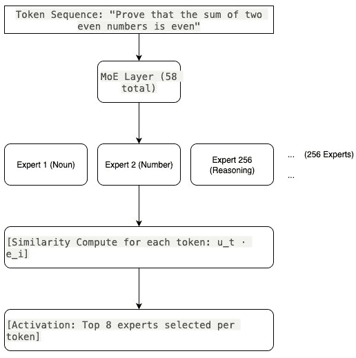

图 2.5: DeepSeek-R1 中的 MoE 路由

路由器选择那些专业化程度与每个词元角色最匹配的专家：数学专家处理数字操作和证明步骤，而推理专家则被用于需要论证或逻辑解释的词元。

如果提示词转向编程，例如输出 `def` 或特定变量名，路由器将优先激活在代码生成方面训练过的专家。通过这种方式，**上下文敏感路由**确保模型利用与当前任务最相关的专家知识。

##### 门控如何计算激活哪些专家？

当像 `Prove that the sum of two even numbers is even` 这样的提示词被分词并输入模型时，每个词元的嵌入（其隐藏状态）在其经过的每个 MoE 层都会由 **MoE 门控网络** 处理。对于每个词元在每一层，发生以下情况：

1.  词元的嵌入与每个专家的质心向量（预先学习）通过点积进行比较，产生 **亲和力分数**，衡量该词元特征与每个专家专业领域的匹配程度。

2.  这些亲和力分数通过一个归一化的门控函数。DeepSeek-R1 通常使用基于 Sigmoid 的机制，并可能带有用于平衡专家使用的偏差调整，而不是简单的 softmax。

3.  **门控函数** 为该词元选择亲和力分数最高的 top-K 专家（例如 *K=8*），外加一个始终激活的共享专家。

4.  只有被选中的专家处理该词元；它们的输出由门控分数加权，并组合形成该词元在该层的输出表示。

##### 专家是如何被激活的？


##### 我们现在将回到之前的示例提示，观察专家是如何被激活的。

考虑提示 `Prove that the sum of two even numbers is even` 中的 token `even`。在 MoE 层，路由器会将 `even` 的嵌入向量与所有专家的质心进行比较：

*   如果 `even` 与**数学推理**专家的质心高度对齐，则该专家的亲和度得分将较高，从而成为被选中的 top-K 专家之一。

*   诸如 `sum` 和 `prove` 之类与逻辑推理和证明构建相关的 token，可能会激活**推理**或**证明逻辑**专家。

*   如果提示上下文中包含编程语法或变量名，**编程**专家则会被优先路由。但就本数学证明而言，此类专家的相关性较低。

*   即使像 `that`、`of` 或 `two` 这样的连接词 token，也会独立经历此门控过程，从而在整个提示中形成动态的、针对特定 token 的专家路由路径。

这种**逐 token 门控机制**生成了一个独特的激活路径，贯穿于专家网络，并针对每个输入和生成的 token 量身定制。它能高效利用专业化的专家知识，精确满足需要，从而最大限度减少计算开销。这种**动态路由**也支持了 DeepSeek-R1 产生清晰、分步解释和推理输出的能力，因为它能在恰当时机激活最相关的专家。

另一方面，传统的顶尖（SOTA）大语言模型（如 GPT-4o 或 Claude）大多采用密集架构，这意味着所有参数都会用于每个输入，导致资源消耗巨大。DeepSeek 在达到 SOTA 级别性能的同时，其有效激活参数数量却少得多，因此效率高得多。此外，元数据感知的跨注意力层融合了文档标题或类别等上下文特征，丰富了影响专家路由的表示，并增强了检索和相关性。与通过每一层的每个神经元路由输入不同，每一层包含多个*专家*子网络，但每个 token 只激活少数几个专家（例如，64 个专家中仅激活 8 个）。这在保持容量的同时，大幅降低了计算负载。

以下公式展示了专家是如何被激活的：

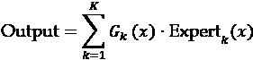

其中，门控函数 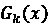 选择使用哪些专家（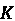 是专家总数；通常只激活前两个）。

接下来，我们将关注点转向 MLA。

#### 多头潜在注意力：面向长上下文的高效内存注意力

MLA 最早在 DeepSeek-V2 中实现，后来在 DeepSeek-V3 中得到改进，旨在减少推理时的内存使用，同时不损害输出质量。

标准 Transformer（以及许多顶尖模型如 LLaMa 3 和 GPT-4o）使用**多头注意力**，并为每个 token 保留完整的**键值**（**KV**）缓存，这在处理长上下文时会导致极高的内存需求。DeepSeek-V2、V3 和 R1 引入了 MLA，将 KV 缓存压缩为每个头的一个紧凑潜在表示，在保持或提升质量的同时，将推理内存减少了超过 90%。

MLA 通过引入一种对 KV 缓存的低秩压缩形式，取代了标准的多头注意力机制。MLA 不是为每个 token 在推理时存储大量的键和值记忆张量（这会导致巨大的内存使用，尤其是长序列时），而是将这些表示吸收到一组更小的、经过学习的潜在向量中。在每一层，注意力计算不是直接基于完整缓存进行，而是通过这些压缩的潜在表示进行，它们保留了足够的上下文信息以实现高质量生成。

额外的改进包括选择性应用旋转位置嵌入和先进的权重吸收技术，使该机制能够匹配甚至超越模型原始的推理质量，同时通常将推理缓存大小减少 90% 以上。这一创新是 DeepSeek-R1 能够高效处理长上下文任务，并大规模提供经济高效的大语言模型推理的关键原因之一。

让我们看看这是如何工作的。在 MLA 中，不是存储 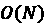 个键/值（其中 N 是序列长度），每个头的 KV 都被投影到一个更小的潜在空间：

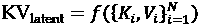

在注意力计算过程中，查询（query）关注的是这个潜在表示，而非完整序列——这在速度和内存方面带来了巨大提升。

LLaMa 3 和许多 GPT 模型使用 GQA 来减小 KV 缓存大小，但经验表明，MLA 在建模性能和效率上更胜一筹，这得到了基准测试和出版物的证实。

对于提示 `Prove that the sum of two even numbers is even`，MLA 通过将外部上下文（如文档标题或类别信息）融入注意力机制，增强了模型的理解能力。这些外部上下文提供了额外的信号，帮助模型基于相关元数据更好地解释和专化其响应。在一个注意力头中，键和值向量首先从输入 token 嵌入中计算得出。这些向量最初是高维的（例如 1024 维），然后使用学习到的投影矩阵被投影到一个更小的潜在空间（例如 64 维）。这种降维允许更高效的计算，并将注意力集中在最相关的特征上。投影后的键代表用于与查询（**Q**）匹配的上下文特征，而投影后的值则承载了被聚合的丰富信息。MLA 通过同时在多个潜在子空间中关注 token 序列和注入的元数据来实现这一点，使模型能够在生成证明时动态权衡和整合相关的外部知识。这个过程使得对诸如两个偶数之和仍为偶数之类的断言，能够进行更准确的、具备上下文感知能力的推理。

还有一些其他关键方面使得 DeepSeek 成为最具竞争力的模型之一。请稍安勿躁。

#### DeepSeek 实现高效且上下文感知响应的特性

除了上述架构创新，DeepSeek 还采用了其他几种技术来确保效率和上下文感知的响应。让我们来探讨一下。

##### FP8 训练与精度控制

DeepSeek-R1 是首批在预训练和推理中实施真正的、大规模 **FP8**（**8 位浮点数**）混合精度策略的大语言模型之一。FP8 是 DeepSeek 在速度和内存效率上超越早期格式（如 FP16 或 BF16）的关键因素之一。然而，FP8 的成功部署需要精心设计的方法来应对低精度算术中常见的数值不稳定性和收敛性下降风险。

其精心设计体现在 DeepSeek 的混合精度训练框架中：在该框架中，大部分计算密集型操作，例如前向和反向传播中涉及的线性变换（矩阵乘法或 **通用矩阵乘法**（**GEMM**）操作），都以 FP8 精度执行。对于每个线性算子（无论是前向传播、梯度反向传播还是权重更新），模型权重和激活值都被量化并在 FP8 中处理，计算吞吐量相比 BF16 翻倍，内存使用量减半。

关键的是，为了保持精度，实际的乘积累加（求和）是在 FP32 中执行的。激活值和梯度则以 BF16 格式缓存，以兼顾内存效率和稳定性。


###### DeepSeek-R1 的独特之处在于其对 FP8 的选择性应用

通过详细的实证研究，团队识别出那些若进一步降低精度将损害模型稳定性或学习动态的特定模块。例如，他们在嵌入层、序列输出头、MoE 门控模块、层归一化以及注意力算子上保留了更高（BF16 或 FP32）的精度，这些部分对量化噪声敏感，需要更强的数值鲁棒性。只有稠密核心（GEMM）和某些内存密集型路径被安全地量化至 FP8。这种选择性方法确保了网络的绝大部分能从 FP8 的效率中获益（从而能在相同的计算范围内扩展到更大的模型规模），而关键计算则始终保留模型收敛和高保真输出所需的精度。优化器状态、主权重和权重梯度均以 BF16 或 FP32 存储，复杂的分片与并行技术（如 DualPipe 流水线并行）进一步降低了内存和通信开销。

在 DeepSeek-R1 的预训练期间，用于令牌转换和中间计算的矩阵乘法（例如在数学提示词中，如`Prove that the sum of two even numbers is even`），均采用 FP8 精度执行以最大化计算效率。与此同时，关键操作，包括 MoE 门控逻辑、层归一化和最终输出生成，则利用更高精度以确保随着序列增长时的准确性和稳定性。这种针对模块的特定精度方法在效率与可靠性之间取得了平衡，使 DeepSeek-R1 能够在单次运行中大规模训练数万亿参数的模型，同时不损害输出质量或训练稳定性。这一解释突显了理解模型如何在前所未有的规模上实现高效稳定训练时，至关重要的实际权衡与设计决策。

##### 用于策略解码的多令牌预测

大多数 Transformer 语言模型被训练为自回归模型，旨在最大化给定当前序列下下一个令牌的概率：

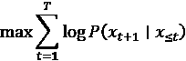

这意味着模型学习一次仅预测一个令牌，并始终以所有先前令牌为条件。在推理时，模型逐个令牌（逐令牌）生成文本，采样或贪心地选择最可能的下一个令牌。

DeepSeek 的 V3 模型引入了`多令牌预测`（`MTP`），其灵感源自`推测性解码`。在这里，模型不仅学习预测下一个令牌，还并行预测未来的多个令牌。以下是 DeepSeek 采用的 MTP 联合似然目标函数：

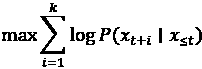

MTP 不再仅仅关注紧邻的下一个令牌，而是联合优化`k`个未来的令牌。这使得训练目标与更高效的解码相一致，并能更好地捕捉长程依赖关系。

MTP 的部分优势包括：
*   **并行化训练**：通过一起预测多个令牌，训练可以更快、更高效。
*   **增强上下文建模**：模型学会预测更广泛的模式并提前规划，鼓励全局连贯和一致的推理。
*   **加速推理**：在生成时，模型可以在一次前向传播中验证或提议多个令牌，从而大幅提升吞吐量。

DeepSeek-R1 的`群组相对策略优化`（`GRPO`）通过在微调期间实现更精确且感知上下文的奖励分配，代表了对标准 RLHF 的重大超越。让我们详细探讨这一点。

##### GRPO 与高级 RLHF

在 DeepSeek 的定制 GRPO 系统中，训练期间，策略模型为每个提示生成多个响应——通常是一个固定数量，如 4 到 8 个样本，尽管这个数字可能因训练阶段或提示复杂度而异。每个采样输出都基于严格的基于规则的标准被分配一个**二值奖励**（可接受或不可接受）。即使组内某些响应不正确并获得零奖励，它们仍被包含在组内以计算平均奖励。这意味着不正确输出的存在会降低该组的平均奖励基线，从而有效地惩罚质量较差的响应（相对于更好的响应）。在实践中，通过基于规则的检查（例如正确性和简单的格式约束）计算标量奖励，这通常最终简化为一个有效的二值信号；GRPO 在减去组均值中心化后使用这个标量奖励，以提升高分样本并抑制低分样本。

然后，通过将每个响应的二值奖励与此组平均值（并按组标准差进行归一化）进行比较，计算出模型对该响应的优势值，从而引导策略更新朝着优于组均值的响应方向进行。这种相对评分机制鼓励了持续改进，同时考虑了相同提示下所有样本的输出质量差异。

使用 GRPO 时，当提示`Prove that the sum of two even numbers is even`被给出，模型会并行生成一组候选响应。例如，假设候选响应及其奖励如下：
*   **候选 A**：`Let the two even numbers be 2a and 2b. Their sum is 2(a + b), which is even.`（奖励：0.85）。
*   **候选 B**：`Two even numbers added together result in an even number because even plus even equals even.`（奖励：0.75）。
*   **候选 C**：`Since even numbers are multiples of 2, their sum is divisible by 2, so it's even.`（奖励：0.80）。

GRPO 首先计算该组的平均奖励：


然后，对于每个候选响应，它通过将其奖励减去此平均奖励来计算优势值，并可选择性地按组标准差进行归一化以平衡尺度差异，如下所示：
*   `优势 A = 0.85 - 0.80 = +0.05`
*   `优势 B = 0.75 - 0.80 = -0.05`
*   `优势 C = 0.80 - 0.80 = 0.00`

通过基于这些相对优势（而不仅仅是绝对奖励）进行优化，模型学会偏好在给定候选集合中表现积极突出的响应，从而提高了整体生成质量以及对此类证明等复杂提示的相关性。

DeepSeek-R1 中的奖励可以基于多个标准：逻辑正确性、连贯性、对提示的忠实度、完整性，甚至是对数学原理或风格的遵循——简而言之，任何可以通过规则、启发式方法或`基于结果的评分`进行评估的属性。例如，在微调推理任务时，奖励可能对提供逻辑`思维链`（`CoT`）或精确中间步骤的输出更高，而不仅仅因为产生了最终正确答案。

通过使用每个组的平均奖励作为特定上下文的基线，GRPO 减少了奖励操纵和噪声，鼓励策略在每种情况下偏好相对更好的响应。DeepSeek-R1 还在损失中添加了`KL 散度`惩罚（[`hanj.cs.illinois.edu/cs412/bk3/KL-divergence.pdf`](https://hanj.cs.illinois.edu/cs412/bk3/KL-divergence.pdf)），以稳定更新并维持期望的行为。这种精细的、基于群组相对的方法实现了对学习的精确控制，提高了清晰度、事实准确性以及与用户意图的一致性——尤其是在复杂的多步推理任务中。GRPO 是 DeepSeek-R1 在产生详细、可解释且与用户对齐的输出方面表现强劲的基石。

##### 思维链推理：CoT 与长 CoT

DeepSeek 的训练，特别是使用特殊提示符（``，`<answer>`）时，针对逐步的、可解释的推理进行了优化。它在长链式思维（CoT）任务上尤其强大——这在 2025 年美国数学奥林匹克 LLM 挑战赛中获胜得到了证明。

考虑以下提示：


##### 理解 DeepSeek 的推理机制

```
解释为什么两个奇数的和是偶数？
```
这是 DeepSeek 的回答：
```
 设这两个数为 2a+1 和 2b+1。
 它们的和为 2a+1+2b+1=2(a+b+1)，是偶数。
```
其他先进的 LLM 也能生成思维链输出，但 DeepSeek 表现卓越，这得益于其架构和训练偏向于结构化解释（更多内容见下一节及*第 4 章*），在竞争性基准测试中常常表现更优。

##### DeepSeek 的思考过程

回想 *第 1 章*，DeepSeek 的数据集构建涵盖了丰富多样的来源，经过精心筛选以覆盖推理、编码、科学和通用世界知识。对于编程任务，DeepSeek 利用了来自 GitHub 官方数据集等仓库的大规模开源代码，以及数据集合（如 *The Stack* ([`huggingface.co/datasets/bigcode/the-stack`](https://huggingface.co/datasets/bigcode/the-stack)) 和 *CodeContests* ([`huggingface.co/datasets/deepmind/code_contests`](https://huggingface.co/datasets/deepmind/code_contests))）中精心挑选的论坛和库。对于数学和科学推理，模型在基准数学数据集（如 GSM8K 和 MATH）、科学论文语料库（如 arXiv 和 PubMed Central）以及逻辑谜题和教科书问题集合上进行训练。

至关重要的是，DeepSeek 的训练数据包含了明确的思维链数据集，尤其使用了来自 *CoT Collection* ([`github.com/kaistAI/CoT-Collection`](https://github.com/kaistAI/CoT-Collection))、MathQA ([`math-qa.github.io/`](https://math-qa.github.io/)) 等资源的思维链标注样本，以及精心挑选的人类推理过程。通过受 *Flan Collection* ([`github.com/google-research/FLAN`](https://github.com/google-research/FLAN))、Alpaca ([`github.com/gururise/AlpacaDataCleaned`](https://github.com/gururise/AlpacaDataCleaned)) 等提示启发的合成数据集，以及为自我指令或对话监督发布的数据集，提供了指令和叙述的多样性。为了获得强大的多语言和领域通用能力，DeepSeek 包含了大量的维基百科 ([`www.wikipedia.org/`](https://www.wikipedia.org/))、经过质量筛选的 Common Crawl ([`commoncrawl.org/`](https://commoncrawl.org/))、古登堡计划 ([`www.gutenberg.org/`](https://www.gutenberg.org/)) 以及从法律文件（例如 Pile-CC 的法律部分 [`pile.eleuther.ai/`](https://pile.eleuther.ai/)）到医学文献（如 PMC-PubMed ([`pmc.ncbi.nlm.nih.gov/`](https://pmc.ncbi.nlm.nih.gov/)) 和 MedQA ([`huggingface.co/datasets/bigbio/med_qa`](https://huggingface.co/datasets/bigbio/med_qa))）等特定领域语料库。

###### 数据集的选择

DeepSeek-R1 应用 `测试时扩展`，在推理期间分配额外的计算资源，从而能够对输入提示进行逐步深入推理，以产生更高质量的输出。模型不会生成单一直接答案，而是执行一系列推理过程，类似于*人类系统 2*（深思熟虑、费力的推理）的逻辑推理，在最终确定响应前迭代评估可能的解决方案。这种方法由其 MoE 架构支持，该架构将每个 token 并行路由到多个专家，并利用先进的硬件加速实现快速的多专家评估。

在运行时，随着更多计算资源投入推理，模型的输出质量会提高，特别是在数学、编码和逻辑分析等复杂任务上。DeepSeek-R1 在现代 GPU 集群上每秒可处理数千个 token，其提供的实时答案需要紧密连接的高性能基础设施来最大化 token 吞吐量和专家间通信。这种扩展机制有效地增强了模型*长时间思考*、检查和完善其推理的能力，并提升了在需要大量计算和精确逻辑的任务上的基准性能。

总之，这种广泛、精心策划的数据混合赋予了 DeepSeek 进行推理、编码、回答多步问题以及跨语言和领域泛化所需的广度和深度。如需更详细的分解或每个数据集的文档指引，你可以参考相关的代码库或学术数据集排行榜。

哇！这么多内容确实不容易消化。我们建议你休息一下，再回来看看这些概念如何共同构成 DeepSeek 的推理机制。

###### 测试时扩展

使 DeepSeek 与众不同的关键在于它对推理的重视。语言模型中的**推理**是指解决多步问题、理解因果关系、执行符号操作或基于隐含上下文推导答案的能力。

DeepSeek 的架构创新并非仅提供孤立的性能提升，而是组织内部表示、在提示内维持扩展上下文，并以更审慎且符合上下文的方式构建其响应——从而在不同领域实现更快、更可靠的推理。

DeepSeek 在提示工程、训练设计和模型对齐方面的做法，强调向明确的**结构化推理**有意识地转变。DeepSeek 并非仅仅依赖模型在幕后推断逻辑链，而是通过引入结构化的提示格式（例如明确的 `` 和 `<answer>` token，或指导模型*展示其工作过程*的指令微调模板）来鼓励中间推理步骤。这与对话意义上使用**系统提示**不同。这种方法依赖于精心设计的、特定任务的提示格式，这些格式被明确嵌入模型的训练和微调数据集中。

在数据准备阶段，示例会使用专用 token（如 ``）来标记中间推理步骤，使用 `<answer>` 来标示最终结论。这些 token 作为清晰的语义线索，指导模型生成详细、逐步的解释，而不是立即给出最终答案。

这涉及以下步骤：
1.  训练语料库包含大量标注数据，其中人类撰写或模型增强的推理过程伴随着最终响应，并被分解为逻辑推理步骤。
2.  然后训练模型不仅要预测正确的最终 token 序列，还要在输出序列中重现中间推理步骤。
3.  损失函数应用于整个 token 序列，包括这些推理步骤，以鼓励忠实再现结构化思维。
4.  此外，在微调和强化学习阶段（例如使用 GRPO），评估指标明确奖励输出在清晰度、连贯性、事实一致性和推理完整性方面的表现，而不仅仅是答案的正确性。这鼓励模型重视其*思维链*的可解释性和内部一致性，强化使推理过程透明且可验证的行为。

因此，DeepSeek 的训练流程建立了一种运行范式，其中嵌入了推理标记的结构化提示成为学习目标和输出评估不可或缺的一部分。这种端到端的设计确保模型能够通过明确的中间步骤可靠地*展示其工作过程*，产出用户可以检查逻辑有效性和可信度的输出，而不仅仅是不透明的最终答案。

那么，DeepSeek 是如何思考的？让我们立即深入探究。


##### DeepSeek-R1-Zero 的训练与推理机制

DeepSeek 的开发中有一个显著现象：在训练 DeepSeek-R1-Zero 时——这是一个仅通过强化学习（RL）训练、未使用任何监督微调数据的变体——模型开始展现出未被明确编程的涌现推理能力。这一过程为理解语言模型如何仅通过 RL 发展推理技能提供了新的见解。

R1-Zero 的训练设置相对简单。DeepSeek 的工程师在训练和对齐阶段设计了一个固定的提示结构，鼓励模型在提供答案之前明确地对问题进行推理。

这其中有三个关键因素在起作用：思考与回答块、GRPO 以及基于训练样本的 RLHF。我们来逐一讨论。

###### 思考与回答块

虽然确切的系统提示仍然是专有的，但可获得的 tokens 和训练痕迹表明，提示始终以包含一个 `` token 开始，后接一个 `<answer>` token 为结构，引导模型在生成最终响应前生成结构化的中间推理步骤。这种思考与回答之间的明确区分——无论是直接嵌入系统指令还是通过监督示例体现——就像一个潜在的系统级指令，促使模型将推理视为一个基本的、首要的步骤，而非可选行为。

DeepSeek 模型（尤其是 R1 系列）在多步任务（如数学问题求解和法律论证）中表现出强大性能，因为这些问题需要将问题分解为逻辑步骤以确保准确性和透明度。每个模型响应都遵循一个两阶段结构，包括一个包含中间推理步骤的 `` 块和一个包含最终结论的 `<answer>` 块。这种在训练和评估期间引入的格式，强化了决策前的显式推理，尤其适用于需要逐步逻辑的任务。两者之间的边界由特殊 token 定义，如 `` 和 `<answer>`，它们作为格式和行为的分隔提示。

这种明确的提示结构有助于使模型的推理变得透明、可验证和可扩展，尤其适用于数学、法律和多轮决策等复杂领域。我们将在第 3 章中详细讨论提示格式。

考虑以下提示示例：

```
"两个偶数的和总是偶数吗？解释原因。"
```

模型的响应如下：

```

让这两个偶数表示为 2a 和 2b，其中 a 和 b 是整数。
它们的和是 2a + 2b = 2(a + b)，可被 2 整除，因此是偶数。
</think>
<answer>
是的，两个偶数的和总是偶数。
</answer>
```

让我们看看模型生成的响应结构。`` 部分是模型被鼓励展开逐步推理的地方，而 `<answer>` 部分则简洁地给出了最终响应。

接下来，GRPO 机制开始用于模型响应，我们将在下文讨论。

###### 使用 GRPO 评估响应质量

在与 GRPO 进行训练和对齐期间，`` 部分的质量通过一个**群组相对奖励机制**进行评估，该机制实现了对中间推理步骤的精细控制。GRPO 不为每个模型输出分配绝对奖励，而是将为同一提示生成的多个候选响应作为一个群组进行比较：

*   对于每个响应，包括其 `` 中间推理块，所分配的奖励是相对于该群组中其他候选者的表现而言的。这种相对优势是通过减去群组的平均奖励并按其标准差归一化来计算的。这种设置允许基于逻辑连贯性、一致性、事实正确性、格式和可解释性等标准，独立于最终答案的正确性来明确评估 `` 部分的质量。

*   通过奖励那些包含清晰、逐步、结构良好推理的输出，模型学会的不仅仅是猜测答案，而是以逻辑和透明的方式构建答案。具体来说，在 GRPO 微调期间，模型会为每个提示生成多个候选解释。

*   一个**评分函数**，通常是启发式方法和学习到的奖励模型的加权组合，会为诸如 `` 块的清晰度和正确性等属性分配分数。

*   学习到的奖励模型通常包括在人类偏好数据上训练的神经排序器或奖励预测器，以评估生成解释中的推理质量、事实准确性和连贯性。

GRPO 使用这些分数（如前所列）来计算群组相对优势，指导策略更新，使模型朝着产生更好中间推理的方向调整，并明确符合人类对齐的质量标准。

以下是奖励函数的工作原理：

*   **准确性奖励** 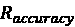 仍然是一个二元信号，当最终答案正确且格式正确（例如，包含 `` 和 `<answer>` 块）时分配为 `1`，否则为 `0`。此评估利用了自动检查，并在必要时对照早期阶段建立的基本事实答案进行手动验证。

*   **一致性奖励**  旨在量化模型在整个推理步骤中保持单一语言风格和逻辑连贯性的均匀程度，防止在单个响应中混合语言或使用不连贯的措辞。概念上，该奖励可以表示为一个标量函数。

一致性奖励，记为 ，被定义为一个函数  应用于模型的响应：

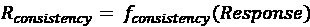

 的值在一个特定范围内（例如，从 `0` 到最大值 `10`），其中函数  评估响应文本的内部语言一致性和连贯性。例如， 可能执行以下操作：

1.  计算响应中主流语言与其他语言相比的 tokens 或句子比例。
2.  惩罚风格基调或措辞的突然变化。
3.  应用连贯性指标来确保推理链的逻辑流畅性。

在 RL 中指导策略优化的组合奖励计算为准确性奖励与加权一致性奖励之和：

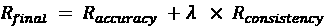

其中， 是衡量最终响应正确性的二元或标量奖励，λ 是一个权重系数，用于平衡一致性奖励相对于准确性奖励的效果。

这个组合奖励 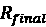 在 GRPO 框架内使用。GRPO 通过比较每个采样响应的总奖励与群组平均奖励来计算相对优势，鼓励模型生成不仅准确且结构良好，而且在推理过程中语言一致、逻辑连贯的输出。


虽然这种采样与比较过程增加了训练期间的计算工作负载——因为每个提示需要生成并评估多个候选补全——但其影响严格限于训练阶段，一旦部署开始，不会影响推理速度。在推理阶段（处理真实用户请求时），每个提示只需一次模型生成，与常规大语言模型无异。因此，`DeepSeek`在训练期间实现了强大的推理对齐和样本效率，但在生产环境中以标准且高效的推理速度提供响应，不会因`GRPO`的训练时多采样方法而产生额外开销。`GRPO`无需辅助价值网络或多次生成，使其具备快速、稳定且易于实施的特点。

#### 基于规则的 RLHF

训练和评估过程中使用的示例问题涵盖多个领域，从简单的算术和符号逻辑到代码生成和物理问题，展示了模型在不同推理任务中的通用性。

`DeepSeek`的基于规则的 RLHF 信号以相对直接的方式应用，其中每个响应或推理步骤根据固定的、预定义的逻辑标准被标记为“可接受”或“不可接受”，而非通过复杂的奖励模型学习获得。根据技术描述，这一过程并非传统意义上的完全人工标注，而是依赖基于规则的启发式方法，自动根据设定的逻辑评估输出的正确性和格式。这种方法减少了人工标注每个样本或步骤的耗时需求，使其比通常涉及学习奖励模型或人工排名的 RLHF 更具可扩展性且资源消耗更低。

然而，仍需一些初始人工工作来定义构成`可接受`步骤的精确逻辑规则和阈值，这是一项重要的前期设计任务。二元、基于规则的反馈的简单性也意味着训练期间每个数据点所需的标注员或标注工作量更少，因为评估是自动化的且主观性较低。这与标准的 RLHF 工作流程形成对比，后者需要人工标注员花费大量时间比较多个响应或分配标量奖励分数，这可能成本高昂且速度缓慢。

`DeepSeek`的方法平衡了手动与自动任务：前期通过人工逻辑设计创建基于规则的评估器，结合训练期间对模型输出的自动二元标注，从而获得清晰的接受/拒绝信号，无需繁重的人工标注负担或使用复杂的已学习奖励函数。这使得对齐过程更高效且可扩展，同时为强化正确的推理步骤保留了有意义的反馈。即使有时缺乏高级已学习奖励模型可能实现的细粒度对齐，该反馈管道仍变得更具可扩展性和高效性。该系统评估输出的正确性和格式合规性。

#### `DeepSeek`如何处理复杂场景

考虑一个你希望`DeepSeek`识别代码中错误的场景。

在此场景中，一段代码片段能正确编译但产生错误结果，`DeepSeek`采用多种训练和对齐策略来识别并纠正错误。例如，考虑实现一个对两个数字求和的函数。模型最初可能生成以下代码，该代码可编译但返回的是乘积而非和：

```python
def sum_two_numbers(a, b):
    # Incorrect implementation: returns product instead of sum
    return a * b
# Testing the function
result = sum_two_numbers(8, 6)
print("Initial output (incorrect):", result)  # Outputs 48 instead of 14
```

训练过程中，`DeepSeek`的反馈机制检测到预期输出与实际结果之间的逻辑差异。利用这些信号，模型迭代优化其输出，最终得到修正后的实现：

```python
def sum_two_numbers(a, b):
    # Correct implementation: returns the sum of two numbers
    return a + b
# Testing the corrected function
corrected_result = sum_two_numbers(8, 6)
print("Corrected output:", corrected_result)  # Outputs 14 as expected
```

该修正过程由针对性奖励模型和错误诊断支持，指导模型识别并修正错误。因此，`DeepSeek`生成的代码不仅语法有效，而且功能准确可靠。

推理机制也受`DeepSeek`训练方式的影响。让我们一探究竟。

### `DeepSeek`训练

`DeepSeek`稀疏但定义明确的基于规则的反馈被选择性地应用于通过数据驱动优先级策略识别出的训练样本。样本的选择基于提示复杂性、是否存在多步推理、事实或逻辑难度，或对齐与正确性至关重要的决策关键上下文等标准。

例如，涉及多步数学证明、带正确性检查的代码生成或复杂法律推理的提示会被标记为接收显式基于规则的评估信号。相比之下，更简单或更常规的提示，如直接的事实检索或常见对话查询，通常被跳过或分配更粗糙的间接奖励，从而减少不必要的计算负载。一旦这些奖励信号通过策略优化（例如通过`GRPO`）指导模型参数的更新，学习便直接编码到模型权重中，意味着模型能将其学习泛化到类似提示，即使并非每个案例都提供了显式反馈。

训练过程中，随着`R1-Zero`迭代处理复杂推理任务，观察到一种涌现行为：模型生成越来越长、越来越详细的中间推理步骤。这并非通过与响应长度相关的奖励明确激励；相反，底层的`GRPO`框架自然地偏好提高正确性的推理路径。从数学角度看，更长的分步推理序列倾向于获得更高的相对奖励，因为它们更可靠地展示了中间步骤的逻辑连贯性和正确性。这些奖励受奖励模型中加权组件的影响，这些组件优先考虑准确性、完整性和清晰度等因素，对推理链中持续的逻辑一致性赋予更大权重。

本质上，通过产生扩展的思维链，模型最大化其在`GRPO`的组相对评分函数下计算的预期奖励信号，该函数定义为归一化的`优势`：

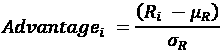

此处，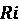 是候选  的奖励，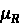 是候选组的平均奖励，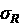 是标准差。这个形式化的、基于优化的框架解释了推理细节的增加——`DeepSeek`有效地*学会*在能够提高相对奖励优势并增加正确最终答案可能性时，详细阐述其内部思维过程。因此，模型更长的推理输出是对奖励结构的战略性响应，而非随机或无法解释的行为。

模型在训练期间未获得显式监督的思维链标签。相反，其输出基于最终答案的正确性和是否遵循包含中间推理步骤的规定结构化格式（例如 `` 和 `<answer>` 块）进行评估。


由于模型接触过中间推理步骤与获得奖励存在因果关联的示例，它开始倾向于先生成思考再输出答案的生成路径，从而形成了一种自组织的内部推理策略。重要的是，这种行为并未出现在早期仅通过标准监督微调训练的`DeepSeek`模型中。那些版本可能得出正确答案，但其输出缺乏可解释性，在多步骤任务中表现不佳，且未能很好地泛应用于更具挑战性的基准测试，如`AIME`、`MATH`和`GPQA`。相比之下，`R1-Zero`在没有使用任何监督`CoT`数据的情况下，仅通过这种纯奖励对齐方式就已开始超越这些早期模型。

这才是真正的`顿悟时刻`——模型能够发现可解释且有效的推理模式，不是因为它模仿了标注的解释，而是因为它被激励去生成*持续有效*的结构化输出。它挑战了手写推理规则对于学习推理是必需的这一观念，并为完全实现的`DeepSeek-R1`模型奠定了基础。

#### 训练用冷启动数据

`DeepSeek`团队投入大量精力生成高质量的结构化推理数据——不是通过手动标注数千个`CoT`示例，而是利用`R1-Zero`的无监督推理能力。一旦`R1-Zero`开始生成遵循`CoT`格式且基本准确的输出，就收集了大量这类模型生成的响应，作为`冷启动监督训练数据`。

这些输出的正确性在可能的情况下通过程序检查、测试用例或逻辑验证规则，将生成的最终答案与已知标准答案进行比较来自验证。当自动验证不足或存在歧义时，人工审阅者会进行选择性手动验证，以确保质量和准确性。虽然手动检查需要额外的时间和精力，但大部分验证都利用了自动化程序，使整个过程比完全手动标注更高效且可扩展。这种`混合验证策略`使研究人员能够从模型自身的输出中高效地引导出高质量的`CoT`标注数据，而无需承担高昂的标注成本。尽管这些数据是模型生成的，但它们实际上已成为标注数据：每个样本都包含原始提示（隐式问题）、一个包含推理步骤的``块，以及一个包含最终响应的`<answer>`块。

例如，考虑以下提示：

```
"3 与 2 的和的平方是多少？"
```

模型输出如下：

```

3 + 2 = 5.
5² = 25.
</think>
<answer>
25
</answer>
```

这个结构化的数据集为下一阶段奠定了基础：使用`R1-Zero`生成的语料库来微调`DeepSeek-V3`的一个检查点，从而将`R1-Zero`涌现的推理能力转移到更大的主干模型中。在这里，`R1-Zero`同时扮演了学生和教师的角色——最初在强化学习期间通过简单的、基于规则的奖励信号进行学习，随后通过生成蒸馏示例来指导自身的训练。虽然这个过程与`GRPO`的奖励驱动优化有相似之处，但`R1-Zero`的方法特别专注于强化符合逻辑推理和正确性的行为，而不仅仅是最大化群组相对优势。

与使用监督损失来匹配教师输出的传统`知识蒸馏`不同，`DeepSeek`利用奖励信号来明确优化结构化、分步骤的推理质量和对输出格式的遵循，这是标准蒸馏损失难以单独捕捉的。以这种方式使用强化学习有助于模型动态探索和完善推理策略，发现最大化清晰度和正确性的输出。这些输出随后作为可靠的`教师示例`用于后续的监督微调，在补充`GRPO`的群组相对奖励框架的同时，有效地引导出性能的提升。

以下是训练过程中发生的情况：

1.  `DeepSeek-R1`的训练始于预训练，以建立基础的语言理解和专家专业知识。
2.  在此基础上，模型在`CoT`数据上进行进一步训练，其中`RL`过程通过一个额外的连贯性奖励得到了增强，该奖励与原始的二元正确性和格式奖励并存。
3.  虽然原始奖励函数主要根据最终答案的正确性和对` + <answer>`输出结构的遵循来分配二元的接受/拒绝信号，但连贯性奖励鼓励模型生成响应中的语言一致性和连贯性。这两个奖励通过简单相加结合，形成用于策略优化的最终奖励。
4.  `连贯性奖励`是按每个响应计算的，不会显式存储或与为同一提示生成的先前响应进行比较。相反，它使用基于规则的启发式方法和学习模型的组合来评估每个单独输出的内在连贯性，通常分析语言统一性和风格一致性等因素来分配连贯性奖励。例如，如果提示是英文，响应会因为保持英文而不引入其他语言或不一致的表达而获得奖励。

引入这个奖励是为了解决早期模型（如`DeepSeek-R1-Zero`）中混合语言输出的问题。消融研究表明，虽然连贯性奖励有时会略微降低原始任务性能，但它通过鼓励语言连贯的输出，极大地提高了人类可读性和用户体验。

这个额外的信号确保模型的推理风格在所有步骤中保持连贯——不仅逻辑上合理，而且风格上一致，语言上流畅。

1.  连贯性奖励函数结合了一个二元信号和基于语言的度量来评估每个输出内部的连贯性。形式上，它可以表示如下：


让我们分解一下：

*    是一个基于规则的二元信号，指示是否存在关键的连贯性标准（例如，遵循格式规则或逻辑约束），其值为`0`或`1`
*    是一个连续分数，源自语言模型，用于衡量风格统一性、流畅度和语义连贯性
*   `α∈ [0,1]` 是一个权重因子，平衡二元信号和基于语言信号的贡献

通过整合这些组件，模型有效地奖励那些既满足明确的基于规则的标准，又展现出自然、连贯的语言流的输出，从而增强了整体的推理清晰度和连贯性。

这个过程不是一次性的；它是迭代和自我强化的，通过多个周期（通常是 3-5 次迭代）运行，每个迭代使用最新的蒸馏示例和更新的奖励信号，以逐步增强模型的推理能力和输出质量，形成我们所描述的循环策略。改进的推理产生了更高质量的`CoT`示例，这些示例反过来又训练出了更好的模型——进而产生更强的输出，为下一轮生成和优化提供动力。

最终的`DeepSeek-R1`模型源于一个多阶段过程，该过程结合了高效的架构、自适应训练奖励以及一种鼓励清晰推理并利用顶级输出改进未来训练的数据驱动方法。

现在，让我们看看我们所学的所有内容如何在训练管道中结合起来。

##### R1 的训练管道

`DeepSeek`的训练管道涉及以下步骤：


图 2.6：`DeepSeek-R1` 的训练管道


### DeepSeek R1 训练流程

让我们逐步了解这些阶段：

#### 1. 使用 R1-Zero 输出的冷启动 SFT

冷启动数据作为在 `DeepSeek-V3` 基座模型上构建的新模型检查点的引导语料库。

此阶段有两个目的：

*   首先，它通过监督学习将 R1-Zero 中涌现的推理行为迁移到了新模型中。
*   其次，它使团队能够评估 `DeepSeek-V3` 基座模型从 `R1-Zero` 的推理轨迹中泛化的程度。

结果非常有前景。即使在这个阶段还没有额外的强化学习，使用冷启动 **监督微调**（SFT）数据训练的模型在结构化推理方面与单独的 V3 相比已开始显示出可衡量的改进。这反映在评估指标上，例如在多步推理基准测试中的准确率，冷启动 SFT 模型比 V3 提升了约 10-15%——例如，在复杂数学和逻辑任务上的正确率从大约 65% 提升到了 75-80%。此外，评估推理连贯性和遵循预期 ` + <answer>` 格式的指标也显示出显著增益，这表明模型不仅更准确，而且产生了组织更好、更透明的推理路径。

#### 2. 带一致性奖励的强化学习

流水线中的下一步涉及通过第二轮 RL 训练这个新的检查点。这次的训练不仅包括基于响应准确性的原始奖励信号（这是通过将每个模型输出与遵循冷启动阶段确立的标准的预期已知正确答案进行比较来衡量的），还包括一个新引入的指标：语言一致性。

#### 3. 融合通用知识 CoT 的最终 SFT

虽然最初的流水线设想了一个单独的最终 SFT 轮次来将常识和世界知识整合到 CoT 风格的推理中，但这一阶段最终被跳过。相反，训练直接从大规模预训练进行到使用蒸馏 CoT 数据集的监督微调。这种方法有效地将模型广泛的通用知识与结构化推理示例在单个微调阶段中结合起来，而无需额外的专用融合轮次。其原理很简单：一个推理模型如果只能解方程和谜题，就无法在现实世界中蓬勃发展。它还必须处理日常查询、事实和人类可解释的逻辑。

`DeepSeek` 通过对一个结合了无监督文本和监督性、逐步 CoT 示例的混合数据集进行微调，将 `CoT` 推理与广泛的预训练知识融合。这训练模型通过将结构化推理轨迹与其广泛的知识库集成来生成连贯、基于事实的解释。

多任务目标和一致性约束进一步优化了这种集成，使 `DeepSeek` 能够在不同领域产生透明、逻辑严密的输出，同时放大与准确、可解释答案相关的模式。

#### 4. 最终 RLHF

R1 训练的最后阶段涉及 RLHF，其中模型的输出使用基于人类偏好的显式奖励函数进行优化。此阶段还涉及偏好比较对，其中人类标注者对同一提示的多个响应进行排序。这些信号用于微调一个奖励模型，然后指导最后的 RL 循环。

为了捕获并强制执行这些偏好，RL 阶段使用了设计为迭代地改进模型行为的显式奖励函数：

##### 4.1 用户期望定义

一组领域专家和标注者开发了详细指南，描述了理想的模型响应。这些指南强调避免歧义、减少不必要的冗长、保持事实和逻辑陈述的精确性，以及优先考虑上下文中的有用性。

##### 4.2 基于规则的检查

自动化的基于规则的评估脚本解析每个生成的响应，以检查是否符合这些指南，例如：

*   通过扫描模糊词语或矛盾陈述来检测歧义。
*   通过比较 token 数量与类似提示类型的预期长度范围来衡量冗长度。
*   通过启发式指标（如相关解释、逐步推理和可操作结论的存在）部分评估有用性。
*   通过将模型输出与标准答案或参考解决方案进行比较（主要使用二进制正确性标签）来评估精确度。

##### 4.3 分数计算

每个响应被分配一个组合奖励分数，结合了多个因素：


*    是 `1`，如果最终答案正确并且与已知事实相符，否则为 `0`。
*   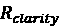 是基于不含模糊短语的标量奖励。
*    惩罚过长或冗余的响应（值越低表示长度过度）。
*    奖励存在详细、相关的推理和解释。
*   权重 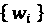 根据人类偏好研究进行调整，以平衡这些方面。

对于 `Prove that the sum of two even numbers is even` 提示，`DeepSeek` 的奖励函数结合了多个组件，并进行了加权以平衡逻辑正确性、清晰度和一致性。

##### 4.4 基于规则的检查启发式方法

执行以下操作：

*   验证所有关键数学术语（例如 `even`, `sum`, `2a`, `2b`）是否出现在证明中。
*   结构检查以确保证明遵循预期的逻辑格式：定义、代入和结论。
*   格式规则，例如正确使用符号和步骤论证分隔。

##### 4.5 奖励组件的权重选择

奖励组件包括以下内容：

*   逻辑正确性（基于规则的检查）因其关键作用而被赋予高权重，约为 `0.5`。
*   清晰度和语言一致性（基于语言模型的信号）权重为 `0.3`，以奖励流畅、易于理解的解释。
*   内部连贯性和对推理格式的遵循权重为 `0.2`，以鼓励步骤式结构。

##### 4.6 人类偏好数据收集

人类标注者收到了为该提示生成的多个候选证明，并被要求根据正确性、清晰度和完整性对它们进行排名。这些排名用于训练奖励预测器，以估计人类偏好，从而指导模型优先考虑推理质量而非表面属性。这种数据驱动的监督有助于校准奖励权重并塑造启发式规则，使自动评分与人类判断保持一致。

所有这些方法共同确保了 `DeepSeek` 产生了数学上严谨、清晰且结构良好的证明，例如证明两个偶数之和是偶数的示例。

#### 5. 蒸馏与分发

在最终确定主要的 `R1` 模型后，`DeepSeek` 进行了蒸馏实验，以将其先进的推理能力转移到更小、更高效的模型中。

##### 5.1 蒸馏

**蒸馏** 很重要，因为它使紧凑的模型能够通过在来自更大模型的高质量输出上进行训练来学习复杂行为，从而提高了可访问性和部署灵活性。在这个过程中，`R1` 的详细 `CoT` 输出的分布作为训练数据分布，引导像 `DeepSeek-R1-Distill-Qwen` 和 `DeepSeek-R1-Distill-Llama` 这样的小模型在没有 RL 的情况下也能泛化出复杂的推理能力。


### DeepSeek 的高级能力

在演示推理能力可以通过知识蒸馏有效转移方面，其意义重大。`DeepSeek-R1`生成的`思维链轨迹`可作为高质量的`教师`数据，用于训练更小、更高效的学生模型，而不是通过代价高昂的强化学习循环重新训练大模型。

在蒸馏过程中，使用了组合损失函数来平衡学生对教师软输出分布的模仿与对真实标签的遵循。具体来说，损失函数  的公式如下：

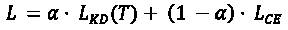

我们来分解一下：

*   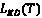 是 `知识蒸馏损失`，计算为教师模型和学生模型软化概率分布之间的 KL 散度。

*   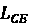 是基于真实标签的标准 `交叉熵损失`。

*    是一个权重超参数，用于控制蒸馏和监督学习之间的平衡。

*   在计算 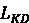 之前，对教师的逻辑值应用 `温度` `T` 进行软化，通常设置为 `T=2` 或 `T=4`，以提供更丰富的梯度信号。

`DeepSeek 的蒸馏过程` 通过调整超参数（如 （通常设置为 `0.7`）和温度 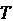（通常 `T=3`））来优化学习信号，从而平衡了知识转移和监督学习。这些设置在显著减小模型大小和推理延迟的同时，仍能紧密匹配教师模型的推理准确率。关于蒸馏损失和超参数选择的更多细节，您可以参考 DeepSeek 的研究论文：[`arxiv.org/abs/2501.12948`](https://arxiv.org/abs/2501.12948)。

这种蒸馏策略通过利用思维链教学材料作为丰富的监督信号，有效地将 R1 的大规模推理能力压缩到了更轻量的模型中。它证明了大规模推理不一定局限于庞大的架构或重复的强化学习训练，从而能够实现强大、可解释的推理助手的规模化部署。

#### 自我教学中的涌现模式

这个流程中最引人入胜的方面之一是其自我强化的结构。R1-Zero 创建了一个迭代循环：


`图 2.7`：DeepSeek 的自我教学迭代循环

此迭代循环持续固定轮数（通常为 3-5 次迭代），直到性能提升趋于平稳且进一步改进变得微乎其微（请参考 `图 2.7` 以快速回顾）。

这种受控循环使模型能够逐步引导出更强的推理能力，而无需无限运行，从而在训练效率与质量提升之间取得平衡。在每个阶段，模型不仅从外部反馈中学习，还从其自身的历史最佳成果中学习。

哎呀呀！谁说构建一个大语言模型那么容易！

接下来，我们看看 DeepSeek 的工程如何在不牺牲智能的前提下，推动了效率的边界。

#### DeepSeek 的视觉能力

DeepSeek 的架构（最初为语言任务设计）已发展到支持多模态能力，特别是通过 `DeepSeek-VL` 等模型。这些模型集成了文本和视觉输入，使系统能够联合理解并推理图像与语言。虽然 DeepSeek 目前在支持文本和视觉的意义上是多模态的，但公开发布的版本尚未正式支持音频或视频等其他模态。

##### 视觉-语言集成的架构变更

为实现图像理解，`DeepSeek-VL` 扩展了其语言基础，加入了一个视觉编码器，通常是经过修改的 `视觉 Transformer` (`ViT`) 或 `卷积神经网络` (`CNN`)。

该系统由三个主要组件构成：一个 `混合视觉编码器`、一个 `视觉-语言适配器` 和一个 `语言模型`。

下图展示了视觉-语言适配器的工作原理：

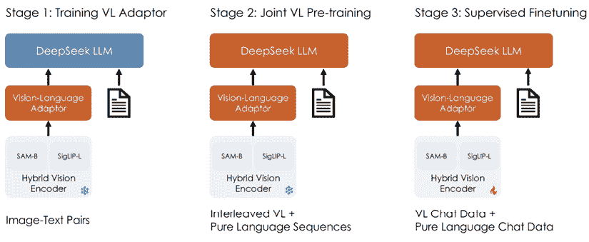

`图 2.8`：DeepSeek 的视觉适配器（来源：[`arxiv.org/html/2403.05525v2`](https://arxiv.org/html/2403.05525v2)）

DeepSeek 使用一个两层的 `混合 MLP` 来有效连接视觉编码器和大语言模型。最初，使用单独的单层 MLP 分别处理高分辨率和低分辨率的视觉特征。然后将这些处理过的特征拼接起来，并通过一个额外的 MLP 层，将其映射到大语言模型的输入空间。具体来说，`DeepSeek-VL-1B` 模型建立在 `DeepSeek-LLM-1B` 之上，后者在大约 5000 亿个文本标记上进行了训练。类似地，`DeepSeek-VL-7B` 模型基于 `DeepSeek-LLM-7B`，在大约 2 万亿个文本标记上进行了训练。

当用户在输入中包含图像时，模型首先使用视觉编码器（通常是 CNN 或 ViT）对其进行处理，将图像转换为固定大小的图像块嵌入，每个嵌入在共享的潜空间中表示为一个向量（通常为 768 或 1024 维）。这些图像块级别的嵌入捕获局部视觉特征，然后与相同维度的标记化文本嵌入一起被送入跨模态注意力层。

模型通过将图像划分为均匀的图像块（例如，16x16 像素）来识别相关图像区域，这些图像块作为注意力单元。通过每个 Transformer 块内的跨模态注意力，文本标记（通过标准分词器处理）学会有选择地关注这些视觉图像块。例如，当处理单词 `图表` 时，模型会关注包含图表视觉元素的特定图像块，从而有效地将语言上下文与空间特征对齐。

这种多模态融合使模型能够构建一个联合表示，融合了文本的语义内容和图像的空间层次结构，从而实现跨模态的连贯推理和生成。这个解释平衡了技术细节和清晰度，使其对我们的目标受众易于理解，同时强调了基于图像块的注意力如何驱动视觉定位。

假设用户输入以下内容，并附带图像：

```
参考附带的图表，解释与 Q1 和 Q3 相比，Q2 的增长模式是否正常。
```

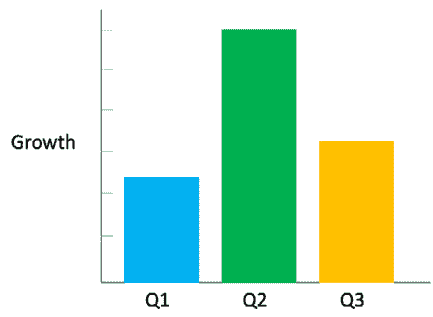

`图 2.9`：DeepSeek 的一个图像输入示例

以下是 `DeepSeek-VL-7B` 的处理过程：

1.  `视觉编码`：提示中的图像（例如，图表）被划分为图像块，并通过视觉编码器。此步骤捕获条形高度、轴标签和整体布局等细节。

2.  `文本编码`：问题被标记化并送入语言主干网络，创建用户意图的表示（例如，`Q2 的增长模式`）。

3.  `跨模态对齐`：模型使用注意力机制将问题中的单词或短语与最相关的视觉区域联系起来。例如，`Q2` 激活对标有 *Q2* 的图表部分的注意力，而 `增长` 则链接到对应条形的高度。

4.  `响应生成`：通过组合这些对齐的表示，模型生成一个答案，例如 `Q2 的增长明显高于 Q1 和 Q3，表明可能存在一次性事件或季节性峰值。`

能够同时对文本和图像进行推理的能力，使得 DeepSeek-VL-7B 能够解决任何单一模态都无法单独处理的问题，例如解读附带问题的图表或阅读并修正手写方程。在教育领域，这支持能够解读扫描笔记的智能辅导系统；在企业环境中，它使系统能够从发票、表格或原理图中提取结构和意义。

DeepSeek 将其对 `MoE` 和 `MLA` 的使用扩展到了多模态领域。这意味着即使处理视觉数据，系统也只会激活其参数的一个子集，从而确保高效的计算。得益于这种动态专业化方法，视觉推理并不会显著增加推理成本。

#### 代理推理与工具集成

尽管本章主要讨论推理机制，但必须承认 DeepSeek 也包含了支持更广泛代理能力的基础组件。这些能力包括与外部工具交互、执行多步骤任务规划以及基于反馈动态调整其行动的能力。其中一些特性在 *第 6 章* 中有详细阐述。

DeepSeek 模型，特别是 DeepSeek-R1，通过利用 `CoT` 技术将复杂问题分解为明确、可验证的推理链，在 AI 代理中充当强大的推理引擎。这种结构化推理为 DeepSeek 在多步骤问题求解、逻辑推理和上下文决策方面的能力奠定了基础。

在应用工作流中，DeepSeek 可以通过以下方式充当自主代理：

*   根据中间输出和环境反馈执行顺序操作。
*   动态整合外部工具和数据源以增强其决策过程。
*   通过上下文感知规划处理依赖关系和错误恢复。
*   为复杂任务执行协调多代理工作流。

这些代理推理能力使 DeepSeek 适用于需要自适应、目标导向行为的现实世界应用，超越了静态问答的范畴。

现在，我们将重点关注 DeepSeek 与其他大型语言模型（LLM）的比较及其一些不足之处。

### DeepSeek 在全球大语言模型版图中的定位

全球大语言模型版图正因新模型和新技术的涌现而蓬勃发展，各方正激烈竞争，以期率先实现推理能力，并最终达成 `通用人工智能`（`AGI`）。大语言模型构成了通往 `AGI` 的必要第一步。

让我们看看不同的大语言模型之间如何比较（截至 2025 年中）：

| 参数 | DeepSeek (V3, R1, CoderV2/V3) | OpenAI GPT-4o | Anthropic Claude 4 Sonnet | Google Gemini 2.5 Pro |
| --- | --- | --- | --- | --- |
| 采用技术 | 稀疏 `MoE`、`FP8` 低精度、`RL` `CoT`、单次训练 | 致密 Transformer、推测解码、视觉增强层 | 致密 Transformer、先进 `RLHF`、长上下文、改进的多模态能力 | 致密 Transformer、多模态融合、先进 `RLHF`、长上下文、视频能力 |
| 架构 | 总参数 670B：每次推理激活 37B，每层从 256 个专家中激活 2 个，`MLA`，`MoE` 路由 | 约 175B 参数（据传计划约 1T），致密，多模态视觉层 | 约 400–600B 致密参数，每次输入全部激活 | 约 600–800B 致密参数，每次输入致密激活 |
| 任务与能力 | 最先进的结构化推理、数学、符号逻辑、代码生成、检索增强 `Q&A`、可解释的 `CoT` 输出、可扩展上下文 | 领先的 `Q&A`、多模态（视觉-语言）、摘要、数学、高级代码、高鲁棒性 | 优秀的通用 `Q&A`、高级摘要、强大的数学/编程、长上下文推理、稳健的视觉-语言协同 | 尖端多模态、视频理解、长上下文、高级推理、生成式工作流 |
| 成本（训练） | 约 $5.6M（2,000 块 `H800` GPU），开源方案，通过 `FP8` 和 `MoE` 实现高效率 | 据传 $100–300M，致密，闭源 | 估计 $100M+，闭源，致密，高 GPU 需求 | 估计 $150M+ 量级，闭源，庞大的多模态训练成本 |
| 性能 | 在数学（`AIME`、`MATH`、`GPQA`）、代码（`pass@1`、`pass@5`）方面达到 SOTA 或更优，透明的逐步推理 | 在视觉、通用 AI、多模态任务、代码/数学方面达到 SOTA 且具竞争力 | 在长文本方面 SOTA，在数学、代码和视觉转文本、鲁棒推理和摘要方面表现强劲 | 在多模态视频生成、长上下文推理方面表现领先 |
| 激活参数 | 每次推理激活 37B 参数（`MoE`），总参数 670B | 每步激活 100% 模型参数 | 每步激活 100% 模型参数 | 每步激活 100% 模型参数 |
| 评估指标 | `pass@1`/`pass@5`（`HumanEval++`、`Codeforces`、`LeetCode`），`MATH`/`GPQA`/`AIME` 准确率，可解释性，检索基准测试 | 类似标准基准测试，详细分数未公开 | 基准测试指标（`MATH`、`GPQA`、代码），公开信息有限 | 闭源基准测试结果，显示出尖端的多模态能力 |
| 推理时间/延迟 | 在相似规模下比致密模型快约 5 倍；在优化硬件上，典型 32–64k 词元上下文的延迟约为每词元 100–150ms | 中等到高延迟，根据输入长度和硬件不同，约为每词元 500–700ms；针对批量推理进行了优化 | 略高于 GPT-4o，约为每词元 700–900ms，源于复杂的致密激活和长上下文处理 | 与 Anthropic 相当或略高，因多模态和视频处理产生额外开销 |
| 推理可追溯性 | 明确的 “思考/回答” 格式，公开的 `CoT` 工具/数据，可解释的中间推理步骤 | 透明度有限；主要是黑盒内部逻辑 | 有一定可解释性侧重，中间表征的暴露少于 DeepSeek | 有一定可解释性，但侧重于多模态融合和某些黑盒组件 |
| 透明度与开放性 | 100% 开源（权重、数据、方案、`RL` 协议） | 闭源，释放的模型细节极少 | 闭源，技术披露稀疏 | 闭源，通过商业 API 和合作伙伴关系发布 |

表 2.1：DeepSeek 与领先大语言模型的比较表（2025 年中）

DeepSeek 通过稀疏路由、可解释的推理输出和完全开源的透明度，实现了强大的性价比，在数学、代码和 `CoT` 任务方面表现出色。GPT-4o 在多模态和视觉能力方面脱颖而出，但伴随着高昂的计算成本和有限的透明度。Claude 4 Sonnet 提供了一个具有竞争力的闭源替代方案，与之前的 Claude 模型相比，在效率和长上下文处理方面有所改进，在长文本、数学和代码任务上表现良好，尽管它仍然不够开放，并且受限于致密推理的瓶颈。

#### DeepSeek 的局限性及其与其他模型的比较

尽管 DeepSeek 在推理、开放性和架构创新方面取得了突破，但它绝非没有局限性。像所有语言模型一样，它也在规模与可解释性、延迟与能力、开放性与性能之间进行权衡。

本节旨在客观评估 DeepSeek 当前的局限性，这些局限性与同行（如 GPT-4o、Claude 3.5/4、Gemini 1.5 和 Mistral）相比处于何种水平，以及未来的迭代版本可能如何应对这些挑战。

#### 扩展挑战与稀疏专业知识的局限

DeepSeek-V3 的 670B 参数——尽管通过 `MoE` 高效实现——仍然使模型的训练和部署成为一项艰巨的任务。即使采用稀疏激活（每次推理激活 37B 参数），大规模部署 DeepSeek 也需要高吞吐量的 GPU 和带宽优化的环境。这意味着，对于许多较小的机构来说，尽管发布了蒸馏版本，但完整使用该模型仍然是一个难以企及的目标。

此外，MoE（混合专家模型）引入了一系列特有的技术约束。专家间的路由不稳定性、token 丢弃问题以及专家利用率不足等，仍是当前研究的热点领域。DeepSeek 通过使用共享专家与 FFN 预路由机制，帮助缓解了其中部分问题，但在尾部 token 分布上的性能衰减仍然存在。相比之下，像 Claude 4 或 GPT-4o 这样的密集模型，虽然计算量更大，但能维持更稳定的跨层 token 流。

稀疏模型还面临跨不相关输入的表征共享有限的局限，这意味着在某些零样本场景下的泛化能力可能落后于密集模型。这种效率与通用性之间的权衡并非 DeepSeek 所独有，但在 DeepSeek 前所未有的规模下，其表现尤为突出。

#### 推理延迟与实时交互的权衡

虽然 MoE 和 FP8 训练有助于提升每个 token 的推理速度，但 DeepSeek 在实时场景中仍面临延迟挑战，尤其是与搜索模块或多文档重排序器结合使用时。思维链推理虽然提高了输出质量，但通常会导致响应更长，从而增加了感知延迟。

Claude 4 和 GPT-4o 凭借其高度优化的解码与缓存策略，在实时生成基准测试中常常优于 DeepSeek。GPT-4o 尤其受益于紧密的模型-服务器集成以及激进的投机解码，使其响应时间可与 GPT-3.5 相当，同时具备 GPT-4 级别的推理能力。

DeepSeek 的`多 token 预测`（`MTP`）与 KV 压缩（通过 MLA 实现）在一定程度上缓解了此问题，但面向用户的应用，如聊天代理或嵌入式设备，若要求毫秒级响应，可能会发现目前 Claude 或 GPT 系列的优化更佳。

#### 可解释性与对齐风险

具有讽刺意味的是，尽管 DeepSeek 通过`思考/回答`格式开创了结构化推理，但这一优势也可能成为瓶颈。强制要求思维链输出意味着模型可能产生看似结构合理但存在细微缺陷的推理依据，从而导致错误的自信。由于模型被训练生成连贯的逻辑，即使答案错误，也可能以令人信服的语言包装呈现，从而引发对齐与安全风险。

此问题并非 DeepSeek 独有。GPT-4 和 Claude 4 在多步推理中的幻觉问题也面临类似关切。然而，这些模型通常包含对抗偏好建模与多信号安全协议——这些技术对 DeepSeek 而言仍在开发中。DeepSeek 缺乏基于`偏好排序模型`（`PRM`）的训练步骤，意味着其对齐依赖于更简单的奖励启发式方法，可能在处理伦理或边缘场景时遗漏细微差别。

#### 上下文长度与压缩上限

尽管 DeepSeek 使用 MLA 来减少上下文占用，但在超长上下文任务中仍落后于 Claude 4 和 Gemini 1.5。Claude 的 200k 上下文窗口和 Gemini 的稀疏注意力技巧使其更擅长吸收整本书籍、法律文件或多轮对话。DeepSeek 在实用性能上更现实地限制在 64k token。

此外，虽然 MLA 压缩有所帮助，但它在检索保真度上需要权衡，尤其在多文档问答或混合检索/排序设置中。相比之下，Claude 的上下文优先处理和 GPT-4o 的选择性注意力在大规模应用中提供了更智能的上下文利用方式。

#### 数据集与文化覆盖范围的差距

尽管 DeepSeek 注重多语言能力，但在某些文化数据集和特定领域语料库上的训练仍相对不足。GPT-4 和 Claude 4 受益于广泛的语料摄入与细粒度的领域调优，在金融、法律及特定科学领域展现出更优的细微理解力。DeepSeek 由于采用成本感知的预训练，采取了更通才的路线，有时牺牲了特定领域的深度。

然而，这恰恰也是 DeepSeek 开放基础设施的亮点所在：其模块化的检索器、重排序器和解码器设置，允许研究者针对缺失的知识领域进行微调，这种灵活性是专有模型所不具备的。

#### 局限性展望

DeepSeek 的局限性是真实存在的，但并非不可逾越。随着其周边社区的成长，许多挑战——尤其是那些涉及路由、实时解码、安全调优和上下文优化的问题——很可能通过研究贡献得到解决。与专有模型不同，DeepSeek 透明的生态系统允许共享学习和迭代修正。

在许多方面，暴露局限性的行为本身就成为了邀请他人去改进、适应和挑战模型本身的契机。这就是开放科学的承诺——不在于完美，而在于参与。

## 本章总结

在本章中，我们深入探讨了 DeepSeek 背后的核心研究与技术演进，追溯其发展轨迹。我们审视了 DeepSeek 的发展如何分裂为两条强大的脉络：基础模型的构建与推理能力的提升。DeepSeek 的每个迭代版本都增加了一层新的创新，从扩展密集架构到开创高效的 MoE 模型，并最终通过基于规则的强化学习完善多步推理。

我们探讨了采用 MoE 技术如何以更低的计算成本带来显著的性能提升，以及 MLA、MTP 和 GRPO 等创新如何应对训练稳定性、推理效率和推理可靠性方面的关键挑战。本章还重点介绍了 DeepSeek 在代码智能、数学和形式逻辑等领域的专门努力，展示了其跨领域的通用应用能力。

DeepSeek-R1 的发布标志着这些发展的集大成，证明了一个强大、高效且具备推理能力的 LLM 可以通过整合稀疏架构与最小化的、基于规则的强化学习而诞生。你现在应该已经清楚理解了 DeepSeek 如何通过迭代创新而演进，以及驱动其性能的技术突破。

在下一章，我们将讨论为 DeepSeek 设计提示的各种技巧。

| |
| --- |
| **获取本书的 PDF 版本和独家补充资料**<br>扫描二维码（或访问 [packtpub.com/unlock](https://packtpub.com/unlock)）。搜索本书书名，确认版本，然后按照页面上的步骤操作。 |  |
| *注意：请保留好您的发票。直接从 Packt 购买无需发票。* |

