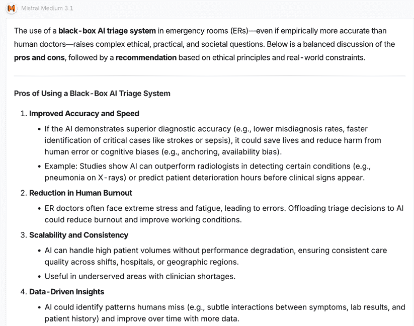

# 3 提示 DeepSeek

如果你曾经从编写命令式代码、手动告诉`文档对象模型`（`DOM`）如何一步步更新网页，转向使用 React 这样的声明式框架，你就知道需要进行的思维转变。你不再给出详尽的指令，而是开始描述期望的结果，信任系统去弄清如何实现。同样的原理也适用于从 Mistral 7B 或 Llama 3.3 8B 等传统 LLM 转向 DeepSeek 推理引擎。你为引导模型思考过程而培养的肌肉记忆，在一个被设计为自主推理的引擎上，可能反而会对你不利。

本章的核心就是驾驭这些差异，从引人注目的怪癖（如 R1 对系统提示的抵触）到那些能决定成败的细微行为转变。无论你是迁移现有的提示库还是从零开始使用 DeepSeek，都请将本章视为你的实地指南，带你理解语言模型中一个根本不同的范式。


重要的是要记住，我们仍处于理解这些强大新模型的早期阶段。目前，DeepSeek 模型问世已近一年。本章中的指导内容是基于当前可获得的最佳信息综合而成：DeepSeek 团队的官方文档、行业先驱的使用报告，以及第一批探索这些系统的学术论文。可以将其视为一份动态文档：是我们当前集体理解的一个快照。最佳实践无疑会随着社区认知的深入而演变，但以下内容是我们迄今为止对这片领域的最佳描绘。

本章大部分内容聚焦于 R1 系列：DeepSeek 的推理优先模型，它们颠覆了传统的提示工程理念。这些模型不仅处理方式不同；它们的训练方式也不同，采用了强化学习技术，创造出了一个具有自身内部**思维链（`CoT`）**流程的模型。这就像给人类驾驶员提供逐步导航指令，与直接告诉自动驾驶汽车目的地之间的区别。R1 模型已经知道如何导航整个推理过程。

其影响遍及提示设计的各个方面：
少样本示例？它们实际上会让你的结果变差（如 DeepSeek 原始论文（[`arxiv.org/html/2501.12948v1`](https://arxiv.org/html/2501.12948v1)）中所述，准确度下降了 15%）。
分步思考指令？冗余。R1 内部已经在做。
丰富的系统提示？模型可能会完全忽略它们。
复杂、冗长的指令？不如清晰、最小化的指令有效。

与此同时，V 系列模型的行为更像你习惯的 LLM，但即使它们也有其特殊之处。例如，温度参数映射与 OpenAI 的默认值不同，并且存在对超出典型 markdown 的结构化格式的偏好。

本章将逐步剖析 DeepSeek 提示范式。我们将探讨解释这些差异存在的核心思维模型（提示：一切都关乎强化学习），提供基于官方文档和社区测试的具体注意事项和禁忌，并为你提供适用于 R 系列和 V 系列模型的模板和故障排除策略。

最终，你不仅将理解要做什么不同的事情，还将理解为什么 DeepSeek 独特的训练方法要求我们从第一性原理重新思考提示工程。可以将其视为学习一种新的编程范式。一旦你掌握了其底层哲学，具体的技术自然会水到渠成。

在本章中，我们将涵盖以下主要主题：
*   DeepSeek 的核心思维模型与原则
*   提示 DeepSeek 的通用技巧与建议
*   处理结构化输出
*   V 系列的独特提示技术
*   故障排除
*   提示迁移指南

### 技术要求

学习本章你需要：
*   克隆项目仓库并安装依赖：
```
git clone https://github.com/PacktPublishing/DeepSeek-in-Practice.git
cd Chapter03
pip install -r requirements.txt
```
该`requirements.txt`文件包含用于发送提示和获取结构化输出的 OpenAI 和 Instructor，以及`Pydantic`，用于帮助创建我们可以传递给模型的结构。
*   API 密钥和环境变量：你需要访问 OpenRouter 模型（如 DeepSeek 以及任何你想要的其他模型）的 API 密钥。
*   OpenRouter 提供对 DeepSeek 模型的访问，用于在评估期间生成基线比较。请在 [openrouter.ai](https://openrouter.ai) 注册，并从仪表板获取你的 API 密钥。我们将使用免费模型访问基础版`DeepSeek-R1`模型，但你需要一个 API 密钥来访问它（通过`litellm`）。如果你没有 OpenRouter API 密钥，可以在 [`openrouter.ai/docs/api-reference/api-keys/get-api-key`](https://openrouter.ai/docs/api-reference/api-keys/get-api-key) 创建一个。

### DeepSeek 的核心思维模型与原则

在深入技术细节之前，让我们先重新校准你对`DeepSeek`模型，特别是 R 系列模型，到底是什么的心智模型。忘记你知道的所有关于如何用精心设计的系统提示来引导 ChatGPT 给出正确回答的知识。

为`DeepSeek-R1`系列构建提示时，有三件事需要谨慎：

*   **`DeepSeek`模型更像是定理证明器，而非聊天机器人**：少把 R1 视为对话伙伴，多把它视为一个碰巧会说英语的数学证明助手。当你向 R1 提交提示时，你不是在开始对话。你是在向一个推理引擎提交正式的问题描述。
这不仅仅是说辞。R1 模型通过强化学习训练，以在可验证任务（如数学/编码）上获得正确答案为优先，并且在回复前会进行大量的内部思考。具体来说，模型首先生成一个隐藏的推理草稿（``块），然后才输出最终答案（关于隐藏的*思考*令牌的复习，请参见*第 2 章*）。
在实践中这意味着：
    *   你的提示是一个问题陈述，而不是对话的开场白。
    *   期望模型在内部规划/打草稿，然后产生一个解决方案。（这里所说的*内部规划*，仅指模型的隐藏`CoT`/草稿；没有单独的编译阶段。）
    *   你通常会得到一个解决方案——而不是一个健谈的来回交流。

*   **像研究请求一样构建你的提示**：想象你正在委托一位才华横溢但非常直白的研究生撰写一篇研究论文。你不会给他们一封包含其他论文示例的冗长邮件。你会提供一个清晰的问题陈述、约束条件和预期的输出格式。好的`DeepSeek`提示结构类似于学术问题描述。换句话说，如果你按照这种顺序和格式创建提示，DeepSeek 通常会给你更好的结果。不过，这不是官方指导中明确规定的：
```
Context: [哪些背景信息是必不可少的？]
Task: [需要解决什么具体问题？]
Constraints: [存在哪些限制或要求？]
Output: [解决方案应采用什么格式？]
```
这无关形式主义或刻板——而是关乎清晰度。当模型能够无歧义地解析你的意图时，它表现最佳。
例如，如果我想了解为急诊室部署新的分诊模型的哲学含义，我可能会在像`Mistral Medium 3.1`这样的*传统*LLM 中使用这样的提示：
```
如果比医生更准确，医院在急诊室使用黑箱 AI 分诊系统在伦理上是否可接受？请讨论利弊，并给出你的建议。
```
你可以看到，我们从`Mistral`模型（`Medium 3.1`）得到了类似这样的回复：

图 3.1：传统 LLM 的回复 – `Mistral Medium 3.1`

你可以在本书的 GitHub 仓库中查看`eg1.py`以获取完整回复（[`github.com/PacktPublishing/DeepSeek-in-Practice/blob/main/Chapter03/eg1.py`](https://github.com/PacktPublishing/DeepSeek-in-Practice/blob/main/Chapter03/eg1.py)）。但遵循前述规范的结构化提示可能如下所示（参见`eg2.py` [`github.com/PacktPublishing/DeepSeek-in-Practice/blob/main/Chapter03/eg2.py`](https://github.com/PacktPublishing/DeepSeek-in-Practice/blob/main/Chapter03/eg2.py)）：


#### 背景：
你正在分析一个临床分诊中的伦理政策选择。该模型在回顾性数据上的准确性高于临床医生，但其内部逻辑不可解释。

#### 任务：
评估医院是否应部署该模型，以及在何种条件下部署。

#### 约束：
- 明确在以下视角下评估：(1) 功利主义，(2) 道义论（康德义务），(3) 美德伦理，(4) 关怀伦理。
- 对于每个视角：给出裁决 {允许|禁止|有条件} 并附上 1-2 句理由。
- 需涉及：公平性、问责制、透明度、危害缓解、知情同意/同意、监督。
- 包含一个可能推翻你结论的有力反驳论点，以及你将如何检验它。
- 不要揭示思维链；只提供最终标注的推理。
- 每个字段不超过 60 个词。

#### 输出：
仅返回以下形状的 JSON：
```json
{
  "per_lens": {
    "utilitarianism": {"verdict": "permit|forbid|conditional", "rationale": "..."},
    "deontology": {"verdict": "...", "rationale": "..."},
    "virtue_ethics": {"verdict": "...", "rationale": "..."},
    "care_ethics": {"verdict": "...", "rationale": "..."}
  },
  "deployment_recommendation": {"verdict": "permit|forbid|conditional", "conditions": ["...","..."]},
  "oversight_plan": ["metric_audits","bias_monitoring","appeals_process","A/B_safety_guardrails"],
  "counterargument": {"claim": "...", "test": "..."},
  "residual_risks": ["...","..."],
  "confidence": 0.0
}
```

此提示导致了 DeepSeek-R1 产生一个很长的`思考`输出，随后给出了以下 JSON 响应（正如所要求的）：
```json
{
  "per_lens": {
    "utilitarianism": {"verdict": "permit", "rationale": "更高的准确性能最大化整体患者预后和福祉，实现了为最多数人谋最大利益的功利主义目标。"},
    "deontology": {"verdict": "forbid", "rationale": "不透明的逻辑将患者仅仅视为达到目的的手段，通过做出无法解释的、非自主的决定，违背了尊重人的义务。"},
    "virtue_ethics": {"verdict": "conditional", "rationale": "仅在模型支持而非取代临床医生的审慎和同情心时允许。部署必须促进信任与协作，而非削弱专业美德。"},
    "care_ethics": {"verdict": "conditional", "rationale": "仅作为支持性工具时允许。该模型缺乏共情与情境理解；最终决定必须由人类照护者作出，以维持关系性照护。"}
  },
  "deployment_recommendation": {"verdict": "conditional", "conditions": ["仅作为临床医生的决策支持工具，而非自主分诊", "对受保护群体实施强大、持续的偏差审计", "获取患者的知情同意/同意，并披露 AI 参与情况"]},
  "oversight_plan": ["指标审计", "偏差监控", "申诉流程", "A/B 安全防护"],
  "counterargument": {"claim": "模型优越的回顾性准确性可能因隐藏的混杂变量或数据漂移而无法转化为现实世界的性能，从而导致净损害。", "test": "进行严格的前瞻性 A/B 试验，比较模型辅助护理与标准护理，由独立的 DSMB 监控显著的结果差异和安全性。"},
  "residual_risks": ["自动化偏差导致临床医生过度依赖模型", "因数据漂移导致模型性能随时间下降"],
  "confidence": 0.8
}
```

* 极简主义心态（或我如何学会停止担忧并信任模型）：这是经验丰富的提示工程师常感到挣扎的地方。对于 DeepSeek，少即是多。你精心收集的那些少样本示例？它们不仅是不必要的，而且是有害的。你通常提供的那种详细的逐步拆解？你正在对一个已经知道如何思考的系统进行微观管理。这就像通过解释每一个微小动作来教人开车，与仅仅告诉他们目的地之间的区别。DeepSeek 模型，尤其是 R1，已经掌握了`如何思考`的部分。它们只需要知道思考什么。

以下是一些使用 DeepSeek 极简提示词的入门指南：
- 清晰地陈述问题，然后放手。
- 抵制过度解释或提供示例的冲动。
- 接受模型的内部推理可能比你的外部指导更好。

这种极简方法起初可能令人不适，特别是如果你习惯了与其他模型配合良好的`提示工程如同创意写作`的方式。但一旦你接受它，你会发现 DeepSeek 的响应往往更全面、更准确，恰恰因为你没有限制其推理过程。

实际上，从上述建议推导出的极简提示词模板可能看起来像这样：
```
任务：[要决定/计算什么；1-2 句话]
约束：[编号的规则或视角；只保留要点]
输出：[紧凑的模式或要点模板；仅短字段；无思维链]
```

参见仓库中的`eg3.py`（[`github.com/PacktPublishing/DeepSeek-in-Practice/blob/main/Chapter03/eg3.py`](https://github.com/PacktPublishing/DeepSeek-in-Practice/blob/main/Chapter03/eg3.py)），了解这一原则付诸实践的例子。`eg3.py`使用通过 OpenRouter 兼容 OpenAI 接口的 DeepSeek，针对相同的伦理分诊任务，运行三种提示风格（零样本极简、带示例的少样本、详尽逐步）的受控比较。它为每种风格构建消息请求，请求仅包含紧密`模式`的 JSON 答案，并通过检查必需的键、允许的裁决、字数限制和类型（对大小写有少许容忍度）来验证响应。每次运行会计时，在可用时捕获 token 使用量，并打印输出以及 PASS/FAIL 验证反馈。这个例子凸显了极简提示词如何通常更合规且成本更低。

`模式`：这里，`模式`指的是对模型预期输出的明确规范——答案的形状和约束。一个模式定义字段名、数据类型、允许的值/枚举、必需与可选字段、嵌套以及限制（例如，字数或范围约束）。我们在提示中或通过 API 功能（JSON 模式、函数/工具参数、Pydantic）来表达它，这样模型就知道要返回什么，我们也可以可靠地验证它。简而言之：提示描述任务；模式是响应必须满足的输出契约（例如，`{"verdict": "approve|deny|escalate", "rationale": "string, <=50 words"}`）。

现在你对能与 DeepSeek 良好配合的提示类型有了大致了解，让我们探究一下它们为何有效。

#### 为什么结构化的极简提示词能与 R 系列“契合”（内在机制解析）

如果`研究简报`**→** `JSON（或单次生成）`的答案风格与 R1 配合效果出奇地好，那是因为它与模型受训以赢得的优化方式一致。R1 并未被优化以产生雄辩的对话；它被优化为在隐藏推理之后产生可验证的、格式合规的答案。

回想第 2 章，在后训练期间，DeepSeek 使用了强化学习，其中每个候选响应都由基于规则的检查器评分：数学答案在指定的最终答案槽位中检查正确值；代码经过编译和测试；并且一个格式奖励强制分离了内部推理区域和最终答案区域（最初在训练模板中用` … </think>`和`<answer> … </answer>`表示）。给模型一个紧凑的输出契约，它就会识别出它受训参与的游戏。这就是为什么一个清晰的问题陈述加上严格的模式，通常能胜过华丽的角色扮演或示例堆砌。


R1 使用 `Group Relative Policy Optimization`（`GRPO`）进行训练：对于每个提示，策略会生成 K 个响应样本（通常为 4-8 个），基于确定性规则的评分器为每个样本计算一个标量奖励（通常是正确性得分，外加少量格式检查），奖励按组内平均值居中，策略随即更新，使高于平均水平的样本获得更高的概率权重，而低于平均水平的样本则被削弱。在 R1-Zero 中，不存在学习到的奖励模型——仅有这些确定性评分器。

训练过程中，模型还会学习 **测试时缩放**：对于更难的问题，它在响应前会进行更长时间的内部 *思考*——因此你无需指示它 *逐步思考*。你的任务是定义目标和格式；模型会在内部自行规划。

**测试时缩放**：R1 在推理时会自适应地为困难输入分配更多内部推理资源，而为简单输入分配较少资源。这种涌现行为使得模型能够通过对困难问题进行更长时间的 *思考* 来提高准确性，而无需任何特殊的 *逐步* 提示。

这一训练方案也解释了你之前观察到的两个实践中的特殊之处：

*   **少样本会损害效果**：在 R1 的评估中，添加示例反而会降低性能；作者建议使用零样本提示，并明确指定输出格式。示例会使内部规划器偏向于你提供的示例路径，而不是强化学习已经奖励的策略。

*   **系统提示**：早期的 R1 实践实际上会降低系统角色指令的权重，因此才有 *将所有内容放在用户消息中* 的建议。在 R1-0528 更新版中，现在支持系统提示——但最好保持其简洁（身份、日期、全局策略），而将任务特定的约束和模式放在用户内容中。

此时你心中可能浮现一个自然的问题：为什么传统的基于聊天的大型语言模型没有这些特殊之处？亲爱的读者，让我们为你解答。

#### 为什么其他大型语言模型表现不同？

大多数*聊天*大型语言模型（例如 V 系列、GPT-4o、Claude 3.x）主要通过监督微调和偏好/RLHF 进行调优，因此它们通常受益于少样本示例和思维链演示——这是经典的 GPT-3 和 CoT 研究成果。传统的大型语言模型并非广泛使用基于规则的验证器来评分每个提示的单个、经过规则检查的最终答案，因此模式有助于解析，但示例仍倾向于教给模型分布规律。而推理优先模型（如 R1、OpenAI o1）颠倒了目标：奖励经过内部审慎思考后可验证的正确性和格式，因此零样本和模式成为更安全的默认选择。

以下是与传统大型语言模型相比，DeepSeek 所具有的优势和权衡：

*   **优点**：在可验证任务（数学、代码、科学问答）上具有更高的上限；对示例的依赖更少；当你将输出固定到单个插槽或严格 JSON 时，可靠性更强（这正是强化学习循环所强化的）。

*   **缺点**：更多的内部 *思考* 意味着延迟/成本的权衡；过度提示（少样本 CoT、角色扮演）可能会降低结果质量；在没有检查器的开放式、风格敏感任务中，优势会缩小，而使用良好示例的经典聊天模型可能以更低成本达到或超越 R1 的效果。

因此，在为 DeepSeek 编写提示时，请记住这个思维模型：你不是在*训练一个聊天机器人*。你是在向规划器提供一个经过验证器评分的规格说明。规格越明确，输出契约越严格，你就越能让强化学习训练出的行为发挥作用。

准备好了解这个思维模型如何转化为具体技术了吗？让我们详细展开。

### 提示 DeepSeek 的通用技巧与建议

确立了基本原则之后，我们将制定一些提示指南，以帮助你使用 DeepSeek 获得准确可靠的结果。正如我们在前一节中讨论的，这些建议中有很多直接违背了针对其他领先模型的最佳实践。这种调整是 DeepSeek 独特架构和训练方法的必然结果。

首先，我们将讨论为什么通常流行的少样本提示，实际上可能对 DeepSeek 的响应有害。

#### 少样本陷阱

与传统提示工程最显著的偏离在于 DeepSeek 对少样本示例的处理。虽然这种技术是提升 OpenAI 的 GPT-4o 等模型性能的基石，但向 DeepSeek-R1 提供示例实际上会带来损害。官方文档在这一点上毫不含糊：*不要在提示中提供示例，因为这会持续降低模型性能。*

在对照实验中，当添加少样本示例时，准确率从 79.8% 下降到约 70%（[`www.linkedin.com/pulse/zero-shot-few-rag-benchmaking-deep-seek-sandeep-k-gil1c/`](https://www.linkedin.com/pulse/zero-shot-few-rag-benchmaking-deep-seek-sandeep-k-gil1c/)）。

这种性能下降的发生是因为提供示例干扰了模型的原生推理过程。R1 是使用强化学习训练以形成其自身内部问题解决方法的，这些方法表现为一个隐藏的思维链过程。当示例包含在提示中时，它们试图强制执行特定的推理路径，从而覆盖了模型更强大、内部优化的策略。

与其提供示例，不如提供以下内容：

*   清晰的任务描述。

*   明确的输出格式要求。

*   模式定义（用于结构化输出）。

你可能想查看 `eg3.py`（[`github.com/PacktPublishing/DeepSeek-in-Practice/blob/main/Chapter03/eg3.py`](https://github.com/PacktPublishing/DeepSeek-in-Practice/blob/main/Chapter03/eg3.py)）来查看一些零样本提示示例。

接下来，我们将讨论为什么系统提示在 DeepSeek 中不是一种流行的做法。

#### 系统提示

使用系统提示来设置助手的角色和全局约束是很常见的。然而，对于最初的 DeepSeek-R1 版本，系统提示在实践中大多被忽略；官方建议是避免使用它们，并将所有可操作的指令放在用户消息中。这反映了早期 R1 的训练和评估方式：聊天模板强调用户→助手的交互模式，模型首先进行内部*思考*然后回答，而不是特别关注单独的系统角色。

2025 年 5 月，R1-0528 更新版增加了对系统提示的支持。DeepSeek 自己的应用使用特意简化的系统消息（标识助手；包含当前日期）。即便如此，实践经验法则仍然适用：将系统消息用于高级别的全局约束（身份、策略、格式偏好），而将任务特定的指令放在用户消息中。你不再需要加入 `<|system|>` 标签；模型无需它也能进行推理。

对于 V 系列（V3/V3.1），系统提示确实有效，官方聊天模板包含系统槽位，但它们对于获得良好结果并非必不可少。与 DeepSeek 的示例保持一致，优先使用简短、声明性的系统文本，并将精力集中在使用户指令清晰具体上。简而言之：对于 DeepSeek，简单、明确的用户提示就能承担主要工作。

对于 DeepSeek，简单清晰的提示就能恰到好处地完成工作。接下来我们详细讨论这一点。

#### 冗长提示陷阱

如果你习惯于撰写读起来像维多利亚时代小说的提示，现在是时候展现你内心海明威的一面了。DeepSeek 的官方指导强调：*复杂、冗长的提示往往导致效果不佳。应注重清晰而非复杂。*

这并不是为了简洁而简洁。这是关于信噪比的问题。每一个额外的词都为模型误解你的意图提供了又一次机会。记住，R1 会生成可能成千上万的内部推理 token。它不需要你的帮助来过度思考。

以下是一个适用于 R1 的好提示示例：

```
Analyze the security vulnerabilities in this code snippet.
Focus on SQL injection and authentication bypass.
Code: [your code here]
```


一个错误提示的例子如下：

```
You are an expert security researcher with 20 years of experience.
I want you to carefully examine the following code, thinking about
all possible security issues. Consider things like SQL injection,
XSS, authentication problems, and any other vulnerabilities...
[several more paragraphs of instructions]
```

要查看此示例的说明，请查看[`eg4.py`](https://github.com/PacktPublishing/DeepSeek-in-Practice/blob/main/Chapter03/eg4.py)。该脚本通过两个提示对同一段有漏洞的 Flask 代码进行测试——一个是简洁的`good`提示，明确聚焦于 SQL 注入和认证绕过。

以下是`good`提示的响应：

```
Security Vulnerabilities Analysis
1\. SQL Injection
Vulnerability: The code uses direct string interpolation for SQL queries:
query = f"SELECT id, password_hash FROM users WHERE username = '{username}'"
Risk: Attackers can inject malicious SQL by manipulating the username input. For example:
' OR 1=1 -- would return the first user in the database, bypassing authentication.
'; DROP TABLE users; -- could delete tables.
Why It's Critical: Direct string interpolation allows arbitrary SQL execution, compromising data confidentiality, integrity, and availability.
2\. Authentication Bypass via Weak Hash Comparison
…
3\. Admin Privilege Escalation
…
4\. Insecure Password Hashing
…
7\. Database Connection Management
…
Exploit Scenarios
SQL Injection + Auth Bypass:
…
Fix Recommendations
Prevent SQL Injection:
query = "SELECT id, password_hash FROM users WHERE username = ?"
…
Fixed Code Snippet
…
```

另一方面，你会观察到，冗长的`bad`提示会导致主题漂移。

在此查看提示响应的片段：

```
Security Analysis of the Provided Flask Login Code
1\. SQL Injection (Critical – CVSS 9.8)
Issue
query = f"SELECT id, password_hash FROM users WHERE username = '{username}'"
…
Mitigation
Use parameterized queries:
query = "SELECT id, password_hash, is_admin FROM users WHERE username = ?"
cur.execute(query, (username,))
Reference: OWASP SQL Injection Prevention Cheat Sheet
2\. Weak Password Hashing (Critical – CVSS 9.8)
…
8\. Database Connection Management (Low – CVSS 3.7)
Issue: No connection pooling or error handling.
Mitigation: Use context managers (with sqlite3.connect()).
…
Broader Architectural Concerns
No rate limiting → susceptible to brute force.
Missing login attempt logging and monitoring.
Weak credential storage practices.
Database not isolated securely.
Dependencies not pinned → supply-chain risks.
Severity Summary
…
Corrected Code (Secure Example)
…
Additional Recommendations
References
…
```

如你所见，该响应本可以更加聚焦。

该脚本通过 OpenRouter 使用相同的 DeepSeek 模型（低温度设置），打印两种输出并计算简单的聚焦启发式指标（如对 SQLi/认证绕过的提及、XSS/CSRF 等离题内容的命中、一个`focus_score`、句子级别的信噪比以及词数）。

`eg4.py` 脚本还总结了哪个提示产出了更紧凑、更切题的答案：

```
Summary: focus_winner=Good shorter_output=Good | good_focus_score=17 bad_focus_score=9 | good_words=380 bad_words=872
```

现在让我们讨论可能影响 DeepSeek 响应生成的额外因素。

#### 其他影响 DeepSeek 对提示响应的因素

除了提示技术之外，还有其他因素可能影响 DeepSeek 如何处理和响应提示。我们来探讨一下。

*   **温度**：官方文档（[`api-docs.deepseek.com/`](https://api-docs.deepseek.com/)）认为温度（temperature）≈ 0.6 是 R1 的最佳值。温度过低，你可能会陷入重复循环（模型卡在局部最优解）。温度过高，精细的推理过程就会开始产生幻觉。

    对于 V3，还有一个额外特点：API 将 temperature=1.0 映射为有效的 0.3，因此对于事实性任务，你可能需要将其设置得更低。

    R1 的推荐设置是`temperature=0.6`，`top_p=0.95`。对于 V3，事实性任务使用`temperature=0.3-0.5`，创意工作最高可使用`0.7`。

*   **人物提示**：虽然复杂的角色扮演效果不佳，但微妙的人物暗示可以显著改善结果。社区测试表明，像`I'm new to finance`这样简单的受众级别暗示，能让 R1 在不损害准确性的情况下调整解释深度。

    这之所以有效，是因为你提供了关于**输出要求**的上下文，而不是试图改变模型的推理过程。这就像说`pretend you're a teacher`（角色扮演）与`explain this for a high school student`（输出规范）的区别。

    以下是一些有效人物提示的例子：

    ```
    I'm a software engineer familiar with Python.
    Writing for a general audience blog post.
    Technical documentation for API developers.
    ```

    编写人物提示的一个可靠方法是将其保持为一句话，指定受众、可交付物和深度——不涉及任何关于*扮演*什么角色的内容。将其表述为输出要求，而非角色：为谁而写，你想要什么，以及需要多深入。

    一个有用的模板是`For [audience], produce [format] that [purpose]; assume [background] and [depth constraints].`。

    例如，考虑这个提示：

    ```
    For a non-technical CFO, produce a 150-word briefing that informs a buy/no-buy decision; assume no ML background and define acronyms, or For API engineers, provide a runnable Python 3.12 snippet with a docstring; avoid external deps and keep the explanation under 5 lines.
    ```

    这个提示是目标明确的，指定了一个受众、一个输出和一个深度层次。如果结果仍然偏离目标，通过调整这三个要素（而非添加角色扮演）来进行迭代。

还有一些适用于 DeepSeek 提示的更多技术值得应用：

*   **结构化格式**：使用 XML 标签或 Markdown 标题来组织复杂提示。R1 对此解析效果极佳。以下是你可以如何使用 XML 标签来结构化提示的示例：

    ```
    <context>Background information here</context>
    <task>Specific problem to solve</task>
    <constraints>Any limitations or requirements</constraints>
    <output>Expected format</output>
    ```

    你可能还记得*第 1 章*中提到，R1 展现出格式感知的生成能力（即，一个一致的结构可以充当解码器可以跟随的路标）。在*第 2 章*中，我们展示了结构化提示如何鼓励私密的中间推理（例如，隐含的思考 → 回答）。

    我们现在可以将这些发现付诸实践：使用一个轻量、扁平的结构来指定输入和输出，然后让模型在内部进行规划。你不是*让 R1 成为一个 XML 解析器*；你是在给它一个它可以对齐的稳定布局。

*   **显式输出格式**：对于数学问题，总是为最终答案指定一个明确的输出格式。对于代码，预先指定语言和任何风格要求。

    *   你可能还记得我们在*第 1 章*和*第 2 章*中的先前讨论，R1 通过了基于规则的验证器进行强化，这些验证器会检查最终答案和格式符合性。因此，提高可靠性最安全的方法是定义一个机器可以评分的输出契约。

    *   在实践中，给模型最终结果留出一个槽位，指定单位和精度，并禁止额外的说明。以下是你可能尝试的一些技巧：

    *   对于数学，要求一个单独的`<answer>`字段（或 final answer: 行），其中包含明确的舍入规则和单位——不要要求逐步解答。

    *   对于代码，要求一个带有语言和版本（例如，Python `3.12`）的代码块，一个入口点签名，以及任何约束（仅标准库、无网络、时间/内存限制）。


#### 处理元数据与输出格式

如果你需要元数据（如置信度、方法），请将其放入单独的字段——切勿与最终答案混合。

*   在不同任务间保持契约的稳定；验证器奖励一致性胜过技巧性。例如，在一个数学问题的标签使用中，可以这样：
    ```
    ### Output
    Return only:
    <answer units="m/s²" rounding="3dp">…</answer>
    ```
    或者对于代码问题，可以这样：
    ```
    ### Output
    Return exactly one fenced code block:
    ```python
    # Python 3.12, stdlib only
    def normalize(v: list[float]) -> list[float]:
        ...
    if __name__ == "__main__":
        ...
    ```

`eg5.py` ([`github.com/PacktPublishing/DeepSeek-in-Practice/blob/main/Chapter03/eg5.py`](https://github.com/PacktPublishing/DeepSeek-in-Practice/blob/main/Chapter03/eg5.py)) 演示了如何将明确的输出契约与轻量级、可机器检查的验证器配对。该脚本向 DeepSeek 发送了三个提示：两个需要返回单个 `<answer>` 标签（指定了单位和小数精度）的数学问题，以及一个必须以恰好一个带特定入口签名和主守护语句的带围栏 Python 3.12 代码块返回的编程任务。

`eg5.py` 中使用的部分提示摘录（已截断）如下：
```
Math prompt 1
##### Task
A car accelerates from rest to 20 m/s in 8 s. Compute the constant acceleration.
##### Constraints
- Do not show steps or intermediate numbers.
- Do not include any text outside the required tag.
##### Output
Return only:
<answer units="m/s²" rounding="3dp">…</answer>

Math prompt 2
##### Task
Compute the area of a circle with radius r = 3.2 m. Use π ≈ 3.141592653589793.
##### Constraints
- Do not show steps or intermediate numbers.
- Do not include any text outside the required tag.
##### Output
Return only:
<answer units="m²" rounding="2dp">…</answer>

Code prompt
##### Task
Implement a vector normalization function.
##### Requirements
- Language: Python 3.12
- Libraries: stdlib only (no third-party imports)
- Style: Type hints; PEP 8 friendly; include a minimal main guard demo
- Entry point signature must be exactly:
  def normalize(v: list[float]) -> list[float]:
##### Output
Return exactly one fenced code block:
```python
##### Python 3.12, stdlib only
def normalize(v: list[float]) -> list[float]:
    ...
if __name__ == "__main__":
    ...
```

从这些提示中，你会注意到以下几点：

*   没有多余的散文、解释或额外的代码围栏：验证器检查数学答案是否恰好有一个包含正确单位、舍入和值的 `<answer>` 标签；代码响应是否恰好是一个包含标题行、`normalize` (`v: list[float]) -> list[float]` 函数、主守护语句且无非 `stdlib` 导入的 Python 代码围栏。
*   对于每个响应，`eg5.py` 会打印原始模型输出并运行简单的验证器：一个标签解析器验证数学项的单位、舍入和数值正确性，而一个代码检查器确保恰好有一个 Python 代码围栏、`Python 3.12`、`stdlib only` 标题、`normalize` (`v: list[float]) -> list[float]` 函数、主守护语句且无非 `stdlib` 导入。这表明，清晰的契约加上自动检查可以提高可靠性，而无需检查 CoT 或中间步骤。
*   你可以在这里查看响应：[`app.warp.dev/block/SmWy7R2GE1nsLIGoFNYwUg`](https://app.warp.dev/block/SmWy7R2GE1nsLIGoFNYwUg)。

#### 草案链 (Chain-of-Draft) 技术

为了提高令牌效率，你可以要求 R1 “仅保留每个思考步骤的最小草案”。这可以减少约 80% 的令牌使用量，同时保持准确性。**草案链** (**CoD**) 与 CoT 不同。CoT 要求模型外化完整的逐步推理（通常冗长）。CoD 是中间笔记的一种压缩策略：你告诉模型每个步骤只保留最小的、检查点式的草案（例如，3-7 个词）并返回一个干净的最终答案字段。

*   使用 R1 时，这些草案通常存在于隐藏的 `` 空间中——你不是在要求可见的推理，而是在约束它使用多少草稿空间。由于 R1 的奖励基于最终答案的正确性和格式遵守，压缩草案通常能在大幅减少令牌的同时保持准确性（报告范围从约 40% 到 80% 的令牌减少，取决于任务）。当你关注延迟/成本但仍需要稳健推理时，使用 CoD；当你确实需要可读的推导过程时，才使用 CoT。
*   以下是提示词中可能的样子：
    ```
    ### Constraints
    - Reasoning: think step by step, but keep only a minimal draft
      (≤5 words per step, ≤4 steps). If stuck, expand to 8 words.
    - Do not print the draft; return only the final field below.
    ### Output
    <answer rounding="2dp" units="m/s²">…</answer>
    ```

以下是一些关于 CoD 提示的更多技巧：

*   如果答案质量下降，提高每步字数上限（5→8→12）或允许一个额外步骤。
*   对于证明/长推导，更倾向于使用较高的上限或跳过 CoD。
*   在不同提示间保持最终答案槽位的稳定；验证器奖励一致性。

接下来，让我们看看针对 DeepSeek 提示技巧的快速注意事项清单（*表 3.1*）。

| **技术** | **做** | **不做** | **原因** |
| :--- | :--- | :--- | :--- |
| `Examples` | 清晰地描述任务 | 提供少样本示例 | 示例会降低 R1 性能 5-15% |
| `System Prompts` | 将所有内容放在用户消息中 (R1) | 使用系统角色来放置指令 | R1 完全忽略系统提示 |
| `Prompt Length` | 保持简洁和结构化 | 写冗长的解释 | 对于推理模型，清晰度胜过复杂性 |
| `Temperature` | 对 R1 使用 0.6，对 V3 使用 0.3-0.5 | 低于 0.5 或高于 0.7 (R1) | 防止重复循环和幻觉 |
| `Personas` | 给出受众级别的提示 | 深度的角色扮演指令 | 上下文帮助而不约束推理 |
| `Formatting` | 使用 XML/markdown 结构 | 倾倒无结构的文本 | 清晰的解析提高遵守度 |
| `Output Specs` | 明确定义格式 | 假设模型知道你的需求 | 确保一致、可用的输出 |
| `Reasoning` | 信任内部过程 | 添加*think step by step* | R1 内部已经进行了 CoT |

表 3.1：DeepSeek 提示的注意事项清单

请记住，这些不仅仅是任意偏好。每条建议都源于 DeepSeek 模型的训练方式以及它们所学到的期望。

一旦你掌握了提示 DeepSeek 的基础知识，你就可以准备好探索我们接下来将要探讨的模型特定技术。

#### 结构化输出的高级技巧与工具

在生产环境中部署语言模型的一个主要挑战是确保其输出是可靠、机器可读的格式。虽然许多模型需要大量的后处理来解析非结构化文本，但 DeepSeek 提供了用于生成 JSON 等结构化数据的专用功能。然而，DeepSeek 的实现具有与其他模型不同的独特特征和要求，理解它们是成功集成的关键。

DeepSeek 模型的结构化输出功能在 2025 年 5 月的 R1-0528 版本 ([`huggingface.co/deepseek-ai/DeepSeek-R1-0528`](https://huggingface.co/deepseek-ai/DeepSeek-R1-0528)) 中得到了显著改进。此更新引入了原生 JSON 模式和函数调用功能，使 DeepSeek 与其他著名模型的功能集更加接近。


不过，DeepSeek 实现的一个显著特点是：即使使用专用的 JSON 模式，当提示词中明确请求 JSON 输出时，性能会更加可靠。这一提示要求是确保结果一致性的关键细节。

在深入探讨*如何*实现之前，我们先了解*为什么*以及*何时*使用。结构化输出（JSON、函数调用或类型化模型）不仅适用于构建聊天界面——它适用于任何模型输出将由代码（而非人工视觉）消费的场景。

假设你需要为应用程序实现以下功能：

*   将工单路由到正确的处理队列。
*   将提取的实体写入数据库行。
*   使用类型化参数触发下游工具。
*   运行对字段进行断言的评估工具集。
*   生成可观测性平台可解析的遥测数据。

在这些场景中，你需要的不是人类可解释的描述性文本，而是程序可以验证、重试并在测试中进行`diff`比较的可预测模式。

在典型的产品中，终端用户几乎不会看到 JSON，也无需主动请求。JSON 是后端与模型之间的幕后约定：界面呈现友好文本，而服务器则读取机器可读部分以决定后续操作（存储、路由、调用工具、显示按钮等）。

由此产生两种`常见响应模式`：

*   `双通道响应`：模型返回供界面显示的人类可读文本，同时为应用程序提供小型 JSON *元数据*对象。
*   `纯结构化响应`：适用于批处理/ETL 作业、智能体循环和评估场景，完全不需要人类可读文本。

因此，当下游系统需要确定性时，请使用结构化输出：当你必须验证字段、运行自动化测试、支持幂等重试或安全链接工具调用时。若输出纯面向人类且无需代码解析，则可跳过此步骤。对于 DeepSeek 模型，使用其原生结构化模式（JSON 或工具）并仍在提示中声明模式期望，将获得最佳可靠性。对于推理模型，请仅将机器可读部分放在最终*回答*通道中，切勿将其隐藏的*思考*内容反馈至对话中；接下来我们将具体展示实现方法。

获取结构化数据有两种方式：让模型生成，或由客户端强制执行。以下将介绍四种渐进式增强的技术方案：

*   `原生 JSON 模式`：要求模型直接返回 JSON 对象——简单快捷，适用于数据提取和小型模式。
*   `函数/工具调用`：允许您定义模型必须填充的模式（参数）以*调用*工具，非常适合输出需要触发代码路径的场景。
*   `Pydantic 类型强制生成（通过 Instructor）`：验证模型回复是否符合 Python 类型，提供精确错误信息和自动重试；我们将展示`Mode.TOOLS`和`Mode.MD_JSON`（适用于推理模型）两种用法。
*   `生产环境防护机制`：提供提示级别的模式提示、低温度参数、最大令牌数设置、重试修复循环，以及在支持的情况下使用受限生成以获得严格保证。

所有示例均使用兼容 OpenAI 的聊天补全接口，但针对 DeepSeek 模型/端点。

首先了解如何设置原生 JSON 模式。

##### 原生 JSON 模式

如果您有 OpenAI 使用经验，JSON 模式的设置会显得异常熟悉。请查看以下代码片段：

```
from openai import OpenAI
import json
client = OpenAI(
    api_key=os.getenv("DEEPSEEK_API_KEY"),
    base_url="https://api.deepseek.com"
)
response = client.chat.completions.create(
    model="deepseek-chat",
    messages=[
        {
            "role": "system",
            "content": "Extract user information as JSON. Example: {\"name\": \"Alice\", \"age\": 30}"
        },
        {
            "role": "user",
            "content": "My name is Bob and I'm 25 years old"
        }
    ],
    response_format={"type": "json_object"},
    temperature=0.1  # 保持确定性
)
data = json.loads(response.choices[0].message.content)
```

此代码片段通过 OpenAI 兼容 API 调用 DeepSeek，从句子中提取结构化数据。它创建客户端（使用`DEEPSEEK_API_KEY`和`base_url`），向`deepseek-chat`模型发送包含系统指令和用户消息的聊天请求，通过`response_format={"type": "json_object"}`启用原生 JSON 输出，同时保持低随机性（`temperature=0.1`）。模型返回 JSON 字符串（例如`{"name":"Bob","age":25}`），最后一行使用`json.loads(...)`将其解析为 Python 字典（`data`）供程序使用。

使用`response_format={"type": "json_object"}`获得最佳结果时，请遵循以下准则：

*   **明确请求 JSON**：提示词中应包含类似*以 JSON 格式返回输出*的短语以强化指令。
*   **提供模式示例**：在提示中包含简单 JSON 结构（如`{"name": "string", "age": "number"}`）可显著提高遵循度。
*   **合理设置`max_tokens`**：确保令牌限制足以容纳完整 JSON 响应，防止截断。
*   **使用低温度值**：建议温度值在 0.1 到 0.3 之间，以最小化偏离请求模式的创造性偏差。

有时 JSON 可能无法满足需求——通常出现在 JSON 对象包含复杂逻辑或多层嵌套时。达到某个临界点后，你将开始遇到错误或意外输出。此时可使用函数调用功能。

##### 函数调用

针对更复杂的结构化数据需求，DeepSeek 支持符合 OpenAI 规范的函数调用功能。该设计选择显著简化了集成流程，因为为 OpenAI 函数调用 API 构建的现有代码库只需对客户端配置进行最小调整即可适配 DeepSeek。

```
tools = [{
    "type": "function",
    "function": {
        "name": "analyze_sentiment",
        "description": "Analyze the sentiment of text",
        "parameters": {
            "type": "object",
            "properties": {
                "text": {"type": "string"},
                "confidence": {"type": "number", "minimum": 0, "maximum": 1}
            },
            "required": ["text", "confidence"]
        }
    }
}]
response = client.chat.completions.create(
    model="deepseek-chat",
    messages=[{"role": "user", "content": "I love this product!"}],
    tools=tools,
    tool_choice="auto"
)
```

在 DeepSeek 提供的兼容 OpenAI 的 API 中，`工具调用`是总称，而`函数调用`是你通过 JSON-Schema 参数块定义的具体工具类型。你注册一个或多个工具（类型`function`），模型决定调用哪个工具，并返回包含函数名和 JSON 参数的`tool_call`。你的应用程序随后验证并执行该函数。这与我们在智能体中使用的思维模型相同。我们将在*第 6 章*深入探讨函数调用与结构化输出，以及如何结合两者创建智能体。此处我们将聚焦结构化输出：使用单个函数作为类型化信封以强制预测字段。


#### 函数调用与模式约束生成

函数调用示例声明了一个模型必须填充的模式（schema），将结构从礼貌的文本请求转移到机器可检查的契约。在运行时，模型不会生成自由格式文本；它生成一个具有严格类型参数（数字、枚举和嵌套对象）的工具调用，您可以对其进行验证、记录、重试，并传递给实际代码。这减少了提示漂移，消除了脆弱的正则表达式解析，并产生了清晰的失败模式：当输出违反模式时，您可以确定性地检测到它，并触发修复或重试。该模式现在已成为行业标准：OpenAI、Anthropic（`tools`）、Google（`function calling`）、Cohere（`tool use`）和 Mistral 都支持模式约束调用。当您只需要一坨结构化数据时，应使用 JSON 模式；当输出是带参数的操作、模式是深层/嵌套的，或者您希望模型在多个操作中进行选择时，则使用函数/工具调用。

您可以定义清晰的 Pydantic 模型来表示所需的输出（例如对象、列表或嵌套数据），而不是处理非结构化的文本响应，`Instructor` 库可以确保模型遵循这些定义。我们接下来将讨论这一点。

##### 通过 Instructor 使用 Pydantic 进行类型强制生成

如您所知，`Instructor` 是一个 Python 库（`https://python.useinstructor.com/`），它通过直接与 Pydantic 集成，使提示大型语言模型变得结构化且可靠。它会自动验证响应，在模式错误时重试，并提供类型安全，使提示更加稳健和可预测。这种方法不仅简化了提示的编写方式，还将 LLM 输出转换为可靠的、强类型的数据结构，可以无缝集成到实际应用中。

对于 DeepSeek，您可以使用 `Instructor` 在 JSON 模式或工具调用之上添加一个类型强制层。您给它一个 `Pydantic` 模型；它负责处理提示、解析响应、验证 `类型/范围/枚举`，并在失败时可以自动修复——返回一个真正的 Python 对象，而不是原始的 JSON 字符串。对于推理模型，`Mode.MD_JSON` 保持低延迟（无工具往返），同时仍然强制执行模式；对于工具密集型流程，`Mode.TOOLS` 可插入函数调用。因为 `Instructor` 与传输层无关，它可以在 JSON 和工具两种模式上运行，其价值在于验证、重试和类型化对象。

让我们看看如何使用 `Instructor` 实现类型安全。

###### 使用 Instructor 实现类型安全

您可以使用 `Instructor` 通过 Pydantic 驱动的验证来包装 DeepSeek 的 API。以下是一个演示此功能的示例。

```python
import instructor
from pydantic import BaseModel, Field
client = instructor.from_provider(
    "deepseek/deepseek-chat",
    base_url="https://api.deepseek.com",
    mode=instructor.Mode.TOOLS  # 或者对于推理模型使用 Mode.MD_JSON
)
class ProductReview(BaseModel):
    rating: int = Field(ge=1, le=5, description="1-5 星评分")
    summary: str = Field(max_length=100)
    pros: list[str]
    cons: list[str]
###### 魔法发生在这里 - 保证返回有效的 ProductReview 对象或抛出异常
review = client.chat.completions.create(
    messages=[{"role": "user",
         "content": "iPhone 15 评测：摄像头很棒，电池续航还可以更好..."}],
    response_model=ProductReview
)
```

专业提示：对于推理模型使用 `Mode.MD_JSON` 以避免工具调用开销。这就像选择风景路线——更慢（低延迟）但更可靠。

这段代码片段使用 `Instructor` 包装了 DeepSeek 的 OpenAI 兼容 API，对模型的输出强制执行 Python Pydantic 模式。`from_provider(...)` 创建了一个绑定到 `deepseek-chat` 的客户端，并选择了一个强制模式（示例中是 `Mode.TOOLS`，它在底层使用函数/工具调用；`Mode.MD_JSON` 是替代方案，在纯 JSON 上强制执行模式）。`ProductReview` Pydantic 模型就是那个契约：一个约束在 1-5 之间的整数 `rating`，一个上限为 100 个字符的 `summary`，以及两个字符串列表。当您调用 `client.chat.completions.create(..., response_model=ProductReview)` 时，`Instructor` 执行以下操作：

1.  将模式呈现给模型（作为工具模式或 JSON 模式，取决于模式设置）。

2.  接收模型的结构化参数。

3.  解析它们。

4.  根据 Pydantic 约束验证每个字段——成功时返回一个真正的 `ProductReview` 对象，如果输出格式错误则引发错误。

换句话说，您不是在请求 JSON；您是在保证您的代码可以依赖的类型化数据。

当下游代码需要强保证或清晰的失败模式时，请使用此方法：写入数据库、触发带参数的操作、运行对字段进行断言的评估，或者构建必须是类型安全的代理步骤。当您想要模式强制而无需工具的繁琐时，对于推理模型优先选择 `Mode.MD_JSON`；当您已经处于工具/代理设置中、模式是深层或嵌套的，或者您希望模型从带类型参数的多个工具中*选择*时，优先选择 `Mode.TOOLS`。无论哪种方式，`Instructor` 都集中了解析和验证，使您的应用程序逻辑保持简单和稳健。

推理风格的 DeepSeek 模型（例如 `deepseek-reasoner`）输出两个通道：隐藏的 `reasoning_content`（*思考过程*）和最终内容（*答案*）。您的验证器和解析器必须仅在答案上操作——永远不要将模型的*思考过程*回显或反馈到对话或下游调用中，否则您会触发模式检查，甚至在下一次请求时遇到 400 错误。

下一节将涵盖这些边缘情况和`强化模式`——剥离思考通道、重试修复循环以及生产环境的其他保障措施。

#### 稳健性和特殊情况的处理策略

还记得我们说过 R1 模型在说话之前会思考吗？这为结构化输出带来了独特的挑战。`deepseek-reasoner` 模型（`https://api-docs.deepseek.com/guides/reasoning_model`）输出两个通道：`reasoning_content`（*思考过程*）和 `content`（*最终答案*）。如果您没有正确处理这个问题，下次 API 调用时会收到恼人的 `400` 错误。

```python
# 假设 `client` 是上面创建的经 Instructor 包装的 DeepSeek 客户端。
from pydantic import BaseModel
class DateInfo(BaseModel): date: str
class TimeInfo(BaseModel): time: str
# 1) 第一次调用 - 模型“思考”并回答；我们只保留答案（`content`）
completion, raw = client.chat.completions.create_with_completion(
    model="deepseek-reasoner",
    messages=[{"role": "user", "content": "以 JSON 格式提取日期：会议定在 3 月 15 日。"}],
    response_model=DateInfo,
    temperature=0
)
print(raw.choices[0].message.reasoning_content)  # 可选：查看思考过程
assistant_answer = raw.choices[0].message.content  # <-- 只保留这个用于历史记录
# 2) 下一次调用 - 我们实际喂给模型的内容（注意：任何地方都没有 `reasoning_content`）
next_messages = [
    {"role": "assistant", "content": assistant_answer},
    {"role": "user", "content": "现在以 JSON 格式提取时间：14:30 开始。"}
]
_ = client.chat.completions.create(
    model="deepseek-reasoner",
    messages=next_messages,
    response_model=TimeInfo,
    temperature=0
)
```

**剥离思考过程**的步骤是 R 系列推理模型特有的，因为它们返回两个通道：`reasoning_content`（隐藏的思维链）和 `content`（最终答案）。


# 处理助手消息重放与结构化输出问题

如果你在下一个请求中天真地重放整个助手消息（例如，通过序列化原始对象），你最终会发送一个 OpenAI 兼容 API 不接受的字段（`reasoning_content`）。这违反了请求模式，服务器将响应 `HTTP 400 Bad Request`——这不是一个无限循环，只是一个无效载荷。解决方法很简单：持久化并仅重放 `content`，绝不重放 `reasoning_content`。（聊天/代码模型不发送 `reasoning_content`，所以这个陷阱是推理端点特有的。）

## 结构化输出可能遇到的问题

### 重试修复循环

即使有了这些安全措施，有时 DeepSeek 仍可能输出无效的 JSON。与其束手无策，不如让它修复自己的混乱：

```python
def extract_with_retry(prompt, model_class, max_retries=2):
    for attempt in range(max_retries):
        try:
            return client.chat.completions.create(
                messages=[{"role": "user", "content": prompt}],
                response_model=model_class
            )
        except Exception as e:
            if attempt < max_retries - 1:
                prompt = f"The previous JSON was invalid:\n{str(e)}\n\nPlease fix and return valid JSON for: {prompt}"
            else:
                raise
```

这个辅助函数围绕类型化生成调用实现了一个自修复循环。它要求模型生成一个符合 Pydantic 模式（`model_class`）的值，并立即验证回复；如果验证（或 JSON 解析）失败，`except` 块会重写提示，包含确切的错误消息和简单指令——`the previous JSON was invalid… please fix and return valid JSON`——然后重试最多 `max_retries` 次。换句话说，你将一个无结构的失败转化为一个新的、高度约束的任务交给模型，这通常在第二次尝试时成功，因为它现在看到了问题所在（例如，缺少必需字段、类型错误、尾随逗号、截断的输出）。

在任何你偶尔遇到**模式漂移**的地方都使用此模式，尽管提示已足够好：从混乱文本中进行批处理/ETL 提取、对字段进行断言的评估工具、必须交接类型化参数的代理步骤，或者最终答案有时会泄露多余文本到 JSON 中的 R1 运行。保持重试次数较少（2-3 次），记录异常，并将循环与低温度、足够的 `max_tokens` 以及内联模式/示例配对；如果失败持续，则升级（回退到具有更严格模式的工具/函数调用，或引入人工环节）。避免将巨大的错误转储粘贴回模型（清理并保持简短），并确保对于推理模型，你只验证答案通道（`content`），绝不验证他们隐藏的 `reasoning_content`。

### 模式是什么意思？

这里没有服务器端验证器。模型是基于你提供的模式进行调节的；你的客户端代码负责验证结果。

你可以通过两种常见方式提供该模式：

*   **原生 JSON 模式**：请求 JSON 并在提示中包含一个小示例（或类似 JSON-Schema 的提示）——适用于简单的提取。
*   **函数调用**：在 `parameters` 下传递一个 OpenAI 兼容的 JSON 模式。模型返回一个 `tool_call`，其参数必须与你声明的 ``properties`` 匹配（类型、必填字段和嵌套）。

每当你的下游代码需要类型化参数（例如，路由、写入数据库行或触发操作）或你的模式是嵌套的，就使用工具模式。

### 所有权撇号错误

在 R1-0528 中，我们有时看到 JSON 中的键失去了撇号（例如，`user's_name` → `users_name`）。包含撇号的属性名——特别是排版用的 U+2019（`'`）——在训练数据中很少见，被标记为标点符号，因此模型通常会规范化或丢弃它们（例如，发出 `users_name` 而不是 `user's_name`）。这会破坏严格的验证器和任何期望精确键匹配的代码。

通过以下任一方法修复它：

*   避免在属性名中使用标点符号（例如，优先使用 ASCII `snake_case`）。
*   显示明确的示例，并在验证期间接受常见变体。可以通过别名和规范化捕获常见变体：

以下是如何操作：

```python
# Tool schema with risky keys (curly apostrophes)  -  works but fragile:
tools = [{
  "type": "function",
  "function": {
    "name": "capture_profile",
    "parameters": {
      "type": "object",
      "properties": {
        "user's_name": {"type": "string"},
        "company's_address": {"type": "string"}
      },
      "required": ["user's_name", "company's_address"]
}}}]
# Robust parsing with Pydantic: accept curly, straight, or dropped apostrophes
from pydantic import BaseModel, Field, AliasChoices
class Profile(BaseModel):
    users_name: str = Field(validation_alias=AliasChoices("user's_name","user's_name","users_name"))
    company_address: str = Field(validation_alias=AliasChoices("company's_address","company's_address","company_address"))
    model_config = {"populate_by_name": True}  # allow using field names in your code
# Better yet: instruct the model to emit ASCII snake_case keys only:
# "Return JSON with keys: users_name, company_address (ASCII only, no punctuation)."
```

实际上，每当需要类型化、机器检查的字段时就使用工具/JSON 模式，并避免在属性名中使用标点符号；如果你无法重命名键（遗留契约），则添加别名选择和一个轻量的预规范化步骤（例如，验证前替换 →）。这使你的管道具有弹性，而不隐藏重要的错误。

**表 3.2** 可作为你可以采用的结构化输出策略的快速参考。

| 需求 | 解决方案 | 注意事项 |
| :--- | :--- | :--- |
| 简单 JSON 提取 | `response_format` + 示例 | 必须在提示中包含 `json` |
| 复杂验证 | Instructor 库 | 对推理模型使用 `Mode.MD_JSON` |
| 保证有效输出 | Fireworks 端点 | 不同的 API，成本更高 |
| 审计跟踪 | 使用推理模型 | 在下次调用前剥离 `reasoning_content` |
| 从坏 JSON 中恢复 | 重试修复循环 | 通常第二次尝试就成功 |

**表 3.2**：用于有效 DeepSeek 提示的结构化输出策略

自 0528 版本之前的混乱时期以来，DeepSeek 的结构化输出能力已经取得了长足的进步。虽然它不如 OpenAI 的实现那么精致，但对于生产使用来说已经绰绰有余，尤其是当装备了 Instructor 或类似库时。

关键是理解 DeepSeek 的怪癖：始终提供示例，保持低温度，并记住即使使用原生 JSON 模式，模型也欣赏（甚至要求）一个温和的提醒，即你想要 JSON。这就像与一个才华横溢但略显古怪的同事合作。一旦你了解了他们的偏好，你就可以一起完成惊人的事情。

### 为什么选择 DeepSeek

如果 DeepSeek 可能很挑剔，为什么团队仍然选择它？在实践中，这种权衡是很有吸引力的：

*   **成本或性能异常强劲**：每百万令牌费率（含缓存折扣）低于许多同行，因此高吞吐量推理工作负载在经济上可行。
*   **推理质量在数学/逻辑/代码方面具有竞争力**：因此，你通常需要更少的提示脚手架就能得到正确答案。
*   **切换成本低**：API 是 OpenAI 兼容的（相同的 SDK、函数/工具调用、JSON 模式），因此现有后端可以以最小的更改接入。
*   **生态系统支持**：托管选项为需要更严格结构时增加了约束或基于语法的生成。
*   **可选性**：R1(-0528)及其蒸馏变体可在 Hugging Face（甚至是供应商量化的构建）上使用，这支持自托管和混合架构。这些*怪癖*主要转化为有纪律的提示（陈述模式、保持低温、剥离推理通道），对于许多团队来说，节省加上吞吐量和可选的自托管值得付出额外的谨慎。

接下来，我们来看 DeepSeek V 系列模型如何以自己独特的方式处理提示词。

### V 系列：V 系列模型的专属提示技术

R 系列模型针对复杂推理任务进行了优化，而 V 系列模型则被设计为功能强大的通用对话代理。它们在广泛的应用场景中展现出高性能，但其行为由一套独特的操作特性所支配。为了充分利用其全部能力并确保可预测的结果，理解并适应这些独特的提示要求至关重要。

#### 模板探戈：Unicode 字符与特殊标记

接下来要讲的，是 V 系列真正变得“奇特”的地方。虽然 R 系列大多忽略格式上的细节，但 V 系列模型对其聊天模板极为挑剔——它们使用的 Unicode 字符可能会让你怀疑自己的眼睛。

**聊天模板**是一个确定性的格式化层，它将你结构化的消息 `=[...]` 转换为模型训练时所见的确切字节序列。它会插入模型的特殊标记（句首/句末、角色标签、轮次分隔符），处理模式切换（例如，V 系列的 `` 与 `</think>`），并保留所需的 Unicode 令牌（全角 `|`、低区块 _）。

使用官方模板能保持分词稳定性和高质量；手动拼接字符串（或使用 ASCII 近似字符）则很脆弱，并可能显著降低性能。在实践中，应让你的服务提供商 SDK 或 transformers 库的 `tokenizer.apply_chat_template(...)` 来构建提示，合并成一条系统消息，并确保助手回合以 `<|end_of_sentence|>` 结尾，以便解码能干净地停止。

例如，考虑以下提示模板，它用于开启思考模式的单轮对话。

```
<｜begin_of_sentence｜>{system}<｜User｜>{query}<｜Assistant｜>
```

此模板中的字符并非标准 ASCII。竖线（`|`）是全角 Unicode 字符（U+FF5C），而看似下划线的字符是一个特殊的区块字符（U+2581）。使用错误的、视觉上相似的 ASCII 等效字符（`|`、`_`）会导致分词不匹配，并显著降低模型性能。这一点至关重要：尽管视觉相似，但对模型的分词器而言，这些字符在功能上是不同的。

**我需要手动输入这些奇怪的字符吗？**

通常不需要。当你通过聊天 API（OpenRouter、提供商 SDK 等）调用 V 系列或 R 系列时，服务器会为你应用模型的聊天模板。你传递结构化的消息 `=[...]`，并（对于 V3.1）可选地传递一个*推理/思考模式*标志；提供商服务会构建正确的提示字符串，包含全角竖线（`|`，U+FF5C）和 `SentencePiece` 低区块字符（_，U+2581），这样你就不会意外地将它们替换为 ASCII 近似字符。

如果你使用 Hugging Face Transformers 在本地运行，请始终使用 `tokenizer.apply_chat_template(...)`（对于 V3.1，选择 `thinking=True`/`False`），而不是自己拼接字符串。这可以避免细微的分词不匹配，从而防止性能可衡量地下降。

在构建我们的提示模板时，你可以遵循这些 V 系列模板规则（如果你坚持要手动设置）：

*   使用分词器的 `apply_chat_template()` 方法——不要试图手动构建。

*   始终用 `<|end_of_sentence|>` 结束助手回复，否则有无限生成的风险。

*   开头只能有一条系统消息（合并多个系统提示会降低性能）。

这就是如何与 V 系列“对话”；现在让我们来管理它如何“回应”——常常是带着过多的 Markdown。

#### 格式化狂欢：当 Markdown 失控时

V 系列模型，尤其是 V3，在输出内容方面有一些怪癖。

这是你默认会得到的结果：

```
"""
*Really* interesting point here.
**Another** observation.
A single sentence paragraph.
Yet *another* single sentence.
**Bold** conclusion with *emphasis*.
"""
```

```
# What you probably wanted:
"""
Here's an interesting point that flows naturally into the next thought.
The observation connects seamlessly with the previous context, creating
a cohesive narrative that doesn't feel like a telegram from 1952.
The conclusion emphasizes key points without resorting to typographical
fireworks every other word.
"""
```

如何解决？在你的提示中明确表达格式偏好：

```
system_prompt = """
Write in flowing, connected paragraphs. Avoid:
- Single-sentence paragraphs unless for emphasis
- Excessive use of *italics* or **bold** formatting
- Breaking thoughts into choppy segments
"""
```

`eg7.py` [`github.com/PacktPublishing/DeepSeek-in-Practice/blob/main/Chapter03/eg7.py`](https://github.com/PacktPublishing/DeepSeek-in-Practice/blob/main/Chapter03/eg7.py) 提供了一个紧凑的 A/B 测试框架，它将格式作为生成中的唯一变量进行隔离：它向同一个 DeepSeek V3 模型发送两次相同主题的提示——第一次没有任何风格指导，第二次则附带一个简短的、系统级的风格规范——并将结果并排打印出来。由于内容、模型和主题保持不变，任何差异都可以归因于指令的角色和具体性，使得风格策略的效果一目了然。

约束条件被表述为清晰、可测试的规则而非模糊的形容词，并且将它们放在系统消息中可以全局应用，而 V3 往往能更可靠地遵循。该文件甚至包含了一个捕获的转录，突出了 Markdown 密集的基线版本与更流畅、连贯的散文之间的对比，并且你可以替换规范来测试不同的风格，例如**无列表**、**最多两段**或**行政语调**。

实际要点：将格式视为你提前设置的可控约束，而不是生成之后杂乱的清理步骤。

现在文章不再“大喊大叫”了，但要确保模型确实能读懂它。下一个失败模式是无形的：微小的默认上下文窗口和无声的截断。

### 上下文窗口的困惑

V 系列模型宣传拥有巨大的上下文窗口（163k+ 令牌），但有个问题。默认配置通常只显示 8k 令牌，并且许多推理框架会默默在该限制处截断，除非你明确设置 `max_model_len`，如下所示：

```
# 错误（默默在 8k 处截断）：
model = load_model("deepseek-v3")
# 正确：
model = load_model("deepseek-v3", max_model_len=65536)
```

专业提示：V 系列使用 `多头潜在注意力`（`MLA`）来压缩 KV 缓存，以实现高效的长上下文推理。与 MLA 无关，Transformer 在长提示中往往表现出 U 形的位置偏差（“中间丢失”），因此请将最关键的指令放在开头和结尾——不要把它们埋在提示中间。

为什么大多数运行时默认将 V 系列限制在 ~8k，而模型宣传有 100k+？因为*上下文长度*是一个预算，而非强制规定。长输入在三方面代价高昂：

*   预填充延迟大致随输入长度线性增长，因此一个 50–100k 令牌的提示即使对短答案也可能主导端到端时间。

*   KV 缓存随长度线性增长并占用 GPU 内存，这会降低吞吐量并损害并发性。

*   尾部延迟或超时风险上升，尤其是在共享集群中。DeepSeek 的 MLA 通过激进压缩 KV 缓存（据报道约减少 93%）使这变得便宜一些，但它并没有让上下文长度变得免费——缓存仍然随长度 L 缩放。

因此，提供商和框架会采用保守的限制以保持服务稳定；如果你确实需要更多，你必须通过提高 `max_model_len` 来选择加入，最好配合性能分析以确保你不会搞炸延迟或容量。

**你应该扩大窗口吗？**


只有当那些额外的 token 在执行实际工作时，才是有益的。更多的 token 并不意味着更好的推理能力。语言模型在处理长提示时会表现出 U 形位置偏见（`lost in the middle`）。提示的开头和结尾会获得不成比例的更多关注。因此，塞入 60k 未经消化的文本反而可能损害准确性。相反，你应该选择使用检索和摘要，保持指令精简；只有在真正需要原样保留长段文本（如合同、长日志、多文件代码差异）或维持超长对话时，才扩展上下文窗口。

在实践中，应测试不同的提示长度，测量准确率与延迟/成本的关系，并保留满足质量要求的最小窗口。

在窗口大小设置正确、关键指令被放置在开头和结尾之后，你就准备好使用 V 系列在纯推理能力之外所提供的额外功能了。

是时候启用这些附加功能了：FIM、原生工具调用和保证的 JSON 模式。

### 隐藏的超能力：R 系列不具备的功能

R 系列专注于推理，而 V 系列则在此过程中掌握了一些额外技巧：

*   **填充中间 (FIM)**：FIM 使模型能够在给定前缀和后缀之间生成缺失的中间部分，这样你就可以就地编辑代码，而不仅仅是追加续写。这里的`hole`简单指代占位的中间部分——即模型填充在固定前缀和后缀之间的 `<｜fim_hole｜>` 区域，同时保留周围的代码不变。

    ```
    prompt = """<｜fim_begin｜>
    def calculate_average(numbers):
    <｜fim_hole｜>
        return sum(numbers) / len(numbers)
    <｜fim_end｜>"""
    # V 系列将生成缺失的验证逻辑
    ```

    此提示标记了三个区域：空洞前的前缀（函数签名）、应生成代码的空洞，以及空洞后的后缀（返回语句）。根据这些锚点，模型会推断中间应该是什么——通常是输入检查或保护子句——因此你会看到它在返回平均值之前添加诸如处理空列表、`None`或非数字项之类的验证。换句话说，你是在要求模型精确地填充缺失的函数体，同时逐字保留周围上下文。

*   **原生工具调用**：原生工具调用使模型能发出结构化的函数调用（名称 + JSON 参数），而非普通文本，这样你的运行时就能执行工具并反馈结果。

    ```
    system = """## Tools
    ### Function: get_weather
    Description: Get current weather
    Parameters: {"location": "string"}
    """
    # V 系列将使用特殊 token 发出结构化的工具调用
    ```

    系统提示声明了一个可调用的工具 `get_weather` 及其预期的参数模式。当用户询问天气时，模型不会用自由文本回答；它会产生一条结构化的工具调用消息（模式因 SDK 而异），选择 `get_weather` 并附带类似 `{"location": "Delft"}` 的参数。你的应用程序拦截此调用，运行真实工具，并将工具输出作为工具结果消息返回，之后模型才编写最终用户可见的答案。关键点是：模型自主决定何时调用该函数，并提供格式正确的参数，而不是猜测 URL 或抓取文本。

*   **保证的 JSON 模式**：仅 JSON/严格 JSON 模式约束了解码过程，使模型仅返回语法有效的 JSON（且无其他内容），这非常适合程序化消费。

    ```
    system_prompt += "\n## Response Format\nReply with JSON object ONLY."
    # 强制输出有效的 JSON，无需额外库
    ```

    添加的 `Response Format` 指令告诉模型只输出一个顶层的 JSON 对象，不包含评论、代码围栏或尾随文本。在实践中，你会将此指令与客户端的 JSON/结构化输出设置（如果可用）配对，以强制保证有效性；两者结合，能可靠地生成下游代码可直接解析的干净 JSON。如果你还提供一个最小化模式或示例，你将进一步减少偏差，获得稳定的键和类型。

*   **推理残留**：一些 V 系列检查点偶尔会显示内部思考痕迹（例如 `…</think>`）；这些对正确性并非必需，通常最好予以抑制。V2.5 从 R1 继承了一些推理行为，偶尔会产生不需要的思考输出：

    ```
    User: What's 2+2?
    Assistant: This is a simple arithmetic problem...</think>
    The answer is 4.
    ```

    在此示例中，助手在陈述 `The answer is 4.` 之前暴露了一个内部思考块。该痕迹是继承的推理行为的残留，而非有意设计的功能。

    在生产环境中，可以通过指示来抑制它：`Do not include  tags or intermediate reasoning; return only the final answer`，和/或通过后处理从输出中过滤这些标签。你仍然会得到正确结果，但没有了冗长的解释，除非你明确要求审计跟踪。

    V3 基本消除了这一点，但当你只想要答案时，可能仍会看到冗长的解释。与推理是有意为之的 R 系列不同，V 系列的推理痕迹是残留的——除非你特别需要审计跟踪，否则应予以抑制。

*   **温度与采样**：越低越好。V 系列的采样 *甜点* 范围往往更窄，因此小幅提高温度会比许多其他模型更快地降低格式保真度和事实性。V 系列模型对温度比大多数模型更敏感：

    | **模型** | **推荐温度** | **原因** |
    | :--- | :--- | :--- |
    | V 系列（通用） | 0.3 | 更高温度会迅速降低连贯性 |
    | V 系列（代码） | 0.0 | 确定性最适合代码 |
    | V 系列（创意） | 最高 0.5 | 即使是创意任务，超过 0.5 也会受损 |

    表 3.3：各种 V 系列模型的推荐温度

    对比 OpenAI 的 GPT-4o 常用 0.7-1.0，或偏好 0.6 的 R 系列。V 系列模型似乎拥有更窄的 *甜点* 范围，超过则输出就会变得奇怪。对于结构化或高精度任务，保持低温度（例如，约 0.15-0.35），如果需要多样性可适度调整 `top_p`；这能保持输出稳定，并降低出现冗长解释或 JSON 损坏的风险。如果你稍后提供配置代码片段，可以注明所选值旨在实现近乎确定性的解码，同时保留足够的随机性以避免重复，并且提高温度应谨慎且逐步进行。

以下是 DeepSeek V 系列和 R 系列不同能力的快速回顾。

| **方面** | **V 系列** | **R 系列** |
| :--- | :--- | :--- |
| 系统提示 | 支持一个，非常靠前 | 大多忽略（除 R1-0528） |
| 格式化要求 | 非常严格的 Unicode 模板 | 灵活，仅用户提示 |
| 默认行为 | 对话式，可能啰嗦 | 先推理，后回答 |
| 温度甜点 | 0.0-0.3 | 0.6 |
| 特殊功能 | FIM、原生工具、JSON 模式 | 内部 CoT 推理 |
| 身份问题 | 可能声称是 ChatGPT | 知道自己是谁 |
| 上下文窗口 | 163k+（需配置） | 128k（开箱即用） |

表 3.4：V 系列与 R 系列 DeepSeek 模型的功能对比

V 系列模型是强大的对话智能体，是专注于推理的 R 系列的对应物。

有效使用 V 系列模型关键在于精确控制提示结构。这包括严格遵守其特定的聊天模板（该模板使用非标准 Unicode 字符），以及显式配置参数如 `max_model_len` 以启用其完整上下文窗口。

此外，开发者必须准备好管理模型独特的格式化倾向和温度敏感性，以确保输出一致且可预测。

在设定好轨道之后，你已准备好应对罕见的脱轨情况。下一节将症状映射到原因，以便你能一次纠正错误。

### 故障排除


### DeepSeek 故障排除指南

即使是最精心设计的提示词，在使用 DeepSeek 时也可能出状况。这份实用指南涵盖了最常见的问题及其修复方法——可以把它看作是当模型开始“自由发挥”时的应急工具包。

以下是一些您可以轻松修复的常见问题：

#### 当 R1 忘记思考时

**症状**：`R1` 跳过了标志性的推理阶段，直接给出答案，导致结果肤浅或不正确。

**解决方案**：通过预置预期标记来强制启动思考过程：

```
# 核心选项 - 从字面上开始它们的回复
messages.append({
    "role": "assistant",
    "content": "\n"
})
# 然后继续正常的生成
```

此处的 `messages` 是与您传递给补全调用的聊天历史数组相同。您在这个数组的末尾、调用模型之前，追加一个包含内容 `"\n"` 的合成助手轮次。由于最新的轮次来自助手，模型会将其视为自身回复的开始，并在 `` 之后继续生成，这能可靠地启动一个推理块。在此预填充之后不要再添加新的用户轮次。如果您向最终用户展示输出结果，请剥离 `…</think>` 部分（或使用提供商的隐藏推理选项），以便他们只看到最终答案。

这项技术有效地预设了模型的生成条件，确保在尝试制定直接答案之前，其内部推理过程得以启动。成功应用此方法的标志是在模型输出中，最终答案之前出现推理链。

#### 多语言漫游谜团

**症状**：您的英文提示词突然得到混杂着中文字符的响应，尤其是在复杂推理过程中。例如：

```
The solution involves 计算 the derivative...
```

**解决方案**：在您的用户 `prompt` 中添加明确的语言约束：

```
prompt += "\nRespond ONLY in English. Do not use any Chinese characters."
```

为什么会发生这种情况？DeepSeek 在训练时使用了包含大量中文的多语言数据。在认知负荷较高时，它有时会回退到其“母语”。这就像双语者在做心算时可能会切换语言一样。不过请注意，如果最终结果或返回的响应本身没有问题，这可能不会造成太大影响，尽管对于英语使用者来说，它可能会损害您理解推理链的能力。

#### 重复循环，当 DeepSeek 卡住时

**症状**：模型重复输出相同的短语或模式：

```
Therefore... Therefore... Therefore... Therefore...
```

**修复组合**：您可以遵循以下步骤来修复重复问题。在设置模型进行响应时，请添加这些额外的配置细节。

1. 略微提高 `temperature`（如果低于 0.5）：`temperature=0.6`。
2. 添加重复惩罚：`frequency_penalty=0.3`。
3. 设置合理的 `max_tokens`：不要让它无限制地冗长。
4. 使用 `top_p` 采样：`top_p=0.95` 有助于避免局部最优。

重复通常意味着模型陷入了概率谷底。你需要加入足够的随机性让它“爬出来”，但又不能完全陷入混乱模式。

#### 多数投票

当有疑问时，采取民主方式。对于准确度比速度更重要的关键任务，请使用 DeepSeek 自身的基准测试策略：

```
from collections import Counter
def get_best_answer(prompt, n_samples=5):
    responses = []
    for _ in range(n_samples):
        response = client.chat.completions.create(
            model="deepseek-r1",
            messages=[{"role": "user", "content": prompt}],
            temperature=0.6
        )
        responses.append(extract_answer(response))

    # 返回最常见的答案
    return Counter(responses).most_common(1)[0][0]
```

这段代码片段的位置：将其放在您当前发起单个 `chat.completions.create(...)` 调用的地方——您的推理层（API 处理程序、作业或评估工具）。您不是进行一次调用，而是使用非零的 `temperature`（例如 0.4–0.8）运行 `n_samples` 次独立调用以产生多样性，使用 `extract_answer(...)` 来规范化每个结果（剥离推理、修剪空白、规范化 JSON，或提取 `Final Answer:` 之后的值），然后通过 `Counter(...).most_common(1)[0][0]` 返回得票最多的答案。

`get_best_answer(...)` 中的循环正是如此：收集 `n_samples` 个答案，将它们折叠为可比较的字符串，并选择出现频率最高的那个。如果两个答案票数相同，Python 的 `Counter` 会按首次出现的顺序打破平局；在生产环境中，您可以重新采样、增加 `n_samples`，或应用确定性的平局打破规则（例如，最短的有效 JSON 或模式验证器得分）。

延迟和成本预计会与 `n_samples` 大致成线性关系；为了保持较低的执行时间，请并行运行这些调用。对于准确度比速度更重要、错误是随机而非系统性的高风险查询，请使用此模式；如果错误是系统性的而非随机的，则应在依赖投票之前先修复提示/约束。

这并非偏执——DeepSeek 自己的团队在基准测试中使用了 64 样本多数投票（[`arxiv.org/pdf/2501.12948`](https://arxiv.org/pdf/2501.12948)）。对于生产环境，除非是在进行竞争性数学问题，否则通常 3–5 个样本就足够了。

#### 特定于格式的陷阱

在使用 DeepSeek 时，您可能会遇到一些与输出相关的差异。让我们来谈谈它们：

**JSON 模式静默失效**：在某些情况下，当对非常长或复杂的提示使用 JSON 模式时，API 可能会返回一个空响应而不报错。这可能发生在模型难以生成一个适合内部处理限制的有效 JSON 对象时。最可靠的解决方案是缩短提示长度或重置对话历史，仅使用最近的消息重试请求。具体如何操作取决于您的用例或应用程序，但基本原则如下所示：

```
# 症状：使用 response_format 时收到空响应
# 解决方案：缩短提示或重置对话
if not response.content:
    # 使用较短的上下文开始新对话
    messages = [messages[-1]]  # 只保留最新消息
```

**输出截断**：一个常见的失败模式是收到一个语法上不完整的 JSON 对象，因为生成被 `max_tokens` 限制提前终止了。模型在生成响应时并未考虑此限制，因此可能会被突然截断。为防止此情况，请计算预估的响应大小，并为 `max_tokens` 设置一个充裕的缓冲区，例如比预估值大 20%。

```
# 症状：{"result": "answer", "confidence": 0.9
# 解决方案：始终为 max_tokens 增加 20% 的余量
estimated_tokens = len(prompt.split()) * 2
max_tokens = int(estimated_tokens * 1.2)
```

### 故障排除检查顺序

当 DeepSeek 行为异常时，请按以下顺序进行检查：

1.  **`temperature`**：如果 `temperature` 过低（约 0.3–0.5 或更低），模型可能会重复自己或退化为通用文本；如果过高（约 0.7 或更高），输出会变得不稳定。对于大多数生产提示，从 0.3–0.6 的区间开始并谨慎调整。
2.  **模板完整性**：V 系列模型要求其精确的聊天模板和 EOS 标记 `<｜end_of_sentence｜>`。缺失标记或使用 ASCII 相似字符会降低质量或导致解码无休止。请使用官方模板函数构建提示，而不是手动拼接字符串。


### Prompt 调试与迁移指南

#### 调试检查项

### 3. **令牌限制**
中途截断通常意味着 `max_tokens` 过小；静默输入截断表示您配置的 `max_model_len` 小于提示长度。请增加 `max_tokens`，明确设置 `max_model_len`，并定义停止序列以使答案整洁地结束。

### 4. **语言控制**
如果需要仅英文输出，请在提示顶部明确声明，并避免在上下文中使用多语言示例。少样本或上下文中的混合语言提示会导致语言泄露。

### 5. **推理参与**
如果 R1 跳过了隐藏推理阶段，请为助手预填充 `\n` 或指示：`Think inside…</think>`；在 `</think>` 之后给出最终答案。在向最终用户展示结果前，请剥离或隐藏推理过程。

### 6. **上下文纪律**
非常长的上下文（约 100k+ tokens）会降低保真度。仅总结或检索必要内容，并将关键指令放在开头和结尾，而不是埋没在中间。

### 7. **如果这些检查无法稳定输出，则简化任务**
重申目标，收紧模式，然后才考虑集成（例如，多数投票）。

##### 核心调试原则
调试 DeepSeek 模型时要记住的一个核心原则是其对初始条件的高度敏感性。与其他一些模型不同，提示措辞的微小变化或超参数（如 `temperature`）的小幅调整（例如 0.1）会显著改变模型的输出轨迹。因此，迭代、小规模的更改应是解决意外行为的主要方法。

##### 诊断技巧
一个关键的诊断技术是维护一个**已知良好**的基准提示。当遇到新的或复杂提示的问题时，运行此基准可以确定意外行为是源于提示本身，还是模型或推理环境的潜在临时问题。此实践是隔离错误源的基础步骤，类似于模型行为的单元测试。

#### 迁移指南

有了稳定的调试循环和已知良好的基准，是时候从救火转向预防：转化你已有的东西。下一节将 GPT-5/Claude 的常见模式映射为 DeepSeek 友好的习惯用法——保留什么、更改什么、以及丢弃什么。

### 提示词迁移指南

将您的提示词从 OpenAI 的 GPT-4o、Claude 或其他模型迁移到 DeepSeek？以下是一些关于如何迁移提示词的建议和想法。这些旨在作为启发性的建议，而非硬性规定。

假设您有来自其他模型的系统提示：

```
messages = [
    {"role": "system", "content": "You are a helpful Python expert..."},
    {"role": "user", "content": "Explain decorators"}
]
```

*   那么，对于 DeepSeek R 系列，相同的提示可以如下编写：

    ```
    messages = [
        {"role": "user",
        "content": "You are a helpful Python expert. Explain decorators."}
    ]
    ```

*   对于 DeepSeek V 系列，您需要指定最小化提示：

    ```
    # V-series accepts system prompts, but keep it minimal
    messages = [
        {"role": "system", "content": "Python expert assistant"},
        {"role": "user", "content": "Explain decorators"}
    ]
    ```

    迁移说明：为 R 系列合并系统指令到用户提示中。对于 V 系列，大幅简化——思考*姓名牌*，而不是*个人简介*。

#### 少样本示例迁移
考虑来自其他模型的少样本示例：

```
prompt = """
Example 1: Input: "happy" → Output: "positive"
Example 2: Input: "sad" → Output: "negative"
Example 3: Input: "angry" → Output: "negative"
Now classify: "excited"
"""
```

*   对于 DeepSeek（两个系列），可以如下指定：

    ```
    prompt = """
    Task: Classify the sentiment as 'positive' or 'negative'.
    Expected format: Return only the classification word.
    Classify: "excited"
    """
    ```

    迁移说明：用清晰的任务描述和格式规范替换示例。您的准确率实际上可能会提高——DeepSeek 的强化学习训练意味着它通常比您的示例更了解。

#### 高温设置迁移
如果您为创造性设置了较高的温度，在其他模型中的设置可能如下：

```
# OpenAI's GPT-4o creative writing
temperature = 0.9
top_p = 0.95
```

*   对于 DeepSeek V 和 R 系列，您可以如下指定这些设置：

    ```
    # V-series creative tasks
    temperature = 0.5  # Max recommended
    top_p = 0.9
    # R-series creative tasks (not recommended, but if you must)
    temperature = 0.6
    # Add explicit creativity instruction instead
    prompt += "\nBe creative and explore unconventional ideas."
    ```

    迁移说明：DeepSeek 在高温度下比其他模型更快地变得**不稳定**。用明确的创造力指令来补偿，而不是依赖随机性。

#### 长提示迁移
如果您的提示非常长（>50k tokens），可以如下放置：

```
# Just dump everything
context = load_100k_token_document()
prompt = f"Analyze this document:\n{context}\n\nQuestion: {query}"
```

*   但对于 DeepSeek，您需要智能地放置提示：

    ```
    # Structure and position strategically
    prompt = f"""
    <context>
    {context[:30000]}  # Less critical info
    </context>
    <critical_context>
    {context[30000:]}  # Most important parts
    </critical_context>
    <task>
    {query}
    </task>
    """
    # Don't forget to set max length for V-series!
    model_kwargs = {"max_model_len": 65536}
    ```

    迁移说明：DeepSeek 的注意力机制（尤其是 V 系列 MLA）更重视后面的 token。将关键信息放在末尾附近。

#### CoT 提示迁移
如果您使用思维链提示，其他模型的提示可能采用以下格式：

```
prompt = "Let's approach this step-by-step:\n" + problem
```

*   对于 DeepSeek R 系列，对于 R1 系列您可能只需陈述问题：

    ```
    # Just state the problem
    prompt = problem
    # R1 already thinks step-by-step internally
    ```

*   但对于 DeepSeek V 系列，您可能需要指定它需要遵循 CoT 方法：

    ```
    # V-series benefits from CoT prompting
    prompt = "Think through this systematically:\n" + problem
    ```

    迁移说明：R 系列内置了 CoT；添加它就像戴两副眼镜。V 系列仍然受益于明确的推理请求。

#### 角色扮演迁移
如果您有复杂的角色扮演，为其他模型指定角色：

```
system = """You are Shakespeare, the famous playwright.
You speak in iambic pentameter, use Elizabethan English,
make references to your plays..."""
```

对于 DeepSeek，您需要指定对响应的期望：

```
# Simplify to output requirements
prompt = """Write a response in Shakespearean style:
- Use iambic pentameter where possible
- Include elizabethan vocabulary
- Reference classic plays if relevant
User query: {query}"""
```

迁移说明：关注输出特性而非身份。DeepSeek 对“像莎士比亚一样写”的效果好于“你是莎士比亚”。

#### JSON 生成迁移
对于其他模型没有原生支持的 JSON 生成，您可以如下指定要求：

```
prompt = "Return a JSON object with name and age fields."
```

*   对于 DeepSeek（Pre-0528）模型，您需要指定提示、格式和一个示例来告诉它如何处理：

    ```
    prompt = """Return ONLY a valid JSON object.
    Format: {"name": "string", "age": number}
    Example: {"name": "Alice", "age": 30}
    Extract from: {text}"""
    ```

*   对于 DeepSeek（Post-0528），您需要在提示中指定格式并提供清晰的规范：

    ```
    # Use native JSON mode
    response_format = {"type": "json_object"}
    # But STILL mention JSON in the prompt!
    prompt = "Extract as JSON: {text}"
    ```


### 迁移注意事项：即使原生支持 JSON，DeepSeek 仍倾向于要求口头确认。

这就像一个安全机制，需要同时拥有钥匙和按钮才能启动。

### 迁移前，请先问自己以下问题：

*   我是否使用了少样本示例？→ 转换为任务描述。
*   我的温度设置是否大于 0.7？→ 降低它，并添加创意指令。
*   我是否有系统提示词？→ 将其合并到用户提示词中（R1 模型）或简化（V3 模型）。
*   我是否在提示词中要求思维链？→ 对于 R1 模型，应移除；对于 V3 模型，可保留。
*   我的提示词是否超过 5 万标记？→ 对其进行结构化，并将关键信息放在最后。
*   我是否使用了角色扮演？→ 转换为输出规格说明。

如有疑问，就简化提示词。DeepSeek 模型——尤其是 R 系列模型——就像专家顾问。清晰地向它们提出问题，然后就别再过多干预。你从其他模型那里学来的、精心设计的提示词策略，实际上可能会阻碍 DeepSeek 发挥作用。

请记住：迁移不只是简单的查找和替换。这是一个机会，让你重新思考所有那些复杂的提示词工程是否真的有必要。通常情况下，对于 DeepSeek 而言，是没必要的。

## 总结

DeepSeek 的提示词工程需要思维方式的转变：停止规定思考过程，而是清晰地陈述目标、明确约束条件、无歧义地定义输出模式——然后信任模型的内部推理能力。在其他地方有效的技巧，在这里可能会适得其反：少样本示例演示常常会降低准确性，而明确的任务陈述结合严格的模式定义则能持续获得更好的性能。

在实际操作中，将指令放在正确的位置，并遵循其固有的机制。R 系列模型基本上会忽略系统角色（system role），因此请将指导信息放在用户消息中；V 系列模型则可以接受一个高级别的系统提示词来设定全局约束。严格遵循每个系列原生的聊天模板（包括非标准的 Unicode 分隔符），并刻意调整采样参数：两个系列在温度（temperature）和顶级概率（top-p）上都有着相对较窄的*良好*区间。内化这些习惯，你就能从仅仅使用 DeepSeek，进阶到构建可靠、达到生产级别的系统——经过一些“去学习”后，你将获得一种显著更强大的自动化推理能力。

在下一章，我们将讨论一些 DeepSeek 可以应用的用例。

|  
### 获取本书的 PDF 版本与独家附加内容

扫描二维码（或访问 [packtpub.com/unlock](https://packtpub.com/unlock)）。按书名搜索本书，确认版本，然后按照页面上的步骤操作。 |  |

| *注意：请保管好您的发票。直接从 Packt 购买无需提供发票。* |

# 第二部分：使用 DeepSeek

在本书的第二部分，我们将从理论转向实践，通过真实世界的案例研究，展示 DeepSeek 如何在各行各业推动创新。接下来，我们将亲手实践一个具体项目：构建一个由 DeepSeek 驱动的 API。你将跟随完整的开发流程——设计应用逻辑、在本地运行，并将其部署到亚马逊云科技（AWS）。在本部分的最后一章，我们将介绍智能体（agents），并演示如何构建由 DeepSeek 模型支持的强大智能体。

学完本部分后，你将掌握使用 DeepSeek 解决常见业务问题的能力，无论你是创建简单的网络应用程序还是构建功能完备的智能体系统。

本部分包含以下章节：

*   *第 4 章*，*使用 DeepSeek：案例研究*
*   *第 5 章*，*使用 DeepSeek 进行构建*
*   *第 6 章*，*使用 DeepSeek 的智能体*

## 保持关注

要跟进生成式 AI 和大型语言模型领域的最新动态，请订阅我们的周刊《AI_Distilled》，访问 `packt.link/8Oz6Y`。


## 加入我们在 Discord 和 Reddit 的社区

对本书有疑问，或想参与关于生成式 AI 和大型语言模型的讨论？

请加入我们的 Discord 服务器 `packt.link/4Bbd9` 和我们的 Reddit 频道 `packt.link/wcYOQ`，与志同道合的爱好者交流、分享和协作。

|  |  |

