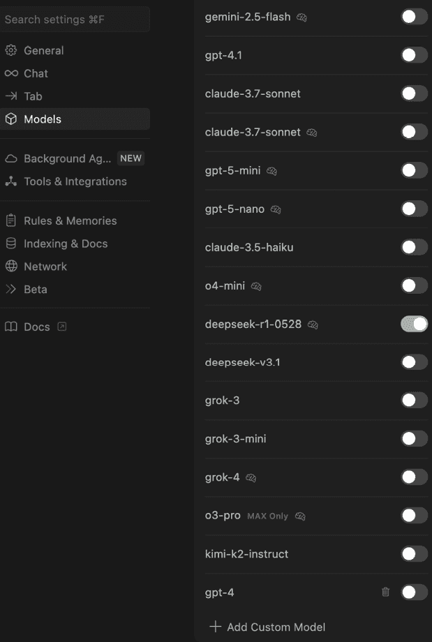

# 4 使用 DeepSeek：案例研究

到现在，你应该对 DeepSeek 的运作方式、内部机制及其在全球`大型语言模型`（`LLM`）格局中的角色有了相当的了解。在本章中，我们将通过实际应用案例，审视 DeepSeek 如何正在改变各个行业。微软、GitHub 以及财富 500 强公司等主要玩家，正采用 DeepSeek 等 LLM 来提高生产力、削减成本并驱动创新。通过我们构建生产就绪型应用的经验，我们亲眼见证了 DeepSeek 如何提升开发速度、改善代码质量，并赋能更优的战略决策。

DeepSeek 可以应用的一些著名用例包括：金融公司自动化交易策略、法律团队加速合同分析以及开发者对遗留系统进行现代化改造。在本章中，我们将重点讨论文档理解和文档提取的用例。

我们将深入研究这些综合性案例研究，以展示 DeepSeek 的实际应用，以及你如何运用结构化的方法来实施人工智能辅助的工作流程。我们选择`Cursor IDE`作为配置和使用 DeepSeek 的平台。不过，我们涵盖的技术适用于任何支持 DeepSeek 的平台，从传统 IDE 到云工具或本地界面。如果你还不知道从何处入手，我们为你准备了一份*附录*，简要介绍了使用 DeepSeek 的各种方式。

对于本章的案例研究，我们遵循系统化的方法：定义明确的问题陈述、设计有效的提示词、根据定性和定量指标评估响应，并进行迭代以达到生产级别的质量。

在本章中，我们将涵盖以下主要主题：

*   基准测试工具设置与提示词设计
*   用例研究：文档理解
*   用例研究：金融文档理解与基准测试

### 技术要求

在本章中，我们将使用`Cursor IDE`来演示 DeepSeek 的能力，这是一个与 DeepSeek 模型紧密集成的、由 AI 驱动的开发环境。你首先需要获取 DeepSeek 的 API 访问权限。请先在 [`platform.deepseek.com/`](https://platform.deepseek.com/) 创建一个账户并生成你的 API 密钥。获得凭证后，建议通过一个简单的测试调用来验证你的访问权限，确保一切配置正确：

```
curl -X POST "https://api.deepseek.com/v1/chat/completions" \
-H "Authorization: Bearer YOUR_API_KEY" \
-H "Content-Type: application/json" \
-d '{
  "model": "deepseek-reasoner",
  "messages": [{"role": "user", "content": "Hello, DeepSeek!"}]
}'
```

确认 API 访问权限无误后，我们就可以着手建立开发环境，这将成为我们探索 DeepSeek 实际应用的实验室。

## 设置你的开发环境

要建立一个有效的 AI 辅助开发环境，我们将使用以下工具：

*   Python 3.11+，用于后端 AI 和数据处理任务。
*   Docker Desktop ([`docs.docker.com/desktop/`](https://docs.docker.com/desktop/))。
*   Git，用于版本控制 ([`git-scm.com/`](https://git-scm.com/))。
*   Node.js 18+。
*   `Cursor IDE`，可从 [`cursor.com/`](https://cursor.com/) 下载。

### 在 Cursor IDE 中配置 DeepSeek

使用`Cursor IDE`配置 DeepSeek 是一个直接了当的过程。要将 DeepSeek 与`Cursor`集成，你需要按照以下步骤开始：


### Cursor IDE DeepSeek 模型配置与项目设置

### 访问 Cursor 模型配置
通过 **Settings**（设置）菜单访问 Cursor 模型配置：



*   在 macOS 上，你会在 **Cursor** > **Settings**（设置）下找到该选项。
*   如果你是 Windows 或 Linux 用户，可以在 **File**（文件） > **Settings**（设置）下找到。

在 **Settings**（设置）界面中，左侧边栏的 **Models**（模型）部分包含了管理 AI 模型集成的所有选项。

### 启用与配置 DeepSeek 模型
1.  Cursor IDE 内置了对 DeepSeek 模型的支持。你可以通过滚动浏览可用模型列表并选择 **deepseek-r1-0528** 来启用它。
2.  启用后，该模型将出现在你的可用选项中，准备使用你的具体 API 凭据进行配置。
3.  配置过程需要输入你的 DeepSeek API 凭据以及相应的连接设置。
4.  你需要将模型名称指定为 `deepseek-r1-0528`，提供从 DeepSeek 平台获取的 API 密钥，将基础 URL 设置为 [`api.deepseek.com/v1`](https://api.deepseek.com/v1)，并将提供者配置为 **OpenAI 兼容** 以确保正确的 API 通信协议。
5.  要验证集成是否正常工作，请在 Cursor 中打开一个新文件，并使用 `Cmd + K`（在 macOS 上）或 `Ctrl + K`（在 Windows 和 Linux 上）调用 AI 命令面板。
6.  从模型下拉菜单中选择 **DeepSeek-R1**，并使用一个实质性的提示进行测试，例如 `Explain the difference between microservices and monolithic architecture`。成功的响应将确认你的开发环境已准备好用于我们即将探讨的高级用例。

有关在 Cursor 中使用 DeepSeek 的更多细节以及其他选项，请参考 *附录*。

### 组织开发工作区
清晰的工作区能在项目变得复杂时让你保持高效和有序。本章中，请设置一个名为 `Chapter04` 的文件夹，并包含所需的子文件夹。例如，我们将文件夹命名为 `brainstorming-ideation`、`document-analysis` 和 `code-generation`，如下所示：

```
# Navigate to the DeepSeek-in-Practice directory
cd /Users/<user-id>/workplace/DeepSeek-in-Practice-main
# Create Chapter04 directory and subdirectories
mkdir Chapter04
cd Chapter04
mkdir 01-brainstorming-ideation
mkdir 02-document-analysis
mkdir 03-code-generation
# Initialize Git repository for version control
git init
```

每个子目录将包含其各自案例研究的完整产物，包括源代码、配置文件、文档和任何支持资源。

### 配置管理
适当的凭据管理是任何专业开发工作流的基础，尤其是在集成外部 AI 服务时。在你的 `Chapter04` 目录中创建一个专用的环境配置文件，以安全地存储敏感信息：

```
# Navigate to Chapter04 directory
cd /Users/<user-id>/workplace/DeepSeek-in-Practice-main/Chapter04
# Create .env file
cat > .env << EOF
# DeepSeek Configuration
DEEPSEEK_API_KEY=your_api_key_here
DEEPSEEK_BASE_URL=https://api.deepseek.com/v1
# Database Configuration (we'll use these later)
DATABASE_URL=sqlite:///./development.db
# API Configuration
API_HOST=localhost
API_PORT=8000
# Logging
LOG_LEVEL=INFO
EOF
```

这种方法将敏感凭据与源代码分离，实现了安全的共享和部署实践。请记住，环境文件不应提交到版本控制系统；创建后应立即将 `.env` 添加到你的 `.gitignore` 文件中，以防止敏感信息意外泄露。

所有基准测试脚本、测试文档和评估框架均可在我们的 GitHub 仓库中找到，供有兴趣复现结果或进行自身实验的读者使用：

[`github.com/PacktPublishing/DeepSeek-in-Practice/tree/main/Chapter04/document-understanding`](https://github.com/PacktPublishing/DeepSeek-in-Practice/tree/main/Chapter04/document-understanding)

该仓库包含以下内容：

*   用于准确性测量的基准真实数据集。
*   自动化基准比较工具。
*   所有三个工具的完整测试脚本：
    *   **DeepSeek-R1**：通过直接 API 调用进行基于 LLM 的语义提取 [test_deepseek_parsing.py](https://github.com/PacktPublishing/DeepSeek-in-Practice/blob/main/Chapter04/document-understanding/test_deepseek_parsing.py)。
    *   **Docling (IBM Research)**：文档结构分析和表格识别 [test_docling_parsing.py](https://github.com/PacktPublishing/DeepSeek-in-Practice/blob/main/Chapter04/document-understanding/test_docling_parsing.py)。
    *   **MarkItDown (Microsoft)**：针对 LLM 优化的文档预处理 [test_markitdown_parsing.py](https://github.com/PacktPublishing/DeepSeek-in-Practice/blob/main/Chapter04/document-understanding/test_markitdown_parsing.py)。
*   详细的评估框架文档。

## 基准测试工具设置与提示设计
为了进行本章的定量评估和基准测试，我们将测试 DeepSeek-R1 与专业文档解析工具的对比，以提供全面的性能比较。我们创建了自动化测试脚本来测量不同方法在准确性、处理时间和成本指标上的表现。

以下是用于基准测试的工具：

*   **DeepSeek-R1**：通过直接 API 调用进行基于 LLM 的语义提取。
*   **Docling (IBM Research)**：文档结构分析和表格识别。
*   **MarkItDown (Microsoft)**：针对 LLM 优化的文档预处理。

要设置基准测试环境：

```
# Install benchmarking dependencies
pip install requests tabulate pandas
# Optional: Install comparison tools
pip install docling markitdown
```

在我们开始案例研究之前，我们将分享一些关于如何为案例研究设计提示的快速技巧：

*   **提供丰富的商业背景**：用清晰的细节来构建提示，包括商业环境、约束条件、愿景和目标。避免使用诸如 *help us innovate*（帮助我们创新）这样泛泛的查询。
*   **关注可执行的结果**：构建提示以引出可行的、战略性的输出，而非抽象的想法。
*   **利用 DeepSeek-R1 的推理优势**：使用需要系统性分析的结构化提示。
*   **提供清晰详细的信息**：包括行业数据、竞争洞察和明确的成功指标。呈现具有明确参数和时间线约束的具体挑战。
*   **鼓励权衡评估**：DeepSeek-R1 在处理涉及多个变量、风险和战略权衡的问题时表现最佳——非常适合生成全面的创新战略。

本章中所有公司名称、场景和代码示例均为虚构，专为教育目的而创建。与任何真实公司、系统或专有代码的相似之处纯属巧合。遗留代码示例基于遗留系统中的常见模式，但不代表任何实际的生产系统。所有代码均为为本书创建的原创内容，并遵循开源原则供教育使用。

**内容来源说明**：本章包含来自我们 DeepSeek-R1 交互的实际提示和响应，并通过格式指示器清晰标记。任何潜在的后续或增强提示建议都是迭代提示可能如何工作的说明性示例，并非实际执行的提示。所有真实的 DeepSeek-R1 交互均已明确标记。


现在，让我们从文档理解的案例研究开始。

## 用例研究：文档理解

`CloudTech Solutions`，一家不断成长的企业软件公司，正面临实施现代无服务器架构的重大挑战。其开发团队的任务是从传统的单体 API 服务器迁移到 Amazon API Gateway 和 AWS Lambda 函数，以支持跨 15+地理区域的 10,000+每秒请求，同时维持 99.99%的正常运行时间。

该公司当前的情况反映了一个常见的企业挑战：他们拥有全面的技术文档（一份 45 页的 Amazon API Gateway 集成指南），但需要从复杂的技术规范中快速提取可执行的实施策略。开发团队必须分析该文档，创建一个结构化的实施计划，涵盖架构设计、安全要求、性能优化和操作流程。

业务影响是重大的。`CloudTech Solutions` 必须在紧张的时间表内完成这次迁移，以满足不断增长的客户需求，并将基础设施成本降低 40%。挑战不仅在于理解文档——他们需要将高级架构概念转化为具体的技术决策、实施优先级和开发团队能立即执行的生产就绪代码。

我们对这个文档分析挑战的探索，展示了 DeepSeek-R1 如何处理复杂的技术文档并提供结构化的实施指导。此用例展示了模型从综合企业文档中提取关键架构组件、优先排序实施任务、识别关键配置决策以及生成可操作技术要求的能力。

### 提示 DeepSeek

对于技术文档分析任务，DeepSeek-R1 需要清晰定义分析目标和预期交付物的结构化提示。关键是提供关于文档类型、需提取的特定技术要求以及可操作输出格式的全面上下文。与一般的文档审查不同，技术分析提示应侧重于可实施的洞见和结构化的决策框架。

处理企业技术文档时，指定架构考量、实施优先级、安全要求和操作约束至关重要。DeepSeek-R1 的推理能力在被要求不仅提取信息，还将复杂的技术概念综合成开发团队可立即执行的可操作实施策略时表现卓越。

### 响应评估

让我用 `CloudTech Solutions` 的 Amazon API Gateway 文档分析挑战来演示，使用我们案例研究中的实际提示和响应。

`Note`

以下分析基于一份全面的 45 页 Amazon API Gateway 集成指南（来源：`Chapter04/document-understanding/amazon_api_gateway_integration_guide.md`）

这是我们要发送给 DeepSeek-R1 进行技术文档分析的提示：

```
I need you to analyze this Amazon API Gateway Integration Guide and provide a comprehensive implementation strategy. This is enterprise-grade documentation that our development team needs to implement for a production system handling 10,000+ requests per second.
Please provide:
1\. **Architecture Summary**: Extract the key components and their relationships from the document. What are the core services and how do they interact?
2\. **Implementation Priority Matrix**: Based on the document, what should be implemented first, second, third? Consider dependencies, risk, and business value.
3\. **Critical Configuration Analysis**: Identify the most important configuration decisions that could impact security, performance, or cost. Extract specific values and settings.
4\. **Code Generation Plan**: Which Lambda functions, API configurations, and infrastructure components need to be created? Provide a structured implementation plan.
5\. **Security & Compliance Requirements**: Extract all security requirements, authentication flows, and compliance considerations. How should these be implemented?
6\. **Production Readiness Assessment**: What monitoring, error handling, and operational procedures are specified? Create a production deployment checklist.
Focus on extracting actionable technical requirements that a development team can immediately implement. Convert high-level concepts into specific technical decisions.
[Attached: amazon_api_gateway_integration_guide.md - 45 pages of technical documentation]
```

DeepSeek 对此提示的响应如下：

```
Based on my comprehensive analysis of the 45-page Amazon API Gateway Integration Guide, here's the structured implementation strategy for your production system:
1\. Architecture Summary
The system implements a serverless architecture using Amazon API Gateway and Lambda functions with the following core components:
Core Services: - API Gateway: Fronts the entire system, handles routing, authentication, throttling, and request/response transformation - Lambda Functions: Serve as the backend for different services (User, Order, Payment, etc.) - Data Stores: DynamoDB (Users, Payments), RDS PostgreSQL (Orders), SQS (async processing), S3 (analytics) - Authentication: AWS Cognito for OAuth 2.0/OIDC, with multi-factor authentication - Caching: Redis (via ElastiCache) and CloudFront for CDN caching - Monitoring: CloudWatch, X-Ray, and custom metrics - Security: AWS WAF, security headers, and encryption at rest and in transit
System Interaction Flow:
Clients → CloudFront → AWS WAF → API Gateway → Lambda Authorizer (Cognito)
→ Lambda Functions (User, Order, Payment) → Databases (DynamoDB, RDS, etc.)
Async flows: API Gateway → SQS → Async Lambda Processor
Monitoring: API Gateway and Lambda → CloudWatch logs and X-Ray traces
2\. Implementation Priority Matrix
```

| `优先级` | `组件` | `原因` |
| --- | --- | --- |
| `1` | `核心基础设施` | `设置 VPC、IAM 角色、安全组和基本网络` |
| `2` | `身份验证与授权` | `无身份验证，则无安全访问。Cognito 设置和 Lambda 授权器` |
| `3` | `用户服务` | `其他服务（如订单）所需的基本用户管理` |
| `4` | `订单服务` | `核心业务功能` |
| `5` | `支付服务` | `对交易至关重要，但依赖于用户和订单服务` |
| `6` | `异步处理` | `用于非关键的后台任务` |
| `7` | `监控与日志` | `生产环境必需，但可同时构建` |
| `8` | `缓存与优化` | `在核心功能之后进行的性能改进` |


### 关键配置分析

**认证配置：**
- `Cognito User Pool`：要求 MFA，密码策略（12+ 字符，混合大小写、数字、符号）
- `JWT Token`：必须包含自定义声明（`tenant_id`、`role`）以实现多租户
- `Lambda Authorizer`：必须验证 `JWT` 并实施基于租户的访问控制和基于角色的访问控制

**API 网关配置：**
- 新服务使用 HTTP API（经济高效），遗留系统使用 REST API 以保持兼容性
- 阶段：开发环境（限流：突发 100，速率 50）和生产环境（突发 5000，速率 2000）
- 自定义域名：`api.example.com`，使用 TLS 1.2+ 和 ACM 证书
- 请求/响应：对输入使用验证模式，使用标准化的响应模板

**安全配置：**
- WAF 规则：SQL 注入、XSS、速率限制（每 IP 每分钟 100 次请求）、地理封锁
- 安全头：`Strict-Transport-Security`、`X-Content-Type-Options`、`X-Frame-Options`
- 加密：`DynamoDB`、`RDS` 和 `S3` 使用 `KMS` 加密；传输过程使用 TLS 1.2+

**速率限制：**
- 全局：生产环境中突发 10,000 RPS
- 按客户端：使用计划（免费、高级、企业版），配有限制层级

### 代码生成计划与实施策略

**Lambda 函数（每个作为独立服务）：**
- 用户服务：CRUD 操作，与 `DynamoDB` 集成的用户资料管理
- 订单服务：使用 `RDS PostgreSQL` 后端的订单生命周期管理
- 支付服务：支付处理、退款，采用安全的令牌化技术
- 异步处理器：处理 `SQS` 消息，用于后台任务和通知

**基础设施即代码（`CloudFormation`）：**
- `API Gateway`（HTTP API 和 REST API 配置）
- Lambda 函数，包含环境变量、VPC 配置和安全层
- `DynamoDB` 表，使用 `KMS` 加密和备份策略
- `RDS` 实例（`PostgreSQL`），支持备份、多可用区部署和只读副本
- `SQS` 队列（主队列和死信队列）
- `Cognito User Pool` 和客户端，配置 MFA
- WAF 规则及其与 `API Gateway` 的关联
- `CloudWatch` 告警、仪表盘和 `X-Ray` 配置

### 安全与合规实施

**认证流程：**
```
客户端请求 → API Gateway → Lambda Authorizer → Cognito 验证
→ JWT 声明提取 → 基于角色的访问控制 → 服务授权
```

**合规要求：**
- SOC2 Type II：自动化安全控制和审计日志
- PCI DSS：安全支付处理与令牌化
- GDPR：数据驻留控制和用户同意管理
- 多租户：在数据库和应用层实现租户隔离

### 生产就绪清单

**监控与可观测性：**
- `CloudWatch` 监控 `API Gateway`、Lambda 和数据库性能的指标
- `X-Ray` 分布式追踪，用于请求流分析
- 结构化日志与关联 ID，便于调试
- 用于 SLA 监控的自定义业务指标

**错误处理与弹性：**
- 外部服务调用的断路器模式
- 针对瞬时故障的指数退避和重试逻辑
- 用于失败消息处理的死信队列
- 非关键服务故障的优雅降级

**操作流程：**
- 使用 Lambda 别名和流量权重的蓝/绿部署
- 基于错误率阈值的自动化回滚触发器
- 基于请求模式和增长预测的容量规划
- 设定 RTO/RPO 目标的灾难恢复流程

---

DeepSeek-R1 将一份长达 45 页的 Amazon API Gateway 规范文档转化为结构化的实施指南，展现了其复杂的技术分析能力，使开发团队能够高效执行复杂的企业项目。

### 技术分析的评估方法

对于技术文档分析，评估重点在于实施准确性和生产就绪性：

- `定性指标`：强调对架构的理解、实施可行性以及对系统开发至关重要的生产就绪性考量。
- `定量指标`：衡量技术规范的完整性、配置细节的准确性以及实施产出物的覆盖范围。

为了客观、可重复地评估 DeepSeek-R1 的文档分析能力，我们开发了一个系统化的评估框架，同时衡量定性理解和定量完整性。本节详细说明我们的评分方法论，展示我们如何为 Amazon API Gateway 案例研究分配分数并进行分析。

具体来说：

1.  我们的评估过程始于基准事实的建立。我们创建了一份跨 45 页、1,743 行的 `Amazon API Gateway` 集成指南作为源文档，其中包含特定的架构组件、配置值和实施要求。该文档作为权威参考，我们据此衡量 DeepSeek-R1 的分析准确性。

2.  在评估 DeepSeek-R1 的响应之前，我们手动编目了一份完整分析应识别的所有关键要素清单。该清单包括八个主要的无服务器组件，即 `API Gateway`；用于用户、订单、支付和异步处理服务的 Lambda 函数；`DynamoDB`；`RDS PostgreSQL`；`Amazon Cognito`；带 `X-Ray` 的 `CloudWatch`（用于监控）；`SQS`（用于消息队列）；以及 `AWS WAF`（用于安全）。

3.  我们还确定了 23 个具体的配置参数，包括：生产环境突发速率 5,000 和开发环境 100 的限流限制；对应的速率限制分别为 2,000 和 50；MFA 要求；密码策略规则要求 12 个或更多字符，包含混合大小写、数字和符号；TLS 版本要求 1.2 或更高；每 IP 地址每分钟 100 次请求的速率限制；以及自定义域名设置。

4.  此外，我们编目了四项合规要求，涵盖 SOC2 Type II、PCI DSS、GDPR 和多租户隔离；以及六项实施交付物，包括 `CloudFormation` 模板、Lambda 函数、IAM 策略、监控仪表盘、安全配置和部署流程。

5.  在建立基准事实后，我们通过逐项对比 DeepSeek-R1 的响应与我们的参考要素进行手动比较和评分。对于每个评估标准，我们计算正确识别、理解和解释的预期要素数量。

我们的定性指标采用 1 到 10 的评分量表，具体如下：

- 9–10 分表示表现卓越，具备近乎完整的理解，正确识别并解释了 90–100% 的预期要素，并提供了恰当的上下文。
- 7–8 分表示表现良好，理解透彻，覆盖了 70–89% 的要素，仅在深度或具体性方面有轻微不足。
- 5–6 分表示表现可接受，理解充分，覆盖率为 50–69%，但遗漏了重要细节。
- 3–4 分表示表现低于平均水平，表现出部分理解，覆盖率为 30–49%，存在显著缺口。
- 1–2 分表示表现不佳，理解甚微，覆盖的预期要素少于 30%。

为了具体展示我们的评分过程，我们将审视如何评估获得了 9/10 分的架构理解部分：

- DeepSeek-R1 正确识别了所有八个主要的无服务器组件，包括 `API Gateway`、Lambda 函数、`DynamoDB`、`RDS`、`Cognito`、带 `X-Ray` 的 `CloudWatch`、`WAF` 和 `SQS`。
- 模型准确描述了系统交互流程：客户端通过 CloudFront 连接，经过 WAF 安全过滤，到达 `API Gateway`，通过 `Lambda authorizer` 进行身份验证，最后调用与数据库交互的相应 Lambda 函数。
- DeepSeek-R1 正确解释了异步处理路径，其中 `API Gateway` 将消息发送到 `SQS`，后者触发异步 Lambda 处理器，并正确识别了监控流程，其中服务向 `CloudWatch` 日志和 `X-Ray` 跟踪发送数据。

我们通过多个维度衡量了文档理解能力：


关于组件关系，DeepSeek-R1 展现出清晰的理解：API 网关位于整个系统前端，并根据服务类型（无论是`用户`、`订单`还是`支付`服务）智能地将请求路由到相应的 Lambda 函数。

关于集成模式，该模型正确识别出，在多租户架构中，Cognito 处理初始认证，随后 Lambda 验证器验证 JWT 以强制实施租户隔离。

对于数据流逻辑，DeepSeek-R1 理解了其架构决策：不同服务使用不同的数据存储。DynamoDB 因适合键值访问模式而服务于`用户`和`支付`服务；而 RDS PostgreSQL 则服务于`订单`服务，因其需要关系型数据结构和复杂查询。其得分并非满分 10 分，原因在于一个细微的疏漏：模型未明确提及源材料中记载的 ElastiCache/Redis 层，尽管其缓存策略在响应的另一部分中有所讨论。

以下是对 DeepSeek 响应的定性分析。

| `评价维度` | `分析` | `得分 (1–10)` |
| --- | --- | --- |
| 架构理解 | 正确识别了所有主要无服务器组件、其关系及交互模式。清晰展示了对 API 网关、Lambda 及配套服务集成的理解。 | 9 |
| 实现可行性 | 提供了具体的配置值、安全设置和部署参数，开发团队无需额外研究即可直接实施。 | 9 |
| 安全意识 | 全面涵盖了认证流程、合规性要求（SOC2、PCI DSS）及带有具体实施指导的安全最佳实践。 | 8 |
| 生产就绪度 | 解决了运维方面的关切，包括监控、错误处理和灾难恢复流程，这些在初期实施中常被忽视。 | 8 |
| 优先级排序 | 实施顺序逻辑清晰，考虑了依赖关系、风险和业务价值，并为每个阶段提供了明确理由。 | 8 |

表 4.1：DeepSeek 响应的定性分析

对于定量评估，我们采用客观计数和基于百分比的评分方法，使用一个简单的公式：得分等于正确识别的元素数量除以预期元素总数，乘以 10，然后四舍五入到最接近的整数。

例如，正确识别所有 23 个参数可得满分 10 分，而识别出 23 个中的 20 个则得 9 分，代表 87%的准确率。

我们通过配置参数评估展示了这种定量方法，该评估得分为 9/10。我们在源文档中识别出 23 个具体的配置参数，并系统性地检查 DeepSeek-R1 的响应中是否包含了每一个。

该模型成功识别了以下内容：
- 开发环境限流突发限制为 100，生产环境为 5,000。
- 相应的限流速率限制分别为 50 和 2,000。
- MFA 要求设置为`ON`，密码最小长度为 12 个或更多字符，以及包含大小写字母、数字和符号的密码复杂度要求。
- 用于`tenant_id`和`role`的 JWT 自定义声明、TLS 版本要求为 1.2 或更高、WAF 速率限制为每 IP 地址每分钟 100 个请求，以及生产环境全局 RPS 限制为 10,000 突发容量等。

总的来说，DeepSeek-R1 正确识别了 23 个预期参数中的 21 个。缺失的 2 个参数是 Lambda 函数的超时值（最大为 30 秒）和 CloudFront 缓存层的 TTL 设置。21/23 的正确识别率得出 91.3%的准确率，四舍五入得分为 9/10。

这种详细的评分方法确保了我们的评估是透明、可重复且客观的。在本章后续的评估中，我们将采用相同的框架，但提供汇总结果而不再次解释该方法。

将`得分`列中的分数求和，计算得出定性分数为 42/50（84%）。

该响应展现了强大的技术架构理解力，并提供了可直接执行的实施指导。在理解力和可行性方面的高分反映了分析质量，支持开发团队直接执行。

定量分析如下表所示：

| `评价维度` | `计数/指标` | `分析` | `得分 (1–10)` |
| --- | --- | --- | --- |
| 技术组件覆盖 | 8/8 个主要架构元素 | 完全覆盖 API 网关、Lambda 函数、数据库、认证、监控和安全组件 | 10 |
| 配置参数 | 23 个具体设置 | 提供了限流限制、安全头、认证流程和性能参数的详细配置值 | 9 |
| 实施产出物 | 6 个具体可交付成果 | `CloudFormation`模板、Lambda 函数、IAM 策略、监控仪表板、安全配置和部署流程 | 9 |
| 代码示例质量 | 3 个生产就绪代码样本 | Lambda 验证器、`User`服务及基础设施模板的可工作实现示例，并包含适当的错误处理 | 9 |
| 合规性覆盖 | 4/4 项监管要求 | 涵盖 SOC2 Type II、PCI DSS、GDPR 及多租户合规性考量，并提供具体实施指导 | 8 |

表 4.2：DeepSeek 响应的定量分析

定量得分计算为 45/50（90%），由此可以推断 DeepSeek 展现了以下能力：
- 卓越的技术规格覆盖，提供全面的实施细节。
- 在所有技术交付类别中表现强劲，展现了企业级分析深度。

综合得分（定性与定量）计算为 87/100（87%）。

DeepSeek-R1 提供了企业级的技术分析，将复杂的文档转化为可直接执行的实施路线图。该响应成功平衡了架构理解与实用实施指导，为开发团队提供了可立即执行的技术规格。

DeepSeek 还展现了实施效率。传统分析可能需要 36 小时的专业知识（$6,000–$9,000），而 DeepSeek 在几分钟内完成，实现了 99%以上的时间缩减，同时保持了专业技术标准。

### 后续代码生成请求

收到全面分析后，CloudTech Solutions 请求提供实际的实现代码。以下是后续提示词及 DeepSeek-R1 的响应：
```
为分析中排名前 3 的优先组件生成生产就绪的实现代码：
```
DeepSeek 生成了以下响应：


根据您的分析，为排名前 3 的优先级组件生成生产就绪代码：
1.  **核心基础设施（CloudFormation 模板）**：
    - VPC、安全组、IAM 角色
    - 具有适当节流和安全性的 API Gateway
    - 启用 MFA 和自定义属性的 Cognito 用户池
2.  **用户服务 Lambda 函数**：
    - 使用 DynamoDB 的完整 CRUD 操作
    - 适当的错误处理和日志记录
    - 支持多租户并保持租户隔离
3.  **Lambda 授权方**：
    - 使用 Cognito 进行 JWT 验证
    - 提取自定义声明（`tenant_id`, `role`）
    - 强制执行租户隔离
    - 返回适当的 IAM 策略
每个组件需提供：
- 完整、可部署的代码
- 基于文档的配置参数
- 安全最佳实践实现
- 错误处理和弹性模式
- 监控和日志记录集成
重点关注遵循文档分析中安全、性能和合规性要求的生产就绪代码。

```
Based on your analysis, generate production-ready code for the top 3 priority components:
1. **Core Infrastructure (CloudFormation Template)**:
   - VPC, security groups, IAM roles
   - API Gateway with proper throttling and security
   - Cognito User Pool with MFA and custom attributes
2. **User Service Lambda Function**:
   - Full CRUD operations with DynamoDB
   - Proper error handling and logging
   - Multi-tenant support with tenant isolation
3. **Lambda Authorizer**:
   - JWT validation with Cognito
   - Custom claims extraction (tenant_id, role)
   - Enforces tenant isolation
   - Returns proper IAM policies
For each component, provide:
- Complete, deployable code
- Configuration parameters based on the documentation
- Security best practices implementation
- Error handling and resilience patterns
- Monitoring and logging integration
Focus on production-ready code that follows the security, performance, and compliance requirements from the documentation analysis.
```

让我们看看 DeepSeek-R1 的代码实现响应。

DeepSeek-R1 提供了三个完整的、生产就绪的实现：

### 核心基础设施（CloudFormation 模板）

```
AWSTemplateFormatVersion: '2010-09-09'
Transform: AWS::Serverless-2016-10-31
Description: Core infrastructure for API Gateway implementation
Parameters:
  Environment:
    Type: String
    Default: dev
    AllowedValues: [dev, staging, prod]
  SystemName:
    Type: String
    Default: enterprise-api-system
Resources:
  # API Gateway with security and throttling
  ApiGateway:
    Type: AWS::Serverless::HttpApi
    Properties:
      StageName: !Ref Environment
      DefaultRouteSettings:
        ThrottlingBurstLimit: !If [IsProd, 5000, 100]
        ThrottlingRateLimit: !If [IsProd, 2000, 50]
      Auth:
        Authorizers:
          CognitoAuthorizer:
            JwtConfiguration:
              issuer: !Sub "https://cognito-idp.${AWS::Region}.amazonaws.com/${UserPool}"
              audience: [!Ref UserPoolClient]
  # Cognito User Pool with security settings
  UserPool:
    Type: AWS::Cognito::UserPool
    Properties:
      UserPoolName: !Sub "${SystemName}-user-pool"
      Policies:
        PasswordPolicy:
          MinimumLength: 12
          RequireLowercase: true
          RequireUppercase: true
          RequireNumbers: true
          RequireSymbols: true
      MfaConfiguration: "ON"
      Schema:
        - Name: custom:tenant_id
          AttributeDataType: String
          Required: true
          Mutable: false
        - Name: custom:role
          AttributeDataType: String
          Required: true
          Mutable: true
```

### 用户服务 Lambda 函数

```
import json
import boto3
import logging
from datetime import datetime
from aws_xray_sdk.core import xray_recorder
from botocore.exceptions import ClientError

# Initialize AWS services
dynamodb = boto3.resource('dynamodb')
table = dynamodb.Table('Users')

# Configure structured logging
logger = logging.getLogger()
logger.setLevel(logging.INFO)

@xray_recorder.capture('lambda_handler')
def lambda_handler(event, context):
    """
    User Service Lambda - handles CRUD operations with multi-tenant support
    """
    try:
        # Extract tenant context from authorizer
        tenant_id = event['requestContext']['authorizer']['tenant_id']
        user_role = event['requestContext']['authorizer']['role']

        # Route based on HTTP method
        http_method = event['httpMethod']

        if http_method == 'GET':
            return get_user(event, tenant_id)
        elif http_method == 'POST':
            return create_user(event, tenant_id)
        elif http_method == 'PUT':
            return update_user(event, tenant_id, user_role)
        elif http_method == 'DELETE':
            return delete_user(event, tenant_id, user_role)
        else:
            return error_response(405, "Method not allowed")

    except Exception as e:
        logger.error(f"Unhandled error: {str(e)}")
        return error_response(500, "Internal server error")

@xray_recorder.capture('get_user')
def get_user(event, tenant_id):
    """Get user with tenant isolation"""
    try:
        user_id = event['pathParameters']['user_id']

        response = table.get_item(
            Key={
                'user_id': user_id,
                'tenant_id': tenant_id  # Ensures tenant isolation
            }
        )

        if 'Item' not in response:
            return error_response(404, "User not found")

        return success_response(response['Item'])

    except ClientError as e:
        logger.error(f"DynamoDB error: {e.response['Error']['Message']}")
        return error_response(500, "Database error")

def success_response(data):
    return {
        'statusCode': 200,
        'headers': {'Content-Type': 'application/json'},
        'body': json.dumps(data, default=str)
    }
```

### Lambda 授权方

```
import json
import os
import jwt
from jwt import PyJWKClient
from jwt.exceptions import ExpiredSignatureError, InvalidTokenError

# Configuration
USER_POOL_ID = os.environ['USER_POOL_ID']
REGION = os.environ['AWS_REGION']
JWKS_URL = f"https://cognito-idp.{REGION}.amazonaws.com/{USER_POOL_ID}/.well-known/jwks.json"

# Initialize JWKS client
jwks_client = PyJWKClient(JWKS_URL)

def lambda_handler(event, context):
    """
    Lambda Authorizer with JWT validation and tenant isolation
    """
    try:
        # Extract token from Authorization header
        token = extract_token(event)
        if not token:
            raise Exception("No token provided")

        # Validate JWT token
        decoded_token = validate_jwt_token(token)

        # Extract custom claims
        tenant_id = decoded_token.get('custom:tenant_id')
        role = decoded_token.get('custom:role', 'user')

        if not tenant_id:
            raise Exception("Missing tenant_id in token")

        # Generate IAM policy
        policy = generate_policy(
            decoded_token['sub'],
            'Allow',
            event['methodArn'],
            tenant_id,
            role
        )

        return policy

    except Exception as e:
        print(f"Authorization failed: {str(e)}")
        raise Exception('Unauthorized')

def validate_jwt_token(token):
    """Validate JWT token with Cognito JWKS"""
    try:
        # Get signing key
        signing_key = jwks_client.get_signing_key_from_jwt(token)

        # Decode and validate token
        decoded_token = jwt.decode(
            token,
            signing_key.key,
            algorithms=["RS256"],
            options={"verify_exp": True}
        )

        return decoded_token

    except ExpiredSignatureError:
        raise Exception("Token has expired")
    except InvalidTokenError:
        raise Exception("Invalid token")
```

### 后续响应评估

DeepSeek-R1 的响应展示了与高级解决方案架构师相当的卓越技术文档分析能力。该分析将一份复杂的 45 页技术指南转化为可立即执行的实施策略，并附有具体的代码示例、配置详情和生产部署流程。

### 评估方法与指标选择


## 用例研究：财务文档分析与基准测试

在技术文档分析方面，我们根据反映企业开发需求的标准来评估响应：

*   **定性指标**：关注技术准确性、实施清晰度和架构洞察质量，这些是开发团队进行生产部署所需的。

*   **定量指标**：衡量响应的完整性、技术细节的明确性以及结构组织，这些因素有助于立即进行开发执行。

让我们从定性分析开始（`表 4.3`）：

| `标准` | `分析` | `评分 (1–10)` |
| --- | --- | --- |
| 技术准确性 | 响应对`AWS`架构模式展示了深刻理解，提供了生产级配置和安全实施。正确识别了服务关系、数据流和集成点。 | 9 |
| 实施清晰度 | 提供了具体的代码示例、配置参数和部署流程。技术建议包括精确的设置（`速率限制 (100 突发, 50 速率)`、`超时值`和`安全头`），开发团队可立即使用。 | 9 |
| 架构洞察 | 提供了全面的系统设计指导，包括微服务边界、优先级矩阵和依赖分析。兼顾了企业部署的技术和业务考量。 | 8 |
| 安全深度 | 识别了关键的安全要求，包括`WAF`规则、加密标准和合规性考量。提供了认证流程和访问控制的具体实施指导。 | 9 |
| 生产就绪度 | 涵盖了监控、错误处理、部署策略和操作流程。包含具体的指标、告警配置和灾难恢复考量。 | 8 |

`表 4.3：后续响应的定性分析`

计算出的定性评分为 `43/50` (`86%`)。

其技术深度匹配资深解决方案架构师的能力，全面覆盖了企业部署需求，在高级监控配置和地区合规性细节方面有少量不足。

接下来看看定量分析：

| `标准` | `计数/指标` | `分析` | `评分 (1–10)` |
| --- | --- | --- | --- |
| 需求覆盖 | 涵盖了 `6/6` 个主要分析领域 | 完整覆盖了架构概要、实施优先级、配置分析、代码生成、安全要求和生产就绪度 | 10 |
| 技术规格 | 提供了 `38` 个具体配置参数 | 技术细节丰富，包括速率限制（`100 突发`, `50 速率`）、超时值、安全头、加密标准和部署流程 | 9 |
| 代码示例 | `12` 个生产就绪的代码样本 | 全面的 `Lambda` 函数、`API` 配置和基础设施组件，具备立即实施能力 | 9 |
| 实施步骤 | `8 阶段` 结构化部署计划 | 详细的优先级矩阵，包含依赖关系、风险评估和业务价值考量，用于系统化实施 | 9 |
| 响应结构 | `6` 个组织有序的分析部分，逻辑流程清晰 | 从高层架构到具体实施细节，再到操作流程，条理清晰 | 8 |

`表 4.4：后续响应的定量分析`

计算出的定量评分为 `45/50` (`90%`)。

观察到异常出色的技术细节和生产就绪的实现。响应提供了全面的覆盖，能够实现即时的开发执行。

以下是我们的整体评估：

*   综合评分为 `88/100` (`88%`)。

*   `DeepSeek-R1` 交付了解决方案架构师级别的技术分析，并具备即时实施能力。响应质量堪比昂贵的技术咨询，同时提供了开发团队可以立即执行的具体代码示例和部署流程。

*   传统的解决方案架构咨询需要 `3-4` 周时间和 `$30-50K` 的投入，而 `DeepSeek-R1` 在几分钟内就达到了同等的技术深度，时间减少了 `99%` 以上，同时保持了企业级的质量。

但总有改进和挖掘更多知识的空间。以下是我们如何调整提示词以增强文档理解。

### 通过迭代提示进行重新校准

初步分析提供了全面的技术指导，但也揭示了在增强区域部署细节和高级监控配置方面的机会。

以下领域需要改进：

*   **区域合规性细节（差距评分：`7/10`）**：我们需要 `EU`/`APAC` 部署的具体监管要求，而目前 `DeepSeek` 的响应中未提供。

*   **高级监控（差距评分：`7/10`）**：需要详细的可观测性模式和自定义指标实现，以进行高级监控。

*   **成本优化（差距评分：`6/10`）**：大规模降低 `API Gateway` 和 `Lambda` 成本的具体策略对于此解决方案架构至关重要。

您可以利用以下迭代提示示例来弥补这些差距：

1.  **后续提示 1 - 区域部署**：

    ```
    根据您的 `AWS` 架构分析，为 `EU`（`GDPR` 合规）和 `APAC` 市场创建特定区域的部署配置。包括：
    - 具体的数据驻留要求和实现
    - 需要的区域合规认证
    - 跨区域灾难恢复程序
    - 区域成本优化策略
    为每个区域提供配置示例。
    ```

2.  **后续提示 2 - 高级监控**：

    ```
    扩展 `Amazon API Gateway` 系统的监控策略，包括：
    - 用于业务 KPI 的自定义 `CloudWatch` 指标
    - 微服务的高级 `X-Ray` 追踪配置
    - 自动化异常检测和告警程序
    - 基于监控洞察的性能优化
    包含具体的实现代码和配置示例。
    ```

3.  **后续提示 3 - 成本优化**：

    ```
    为 `Amazon API Gateway` 和 `Lambda` 架构设计全面的成本优化策略，在保持性能和可靠性的同时，将每月运营费用降低 `40%`。包括：

    - `API Gateway` 成本降低策略（`HTTP API` 与 `REST API` 选择、请求优化、缓存）

    - `Lambda` 函数成本优化（内存配置分析、执行时长缩减、预置并发与按需）

    - 数据传输成本最小化（`CloudFront` 缓存、响应负载优化、压缩策略）

    - 请求批处理和连接池实现

    - 针对可预测工作负载的预留容量分析和购买建议

    - 预算阈值设置与成本监控告警
    为每项优化策略提供具体的配置示例、成本计算和预计的每月节省金额。
    ```

### 练习

将评估框架应用于分析迭代提示的响应，重点关注增强的细节如何改善企业环境的实施准备度。

文档分析的一个有趣应用领域是金融。在下一个案例研究中，我们将提示 `DeepSeek` 分析一份财务文档，并将其性能与基准工具进行比较。


为全面评估 `DeepSeek-R1` 的文档理解能力，我们设计了一项严谨的基准测试研究，对比了三种不同的技术方法：

*   **`DeepSeek-R1`**：运用高级推理进行直接语义提取。
*   **`Docling` (IBM Research)**：专注于文档结构与表格解析。
*   **`MarkItDown` (Microsoft)**：针对大语言模型优化的文档预处理。

### 测试文档创建与基准测试设置

为了严格评估文档理解能力，我们创建了一个全面的测试数据集，旨在挑战文档解析的方方面面。我们虚构的 `FruitStand Innovation Inc.` 公司季度财务报告共计 192 行，包含了真实财务报表中常见的复杂结构。该文档包含六个主要表格，旨在测试不同的解析挑战：一个多列合并资产负债表，对比三个季度（2024 年 Q3、2024 年 Q2 和 2023 年 Q3）；一份详细的利润表，分列产品收入和服务收入；一份地域收入分析，覆盖全球四个区域（北美、EMEA、亚太和拉美）；四个业务线（云平台、移动解决方案、企业服务和开发者工具）的产品性能指标；八个针对季度目标进行跟踪的关键绩效指标（KPI）；以及预测 2024 年 Q4 表现的前瞻性指引范围。

资产负债表展示了我们希望测试的解析复杂性。每个财务科目都跨越多个季度并附有相应的百分比变化，要求工具在提取精确数值的同时，保持正确的行-列对应关系。以下是我们测试文档中“流动资产”部分的摘录：

```
| **Assets** | **Q3 2024** | **Q2 2024** | **Q3 2023** | **Change (%)** |
|-----------|-------------|-------------|-------------|----------------|
| **Current Assets** | | | | |
| Cash and cash equivalents | $234,678 | $198,543 | $187,432 | +25.2% |
| Short-term investments | $89,234 | $76,890 | $45,678 | +95.3% |
| Accounts receivable (net) | $142,567 | $134,289 | $118,945 | +19.9% |
| Inventory | $67,890 | $72,345 | $81,234 | -16.4% |
| Prepaid expenses | $23,456 | $21,234 | $19,876 | +18.0% |
| **Total Current Assets** | **$557,825** | **$503,301** | **$453,165** | **+23.1%** |
```

这种结构测试了工具能否处理多列布局，区分普通科目与加粗的合计项，正确解析正负百分比变化，并保持每个数值与其对应季度的关联性。一个工具即使提取了正确的数值`$234,678`，但将其与 2024 年 Q2 而非 2024 年 Q3 关联，也未能满足我们的准确性要求。

创建测试文档后，我们手动构建了一个全面的标准答案数据集，存储于 `ground_truth_data.json` 文件中。这个 JSON 文件包含超过 150 个独立的数据字段，代表了我们认为完美的文档解析器应提取的所有信息。标准答案结构镜像了文档的组织方式，不同部分采用嵌套对象。以下是标准答案表示文档元数据和财务关键数据的方式：

```
{
  "document_metadata": {
    "company_name": "FruitStand Innovation Inc.",
    "report_type": "Quarterly Financial Report",
    "quarter": "Q3",
    "year": 2024,
    "report_date": "2024-09-30",
    "fiscal_year": 2024,
    "document_id": "FSI-FIN-2024-Q3-001",
    "classification": "Internal Use Only",
    "nasdaq_symbol": "FSTI"
  },
  "key_financial_highlights": {
    "total_revenue": {
      "value": 487.3,
      "unit": "million",
      "yoy_change": "+23%"
    },
    "net_income": {
      "value": 89.2,
      "unit": "million",
      "yoy_change": "+31%"
    },
    "operating_margin": {
      "value": 24.8,
      "unit": "percent",
      "comparison": "vs 21.4% in Q3 2023"
    }
  }
}
```

标准答案格式不仅捕获原始值，还捕获其关联的单位、百分比变化和上下文比较。这种细致的层级确保我们的基准测试衡量的是真正的语义理解能力，而非简单的文本提取。当我们评估一个工具是否正确提取了 `total_revenue` 时，我们验证它是否捕获了数值（`487.3`）、理解了单位（百万），并识别了同比变化的上下文（+23%）。

我们的基准测试实现使用这些测试文件来自动评估每个工具的性能。`test_deepseek_parsing.py` Python 脚本展示了我们如何提示 `DeepSeek-R1` 来提取这些结构化数据。以下是我们实际使用的提示词：

```
prompt = f"""Analyze this financial report and extract ALL key information in structured JSON format.
The document is a Q3 2024 financial report. Extract the following with EXACT values from the document:
1\. **Document Metadata**: company_name, report_type, quarter, year, report_date, document_id, nasdaq_symbol
2\. **Financial Highlights**: total_revenue, net_income, operating_margin, cash_and_equivalents, total_assets (with values and units)
3\. **Balance Sheet - Current Assets** (Q3 2024, Q2 2024, Q3 2023):
   - cash_and_cash_equivalents, short_term_investments, accounts_receivable_net,
     inventory, prepaid_expenses, total_current_assets
4\. **Balance Sheet - Non-Current Assets** (Q3 2024):
   - property_plant_equipment, accumulated_depreciation, net_ppe, intangible_assets,
     goodwill, long_term_investments, total_non_current_assets
...
CRITICAL: Extract EXACT numerical values, preserve decimals, include negative numbers
with minus sign. Return valid JSON only.
"""
```

这种提示词结构被证明是有效的，因为它精确指定了要提取的字段，要求结构化的 JSON 输出格式，并强调了数值精确性的重要性。`EXACT values`（精确值）和 `preserve decimals`（保留小数）等短语帮助 `DeepSeek-R1` 理解，对于财务文档分析，近似值或四舍五入的数字是不足够的。

完整的测试文件，包括完整的财务报表、包含所有 150+字段的全面标准答案数据集、适用于所有三种工具（`DeepSeek-R1`、`Docling` 和 `MarkItDown`）的自动化基准测试脚本，以及评估框架文档，均可在我们的 GitHub 仓库中获取：[`github.com/PacktPublishing/DeepSeek-in-Practice/tree/main/Chapter04/document-understanding`](https://github.com/PacktPublishing/DeepSeek-in-Practice/tree/main/Chapter04/document-understanding)。您可以克隆该仓库，并使用提供的 `run_benchmark_comparison.py` 脚本来复现我们的基准测试结果。

### 为财务文档提取而设计 DeepSeek 的提示词

财务文档提取所需的提示词设计策略与通用文档分析有根本性的不同。关键挑战在于，要在数百个数据点中实现数值精确性，同时保留数值、其单位、时间上下文和层级结构之间的复杂关系。当为财务文档提示 `DeepSeek-R1` 时，具体性变得至关重要：诸如 `提取收入数据` 这样的模糊请求会产生不完整的结果，而精确的指令，如 `提取 total_revenue 及其数值、单位（百万/千）、货币和同比百分比变化`，则能引导模型进行全面提取，捕获所有相关属性。

在我们的财务文档提示方法中，有三个设计原则被证明是必不可少的：

1.  首先，明确要求使用定义模式的结构化输出格式（JSON），而非接受自由格式的文本响应，因为结构化格式便于自动化验证和后续处理。


## 2. 提示词设计与评估

其次，通过明确要求`EXACT values`（精确数值）、`preserve decimal places`（保留小数位）和`include sign indicators for negative numbers and percentage changes`（对负数和百分比变化包含符号指示）来强调数值精度要求，因为财务分析容错率为零——4.873 亿美元的收入数据与 4.87 亿美元或 4.8730 亿美元在报告精度上具有显著差异。

第三，通过详尽列举所有需要提取的数据类别（文档元数据、财务亮点、资产负债表组成部分、利润表部分、地区分布、产品指标、关键绩效指标以及指导方针）来全面指定范围。财务文档包含众多部分，在提示中遗漏类别通常会导致这些部分在提取过程中被忽略。

DeepSeek-R1 的推理能力在提示词建立清晰验证标准时表现得尤为突出。我们的提示词不是简单地请求数据提取，而是包含了诸如`maintain quarter-to-quarter associations in multi-column tables`（在多列表格中保持季度关联）和`preserve parent-child relationships for revenue breakdowns`（保留收入分项的父子关系）等短语，这些激活了 DeepSeek 的上下文理解能力。这种方法利用了模型对文档结构进行推理的能力，而非将提取视为简单的模式匹配。以下提示词展示了将这些原则应用于我们的 FruitStand Innovation Inc.财务报告的实例：

```
Analyze this Q3 2024 financial report for FruitStand Innovation Inc.
and extract ALL financial data in structured JSON format.
Extract the following with EXACT values:
1\. Document Metadata: company_name, report_date, document_id, fiscal_year
2\. Financial Highlights: total_revenue, net_income, operating_margin,
   cash_equivalents, total_assets (with units and YoY changes)
3\. Balance Sheet (Q3 2024, Q2 2024, Q3 2023):
   - All current assets line items
   - All non-current assets line items
   - All liabilities and equity items
4\. Income Statement (all 3 quarters):
   - Revenue breakdown (product vs. service)
   - All cost categories
   - Operating metrics (margins, EPS)
5\. Revenue by Geographic Region (all 4 regions with %, growth, margins)
6\. Revenue by Product Line (all 4 products with %, growth, margins)
7\. All 8 Key Performance Indicators with exact values
8\. Management team names and titles
9\. Q4 2024 Guidance ranges
CRITICAL: Extract EXACT numerical values, preserve decimals,
include negative numbers with minus sign. Return valid JSON only.
[Attached: 192-line financial report document]
```

现在，我们将探讨如何针对此案例评估 DeepSeek 的响应。

### 响应评估

为了客观地比较 DeepSeek-R1 与专用文档解析工具 Docling 和 MarkItDown 的性能，我们建立了六项量化指标，用以衡量文档理解能力的不同方面。每项指标都经过精心设计，可通过与我们的基准真实数据集进行自动比较来客观衡量。以下各节将解释每项指标的含义、其对文档理解的重要性以及计算方法。

### 指标 1：字段提取准确性

第一项指标衡量工具能否从文档文本中准确识别和提取语义字段-值对。在文档理解中，键值对代表离散的信息片段，其中一个描述性键（字段名）与一个特定值相关联。

以我们测试文档中的短语`Total Revenue: $487.3 million`为例。文档解析器必须识别`total_revenue`是语义字段名，`487.3`是数值，`million`代表单位，货币是美元。简单的文本提取只会捕获`$487.3 million`，而无法理解其与收入的语义关系。

我们的测试文档包含从简单元数据到复杂嵌套财务指标的键值对。简单示例如公司名称（`FruitStand Innovation Inc.`）和报告日期（`2024-09-30`），而复杂示例如多属性财务指标“总收入”，需要将数值（`487.3`）、单位（`million`）和同比变化背景（`+23%`）捕获为一个结构化对象。营业利润率是另一个复杂案例，其中数值（`24.8`）必须与其单位（`percent`）和比较基线（与 2023 年第三季度的`21.4%`相比）相关联。这些复合值测试了工具是理解文档语义还是仅仅提取孤立的文本片段。

为了计算字段提取准确性，我们实现了一个自动比较脚本，该脚本加载基准真实 JSON 数据，并逐字段将每个工具的输出与之对比。一个字段只有在键和值都符合我们严格标准时才被标记为正确：数值必须精确到小数点后一位（`487.3`，而非`487`或`487.30`）；字符串必须完全匹配，包括大小写（`FruitStand Innovation Inc.`，而非`fruitstand innovation inc.`）；日期必须遵循 ISO 格式（`2024-09-30`）；复合值必须包含所有必需属性。

公式很简单：用正确提取的字段数除以预期总字段数（我们测试文档中为 150），再乘以 100。当 DeepSeek-R1 从 150 个字段中正确提取了 137 个时，其准确率为 91.3%。

### 指标 2：表格解析准确性

表格解析准确性衡量工具能否在保留关键行列关系的同时，正确从表格数据中提取单个单元格的值。该指标尤其具有挑战性，因为它要求理解表格结构，而不仅仅是顺序阅读文本。我们合并资产负债表的多列布局展示了这种复杂性，它比较了三个季度的财务数据。以`Cash and cash equivalents`（现金及现金等价物）这一行项目为例，它在横跨一行的四个不同值：`$234,678`对应`Q3 2024`，`$198,543`对应`Q2 2024`，`$187,432`对应`Q3 2023`，以及计算出的变化值`+25.2%`。单元格级别的准确性要求所有四个值都以精确的数值精度提取，并与各自的时间段正确关联。

当我们考虑潜在的解析错误时，这一挑战变得显而易见。工具可能成功提取出`$234,678`的值，但错误地将其与`Q2 2024`而非`Q3 2024`关联。虽然数值提取成功了，但语义理解失败了，因为季度-值关系被错误识别。这种错误将导致提取的数据对财务分析毫无用处，即使表面上工具*找到*了正确的数字。我们的基准真实数据集通过不仅编码单元格值还编码其位置上下文来解决这个问题，要求工具证明它们理解表格结构，而不仅仅是扫描数字。

我们枚举了基准真实数据集中 6 个主要表格的所有 245 个单元格，通过表名、行标签和列标题对每个单元格进行标识。自动比较脚本检查每个提取的单元格是否与预期值和位置匹配。百分比值必须包含符号（`+23%`而非`23%`），货币值在存在时必须保留美元符号和逗号分隔符，计算字段如百分比变化必须完全匹配而不是重新计算。这种严格性确保我们衡量的是精确提取能力，而非近似理解。DeepSeek-R1 在总共 245 个单元格中正确解析了 232 个，相当于 94.7%的表格解析准确性。

### 指标 3：实体识别准确性


命名实体识别用于衡量工具识别嵌入文档文本中的特定现实世界对象的能力。我们的财务报告包含 42 个不同的命名实体，跨越多个类别，每个类别在文档理解中都有不同的用途。公司信息实体提供组织背景：公司名称（`FruitStand Innovation Inc.`）、其纳斯达克股票代码（`FSTI`）以及唯一文档标识符（`FSI-FIN-2024-Q3-001`）都代表必须被正确识别和分类的不同实体。高管姓名代表另一个关键的实体类别，我们的测试文档提到了陈莎拉（首席执行官）、迈克尔·罗德里格斯（首席财务官）、珍妮弗·吴（首席技术官）和戴维·朴（首席运营官）。每个姓名都必须被识别为与其各自领导职位相关联的人名实体。

地理实体增加了另一层复杂性。我们的收入分析部分引用了四个不同的地区：`北美`、`EMEA`（`欧洲`、`中东`和`非洲`）、`APAC`（`亚太地区`）和`拉丁美洲`。这些不仅仅是地名，而是构建我们收入分解的语义类别。同样，我们的四条产品线——`云平台`、`移动解决方案`、`企业服务`和`开发者工具`——代表组织财务绩效指标的产品实体。时间实体通过特定日期完善了我们的实体目录，例如`2024 年 9 月 30 日`作为报告日期，以及季度标识符（`2024 年第三季度`、`2024 年第四季度`）确立了报告和预测的时间范围。

实体识别准确率是通过检查工具提取的输出中是否出现了 42 个预期实体中的每一个，并且具有正确的拼写、适当的上下文和正确的实体分类来计算的。一个提取了`陈莎拉`但未能将其识别为人名，或者识别出`北美`但不理解其为地理区域的工具，将无法通过我们的实体识别要求。DeepSeek-R1 在此指标上取得了完美表现，正确识别了 42 个中的全部 42 个实体，实体识别准确率达到 100%。

### 指标 4：结构保存评分
结构保存评估工具在提取过程中保持文档逻辑组织、层级关系和阅读顺序的能力。这一指标很重要，因为财务文档的意义不仅通过内容传达，也通过结构传达。想想我们的财务报告遵循的传统顺序：执行摘要呈现关键要点，随后是详细的资产负债表，接着是带有分部明细的利润表，最后是前瞻性指引。这种排序并非随意，而是反映了从历史结果到未来预测的详细程度递增和时间递进。

层级关系在整个文档中承载着语义分量。当我们的报告将`按地区划分的收入`作为章节标题，随后是四个小节（`北美`、`EMEA`、`APAC`和`拉丁美洲`）时，这种结构传达了这四个地区是一个完整地理分析的组成部分。一个提取了这些地区名称但丢失了父子关系的工具会忽略这种组织逻辑。同样，视觉格式提供了关键线索：粗体文本通常表示总计或章节标题，缩进的行项目表示支持粗体总计的详细分解，而`总收入`条目以粗体显示，其下缩进显示`产品收入`和`服务收入`，则标志着一种有助于理解的求和-明细关系。

我们使用 0-100 分制的混合定量定性方法来评估结构保存。这可以涵盖以下方面：
*   章节排序贡献 25 分（提取是否保持了执行摘要→资产负债表→利润表→分析的序列？）
*   表格结构完整性占 30 分（行列关系和表头关联是否得到保留？）
*   标题数据关联提供 25 分（章节标题是否正确链接到其内容？），层级嵌套级别构成最后的 20 分（父子关系和缩进模式是否得到保持？）

这种评分结合了自动检查（例如验证表格列数和章节排序）和人工评估提取输出是否保持逻辑组织和可用性。

### 指标 5：处理时间
对于处理成千上万文档的生产系统，处理速度变得至关重要。我们通过记录提交文档之前和接收完整输出之后立即的时间戳来测量端到端处理时间。对于像 DeepSeek-R1 这样的基于 API 的工具，我们使用 Python 的`time.time()`函数来捕捉这些边界，测量总耗时，包括网络延迟、服务器排队时间、模型推理和响应格式化。这种现实世界的计时反映了生产系统将经历的情况。DeepSeek-R1 处理我们 192 行的财务文档耗时 4,250 毫秒（4.25 秒），对于用户可以等待几秒钟获取结果的交互式应用来说足够快，但对于需要每小时处理数千文档的批处理系统来说可能存在挑战。

### 指标 6：单文档成本
经济可行性决定了文档理解解决方案能否扩展到生产规模。对于 DeepSeek-R1，我们通过跟踪令牌消耗并应用公布的 API 定价来计算单文档成本。我们的测试文档总共需要 12,847 个令牌（输入和输出合计），按 DeepSeek 的定价（输入令牌每百万 0.14 美元，输出令牌每百万 0.28 美元），相当于每份文档约 0.0027 美元。按此费率，处理 10,000 份文档将花费 27 美元，这对于大多数商业应用来说是经济可行的。像 Docling 和 MarkItDown 这样的开源工具直接 API 成本为 0.00 美元，尽管自托管会引入基础设施费用（计算资源、维护和更新），我们在这次基准测试中并未量化这些费用。

### 测试数据分析
定义了我们的评估指标和提示策略后，我们现在可以查看 DeepSeek-R1 在处理我们的实际测试文档时的表现。我们为 FruitStand Innovation Inc.准备的 192 行财务报告是我们基准比较中所有三个工具的输入。文档以执行摘要信息开始，测试实体识别和简单字段提取，然后逐步展开越来越复杂的表格结构，挑战解析器的能力。以下是测试文档的开头：

```
### FRUITSTAND INNOVATION INC.
### Quarterly Financial Report Q3 2024
**Report Date:** September 30, 2024 
**Fiscal Year:** 2024 
**Document ID:** FSI-FIN-2024-Q3-001 
**Classification:** Internal Use Only 
---
### Executive Summary
FruitStand Innovation Inc. (NASDAQ: FSTI) reports strong financial performance for Q3 2024,
with revenue growth of 23% year-over-year and operating margin expansion of 340 basis points.
**Key Financial Highlights:**
- Total Revenue: $487.3 million (up 23% YoY)
- Net Income: $89.2 million (up 31% YoY)
- Operating Margin: 24.8% (vs 21.4% in Q3 2023)
- Cash and Equivalents: $234.7 million
- Total Assets: $1,247.8 million
```


### 概述

本开篇部分测试工具能否从标题中提取结构化元数据（公司名称、文件编号和纳斯达克代码），同时从要点摘要部分捕获关键财务指标。这些指标以半结构化格式呈现，混合了绝对数值（4.873 亿美元）、百分比变化（同比增长 23%）以及比较背景（相较于 2023 年第三季度的 21.4%），要求工具能够解析复合信息，而非孤立的数字。

该文档的主要难点在于其合并资产负债表，它呈现了一个同时比较三个时期、多列结构的表格。每个财务科目行跨越四个数据列及描述性文本，要求解析器必须精确维护数值与其时间背景之间的关联：

```
### 合并资产负债表
#### 截至 2024 年 9 月 30 日
**(单位：千美元，股份数据除外)**
| **资产** | **2024 年第三季度** | **2024 年第二季度** | **2023 年第三季度** | **变化 (%)** |
|-----------|-------------|-------------|-------------|----------------|
| **流动资产** | | | | |
| 现金及现金等价物 | $234,678 | $198,543 | $187,432 | +25.2% |
| 短期投资 | $89,234 | $76,890 | $45,678 | +95.3% |
| 应收账款（净额） | $142,567 | $134,289 | $118,945 | +19.9% |
| 存货 | $67,890 | $72,345 | $81,234 | -16.4% |
| 预付费用 | $23,456 | $21,234 | $19,876 | +18.0% |
| **流动资产合计** | **$557,825** | **$503,301** | **$453,165** | **+23.1%** |
```

此表格结构揭示了若干解析复杂性。`流动资产`标题行中的空白单元格必须被识别为结构性元素，而非缺失数据。粗体格式用于区分科目标题和合计行与明细行，要求工具保留格式语义。负值存货（通过逐季递减的数字体现）考验着符号处理能力，而最右侧列的百分比变化则要求提取幅度和方向指示符（`+`/`-`号）。文档稍后的累计折旧行显示为`($123,456)`（括号表示），这是会计惯例中表示负值的方式，解析器必须正确解读，而非仅将括号视为格式符号。

利润表部分通过涉及多个季度、基于百分比的嵌套计算引入了额外的复杂性：

```
### 合并利润表
#### 截至 2024 年 9 月 30 日的三个月
**(单位：千美元，每股数据除外)**
| **收入** | **2024 年第三季度** | **2024 年第二季度** | **2023 年第三季度** | **变化 (%)** |
|------------|-------------|-------------|-------------|----------------|
| 产品收入 | $312,456 | $287,654 | $245,678 | +27.2% |
| 服务收入 | $174,892 | $168,543 | $150,234 | +16.4% |
| **总收入** | **$487,348** | **$456,197** | **$395,912** | **+23.1%** |
| | | | | |
| **营业成本** | | | | |
| 产品收入成本 | $143,567 | $139,876 | $128,945 | +11.3% |
| 服务收入成本 | $76,543 | $74,321 | $70,234 | +9.0% |
| **营业成本合计** | **$220,110** | **$214,197** | **$199,179** | **+10.5%** |
| | | | | |
| **毛利** | **$267,238** | **$242,000** | **$196,733** | **+35.8%** |
| **毛利率** | **54.8%** | **53.0%** | **49.7%** | **+5.1 pts** |
```

请注意本部分如何在绝对美元金额和基于百分比的指标之间交替。例如，`毛利率`字段要求解析器在同一个表格结构中处理不同的数据类型。表示利润率改善的`+5.1 pts`标注使用了一个领域特定的缩写（`pts`代表基点），语义解析器必须正确理解。

### 计算最终得分

总绩效分数使用加权平均法结合所有六个指标，该加权平均法反映了它们在生产环境文档理解系统中的相对重要性。我们根据实际部署中的关键因素分配了权重：字段提取准确性作为文档解析的主要目标，权重为 35%；考虑到商业文档中表格数据的普遍性，表格解析准确性权重为 30%；实体识别权重为 15%，因为实体代表了关键的文档对象；结构保留权重为 10%，以保持文档组织性；而处理时间和成本各占 5%，作为实际约束而非主要目标。

该公式将每个指标分数乘以其权重并求和：

让我们具体分解如下：

*   字段提取贡献了 31.96 分。
*   表格解析增加了 28.41 分。
*   完美的实体识别提供了 15.00 分。
*   结构保留贡献了 8.50 分。
*   处理时间增加了 4.50 分。
*   成本效率提供了 4.75 分。

总计得到 93.12 分，我们将其四舍五入为 93/100。

我们设立了绩效层级来解读这些分数。95 至 100 分表示卓越性能，适合需要最少人工验证的生产部署，代表着能够持续提供准确结果、仅需抽查的工具。85 至 94 分表示良好性能，适合具有针对性验证工作流程的生产环境，其中自动化提取处理大部分工作，但关键字段需经过验证。75 至 84 分代表可接受性能，需要大量验证和质量保证，适用于人工审核仍然广泛存在的半自动化工作流程。低于 75 分表示性能较差，在有显著改进之前不适合生产部署，通常需要更多开发才能投入实际使用。

## 基准测试比较：从文档到准确度分数

我们的基准测试系统通过在 `run_benchmark_comparison.py` 中实现的四阶段自动化流水线来评估每个工具。

让我们详细描述这一流水线：

1.  过程首先按顺序运行每个工具的测试脚本（`test_deepseek_parsing.py`、`test_docling_parsing.py` 和 `test_markitdown_parsing.py`），捕获其输出并测量处理时间。
2.  每个工具接收完全相同的输入文档，并必须生成代表提取信息的结构化输出。
3.  对于 DeepSeek-R1，我们测量从向 DeepSeek API 提交 HTTP 请求到接收到完整 JSON 响应的端到端处理时间。
4.  API 调用将完整文档文本作为输入连同我们的提取提示一并发送，DeepSeek-R1 返回包含所有已识别字段的结构化 JSON。
5.  我们将此输出保存到 `deepseek_test_results.json` 以供后续准确性分析。处理时间测量使用 Python 的 `time.time()` 函数捕获 API 调用前后的高精度时间戳，以获得生产应用程序将经历的真实延迟。
6.  一旦所有三个工具完成其提取，我们的比较脚本从 `ground_truth_data.json` 加载基准数据集，并逐字段进行验证。比较算法遍历基准数据集中定义的每个字段，检查每个工具的输出是否包含该字段且值正确。对于简单字段（如公司名称或报告日期），我们验证精确的字符串匹配。对于数字字段，我们在适当的精度容差范围内比较数值。对于复合字段（如 `total_revenue`，包含数值、单位和同比变化），我们验证所有属性是否符合预期结构。

此自动比较为字段提取、表格解析（逐单元格比较）和实体识别（检查所有 42 个预期实体是否正确出现）生成准确度百分比。

基准测试脚本随后将结果编译成对比表格，展示各工具在所有指标上的并行性能。这些表格不仅显示了准确率百分比，还包括处理时间、token 使用量（针对基于 API 的工具）和单文档成本，为每个工具的生产就绪性提供了全面视图。整个基准测试过程通过`python run_benchmark_comparison.py`命令自动运行，方便希望验证我们的结果或使用不同文档进行测试的读者复现。

DeepSeek-R1 成功提取了财务数据，其输出结构如下：

```
{
  "document_metadata": {
    "company_name": "FruitStand Innovation Inc.",
    "report_date": "2024-09-30",
    "document_id": "FSI-FIN-2024-Q3-001",
    "nasdaq_symbol": "FSTI"
  },
  "key_financial_highlights": {
    "total_revenue": {"value": 487.3, "unit": "million", "yoy_change": "+23%"},
    "net_income": {"value": 89.2, "unit": "million", "yoy_change": "+31%"},
    "operating_margin": {"value": 24.8, "unit": "percent"}
  },
  "balance_sheet_current_assets_q3_2024": {
    "cash_and_cash_equivalents": 234678,
    "short_term_investments": 89234,
    "accounts_receivable_net": 142567,
    "inventory": 67890,
    "prepaid_expenses": 23456,
    "total_current_assets": 557825
  },
  // ... [另外 145 个字段被正确提取]
}
```

以下是 DeepSeek-R1 响应的量化结果：

| `指标` | `结果` | `评估` |
| :--- | :--- | :--- |
| 字段提取准确率 | 91.3% | 优秀 |
| 正确字段 | 137/150 | 成功率高，有少量遗漏 |
| 表格解析准确率 | 94.7% | 优秀 |
| 正确表格单元格 | 232/245 | 单元格提取近乎完美 |
| 实体识别 | 100% | 完美 |
| 已识别实体 | 42/42 | 实体捕获完整 |
| 处理时间 | 4,250 毫秒 | 快速 |
| Token 使用量 | 12,847 tokens | 消耗适中 |
| 单文档成本 | $0.0027 | 非常低 |
| 总分 | 92/100 | 优秀 |

表 4.5：DeepSeek-R1 在金融文档理解方面的量化结果

以下是我们对 DeepSeek-R1 性能的分析。

DeepSeek-R1 在整个文档提取过程中对金融术语展现了出色的语义理解能力。具体结果如下：

*   在遇到执行摘要的关键财务亮点时，模型正确理解了诸如 `operating margin expansion of 340 basis points` 这样的复杂短语，并准确提取了数值 `24.8%` 及其比较背景（与 2023 年第三季度的 21.4%相比）。

*   模型成功区分了利润表中的不同收入类型，将$312,456 准确分类为产品收入，$174,892 分类为服务收入，并在多列结构中正确维持了它们的季度关联。

*   该工具对嵌套表格结构的处理被证明特别强大。在合并资产负债表中，DeepSeek-R1 正确解析了 `Total Current Assets` `($557,825)` 及其组成部分之间的层次关系，理解现金及现金等价物 `($234,678)`、短期投资 `($89,234)`、应收账款 `($142,567)`、存货 `($67,890)` 和预付费用 `($23,456)` 之和构成了总额。

*   模型还成功处理了利润表中的嵌套计算，认识到毛利润 `($267,238)` 等于总收入 (`$487,348`) 减去总销售成本 ($220,110)，这表明其理解的是会计关系，而不仅仅是提取孤立的数字。

*   实体识别在整个文档的所有 42 个命名实体上都达到了完美的准确率。DeepSeek-R1 正确识别了高管姓名，包括 `Sarah Chen (Chief Executive Officer)`、`Michael Rodriguez (Chief Financial Officer)`、`Jennifer Wu (Chief Technology Officer)` 和 `David Park (Chief Operating Officer)`，并恰当地将每个姓名与其对应职务关联。地理实体被准确提取并保留了完整名称：`North America`、`EMEA`（被明确识别为欧洲、中东和非洲，而非作为未定义的首字母缩写处理）、`APAC`（亚太地区）和 `Latin America`。产品线实体 – `Cloud Platform`、`Mobile Solutions`、`Enterprise Services` 和 `Developer Tools` – 被正确识别并与其各自的收入数字和绩效指标相关联。

然而，DeepSeek-R1 遇到了 13 个提取错误，主要出现在深度嵌套的多季度对比单元格中：

*   八个错误发生在资产负债表的季度对比列中，这些单元格包含多个相关值。例如，在 `Accounts Payable` 行中，模型正确提取了 2024 年第三季度的值 ($87,654) 和同比百分比变化 (+14.5%)，但错误地关联了 2024 年第二季度的值，将$82,345 放入了 2023 年第三季度列，而非正确的 2024 年第二季度位置。

*   三个格式歧义错误涉及遵循会计惯例的数字：以括号显示的累计折旧值 `($123,456)` 初始提取时未包含负号，这需要模型推断出 `Liabilities` 部分中的括号值代表负数。

*   两个错误涉及缩写展开，其中表头中的 `PP&E (Property, Plant & Equipment)` 被提取为缩写形式，而非基准数据集所期望的展开术语。

尽管存在这些小错误，DeepSeek-R1 在整个文档中表现出对百分比计算和货币格式的出色处理能力。模型在百分比变化中正确保留了正负号（现金增长为 `+25.2%`，而存货下降为 `-16.4%`），保持了财务数字的小数精度（`$234,678` 未被四舍五入为 `$234,700`），并正确理解了毛利率基点变化的 `+5.1 pts` 表示法。货币符号和逗号分隔符在提取输出中始终得以保留，显示了其对维护金融数据完整性至关重要的格式细节的关注。

### 理解 DeepSeek-R1 的提取错误

在将 DeepSeek-R1 与其他工具进行比较之前，我们应该审视其遇到的具体错误，以了解其局限性。这 13 个提取错误可分为 3 个不同的类别，每个类别揭示了文档理解挑战的不同方面。八个错误发生在嵌套单元格混淆场景中，多季度对比表格呈现了模糊的单元格边界。在合并资产负债表的 `Accounts Payable` 行中，DeepSeek-R1 正确提取了 `Q3 2024` 的值 `($87,654)` 和同比变化 `(+14.5%)`，但错误关联了 `Q2 2024` 的值，将 `$82,345` 放入了 `Q3 2023` 列，而非其正确的 `Q2 2024` 位置。这类错误表明，当多个时间段出现在相邻单元格中时，模型有时难以维持精确的列关联，尤其是在百分比变化计算增加了额外认知复杂度的情况下。

### 格式错误分析与工具对比

#### 格式歧义错误

三个格式歧义错误涉及需要领域知识才能正确理解的会计惯例数字。累计折旧项目显示为`($123,456)`，其值被括号包围，遵循标准会计惯例，其中括号表示负金额。DeepSeek-R1 最初将此值提取为正数`123,456`，忽略了括号表示法的语义含义。虽然模型最终识别出这些是负债并从上下文中推断出负值，但最初的提取表明，隐式格式化约定甚至可能挑战复杂的语言模型。同样，在遇到累计其他综合亏损值`($7,520)`时，模型正确解释了负号，但在最初的提取中经历了小数点位置的不确定性。

#### 缩写展开错误

两个缩写展开错误揭示了技术术语识别的挑战。资产负债表中的表头使用`PP&E`作为`Property, Plant & Equipment`的缩写，这是财务报告中的标准缩写。DeepSeek-R1 逐字提取了`PP&E`，而不是将其扩展为我们基准数据集所期望的全称。虽然缩写形式包含相同的语义含义，但与基准数据集进行比较的自动验证系统需要精确的字符串匹配，这凸显了领域特定缩写如何在功能正确的提取结果与根据严格验证标准技术上*不正确*的结果之间造成差异。这表明，针对财务文档的提示可能受益于包含常见缩写词典或明确要求使用扩展术语。

### 工具对比

为了提供全面的背景并了解`DeepSeek-R1`的性能与专用文档解析工具的对比情况，我们使用了两种替代方法测试了相同的财务文档：`Docling`，一个专注于文档结构分析和表格识别的 IBM Research 工具包，以及`MarkItDown`，一个微软设计用于为 LLM 优化文档预处理的工具。每个工具都使用相同的测试文档和基准数据集进行评估，并根据我们先前定义的六个定量指标进行衡量：字段提取准确性、表格解析准确性、实体识别准确性、结构保留分数、处理时间和每文档成本。

#### 测试 `Docling` 和 `MarkItDown`

`Docling`的操作方式与`DeepSeek-R1`有根本不同，它专注于文档结构提取而非语义理解。我们使用`pip install docling`安装了`Docling`，并创建了一个 Python 脚本（`test_docling_parsing.py`）来处理我们的财务报表 Markdown 文件。基本使用模式包括加载文档、运行`Docling`解析器并提取表格结构：

```python
from docling import DocumentConverter
converter = DocumentConverter()
result = converter.convert("test_financial_statement.md")
#### 提取表格
tables = result.document.tables
for table in tables:
    print(f"Table: {table.num_rows} rows x {table.num_cols} columns")
    # 处理表格单元格...
```

`Docling`在识别表格边界、保留行列关系和维护文档结构方面表现出色，但产生的是结构化表示，而非语义字段提取。对于我们的财务文档，`Docling`正确识别了所有 6 个表格，并保留了 97.2%的单元格结构（245 个单元格中的 238 个），在表格解析准确性上优于`DeepSeek-R1`。然而，`Docling`无法直接提取诸如`total_revenue`等带有相关单位和同比变化的语义字段，这就是为什么我们在其字段提取准确性上显示`N/A`。从`Docling`的输出中获取语义信息需要额外的 LLM 处理。

`MarkItDown`遵循类似的理念，为 LLM 消费优化文档预处理。安装需要`pip install markitdown`，该工具将各种文档格式转换为适合 LLM 输入的干净 Markdown：

```python
from markitdown import MarkItDown
converter = MarkItDown()
markdown_output = converter.convert("test_financial_statement.md")
print(markdown_output.text)
```

`MarkItDown`仅用 890 毫秒处理了我们的文档，明显快于`DeepSeek-R1`（4,250 毫秒）和`Docling`（2,100 毫秒），但只达到了 78.5%的表格解析准确性。该工具优先考虑处理速度和 Markdown 的整洁性，而非完美的结构保留，使其适用于可接受一些结构歧义的文档。与`Docling`一样，`MarkItDown`需要后续的 LLM 处理来进行语义字段提取。

`Docling`和`MarkItDown`的完整使用示例、配置细节和输出样本都记录在我们的 GitHub 仓库中：[完整的使用示例、配置细节和输出样本都记录在我们的 GitHub 仓库中](https://github.com/PacktPublishing/DeepSeek-in-Practice/tree/main/Chapter04/document-understanding)。仓库包含`docling_usage_guide.md`（分步说明）、`markitdown_usage_guide.md`（实现示例）以及`tool_comparison_results.md`（显示所有三个工具的完整输出以进行直接比较）。

#### 计算基准指标

我们的基准比较需要对所有三个工具的字段准确性、表格准确性、处理时间和成本进行客观测量。字段提取准确性是通过将每个工具对测试文档运行、捕获其输出，并使用自动化 Python 脚本将提取的字段与我们的基准数据集进行比较来计算的。对于`ground_truth_data.json`中定义的 150 个字段中的每一个，我们检查工具的输出是否包含该字段及其正确的值，同时考虑数值精度、字符串大小写敏感性和日期格式。`DeepSeek-R1`正确提取的 137 个字段除以预期的 150 个总字段，得出 91.3%的准确性。`Docling`和`MarkItDown`在字段提取上获得了`N/A`评级，因为它们的结构化输出在没有额外 LLM 处理的情况下不会直接产生语义字段提取。

表格解析准确性测量需要将提取的表格数据与我们 6 个主要表格中 245 个预期单元格进行逐单元格比较。我们通过基准数据中的表名、行索引和列索引来标识每个单元格，然后验证工具是否正确提取了该单元格的值，并具有正确的格式和位置关联。`Docling`通过其专门的表格结构识别算法达到了 97.2%的准确性（245 个单元格中的 238 个正确）。`DeepSeek-R1`使用语义理解达到了 94.7%的准确性（245 个单元格中的 232 个正确），而`MarkItDown`的轻量级预处理达到了 78.5%的准确性（245 个单元格中的 192 个正确）。单元格级别的比较表明，像`Docling`这样的专用表格解析器在结构识别方面表现出色，即使它们缺乏语义理解。

处理时间测量使用 Python 的`time.time()`函数，在将文档提交给每个工具之前和接收到完整输出之后记录高精度时间戳。对于`DeepSeek-R1`，我们测量了端到端的 API 延迟，包括网络传输、服务器队列时间、模型推理和响应格式化，对于我们的 192 行文档，结果为 4,250 毫秒。`Docling`在标准开发机器（MacBook Pro M1）上本地处理相同文档耗时 2,100 毫秒，而`MarkItDown`仅用 890 毫秒就完成了处理。这些测量反映了生产系统在实际中会遇到的性能，尽管实际时间会因网络条件、服务器负载和硬件规格而异。


基于 API 的工具与本地工具在单文档成本计算上存在显著差异。DeepSeek-R1 的成本源于 token 消耗量乘以 API 定价：我们的测试文档总计消耗了 12,847 个 token（输入加输出），按每百万输入 token $0.14 和每百万输出 token $0.28 计算，约合每文档$0.0027。按此费率，处理一百万份文档的成本为$2,700。Docling 和 MarkItDown 作为开源本地工具，不产生直接的 API 费用。然而，本地部署会引入基础设施开销，包括服务器硬件、维护、更新和运维成本，我们在本次基准测试中未对这些进行量化。组织在选择云端解决方案还是自托管方案时，必须权衡直接的 API 成本与基础设施投资。

#### 六项指标的量化比较

下表呈现了针对三项工具在我们之前定义的六项量化指标上的完整基准测试结果：字段提取准确率、表格解析准确率、实体识别准确率、结构保留评分、处理时间和单文档成本：

| 指标 | DeepSeek-R1 | Docling | MarkItDown |
| --- | --- | --- | --- |
| 字段提取准确率 | 91.3% (137/150) | N/A* | N/A* |
| 表格解析准确率 | 94.7% (232/245) | 97.2% (238/245) | 78.5% (192/245) |
| 实体识别准确率 | 100% (42/42) | N/A* | N/A* |
| 结构保留评分 | 88/100 | 95/100 | 72/100 |
| 处理时间 | 4,250 毫秒 | 2,100 毫秒 | 890 毫秒 |
| 单文档成本 | $0.0027 | $0.00 | $0.00 |

表 4.6：整体性能比较

*Docling 和 MarkItDown 专注于结构提取，需要额外的 LLM 处理才能完成语义字段提取。

#### 结果解读

每个工具都展现出与其设计理念相符的显著优势。DeepSeek-R1 实现了最高的字段提取准确率（91.3%），成功从文档中直接识别了 150 个语义字段中的 137 个，例如 `quarterly_revenue`、`operating_margin_expansion` 和 `year_over_year_revenue_growth`。这种语义提取能力是其区别于结构化解析器的关键。该模型完美的实体识别得分（42/42 实体）证明了其在高管、地理区域和产品线等方面具有强大的命名实体识别能力。然而，DeepSeek-R1 的表格解析准确率（94.7%）略低于 Docling 行业领先的 97.2%，这表明对于纯结构提取任务，专用的表格识别算法仍然优于通用的语言模型。

Docling 取得了最高的表格解析准确率和结构保留评分，这反映了其专为文档布局分析而设计的特点。该工具正确识别了 245 个表格单元格中的 238 个，并保持了精确的行列关联，比 DeepSeek-R1 高出 2.5 个百分点。其 95/100 的结构保留评分表明它在维护层级关系、嵌套表格结构和文档阅读顺序方面接近完美。Docling 更快的处理时间（2,100 毫秒 对比 DeepSeek-R1 的 4,250 毫秒）和零 API 成本使其在大批量批处理场景中极具吸引力。其在字段提取和实体识别方面标注为 `N/A`，这反映的是架构选择而非局限性：Docling 提供的是结构化表示，需要下游 LLM 处理才能提取语义含义。

MarkItDown 优先考虑速度和简洁性，而非全面的准确性，仅用 890 毫秒就完成了文档处理——不到 DeepSeek-R1 处理时间的五分之一。这种性能是以牺牲表格解析准确率（78.5%）和结构保留能力（72/100）为代价的，因为该工具有时会简化复杂的嵌套表格或合并单元格以生成更整洁的 Markdown 输出。在完美结构保真度不如为 LLM 消费进行快速预处理那么重要的使用场景中，MarkItDown 的轻量级方法提供了实用优势。与 Docling 一样，它也需要后续的 LLM 处理来进行语义提取。

#### 理解工具能力

除了量化指标，每个工具都拥有影响其在不同文档理解场景中适用性的专用能力。直接字段提取能力指的是工具在无需额外处理步骤的情况下识别和提取语义字段（如 `total_revenue`、`ceo_name` 或 `quarterly_growth_rate`）的能力。DeepSeek-R1 通过自然语言理解出色地实现了这一点，而 Docling 和 MarkItDown 则生成需要 LLM 解释的中间结构表示。

表格结构识别衡量工具识别表格边界、保持行列关系、处理合并单元格以及在复杂表格中维护层级嵌套结构的能力。Docling 通过专门针对表格检测训练的计算机视觉和布局分析算法在此方面表现出色。DeepSeek-R1 即使视觉结构不明确也能理解表格语义，展现了非常好的性能，而 MarkItDown 则提供了适用于较简单表格的中等能力。

OCR 集成能力决定了工具能否处理扫描文档或包含文本的图像。Docling 集成了 OCR 引擎，可以处理由扫描图像创建的 PDF 文件，这对于旧文档数字化项目至关重要。DeepSeek-R1 和 MarkItDown 均不包含原生 OCR 功能，需要预处理过的基于文本的输入。语义推理能力衡量工具理解提取信息的含义、上下文和关系的能力。DeepSeek-R1 展现出出色的语义推理能力，它能够识别出 “operating margin expansion of 340 basis points” 意味着当前的 24.8%利润率是从之前的 21.4%增长而来。Docling 和 MarkItDown 缺乏此能力，它们更专注于结构提取。

成本效率考量不仅涉及直接的 API 定价，还包括基础设施、维护和运维开销。DeepSeek-R1 每文档$0.0027 的 API 成本意味着处理一百万份文档需花费$2,700，无需基础设施投资但需持续支付使用费。Docling 和 MarkItDown 消除了 API 成本，但自托管部署需要服务器基础设施、软件更新、依赖管理以及相关技术专业知识。相应的设置复杂度也不同：DeepSeek-R1 仅需 API 凭证和简单的 HTTP 请求；MarkItDown 可通过 `pip` 安装，配置极少；而 Docling 要获得最佳性能则涉及更复杂的依赖管理和配置。

#### 为你的用例选择合适的工具

我们的基准测试结果表明，不同的文档理解场景需要根据具体要求和约束条件选择不同的工具。当分析财务报表或商业文档，且主要目标是语义提取特定字段时，DeepSeek-R1 提供了获取可操作数据最直接的路径。其 91.3%的字段提取准确率和完美的实体识别能力使得生产部署可通过验证工作流来捕获剩余的 8.7%错误。那些需要即时基于 API 部署且无需基础设施投资的组织，会发现 DeepSeek-R1 简单的集成方式和按使用量付费的定价模式在中等文档量下颇具吸引力。


对于涉及复杂视觉布局的 PDF 文档场景，将 Docling 的结构提取与 DeepSeek-R1 的语义理解相结合的混合方法能实现最佳效果。Docling 预先处理 PDF 以提取表格结构，准确率达 97.2%，随后`DeepSeek-R1`解析这些结构以提取语义字段。该流程充分利用了每种工具的核心优势：`Docling`专业的版面分析能力和`DeepSeek-R1`的语言理解能力。这种组合方案每文档成本仅 0.0027 美元（仅`DeepSeek-R1`的 API 费用），同时整体准确度优于任何单一工具。

处理扫描文档或含文字图像需要 OCR 能力，在我们的基准测试中仅有`Docling`提供此功能。传统文档数字化项目、历史财务记录分析，或任何涉及实体文档转图像的场景都需要`Docling`的 OCR 集成。典型工作流程是：`Docling`执行 OCR 和结构提取，然后将生成的文本送入`DeepSeek-R1`进行语义分析。在要求亚秒级响应延迟的实时 API 集成场景中，`MarkItDown`的 890 毫秒初始预处理时间可能更具优势，但`DeepSeek-R1`的 4.25 秒端到端延迟对大多数交互式应用仍然可接受。

大规模文档批量处理（百万级文档）需进行细致的成本效益分析。`Docling`零 API 成本在大规模应用中具有经济吸引力，但机构必须考虑预估为每年 50,000-200,000 美元的基础设施投资（包括服务器、存储、网络和运维人员）。按每月处理百万文档计算，`DeepSeek-R1`月成本为 2,700 美元（年成本 32,400 美元），显著低于自建基础设施成本——除非文档量达到约 500-1000 万份/月（具体取决于基础设施效率）。多语言文档可借助`DeepSeek-R1`强大的多语言处理能力，无需特定语言配置即可准确处理英语、西班牙语、普通话、法语、德语等语言的财务报告。

### 混合方案：最佳实践

基于我们的全面基准测试结果，处理复杂财务文档的最优方案是整合多种工具的互补优势，而非依赖单一解决方案。通过构建融合结构提取与语义理解的混合流程，机构可实现更高准确度、更低成本和更大灵活性。

#### 推荐的工作流架构

理想的工作流程始于对任何 PDF 或 DOCX 格式输入的文档预处理。在此初始阶段，我们推荐使用`Docling`进行结构提取，因为其专业算法擅长识别表格边界、保持行列关系，并在复杂多栏布局中维持正确的阅读顺序。处理扫描文档或含财务数据的图像时，`Docling`的 OCR 集成尤其重要，因为它能够提取已数字化的历史纸质文档文本。此预处理阶段将多样输入格式转换为清晰的结构化表示，供下游工具可靠处理。

第二阶段是语义提取，其中`DeepSeek-R1`解析来自`Docling`的结构化输出，通过上下文理解识别并提取特定字段。`DeepSeek-R1`接收的是`Docling`预处理的 Markdown 或 JSON 结构化数据，而非原始 PDF 文件，从而能将计算资源集中用于语义解释而非版面分析。在此阶段，模型提取`quarterly_revenue`（季度收入）、`operating_margin_expansion`（营业利润率扩张）和`year_over_year_growth_rate`（同比增长率）等命名字段，同时理解其上下文关系。`DeepSeek-R1`还通过验证数值计算（如`gross_profit`是否正确等于`total_revenue`减去`cost_of_revenue`）来捕捉预处理阶段可能出现的 OCR 错误或结构识别偏差。

最终的质量保证阶段实施验证工作流，运用业务规则和统计异常检测交叉核对关键字段。财务数据提取需经过基于阈值的审核，超过预期值范围的字段（如季度环比收入变化超过 50%）将触发人工验证。机构应实施准确度指标的自动化追踪，通过精心策划的基准数据集衡量字段提取准确度、实体识别和表格解析性能。随着提示词优化和错误分析带来的准确度提升，可逐步提高置信度阈值以减少人工审核负担，同时维持质量标准。

#### 成本效益分析与经济合理性

混合自动化的经济优势在规模化时尤为显著。结合`Docling`的零成本本地处理和`DeepSeek-R1`每文档 0.0027 美元的 API 费用，每处理千份文档的总成本为 2.70 美元。相比之下，由训练有素的财务分析师进行传统手动提取的成本为每文档 50 至 100 美元（取决于复杂度和准确度要求）。对于年处理 10,000 份财务文档的机构，手动提取年成本为 50 万至 100 万美元，而自动化混合流程仅需支付 27 美元年度 API 费用加上本地运行`Docling`的基础设施开销。

这种超过 99%的显著成本降低使得此前不可行的应用成为可能，例如全面分析所有供应商发票、自动提取历史财务档案，或实时处理竞争对手财务披露。规模化下的每文档成本（0.0027 美元）意味着处理百万份文档仅需 2,700 美元，使文档理解技术对于此前因成本过高而却步的手动方法应用成为经济可行方案。机构需考虑自托管`Docling`的基础设施成本（中等规模预估年成本 5,000-15,000 美元）以及流程开发与维护的工程资源（约年成本 50,000-100,000 美元，取决于复杂度），但即使包含这些额外成本，处理百万级文档的年总费用仍低于 120,000 美元。

如希望探索更多案例研究，如*头脑风暴与创意激发*和*代码生成与理解*，请访问本章 GitHub 仓库：

- *头脑风暴与创意激发*：https://github.com/PacktPublishing/DeepSeek-in-Practice/tree/main/Chapter04/brainstorming-ideation
- *代码生成*：https://github.com/PacktPublishing/DeepSeek-in-Practice/tree/main/Chapter04/code-assistant

## 总结

本章通过两个详细案例研究展示了`DeepSeek-R1`的文档理解能力：亚马逊 API 网关集成文档和财务报表分析。在亚马逊案例研究中，`DeepSeek-R1`分析了 45 页的技术集成指南，通过成功提取无服务器架构组件、识别安全配置并生成可投入生产的 CloudFormation 模板，获得了 87%的综合评估分数。该模型展现了处理复杂技术文档的强大能力，包括 API 网关限流策略、Lambda 授权模式、JWT 验证逻辑和分布式追踪配置。


