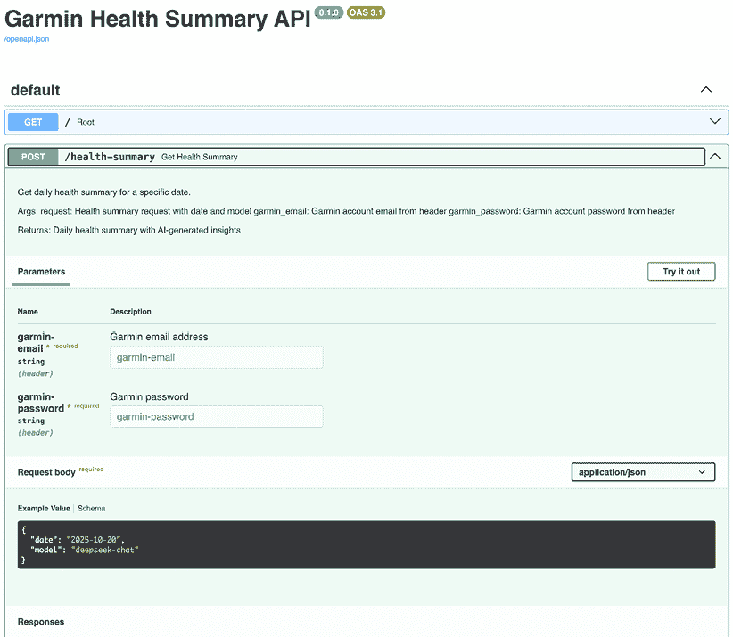
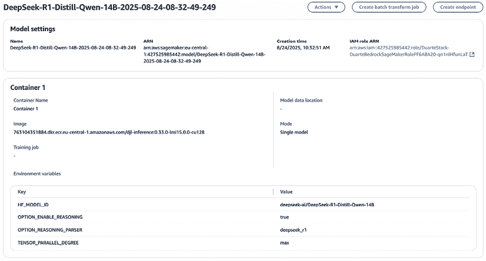
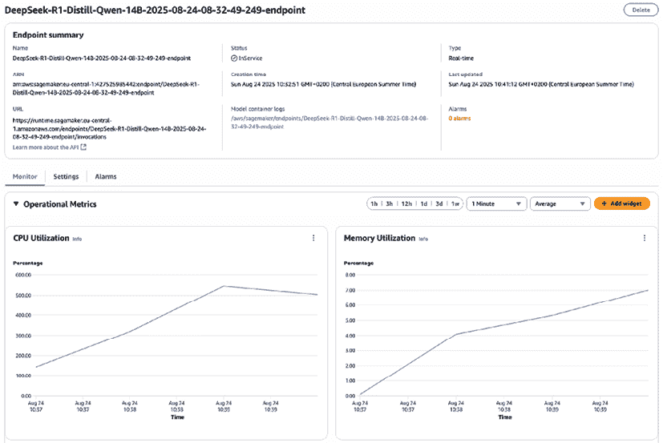

# 5 构建 DeepSeek 应用

## 案例研究：财务文档分析

财务文档分析案例研究使用 FruitStand Innovation Inc. 的一份虚构季度报告（包含 192 行、6 个复杂表格和 150 个语义字段），评估了 `DeepSeek-R1` 与专用文档解析工具的表现。`DeepSeek-R1` 实现了 91.3% 的字段提取准确率（137/150 字段）、94.7% 的表格解析准确率（232/245 单元格）和完美的实体识别（42/42 实体），处理时间为 4,250 毫秒，每份文档成本为 $0.0027。我们将 `DeepSeek-R1` 与 `Docling`（IBM Research）和 `MarkItDown`（Microsoft）进行了比较，发现 `Docling` 通过专门的结构识别实现了更高的表格解析准确率（97.2%），`MarkItDown` 提供了最快的处理速度（890 毫秒）和中等准确率（78.5%），而 `DeepSeek-R1` 独特地提供了语义理解能力，并具备直接字段提取功能。将 `Docling` 的结构提取与 `DeepSeek-R1` 的语义解释相结合的混合流水线取得了最佳的综合效果。

在两项案例研究中，我们应用了一致的评估指标，包括对技术准确性和实施准备情况的定性评估，以及对提取准确性、处理时间和成本效益的定量测量。`DeepSeek-R1` 始终表现出专业顾问水平，在复杂文档上达到 88-92% 的准确率，每份文档成本 $0.0027，而人工分析成本为 $50-100，这展示了在自动化文档理解工作流程中 99% 以上的成本降低。实施 `DeepSeek-R1` 进行文档理解的组织应在部署前建立明确的评估指标，定义定性标准（如技术准确性和完整性）和定量测量（包括字段提取准确率、实体识别、处理时间和每份文档的成本），这些指标应与其特定的文档类型相适应。由于监管和合规要求，财务文档通常需要 95% 以上的准确率阈值，而一般技术文档可能接受 85% 以上的准确率，并对关键部分进行人工验证。

成功的实施需要仔细的提示工程，明确指定输出格式、必需字段、数值精度要求和特定领域术语。我们的财务文档分析表明，为常见缩写提供词汇表，例如 `PP&E` 代表 `Property, Plant & Equipment`，并明确是否扩展首字母缩略词，可以显著减少提取错误。对于复杂的多列表格，明确指示模型列之间的关联性和时间段比较，可以最大限度地减少嵌套单元格混淆。当初始提取遗漏关键字段时，迭代提示被证明很有价值，因为针对特定缺口的后续提示能够持续提高完整性，而无需重新处理整个文档。组织还应考虑根据文档特征结合工具优势的混合架构，例如，使用 `Docling` 预处理具有复杂视觉布局的 PDF 文件以 97.2% 的准确率提取表格结构，然后使用 `DeepSeek-R1` 进行语义字段提取和实体识别，总成本仅为每份文档 $0.0027，同时实现比任何单一工具更高的准确性。

接下来，我们将展示如何使用 DeepSeek API 创建一个可工作的服务。敬请期待。

---

### 获取本书的 PDF 版本和独家内容

扫描二维码（或访问 packtpub.com/unlock）。按书名搜索本书，确认版本，然后按照页面上的步骤操作。

> **注意：** 请保留好您的发票。直接从 Packt 购买则无需发票。

---

在前面的章节中，我们讨论了 DeepSeek 的内部工作原理、有效提示 DeepSeek 模型的最佳策略以及如何使用 DeepSeek。在本章中，我们将付诸实践。我们将解决一个实际问题，并向您展示如何利用 DeepSeek 模型来解决它。

DeepSeek 模型是开源的，这既是优势也是挑战。您有无尽的选择：通过 API 使用大型模型，或使用可在本地运行的微缩模型，这很强大但需要权衡。使用 DeepSeek 模型没有唯一的正确方式；最佳选择取决于您的情况和具体用例的需求。您应该选择本地选项还是云选项？应该选择小模型、大模型还是推理模型？

本章的目标是双重的。我们想向您展示如何使用 DeepSeek 模型解决一个特定的用例（端到端），并演示您可以与 DeepSeek 模型交互或使用的主要方式。在本章中，您将学习使用模型的所有不同方式：本地、通过 API、在云端以及在您自己的机器上。

但在开始之前，我们需要一个用例。让我们看看 Duarte 对其日常与智能手表斗争的描述。

> 我和我的妻子都是长跑运动员，已经很久了。不瞒你说，我非常喜欢马拉松。跑步是为数不多的我真正从办公桌后走出去到户外的场合。我热爱它的一切。但这可能不是谈论它的好地方。我们都使用佳明智能手表；我们很喜欢它们！
>
> 每天晚上 8:45 整，我和妻子都会看手表，就在那一刻，手表会发给我们一个当天的摘要（**压力大的一天**、**锻炼的一天**或**休息的一天**）。这里有一个例子：
>
> **锻炼的一天**
>
> 今天高强度的锻炼和休息时段对您的身心健康都有好处。现在花点时间放松，好好睡一觉。


*图 5.1：佳明每日通知示例*

> 在拥有手表的头几周，它们棒极了！它给了我另一个追踪和了解自己身体的指标。但几周后，您开始意识到您总是收到五条预写消息中的一条。从一个角度来看，这很酷；手表了解我的身体！从另一个角度来看，它很烦人，因为手表只是发送它内存中存储的五条预写消息中的一条。而且，这些消息太笼统了。几乎感觉手表并没有告诉我任何我不知道的事情。过了一段时间，它就感觉很无聊。

我们听到了您的心声，Duarte！

当我们三位作者开始构思这本书时，我们意识到在像 DeepSeek 这样的 **大语言模型** (**LLM**) 时代，佳明的通知肯定可以做得更好——好得多。一条更动态、个性化的消息——一条可以接受某种用户输入的消息。您知道我们的意思。有 *很多* 方法我们可以让它变得更好。所以，这就是我们打算做的。

在本章中，我们将构建一个可以访问我的智能手表数据、读取数据并每天为我提供一个有趣且动态摘要的程序。不再只有五条预定义消息；每次我们收到摘要，消息都会不同。我们将利用 DeepSeek 来分析数据并为我们构建一个很好的摘要。我们将其称为 **每日健康摘要**。

在开始之前，有几点说明：

*   这个每日健康摘要将由 LLM 生成。正如您可能知道的，LLM 有时会 *产生幻觉* 或产生不准确的信息。本章我们不会讨论防护栏或保证模型输出的安全性。但是，如果您有兴趣了解更多，这里有一个有用的库供您入门：[`github.com/guardrails-ai/guardrails`](https://github.com/guardrails-ai/guardrails)。

本章将重点讲解如何从 Garmin 手表中提取数据。我们将使用 Garth 库（`https://github.com/matin/garth`）进行身份验证。虽然该库广为人知且流行，但重要的是要记住它并非 Garmin 的官方库。因此，无法保证 Garmin 未来不会更改其身份验证方法。如果您没有 Garmin 设备，仍然可以从 Strava 或其他您使用的服务中提取数据；不过，您将需要使用这些替代来源自行处理数据提取过程。

那么，我们开始吧。

本章我们将涵盖以下内容：

*   构建我们的第一个原型
*   与 DeepSeek 模型进行交互
*   使用 AWS 部署一个隔离的模型服务
*   最佳实践和建议

### 技术要求

本章的所有代码都位于本书的 GitHub 仓库：`https://github.com/PacktPublishing/DeepSeek-in-Practice`。

您需要在机器上安装以下内容：

*   `uv`：请参阅以下链接获取安装说明：`https://docs.astral.sh/uv/getting-started/installation/`。
*   Docker：我们将为我们设计的 API 构建 Docker 镜像。请查看此链接开始安装：`https://docs.docker.com/engine/install/`。

本章的代码位于`Chapter 05`目录中；在章节文件夹内运行`uv sync`将安装所有依赖项。

本章假设您拥有一个 DeepSeek API 密钥，您可以在`https://platform.deepseek.com/`获取。

您可能需要安装其他库/依赖项，但我们会在章节中明确指出。

有几种方法可以使用 DeepSeek，例如，DeepSeek API、第三方 API，或使用一些库如`litellm`来利用 DeepSeek 模型。我们在本书的*附录*中介绍了一些这些选项。请去查看。

## 构建第一个原型

在本节中，我们将为“每日健康摘要”构建一个端到端的原型，遵循五个高级步骤：

1.  首先，我们将从 Garmin API 获取数据并学习如何查询它。
2.  接下来，我们将把这些原始健康数据塑造成 DeepSeek 能够理解和推理的格式。
3.  然后，我们将定义结构化的输出：我们希望 DeepSeek 返回什么以及它应该是什么样子。
4.  在结束之前，我们将把所有内容重构为一个您可以查询和使用的 API。
5.  最后，我们将逐步介绍如何使用 Docker 部署所有内容。

让我们从从 Garmin 获取数据开始。

### 获取数据

首要任务是查询 Garmin 关于我们拥有的数据。这完全是以编程方式检索我们的 Garmin 手表记录的关于我们的健康数据（心率、睡眠时长、压力等）。为了完成这项工作，我们将利用`python-garminconnect`项目（`https://github.com/cyberjunky/python-garminconnect`）。

为了使其工作，您应该同时拥有您的 Garmin 电子邮件和用于登录 Garmin 账户的密码。两者都应适用于`https://connect.garmin.com/signin`。

**注意**

如果您没有 Garmin 账户，请不要担心。GitHub 仓库包含加载示例数据的说明，因此您可以毫无问题地运行 API 和示例。

一旦您手头有了这些信息，我们就可以使用以下函数登录 Garmin：

```python
# We get the values as environmental variables
GARMIN_EMAIL = os.getenv("GARMIN_EMAIL") # your email
GARMIN_PASSWORD = os.getenv("GARMIN_PASSWORD") # your password
# and we define our function
def start_garmin() -> Garmin:
    """Initialize Garmin connection."""
    try:
        GARMIN = Garmin(
            email=GARMIN_EMAIL,
            password=GARMIN_PASSWORD,
            is_cn=False, # if you are in China, set to True
        )
        GARMIN.login()
        print("You are now logged in.")
        return GARMIN
    except Exception as e:
        print(f"Could not login with email and password: {e}")
        raise
If everything goes well, you can now run the following:
garmin = start_garmin()
# prints: You are now logged in.
```

此函数现在为我们提供了一个可以处理和查询 API 的`garmin`实例。现在我们知道如何实例化 Garmin API，让我们继续查询给定日期所需的所有信息。为此，我们创建一个`get_daily_health_summary`函数。此函数将接收一个 API 实例、一个开始日期和一个结束日期。目标是返回该日期范围内的健康信息。

首先，我们将创建几个辅助函数：一个将日期转换为 ISO 格式的函数（因为 Garmin 要求此格式），另一个接收两个日期并返回我们可以迭代的范围的函数：

```python
def get_daily_health_summary(
    api: Any, start: datetime.date, end: datetime.date
) -> list[dict[str, Any]]:
    def dstr(d: datetime.date) -> str:
        return d.isoformat()
    def daterange(a: datetime.date, b: datetime.date):
        for i in range((b - a).days + 1):
            yield a + datetime.timedelta(days=i)
```

现在我们遍历每一天，并可以通过使用`get_user_summary`方法从 Garmin 检索摘要信息。此方法返回一个字典，其中包含我们想要用于上下文的字段，例如静息心率、步数、运动分钟数和睡眠时长：

```python
 for day in daterange(start, end):
        s = dstr(day)
        day_of_week = day.strftime("%A")
        summary = api.get_user_summary(s) or {}
        rhr = summary.get("restingHeartRate")
        steps = summary.get("totalSteps")
        stress_level = summary.get("averageStressLevel")
        body_battery_final = summary.get("bodyBatteryMostRecentValue") or summary.get(
            "mostRecentBodyBattery"
        )
        exercise_minutes = (summary.get("moderateIntensityMinutes") or 0) + (
            summary.get("vigorousIntensityMinutes") or 0
        )
        sleep_seconds = summary.get("sleepingSeconds")
        sleep_hours = round(sleep_seconds / 3600, 2)
        body_battery_start = summary.get("bodyBatteryAtWakeTime")
        total_distance_meters = summary.get("totalDistanceMeters")
```

最后，一旦我们提取了所有感兴趣的字段，现在可以将它们附加到函数将返回的数组中：

```python
 out.append(
            {
                "date": s,
                "day_of_week": day_of_week,
                "resting_heart_rate": rhr,
                "exercise_minutes": exercise_minutes,
                "stress_level": stress_level,
                "sleep_hours": sleep_hours,
                "steps": steps,
                "total_distance_meters": total_distance_meters,
                "body_battery_start_day": body_battery_start,
                "body_battery_end_day": body_battery_final,
            }
        )
    return out
```

有了这个函数，我们现在可以为任何感兴趣的日期调用它。例如，如果我们想获取昨天的数据，我们可以获取今天的日期，减去一天（使用`timedelta`），并调用`get_daily_health_summary`方法：

```python
yesterday = datetime.date.today() - datetime.timedelta(days=1)
summary_for_yesterday = get_daily_health_summary(
    garmin, yesterday, yesterday)
summary_for_yesterday
```

调用此函数后，我们可以看到在 8 月 13 日，我的静息心率为 62，总共睡了 9 个小时（！）。我不确定发生了什么，但那确实睡了很多！俗话说，睡眠是运动员最好的朋友。


```
[{'date': '2025-08-13', 'day_of_week': 'Wednesday', 'resting_heart_rate': 62, 'exercise_minutes': 0, 'stress_level': 38, 'sleep_hours': 9.09, 'steps': 1866, 'total_distance_meters': 1387, 'body_battery_start_day': 74, 'body_battery_end_day': 17}]

请注意，我们也可以为一个日期范围调用我们的函数，这很有帮助，例如：

```python
past_7_days_start = yesterday - datetime.timedelta(days=7)
past_7_days_end = yesterday - datetime.timedelta(days=1)
summary_for_past_7_days = get_daily_health_summary(
    garmin, past_7_days_start, past_7_days_end
)
summary_for_past_7_days
```

这将返回一个介于 `past_7_days_start` 和 `past_7_days_end` 之间每一天的数据列表。如果这看起来不太明白，别担心！一切很快就会清晰：

```python
[
    {
        'date': '2025-08-06',
        'day_of_week': 'Wednesday',
        'resting_heart_rate': 58,
        'exercise_minutes': 3,
        'stress_level': 32,
        'sleep_hours': 8.17,
        'steps': 5320,
        'total_distance_meters': 3953,
        'body_battery_start_day': 97,
        'body_battery_end_day': 20
    },
    {
        'date': '2025-08-07',
        'day_of_week': 'Thursday',
        # ...

    },
    {
        'date': '2025-08-08',
        # ...
```

### 构建上下文

我们现在可以查找特定日期或日期范围内的健康数据。接下来，我们需要为我们的 DeepSeek 模型准备数据。有很多种方法可以实现，但我们想保持简单。我们将创建一个提示词（prompt），其中包含一个简短的 Markdown 部分来呈现每个测量指标。对于每个测量指标（例如压力水平），我们希望向大语言模型（LLM）展示以下内容：

*   该指标的当日数值。

*   过去七天的平均值（基线），不包括今天。

*   与基线相比，今天数值的百分比变化。

*   基线期间的趋势。

*   对于该测量指标，较低的数值是否更好。

例如，对于睡眠时长，我们希望得到以下内容：

```markdown
### 睡眠时长
- 今日数值 (2025-08-13): 9.09
- 7 天基线平均值 (不含今日): 8.21
- 与基线相比的百分比变化: +10.7%
- 过去 7 天趋势: up ↑
- 较低的数值更好: False
```

这将为每个我们获取的其他指标重复生成。

通过这些信息，我们现在是为模型提供了一个在特定上下文下的指标，而不是一个孤立的指标。这将确保模型减少“幻觉”，并理解指标更广泛的背景。

为了识别趋势，我们需要一个启发式方法。这里有一个简单的函数，它接受一个数字列表并返回 `up`（上升）、`down`（下降）或 `flat`（平稳）。它比较列表中前三项和后三项的平均值。如果这些平均值在 5%以内，函数返回 `flat`，因为指标没有发生重大变化。这不是一个完美的启发式方法，但能达到我们的目的：

```python
def detect_trend(values, pct_threshold=5):
    recent, earlier = np.mean(values[-3:]), np.mean(values[:3])
    return (
        "up"
        if recent > earlier * (1 + pct_threshold / 100)
        else ("down" if recent < earlier * (1 - pct_threshold / 100) else "flat")
    )
```

有了我们的启发式方法，我们现在可以创建一个构建上下文的函数；`build_llm_context_md` 接收今天的摘要和过去七天的摘要。这些是相同的字典列表，其中包含当前日期和过去七天的健康指标信息。

然后，我们创建一个字符串列表，每个字符串代表 LLM 的一行上下文。最后，我们创建一个 `better_is_lower` 数组，用于存储那些分数较低更可取的指标，例如压力水平：

```python
def build_llm_context_md(
    summary_for_today: list[dict], summary_for_past_7_days: list[dict]
) -> str:
    assert len(summary_for_today) == 1, "Expected 1 day of summary"
    today = summary_for_today[0]
    metrics = [key for key in today.keys() if key not in ["date", "day_of_week"]]
    lines = [
        f"# {today['date']} ({today['day_of_week']}) 每日指标摘要",
        "_ 注意：所有比较仅使用**过去 7 天的数据**，不含今日。_",
        "",
    ]
    better_is_lower = [
        "resting_heart_rate",
        "stress_level",
    ]
```

之后，我们遍历指标。对于每个指标，我们创建一个值列表。包括指标的当前值、基线期间的平均值，以及“较低的数值是否更好”标志。遍历完成后，我们通过 `join` 所有行来构建我们给 DeepSeek 的上下文：

```python
for metric in metrics:
    today_val = today[metric]
    if not today_val:
        print(f"Skipped {metric} since no values were found")
    past_vals = [
        day[metric] for day in summary_for_past_7_days 
        if day[metric] is not None
    ]
    avg_7d = sum(past_vals) / len(past_vals) if past_vals else 0
    delta_pct = ((today_val - avg_7d) / avg_7d * 100) if avg_7d else 0
    trend_dir = detect_trend(past_vals)
    arrow = "↑" if trend_dir == "up" else ("↓" if trend_dir == "down" else "→")
    lines.append(
        f"## {metric.replace('_', ' ').title()}\n"
        f"- 今日数值 ({today['date']}): {today_val}\n"
        f"- 7 天基线平均值 (不含今日): {avg_7d:.2f}\n"
        f"- 与基线相比的百分比变化: {delta_pct:+.1f}%\n"
        f"- 过去 7 天趋势: {trend_dir} {arrow}\n"
        f"- 较低的数值更好: {metric in better_is_lower}\n"
    )
return "\n".join(lines)
```

我们现在可以通过以下方式调用该函数：

```python
# 启动客户端并定义日期
garmin = start_garmin()
date = "2025-08-13"
# 获取指定日期的摘要数据
date_for_summary = datetime.datetime.strptime(date, "%Y-%m-%d").date()
summary_in_date = get_daily_health_summary(
        garmin, date_for_summary, date_for_summary
)
# 获取该日期之前 7 天的数据
past_period_start = date_for_summary - datetime.timedelta(days=7)
past_period_end = date_for_summary - datetime.timedelta(days=1)
summary_in_past_period = get_daily_health_summary(
        garmin, past_period_start, past_period_end
)
# 构建提示词
prompt = build_llm_context_md(summary_in_date, summary_in_past_period)
print(prompt)
```

这将输出一个清晰的摘要，我们可以将其输入给我们的大语言模型：

```markdown
# 2025-08-13 (Wednesday) 每日指标摘要
_ 注意：所有比较仅使用**过去 7 天的数据**，不含今日。_
### 静息心率
- 今日数值 (2025-08-13): 62
- 7 天基线平均值 (不含今日): 55.86
- 与基线相比的百分比变化: +11.0%
- 过去 7 天趋势: up ↑
- 较低的数值更好: True
### 运动时长（分钟）
- 今日数值 (2025-08-13): 0
- 7 天基线平均值 (不含今日): 3.00
- 与基线相比的百分比变化: -100.0%
- 过去 7 天趋势: up ↑
- 较低的数值更好: False
### 压力水平
- ....
### 睡眠时长
- ...
... 其他指标因简洁而隐藏
```

很好！我们现在拥有了想要提供给 DeepSeek 模型的所有信息。但我们具体希望它如何回应呢？

### 定义结构化输出

现在是时候定义我们希望“每日健康摘要”呈现何种形态了。与大多数基于大语言模型的应用程序一样，让模型返回某种结构化输出（JSON 格式）通常是一个好做法（我们在 *第 2 章* 和 *第 3 章* 中讨论过）。为了表示我们的每日健康摘要，我们创建两个 Pydantic ([`docs.pydantic.dev/`](https://docs.pydantic.dev/)) 模型：

*   `DayType`：将我们的日期分类为五种类型之一。

*   `DailySummary`：创建一个对象，包含日期类型、标题、表情符号、观察结果和建议。

代码如下：
```


# 创建每日健康摘要

现在，我们已具备制作第一份每日健康摘要的所有要素。让我们开始创建摘要。

首先，我们将创建一个简单的函数，该函数使用 `type: json_object` 调用 DeepSeek API，以强制模型返回 JSON 结构。这并不出奇；它会返回模型创建的 JSON 以及推理内容（如果有的话，例如在使用 `deepseek-reasoner` 时）：

```python
from pydantic import BaseModel, Field
class DayType(str, Enum):
    TRAINING = "training"
    ACTIVE_RECOVERY = "active_recovery"
    REST = "rest"
    HIGH_STRESS = "high_stress"
    BALANCED = "balanced"
class DailySummary(BaseModel):
    day_type: DayType = Field(
        ...,
        description="基于活动和恢复指标对这一天进行分类",
    )
    title: str = Field(..., description="对这一天的单句总结")
    emoji: str = Field(..., description="代表当天类型的 Emoji 表情")
    observation: str = Field(
        ...,
        description="关于关键指标和模式的两句话观察",
    )
    recommendation: str = Field(
        ...,
        description="针对明天的两条可操作建议",
    )
```

```python
def llm(
    messages: list[dict], model: str, response_format: dict | None = None
) -> tuple[dict, str | None]:
    client = OpenAI(
        api_key=os.environ["DEEPSEEK_API_KEY"],
        base_url="https://api.deepseek.com",
    )
    response = client.chat.completions.create(
        model=model, messages=messages, response_format=response_format, temperature=0.0
    )
    message = response.choices[0].message

    if hasattr(message, "reasoning_content"):
        reasoning_content = message.reasoning_content
    else:
        reasoning_content = None

    return json.loads(message.content), reasoning_content
```

为了确保我们的模型表现良好，我们创建了两个 `DailyHealthSummary` 示例，并制定了系统提示词：

```python
# 示例 1：训练日
training_day_example = DailySummary(
    day_type=DayType.TRAINING,
    title="强有力的训练日，所有指标活动量均有所增加。",
    emoji="💪",
    observation="运动分钟数达到基线的两倍，活动了 95 分钟，并伴有 18,500 步。尽管训练负荷很高，但身体电量从 85 的良好水平开始，表明从昨天恢复得不错。",
    recommendation="考虑明天进行积极恢复或休息日，以适应今天付出的努力。今晚优先保证睡眠，以维持身体电量水平并支持肌肉恢复。",
)
# 示例 2：高压力日
high_stress_day_example = DailySummary(
    day_type=DayType.HIGH_STRESS,
    emoji="😫",
    title="尽管体力活动极少，但压力升高且恢复不佳。",
    observation="压力水平比基线高出 46%，而睡眠时间降至仅 6.1 小时，导致身体电量起点较低，仅为 45。运动和活动极少，表明压力来自非体力来源。",
    recommendation="专注于压力管理技巧，争取今晚睡足 8 小时以上。考虑明天进行轻度锻炼，如散步或瑜伽，因为温和的活动有助于调节压力水平。",
)
examples = [training_day_example, high_stress_day_example]
examples_str = "\n\n\n".join([example.model_dump_json() for example in examples])
```

系统提示词包含三个部分——为模型提供背景和指导的通用指令、我们期望它遵循的 JSON 模式，以及一些示例 JSON 输出：

```python
system_prompt = f"""
Instructions:
* 你将收到用户今天与过去 7 天相比的健康与健身数据摘要。
* 你的目标是生成一个将在用户智能手表上显示的摘要。
* 保持内容简短，同时也要让用户感兴趣。
* 你的摘要应包括当天类型、标题、一些观察和给用户的建议。
* 你的摘要应采用 JSON 格式。仅输出 JSON，不要有其他文本。
---JSON SCHEMA---
{DailySummary.model_json_schema()}
---END JSON SCHEMA---
---EXAMPLE JSON OUTPUTS---
{examples_str}
---END EXAMPLE JSON OUTPUTS---
"""
```

现在万事俱备，我们可以创建最后一个函数了。这个函数的作用就是将我们至今构建的所有部分整合起来。它执行以下步骤：

1.  接收一个 `Garmin` API 实例和一个字符串格式的日期。
2.  从 `Garmin` 获取该日期及之前七天的数据。
3.  构建我们的提示词和消息列表，包括系统提示词。
4.  调用模型，并根据我们的 `DailySummary` Pydantic 模型验证其响应。

```python
def get_daily_summary(
    garmin: Garmin,
    date: str,
    model: Literal["deepseek-chat", "deepseek-reasoner"],
    verbose: bool = False,
) -> DailySummary:
        # 转换为日期时间格式
    date_for_summary = datetime.datetime.strptime(date, "%Y-%m-%d").date()

        # 获取指定日期的信息
    summary_in_date = get_daily_health_summary(
        garmin, date_for_summary, date_for_summary
    )
        # 获取基线时期的信息
    past_period_start = date_for_summary - datetime.timedelta(days=7)
    past_period_end = date_for_summary - datetime.timedelta(days=1)
    summary_in_past_period = get_daily_health_summary(
        garmin, past_period_start, past_period_end
    )
        # 使用趋势和指标创建提示词
    prompt = build_llm_context_md(summary_in_date, summary_in_past_period)
        # 创建消息列表
    messages = [
        {"role": "system", "content": system_prompt},
        {"role": "user", "content": prompt},
    ]

        # 调用大语言模型并验证响应
    response, reasoning = llm(messages, model, {"type": "json_object"})
    health_summary = DailySummary.model_validate(response)
    return health_summary
```

从现在开始，我们需要获取 `DailyHealthSummary` 时，只需调用 `get_daily_summary` 函数，传入日期和我们想使用的模型即可：

```python
daily_summary = get_daily_summary(garmin, "2025-08-19", "deepseek-chat")
print(daily_summary.model_dump_json())
```

然后，它会返回我们构建的每日健康摘要：

```json
{
   "day_type":"balanced",
   "title":"恢复改善、压力降低、平衡良好的一天。",
   "emoji":"⚖️",
   "observation":"静息心率下降 9.3%至 39，压力水平显著降低 58.8%，表明恢复极佳。身体电量起点高达 82，终点为 72，显示尽管睡眠和活动略有减少，但能量使用高效。",
   "recommendation":"通过持续适度运动和保证充足睡眠来维持这种平衡。专注于压力管理以保持低水平并支持持续恢复。"
}
```

如你所见，这效果相当不错。看这个例子，我可以告诉你它完全正确。这是我八月份假期的第一天，这使得摘要特别准确。我们现在有了第一个原型。但构建应用程序并不仅限于此。我们希望构建一个完整的服务，为任何感兴趣的人计算这些每日摘要。为此，我们需要构建一个 API。

### 重构为 API

既然我们的系统已经可以作为简单函数运行，是时候为它构建一个 API 了。目标是创建一个服务，能够接收用户的请求及其登录 Garmin API 的详细信息，并返回他们的健康指标的 `DailyHealthSummary`。为了实现这一点，我们将使用 `FastAPI`。

**安全注意事项**

### Garmin 健康摘要 API 服务介绍

#### API 端点与认证

API 服务使用您的认证凭据（包括密码）来调用 Garmin Connect API。这种方法对于原型是可接受的，但在生产环境中，用户通常不愿与陌生服务共享明文密码。对于实际应用，建议考虑实现 OAuth 或使用官方 Garmin Connect 开发者计划：[`developer.garmin.com/gc-developer-program/activity-api`](https://developer.garmin.com/gc-developer-program/activity-api)。

我们的 API 包含两个端点。第一个是一个小型生活质量改进：当用户访问 `/`（根路径）时，他们会自动重定向到 `/docs`。这使得开发者（尤其是项目新手）能够更轻松快速地查找和探索可用端点，并理解预期输出：

```
from fastapi import FastAPI, Header, HTTPException
from fastapi.responses import RedirectResponse
app = FastAPI(title="Garmin Health Summary API")
@app.get("/")
async def root():
    return RedirectResponse(url="/docs")
```

应用实例化后，我们创建 `HealthSummaryRequest`，这是期望从用户获得的请求。如以下所示，我们期望他们提供一个日期，如果未提供，则默认为今天的日期。用户还可以选择指定两个模型之一（`deepseek-chat` 或 `deepseek-reasoner`）来创建摘要：

```
class Model(str, Enum):
    chat = "deepseek-chat"
    reasoner = "deepseek-reasoner"
class HealthSummaryRequest(BaseModel):
    date: str = Field(
        default_factory=lambda: datetime.date.today().isoformat(),
        description="Date in YYYY-MM-DD format, defaults to today",
        example=datetime.date.today().isoformat(),
    )
    model: Model = Field(
        default=Model.chat,
        description="Model to use for the summary",
    )
```

为了进行身份验证，用户必须在请求头中提供 Garmin 凭据。我们返回之前介绍过的同一个 `DailySummary` 请求：

```
@app.post("/health-summary", response_model=DailySummary)
async def get_health_summary(
    request: HealthSummaryRequest,
    garmin_email: str = Header(..., description="Garmin email address"),
    garmin_password: str = Header(..., description="Garmin password"),
) -> DailySummary:
```

`get_health_summary` 端点的核心部分运行着与之前看到的完全相同的逻辑，并额外添加了一些错误处理以防万一出错：

```
"""Get Daily Health Summary for a specific date.
    Args:
        request: Health summary request with date and model
        garmin_email: Garmin account email from header
        garmin_password: Garmin account password from header
    Returns:
        Daily Health Summary with AI-generated insights
    """
    try:
        garmin = get_garmin_client(garmin_email, garmin_password)
        summary = get_daily_summary(garmin, request.date, request.model)
        logger.info(
            f"Daily Health Summary API request completed successfully for {request.date}"
        )
        return summary
    except ValueError as e:
        logger.error(f"Invalid date format provided: {request.date}")
        raise HTTPException(
            status_code=400, detail=f"Invalid date format: {e}"
        )
    except Exception as e:
        logger.error(
            f"Failed to generate Daily Health Summary for {request.date}: {e}"
        )
        raise HTTPException(
            status_code=500, detail=f"Error generating summary: {e}"
        )
```

有了这一切，我们现在可以使用以下命令运行我们的 API：

```
$ uv run fastapi run 02-api.py
```

这将在您机器的端口 `8000` 上启动一个生产服务器。当您访问 `http://0.0.0.0:8000` 时，您将看到 API 页面已准备好供您交互：


图 5.2: Garmin 健康摘要 API 页面

您可以通过界面或命令行调用 API。如果您安装了 `curl`（[`curl.se/`](https://curl.se/)），以下是如何调用的示例：

```
$ curl -X 'POST' \
        'http://localhost:8000/health-summary' \
        -H 'accept: application/json' \
        -H 'garmin-email: your.email@example.com' \
        -H 'garmin-password: your-password' \
        -H 'Content-Type: application/json' \
        -d '{
    "date": "2025-08-19"
  }'
```

这将以 JSON 格式返回模型的响应：

```
{
   "day_type":"rest",
   "title":"Rest day with minimal activity and good recovery indicators.",
   "emoji":"😴",
   "observation":"Exercise minutes and steps were significantly below your baseline, suggesting a deliberate rest. Body battery started high and stress levels were low, indicating effective recovery from previous days.",
   "recommendation":"Continue with light activity or rest tomorrow to maintain this positive recovery state. Ensure adequate sleep to keep your body battery levels optimal for future training."
}
```

### 使用 Docker 部署

我们的服务的最后一个方面是部署。您可能通过 SSH 连接并运行 `fastapi run` 命令，甚至在本地运行。然而，在处理实时生产系统时，您可能会使用 **Docker**。

现在，您的 API 可以运行了。这很棒。但不幸的是，我们无法将您的计算机运送给用户。如果我们的应用将在生产中运行，它需要部署到云中的某个地方。这意味着我们的应用需要在另一台计算机上运行。我们如何确保那台计算机上也安装了所有需要的东西？在过去的十年里，答案一直是**容器**。

Docker 是业界一个成熟的工具，它使用容器来声明式地定义依赖关系，并在部署时保持应用程序隔离。简而言之，Docker 让您可以将应用程序及其所需的一切——代码、库和工具——打包到一个轻量级的容器中。这确保了它可以在任何机器上以相同的方式运行，从您的笔记本电脑到生产环境，而不会出现环境问题。尽管我们很乐意写一本关于 Docker 惊人与不那么惊人的事物的厚书，但这不是那本书。如果您不熟悉它并想学习基础知识，我们建议您从这里开始：[`www.docker.com/101-tutorial`](https://www.docker.com/101-tutorial)。

现在，这是我们的详细注释的 `Dockerfile`，它打包了我们日常健康摘要服务的所有依赖项。如果您有兴趣深入了解此处的一些选择，我们建议您深入 `uv` Docker 教程/演练，因为我们的 `Dockerfile` 很大程度上受其启发（[`docs.astral.sh/uv/guides/integration/docker/`](https://docs.astral.sh/uv/guides/integration/docker/)）：

```
# First, build the application in the `/app` directory
FROM ghcr.io/astral-sh/uv:bookworm-slim AS builder
ENV UV_COMPILE_BYTECODE=1 UV_LINK_MODE=copy
# Configure the Python directory so it is consistent
ENV UV_PYTHON_INSTALL_DIR=/python
# Only use the managed Python version
ENV UV_PYTHON_PREFERENCE=only-managed
# Install Python before the project for caching
RUN uv python install 3.12
WORKDIR /app
RUN --mount=type=cache,target=/root/.cache/uv \
    --mount=type=bind,source=uv.lock,target=uv.lock \
    --mount=type=bind,source=pyproject.toml,target=pyproject.toml \
    uv sync --locked --no-install-project --no-dev --no-group local
COPY . /app
RUN --mount=type=cache,target=/root/.cache/uv \
    uv sync --locked --no-dev --no-group local
# Then, use a final image without uv
FROM debian:bookworm-slim
# Copy the Python version
COPY --from=builder --chown=python:python /python /python
# Copy the application from the builder
COPY --from=builder --chown=app:app /app /app
# Place executables in the environment at the front of the path
ENV PATH="/app/.venv/bin:$PATH"
# Expose the port
EXPOSE 8000
# Run the FastAPI application
CMD ["fastapi", "run", "app/02-api.py", "--host", "0.0.0.0", "--port", "8000"]
```

## 与 DeepSeek 模型交互

我们可以运行该应用程序，通过构建容器并在我们自己的机器上运行它，使用 `docker build` 和 `docker run` 命令。第一个命令构建一个名为 `api` 的镜像，使用 `02-api.Dockerfile` 作为 Dockerfile；第二个命令从该镜像启动一个容器，暴露端口 `8000` 并传递 `DEEPSEEK_API_KEY` 环境变量：

```
$ docker build -t api -f 02-api.Dockerfile .
$ docker run -it -e DEEPSEEK_API_KEY=sk-... -p 8000:8000 -t api
```

应用程序应再次在你的本地 URL 启动：[`localhost:8000`](http://localhost:8000)。

内容很多，但你应该感到高兴。你创建了一个接收用户 Garmin 凭据并返回由 DeepSeek 驱动的每日健康摘要的服务。恭喜！现在，尽管我们很想向你展示如何在服务器上运行它，但本书不会这样做。容器的好处在于你可以将它们部署在*任何地方*。几乎所有云提供商在云上部署容器至少有 5 种方式，尽管 AWS 有 17 种不同方式：[`www.lastweekinaws.com/blog/the-17-ways-to-run-containers-on-aws/`](https://www.lastweekinaws.com/blog/the-17-ways-to-run-containers-on-aws/)。

在休息之后，你会开始思考，虽然系统运行良好，但它并非特定于 DeepSeek。我们只是在调用 DeepSeek API。我们也可以调用任何其他 API（OpenAI，Anthropic 等）。然而，DeepSeek 的真正力量在于其开源本质。这为我们打开了一些大门。接下来我们将探索它们。

### LiteLLM

LiteLLM 是一个库，允许我们使用单一统一格式轻松地与不同的 LLM 和提供商交互。

LiteLLM 的优势在于，当你更换提供商时，真正需要更改的只是你传递给 `completion` 函数的 `model` 字符串。

在以下示例中，我们演示如何使用 `litellm` 库通过三种不同的提供商使用 DeepSeek：

*   `deepseek/deepseek-chat`：使用 DeepSeek API 中的 DeepSeek chat 模型。
*   `bedrock/us.deepseek.r1-v1:0`：使用 Amazon Bedrock ([`aws.amazon.com/bedrock/`](https://aws.amazon.com/bedrock/)) 运行 DeepSeek-R1 推理模型的推理。
*   `openrouter/deepseek/deepseek-r1-distill-qwen-14b`：使用 OpenRouter ([`openrouter.ai/`](https://openrouter.ai/)) 运行 Qwen 14B 蒸馏模型。

> **警告**
>
> 使用不同提供商时，你可能必须设置不同的 API 密钥和认证方法。请务必查看它们的文档以获取更多信息。内容非常丰富！

以下是你如何使用 `litellm` 的示例：

```
from litellm import completion

def litellm(messages: list[dict]) -> tuple[str, str | None]:
    response = completion(
        # model="deepseek/deepseek-chat", # 使用 DeepSeek API
        # model="bedrock/us.deepseek.r1-v1:0", # 使用 AWS bedrock 进行推理
        model="openrouter/deepseek/deepseek-r1-distill-qwen-14b", # 使用 OpenRouter 进行推理
        messages=messages,
        temperature=0.0,
    )
    message = response.choices[0].message
        # 如果存在推理内容，则提取出来
    if hasattr(message, "reasoning_content"):
        reasoning_content = message.reasoning_content
    else:
        reasoning_content = None
    return message.content, reasoning_content

# 使用示例：
messages = [
    {"role": "system", "content": "You are a helpful assistant."},
    {"role": "user", "content": "What is the capital of France?"},
]
result, reasoning = llm(messages)
print(f"Result: {result}")
# Result: The capital of France is Paris.
print(f"Reasoning: {reasoning}")
# Reasoning: Okay, so I need to figure out the capital ...
```

`litellm` 是一个强大的工具，结合 **OpenRouter**，意味着你可以调用任何 API 和模型，甚至是本地模型！是的，我们说的是本地……但让我们一步步来。

## 使用 Ollama 在本地运行

2025 年 1 月发布的 DeepSeek-R1 震惊了世界，原因有很多。旗舰 R1 模型不仅在基准测试中表现出色，并与当时的最先进技术相媲美，而且这家中国实验室更进一步。你可能还记得我们在 *第 1 章* 和 *第 2 章* 中的讨论，除了旗舰模型，他们还发布了六个不同的蒸馏模型。

每个模型都是使用 DeepSeek-R1 模型生成的样本，从一个基础开源模型微调而来。原始模型包含 6850 亿参数，总权重为 641.33 GB。粗略地说，以全精度运行该模型大约需要 1540 GB 的显存。现在，你可能在后院拥有那种计算能力，但现实是很少有公司拥有那种计算能力，因为它需要多 GPU 设置。

但蒸馏版本则讲述了一个不同的故事。在 *表 5.1* 中，你可以看到蒸馏模型、它们的基础模型（从中微调而来）以及以 4 位量化运行它们所需的显存。这为我们这些在后院没有 GPU 集群的人打开了大门。其中一些可以在非常小的 GPU 上运行。事实上，我们甚至可以在单个 GPU 上运行它们！

| **模型** | **基础模型** | **Hugging Face 仓库** | **显存需求** |
| :--- | :--- | :--- | :--- |
| DeepSeek-R1 | - | 🤗 [huggingface.co/deepseek-ai/DeepSeek-R1](https://huggingface.co/deepseek-ai/DeepSeek-R1) | ~436 GB |
| DeepSeek-R1-Distill-Llama-70B | Llama-3.3-70B-Instruct ([`huggingface.co/meta-llama/Llama-3.3-70B-Instruct`](https://huggingface.co/meta-llama/Llama-3.3-70B-Instruct)) | 🤗 [huggingface.co/deepseek-ai/DeepSeek-R1-Distill-Llama-70B](https://huggingface.co/deepseek-ai/DeepSeek-R1-Distill-Llama-70B) | ~46 GB |
| DeepSeek-R1-Distill-Qwen-32B | Qwen2.5-32B ([`huggingface.co/Qwen/Qwen2.5-32B`](https://huggingface.co/Qwen/Qwen2.5-32B)) | 🤗 [huggingface.co/deepseek-ai/DeepSeek-R1-Distill-Qwen-32B](https://huggingface.co/deepseek-ai/DeepSeek-R1-Distill-Qwen-32B) | ~21 GB |
| DeepSeek-R1-Distill-Qwen-14B | Qwen2.5-14B ([`huggingface.co/Qwen/Qwen2.5-14B`](https://huggingface.co/Qwen/Qwen2.5-14B)) | 🤗 [huggingface.co/deepseek-ai/DeepSeek-R1-Distill-Qwen-14B](https://huggingface.co/deepseek-ai/DeepSeek-R1-Distill-Qwen-14B) | ~9 GB |
| DeepSeek-R1-Distill-Llama-8B | Llama-3.1-8B ([`huggingface.co/meta-llama/Llama-3.1-8B`](https://huggingface.co/meta-llama/Llama-3.1-8B)) | 🤗 [huggingface.co/deepseek-ai/DeepSeek-R1-Distill-Llama-8B](https://huggingface.co/deepseek-ai/DeepSeek-R1-Distill-Llama-8B) | ~5 GB |
| DeepSeek-R1-Distill-Qwen-7B | Qwen2.5-Math-7B ([`huggingface.co/Qwen/Qwen2.5-Math-7B`](https://huggingface.co/Qwen/Qwen2.5-Math-7B)) | 🤗 [huggingface.co/deepseek-ai/DeepSeek-R1-Distill-Qwen-7B](https://huggingface.co/deepseek-ai/DeepSeek-R1-Distill-Qwen-7B) | ~4.5 GB |
| DeepSeek-R1-Distill-Qwen-1.5B | Qwen2.5-Math-1.5B ([`huggingface.co/Qwen/Qwen2.5-Math-1.5B`](https://huggingface.co/Qwen/Qwen2.5-Math-1.5B)) | 🤗 [huggingface.co/deepseek-ai/DeepSeek-R1-Distill-Qwen-1.5B](https://huggingface.co/deepseek-ai/DeepSeek-R1-Distill-Qwen-1.5B) | ~1 GB |

表 5.1: DeepSeek 模型的显存需求

本地运行 LLM 有两个成熟的工具。第一个是 `llama.cpp` ([`github.com/ggml-org/llama.cpp`](https://github.com/ggml-org/llama.cpp))，第二个，使用第一个作为其推理引擎，是 `Ollama` ([`ollama.com/`](https://ollama.com/))。

使用 `Ollama` 运行本地模型很简单。安装 `Ollama` ([`ollama.com/download`](https://ollama.com/download)) 后，只需在终端中输入以下命令：

### 使用本地模型进行健康数据摘要

### 使用 Ollama 运行本地模型

```
$ ollama run deepseek-r1:1.5b
>>> Hi there!
Hello! How can I assist you today? 😊
```

此命令将下载蒸馏后的 1.5B 模型（如果你之前没有运行过），并启动一个聊天会话。根据你的系统情况，它可能会运行得比较热，但 1.5B 参数模型应该能在大多数现代计算机上运行。

我们可以使用 Ollama Python SDK ([`github.com/ollama/ollama-python`](https://github.com/ollama/ollama-python)) 来生成每日健康摘要。我们只需适配 `get_daily_summary` 函数，并利用我们刚下载的 1.5B 参数蒸馏模型：

```python
from ollama import chat
def get_daily_summary(
    garmin: Garmin,
    date: str,
) -> DailySummary:
    prompt = get_daily_summary_prompt(garmin, date)
    messages = [
        {"role": "system", "content": SYSTEM_PROMPT},
        {"role": "user", "content": prompt},
    ]
    response = chat(
        messages=messages,
        model="deepseek-r1:1.5b",
        format=DailySummary.model_json_schema(),
        options={
            "temperature": 0.0,
        },
    )
    return DailySummary.model_validate_json(response.message.content)
```

我们可以通过设置 `format=DailySummary.model_json_schema()` 来为 Ollama 指定返回格式。这会将 Pydantic 模型的 JSON schema 也传递给模型。我们可以这样调用函数：

```python
garmin = get_garmin_client(
        email=os.environ["GARMIN_EMAIL"],
        password=os.environ["GARMIN_PASSWORD"],
    )
summary = get_daily_summary(garmin, "2025-08-14")
print(summary)
```

这会输出以下内容：

```
day_type=<DayType.HIGH_STRESS: 'high_stress'> title='Elevated stress and poor recovery despite minimal physical activity.' emoji='😫' observation='Stress levels jumped 46% above baseline while sleep dropped to just 6.1 hours, resulting in a low body battery start of 45\. Exercise and movement were minimal, suggesting stress is from non-physical sources.' recommendation='Focus on stress management techniques and aim for 8+ hours of sleep tonight. Consider light exercise like walking or yoga tomorrow, as gentle movement can help regulate stress levels.'
```

是的，今天状态不太好。但我们刚刚将本地的 1.5B 参数模型接入了我们的每日健康摘要服务！在继续之前，请记住，你也可以像我们之前展示的那样，使用 LiteLLM 来使用本地模型，只需将模型设置为例如 `ollama_chat/deepseek-r1:1.5b`。

### 使用 Transformers 和 XGrammar 在 CPU 上进行推理

Ollama 非常适合快速测试和试验本地模型。但要真正构建我们的每日健康摘要服务，我们需要对设备、提示结构、分词过程以及生成过程本身有更精细的控制。这就是我们更接近底层，利用成熟的 Transformers 库 ([`github.com/huggingface/transformers`](https://github.com/huggingface/transformers)) 的地方。

要在 CPU 上运行我们的 1.5B 参数模型，让我们使用 Unsloth 版本的 1.5B 蒸馏模型，你也可以在 Hugging Face 上找到它。Unsloth ([`docs.unsloth.ai/`](https://docs.unsloth.ai/)) 是另一个值得关注的有趣库，如果你对微调和自己运行模型感兴趣的话。

我们首先用以下代码加载模型：

```python
from transformers import AutoModelForCausalLM, AutoTokenizer, TextStreamer
model_name = "unsloth/DeepSeek-R1-Distill-Qwen-1.5B"
device = "cpu"
question = "What is the capital of Le Marche, Italy?"
max_tokens = 1200
tokenizer = AutoTokenizer.from_pretrained(model_name)
model = AutoModelForCausalLM.from_pretrained(model_name).to(device)
```

我们对消息使用 `apply_chat_template` 将它们转换为模型输入：

```python
messages =
[
    {"role": "user", "content": question},
]
inputs = tokenizer.apply_chat_template(
    messages,
    add_generation_prompt=True,
    tokenize=True,
    return_dict=True,
    return_tensors="pt",
).to(model.device)
```

有了这些，我们现在可以直接从 CPU 流式输出 token：

```python
streamer = TextStreamer(tokenizer, skip_prompt=True, skip_special_tokens=False)
model.generate(
    **inputs,
    max_new_tokens=max_tokens,
    streamer=streamer,
)
# prints Okay, so I need to figure out the capital of Le Marche, Italy. Hmm, I'm not super familiar with Italy, but I know it's one of the largest and most populous countries in Europe....
```

这使用 `transformers` 库直接在 CPU 上运行我们的模型。效果很好，但如果我们想将此模型与每日健康摘要服务的其余部分集成，我们需要确保模型能有效遵守我们的 `DailySummary` 格式。这正是开源模型真正闪光的地方。

记住，模型是本地运行的，所以我们对它生成的 token 拥有完全的控制权。我们可以编写一个函数来限制每个 token，使其符合我们定义的 JSON schema。但这正是 `outlines` ([`dottxt-ai.github.io/outlines`](https://dottxt-ai.github.io/outlines))、`xgrammar` ([`github.com/mlc-ai/xgrammar`](https://github.com/mlc-ai/xgrammar)) 和 `guidance` ([`github.com/guidance-ai/guidance`](https://github.com/guidance-ai/guidance)) 等库开箱即用的功能。它们执行**受限**生成。它们不仅仅是让模型生成 JSON，而是明确地将 token 限制在符合 JSON 结构的范围内。

根据我们的经验，`xgrammar` 产生了最佳结果。使用它的代码有些复杂，但如果你有疑问，我们建议你查阅该库的文档。不过，我们还是会在高层次上解释一下。

代码的第一部分只是导入模型，将其放置在 CPU 上，并设置所需的种子（以获得可复现的输出）：

```python
import xgrammar as xgr
from transformers import AutoConfig, AutoModelForCausalLM, AutoTokenizer
MODEL_NAME = "unsloth/DeepSeek-R1-Distill-Qwen-1.5B"
MODEL = AutoModelForCausalLM.from_pretrained(
    MODEL_NAME,
    torch_dtype=torch.float32,
    device_map="cpu",
)
TOKENIZER = AutoTokenizer.from_pretrained(MODEL_NAME)
CONFIG = AutoConfig.from_pretrained(MODEL_NAME)
MAX_NEW_TOKENS = 1024
transformers.set_seed(42)
```

现在，我们将调整 `get_daily_summary` 函数以适配我们的 API。我们接收消息，但现在也将它们通过 `apply_chat_template` 处理：

```python
def get_daily_summary(
    garmin: Garmin,
    date: str,
) -> DailySummary:
    prompt = get_daily_summary_prompt(garmin, date)
    messages = [
        {"role": "system", "content": SYSTEM_PROMPT},
        {"role": "user", "content": prompt},
    ]
    texts = TOKENIZER.apply_chat_template(
        messages, tokenize=False, add_generation_prompt=True
    )
```

乍一看，代码可能令人生畏，但它实际上只做了四件事：

1.  它首先用 `TokenizerInfo.from_huggingface` 提取分词器元数据，为正确解释 token 提供基础。

2.  在生成过程中，它应用一个 `xgrammar` logits 处理器，强制模型仅生成在 `DailySummary` schema 下有效的 token。

3.  生成步骤本身在较低的 `temperature` 并启用采样的情况下运行，在一致性和多样性之间取得平衡。

4.  最后，输出通过 `DailySummary.model_validate_json` 进行解码和验证，返回一个干净的结构化 Pydantic 对象。

5.  **温度（Temperature）**

    `temperature` 参数控制模型输出的随机性。较低的值使响应更确定，较高的值提供更有创意的答案。实际上，`temperature` 通过操纵 DeepSeek 生成每个 token 的概率来实现这一点。

    Patrick von Platen 有一篇关于使用 Transformers 进行文本生成的优秀教程，深入探讨了包括 `temperature` 在内的参数：[`huggingface.co/blog/how-to-generate`](https://huggingface.co/blog/how-to-generate)。


这些部分协同工作，确保我们每次都能获得完全符合需求——即干净且有效的 JSON：

```
model_inputs = TOKENIZER(texts, return_tensors="pt").to(MODEL.device)
tokenizer_info = xgr.TokenizerInfo.from_huggingface(
    TOKENIZER, vocab_size=CONFIG.vocab_size
)
grammar_compiler = xgr.GrammarCompiler(tokenizer_info)
compiled_grammar = grammar_compiler.compile_json_schema(DailySummary)
xgr_logits_processor = xgr.contrib.hf.LogitsProcessor(compiled_grammar)
generated_ids = MODEL.generate(
    **model_inputs,
    max_new_tokens=MAX_NEW_TOKENS,
    logits_processor=[xgr_logits_processor],
    do_sample=True,
    temperature=0.01,
    top_p=0.95,
    top_k=50,
)
generated_ids = generated_ids[0][len(model_inputs.input_ids[0]) :]
model_response = TOKENIZER.decode(generated_ids, skip_special_tokens=True)
return DailySummary.model_validate_json(model_response)
```

我们为获得**确定性输出**而将 `temperature` 设置为 `0.01`，倾向于选择高概率的令牌。`top_k=50` 将每一步的选择限制为最可能的 50 个令牌，而 `top_p=0.95` 则将生成范围限定在覆盖 95%概率质量的令牌内，去除了不太可能的长尾部分。这些选择并非严格规定，因此可以自行尝试调整。

有了 `xgrammar`，我们现在可以将每日健康摘要服务重构为**完全**在本地运行。无需 API 调用，也不会出现 JSON 格式错误。

### 为本地 CPU 生成进行重构

既然我们已经替换了 `get_daily_summary`，就可以创建一个全新的、完全在本地运行的 API。在本书代码仓库的 `Chapter05` 文件夹中，我们提供了一个 `05-api-cpu-xgrammar.py` 文件。它看起来*完全像*我们设计的第一个模型服务，但运行 100%在本地。

要运行它，我们再次使用 FastAPI，命令如下：

```
$ uv run fastapi run 05-api-cpu-xgrammar.py
```

在另一个终端中，我们可以通过命令行调用此 API：

```
$ curl -X 'POST' \
        'http://localhost:8000/health-summary' \
        -H 'accept: application/json' \
        -H 'garmin-email: your.email@example.com' \
        -H 'garmin-password: your-password' \
        -H 'Content-Type: application/json' \
        -d '{
    "date": "2025-08-19"
}'
```

这再次返回了格式良好的 JSON，由 `DeepSeek-R1-Distill-Qwen-1.5B` 生成，100%在你自己的机器上运行：

```json
{
   "day_type":"high_stress",
   "title":"Elevated stress and poor recovery despite minimal physical activity.",
   "emoji":"😫",
   "observation":"Stress levels jumped 46% above baseline while sleep dropped to just 6.1 hours, resulting in a low body battery start of 45\. Exercise and movement were minimal, suggesting stress is from non-physical sources.",
   "recommendation":"Focus on stress management techniques and aim for 8+ hours of sleep tonight. Consider light exercise like walking or yoga tomorrow, as gentle movement can help regulate stress levels."
}
```

`Dockerfile` 有 99%的相似度，只有少量依赖差异，为简洁起见，我们将其略过。

呼！干得漂亮！你刚刚创建了一个完全本地化的每日健康摘要服务。你学会了如何在 CPU 上运行 DeepSeek 模型，确保它们产生可靠的 JSON，并清晰地理解了如何部署它们以及如何与我们设计的服务进行整合。这内容相当多。

然而，需要注意的是，我们为 1.5B 参数模型设计的方案同样适用于任何其他 DeepSeek 模型，但有一个主要限制：你需要专门的硬件。你可能无法在 CPU 上运行比 1.5B 版本更大的模型。对于更大的模型，我们需要 GPU。你们中的一些人可能拥有强大的电脑，但现实是，更大的模型往往比小模型表现更好。

假设我们希望用 `DeepSeek-R1` 的 70B 参数蒸馏版来运行每日健康摘要；我们至少需要 46GB 的显存。我有一台配置相当高的 MacBook，拥有 64GB 统一内存，但事实是我从未能舒适地运行过超过 30B 参数的模型。而且我们不可能把我的 MacBook 寄出去。

你明白这个意思。我们需要在别人的机器上运行——也就是在云端。但我们仍然希望拥有本地模型的优势，即我们可以紧密控制生成过程。在下一节中，我们将探讨如何在云端部署一个更大的蒸馏模型。系好安全带，这将会很有趣！

## 使用 AWS 部署隔离的模型服务

**亚马逊云科技**（**AWS**）是全球最受欢迎的云计算平台之一。我们将重点介绍它，以便部署一个更大的 DeepSeek 模型，并将其与我们的每日健康摘要服务集成。和大多数云计算平台一样，实现同一目标的方式几乎有 25 种之多。AWS 也不例外。

要在 AWS 上使用/部署 DeepSeek 模型，你可以采取以下方式：

*   使用 **Bedrock API**，AWS 在此托管基础模型（包括 DeepSeek）。在这里，你可以像我们使用 DeepSeek API 一样调用和使用模型。你不会进行部署；你只是使用。

*   使用 **Bedrock 自定义模型导入**，这是 AWS 提供的一项服务，允许你将训练好的模型导入 Bedrock，然后通过 Bedrock API 使用它。模型需要是 Hugging Face 格式。请注意，仅支持某些架构（例如，不支持 Gemma 模型）。

*   **Hugging Face 深度学习容器**（**DLC**）也可用于在 AWS 上部署模型。用于推理时，它们包含 PyTorch 或**文本生成推理**（**TGI**, [`github.com/huggingface/text-generation-inference`](https://github.com/huggingface/text-generation-inference)) 作为受支持的框架。如果你想使用这些框架，这是一个有趣的选择。你也可以使用 DLC 来训练模型，这将通过 AWS 的 SageMaker 服务完成。

*   **自行构建**：我们的意思是，你在云端购买一个带有 GPU 的虚拟机（即一个 `EC2` 实例），安装你需要的所有软件包，管理依赖项、访问、升级等等——拥有最大控制权，但也可能带来不少麻烦。

*   最后，通过 `SageMaker` 的**大模型推理**（**LMI**）容器允许你使用多种可用的推理后端来部署大语言模型。这是为更大的模型设计的，你需要完全控制，但又不想管理基础设施——接近底层，但又无需太多烦心事。LMI 容器由 **Deep Java Library**（**DJL**）框架提供支持。可以将 `DJL` 视为驱动这些容器的引擎。

这并非详尽无遗的列表。AWS 提供了更多选项，其中一些可能会持续多年，而另一些可能不会。在 AWS 上部署模型*没有唯一正确的方式*；但是，你应该在选择前权衡利弊。我们汇编了一张表格（*表 5.2*），列出了每个选项的优缺点以及何时使用：

| 选项 | 优点 | 缺点 | 使用场景 |
| :--- | :--- | :--- | :--- |
| Bedrock API | 无需管理基础设施。可访问众多前沿模型（包括 Anthropic、Mistral 和 DeepSeek）。集成身份验证。自动扩展和服务等级协议。 | 你不拥有模型。定制化有限。大规模使用时每令牌成本较高。 | 你只需要通过 API 使用模型，不想托管任何东西。 |
| Bedrock 自定义模型导入 | 无需管理基础设施即可部署你微调过的模型。与 Bedrock API、代理和知识库集成。受益于 Bedrock 的安全性和日志记录。 | 架构支持有限。必须将模型转换为 Hugging Face 格式。比托管基础模型需要更多设置。 | 你有自己的训练好的模型，但想利用 Bedrock 的托管环境。 |
| Hugging Face DLC (SageMaker) | 托管式训练和推理。包含 TGI 用于优化的 LLM 推理。与 Hugging Face Hub 轻松集成。自动扩展端点。 | | |


### 部署选项对比

*   仅限于 Hugging Face、TGI 和 PyTorch 技术栈。
*   相比 DJL，对于非常大的模型优化较少。
*   仍需为 SageMaker 基础设施付费。

| 适用场景：您需要一条基于 Hugging Face 的原生路径，在 SageMaker 上进行训练或推理。 |
| :--- |

| **自定义在 EC2 上部署** |
| :--- |
| *   最大程度的控制。
*   可自由选择任何服务栈，例如 vLLM、TGI 和 Triton。
*   没有 SageMaker 或 Bedrock 的额外开销。 |
| *   您需要管理所有事情，包括扩缩容、安全和网络。
*   更难可靠地运行。
*   运维负担更高。 |

| 适用场景：您需要完全的控制权，或者想要尝试自定义的栈和内核。 |
| :--- |

| **大型模型推理（LMI/DJL）** |
| :--- |
| *   专为大模型构建。
*   支持 vLLM、TensorRT-LLM 以及用于 Inf2 的 NeuronX。
*   管理基础设施、扩缩容和分片。
*   在大型模型上拥有最佳吞吐量。 |
| *   设置过程比 Hugging Face DLC 稍微复杂。
*   需要了解 SageMaker。
*   开箱即用时，“Hugging Face 魔法”较少。 |

| 适用场景：您需要为大型或生产级模型获得最大性能，同时无需管理基础设施。 |
| :--- |

*表 5.2：AWS 上部署选项的比较*

我们建议几乎总是从 API 调用开始，避免复杂的自托管，除非您知道您的产品确实需要它。所以，如果您正在构建产品，请从 API 调用开始。一旦您有了一百万用户，就该开始考虑部署了。本书中我们也“吃自己的狗粮”，这就是为什么我们从通过 API 使用 DeepSeek 模型开始。现在我们将深入探讨使用 LMI 容器部署 DeepSeek。这是因为我们相信 vLLM 是一个极其强大的推理引擎（[`github.com/vllm-project/vllm`](https://github.com/vllm-project/vllm)）。

您可能已经在问自己：到底什么是推理引擎？问得好。

## 推理后端

一个**推理引擎**是简化 LLM 部署过程的框架。它提供了打包、优化和服务能力。这样您就无需考虑 GPU 优化、请求管理、内存优化、LLM 架构、流式传输或对结构化生成的支持。推理后端提供了所有这些功能，因此您可以专注于使用模型。我们编译了另一份（非详尽的）推理引擎列表，见*表 5.3*：

| **引擎** | **主要创新点** | **性能优化** | **量化（内置）** | **分布式推理** | **易用性** | **独特功能** |
| :--- | :--- | :--- | :--- | :--- | :--- | :--- |
| `vLLM` ([`github.com/vllm-project/vllm`](https://github.com/vllm-project/vllm)) | PageAttention 与 GPU 友好的 KV 分页 | 连续批处理、融合的 CUDA 内核、异步 I/O | INT8 / INT4（AWQ, GPTQ），SmoothQuant | 张量并行与流水线并行 | 高（单命令启动） | 兼容 OpenAI 的 API；实时 KV 缓存交换 |
| `Hugging Face TGI` ([`github.com/huggingface/text-generation-inference`](https://github.com/huggingface/text-generation-inference)) | Rust + Python gRPC 服务器 | Token 流式传输、连续批处理、推测解码、FlashAttention | GPTQ, AWQ, bits-and-bytes, Marlin | 可选的分片与张量并行 | 高（Docker/CLI） | Triton 后端，Prometheus 指标 |
| `SGLang` ([`github.com/sgl-project/sglang`](https://github.com/sgl-project/sglang)) | 预填充/解码解耦；RadixAttention | 连续批处理、专家/流水线/张量并行 | FP8, INT4 (AWQ/GPTQ) | 数据、张量与流水线并行 | 中等（需要额外 DSL） | 支持视觉语言模型；内置路由器 |
| `LMDeploy` ([`github.com/InternLM/lmdeploy`](https://github.com/InternLM/lmdeploy)) | 压缩到服务的工具包 | 持久化批处理、阻塞 KV、split-fuse 内核 | 4 位权重+KV，AWQ，SmoothQuant | 张量并行；K8s Helm chart | 高（单个可执行文件） | 集成的量化→部署流程 |
| `TensorRT-LLM` ([`github.com/NVIDIA/TensorRT-LLM`](https://github.com/NVIDIA/TensorRT-LLM)) | 端到端 TensorRT 图编译 | 自定义内核、运行中批处理、分页 KV | FP8, FP4, INT4 (AWQ), INT8 | Triton 后端（多 GPU/节点） | 中等（需要 TRT 构建） | 主/从协调 |

*表 5.3：流行推理引擎的比较*

尽管每个引擎都有其优缺点，但 `vLLM` 已经逐渐确立了其作为主流引擎的地位。它还支持许多我们对于“每日健康摘要”服务感兴趣的功能：结构化生成、兼容 OpenAI 的 API、量化、对 DeepSeek 模型的一流支持，甚至支持推理输出！

## 使用 LMI 容器部署 DeepSeek

SageMaker 支持多种用于训练和推理作业的容器镜像。您可以在 GitHub 上的 **AWS DLC** 仓库中查看完整列表：[`github.com/aws/deep-learning-containers`](https://github.com/aws/deep-learning-containers)。

在这个生态系统中，我们将特别关注 **LMI 容器**，因为它们对 **vLLM** 提供了一流的支持。LMI 容器是 DJL 的一部分并由其文档化：一个用于深度学习的开源 Java 框架。我们理解这有点令人困惑。

关键在于，如果我们对将要部署的容器的文档感兴趣，可以在 [`docs.djl.ai/`](https://docs.djl.ai/) 找到。

我们需要首先弄清楚的是模型所需的总内存。我们将专注于为我们的用例部署 `DeepSeek-R1 Distill Qwen 14B`。为此，我们将使用一个 `ml.g6.12xlarge` AWS 实例。该实例将为我们提供大约 96 GB 的 GPU 显存，这应该足以运行我们的模型。

**警告**

在此部署中，我们将使用一台 `ml.g6.12xlarge` 机器。根据区域的不同，它每小时的成本约为 5 美元。忘记关闭它，您将被收取每月 3,720 美元的费用！**始终**确保在测试后关闭资源。特此警告。

在*表 5.4*中，我们提供了一些关于为不同流行开源模型选择哪种机器的指导：

| **参数量** | **实例类型** | **GPU 显存** | **示例模型** |
| :--- | :--- | :--- | :--- |
| ~7B | `ml.g5.4xlarge`，`ml.g6.4xlarge` | 24 GB | Llama 2 7B，Mistral 7B，DeepSeek-LLM 7B，DeepSeek-R1 Distill Qwen 7B |
| ~13B | `ml.g5.12xlarge`，`ml.g6.12xlarge` | 96 GB | Llama 2 13B，Code Llama 13B，Qwen2.5 14B，DeepSeek-R1 Distill Qwen 14B |
| ~20B | `ml.g5.12xlarge`，`ml.g6.12xlarge` | 96 GB | GPT-OSS 20B，Mistral Small 24B，Solar Pro 22B |
| ~35B | `ml.g5.48xlarge`，`ml.g6.48xlarge` | 192 GB | Code Llama 34B，Falcon 40B，Yi 34B，DeepSeek-R1 Distill Qwen 32B |
| ~70B | `ml.g5.48xlarge`，`ml.g6.48xlarge` | 192 GB | Llama 2 70B，Code Llama 70B，DeepSeek-R1 Distill Llama 70B，DeepSeek-R1 Distill Qwen 70B |
| ~70B | `ml.p4d.24xlarge` | 320 GB | - |
| ~180B | `ml.p4de.24xlarge`，`ml.p5.48xlarge` | 640 GB | Falcon 180B，GPT-OSS 120B，DeepSeek V2 236B (MoE)，DeepSeek V3 671B (37B active) |

*表 5.4：流行开源模型的实例类型选项*

为了部署我们的模型，我们将利用 SageMaker 的 Python SDK（[`sagemaker.readthedocs.io/`](https://sagemaker.readthedocs.io/)）。以下脚本创建了部署 DeepSeek 模型的通用配置。您可以将模型替换为您感兴趣的模型，并根据前面的速查表调整机器配置（同时考虑成本）。在运行之前，您应确保以下几点：

*   您有一个启用了计费的 AWS 账户并已安装 AWS CLI。如果您还没有 CLI，可以在此处获取：[`docs.aws.amazon.com/cli/latest/userguide/getting-started-install.html`](https://docs.aws.amazon.com/cli/latest/userguide/getting-started-install.html)。
*   您已创建了一个附加了 `AmazonSageMakerFullAccess` 策略的 **IAM 角色**，并设置了以下信任关系以便 SageMaker 可以扮演该角色（创建后请务必获取该角色的 **Amazon 资源名称** (**ARN**))：


```markdown
{
    "Version": "2012-10-17",
    "Statement": [
        {
            "Effect": "Allow",
            "Principal": {
                "Service": "sagemaker.amazonaws.com"
            },
            "Action": "sts:AssumeRole"
        }
    ]
}
```

SageMaker Python SDK 已包含在本项目的依赖项中，因此无需单独安装。

您可能需要为所使用的实例类型请求配额增加。对于以下脚本，您需要至少一个 `ml.g6.12xlarge` 实例的服务配额。AWS 文档中有关于如何操作的良好说明：[`docs.aws.amazon.com/servicequotas/latest/userguide/request-quota-increase.html`](https://docs.aws.amazon.com/servicequotas/latest/userguide/request-quota-increase.html)。

### 如何部署您的模型

以下是部署模型的方法：

```python
import boto3
import sagemaker
import os
import time

# setup session
boto_session = boto3.session.Session()
region = boto_session.region_name
sess = sagemaker.Session()

# create our configuration
CONFIG = {
    "INSTANCE_TYPE": "ml.g6.12xlarge", # the instance type
    "ENV": {
        "HF_MODEL_ID": "deepseek-ai/DeepSeek-R1-Distill-Qwen-14B",  # hugginface model id
        "TENSOR_PARALLEL_DEGREE": "max",  # set max to use all GPUs
        "OPTION_ENABLE_REASONING": "true", # enable reasoning parsing
        "OPTION_REASONING_PARSER": "deepseek_r1", # set reasoning parser
    },
    "IMAGE_NAME": "djl-inference:0.33.0-lmi15.0.0-cu128", # image
    "BEDROCK_ROLE_ARN": "arn:aws:iam::ACCOUNT_NUMBER:role/replace-with-yours", # role
}

# get base model name
ts = time.time()
hf_model_id = CONFIG["ENV"]["HF_MODEL_ID"]
model_name = hf_model_id.split("/")[-1]
base_model_name = sagemaker.utils.name_from_base(model_name)

# create SageMaker model
current_region = os.environ["AWS_DEFAULT_REGION"]
image_name = CONFIG["IMAGE_NAME"]
inference_image_uri = (
    f"763104351884.dkr.ecr.{current_region}.amazonaws.com/{image_name}"
)
lmi_model = sagemaker.Model(
    image_uri=inference_image_uri,
    env=CONFIG["ENV"],
    role=CONFIG["BEDROCK_ROLE_ARN"],
    name=base_model_name,
)
endpoint_name = f"{base_model_name}-endpoint"

# print details
print(f"{base_model_name=}")
print(f"{current_region=}")
print(f"{inference_image_uri=}")
print(f"{endpoint_name=}")

# deploy model (this can take up to 15 mins!)
lmi_model.deploy(
    initial_instance_count=1,
    instance_type=CONFIG["INSTANCE_TYPE"],
    container_startup_health_check_timeout=900,
    endpoint_name=endpoint_name,
)
print(f"Model has been deployed to endpoint {endpoint_name}")
```

模型的部署（取决于您的区域和实例可用性）可能需要长达 15 分钟。完成后，当您导航到 AWS 控制台时，会注意到一个新的模型和端点刚刚被创建：



图 5.3: 我们在 AWS 上创建的模型



图 5.4: SageMaker 端点的仪表板

模型部署完成后，我们可以导航到 Amazon SageMaker AI 控制台。点击 **Inference** 部分，可以导航至 **Inference** > **Models**，您将看到新部署的 DeepSeek 模型。导航至 **Inference** > **Endpoints** 将显示您的模型端点，以及一组供您监控端点状态（CPU 利用率、内存利用率、GPU 内存、GPU 利用率以及调用/请求指标）的指标。

### 危险

完成模型端点使用后，请记得将其关闭，否则实例开启期间您将继续被收费！为此，您可以在 AWS 控制台删除端点或使用 SageMaker SDK：

```python
import sagemaker
sess = sagemaker.Session()
sess.delete_endpoint(endpoint_name)
sess.delete_endpoint_config(endpoint_name)
lmi_model.delete_model()
```

### LMI 容器 API 格式与结构化输出

LMI 容器支持三种不同的 API 模式：OpenAI 的 Chat Completions 格式、OpenAI Completions 格式和 TGI 格式。如果我们希望进行预测，以下三个示例实际上是等效的：

```python
llm = sagemaker.Predictor(
    endpoint_name=endpoint_name,
    sagemaker_session=sess,
    serializer=sagemaker.serializers.JSONSerializer(),
    deserializer=sagemaker.deserializers.JSONDeserializer(),
)
TEMPERATURE = 0.01
MAX_TOKENS = 1024
USER_MESSAGE = "What is the capital of Le Marche, Italy?"

# 1. OpenAI chat completions
llm.predict(
    {
        "messages": [
            {
                "role": "user",
                "content": user_message,
            }
        ],
        "temperature": TEMPERATURE,
        "max_tokens": MAX_TOKENS,
    }
)

# 2. OpenAI Completions format
llm.predict(
    {
        "prompt": user_message,
        "temperature": TEMPERATURE,
        "max_tokens": MAX_TOKENS,
    }
)

# 3. TGI format
llm.predict(
    {
        "inputs": user_message,
        "parameters": {
            "max_new_tokens": MAX_TOKENS,
            "temperature": TEMPERATURE,
        },
    }
)
```

然而，正如我们之前提到的，选择 LMI 容器的一个重要原因是它支持 `vLLM` 作为推理引擎以及结构化输出的各种选项。事实上，LMI 容器支持 Chat Completions 格式**因为** LMI 容器使用 `vLLM` 作为推理引擎。使用 `vLLM` 进行结构化生成的一个选项是 `xgrammar` ([`docs.vllm.ai/en/v0.8.1/features/structured_outputs.html`](https://docs.vllm.ai/en/v0.8.1/features/structured_outputs.html))。

接下来是一个名为 `llm` 的函数示例，该函数将使用我们的 SageMaker 端点和结构化输出，返回符合我们传递给它的 `response_model` 的预测。如您所见，`vLLM` 支持 `response_format` 和一个 `extra_body` 参数，我们可以在此指定希望其遵守的 Pydantic 模型以及希望使用的解码后端：

```python
def llm(
    messages: list[dict],
    endpoint_name: str,
    response_model: BaseModel,
) -> BaseModel:
    client = get_aws_llm(endpoint_name=endpoint_name)
    response = client.predict(
        {
            "messages": messages,
            "temperature": 0.01,
            "max_tokens": 1024,
            "response_format": {
                "type": "json_schema",
                "json_schema": {
                    "name": response_model.__name__,
                    "schema": response_model.model_json_schema(),
                    "strict": True,
                },
            },
            "extra_body": {"guided_decoding_backend": "xgrammar"},
        }
    )
    return response_model.model_validate_json(
        response["choices"][0]["message"]["reasoning_content"]
    )
```

然后我们可以通过提供一个 Pydantic 模型和消息列表来使用此函数，如以下示例：

```python
class Capital(BaseModel):
        capital: str
        population: int

messages = [
        {
                "role": "user",
                "content": "What is the capital of France?",
        }
]

response = llm(
        messages,
        "DeepSeek-R1-Distill-Qwen-14B-2025-08-24-08-52-31-391-endpoint",
        response_model=Capital,
)
print(response)
# capital='Paris' population=2161512
```

因此，现在我们已在 AWS 上部署了大型 DeepSeek 模型，并拥有一个支持 `vLLM` 推理引擎**任何**功能的端点。剩下的唯一步骤是将其与我们的每日健康摘要服务再次集成。由于我们正在对 AWS 进行 API 调用，这应该非常简单。

## 将我们的服务更新为使用 Amazon SageMaker 端点

要将我们的服务更新为使用在 AWS 中部署的模型，我们只需替换之前构建的 `llm` 函数即可。在章节材料中，我们包含了一个 `07-api-deepseek-sagemaker.py` API，可通过以下方式运行：


## 最佳实践和建议

我们的 API 后端现在是 Amazon SageMaker，但其他一切保持不变：请求格式、命令和用户体验。这展示了结构化输出的优势。你可以将后端切换到另一个服务，而不会干扰用户的工作流或破坏 API。事实上，我们也可以同时构建一个服务于三个不同后端（DeepSeek API、CPU 推理和 Amazon SageMaker）的三端点 API——我们就把这个留作练习吧。

在本章中，通过构建每日健康摘要服务，我们探索了使用 DeepSeek 模型的三种主要方式：调用 API、在本地 CPU 上运行蒸馏模型，以及使用 AWS、LMI 容器和 vLLM 部署更大的模型。这些只是冰山一角。开源的好处在于，如果需要，你还有更多的选择可以探索。

话虽如此，**很少**需要自己部署 DeepSeek 模型。自托管能让你拥有控制权和隐私性，但也意味着额外的工作和成本。你必须管理基础设施、监控性能并确保可靠性。对于大多数情况，尤其是在测试想法或验证产品时，从 API 开始几乎总是最佳选择。保持简单，直到你确定需要更多。

在决定是否自己托管模型时，可以参考这个快速清单：

*   **成本**：比较 API 使用成本与自部署成本。它们相差多少？

*   **延迟**：响应需要多快？你的用户能接受吗？

*   **可扩展性**：你的设置能否应对峰值使用量？如果用户一夜暴增怎么办？你还能为他们服务吗？

*   **稳健性**：你的设置需要多稳健？你有负责基础设施的团队吗？

*   **灵活性**：你能轻松地将应用程序从 API 调用演进到自托管，反之亦然吗？

我们已经展示了如何从 API 开始，转向 CPU 推理，并最终部署更大的模型。由于我们的 API 格式保持一致，用户不会注意到变化。这是一种经过验证的演进方式，不会破坏现有系统。

## 总结

在本章中，我们带你从最初的想法到一个完全可用的服务，该服务用 DeepSeek 驱动的动态洞察取代了无聊的智能手表摘要。我们首先展示了如何使用 DeepSeek API 快速构建一个简单的原型，以满足我们的初始需求。然后，我们探索了使用蒸馏版本在本地运行模型，并构建了一个轻量级的、基于 CPU 的服务，无需 GPU 即可运行。

接下来，我们专注于灵活性，展示了`LiteLLM`等库如何让你无需修改应用代码即可无缝切换后端提供商。最后，我们通过使用 LMI 容器和`vLLM`在 AWS 上部署 LLM 来扩展规模，从而在保持控制的同时能够部署更大的模型。

至此，你已经掌握了将任何 DeepSeek 驱动的应用推向生产环境的工具集，无论你是想保持小而高效、通过 API 运行，还是在云端部署更大的模型。

但今天许多成功的应用程序并非由单个 LLM 驱动，而是由多个模型协同工作，这通常被称为**智能体**。这正是我们将在下一章中探讨的内容。

|  |  |
|---|---|
| ### 获取本书的 PDF 版本及独家附加内容 | |
| 扫描二维码（或访问[packtpub.com/unlock](https://packtpub.com/unlock)）。按书名搜索本书，确认版本，然后按照页面上的步骤操作。 |  |

> **注意：** 请备好您的发票。直接从 Packt 购买无需提供发票。

