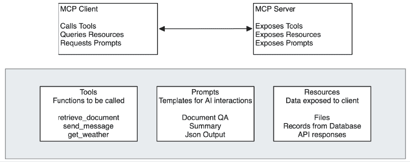
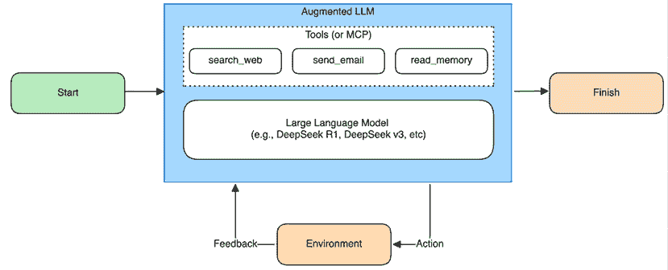
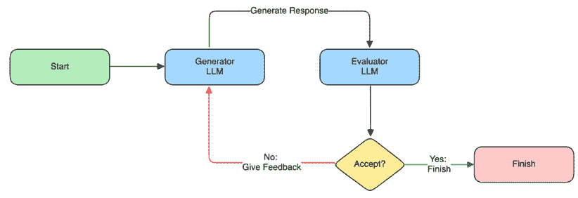
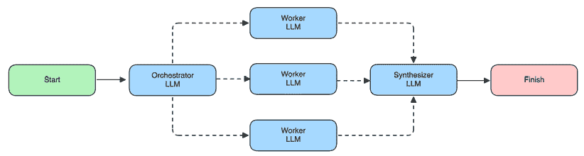
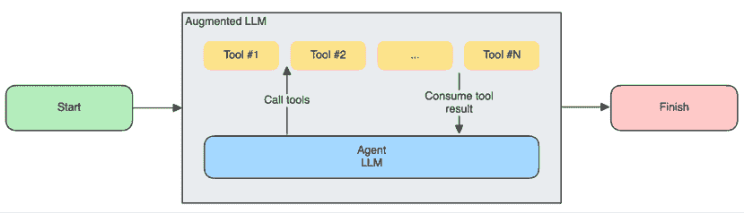

# 6 使用 DeepSeek 构建智能体

在第 4 章中，我们讨论了如何使用 DeepSeek 构建简单的应用程序。在本章中，我们将讨论如何使用 DeepSeek 构建 LLM 驱动的**智能体**。在撰写本文时，智能体是一个非常热门的话题。许多公司和工程师都在急于构建所谓的**智能体应用**。近年来出现了大量的智能体产品。一些流行的例子包括 OpenAI 的深度研究（[`openai.com/index/introducing-deep-research/`](https://openai.com/index/introducing-deep-research/)）和 Google 的 Gemini 深度研究产品（[`gemini.google/overview/deep-research`](https://gemini.google/overview/deep-research)），其中 LLM 会动态地为你搜索网络，并生成一份访问了多个网站和资源的报告。如果你从事软件工作，可能已经使用过一些智能体系统：Claude Code（[`docs.anthropic.com/en/docs/claude-code/overview`](https://docs.anthropic.com/en/docs/claude-code/overview)）和 Cursor（[`www.cursor.com/`](https://www.cursor.com/)）就是很好的智能体驱动产品的例子。

除此之外，用于构建智能体的库和框架也在不断增多。CrewAI（[`www.crewai.com/`](https://www.crewai.com/)）、OpenAI 的 swarm（[`github.com/openai/swarm`](https://github.com/openai/swarm)）和 LangChain 的`LangGraph`（[`langchain-ai.github.io/langgraph/`](https://langchain-ai.github.io/langgraph/)）等库每天都在演进。在撰写本文时，围绕智能体的库和概念非常新，并且在不断演变。为了让这本书经得起时间的考验，我们将专注于那些可能不会改变的智能体核心原则和定义。我们还将向你展示如何利用 DeepSeek 模型来构建这些构件。

在本章中，我们将涵盖以下主要主题：

*   智能体简介

*   工具

*   理解模型上下文协议

*   智能体与工作流

*   探索各种智能体系统

### 技术要求

下一章包含三个不同的 Jupyter 笔记本（[`docs.jupyter.org/en/latest/`](https://docs.jupyter.org/en/latest/)）。你需要安装的唯一软件是`uv`。安装`uv`，请按照此处的说明操作：[`docs.astral.sh/uv/getting-started/installation/`](https://docs.astral.sh/uv/getting-started/installation/)。

## 智能体简介

在我们深入探讨如何使用 DeepSeek 构建智能体之前，我们应该先尝试定义什么是智能体。人们已经多次尝试定义智能体。OpenAI 说智能体是“*代表你独立完成任务的系统*”。

在最基本的层面上，基于 LLM 的智能体是一个自主系统，它能够接受一个通用任务并独立操作来完成它。一个**任务**可以是任何事情：创建一个关于某个主题的报告、创建一个解决此 GitHub 问题的拉取请求，或与某个对手下国际象棋。需要注意的是，智能体并非在真空中运行。智能体被设计为与**环境**进行交互。这个环境可能是一个棋盘、互联网（如果智能体需要搜索它），或者一个 GitHub 仓库（在智能体要向代码库提交补丁的情况下）。

但智能体需要一种在**环境**中交互和执行动作的方式。例如，一个下国际象棋的智能体需要能够读取/理解棋盘，一个研究智能体需要能够搜索互联网，而一个玩宝可梦的智能体（[`www.theverge.com/news/619482/anthropics-claude-ai-is-playing-pokemon`](https://www.theverge.com/news/619482/anthropics-claude-ai-is-playing-pokemon)）则需要能够与游戏进行交互。


为了与环境交互，智能体会使用我们称之为 `工具` 的组件。工具使智能体能够在环境中执行操作。例如，一个编程智能体需要能够读取代码库并为其提交补丁。在这种情况下，你可以想象智能体会使用类似 `read_code_base` 和 `submit_patch` 的工具。例如，DeepSeek 就能通过其函数调用功能来调用这些工具（[`api-docs.deepseek.com/guides/function_calling`](https://api-docs.deepseek.com/guides/function_calling)）。

总结一下，构成智能体的三个主要组件是：

*   `任务`：智能体希望为用户完成的目标。
*   `环境`：智能体为了完成任务而运行的空间。
*   `工具`：智能体可以在环境中采取的一组动作，以完成目标。

举例来说，假设我们要构建一个能向代码库提交改进的智能体。任务可能是*解决我 GitHub 仓库中的 issue #45634*，环境是包含代码的 GitHub 仓库，工具可能包括 `read_file`、`search_repository` 和 `submit_patch`。另一个例子是客户支持智能体。任务可能是解决客户的任何问题，环境可能是与用户的对话（很可能是一个聊天界面），工具则可能包括 `search_knowledge_base`（搜索知识库）、`escalate_ticket`（升级工单），甚至 `mark_issue_as_resolved`（将问题标记为已解决）。

智能体与普通基于 LLM 的应用程序相比，一个重要的特点是智能体旨在*自主*行动。这意味着智能体可以异步地与环境交互，而无需与分配任务的用户进行明确的交互。然而，我们应当注意，智能体与人类配合时可以变得特别强大。例如，智能体可使用的工具之一可能是向人类专家寻求指导的能力。

你一定还听说过其他特点，比如 `记忆` 和 `规划`。记忆可能与两件事有关。

*   第一种是 `短期记忆`，通常与你与智能体直接进行的对话历史（或消息序列）有关。例如，你可能会告诉智能体 *始终用葡萄牙语回复*，那么智能体在本次对话的剩余部分中将会/应该记住这一点。
*   第二种记忆是 `长期记忆`。长期记忆可能涉及我们希望智能体在任务之间持续跟踪的概念。我们可以为长期记忆构建非常复杂的东西。但也可以简单地创建两个工具：`read_memory` 和 `update_memory`。这将允许智能体检索过去的记忆并更新新记忆。没必要把事情搞得太复杂。

至于 `规划`，你可以将其类比为 `思维链`：要求智能体在解决问题*之前*概述一个计划。这是一个有趣的概念，但不是此处的重点。

记忆和规划——尽管有趣——在构建智能体时并非关键。相反，让我们转向智能体最重要的方面之一：`工具`。

### 工具

工具是构建智能体的最关键部分之一。`工具调用` 使智能体能够与环境交互并采取行动。然而，需要注意的是，我们并非一开始就拥有工具调用。在 LLM 的早期阶段（也就不久之前），我们使用简单的提示词来让 LLM 与外部世界交互。

这是一个例子：

```
Question: What is the capital of France?
Thought: I should look this up on Wikipedia.
Action: wikipedia: France
PAUSE
Observation: France is a country. The capital is Paris.
Answer: The capital of France is Paris.
```

在前面的例子中，LLM 输出一个 `动作`（例如，`wikipedia: France`）。系统（我们）看到这个动作，执行搜索，并将结果反馈给 LLM。这种方法虽然原始，但确实有效。这是当时许多热门论文背后的核心机制，比如来自 Google 的 ReAct 论文（[`react-lm.github.io/`](https://react-lm.github.io/)）。

随着发展，这种方法显得脆弱，LLM 模型开始具备了原生的函数（或工具）调用能力。

在本章中，我们将交替使用 `函数` 和 `工具` 这两个术语。

在下一代 LLM 中，我们可以更详细地描述模型可以使用的工具，以及该特定工具可以接受哪些参数。然后模型可以直接通过工具调用来响应。这与之前的原始方法非常相似，但由于模型是 *专门* 针对此类任务训练的（使用强化学习等技术），因此它更加健壮，减少了出错的可能性。

例如，我们可以通过向 LLM 提供 JSON 模式（schema）来指定一个名为 `get_weather` 的工具：

```
tools = [
    {
        "type": "function",
        "function": {
            "name": "get_weather",
            "description": "Get the weather for a given location",
            "parameters": {
                "type": "object",
                "properties": {
                    "location": {"type": "string"}
                },
                "required": ["location"]
            },
        }
    },
]
messages = [{"role": "user", "content": "How's the weather in Hangzhou?"}]
response = client.chat.completions.create(
    model="deepseek-chat",
    messages=messages,
    tools=tools,
)
```

模型会响应它想要调用的函数，以及它打算传递给该函数的参数。

```
{
  "tool_calls": [
    {
      "function": "get_weather",
      "arguments": {
        "location": "Hangzhou"
      }
    }
  ]
}
```

必须注意，模型 *不会* 执行工具——执行的是你，工程师。模型只是告诉我们它希望我们执行什么。你可以看到这种方法为什么稍显健壮。我们可以利用 JSON 模式来定义复杂的工具。

工具调用在当今非常流行。有些模型是专门为工具调用训练的，例如 Salesforce 的 xLAM 系列模型，它们是专门针对工具使用而训练的。伯克利函数调用排行榜（[`gorilla.cs.berkeley.edu/leaderboard.html`](https://gorilla.cs.berkeley.edu/leaderboard.html)）对不同模型调用不同工具的能力进行了排名。在撰写本文时，DeepSeek V3 和 DeepSeek-R1 分别位列第二十二和第二十七位，虽然不是函数调用的 *最佳* 模型，但在构建工具使用方面表现相当不错。

在我们开始构建你的智能体和工作流之前，让我们来谈谈一个越来越流行的东西：`模型上下文协议`。

### 理解模型上下文协议

2024 年 11 月，Anthropic 发布了 `模型上下文协议`（`MCP`）。当时，许多人刚开始用 LLM 构建应用程序。LLM 仍然在某种 *真空* 中运行。许多公司都在构建自己的工具接入 LLM，这往往导致相同的逻辑被反复重新实现。

例如，假设你是一家公司，正在构建一个将 LLM 应用与 Gmail 集成的系统。这将导致许多公司各自创建自己版本的 `read_inbox` 和 `compose_email` 函数。如果我们每次想将 LLM 连接到新系统时都必须开发一个新工具，这将使扩展变得非常困难。MCP 正是为了解决这个挑战。

MCP 是一个旨在简化此过程的开放标准。该协议旨在建立一个模式，让 LLM 可以连接到外部世界。它定义了 MCP 客户端和 MCP 服务器。

客户端是消耗 MCP 服务器资源的应用程序。MCP 服务器暴露三种类型的资源：（1）工具，（2）提示词，（3）资源——每种都在下面的图表中进行了说明。




图 6.1: MCP 服务器示意图（灵感来自 Anthropichttps://www.youtube.com/watch?v=kQmXtrmQ5Zg）

这在实践中意味着什么？这意味着，如果你希望将你的大语言模型连接到 Google Drive，你可以利用别人（可能是 Google）已经构建好的现成 Google Drive MCP，而不必自己构建。

如果到目前为止听起来都有点抽象，让我们来点更具体的。

我们来创建一个自己的小型 MCP 服务器。在下面的例子中，我们使用 `FastMCP` ([`gofastmcp.com`](https://gofastmcp.com)) 框架来创建一个 MCP 服务器。这个服务器提供两个功能：(1) 一个获取城市天气的工具，和 (2) 一个返回给定用户状态的资源：

```python
from fastmcp import FastMCP
mcp = FastMCP(name="MyAssistantServer")
@mcp.tool
def get_weather(city: str) -> str:
    """Multiplies two numbers."""
   return f"The weather in {city} is sunny with a high of 25°C."
@mcp.resource("users://{user_id}/profile")
def get_profile(user_id: int):
    return {"name": f"User {user_id}", "status": "active"}
if __name__ == "__main__":
    mcp.run()
```

定义好我们的小型 MCP 服务器后，我们可以将其保存为 `mcp_server.py`。如何将这些 MCP 工具接入我们的 DeepSeek 大语言模型呢？我们可以参考 DeepSeek 文档中的一个示例。在其官方函数调用文档 ([`api-docs.deepseek.com/guides/function_calling`](https://api-docs.deepseek.com/guides/function_calling)) 中，为了让模型能够使用工具，我们需要首先定义其 JSON schema，如下所示：

```python
tools = [
    {
        "type": "function",
        "function": {
            "name": "get_weather",
            "description": "Get weather of an location, the user should supply a location first",
            "parameters": {
                "type": "object",
                "properties": {
                    "location": {
                        "type": "string",
                        "description": "The city and state, e.g. San Francisco, CA",
                    }
                },
                "required": ["location"],
            },
        },
    },
]
```

或者，我们可以通过 MCP 来获取这些工具。我来介绍一下如何操作。首先，我们定义一个服务器配置：

```python
# Alternatively, we can use the MCP server to fetch tools
mcp_server_config = {
    "mcpServers": {
        "assistant": {
            "command": "uv", "args": ["run", "./mcp_server.py"]}}
}
```

接下来，我们创建一个函数，该函数使用 `FastMCP` 的 `Client` 连接到我们的 MCP 服务器并获取工具列表：

```python
async def fetch_async_tools() -> list:
    async with Client(mcp_server_config) as mcp_client:
        return await mcp_client.list_tools()
```

最后，我们可以将所有这些逻辑包装在一个 `get_tools` 函数中，在那里我们也调整我们的字典以符合 DeepSeek 的期望格式。

```python
def get_tools() -> list:
    """Fetch and format the list of tools from the MCP server."""
    mcp_tools = asyncio.run(fetch_async_tools())
    return [
        {
            "type": "function",
            "function": {
                "name": tool.name,
                "description": tool.description,
                "parameters": tool.inputSchema,
            },
        }
        for tool in mcp_tools
    ]
```

正如你所见，给大语言模型提供工具访问权限，既可以通过自己定义这些工具来实现，也可以通过连接到现有的 MCP 服务器来实现。对于目的明确的应用，我认为你更希望自己定义工具。通常，如果我们使用过多的工具，模型往往会变得困惑，不知道该用哪个以及为什么用。自己定义工具能让你对模型要完成的任务有更强的掌控力。

许多智能体框架，如 OpenAI Agents SDK、LangGraph 和 Pydantic AI，都支持将你的大语言模型连接到 MCP 服务器，并为你省去我刚刚演示的样板代码。然而，在本章中，我们更愿意让你能精细地控制和理解底层不同的工具（或机制）；因此，我们不会使用那些框架。

MCP 的受欢迎程度急剧上升，甚至催生了其他协议，例如 Google 的 `Agent2Agent` (`A2A`) 协议 ([`github.com/a2aproject/A2A`](https://github.com/a2aproject/A2A))。MCP 真正流行起来主要是在面向消费者的应用中。例如，你可以将你的 Claude 桌面应用程序连接到你的 Gmail MCP，或者将你的 VSCode IDE 连接到你公司的 MCP 以读取文档。

在撰写本文时，MCP 和 A2A 都是非常新的协议。只有时间才能证明它们是否会成为真正的标准，还是被其他东西取代。我们确实认为大语言模型和工具调用会存在很长时间。因此，为了向你解释这些机制在底层是如何工作的，我们现在将深入探讨智能体和工作流。

## 使用智能体和工作流

在我们开始构建智能体之前，亲爱的读者，我有一个坏消息告诉你。大多数智能体目前还不太好用。原因有两个。

第一个是**复合错误**。想象一下，我们给智能体安排了一个具有挑战性的任务。这个任务需要精心编排一系列步骤。假设完成这个任务需要五个仔细的步骤。如果每一步都有 90% 的成功概率，那么所有步骤都成功完成的概率就骤降到可怜的 60%。想象一下，你有一个函数只有 60% 的时间能正常工作。你会把它投入生产吗？

智能体——以及更广泛地说，大语言模型——经常失败的第二个原因是上下文腐烂问题。大语言模型具有有限的上下文窗口。我们添加给它们的每一个工具和指令都会填满它们的上下文。研究表明，我们填满上下文越多，大语言模型的性能就越差 ([`research.trychroma.com/context-rot`](https://research.trychroma.com/context-rot))。这意味着，我们给智能体的工具和指令越多，它们最终的表现就越差。这两个因素共同作用使得智能体变得脆弱。解决方案是采用更可控的方法。

2024 年 12 月，Anthropic 发布了一篇非常有趣的博文，名为《构建有效的智能体》([`www.anthropic.com/engineering/building-effective-agents`](https://www.anthropic.com/engineering/building-effective-agents))。在文中，他们对**智能体和工作流做了重要区分**。鉴于每天都在演变出众多不同的智能体定义，根据我们的经验，Anthropic 的这种区分在思考构建由智能体驱动的应用时非常有效。智能体和工作流之间的区别以及工作流的结构直接启发了我们处理本章概念的方式。

一个**智能体**（灵感来自最初的 ReAct 智能体）有一个目标、一个环境和一套工具。在下面的图中，你可以看到一个**增强型大语言模型**的示例，这是一个带有工具的大语言模型。工具可以是搜索网络的能力、写入某种记忆的能力等等。它还有一个与之交互的环境。



图 6.2：带有工具的增强型大语言模型

在这个场景中，我们让大语言模型*自动*选择正确的工具来达到其目标。而不加以引导。这意味着**控制流**是动态的。换句话说，我们期望智能体做出正确的决策来达成其目标。这可能被证明是脆弱的。智能体可能会陷入循环，可能永远无法达到目标，等等。


与智能体（`agent`）相对的是工作流（`workflow`）。在工作流中，整体系统的控制流和方向是预先定义好的。工作流是一种模式，我们预先（在一定程度上）规定了 LLM 将要采取的行动和使用的工具。你可以将工作流看作一种`模式`，或是围绕增强型 LLM 的某种`脚手架`，我们预先决定了希望 LLM 采取的行动或流程。这让我们重新获得了对智能体所需行动的控制权，当行动集相对简单时，这可能是一个绝佳的选择。

表 6.1 强调了智能体与工作流之间的一些差异。

| **方面** | **工作流** | **智能体** |
| --- | --- | --- |
| 结构 | 预定义且顺序执行 | 动态且自主 |
| 灵活性 | 最适合可预测、可重复的任务 | 适用于复杂、开放性问题 |
| 控制 | 由开发者编写的代码路径驱动 | LLM 基于当前上下文决定行动 |
| 工具使用 | 固定顺序或配方 | 由智能体根据需要选择和排序 |
| 可预测性 | 高度可预测 | 可变；可基于反馈进行调整或重试 |
| 主要用例 | 定义明确的自动化、文档流程 | 编程智能体、交互式助手、任务规划器 |

表 6.1：工作流与智能体之间的差异（改编自 Anthropic 的《构建有效智能体》博文）

需要指出的是，智能体和工作流都是`智能系统`，都具有不同程度的自主性。在某种程度上，你可以把`智能体`想象成一辆纯粹的自动驾驶汽车，里面没有人，没有东西控制它；而`工作流`则是一辆有司机（你）的自动驾驶汽车，确保它做正确的事情。未来我们可能会使用大量的`智能体`，但在可能的情况下，我们应该选择控制，使用`工作流`。

在本章中，我们将设计三个不同的、由 DeepSeek 模型驱动的智能体系统。其中两个是工作流，一个是纯粹的智能体。我们将在各自的章节中逐一介绍。本节的目标是让你理解如何使用 DeepSeek 构建智能体系统，并能够将其扩展到你自己的用例。我们不会专注于特定的库或工具。我们相信，尽管其中一些库功能非常强大，但它们往往会忽视智能体系统的重要方面——尤其是在学习阶段。

这里有一些关于智能体的有趣资源供你阅读：

*   [`langchain-ai.github.io/langgraph/`](https://langchain-ai.github.io/langgraph/)
*   [`huggingface.co/learn/agents-course/en/unit1/what-are-agents`](https://huggingface.co/learn/agents-course/en/unit1/what-are-agents)
*   [`www.anthropic.com/engineering/building-effective-agents`](https://www.anthropic.com/engineering/building-effective-agents)
*   [`modelcontextprotocol.io/introduction`](https://modelcontextprotocol.io/introduction)
*   [`developers.googleblog.com/en/a2a-a-new-era-of-agent-interoperability/`](https://developers.googleblog.com/en/a2a-a-new-era-of-agent-interoperability/)

现在，让我们来构建一些示例工作流和智能体。

### 探索各种智能系统

在本节中，我们将讨论三种不同的智能体系统。我们将从一个评估者-优化器工作流开始，通过总结科学论文来展示一个示例。第二个工作流是编排者-工作者工作流，我们将展示如何生成关于某个主题的详细报告。最后，我们将介绍一个纯粹的工具调用智能体，你将看到一个动态工作流的实际运作。

### 工作流：评估者-优化器

我们将介绍的第一个智能工作流是`评估者-优化器`工作流。这个工作流的想法是让第一个 LLM 生成一个响应（即`生成器`），然后让第二个 LLM 评估第一个 LLM 的响应（即`评估者`）。评估者 LLM 评估响应，并持续向第一个 LLM 提供反馈，以便它可以迭代地改进其生成。

关键思想是建立一个受控的循环，我们可以在其中迭代地精炼对特定目标的生成。当你有一个大致的起始方向，并且对优秀结果的标准也有很好的了解时，这个工作流是理想的。例如，你可能想为一份工作申请生成一封求职信，但同时也希望它遵循严格的准则（例如，一定数量的段落，特定的语气）。另一个例子是代码生成。你可以从定义一个函数开始，并建立清晰的标准（代码行数、时间复杂度、单元测试），希望最终结果能遵守这些标准。


图 6.3：评估者-优化器工作流

虽然听起来可能很简单，但这个工作流在推理型 LLM（如`deepseek-reasoner`）的情况下特别有效。这是因为我们不仅向生成器 LLM 提供反馈，还提供该反馈背后的推理过程。如果这听起来很抽象，别担心。我们接下来将构建一个这个模式的示例。

#### 示例：总结 arXiv 论文

arXiv.org ([`arxiv.org/`](https://arxiv.org/)) 是一个用于发布和上传科学论文的热门平台。它在机器学习领域尤为流行。尤其是如今，每天都有数百篇论文发表。arXiv 允许任何人发布和阅读开放获取的论文。它在相邻领域（如生物领域的 bioRxiv ([`www.biorxiv.org/`](https://www.biorxiv.org/))）也日益普及并激发了类似的理念。

在这个示例中，我们将构建一个智能体，能够按照我们需要的确切格式，对来自 arXiv 的科学论文生成摘要。当然，你可以下载一篇论文并上传到 ChatGPT——但这个系统不仅让我们能够为摘要类型建立清晰的标准，还能以简单的方式展示这种模式。

第一步，我们需要能够从 arXiv 下载一篇给定的论文，并将其转换为 Markdown 格式。为此，我们定义一个 `get_text_from_axiv_paper` 函数。我们可以利用微软的 `markitdown` 库来完成这项工作：

```
from markitdown import MarkItDown
def get_text_from_arxiv_paper(url: str) -> str:
    md = MarkItDown(enable_plugins=True)
    result = md.convert(url)
    return result.text_content
print(get_text_from_arxiv_paper(url="https://arxiv.org/pdf/1706.03762"))
# prints Attention Is All You Need...
```

现在我们需要一个函数来调用我们的 DeepSeek LLM。`llm_call` 函数将提示发送到 DeepSeek API，并从 `deepseek-reasoner` 检索最终答案和推理过程。当 `with_json_output` 设置为 `True` 时，它会在前面添加一个系统指令并设置响应格式，以确保模型以 JSON 对象回复。然后该函数将解析后的响应作为 Python 字典与推理过程一起返回。如果 `with_json_output` 为 `False`，则它只返回原始字符串响应和推理过程。

```
import json
from openai import OpenAI
API_KEY = os.environ["DEEPSEEK_API_KEY"]
BASE_URL = "https://api.deepseek.com"
MODEL = "deepseek-reasoner"
def llm_call(
    prompt: str, with_json_output: bool = False
) -> tuple[str | dict, str]:
    client = OpenAI(api_key=API_KEY, base_url=BASE_URL)
    args = {
        "model": MODEL,
        "messages": [],
    }
    if with_json_output is True:
        json_prompt = """
        Output your response in JSON format with the keys specified in the prompt.
        Do not include any other text such as ```json or ```.

        The response should be directly parseable by json.loads.

        """.strip()

        args["messages"].append(

            {"role": "system", "content": json_prompt}

        )

        args["response_format"] = {"type": "json_object"}

    args["messages"].append({"role": "user", "content": prompt})
```


##### 评估-优化循环：论文摘要生成

现在，我们可以开始实现评估-优化循环。`generate`函数将目标任务与可选的上下文和基础提示一起发送给 LLM。它调用`llm_call`获取模型的响应和推理过程。该函数还期望响应包含`<RESPONSE>...</RESPONSE>`块，并提取其中的内容。为了便于调试，我们还添加了一些详细的打印输出，以便查看发生了什么。

```python
response = client.chat.completions.create(**args)
reasoning = response.choices[0].message.reasoning_content
final_response = response.choices[0].message.content
if with_json_output is True:
    return json.loads(final_response), reasoning
return final_response, reasoning

final_response, reasoning = llm_call(
    prompt="What is the capital of Portugal?", with_json_output=True
)
print(f"Final Response: {final_response}")
# prints Final Response: {'capital': 'Lisbon'}
print(f"Reasoning: {reasoning}")
# prints Reasoning: 'First, the user asked ...'
```

##### 生成函数 `generate`

```python
def generate(
    prompt: str, task: str, context: str = ""
) -> tuple[str, str]:
    """基于反馈生成并改进解决方案。"""
    full_prompt = (
        f"{prompt}\n{context}\nTask: {task}"
        if context
        else f"{prompt}\nTask: {task}"
    )
    response, thoughts = llm_call(full_prompt)
    result = re.search(r"<RESPONSE>(.*?)</RESPONSE>",
        response, re.DOTALL).group(1)
    print("\n=== GENERATION START ===")
    print("\n*** THOUGHTS START ***")
    print(thoughts)
    print("\n*** THOUGHTS END ***")
    print("\n*** RESULT START ***")
    print(result)
    print("\n*** RESULT END ***")
    print("=== GENERATION END ===\n")
    return thoughts, result
```

##### 评估函数 `evaluate`

有了生成器，我们现在需要评估器。评估器的目标是提供评估（想想*你的尝试有多好？*）和反馈（想想*通过，失败*）。为此，我们定义了一个`evaluate`函数。该函数构建一个提示并使用 JSON 输出来获取评估和反馈。我们也添加了一些打印输出，当然，这些是可选的。

```python
def evaluate(prompt: str, content: str, task: str) -> tuple[str, str]:
    full_prompt = f"{prompt}\nOriginal task: {task}\nContent to evaluate: {content}"
    response, thoughts = llm_call(full_prompt, with_json_output=True)
    evaluation = response.get("evaluation")
    feedback = response.get("feedback")
    print("=== EVALUATION START ===")
    print("\n*** THOUGHTS START ***")
    print(thoughts)
    print("\n*** THOUGHTS END ***")
    print("\n*** STATUS START ***")
    print(f"Status: {evaluation}")
    print("\n*** STATUS END ***")
    print("\n*** FEEDBACK START ***")
    print(feedback)
    print("\n*** FEEDBACK END ***")
    print("=== EVALUATION END ===\n")
    return evaluation, feedback
```

##### 评估-优化循环 `loop`

现在我们的`generate`和`evaluate`函数都已就位，可以创建评估-优化循环了。`loop`函数持续生成解决方案并评估它们，直到找到通过的结果。它接受`task`、`evaluator_prompt`和`generator_prompt`。它首先调用`generate`函数，并将初始的想法和结果存储在`chain_of_thought`列表中。`chain_of_thought`列表的目标是只跟踪生成器经历的不同想法。我们创建它是为了在过程中检查发生的不同想法。

然后它进入一个无限循环，在每次迭代开始时将最新的结果传递给评估器。如果评估返回`PASS`，这意味着我们的生成器认为论文摘要符合我们定义的所有标准（别担心——我们稍后会定义它们），因此循环结束。

如果结果没有通过（意味着我们的评估器不满意），函数会构建一个新的上下文，包含所有之前的尝试和最新的评估器反馈。这个上下文被传递回生成器，提示它优化输出。结果是一个反馈循环，可以增量地改进每次生成。理论上，我们的无限循环受限于 DeepSeek 的总上下文。但在生产环境中，特别是，你应该确保限制这个循环！永远不要让 LLM 无限期运行！这会让你破产！

```python
def loop(
    task: str, evaluator_prompt: str, generator_prompt: str
) -> tuple[str, list[dict]]:
    """持续生成和评估，直到满足要求。"""
    memory = [] # 记住之前的结果
    chain_of_thought = [] # 记住思维链
    thoughts, result = generate(generator_prompt, task)
    memory.append(result)
    chain_of_thought.append({"thoughts": thoughts, "result": result})
  # 进入无限循环
    while True:
        evaluation, feedback = evaluate(evaluator_prompt, result, task)
    # 所有内容都获得批准并完成
        if evaluation == "PASS":
            return result, chain_of_thought
    # 将之前的内容添加到上下文中
        context = "\n".join(
            [
                "之前的尝试：",
                *[f"- {m}" for m in memory],
                f"\n 反馈：{feedback}",
            ]
        )
    # 再次生成并添加到记忆中
        thoughts, result = generate(generator_prompt, task, context)
        memory.append(result)
        chain_of_thought.append({"thoughts": thoughts, "result": result})
```

##### 提示模板定义

有了这些函数，我们现在可以创建论文摘要工作流。第一步是创建我们的提示。我们创建两个提示：一个用于评估者，概述什么是好的摘要；另一个用于生成者，告诉它需要完成任务并将其响应输出在`<RESPONSE>`块中：

```python
evaluator_prompt = """
评估以下摘要。一个好的摘要应该：

1\. 能让本科生理解

2\. 以 Markdown 格式编写，具有适当的标题和子标题

3\. 有一个标题和清晰的结构

4\. 至少有 500 字

5\. 语法和拼写正确

你只应该进行评估，而不是试图完成任务。

只有当所有标准都满足，并且你没有进一步的改进建议时，才输出“PASS”。

请按以下格式简洁地输出你的评估：

示例 JSON 输出：
{
    "evaluation": "PASS, NEEDS_IMPROVEMENT, or FAIL",
    "feedback": "需要改进的地方及原因。"
}
"""

generator_prompt = """
你的目标是根据<用户输入>完成任务。如果你之前的生成收到了反馈，你应该反思这些反馈以改进你的解决方案。
请按以下格式简洁地输出你的回答：
<RESPONSE>
响应内容
</RESPONSE>
"""
```

##### 论文摘要函数 `paper_summary_for`

有了这些提示，我们的最后一步是创建一个函数，作为我们的代理循环的主入口点。我们将这个函数命名为`paper_summary_for`。它从论文中获取文本，定义任务（在我们的例子中是一个摘要），然后启动`loop`函数。完成后，它返回我们的摘要以及思维链。

```python
def paper_summary_for(paper_url: str) -> str:
    web_page_text = get_text_from_arxiv_paper(paper_url)
    task = f"""
    <用户输入>
    为以下文章撰写摘要：
    <文章>
    {web_page_text}
    </文章>
    </用户输入>
    """
    result, cot = loop(task, evaluator_prompt, generator_prompt)
    return result, cot
```

##### 完整示例与运行

作为一个例子，我们将要求我们的代理总结一篇名为*MiniMax-M1: Scaling Test-Time Compute Efficiently with Lightning Attention*的近期论文（[`arxiv.org/pdf/2506.13585`](https://arxiv.org/pdf/2506.13585)）。当我们运行主函数时，我们可以看到过程启动并进行了大约五轮。我们可以看到评估失败了多次——如果摘要太短、使用了技术术语或未正确格式化 Markdown。


结果, cot = generate_agentic_summary_for("https://arxiv.org/pdf/2506.13585")

以下是程序的输出日志：

```
# prints

# === GENERATION START ===

# *** THOUGHTS START ***

# Summarizing the MiniMax-M1 article…

# *** THOUGHTS END ***

# *** RESULT START ***

# MiniMax-M1 is an open-weight reasoning model using a hybrid MoE architecture…

# *** RESULT END ***

# === GENERATION END ===

#

# === EVALUATION START ===

# *** STATUS START ***

# Status: FAIL

# *** STATUS END ***

# *** FEEDBACK START ***

# Too short (189 words) and missing a markdown title.

# *** FEEDBACK END ***

# === EVALUATION END ===

#

# ... Loops hidden for conciseness.

#

# === GENERATION START ===

# *** RESULT START ***

# **MiniMax-M1: Efficient Long-Context Reasoning**

# MiniMax-M1 is a large-scale model supporting 1M-token context and trained with the CISPO RL algorithm…

# *** RESULT END ***

# === GENERATION END ===

#

# === EVALUATION START ===

# *** STATUS START ***

# Status: PASS

# *** STATUS END ***

# === EVALUATION END ===

```

最终，在流程结束时，评估器给出了`PASS`分数，循环结束。我们的摘要格式良好，包含了所有部分，并且能被研究生理解（至少我们的评估器是这么判断的！）。以下是摘要的引言部分。

```
**MiniMax-M1：革新大语言模型中的高效长上下文推理**

### 引言

MiniMax-M1 代表了开源大语言模型（LLMs）的一项突破性进展，旨在解决需要广泛推理和长上下文处理的复杂现实世界问题。由 MiniMax AI 开发，它通过混合架构和新颖的训练技术，开创了“测试时计算”（任务执行期间使用的计算资源）的高效扩展。该模型支持**100 万个词元**的上下文窗口——比 DeepSeek-R1 等前身大 8 倍——并能生成多达**8 万个词元**的输出，从而在软件工程、科学研究和多步骤代理工作流等领域实现了前所未有的能力。
```

你可以在本书的 GitHub 仓库中找到包含所有代码的完整笔记本。

如你所见，评估器-优化器是一种强大的模式，任务可以朝着一个目标逐步改进。值得一提的是，我们可能会陷入无限循环，因此我们建议将优化器循环限制在固定的迭代次数内；否则，事情可能会变得非常昂贵！此外，如果你的响应对时间敏感（即你需要快速生成内容），这个模式可能不是最合适的，因为根据任务的复杂性，过程可能会相当缓慢！

既然我们已经讨论了第一个工作流，让我们来讨论另一个重要的工作流，即协调器-工作者工作流。

### 工作流：协调器-工作者

是时候让事情稍微复杂一点了。在第二个例子中，我们将介绍**协调器-工作者**工作流。如果这个工作流的名字听起来很吓人，别怕，亲爱的读者。它比听起来简单得多！

协调器-工作者工作流背后的思想是，你可以将一个给定的任务分解成多个可以并行运行的小任务。首先，我们有一个**协调器**组件。这个 LLM 的工作是接收某个任务并将其分解为 N 个独立任务。每个**工作者**LLM 接收其中一个任务并执行其需要执行的操作。这里的最后一个组件是**综合器**LLM，其工作是收集所有工作者 LLM 的输出并将其转换为流程的单一连贯输出。



图 6.4：协调器-工作者工作流模式

你可能在实践中见过这种工作流。事实上，它驱动着像 ChatGPT Deep Research 这样的系统，该系统通过搜索网络为用户进行*深度*研究。在它的工作流中，创建搜索报告后，多个 LLM 然后充当工作者，独立搜索网络以获取关于子主题的相关信息。需要澄清的是，我们可能使用相同类型的 LLM（例如 DeepSeek V3），但我们并行启动该 LLM 的不同实例来研究不同的主题。最后，一个*协调器*LLM 综合所有信息并向用户返回一份连贯的最终报告。

当然，这都是推测——官方的 Deep Research 产品实际上是闭源的，所以我们能做的只是猜测。但创作者最近的一次演讲（[`www.youtube.com/watch?v=eJOjdjO45Sc`](https://www.youtube.com/watch?v=eJOjdjO45Sc)）实际上指向了**多次 LLM 调用**的方向。此外，如果单个 LLM 必须一个接一个地浏览 70 个网站，用户很快就会失去耐心！

尽管如此，当手头的任务可以分解成更小的片段并并行化时，这仍是一种特别有用的模式。

#### 示例：一个报告生成工作流

我们已经将 Deep Research 作为协调器-工作者工作流的一个有趣用例。让我们构建一些类似的东西。目标将是构建一份关于某个任务的报告。我们将让协调器 LLM 决定要撰写哪个部分。一旦它决定，我们就并行运行所有工作者。一旦最后一个工作者完成，我们就将所有输入馈送到我们的最终构建模块——综合器 LLM，它将生成最终报告。如果你感到害怕，别担心——我们将一步一步地构建它。

我们首先使用 Python 的`@dataclass`装饰器定义两个数据类。`Task`是工作者的输入。每个任务都有一个章节标题和撰写它的理由。我们还定义了`WorkerResult`，它是每个工作者的输出。它包含相同的元素，以及一个结果字符串。我们可以使用相同的类，但目前让我们将它们分开。这是一个好习惯。

```python
from dataclasses import dataclass

@dataclass
class Task:
    section_title: str
    rationale: str

@dataclass
class WorkerResult:
    section_title: str
    rationale: str
    result: str | None = None
```

我们现在开始定义我们的`OrchestratorWorker`类。没什么花哨的。只有一个`__init__`方法，它接受协调器的提示词、每个工作者的提示词和最终综合的提示词。这些提示词将使用`jinja2`包制作成模板。

```python
from jinja2 import Template

class OrchestratorWorker:
    """Break down tasks and run them in parallel using worker LLMs."""

    def __init__(
        self,
        orchestrator_prompt: str,
        worker_prompt: str,
        synthesis_prompt: str,
        task: str,
    ):
        self.orchestrator_template = Template(orchestrator_prompt)
        self.worker_template = Template(worker_prompt)
        self.synthesis_template = Template(synthesis_prompt)
        self.task = task
```

我们还定义了一个`run_single_worker`方法，它将接受一个主任务和一个任务，渲染工作者提示词模板，将其通过 LLM 运行，并输出一个工作者结果。注意我们将`with_json_output`设置为`True`，因为我们期望工作者结果是一个带有`response`键的字典。稍后会详细介绍。

```python
 def run_single_worker(
        self, main_task: str, task: Task
    ) -> WorkerResult:
        """Run a single worker and return the result."""
        worker_input = self.worker_template.render(
            original_task=main_task,
            section_title=task.section_title,
            rationale=task.rationale,
        )
        print(f"\n[WORKER INPUT] Section: {task.section_title}\n{worker_input}\n")
        worker_response = llm_call(worker_input, with_json_output=True)
        result = worker_response["response"]
        print(f"\n[WORKER OUTPUT] Section: {task.section_title}\n{result}\n")
        return WorkerResult(
            section_title=task.section_title,
```


##### 核心循环逻辑

以下是逻辑的核心循环。我们接收编排器输入，并从中获取一定数量的任务。每个任务被解析为 `Task` 类型，并并行地映射到 `run_single_worker` 函数。由于我们正在并行化一个 IO 密集型任务（对我们 LLM 的 API 调用），我们使用了 Python 内置的 `ThreadPoolExecutor`。

```python
def process(self, task: str) -> list[WorkerResult]:
    """Run orchestrator and execute all workers in parallel."""
    input_str = self.orchestrator_template.render(task=task)

    print(f"\n[ORCHESTRATOR INPUT]\n{input_str}\n")

    orchestrator_output = llm_call(input_str, with_json_output=True)

    print(f"[ORCHESTRATOR OUTPUT]\nAnalysis:\n{orchestrator_output['analysis']}")
    print(f"\nTasks:\n{orchestrator_output['tasks']}\n")

    worker_tasks = [Task(**t) for t in orchestrator_output["tasks"]]

    print(f"[INFO] Total tasks: {len(worker_tasks)}\n")

    with ThreadPoolExecutor() as executor:
        results = list(
            tqdm(
                executor.map(
                    lambda t: self.run_single_worker(task, t),
                    worker_tasks
                ),
                total=len(worker_tasks),
                desc="Running workers",
            )
        )

    return results
```

### 关键方法描述

`synthesize` 方法是此处需要描述的关键步骤。它相对简单，其主要任务是接收一个 `WorkerResult` 列表，并使用 `synthesis_template` 渲染最终结果并呈现给用户。

```python
def synthesize(self, worker_results: list[WorkerResult]) -> str:
    """Generate final report by synthesizing all worker results."""
    synthesis_input = self.synthesis_template.render(
        original_task=self.task,
        worker_results=worker_results,
    )

    print(f"\n[SYNTHESIS INPUT]\n{synthesis_input}\n")

    response = llm_call(synthesis_input, with_json_output=True)

    return response["response"]
```

最后，我们实现了 `run` 方法，它将作为我们类的入口点。该方法调用 `self.process` 方法，并将结果输入 `synthesize` 方法。最终，它将综合结果返回给用户。

```python
def run(self) -> str:
    """Run the orchestrator and return the final report."""
    worker_results = self.process(self.task)
    synthesis_result = self.synthesize(worker_results)
    return synthesis_result
```

### 提示词定义

现在我们准备好运行编排器-工作者工作流程。首先，我们为三个组件定义提示词：

*   **编排器提示词**：接收主任务，并将其分解为 3-5 个不同的任务。以下是如何定义它。

    ```python
    ORCHESTRATOR_PROMPT = """
    You're tasked with creating a report on a specific topic.

    Break this down into 3-5 distinct sections that could each be written with a different focus.

    Report topic: {{ task }}

    Return your response in this JSON format:
    {
      "analysis": "Summarize your understanding of the reporting goal and explain why breaking it into multiple sections with different focuses would be valuable. Highlight how each section emphasizes a different priority (e.g., technical depth, accessibility, narrative).",
      "tasks": [
        {
          "section_title": "Technical Overview",
          "rationale": "Explain why this section is important and what it will cover.",
        },
        {
          "section_title": "Practical Implications",
          "rationale": "Explain why this section is important and what it will cover.",
        }
      ]
    }
    """
    ```

*   **工作者提示词**：接收主主题、一个独立的任务（在此例中是一个章节标题）以及该任务的依据。让我们定义工作者提示词。

    ```python
    WORKER_PROMPT = """
    You're generating a section of a report.

    Topic: {{ original_task }}

    Section title: {{ section_title }}

    Rationale: {{ rationale }}

    Write the content for this section using **Markdown formatting** (bold, italics, lists, code blocks, etc.) where appropriate, but **do not include a header/title** — just the body content.

    Return your response in this JSON format:
    {
      "response": "Your report content here, using Markdown formatting but without any section headers."
    }
    """
    ```

*   **综合提示词**：接收来自所有工作者的输入，并将响应综合为最终版本。以下是综合提示词。

    ```python
    SYNTHESIS_PROMPT = """
    You're synthesizing multiple report sections into one cohesive final report.

    Original topic: {{ original_task }}

    These are the completed sections (in order):

    
    Section title: {{ result.section_title }}
    ---
    {{ result.result }}
    

    Your task is to merge the sections into a well-flowing report. Use **Markdown formatting** where helpful, but **do not repeat the section titles**.

    Ensure:
    - The tone and style feel consistent throughout.
    - Transitions between sections are smooth.
    - Any overlap is minimized.
    - The final output reads like a single unified piece.

    Return your response in this JSON format:
    {
      "response": "Your final merged report here, in Markdown."
    }
    """
    ```

### 运行示例

一切定义就绪，我们可以用一个问题启动工作流。我选择了一个对我个人有点意义的问题，但你可以选择任何问题！

```python
task = "Make an in-depth report that explains why biking has not been adopted in the City of Lisbon, and what can be done to encourage it."

orchestrator = OrchestratorWorker(
    orchestrator_prompt=ORCHESTRATOR_PROMPT,
    worker_prompt=WORKER_PROMPT,
    synthesis_prompt=SYNTHESIS_PROMPT,
    task=task,
)

final_report = orchestrator.run()
```

你可以查看 GitHub 仓库以获取工作流的完整输出，但我会在这里概述一些有趣的部分。

首先，编排器将这个问题划分为五个不同的任务，每个任务都有一个依据，并且每个任务都可以被单独探索。我们提供依据是为了让工作者对特定章节为何重要有更多上下文。

```json
[
    {'section_title': 'Current Infrastructure and Challenges',
    'rationale': '...'
    },
    {'section_title': 'Cultural and Social Attitudes Towards Biking',
    'rationale': '...'
    },
    {'section_title': 'Policy and Governance',
    'rationale': 'T...'
    },
    {'section_title': 'Successful Case Studies and Potential Solutions',
    'rationale': '...'
    },
    {'section_title': 'Community Engagement and Awareness Campaigns',
    'rationale': '...'
    }
]
```

我不会展示所有工作者的全部输入，你可以查看 GitHub 仓库获取完整信息，但这里有一个工作者在行动中的示例：

```
[WORKER INPUT] Section: Current Infrastructure and Challenges

You're generating a section of a report...

#...

[WORKER OUTPUT] Section: Current Infrastructure and Challenges

The City of Lisbon faces several infrastructure and logistical challenges
that hinder the widespread adoption of biking as a mode of transportation.
Below is an in-depth analysis of these barriers:

...
```

如你所见，该工作者独立研究并输出了关于这个主题的报告章节。最后，综合器获取所有这些输出，并将其浓缩成一份连贯的单一报告。

```
The City of Lisbon faces significant challenges in adopting biking as a mainstream mode of transportation, primarily due to infrastructure limitations, cultural attitudes, and policy gaps. However, by addressing these issues through targeted strategies, Lisbon can foster a more bike-friendly environment.

**Current Infrastructure and Challenges**
```


## 智能体：工具调用智能体

里斯本的城市景观以陡峭的山丘和缺乏专用自行车道为特点，这给骑行带来了相当大的障碍。缺乏安全的停车设施以及与公共交通整合不佳，进一步阻碍了潜在的骑行者。要克服这些障碍，扩大自行车道网络、引入电动自行车共享计划以及改善停车设施是必要的步骤。

### 文化和社会对自行车的态度

里斯本的文化观念通常将骑行视为一种休闲活动，而非实用的交通方式，加上安全顾虑以及与汽车所有权相关联的地位，使得这种观念更加根深蒂固。要改变这些态度，需要开展社区参与项目、改善基础设施，并提供激励措施以凸显骑行的好处。

```
This is an interesting pattern, where the task can be broken down into individual sections/tasks that can be run in parallel. You can take this example and apply it to other tasks – for example, grading different essays, analyzing resumes, conducting different web searches on a topic, or editing files in a code base. Almost anything can be broken down into smaller, independent tasks! Not everything, though! Some tasks need to be sequential. So, think before throwing this pattern at a problem.
```

既然我们已经介绍了协调器-工作者模式，我们将讨论构建智能体（尤其是使用 DeepSeek 时）的最后一个，但非常重要的构建模块，那就是工具调用智能体。

我们到目前为止已经构建了两种智能体工作流。但我们还没有构建一个完整的智能体。没有工作流，没有防护栏——只是让智能体做出所有决策。然而，你可以添加到任何`LLM`中最强大的东西之一就是工具。回想一下，工具是你的`LLM`可以调用的函数。例如，你可能有一个`search_web`工具。当`LLM`决定调用它时，它会告诉你它想使用`search_web`工具并带上`deepseek`参数，如果它想搜索那个术语的话。

正如我们之前提到的，在这种情况下，我们将让`LLM`来做出决策。`DeepSeek`将决定调用哪些工具以及以什么顺序调用它们。我们也可以将其称为`augmented LLM`，即由一些工具支持的`LLM`。这种模式的现代版本可能包括智能体的记忆力或更复杂的技术。一些其他的智能体定义可能被简化为：`An agent is an LLM with tools in a loop`。虽然简单，但这涵盖了我们最终智能体系统的核心。你可以看到这里展示的工具调用智能体。



图 6.5：一个工具调用智能体

在构建工具调用智能体时，我们应该注意几点。我们的智能体可以使用哪些工具，它们是否有助于解决整体任务？`LLM`选择不同工具的循环会永远进行下去吗？智能体可以向人类寻求帮助吗？所有这些在构建工具调用智能体时都很重要。例如，当我们的智能体无需阅读代码库时，给予它访问代码库阅读工具的权限只会让它感到困惑。让客户支持智能体能够进行网络搜索，很可能导致它引用互联网上的错误信息。我们在为智能体创建工具时应该`extremely`小心和周到。用我们葡萄牙的话来说，这就是香肠是如何制作的（即让事情运转良好的秘诀！）。

解释够了，让我们构建一个由`DeepSeek`驱动的工具调用智能体。

#### 示例：一个网络搜索智能体

在这个例子中，我们将创建一个网络搜索智能体，它可以接收一个问题，然后在互联网上搜索该问题的最佳答案。我们将为这个智能体配备完成任务的工具，并从头开始实现一个工具调用循环。由于我们的智能体需要能够搜索互联网，我们将赋予它访问两个工具的权限：`search_web`（用于执行网络搜索）和`read_website`（用于阅读互联网上的任何网站）。我们也可以添加第三个工具来向我们寻求支持或澄清。但这将留给你作为练习。

我们从通常的`LLM`调用函数开始，但增加了两个重要方面：由`diskcache`支持的缓存以避免冗余的模型调用。对于推理模型（如`deepseek-reasoner`），我们从消息链中剥离推理内容（与其他模型不同，`DeepSeek`文档表明我们必须从`messages`链中移除推理内容）。

```python
from diskcache import Cache

cache = Cache("./cache")

@cache.memoize(expire=3600)

def llm_call(
    messages: list[dict[str, str]], tools: list[dict[str, Any]], model: str
) -> str:
    response = client.chat.completions.create(
        model=model,
        messages=messages,
        tools=tools if tools else None,
        temperature=0.0,
        tool_choice="auto",
    )

    message = response.choices[0].message
    if hasattr(message, "reasoning_content"):
        del message.reasoning_content

    return message
```

现在让我们定义我们的工具。第一个是`search_web`工具，可用于使用`Marginalia`搜索引擎（`https://www.marginalia.nu/`）进行网络搜索。选择这个的主要原因是它是免费的，并且有非常简单的 API。但在生产环境中，你可能会评估或使用其他搜索引擎（`Google`、`Brave`或其他）。

当我们搜索某些内容时，它将返回一个链接列表、标题以及其他一些详细信息。

```python
from pydantic import BaseModel
import httpx

class SearchWeb(BaseModel):
    """Search the web for a given query."""
    query: str
    max_results: int = 10

def search_web(data: SearchWeb) -> str:
    base_url = "https://api.marginalia.nu/{key}/search/{query}"
    url = base_url.format(key="public", query=data.query)
    url += f"?count={data.max_results}"
    rsp = httpx.get(url)
    rsp.raise_for_status()
    results = rsp.json()["results"]
    return str(results)

# print(search_web(SearchWeb(query="Paris")))
# [
# {'url': 'https://en.wikipedia.org/wiki/Paris_Las_Vegas', 'title': 'Paris ..', 'description': '...', 'quality': 5.037784569660175, 'format': 'html', 'details': [[]]},
# {'url': 'https://en.wikipedia.org/wiki/Paris_Observatory', 'title': 'Paris Observatory', 'description': 'The Paris ...', 'quality': 5.161455267002603, 'format': 'html', 'details': [[]]}
# ]
```

我们将配备给智能体的第二个工具是`read_website`工具。它使用`markdownify`将网站内容转换为`Markdown`格式，以便`LLM`能更好地理解它。

```python
from markdownify import markdownify as md

class ReadWebsite(BaseModel):
    """Read the content of a website and return it as text. (useful for further research)"""
    url: str

def read_website(data: ReadWebsite) -> str:
    html_content = httpx.get(data.url).text
    return md(html_content)

# print(read_website(data=ReadWebsite(url="https://www.theguardian.com/europe")))
# prints "The Latest news, sport and opinion from the Guardian.."
```

我们还定义了一个小的辅助函数，用于将普通函数转换为`DeepSeek`所需的工具调用格式。这是必需的，因为`DeepSeek`的 API 期望使用 JSON 格式来调用工具。

```python
def to_openai_tool(func: callable) -> dict[str, Any]:
    sig = inspect.signature(func)
    if sig.parameters:
        param = next(iter(sig.parameters.values()))
        param_type = param.annotation
        schema = param_type.model_json_schema()
    else:
        param_type = None
        schema = {"type": "object", "properties": {}, "required": []}

    return {
        "type": "function",
        "function": {
            "name": func.__name__,
            "description": (param_type.__doc__ if param_type else func.__doc__ or ""),
            "parameters": schema,
        },
    }
```


最后，我们通过调用`to_openai_tool`来创建工具。我们这样做是因为我们使用的是 OpenAI SDK，它要求特定的工具格式。我们还创建了一个`FUNC_TYPES`字典，将每个函数映射到正确的 Pydantic 输入格式：

```python
TOOLS = [
    to_openai_tool(search_web),
    to_openai_tool(read_website),
]

# {'type': 'function', 'function': {'name': 'search_web', 'description': ...

FUNC_TYPES = {
    search_web: SearchWeb,
    read_website: ReadWebsite,
}
```

现在工具和样板代码都已就绪，让我们看看代理是如何工作的。它是一个简单的类。在初始化时，它设置模型、工具、消息列表和最大迭代次数。主要逻辑在`__call__`中。它将用户提示添加到消息历史中，然后进入一个循环：

*   如果模型直接响应，我们返回它。
*   如果它想调用一个工具，我们找到正确的函数，运行它，追加结果，然后继续。

`_send`方法只是将消息传递给模型并返回响应——没有什么特别的。总的来说，代理会持续循环：询问模型该做什么，如果需要则调用工具，并将结果反馈回来——直到它完成或达到迭代上限。

```python
class Agent:
    def __init__(
        self,
        model: str,
        system: str,
        tools: list[dict[str, Any]] | None = None,
        max_iters: int = 10,
    ):
        self.model = model
        self.tools = tools or []
        self.messages: list[dict[str, str]] = []
        if system:
            self.messages.append({"role": "system", "content": system})
        self.max_iters = max_iters

    def __call__(self, content: str, verbose: bool) -> str:
        self.messages.append({"role": "user", "content": content})
        iterations = 0
        while True:
            iterations += 1
            message = self._send()
            self.messages.append(message)
            tool_calls = getattr(message, "tool_calls", None)
            if not tool_calls:
                return message.content

            for call in tool_calls:
                func = globals()[call.function.name]
                args_model = FUNC_TYPES[func]
                args = (
                    args_model.model_validate_json(call.function.arguments)
                    if call.function.arguments != "{}"
                    else None
                )
                print(f"** CALLING FUNCTION {func.__name__} **")
                print(f"*** ARGS ***\n{args}\n")
                result = func(args) if args else func()
                if verbose is True:
                    print(f"*** RESULT ***\n{result}\n***")
                self.messages.append(
                    {
                        "role": "tool",
                        "tool_call_id": call.id,
                        "content": result,
                    }
                )
            if iterations >= self.max_iters:
                raise Exception("Max iterations reached")

    def _send(self):
        return llm_call(self.messages, self.tools, self.model)
```

现在我们定义系统提示。我们告诉 LLM 它应该遵循“思考-行动-观察”这个循环，并且我们用一个关于 2025 年安科纳市人口的简单问题来启动它。

```python
system_prompt = """
You are a helpful assistant who can answer multistep questions by sequentially calling functions.

Follow a pattern of:
- THOUGHT (reason step-by-step about which function to call next)
- ACTION (call a function as a next step towards the final answer)
- OBSERVATION (output of the function)

Reason step by step which actions to take to get to the answer.
Only call functions with arguments coming verbatim from the user or the output of other functions.
"""

question = "What is the population of the city of Ancona as of 2025?"
```

要调用代理，我们附加系统提示、工具，并从`deepseek-chat`模型开始。

```python
bot = Agent(system=system_prompt, tools=TOOLS, model="deepseek-chat")
response = bot(question, verbose=False)
print("Response:", response)
```

每次代理调用一个函数时，我们都会记录它。我们可以看到，在第一次尝试中，代理使用查询`population of Ancona Italy in 2025`调用了搜索网页函数。然后它读取了网站[`population.city/italy/ancona/`](https://population.city/italy/ancona/)，在那里它最终遇到了一个数字。然后它获取了这个数字，并将其从 2014 年推算到 2025 年。不确定我们是否可以将其计为`correct`，但看到模型为自己调用不同的工具确实很有趣。无论如何，我们`could`在提示中指定它应该只使用估计值而不是外推值。但我们将此作为留给您，我们亲爱的读者的练习。

```
** CALLING FUNCTION search_web **
*** ARGS ***
query='population of Ancona Italy 2025' max_results=10

** CALLING FUNCTION read_website **
*** ARGS ***
url='https://population.city/italy/ancona/'

Response: The last known population of Ancona, Italy, was approximately **101,500** in 2014\. If the population growth rate remained consistent at **0.34% per year** (as observed between 2011-2014), the estimated population of Ancona in 2025 would be **105,351**.

This is an unofficial projection based on historical data. For the most accurate and up-to-date figures, official census data or reports from the Italian National Institute of Statistics (ISTAT) would be required.
```

现在让我们尝试`deepseek-reasoner`模型，以期获得一个更`intelligent`的循环。

```python
bot = Agent(system=system_prompt, tools=TOOLS, model="deepseek-reasoner")
response = bot(question, verbose=False)
print("Response:", response)
```

我们可以看到，推理器驱动的代理调用了更多函数，并（自行）决定寻找`official estimates`。经过一些挖掘，它最终从官方统计局找到了大约 99K 人的估计值。这听起来更合理，特别是模型还为我们提供了一个参考！

```
** CALLING FUNCTION search_web **
*** ARGS ***
query='Ancona population 2025 projection' max_results=10

** CALLING FUNCTION search_web **
*** ARGS ***
query='Ancona Italy population 2025 official estimate' max_results=10

** CALLING FUNCTION read_website **
*** ARGS ***
url='https://www.citypopulation.de/en/italy/cities/marche/'

Response: Based on the official population estimates from the Istituto Nazionale di Statistica Italia (Italy's National Institute of Statistics), the population of Ancona as of January 1, 2025 is **99,469**.

This information comes directly from the detailed city and commune population tables on citypopulation.de, which sources its data from Italy's official statistics agency. The table shows:
- 2021 census: 98,402
- 2025 estimate: 99,469

The population estimate represents the projected population for the city proper of Ancona as of the beginning of 2025.
```


## 总结

这里值得暂停一下做个说明。两次运行使用了相同的工具调用智能体、相同的工具（`search_web` 和 `read_website`）以及相同的系统提示。唯一的区别是模型：`deepseek-chat` 与 `deepseek-reasoner`。然而，结果却大相径庭。`DeepSeek-Chat` 在页面上找到一个数字，并选择将其向前推算到 2025 年，尽管页面（或提示）本身并未建议这样做。`DeepSeek-Reasoner` 做出了更谨慎的选择：它重新构思了查询，搜索了官方估算值，并根据意大利统计局的报告，正确返回了 99,469。这种差异凸显了 `动态工作流` 的一个关键特征：即使结构和工具保持不变，模型的内部推理也决定了控制流。`DeepSeek-Chat` 遵循了一条更短但有缺陷的路径。`DeepSeek-Reasoner` 增加了步骤并得出了正确答案。这就是动态智能体系统的希望与陷阱——它们灵活且能够适应，但本质上也难以预测，因为流程由模型行为驱动，而非硬编码逻辑。

增强型大语言模型是 LLM 驱动应用程序的一个相当强大的构建模块。在本例中，我们将其作为一个独立模块来解决特定问题。然而，你可以将增强型大语言模型视为任何其他工作流的乐高积木。

例如，在评估者-优化器工作流中，评估者可以配备工具（例如，用于测试代码或验证 SQL），生成器也可以。在编排者-工作者工作流中，每个工作者都可以配备工具来研究特定主题或完成特定任务。你不受限于某个特定的工作流或特定的一组工具。工具可以具有状态。例如，在现代 IDE 中，如 `VSCode`，你的聊天助手可能拥有访问工具的能力，以搜索你的代码库、编辑一定数量的文件，或读写你希望其记住的一组规则。

### 关于评估智能体的重要说明

评估智能体——以及 LLM 应用程序——至关重要。发布产品而不衡量成功意味着你将难以改进它。虽然本书不涉及评估，我们也不会为我们构建的智能体设计评估系统，但我们觉得有必要指引你走向正确的方向。

你会发现许多框架承诺提供“4 行代码评估”，并配有诸如“答案相关性”或“忠实度”等指标。这些数字可能看起来不错——*太好了，我的相关性得分是 0.87！*——但在许多情况下，它们与产品的成功无关。如果你构建一个智能体来回答“*意大利某个小城市的人口是多少？*”，唯一的成功指标就是它是否返回了 `正确的数字`。其他一切都是次要的。

根据我们的经验，评估基于 LLM 的应用程序最有效的方法是通过一个简单、迭代的过程：

1.  从一个可信来源收集一个包含 1,000 个不同城市及其人口的数据集。
2.  对你所有的城市运行你的智能体：*X 城市的人口是多少？*
3.  衡量你的准确性：有多少答案是正确的？哪些是错误的？为什么？
4.  根据学到的经验改进系统：切换搜索引擎、更改提示、添加规划步骤。
5.  从步骤 *2* 重复。

通过多次重复此过程，你将系统地改进你的系统。这比提供一个光鲜数字的“4 行代码”框架要复杂，但相信我们：你在这个过程中会学到更多。

在撰写本书时，智能体正风靡一时。每家公司的高管和初创企业领导人都在热议智能体可以解决的各种问题。现在，我们不知道智能体是否能解开科学之谜或做出科学发现，我们当然也怀疑它们能否在短暂的生命周期内做到这一点。然而，知道如何利用 `DeepSeek` 来构建智能体是一项值得掌握的超能力。

在本章中，我们涵盖了智能体应用和模式的基本工作流和构建模块。随着这项技术的快速发展，我们决定专注于原则，并从头开始构建每一个。

在下一章中，我们将继续探索 `DeepSeek` 的方方面面，并了解如何为不同的应用对其进行微调。

既然你已经学会了如何利用 `DeepSeek` 构建智能体系统，我们将在下一章将重点转移到使用 `DeepSeek` 进行微调。

---

### 获取本书 PDF 版本与独家福利

扫描二维码（或访问 [packtpub.com/unlock](https://packtpub.com/unlock)）。按书名搜索本书，确认版本，然后按照页面上的步骤操作。


*注意：请保留好您的发票。直接从 Packt 购买无需发票。*

---

# 第三部分

# 蒸馏与部署 DeepSeek

在本书的第三部分，我们将从理解和使用 `DeepSeek` 转向将其改造为生产环境应用。我们首先探讨推理蒸馏——利用 `DeepSeek` 高级推理能力，创建能够在普通硬件上运行、同时保持专业级性能的专用高效模型。接着，我们解决部署全规模 `DeepSeek` 模型所面临的实际挑战，探讨 API、托管服务和自托管解决方案之间的权衡。最后，我们专注于构建生产就绪的运营体系，涵盖监控、扩展、成本管理和安全实践，将实验系统转变为可靠的企业级服务。

学完本部分，你将了解如何蒸馏领域特定模型，根据你的需求和约束做出明智的部署决策，并能够自信可靠地大规模运行 `DeepSeek` 模型。

本部分包含以下章节：

*   *第 7 章*，*使用 DeepSeek 驱动的微调 Gemma 3 进行法律推理*
*   *第 8 章*，*部署 DeepSeek 模型*
*   *第 9 章*，*结语*
*   *附录*

## 敬请关注

要了解生成式 AI 和 LLM 领域的最新发展，请订阅我们的周刊《AI_Distilled》，地址是 [`packt.link/8Oz6Y`](https://packt.link/8Oz6Y)。


## 加入我们的 Discord 和 Reddit 社区

对本书有疑问，或想参与关于生成式 AI 和 LLM 的讨论？

请加入我们的 Discord 服务器 [`packt.link/4Bbd9`](https://packt.link/4Bbd9) 和我们的 Reddit 频道 [`packt.link/wcYOQ`](https://packt.link/wcYOQ)，与志同道合的爱好者交流、分享和协作。

 | 

---

