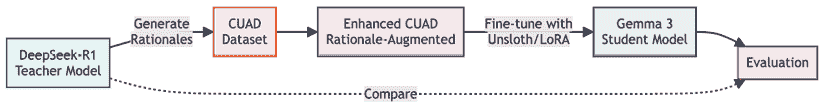
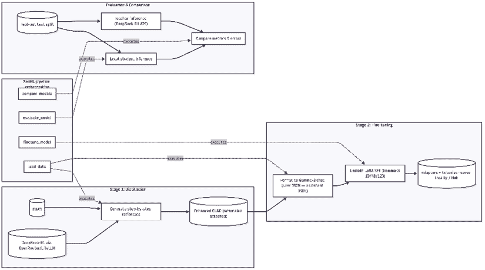
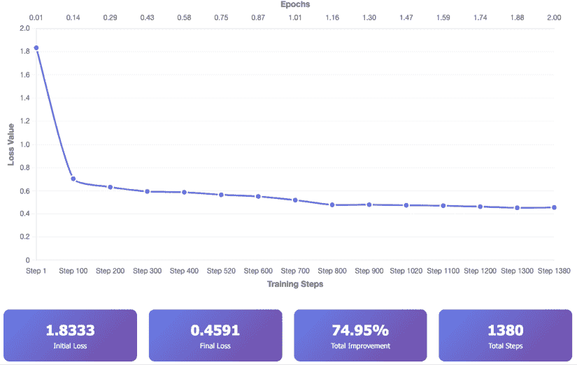
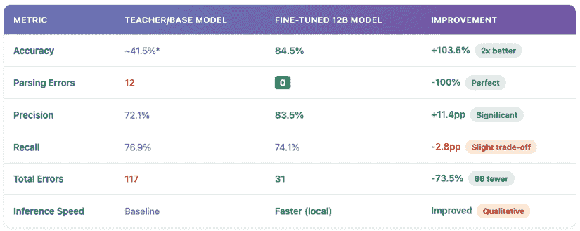
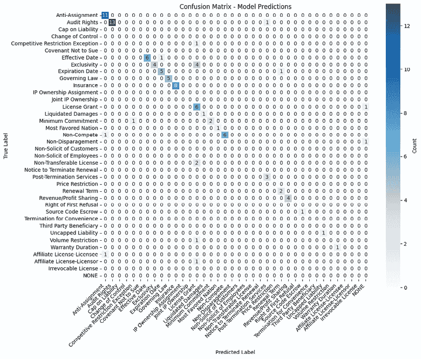
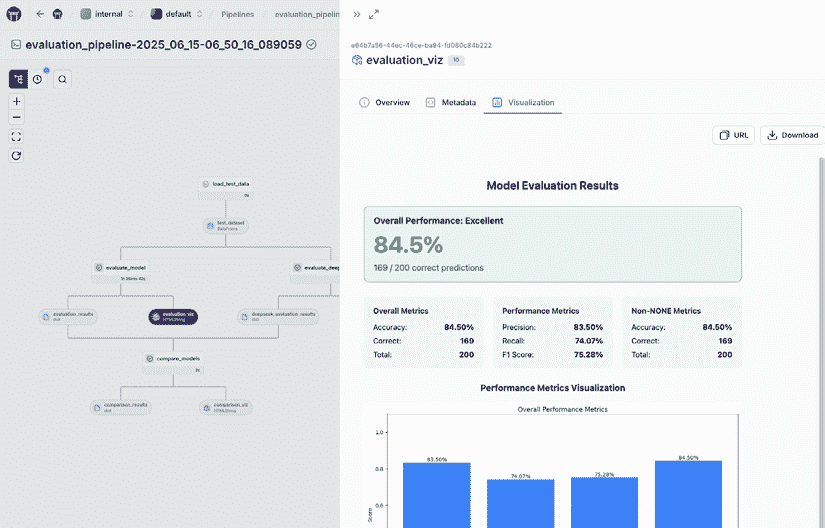

# 7 使用 DeepSeek 驱动的微调 Gemma 3 进行法律推理

想象一下，你被要求构建一个高频交易系统。你不会选用通用的脚本语言和消费级笔记本电脑——你会选择低延迟、高度优化的技术栈，专为你所在领域的精确需求而调校。在工程学中，我们知道，正确的工具加上正确的配置，是“它能运行”与“它能可靠、有保障地大规模运行”之间的区别。

这就是通用 `大语言模型` (`LLM`) 所面临的核心挑战。像 `OpenAI 的 GPT-5` 或 `Claude 4 Sonnet` 这样的模型是能力惊人的通才，但它们相当于一个强大但通用的框架：灵活，但并未针对专业领域的边缘情况和性能要求进行优化。当你需要解析成千上万份法律合同以发现细微的风险因素，或在受监管的行业中自动化合规检查时，“足够接近”是不够的——精确性、可靠性和可解释性至关重要。你可能也关心使用这些模型的成本。

在本章中，我们将执行一个两阶段工作流，包括使用 `DeepSeek-R1` 进行推理蒸馏，以及在推理增强数据上微调 `Gemma 3`。

根据我们这里的术语，`蒸馏` 指由教师模型生成数据（不更新教师模型权重）；也就是说，`DeepSeek-R1` 作为教师模型来生成训练数据。`微调` 指更新学生模型的参数（通过 `LoRA/Unsloth`）以学习教师的行为。对于我们的用例，我们将微调 `Gemma 3`，一个更适合部署的较小模型。我们还将使用保留数据来评估 `学生` 模型与 `教师` 模型的表现。`DeepSeek-R1` 本身在此过程中不进行微调；这反映了行业实践，其中蒸馏更为常见。

在本章中，我们将涵盖以下主要主题：

*   理解蒸馏和微调的重要性
*   介绍 `CUAD`：一个用于法律条款分类的结构化基准
*   用于模型蒸馏的 LLMOps 工具
*   法律推理蒸馏的两阶段工作流
*   评估与结果
*   关键要点

### 技术要求

你需要以下内容来学习本章：项目仓库位于 [`github.com/PacktPublishing/DeepSeek-in-Practice`](https://github.com/PacktPublishing/DeepSeek-in-Practice)。

### 依赖项

从项目仓库开始，安装所需的包：

```markdown
git clone https://github.com/PacktPublishing/DeepSeek-in-Practice.git

cd Chapter07

pip install -r requirements.txt
```

该依赖文件包含用于流程编排的 ZenML、用于高效训练的 Unsloth、用于模型处理的 Transformers，以及用于数据处理和评估的各种工具。

## 创建你的本地 ZenML 环境

我们在代码示例中使用 ZenML 来演示良好的 MLOps 实践（流水线、缓存和血缘追踪）。你可以将其替换为提供相同功能的其他平台，而不改变学习目标（例如，MLflow、Weights & Biases、Flyte、Metaflow、Kubeflow 或 Airflow）。

### 创建你的 ZenML Cloud 账户

1.  在 [cloud.zenml.io](https://cloud.zenml.io) 创建一个免费托管账户。这将作为你的实验跟踪和流水线编排中心，用于监控训练进度和管理产物。免费套餐为我们的法律分类项目提供了充足的资源。
2.  注册后，连接你的本地环境并设置项目名称：

    ```
    # 登录并选择你的工作区
    zenml login

    # 激活你的项目
    zenml project set default # 通常默认项目就可以
    ```

3.  **带 GPU 的云栈**：模型训练需要 GPU 计算，内存需求随模型规模而变化：
    *   1B 模型：8 GB+ 显存。
    *   4B 模型：16 GB+ 显存。
    *   12B 模型：24 GB+ 显存。

为此，你需要按照 ZenML 云部署指南（[`docs.zenml.io/stacks/deployment/deploy-a-cloud-stack`](https://docs.zenml.io/stacks/deployment/deploy-a-cloud-stack)）设置云栈。ZenML 中的 `stack` 代表你的流水线运行的基础设施。你只需切换 `stack`，就可以轻松地从本地设置切换到云基础设施。创建云栈最快的方法是通过**基础设施即代码**选项。这使用 Terraform 部署云资源，并将它们注册为 ZenML `stack`。你需要以下内容：

*   本地安装的 Terraform（[`www.terraform.io/downloads.html`](https://www.terraform.io/downloads.html)）版本 1.9+。
*   已为首选云提供商（AWS、GCP 或 Azure）配置认证。
*   在你的云账户中创建资源的适当权限。

部署向导将指导你完成每个步骤。部署将需要几分钟时间。

1.  部署完成后，激活你的新栈：

    ```
    zenml stack set <NAME_OF_YOUR_NEW_STACK>
    ```

### API 密钥和环境变量

你需要 OpenRouter 和 Hugging Face 模型的 API 密钥：

*   **OpenRouter** 提供访问 DeepSeek 模型的权限，用于在评估期间生成基线比较。在 [openrouter.ai](https://openrouter.ai) 注册并从仪表盘获取 API 密钥。我们将使用免费模型来访问基础 DeepSeek-R1 模型，但你需要 API 密钥才能访问它（通过 `litellm`）。如果你没有 OpenRouter API 密钥，可以在 [`openrouter.ai/docs/api-reference/api-keys/get-key`](https://openrouter.ai/docs/api-reference/api-keys/get-key) 创建一个。
*   **Hugging Face** 用于上传你训练的模型。在 [huggingface.co/settings/tokens](https://huggingface.co/settings/tokens) 创建一个具有写入权限的令牌。使用 [`huggingface.co/join`](https://huggingface.co/join) 创建你的 API 密钥。
*   配置所需的 API 凭据：

    ```
    export OPENROUTER_API_KEY="your_openrouter_api_key"
    export HF_API_KEY="your_huggingface_api_key"  # 可选
    ```

### 增强版 CUAD 数据集

增强版 CUAD 是 **Contract Understanding Atticus Dataset** (**CUAD**) 的一个理由增强版本，它为 510 份真实合同中 41 种条款类型的原始专家标签添加了 DeepSeek 生成的分步解释（**理由**）。我们将使用 Hugging Face 发布版 `zenml/cuad-deepseek`（[`huggingface.co/datasets/zenml/cuad-deepseek`](https://huggingface.co/datasets/zenml/cuad-deepseek)）。

## 不使用 ZenML 进行微调（独立脚本）

如果你只想微调模型而不安装 ZenML，我们提供了一个独立的 Python 脚本来重现本章的训练循环。

### 不使用 ZenML 的可选独立微调脚本

独立脚本位于此处：[`github.com/PacktPublishing/DeepSeek-in-Practice/blob/main/Chapter07/standalone_training.py`](https://github.com/PacktPublishing/DeepsSeek-in-Practice/blob/main/Chapter07/standalone_training.py)。该脚本遵循以下流程：

1.  从 Hugging Face 加载增强版 CUAD 数据集（`zenml/cuad-deepseek`），并确保训练/验证/测试集划分。

    增强版 CUAD 使用 `seed=42` 进行 80/10/10 分层划分，分为训练/验证/测试集。我们在训练集上微调学生模型，在验证集上监控和调优，并且所有指标仅在保留的测试集上报告。没有测试示例——或其理由——在训练期间被使用。

2.  将示例格式化为 Gemma 3 聊天消息（用户 JSON 提示；包含理由和标签的助手 JSON）。
3.  通过 Unsloth 将 LoRA 适配器附加到 Gemma 3（1B、4B 或 12B）上，并使用 TRL 的 `SFTTrainer` 仅在助手响应上进行训练。
4.  将适配器和分词器本地保存，并可选择推送到 Hugging Face Hub。
5.  在测试集上运行快速训练后健全性评估。

要开始使用该脚本，请执行以下操作：

1.  安装依赖项（推荐使用支持 CUDA 的 PyTorch）：

    ```
    pip install unsloth transformers trl datasets peft accelerate torch
    ```

2.  运行最小训练命令（12B 模型需要约 24 GB 显存；如果显存较小，请尝试 `--model-size 4b`）：

    ```
    python standalone_training.py --model-size 12b --filter-none-labels --eval-after-train
    ```

3.  使用以下命令查看所有选项：

    ```
    python standalone_training.py --help
    ```

提示：要将训练好的适配器推送到 Hugging Face Hub，请添加 `--push-to-hub` 并首先运行此命令以确保你已登录：

```
huggingface-cli login
```


## 了解蒸馏和微调的重要性

微调和蒸馏是适应大语言模型至特定领域的两种核心技术。它们各自解决不同方面的问题，共同提供了一条从通用模型走向生产就绪系统的实用路径。

在开始之前，让我们快速回顾一下微调和蒸馏。

微调通过在目标数据上更新（部分）参数，使已经预训练的模型适应你的领域。可以将其视为取一个强大的通用系统，并将其调整到你的工作负载——术语、格式和决策模式——以便它能在你的环境中可靠运行。

另一方面，蒸馏则将大型教师模型的行为压缩到一个更小的学生模型中。它有多种形式（如 logit 蒸馏、响应蒸馏或**理由蒸馏**）。

### 为什么我们需要专用模型？

与专用的、自托管选项相比，通过外部 API 使用通用模型可能会带来隐藏成本，尤其是在大规模应用时。部分原因如下：

*   **Token 成本**：

    即使价格更低且支持批处理，使用外部 API 处理单个 300 页的并购协议（每条约 600,000 个 token）也可能变得非常昂贵。每月处理许多此类文档的组织可能面临高额账单，而一个在两张 A100 GPU 上运行（月摊销成本约 3,000 美元）的蒸馏内部模型可以以低得多的成本处理相同的工作量。

*   **监管与合规风险**：

    使用外部 API 存在监管风险。例如，2024 年 12 月，意大利隐私监管机构因 GDPR 违规对 OpenAI 处以 1500 万欧元罚款（[链接](https://www.reuters.com/technology/italy-fines-openai-15-million-euros-over-privacy-rules-breach-2024-12-20/)），该违规与 ChatGPT 的数据处理有关。这突显了当敏感数据离开组织安全边界时的责任。一些行业现在要求**主权大语言模型部署**，以避免此类处罚并保持数据驻留。

*   **性能与可用性**：

    来自金融机构（[链接](https://ctomagazine.com/jp-morgan-chase-accelerates-ai-adoption/)）的内部基准测试表明，在本地部署的 70 亿参数蒸馏模型响应时间为 70-120 毫秒。相比之下，公共 API 在高峰负载时的 P95 延迟可能高达 600-1,200 毫秒。这种差异会影响高频审查工作流的服务级别协议，对实时应用非常重要。

*   **灵活性与供应商锁定**：

    外部 API 无法针对组织特定的术语、格式或业务规则进行定制。通用模型可能缺乏微调替代方案所具有的领域知识。依赖 API 也可能造成供应商锁定，降低战略灵活性并增加长期风险。

以下是推动领域专用模型使用的一些重要考虑因素：

*   **准确性**：例如，考虑一个在合同语言上微调过的法律大语言模型，可以在文档分类任务上常规达到 95%以上的准确率，而通用模型约为 70%。这不是边际改进，而是一个偶尔辅助的工具与一个可靠自动化核心工作流的工具之间的区别。
*   **更低风险**：然而，准确性只是一个维度。通用模型容易产生幻觉，自信地生成不正确的输出。在医疗或金融等高风险领域，这是不可接受的。在精选数据集上训练的专用模型，更能认识到其知识的局限性，并且更有可能表达不确定性，而不是捏造听起来合理但无意义的内容。
*   **效率**是另一个关键因素。通用大语言模型计算成本高昂，每次查询都需要筛选大量无关知识。专用模型更精简、更小、更快、更专注。这转化为更低的延迟和更少的硬件成本。
*   **数据隐私与控制**：受监管的行业不能冒险将敏感数据发送到外部 API。本地部署的领域专用模型允许组织利用大语言模型的能力，同时不损害机密性或合规性。

简而言之，专业化带来更高的准确性、更低的风险、更高的效率和更强的控制力。这些是工程师在任何生产系统中都重视的结果。

专用模型的影响在大型组织的真实部署中显而易见。这些案例展示了效率、准确性和成本节约方面的改进：

*   **医疗文档记录**：

    斯坦福医疗保健实施了 Nuance DAX Copilot，这是一个在临床医患对话上微调的 AI 系统，用于自动化临床文档记录（[链接](https://hitconsultant.net/2024/03/11/stanford-deploys-nuance-ai-powered-clinical-documentation/)）。该系统在患者就诊期间捕获对话并生成草稿摘要，减少了行政工作量。试点项目中的医生报告文档记录时间减少（从每天 90 分钟减少到 30 分钟以下），从而能更专注于患者护理（[链接](https://www.dugganletter.com/p/from-burnout-to-breakthrough-how)）。

*   **金融服务**：

    摩根大通的 COIN（合同智能）平台（[链接](https://ctomagazine.com/jp-morgan-chase-accelerates-ai-adoption/)）使用大语言模型蒸馏进行法律文档处理。该系统审查以前每年需要约 360,000 人类小时的商业贷款协议（[链接](https://medium.com/@ishan_dhodu/how-jpmorgan-chases-coin-is-revolutionizing-financial-operations-with-ai-120a2938dab7)）。自推出以来，COIN 减少了审查时间和错误率。

*   **边缘计算**：

    谷歌的 Gemini Nano 是针对移动设备的蒸馏模型（[链接](https://assets.publishing.service.gov.uk/media/661e5a4c7469198185bd3d62/AI_Foundation_Models_technical_update_report.pdf)）。这个 16 亿参数的模型源自 Gemini Ultra，可在 Pixel 手机上运行，无需网络调用即可在 300 毫秒内提供智能回复、摘要和字幕功能，同时在占用不到 1 GB 内存的情况下保持了母模型的大部分质量。

除了在无数用例中的若干优势和应用外，微调和蒸馏的真正价值在于将两者结合。

> **蒸馏和微调如何帮助创建专用模型**？

当你结合蒸馏和微调时，你可以创建既高度专用又高效的模型。微调赋予领域专业知识，而蒸馏确保这种专业知识可以在现实世界的、资源受限的环境中被访问。这种方法让你能够超越通用解决方案，交付定制化、高性能且为生产就绪的模型。

微调为学生模型赋予领域专业知识；蒸馏确保这种专业知识可移植、高效，并能在现实世界的约束条件（延迟、隐私、成本）下部署。

我们将在本章中使用这种方法为法律领域创建一个专用模型，并将其用于多标签分类任务。

在下一节中，我们将详细研究将用于与 DeepSeek 进行蒸馏和微调的用例和数据集。

### 用例和数据集

为了学习如何使用微调和蒸馏创建专用模型，我们将专注于一个法律用例。但在我们开始之前，我们将概述本章用于驱动法律文本多标签分类问题的理由蒸馏方法。

本章中使用的约定：

*   **教师模型**：DeepSeek-R1（仅 API/推理）。
*   **学生模型**：Gemma 3（我们实际微调的模型）。
*   **蒸馏**：数据生成步骤。
*   **微调**：对学生模型的参数更新步骤。

**为什么选择 Gemma（而不是 DeepSeek）？**

直接微调 DeepSeek 对于我们的目标来说不切实际且不必要；行业标准模式是将大型、有能力的教师蒸馏到一个高效的开源学生模型中，以便你可以在本地运行。

### 法律文本中的多标签提取问题

**合同审查**是一个典型的高风险、高复杂性信息提取问题。法律专业人士平均花费约 50%的时间审查合同，主要律所的计费率为每小时 500 至 900 美元。对于单笔**并购**交易，这可能转化为数十万美元的法律费用。技术挑战不仅在于文本量，还在于需要准确识别和解释 41 种不同的条款类型——每种都有其法律和业务含义。这是一个多标签、多分类问题，其复杂性还在于相关信息通常埋藏在密集、异构且有时模棱两可的语言中。

“在干草堆中找针”的比喻常被用来描述合同审查，但这并未完全捕捉其复杂性。实际上，这个任务更像是在寻找 41 种不同类型的针，每种都有独特的特征和不同程度的风险。例如，考虑以下**控制权变更**条款：

> “如果承包商发生控制权变更，其 50%或以上的有表决权证券转让给新的实际受益人，客户可以在提前三十天书面通知后终止本协议。”

对外行人来说，这似乎只是标准的法律样板文字。但对法律专家而言，它编码了一种特定机制，可能决定一项计划中的收购是顺利进行，还是会面临意外的合同复杂性。将这种复杂性乘以数百页和数十种合同类型，问题的规模就变得清晰了。AI 面临的挑战不仅是提取这些条款，更是正确地对其进行分类，并且理想情况下，为每个决策提供理由。

自动审查合同的业务案例非常引人注目：一个 AI 辅助系统可以将法律审查成本降低 60-70%，提高准确性，并提供完整的审计轨迹。更重要的是，它可以防止因遗漏条款而导致交易失败或产生意外责任的灾难性场景。

从工作流的角度来看，自动识别和解释有风险的条款，可以让初级员工专注于更高价值的分析，并让高级律师对系统的输出充满信心。其结果是一个更高效、一致且可辩护的审查流程。

接下来，我们将详细介绍技术方法：使用 DeepSeek-R1 生成理由，然后将这种专业知识蒸馏到更小、可部署的模型中——展示如何在生产环境中操作法律推理，而不牺牲透明度或准确性。

## 介绍 CUAD：一个用于法律条款分类的结构化基准

**合同理解 Atticus 数据集**（**CUAD**）正是为了应对这一挑战而创建的。它由 Atticus Project 开发，历时一年，由法学学生、执业律师和机器学习研究人员合作完成，包含超过 13,000 个专家注释，涵盖 510 份真实世界的商业合同。这些合同来自 SEC 备案文件，代表了法律专业人士实践中审查的文档类型。你可以在此探索该数据集：[`www.atticusprojectai.org/cuad`](https://www.atticusprojectai.org/cuad)。

CUAD 的价值在于其系统化的分类法：它定义了 41 种律师在企业交易中会一致标记的条款类型。例如，**反转让**条款（限制协议如何转让）、**责任上限**（限制损害赔偿责任）、**管辖法律**条款（确定争议的司法管辖区）以及**竞争限制**条款（可能阻止收购后的商业活动）。每个类别都代表一种特定的法律风险或义务，经验丰富的律师通过多年实践已学会识别。对于工程师而言，CUAD 提供了一个基于真实世界法律实践的、定义清晰的多分类基准。

### 扩展 CUAD：为何我们添加理由

CUAD 附带高质量标签，但没有每个示例的说明。为了使模型可审计并更容易微调，我们附加了教师生成的理由，并将这个增强后的语料库称为**增强版 CUAD**（详细信息稍后在*数据预处理与增强版 CUAD 数据集*部分出现）。

例如，一个反转让条款可能包含如下理由：

> 该条款被归类为**反转让**，因为它明确限制了分销商转让协议的能力。关键要素是：(1) 它明确禁止转让，(2) 它适用于整个协议和部分权利，(3) 它要求对方明确同意……

你可以直接使用增强版 CUAD 进行本章的微调步骤（[`huggingface.co/datasets/zenml/cuad-deepseek`](https://huggingface.co/datasets/zenml/cuad-deepseek)）。

我们的技术目标是将一个大型模型（DeepSeek-R1）的法律推理能力，蒸馏到一个适合本地部署的、资源高效的小型模型中。大多数律师事务所由于保密和合规限制无法使用外部 API，因此最终模型必须足够紧凑以便本地运行，同时又要足够准确和可解释，以供专业使用。

具体来说，我们的目标是一个 120 亿参数的模型，能够以>90%的准确率分类所有 41 个 CUAD 类别（加上一个用于范围外条款的`NONE`类），并为每个决策生成清晰、分步的解释理由。这是一个经典的知识蒸馏场景，附加的要求是可解释性。目标是创建一个能运行在笔记本电脑（或小型服务器）上，但推理能力堪比高级律师的系统——结合大语言模型的广泛知识与通过处理数千份真实世界合同所获得的专业知识。

### 使用 CUAD 和增强版 CUAD 数据集进行蒸馏微调过程概览

为了解决上述**多标签分类**问题，我们将遵循*图 7.1*所示的**两阶段工作流**。



图 7.1：法律理由蒸馏的两阶段工作流

1.  **阶段 1（蒸馏）**：我们要求 DeepSeek-R1 为 CUAD 示例生成逐步解释，并将这些理由附加到数据中。教师模型不更新；它只生成丰富的训练信号，从而得到增强版 CUAD（数据）。（请注意，虽然我们在本章中解释并展示了如何创建增强版 CUAD 数据集，但我们也提供了一个包含完整处理数据的 Hugging Face 数据集，这样你就无需花费 100 多美元来重现蒸馏部分。）
2.  **阶段 2（微调）**：然后我们将使用 Unsloth/LoRA 在增强版 CUAD 上训练 Gemma 3，使学生模型既能学习标签，也能学习解释结构。

其结果是一个更小、更快的模型，你可以在本地运行——其准确性和解释性符合法律审查的需求。

因此，我们将进行如下操作：

**DeepSeek-R1（教师）** **→** **在 CUAD 上生成理由** **→** **增强版 CUAD（理由增强）** **→** **使用 Unsloth/LoRA 微调 Gemma 3（学生）** **→** **评估学生模型与教师模型。**

是时候开始了！我们将从本任务中将使用的工具开始介绍。

## 用于模型蒸馏的 LLMOps 工具

构建生产就绪的 AI 系统依赖于拥有正确的基础设施来可靠地开发、部署和维护它们。在 LLMOps（**大语言模型运维**）工具的背景下，这种基础由**大语言模型运维**（**LLMOps**）工具提供。这些工具帮助为可能杂乱无章的实验和部署过程带来结构化和可重复性。

在我们的蒸馏流水线（*图 7.2*）中，我们使用三个主要工具：用于编排和可观测性的 ZenML、用于高效训练的 Unsloth，以及用于统一模型访问的 LiteLLM。每个工具在推动我们的法律合同分类项目从研究实验走向生产就绪系统方面都扮演着不同的角色。



图 7.2：蒸馏和微调过程架构

对于我们的法律用例，我们需要精确跟踪哪些 CUAD 示例被增强了，哪个模型/版本在上面进行了训练，以及每次运行的性能如何——以便结果可以重现和审计。我们使用流水线来固定序列（**加载** **→** **蒸馏** **→** **格式化** **→** **微调** **→** **评估** **→** **比较**）并缓存昂贵的步骤。

以下是每个工具在本章工作流中的角色概述：

*   **ZenML（编排与溯源）**：运行端到端流水线（**load_data** **→** **finetune_model** **→** **evaluate_model** **→** **compare_models**），缓存昂贵的步骤，并记录输入、输出和配置以实现可重复性（[`docs.zenml.io`](https://docs.zenml.io)）。
*   **LiteLLM（教师 API 访问）**：在蒸馏和教师基线评估步骤中，通过 OpenRouter 提供对 DeepSeek-R1 的单一调用接口（模型字符串和 API 密钥在环境中配置）（[`github.com/BerriAI/litellm`](https://github.com/BerriAI/litellm)）（[`openrouter.ai`](https://openrouter.ai)）。

有关使用 LiteLLM 进行设置的更详细说明，你可以查看本书末尾的附录。

*   **Unsloth（高效 LoRA 微调）**：附加 LoRA 适配器并使用优化内核训练 Gemma 3，以便我们可以在单个高端 GPU 上微调 12B 的学生模型（[`unsloth.ai`](https://unsloth.ai)）。

本节重点介绍这些工具如何适应工作流。

让我们查看代码，了解本章代码中每个工具出现的位置：

1.  蒸馏和教师模型推理通过 LiteLLM 调用执行（用于*阶段 1*训练和教师基线评估），遵循标准的 LiteLLM 补全调用模式。

    ```
    ```


### 工具：LiteLLM + OpenRouter

```python
import os, json
from typing import Dict
from litellm import completion

DEEPSEEK_MODEL = os.getenv("DEEPSEEK_MODEL", "openrouter/deepseek-r1")
OPENROUTER_API_KEY = os.getenv("OPENROUTER_API_KEY")

def generate_rationale(clause: str, label: str) -> str:
    system = "You are a senior contract lawyer. Explain why the clause matches the CUAD label. Return concise, stepwise rationale."
    messages = [
        {"role": "system", "content": system},
        {"role": "user", "content": json.dumps({"clause": clause, "label": label})},
    ]
    resp = completion(model=DEEPSEEK_MODEL, messages=messages, max_tokens=400, api_key=OPENROUTER_API_KEY)
    return resp["choices"][0]["message"]["content"].strip()
```

### 2. 使用 Unsloth LoRA 微调 Gemma 3 (第二阶段中的学生模型训练)

```python
#### 工具：Unsloth
from typing import Any
from unsloth import FastLanguageModel
from trl import SFTTrainer, SFTConfig

def finetune_gemma(
    train_ds: Any, val_ds: Any,
    base_id: str = "unsloth/gemma-3-12b-it", out_dir: str = "ckpt"
) -> str:
    model, tokenizer = FastLanguageModel.from_pretrained(
        base_id, load_in_4bit=True)
    model = FastLanguageModel.get_peft_model(
        model, r=16, lora_alpha=32, lora_dropout=0,
        target_modules="all-linear",
        use_gradient_checkpointing="unsloth",
        random_state=3407, use_rslora=False,
    )
    trainer = SFTTrainer(
        model=model, tokenizer=tokenizer, train_dataset=train_ds,
        eval_dataset=val_ds,
        args=SFTConfig(
            per_device_train_batch_size=1,
            gradient_accumulation_steps=8,
            num_train_epochs=2, learning_rate=1e-4,
            lr_scheduler_type="cosine",
            warmup_steps=100, logging_steps=20),
    )
    trainer.train()
    model.save_pretrained(out_dir); tokenizer.save_pretrained(out_dir)
    return out_dir
```

### 3. 使用 `ZenML` 编排各步骤

```python
#### 工具：ZenML
from typing import Tuple
from zenml import step, pipeline

@step(enable_cache=True)
def load_data(
    max_samples: int | None = None, filter_none: bool = True
) -> Tuple[list, list]:
    # 加载 Hugging Face 数据集，根据需要生成/附加推理解释，并转换为 Gemma-3 聊天格式
    # 返回 train_ds, val_ds（已分词/准备就绪）
    ...

@step
def finetune_model(train_ds: list, val_ds: list, model_size: str = "12b") -> str:
    # 调用上面的 finetune_gemma(...) 函数 (Unsloth)
    ...

@step
def evaluate_student_vs_teacher(...) -> dict:
    # 在测试集分割上运行本地学生模型；通过 LiteLLM 调用 DeepSeek-R1 作为教师基准；计算评估指标
    ...

@pipeline
def distill_finetuning(max_samples: int | None = None, model_size: str = "12b"):
    train_ds, val_ds = load_data(max_samples=max_samples, filter_none=True)
    ckpt_path = finetune_model(train_ds, val_ds, model_size=model_size)
    _ = evaluate_student_vs_teacher(...)
```

随着工具基础构建完毕，我们现在可以深入探索我们蒸馏流水线的实际实现了。第一阶段涉及增强 CUAD 数据集本身——利用我们的教师模型生成能够让学生模型更具可解释性的解释性推理解释。

## 法律推理解释蒸馏的两阶段工作流程

好吧，亲爱的读者，我们深知你已迫不及待想要开始。废话不多说，让我们直接进入蒸馏环节。

### 阶段 1：蒸馏

让我们从创建增强版 CUAD 数据集的过程开始。目标是在保留原始人工标签的同时，添加来自教师模型（`DeepSeek-R1`）的清晰、可审计的“为什么”解释。您可以在代码仓库的 `Chapter07` 文件夹中找到此过程的完整源代码，文件名为 `standalone_synthetic_generation.py`。

数据集划分概览

*   划分：80% 训练集 / 10% 验证集 / 10% 测试集（按标签分层，`seed=42`）。
*   训练：仅使用训练集分割（增强推理的）。
*   验证：仅使用验证集分割。
*   评估：仅使用测试集分割（留出集；无数据泄露）。
*   `NONE` 标签：在本章的训练运行中默认被过滤。

具体过程如下：

1.  **下载 CUAD（一次，幂等操作）**：我们获取并解压官方的 CUAD 压缩包（来自 Zenodo）到一个稳定的文件夹中，以保持路径可预测（[`zenodo.org/records/4595826/files/CUAD_v1.zip?download=1`](https://zenodo.org/records/4595826/files/CUAD_v1.zip?download=1)）。

    ```python
    def download_and_extract_cuad(url, data_dir="data", force=False) -> str:
        # 流式下载（带进度） -> data/CUAD_v1.zip
        # 解压到 data/CUAD_v1/，使得 CUAD_v1.json 位于固定路径
        ...
        return os.path.join(data_dir, "CUAD_v1")
    ```

    **作用与重要性**：此步骤使流程可重复：一个单独的函数，要么重用现有的本地副本，要么在 `force=True` 时干净地重新下载。后续的可重复性依赖于稳定的文件位置。

2.  **将 SQuAD JSON 转换为条款记录**：CUAD 以 SQuAD 格式发布。（对于我们的目的而言，具体格式并不特别重要。通常，数据集会以各种格式存在，而我们的任务就是设法将它们整理成我们工作所需的形式。）我们将 CUAD 数据集规范化为紧凑的记录：**确切的条款**、其周围的**上下文窗口**、**标签**和合同元数据。

    ```python
    def extract_clauses_from_squad(
        squad: dict, context_window: int = 150
    ) -> list[dict]:
        items = []
        for doc in squad["data"]:
            title = doc.get("title", "")
            ctype = (title.split("-")[-1].strip()
                if "-" in title else "Unknown")
            for para in doc.get("paragraphs", []):
                ctx = para.get("context", "")
                for qa in para.get("qas", []):
                    if qa.get("is_impossible"): continue
                    label = (qa.get("id","").split("__")[-1] or "UNKNOWN")
                    for ans in qa.get("answers", []):
                        start, text = ans["answer_start"], ans["text"]
                        end = start + len(text)
                        span = ctx[
                            max(0, start-context_window): min(len(ctx),
                            end+context_window)]
                        items.append({
                            "clause": text,
                            "clause_with_context": span,
                            "label": label,
                            "contract_name": title,
                            "contract_type": ctype,
                        })
        return items
    ```

    **作用与重要性**：我们保留**黄金标签**，并添加一个**有界上下文**以帮助教师模型以及（之后的）学生模型进行推理。使用字符窗口避免了分词器的耦合；如果您愿意，可以稍后切换到基于 token 的窗口。

3.  **从无标注间隙中添加 NONE 负样本（可选）**：为了提高鲁棒性，我们可以通过从**间隙**（未被任何标注跨度覆盖的文本区域）中采样来挖掘负样本。

    ```python
    def add_negative_none_examples(
        items: list[dict], squad: dict,
        ratio: float = 3.0, neg_len: int = 100,
        context_window: int = 150
    ):
        # 1) 记录每个段落中已标注的 (start, end) 跨度
        # 2) 计算已标注跨度之间的间隙
        # 3) 从间隙中采样固定长度的片段 -> 标签="NONE"
        # 4) 限制每个间隙的采样数量 (≤3)，以免负样本占主导
        ...
        return items_with_negatives
    ```


**数据划分与提示词构建**

这一部分为后续流程添加了全面的覆盖。本章中使用的收益、风险与默认选择详见后续的 *NONE 标签决策* 章节。

1.  **创建分层划分（并具备优雅回退机制）**：我们将数据划分为训练集、验证集和测试集。这可以确保在评估模型性能时，我们不会产生虚假的信心感。此划分既用于训练过程，也用于后续评估。

    ```python
    def split_train_val_test(items, train=0.8, val=0.1, seed=42):
        # 按标签对训练集与临时集进行分层
        train_set, temp = train_test_split(
            items, train_size=train,
            stratify=[x["label"] for x in items], random_state=seed)
        # 计算验证集的相对大小；如果每个类别至少有 2 个样本则分层，否则进行普通划分
        ...
        return train_set, val_set, test_set
    ```

    **作用与重要性**：将数据分层划分为训练集和测试集，在可能的情况下保持了标签比例，并在少数类别样本极少时能够优雅地回退。我们采用 80/10/10 的分层划分，`seed=42`。

    **泄漏规则**：我们绝不在测试集（或其推理说明）上进行训练。

2.  **为教师提示生成推理说明（推理蒸馏）**：我们要求解释现有标签的原因（而非生成新标签）。这是有意为之：我们是在为已知的分类蒸馏推理过程，而非重新标注 CUAD 数据集。

    ```python
    def create_prompt(sample: dict) -> str:
        return f"""[[TASK]]
        Explain why this clause fits the label.
        [[CONTEXT]]
        CLAUSE: {sample["clause"]}
        CLAUSE WITH CONTEXT: {sample["clause_with_context"]}
        CONTRACT TYPE: {sample["contract_type"]}
        CLASSIFICATION: {sample["label"]}
        [[INSTRUCTIONS]]
        Identify the clause language that justifies the label. Be concise, stepwise, and use Markdown."""
    ```

    **作用与重要性**：以黄金标签为条件可以使输出紧扣任务且成本更低。另一种 **标签与推理模式** 可以捕获错误标签，但成本更高，且存在需要您裁决的分歧风险。

3.  **协调生成过程（并行、速率限制、可恢复）**：我们确保 LLM 的生成过程是并行的，并且任何错误或速率限制都能被捕获，以便我们可以自动重试。

    ```python
    @backoff.on_exception(
        backoff.expo, (Exception,), max_tries=5, max_time=300)
    def generate_once(
        client, prompt, model="deepseek/deepseek-r1", max_tokens=1500,
        temperature=0.2, top_p=0.95
    ):
        # OpenRouter OpenAI 兼容的 chat.completions.create(...)
        return content, reasoning_trace_or_none

    class RateLimiter:
        def __init__(self, qps: float): ...
        def wait(self): ...

    def process_one(idx, sample, client, limiter, out_path, lock):
        limiter.wait()
        rationale, trace = generate_once(client, create_prompt(sample), ...)
        rec = {**sample, "rationale": rationale,
            "reasoning_trace": trace, "index": idx, ...}
        with lock:
            append_jsonl(out_path, rec)
    ```

    **作用与重要性**：并行工作器和全局 **每秒查询数** (`QPS`) 限速器提供了高吞吐量且无节流错误；**指数退避** 处理瞬时故障；**线程安全追加** 防止写入交错。在实践中，这使得整个流程可靠且成本更低（OpenRouter 文档：[`openrouter.ai/docs`](https://openrouter.ai/docs)）。

4.  **安全恢复（跳过已完成索引）**：由于此过程会产生实际成本、执行时间长且可能被中断，我们跟踪已完成的项目，以便在希望暂停或恢复时能够做到。

    ```python
    def get_processed_indices(path) -> set[int]:
        # 读取输出的 JSONL；收集“index”字段 → 允许恢复
        ...
    ```

    **作用与重要性**：您可以随时停止和恢复。这在分批处理成本或轮换 API 密钥时至关重要。

5.  **打包与发布**：我们为每个划分存储 JSONL 文件，并可选择将 `DatasetDict` 推送到 HuggingFace Hub ([`huggingface.co`](https://huggingface.co))。

    ```python
    def to_hf_dataset(jsonl_path: str) -> Dataset: ...
    def push_to_hub(
        dataset_or_dict, repo_id: str, private=False
    ) -> None: ...
    ```

    **作用与重要性**：一个一致、有文档的产出，其他人无需重新生成合成数据即可复用。

**成本与吞吐量说明**

在我们的参考运行中，为单个划分生成中等长度限制和低温度的推理说明，成本大约为 100 美元。为所有划分生成推理说明的成本成比例增加（通常为 2-3 倍，具体取决于令牌限制和覆盖率）。

6.  **轻量级质量检查（低成本但有效）**：在接受推理说明之前，我们运行简单的过滤器：

    ```python
    def accept(sample: dict, rationale: str) -> bool:
        if rationale is None or len(rationale.strip()) < 50: return False
        if rationale.lower().count("this clause") >= 4: return False  # 通用填充文本
        if sample["label"].lower() not in rationale.lower()[:300]: return False  # 标签未在早期得到支撑
        return True
    ```

    **作用与重要性**：这些启发式规则故意设计得很简单：它们拒绝低质量的文本，并鼓励基于标签的解释，而无需为额外的评判模型付费。对于更高要求的场景，可以将其替换为一个小的推理说明评判提示，以评分具体性并引用关键短语匹配。

一旦这些步骤完成，就该进入 ZenML 管道数据处理阶段了。

#### ZenML 管道数据处理

管道层通过一个专门的 `load_data` 步骤管理数据预处理，并记录每次运行的输入和输出，以确保可重现性。每次执行都会捕获所使用的数据集版本、预处理配置以及生成的产出物。

以下是管道的实现方式：

```python
@step(enable_cache=True)
def load_data(
    model_size: str = "12b",
    dataset_id: str = "zenml/cuad-deepseek",
    max_samples: Optional[int] = None,
    filter_none_labels: bool = True,
) -> Tuple[pl.DataFrame, pl.DataFrame, HTMLString]:
    """加载并预处理增强型 CUAD 数据集。"""
    # 获取模型配置并创建分词器
    config = get_model_config(model_size)
    tokenizer = create_tokenizer(config)
    # 下载并准备数据集
    download_and_save_dataset(
        dataset_id=dataset_id, output_dir=output_dir)
    train_dataset, val_dataset = load_datasets(
        max_samples, tokenizer, tokenize=False, filter_none_labels
    )
    return train_dataset.to_polars(), val_dataset.to_polars(), viz
```


##### 数据准备流程

当此步骤运行时，它会执行以下操作：

1.  将 `model_size` 解析为已知配置，并构建匹配的分词器，这样所有下游格式化都能使用正确的聊天模板和序列限制。
2.  在稳定目录 `output_dir` 中获取或复用请求的增强型 CUAD 数据集 (`dataset_id`)，以确保特定修订版本被本地化为实体。
3.  通过 `load_datasets(...)` 准备训练/验证集划分，该函数会应用您的开关参数，例如用于快速实验的 `max_samples`，以及用于包含/排除开放式 `NONE` 类别的 `filter_none_labels`，同时除非您启用它，否则会特意推迟分词处理（我们在此处将样本保留为字符串，以便在训练时进行一致的打包或修剪）。
4.  将生成的划分转换为紧凑的 Polars 数据框，这样它们可以快速序列化为工件，并且便于分析。
5.  生成一个小型 HTML 可视化图表，记录加载的内容（计数、过滤策略），并成为运行过程的一部分。

请注意，由于我们设置了 `@step(enable_cache=True)`，ZenML 会根据步骤代码、参数和上游工件计算缓存键；使用相同输入重新运行时，会复用已实体化的训练或验证数据框和可视化图表，而更改任何输入（例如，模型大小、数据集 ID、过滤策略或样本上限）会使缓存失效并重新计算。最终效果是实现可复现的数据准备，并支持快速、参数感知的迭代。

一个实际的好处是自动缓存：一旦某个步骤用相同输入运行过，编排器就可以复用其输出。这减少了迭代时间，而无需更改任何训练逻辑。在我们的示例中，我们使用 ZenML 来提供这些行为，但任何具有步骤缓存和运行元数据的编排器都能以类似方式工作。

对于此数据集，一个关键的预处理考虑是如何处理 `NONE` 分类样本。让我们来讨论它们。

##### NONE 标签的决策

这些是与 41 个预定义 CUAD 类别都不匹配的条款。实际上，它们充当了主要模式之外内容的兜底分类。包含 `NONE` 样本可以提供有用的负例训练数据，但它也给分类任务引入了额外的复杂性。

两个实际的权衡点在于负例比例和上下文窗口：

*   **负面比例**：当启用时，我们默认设置负例:正例为 3:1；增加此比例可以提高实际场景中的精确度，但会减慢训练速度，并可能导致模型偏向于预测 `NONE`。建议从 1-3 倍开始，并通过验证集 F1 值进行调优。
*   **上下文窗口**：为了速度和分词器独立性，我们使用字符窗口（例如，每侧 150 个字符）。如果您观察到截断的标记或混淆了教师/学生的断句，请切换到支持标记感知的窗口（例如，通过分词器），并将总序列长度保持在您的训练预算内。

`NONE` 类别并非原始 CUAD 数据集的一部分。最初的焦点是识别法律专业人士在合同审查过程中关心的具体条款类型。我们在增强过程中引入了 `NONE` 样本，以帮助平衡数据集，但这一添加改变了分类问题的本质。

对 `NONE` 样本进行分类与在特定法律类别间进行分类有本质的不同。模型必须学会识别任何已定义法律模式的缺失，这是一个比将条款匹配到已知类型更抽象、更开放的任务。例如，这类似于要求模型识别“非猫”，而不是区分狗的品种。

出于本章的目的，我们默认使用 `filter_none_labels=True` 参数排除 `NONE` 样本。这使我们能够专注于区分有意义法律类别的核心挑战，而没有“其他一切”类别带来的额外复杂性。在生产环境中，您可能会选择包含 `NONE` 样本以提高鲁棒性，但对于学习和演示来说，一个更聚焦的方法通常更可取。

数据准备包括智能过滤：

```python
def prepare_dataset_from_file(
    jsonl_path,
    max_samples=None,
    tokenizer=None,
    filter_none_labels=False,
):
    """Process JSONL data with enhanced instructional format."""
    data = []
    none_count = 0

    with open(jsonl_path, "r") as f:
        for line in f:
            item = json.loads(line)
            # Skip NONE examples if filtering is enabled
            if filter_none_labels and item.get("label", "").strip().upper() == "NONE":
                none_count += 1
                continue
            # Process valid examples...
```

一旦我们下载并过滤了数据，接下来就需要对其进行格式化，为微调做好准备。

接下来，我们将为微调学生模型提供指令格式。

##### 微调的指令格式

数据预处理还处理为指令微调模型格式化示例的关键任务。（所谓指令微调，指的是专门训练以遵循用户指令并提供有帮助回应的语言模型，而不仅仅是像基础模型那样预测序列中的下一个词。）我们不再使用简单的输入-输出对，而是将数据集中的每个示例构建为详细的对话，教导模型不仅要分类什么，还要如何推理分类过程。这里有一个示例：

```json
{
    "clause": "access is reasonably required by the other, including without limitation, for audit, accounting and litigation purposes.",
    "clause_with_context": "ther (other than data and information subject to any attorney/client or other privilege), insofar as such\n\n                                       27\n\naccess is reasonably required by the other, including without limitation, for audit, accounting and litigation purposes.\n\n     (c) Notwithstanding the foregoing, either party may destroy or otherwise dispose of any information at any time in accordance with the corporat",
    "label": "Audit Rights",
    "contract_name": "FIDELITYNATIONALINFORMATIONSERVICES,INC_08_05_2009-EX-10.3-INTELLECTUAL PROPERTY AGREEMENT",
    "contract_type": "INTELLECTUAL PROPERTY AGREEMENT"
}
```


每个训练样本都会被转换为一个 JSON 格式的指令，其中包含任务描述、分类体系、有效的标签选项以及带有上下文的输入条款。模型被训练来生成结构化的推理过程，然后给出最终的分类结果——这正是我们在部署系统中所期望的行为。

这种指令式的方法有助于提供法律专业人士可以评估和信任的推理过程，而不仅仅是一个输出标签。预处理流水线会自动处理这种格式化，确保所有训练实例的一致性，同时保留灵活性以尝试不同的指令提示和响应格式。**如果你不太关注用于微调的数据格式，你的模型可能根本无法工作。**

现在，我们将使用在此阶段生成的推理增强的增强版 `CUAD` 数据集来训练学生模型（Gemma 3）。

### 阶段 2：在 `CUAD` 上微调 `Gemma 3`

准备好我们丰富的数据集并建立起推理基础后，我们现在将转向核心挑战：将这种法律专业知识蒸馏到更小的、可部署的模型中，使其能够在内部部署法律环境的限制下高效运行。这就是模型选择变得至关重要的地方——我们需要一个在能力与实用性之间取得平衡的架构。

**为什么选择 `Gemma 3`？**

`Gemma 3` (https://ai.google.dev/gemma/docs/core) 是一种现代、资源高效的语言模型架构，继承了 Google Gemini 2.0 系列的核心创新，但专为单 GPU 部署而设计。对于构建法律文档分类器的技术团队来说，`Gemma 3` 提供了性能和可部署性的强大平衡。

与大多数需要多 GPU 集群或分布式推理的 LLM 不同，`Gemma 3` 被设计为在单个高端 GPU 上运行推理，甚至可以对 12B 参数变体进行训练。这是通过架构优化实现的，最显著的是局部与全局注意力层的 5:1 比例。这种设计选择显著减少了长上下文推理期间的 `键值 (KV) 缓存` 内存需求。例如，传统的 Transformer 架构可能会随着上下文长度增加而出现 60% 或更高的内存开销增长，而 `Gemma 3` 将这一增幅控制在 15% 以下。这使得在不需要专门硬件或分布式系统的情况下，实际处理长法律文档成为可能。

**为什么不直接微调 `DeepSeek`？**

对于这个用例，将 `DeepSeek` 的行为蒸馏到一个你可以微调和本地运行的、开放、高效的学生模型中，在操作上更有优势。这避免了繁重的计算需求，并简化了部署/治理，同时保留了教师模型大部分的法律推理能力。

对于我们的用例——涉及跨越数千个令牌上下文窗口的合同条款分类——这意味着我们可以将 12B 参数模型部署在标准工作站硬件上，而不会牺牲像 `DeepSeek-R1` 这样更大但效率较低模型所展示的推理深度或准确性。其结果是一个既高性能又在运营上可行的生产级法律 AI 系统，即使在要求严格数据隐私的环境中也能用于内部部署。

**模型规模决策：为什么我们关注 12B？**

虽然我们的流水线支持三种模型规模（1B、4B 和 12B 参数），但我们在增强版 `CUAD` 数据集上的实验揭示了一个明确的事实：对于法律合同分类，你需要相当大的模型容量才能达到专业级的准确性。

*   **为什么小模型不够**：1B 和 4B 的 `Gemma 3` 模型，虽然计算效率高，但无法达到严肃法律工作所需的准确性水平。1B 模型在复杂法律语言中难以保持一致的推理，尤其是在确保 JSON 输出时；而 4B 模型虽然稍好，但在高风险合同审查场景中，其分类错误仍然太多，无法保证可靠性。
*   **12B 模型**：这是我们的主要关注点。因此，在我们的示例和分析中，我们主要关注 12B 模型。虽然它在训练期间需要 24 GB+ 的 GPU 内存，但它代表了执行此类专业法律分类任务的最低可行规模。即便如此，12B 模型也并非完美——法律语言的细微差别和上下文依赖性对即使是复杂的模型也构成挑战。
*   **部署权衡**：欢迎你使用我们的流水线尝试较小的模型（只需更改 `model_size` 参数），它们可能适合初步文档筛选或资源受限的环境。然而，对于法律实践所要求的准确性水平，12B 模型的计算开销通常由其在复杂合同语言上的卓越性能所证明。

让我们开始微调过程。

#### 微调过程

以下代码定义了 `distill_finetuning` 流水线。

```python
@pipeline

def distill_finetuning(

    max_samples: Optional[int] = None,

    model_size: str = "4b",

    filter_none_labels: bool = True,

):

    """Pipeline to load the dataset and finetune the model.

    Args:

        max_samples: Maximum number of samples to use for training

        model_size: Model size to use ('1b', '4b', or '12b')

        filter_none_labels: Whether to filter out 'NONE' classifications

    """

    # Step 1: Load and prepare data with intelligent caching

    train_dataset, val_dataset, data_viz = load_data(

        model_size=model_size,

        filter_none_labels=filter_none_labels,

        max_samples=max_samples

    )

    # Step 2: Fine-tune with automatic resource management

    finetune_model(

        train_dataset,

        val_dataset,

        model_size=model_size

    )
```

微调法律分类模型需要平衡学习效率和稳定性的超参数。我们的配置反映了在编写本章实验过程中吸取的经验教训。

```python
# Optimized training configuration for 12B legal model
TRAINING_CONFIG = {
    "per_device_train_batch_size": 1,
    "gradient_accumulation_steps": 8,
    "warmup_steps": 100,
    "num_train_epochs": 2,
    "learning_rate": 1e-4,
    "logging_steps": 20,
    "optim": "adamw_8bit",
    "weight_decay": 0.01,
    "lr_scheduler_type": "cosine",
    "seed": 3407,
}
```


以下是我们选择这些参数的理由：

*   `学习率`：`1e-4`的学习率比典型的微调学习率更为保守，这反映了在处理专业法律文本的大型模型时对稳定性的需求。`12B`模型庞大的参数空间需要谨慎选择学习率，以避免破坏预训练知识，同时又能发展法律专业能力。
*   `内存优化的批处理配置`：减小的批处理大小（`1`）适应了`12B`模型的内存需求，同时增加的梯度累积步数（`8`）保持了有效的批处理大小为`8`。这种配置平衡了训练稳定性与单 GPU 训练大型模型的实际限制。
*   `为稳定性设计的扩展预热`：`100`步的预热期为大模型提供了额外的稳定性，使其能够逐步适应法律领域，而不是采用可能破坏已学习表征的激进早期更新。
*   `余弦学习率调度`：余弦调度器提供了平滑的学习率衰减，通过在整个过程中保持稳定的训练动态，它尤其适合较大的模型。

在优化器和调度器确定后，下一个决策是*更新哪些参数*。全量微调会更改每个权重，但这既耗费内存又无必要；相反，我们使用一种参数高效的方法，学习小型、有针对性的更新，同时保持基础模型不变。

*   `用于参数更新的 LoRA 配置`：`低秩适应`（`LoRA`）是一种无需重新训练整个大模型就能教授其新技能的方法。可以把基础模型想象成一件高端乐器：与其重建它，不如夹上一个微小附件，稍微调整它的演奏方式。在训练过程中，只有这些小附件在学习；原始模型保持不变。这使得微调更快、成本更低且可逆，并且即使在基础模型以`4-/8 位`加载时也效果良好（[`arxiv.org/abs/2106.09685`](https://arxiv.org/abs/2106.09685)）。

我们的`LoRA`配置针对法律语言理解所需的具体适应性。所谓具体适应性，是指我们选择*在哪里*放置这些小附件以及*它们有多大*，从而将额外的学习能力导向关键之处。

对于法律文本，这通常意味着在注意力和 MLP 模块中添加适配器，以便模型更好地处理长篇交叉引用、正式的条款语言、标题和定义，以及我们期望的结构化输出（理由和标签）。简而言之，我们将有限的训练能力集中在能够提高该领域准确性的模式上。具体方法如下：

```python
# 为 12B 法律模型优化的 LoRA 配置
LORA_RANK = 16
LORA_ALPHA = 32
LORA_DROPOUT = 0
LORA_BIAS = "none"
```

以下是我们训练运行的示例损失曲线。



图 7.3：开发过程中一次示例训练运行的损失曲线

我们来看一下这些优化意味着什么：

*   `为更大模型增加的秩`：秩为`16`的配置为`12B`模型有效捕获法律语言模式提供了额外的能力。较大的模型受益于更高的`LoRA`秩，因为它们拥有更多参数空间可供适应，同时与全量微调相比仍保持高效。
*   `Alpha = 2 × 秩 的惯例`：遵循既定惯例，我们将 alpha 设为`32`（`2 × 秩`），这为`LoRA`适应提供了适当的缩放。这一比例在不同模型规模和领域已被证明是有效的。
*   `零 Dropout 与全面覆盖`：法律语言几乎没有模糊的余地，因此我们保留所有已学习的关联。通过对所有语言层的注意力和 MLP 模块进行微调，我们确保专业知识渗透到整个模型架构——包括语法解析和语义推理组件。具体来说，代码在`constants.py`中将`LORA_DROPOUT=0`，并启用`finetune_language_layers`、`finetune_attention_modules`和`finetune_mlp_modules`，然后在`steps/trainer.py`中通过 Unsloth 的`FastModel.get_peft_model`应用这些标志。这会在语言栈中的所有注意力和 MLP 模块上附加`LoRA`适配器，且不进行适配器 Dropout，确保领域更新端到端传播。

既然我们已经了解了参数设置，接下来将理解法律数据模型训练的具体细节。

#### 法律 AI 学习的训练动态

法律 AI 训练遵循可预测的模式，揭示了模型如何内化领域专业知识。在最初的`100`个训练步骤中，模型通常表现出损失的快速下降，因为它们适应了法律词汇模式。损失曲线展示了典型行为：初始的陡峭下降，随后随着模型掌握条款分类逻辑，出现逐渐的改善。

训练内存使用量随模型规模可预测地增长——`1B`模型峰值在`8-10 GB`，而`12B`模型则需要`24-28 GB`，具体取决于序列长度。这类分类损失曲线通常呈现三个阶段：快速初始学习（`步骤 1-50`）、稳定改进（`步骤 50-200`）以及步骤`200`后的逐渐优化。注意，这通常适用于大部分机器学习。

现在，我们将微调后的学生（`Gemma 3`）与`DeepSeek-R1`教师在保留测试集上进行比较，以验证推理蒸馏和微调是否达到了预期的效果。

一旦你对模型进行了微调，验证其是否按预期运行至关重要。接下来，我们将评估我们的微调模型。

## 评估与结果

为了证明（附有证据）我们微调后的法律分类器确实比我们用作教师的庞大`DeepSeek`模型表现更好，请将此视为一场期末考试，我们的`12B`参数学生必须证明它已有效学习了法律推理，足以与它的`600 多亿`参数教授竞争。

数据划分策略提醒：我们在增强的`CUAD`测试划分（占数据集的`10%`）上进行评估，该划分严格独立于训练和超参数调优。

评估流水线运行两个并行推理过程：一个使用我们本地的微调模型，另一个通过`OpenRouter`的免费 API 查询`DeepSeek-R1`。两个模型都分析来自我们增强`CUAD`测试集的相同法律条款——这些数据在训练期间从未见过。

```python
@pipeline
def evaluation_pipeline(
    num_samples: Optional[int] = 50,
    exclude_none: bool = True,
    model_size: str = "4b",
    use_local_model: bool = True,
    deepseek_max_workers: int = 5,
):
    """将微调模型与 DeepSeek 基础模型进行比较。"""
    # 加载保留的测试数据
    test_dataset = load_test_data(num_samples, exclude_none)
    
    # 评估我们的微调模型
    finetuned_results, finetuned_viz = evaluate_model(
        test_dataset, model_size, use_local_model
    )
    
    # 通过 API 评估 DeepSeek 基础模型
    deepseek_results, deepseek_viz = evaluate_deepseek_base(
        test_dataset, max_workers=deepseek_max_workers
    )
    
    # 生成综合比较
    comparison_results, comparison_viz = compare_models(
        finetuned_results, deepseek_results
    )
```


衡量模型性能的一个重要方面是指标的选择。虽然存在许多流行指标，如准确率和 F1 分数，这些常用于多标签分类任务，但它们可能不足以涵盖所有领域的用例。

让我们探讨将用于评估我们微调模型的性能指标。

### 性能指标

法律 AI 评估需要比典型分类任务更细致的指标。一个遗漏关键 **责任上限** 条款（数据集中可能的标签之一）的模型，其风险不同于偶尔误分类不那么重要条款的模型。我们的评估框架通过多个性能维度来捕捉这种复杂性。

*   **总体准确率**：所有 41 种法律条款类型的原始分类性能提供了基线指标。我们微调的 12B 模型准确率持续保持在 80% 以上 – 对于一个比 DeepSeek 小 150 倍的模型来说，这是显著的性能。
*   **非 NONE 准确率**：此指标侧重于实际条款识别，排除了**其他所有内容**类别。由于法律专业人士主要关心找到特定条款类型，这通常代表最实际相关的指标。
*   **按类别分析**：法律条款在复杂性和重要性上差异巨大。**管辖法律** 条款遵循可预测的模式，而 **控制权变更** 条款可能微妙地隐藏在复杂的语言中。我们的评估按条款类型细分性能，揭示了微调提供最大价值的领域。
*   **精确率、召回率和 F1**：这些指标有助于理解捕获所有相关条款（召回率）与避免误报（精确率）之间的权衡——两者在法律应用中都至关重要，因为遗漏条款可能代价高昂。

现在让我们看看结果。

### 评估结果

我们的比较评估（*图 7.4*）揭示了令人惊讶的结果，验证了蒸馏方法在法律应用中的有效性。微调模型不仅与 DeepSeek 竞争；它们在法律分类任务上显著优于它。



图 7.4：性能比较显示微调的 Gemma 3 模型达到 84.5% 的准确率，而 DeepSeek 为 41.5%，同时计算需求显著降低

结果表明，使用增强 CUAD 数据集的高质量合成数据进行专门训练，可以创建出性能显著超越大型通用系统的模型。

### 错误分析：理解模型局限性

两个模型都在某些类型的法律条款上表现不佳，但其失败模式以有启发性的方式不同。微调模型显示出集中的错误模式，只有 11 种独特的失败方式，而 DeepSeek 有 38 种。这表明失败模式更系统化且可能更易解决。



图 7.5：混淆矩阵揭示了微调模型在 200 个样本中正确分类 169 个，具有比教师模型更清晰的对角线模式

两个模型在以下方面都存在困难：

*   **协议日期消歧**：微调模型最常见的错误（6 个实例）涉及区分 **生效日期** 和 **协议日期**。
*   **许可授予细微差别**：几种错误类型（**独占性**、**不可转让许可**、**关联公司许可**）都归结为 **许可授予** 分类。
*   **条款边界检测**：两个模型偶尔都在重叠或复合条款上遇到困难。

但与基础 DeepSeek-R1 模型相比，微调模型在多个方面实现了改进：

*   **消除解析错误**：与 DeepSeek 的 12 个解析错误不同，微调模型产生了一致可解析的输出。
*   **减少错误多样性**：独特错误类型减少 71%（11 对 38），表明行为更可预测。
*   **提高 F1 分数**：75.3% 对比 69.8%，更有效地平衡了精确率和召回率。

我们的评估将指标和工件写入实验跟踪仪表板，因此结果在单次运行之外仍然存在。在我们的参考实现中，这是一个 ZenML 仪表板（[`docs.zenml.io`](https://docs.zenml.io)），但 MLflow 或 Weights & Biases (W&B) 也可以达到同样的目的。重要的是记录以下内容：

*   模型/检查点标识符和谱系。
*   数据集哈希/分割规范和预处理版本。
*   按类别指标、混淆矩阵和错误切片。



图 7.6：我们在 ZenML 仪表板上的评估结果和训练流水线截图

本章的实现突出了以下内容：

*   **量化改进**：明确的指标显示了蒸馏带来的 2 倍性能提升。
*   **错误模式分析**：对剩余 31 个错误的详细分解指导了针对性的改进。
*   **可复现的评估**：从 `unsloth/gemma-3-12b-it` 基础模型到微调的完整工件谱系。

当然，性能总有提升空间。让我们看看你可以如何改进。

### 性能优化潜力

我们目前的结果，仅通过 2 个训练周期就取得，代表了一个坚实的基础而非性能上限。从 41.5% 到 84.5% 准确率的巨大提升表明，几种优化策略可以将性能推得更高。

*   **针对性错误修复**：由于只有 31 个错误集中在 11 种模式中，针对这些特定情况（特别是 6 个 **生效日期**/**协议日期** 混淆）的集中合成数据生成可以立即获得收益。换句话说，我们可以生成专注于微调模型最难识别的模式的示例数据。通过增加这些模式的样本强度，我们希望（重新）微调的模型表现会更好。
*   **精确率-召回率平衡**：召回率轻微下降（–2.8%）同时精确率显著提升（+11.4%），这意味着你可以在不重新训练整个模型的情况下*调整操作点*。从推理时调整开始：
    1.  从验证集中选择按类别的决策阈值，使模型对高成本错误更严格，对漏报更宽松。
    2.  为低置信度情况引入一个 **拒绝/需审阅** 或 **NONE** 路径。
    3.  使用保留集校准置信度分数，使概率反映现实（大多数库提供简单的校准器）。如果这还不够，进行小的、针对性的训练更改：添加类别权重以解决不平衡问题，尝试更关注困难样本的损失函数，或轻微过采样/欠采样困难标签。

因为每次微调运行都花费时间和金钱，所以优先考虑阈值调整和校准，然后才是非常小的、预先计划的训练选项扫描。

*   **多阶段训练**：鉴于完全消除了解析错误，一种从输出结构开始，然后进展到细微分类的课程学习方法可以进一步提高已经很强的 84.5% 准确率。你可以使用分阶段的时间表，先教授简单技能，然后增加复杂性。
    1.  **阶段 0：先格式化**：短上下文和高支持度标签以稳定结构化输出（有效 JSON，标签令牌）。
    2.  **阶段 1**：完整的增强 CUAD，减去罕见/模糊案例。
    3.  **阶段 2**：引入长上下文、复合条款，以及（可选的）`NONE` 类别。
    4.  **阶段 3**：专注于顶级错误切片（例如 **生效日期** 与 **协议日期**）的困难负样本挖掘和近失误案例。然后，逐步增加序列长度和难度；在缩放难度以避免破坏早期增益时，保持适配器固定。
        *   **集成方法**：模型之间不同的错误模式（DeepSeek 有 38 种独特类型，而微调模型有 11 种）表明集成方法可以利用互补优势。从简单开始：
    5.  **种子/快照集成**：使用不同的随机种子或数据洗牌训练相同的 12B LoRA 模型三次，并采用多数投票。
    6.  **混合容量集成**：结合 12B 和 4B 学生模型；当它们不同意时，将案例发送给人类审阅者或教师模型。
    7.  **基于置信度的路由**：如果学生置信度低，则回退到 DeepSeek-R1；否则，接受学生的答案。
    8.  **测试时增强**：运行同一条款的两个视图（例如，不同的上下文窗口）并对结果进行投票。为控制成本，仅对最难的 10-20% 示例应用集成，如通过低置信度或先前错误切片所识别的。

这些结果验证了蒸馏的法律模型可以在实际约束内满足专业要求。准确率分数（超过 80%）相对于手动审查一致性是一个显著的改进。详细的推理能力使法律专业人士能够验证和信任系统的分析。

对于考虑采用 AI 的律师事务所来说，这些结果表明复杂的法律推理能力不需要大规模的基础设施投资。单个高端工作站就可以部署与最大可用系统相竞争的模型，同时完全控制敏感的客户数据。

接下来，快速总结本章的关键要点。

## 关键要点

我们从巨大的 6000 多亿参数模型到高效的 120 亿参数法律专家模型进行了一段非凡的旅程，这些模型可以在单个 GPU 上运行，同时提供具有竞争力的性能。这种从瑞士军刀到手术刀的转变表明，只要方法得当，专业化 AI 可以既强大又实用。

### 什么时候蒸馏和微调有意义？

法律合同分类挑战教会我们，当三个条件对齐时，蒸馏能提供卓越的价值：

*   **专业领域要求**：法律语言的运作规则不同于一般文本。诸如 *time is of the essence* 这样的短语具有特定的法律分量，而通用模型很难始终如一地理解。当你的领域有专业词汇、推理模式或监管要求时，微调就变得至关重要而非可选。
*   **高质量训练数据可用性**：我们使用 DeepSeek 生成的解释的增强 CUAD 数据集提供了使蒸馏成功的丰富学习信号。专家分类与详细推理的结合创建了捕获法律分析*什么*和*为什么*的训练样本。
*   **部署约束**：律师事务所不能将机密客户文档发送到外部 API。这个约束——在受监管行业很常见——使得蒸馏不仅有帮助，而且是必要的。能够在内部部署复杂的法律推理将蒸馏从一种优化技术转变为业务赋能器。

蒸馏还有助于以传统方法无法匹配的方式同时解决多个挑战：

*   **基础设施民主化**：将 DeepSeek 的法律专业知识转换为 120 亿参数模型意味着复杂的法律 AI 可以在律师事务所已有的硬件上运行——无需专门基础设施，无需持续 API 成本，没有外部依赖。
*   **隐私保护**：当整个 AI 系统在组织的安全边界内运行时，客户机密性得以保持。这不仅仅是一个技术优势——它通常是一个法律要求。
*   **定制化潜力**：微调模型可以适应特定的律师事务所写作风格、司法管辖区要求或客户需求。与基于 API 的解决方案不同，这些模型随着你的组织而发展。

另一个重要考虑是确保治理和可重现的结果。在本章中，我们依赖实验跟踪/编排层将临时脚本转换为可重复的工作流。在我们的示例中，这个层是 ZenML，但任何捕获运行、工件和谱系的可比系统都可以。我们需要的关键能力是合规文档（运行产生数据、代码、配置和指标的不可变日志）、可重现实验（预处理/训练/评估可以完全重新执行），以及模型治理（模型和数据集版本以与软件相同的严格程度进行推广）。

## 总结

在本章中，你通过解释蒸馏将 CUAD 转换为增强 CUAD 数据集。你将 SQuAD 注释规范化为条款级记录，可选地挖掘 `NONE` 负样本，创建分层分割，并提示 DeepSeek-R1（通过 OpenRouter）生成简洁的、基于标签的解释。你执行了带有安全恢复和简单质量检查的速率限制、退避优化的并行生成，然后打包结果并格式化示例用于指令调优聊天训练。

然后你使用 Unsloth 通过 LoRA 微调了 Gemma 3，选择了稳定的训练/LoRA 超参数，并在保留数据上使用准确率、F1 和按类别分析评估了学生与教师的表现。你还学习了如何通过编排/跟踪层捕获谱系和缓存以实现可复现性——以及如何在没有编排器的情况下，从单个文件脚本运行相同的工作流。这些技能超越了法律领域，推广到任何受益于解释增强监督的领域。

接下来，*第 8 章* 从训练转向部署。我们将部署完整的 DeepSeek 模型（V3/R1），比较自托管和托管选项，以及平衡延迟、成本、隐私和可靠性的推理设置。

|  
### 获取本书的 PDF 版本和独家附加内容

扫描二维码（或访问 packtpub.com/unlock）。按书名搜索本书，确认版本，然后按照页面上的步骤操作。 |  |
| **注意***：请保留好您的发票。直接从 Packt 购买的无需提供发票。* |

