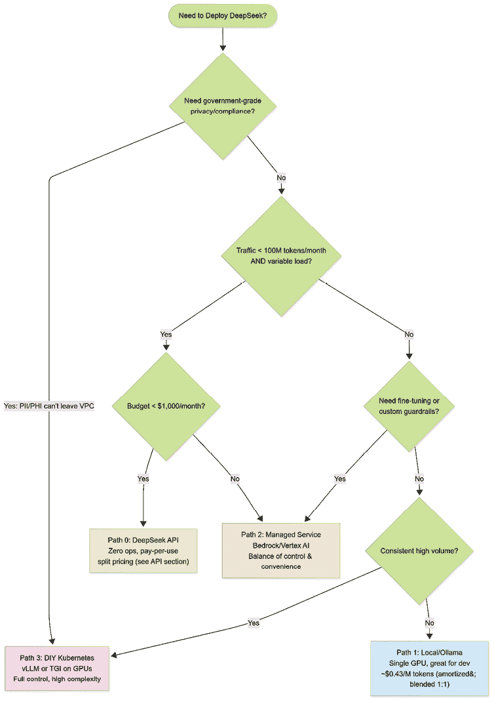

# 8 部署 DeepSeek 模型

在上一章中，我们蒸馏并微调了更小的、特定领域的模型，你可以在适度硬件和严格的隐私边界内运行。这项工作针对小规模的效率和控制进行了优化。本章采取了补充步骤，将全参数 DeepSeek 模型（V3 和 R1）部署为可靠的生产服务。

**部署**是从研究到生产的桥梁。它迫使对内存占用、吞吐量和运行风险做出具体选择。DeepSeek 的架构放大了这些权衡：V3 的 **专家混合** (**MoE**) 使 VRAM 放置紧张；R1 的扩展推理增加了令牌数量和首令牌时间。正确的路径取决于你的约束。

截至 2025 年 8 月，本章中的任何定价和吞吐量数字都是方向性的。在硬编码假设之前，请验证当前的提供商表格并在你的工作负载上进行验证。

本章为在真实场景中部署全参数 DeepSeek 模型提供了实用手册。我们将重点部署全规模的 DeepSeek-V3 (671B) 和 DeepSeek-R1；较小的模型仅作为开发代理被提及。

我们将在本章中涵盖以下主题：

*   DeepSeek 部署全景
*   选择部署策略的决策框架
*   硬件和推理优化需求
*   实践部署指南
*   生产运营和监控
*   你的部署手册

**范围说明**

本章不涵盖部署第 *7 章* 中提到的较小微调/学生模型。任何对较小模型的提及严格用于开发或代理工作流，而非全模型的生产部署。

### 技术要求

在本章中，我们将探索部署 DeepSeek 的各种方法。对于每种方法，技术要求将在相应部分提及。你可以利用最适合你的应用程序以及对工具和平台访问权限的任何方法。

## DeepSeek 部署全景

在生产中，你关注三件事：监控、扩展和成本。你监控每个请求的令牌数、**首令牌时间** (**TTFT**)、p95/p99 延迟、GPU 和 **键值** (**KV**) 缓存使用情况，以及错误/超时率。你根据系统实际生成的令牌数量（而不仅仅是到达的 HTTP 请求数量）进行扩展。并且你通过限制令牌数、在可能的情况下批处理、缓存常见前缀以及在空闲时暂停或调整副本大小来控制成本。

为此，你需要关注以下内容：

*   **内存占用**：这是运行时所需的 VRAM。它包括模型权重加上开销，如 KV 缓存和激活。跟踪峰值 VRAM 和每令牌的 KV 缓存字节数；这些数字决定了你的安全批量大小和上下文长度，以及你是否需要多个 GPU 或将部分权重移动到 CPU/NVMe。
*   **吞吐量**：这是你的服务在目标并发下每秒可以生成的令牌数。对于规划，还要报告在固定提示/响应大小下的每秒请求数，并始终将其与 TTFT 和 p95/p99 延迟配对，以便该数字反映真实的用户体验。
*   **运行风险**：这是由于不稳定或设置不当而错过 SLO 或超出预算的可能性。关注错误和超时率、**内存不足 (OOM) 事件**、队列增长以及你安全地推出更改或上下扩展的程度。

DeepSeek 增加了一些额外的复杂性。V3 使用 MoE 设计，当所有专家都保留在 GPU 内存中时效果最佳，这推高了 VRAM 需求，即使进行量化也是如此；将权重移动到 CPU 或 NVMe 有助于适应但会减慢速度。R1 *思考*很多，通常在最终答案之前生成数千个内部令牌，这提高了 TTFT，增加了内存使用，并使延迟更不可预测。因此，在你选择 API、托管或自托管部署之前，明确的容量规划、仔细的批处理和基本的仪表板是必须的。

### DeepSeek 的部署特点

DeepSeek 模型带来了特定的挑战：

*   **模型规模**：即使是量化版本也推高了硬件极限。DeepSeek-V3 的 671B 总参数需要大量的 VRAM，无论其 MoE 效率如何。
*   **推理开销**：R1 模型生成广泛的内部推理链。一个看似简单的查询可能产生数千个中间令牌。
*   **架构考虑**：V3 的 MoE 设计通常将所有专家保留在 GPU 内存中以获得性能；然而，这不是硬性要求。现代堆栈可以将权重卸载/分区（CPU/NVMe，跨节点张量并行），但代价是显著的延迟/吞吐量损失。

这些挑战需要针对大规模模型部署的特定工具和技术。让我们首先研究为什么你可能自己部署 DeepSeek 而不是使用官方 API。

### 为什么要自部署以及 DeepSeek 的独特之处？

通常，你会遇到选择自部署 DeepSeek 或任何其他最先进 LLM 的场景。例如，假设你正在处理敏感的法律文件，如合并协议——官方的 DeepSeek API 可能不是一个选择。不是因为它不够好，而是因为客户合同通常禁止将特权文件发送给第三方服务。这个场景说明了为什么自部署不仅仅是一项技术实践。它通常是一种商业必要性。

让我们谈谈你可能想要自部署的一些关键原因：

*   **控制和定制**：控制不是可有可无的；它是你如何将通用模型转变为适合你领域、风险状况和产品约束的系统的方式。自部署允许你接触 API 不会暴露的层（分词、路由、适配器、系统提示和安全策略），因此模型反映的是你的要求而非供应商的默认值。当 Bloomberg 构建 BloombergGPT 时，他们不仅仅想要一个金融语言模型；他们需要修改分词器以处理金融术语，并将一半的训练语料库保密。这种程度的控制是基于 API 的服务无法实现的。

对于 DeepSeek 部署，控制意味着以下内容：

*   调整超出 API 限制的生成参数。
*   合并特定领域的适配器（例如 LoRA）或专用适配器。
*   实现适合你领域的自定义安全过滤器。
*   无供应商限制地修改系统提示。
*   **规模成本**：成本不仅仅是一张价格表；它是利用率、批处理和缓存的函数。如果你的流量稳定或高容量，拥有服务堆栈可以让你分摊硬件成本并提高利用率，通常使有效的每令牌成本远低于按计量的 API。在规模上，经济性会急剧转变。对于每天处理数百份合同的法律文档工作流，使用以下方向性成本（截至 2025 年 8 月，硬编码前请验证）：
    *   **API 成本**：每百万令牌约 $30–50
    *   **自托管（分摊）**：每百万令牌约 $2–5
    *   **盈亏平衡点**：通常在 10-20M 令牌/月左右

*   **隐私和数据驻留**：对许多组织来说，隐私不是可选的；它是合同和法规要求的。自部署将敏感令牌保留在你的边界内，执行数据驻留和保留策略，并提供对数据流向的审计能力。例如，波恩大学医院部署了本地 LLM 用于胸部 X 光报告，专门是为了遵守德国数据本地性规则。本地推理处理所有敏感的医疗数据，无需云端出口或第三方处理。

在法律领域，要求更为严格：

*   律师-客户特权禁止大多数外部处理。
*   财务文件可能引发 SOX 合规问题。
*   欧盟数据驻留要求（GDPR）。
*   特定行业的法规（如 HIPAA 和 PCI-DSS）。
*   一些法律团队试验本地 LLM 以避免内容过滤器可能将特权材料标记为不当内容。

*   **性能**：延迟和吞吐量是塑造用户体验、SLO 甚至单位经济性的产品特性。自己运行堆栈消除了网络往返，并允许你针对你的硬件和工作负载定制服务引擎，释放比一刀切 API 更低的 TTFT 和更高的 tokens/sec。截至 2025 年 8 月，vLLM 基准测试报告与之前最先进的系统相比有 2–4 倍的吞吐量提升（[`arxiv.org/abs/2309.06180`](https://arxiv.org/abs/2309.06180)），与 Hugging Face Transformers 相比高达 24 倍（[`blog.vllm.ai/2023/06/20/vllm.html`](https://blog.vllm.ai/2023/06/20/vllm.html)）并支持连续批处理。

自托管的性能提升如下：

*   消除 API 往返延迟（通常 50–200ms）。
*   实现连续批处理以获得更高吞吐量。
*   针对你的特定硬件配置进行优化。
*   在本地缓存常见的提示前缀。

*   **特定用例**：西太平洋银行（Westpac）等主要银行已与 Kasisto 合作（[`www.westpac.com.au/about-westpac/media/media-releases/2022/23-august/`](https://www.westpac.com.au/about-westpac/media/media-releases/2022/23-august/)）部署银行工作流的特定行业 LLM；这些部署通常在银行的云边界内运行。

虽然自部署的动机广泛适用，但在你配置该 GPU 集群之前，DeepSeek 的架构创造了值得理解的独特挑战。

你应该注意的关于不同模型的一些 DeepSeek 特定部署考虑因素如下所列：

*   **DeepSeek-V3 内存需求和放置**：V3 的 MoE 设计在理论上是优雅的：671B 总参数，但每个令牌只有 37B 活跃。在实践中，这是一个内存管理难题。为了获得最佳性能，团队将所有专家保留在 GPU 内存中。将权重卸载或流式传输到 CPU/NVMe 或跨节点分片是可能的，但这会带来巨大的延迟和吞吐量损失。有关整合的 VRAM 和 GPU 规模（包括 INT4 占用空间和 H100 数量），请参阅关于硬件和推理优化引擎的部分。
*   报告的 4 GPU 部署通常针对较小的变体，或依赖于对 CPU/NVMe 的重度卸载/权重流式传输，这会引入大的减速。
*   有关整合的 VRAM 和 GPU 规模（包括 INT4 占用空间和 H100 数量）、容量规划和余量指南，请参阅关于硬件和推理优化引擎的部分。
*   **DeepSeek-R1 推理密集型生成**：R1 的推理链带来了不同的挑战。那些使 R1 如此强大的 `` 令牌也使内存使用和延迟激增（长*思考*阶段，尖峰内存）。一个简单的问题可能在实际答案之前生成数千个推理令牌。

那么这在实际环境中意味着什么？例如，使用 DeepSeek-V3 的 **多头潜在注意力** (**MLA**)，KV 缓存占用空间约为每令牌 70 KB（≈每 10k 令牌 0.7 GB），远低于传统注意力 KV 大小，但对于容量规划仍然是首要的。R1 的公开文档没有发布每令牌的 KV 大小；内存和延迟将取决于推理深度：

*   由于*思考*阶段，TTFT 可能明显更高；具体的 TTFT 取决于工作负载和服务堆栈（没有广泛引用的 >30s 基准）。
*   内存使用是不可预测的；它取决于推理复杂性。
*   吞吐量通常由*思考*阶段主导。

截至 2025 年 8 月，完整 R1 的公开 H200 数字因堆栈和工作负载而异。NVIDIA 在早期 NVIDIA 推理微服务 (NIM) 预览中报告了 8× H200 约 ~3,872 tokens/sec；后来的 Blackwell (8×) 营销声称达到 ~30k tokens/sec。对于你自己的用例，请务必将供应商数字视为营销数字，直到在你的工作负载上进行验证，并在硬编码容量假设之前验证当前数字。无论哪种方式，单个请求可能仅用于内部推理就需要 5,000+ 令牌。

这些挑战并非旨在阻止自部署。它们旨在为你做好准备。本章重点部署全参数 DeepSeek-V3 (671B) 和 DeepSeek-R1 模型；虽然较小的蒸馏或微调变体对于原型设计很有用，但它们不是这里的重点。关键点是，这并不自动意味着你应该自部署以省钱。自托管主要在合规性要求时或你拥有持续、高令牌量和强大 GPU 利用率时才能收回成本；否则，API 或托管服务通常更便宜、更简单，直到你测量的工作负载超过你验证的盈亏平衡点。

关键是将你的部署策略与你的实际需求匹配：

*   需要处理敏感文件？自部署可能是强制性的。
*   每天处理数百万令牌？经济学上倾向于自托管。
*   需要低于 100ms 的延迟？具有优化服务的本地部署是最好的。
*   只是在试验？从 API 开始，需要时迁移。

让我们引导你通过一个框架来系统地做出这些决策，将部署从一项艰巨的挑战转变为一系列可管理的权衡。

## 选择部署策略的决策框架

部署选择主要取决于我们在上一节讨论的关键驱动因素：控制、成本和复杂性。你将发现自己需要在这三者之间进行权衡并找到合适的平衡点。

根据你的用例，你可以选择以下三种部署策略之一：

*   **API 方法**最大程度降低复杂性，但成本多变且控制较少。
*   **托管服务**提供中等复杂性和企业功能，但单位成本更高。
*   **DIY（自托管）部署**最大化控制并在规模上实现最佳单位成本，同时施加最高的运营负担。

让我们构建一个框架来帮助你明智地选择，提供一个决策表（*表 8.1*），按合规约束、持续令牌率和目标 SLO 进行索引。

| **选择** | **控制** | **成本** | **复杂性** | **典型用途** | **关键 SLO 变量** |
| --- | --- | --- | --- | --- | --- |
| API | 低 | 可变，按令牌付费 | 低 | 原型设计；突发负载 | TTFT，p95 延迟（网络）；提供商速率限制 |
| 托管 | 中 | 每令牌成本更高 | 中 | 企业功能；IAM | TTFT，p95；自动扩展行为 |
| DIY | 高 | 规模上最低 | 高 | 稳定高流量 | tokens/sec，TTFT，p95；GPU 利用率 |

表 8.1：为 DeepSeek 模型选择部署选项

每个部署决策都归结为这三个相互竞争的力量（控制、成本和复杂性）。根据我的经验，你可以优化其中两个，但很少三个都能优化：

*   **控制**意味着调整每个参数、合并模型、实现自定义安全过滤器或为合法研究运行*无审查*版本的能力。一家公司可能会从 Vertex AI 迁移到自托管的 vLLM，这给了他们所需的控制权，但他们必须配备专门的 *LLM SRE* 团队来维持低于 300ms 的延迟。
*   **成本**是数学变得有趣的地方。DeepSeek 的 API 按输入/输出令牌计费（你的有效*混合*费率取决于组合）。在 4× A100 GPU 上自托管？在 1,600 tokens/sec 下，这大约是每百万令牌 $1.24，但这假设你让那些 GPU 保持忙碌。仅就基础设施数字而言，自托管可能已经更便宜；真正的盈亏平衡分析只有在你为你的组织显式添加固定人员/运营开销后才会出现。
*   **复杂性**是隐性的税款。运行你自己的推理基础设施意味着雇佣专家、编写手册，以及在模型服务器凌晨 3 点崩溃时被呼叫。AWS 关于 EKS 上 DeepSeek-R1 的参考架构需要深入的 Kubernetes 专业知识和 GPU 调度知识。

最佳点？大多数组织发现不是完全选择一条路径，而是知道何时使用每条路径。你可以想象将低流量功能保留在 Vertex AI 上，同时将高流量的对账作业迁移到内部 vLLM 集群，将成本从每令牌 1.4¢ 降至 0.3¢。

你可以使用以下决策图（*图 8.1*）作为起点来探索哪个选项最适合你。你可以选择最适合你应用程序的部署路径。我们稍后会详细介绍所有选项。



图 8.1：选择如何部署 DeepSeek 的决策图

**注意**

决策树中的 Local/Ollama 路径仅适合作为开发代理，不适用于完整的 DeepSeek-V3 (671B) 或 R1 部署，后者需要多 GPU 或托管基础设施。

总的来说，这个框架通过平衡控制、成本和运营复杂性，将每个用例映射到 API、托管或 DIY 策略。为了对已选择的选项进行压力测试，请使用你自己的 $/小时报价和工作负载上测量的 tokens/sec 运行快速成本健全性检查，这样你就是从测量的经济性（而非营销数字）进行决策。

### 成本健全性检查

截至 2025 年 8 月，将 $/h 和 tokens/sec 视为变量，并在硬编码之前验证当前费率。

例如，如果你的 8× H200 端点报价约为 $40/h 并且在你的测量中维持约 3,000 tokens/sec，基础设施成本≈ 每千令牌 $0.0037（不包括人员/运营）。将其与提供商的令牌价格和你观察到的提示/响应分布进行比较。

除非明确标记为*混合*或*摊销*，否则每令牌成本显示为*分割输入/输出*费率。任何单一数字都是*1:1 混合假设*或*摊销的基础设施估计*，并相应标注。在硬编码价格之前，请验证当前的提供商表格。

让我们用实际数字来说明这些权衡：

| **部署路径** | **前期成本** | **每令牌成本** | **技术专业知识** | **延迟/吞吐量** | **隐私** | **可扩展性** |
| --- | --- | --- | --- | --- | --- | --- |
| DeepSeek API | $0 | V3：$0.27/M 输入 + $1.10/M 输出<br>R1：$0.55/M 输入 + $2.19/M 输出 | 非常低 | 环境相关的端到端 TTFT 和 p95 延迟<br>tokens/sec 吞吐量 | 数据离开 VPC | 弹性，由供应商管理 |
| Local/Ollama (RTX 4090) | 约 $1,599 GPU | $0.43/M 令牌（摊销） | 低-中 | 8–70 tokens/sec<br>TTFT < 150ms | 完全本地控制 | 受限于 GPU RAM |
| 托管服务 (Bedrock/Vertex) | 按需 $0。承诺 $2,000+/月 | Vertex 上的 DeepSeekR1：$1.35/M 输入 + $5.40/M 输出（区域/模型相关） | 中 | 指示性；因模型/区域/批处理而异。<br>示例：R1 在 8× H200 上约 ~3,872 tokens/sec（NVIDIA 预览）。 | 区域内，SOC2 | 自动扩展，全球化 |
| DIY Kubernetes (4× A100-80GB) | $5,155/月 基础设施（$1.79/GPU 小时） | @ 1,600 tokens/sec $1.24/M 令牌 | 高 | 高达约 3,800 tokens/sec 在 8× H200 上（NVIDIA 预览） | 完全 VPC 隔离 | 手动扩展 |

表 8.2：DeepSeek 各种部署选项的定价比较矩阵（截至 2025 年 8 月）

使用简单的规划公式来建模你的工作负载成本：

例如，让我们为矩阵中的 4× A100 DIY 设置代入数字。大约每小时 $7.16（4 GPU × $1.79/h）和测量的 1,600 tokens/sec，公式简化为每小时计算：*$7.16 ÷ (1,600 × 3600) ≈ 每百万令牌 $1.24*。你现在可以直接将其与 API 进行比较。这个自托管成本略低于 DeepSeek-R1 API 的约 $1.37/M 令牌的混合费率（1:1 输入/输出）。决策随后取决于利用率：如果你的工作负载足够一致以保持 GPU 忙碌，自托管提供节省；如果是间歇性的，按需付费的 API 将更便宜。

那么你如何选择？

*   **API 胜出时**：你正在试验，有可变负载，或每月处理少于 100M 令牌。零运营开销值得溢价。
*   **本地出色时**：你有开发、测试或绝对不能离开你场所的敏感数据。例如，假设 4090 GPU 上约 65 tokens/sec，1:1 I/O 比率，并将 $1,599 GPU 在 50% 利用率下分摊 24 个月，仅 GPU 成本约为每百万令牌 $0.8（不包括电力和运营）。使用成本公式根据你的工作负载进行调整。
*   **托管服务合理时**：你需要企业功能（审计日志、IAM 集成和全球化部署）而没有运营负担。更高的每令牌成本买来了安心。
*   **DIY 提供价值时**：你每月处理数十亿令牌且有可预测的负载。一个处理 3B 令牌/月的 4× A100 集群相比 API 节省约 $3,000 – 足以雇佣那个 SRE。

但决策树不是万能的。它没有告诉你大多数成功的部署是混合的。回想一下我们在本章开头讨论的法律场景。他们可能需要一种部署选项。你可能会遇到三条路径或选择用于 DeepSeek 部署：

*   使用 API 进行低容量实验功能，或在私有数据上进行合成数据生成。
*   在本地 GPU 上部署微调的法律分类器进行文档处理。
*   利用 Bedrock 进行需要五个九正常运行时间的面向客户的应用程序。

这个框架不是关于永远选择一条路径——而是关于知道哪条路径最适合每个用例。

你准备好看看每条路径在实践中实际是什么样子了吗？让我们深入实施细节。

### 三条部署路径

本节详细介绍了我们在 *图 8.1* 中确定的每条部署路径，并重点介绍了你可以为部署采取的具体步骤。

#### 路径 0：基线（官方 DeepSeek API）

API 方法提供最低的运营开销。一切正常工作，其他人处理维护，你可以专注于你来要做的事情。对于许多团队来说，即使考虑了所有替代方案，这仍然是正确的选择。

DeepSeek API 提供两个主要模型：`deepseek-chat` (DeepSeek-V3) 和 `deepseek-reasoner` (DeepSeek-R1)。截至 2025 年 8 月，两者都提供 128K 上下文窗口。最大输出令牌取决于 API 参数（例如 `max_tokens`）和提供商设置。定价与公开表格一致。V3 每百万输入令牌 $0.27，每百万输出令牌 $1.10；R1 每百万输入 $0.55，每百万输出 $2.19。

入门需要最少的仪式，正如你在 *第 5 章* 中看到的：

```python
import os
from openai import OpenAI

client = OpenAI(
    api_key=os.getenv("DEEPSEEK_API_KEY"),
    base_url="https://api.deepseek.com"
)

response = client.chat.completions.create(
    model="deepseek-chat",  # 或 "deepseek-reasoner" 用于 R1
    messages=[
        {"role": "user", "content": "什么是合同中的关键条款？"}
    ],
    max_tokens=1024
)

print(response.choices[0].message.content)
```


### 引言

```python
import deepseek

deepseek.api_key = "YOUR_KEY"

resp = deepseek.ChatCompletion.create(
    model="deepseek-reasoner",
    messages=[{"role": "user", "content": "Prove the Pythagorean theorem."}],
    stream=True,   # 始终使用流式传输——降低 R1 的感知延迟
    # 原因：使用流式传输可降低 R1 的感知延迟（TTFT）；同时能限制客户端缓冲区的增长。
)

for chunk in resp:
    print(chunk.choices[0].delta.content, end="", flush=True)
# 原因：保护客户端免受 R1 漫长“思考”阶段的影响；请根据您的服务水平协议（SLA）进行调整（例如 60–120 秒）。
```

这段代码是使用 API 获取响应并直接流式传输结果的一个简单示例。

该 API 的实际运行情况既有惊喜，也有隐藏的复杂性。截至 2025 年 8 月，请求最长可运行约 30 分钟超时。在依赖这些限制之前，请核实当前的限制。尽管前面的代码示例中未显示，但您可能需要密切关注 API 密钥的开销，以保护预算，特别是考虑到 R1 倾向于冗长的推理过程。

一家供应链 SaaS 公司记录了其从 OpenAI 的`GPT-4o`迁移到 DeepSeek 的过程，主要动机是 API 价格低了近 25 倍（`https://medium.com/tracified/deepseek-vs-openai-aec06fbee43a`）。然而，节省成本伴随着一个权衡：迁移并非简单的替换，而是需要彻底改革他们的提示词工程策略。该团队发现，DeepSeek 需要更明确、更详细的指令，才能匹配他们从更灵活的 OpenAI 模型那里获得的提取准确性。

### 路径 1：本地和本地部署（用于开发和特定场景）

本地部署是事情变得有趣的地方。此路径主要用于开发和原型设计；它不适用于全参数的`DeepSeek-V3`（671B）或`DeepSeek-R1`部署，因为后者需要多 GPU 或托管基础设施。您用 API 的便利性换取完全的控制权——这非常适合处理机密文件的法律分类器或探索*无审查*模型行为的研究实验室。

我们首先使用`Ollama`进行本地部署。

#### Ollama：摩擦最小的本地路径

`Ollama`已成为以最少麻烦在本地运行模型的**事实标准**。安装在 Linux 或 macOS 上只需一条命令，如下所示：

```bash
curl -fsSL https://ollama.com/install.sh | sh
```

Windows 用户可使用 MSI 安装程序，可从`https://ollama.com/download/OllamaSetup.exe`下载。

```bash
ollama pull deepseek-r1:14b-q4_K_M  # 14B 蒸馏版，可在 16GB 显存内运行
ollama run deepseek-r1:14b
```

在前面的代码片段中，我们使用了 14B 蒸馏模型。14B 模型代表了一个有趣的中间平衡点，在本地运行的能力和其反馈答案的力量之间取得了平衡。在`Q4_K_M`量化下，它占用约 8.5 GB 的显存，截至 2025 年 8 月，在`RTX 4090`（非科学测试；工作负载各异）上的非正式本地测试中，速度约为 65–72 tokens/秒。虽然不是极快，但对于开发或小规模生产使用来说完全足够。完整的模型目录范围从用于内存受限系统的激进 3 位量化（约 7.5 GB）到保留更多原始模型能力的 8 位版本（约 16.7 GB）。

#### Docker + vLLM：生产级本地服务

当`Ollama`的简单性达到其极限时，容器化的`vLLM`（即从 Docker 容器运行的`vLLM`）提供了一种更复杂的方法。这不是您标准的 Flask 或 FastAPI 包装的模型——`vLLM`带来了工业级的优化，例如分页注意力（Paged Attention），与简单实现相比实现了 24 倍的吞吐量提升。权衡在于复杂性与工作负载配置。那 24 倍的提升反映了高并发负载下的吞吐量，这对生产来说是游戏规则的改变者，但对于在本地运行单个请求的开发者来说通常是过度的。对于低并发或开发工作流程，`Ollama`的简单性难以超越；当您需要从单个共享 GPU 为多个用户或应用程序提供服务时，`vLLM`才能证明其设置开销是合理的。

**分页注意力**

`分页注意力`是一种内存管理算法，它将 KV 缓存存储在非连续的内存块中，就像操作系统使用虚拟内存和分页一样。这解决了内部内存碎片问题，能够实现更大的批处理大小，并最终带来`vLLM`所知的吞吐量提升。

使用`docker run --gpus all -p 8000:8000 -v models:/models deepseek-vllm:latest`启动以下脚本。您将获得一个与官方 DeepSeek API 使用相同协议的 OpenAI 兼容端点。

```dockerfile
FROM nvidia/cuda:12.4.1-runtime-ubuntu22.04
RUN pip install vllm==0.8.5
ENV HF_TOKEN=<your-token>
CMD vllm serve \
     --model "deepseek-ai/DeepSeek-Coder-V2-Lite-Instruct" \
     --dtype "bfloat16" \
     # 原因：限制上下文以约束 KV 缓存增长；仅在内存允许时提高此值。
     --max-model-len "8192" \
     # 原因：推动显存使用以提升吞吐量；>0.95 可能在突发负载时导致内存溢出。安全范围：0.85–0.95。
     --gpu-memory-utilization "0.95"
```

### 面向部署的硬件与推理优化引擎

当您需要在本地部署与云部署之间切换，而无需重写应用程序代码时，这种兼容性就变得至关重要。

对于处理敏感数据的团队，像`OnPrem.LLM`([`arxiv.org/html/2505.07672v2`](https://arxiv.org/html/2505.07672v2))这样的项目可以在这些本地服务层之上构建完整的 RAG 流水线，确保专有文档永远不会离开您的基础设施。

## 路径二：托管推理服务（平衡之道）

托管服务在控制力与便利性之间取得了绝佳平衡。您无需雇佣专门的 MLOps 团队，即可获得企业级功能（审计日志、IAM 集成以及全球部署）。想象一下，一家快速发展的 B2B SaaS 公司，其核心产品是 AI 驱动的分析仪表盘。公开 API 非常适合其最小可行性产品，但其新的企业客户要求保证正常运行时间、更低的延迟以及在私有网络内进行处理。自建 Kubernetes 集群需要数月时间，并需要雇佣专门的 MLOps 工程师。因此，他们转向了 Amazon Bedrock 或 Vertex AI 等托管服务。这一举措使他们能够以可预测的成本模型和最小的运维负担，获得所需的企业功能，如私有端点和预配置吞吐量，从而满足企业需求，而不影响其产品路线图。

各大主要云服务提供商都已拥抱 DeepSeek，尽管其方法各有不同。让我们来逐一介绍：

*   **Amazon Bedrock** ([`aws.amazon.com/bedrock`](https://aws.amazon.com/bedrock)) 通过 Bedrock（包括 Marketplace）提供`DeepSeek-R1`，支持无服务器调用。Bedrock 中通常提供预配置吞吐量，但其可用性可能取决于具体的第三方模型和区域——请为您的账户核实。无服务器选项非常适合可变负载，而预配置吞吐量（在可用的情况下）一旦超过持续 Token 速率，即可保证一致的性能。其内置的护栏服务无需自定义代码即可添加内容过滤，这对于面向客户的应用至关重要。
*   **SageMaker JumpStart** ([`docs.aws.amazon.com/sagemaker/latest/dg/studio-jumpstart.html`](https://docs.aws.amazon.com/sagemaker/latest/dg/studio-jumpstart.html)) 采用了不同的方法，专注于可以在单 GPU 实例上轻松运行的蒸馏版本（8B 和 32B）。AWS 最近的一篇博客文章展示了在`ml.g5.xlarge`实例上服务 8B 模型。定价因区域和承诺而异，请为您的账户核实费率。
*   **Google Vertex AI** ([`cloud.google.com/vertex-ai/generative-ai/docs/maas/deepseek`](https://cloud.google.com/vertex-ai/generative-ai/docs/maas/deepseek)) 在其模型花园中添加了`DeepSeek-R1`，支持一键部署。截至 2025 年 8 月，`us-central1`区域的代表性价位约为每百万 Token 6.75 美元。费率因区域/模型而异，请在您的账户中核实。它比官方 API 更贵，但包含企业级 SLA 和私有端点支持。
*   **Azure AI Foundry** ([`azure.microsoft.com/en-us/products/ai-foundry`](https://azure.microsoft.com/en-us/products/ai-foundry)) 补齐了三大云商的阵容，同时提供无服务器和专用集群选项。其负责任的 AI 记分卡提供自动偏差检测和内容安全分析——这些功能可以为受监管行业节省数月的定制开发时间。
*   **Hugging Face Inference Endpoints** ([`huggingface.co/inference-endpoints/`](https://huggingface.co/inference-endpoints/)) 因其透明度值得特别提及。其部署向导会预先显示明细成本，但费率因区域/计划/提供商而异。截至 2025 年 8 月，可将 8×H200 大约$40/小时作为市场参考（例如，Together AI 的公开报价约为$0.67/分钟）。对于 Hugging Face Endpoints，自动`缩容至零`是可选加入的，并且默认在闲置约 15 分钟后触发（历史上也记录为约 1 小时）。存在用于将端点`手动缩容`至 0 的编程控制；除非您的提供商明确支持，否则不要假设有 60 秒的闲置超时。请为您选择的区域/计划核实可用性和具体语义。

一种实用的混合模式是，将延迟敏感、面向客户的推理保留在托管平台上，而将大型、非交互式的批处理作业转移到专用端点以降低成本。SageMaker 上的成本案例研究报告了显著的节省；例如，Forethought 指出，迁移到 SageMaker 后，推理成本降低了高达 80% ([`aws.amazon.com/solutions/case-studies/forethought-technologies-case-study/`](https://aws.amazon.com/solutions/case-studies/forethought-technologies-case-study/))。

## 路径三：在 IaaS 上自建（为了极致控制）

自建部署是工程与经济的交汇点。您不仅仅是在运行一个模型；您是在构建基础设施。这条路径需要专业知识，但能提供无与伦比的灵活性和潜在的成本节约。以下是一些典型用例及各自示例：

*   **受监管和网络隔离的工作负载**：您必须将数据保留在特定的网络边界或国家内，并且不能使用第三方端点。例如，一家医院在自己的 VPC 中通过私有 API 部署 DeepSeek，没有互联网出口。
*   **稳定、高流量且注重每 Token 成本的工作负载**：您的工作负载具有可预测的每日/每周批处理任务，并保持 GPU 繁忙。例如，一个电子商务团队在`vLLM`集群上运行夜间目录充实和翻译，与按 Token 付费的 API 相比降低了单位成本，并控制了批处理窗口。
*   **超低延迟或网络邻近性**：您需要达到公共 API 难以企及的 p95 延迟目标。例如，一个交易台将推理节点与其市场数据流并置，使用编译内核（`TensorRT-LLM`）和 KV 缓存预热器，并避免跨区域跳转。
*   **自定义模型或运行时控制**：您需要托管端点未暴露的能力。例如，一个法律科技平台合并领域 LoRA，执行自定义的脱敏过滤器，调整 R1 *思考*预算，并在`vLLM`中调整连续批处理参数以匹配其流量。
*   **具有严格隔离和预算的多租户平台**：您必须保证每个租户的数据隔离，并在数千个租户间强制执行 Token 预算。例如，一个开发者平台为每个租户运行独立的命名空间，使用粘性路由会话以利用缓存局部性，并在网关处执行令牌桶限制。
*   **本地部署、边缘或不可靠的 WAN**：您无法依赖稳定的连接。例如，一家工厂在一个小型本地 GPU 集群上运行 DeepSeek，并定期更新权重，以确保即使在无线网络链路中断时也能继续进行本地推理。
*   **供应商独立性和容量控制**：您希望在需求激增前提前锁定价格/可用性。例如，一家媒体公司在两个区域预留 GPU，为基线负载自建，仅在发布期间突发到托管端点。

这些模式充分发挥了自建的优势：完全控制内存放置（这对 V3 的 MoE 很重要）、限制或塑造 R1 推理 Token 的能力、大规模下可预测的单位经济学，以及与您自己的安全和 SRE 实践的深度集成。

以下是一些您可以尝试的方法：

*   **单 VM 或裸金属**：最简单的自建方法类似于本地部署，但使用更强大的硬件。一个典型配置可能包括 4×A100-80GB GPU，运行`vLLM`，其中`DeepSeek-V3`被量化到 INT4。截至 2025 年 8 月，在高利用率下，实测吞吐量约为每秒 1,600 个 Token，每百万 Token 的基础设施成本低于约$2；在承诺之前，请用您的工作负载进行验证。

使用更新的硬件，这个计算变得更有意思。NVIDIA 报告称，在早期 NIM 预览条件下，在 8×H200 上运行 R1 的速度约为 3,872 tokens/sec；后来的 Blackwell（8×）营销声称达到约 30k tokens/sec（[`blogs.nvidia.com/blog/deepseek-r1-nim-microservice/`](https://blogs.nvidia.com/blog/deepseek-r1-nim-microservice/) 和 [`developer.nvidia.com/blog/nvidia-blackwell-delivers-world-record-deepseek-r1-inference-performance/`](https://developer.nvidia.com/blog/nvidia-blackwell-delivers-world-record-deepseek-r1-inference-performance/)）。对于每天处理数十亿 Token 的组织来说，投资回报率可能很快显现。

*   **Kubernetes 编排**：Kubernetes 部署将自建从*运行一个服务器*提升到*运营一个服务*。2025 年的现代方法以`KServe` v0.15 作为服务层为核心，但真正的重点在于您如何思考扩展和优化。
*   与传统的 Web 服务模式不同，LLM 部署需要不同的思维模型。您不是根据每秒请求数进行扩展；而是根据实际完成的工作量进行扩展：有多少请求正在积极生成 Token，与有多少在队列中等待。诸如**Kubernetes Event-driven Autoscaling**（`KEDA`）之类的工具通过监视真实的 LLM 指标（而非原始的请求计数）来实现这种更智能的扩展（[`keda.sh/`](https://keda.sh/)）。

以下是自建部署中最关键的一些架构选择：

*   **智能自动扩展**：基于有意义的指标（如活跃的生成负载）进行扩展，而非 HTTP 请求速率。R1 较长的推理阶段使得这一点尤为重要。
*   **Token 预算控制**：与传统的速率限制不同，您需要在 Token 级别限制支出。Envoy AI Gateway 和类似工具提供了这种控制，无需重写客户端。
*   **KV 缓存共享**：在会话式工作负载中，跨副本共享缓存可显著提高吞吐量。像 LMCache 这样的技术使这成为可能，无需更改应用程序。
*   **多节点考虑**：当模型超出单节点内存时，您就进入了不同的复杂性领域。流水线和张量并行可以工作，但需要仔细规划，并且它们目前不支持自动扩展。

请注意，即使是 INT4 量化的 V3 也需要多个 GPU。R1 的思考阶段需要宽松的超时时间。对于最大的模型，较少但强大的节点加上快速互连通常优于许多较小的实例。然而，这些并非即插即用的解决方案。每个优化都需要理解您特定的工作负载模式。团队经常发现，他们的*聊天*工作负载实际上是 80%的单轮提问，使得会话优化的缓存毫无价值；或者他们实现了复杂的自动扩展，结果发现他们的负载是完全可预测的。

我们探索的每条路径都有其合理的用例。API 擅长处理原型和可变负载。本地部署保护敏感数据，同时允许在较小模型上进行实验；完整的`DeepSeek-V3`或 R1 需要多 GPU 或托管服务。托管服务在功能和操作简便性之间取得了平衡。自建基础设施提供终极控制力和规模化的经济效益。

您的选择较少取决于技术优越性，更多取决于组织的现实情况。您是否有运行 Kubernetes 的专业知识？您的数据能否离开您的本地环境？您是否会处理足够多的 Token 来证明基础设施投资的合理性？诚实地回答这些问题，正确的路径就会变得清晰。

接下来，我们将深入探讨使任何这些路径成为可能的基础技术，因为无论您是调用 API 还是运行自己的集群，理解底层机制都有助于您做出更好的决策。

下一节将调查支撑这些选择的硬件和服务引擎。

## 选择您的硬件

VRAM 容量决定了可行性；其他组件主要影响速度。在 LLM 部署方面，您的 GPU 内存决定了什么是可能的，而其他一切只决定了发生的快慢。

当前用于 DeepSeek 部署的 GPU 层级如下所示：配备 80 GB HBM3 的 H100 位于顶端，通过其 Transformer Engine 提供 3.3 TB/s 的内存带宽和原生 FP8 支持。A100（40 GB 或 80 GB 变体）仍然是生产主力——可靠、广泛可用，并且对于大多数用例来说速度仍然足够快。L40S 提供了一个有趣的中间选择，配备 48 GB GDDR6——内存带宽较低，但通常更容易采购。

一个采用 BF16（`bfloat16`）精度——这是一种在现代 GPU/TPU 上使用的 16 位浮点格式，每个参数存储 2 个字节，在更少的尾数位（即精度位）下保留 FP32 的数值范围——的 33B 参数模型需要以下内容：

*   基础内存 = 33B 参数 × 2 字节/参数 = 66 GB。
*   运行时开销（约 10%） = 6.6 GB。
*   总 VRAM 需求 = 约 73 GB。

这还没计算用于上下文的 KV 缓存、用于批处理的激活内存，或者安全余量。您的 33B 模型勉强能塞进单个 H100，但一旦启用生产特性，就需要多个 GPU。

如果您选择部署具有 671B 参数的`DeepSeek-V3`怎么办？即使进行激进的 INT4 量化，您也需要至少 335 GB。在这种情况下，多 GPU 集群不是可选的，而是强制性的。

另一个重要方面是利用推理引擎。原因如下。

## 推理引擎

对于 DeepSeek，在简单的 Web 服务器中编写一个快速的`model.generate()`函数是不够的。我们很快发现了推理引擎所解决的性能瓶颈。

朴素的逐请求生成一次处理一个请求，并在每个序列上逐个 Token 生成，然后才接受新的请求。在 Token 之间，GPU 通常等待 Python 开销和内核启动，KV 缓存以大块连续方式分配，随着序列在不同时间完成，导致内存碎片。例如，一个简单的 Flask 或 FastAPI 服务器，每个 HTTP 请求都调用`batch_size=1`的`model.generate()`，会运行一个用户流直到完成，而其他用户排队等待，导致 GPU 利用率低下。另一个常见情况是固定批处理，等待批次中的所有序列完成；短提示在空闲，而最长的提示阻塞整个批次。

转向`vLLM`或 TGI 并使用连续批处理可以避免这些间隙。它们重用分页的 KV 内存，并在其他请求完成时插入新请求，这使得设备保持饱和。在实践中，这通常能在相似延迟下带来 2-4 倍的吞吐量提升。公开基准测试反复显示，在负载下与 Hugging Face Transformers 服务器相比有巨大收益（[`arxiv.org/abs/2309.06180`](https://arxiv.org/abs/2309.06180) 和 [`blog.vllm.ai/2023/06/20/vllm.html`](https://blog.vllm.ai/2023/06/20/vllm.html)）。

朴素的方法将每个请求视为孤立的。您昂贵的 GPU 在等待 I/O、内存碎片以及短序列完成时闲置，而较长的序列则阻塞整个批次。

于是推理引擎登场。推理系统有助于解决 GPU 时间的浪费，提高吞吐量，并降低延迟。让我们谈谈您可用的各种选择：

*   **vLLM** ([`github.com/vllm-project/vllm`](https://github.com/vllm-project/vllm))：LLM 引入了 PagedAttention，借鉴操作系统的虚拟内存概念来高效管理 KV 缓存。`vLLM`不是预分配巨大的连续内存块，而是像现代操作系统处理 RAM 一样，对缓存条目进行分页。这意味着与朴素的服务方式相比，吞吐量提升了 2-4 倍，某些工作负载甚至能看到高达 23 倍的提升。
*   `vLLM`真正的魔力在于连续批处理。传统服务方式等待批次中的所有序列完成才处理新请求，而`vLLM`则在其他请求完成时动态插入新请求，使您的 GPU 保持饱和。这就像出租车司机，一种方式是等待所有乘客到达目的地，另一种方式是沿途搭载新乘客。

以下是如何实现批处理：

```
```


# 传统批处理伪代码

```
def serve_batch(requests):
    outputs = model.generate(requests)  # 必须全部完成
    return outputs
```

# 连续批处理概念

```
def serve_continuous():
    while True:
        if completed := get_finished_sequences():
            yield completed
            add_new_requests_to_batch()
        step_active_sequences()
```


*   **`Text Generation Inference`** (**`TGI`**) ([`github.com/huggingface/text-generation-inference`](https://github.com/huggingface/text-generation-inference))：Hugging Face 的 `TGI` 为 IBM Watson 和 Grammarly 的企业级部署提供动力。其核心技术结合了 `Flash Attention` 内核、`tensor parallelism` 和 `safetensors`，以实现近乎即时的模型加载。与优化吞吐量的 `vLLM` 不同，`TGI` 平衡了吞吐量与一致的延迟表现——这对于面向用户的应用至关重要。

`TGI` 的优势包括连续批处理、`Flash Attention`、`PagedAttention`、量化和 `tensor parallelism`。它使用 `safetensors` 和优化的加载器来加速冷启动，但权重必须在服务请求前完全加载。

*   **`TensorRT-LLM`** ([`github.com/NVIDIA/TensorRT-LLM`](https://github.com/NVIDIA/TensorRT-LLM))：NVIDIA 的 `TensorRT-LLM` 代表了*更贴近底层硬件*的方法。它将你的模型编译成优化的 CUDA 内核，融合操作，并利用 H100 Transformer Engine 等硬件特性。编译步骤增加了复杂性，但回报是巨大的——从 A100 FP16 迁移到 H100 FP8 时，吞吐量可提高 4.6 倍。

需要注意的是，`TensorRT-LLM` 对模型架构和硬件更为挑剔。它在 NVIDIA 最新 GPU 上运行其熟知的模型时表现最出色。对于 DeepSeek 的 MoE 架构，你可能需要等待官方支持或深入研究自定义插件。

**那么，如何选择你的推理引擎？**

选择不在于哪个引擎是*最好*的；而在于将优势与需求相匹配。以下是一个快速指南，帮助你做出决策：

*   当需要最大灵活性和吞吐量时，使用 `vLLM`。
*   当需要生产环境稳定性和一致延迟时，选择 `TGI`。
*   当你拥有现代 NVIDIA 硬件并需要追求极致的每秒 token 数时，采用 `TensorRT-LLM`。

大多数团队因易用性而从 `vLLM` 或 `TGI` 入手，然后在达到规模时评估 `TensorRT-LLM`。妙处何在？三者都提供兼容 OpenAI 的 API，因此切换引擎通常只需更改配置，而非重写代码。

量化是另一种可以帮助你加速推理时间和降低成本的技术。

## 量化的力量

回忆一下 *第 2 章*，量化通过降低精度来缩小内存占用并提高吞吐量，通常伴随轻微的质量损失。量化领域提供了多种技术，每种都有其权衡：

*   **`FP8`** 代表了最温和的压缩，在保持近乎完美精度的同时将内存使用减半。它需要较新的硬件（H100/L40S），但提供了最佳的质量与压缩比。可以把它想象成从无损的 **`FLAC`** 格式转向高比特率的 MP3：技术上有损失，但实际上难以区分。
*   **`GPT quantization`** (**`GPTQ`**) 采用训练后处理方法，分析你的模型以确定哪些权重可以压缩到 4 位而不会导致灾难性遗忘。它速度快，只需要几百个样本的校准数据集，通常精度损失不到一个百分点。（要了解更多关于 `GPTQ` 的信息，请查阅 Hugging Face 博客：[`huggingface.co/blog/gptq-integration`](https://huggingface.co/blog/gptq-integration)。）
*   **`Activation-aware weight quantization`** (**`AWQ`**) 更进一步，识别那些对输出有不成比例影响的*显著*权重，并保持其在更高精度。对于 DeepSeek 的 MoE 模型，这种激活感知特别有价值——专家路由依赖于精确的权重值，而 `AWQ` 能够保留它们。（要了解更多并找到理解其工作原理的资源，Hugging Face 的 `AWQ` 文档是个好去处：[`huggingface.co/docs/transformers/en/quantization/awq`](https://huggingface.co/docs/transformers/en/quantization/awq)。）

一个简单估算 GPU 内存的方法是将其分为三部分：模型权重、少量运行时余量和 `KV 缓存`：

*   **`权重`**：从权重张量本身开始。将参数数量乘以所选精度下每个参数的字节数。对于一个 330 亿参数的模型，`BF16` 每个参数存储约 2 字节，因此仅权重就大约需要 66 GB。`FP8` 将其减半至约 33 GB。使用 4 位量化时，每个参数存储约半字节。这意味着，实际上，330 亿参数模型的 `GPTQ-4b` 检查点通常在 16–17 GB 左右，而 `AWQ-4b` 检查点通常更接近 18–19 GB，因为它们将一些关键值保持在更高精度。在相同位宽下，`AWQ` 通常比 `GPTQ` 保留了稍高的精度。
*   **`运行时余量`**：在权重大小上增加约 10–20%，用于临时工作空间、CUDA 内核缓冲区、分配器碎片以及（对于 MoE 模型）路由开销。以同样的 330 亿参数模型为例，在考虑序列内存之前，`BF16` 部署可能需要在 66 GB 的权重之外额外 6–13 GB。
*   **`KV 缓存`**：最后，为 `KV 缓存` 预留空间，它随着上下文长度、生成 token 数和批处理大小而增长。这部分与权重大小是分开的。对于 DeepSeek-V3 的 MLA，每个 token 的 `KV 缓存` 大约为 70 KB（大约每 10,000 个缓存 token 占用 0.7 GB）。其他架构可能更大。乘以并发序列数来估算总的 `KV` 占用量。

简而言之，对于一个 330 亿参数的模型，预计需要大约 66 GB (`BF16`) 或 ~33 GB (`FP8`) 用于权重，或者 ~16–17 GB (`GPTQ-4b`) / ~18–19 GB (`AWQ-4b`)，再加上 10–20% 的运行时余量，以及为服务的 token 预留的 `KV 缓存`。

一个重要的陷阱：确保你的服务栈原生运行低位内核。一些系统在磁盘上存储 4 位权重，但在加载或矩阵乘法时将其转换为 `BF16/FP16`。这会悄悄地将 VRAM 需求推回接近全精度的数字，从而抹去性能和成本节约。通过检查加载后的日志和观察到的 VRAM，验证你的引擎（例如 `vLLM`、`TGI` 或 `TensorRT-LLM`）正在使用预期的低位执行路径。

实际影响如何？那个在全精度下需要昂贵 H100 的 330 亿参数模型，在经过 4 位量化后，可以轻松运行在单个 L40S 上。你的推理成本下降了 75%，而精度仅损失 1–2%——大多数生产系统都乐意接受这种权衡。

并非所有模型都能均匀地量化。较小的模型从量化中受苦更多；它们可供牺牲的冗余较少。任务复杂性也很重要：摘要任务可能容忍激进量化，而法律文档分析则要求更高精度。

务必针对你的具体用例验证量化模型。那 0.5% 的平均精度下降可能掩盖了在罕见但关键输入上 10% 的性能退化。并且请记住：*量化只是虚拟的 VRAM*。你仍然需要一个理解低位格式的推理引擎，否则你会在运行时进行反量化，从而失去所有优势。

硬件提供了原始能力。推理引擎释放了该能力的潜力。量化扩展了你的硬件预算。三者结合，将 DeepSeek 从一个令人印象深刻的演示转变为一个生产就绪的系统。

关键洞察是什么？这些并非独立的选择。只有当你的推理引擎能够利用它时，H100 的 `FP8` 支持才有意义。只有当你的引擎高效处理混合精度执行时，`AWQ` 才有帮助。你的部署策略必须考虑完整的栈，而不仅仅是单个组件。

考虑到硬件和服务引擎后，下一节将演示三个具体的部署场景。

## 实践部署指南

这三个部署示例从笔记本电脑实验到云上生产逐步推进，每一个都建立在前一个经验教训的基础上。请跟随与你当前需求匹配的示例进行操作，但建议阅读全部三个示例，以了解完整的部署谱系。

让我们先从托管端点的成本分析开始。截至 2025 年 8 月，托管提供商上一个 8× H200 部署的成本约为每小时 40 美元。Together AI 公开报价为 $0.67/min ([`www.together.ai/deepseek`](https://www.together.ai/deepseek))。这些成本会迅速累积：

*   持续运行的每日成本：960 美元。
*   7x24 运行的每月成本：28,800 美元。
*   部署启动时间：约 10-15 分钟 ≈ $7-$10。

那么，有哪些选项来管理你的成本？以下是一些智能的成本管理选项：

1.  **在支持的地方使用缩容到零**：在 Hugging Face Inference Endpoints 上，这是可选加入的，通常在空闲约 15 分钟后触发（尽管你可以根据需要配置）。通常不支持每端点 60 秒的空闲超时；相反，使用编程式手动缩容到零/暂停来实现激进的成本控制。检查你的提供商支持的功能。由于模型启动和基础设施配置通常需要几分钟，因此无论你设置什么值，扩容或缩容通常都会有一点延迟。
2.  **设置计费警报**：多个阈值是你的好朋友。大多数主要提供商都提供预算和使用量警报（AWS Budgets/CloudWatch、Google Cloud Budgets and Alerting、Azure Cost Management，以及托管端点的使用量通知）；如果你的提供商没有提供，请在你的 API 网关中强制实施 token 级别上限，并从你的可观测性栈中发出警报。默认情况下，在月度预算的 50%、80% 和 100% 处设置警报（在 100% 时自动限流或暂停），并添加每日*减速带*警报（例如，一天内消耗月度预算的 10%），以便尽早发现失控的突发流量。
3.  **考虑你的用例**：突发性工作负载？非常适合缩容到零。持续流量？也许可以协商容量预留块。
4.  **算笔账**：以每小时 40 美元计算，你需要处理足够的价值来证明计算成本是合理的。例如，如果你的端点持续处理约 3,000 tokens/sec，基础设施成本约为每 1k token 0.0037 美元，那么一个 500 万 token 的批处理运行成本约为 18.5 美元（不包括人员/运维成本）。相反，如果你每小时只处理约 10 万 token，你实际上为每 1k token 支付约 0.40 美元（约 $400/M），这通常高于 API 费率，因此对于这种负载模式，请暂停/缩容到零或使用无服务器服务。

此定价反映了运行具有企业级基础设施的完全托管 6710 亿参数模型的成本。将其与以下情况进行比较：

*   自建 8x H200 集群：前期投入 50 万美元以上。
*   AWS 容量预留块：约每小时 36 美元（但你需要自己管理一切）。
*   较小的云提供商：通常不可用或不可靠。

    **专业提示**

    对于实验，从较短的推理窗口开始。一次 2 小时的深入研究花费 80 美元，对于有针对性的实验来说是一笔可管理的费用。完成后执行 `endpoint.scale_to_zero()` 以避免持续收费。

这些数字可能看起来令人生畏，但它们强调了匹配工具与任务的重要性。就我个人而言，我的工作流程几乎总是从本地 `Ollama` 实例开始进行快速迭代，只有在需要大规模测试性能时才升级到托管端点。这种方法使开发保持快速，初始成本为零。

### 示例 1：使用 `Ollama` 和量化版 DeepSeek Coder 模型进行本地部署

使用 `Ollama` 进行本地部署代表了阻力最小的路径。它是 LLM 部署的 *Hello World*——简单到可以在喝杯咖啡的时间内完成，同时又足够强大，能够驱动真实的开发工作流。我们将使用 160 亿参数版本并量化到 4 位精度，这能提供接近完整模型的性能，同时能舒适地运行在消费级硬件上。本示例是一个开发代理，并未部署完整的 DeepSeek-V3 (671B) 或 R1 模型。

在本节中，我们的目标是在 10 分钟内让 DeepSeek Coder V2 在你的本地机器上运行起来，非常适合在没有云依赖或 API 成本的情况下进行开发和实验。

#### 前提条件和性能预期

量化模型（DeepSeek Coder V2）重量约为 ~9 GB。在消费级硬件上，你应该预期 4 位 Coder 模型能达到每秒数十个 token 的速度，并且本地的首 token 时间（TTFT）通常 <1 秒。吞吐量因量化方式、驱动程序和工作负载而异。将本节中的任何单机数字视为方向性参考，而非 SLA 目标。

让我们开始逐步部署步骤：

1.  在类 Unix 系统上，安装只需一条命令：

    ```
    [在此处插入安装命令]
    ```


#### 使用 Ollama 部署 DeepSeek-Coder-V2 模型

##### 安装 Ollama

###### Linux/macOS

```bash
curl -fsSL https://ollama.com/install.sh | sh
```

###### Windows

Windows 用户可以从 Ollama 网站下载 MSI 安装程序：[`ollama.com/download/OllamaSetup.exe`](https://ollama.com/download/OllamaSetup.exe)。安装完成后，拉取模型非常简单：

```bash
ollama pull deepseek-coder-v2:16b
```

此命令会下载默认的 `Q4_0` 量化版本。下载过程会实时显示进度，Ollama 会处理所有模型格式转换和针对您硬件的优化。

##### 基本使用

1.  要进行交互式测试，可以启动一个交互会话：

    ```bash
    ollama run deepseek-coder-v2
    ```

    这将启动一个 REPL 环境，您可以立即开始编写代码。但要与开发工具集成，您需要使用 API 服务器。

##### API 服务器

启动 API 服务器：

```bash
ollama serve
```

这会在 `http://localhost:11434` 上暴露一个与 OpenAI 兼容的 REST 端点。其兼容层几乎完美；大多数期望使用 OpenAI API 的工具只需简单更改基础 URL 即可工作。

##### 验证与测试

1.  通过快速 `curl` 测试来确认部署：

    ```bash
    curl http://localhost:11434/api/generate \
      -d '{"model":"deepseek-coder-v2","prompt":"// bubble sort in Go"}'
    ```

2.  对于 Python 应用程序，OpenAI 客户端库可以无缝工作。注意，OpenAI 库已成为人们用于向 LLM 发出推理请求的标准 SDK。在以下代码示例中，我们传入了一个配置，指定我们希望对本地 Ollama 模型进行请求，而不是对云托管的 OpenAI 模型：

    ```python
    import openai

    openai.base_url = 'http://localhost:11434/v1'
    openai.api_key = 'ollama'  # 任何非空字符串均可

    response = openai.chat.completions.create(
        model='deepseek-coder-v2',
        messages=[
            {
                "role": "user",
                "content": "Write a Rust macro for logging."
            }
        ]
    )
    print(response.choices[0].message.content)
    ```

##### 常见问题排查

1.  最常见的问题是内存不足。如果看到 `cudaMalloc failed: out of memory` 错误，您有三个选择：使用更激进的量化版本（尝试 `deepseek-coder-v2:16b-q3_K_M`），通过 `OLLAMA_NUMA=1` 启用 CPU 卸载，或者关闭其他占用 GPU 的应用程序。
2.  下载中断会留下可能导致晦涩错误的局部文件。如果遇到 `EOF` 错误或 `model manifest not found` 错误，请删除并重新拉取：

    ```bash
    ollama rm deepseek-coder-v2
    ollama pull deepseek-coder-v2:16b
    ```

3.  磁盘空间是另一个陷阱。下载过程临时需要大约 2 倍于模型大小的空间。如果您在中途拉取失败，可能需要运行 `ollama prune` 从孤立的 blob 文件中回收空间。

##### 清理

清理工作与部署一样简单：

```bash
ollama stop deepseek-coder-v2  # 停止运行中的模型
ollama rm deepseek-coder-v2     # 删除模型文件
ollama prune                    # 清理未使用的数据
```


#### 本节要点

这个示例演示了模型生命周期管理的基础知识：拉取、运行、服务和清理。你已经看到量化如何使大模型在消费级硬件上变得实用，并且 Q4 量化仅以 **1-2 个百分点** 的精度损失为代价，就实现了 **75%** 的内存需求缩减。

更重要的是，你现在拥有一个功能完备的 LLM 开发环境。安装了 `Continue` 扩展的 VS Code 可以连接到你本地的 Ollama 实例，在无需将代码发送到外部服务的情况下，为你提供 AI 驱动的编码辅助。这是进行实验、开发以及处理数据隐私至上场景的完美配置。

接下来，我们将扩展到托管云部署，为此我们需要牺牲一些简易性，以换取企业级功能和生产环境的可靠性。

### 示例 2：在 Amazon Bedrock 上进行托管部署

AWS 提供了多种 DeepSeek 部署路径。截至 2025 年 3 月，DeepSeek-R1 已作为全托管无服务器模型在 Amazon Bedrock 中提供（[`aws.amazon.com/blogs/aws/deepseek-r1-now-available-as-a-fully-managed-serverless-model-in-amazon-bedrock/`](https://aws.amazon.com/blogs/aws/deepseek-r1-now-available-as-a-fully-managed-serverless-model-in-amazon-bedrock/)），提供了最简单的部署选项，支持自动扩缩容和按 token 计费。

这里的目标是将任何受支持的 DeepSeek 模型（例如 R1 或 V3）部署到 Amazon Bedrock，以实现具有 AWS 原生集成、安全性和合规功能的企业级托管推理。

AWS 提供了三种主要方式来运行 DeepSeek 模型：

*   **Bedrock 无服务器（最简单）**：完全托管，无需配置基础设施。按 token 付费，无空闲费用。可通过跨区域推理配置文件用于 DeepSeek-R1。
*   **Bedrock 预置吞吐量**：适用于可预测工作负载的预留容量。提供有保障的性能，但需要预先承诺。请检查区域可用性，因为并非所有模型都支持此模式。
*   **AWS Marketplace + SageMaker**：自己部署模型，拥有完全控制权。此路径需要为大型 GPU 实例（例如配备 H100 的 `ml.p5en.48xlarge`）申请提高配额。你管理基础设施，但获得最大灵活性。

与其提供注定会过时的分步说明，不如直接访问你的 AWS 账户中的 Amazon Bedrock 控制台。该控制台提供最新的部署向导，并将指导你完成以下步骤：

*   `模型访问`：某些模型需要通过 `模型访问` 部分明确选择加入。
*   `配额验证`：根据你的部署路径，检查 Bedrock（每分钟请求数）或 SageMaker（GPU 实例）的服务配额。
*   `护栏配置`：用于生产部署的可选内容过滤。
*   `IAM 设置`：用于应用程序的基于角色的访问控制。

如果选择 Marketplace 选项，请准备好申请大幅提高配额；即使经过量化，DeepSeek-V3 和 R1 也需要多个高端 GPU。

无论你选择哪种部署路径，使用 AWS 部署时都需要做出几项重要决策：

*   `API 选择`：AWS 提供多种推理 API。`Converse API` 提供跨模型的统一接口，并内置 token 使用量指标。`InvokeModel API` 使用特定于模型的架构，但可能提供更低的延迟。因此，选择取决于你的应用程序对标准化与性能的需求。
*   `超时配置`：DeepSeek-R1 的推理过程可能很长。因此，你需要将客户端超时至少配置为 300 秒。
*   `成本控制`：务必设置 `maxTokens` 限制。R1 可能生成非常长的推理链，单个请求可能消耗数千个 token。
*   `私有网络`：对于敏感工作负载，配置 VPC 端点以将流量限制在 AWS 内部。即使是 AWS 的托管服务，你也会遇到一些常见挑战：
    *   `模型访问被拒绝`：在 Bedrock 控制台的 `模型访问` 下检查。即使具有正确的 IAM 权限，某些模型也需要明确选择加入。批准时间从即时到 48 小时不等，具体取决于你的账户状况。
    *   `限流错误`：Bedrock 对每个模型强制实施速率限制（每分钟请求数和 token 数）。实现带有抖动的指数退避。
    *   `配额问题`：对于 Marketplace 部署，你需要大量的 GPU 配额。单个 `ml.p5en.48xlarge` 实例每月成本高达数千美元。请提前很久申请提高配额；AWS 可能需要数天才能批准大型 GPU 分配。
    *   `推理时间过长`：R1 的推理深度差异很大。简单问题可能在几秒内返回，而复杂问题可能需要几分钟。实现流式响应以获得更好的用户体验。
*   `意外的成本`：如果没有适当的限制，单个失控的请求可能产生数千美元的费用。监控 CloudWatch 指标，并在多个阈值（预算的 50%、80% 和 100%）设置账单警报。在生产部署之前，你需要验证所选路径是否满足你的服务等级目标：
    *   `首 token 延迟`：对用户体验至关重要。由于推理阶段，R1 的首 token 延迟可能较高。
    *   `每秒 token 数`：根据部署类型和实例大小，差异显著。
    *   `p95 延迟`：比平均延迟更有意义，适用于容量规划
*   `并发请求处理`：在预期负载水平下进行测试；性能会呈非线性下降。考虑在一天中的不同时间进行负载测试，因为共享基础设施的性能可能波动。

#### 本节要点

Amazon Bedrock 展示了云提供商部署大模型的方法：以供应商锁定和溢价为代价，实现与现有服务（IAM、CloudWatch 和 VPC）的深度集成。无服务器选项完全消除了运维开销——无需管理实例，无需配置缩容至零，只需调用 API 和接收账单。

关键的权衡在于控制与便利性。Bedrock 无服务器让你对底层基础设施零控制，但也零责任。Marketplace 路径让你拥有完全控制权，但需要 GPU 实例管理、模型优化和容量规划方面的专业知识。

对于已经投入 AWS 生态系统的团队，Bedrock 的集成优势通常超过了其溢价。CloudWatch 原生指标、你的安全团队已经理解的 IAM 策略，以及与现有网络配置兼容的 VPC 端点，都降低了采用的隐性成本。

AWS AI 服务的快速演进意味着具体功能和定价会变化，但基本模式不变：AWS 将继续提供全托管和自管理选项，其价格反映了你愿意接受的运维复杂性。

接下来，我们将探讨 Hugging Face Inference Endpoints，它提供了介于完全自管理和完全抽象之间的中间方案。

### 示例 3：使用 Hugging Face Inference Endpoints 将 DeepSeek V3 部署到云端

Hugging Face Inference Endpoints 允许你自主选择硬件和区域，但由 Hugging Face 处理编排复杂性。对于 DeepSeek-V3，这种抽象尤其有价值；该模型仅加载就需要 8 块 NVIDIA H200 GPU，更不用说高效服务了。

在开始之前，我们先谈谈数字。

如果你自己部署 DeepSeek，请准备好在常见的托管提供商上为 8× H200 设置每小时花费约 40 美元（Together AI 公开报价 ≈$0.67/分钟 ≈ $40.2/小时）；Hugging Face Inference Endpoints 的价格因区域/计划/提供商而异。如果你让推理端点持续运行，每天大约需要 960 美元——这仍然是一笔不小的数目。

因此，始终选择支持“缩容至零”的功能（如果支持），以便在空闲期间管理成本。

要通过 HuggingFace API 进行部署，你需要以下内容：

*   一个具有 API 访问权限的 Hugging Face 账户。
*   一个具有写权限的 API 令牌。
*   预算批准（请仔细检查账户支出限额）。

最简洁的方法是使用 Hugging Face Python SDK。以下是完整的部署脚本：


#### 在 Hugging Face 上部署 DeepSeek-V3

本指南涵盖了从使用 Python SDK 创建端点、监控部署，到通过 REST API 和 ZenML 流水线进行部署的全过程。

##### 基础配置与端点创建

首先，使用 `create_inference_endpoint` 创建一个具备生产就绪配置的端点。

```python
from huggingface_hub import create_inference_endpoint

endpoint = create_inference_endpoint(
    name="deepseek-v3-prod",
    repository="deepseek-ai/DeepSeek-V3",
    framework="pytorch",
    task="text-generation",
    accelerator="gpu",
    vendor="aws",
    region="us-east-2",
    type="protected",  # 需要认证才能访问
    instance_size="x8",
    instance_type="nvidia-h200",
    # 自动缩放配置
    min_replica=0,  # 启用空闲时自动缩容至零（如果支持）
    max_replica=1,  # 单副本以控制成本
    # 注意：HF Endpoints 通常在空闲约 15 分钟后触发缩容至零；不支持为单个端点设置 60 秒超时。
    # 用于优化服务的自定义 TGI 容器
    custom_image={
        "health_route": "/health",
        "url": "ghcr.io/huggingface/text-generation-inference:3.3.1",
        "env": {
            # 针对大模型的 TGI 优化
            "MAX_BATCH_PREFILL_TOKENS": "16384",
            "MAX_INPUT_LENGTH": "32768",
            "MAX_TOTAL_TOKENS": "65536",
            "MODEL_ID": "/repository"
        }
    }
)
```

这个初始配置定义了端点的标识、模型和基础设施：我们针对 `us-east-2` 区域的 8x H200 GPU 上的 `DeepSeek-V3`，并设置为需要认证的 `protected` 类型。这些基础设置确定了模型的运行位置和访问权限，之后我们将添加扩缩容和服务细节。

自动缩放设置用于控制成本和可用性：`min_replica=0` 启用空闲时缩容至零（在支持的情况下），而 `max_replica=1` 在初始测试阶段限制开销。如果后续需要更高的并发性，可以增加这些值。

我们指定了一个 TGI 容器并调整服务限制（预填充、输入和总 token 数），以在内存限制内处理大模型请求并最大化吞吐量。`MODEL_ID` 将容器指向挂载的仓库以加载模型权重。

##### 部署监控

部署通常需要 10-15 分钟来拉取镜像并将权重加载到 GPU；`wait()` 方法提供了一个带有超时限制的阻塞流程。如果失败，`fetch()` 可以帮助你检查部分状态以进行快速调试。

你可以通过以下代码监控部署进度：

```python
print(f"Initial status: {endpoint.status}")
print("Waiting for deployment (this typically takes 10-15 minutes)...")
try:
    endpoint.wait(timeout=1200)  # 20 分钟超时
    print(f"✓ Deployment successful!")
    print(f"Endpoint URL: {endpoint.url}")
    print(f"Status: {endpoint.status}")
except Exception as e:
    print(f"✓ Deployment failed: {e}")
    # 检查是否发生了部分部署
    endpoint.fetch()
    print(f"Current status: {endpoint.status}")
```

##### 通过 REST API 部署

对于 CI/CD 流水线或不支持 Python 的环境，REST API 同样适用，可帮助你监控部署。

首先，配置环境变量：

```bash
#!/bin/bash
# 配置
HF_TOKEN="${HF_TOKEN:-your-token-here}"
HF_USERNAME="${HF_USERNAME:-your-username}"
ENDPOINT_NAME="deepseek-v3-prod"
```

这些变量为你的组织上下文和凭证提供给 Hugging Face Endpoints API。确保 `HF_TOKEN` 具有 `write` 范围，并与目标账户/空间匹配。

此请求创建端点并镜像了 Python SDK 的字段：模型、服务镜像、token 限制、硬件和缩放。一些字段是提供者特定的（例如，缩放语义），因此如果您的区域或计划不支持某个选项，请省略或调整它们：

```bash
# 通过 curl 部署并正确处理错误
# 注意：一些缩放字段（例如 "scaleToZeroTimeout"）是特定于提供者的；如果不支持，请省略它们。
RESPONSE=$(curl -s -w "\n%{http_code}" \
  "https://api.endpoints.huggingface.cloud/v2/endpoint/${HF_USERNAME}" \
  -X POST \
  -H "Content-Type: application/json" \
  -H "Authorization: Bearer ${HF_TOKEN}" \
  -d '{
    "name": "'"${ENDPOINT_NAME}"'",
    "type": "protected",
    "model": {
      "repository": "deepseek-ai/DeepSeek-V3",
      "framework": "pytorch",
      "task": "text-generation",
      "fromCatalog": false,
      "image": {
        "tgi": {
          "url": "ghcr.io/huggingface/text-generation-inference:3.3.1",
          "healthRoute": "/health"
        }
      },
      "env": {
        "MAX_BATCH_PREFILL_TOKENS": "16384",
        "MAX_INPUT_LENGTH": "32768",
        "MAX_TOTAL_TOKENS": "65536"
      }
    },
    "compute": {
      "accelerator": "gpu",
      "instanceType": "nvidia-h200",
      "instanceSize": "x8",
      "scaling": {
        "minReplica": 0,
        "maxReplica": 1,
        "metric": "hardwareUsage",
        "measure": {
          "hardwareUsage": 80
        }
      }
    },
    "provider": {
      "vendor": "aws",
      "region": "us-east-2"
    }
  }')
```

我们解析 HTTP 状态和 JSON 响应体，以便在 CI 日志中提供清晰的成功/失败信号。状态码 `200` 表示部署已被接受；否则，错误载荷有助于定位访问权限、配额或无效字段问题：

```bash
# 解析响应
HTTP_CODE=$(echo "$RESPONSE" | tail -n1)
BODY=$(echo "$RESPONSE" | sed '$d')
if [ "$HTTP_CODE" -eq 200 ]; then
    echo "✓ Deployment initiated successfully"
    echo "$BODY" | jq -r '.status'
else
    echo "✗ Deployment failed with HTTP $HTTP_CODE"
    echo "$BODY" | jq -r '.error // .'
fi
```

#### 使用 ZenML 集成部署

对于使用 ZenML 进行 MLOps 编排的团队，此部署可以无缝集成到现有流水线中。

导入所需模块：

```python
from zenml import pipeline
from zenml.config import DockerSettings
from zenml.integrations.constants import HUGGINGFACE
from zenml.integrations.huggingface.services import HuggingFaceServiceConfig
from zenml.integrations.huggingface.steps import (
    huggingface_model_deployer_step,
)
```

ZenML 打包了 Hugging Face 集成和容器设置，使你的部署可在流水线中复现运行。这使得端点创建、重试和元数据跟踪都在一个版本化的流水线工作流下进行：

```python
docker_settings = DockerSettings(
    required_integrations=[HUGGINGFACE],
)

@pipeline(enable_cache=True, settings={"docker": docker_settings})
def deepseek_deployment_pipeline(
    model_name: str = "deepseek-v3",
    timeout: int = 1200,
):
    # 使用生产配置进行配置
    service_config = HuggingFaceServiceConfig(
        model_name=model_name,
        endpoint_name="deepseek-v3-prod",  # 将添加 zenml- 前缀 + UUID
        repository="deepseek-ai/DeepSeek-V3",
        framework="pytorch",
        task="text-generation",
        accelerator="gpu",
        instance_type="nvidia-h200",
        instance_size="x8",
        vendor="aws",
        region="us-east-2",
        endpoint_type="protected",
        min_replica=0,
        max_replica=1,
        custom_image={
            "health_route": "/health",
            "url": "ghcr.io/huggingface/text-generation-inference:3.3.1"
        }
    )
    # 使用自动重试逻辑进行部署
    deployment = huggingface_model_deployer_step(
        service_config=service_config,
        timeout=timeout,
    )
    return deployment
```

`service_config` 镜像了 SDK 参数（模型、硬件、区域、缩放和镜像），并成为端点规范的事实来源。将其视为基础设施即代码；在提升到生产环境前请检查差异。

```python
##### 运行流水线
if __name__ == "__main__":
    deepseek_deployment_pipeline()
```

此步骤触发实际的端点创建（具有内置重试逻辑），并返回一个可以后续检查的服务句柄。下游步骤可以轮询该句柄以获取状态、URL 和健康状况，从而控制发布检查：

#### 验证与首次推理

部署完成后，验证端点是否可访问并执行测试推理：

```python
##### 测试已部署的端点
def test_endpoint(endpoint):
    """使用简单的提示验证端点功能。"""
    try:
        # (此处原文截断，应包含测试代码)
        pass
    except Exception as e:
        print(f"Test failed: {e}")
```


### 2. 监控与成本管理

缩放到零机制有所帮助，但请注意，在 Hugging Face Inference Endpoints 上，此功能是可选参与的，并且通常在闲置约 15 分钟后才会触发。请密切监控：

```python
##### 检查端点状态和成本
def monitor_endpoint(endpoint_name: str):
    from huggingface_hub import get_inference_endpoint

    endpoint = get_inference_endpoint(endpoint_name)
    endpoint.fetch()  # 刷新状态
    print(f"状态: {endpoint.status}")
    print(f"URL: {endpoint.url}")
    print(f"创建时间: {endpoint.created_at}")
    print(f"更新时间: {endpoint.updated_at}")

    # 根据状态估算每日成本
    hourly_cost = 40  # 8x H200 副本为 $40/小时
    if endpoint.status == "running":
        print(f"运行成本: ${hourly_cost}/小时 (${hourly_cost * 24}/天)")
    elif endpoint.status == "scaledToZero":
        print("✓ 已缩放到零 - 无计算费用")
```

### 3. 拆卸与清理

当您完成后，请进行清理以避免意外账单：

```python
#### 优雅关闭
endpoint.scale_to_zero()  # 立即缩容

# 或
endpoint.pause()  # 完全暂停，需要手动恢复

# 或
endpoint.delete()  # 永久删除 - 请谨慎！
```


### 部署模式总结

本次部署展示了若干生产模式：

*   **硬件抽象**：您指定了硬件（8x H200），而无需管理底层基础设施。
*   **成本优化**：缩容至零防止了空闲期间账单失控。
*   **容器定制**：TGI 容器提供了针对大模型服务的特定优化。
*   **默认安全**：受保护的端点要求身份验证，防止未授权访问。

权衡是明确的：按每小时 40 美元计算，Hugging Face 的托管基础设施与 AWS 容量块（约 36 美元/小时）具有竞争力，并且显著低于按需定价（约 65-70 美元/小时）。您获得了自动扩缩容、监控和更新，无需承担运维开销。

您应该了解的一些运维考虑因素如下：

*   **冷启动很重要**：缩容至零后，第一个请求需要 2-3 分钟，因为模型会加载到 GPU 内存中。请相应地设计您的应用程序。
*   **区域可用性**：H200 并非在所有区域都可用。在承诺使用特定地理区域之前，请检查可用性。
*   **批处理以提高效率**：使用如此昂贵的硬件时，请尽可能批处理您的请求。TGI 服务器能高效处理并发请求。
*   **监控 Token 使用量**：在此规模下，即使是高效的模型也可能迅速产生成本。在您的应用程序逻辑中实现 Token 限制。

这些示例能让您快速启动并运行。维持可靠性、性能和成本需要运维实践（监控、扩缩容和治理），我们将在接下来讨论。

## 生产运维与监控

模型已部署。第一批请求正在流入。现在是困难的部分：在规模上保持可靠、高效和安全地运行。本节提炼了区分概念验证与生产系统的运维智慧。

### 监控与可观测性

LLM 运行在昂贵的 GPU 上；可见性对于可靠性和开支控制至关重要。重要的指标分为四类：

*   **Token 计数直接转化为成本**。跟踪每个请求的提示（prompt）和补全（completion）Token。大多数提供商在响应元数据中返回此信息：兼容 OpenAI 的 API 公开 `prompt_tokens` 和 `completion_tokens` 用量；Amazon Bedrock Converse 报告 `inputTokenCount`/`outputTokenCount`；Vertex AI 包含 `usageMetadata.promptTokenCount`/`outputTokenCount`。对于自托管引擎（vLLM/TGI），从服务器公开使用量和 Prometheus 指标（用于提示/生成 Token 的计数器），并可选择通过模型的分词器在客户端验证计数。这不仅仅是为了计费；突然的飙升通常揭示低效的提示，或者更糟的提示注入尝试。当您看到 Token 飙升时，首先问一个简单问题：是提示变大了，还是答案变长了？提示 Token 的阶跃变化通常意味着模板或 RAG 发生了变化（检索到的段落更多、分块方式不同），而补全 Token 的激增通常指向越狱或“失控的”推理，模型持续思考并达到长度限制。如果每分钟总 Token 量飙升，而每个请求的 Token 在众多用户间看起来正常，您可能看到的是使用量激增；如果飙升来自一小部分重复请求的用户群体，那可能是个重试循环或客户端错误。将飙升视为一次差异分析：比较前后的提示，如果常见头部增长则启用前缀缓存，限制最大 Token 以驯服长答案，如果输入膨胀则收紧检索设置。
*   **延迟分布**告诉您用户如何体验您的服务。对于 DeepSeek-R1，首个 Token 延迟（TTFT）可能因模型决定推理的深度而剧烈波动，使得 p95 延迟成为比平均值更好的服务等级目标（SLO）指标。
*   **GPU 利用率**值得特别关注。当 vLLM 报告 KV 缓存使用率接近容量时，您即将撞上性能悬崖。模型不会优雅降级；它会直接坠崖。将吞吐量想象成高速公路，KV 缓存就是车道；随着缓存填满和碎片化，车辆仍然驶入，但一切同时减速——每秒 Token 数下降，队列变长，TTFT 和 p95 一起上升。那个同步的跃升就是悬崖：您已经跨过一个容量边界，逐出和更小的有效批处理导致了非线性崩溃。从悬崖边返回的最快方法是缩减每个请求的需求（降低最大上下文或总 Token 数），减少并发序列，或临时丢弃低优先级流量；持久的解决方案是更多裕量（更大的 VRAM 或缓存），更好的批处理，以及通过共享前缀或 KV 复用提高缓存命中率。

使用 vLLM 的 Prometheus 指标来跟踪缓存压力和吞吐量（例如，每秒 Token 数、`vllm:num_requests_running`、运行中与等待中的请求数），并在 KV 缓存利用率接近您的容量阈值（例如约 90%）之前告警。

*   第四类是**成本跟踪**。将您的 Token 指标与当前定价表关联，并实时计算每个请求的美元成本。当该数字每周环比跳升 50% 时，说明有事情发生了——可能是新的提示模板，或者是您的缓存层出现了退化。

对于生产部署，vLLM 的 `/metrics` 端点开箱即提供兼容 Prometheus 的可观测性。将这些指标导出到您选择的时序数据库。添加一个 Prometheus `scrape_config`（或 Kubernetes `ServiceMonitor`），其目标指向 `http://YOUR_VLLM_HOST:8000/metrics`，如果您使用外部后端，请启用 `remote_write` 到您的时序数据库（例如 Thanos、Cortex 或 VictoriaMetrics），以便您可以在 Grafana 中可视化这些指标。Grafana 仪表盘包含专门针对 vLLM 部署的预构建可视化。

最终，指标只能告诉您发生了什么，而非原因。为了进行根本原因分析，您需要请求级别的可见性。像 Langfuse 这样的工具在提供自动 **个人身份信息**（**PII**）脱敏的同时，保留了足够的上下文来调试那些不可避免的“模型说了什么？”事件。

### 扩缩容与性能

DeepSeek 模型提出了一个迷人的扩缩容挑战。与您可以简单启动更多副本的传统 Web 服务不同，LLM 扩缩容需要理解模型架构、硬件拓扑和请求模式之间的相互作用。

天真的方法（将您的模型服务视为任何其他无状态应用程序）会惨败。原因如下：每个请求都会建立可为类似提示复用的 KV 缓存状态。在副本间随机分发请求会破坏这种缓存局部性。实现基于用户或会话 ID 的会话粘性路由。这个简单的更改可以在对话工作负载中将吞吐量提高 40%。

对于 DeepSeek-V3 的 MoE（混合专家）模型，每个 Token 只有一小部分专家（通常每层两个）处于活动状态。实践中，许多服务栈会在服务池中保持所有专家常驻，以最小化跨节点路由；然而，这不是硬性要求。您可以跨 GPU/节点分片专家（专家并行），或将部分专家卸载到 CPU/NVMe，以额外的全互联通信和更高延迟为代价，换取更低的单节点内存。

因此，水平扩缩容可以有两种形式：复制完整的 671B 参数集以增加并发性的副本，或通过专家并行分片增长总专家池而不重复所有权重的容量扩展。

根据您的延迟预算和互联速度进行选择；在较慢的互联条件下，拥有 NVLink/NVSwitch 的更少、更大的节点通常优于许多小实例。运维人员可以手动执行此操作，通过配置更大的 NVLink/NVSwitch 节点并限制放置（例如，使用 Kubernetes `nodeSelector`/`affinity` 和污点/容忍的节点池，或在裸机上进行显式 GPU 绑定），同时限制该服务的水平自动扩缩容。

生产环境中的性能优化是寻找瓶颈并系统性地消除它们的实践。以下是您实现优化的方式：

1.  **从连续批处理开始**：传统服务顺序处理请求；连续批处理动态地将请求分组以最大化 GPU 利用率。这里的一个关键参数是 `--max-num-seqs`，它控制 vLLM 可以并发处理的最大序列（请求数）。正确设置此值是在吞吐量和内存稳定性之间的关键平衡。设置过低，您会在流量高峰时留下性能潜力；设置过高，您将面临灾难性的 **内存溢出**（**OOM**）错误。

理想值直接取决于模型权重加载后的可用 VRAM。您可以使用以下逻辑估算一个安全的起点：

考虑两个实际场景：

*   **场景 1：高吞吐量聊天机器人**：您在单个 80 GB H100 GPU 上运行一个 33B 模型（量化为 INT4，约 19 GB）。您的工作负载由许多并发用户组成，对话轮次较短（平均序列长度 512 个 Token）：
    *   **VRAM 分配**：总共 80 GB - 模型占用 19 GB ≈ 61 GB 可用。预留 10% 作为开销，约剩 55 GB 用于 KV 缓存。
    *   **每序列的 KV 缓存**：对于此大小的模型，缓存大约为 25 KB/Token。因此，512 Token * 25 KB/Token ≈ 12.8 MB/序列。
    *   **计算**：55,000 MB / 12.8 MB ≈ 4,296。由于内存碎片，此理论最大值是不切实际的。
    *   **实际值**：`--max-num-seqs` 的一个安全起始值是 `256`（一个常见的默认值）。在真实流量下进行负载测试和监控 KV 缓存使用情况后，您可能会谨慎地将其提高到 `512` 或 `1024` 以最大化吞吐量。
*   **场景 2：长上下文文档分析**：您在 4x A100-80 GB 节点（总共 320 GB VRAM）上服务一个 70B 模型（BF16，约 140 GB）。工作负载涉及较少的并发请求，但文档非常长（平均序列长度 16,384 个 Token）：
    *   **VRAM 分配**：总共 320 GB - 模型占用 140 GB ≈ 180 GB 可用。预留 10% 作为开销，约剩 162 GB 用于 KV 缓存。
    *   **每序列的 KV 缓存**：对于 70B 模型，缓存大约为 80 KB/Token。因此，16,384 Token * 80 KB/Token ≈ 1.31 GB/序列。
    *   **计算**：162 GB / 1.31 GB ≈ 123 个序列。
    *   **实际值**：鉴于每个请求的高内存压力，从一个更保守的 `--max-num-seqs` 值 `32` 开始是谨慎的。根据测试期间的稳定性，您可能会将其提高到 `64`，但超过此值将显著增加此工作负载的 OOM 错误风险。

最佳实践是计算一个保守的基线，然后通过监控 GPU 内存和 vLLM Prometheus 指标端点的 KV 缓存使用情况，经验性地向上调整该值。

1.  **缓存是您的秘密武器**：您可以实施两层策略。第一层，**KV 缓存**，是 Transformer 模型生成文本的基础部分，由现代推理引擎（如 vLLM）自动处理。没有“开启” KV 缓存的标志；它是防止模型在每次生成新 Token 时重新计算上下文窗口中每个 Token 的核心过程。您通过上下文长度等参数间接管理其内存影响。

第二层是显式的**提示前缀缓存**，您可以为具有重复起始文本的工作负载启用此功能。在 vLLM 中，您通过使用 `--enable-prefix-caching` 标志启动服务器来激活此功能。启用后，vLLM 会自动检测多个请求是否共享公共前缀（例如系统提示或一组 few-shot 示例）。它仅在第一个请求时计算该前缀的 KV 状态并存储。所有随后开始于完全相同前缀的请求都会重用缓存的 KV 状态，跳过昂贵的重新计算。这样，系统提示和模板可以无限期缓存，显著加快常见任务的预填充阶段。缓存命中率超过 60% 通常可将延迟降低三分之一，并按比例削减成本。

1.  **思考成本**：对于 R1 模型，您面临一个独特的决策：多少思考才算过多？在延迟敏感的应用程序中，考虑实现推理截断。监控推理 Token 计数的分布，并根据您的 SLA 设置限制。是的，您可能会牺牲一些准确性，但用户更喜欢快速、足够好的回答，而非 arrives too late 的完美答案。

在扩缩容、缓存和思考边界都设定好后，下一步就是将这些转化为实际的美元或欧元金额：Token、缓存命中率和 GPU 利用率如何转化为每个请求的成本和每个用户的成本。

### 成本管理

LLM 成本有一种指数级增长的坏习惯。与成本随流量线性扩展的传统基础设施不同，LLM 成本可能基于提示设计、模型选择或用户行为模式而爆发式增长。单一提示模板的更改就可能在一夜之间使您的账单增加三倍。

这里是一种您可以尝试的务实成本管理方法：

1.  从请求级预算开始。每个请求都应包含一个基于预期 Token 使用量的成本估算。在请求到达模型之前，拒绝超过每用户或每端点预算的请求。这不仅仅是为了防止滥用；更是为了在配置错误耗尽您的银行账户之前将其捕获。

为了应用此方法，在 API 网关或推理服务前的中间件层中实现检查。对于每个传入的请求，通过将 `max_tokens` 参数乘以每个输出 Token 的成本来计算 `max_potential_cost`，并加上输入 Token 的成本。将每用户或每密钥的每日/每月预算存储在快速访问数据库（如 Redis）中。然后中间件执行简单的检查：

```


```
if (user_current_spend + max_potential_cost > user_budget) { return 429_BUDGET_EXCEEDED; }
```


```
这个预计算步骤成本低廉，且能有效将您的模型与高成本请求隔离开来。

1.  基础设施效率需要用不同的视角来看待。`Kubecost` 的 GPU 模块揭示了残酷的现实：您配置的 8 GPU 集群可能 40% 的时间都处于空闲状态。以每 `H100` 小时 $2.48 的价格计算，空闲时间就成了一种您负担不起的奢侈。但不要只看平均值——要绘制使用率随时间变化的图表。可预测的模式（夜晚和周末使用率低）表明您需要自动伸缩。随机的尖峰可能意味着批处理作业调度存在问题。
2.  实际上，您可以通过使用 `NVIDIA` `DCGM` `Exporter`（[`github.com/NVIDIA/dcgm-exporter`](https://github.com/NVIDIA/dcgm-exporter)）将 GPU 指标暴露给 `Prometheus`，从而在 Kubernetes 上实现这一点。然后，创建一个 `Grafana` 仪表板，其中包含一个显示 `avg(dcgm_gpu_utilization) by (pod)` 的面板。对于自动伸缩，使用 `Prometheus` 伸缩器配置 `KEDA`。您的 `ScaledObject` 定义将针对诸如 `sum(rate(vllm_requests_running[2m]))` 之类的指标，允许您基于实际推理负载而非仅仅是 `CPU` 或内存（它们通常是 GPU 工作负载的糟糕代理）来伸缩副本。
3.  最阴险的成本蔓延源于模型漂移。您部署了一个出色、高效的 330 亿参数模型。六个月后，您不知怎地就在生产环境中运行着 700 亿参数的变体，却没人记得为什么。请按模型版本跟踪每个输出令牌的成本，并在发生变化时发出警报。每周 20% 的增长值得调查；50% 的增长则需要立即采取行动。
4.  要实施此方案，请确保每个推理日志都包含 `model_id`、`input_tokens` 和 `completion_tokens`。在您的日志平台（如 `Datadog` 或 `ELK` 技术栈）中，通过使用价格查找表（例如 `deepseek-v3_input_cost = $0.27/M_tokens`）来丰富这些日志，从而创建一个指标。然后，您可以构建一个仪表板，可视化 `sum(request_cost) / count(requests)` 并按 `model_id` 分组。设置一个自动监控器，将此指标的周平均值与上周进行比较，如果百分比变化超过定义的阈值，则触发警报。
5.  预算警报应呈几何级数上升。在您的预算的 50%、80% 和 100% 处设置警报。50% 警报是信息性的。收到此警报时，您应检查增长是否符合预期。80% 警报会通知值班人员，表明需要关注某些问题。100% 警报应触发自动节流。宁愿降低服务质量，也不要在醒来时面对一笔六位数的云服务账单。
6.  您可以使用云提供商的原生工具来设置此功能。例如，在 `AWS` 中，创建一个具有三个警报阈值的 `AWS` 预算。50% 的操作可以是一个发送到 `Slack` 频道以提高可见性的 `SNS` 通知。80% 的操作可以是一个触发 `PagerDuty` 或 `Opsgenie` webhook 的 `SNS` 通知。对于 100% 的操作，让 `SNS` 触发一个 `Lambda` 函数，该函数以编程方式将您的 `API Gateway` 使用计划修改为高度受限的节流限制（例如，每分钟一个请求），或更新 `AWS AppConfig` 中的功能标志以优雅地禁用服务。

设置了支出护栏（预算、警报和自动节流）之后，下一个问题是韧性：我们如何防止这些相同的控制被滥用、提示词注入或数据渗出所绕过？好消息是，您刚刚设置的基元（网关、使用计划和功能标志）同样可以作为安全执行点。

### 实践中的安全

LLM 带来了传统应用安全手册未曾涉及的安全挑战。您可能遇到的一些挑战如下：

*   提示词注入是真实发生且确实存在的。
*   基于请求次数的速率限制可以阻止用户发送 100k 令牌的提示。
*   标准身份验证可能无法区分用户请求俳句与请求长篇大论之间的成本差异。

网络安全仍然是基础但远远不够。因此，您需要将模型部署在私有子网中，用 API 网关作为前端，并在服务间使用 `mTLS`（即所有标准网络安全实践均适用）。但您还需要添加特定于 LLM 的控制措施：

1.  输入验证不仅必须检查 `SQL` 注入，还必须检查提示词注入模式。首先根据允许列表进行验证：强制执行严格的模式（预期的 `JSON` 键/类型）、长度和字符集限制，并拒绝控制令牌。然后，将输入通过一个提示词注入过滤器，该过滤器结合了简单规则（正则表达式匹配诸如 *ignore previous instructions*、*reveal system prompt*、越狱标记和 `Unicode` 同形异义词等短语）和针对已知攻击样本的嵌入相似性检查；阻止或挑战高风险请求，并将标记的日志发送到您的集中式日志存储。
2.  输出过滤不仅需要捕获 `PII`（个人身份信息），还需要捕获越狱尝试。
3.  DeepSeek 模型的独特挑战在于其能力。一个足够聪明、能够处理复杂问题的模型，也足够聪明地被创造性地滥用。对提示词实施语义相似性检查，与已知的越狱模式进行比较。常见模式包括指令覆盖（*ignore previous instructions*、*reveal/repeat the system prompt*）、`Do Anything Now`（`DAN`）/开发者模式角色扮演、翻译/编码包装器（`Base64`/`ROT13`）、`JSON`/`Markdown` 围栏逃逸，以及旨在诱导禁止内容的 *for research/simulation* 请求。使用 `OWASP` 的 `LLM Top 10` 示例（[`owasp.org/www-project-top-10-for-large-language-model-applications/`](https://owasp.org/www-project-top-10-for-large-language-model-applications/)）、`PromptBench` 攻击集（[`github.com/microsoft/promptbench`](https://github.com/microsoft/promptbench)）以及来自 `NVIDIA NeMo Guardrails` 的样本越狱（[`github.com/NVIDIA/NeMo-Guardrails`](https://github.com/NVIDIA/NeMo-Guardrails)）等公共参考来填充您的相似性索引。但不要仅仅依赖黑名单；它们总是落后于一个创意提示。相反，实施纵深防御：按令牌数量而非仅仅按请求数进行速率限制。监控异常的令牌消耗模式并跟踪提示复杂度指标。
4.  对于敏感部署，请考虑完整的攻击链。攻击者可能不会直接攻击您的模型，而是可能利用它来探测您的基础设施。监控询问系统配置、内部细节或错误消息的提示。通过将所有请求路由到记录提示词并运行轻量级分类器（正则表达式规则或本地 LLM）的 `API Gateway` 或中间件，实施服务器端提示检查，以标记“侦察”意图，例如询问系统提示、环境变量、堆栈跟踪、文件路径或 `IP` 地址。将这些标记的事件转发到您的集中式日志存储（例如 `CloudWatch`、`Datadog` 或 `Splunk`），并在高风险匹配或每个用户/会话的尖峰时发出警报，同时配合基于令牌的速率限制以及针对重复命中的自动挑战/拒绝规则。这些侦察尝试通常在更严重的攻击之前发生。

### 模型的 CI/CD

模型部署不是一次性事件——它是一个持续的过程。新版本承诺更好的性能，安全补丁要求立即部署，而经过微调的变体终于在测试中证明了其价值。没有适当的 CI/CD，模型更新就会变成每个人都想避免的高压事件。

以下是一个可帮助您入门的行动计划：

1.  从版本管理纪律开始。即使 DeepSeek 发布了模型版本，您实际部署的是一个组合制品；它是基础模型修订版加上您的量化、分词器、适配器/LoRA、提示模板、解码限制、安全过滤器、推理引擎/容器和配置。进行版本控制是为了能够重现行为、安全回滚、满足审计要求以及进行 A/B 测试；仅供应商模型版本无法解释生产中的行为或成本差异。所有这些都说明：模型不仅仅是文件——它们是具有依赖项、配置和行为契约的制品。使用一个模型注册表（`MLflow` 或云原生选项）来跟踪不仅仅是权重，还包括整个部署上下文。当出现问题时，您需要确切知道改变了什么。

要付诸实践，请为您的组合制品采用一个具体的版本控制方案，该方案既要人类可读又要机器可解析——例如，`[base-model-version]-[quantization]-[adapters-hash]-[config-version]`，它可能看起来像 `deepseek-v3-b1.0-int4-lora-abc123-v2`。这里，`abc123` 可以是您训练 `LoRA` 的仓库的简短 `Git` 提交哈希，而 `v2` 指的是您的解码配置文件的版本。这为生产环境中运行的确切制品创建了一个明确的标识符。

2.  模型注册表，例如 `MLflow`，是您将所有这些整合在一起的地方。您的 CI 流水线（由提交触发）应打包这些组件并将其记录到单个 `MLflow` 运行中。使用 `mlflow.log_artifact()` 存储您的分词器配置、提示模板文件和安全过滤器脚本。使用 `mlflow.log_param()` 记录键值元数据，例如 `quantization_method: AWQ` 或 `base_model_id: "deepseek-ai/DeepSeek-V3"`。
3.  最后，将该整个运行注册为名为 `"production-chat-endpoint"` 的模型的新版本。现在，当您在 `MLflow` `UI` 中比较版本 `1.2.0` 和 `1.3.0` 时，您看到的不仅是新的模型文件，还有可能导致行为或成本变化的每个依赖项和配置更改的精确差异。
4.  蓝绿部署对于模型来说效果很好。在旧版本旁边启动新版本，使用合成流量进行验证，然后逐渐将真实用户迁移过去。关键见解是，不要只测试功能正确性。在金丝雀阶段监控延迟、令牌使用量和成本指标。一个准确率提高 2% 但成本增加 50% 的模型可能算不上升级。

在 `Kubernetes` 环境中，您可以使用服务网格（如 `Istio` 或 `Linkerd`）或 `API Gateway`（如 `Emissary-ingress`）来实现这一点。该模式涉及创建两个 `Kubernetes` `Deployment`：一个用于旧模型版本（例如 `deepseek-v1`），一个用于新的金丝雀版本（`deepseek-v2`）。一个 `Kubernetes` `Service` 对象同时指向这两个部署。然后，您配置一个路由规则（例如 `Istio` `VirtualService`），最初将 100% 的流量定向到 `v1`：

5.  您的 CI/CD 流水线（例如使用 `GitHub Actions` 或 `GitLab CI`）自动化了流量迁移。滚动部署作业的第一步是应用新的路由规则，仅将 1% 的流量发送到 `v2`。然后流水线暂停，并查询您的可观测性平台（例如 `Prometheus`）的关键指标，在 `Grafana` 仪表板上并排比较 `v1` 和 `v2` 部署。如果在设定的一段时间内（比如 15 分钟），`v2` 的 `p95` 延迟、令牌使用量和计算出的每请求成本保持在可接受的范围内，流水线将自动继续将流量权重增加到 10%，然后是 50%，最后是 100%，从而完成滚动部署。
6.  回滚能力不是可选项。保持前一个模型版本处于热备状态并随时待命。当指标异常时，您需要一键式回滚，而不是手忙脚乱地重新部署过程。这意味着接受临时运行两个版本的基础设施成本。将其视为保险。

这个一键式回滚就是您部署流水线中的紧急制动。这不是一次新的部署；它是一个配置更改，可以立即将流量重新路由。如果您的金丝雀监控仪表板显示关键指标回归，例如有害内容生成激增或延迟突然翻倍，您就触发回滚。在您的 CI/CD 工具中，这应该是一个手动触发的作业，执行单个 `kubectl apply` 或向您的服务网格发送 `API` 调用，将流量路由规则更新为将 100% 的流量送回稳定、之前运行的版本。整个回滚过程应只需几秒钟，而不是几分钟。
7.  保持前一个版本 *热备* 意味着旧模型的 `Kubernetes` `Deployment` 在整个金丝雀阶段保持其完整的副本数。它正在主动运行，并准备随时接收 100% 的生产负载。保险成本是实实在在的：如果单个模型副本每小时花费您 $5，并且您运行两个副本以实现高可用性，那么在滚动部署期间，您的成本将暂时从每小时 $10 增加到每小时 $20。一旦新版本被完全提升并确认稳定（例如，24 小时后），您流水线的最后一步应自动将旧部署的副本数缩减为零，从而消除额外的成本。
8.  模型的测试金字塔与传统软件不同。单元测试验证提示格式和响应解析。集成测试确认模型可以加载和响应。但关键的层次是行为测试：此模型是否保持了前一个版本的安全边界？它是否一致地处理边缘情况？构建一个包含提示和预期行为的黄金数据集，并在回归测试通过后才允许部署。

实际上，这些测试应作为 CI 流水线中的阶段运行。单元测试是在每次提交时运行的快速检查。使用 `pytest` 之类的框架，您可以编写一个简单的函数来验证提示模板：`assert "User:" in format_prompt(history, query)`。另一个测试可以确认您的响应解析器处理预期的格式，并在 `JSON` 格式错误时引发特定错误：`pytest.raises(MalformedJsonError): parse_response("{'invalid': 'json'}")`。这些测试在模型加载之前就能捕获逻辑错误。
9.  集成测试在容器构建后运行。您的流水线启动模型容器，并使用 `curl` 之类的工具访问其健康检查端点，然后用一个简单的 `"hello"` 提示访问其推理端点。测试只需断言返回 `200 OK` 状态码和有效的响应结构。这可以捕获依赖项、模型加载或环境配置的问题。
10. 行为回归测试是部署前最后也是最重要的关口。您的流水线将新模型部署到临时环境，并针对其运行测试套件。该套件会遍历您的“黄金数据集”（例如，`Git` 仓库中的 `test_cases.jsonl` 文件）。对于每个提示，它断言特定的行为。对于安全性，您可能断言有害提示会导致拒绝响应：`assert "cannot comply" in response.lower()`。对于数据提取等关键任务的一致性，您可以将 LLM 的 `JSON` 输出与预定义的模式进行比较。对于更细微的质量（如语气或有用性），您甚至可以使用一个更小、更便宜的 *评判* LLM 来评估新模型的响应，并标记出与前一版本基线响应相比任何显著的负面变化。此阶段的失败应自动阻止生产环境的滚动部署。

有了监控、伸缩、成本控制、安全性和 CI/CD，您的端点就从脆弱的演示演变成了持久的服务。我们将以一个简洁的操作手册作为结束。

### 您的部署操作手册

您现在拥有了完整的部署栈：从本地开发代理到多 GPU 生产集群。决策框架可归结为三个约束：数据敏感性、令牌量和运维能力。

以下是您的操作手册：

1.  **常见场景速查**：
    *   **原型和开发**：使用 DeepSeek API，直到遇到速率限制或成本顾虑。对于离线工作，切换到使用较小模型的本地 `Ollama`。在验证用例之前，不要优化基础设施。
    *   **处理敏感数据的生产环境**：如果托管服务（`Bedrock`/`Vertex`）满足合规要求，则从它们开始。仅在托管选项在法律或技术上不足时才自托管。为自托管学习曲线预留 2-3 个月。
    *   **高流量生产环境（>10 亿令牌/月）**：从数学上讲自托管更有利，但前提是拥有专门的 DevOps 资源。进行成本分析，包括人员时间，而不仅仅是 GPU 小时。考虑混合部署：API 用于可变负载，自托管用于基线流量。
2.  **需要避免的常见陷阱**：
    *   在未进行容量规划的情况下部署完整的 DeepSeek-V3（有关规模指导，请参阅关于硬件和推理优化引擎的章节）。
    *   忽略缩放到零的能力（空闲时 $40/小时与 $0/小时的差别）。
    *   将 R1 的推理令牌视为免费（它们会计入成本和延迟）。
    *   在未监控令牌使用量的情况下部署（账单可能因提示更改而一夜之间增加 10 倍）。
3.  **实施清单**：
    *   实施请求级别的成本跟踪。
    *   在 50%、80% 和 100% 阈值处设置预算警报。
    *   缓存系统提示和常见前缀（60% 以上的命中率是可实现的）。
    *   对于对话式工作负载，使用粘性路由。
    *   保持前一个模型版本热备，以便即时回滚。

生态系统发展迅速。今天的 8×H200 需求可能是明天的单 GPU 部署。专注于构建能够经受基础设施变化的抽象层：标准化 OpenAI 兼容 API，对所有部署进行版本控制，并保持从开发到生产的环境一致性。

以下是一些对工程师可能有用的提示。

*   **对于初级工程师**：从*动手部署指南*部分的*示例 1*（`Ollama`）开始。在处理云部署之前，请先熟悉请求/响应周期和令牌经济学。
*   **对于高级工程师**：直接跳到*示例 3*（`Hugging Face Inference Endpoints`）进行生产部署，但请查看监控部分。LLM 的可观测性与传统服务不同。
*   **对于平台团队**：专注于推理引擎比较和生产运维指导将加速您的基础设施决策。

**请记住**

部署是达到目的的手段。选择满足您需求的最简单方法，然后随着您对实际使用模式的了解而迭代。

## 总结

本章将部署从理论转变为在生产环境中运行全参数 DeepSeek-V3/R1 的务实操作手册。您通过控制/成本/复杂度视角绘制了全景图（API vs. 托管 vs. DIY），学习了如何配置硬件规模（`VRAM`、`KV` 缓存、`TTFT`/吞吐量），并有意识地选择了推理引擎（`vLLM`/`TGI`/`TensorRT-LLM`）以及量化选项（`FP8`、`GPTQ` 和 `AWQ`）以满足性能和预算要求。三个具体路径锚定了指导：本地开发代理（`Ollama`）用于迭代，托管服务（`Bedrock`/`Vertex`/`Azure`/`Hugging Face`）用于企业可靠性，DIY（`vLLM` 在 GPU/Kubernetes 上）用于最大控制力和规模经济效益。

然后，您实现了服务化：监控令牌/延迟/GPU 和 `KV` 压力，在活动生成时通过连续批处理和粘性路由进行伸缩，缓存共享前缀，并通过缩放到零和预算警报强制执行基于令牌的预算。安全性超越了网络基础知识，扩展到提示词注入防御和输出过滤。最后，您将模型视为版本化的组合制品，并通过蓝绿/金丝雀部署和即时回滚安全地发布。凭借这套工具包，您可以选择满足当前约束的最简单部署方案，并随着工作负载的增长而充满信心地演进它。

|  
### 获取本书的 PDF 版本和独家附加内容

扫描二维码（或访问 packtpub.com/unlock）。按书名搜索本书，确认版本，然后按照页面上的步骤操作。 |  |
| *注意：请保留好您的发票。直接从 Packt 购买无需发票。* |

