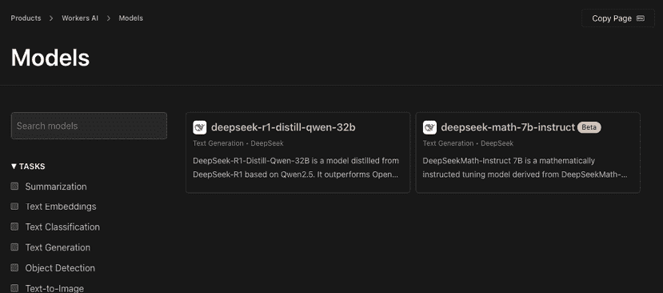
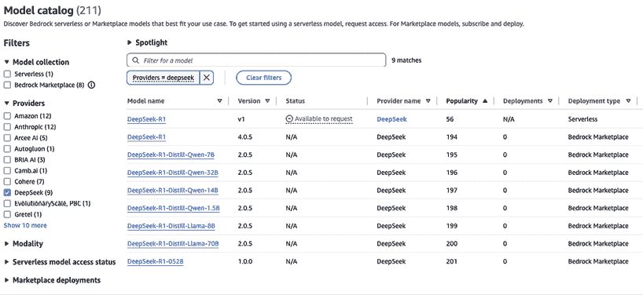
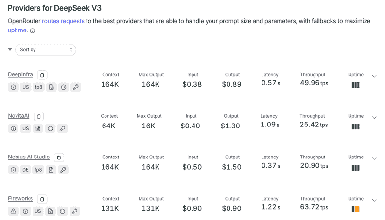
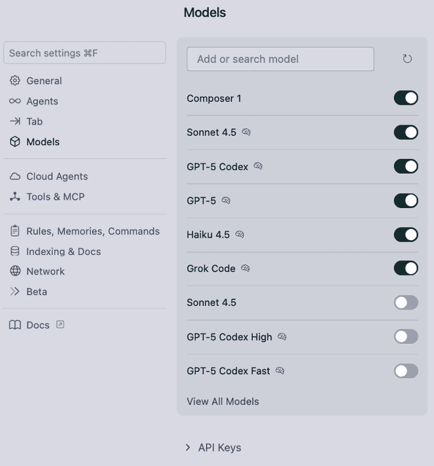
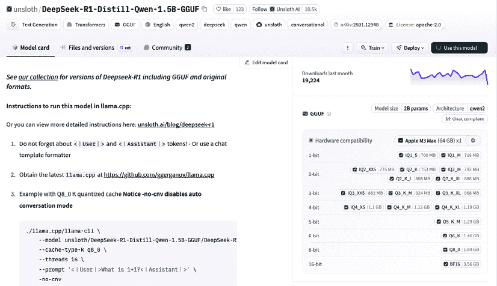
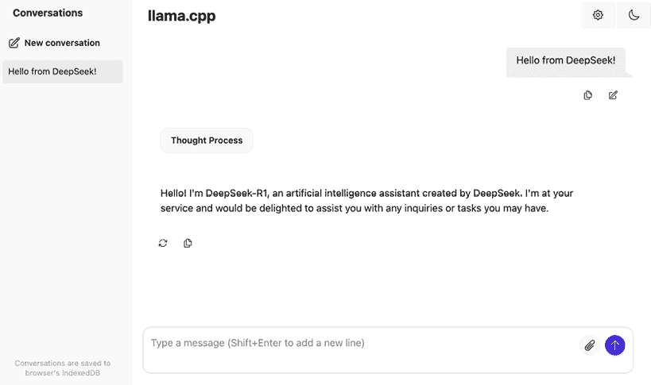
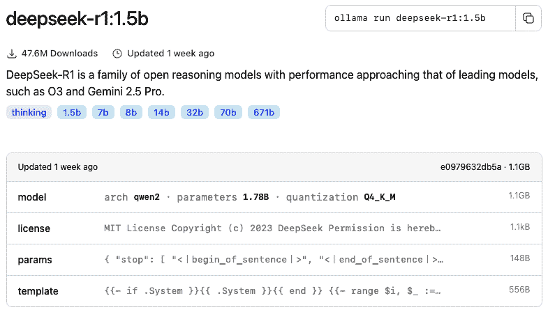

# 9 后记

穿越本书的旅程，追溯了从 DeepSeek 的基础原理到将其部署到生产级系统的路径。我们从其颠覆性的市场进入开始，到大规模运行它的运营现实结束。本后记综合了这一历程，将核心技术创新与利用它们所需的实践技能联系起来。

**DeepSeek 范式**

DeepSeek 的发布标志着一个关键时刻，证明了一个开源模型可以在推理方面达到前沿性能，直接挑战了专有系统的主导地位。这不是一次渐进式改进，而是一次由架构和训练创新融合驱动的范式转变。本书首先探讨了这些技术基础。

其核心是 *混合专家（`MoE`）架构*，它实现了巨大的规模（超过 6000 亿参数），同时通过仅激活每个令牌模型的一部分来保持计算效率。这与 *多头潜在注意力（`MLA`）* 相结合，后者压缩了 `KV` 缓存，使长上下文理解变得实用且内存高效。

然而，最重要的突破是训练方法。通过优先考虑具有自动化、基于规则的奖励的强化学习——体现在 *群体相对策略优化（`GRPO`）* 等技术中——DeepSeek 学会在回答前生成结构化、逐步的推理，而无需大量的监督微调。这种 *先思考再回答* 的能力成为了该模型的标志性特征及其实际应用的核心主题。

**从理论到实践**

理解架构只是第一步。随后的章节从 DeepSeek *是什么* 过渡到如何 *有效使用它*。这需要抛弃已确立的提示习惯。我们看到 DeepSeek 的推理模型行为不像聊天机器人，更像定理证明器，在这种场景下，极简、上下文丰富的提示优于有利于其他模型的详细、少样本示例。

掌握了这种新的思维模型后，我们构建了一个完整的应用程序，展示了从本地 `CPU` 推理到托管云服务的全谱系部署。这一实践练习突显了结构化输出对于创建可靠和灵活系统的重要性。然后，我们将此扩展到自主系统，探索将复杂任务分解、迭代精炼输出并与外部工具交互的智能体模式。

核心教训是：DeepSeek 是一个强大的推理引擎，当被正确驾驭时，可以自动化复杂的分析和决策。

**通往生产的道路**

最后的章节探讨了最终目标：在真实的业务环境中部署 DeepSeek。我们探讨了两种不同且强大的策略来实现这一目标。

首先，*理性蒸馏* 工作流展示了如何将 DeepSeek-R1 不作为最终产品，而是作为 *教师* 来使用。通过为法律合同分析等专业领域生成解释性原理，我们创建了一个增强的数据集来训练一个更小、更高效的学生模型。结果是一个可部署的模型，它不仅私密且经济高效，而且在其专业任务上比它大得多的教师模型要准确得多。

其次，对于需要完整模型全部能力的用例，我们详细介绍了 *DeepSeek V3 和 R1 的部署操作手册*。这涉及在 API、托管服务和自托管基础设施之间导航成本、控制和复杂性之间的关键权衡。从选择合适的 GPU 硬件和推理引擎，到实施稳健的监控和安全，我们建立了一个框架来做出合理的运营决策。

本书详述的原则和模式是持久的。DeepSeek 代表的不仅仅是一个模型系列；它提供了一个由强大、易用和可适应的推理定义的 AI 时代的蓝图。穿越其架构、应用和部署的旅程，已为您构建下一代智能系统提供了必要的技能。

## 附录

是时候了解我们使用 DeepSeek 模型的不同方式了。

如果您已经想清楚如何使用 DeepSeek，可以跳过本附录。

但如果没有，我们将为您展示一些方法。

我们将介绍一些（截至撰写时）运行中国 AI 实验室发布的一些主要模型的最流行方式。

我们将涵盖以下使用 DeepSeek 的方式：

*   入门使用官方 DeepSeek API
*   使用常见的第三方 API
*   使用 Cursor 的 IDE 操作 DeepSeek
*   自行运行或部署 DeepSeek
*   为 DeepSeek 构建自己的设置

### 技术要求

需要安装以下内容：

*   回忆一下 *第 5 章*，在使用 DeepSeek API 处理 `Python` 示例时，我们将使用 `uv`。如果您尚未安装，可以按照此处的说明安装 `uv`：[`docs.astral.sh/uv/getting-started/installation/`](https://docs.astral.sh/uv/getting-started/installation/)。
*   要运行基于终端的示例，我们将使用 `curl`。要安装 `curl`，您可以访问官方网站 [`curl.se/`](https://curl.se/)；或者 [`everything.curl.dev/install/index.html`](https://everything.curl.dev/install/index.html) 网站显示了所有主要平台的安装说明。
*   要跟随一些示例，您需要设置 `API` 密钥，我们将在每个示例中逐步介绍如何设置。
*   所有代码示例都已正确记录在此处：[`github.com/PacktPublishing/DeepSeek-in-Practice`](https://github.com/PacktPublishing/DeepSeek-in-Practice)。

    **注意**

    虽然我们使用了 `macOS`，但所有代码示例和说明应适用于所有平台。对于 `Windows` 用户，我们建议使用 `Windows Subsystem for Linux`（`WSL`）（[`learn.microsoft.com/en-us/windows/wsl/install`](https://learn.microsoft.com/en-us/windows/wsl/install)）。

### 入门使用官方 DeepSeek API

像大多数 AI 实验室和公司一样，DeepSeek 有一个类似 `ChatGPT` 的网络应用程序，托管在 [`chat.deepseek.com/`](https://chat.deepseek.com/)，以及一个 API 平台，托管在 [`platform.deepseek.com/`](https://platform.deepseek.com/)。这种设置对大多数公司（包括像 `Qwen` 这样的开源项目：[`chat.qwen.ai/`](https://chat.qwen.ai/)）来说很常见。值得注意的是，在 2025 年 1 月发布 DeepSeek-R1 之后，该 API 平台突然遭到大规模网络攻击（[`www.cnbc.com/2025/01/27/deepseek-hit-with-large-scale-cyberattack-says-its-limiting-registrations.html`](https://www.cnbc.com/2025/01/27/deepseek-hit-with-large-scale-cyberattack-says-its-limiting-registrations.html)）。此后，该平台已恢复运行，并且稳定，是那些想要开始使用 DeepSeek 构建的好选择。

本节的目标是向您简要介绍 DeepSeek 的官方平台和 API。请记住，DeepSeek API 是一个付费且（希望）持续发展的产品。因此，我们将根据其 2025 年 6 月左右的状态向您介绍 API 平台。这可能会随时间而变化。因此，如果看起来有所不同，请考虑阅读 API 文档 [`api-docs.deepseek.com/`](https://api-docs.deepseek.com/)。这不是一个全面的指南——只是一个突出主要功能的概述。事不宜迟，让我们开始设置。

#### 设置

在这里，我们将向您展示如何开始使用 DeepSeek API 进行构建。要进行设置，请遵循以下步骤：

1.  访问平台网站 [`platform.deepseek.com/`](https://platform.deepseek.com/)。
2.  创建一个账户。也可以选择使用 `Google` 登录。
3.  导航到左侧的 **Top up**。
4.  使用您首选的支付方式为您的账户添加一些额度。
5.  导航到 **API keys**。
6.  点击 **Create new API key**。
7.  保存您的 `API` 密钥（通常以 `sk-XXXX` 开头）。

现在我们有了 `API` 密钥，让我们运行一个小测试以确保一切正常。如果您在 `Mac` 或 `Linux` 上，打开终端并键入以下内容，将 `<DeepSeek API Key>` 替换为正确的值：


##### DeepSeek API 调用指南

### 1. 通过 `curl` 进行调用

你可以使用 `curl` 命令直接向 DeepSeek API 发送请求。

```bash
curl https://api.deepseek.com/chat/completions \

  -H "Content-Type: application/json" \

  -H "Authorization: Bearer <DeepSeek API Key>" \

  -d '{

        "model": "deepseek-chat",

        "messages": [

          {"role": "system", "content": "You are a helpful assistant."},

          {"role": "user", "content": "What is the capital of Portugal?"}

        ],

        "stream": false

      }'
```

你将会看到类似如下的输出：

```json
{"id":"3dbb972a-80e1-4558-b310-deeaeac1968d","object":"chat.completion","created":1749810137,"model":"deepseek-chat","choices":[{"index":0,"message":{"role":"assistant","content":"The capital of Portugal is **Lisbon** (Portuguese: *Lisboa*). It is the largest city in the country and is known for its historic neighborhoods, vibrant culture, and scenic location along the Atlantic Ocean."},"logprobs":null,"finish_reason":"stop"}],"usage":{"prompt_tokens":16,"completion_tokens":44,"total_tokens":60,"prompt_tokens_details":{"cached_tokens":0},"prompt_cache_hit_tokens":0,"prompt_cache_miss_tokens":16},"system_fingerprint":"fp_8802369eaa_prod0425fp8"}
```

如果没有成功，请确保你已遵循所有步骤，并正确设置了账单和 API 密钥。

### 2. 通过 Python 进行调用

要在 Python 中进行首次 API 调用，请遵循以下步骤：

1.  创建一个名为 `01-deepssek-api-call.py` 的脚本。
2.  通过运行 `export DEEPSEEK_API_KEY=sk-XXXXXX` 导出你的 DeepSeek API 密钥（或者使用某种环境管理器，例如 `direnv` ([`direnv.net/`](https://direnv.net/))）。
3.  将以下内容复制到脚本文件中：

```python
# /// script
# requires-python = ">=3.12"
# dependencies = [
#     "openai",
# ]
# ///
from openai import OpenAI
import os

API_KEY = os.getenv("DEEPSEEK_API_KEY")
assert API_KEY, "Please set the DEEPSEEK_API_KEY environment variable."

BASE_URL = "https://api.deepseek.com"
client = OpenAI(api_key=API_KEY, base_url=BASE_URL)

response = client.chat.completions.create(
    model="deepseek-chat",
    messages=[
        {"role": "system", "content": "You are a helpful assistant"},
        {"role": "user", "content": "What is the capital of Portugal?"},
    ],
    stream=False,
)
print(response)
# ChatCompletion(id='1bdf1ecf-a365-4f8b-9c26-fbebff421127', choices=[Choice(finish_reason='stop', index=0,
# logprobs=None, message=ChatCompletionMessage(content='The capital of Portugal is **Lisbon** ...
```

使用 `uv` 的好处在于，我们无需处理 Python 版本的安装和设置。现在，你只需运行脚本即可：

```bash
$ export DEEPSEEK_API_KEY=sk-XXXXXX
$ uv run 01-deepseek-api-call.py
```

你可以预期看到类似如下的输出：

```
Reading inline script metadata from `01-deepseek-api-call.py`
ChatCompletion(id='41164ddd-c648-4945-96c2-67f64e6d62a1', choices=[Choice(finish_reason='stop', index=0, logprobs=None, message=ChatCompletionMessage(content='The capital of Portugal is **Lisbon** (Portuguese: *Lisboa*). It is the largest city in the country and is known for its historic neighborhoods, vibrant culture, and scenic location along the Atlantic Ocean and the Tagus River.', refusal=None, role='assistant', annotations=None, audio=None, function_call=None, tool_calls=None))], created=1749375653, model='deepseek-chat', object='chat.completion', service_tier=None, system_fingerprint='fp_8802369eaa_prod0425fp8', usage=CompletionUsage(completion_tokens=49, prompt_tokens=15, total_tokens=64, completion_tokens_details=None, prompt_tokens_details=PromptTokensDetails(audio_tokens=None, cached_tokens=0), prompt_cache_hit_tokens=0, prompt_cache_miss_tokens=15))
```

你刚刚使用 Python 完成了对 DeepSeek 的首次 API 调用！

### 3. 关于 API 兼容性与响应结构

与许多其他**大语言模型**（**LLM**）提供商一样，DeepSeek API 与 OpenAI API 格式兼容。这意味着你可以使用 OpenAI Python SDK ([`github.com/openai/openai-python`](https://github.com/openai/openai-python))，只需更换 `api-key` 和 `base-url` 关键字参数，而无需关心其内部工作原理。这非常棒，因为它使用户能够相对容易地切换提供商——无需完全重构其代码库。但请注意：并非所有 API 功能都将对每个提供商可用。因此，请务必彻底测试。

现在，让我们看看响应结构。当你调用 DeepSeek API 时，你会收到一个遵循 OpenAI 兼容格式的 JSON 对象：

```python
ChatCompletion(
  id='41164ddd-c648-4945-96c2-67f64e6d62a1',
  object='chat.completion',
  created=1749375653,
  model='deepseek-chat',
  system_fingerprint='fp_8802369eaa_prod0425fp8',
  choices=[
    Choice(
      index=0,
      finish_reason='stop',
      logprobs=None,
      message=ChatCompletionMessage(
        role='assistant',
        content='The capital of Portugal is **Lisbon** (Portuguese: *Lisboa*)...',
        refusal=None,
        annotations=None,
        audio=None,
        function_call=None,
        tool_calls=None
      )
    )
  ],
  usage=CompletionUsage(
    prompt_tokens=15,
    completion_tokens=49,
    total_tokens=64,
    completion_tokens_details=None,
    prompt_tokens_details=PromptTokensDetails(
      audio_tokens=None,
      cached_tokens=0
    ),
    prompt_cache_hit_tokens=0,
    prompt_cache_miss_tokens=15
  ),
  service_tier=None
)
```


响应对象的关键组件如下：

*   `choices`：一个聊天补全选项的列表，每个选项包含一个结束原因和一条消息。这些选项也可能包含工具调用，稍后会详细说明。
*   `id`：唯一的请求 ID。
*   `model`：所使用的模型——我们稍后会详细讨论这个。
*   `system_fingerprint`：模型运行时的后端配置。
*   `usage`：你可能关心的使用统计信息（补全 token 的数量、缓存统计信息等）。

既然我们已经对如何调用 DeepSeek API 有了更好的了解，让我们进一步了解有哪些可用的模型以及如何利用它们。

#### 使用可用模型

DeepSeek AI 实验室已经发布了大量的模型。你可能已经从代码示例中注意到，我们最初的 API 调用是发送到一个名为`deepseek-chat`的模型。如果这个名字听起来不熟悉，那是因为它并不是实际模型的名称！在他们的 API 中，DeepSeek 只提供了两个端点和两个模型：

*   `deepseek-chat`：这是公司提供其*非推理*模型的端点。在撰写本文时，此端点下的模型是非思考模式下的 DeepSeek-V3.2-Exp。
*   `deepseek-reasoner`：这是公司发布其著名推理模型的端点。这些是经过*推理*训练或能够进行*推理*的模型。在撰写本文时，此端点指向思考模式下的 DeepSeek-V3.2-Exp。

值得指出的是，当你读到这篇文章时，公司可能已经发布了更多模型。因此，这两个端点的底层模型可能已经发生了变化。请务必查阅 DeepSeek API 文档（[`api-docs.deepseek.com/`](https://api-docs.deepseek.com/)）以获取关于模型的最新信息。

现在是时候了解可能影响你使用 DeepSeek API 的因素了。

#### Temperature

`temperature`参数修改模型生成的下一个 token logits 上的 softmax 概率分布。具体来说，它在应用 softmax 函数之前对 logits 进行缩放。如果你对这个话题感兴趣，我推荐阅读 Luke Salamone 的这篇精彩博文（[`blog.lukesalamone.com/posts/what-is-temperature/`](https://blog.lukesalamone.com/posts/what-is-temperature/)）。因此，较低的温度使输出更确定，而较高的温度则使输出不确定性增加。例如，OpenAI 也提供了一个`seed`参数，以尝试使输出更具确定性。然而，如果上下文增长，即使我们将温度设置为 0（以获得非常确定的输出），我们仍可能看到变化。

DeepSeek 建议用户根据需要使用不同的温度值（[`api-docs.deepseek.com/quick_start/parameter_settings`](https://api-docs.deepseek.com/quick_start/parameter_settings)）。例如，对于更具创造性的任务，可以设置更高的温度。

我的建议是，如果你正在集成到一个更大的、理想情况下是确定性的系统中，请务必将温度设置为 0。

#### 定价和速率限制

与大多数 LLM 提供商一样，DeepSeek 按 token 收费。这意味着用户为输入和输出的 token 付费。作为参考，一个英文字符≈0.3 个 token，而一个中文字符≈0.6 个 token。DeepSeek 使用自己的分词器，并提供了一个可用的包（[`api-docs.deepseek.com/quick_start/token_usage#calculate-token-usage-offline`](https://api-docs.deepseek.com/quick_start/token_usage#calculate-token-usage-offline)）来计算 token 数量。

DeepSeek API 以其相较于大型 AI 公司极具竞争力的定价而闻名，因此在选择提供商时，它绝对是一个值得考虑的选择。同样值得注意的是，`deepseek-reasoner`的价格大约是非推理模型的 2 倍——对于 LLM 来说这是标准做法。

还要注意，推理模型会输出更多的 token。由于按 token 收费，推理模型实际上更昂贵。同时也要注意，DeepSeek（与大多数提供商一样）还提供提示缓存功能——缓存部分提示以使请求更快、更便宜。

与其他提供商不同，DeepSeek*不*对用户的请求进行速率限制。这与大多数提供商非常不一致。LLM API 以不稳定著称，因此——由于高需求——提供商往往会严格地限制 API 调用。DeepSeek 的 API 文档中有如下说明：

> “我们将尽力服务每个请求。但是，请注意，当我们的服务器承受高流量压力时，你的请求可能需要一些时间才能从服务器获得响应。”

与其他提供商相反，DeepSeek 不会抛出`RateLimitError`或类似错误，而是会简单地保持你的请求，直到它可以完成。对于非流式请求，它们会发送空行；对于流式请求，它们会持续发送`: keep-alive`事件。一个很好的替代方法是重试请求，以确保你的 API 调用可靠：

```python
from tenacity import retry, stop_after_attempt, wait_fixed

@retry(stop=stop_after_attempt(3), wait=wait_fixed(2))
def make_request() -> str:
    response = client.chat.completions.create(
        model="deepseek-chat",
        messages=[
            {"role": "system", "content": "You are a helpful assistant"},
            {"role": "user", "content": "What is the capital of Portugal?"},
        ],
        stream=False,
        max_tokens=100,
    )
    response_text = response.choices[0].message.content
    if not response_text:
        raise ValueError("Received empty response from the API.")
    return response_text
```

上面的示例将在执行期间发生异常（例如，由于请求失败或空响应）时，重试`make_request`函数最多三次，每次尝试之间等待两秒。如果函数在未引发异常的情况下成功执行，它将返回 API 响应文本。如果所有尝试都失败，则会引发最后一个异常。

现在让我们将注意力转向 DeepSeek API 的功能特性。

#### API 功能

在关于 DeepSeek API 的最后一节中，我们将简要介绍它提供的一些最有趣（当前）的功能。我们不想深入探讨所有功能，但希望让你对每个功能有一个良好的初步了解。我们将讨论推理、流式传输、JSON 输出、函数调用和**填充中间** (**FIM**)功能。

##### 推理

`deepseek-reasoner`模型/端点具有推理特定主题并返回其推理痕迹的能力。这对于更复杂的主题非常有用，但对于其他主题可能有些大材小用。

以下是使用方法：

```python
model = "deepseek-reasoner"
messages = [
    {"role": "user", "content": "What is the population of Copenhagen in 2030?"}
]
response = CLIENT.chat.completions.create(
    model=model, messages=messages, temperature=TEMPERATURE
)
reasoning_content = response.choices[0].message.reasoning_content
content = response.choices[0].message.content
print("Reasoning Content:")
print(reasoning_content)
# Okay, the user is asking about Copenhagen's population in 2030...
print("\nFinal Answer:")
print(content)
# The projected population for Copenhagen Municipality ...
```

##### 流式传输

没有用户喜欢盯着空白屏幕等待计算机回答问题。流式响应是使你的 LLM 响应看起来快速且对用户响应灵敏的好方法，而无需实际加速它：

```python
model = "deepseek-chat"
messages = [{"role": "user", "content": "What is the second largest city in Portugal?"}]
response = CLIENT.chat.completions.create(
    model=model,
    messages=messages,
    stream=True,  # this is important!
    temperature=TEMPERATURE
)
for chunk in response:
    if chunk.choices[0].delta.content:
        # 处理每个流式块的内容
        pass
```


print(`chunk.choices[0].delta.content`, end="", flush=True)

# 输出结果：葡萄牙第二大城市是 `Porto`。

```json
{
    "model": "deepseek-chat",
    "messages": [
        {
            "role": "system",
            "content": "Extract a JSON response with the keys 'name', 'age', and 'city'.",
        },
        {"role": "user", "content": "Duarte is 31 years old and lives in Copenhagen."},
    ],
    "response_format": {"type": "json_object"},
    "temperature": TEMPERATURE
}
```

```python
model = "deepseek-chat"

messages = [

    {

        "role": "system",

        "content": "Extract a JSON response with the keys 'name', 'age', and 'city'.",

    },

    {"role": "user", "content": "Duarte is 31 years old and lives in Copenhagen."},

]

response = CLIENT.chat.completions.create(

    model=model,

    messages=messages,

    response_format={"type": "json_object"},

    temperature=TEMPERATURE,

)

json_object = json.loads(response.choices[0].message.content) # 转换为 JSON 对象

print("JSON 响应:")

print(json_object)

# {'name': 'Duarte', 'age': 31, 'city': 'Copenhagen'}

print(json_object["name"])

# Duarte
```

`json.loads()` 方法可以帮助你将 LLM 响应结构化为一个 JSON 对象。

##### 函数调用

当我们想让 LLM 具备与外部世界交互（调用 API、抓取网页或与其他系统交互）的能力时，函数调用是一个很好的方式。我们已经在 *第 6 章*（*工具*部分）涵盖了这个主题。

### FIM

FIM 补全允许我们在模型响应中定义一个前缀和一个后缀。定义前缀和后缀使得模型可以为它们之间的空白生成特定内容。以代码为例，你可以提供一个函数、循环或方法，其中开头和结尾已定义好——实际上就是要求模型只填充中间的内容。这就是 GitHub Copilot ([`https://github.com/features/copilot`](https://github.com/features/copilot)) 自动补全的工作原理！让我们通过一个简单的例子来尝试让 DeepSeek 模型给出居住在里斯本的人数。我们可以提供一个输入和一个输出，让模型填充其余部分：

```python
prompt = "The population of Lisbon is exactly "

suffix = " million people."

response = BETA_CLIENT.completions.create(

    model="deepseek-chat",

    prompt=prompt,

    suffix=suffix,

    max_tokens=5,

    temperature=TEMPERATURE,

)

final_text = prompt + response.choices[0].text + suffix

print(final_text)

# The population of Lisbon is exactly 2,000,000 million people.
```

这当然不仅限于代码。你可以让模型补全 JSON、XML 或任何其他内容，防止它们偏离主题或生成你可能不期望的文本。

请注意，在撰写本文时，FIM 仅在 Beta API 中可用（你需要设置 `base_url=https://api.deepseek.com/beta`）。

你也可以在第三方 API 中使用 DeepSeek 模型。让我们看看如何使用第三方提供商提供的 DeepSeek 模型。

## 使用常见的第三方 API

如前所述，DeepSeek 的所有模型都是开源的。因此，DeepSeek 已在许多不同的云提供商中普及：Google Cloud Platform、Azure、AWS、Fireworks、OpenRouter 和 Cloudflare 等。

谈论所有这些提供商会显得冗长，因此在本节中我们将重点介绍三个主要的：

*   **Cloudflare** ([`https://www.cloudflare.com/`](https://www.cloudflare.com/))：一个在全球范围内可用的大型提供商。熟悉前端技术的用户可能已经了解 Cloudflare。由于其规模，他们也是“中等规模”的提供商。
*   **AWS** ([`https://aws.amazon.com/`](https://aws.amazon.com/))：许多用户熟悉 AWS 或在其公司中使用 AWS，因此为简洁起见，我们将重点介绍 AWS。Azure 和 Google Cloud Platform 是其他流行的选择。我们选择 AWS 的原因是其在企业用户中的受欢迎程度。
*   **OpenRouter** ([`https://openrouter.ai/`](https://openrouter.ai/))：OpenRouter 是一个相对较新的云提供商，但它极其专注于服务 LLM。初创公司或新项目可能对能够轻松切换模型的提供商感兴趣。

让我们从 Cloudflare 开始。

### Cloudflare

Cloudflare 是一家美国公司，以其 **内容分发网络** (**CDN**) 产品而闻名。目前，Cloudflare 通过其 Workers AI 产品使 LLM 变得易于访问。在开始之前，你需要了解一些关于 Cloudflare 的细节：

*   **支持的模型**：`deepseek-r1-distill-qwen-32b`，这是 2025 年 1 月发布的 DeepSeek-R1 的蒸馏版本 ([`https://arxiv.org/pdf/2501.12948`](https://arxiv.org/pdf/2501.12948))，以及 `deepseek-math-7b-instruct`，这是 2024 年 4 月发布的专门用于数学的指令微调模型 ([`https://arxiv.org/pdf/2402.03300`](https://arxiv.org/pdf/2402.03300))。
*   **定价**：`deepseek-r1-distill-qwen-32b` 的输入价格为每百万 token `0.50` 美元；输出价格为每百万 token `4.88` 美元。`deepseek-math-7b` 版本暂无定价信息。
*   **区域**：`Cloudflare Workers AI` 在全球边缘节点运行。
*   **身份验证**：可以通过 Cloudflare 认证令牌完成。
*   **OpenAI 兼容端点**：支持 `/v1/chat/completions` 和 `/v1/embeddings`。

以下是如何设置 `Cloudflare Workers AI`：

1.  访问 [`cloudflare.com`](https://cloudflare.com)。
2.  登录或创建一个新账户。
3.  在左侧菜单中，单击 **AI** 并选择 **Workers AI**（*图 A*）。



图 A: Cloudflare 支持的 DeepSeek 模型

1.  单击 **{} Rest API**。
2.  单击 **Create a Workers AI API Token**。
3.  将你的账户 ID 和令牌安全地保存起来。

让我们看一些 API 调用示例。

以下是使用 `curl` 发送请求的示例。我们首先导出环境变量，然后按以下格式发出请求：

```bash
$ export CLOUDFLARE_ACCOUNT_ID=******

$ export CLOUDFLARE_AUTH_TOKEN=****

$ curl https://api.cloudflare.com/client/v4/accounts/$CLOUDFLARE_ACCOUNT_ID/ai/run/@cf/deepseek-ai/deepseek-r1-distill-qwen-32b -X POST -H "Authorization: Bearer $CLOUDFLARE_AUTH_TOKEN" -d '{ "messages": [{ "role": "system", "content": "You are a friendly assistant" }, { "role": "user", "content": "Why is pizza so good" }]}'
```

如果你想使用 Python，以下是使用 Cloudflare 提供的 OpenAI 兼容端点的 Python 调用示例：

1.  我们首先设置密钥并定义我们的 OpenAI 客户端：

    ```python
    from openai import OpenAI

    # 设置密钥和客户端

    api_key = os.environ["CLOUDFLARE_AUTH_TOKEN"]

    account_id = os.environ["CLOUDFLARE_ACCOUNT_ID"]

    assert account_id, "Please set the CLOUDFLARE_ACCOUNT_ID environment variable."

    assert api_key, "Please set the CLOUDFLARE_API_KEY environment variable."

    model = "@cf/deepseek-ai/deepseek-r1-distill-qwen-32b"

    client = OpenAI(

        base_url=f"https://api.cloudflare.com/client/v4/accounts/{account_id}/ai/v1",

        api_key=api_key,

    )
    ```

2.  然后我们创建一个消息列表：

    ```python
    # 创建消息列表

    messages = [

        {"role": "system", "content": "You are a helpful assistant."},

        {"role": "user", "content": "What is the most likely sky color in Copenhagen?"},
    ]
    ```

3.  最后，我们向 `@cf/deepseek-ai/deepseek-r1-distill-qwen-32b` 模型发出请求：

    ```python
    # 发起 API 调用

    response = client.chat.completions.create(

        model=model,

        messages=messages,

        max_tokens=1000,

        temperature=0.0,

    )
    ```


### AWS
如果你从事技术工作，很可能听说过 **Amazon Web Services**，即 **AWS**。目前，它是全球最大的云服务提供商（[`www.statista.com/chart/18819/worldwide-market-share-of-leading-cloud-infrastructure-service-providers/`](https://www.statista.com/chart/18819/worldwide-market-share-of-leading-cloud-infrastructure-service-providers/)）。AWS 以其云服务产品的快速扩展和新技术应用而闻名。他们的大部分 AI 产品都以 **Bedrock** 品牌提供。

以下是在 AWS 上使用 API 调用 DeepSeek 模型的一些快速须知：

*   **支持的模型**：
    *   作为无服务器部署（无需自己部署即可运行），你可以使用 `DeepSeek-R1` 模型。此功能未来可能有所发展，请查阅 [`aws.amazon.com/bedrock/deepseek/`](https://aws.amazon.com/bedrock/deepseek/) 以获取最新信息。
    *   你也可以通过 Bedrock Marketplace 使用大多数 `DeepSeek-R1` 蒸馏模型和最新的 `DeepSeek-R1-0528` 模型。这意味着你需要自行管理部署——并为之付费（即使不使用时）。
*   **定价（按需）**：关于定价的最新信息，请咨询 AWS 文档 [`aws.amazon.com/bedrock/pricing/`](https://aws.amazon.com/bedrock/pricing/)。请注意，无服务器模型通常更便宜——因为你只需为你对模型的请求付费。另一方面，从 Bedrock Marketplace 部署模型意味着你需要自己支付基础设施费用。我们建议从无服务器产品开始。
*   **区域**：`DeepSeek-R1` 通过无服务器产品在美东（弗吉尼亚北部）、美东（俄亥俄）和美西（俄勒冈）区域提供。Bedrock Marketplace 模型可以部署在任何 AWS 区域。
*   **身份验证**：你可以使用你的 AWS 账户进行基于 IAM 的身份验证和 Bedrock 服务集成（[`aws.amazon.com/iam/`](https://aws.amazon.com/iam/)）。
*   **兼容 OpenAI 的端点**：开箱即不支持，但可以与 AWS 的一些开源项目配合使用（[`github.com/aws-samples/bedrock-access-gateway`](http://github.com/aws-samples/bedrock-access-gateway)）。


图 B：AWS Bedrock 模型目录中可用的 DeepSeek 模型列表

让我们开始设置：

1.  如果你还没有 AWS 账户，请创建或设置一个：[`signin.aws.amazon.com/signup`](https://signin.aws.amazon.com/signup)。
2.  在 AWS 控制台中，搜索 `Billing and Cost Management` 并打开第一个结果以设置计费。
3.  确保你位于正确的区域——`us-east-1` 是一个很好的默认选择，因为大多数模型首先在该区域可用。
4.  在顶部搜索栏中搜索 `Amazon Bedrock` 并转到 **Amazon Bedrock** 服务。
5.  在右侧面板中，转到 **Foundation models** 下的 **Model Catalog**。
6.  使用 **Provider** 筛选器并选择 **DeepSeek**。
7.  单击你感兴趣的模型（你可能需要先在控制台中启用访问权限；通过单击控制台中的模型，然后单击 **Modify Access**，接着请求访问权限来完成此操作）。
8.  使用此处指南安装 AWS CLI：[`docs.aws.amazon.com/cli/latest/userguide/getting-started-quickstart.html`](https://docs.aws.amazon.com/cli/latest/userguide/getting-started-quickstart.html)。
9.  （推荐）配置 AWS CLI：[`docs.aws.amazon.com/cli/`](https://docs.aws.amazon.com/cli/)。

安装 AWS CLI 后，你可以通过运行以下命令向模型发送请求：

```
aws bedrock-runtime converse \
 --model-id us.deepseek.r1-v1:0 \
        --messages '[{"role": "user", "content": [{"text": "What is the population of Ancona?"}]}]' \
        --region us-east-1
```

我们也可以使用 Python 和 `boto3` 库向我们的模型发送一个简单的请求。默认情况下，AWS 会将文本和思考内容分开。因此，我们可以独立访问这两个字段。同时请注意，Bedrock 运行时 (`brt`) 的 API 格式略有不同：

```python
import boto3

brt = boto3.client("bedrock-runtime")
model_id = "us.deepseek.r1-v1:0"

# create our messages
conversation = [
    {
        "role": "user",
        "content": [{"text": "What is the most likely sky color in Copenhagen?"}],
    }
]

# request
response = brt.converse(
    modelId=model_id,
    messages=conversation,
    inferenceConfig={"maxTokens": 5000, "temperature": 0.0},
)

response_text = response["output"]["message"]["content"][0]["text"]
repsonse_reasoning = response["output"]["message"]["content"][1]["reasoningContent"][
    "reasoningText"
]["text"]

print("=" * 10, "AWS Thinking", "=" * 10)
print(repsonse_reasoning)
# Okay, so I need to figure out the ..

print("=" * 10, "AWS Response", "=" * 10)
print(response_text)
# The most likely sky color in Copenhagen is **pale gray or overcast white**...
```

---

### Cloudflare
请求的 `content` 参数中包含了模型的思考过程和最终响应。因此，我们使用 Python 提取思考部分，它位于 `` 标签之间：

```python
# extract thinking content and final response text
raw_response = str(response.choices[0].message.content)
start = raw_response.index("") + len("")
end = raw_response.index("</think>")
thinking_content = raw_response[start:end]
response_text = raw_response[end + len("</think>") :].strip()

print("=" * 10, "Cloudflare Thinking", "=" * 10)
print(thinking_content)
# Okay, so I need to figure out what the most likely ...

print("=" * 10, "Cloudflare Response", "=" * 10)
print(response_text)
# The most likely sky color in Copenhagen is gray.
```

现在来说说使用 Cloudflare 时的一些特点和建议。

### 特点和建议
*   在我们测试的 Cloudflare 平台中，任何模型都不支持函数调用。
*   调用推理模型时，其格式不会将推理内容分解为 API 的不同 `reasoning` 组件。你会注意到思考步骤包含在 `` 令牌内的一个 `xml` 部分中。
*   Cloudflare 不支持官方 DeepSeek API 支持的任何模型。同样需要注意的是，Cloudflare 支持的任何模型在官方 DeepSeek API 中都不可用。

如果你正在寻找一个提供简单模型访问的直接提供商，Cloudflare 是一个不错的选择。如果你已经在使用 Cloudflare，那么这是一个很好的选择。但是，请注意模型的可用性，尤其是 DeepSeek 模型，是有限的。

现在让我们来看看 AWS 以及如何使用它。

## 奇闻与提示

*   AWS 的模型调用界面可能令人困惑。它提供了 `invoke` 和 `converse` 两个 API。你可在此阅读更多关于它们差异的信息：[`dgallitelli95.medium.com/amazon-bedrock-explained-with-memes-converse-api-and-tool-usage-w-anthropic-claude-3-001c341347ca`](https://dgallitelli95.medium.com/amazon-bedrock-explained-with-memes-converse-api-and-tool-usage-w-anthropic-claude-3-001c341347ca)。
*   文档非常详尽。以下推荐阅读材料可帮助你了解工具调用、提示缓存、计算使用量等更多内容：[`dgallitelli95.medium.com/amazon-bedrock-explained-with-memes-converse-api-and-tool-usage-w-anthropic-claude-3-001c341347ca`](https://dgallitelli95.medium.com/amazon-bedrock-explained-with-memes-converse-api-and-tool-usage-w-anthropic-claude-3-001c341347ca)。
*   如果你进行大量调用（用于分类或其他“批处理”用例），请考虑使用 AWS Batch 推理。这是一项很棒的服务，可以通过牺牲响应时间来以折扣价运行模型。
*   你可能需要调整在 AWS IAM 控制台中的权限，以便在 AWS 内调用模型。
*   并非所有模型在所有区域都可用——请检查 AWS 控制台以查看各区域的可用情况。
*   大多数编程式使用都通过 `boto3` Python 库完成。对于 Bedrock，请注意 `bedrock` 和 `bedrock-runtime` API 之间的区别：
    *   [`boto3.amazonaws.com/v1/documentation/api/latest/reference/services/bedrock.html`](https://boto3.amazonaws.com/v1/documentation/api/latest/reference/services/bedrock.html)
    *   [`boto3.amazonaws.com/v1/documentation/api/latest/reference/services/bedrock-runtime.html`](https://boto3.amazonaws.com/v1/documentation/api/latest/reference/services/bedrock-runtime.html)

AWS 是一个不断发展的平台，它非常快速地添加对模型的支持——并为你提供了自行部署模型的可能性（当然，需要付费）。在控制台中导航并看到所有可能性可能会让人不知所措，但它是一项强大的工具，值得掌握。

接下来，让我们谈谈一个更简单、更新的服务提供商：OpenRouter。

### OpenRouter

OpenRouter ([`openrouter.ai/`](https://openrouter.ai/)) 是一个平台，它充当一个通用网关，通过一个简单的统一接口访问来自各种提供商的 LLM。更有趣的是，对于开源模型，OpenRouter 会将多个提供商聚合在同一个 API 下，允许用户查询性能最佳的提供商。例如，对于 DeepSeek-V3，他们支持 Deep Infra、Novita AI、Nebius AI Studio 和 Fireworks 作为提供商。

以下是关于 DeepSeek 的 OpenRouter API 你需要了解的一些事实：

*   **支持的模型**：在撰写本文时，支持 DeepSeek-R1、DeepSeek-R1-0528、DeepSeek-V2、DeepSeek-V3 以及额外的蒸馏或微调模型。



图 C：同一个 DeepSeek-V3 模型的多个提供商

*   **定价（按需付费）**：OpenRouter 会将你的请求定向到你所请求模型的“最佳可用提供商”。他们在你购买平台积分时向你收费（5% + 0.35 美元手续费）。他们还提供多种免费模型（例如 DeepSeek-R1-0528）。
*   **区域**：它本身不支持“区域”。它将你的请求直接路由到提供商。因此，你应该将其视为一个“全球”区域。
*   **认证**：它使用一个需要你通过 OpenRouter 控制台生成的 API 密钥。
*   **兼容 OpenAI 的端点**：OpenRouter 的所有端点都兼容 OpenAI 格式和 SDK。

以下是设置步骤：

1.  访问 [`openrouter.ai`](https://openrouter.ai)。
2.  登录或创建账户。
3.  将鼠标悬停在右上角的汉堡菜单上，然后点击 `Credits`（积分）。
4.  为你的账户充值积分。
5.  再次将鼠标悬停在右上角的汉堡菜单上，然后点击 `API Keys`（API 密钥）。
6.  生成一个 API 密钥并保存。

以下是如何使用 `curl` 进行 API 调用：

```
curl https://openrouter.ai/api/v1/chat/completions \
  -H "Content-Type: application/json" \
  -H "Authorization: Bearer $OPENROUTER_API_KEY" \
  -d '{
  "model": "deepseek/deepseek-r1-0528",
  "messages": [
    {
      "role": "user",
      "content": "What is the most likely sky color in Copenhagen?"
    }
  ]
}'
```

如你所见，我们定义了消息列表并将其发送到必要的端点。

使用 Python 时，该请求与对 OpenAI SDK 客户端的其他请求非常相似：

```
from openai import OpenAI

client = OpenAI(
    base_url="https://openrouter.ai/api/v1",
    api_key=os.environ["OPENROUTER_API_KEY"],
)

response = client.chat.completions.create(
    model="deepseek/deepseek-r1-0528",
    messages=[
        {"role": "user", "content": "What is the most likely sky color in Copenhagen?"}
    ],
)

response_reasoning = response.choices[0].message.reasoning
response_text = response.choices[0].message.content

print("=" * 10, "OpenRouter Thinking", "=" * 10)
print(response_reasoning)
# Okay, the user asked about the most likely sky col...

print("=" * 10, "OpenRouter Response", "=" * 10)
print(response_text)
```

你会注意到，我们需要做的只是覆盖 OpenAI 客户端的 `base_url` 参数。

你应该会得到一个类似于这样的输出：

```
# The **most statistically likely overall sky color in Copenha...
```


以下是使用 OpenRouter 时的一些提示和细节。

## 使用 OpenRouter

### 特性与技巧

*   **免费模型**: OpenRouter 提供大量免费模型供您测试。只需访问其模型仪表板（或 [`openrouter.ai/models?max_price=0`](https://openrouter.ai/models?max_price=0)）即可开始调用 API。（不建议在生产环境中使用。）
*   您可以在提供商名称后追加 `:nitro` 以访问吞吐量最佳的提供商，或追加 `:floor` 以访问价格最优的提供商。例如，要访问最快的 `DeepSeek-R1`，可以查询 `deepseek/deepseek-r1-0528:nitro`。
*   OpenRouter 支持您可能期望的所有主要功能（工具调用、图像与 PDF 处理、结构化输出，以及在某些提供商上的提示缓存）。具体实现细节请参阅其文档：[`openrouter.ai/docs/quickstart`](https://openrouter.ai/docs/quickstart)。
*   请注意，由于 OpenRouter 不控制实际模型运行的硬件，您可能会在不同提供商之间收到不同的结果。
*   OpenRouter 在 [`openrouter.ai/rankings`](https://openrouter.ai/rankings) 提供了排行榜，您可以看到哪些模型被用于哪些类别，并了解当前的热门趋势。例如，在撰写本文时，`DeepSeek-R1-0528` 在 **金融** 类别中排名第 2。

## 使用 Cursor IDE 进行 DeepSeek 开发

我们将使用 Cursor IDE 演示 DeepSeek 的功能，这是一个强大的 AI 增强型开发环境，可与 DeepSeek 模型无缝集成。然而，我们探索的原理和技术适用于任何支持 DeepSeek 集成的开发环境，无论您偏好传统 IDE、云平台还是本地 Web 界面。关键在于建立开发工作流与 DeepSeek-R1 先进推理能力之间的牢固连接。

确认 API 访问后，我们可以开始建立开发环境，将其作为探索 DeepSeek 实际应用的实验室。

### 设置开发环境

创建一个用于 AI 辅助开发的环境，需要仔细选择能够补充 DeepSeek 能力并支持完整开发生命周期的工具。我们推荐的工具包以 Cursor IDE 为核心，您可以从 [cursor.com](https://cursor.com) 下载。这个 AI 原生编辑器提供了与各种语言模型的无缝集成，包括 `DeepSeek-R1`，使其成为我们演示的理想选择。

我们开发技术栈的基础包括：
*   Python 3.11 或更高版本，由于其丰富的 AI 和数据处理库，它将作为我们后端实现的主要语言。
*   Docker Desktop，使我们能够对应用程序进行容器化，确保一致的部署环境和简化的分发。
*   Git，提供必要的版本控制功能，这在与 AI 生成的代码协作时尤为重要，因为跟踪更改和维护代码历史至关重要。
*   Node.js 18 或更高版本，支持我们在更全面的示例中将用到的各种前端组件和开发工具。

### 在 Cursor IDE 中配置 DeepSeek

Cursor IDE 与 `DeepSeek-R1` 的集成是我们开发方法的核心，它将传统的编码工作流转变为人类创造力与 AI 推理能力之间的协作伙伴关系。这个配置过程虽然简单，但为后续所有演示奠定了基础。

#### 直接集成：将 Cursor 连接到 DeepSeek

首先，通过 **设置** 菜单访问 Cursor 的模型配置。在 macOS 上，您可以在 **Cursor** > **设置** 中找到它；在 Windows 和 Linux 上，可以在 **文件** > **设置** 中找到。在设置界面中，左侧边栏的 **模型** 部分包含管理 AI 模型集成的所有选项。

Cursor IDE 内置了对 DeepSeek 模型的支持，您可以通过滚动浏览可用模型列表并选择 **`deepseek-r1`** 来启用它。启用后，该模型将出现在您的可用选项中，准备好使用您的特定 API 凭据进行配置。



图 D：Cursor IDE 的 DeepSeek-R1 模型选择界面

配置过程需要输入您的 DeepSeek API 凭据以及相应的连接设置。您需要将 `deepseek-r1` 指定为模型名称，提供来自 DeepSeek 平台的 API 密钥，将基础 URL 设置为 `https://api.deepseek.com/v1`，并将提供商配置为 **OpenAI 兼容** 以确保正确的 API 通信协议。

要验证您的集成是否正常工作，请在 Cursor 中打开一个新文件，并使用 `Cmd + K`（macOS）或 `Ctrl + K`（Windows 和 Linux）调用 AI 命令面板。从模型下拉菜单中选择 **DeepSeek-R1**，并使用一个实质性的提示进行测试，例如“解释微服务和单体架构之间的区别”。成功的响应确认您的开发环境已准备好进行我们将要探索的高级用例。

#### 替代方案：命令行集成

虽然 Cursor IDE 为 AI 辅助开发提供了出色的交互环境，但许多开发者更喜欢使用 CLI 进行自动化、脚本编写以及与现有工作流的集成。DeepSeek 的 API 遵循 OpenAI 兼容协议，使其易于集成到命令行工具和自动化脚本中。

##### 建立 Python 客户端访问

设置编程访问需要安装 `openai` Python 库以及用于安全管理凭据的 `python-dotenv`：

```bash
pip install openai python-dotenv
```

安装依赖项后，您可以使用一个简单的 Python 脚本建立与 DeepSeek API 的连接。这种方法对于批量处理、自动化测试以及与更大系统的集成特别有价值：

```python
import os

from openai import OpenAI

client = OpenAI(
    api_key=os.getenv("DEEPSEEK_API_KEY"),
    base_url="https://api.deepseek.com/v1"
)

response = client.chat.completions.create(
    model="deepseek-r1",
    messages=[{"role": "user", "content": "Hello DeepSeek!"}]
)

print(response.choices[0].message.content)
```

## 自行运行或部署 DeepSeek

DeepSeek 模型的一个有趣方面在于它们实际上是开放的，任何人都可以交互。在本节中，我们将介绍一些使用您自己的基础设施来交互和部署这些模型的方法。知道您的数据和应用程序完全由您控制会带来多种好处；隐私和合规性只是其中的两个。最后，值得注意的是，自己部署和管理这些模型（尤其是较大的变体）可能是一项相当艰巨的任务。

在这里，我们将介绍一些本地使用这些模型的方法，并向您介绍如何进一步操作并自己部署它们。我们将使用 `llama.cpp` 和 `Ollama` 来帮助您在本地使用 DeepSeek。

### 使用 llama.cpp

`llama.cpp` 是一个高性能的开源 C/C++ 推理库，旨在本地硬件上高效运行 LLM。它由 Georgi Gerganov 发起，拥有一个活跃的社区和代码库（[`github.com/ggml-org/llama.cpp`](https://github.com/ggml-org/llama.cpp)）。它允许用户在本地执行模型，无需专用 GPU 或云基础设施。

要安装 `llama.cpp`，请按照 GitHub 代码库（[`github.com/ggml-org/llama.cpp/blob/master/docs/install.md`](https://github.com/ggml-org/llama.cpp/blob/master/docs/install.md)）上的安装说明操作。如果您在 Mac 上，安装 `llama.cpp` 就像下面这样简单：

```bash
$ brew install llama.cpp
```


要验证您的安装是否正确，只需运行以下命令：

```
$ llama-cli --help
```

您应该会看到一些输出，解释如何使用 CLI 工具：

```
----- common params -----
-h, --help, --usage print usage and exit
--version show version and build info
--completion-bash print source-able bash completion script for llama.cpp
--verbose-prompt print a verbose prompt before generation (default: false)
...
```

`llama.cpp` 使用 `GGUF` 文件格式（您可以在 [`github.com/ggml-org/ggml/blob/master/docs/gguf.md`](https://github.com/ggml-org/ggml/blob/master/docs/gguf.md) 阅读更多相关信息）。`GGUF` 代表 `GPT-Generated Unified Format`（[`www.ibm.com/think/topics/gguf-versus-ggml`](https://www.ibm.com/think/topics/gguf-versus-ggml)）。为了使用该工具运行模型，您需要下载 `GGUF` 格式的模型，或者将模型从 `PyTorch` 格式转换为 `GGUF` 格式。幸运的是，`Unsloth` 的团队（[`unsloth.ai/`](https://unsloth.ai/)）在 `Hugging Face` 上免费提供了 DeepSeek 模型的 `GGUF` 变体（[`huggingface.co/collections/unsloth/deepseek-r1-all-versions`](https://huggingface.co/collections/unsloth/deepseek-r1-all-versions)）。

要与原版 `DeepSeek-R1` 模型进行本地聊天会比较有挑战性。您可能需要多台配备多 GPU 的机器才能运行它。让我们选择一个更简单的选项，运行 `DeepSeek-R1` 的一个蒸馏版本。`DeepSeek-R1-Distill-Qwen-1.5B-GGUF:Q4_K_M` 是从 `DeepSeek-R1` 模型蒸馏而来的 Qwen 15 亿参数模型的一个版本。在本例中，我们运行的是量化版本 `Q4_K_M`，这意味着它是一个小模型，很可能可以在我们的 CPU 上运行：

```
$ llama-cli -hf unsloth/DeepSeek-R1-Distill-Qwen-1.5B-GGUF:Q4_K_M
```

这将自动从 `Hugging Face` 仓库下载模型，并直接将您带入终端中的聊天界面。


*图 E：通过 Unsloth 界面在本地使用 DeepSeek 模型*

`Hugging Face` 还为您提供了一种便捷的方式来开始使用您浏览时看到的任何模型：点击 `Use this model` 按钮并按照说明操作即可。

如果您考虑集成到更广泛的应用中，您可能有兴趣使用 `Python` 或任何其他编程语言运行此模型。幸运的是，我们可以使用 `llama-cpp-python`（[`github.com/abetlen/llama-cpp-python`](https://github.com/abetlen/llama-cpp-python)），这是一个 `Python` 库，它提供了与 `llama.cpp` 相同 `CLI` 的 `Python` 绑定。以下是使用 `Python` 与该模型交互的示例。您可以看到，我们提供与通过 `CLI` 使用 `llama.cpp` 时相同的参数，但现在直接将其传入库中：

```python
from llama_cpp import Llama

REPO_ID = "unsloth/DeepSeek-R1-Distill-Qwen-1.5B-GGUF"
MODEL_FILENAME = "DeepSeek-R1-Distill-Qwen-1.5B-Q4_K_M.gguf"

llm = Llama.from_pretrained(
    repo_id=REPO_ID,
    filename=MODEL_FILENAME,
    verbose=False,
)

response = llm.create_chat_completion(
    messages=[
        {
            "role": "user",
            "content": "What is the most likely sky color in Copenhagen? Think hard and answer in one word.",
        },
    ],
)

text_response = response["choices"][0]["message"]["content"]
print(f"{MODEL_FILENAME} response:\n{text_response}")
```

如果您有兴趣部署 `llama.cpp` 并将其用作兼容 `OpenAI` 的服务器，这是可以的！只需运行以下命令：

```
$ llama-server -hf unsloth/DeepSeek-R1-Distill-Qwen-1.5B-GGUF:Q4_K_M
```

现在，您可以通过访问 [`localhost:8080`](http://localhost:8080) 来访问聊天界面，它允许您使用一个完全本地的模型。


*图 F：通过 llama.cpp 使用 DeepSeek*

或者，您可以查询兼容 `OpenAI` 的 API 端点：[`localhost:8080/v1/chat/completions`](http://localhost:8080/v1/chat/completions)。使用前述命令启动 `llama-server` 后，打开另一个终端并发送一个 `curl` 请求，如下所示：

```bash
$ curl --request POST \
          --url http://localhost:8080/completion \
          --header "Content-Type: application/json" \
          --data '{"prompt": "What is the capital of Portugal?","n_predict": 120}'
```

这将输出直接来自您运行服务器所使用的模型的响应。

现在，让我们谈谈另一个有趣的建立在 `llama.cpp` 之上的工具，名为 `Ollama`。

### Ollama

`Ollama`（[`ollama.com/`](https://ollama.com/)）是一个库和 `CLI` 工具，首次发布于 2023 年。它的目标是允许您在本地机器上以最少的设置运行 `LLMs`。其后端由 `llama.cpp` 驱动，但它提供了更用户友好的体验。`Ollama` 拥有广泛的模型库，您可以通过访问 [`ollama.com/search`](https://ollama.com/search) 下载。这包括许多开源模型（当然也包括 DeepSeek 模型）。

要开始使用 `Ollama`，请前往他们的下载页面 [`ollama.com/download`](https://ollama.com/download)，并下载适用于您平台的二进制文件。完成后，您可以通过在终端中运行以下命令来验证安装是否正确：

```
$ ollama help
```

您应该会看到一条帮助信息，其中包含可用于运行 `Ollama` 的不同选项。

要了解可以运行哪些模型，请首先访问可用模型库 [`ollama.com/library`](https://ollama.com/library)。


*图 G：Ollama.com 上的 DeepSeek-R1-1.5B*

一旦您选择了希望在本地运行的模型（在我们的例子中是 `deepseek-r1:1.5b`），您只需像拉取 `Docker` 镜像一样将其拉取下来：

```
$ ollama run deepseek-r1:1.5b
```

现在，您可以在本地机器上开始与该模型聊天。一个可以使用的有趣技巧是，通过输入 `/set nothink` 或 `/set think` 来分别开启或关闭思考过程（这仅适用于推理模型）。以下是一个终端会话示例和动态设置这些模式：

```
➤ ollama run deepseek-r1:1.5b
>>> /set nothink
Set 'nothink' mode.
>>> What is the capital of the Le Marche Region in Italy?
The capital of the Le Marche Region in Italy is Rome
>>> /set think
Set 'think' mode.
>>> What is the capital of the Le Marche Region in Italy?
Thinking...
Alright, let's see. The user initially asked about the capital of the Le Marche region and I...
```

此外，`Ollama` 还提供了一个名为 `ollama-python` 的 `Python` SDK，可在 [`github.com/ollama/ollama-python`](https://github.com/ollama/ollama-python) 获取，您可以如下使用：

```python
from ollama import chat

messages = [
    {
        "role": "user",
        "content": "What is the capital of Le Marche region in Italy?",
    },
]

response = chat(
    "deepseek-r1:1.5b", messages=messages, think=True, options={"temperature": 0.0}
)

print(f"Thinking:\n========\n\n{response.message.thinking}")
# Okay, so I need to figure out the capital of the Le Marche region in Italy...

print(f"\nResponse:\n========\n\n{response.message.content}")
# The capital of the Le Marche region in Italy is
```

最后，`Ollama` 还提供了一个兼容 `OpenAI` 的 `API`，您可以使用它。以下是与之前相同的请求，使用 `API` 和 `curl`：

```bash
$ curl --location 'http://localhost:11434/api/chat' \
      --header 'Content-Type: application/json' \
      --data '{
    "model": "deepseek-r1:1.5b",
    "options": { "temperature": 0.0 },
    "messages": [
      {
        "role": "user",
        "content": "What is the capital of Le Marche region in Italy?"
      }
    ],
    "think": true
  }'
```

您将在终端中看到模型的响应实时返回，正如流式传输所预期的那样：

```
```


Ollama 是一个用于本地使用甚至部署模型的优秀工具。它很好地补充了 llama.cpp 的功能。您可以自行选择更偏好哪一个。虽然 llama.cpp 提供了一些更强大的用户特性（例如设置采样率、聊天模板和分词器），但 Ollama 试图做到尽可能简洁，并与周围的世界集成。您可以尝试两者，然后决定最喜欢哪一个！

### 自行部署 DeepSeek

根据模型的规模，自行部署大语言模型并非易事。如果您部署的是一个可在 CPU 上运行的 1 GB 模型，那不成问题。但如果您要为多个用户提供 4050 亿参数的模型服务，并且有延迟和吞吐量要求，那么事情就会变得更加复杂。

让我们举个例子。假设您想要部署完整的 `DeepSeek-R1` 模型。在 [`huggingface.co/deepseek-ai/DeepSeek-R1`](https://huggingface.co/deepseek-ai/DeepSeek-R1) 上的 `DeepSeek-R1` 模型总共有 6710 亿参数。以全精度运行，这意味着您的模型大小将约为 1.5 TB。请记住，这是 RAM 大小，而非磁盘大小。您将需要大约 16 个每个具有 80 GB RAM 的 A100 GPU。另一种选择是部署一个更小的模型（例如 7B 参数版本）。如果您决定部署一个更小的模型，AWS SageMaker 就是一个很好的起点。Hugging Face 有一篇很棒的教程，介绍如何将其仓库中的（几乎）任何模型部署到 AWS 上，链接为 [`huggingface.co/docs/sagemaker/en/inference`](https://huggingface.co/docs/sagemaker/en/inference)。

如果您认为使用 API 或部署较小的模型对您来说不是可行的选择，那么我请您认真重新考虑一下。部署、管理并为自己的 GPU 集群付费，其成本实际上可能比使用 API 更高。

现在，让我们来讨论如何创建您自己的设置。

## 为 DeepSeek 构建您自己的设置

在本附录的最后一部分，我们将重点介绍一些在构建使用 `DeepSeek` 模型的应用时，可以添加到您武器库中的有趣库。我们发现这些库在基于模型构建时特别有用。这些库为您提供了更多的灵活性，与模型和提供商无关，并帮助您实现结构化输出。

请记住，这些库是不断发展的，因此请务必查看每个库的文档以获取最新信息。希望这些库的核心不会很快改变——这也是我们在此介绍它们的原因。

### LiteLLM

`LiteLLM` ([`www.litellm.ai/`](https://www.litellm.ai/)) 是一个库，同时也是一个代理服务器和 SDK，专注于在构建应用时方便地使用大语言模型。在这里，我们将重点介绍 SDK，因为这是我们使用它进行模型构建的主要方式。它为常见问题提供了一些好的解决方案：

*   `通用接口`：允许您在构建使用模型的应用时使用相同的 API。您无需弄清楚如何使用 AWS、Azure、GCP、Cloudflare 或任何其他提供商的模型，借助 `LiteLLM`，您可以使用相同的补全函数。
*   `重试与后备`：大语言模型 API 可能“不稳定”。它们可能宕机、响应缓慢，甚至拒绝完成您的请求。`LiteLLM` 使您能够多次尝试给定的请求。此外，您可以设置多个模型作为“后备”，在主模型失败时使用它们。
*   `缓存`：缓存是提供和使用大语言模型的重要组成部分。通过缓存，您可以避免在不需要时重复调用大语言模型。这既能降低您的成本，也能使您的请求更快。

让我们看一个实现缓存的脚本：

1.  我们将首先在磁盘上缓存响应，并确认存在 DeepSeek API 密钥：

    ```python
    from litellm import completion
    from litellm.caching.caching import Cache
    import litellm
    import os

    litellm.cache = Cache(type="disk")

    env_var_name = "DEEPSEEK_API_KEY"
    assert os.environ[env_var_name], f"Please set your {env_var_name} environment variable."
    ```

2.  然后我们向 `deepseek-reasoner` 模型发送一个聊天补全请求：

    ```python
    response = completion(
        model="deepseek/deepseek-reasoner",
        messages=[
            {
                "role": "user",
                "content": "What is the capital of region of Le Marche in Italy?",
            }
        ],
    ```

3.  它告诉 `LiteLLM` 最多重试调用两次，如果该模型失败，则回退到 `deepseek-chat`：

    ```python
        num_retries=2,  # Number of retries
        fallbacks=["deepseek/deepseek-chat"],  # Fallback models
        caching=True,  # Enable caching
    )
    ```

4.  由于启用了缓存，后续相同的请求将从磁盘提供服务，而不是再次调用模型：

    ```python
    if hasattr(response.choices[0].message, "reasoning_content"):
        reasoning = response.choices[0].message.reasoning_content
        print(f"Reasoning:\n{reasoning}\n")

    # Okay, the user is asking about the capital o
    final_msg = response.choices[0].message.content
    print(f"Final Answer:\n{final_msg}\n")
    # The capital of the region of **Le Marche (...
    ```

现在是时候看看 `LangChain` 了。

### LangChain

`LangChain` ([`python.langchain.com/docs/introduction/`](https://python.langchain.com/docs/introduction/)) 是最流行的开源框架之一，涵盖了使用大语言模型构建的大多数方面：与数量不断增加的提供商的数千种集成，用于构建 RAG 系统、智能体等的组件。它非常适合原型设计和快速推出产品。但是，当您的应用程序开始变大时，您可能会考虑自己实现某些组件以获得额外的控制。这些组件可能包括：

*   `统一 API`：对所有模型和提供商使用相同的代码和接口，包括 `Ollama` 和 `llama.cpp` 等本地模型。
*   `RAG 助手`：文档加载器帮助您快速加载外部数据并将其作为上下文传递给大语言模型。文档加载器、文本分割器以及检索和生成工作流使您的 RAG 管道非常容易实现。
*   `结构化输出`：集成使您能够从大语言模型中获取结构化数据。支持 JSON 模式、流式传输、少样本提示以及更多功能。

让我们看以下脚本，了解如何使用 `LangChain`：

1.  首先创建一个来自 `langchain_deepseek` 的 `ChatDeepSeek` 大语言模型包装器：

    ```python
    from langchain_deepseek import ChatDeepSeek
    from pydantic import BaseModel, Field
    from typing import Optional
    from enum import Enum

    llm = ChatDeepSeek(
        model="deepseek-chat",
        temperature=0,
        max_tokens=None,
        timeout=None,
        max_retries=2,
    )
    ```

2.  然后我们创建一个 `Pydantic` 模型（`SkyColor`），定义期望的结构化输出：

    ```python
    class SkyColorEnum(str, Enum):
        BLUE = "blue"
        GRAY = "gray"
        WHITE = "white"
        CLOUDY = "cloudy"
        OVERCAST = "overcast"
        CLEAR = "clear"

    class SkyColor(BaseModel):
        """Sky color prediction for Copenhagen."""
        color: SkyColorEnum = Field(description="The primary color of the sky")
        description: str = Field(description="Detailed description of the sky appearance")
        confidence: Optional[int] = Field(
            default=None, description="Confidence level of the prediction, from 1 to 10"
        )
    ```

### API 响应示例

以下是两个从 `deepseek-r1:1.5b` 模型流式获取的思考过程响应片段：

```json
{"model":"deepseek-r1:1.5b","created_at":"2025-06-13T14:29:01.074249Z","message":{"role":"assistant","content":"","thinking":"Okay"},"done":false}
```

```json
{"model":"deepseek-r1:1.5b","created_at":"2025-06-13T14:29:01.084569Z","message":{"role":"assistant","content":"","thinking":","},"done":false}
```


### 指导器

`指导器` ([`python.useinstructor.com/`](https://python.useinstructor.com/)) 是最受欢迎的 Python 库，用于从大语言模型（LLMs）中提取结构化数据。它基于 `Pydantic` 构建，提供类型安全的数据提取，并支持自动验证、重试和流式处理。它支持大多数主流平台和模型。`指导器` 最出色的部分实际上是他们的文档，提供了出色的指南、实用案例和其他精彩内容！

-   **结构化输出**：将 Pydantic 模型作为响应模型传递，并返回一个 Pydantic 模型。你也可以使用开源或自托管模型，`指导器` 会支持它。
-   **自动重试和自我修正**：验证失败会触发重试，并将错误消息注入到模型上下文中。这效果很好，使模型能够修正自身答案。
-   **流式验证块**：`指导器` 还支持对部分验证对象进行流式处理。这意味着你不必等待完整的模型响应就可以向用户显示部分内容。在此处阅读更多信息：[`python.useinstructor.com/blog/2023/11/26/python-generators-and-llm-streaming/#stream-processing`](https://python.useinstructor.com/blog/2023/11/26/python-generators-and-llm-streaming/#stream-processing)。

我们现在将在以下脚本中查看 `指导器` 库的使用。生成的对象是类型化、已验证且可直接使用的：

1.  `指导器` 封装了与 OpenAI 兼容的 DeepSeek 端点：

    ```python
    import os
    from openai import OpenAI
    import instructor
    from pydantic import BaseModel, Field

    client = instructor.from_openai(
        OpenAI(api_key=os.getenv("DEEPSEEK_API_KEY"), base_url="https://api.deepseek.com"),
        mode=instructor.Mode.MD_JSON,  # because this is a reasoning model..
    )
    ```

2.  然后我们添加两个 Pydantic 类（`City` 和 `CitiesResponse`），它们描述了所需响应的结构：

    ```python
    class City(BaseModel):
        name: str = Field(description="The name of the city")
        population: int = Field(description="The population of the city")
        notable_landmarks: list[str] = Field(
            description="List of notable landmarks in the city"
        )

    class CitiesResponse(BaseModel):
        cities: list[City] = Field(description="List of interesting cities")
    ```

3.  然后我们调用 `deepseek-reasoner`，要求列出三个有趣的葡萄牙城市：

    ```python
    cities: CitiesResponse = client.chat.completions.create(
        model="deepseek-reasoner",
        messages=[
            {
                "role": "user",
                "content": "Top 3 most interesting cities in Portugal",
            },
        ],
        response_model=CitiesResponse,
        temperature=0.0,
    )
    ```

4.  `指导器` 将确保回复*完全*符合模式（基础模型），如果验证失败则重试，并将验证错误提供给大语言模型：

    ```python
    for city in cities.cities:
        print(f"City: {city.name}")
        print(f"Population: {city.population}")
        print(f"Notable Landmarks: {', '.join(city.notable_landmarks)}")
    ```

你将看到以下输出：

```
# City: Lisbon
# Population: 545796
# Notable Landmarks: Belém Tower, Jerónimos Monastery, São Jorge Castle, Alfama District
# City: Porto
# Population: 237584
# ...
```


既然我们已经介绍了一些基础库，我们还想提及其他一些可能在您探索旅程中有用的库和资源。

## 其他有趣的库和资源

*   `llm` (https://github.com/simonw/llm) 是一个命令行工具加 Python 库，可以与 `OpenAI`、`Anthropic`、`Gemini`、`Llama` 等模型交互，同时记录每一次提示/响应并将其嵌入 `SQLite` 以便后续分析。其插件系统和类 Unix 的管道机制让您能够自动化完成诸如总结网页、生成 shell 命令或在终端中直接比较模型等任务。
*   `Pydantic AI` (https://ai.pydantic.dev) 是 `Pydantic` 团队推出的一个类型安全的智能体框架，它按照 `Pydantic` 模式验证 LLM 输出，同时支持 `OpenAI`、`Anthropic`、`Gemini` 和 `Groq` 等提供商。它具有依赖注入、流式传输和基于图的控制流特性，并内置监控功能，有助于以最少的样板代码将生成式 AI 项目推向生产环境。
*   `Outlines` (https://dottxt-ai.github.io/outlines/latest) 能够引导模型输出匹配正则表达式、JSON 模式、语法或枚举的结果，使得下游代码可以轻松解析。它兼容闭源或开源后端，且几乎不增加延迟，因此许多团队依赖它在生产环境中实现可靠的结构化生成。

现在我们已经介绍了许多不同的库，您在构建 `DeepSeek` 应用时可以将其添加到您的工具集中。

通过使用 `DeepSeek` 模型，您有很多选择，可以有效地根据需求进行构建，无论是使用官方 API 还是第三方提供商，如 `AWS` 或 `OpenRouter`。如果控制权很重要，您也可以使用 `llama.cpp` 或 `Ollama` 在本地运行模型。我们还提供了一份很好的指南，说明如果需要部署在 GPU 集群上（如果您有能力的话），该怎么做。

我们还介绍了诸如 `LiteLLM`、`LangChain` 和 `Instructor` 等库，它们将帮助您尽可能充分地利用 `DeepSeek` 模型，同时保持您的逻辑和代码清晰可控。

### 获取本书的 PDF 版本和独家附加内容

扫描二维码（或访问 `packtpub.com/unlock`）。搜索本书书名，确认版本，然后按照页面上的步骤操作。

|  |
| :--- |
| *注意：请保留好您的发票。直接从 `Packt` 购买的图书不需要发票。* |

### 解锁您的独家福利

您购买的本书包含以下独家福利：

*    新一代 `Packt` 阅读器
*    无 DRM 的 `PDF`/`ePub` 下载

请按照以下指南解锁福利。该过程仅需几分钟，并且只需完成一次。

### 3 个简单步骤解锁本书的免费福利

#### 第 1 步

准备好您的购买发票，用于 *第 3 步*。如果您有实体书，请用手机扫描并将其保存为 `PDF`、`JPG` 或 `PNG` 格式。

如需帮助查找您的发票，请访问 https://www.packtpub.com/unlock-benefits/help。

**注意**：如果您直接从 `Packt` 购买了本书，则不需要发票。完成 *第 2 步* 后，您就可以立即访问您的独家内容。

#### 第 2 步

扫描二维码或访问 [packtpub.com/unlock](https://packtpub.com/unlock)。

|  |
| :--- |
| 白色背景上的二维码 AI 生成的内容可能不准确。 |

在打开的页面上（类似于桌面端的 *图 11.1*），搜索本书书名并选择正确的版本。


*图 11.1：桌面端的 Packt 解锁着陆页*

#### 第 3 步

选择您的书后，登录您的 `Packt` 账户或免费创建一个。然后上传您的发票（`PDF`、`PNG` 或 `JPG` 格式，大小不超过 10 MB）。按照屏幕上的指示完成该过程。

#### 需要帮助？

如果您遇到问题需要帮助，请访问 https://www.packtpub.com/unlock-benefits/help，获取有关如何查找发票等问题的详细解答。此二维码将引导您至帮助页面。

|  |
| :--- |

**注意**：如果您仍然遇到问题，请联系 customercare@packt.com。


[packtpub.com](https://packtpub.com)

订阅我们的在线数字图书馆，即可完全访问超过 7,000 本书籍和视频，以及行业领先的工具，帮助您规划个人发展并推进您的职业生涯。更多信息，请访问我们的网站。

### 为什么订阅？

*   通过超过 4,000 位行业专业人士提供的实用 `eBook` 和视频，减少学习时间，增加编码实践时间
*   通过专门为您构建的技能计划来提升学习效果
*   每月免费获得一本电子书或一个视频
*   完全可搜索，便于获取重要信息
*   支持复制和粘贴、打印以及收藏内容

在 [www.packtpub.com](https://www.packtpub.com)，您还可以阅读免费技术文章合集，注册各种免费新闻通讯，并享受 `Packt` 图书和电子书的独家折扣和优惠。

### 您可能感兴趣的其他书籍

如果您喜欢本书，您可能对 `Packt` 的这些其他书籍感兴趣：


**构建智能体 AI 系统**

Anjanava Biswas, Wrick Talukdar

ISBN: 9781803238753

*   掌握生成式 AI 和智能体系统的核心原理
*   理解 AI 智能体在动态环境中如何运作、推理和适应
*   使 AI 智能体能够分析自身行为并即兴调整
*   实现 AI 智能体可以利用外部工具并规划复杂任务的系统
*   应用方法来增强 AI 的透明度、可解释性和可靠性
*   探索 AI 智能体在各行业中的真实世界应用


**企业中的大语言模型**

Ahmed Menshawy, Mahmoud Fahmy

ISBN: 9781836203070

*   应用设计模式将 LLM 集成到企业应用程序中，以提高效率和可扩展性
*   克服 LLM 扩展和部署中的常见挑战
*   使用微调技术和 RAG 方法来提升 LLM 效率
*   通过了解新兴趋势和进展（包括多模态）来保持领先优势
*   通过定制化上下文模型、高级推理引擎和评估模式来优化 LLM 性能
*   确保 AI 应用的公平性、透明度和可解释性

### Packt 正在寻找像您这样的作者

如果您有兴趣成为 `Packt` 的作者，请访问 [authors.packtpub.com](https://authors.packtpub.com) 并立即申请。我们已经与数千名像您一样的开发者和科技专业人士合作，帮助他们与全球科技界分享他们的见解。您可以进行通用申请，申请我们正在招募作者的特定热门话题，或者提交您自己的想法。

### 分享您的想法

您已经读完了《实践中的 DeepSeek》，我们很想听听您的想法！扫描下方二维码，直接前往本书的亚马逊评论页面，分享您的反馈或在您购买该书的网站上留下评论。


[`packt.link/r/180602084X`](https://packt.link/r/180602084X)

您的评论对我们和科技社区都很重要，将帮助我们确保提供高质量的内容。

