# 使用MCP和A2A设计多智能体AI系统

## 贡献者

## 关于作者

**Gigi Sayfan** 是 Perplexity 的 AI 智能体基础设施团队成员，专注于为 AI 智能体构建大规模环境和测试框架。

他从事专业软件开发超过 30 年，领域涵盖即时通讯、变形特效、芯片制造过程控制、游戏机嵌入式多媒体应用、脑启发机器学习、定制浏览器开发、3D 分布式游戏平台的 Web 服务、物联网传感器和虚拟现实。

他曾使用 Go、Python、Java、C#、C++ 和 TypeScript/JavaScript 编写生产级代码。

他的技术专长包括 AI 智能体、生成式 AI、云原生技术、DevOps、数据库、底层网络、分布式系统、非传统用户界面以及完整的软件开发生命周期。

Gigi 撰写过多本关于 Kubernetes 和微服务的书籍，并发表了数百篇涵盖广泛主题的技术文章。

## 关于审稿人

**Shruti Dhumak** 是 Google 的高级技术高管兼客户工程负责人，她通过数据、云和 AI 引领大规模企业转型。

她以打造和扩展高绩效团队、将复杂技术战略与高管优先事项对齐而著称。Shruti 与 C-suite 高管紧密合作，推动可持续增长和可衡量的业务成果，同时高度关注卓越运营和客户影响力。作为高级云架构和自主智能体系统的资深技术专家，她是一位值得信赖的顾问和导师，热衷于以结果为导向的领导力，并推动下一代技术领导者的成长。

**Nicolas Bievre** 是 Meta 的高级机器学习工程师，专注于 AI、推荐系统，以及面向广告和医疗保健的生成式 AI。他曾在 Meta 和 PayPal 担任关键领导职务，设计为数亿用户个性化内容的系统，并确保主要创收模型的合规性。作为斯坦福大学校友，他在顶级 AI 和生物信息学期刊上发表的同行评审研究，现已被医院用于癌症研究。他获得国际认可，曾荣获 AdKDD 最佳论文奖、Core Ads 增长隐私奖和 Outre-Mer 杰出人才奖。他还担任法国政府的 AI 顾问，以及顶级 AI 组织的评审专家。

## 订阅获取免费电子书

新框架、演进架构、研究动态、生产故障分析——*AI_Distilled* 过滤噪音，为直接实践 LLM 和 GenAI 系统的工程师和研究人员提供每周简报。立即订阅即可获赠免费电子书，以及每周洞见，帮助你保持专注并掌握最新动态。

请访问 `https://packt.link/8Oz6Y` 订阅，或扫描下方二维码。


## 前言

大型语言模型的快速发展已将人工智能从静态的、提示驱动的系统转变为动态的、智能体式的架构，这些架构能够进行推理、规划并在现实世界中采取行动。当今最强大的AI应用不再是单模型流水线；它们是由协作智能体组成的系统，这些智能体使用工具、管理上下文，并互相协调以解决复杂问题。构建此类系统需要远超表层框架使用的技能，要求深入理解智能体AI实际运作的方式。

本书没有把智能体框架当作黑盒，而是采取一种自下而上、动手实践的方法。你将通过从第一性原理出发、用Python构建一个灵活可扩展的多智能体框架，探索现代智能体系统幕后的运作方式。工具使用、安全执行、通过**模型上下文协议**（**MCP**）进行上下文管理，以及通过**智能体到智能体**（**A2A**）消息传递实现的智能体协作等核心概念，都被拆解为具体的实现和可复用的设计模式。这种基础性的理解不仅能让你构建自己的框架，还能让你对使用现有工具构建的智能体系统进行推理、定制和故障排查。

本书的旅程刻意注重实践且循序渐进。你将从构建一个简单的工具使用智能体开始，然后逐步增强其能力——加入安全工具执行、持久化和结构化的上下文处理、协作规划以及记忆。随着书的推进，这些独立组件将汇聚成完全自主的多智能体系统，能够通过结构化通信和共享上下文协调行动并解决复杂任务。

本书配有逐步讲解、带注释的Python代码，并深入剖析真实世界的智能体工作流，将理论与实践紧密连接。学完本书，你将能够设计和实现自己的智能体AI系统，为智能体构建自定义工具，集成如MCP和A2A等协议，并部署能够在真实环境中有效推理、规划和行动的协作式AI工作流。掌握了这些技能，你将为构建下一代智能、自适应的AI应用做好充分准备。

本书分为三个部分：

*第1部分*，*智能体AI基础*，为智能体AI奠定基础。它追溯了生成式AI的演进，定义了AI智能体是什么，并将智能体与聊天机器人区分开来。你将学习核心智能体架构和组件，包括智能体循环（感知-思考-行动）、记忆与上下文管理、规划与推理、工具使用以及评估。本部分最后会通过一个面向Kubernetes的简单智能体的动手演练，展示工具调用如何端到端工作，以及极简的代码库如何实现真正的自主性。

*第2部分*，*构建你自己的智能体AI框架*，会引导你从零开始构建一个真实的智能体AI框架（AI-6）。你将探索运行智能体循环并管理记忆、会话、工具和多个LLM提供商的核心引擎，然后深入设计健壮且与提供商无关的工具，包括模式、验证和执行流程。随后本部分转向用户界面，展示如何构建支持可见性、控制和人在回路的Slack及Web界面。最后，本部分将该框架与**模型上下文协议**（**MCP**）集成，从而实现跨更广泛生态系统的标准化工具发现和互操作性。

*第3部分*，*构建多智能体系统*，带你全面进入多智能体系统：设计智能体团队、编排模式、角色提示词、工具范围界定和上下文策略，然后使用**智能体到智能体**（**A2A**）协议实现真实的多智能体工作流。你将构建一个实用的多智能体DevOps系统（MAKDO），学习如何测试和调试智能体协调故障，并应用冗余、优雅降级、人工升级等弹性模式。随后本部分进入生产部署，讲解具有安全通信和服务发现功能的真实多集群配置。最后介绍了高级主题和未来方向，包括海量上下文窗口、长期规划、多模态系统，以及能力日益增强的智能体所带来的更广泛影响。

### 本书读者对象

本书的目标读者包括对构建复杂的、真实世界的智能体AI系统感兴趣的AI工程师、机器学习从业者和软件架构师。对于在生产环境中使用LLM、开发工具使用智能体或探索多智能体编排的人来说，本书尤其有价值。DevOps工程师、AI产品经理以及研究高级LLM框架的研究人员也将从中受益。


### 本书内容涵盖

- *第1章*，*生成式 AI 与 AI 代理入门*，通过介绍生成式 AI 和代理系统背后的基础概念，为本书其余部分奠定基础。本章涵盖生成模型的当前格局，包括**大语言模型**（**LLM**），并解释了为何 AI 代理是将这些模型应用于实际场景中的极具吸引力的下一步。读完本章，你将清晰理解简单 LLM 使用与完整代理行为之间的区别，同时了解相关历史背景和新兴模式。

- *第2章*，*理解 AI 代理的工作原理*，深入探讨 AI 代理的核心机制：它们如何感知、规划和行动。本章介绍了支配代理行为的基本循环（从感知到推理再到行动），并解释了其背后的基础设施。你将理解 AI 代理的内部架构，以及是什么让它们能够有效解决复杂问题。

- *第3章*，*动手实践：构建一个简单的 AI 代理*，将引导你构建一个能够与实时 Kubernetes 集群交互的基础工具型 AI 代理。该代理利用 OpenAI 的工具调用能力来接受自然语言输入、解释意图、执行相应的 kubectl 命令并返回结果。这一实际演练将揭开代理式 AI 框架中工具集成和消息处理的神秘面纱。

- *第4章*，*构建基于工具调用的代理式 AI 框架*，介绍了构建支持动态工具使用的 AI 代理框架的基础概念和实现策略。你将学习如何构建一个健壮的架构，使代理能够决定何时以及如何调用外部工具（例如 API、shell 命令、命令行工具）来增强自身能力。重点在于构建一个最小但功能完善的核心框架，以便后续扩展更复杂的行为。

- *第5章*，*实现自定义工具*，探讨自定义工具的设计与实现，使代理能够执行实际操作、检索结构化数据并与外部系统交互。你将学习如何定义工具接口、处理参数模式、返回结构化结果，以及确保安全可靠的执行。本章强调了工具在将代理能力扩展到简单文本生成之外所扮演的角色。

- *第6章*，*使用 Slack 和 Chainlit 创建聊天界面*，演示如何创建引人入胜的聊天界面，以便与你的 AI 代理交互。你将学习如何构建 Slack 集成，将代理带入工作场所，以及如何使用 Chainlit 创建基于 Web 的用户界面。这些界面是让 AI 代理在实际场景中可访问、可交互且有用的关键。

- *第7章*，*集成模型上下文协议生态系统*，介绍了**模型上下文协议**（**MCP**）及其在增强代理式 AI 系统的上下文感知、互操作性和模块化方面的作用。你将学习 MCP 背后的原理、如何构建 MCP 服务器和客户端，以及如何利用 MCP 兼容组件在不同执行环境中扩展代理能力。本章还展示了如何将 MCP 作为工具调用代理循环的骨干。

- *第8章*，*设计多代理系统*，探讨了多个 AI 代理如何通过**代理间**（**A2A**）通信朝着共同目标协同工作。你将学习多代理编排的模式和架构，包括广播、委派和共识。本章涵盖实际应用案例、协调与冲突解决中的挑战，并为设计可扩展、韧性的协作式代理系统提供最佳实践。

- *第9章*，*使用 A2A 实现多代理系统*，展示了一个完整的多代理系统的实现，将前几章的所有核心思想融为一体。我们将构建一个由专业化代理组成的 AI 驱动的 DevOps 团队，这些代理通过 A2A 协议进行通信，并利用 MCP 获得强大的工具使用能力。该团队包括一个 Kubernetes 专家代理、一个 CI/CD 专家代理、一个安全专家代理，以及一个负责协调并与人类工程师交互的 DevOps 经理代理。本项目展示了多个代理如何在复杂的分布式环境中协作解决实际问题。

- *第10章*，*多代理系统的测试、调试与故障排除*，为你提供实用的调试策略，用于识别工具执行、消息路由、上下文共享和多代理协调中的问题。本章涵盖了针对在动态环境中运行的自治代理所定制的日志记录、追踪、可观测性钩子和诊断方法。

- *第11章*，*部署多代理系统*，重点介绍将我们的多代理 DevOps 系统部署到两个独立的**Docker 内 Kubernetes**（**KinD**）集群中，以模拟分布式、类生产环境。我们将在一个集群上运行经理代理，并将其余专业化代理——Kubernetes、CI/CD 和安全——部署在另一个集群上。这种设置模拟了一种真实的架构，其中控制平面（经理）与工作代理解耦，以实现可扩展性、隔离性和运维韧性。我们将涵盖配置、服务暴露、集群间通信，以及在 Kubernetes 环境中部署基于代理的系统时的常见陷阱。

- *第12章*，*高级主题与未来方向*，探讨了代理式 AI 能力的前沿，从超人推理和大上下文理解，到长周期规划和新兴的自主行为。你将了解到 100 万以上 token 上下文窗口和生成式记忆架构等突破如何解锁新的交互模式、实现战略远见，并预示着推理能力超越人类的代理的出现。我们还引入了**生成式用户体验**（**GenUX**）的概念，作为人机代理接口设计的下一代演进方向。

### 充分利用本书所需条件

你应当具备 Python 编程的基本知识，熟悉机器学习概念，并对大语言模型有基本的了解。

### 本书涵盖的软件/硬件

| 本书涵盖的软件/硬件 | 操作系统要求 |
| --- | --- |
| Python 3.x | Windows、macOS 或 Linux |
| OpenAI API 密钥 | Windows、macOS 或 Linux |

你需要访问一个 Python 开发环境。许多示例都需要 OpenAI API 密钥。建议使用至少 8 GB RAM 的机器来运行较复杂的示例。

如果你使用的是本书的数字版本，我们建议你亲自输入代码，或从本书的 GitHub 仓库获取代码（链接见下一节）。这样做将有助于避免任何与复制粘贴代码相关的潜在错误。

### 下载示例代码文件

本书的代码包托管在 GitHub 上，地址为 `https://github.com/PacktPublishing/Design-Multi-Agent-AI-Systems-Using-MCP-and-A2A`。我们还拥有来自丰富书籍和视频目录的其他代码包，可在 `https://github.com/PacktPublishing` 获取。欢迎查看！

### 关于图片的声明

本书中的某些图片仅用于提供上下文背景，图形的可读性对讨论并非至关重要。请参考我们的免费图形包以下载这些图片。

### 下载彩色图片

我们还提供了一份 PDF 文件，其中包含本书使用的截图/图表的彩色图片。你可以从 `https://packt.link/gbp/9781806116478` 下载。

### 使用的约定

本书通篇使用多种文本约定。

- `CodeInText`：表示文中的代码词、数据库表名、文件夹名、文件名、文件扩展名、路径名、虚拟 URL、用户输入和 Twitter 用户名。例如："`tool_config` 和 `provider_config` 是允许你为每个工具和提供商指定额外配置的映射。"

- **粗体**：表示新术语、重要词语，或你在屏幕上看到的词语。例如，菜单或对话框中的词语会以粗体显示。例如："我们有两个部署：**some-app** 和 **nginx**。**some-app** 部署有三个待处理的 Pod，而 **nginx** 部署有一个 Pod 因镜像名称无效而处于错误状态。"

代码块如下所示：

```
response = client.chat.completions.create(
    model=model_name, messages=messages,
    tools=tools, tool_choice="auto")
```

**注意**

警告或重要注释以此形式显示。

**提示**

技巧和窍门以此形式显示。


### 联系我们

我们始终欢迎读者的反馈！

**一般反馈**：请发送电子邮件至 `feedback@packtpub.com`，并在邮件主题中注明本书的书名。如果您对本书的任何方面有疑问，请发送电子邮件至 `questions@packtpub.com`。

**勘误**：尽管我们已尽一切努力确保内容的准确性，但错误仍可能发生。如果您在本书中发现错误，恳请您向我们报告。请访问 `http://www.packtpub.com/submit-errata`，点击**提交勘误**，并填写表单。

**盗版**：如果您在互联网上发现任何形式的非法盗版作品，恳请您向我们提供位置地址或网站名称。请通过 `copyright@packtpub.com` 联系我们，并附上相关材料的链接。

**如果您有兴趣成为作者**：如果您在某个领域拥有专业知识，并且有兴趣撰写或参与编写一本书，请访问 `http://authors.packtpub.com/`。

### 本书附赠福利

本书附赠免费福利以支持您的学习。立即激活即可快速访问（参见*如何解锁*部分的说明）。

以下是您购买后可立即解锁内容的快速概览：


### 如何解锁

扫描二维码（或访问 `packtpub.com/unlock`）。按名称搜索本书，确认版本，然后按照页面上的步骤操作。

*注意：请备好您的发票。直接从 Packt 购买的订单无需提供发票。*


### 分享您的想法

当您读完《*使用 MCP 和 A2A 设计多智能体 AI 系统*》后，我们很乐意听取您的想法！扫描下方二维码，直接进入本书的亚马逊评论页面并分享您的反馈。

您的评论对技术社区和我们都非常重要，它将帮助我们确保提供优质的内容。

### 加入我们的 Discord 和 Reddit 社区

您并不是唯一一个在应对碎片化工具、持续更新和不清晰最佳实践的人。加入一个不断壮大的专业人士社区，在这里交流那些未写入文档的见解。

加入我们的 Discord：`https://packt.link/z8ivB` 或扫描下方二维码：

在 Reddit 上关注我们：`https://packt.link/0rExL` 或扫描下方二维码：


## 第 1 部分：智能体 AI 的基础

*第 1 部分*为智能体 AI 奠定基础。它追溯了生成式 AI 的演变，定义了什么是 AI 智能体，并区分了智能体与聊天机器人。您将学习核心的智能体架构和组件，包括智能体循环（感知-思考-行动）、记忆与上下文管理、规划与推理、工具使用以及评估。本部分最后将动手演练一个专注于 Kubernetes 的简单智能体，展示工具调用如何端到端地工作，以及极简代码库如何实现真正的自主性。

本部分包含以下章节：

- *第 1 章，生成式 AI 与 AI 智能体导论*
- *第 2 章，理解 AI 智能体的工作原理*
- *第 3 章，简单 AI 智能体的动手演练*

## 第 1 章：生成式 AI 与 AI 智能体导论

AI 智能体代表了我们在构建和交互智能系统方式上的重大演进。与静态模型或聊天机器人不同，智能体能够推理、使用工具、记住过去的交互，并在既定边界内自主行动。AI 智能体建立在**生成式 AI**（**GenAI**）技术之上，使我们能够构建在动态环境中具有适应性、目的性和高效性的系统。

本书全面探讨了智能体 AI 系统的演变、架构和实际实现。本书的独特之处在于，您将从零开始构建一个功能完备的智能体 AI 框架。AI-6 框架支持开发能够进行复杂推理、工具使用和多步骤任务执行的复杂自主智能体。本书横跨 12 个章节，涵盖从基础概念和单智能体架构到高级多智能体系统、测试方法、部署策略以及与**模型上下文协议**（**MCP**）和**Agent2Agent（A2A）协议**等新兴技术的集成。本书既提供理论理解，也提供动手实现指导，对于希望构建真实世界 AI 智能体系统的开发者、研究人员和实践者而言极具价值。

本章通过五个关键特征确立了 AI 智能体与聊天机器人的根本区别：自主性、感知能力、推理与规划、行动能力以及学习与适应能力——将 AI 从被动响应者转变为主动的问题解决者。本章追溯了 AI 从符号推理（20 世纪 50 年代）到专家系统（20 世纪 80 年代）、机器学习（20 世纪 90 年代）、深度学习（2006 年至今），再到当今基于 Transformer 的智能体的演变，展示了每个时代的局限性如何推动下一次突破。

智能体系统出现了四种架构模式——单智能体循环、规划器-执行器模型、多智能体协作和基于图的工作流——每种模式都由三个关键组件支撑：记忆、工具和编排。

在本章中，我们将探讨 GenAI 和 AI 智能体的基础概念。我们将定义什么是 AI 智能体、它与传统聊天机器人的区别，并讨论智能体 AI 的各种用例。我们还将深入探讨智能体系统的架构。

在本章中，我们将涵盖以下主要主题：

- 生成式 AI 的演变
- AI 智能体介绍
- 理解 AI 智能体的架构

### 本书附赠福利

您的购买包含本书的免费 PDF 版本以及其他专属福利。请参阅前言中的*本书附赠福利*部分，立即解锁并充分提升您的学习体验。

### 生成式 AI 的演变

**人工智能**（**AI**）几十年来一直是计算机科学家和未来主义者的梦想。早在 20 世纪 40 年代数字计算机首次被开发出来时，研究人员就开始探索机器模拟人类思想和行为的潜力。多年来，AI 经历了各个阶段以及希望与失望的循环。在这一过程中，受大脑启发的方法和基于逻辑的方法之间始终存在着一种有趣的张力。

例如，感知机作为一种早期神经网络模型，由弗兰克·罗森布拉特于 20 世纪 50 年代开发，是现代神经网络的鼻祖。最初，人们对基于感知机的系统寄予厚望，因为它可以解决单一线性决策边界能够分隔类别的问题。这包括一些基本任务，例如区分以下内容：

- 垂直线与水平线
- 亮色与暗色图案
- 受控条件下的一些手写字符

在 20 世纪 50 年代和 60 年代，这些成就看起来令人印象深刻，当时机器完全从数据中学习的想法还很新颖。然而，该模型非常有限，业界对这种方法的幻想破灭，神经网络研究沉寂了几十年。

### 符号 AI 的早期时代

20 世纪 50 年代和 60 年代的计算机科学先驱通过符号推理（`https://en.wikipedia.org/wiki/Symbolic_artificial_intelligence`）和早期神经网络为 AI 奠定了基础。符号 AI 的一些例子包括艾伦·图灵在图灵测试（`https://en.wikipedia.org/wiki/Turing_test`）方面的研究，以及约翰·麦卡锡开发 LISP（`https://en.wikipedia.org/wiki/Lisp_(programming_language)`）作为 AI 的编程语言。

**符号推理**指的是 AI 中依赖高层次、人类可读的问题、逻辑和搜索表示的一整套技术。它运用逻辑编程、产生式规则、语义网络和框架等工具，通过结构化的符号操作来建模和解决问题。

在这一时期，人们构建了几个雄心勃勃且有趣的系统，例如 **SHRDLU**，这是一个自然语言理解程序，让用户能够与积木构成的虚拟世界进行交互。请看下面这段人与 SHRDLU 的自然语言对话：

**人：**拿起一个大红色积木。

**计算机：**好的。

**人：**抓住那个金字塔。

**计算机：**我不明白您指的是哪个金字塔。

**人（改变主意）：**找一个比你手里那个更高的积木，把它放进盒子里。

**计算机：**说到“它”，我假设您指的是比我手里那个更高的积木。

**计算机：**好的。

**人：**盒子里有什么？

**计算机：**蓝色金字塔和蓝色积木。

**人：**金字塔由什么支撑？

**计算机：**盒子。

对于 20 世纪 70 年代构建的系统来说，这非常令人印象深刻，但它仅限于特定领域，并且需要大量手工构建的知识。

**感知机**在这一时期也获得了关注。将两者进行比较，符号 AI 依赖显式的、人类可读的规则和逻辑推理来解决问题，这使得它高度可解释，但往往僵化且需要大量人工投入。另一个主要缺点是，在现实场景中，规则的组合爆炸很快就会变得无法管理。


另一方面，早期神经网络模型（如感知机）通过调整数值权重从数据中学习，使其能够从示例中泛化，但其决策过程几乎不透明。总体而言，符号人工智能擅长结构化、基于规则的任务，而感知机更适合在嘈杂或模糊的环境中进行模式识别。

但这一浪潮并未持续太久。随着早期系统未能实现其宏大的承诺，人工智能领域的资金和兴趣逐渐消退，这一时期以第一次**人工智能寒冬**而告终。这些早期失败有几个原因。其中最突出的是：技术不够成熟，无法应对现实世界问题的复杂性；可用的计算资源不足；以及缺乏训练数据。随后迎来了专家系统时代。

### 专家系统时代

20世纪80年代，专家系统崭露头角。其理念是将人类专业知识编码为可由软件程序执行的规则。人们开发了用于医学诊断的MYCIN（`https://en.wikipedia.org/wiki/Mycin`）和用于化学分析的DENDRAL（`https://en.wikipedia.org/wiki/Dendral`）等专家系统，但它们受到需要大量领域知识以及难以用规则捕捉人类推理复杂性的限制。以下是来自MYCIN的示例规则：

```
IF
the infection is primary-bacteremia
AND the site of culture is one of the sterile sites
AND the suspected portal of entry is the gastrointestinal tract
THEN
there is suggestive evidence (0.7) that the organism is Bacteroides.
```

这种基于规则的方法实现了某种程度的决策自动化，并取得了一定成功。遗憾的是，总体而言，专家系统脆弱且难以维护，导致20世纪80年代末出现了另一次人工智能寒冬。这种脆弱性源于几个核心局限：处理现实世界复杂性所需的规则数量迅速变得难以管理；随着领域的发展，规则必须不断更新，从而带来维护挑战。此外，通常不可能为每种可能场景定义明确的规则，尤其是在处理模糊或不确定情况时。这些因素使得专家系统缺乏灵活性，最终无法大规模持续。

下一个重要里程碑是机器学习时代。

### 机器学习与统计方法的兴起

现代人工智能时代始于20世纪90年代，随着**机器学习（ML）**和统计方法的兴起。**支持向量机**（**SVM**）、决策树、随机森林和逻辑回归等方法使得处理大型数据集和学习成为可能。这一时期没有太多炒作，但为下一波人工智能进步奠定了基础。重点从手工编写的规则转向数据驱动的方法，使系统能够学习模式并根据示例进行预测，而非依赖显式编程。我们不再告诉计算机如何思考，而是向它扔进大量数据，让它自己弄清楚一切。*数据是新的石油*这一说法就是在此时提出的。但是，虽然这些方法在许多任务上很有效，但它们需要大量耐心的特征工程工作，并且在复杂推理和理解方面仍然存在困难。随后，深度学习网络开始流行。

### 深度学习与神经网络复兴

分层神经网络、GPU加速以及更大数据集方面的研究突破，解锁了视觉、语音和文本领域的新能力。**深度学习**一词于2006年被提出，用来描述这一新方法。我是这一浪潮的参与者之一，在2000年代中期于Numenta（`https://www.numenta.com/`）从事受大脑启发的机器学习研究。

YouTube、Facebook和Twitter等社交媒体的兴起，以及存储和计算成本的大幅下降，导致了数据爆炸。研究人员终于获得了有效训练深度网络所需的数据规模和相关硬件。2012年的AlexNet（`https://en.wikipedia.org/wiki/AlexNet`）、2013年的Word2Vec（`https://en.wikipedia.org/wiki/Word2vec`）以及2014年的DeepSpeech（`https://arxiv.org/abs/1412.5567`）等创新成果，重新定义了人工智能在图像识别、自然语言处理和语音识别等领域的能力。图灵测试尚未被彻底攻克，但我们已越来越接近。

20世纪90年代末和21世纪初，互联网使用和数字存储的爆炸式增长，为收集和处理大规模数据集创造了前所未有的机会，这些数据集将为下一代人工智能突破提供动力。2009年创建的ImageNet包含超过1400万张手工标注的图像，涵盖20,000多个类别，它展示了大规模、精心策划的数据集如何成为训练健壮模型的关键基础设施。ImageNet年度竞赛催生了2012年AlexNet等突破性架构，证明当提供足够高质量的训练数据时，深度神经网络能够实现前所未有的准确性。这种以数据集为中心的方法建立了一种新范式：模型性能随数据量和质量可预测地扩展，促使各组织将数据收集与整理作为核心竞争优势。

有趣的是，当时最引人注目的人工智能成功之一，是IBM的深蓝在国际象棋中击败加里·卡斯帕罗夫，它利用了原始算力，同时采用了老式的符号人工智能和手工编写的代码技术。Netflix推荐系统则是这个时代的代表，它使用协同过滤根据用户偏好推荐电影。

随后，我们进入了现在所处的时代。

### 生成模型、Transformer与语言模型的出现

2014年，**生成对抗网络**（**GANs**）（`https://en.wikipedia.org/wiki/Generative_adversarial_network`）被提出，使从零开始生成图像、视频和音乐成为可能。但最大的突破出现在2017年，Transformer架构在开创性论文《Attention is All You Need》中被引入：`https://arxiv.org/pdf/1706.03762`。Transformer通过使用自注意力机制和前馈网络彻底改变了这一领域，使得并行训练成为可能，其效率比此前最先进的**循环神经网络**（**RNNs**）高出数个数量级。Transformer架构成为许多后续模型的基础，包括Google的BERT、OpenAI的GPT-2以及后来的GPT-3。这一成功还归功于Common Crawl（`https://commoncrawl.org/`）和The Pile（`https://arxiv.org/abs/2101.00027`）等大规模数据集的出现，使得训练能力日益强大的语言模型成为可能。

但直到2022年底，真正的奇迹才发生：OpenAI基于GPT-3.5发布了ChatGPT。突然间，人工智能跃入主流视野，世界被这些大型语言模型的能力所折服。**基于人类反馈的强化学习**（**RLHF**）可被用来微调这些模型，使其更好地与人类对齐，这一发现具有变革性意义。其他公司迅速跟进，发布了各自的模型，如Google的Bard和Meta的Llama。在图像生成方面，DALL-E、Stable Diffusion和Midjourney等模型表明，Transformer架构同样可用于根据文本提示生成高质量图像。


突然之间，人工智能不仅能说话，还能绘画。整个世界为之沸腾，可能性似乎无穷无尽。当人们意识到 AI 在创意表达领域也能一较高下时，许多人的世界观被彻底颠覆了——创意表达往往被视为人类的专属领域。

### AI 智能体的崛起

2023 年 3 月初，OpenAI 发布了 GPT-4，它是 GPT-3.5 的继任者，功能更强大、更可控。GPT-4 能够处理更长的上下文，推理能力更强，并初步展现出多模态流畅性的迹象，因为它能够理解文本、图像和语音。

OpenAI、Anthropic、Google、Meta、Mistral，以及 DeepSeek、阿里巴巴等中国公司不断发布越来越好的模型。在势不可挡的创新步伐面前，一个又一个基准测试被攻破。

像 Anthropic 的 Claude 这样的模型在编程领域不断突破 LLM 的能力极限，而最近的模型引入了长推理模式，模型可以花费更多时间和资源来完成复杂任务。

与此同时，前沿领域转向了智能体 AI：这类模型不仅能够响应，还能规划、推理、使用工具和采取行动。OpenAI API 的函数调用能力，已被 Google（通过其 Gemini 模型）和 Anthropic（通过其 Claude 模型）等其他 LLM 提供商复制，它探索了 LLM 如何成为多步骤工作流、编程助手、网络智能体和现实世界自动化的核心支柱。

多个智能体 AI 框架涌现出来，例如 LangChain、AutoGPT、AutoGen 和 BabyAGI。这些框架允许开发者构建基于 LLM 的复杂系统。这些系统让我们回到了问题的原点：不再只是聊天机器人，而是能够推理任务、使用外部 API 并即时调整的自主协作者。但什么是 AI 智能体？

**注意**

- OpenAI 研究人员早在 2017 年就描述了 RLHF：https://openai.com/index/learning-from-human-preferences/
- 你也可以在这里阅读关于 RLHF 的内容：https://en.wikipedia.org/wiki/Reinforcement_learning_from_human_feedback

### 认识 AI 智能体

这个问题——*什么是 AI 智能体？*——是本书的核心。在本节中，我们将探讨 AI 智能体的常见定义、其特征以及不同类型的 AI 智能体。在下一章 *理解 AI 智能体的工作原理* 中，我们将更加深入，详细探讨 AI 智能体的结构、组成和功能。

如果你问 ChatGPT 什么是 AI 智能体，它会告诉你类似这样的话：

*AI 智能体是一种能够感知环境、对其目标进行推理，并采取行动来实现这些目标的系统，通常是自主或交互式地运行。*

这是一个相当直观的定义，与人们对智能体的普遍理解高度一致。让我们来看看这样的 AI 智能体有哪些特征。

#### AI 智能体的特征

为了按照上述定义运作，AI 智能体必须具备以下特征：

- **自主性**：智能体必须能够独立运作，执行多个步骤来实现目标，而无需人工干预每一步。请注意，这并不意味着智能体是完全自主的。它仍然可以受到人类监督，尤其是在可能采取有风险的行动时。我们稍后会看到一些例子。智能体可以独立运作，在没有人工干预的情况下做出决策并采取行动。

**注意**

- 如果智能体表现得足够好，或者其行动的后果并不关键，它可能完全自主运行，无需任何人工监督。

- **感知**：AI 智能体必须能够感知其环境，无论是物理环境、数字环境，还是两者兼有。这种感知可以采取结构化输入（如 API 响应）或非结构化数据（如自然语言、音频或视觉信号）的形式。智能体利用这些信息来评估其当前状态、上下文和相关变化。它为智能体后续的行动和决策提供信息，并为之前的行动提供反馈。将输入整合为可用的内部表示是一个巨大的技术挑战。仅以原始网络数据为例，它有无数的格式、分辨率和质量水平，需要复杂的管道来解析、验证和标准化这些多样化输入，使其成为适合推理的一致内部表示。

- **推理与规划**：一旦智能体感知到环境，就必须对新信息进行推理，并决定下一步行动。这涉及识别目标、评估可能的行动以及制定或更新计划。现代 AI 智能体可以使用符号规划、强化学习或基于神经网络的方法来执行这一过程。规划使智能体能够向前看并选择行动序列，而不是仅仅对即时刺激做出反应。

- **行动**：AI 智能体的核心功能是在环境中采取行动。这些行动可以包括调用工具或 API、生成响应、触发工作流，甚至控制设备。智能体必须能够以符合其目标的方式执行这些行动，并适应从环境中获得的反馈。为了有效运作，智能体必须具备适当的访问权限和许可来执行实现目标所需的操作。

- **学习与适应**：先进的 AI 智能体应该能够从经验中学习。这可能包括更新内部记忆、调整策略或随着时间推移优化其行为。有些智能体离线学习（通过训练数据），而另一些则在线学习（通过实时交互）。自适应行为对于在动态、不可预测的环境中运作的智能体至关重要。

AI 智能体将自主性、感知、推理、行动和学习结合起来，以在动态环境中高效运作。它们能够做出明智的决策并随时间推移不断适应。这些能力已开始推动各行各业的实际应用，提升效率并赋能更智能的系统。

但它们与我们已开始日常使用的 ChatGPT、Claude Desktop 和 Gemini 等聊天界面有何不同？让我们一探究竟。

#### 主要区别：聊天机器人与智能体

**聊天机器人**和 AI 智能体经常被混用，但它们有着不同的特征。

**基于 LLM 的聊天机器人**允许用户通过自然语言与 LLM 交互。这种交互通常局限于单个查询，可能包含一张图片，或者通过语音界面进行。

以下是典型的聊天机器人交互流程：

*图 1.1：基于 LLM 的聊天机器人与用户交互*

LLM 会消化用户的输入查询并生成响应。除了通过提示工程，用户无法直接控制模型的行为。尤其是，用户无法让模型访问外部数据源和 API（尽管可以上传文件）。

但 AI 智能体的交互流程则复杂得多。基于用户输入以及推理和规划机制，AI 智能体可以自主执行任务，甚至运行完整的工作流。

以下是 AI 智能体工作流的示意图。

*图 1.2：AI 智能体工作流*

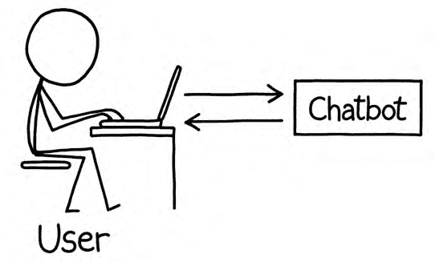
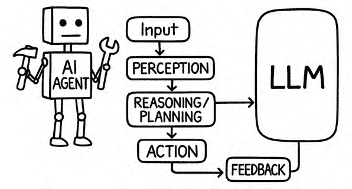

让我们用表格总结主要区别：

| 特性 | 聊天机器人 | AI 智能体 |
| --- | --- | --- |
| 目的 | 主要用于对话和提供信息 | 自主执行任务和决策 |
| 交互 | 主要基于文本，通常限于常见问题 | 多模态，可使用工具和 API |
| 自主性 | 有限，通常需要人工输入 | 高度自主，可独立运作 |
| 上下文感知 | 有限的上下文保持能力 | 可以维护并利用长期上下文 |
| 学习 | 静态，基于预训练参数 | 动态，可以随时间学习和适应 |

*表 1.1：聊天机器人与 AI 智能体的主要区别*

智能体 AI 系统在生成式 AI 时代有着多种应用场景。你可能也遇到过一些智能体！让我们来看看 AI 智能体实际工作中的一些示例。

#### 智能体 AI 的应用场景

AI 智能体可以应用于广泛的领域和场景。令人着迷的是，一些最成功的应用出现在那些此前被认为对 AI 来说过于复杂或微妙的领域。但随着我们迈向更强大的 AI 智能体，我们在软件开发、客户支持、研究，甚至共情式用户交互等领域都看到了突破。

以下是一些 AI 智能体在当前被有效应用的示例：

- **自主编程助手**：软件工程是一项复杂的任务，需要深入理解问题领域和技术实现。AI 智能体已经达到了一定水平，它们可以探索大型代码库，被分配 GitHub 或 Jira 问题，并自主修复问题、执行大规模重构、编写和运行测试，以及确保更改有效。当前一代 AI 编程智能体仍然无法完全取代高水平的人类工程师，但可以显著提升软件团队的生产力。我认为当前这批 AI 编程智能体就像一位博学的实习生。


它们可以自行完成一些任务，但在大型代码库中可能会迷失，需要一定的引导和手把手的协助。一些AI编码智能体的例子包括 Devin.ai（https://devin.ai/）、Claude Code（https://www.anthropic.com/claude-code）、OpenAI 的 codex CLI（https://github.com/openai/codex）、Google 的 Jules（https://jules.google/）以及开源的 OpenHands（https://github.com/All-Hands-AI/OpenHands/）。

#### 自动化客户支持

客户支持一直被视为自动化的首要目标。客户支持机器人已经存在20多年。然而，它们的能力一直非常有限，用户大多选择升级到人工处理。如今，AI智能体正在通过将静态聊天机器人转变为具备多轮对话、工具使用和实时问题解决能力的动态助手，从而改变客户服务。与传统机器人不同，这些智能体可以验证用户身份、从CRM中提取数据，甚至升级或解决工单。Intercom 的 Fin（https://fin.ai/）就是一个很好的例子——它是一个支持智能体，可以根据贵公司的文档回答复杂问题。同样，Ada（https://www.ada.cx/）和 Forethought（https://forethought.ai/）使用AI智能体跨消息渠道处理一级和二级支持任务，从而减轻人工客服的负担。这些系统与 Zendesk 和 Salesforce 等服务台平台集成，无需自定义脚本即可实现端到端的工单解决。

#### 研究智能体

研究是AI智能体产生重大影响的另一个领域。知识积累的速度正在显著加快。遗憾的是，并非所有知识都是高质量的。AI智能体可以帮助研究人员筛选海量研究论文，关联并发现它们之间的联系，甚至生成新的假设。所有主流LLM提供商现在都为其顶级模型提供研究模式，基础模型本身可以自主执行复杂的研究项目，包括生成搜索查询、执行网络搜索、分析结果，并将研究结果综合成一份连贯的报告。该报告还附有来源参考链接。以下是截至2025年5月当前的一些领先事件，这些事件由软件工程师显式编程。相比之下，AI智能体系统将其中一些高层认知任务委托给AI智能体。

#### AI智能体系统的常见组件

无论选择哪种架构，任何具备一定复杂度的AI智能体系统都会包含以下组件：

*图1.3：AI智能体系统的常见组件*

1. **记忆**是AI智能体系统的关键组件。它使智能体能够存储和检索有关其环境、过往动作和所学知识的信息。记忆可以是短期的（当前会话或任务的上下文），也可以是长期的（用于存储知识、偏好和习得的行为）。我们将在*第2章*中探讨不同类型的记忆，但这里先让您有所了解，以下是AI智能体中最常用的几种记忆类型：
   - **工作记忆**维护当前的上下文窗口。这是系统用来处理和执行任务的即时短期记忆，包含当前会话中的所有输入和输出词元。
   - **情景记忆**跟踪跨会话存储的近期对话/事件（即先前交互或重要事件的记录）。这使系统能够回忆特定的交流或用户行为，从而随时间实现连续性和个性化。
   - **语义记忆**是随时间习得的事实/概念。它是结构化知识的长期存储，例如一般世界事实、特定领域信息或概念关系。

2. **工具**是智能体可以在环境中执行操作所使用的外部资源或API。如果LLM是大脑，那么工具就是AI系统的眼睛、耳朵和四肢，使其能够感知环境并对其采取行动。没有工具，AI系统只能根据用户输入提供建议，而在现实世界中不具备任何实际的自主行动能力。

3. **编排**是协调AI智能体系统各组件并使其协作以实现目标的过程。这包括管理智能体、工具和记忆之间的信息流，以及处理与外部系统和人类的交互。编排可以通过中央控制器完成，也可以采用去中心化的方式，让智能体直接相互通信。人在回路中的参与程度可以有所不同。

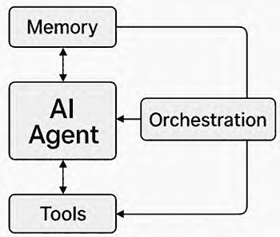

现在，让我们来看看各种AI智能体架构。

#### AI智能体架构的类型

对于不同的场景和情况，有不同的架构可供使用。架构的选择取决于具体的用例、所需的自主程度以及待执行任务的复杂性。以下是一些常见的架构：

#### 单智能体循环

单智能体循环架构由一个AI智能体组成，该智能体感知其环境、对其目标进行推理，并采取行动来实现这些目标。该循环通常包括观察、规划和执行的周期，使智能体能够以有目的且具有适应性的方式与其环境交互。

*图1.4：单智能体循环架构*

在这里，目标推理指的是智能体（通常由**大型语言模型**（**LLM**）驱动）如何解读指令并选择行动方针。LLM会从提示词、历史上下文以及任何明确陈述的目标中推断意图，然后将复杂任务分解为与预期结果一致的子任务或步骤。尽管LLM不会以类似人类的方式*推理*，但它们会利用从训练数据中习得的模式来模拟推理，通常是通过预测在给定上下文中一个有帮助或目标导向的回应应该是什么样子。这使智能体在追求其指定目标时显得深思熟虑且前后一致。

这种架构适用于简单任务，此时单个智能体即可处理所有复杂性，且上下文窗口（每次请求中可供LLM使用的词元总量）足够大，足以容纳整个任务。智能体可以使用工具和记忆来增强其能力，但它独立运行，无需与其他智能体协调。

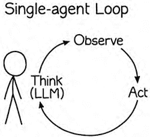


以下是一些典型的使用场景：

- **工具增强的问答**：当智能体与外部工具（如网络搜索、计算器、数据库）配对使用时，它可以获取事实、计算结果或检索实时信息，从而更准确地回应用户查询。
- **设备监控**：智能体可以监控空气质量传感器等设备，随时间进行分析，并在检测到异常时发出警报。
- **自动化代码审查**：智能体可以动态关注代码仓库中的变更，并为变更提供审查意见。

当智能体观察到环境发生变化时，例如恒温器读数发生变化，根据其训练数据，在类似情况下，正确的做法是将当前温度与设定温度进行对比。如果上下文中尚未包含此信息，这将触发一个动作来读取设定（目标）温度。一旦智能体同时获得了当前温度和设定温度，它就会向模型发送一条消息，模型将根据其训练数据生成下一个动作：升高温度（如果当前温度过低）、降低温度（如果当前温度过高）或不做任何操作（如果当前温度等于设定温度）。

LLM 的思考最好被理解为通过语言对人类式推理的模拟。它通过分析海量文本数据中的模式来预测序列中的下一个词。它利用概率、上下文和训练来模拟推理。它通过利用训练数据中的模式来模仿认知模式，但缺乏理解力、意向性和意识。

**注意**

搜索引擎通常并未集成到 LLM 中，但一些 LLM 提供商现在提供推理模型，这些模型可能会运行一个内部智能体循环，该循环可以使用诸如网络搜索和文件搜索等工具来搜索外部上传的数据（而非训练数据）。

### 规划器与执行器

在**规划器与执行器架构**中，一个**规划器 AI 智能体**负责对目标进行推理，并制定一个将目标分解为子任务的计划。然后，这些子任务被委派给其他称为**执行器智能体**的智能体。规划过程包括由规划器 AI 智能体根据其训练数据和提示生成计划步骤。执行的结果可能会被发送回规划器，规划器可能会调整计划并启动更多的执行器智能体。

*图 1.5：规划器与执行器架构*

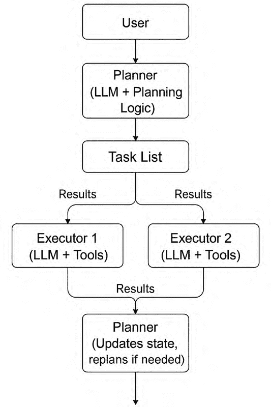

这些执行器智能体专门处理其任务，并在规划器和其他执行器智能体之外与 LLM 独立交互。这意味着它们管理自己的上下文，并拥有自己的工具集。协调计划的执行以及处理任务之间的依赖关系，可以由规划器智能体负责，或者在规划器启动时由专门的协调器智能体负责。

这种架构适用于超出单智能体能力的复杂任务。执行器智能体使用相同的智能体 AI 技术，在一般情况下不需要任何自定义编程。访问资源、数据存储和 API 所需的全部自定义编程都由工具实现。

典型的使用场景包括：

- 自动化的研究与报告生成
- 复杂的多步骤数据处理流水线
- 软件重构与测试计划
- 协调使用多个 API 或工具完成集成任务

### 多智能体系统

规划器与执行器架构是一种内聚的多智能体架构，其中规划器（直接或通过协调器智能体）控制并编排工作流。这可以扩展为更复杂的**多智能体架构**，其中多个具有特定角色（如 CEO、工程师、审查员）的智能体可以独立运行并相互协作，这与人类团队非常相似。

*图 1.6：多智能体架构*

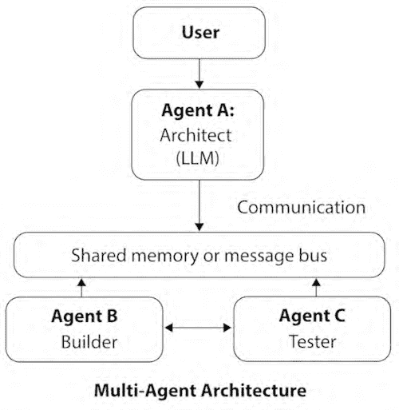

在这种架构中，智能体可以相互通信、共享记忆，并一起向系统目标迭代推进。这比规划器与执行器的自上而下结构更为复杂，允许更动态的交互和任务的并行处理。

例如，当编码智能体完成一个模块的实现时，它可以通知测试智能体，测试智能体将接着测试这个新模块。当架构师设想的所有模块都由编码智能体实现并由测试智能体成功测试后，架构师就可以开始开发目标系统的下一个版本。多个编码智能体和测试智能体可以在多个模块上并行工作。

### 基于图的结构

**基于图的结构**将智能体、任务、工具调用和记忆更新之间的关系表示为一张图。每个任务或智能体都可以动态地派生出多个子智能体。图的整体结构会根据先前任务的结果有机地涌现出来。

*图 1.7：智能体系统的基于图的结构*

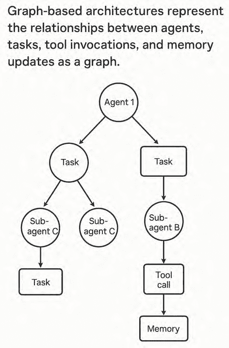

为简单起见，考虑这样一个示例：任务是统计一个目录中所有文件的所有单词数。子智能体 C 可以是一个统计文件中单词数量的子智能体，这样可以为每个文件启动多个子智能体 C。之后，智能体 1 将汇总所有子智能体 C 的结果。

图中的每个节点代表一个智能体、任务、工具或记忆更新，而边则代表它们之间的信息流和依赖关系。使用这种架构的最著名框架之一是 LangGraph（`https://www.langchain.com/langgraph`）。

智能体图架构的主要优势在于，问题可以被自然地分解为深层级的结构，例如软件开发规划，其中“构建一个 Web 应用”这样的顶层目标会分解为前端、后端和数据库等子系统，每个子系统都有自己的任务，如 UI 设计、API 开发、模式建模和测试。每个子任务都可以由专门的智能体处理，将输出和上下文沿图向下传递，从而跨抽象层实现协调且模块化的执行。

但智能体图架构也有几个缺点。它引入了显著的协调复杂性，因为管理智能体之间的依赖关系、消息传递和错误传播可能会变得难以扩展和调试。此外，当任务与层级结构不完美对齐时，过度分解或智能体频繁切换可能会带来开销，导致延迟、资源效率低下或行为脆弱。

#### 总结

在本章中，我们追随了生成式 AI 非凡的发展历程，从符号推理和专家系统的开创性工作，到深度学习以及基于 Transformer 模型的迅猛崛起。我们探索了该领域如何从基于规则的自动化演变为数据驱动的智能，从而造就了我们目前复杂的生成式模型，这些模型不仅能够理解内容，还能创造内容。

我们审视了 AI 智能体以及智能自主系统的出现，它们能够感知、规划、行动并适应其环境。与传统聊天机器人不同，AI 智能体配备了记忆、工具使用和多步推理能力，使其能够在不同领域执行复杂的动态任务。我们研究了几种架构，了解了它们与聊天机器人的区别，并调查了一些真实世界的用例，从自主编码助手到 AI 伴侣。

至此，你应该已经掌握了理解 AI 智能体原理所需的全部背景知识，包括它们的本质、它们在整个 AI 革命中的地位，以及它们当前的能力。这应该为我们继续前行奠定坚实的基础。有了这个坚实的基础，我们现已准备好在下一章中更深入地探讨 AI 智能体的内部工作机制，详细解析它们是如何构建的、其组件之间如何相互连接，以及它们在实践中如何实现自主性和智能。


### 获取本书的PDF版本和专属附加内容

扫描二维码（或访问 `packtpub.com/unlock`）。按名称搜索本书，确认版本，然后按照页面上的步骤操作。

*注意：请将发票放在手边。直接从Packt购买不需要发票。*


## 2 理解AI智能体如何工作

在*第1章*中，我们探讨了**GenAI**和智能体系统的核心概念，包括其设计中使用的各种架构。在本章中，我们将进一步了解AI智能体的实际工作机制。我们将考察智能体AI的关键组件和子系统，例如核心智能体循环、记忆、目标制定、状态管理、规划/推理、工具使用和反馈机制。

为了便于理解，本章将介绍智能体系统中的各种概念或组件，并讨论它们的作用。然后，我们将讨论这些组件如何在一个开源智能体AI框架AutoGen中实现。

需要再次强调，我们将重点关注由**大语言模型**（LLM）完成所有决策、规划和推理的智能体AI系统。也存在其他智能体AI系统，其逻辑以不同方式实现，例如使用规则引擎或传统编程，或使用**检索增强生成**（RAG）。外部RAG也是一种常见模式，AI系统会解释模型的响应，并从外部来源（如数据库或知识库）获取相关数据，以提供更准确且上下文相关的答案，或将数据反馈给LLM。不过，我们稍后会看到，即使RAG也可以简单到一个由LLM自己控制的工具调用。

在本章中，我们将介绍以下主要主题：

- 理解智能体循环：感知、思考、行动
- AutoGen中智能体循环的工作原理
- 使用记忆、目标和状态管理长对话
- 规划与推理机制
- 工具使用与环境交互
- 智能体评估与反馈循环

### 理解智能体循环：感知、思考、行动

**智能体循环**是定义AI智能体如何运作的核心循环。它类似于其他领域中许多控制循环，例如机器人技术或控制系统。一些著名的控制循环示例有**OODA**循环（**观察、判断、决策、行动**）(`https://en.wikipedia.org/wiki/OODA_loop`) 和 Kubernetes 协调循环 (`https://pkg.go.dev/sigs.k8s.io/controller-runtime/pkg/reconcile`)。

一个智能体循环由一个会话工作流和三个阶段组成：感知、思考、行动。如果从LLM收到的消息是最终响应，那么智能体就完成处理，循环终止，并将响应返回给调用方（用户、另一个系统或更高级别的智能体）。然而，如果收到的消息是LLM执行某个动作（通常是工具调用）的指令，那么智能体将执行请求的动作，并通过将动作结果发送回LLM来继续循环。

接下来，我们将讨论智能体循环的各个阶段。

#### 智能体循环的阶段

智能体循环可以分为三个主要阶段：感知、思考、行动。循环会一直持续，直到LLM给出最终响应。

**思考**：这里最令人惊讶的部分是——智能体本身并不思考，思考由LLM完成。智能体循环只是与LLM交换消息的管道。

智能体循环可以向LLM发送额外的消息，直接修改上下文，或者即使LLM尚未提供最终响应，也可以直接终止循环。

**行动**：行动与感知非常相似。从智能体循环的角度来看，它们实际上无法区分。智能体循环向LLM发送一条消息，LLM以工具调用消息作为响应。然后，智能体AI框架执行该工具调用，并将结果发送回LLM。行动只是一个对外部世界有某种影响的工具调用。它可以是调用API、数据库，甚至是现实世界中的物理动作（例如移动机械臂）。

*图2.5：智能体循环的行动阶段*

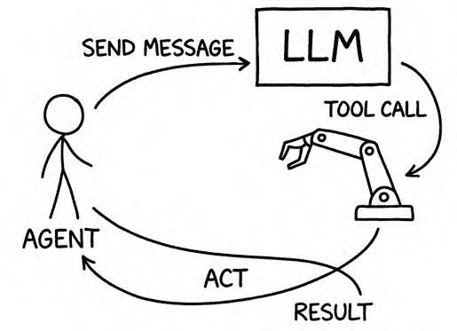

关键在于，智能体循环通过发送工具调用并接收结果来促成这种交互。智能体循环不关心工具调用的性质，无论是感知还是行动。行动工具调用的结果通常是成功或错误消息，并发送回LLM。如果该行动是长期行动，响应可能是一个行动ID，LLM稍后可以查询该ID以获取进度和状态更新。与往常一样，LLM将根据对行动工具调用的特定响应来决定如何继续。

智能体从不进行任何思考。思考要么由LLM完成（在智能体循环下方），要么由AI系统完成（在智能体循环上方）。智能体框架和智能体本身从不自行进行任何思考。

**注意**

感知与行动的区别在于对外部世界的影响。感知只是观察世界的状态。行动则会改变世界的状态。


如果响应是成功状态，那么LLM可能只会回复一条最终响应消息并终止智能体循环。然而，如果失败，它可能会重试或采取一些恢复措施。

在多智能体系统中，最重要的操作之一是启动另一个拥有自己智能体循环的智能体。我们将在本书后面的*第8章*中深入探讨这一点。多智能体协作的另一种形式是与另一个并非由当前智能体启动的、已在运行的智能体进行通信。这种交互可以被视为感知或行动，具体取决于另一个智能体的行为。如果它只是返回一些信息，那就是感知；但如果它在现实世界中执行了某些操作，那就是行动。如果此时感到困惑，不必担心。我们将在本书的*第3部分*中详细阐述多智能体系统的所有细节和微妙之处。

让我们看看微软的一个流行智能体框架 AutoGen 是如何实现智能体循环概念的（`https://github.com/microsoft/autogen`）。

### AutoGen 中智能体循环的工作原理

AutoGen 实现了智能体循环的各个阶段（感知，来自模型。

```
response = await model_client.create(
    input_messages,
    tools=tool_schema,
    cancellation_token=cancellation_token,
)
# Add the response to the generated messages.
generated_messages.append(
    AssistantMessage(
        content=response.content,
        source=caller_source,
    )
)
# Keep iterating until the model stops generating tool calls.
while (
    isinstance(response.content, list)
    and all(
        isinstance(item, FunctionCall)
        for item in response.content
    )
):
    # Execute functions called by the model by sending messages to the tool
    # agent.
    results: List[FunctionExecutionResult | BaseException] = await asyncio.gather(
        *[
            caller.send_message(
                message=call,
                recipient=tool_agent_id,
                cancellation_token=cancellation_token,
            )
            for call in response.content
        ],
        return_exceptions=True,
    )
    # Combine the results into a single response and handle exceptions.
    function_results: List[FunctionExecutionResult] = []
    for result in results:
        if isinstance(result, FunctionExecutionResult):
            function_results.append(result)
        elif isinstance(result, ToolException):
            function_results.append(
                FunctionExecutionResult(
                    content=f"Error: {result}",
                    call_id=result.call_id,
                )
            )
        elif isinstance(result, BaseException):
            raise result  # Unexpected exception.
    generated_messages.append(
        FunctionExecutionResultMessage(content=function_results)
    )
```

### The.
```
response = await model_client.create(
    input_messages + generated_messages,
    tools=tool_schema,
    cancellation_token=cancellation_token,
)
generated_messages.append(
    AssistantMessage(
        content=response.content,
        source=caller_source,
    )
)
return generated_messages
```

### AutoGen 中的行动阶段

行动的实现方式与感知完全相同——通过工具执行。正如所描述的那样，智能体“不知道工具调用的性质”。无论工具是读取数据（感知）还是执行操作（行动），其实现方式都是一样的。对于更复杂的工具交互，AutoGen 提供了一个专用的 `tool_agent_caller_loop` 函数（`https://github.com/microsoft/autogen/blob/main/python/packages/autogen-core/src/autogen_core/tool_agent/_caller_loop.py`），该函数实现了完整的感知-思考-行动循环。

该函数展示了核心循环：向LLM发送消息 → 接收工具调用 → 执行工具 → 回传结果 → 重复，直到不再有工具调用。

AutoGen 通过交接（handoffs）支持上述多智能体协作，其中一个智能体可以启动另一个智能体或与之通信。这是通过 `HandoffMessage`（`https://github.com/microsoft/autogen/blob/main/python/packages/autogen-agentchat/src/autogen_agentchat/messages.py`）和 Swarm 模式实现的，允许智能体将任务委派给拥有自己智能体循环的专用智能体。

**HandOffMessage** 是一种旨在将对话转交给另一个智能体的消息。

**Swarm 模式**是一种协调策略，多个智能体共同协作解决一个任务。

> **注意**


对于一个智能体系统来说，若要保留上下文，它必须能够访问可能促成其行动的信息。这正是记忆、目标和状态发挥作用的地方。接下来我们讨论这些内容。

### 利用记忆、目标和状态管理长对话

智能体AI系统会在可能较长的时间跨度内执行复杂的多步骤任务，以同步或异步方式与人类、其他系统以及其他AI智能体交互。到目前为止你已经很清楚，所有这些……（原文此处不完整，按原文保留）。有些LLM提供商提供有状态的长时记忆，这些记忆会被动态注入LLM的上下文。

我们将聚焦于智能体的单次调用，其中恰好包含一条系统消息、一条用户消息（即提示词）、零条或多条工具消息，以及来自LLM的单一最终响应消息。

智能体的通用指令在系统消息中指定，这通常是一段较长的文本，描述智能体的能力、角色、一些初始知识、输出规范以及示例。例如，一个Python编码智能体的系统消息可能如下所示：

```
你是一位Python编程专家和助手。你编写简洁、地道、文档完善的Python代码，并在被问及时清晰、简要地解释你的选择。
你可以分析需求、调试代码、重构现有实现，并在架构和风格方面提出改进建议。
始终假设用户具备技术能力，但可能不了解Python标准库或惯用用法的全部细节。
如果问题存在歧义，请先提出澄清问题再继续。
编写代码时，优先清晰而非炫技，并在适当处添加简短注释。
除非另有说明，请在三反引号内输出Python代码。
仅当被明确允许或属于常用库（如requests、pandas或numpy）时，才可使用第三方库。
遵循最佳实践，如编写单元测试并按照PEP-257约定记录代码。
```

与此智能体的长对话可以分解为多次智能体循环调用，每次调用都有自己的最终响应消息。对话线程将由AI系统保存，该系统会将上一会话的所有消息送入下一会话。例如，用户可能请求*“用Python给我构建一个计算器”*，智能体则以澄清问题作为最终响应消息：*“你更喜欢CLI程序还是GUI应用？”*。控制AI系统会将问题呈现给用户，用户可能选择CLI程序。现在，新一次智能体调用开始，包含第一会话的全部历史，以及用户选择CLI程序作为发给智能体的初始用户消息。然后，新的智能体在获知用户偏好CLI程序后，可以开始迭代使用工具调用来生成并编写代码与测试，直到它满意为止，然后返回最终响应，例如*“完成。CLI程序名为calc.py，单元测试位于calc_test.py”*。

*图2.7：多会话对话*

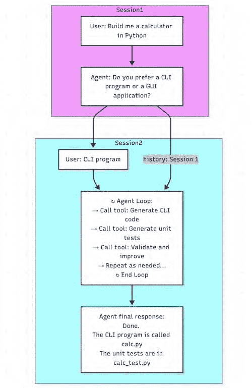

让我们看看这一切在LLM上下文窗口层面是如何表示的。

#### 上下文窗口

语言模型中的**上下文窗口**指的是模型在单次调用期间能够处理和推理的信息总量。这不仅包括文本，还包括其他输入模态，如图像、音频、结构化数据或嵌入——具体取决于模型的能力。上下文窗口实际上充当模型的工作记忆，决定它能 *看到* 并用于生成响应的信息。

现在，我们迄今为止讨论的所有高层概念，如智能体记忆、目标和状态，最终都必须表示为token，并适合放入每次对LLM的API请求的上下文窗口中。

当LLM形成其响应时，它依赖训练中获得的知识，这些知识编码在模型权重中。但上下文窗口中的所有信息在模型生成响应后就会立即被遗忘。请注意，LLM运营商可能会存储这些信息用于审计、未来训练或其他目的，但模型本身不会从上下文窗口学习或保留任何信息。要在多次智能体循环调用之间保留信息的唯一方式是将其存储在AI框架或AI系统层面，然后在下次调用时将其重新送入上下文窗口。

更大的上下文窗口能够支持更复杂的行为：更长的对话、更丰富的输入、对先前步骤更完整的推理，或对复杂工件的详细引用。较小的窗口则会限制模型维持连续性、整合上下文或处理深层嵌套任务的能力。

RAG嵌入可以直接注入上下文窗口，无论所有模态采用何种编码。

**注意**

LLM（如GPT-4o这样的模型）并不管理用户画像。LLM提供商（如OpenAI）可能会存储用户特定信息，并在如ChatGPT这样的交互式聊天会话中自动将其注入上下文窗口。在这种情况下，ChatGPT扮演了管理记忆的AI系统角色。

在使用AI框架的智能体AI系统中，与LLM的交互通常通过专用API密钥进行，不存在用户级画像。

但是，即使拥有很大的上下文窗口，对于长对话或输入输出都很大的复杂任务，你也可能耗尽空间。每个模型都有其自身的上下文窗口大小，在选择使用哪个模型时将其纳入考量非常重要。在这种情况下，你可能需要截断对话历史、进行摘要，或以某种形式压缩以适配上下文窗口。在多智能体系统中，你也可以采用分治方法，让每个智能体负责特定的子任务，并可将模型的整个上下文窗口专门用于自己的子任务，仅由更高级别的智能体汇总通常较小的结果。我们将在*第9章*中讨论这一场景。

#### 为什么LLM没有记忆？

但为什么LLM不能直接记住一切？为什么每次都需要喂入所有上下文？答案是复杂且微妙的。首先，LLM自身拥有记忆组件并没有什么好处。我们实际上在讨论的是LLM提供商维护每个用户对话的状态（所有消息的历史），这样用户每次请求可以只发送最新消息。

LLM提供商随后可以将最新消息添加到用户保存的会话中，并将其作为临时上下文窗口馈送给LLM。那么问题来了，为什么LLM提供商不能向用户提供这项服务？理论上，这可以节省大量带宽，因为无需在每次请求中发送整个会话历史，只需发送新增消息的增量部分。

然而，在规模化场景下，你需要每种LLM的多个副本并行运行，以处理大量请求。如果每个LLM实例都有自己的记忆，那么你就需要在用户请求与LLM实例之间保持会话亲和性。此外，用户的后续消息之间可能还有延迟。当LLM提供商管理会话记忆时，即使没有消息发送，它也必须维护状态。这会迅速累积，尤其是对长期会话而言。

让我们看一个例子：10,000名用户在5分钟内共向LLM提供商发送了10 TB数据。LLM提供商需要存储所有这些数据，以便响应用户的后续消息。决定将这些数据存储在哪里是复杂的（内存、数据库、分布式缓存）。每当用户发送另一条消息时，LLM提供商需要获取该用户对话的上下文并将其注入LLM。这很复杂，且可能引入多种故障模式和性能问题。

最后，还存在会话终止的问题。LLM提供商有两个选择：要么永远保留会话状态，以便用户随时继续对话；要么根据某种启发式策略决定何时擦除会话记忆。总的来说，LLM提供商更倾向于保持LLM的无状态性，让AI框架或AI系统管理会话状态，以提升可扩展性、降低延迟并最小化成本。


像 ChatGPT、Perplexity 和 Claude.ai 这样的聊天机器人似乎拥有长期记忆，可以继续之前的对话。下面是一个示例，其中 Claude.ai 显示了之前对话的列表。

*图 2.8：Claude.ai 服务的示例对话存储*

这实际上是管理聊天机器人的 AI 系统的一个功能，而非 LLM 本身的功能。Claude.ai 是一项提供与 Anthropic 模型进行交互式聊天服务的网络服务。它将所有对话存储在持久化存储中，并向用户显示之前对话的列表。当用户选择一个对话时，Claude.ai 服务会检索存储的对话，并将其作为初始消息输入到所选 LLM（例如 Claude Sonnet 4）中。LLM 本身始终只有一个临时上下文窗口，其范围仅限于当前调用。一些 LLM 提供商（如 OpenAI）已开始尝试通过 ChatGPT 记忆功能实现跨所有对话的全局长期记忆（[https://openai.com/index/memory-and-new-controls-for-chatgpt/](https://openai.com/index/memory-and-new-controls-for-chatgpt/)）。所有过往对话的摘要（用户可以选择加入或退出长期记忆）会被输入到每次调用中，因此模型看起来像是记住了你所有的历史互动。

为了了解实际实现，让我们看看 AutoGen 框架（[https://github.com/microsoft/autogen](https://github.com/microsoft/autogen)）中是如何实现记忆的。

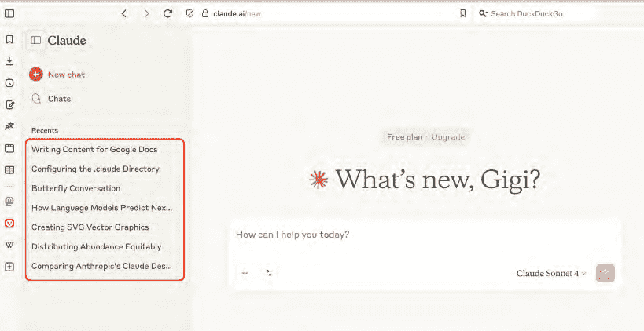

### AutoGen 中的记忆

令人惊讶的是，AutoGen 并未在其架构的核心层提供记忆功能。记忆是在聊天智能体的更高抽象层级上实现的。共有三种类型的记忆：

- **简单顺序列表记忆**：AutoGen 为简单顺序列表记忆定义了一个抽象记忆协议，包含 `add()`、`query()`、`update_context()`、`clear()` 和 `close()` 等操作。例如，一个返回当前天气的智能体可以使用记忆来存储用户的温度单位偏好（"imperial" 与 "metric"），并据此回应用户的查询。在与 LLM 交互的上下文中，记忆的内容会被添加到上下文窗口中。

- **基于向量的 RAG 记忆**：AutoGen 还支持实现记忆协议的更复杂的记忆存储。AutoGen 开箱即用地提供了一个扩展，在 `ChromaDBVectorMemory` 类（[https://github.com/microsoft/autogen/blob/main/python/packages/autogen-ext/src/autogen_ext/memory/chromadb/_chromadb.py](https://github.com/microsoft/autogen/blob/main/python/packages/autogen-ext/src/autogen_ext/memory/chromadb/_chromadb.py)）中实现了基于向量的 RAG 记忆。

- **以任务为中心的快速记忆（实验性）**：实验性的以任务为中心的快速记忆存储在 `MemoryController` 中。它不使用记忆协议，目前仍是 AutoGen 内部的一个活跃研究项目。其目标如下：

  - 通过在上下文窗口限制之外快速且持续地学习，从而更有效地完成一般任务
  - 记住用户提供的指导、纠正、计划和演示
  - 通过智能体自身的经验进行学习，并快速适应不断变化的环境
  - 避免在与此前遇到过的任务相似的任务上重复犯错

它们都被用于 `AssistantAgent` 类，这是 AutoGen 中实现聊天智能体的主要类。

现在我们将把重点转向 LLM 的规划与推理机制。

### 规划与推理机制

你可能还记得，在智能体 AI 系统中，所有的规划与推理都是由 LLM 完成的。然而，AI 框架仍然可以组织与 LLM 的交互，以促进编排式的规划与推理。在本节中，我们将探讨智能体 AI 系统中规划与推理的不同方法，包括单智能体与多智能体规划，以及与推理模型的协作。

#### 与推理模型协作

LLM 提供商现在会提供专门为复杂多步推理任务设计的推理模型（见下图）：

*图 2.9：与推理模型协作*

这意味着在单次请求中，这些模型可以执行多步推理，并使用网络搜索和代码执行等内部工具，而无需与 AI 框架或用户交互。例如，OpenAI 的 o 系列模型（o3、o4-mini）会花费更多时间（和 token），实际上是在运行自己的内部智能体循环。这些模型在必要时仍可能调用外部工具，但消息。智能体可以调用工具来收集有助于制定计划或对输入数据进行推理的信息。

#### 多智能体规划与推理

在多智能体系统中，规划与推理更加复杂。顶层智能体可以调用额外的子智能体，或与已在运行的智能体通信。请注意，调用子智能体或与另一个智能体通信的决定，本身就是由顶层智能体所调用的 LLM 进行规划的结果，该规划会形成一个工具调用，而工具的执行结果便是启动一个子智能体或向另一个智能体发送消息。

多智能体系统中智能体之间的交互引入了单智能体场景中不存在的多个交互层面。当父智能体将工作委派给子智能体时，它必须精心构建子智能体的上下文，包括系统提示词、初始目标、可用工具，以及来自父智能体会话的任何相关背景信息。

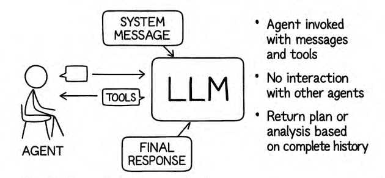

*图 2.11：多智能体推理*

父智能体还需要决定是同步等待子智能体完成，还是在监控子智能体进度的同时异步继续处理其他任务。当智能体需要在执行过程中交换信息时，通信协议变得至关重要——智能体可能需要协商、协调共享资源、解决冲突，或汇总多个并行子智能体的结果。此外，错误处理和恢复策略也变得更加复杂，因为一个智能体的故障可能在系统中级联传播，这就要求父智能体检测故障、使用不同参数重试，或将任务动态重新分配给其他智能体。单个智能体的上下文窗口限制也给信息共享带来了挑战，因为智能体必须决定在彼此之间传递哪些信息，这可能需要对大量对话历史进行摘要或选择性过滤。

### 工具使用与环境交互

管理工具是 AI 框架的主要职责。LLM 通过执行实际的规划与推理来驱动一切，但对于许多任务而言，智能体需要与环境交互，而这正是通过可用工具来完成的。智能体提供给 LLM 的工具列表定义了该智能体的能力。

智能体在提高生产力、自动化日常任务、总结电子邮件以及在多个工作环境中执行定期检查等方面非常有用。

例如，考虑一个 AI 软件工程师智能体。为了高效工作，它需要工具来执行以下任务：

- 列出文件和目录
- 读取、创建、编辑和删除文件
- 运行单元测试和集成测试
- 在沙盒环境中运行代码（例如 Docker 容器）


- 运行本地 Web 服务器以在浏览器中测试代码
- 运行代码 linter 和格式化工具、代码风格检查器、代码分析器、代码安全扫描器
- 创建 Git 分支、提交代码、将代码推送到远程仓库

对于普通用户来说，AI 代理在完成日常活动时可能会派上用场，例如制定膳食计划并根据饮食方案订购食物、按计划时间间隔准备和购买杂货，或者更复杂的多步骤任务，例如假期规划。

以 AI 假期规划代理为例。为了有效工作，它需要工具来执行以下任务：

- 搜索航班并比较不同航空公司和日期的价格
- 查找并预订住宿（酒店、度假租赁、青年旅舍）
- 研究目的地的当地景点、餐厅和活动
- 查看不同国家的签证要求和旅行限制
- 获取实时天气预报和季节性旅行信息
- 计算旅行预算并跟踪不同类别的支出
- 预订餐厅以及旅行团或体验活动
- 访问用户的日历以确定可用的旅行日期和时长限制
- 发送确认电子邮件并创建包含预订详情的行程文档

无论 LLM 多么强大，如果它没有与环境交互的工具，它就无法成为高效的软件工程师或假期规划代理。AI 软件工程师最多能做到的就是根据提示生成代码，这可能非常有帮助，但只是整个软件开发生命周期的一部分。例如，如果假期规划代理没有预订权限，它可以推荐假期，但无法协助完成预订和预约。

让我们更深入地探讨工具在代理式 AI 系统中是如何实现、声明和使用的，重点关注 AutoGen。

### 用户自定义工具是如何实现的？

代理式 AI 系统中有两类工具：内置工具和用户自定义工具。`web_search`、`code_execution`、`file_search` 和 `computer_use` 等内置工具由 LLM 提供商实现。用户自定义工具是可以用任何编程语言实现的函数，通常与代理式 AI 框架使用相同的语言实现。不过，它们也可以用不同的语言实现，并以 Docker 容器或某种内部 API 的形式暴露给代理式 AI 框架。

以下是一个用 Python 实现两个数相加的用户自定义工具示例：

```python
def add_numbers(a: int, b: int) -> int:
    """
    Adds two numbers and returns the result.

    Args:
        a (int): The first number.
        b (int): The second number.

    Returns:
        int: The sum of the two numbers.
    """
    return a + b
```

没错，它只是一个普通的 Python 函数。代理式 AI 框架会获取这个函数并将其公开为一个工具。我们将在*第 3 章*、*第 4 章*和*第 5 章*中详细介绍这一点。

### 工具是如何声明的？

OpenAI、Anthropic、Mistral 和 Google 等 LLM 提供商提供了与其模型交互的 API。许多其他提供商提供与 OpenAI 兼容的 API。这些 API 非常相似，允许你在每次调用中声明单独的工具列表。

以下是 OpenAI API 中工具声明的经典示例：

```bash
curl https://api.openai.com/v1/responses \
  -H "Content-Type: application/json" \
  -H "Authorization: Bearer $OPENAI_API_KEY" \
  -d '{
    "model": "gpt-4.1",
    "input": "What is the weather like in Paris today?",
    "tools": [
      {
        "type": "function",
        "name": "get_weather",
        "description": "Get current temperature for a given location.",
        "parameters": {
          "type": "object",
          "properties": {
            "location": {
              "type": "string",
              "description": "City and country e.g. Bogotá, Colombia"
            }
          },
          "required": [
            "location"
          ],
          "additionalProperties": false
        }
      }
    ]
  }'
```

AI 代理有明确定义的范围和一组用于执行任务的工具。代理式 AI 框架代表特定 AI 代理发送给 LLM 的每个请求都将包含该代理所拥有的工具列表。不同的代理可能拥有不同的工具。从代理处接收一组工具的 LLM 可能会以工具消息的形式请求调用某个工具，AI 框架会处理该消息、执行所请求的工具，并将结果返回给 LLM。

### LLM 如何决定使用哪个工具？

这里涉及多个抽象层。代理式 AI 框架通常支持多个 LLM 提供商，每个提供商都有自己的 API 和工具声明格式。框架抽象了这些差异，并为声明工具提供了统一接口。当代理式 AI 框架向特定 LLM 提供商发送请求时，它会将请求（包括工具列表）转换为该 LLM 提供商 API 所期望的格式。

*图 2.12：代理框架调用 get_weather 工具*

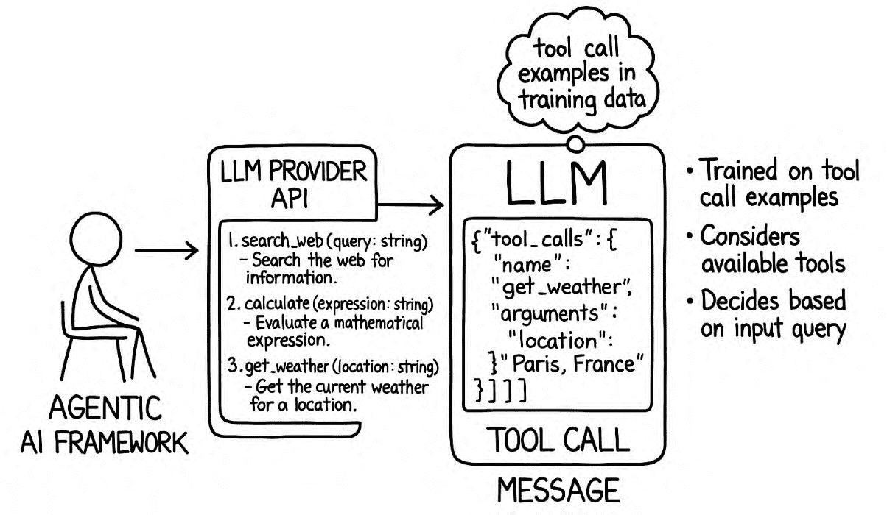

当 LLM 提供商收到带有工具列表的结构化请求时，它会生成如下文本表示：

```
You can call the following tools:
1. search_web(query: string) - Search the web for information.
2. calculate(expression: string) - Evaluate a mathematical expression.
3. get_weather(location: string) - Get the current weather for a location.
```

这段文本会被转换为输入到 LLM 的 token 流，而 LLM 不知道也不关心 API 请求结构（那是为开发人员准备的）。LLM 在包含工具调用及其使用示例的大型文本语料库上进行了训练。当 LLM 收到带有工具列表的文本请求时，它可以基于此训练识别工具及其参数。

然后，LLM 根据输入查询和可用工具决定使用哪个工具。它会生成结构化格式的工具调用消息，LLM 提供商 API 层接收该消息，并将其格式化为带有工具调用的适当响应，如下所示：

```json
{
  "tool_calls": [
    {
      "name": "get_weather",
      "arguments": {
        "location": "Paris, France"
      }
    }
  ]
}
```

然后，此响应被发送回代理式 AI 框架，该框架执行工具调用并将结果发送回 LLM 以继续代理循环。

让我们看看 AutoGen 如何使用工具。

### AutoGen 中的工具使用

AutoGen 提供了一个全面的框架，用于在 AI 代理中定义和使用工具。它同时支持内置工具和用户自定义工具，使开发人员能够轻松扩展代理的功能。由于它与多个 LLM 提供商及其 API 配合使用，它为工具定义了自己的与提供商无关的数据结构，然后在必要时将其转换为每个提供商的格式。

让我们看一个 AutoGen 下棋代理的示例，看看它们如何使用工具。黑方玩家代理拥有以下工具：

```python
black_tools: List[Tool] = [
    FunctionTool(
        get_legal_moves_black,
        name="get_legal_moves",
        description="Get legal moves.",
    ),
    FunctionTool(
        make_move_black,
        name="make_move",
        description="Make a move.",
    ),
    FunctionTool(
        get_board_text,
        name="get_board",
        description="Get the current board state.",
    ),
]
```

每个函数工具都是一个 Python 函数/方法，如下所示：

```python
async def chess_game(
    runtime: AgentRuntime,
    model_client: ChatCompletionClient,  # type: ignore
) -> None:
    """
    Create agents for a chess game and return the group chat.
    """

    # Create the board.
    board = Board()

    # Create tools for each player.
    def get_legal_moves_black() -> str:
        return get_legal_moves(board, "black")
```

然后，这些工具在 `ToolAgent`（`https://github.com/microsoft/autogen/blob/main/python/packages/autogen-core/src/autogen_core/tool_agent/_tool_agent.py`）中注册：

```python
# Register the agents.
await ToolAgent.register(
    runtime,
    "PlayerBlackToolAgent",
    lambda: ToolAgent(
        description="Tool agent for chess game.",
        tools=black_tools,
    ),
)
```

当工具注册后，LLM 就获得了在其响应消息中调用这些工具的能力。

`ToolAgent` 是 AutoGen 核心中的一个专门代理，它接收 `FunctionCall` 消息，使用提供的参数执行所请求的工具，并返回 `FunctionExecutionResult` 消息。它通常用作专用工具执行器，其他代理可以将函数调用委托给它，并在找不到工具、参数无效和执行失败时提供错误处理。


然后，注册黑色玩家代理（也有一个类似的白色玩家代理）。注意这里指示它执黑并使用提供的工具。

```python
await PlayerAgent.register(
    runtime,
    "PlayerBlack",
    lambda: PlayerAgent(
        description="Player playing black.",
        instructions=(
            "You are a chess player and you play as black. "
            "Use the tool 'get_board' and 'get_legal_moves' to get the legal moves "
            "and 'make_move' to make a move."
        ),
        model_client=model_client,
        model_context=BufferedChatCompletionContext(buffer_size=10),
        tool_schema=[tool.schema for tool in black_tools],
        tool_agent_type="PlayerBlackToolAgent",
    ),
)
```

AutoGen 代理循环会向 LLM 发送包含工具列表的请求，LLM 会在适当的时候决定使用哪个工具。这里的思路是：当 LLM 在决定下一步行动时，预期它需要获取当前棋盘状态才能做出决策。`get_legal_moves()` 工具可以说并非必需，因为如果 LLM 被期望足够了解国际象棋以选出下一步最佳走法，那么它也应该足够聪明，只会选择合法走法。

### 代理评估与反馈循环

智能体 AI 系统的关键方面之一是评估代理的性能并提供改进路径的能力。这在多代理系统中尤为重要，因为代理之间可能相互协作或竞争，而小错误和不精确之处可能会累积，导致结果欠佳甚至整个工作流失败。评估代理的方式有多种，包括以下几种：人工反馈、自动化评估和行业基准。

有些评估方法可以在系统运行期间自动执行，而其他涉及人工反馈或耗时过长的评估方法则可以离线使用，以改进未来代理的性能。

下面让我们更详细地了解每一种方法。

#### 人工反馈

人工反馈在塑造智能体 AI 系统的行为和品质方面起着关键作用。与依赖预定义规则或指标的自动化评估不同，人工反馈能够捕捉主观元素，如有用性、语气、清晰度和用户满意度。这在开放式任务中尤其有价值，例如创意写作、决策或用户协助——在这些场景中，僵化的评估标准往往力不从心。用户可以通过对响应进行评分、标记错误行为或选择偏好的输出来提供直接反馈。或者，也可以从用户行为中收集隐性反馈，例如他们是否持续与代理互动，还是过早放弃任务。

无论哪种方式，智能体 AI 框架通常都不提供收集人工反馈的机制。AI 系统的开发者应该在应用层面构建人工反馈支持。

在更具结构化的环境中，可以向领域专家征集反馈，由他们根据特定标准评估代理的性能。例如，在编码助手代理中，开发者可能会评估生成代码的质量、解释的有用性以及调试步骤的正确性。这些专家反馈可用于优化提示词、策划更好的示例，并调整代理的工具集。请注意，这与**基于人类反馈的强化学习**（**RLHF**）流程不同，RLHF 用于训练 LLM，使其未来行为更好地与人类偏好对齐。这里的重点在于改进 AI 代理的性能，而不是底层 LLM。我们完全可以构建一个自我改进的 AI 系统，收集人工反馈、分析反馈，并利用它来改进自身或其他 AI 代理。

人工反馈在多代理系统中尤其重要，因为协调、委派和沟通动态都在其中发挥作用。此时，反馈不仅可能评估单个代理，还可能评估代理之间的协作或职责划分情况。标注者或最终用户可以指出沟通中的断裂、目标错位或任务执行低效等问题。这些反馈有助于识别系统性问题，并为重新配置代理以实现更好的协同提供数据。尽管与自动化方法相比更慢、更耗费资源，但人工反馈在评估细微行为和促进真实部署中的信任方面不可或缺：

*图 2.13：人工反馈*

人工反馈可以与其他评估方法（如 A/B 测试）结合使用，也可以用于交叉验证自动化评估。

#### 自动化评估

自动化评估方法提供了一种无需人工干预即可评估代理性能的可扩展方式。当任务结果非常明确时，自动化评估效果最佳。例如，如果要求代理以特定格式（如 CSV 文件）生成结果，那么验证输出是否确实是 CSV 文件就很容易。

我们还可以利用 LLM 技术，使用 LLM 来评估 AI 代理的输出是否与其原始目标一致。在分层多代理系统中，这可以在不同层级完成。此外，它还提供了即时解决问题的可能性。

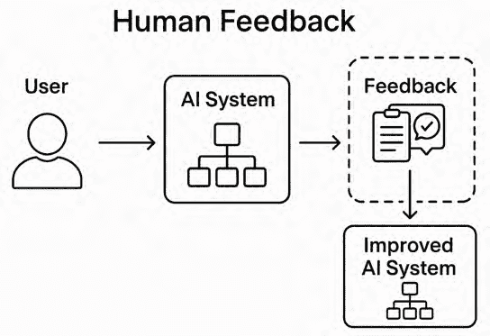

*图 2.14：智能体系统的评估*

例如，一个父 AI 代理启动多个子代理来执行子任务。然后它使用一个评估 AI 代理来评估子任务的结果，如果结果不令人满意，它可以重新运行子代理，可能使用不同的提示词或配置。这种实时评估的结果应被记录下来，用于改进未来代理的性能，从而减少修复实时问题的需要。

智能体 AI 评估涉及通过完成率、轨迹质量和工具准确度等指标来评估端到端的任务成功率，同时通过轨迹和模拟来分解规划、推理和自我修正等组件。该过程使用基准测试（例如 SWE-Bench、TRAIL）、LLM 作为裁判的评分以及生产环境监控来确保可靠性，并通过分层的人工和自动化检查对失败进行迭代。

以下是一些用于评估智能体 AI 系统的标准指标和评分：

**任务性能指标**

- **成功率**：成功完成任务的百分比
- **任务完成时间**：完成任务的平均时间
- **准确率**：输出/决策的正确性
- **精确率/召回率/F1**：用于分类和检索任务

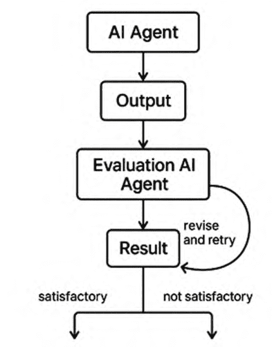

**代理行为指标**

- **工具使用效率**：代理使用可用工具的有效程度
- **规划质量**：生成计划的一致性和最优性
- **推理深度**：多步推理链的质量
- **适应性**：条件变化时的表现

**多代理协调指标**

- **通信效率**：代理交互的质量和必要性
- **任务分配效率**：任务分布的合理性
- **协调开销**：通信成本与收益的对比
- **共识时间**：协作任务中达成一致所需的时间

**安全与对齐指标**

- **无害性**：避免产生有害输出
- **真实性**：事实准确性和诚实度
- **有用性**：有效满足用户需求的能力
- **对齐分数**：遵循预期目标与奖励破解的对比

**鲁棒性指标**

- **对抗鲁棒性**：在攻击场景下的表现
- **分布偏移容忍度**：在分布外数据上的表现
- **错误恢复**：从失败中恢复的能力
- **幻觉率**：生成虚假信息的频率

**效率指标**

- **计算成本**：每个任务使用的资源
- **Token 效率**：每消耗一个 Token 所产生的输出质量
- **延迟**：实时应用的响应时间
- **可扩展性**：随系统规模增长而产生的性能下降

我们将在*第 10 章*中更深入地探讨评估指标。

实现所有这些评估指标是一项庞大的工程，需要多年的工程投入。参见 `https://www.getmaxim.ai/articles/evaluating-agentic-workflows-the-essential-metrics-that-matter/`。现在让我们来看看行业基准。


### 行业基准

行业基准是可用于评估智能体的标准化测试或任务。

这些基准提供了一种客观的方式来衡量AI智能体或完整智能体AI系统的性能。将您的智能体AI系统与**SOTA**（最新技术水平）进行对比，可以指示是否存在大量易于改进的空间，或者性能是否已接近最优。然而，基准通常是为特定任务或领域设计的，与您的智能体AI系统的用例重叠可能有限。以下是一些常见的行业基准：

- **AgentBench**：[`AgentBench`](https://github.com/THUDM/AgentBench) 是一个综合性基准，旨在评估基于LLM的智能体在各种任务中的通用能力。它专注于真实世界的智能体任务，如网页浏览、数学问题求解和具身决策，以测试推理、记忆和工具使用能力。
- **ToolBench**：[`ToolBench`](https://github.com/OpenBMB/ToolBench) 提供了一套数据集和评估协议，用于训练和评估能够调用外部工具的LLM。它强调工具使用能力，衡量智能体在文本生成之外，能够通过调用API或函数完成复杂任务的程度。
- **WebArena**：[`WebArena`](https://webarena.dev/) 是一个逼真、开放式的网络环境，智能体在其中可以接受导航和与动态网站交互能力的评估。它提供了基于浏览器的环境，用于基准测试目标完成、规划以及处理嘈杂或意外布局的能力。
- **Mind2Web**：[`Mind2Web`](https://osu-nlp-group.github.io/Mind2Web/) 是一个基准，用于评估智能体以类人推理和规划方式在网站上执行用户指定任务的能力。它模拟多样化的网页任务，并提供目标、子目标和推理链的标注，以评估可解释性和鲁棒性。

基准在比较特定领域和任务中的智能体AI系统时很有用，但更重要的是理解用户和客户的目标与意图。例如，您的系统可能在某个基准上得分较低，但运行速度更快、成本更低，这可能是一个更好的价值主张。

#### 总结

在本章中，我们深入探讨了由大语言模型驱动的智能体AI系统的运行流程。我们介绍了核心智能体循环——感知、思考、行动——并说明了它在AutoGen等框架中如何运作，其中LLM通过工具调用决定智能体的行为。我们探索了智能体如何在LLM上下文窗口的限制下使用记忆、目标和状态管理，以及这些职责如何由周围的AI框架或系统处理。

我们还考察了规划和推理机制在单智能体和多智能体系统中的重要性。随着专用推理模型的兴起和智能体工作流日益复杂，结构化交互和任务分解对于稳健行为变得至关重要。然后，我们将注意力转向工具使用，这是智能体能力的关键推动因素。毕竟，即使是最智能的LLM，也只能在其工具所能触及的范围内观察或影响外部世界。

最后，我们探讨了评估和反馈。这些机制使智能体AI系统能够随着时间推移不断改进。我们涵盖了人工和自动反馈策略，并回顾了允许跨系统进行客观比较的标准化基准。这些实践不仅对于提升单个智能体的性能至关重要，而且对于调试、合规、可信度和长期系统演进同样不可或缺。

总体而言，本章描述的概念和模式构成了现代智能体AI的运行支柱。随着该领域的成熟，这些组件的复杂程度将持续增长，但核心原则——包括清晰的智能体循环、透明的工具使用、情境感知推理、精确的记忆管理和系统化评估——仍将是基础。

在下一章中，我们将深入代码层面，并非常详细地检查一个简单但功能完备的智能体AI系统的实现，该系统将作为AI Kubernetes工程师运行。

#### 订阅免费电子书

新框架、不断演进的架构、研究成果发布、生产故障剖析——*AI_Distilled* 将噪音过滤为面向工程师和研究人员的每周简报，他们正亲身实践LLM和生成式AI系统。立即订阅即可获得免费电子书，以及每周见解，帮助您保持专注且信息灵通。

在 `https://packt.link/8Oz6Y` 订阅，或扫描下方二维码。


## 3 一个简单AI智能体的动手演练

在*第2章*中，我们探讨了AI智能体的基础概念、它们的架构、组件，以及它们如何与工具和外部系统交互。我们还讨论了这些原则（如智能体循环和记忆）如何在流行的[AutoGen](https://github.com/microsoft/autogen)框架中实现。在本章中，我们将在此知识基础上，剖析一个简单的AI智能体——k8s-ai，它可以逐行与Kubernetes集群交互。当我们检查代码并确切理解智能体循环如何运作时，具备工具访问能力的AI智能体的威力将变得显而易见。将这个简单智能体与访问Kubernetes的工具结合，将展示即使如此基本的设置也能非常强大。

我们将通过介绍k8s-ai智能体，并运行它、通过聊天界面与其交互来展示其能力，从而做好铺垫。一旦您体验了k8s-ai的智能体能力，我们将解释该智能体系统的底层工作原理。

在本章中，我们将涵盖以下主要主题：

- 介绍k8s-ai
- 理解k8s-ai智能体系统

### 技术要求

确保您的机器上安装了kubectl、Docker和kind。如果尚未安装，请按照以下安装说明操作：

- [kubectl安装说明](https://kubernetes.io/docs/tasks/tools/)
- [Docker安装说明](https://docs.docker.com/engine/install/)
- [kind安装说明](https://kind.sigs.k8s.io/docs/user/quickstart/#installation)

简而言之，以下是我们需要它们的原因：

- **kubectl** 是命令行工具，通过向Kubernetes API服务器发送命令来交互和管理Kubernetes集群。
- **Docker** 是一个容器平台，将应用程序及其依赖项打包成轻量、可移植的容器，这些容器可在不同环境中一致运行。
- **Kubernetes in Docker（KinD）** 是一个使用Docker容器作为集群节点来运行本地Kubernetes集群的工具，主要用于开发和测试。

您在阅读本章时应使用最新版本。

如果您想跟着本章中的代码示例进行操作，请确保已安装[Python](https://www.python.org/downloads/)。

您还需要一个OpenAI API密钥，可以从OpenAI平台获取：`https://platform.openai.com/api-keys`。

您可以按照[README.md](https://github.com/PacktPublishing/Design-Multi-Agent-AI-Systems-Using-MCP-and-A2A/blob/main/ch03/k8s-ai/README.md)或[README.md](https://github.com/the-gigi/k8s-ai/blob/main/README.md)中的说明来启动并运行您的k8s-ai智能体。

### 介绍k8s-ai智能体

**k8s-ai智能体**（<https://github.com/the-gigi/k8s-ai>）是一个用单个Python文件实现的简单AI智能体，可以通过**kubectl**（<https://kubernetes.io/docs/reference/kubectl/>）工具与**Kubernetes**（<https://kubernetes.io/>）集群交互。如果您不熟悉Kubernetes，也没关系。用一句话来说，它是一个开源系统，用于自动化容器化应用的部署、扩展和管理。kubectl工具是与Kubernetes集群交互的命令行界面。

在深入之前，让我们先试用一下，看看它能做什么。


### 设置本地 kind 集群

让我们首先使用 kind（`https://kind.sigs.k8s.io/`）设置一个本地 Kubernetes 集群。Kind 是一种在 Docker 容器中运行 Kubernetes 集群的工具。它非常适合本地开发和测试。

我们可以使用 kind 创建本地 Kubernetes 集群。运行以下命令创建一个名为 `k8s-ai` 的集群：

```
> kind create cluster -n k8s-ai
Creating cluster "k8s-ai" ...
 ✓ Ensuring node image (kindest/node:v1.33.1)
 ✓ Preparing nodes 📦
 ✓ Writing configuration 📜
 ✓ Starting control-plane 
 ✓ Installing CNI 🔌
 ✓ Installing StorageClass 💾
Set kubectl context to "kind-k8s-ai"
You can now use your cluster with:
kubectl cluster-info --context kind-k8s-ai
Have a nice day! 👋
```

让我们验证集群是否已启动并运行：

```
kubectl cluster-info --context kind-k8s-ai
The Kubernetes control plane is running at https://127.0.0.1:52864.
CoreDNS is running at https://127.0.0.1:52864/api/v1/namespaces/kube-system/services/kube-dns:dns/proxy.
```

要进一步调试和诊断集群问题，请使用 `kubectl cluster-info dump`。

太棒了！我们已经有一个本地 Kubernetes 集群在运行。现在，让我们在集群中制造一些麻烦。这里有一个永远不会就绪的 Deployment，因为它要求其 Pod 被调度到带有集群中不存在的标签的节点上：

```
echo '
apiVersion: apps/v1
kind: Deployment
metadata:
  name: some-app
spec:
  replicas: 3
  selector:
    matchLabels:
      app: some-app
  template:
    metadata:
      labels:
        app: some-app
    spec:
      affinity:
        nodeAffinity:
          requiredDuringSchedulingIgnoredDuringExecution:
            nodeSelectorTerms:
              - matchExpressions:
                - key: no-such-node
                  operator: In
                  values:
                    - "true"
      containers:
        - name: pause
          image: registry.k8s.io/pause:3.9
' | kubectl apply -f -
deployment.apps/some-app created
```

让我们确认所有 Pod 都已创建，但由于标签要求，它们都处于 Pending 状态：

```
kubectl get po
```

| NAME | READY | STATUS | RESTARTS | AGE |
| --- | --- | --- | --- | --- |
| some-app-65696dbff4-8jdrj | 0/1 | Pending | 0 | 6s |
| some-app-65696dbff4-mbfv7 | 0/1 | Pending | 0 | 6s |
| some-app-65696dbff4-wj9ms | 0/1 | Pending | 0 | 6s |

我们甚至可以通过检查其中一个 Pod 的状态来查看 Pod 处于 Pending 状态的确切原因（`1 node(s) didn’t match Pod’s node affinity/selector.`）：

```
kubectl get po some-app-65696dbff4-8jdrj -o yaml | grep status: -A 10
status:
  conditions:
  - lastProbeTime: null
    lastTransitionTime: "2025-06-05T08:45:45Z"
    message: '0/1 nodes are available: 1 node(s) didn''t match Pod''s node affinity/selector.'
    preemption: '0/1 nodes are available: 1 Preemption is not helpful for scheduling.'
    reason: Unschedulable
    status: "False"
    type: PodScheduled
  phase: Pending
  qosClass: BestEffort
```

让我们再制造一些混乱，创建一个使用无效镜像名称（`nnnnnnnnginx`）的 NGINX（一款流行的 Web 服务器）Deployment：

```
echo '
apiVersion: apps/v1
kind: Deployment
metadata:
  name: nginx
spec:
  replicas: 1
  selector:
    matchLabels:
      app: nginx
  template:
    metadata:
      labels:
        app: nginx
    spec:
      containers:
        - name: nginx
          image: nnnnnnnnginx
' | kubectl apply -f -
deployment.apps/nginx created
```

现在让我们检查集群的状态：

```
kubectl get po
```

| NAME | READY | STATUS | RESTARTS | AGE |
| --- | --- | --- | --- | --- |
| nginx-74f5dd8d8f-p2hmh | 0/1 | ImagePullBackOff | 0 | 91s |
| some-app-65696dbff4-8jdrj | 0/1 | Pending | 0 | 9m3s |
| some-app-65696dbff4-mbfv7 | 0/1 | Pending | 0 | 9m3s |
| some-app-65696dbff4-wj9ms | 0/1 | Pending | 0 | 9m3s |

我们有两个 Deployment：**some-app** 和 **nginx**。**some-app** Deployment 有三个处于 Pending 状态的 Pod，而 **nginx** Deployment 有一个 Pod 因镜像名称无效而处于错误状态。现在，让我们看看如何使用 k8s-ai 代理来帮助我们处理这种情况。

### 运行 k8s-ai 代理

首先，你需要克隆 k8s-ai 仓库：

```
git clone git@github.com:the-gigi/k8s-ai.git
```

按照 `README.md`（`https://github.com/PacktPublishing/Design-Multi-Agent-AI-Systems-Using-MCP-and-A2A/blob/main/ch03/k8s-ai/README.md`）中的说明来运行 k8s-ai 并与之交互。

激活虚拟环境后，只需使用以下命令运行代理：

```
python main.py
```

你将看到以下输出，然后就可以开始与代理交互：

```
 Interactive Kubernetes Chat. Type 'exit' to quit.
----------------------------------------------------
👤 You:
```

K8s-ai 正在运行并准备好交互。让我们通过自然语言对话来检查我们的集群。

### 使用 k8s-ai 检查集群

所有基础模型都接受了大量 Kubernetes 知识的训练，包括 kubectl CLI，因此应该能够有意义地与我们的 Kubernetes 集群进行交互。

好的，让我们向代理询问我们的 Kubernetes 集群的情况：

**👤 You:** 集群里发生了什么？

**🤖 AI:** 以下是集群当前状态的摘要：

#### Pod

- **default 命名空间：**
  - `nginx-74f5dd8d8f-p2hmh`：未就绪，出现 `ImagePullBackOff`，已运行 6 小时 27 分钟。
  - `some-app` 实例（3 个 Pod）：全部处于 Pending 状态，持续 37 小时。
- **kube-system 命名空间：**
  - 核心系统组件（例如 `coredns`、`etcd`、`kube-apiserver`、`kube-controller-manager` 等）运行正常。
- **local-path-storage 命名空间：**
  - `local-path-provisioner`：运行正常。

#### 服务

- `kubernetes`：ClusterIP 服务。
- `kube-dns`：`kube-system` 命名空间中的 ClusterIP 服务。

#### 守护进程集

- `kindnet` 和 `kube-proxy` 正在 `kube-system` 命名空间中运行。

#### 部署

- **default 命名空间：**
  - `nginx`：由于 `ImagePullBackOff`，Deployment 不可用。
  - `some-app`：没有 Pod 就绪。
- **kube-system 命名空间：**
  - `coredns`：100% 就绪。
- **local-path-storage 命名空间：**
  - `local-path-provisioner`：100% 就绪。

#### 副本集

- `default` 命名空间中的 `nginx` 和 `some-app` 副本集存在就绪问题，很可能与其 Pod 的问题有关。
- `kube-system` 和 `local-path-storage` 下的其他副本集按预期扩展并正常运行。

#### 观察

- `nginx` 和 `some-app` 部署正面临问题。`nginx` 因镜像拉取问题而失败，这可能是配置问题或镜像仓库访问问题。
- `some-app` 部署可能面临资源限制或未满足的调度规则，导致 Pod 处于 Pending 状态。

您需要帮助解决任何具体问题吗？

---

太酷了！代理提供了集群状态的详细摘要，包括 Pod、服务、部署等的状态。它还指出了 **nginx** 和 **some-app** 部署的问题。

让我们再深入一点，看看它能否找出 Pod 处于 Pending 状态的确切根因：

**👤 You:** 找出 some-app 的 Pod 为什么处于 Pending 状态

**🤖 AI:** “some-app”的 Pod 之所以处于“Pending”状态，是因为它们无法被调度。具体来说，问题在于：

- Pod 无法被调度，是因为节点亲和性或选择器要求未得到满足。错误消息表明，没有可用节点与 Pod 的节点亲和性或选择器匹配。
- 调度器还指出，在这种情况下抢占没有帮助，这意味着即使驱逐了较低优先级的 Pod，也无法解决“some-app”的 Pod 的调度问题。


要解决这个问题，你可能需要检查为这些 Pod 指定的节点亲和性或选择器要求，并确保当前集群中的节点能够满足这些要求。可能有必要调整这些要求，或者添加符合标准的节点。

---

没错。智能体已经发现 `some-app` Pod 处于 Pending 状态，是因为节点亲和性或选择器要求未被满足。它还建议检查为这些 Pod 指定的节点亲和性或选择器要求，并确保当前集群中的节点能够满足这些要求。我们何不让智能体来帮我们修复这个问题呢？请注意，在某些情况下，你可能会得到比较笼统的答案，这时你可以发挥提示词技巧，让回答更具体：

👤 **你：** 请提出具体的修复方案。不要让我检查任何东西，由你来检查。

🤖 **AI：**

`some-app` Pod 处于 Pending 状态的根因是 Pod 规范中的节点亲和性约束未被集群中的可用节点满足。

#### 发现

1. **节点亲和性问题**：`some-app` 部署中的 Pod 具有节点亲和性要求，需要调度到带有 `no-such-node=true` 标签的节点上。
2. **集群节点详情**：可用节点 `k8s-ai-control-plane` 没有该标签。这是 Pod 无法被调度的主要原因。

#### 推荐的解决方案

1. **修改节点亲和性**：
   - **选项 A**：更新 `some-app` 部署，移除与任何现有节点都不匹配的节点亲和性要求。
   - **选项 B**：如果节点亲和性是必需的，请确保集群中的适当节点带有所需的标签（`no-such-node=true`）。
2. **为现有节点打标签**：
   - 作为临时修复措施，如果亲和性约束不是至关重要的，你可以为现有的 `k8s-ai-control-plane` 节点打上所需标签：
   ```bash
   kubectl label nodes k8s-ai-control-plane no-such-node=true
   ```
3. **检查其他约束**：
   - 确保其他调度约束（如资源请求和限制）与可用节点兼容。

根据亲和性要求对工作负载是否关键，选择实施第一个选项（修改 Pod 的亲和性要求或更新节点标签）。相应地调整配置并重新部署应用，即可解决调度问题。

---

智能体准确地识别了 Pod 处于 Pending 状态的根因，并提供了具体的修复方案。选项 #3 **检查其他约束**仍然不够具体，因为智能体本可以自行执行这些检查，但鉴于前两个方案已经足够好，我们就不再追究了。到目前为止，智能体只对我们的集群执行了读取操作。

我们让它执行其中一个方案，为节点打上所需标签：

👤 **你：** 请执行方案 #2，为节点打上 no-such-node=true 标签。

🤖 **AI：** 节点 `k8s-ai-control-plane` 已成功打上 `no-such-node=true` 标签。`some-app` Pod 现在应该能够被正确调度。你可以再次查看 Pod 来验证它们的状态。

---

太棒了！智能体说它已成功为节点打上所需标签。让我们再次检查 Pod 的状态：

`kubectl get po`

| NAME | READY | STATUS | RESTARTS | AGE |
| --- | --- | --- | --- | --- |
| nginx-74f5dd8d8f-p2hmh | 0/1 | ImagePullBackOff | 0 | 6h46m |
| some-app-65696dbff4-8jdrj | 1/1 | Running | 0 | 15m34s |
| some-app-65696dbff4-mbfv7 | 1/1 | Running | 0 | 15m34s |
| some-app-65696dbff4-wj9ms | 1/1 | Running | 0 | 15m34s |

成功了！我们的 AI 智能体能够诊断集群中的问题、提出解决方案、获得人类许可，并修复问题。

好的，我们来大胆尝试一下，让智能体完全自主地修复 `nginx` 部署：

👤 **你：** 太好了，成功了！现在请自行修复 nginx 问题，最后告诉我你做了什么。

🤖 **AI：** 我通过将 `nginx` 部署的镜像从不正确的镜像 URL（`nnnnnnnnginx`）更新为正确的镜像（`nginx`），解决了这个问题。这样 Kubernetes 就能成功拉取镜像并启动 Pod。如果还有任何问题或其他需要，随时提问！

---

这太棒了！智能体运用判断力，正确地推断出如果部署名为 `nginx`，那么正确的镜像也应该是 `nginx`。但一如既往，让我们检查一下 nginx Pod 的状态来确认修复是否生效：

`kubectl get po -l app=nginx`

| NAME | READY | STATUS | RESTARTS | AGE |
| --- | --- | --- | --- | --- |
| nginx-5869d7778c-kbpjz | 1/1 | Running | 0 | 2m30s |

是的！创建了一个新 Pod，并且正在运行。智能体在无需任何人工干预的情况下自行修复了问题。

现在，我们准备深入代码，了解 k8s-ai 智能体的底层工作原理。我们将探索 k8s-ai 的代码结构。

### 理解 k8s-ai 智能体系统

在深入代码之前，让我们先了解智能体 AI 系统原理如何与 k8s-ai 相契合。

*图 3.1：K8s-ai 智能体工作流*

在 k8s-ai 的示意图中，你可以看到以下内容：

1. 用户与 k8s-ai 的 `main()` 函数交互，该函数充当控制性 AI 系统。
2. 它会调用由 `send()` 函数实现的智能体循环。
3. `send()` 函数使用仅包含 kubectl 工具的工具定义。
4. `send()` 函数将用户的提示词发送给 LLM，LLM 可能会返回调用 kubectl 的工具请求。
5. `send()` 函数将针对 Kubernetes 集群执行这些 kubectl 命令，并将结果返回给 LLM，直到 LLM 返回最终响应，`send()` 函数再将该响应返回给 `main()` 函数，由其显示给用户，并准备接收用户的新查询。

了解了 k8s-ai 智能体的工作流之后，现在让我们来看看它是如何实现的。

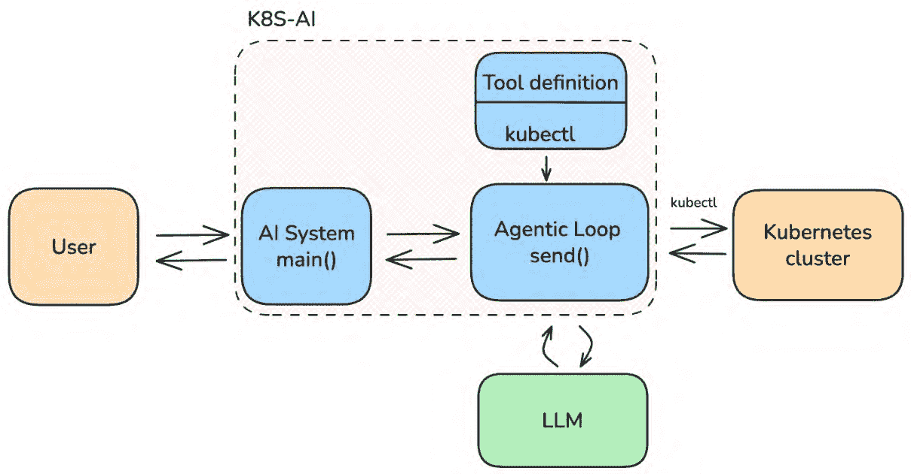

### k8s-ai 智能体代码走读

让我们先从宏观层面看一下 k8s-ai 仓库中的 `main.py` 文件，不必涉及过多细节。

#### 导入语句

k8s-ai 智能体导入了内置包（如 `json` 和 `os`），然后导入了第三方库 `sh` 和 `openai`。

```python
import json
import os
import sh
from openai import OpenAI
```

`json` 包用于解析来自 OpenAI API 的响应，`os` 包用于访问环境变量（如 `OPENAI_API_KEY`），`sh` 模块用于运行 shell 命令（此处为 `kubectl`）。

#### OpenAI 客户端

k8s-ai 智能体使用官方 OpenAI Python 客户端与 OpenAI API 交互。它使用来自环境变量的 API 密钥来初始化客户端。这其实并不是必须的，因为默认情况下 OpenAI 客户端会查找这个确切的环境变量，但我更倾向于在代码中显式设置这些变量，以提高清晰度，而不是依赖隐晦的默认行为。我在这里使用的模型是 `gpt-4o`，这是一个强大的模型，能够处理当前的任务。

```python
client = OpenAI(api_key=os.environ['OPENAI_API_KEY'])
model_name = "gpt-4o"
```

更复杂的智能体系统通常会针对不同任务使用来自不同提供商的不同模型，但 k8s-ai 虽然功能非常强大（正如我们已经看到的），其设计目标却是简洁和教育用途。

**注意**

请注意，客户端在初始化时并未传入 `model` 参数。这是因为模型是在每次 API 请求中指定的。这样一来，如果你以后想更换模型，就无需修改客户端，从而获得更大的灵活性。k8s-ai 智能体对所有请求始终使用同一个模型，但这并不是强制要求。


#### 3. 工具

正如我们多次提到的，AI 智能体的能力取决于它能访问到的工具。k8s-ai 智能体定义了一个工具列表，本例中只包含一个工具。这个工具是对 `kubectl` 命令行工具的封装。我们将在下一节中更详细地探讨它。

```python
tools = [{
    ...
}]
```

#### 4. 智能体循环

智能体循环是 k8s-ai 智能体的核心。它接收一个消息列表（字典列表），并返回最终响应字符串。我们很快就会详细了解这个循环是如何工作的，但现在，这里是完全封装整个智能体循环的 `send()` 函数的签名：

```python
def send(messages: list[dict[str, any]]) -> str:
    ...
```

#### 5. 主函数 main()

最后，`main()` 函数是 k8s-ai 智能体的入口点。它使用系统消息初始化消息列表，管理用户的交互，并将所有繁重的工作委托给 `send()` 函数。我们将在 *实现工具调用的执行循环* 一节中看到它是如何做到这一点的。

```python
def main():
    ...
if __name__ == "__main__":
    main()
```

接下来，让我们看看如何为我们的智能体使用 OpenAI 工具。

### 使用 OpenAI 定义和注册工具

我们的 k8s-ai 智能体设计为与 OpenAI 客户端交互，并使用 kubectl 工具管理 Kubernetes 集群。它需要遵循 OpenAI API 定义工具的格式。需要注意的是，工具有不同的类型。k8s-ai 智能体使用函数调用，这是一种 `"function"` 类型的工具。函数工具具有名称、描述、参数和必填参数列表。你还可以指定它是否在严格模式下运行。有关更多详细信息，请参阅 OpenAI 的文档（`https://platform.openai.com/docs/guides/function-calling#defining-functions`）。

以下是 k8s-ai 工具列表的完整定义（仅包含 `kubectl` 工具）：

```python
tools = [{
    "type": "function",
    "function": {
        "name": "kubectl",
        "description": "execute a kubectl command against the current k8s cluster",
        "parameters": {
            "type": "object",
            "properties": {
                "cmd": {
                    "type": "string",
                    "description": (
                        "the kubectl command to execute (without kubectl, just "
                        "the arguments). For example, 'get pods'"
                    ),
                },
            },
            "required": ["cmd"],
        },
    },
}]
```

让我们逐部分分解：

#### 1. 工具列表

`tools` 变量是一个列表，允许你定义一个或多个工具。列表中的每一项都是一个字典，代表一个工具。在本例中，我们只定义一个工具，即 `kubectl` 函数。

```python
tools = [
    {
        ...
    }
]
```

#### 2. 类型

这告诉 OpenAI API 该工具是一个函数工具。函数工具使用函数调用，模型可以自动选择并使用它自己构造的参数来调用该工具。工具定义的其余部分嵌套在 `"function"` 子字典下。

```python
"type": "function"
"function": {
    ...
}
```

#### 3. 名称

这是模型用来调用此工具的名称。它应该简短、具有描述性，并且在所有注册的工具上下文中是唯一的。在本例中，名称是 `kubectl`，这是一个很好的选择，因为它是 LLM 在训练中遇到过的知名工具。

```python
"name": "kubectl"
```

#### 4. 描述

描述在名称之外提供了更多关于函数功能的上下文。它应该清晰简洁，解释工具的用途以及如何使用它。在本例中，描述相当基本，因为 LLM 应该已经知道 kubectl 是什么。

函数描述必须包含模型（LLM）在给定情况下决定是否调用工具所需的全部信息。

```python
"description": "execute a kubectl command against the current k8s cluster"
```

还记得我们讨论过的 AutoGen（*第 2 章*）吗？它有很多抽象层。它还需要将这些抽象层中的所有信息转换为提示词和工具描述，然后发送给 LLM。通常，构建在 AI 框架之上的 AI 系统在收到每个智能体循环的最终响应后，可能会决定运行额外的自定义代码，而不仅仅是显示最终响应。

#### 5. 参数

参数指定了函数期望的输入。它们以 JSON Schema 格式定义，其中类型始终是 `"object"`，`"properties"` 字段包含函数接受的具体参数。每个参数都有一个名称（这里是 `"cmd"`）、一个类型（本例中为 `"string"`）和一个解释参数用途的描述。由于 kubectl 有许多子命令，每个子命令有自己的参数，所以我们只定义一个字符串参数来表示要执行的整个命令。同样，我们依赖 LLM 的训练来理解如何构造 kubectl 命令。`cmd` 参数也被标记为必填。

kubectl 命令可以不带参数执行，但那样只会显示帮助信息，在这种情况下不太有用。因此，我们要求模型在调用工具时必须提供 `cmd` 参数。

```python
"parameters": {
    "type": "object",
    "properties": {
        "cmd": {
            "type": "string",
            "description": (
                "the kubectl command to execute (without kubectl, just "
                "the arguments). For example, 'get pods'"
            ),
        },
    },
    "required": ["cmd"],
}
```

**提示**

决定权始终在 LLM，它根据传递给它的信息（提示词和工具描述）做出决策。

在 k8s-ai 中，AI 系统是一个简单的聊天界面，它打印来自 LLM 的最终响应并等待用户输入。

请注意，函数没有定义输出。这意味着模型不知道函数调用结果的形式和结构。模型会以字符串形式接收输出，然后它可以解析并决定如何使用。这是将 LLM 与工具一起使用时的常见模式，因为模型可以处理各种各样的输出，不需要预先知道确切的结构。要求开发人员指定输出结构可能会带来很多摩擦，并且对于像 kubectl 这样可能返回各种输出和输出格式的工具来说可能具有挑战性。

### 实现工具调用的执行循环

现在，让我们更仔细地看看智能体循环，以及它如何与 OpenAI API 交互以调用 kubectl 工具。这是 k8s-ai 智能体的核心，在这里它向 OpenAI API 发送消息、接收响应并执行 kubectl 命令。令人惊讶的是，智能体循环非常简单，只有 18 行代码。以下是完整代码：

```python
def send(messages: list[dict[str, any]]) -> str:
    response = client.chat.completions.create(
        model=model_name, messages=messages,
        tools=tools, tool_choice="auto")
    r = response.choices[0].message

    if r.tool_calls:
        message = dict(
            role=r.role,
            content=r.content,
            tool_calls=[dict(id=t.id, type=t.type,
                             function=dict(name=t.function.name,
                                           arguments=t.function.arguments)
                             ) for t in r.tool_calls if t.function])
        messages.append(message)

        for t in r.tool_calls:
            if t.function.name == 'kubectl':
                cmd = json.loads(t.function.arguments)['cmd'].split()
                result = sh.kubectl(cmd)
                messages.append(dict(tool_call_id=t.id, role="tool",
                                     name=t.function.name, content=result))
        return send(messages)

    return r.content.strip()
```


### 第 3 章：简单 AI 代理的动手实践演练

让我们一步一步地分解：

#### 1. 函数签名

这一行定义了核心循环函数 `send()`。它接收一个消息字典列表作为输入（就像 OpenAI 的 `messages` 参数一样），并返回最终的助手消息内容（字符串）。

```python
def send(messages: list[dict[str, any]]) -> str:
```

#### 2. 调用 Chat Completions API

这一行调用 OpenAI API，根据提供的消息生成响应。它使用 Chat Completions API（`https://platform.openai.com/docs/api-reference/chat`）的 `chat.completions.create()` 方法。

它传递了固定的模型名称（`gpt-4o`）、消息列表、我们之前定义的工具列表（其中 `kubectl` 是唯一的工具），以及设置为 `"auto"` 的 `tool_choice`。`"auto"` 设置允许模型根据当前对话状态决定是否使用工具。

```python
response = client.chat.completions.create(
    model=model_name, messages=messages,
    tools=tools, tool_choice="auto"
)
```

#### 3. 获取第一条响应消息

OpenAI API 可以在单次响应中返回多个选项，但实际上通常只返回一个。因此，k8s-ai 采用简单情况，只查看第一个选项，然后提取其中的 `message` 对象。

```python
r = response.choices[0].message
```

#### 4. 检查响应中是否包含工具调用

如果响应中包含工具调用，则意味着模型已决定使用工具来执行某些操作。

```python
if r.tool_calls:
```

> **注意**：OpenAI 最近发布了另一个名为 **Responses API** 的 API，它比 Chat Completions API 更强大、更灵活。但 k8s-ai 并不需要所有这些花哨的功能。

#### 5. 准备工具调用消息

在这种情况下，我们需要准备一个 `message dict`，其中包含角色（role）、内容（content）和工具调用（tool calls）。工具调用会被转换成字典列表，每个字典包含工具调用 ID（来自 LLM）、类型、函数名和参数。这对于在对话历史中跟踪工具调用及其结果至关重要。

```python
message = dict(
    role=r.role,
    content=r.content,
    tool_calls=[
        dict(
            id=t.id,
            type=t.type,
            function=dict(
                name=t.function.name,
                arguments=t.function.arguments
            )
        )
        for t in r.tool_calls if t.function
    ]
)
```

请注意，单次响应中可能有多个工具调用。即使我们只注册了一个工具，模型也可能决定使用不同的参数多次调用它。例如，它可能希望在不同的命名空间中运行多个 kubectl 命令，例如 `get pods`。

#### 6. 将工具调用消息追加到消息列表

这非常简单。只需将我们刚创建的 `message dict` 追加到消息列表中。这对于保持对话线程的最新状态非常重要。

```python
messages.append(message)
```

#### 7. 为每个工具调用请求调用 kubectl 工具

现在，它遍历响应中的每个工具调用。如果工具调用是针对 `kubectl` 函数的，它会提取 `cmd` 参数并将其拆分为命令行参数列表。例如，`"get pods"` 变成 `["get", "pods"]`。然后，它使用 `sh` 模块执行带有提供的参数的 `kubectl` 命令。命令执行的结果存储在 `result` 变量中。

```python
for t in r.tool_calls:
    if t.function.name == 'kubectl':
        cmd = json.loads(t.function.arguments)['cmd'].split()
        result = sh.kubectl(cmd)
```

#### 8. 将工具调用结果追加到消息列表

在执行 `kubectl` 命令后，它将结果作为新消息追加到消息列表中，该消息包含来自 LLM 的原始工具 ID（以便 LLM 知道哪个结果对应哪个工具调用）、设置为 `"tool"` 的角色、函数名（在本例中始终为 `kubectl`），以及设置为命令执行结果的内容。这就是代理捕获工具调用结果并在循环的下一次迭代中将其提供给模型的方式。

```python
messages.append(dict(tool_call_id=t.id, role="tool",
                     name=t.function.name, content=result))
```

#### 9. 递归以继续循环

只要模型的响应中包含工具调用，代理就会继续处理它们。然后，`send()` 函数使用更新后的消息列表递归调用自身，该列表包含来自模型的所有工具请求和所有工具结果。

```python
return send(messages)
```

#### 10. 返回最终响应

最终，当响应中不再有工具调用时，`send()` 函数会返回模型最终响应的内容。

```python
return r.content.strip()
```

请注意，我们不会返回整个响应对象或完整的消息列表，而只是返回最后一条消息的内容。一些 AI 框架可能提供钩子来访问完整的消息历史，但同样，k8s-ai 的设计宗旨是简单。

现在让我们与这个代理进行交互。

> **提示**：在生产级系统中，你可以设置最大迭代次数或最大时间，如果超过限制，则视为操作失败并向用户返回错误消息。实际上，LLM 已经内置了这种机制，如果它们无法收敛到满意的解决方案，它们会自行返回错误。

#### 运行并与 Kubernetes 聊天代理交互

最后但同样重要的是，k8s-ai 提供了一个交互式**命令行界面**（**CLI**）来与代理进行交互。

`main()` 函数首先打印欢迎消息，并用一条设置代理上下文的系统消息初始化消息列表。

```python
def main():
    print(" Interactive Kubernetes Chat. Type 'exit' to quit.\n" + "-" * 52)
    messages = [{'role': 'system', 'content': 'You are a Kubernetes expert ready to help'}]
```

然后，它启动交互式循环，等待用户消息，将其发送给代理，代理运行代理循环直到获得最终响应，将其打印到屏幕上，然后重复。交互式循环一直持续到用户输入 `'exit'`。

```python
while (user_input := input("👤 You: ")).lower() != 'exit':
    messages.append(dict(role="user", content=user_input))
    response = send(messages)
    print(f" AI: {response}\n----------")
```

更复杂的代理可能会使用更复杂的记忆管理系统来存储和检索消息。

你现在已经从两个角度体验了一个完整的 AI 代理：作为用户与之交互以解决实际问题，以及作为开发者逐行理解其内部机制。

这种对消息如何在代理循环中流动、工具如何定义和调用、以及简单代码如何创造强大自主行为的实践理解，为构建你自己的代理奠定了基础。让我们在总结中巩固这些见解。

> **注意**：每条用户消息都会启动一个新的代理循环，但消息历史会在迭代之间保留。这使得代理能够在对话中保持上下文和连续性。历史记录存储在内存中，因此当用户输入 `exit` 时所有内容都会消失。

#### 总结

在本章中，我们超越了理论，看到了一个实际运行的 AI 代理，它结合了自主性、推理和工具使用，控制着一个真实的 Kubernetes 集群。k8s-ai 代理仅用 61 行 Python（包括空行和导入）构建，却功能强大。尽管它很简单，但它展示了若干基础的 AI 代理能力。

该系统能够使用 kubectl 检查集群状态，从而有效观察当前状况。它利用 OpenAI API 来诊断问题并找出根本原因。它知道何时以及如何使用 kubectl，不仅用于收集信息，还用于进行必要的更改。该系统采用人在回路（human-in-the-loop）的方式运行，除非明确指示自主行动，否则在进行任何修改之前都会请求许可。在整个运行过程中，它保持对话上下文，根据需要调用工具，并将结果输出反馈给语言模型，形成一个连贯的代理循环。

我们制造了有问题的部署，干扰了调度器，甚至在 KinD 集群中破坏了一个容器镜像。k8s-ai 代理全部处理了。我们看到了 OpenAI 函数调用接口，加上一个定义良好的工具和几行胶水代码，如何让一个由 LLM 驱动的代理式 AI 系统活起来，包括一个交互式聊天界面。

更广泛地说，本章论证了 AI 代理不必臃肿、脆弱或过度设计。只要清楚理解它们的运作方式——消息、工具、记忆和代理循环——你就能构建有用、可靠的系统，增强人类工作流程，甚至在受控环境中自主运行。

在下一章中，我们将开始基于与 k8s-ai 相同的原则，构建一个完整的代理式 AI 框架。


#### 获取本书的 PDF 版本和专属附加内容

扫描二维码（或访问 `packtpub.com/unlock`）。按书名搜索本书，确认版本，然后按照页面上的步骤操作。

*注意：请保管好您的发票。直接从 Packt 购买的订单无需提供发票。*


## 第 2 部分：构建你自己的智能体 AI 框架

*第 2 部分*将引导你从头开始构建一个真实的智能体 AI（agentic AI）框架（AI-6）。你将探索运行智能体循环、管理内存、会话、工具以及多个 LLM 提供方的核心引擎，然后深入设计具有模式（schema）、验证和执行流程的健壮且与提供方无关的工具。随后，本部分转向面向用户的界面，展示如何构建支持可见性、控制以及人在回路（human-in-the-loop）工作流的 Slack 和 Web UI。最后，本部分以将框架与**模型上下文协议**（**MCP**）集成为结尾，从而实现跨更广泛生态系统的标准化工具发现和互操作性。

本部分包含以下章节：

- *第 4 章，构建基于工具的智能体 AI 框架*
- *第 5 章，实现自定义工具*
- *第 6 章，使用 Slack 和 Chainlit 创建聊天界面*
- *第 7 章，与模型上下文协议生态系统集成*

## 4 构建基于工具的智能体 AI 框架

在上一章中，我们超越了理论，观察了一个实际运行的 AI 智能体，特别是以自主性、推理和工具相结合的方式控制一个真实的 Kubernetes 集群。通过简洁而强大的 **k8s-ai 智能体**（`https://github.com/the-gigi/k8s-ai`），我们演示了基础的 AI 智能体能力，如观察、诊断、工具使用、保持人在回路（human-in-the-loop）交互以及运用智能体循环。这个仅用 61 行 Python 开发的智能体，令人印象深刻地展示了 AI 智能体和 LLM 的强大力量。

在本章中，我们将开始开发一个更复杂、更完整的 AI 框架，名为 AI-6（`https://github.com/Sayfan-AI/AI-6/tree/v0.8.0`）。AI-6 将使我们能够探索 AI 智能体能力的全部范畴，例如复杂的内存管理、先进的工具管理设施，以及对多个 LLM 提供方的支持。AI-6 高度不预设立场（unopinionated），并且可通过工具进行高度扩展。其主要设计原则是通过提供一小组核心功能来保持简单，从而允许通过添加专用工具在其之上构建更复杂的 AI 系统。

AI-6 是一个拥有后端和前端的 Python 框架。在本章中，我们将专注于后端。在*第 5 章*中，我们将为 AI-6 添加工具。在*第 6 章*中，我们将专注于前端。

我们首先从框架后端架构及其组件的概述开始，然后我们深入探讨框架的一些关键方面，例如工具管理、内存管理和消息处理流水线。

最后，我们将探讨如何用新工具和 LLM 提供方扩展框架。

在本章中，我们将涵盖以下主要主题：

- AI-6 框架后端架构与组件
- 工具系统架构
- 内存管理

### 技术要求

如果你想在阅读本章的同时运行并试验 AI-6，请按照 `README.md` 文件（`https://github.com/PacktPublishing/Design-Multi-Agent-AI-Systems-Using-MCP-and-A2A/blob/main/ch04/ai-six/README.md`）中的设置说明进行操作。

这将创建一个虚拟环境，并为后端和前端组件安装所有必要的依赖。

### AI-6 框架后端架构与组件

AI-6 后端由一个**核心引擎**驱动，该引擎运行智能体循环、管理工具、通过提供通用的 LLM 提供方接口来支持任何 LLM 提供方，并拥有内存管理系统。会话管理器负责管理与每个用户的会话（消息历史）。它利用 `Session` 类来存储单个对话的完整内容。工具系统是一个可扩展的子系统，用于定义工具，并为工具实现提供有用的基类。LLM 提供方是另一个可扩展的子系统，它定义了一个通用的 LLM 提供方接口，并提供了一些实现（目前是 OpenAI 和 Ollama）。

让我们看看核心引擎是如何工作的。

*图 4.1：AI-6 核心引擎*

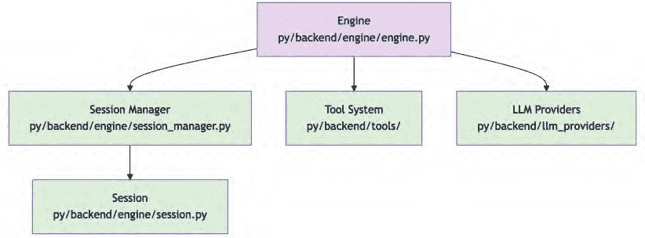

### 核心引擎

核心引擎是 AI-6 框架的心脏。它协调与 LLM 提供方、工具和会话管理的所有交互。它为不同的前端提供了一个统一接口，以便在维护对话状态和执行工具调用的同时与 AI 模型通信。它是在一个名为 `Engine`（`https://github.com/PacktPublishing/Design-Multi-Agent-AI-Systems-Using-MCP-and-A2A/tree/main/ch04/ai-six/py/backend/engine`）的单一类中实现的。

使用引擎非常简单。首先，你用所需的配置初始化它，然后运行它以执行智能体循环。让我们看看它是如何工作的。

### 初始化

引擎使用 LLM 提供方、工具和配置设置进行初始化，是智能体 AI 系统使用 AI-6 时的核心组件。其签名非常简单；它只接收一个包含所有必要设置的 `Config` 类实例：

```python
def __init__(self, config: Config):
    ...
```

下图说明了这一过程：

*图 4.2：AI 系统使用 config 类初始化核心引擎*

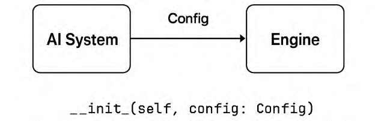

使用 AI-6 框架的 AI 系统通过 `Config` 对象来指定核心引擎的配置。

让我们看看 `Config` 类：

```python
@dataclass
class Config:
    default_model_id: str
    tools_dir: str
    mcp_tools_dir: str
    memory_dir: str
    session_id: Optional[str] = None
    checkpoint_interval: int = 3
    summary_threshold_ratio: float = 0.8
    tool_config: Mapping[str, dict] = field(
        default_factory=lambda: MappingProxyType({})
    )
    provider_config: Mapping[str, dict] = field(
        default_factory=lambda: MappingProxyType({})
    )
```

这里有很多内容需要解读。让我们看看 `Config` 类由哪些部分组成：

- `default_model_id` 是当未请求特定模型时默认使用的模型 ID，它也决定了默认的 LLM 提供方，因为每个模型恰好属于一个 LLM 提供方。
- `tools_dir` 是自定义 AI-6 工具所在的目录，而 `mcp_tools_dir` 是 MCP 工具所在的目录。
- `memory_dir` 是内存文件存储的目录。
- `session_id` 是会话的可选标识符，可用于从之前的运行中恢复会话。
- `checkpoint_interval` 是每隔多少次迭代保存一个检查点。
- `summary_threshold_ratio` 是触发对话历史摘要的 token 比例。

最后，`tool_config` 和 `provider_config` 是允许你为每个工具和提供方指定额外配置的映射。

如果觉得信息量有点大，请不要担心；随着本章的深入，我们将解释每个配置项的用途。

让我们看看引擎是如何使用这个 `Config` 对象初始化的。首先，我们只是将 `default_model_id` 存储为类属性。这里没有什么特别的：

```python
class Engine:
    def __init__(self, config: Config):
        self.default_model_id = config.default_model_id
```

然后，我们根据默认模型 ID 从 `model_info` 模块获取上下文窗口大小。我们用它来计算 token 阈值，即触发对话历史摘要所需的 token 数量。这是必需的，因为当对话历史


当对话历史接近模型的上下文窗口大小时，我们需要对其进行摘要，以避免超出这个硬性限制。

```python
# Get the context window size from model_info based on the default model
context_window_size = get_context_window_size(
    self.default_model_id)
self.token_threshold = int(
    context_window_size * config.summary_threshold_ratio
)
```

接下来，我们初始化 LLM 提供者。引擎支持多个 LLM 提供者，并且知道如何使用 `discover_llm_providers()` 方法来定位它们。

之所以没有通过 `Config` 对象进行配置，是因为添加新的 LLM 提供者对于用户来说并不是常见操作。但这绝对可以作为一种替代设计方案。

一旦定位到 `providers directory` 并确认它是一个目录，就会调用 `Engine.discover_llm_providers()` 方法。我们将在下一节中探讨它。该方法返回一个 LLM 提供者列表，其中每个提供者可能支持多个模型。

```python
# Find LLM providers directory
llm_providers_dir = os.path.join(
    os.path.dirname(os.path.dirname(__file__)), "llm_providers"
)
assert os.path.isdir(llm_providers_dir), (
    f"LLM providers directory not found: {llm_providers_dir}"
)

# Discover available LLM providers
self.llm_providers = Engine.discover_llm_providers(
    llm_providers_dir, config.provider_config
)
```

引擎使用提供者列表来构建模型 ID 到相应 LLM 提供者的映射：

```python
self.model_provider_map = {
    model_id: llm_provider
    for llm_provider in self.llm_providers
    for model_id in llm_provider.models
}
```

接下来，我们初始化工具。引擎支持自定义工具和**模型上下文协议** (**MCP**) 工具。工具的初始化过程与 LLM 提供者的初始化类似。引擎调用发现方法（目录来自 `Config` 对象）来查找并注册工具。然后，它构建一个字典，将工具名称映射到相应的工具对象。这使得引擎可以在代理循环中通过名称轻松访问和调用工具。请注意，目前尚未使用 MCP 工具。我们将在*第 7 章*中引入 MCP 工具。

```python
# Discover available tools
tool_list = Engine.discover_tools(
    config.tools_dir, config.tool_config)

# Discover MCP tools
mcp_tool_list = Engine.discover_mcp_tools(config.mcp_tools_dir)
self.tool_dict = {t.name: t for t in tool_list}
```

初始化工作流程的下一部分与内存管理有关。引擎使用会话管理器来处理会话，并使用会话对象来管理对话历史。然后，它设置了一些与存储定期检查点相关的属性。

```python
# Initialize session and session manager
self.session_manager = SessionManager(config.memory_dir)
self.session = Session(config.memory_dir)

# Session-related attributes
self.checkpoint_interval = config.checkpoint_interval
self.message_count_since_checkpoint = 0
```

接下来，我们设置会话。摘要器负责在对话历史过长并接近模型的上下文窗口大小时对其进行摘要。然后，我们向引擎注册内存工具，这将使用户能够直接管理内存。

```python
# Instantiate the summarizer with the first LLM provider
self.summarizer = SessionSummarizer(self.llm_providers[0])

# Register memory tools with the engine
self._register_memory_tools()
```

最后，如果配置中包含会话 ID，引擎会尝试加载该会话（如果存在）。这允许恢复之前的会话，并从中断处继续对话。

```python
# Load previous session if session_id is provided and exists
if config.session_id:
    available_sessions = self.session_manager.list_sessions()
    if config.session_id in available_sessions:
        # Create a new session object
        self.session = Session(config.memory_dir)
        # Load from disk
        self.session.load(config.session_id)
```

总而言之，我们使用配置初始化了引擎，并动态加载了 LLM 提供者、自定义工具和 MCP 工具。然后，我们初始化了内存系统。让我们看看运行引擎时会发生什么。

### 运行引擎

初始化引擎后，我们就可以运行它来启动会话。`run()` 方法接受几个`可调用对象`（函数）作为参数。`get_input_func()` 函数检索用户输入，`on_tool_call_func()` 是在调用工具时触发的回调，`on_response_func()` 是在生成代理循环的最终响应时触发的回调。这些回调由使用 AI-6 框架的代理 AI 系统或 AI-6 本身的内置前端来实现。它们允许引擎通过通用接口进行通信，而无需了解所使用的特定应用或前端。这种设计提供了灵活性和可扩展性，因为不同的代理 AI 系统和前端可以实现自己的回调版本。

`run()` 方法将循环执行，直到 `get_input_func()` 函数不再提供输入。这意味着引擎执行多个代理循环（每个循环由一次或多次与 LLM 的交互以及工具调用组成），并在会话中累积对话历史。

```python
def run(
    self,
    get_input_func: Callable[[], None],
    on_tool_call_func: Callable[[str, dict, str], None] | None,
    on_response_func: Callable[[str], None],
):
```

实现非常简单。它首先获取当前代理循环的初始输入，并将其添加到会话中。然后，如果需要，它还会创建一个检查点。我们将在*内存管理*一节中讨论检查点。

```python
try:
    while user_input := get_input_func():
        message = UserMessage(content=user_input)
        self.session.add_message(message)
        self._checkpoint_if_needed()
```

下一部分是代理循环的核心。它使用默认模型 ID 调用 `_send()` 方法，该方法负责处理输入，并传递 `on_tool_call_func` 回调。`_send()` 方法处理所有繁重的工作，我们很快就会看到。然后，响应作为助手消息添加到会话中，并在需要时创建另一个检查点。最后，使用响应调用 `on_response_func` 回调。

```python
response = self._send(
    self.default_model_id, on_tool_call_func)
message = AssistantMessage(content=response)
self.session.add_message(message)
self._checkpoint_if_needed()
on_response_func(response)
```

最后，我们有 `finally` 子句，它确保当 `run()` 方法退出时保存会话，无论它是成功还是抛出异常。这一点很重要，可以确保即使在出现问题时（例如，由于超出 LLM 提供者的速率限制而导致失败），对话历史也能得到保留。

```python
finally:
    # Save the session when we're done
    self.session.save()
```

### 执行代理循环

让我们仔细看看 `_send()` 方法，它在作为会话的一部分被调用时执行一个完整的代理循环。`_send()` 方法接受 `model_id` 和一个可选的 `on_tool_call_func` 回调作为参数。`model_id` 指定此代理循环使用哪个模型（以及相应的哪个 LLM 提供者），而 `on_tool_call_func` 是在循环期间调用工具时触发的回调。


这使引擎能够向前端或应用程序通知工具调用，从而实现实时更新和交互。它返回智能体循环的最终响应，即 LLM 在处理输入并执行所需数量的工具调用后生成的响应。

```python
def _send(
    self,
    model_id: str,
    on_tool_call_func: Callable[[str, dict, str], None] | None = None,
) -> str:
```

`_send()` 方法的第一步是检查 `model_id` 是否有效，以及相应的 LLM 提供程序是否可用。如果不可用，则属于严重故障，方法会抛出 `RuntimeError`。

```python
llm_provider = self.model_provider_map.get(model_id)
if llm_provider is None:
    raise RuntimeError(f"Unknown model ID: {model_id}")
```

下一步是将所有会话消息、工具字典以及所选模型 ID 发送给选定的 LLM 提供程序。LLM 提供程序将负责与 LLM 的实际通信并返回响应。这一部分是与提供程序无关的，因为 AI-6 对 LLM 提供程序使用了抽象层。我们将在下一节 *LLM 提供程序抽象* 中详细讨论。

```python
try:
    response = llm_provider.send(
        self.session.messages, self.tool_dict, model_id
    )
except Exception as e:
    raise RuntimeError(f"Error sending message to LLM: {e}")
```

如果 LLM 不需要调用工具，可以直接返回最终响应，那么所提供的 `on_tool_call_func` 回调就不会被调用。

**注意**

如果响应包含工具调用，我们需要处理它们。第一步是将工具调用 ID 映射为**通用唯一标识符**或 **UUID**。这是必要的，因为某些 LLM 提供程序返回的工具调用 ID 可能不是有效的 UUID，而我们要确保所有工具调用 ID 都是有效的 UUID，这是我们识别工具调用时与提供程序无关的方式。`generate_tool_call_id()` 函数用于为每个尚未成为有效 UUID 的工具调用 ID 生成一个新的 UUID。`id_mapping` 字典将 LLM 返回的原始工具调用映射到引擎在需要时生成的新 UUID。如果 LLM 提供的工具 ID 被认为是有效的，则直接使用，不再生成新的 UUID。

```python
if response.tool_calls:
    # Create a mapping of original IDs to new UUIDs if needed
    id_mapping = {}
    for tool_call in response.tool_calls:
        # Check if we need to replace the ID with a UUID
        if (
            not tool_call.id or len(tool_call.id) < 32
        ):  # Simple check for non-UUID
            new_id = generate_tool_call_id(tool_call.id)
            id_mapping[tool_call.id] = new_id
```

接下来，如果响应中的工具调用 ID 已被替换为新 UUID，我们就更新它们。由于 LLM 提供程序已经返回了一个 `AssistantMessage` 对象，我们可以直接使用该对象来更新工具调用。

```python
# Update the tool call IDs in the response if needed
if id_mapping and response.tool_calls:
    for tool_call in response.tool_calls:
        if tool_call.id in id_mapping:
            tool_call.id = id_mapping[tool_call.id]
```

现在，可以将助手消息添加到会话中。

```python
# Add the assistant message with updated tool_calls
self.session.add_message(response)
```

在继续处理工具调用之前，我们需要跟踪来自助手消息的工具调用 ID，并将它们存储在一个集合中，以便后续使用。

```python
# Track tool_call_ids from this assistant message
tool_call_ids = set()

for tool_call in response.tool_calls:
    tool_call_ids.add(tool_call.id)
```

此时，我们可以遍历响应中的工具调用并逐一处理。在真正执行每个工具调用之前，有几个预备步骤：验证所请求的工具是否在工具字典中、解析参数，以及检查工具调用 ID 是否需要更新。

```python
# Now process each tool call and add the corresponding tool messages
for i, tool_call in enumerate(response.tool_calls):
    tool = self.tool_dict.get(tool_call.name)
    if tool is None:
        raise RuntimeError(f"Unknown tool: {tool_call.name}")
    try:
        kwargs = json.loads(tool_call.arguments)
    except json.JSONDecodeError as e:
        raise RuntimeError(
            f"Invalid arguments JSON for tool '{tool_call.name}'"
        )
    # Get the potentially updated tool call ID
    tool_call_id = tool_call.id
    if tool_call.id in id_mapping:
        tool_call_id = id_mapping[tool_call.id]
```

此时，我们可以执行工具调用了。工具使用解析后的参数运行，并捕获结果。然后，我们生成一条工具消息，其中包含工具调用的结果、工具名称和工具调用 ID，并在提供了 `on_tool_call_func` 回调时调用它。所有这些都在一个 `try` 块中完成：

```python
try:
    # Execute the tool without passing any ID information
    tool_result = tool.run(**kwargs)
    # Create the tool message with the Engine managing the
    # tool_call_id
    tool_message = ToolMessage(
        content=str(tool_result),
        name=tool_call.name,
        tool_call_id=tool_call_id,
    )
    if on_tool_call_func is not None:
        on_tool_call_func(
            tool_call.name, kwargs, str(tool_result))
```

如果工具调用失败，我们会捕获异常并转而生成一条错误消息：

```python
except Exception as e:
    tool_message = ToolMessage(
        content=str(e),
        name=tool_call.name,
        tool_call_id=tool_call_id,
    )
```

无论成功还是失败，这条消息（已经采用与提供程序无关的格式）都会被添加到会话中。工具调用失败不会中止智能体循环；它们只会作为包含错误的工具消息记录在会话中。这允许智能体继续处理其他工具调用或生成响应，而不会中断。LLM 将在智能体循环的下一次迭代中决定如何处理失败的工具调用。

```python
# Add the tool message (ID is guaranteed to be valid since we manage it)
self.session.add_message(tool_message)
```

一旦所有工具调用都处理完毕，其结果也已添加到会话中，`_send()` 方法就会递归调用自身。这就是智能体循环继续下去的地方。

```python
# Continue the session with another send
return self._send(model_id, on_tool_call_func)
```

最后，当 LLM 的响应不包含任何工具调用时，该方法返回最终响应的内容：

```python
return response.content.strip()
```

好了，我们先喘口气。这里包含大量不平凡的信息。大部分复杂性源于需要在提供程序特定的工具调用与引擎用来管理会话和对话历史的与提供程序无关的格式之间进行转换。智能体循环的本质与 k8s-ai 的智能体循环完全相同。

好的。现在让我们深入探讨 LLM 提供程序抽象。

### LLM 提供程序抽象

这是 AI-6 框架中非常重要的一部分。LLM 提供程序抽象允许引擎通过统一接口与任何类型的 LLM 提供程序通信。请注意，还有一种替代设计是框架只支持 OpenAI API。首先，许多 LLM 提供程序直接支持 OpenAI API，或通过它们自己的兼容层支持（例如 Google Gemini）。其次，有一些项目（如 OpenRouter（`https://openrouter.ai`））像代理一样，通过 OpenAI API 访问任何 LLM 提供程序。那么，为什么要构建一个与提供程序无关的接口呢？因为这让框架能够完全控制与受支持的 LLM 提供程序之间的交互，而且不需要经过代理，从而避免代理带来的延迟、成本和安全隐患。让我们看看 AI-6 框架是如何实现 LLM 提供程序抽象的。

#### LLMProvider 接口

Python 的**抽象基类**（**ABC**）是定义 `LLMProvider` 接口的理想工具，该接口定义在 `llm_provider.py` 文件中。`LLMProvider` 允许开发者实现符合这个相当简单接口的自有 LLM 提供程序，从而使 AI-6 框架具有可扩展性。让我们逐个方法进行分析，但首先看一下导入部分。

首先，我们从标准库模块 `abc` 和 `typing` 中导入必要的类和装饰器。然后，我们从 `object_model` 模块中导入 `Response` 类，它用于表示来自 LLM 的通用响应。

最后，我们从 `tool` 模块中导入 `Tool` 类，它表示可供 LLM 使用的工具。这些都属于 AI-6 框架后端架构的一部分。

```python
from abc import ABC, abstractmethod
from typing import Iterator, Callable, Any
from backend.engine.object_model import Response
from backend.engine.tool import Tool
```

接下来看 `LLMProvider` 类本身及其第一个方法：`send()`。`send()` 方法是一个抽象方法（使用 `@abstractmethod` 修饰，必须由子类实现），用于向 LLM 发送消息列表并接收响应。


### 构建基于工具的智能体 AI 框架

它还向 LLM 提供一个工具字典和一个可选的 `model` 参数。该方法返回一个 `Response` 对象，其中包含作为通用响应的 LLM 响应。

```python
class LLMProvider(ABC):
    @abstractmethod
    def send(
        self, messages: list[Message], tool_dict: dict[str, Tool],
        model: str | None = None
    ) -> AssistantMessage:
        """
        Send a message to the LLM and receive a response.

        :param messages: The list of messages to send.
        :param tool_dict: A dictionary of tools available for the LLM to use.
        :param model: The model to use (optional).
        :return: The response from the LLM.
        """
        pass
```

`stream` 方法类似于 `send()` 方法，但它允许在生成响应时从 LLM 流式接收响应。它返回一个 `Response` 对象的迭代器，使调用方能够在整个响应完成之前分块接收响应。这对于希望实时显示响应的实时应用非常有用。请注意，`stream()` 方法不是抽象方法，它有一个默认实现，仅调用 `send()` 方法并生成完整响应。这意味着子类可以覆盖此方法以提供实际的流式实现（如果支持），也可以使用默认实现一次性返回完整响应。

```python
def stream(
    self, messages: list[Message], tool_dict: dict[str, Tool],
    model: str | None = None
) -> Iterator[AssistantMessage]:
    """
    Stream a message to the LLM and receive responses as they are generated.

    :param messages: The list of messages to send.
    :param tool_dict: The tools available for the LLM to use.
    :param model: The model to use (optional).
    :return: An iterator of responses from the LLM.
    """
    # Default implementation just returns the full response
    yield self.send(messages, tool_dict, model)
```

`models` 属性是一个抽象属性，必须由子类实现。它返回一个由模型 ID 字符串组成的列表。这很简单。模型 ID 是 LLM 提供商支持的每个模型的唯一标识符。引擎使用它来将模型映射到提供商，并在发送特定模型请求时选择正确的提供商。

```python
@property
@abstractmethod
def models(self) -> list[str]:
    """Get the list of available models."""
    pass
```

现在我们已经介绍了 `LLMProvider` 接口，接下来看看 AI-6 开箱即用的具体 LLM 提供商。

#### 支持的提供商

让我们来看看 AI-6 框架目前支持的 LLM 提供商。

AI-6 附带了 OpenAI 和 Ollama 的 LLM 提供商，提供基于云和本地模型两种选择。

请记住，其他 LLM 提供商可以轻松实现。

首先看一下 OpenAI 提供商的实现。

#### OpenAI 提供商

OpenAI 提供商在 `openai_provider.py` 文件中实现（`https://github.com/PacktPublishing/Design-Multi-Agent-AI-Systems-Using-MCP-and-A2A/blob/main/ch04/ai-six/py/backend/llm_providers/openai_provider.py`）。它使用 OpenAI Python SDK 与 OpenAI API 通信。该提供商实现了 `LLMProvider` 接口，并提供了发送消息、流式传输消息和获取模型所需的方法。让我们看看 OpenAI 提供商。

该提供商需要一个 API 密钥来通过 OpenAI API 进行身份验证，该密钥会传递给构造函数。它具有 API 的基础 URL 和模型的默认值。当基础 URL 为 None 时，OpenAI SDK 使用官方的 OpenAI API 端点：`https://api.openai.com/v1`。如果你想使用其他具有 OpenAI 兼容 API 的 LLM 提供商，例如 Anyscale（`https://docs.anyscale.com/reference`）、DeepSeek（`https://api-docs.deepseek.com/`）、SambaNova（`https://cloud.sambanova.ai/apis`）或 Cerebras（`https://inference-docs.cerebras.ai/resources/openai`），那么你需要传递正确的端点。

在这方面，OpenAI 提供商已经支持多个提供商，当然也可以与 OpenRouter 一起使用。

```python
from typing import Iterator
from backend.object_model import (
    LLMProvider, ToolCall, Usage, Tool, AssistantMessage)
from openai import OpenAI

class OpenAIProvider(LLMProvider):
    def __init__(
        self, api_key: str, base_url = None,
        default_model: str = "gpt-4o"
    ):
        self.default_model = default_model
        self.client = OpenAI(base_url=base_url, api_key=api_key)
```

`LLMProvider` 接口是根据 AI-6 数据结构定义的，这些数据结构与 LLM 提供商无关，但包含 LLM 处理用户消息和请求工具调用所需的相同信息。因此，OpenAI 提供商的工作实际上是将 AI-6 表示形式转换为 OpenAI Python SDK 的表示形式。

下面是正是执行此操作的 `send()` 方法。例如，OpenAI Python SDK 期望工具被定义为 Python `dict`，因此 `send()` 方法使用私有方法 `_tool2dict()` 将 `tool_dict` 转换为 OpenAI SDK 可以理解的字典列表。

```python
def send(
    self, messages: list[Message], tool_dict: dict[str, Tool],
    model: str | None = None
) -> AssistantMessage:
    """
    Send a message to the OpenAI LLM and receive a response.

    :param tool_dict: The tools available for the LLM to use.
    :param messages: The list of messages to send.
    :param model: The model to use (optional).
    :return: The response from the LLM.
    """
    if not messages:
        raise ArgumentError(
            "messages",
            "At least one message is required to send to the LLM.")

    if model is None:
        model = self.default_model
        tool_data = [self._tool2dict(tool) for tool in tool_dict.values()]
```

然后，该方法使用 OpenAI Python SDK 创建具有指定模型、消息和工具的聊天补全：

```python
response = self.client.chat.completions.create(
    model=model,
    messages=messages,
    tools=tool_data,
    tool_choice="auto"
)
```

接下来，该方法从响应中提取 `tool_calls` 字段，如果它是 `None`，则将其转换为空列表：

```python
tool_calls = response.choices[0].message.tool_calls
tool_calls = [] if tool_calls is None else tool_calls
```

它还会从响应中提取使用情况数据，包括请求中使用的输入和输出 token 数量：

```python
# Extract usage data
input_tokens = response.usage.prompt_tokens
output_tokens = response.usage.completion_tokens
```

最后，它创建一个包含响应内容、角色、工具调用和使用情况数据的 `AssistantMessage` 对象。OpenAI 工具调用被转换为 AI-6 的 `ToolCall` 格式，该格式包括工具调用 ID、名称、参数以及该工具是否必需。`required` 字段通过检查工具的参数在工具规范中是否必需来确定。例如，假设工具是 `get_weather_in_city`，它有两个参数：`city`（必填）和 `unit`（非必填）。如果未提供 `unit`，则工具将假定单位为 `Celsius`。

在这种情况下，LLM 可以决定使用两个参数调用工具：`city: London` 和 `unit: Fahrenheit`，或者只使用必需的参数 `city: London`。

```python
return AssistantMessage(
    content=response.choices[0].message.content,
    tool_calls=[
        ToolCall(
            id=tool_call.id,
            name=tool_call.function.name,
            arguments=tool_call.function.arguments,
            required=tool_dict[
                tool_call.function.name].parameters.required
        ) for tool_call in tool_calls if tool_call.function
    ] if tool_calls else None,
    usage=Usage(
        input_tokens=input_tokens,
        output_tokens=output_tokens
    )
)
```

OpenAI 提供商还实现了 `stream()` 方法，该方法允许从 LLM 流式传输响应。但是，此方法相当长，因此我们在此不详述。

简而言之，它是一个生成器，逐块处理 LLM 的输出，而不是等待整个响应到达。如果你好奇，可以在 `https://github.com/PacktPublishing/Design-Multi-Agent-AI-Systems-Using-MCP-and-A2A/blob/main/ch04/ai-six/py/backend/llm_providers/openai_provider.py` 查看代码。

`stream()` 方法的默认实现实际上并不进行流式传输，只是委托给阻塞的 `send()` 方法（这是必需的）。如果提供商确实支持流式传输（如 OpenAI），那么可以覆盖 `stream()` 方法并使其适应特定提供商。

**注意**


`models` 属性从 OpenAI API 返回可用模型列表。它使用 OpenAI Python SDK 获取信息：

```python
@property
def models(self) -> list[str]:
    return [m.id for m in self.client.models.list().data]
```

为了完善整个流程，下面两个辅助方法会将 AI-6 工具和 `ToolCall` 表示转换为 OpenAI SDK 的 Python 字典表示：

```python
@staticmethod
def _tool2dict(tool: Tool) -> dict:
    """Convert the tool to a dictionary format for OpenAI API."""
    return {
        "type": "function",
        "function": {
            "name": tool.name,
            "description": tool.description,
            "parameters": {
                "type": "object",
                "required": tool.required,
                "properties": {
                    param.name: {
                        "type": param.type,
                        "description": param.description
                    } for param in tool.parameters
                },
            },
        },
    }

@staticmethod
def _tool_call2dict(tool_call: ToolCall) -> dict:
    """Convert a ToolCall to OpenAI API format."""
    return {
        "id": tool_call.id,
        "type": "function",
        "function": {
            "name": tool_call.name,
            "arguments": tool_call.arguments
        },
    }
```

接下来让我们看看 Ollama 提供者。

### Ollama 提供者

Ollama（https://ollama.com/）是一个本地 LLM 提供者，允许你在自己的机器上运行模型。这非常酷，因为你无需向外部提供商付费，也不必担心敏感信息泄露。

Ollama 提供者的实现位于 AI-6 的 `ollama_provider.py` 文件中。它也实现了 `LLMProvider` 接口，并提供了发送消息和获取模型所需的方法。它没有实现 `stream()` 方法，而是依赖基类 `LLMProvider` 中的默认实现来进行流式响应。

该实现与 OpenAI 提供者非常相似，但它使用 Ollama Python SDK 与本地运行的 Ollama API 进行通信。该提供者要求 Ollama 客户端已安装并位于系统路径中，且 Ollama 服务必须正在运行。我们将在*第 6 章*中看到它的实际应用。

以下是该实现的概要。我省略了大多数方法的实现细节，因为它们与 OpenAI LLM 提供者非常相似。在 `send()` 方法中，我通过 `ollama.chat()` 方法实际调用了 Ollama SDK，该方法将消息和工具发送给 Ollama 模型并返回响应：

```python
import json
from dataclasses import asdict
from backend.object_model import (
    LLMProvider, ToolCall, Usage, Tool, AssistantMessage, Message,
)
import ollama

class OllamaProvider(LLMProvider):
    def __init__(self, model: str):
        self.model = model

    @staticmethod
    def _tool2dict(tool: Tool) -> dict:
        """Convert the tool to a dictionary format for Ollama."""
        ...

    @staticmethod
    def _fix_tool_call_arguments(messages):
        ...

    def send(
        self, messages: list[Message], tool_dict: dict[str, Tool],
        model: str | None = None,
    ) -> AssistantMessage:
        """Send a message to the local Ollama model and receive a response."""
        ...
        OllamaProvider._fix_tool_call_arguments(message_dicts)
        response: ollama.ChatResponse = ollama.chat(
            model,
            messages=message_dicts,
            tools=tool_data,
        )
        ...

    @property
    def models(self) -> list[str]:
        """Get the list of available models."""
        return [self.model]
```

现在我们将把注意力转向工具的调用方式以及底层架构。

### 工具系统架构

我们已经非常详细地介绍了 AI-6 框架及其组件的核心架构：核心引擎、LLM 提供者抽象以及工具的调用方式。现在，让我们更深入地了解可扩展的工具系统架构。

工具系统架构旨在实现以下目标：

- 支持自定义工具
- 支持 MCP 工具
- 允许安全地执行工具
- 允许控制每个 AI-6 会话所使用的工具集。

让我们逐一探讨每个方面。

#### 自定义工具支持

自定义工具架构与 LLM 提供者抽象类似，基于一个抽象基类。它允许开发者实现自己的工具，这些工具遵循的接口比提供函数调用能力的 LLM 提供者还要简单（https://platform.openai.com/docs/guides/function-calling?api-mode=responses）。这一功能由 OpenAI 首创，但已被所有主要厂商采用。所有内容都定义在 `tool.py` 文件中。让我们逐步分解，从必需的导入开始。它从 `abc` 模块导入 ABC 基类和 `abstractmethod` 装饰器，从 `dataclasses` 模块导入 `dataclass` 装饰器，以及从 `typing` 模块导入 `NamedTuple` 类。

```python
from abc import ABC, abstractmethod
from dataclasses import dataclass
from typing import NamedTuple
```

然后，我们定义一个 `Parameter` 类。它派生自一个命名元组（参见：https://docs.python.org/3/library/collections.html#collections.namedtuple），表示函数调用中的单个参数，包含 `name`、`type` 和 `description`。使用 `NamedTuple` 作为基类的好处是 `Parameter` 类不可变且高效。

```python
class Parameter(NamedTuple):
    name: str
    type: str
    description: str
```

`Tool` 类是一个抽象基类，表示 LLM 可以通过函数调用使用的工具。

让我们来看一下。它非常简单。它使用了 `@dataclass(slots=True)` 装饰器。slots 使类实例不可变（无法添加新属性）、占用更少内存，并且提供更快的属性访问速度。

`Tool` 类具有以下属性：`name`、`description`、`parameters` 和 `required`（执行工具时必须提供的参数）。正如我们之前在每个请求的工具列表中看到的那样，这些信息会提供给 LLM。LLM 可以决定调用哪些工具以及如何调用。回想一下我们在*第 3 章*中的讨论，LLM 可以根据通过提示词和/或工具描述传递给它们的信息来做出这些决策。

```python
@dataclass(slots=True)
class Tool(ABC):
    name: str
    description: str
    parameters: list[Parameter]
    required: set[str]
```

`configure` 方法是一个可选方法，子类可以实现它来使用任意信息配置工具。它只接受一个 `dict`，其中可以包含任何内容。例如，与数据库交互的工具可能需要连接字符串作为配置。

```python
def configure(self, config: dict) -> None:
    """Optional: configure the tool with given parameters."""
    pass
```

最后，`run()` 方法是一个抽象方法，必须由子类实现。它是使用 LLM 提供的参数来执行工具的方法。参数以关键字参数的形式传入，并返回一个字符串。你也许还记得，在代理循环中，当 LLM 调用工具时，AI-6 引擎会执行 `run()` 方法。

```python
@abstractmethod
def run(self, **kwargs) -> str:
    pass
```

自定义工具很棒，但支持内置工具也同样重要。

#### 那么内置工具呢？

某些模型支持内置工具。以下是一些 OpenAI 模型支持的内置工具的非详尽列表：网页搜索、文件搜索、图像生成、代码解释器（Python）和计算机使用。

你可以在此处找到 OpenAI 平台上可用的最新内置工具列表：

https://platform.openai.com/docs/guides/tools#available-tools


AI-6 目前不支持内置工具。原因是使用内置工具依赖于特定的 LLM 提供商、每个 LLM 提供商的特定模型，甚至特定的 API。例如，AI-6 OpenAIProvider 使用的 OpenAI 聊天补全 API 仅支持 web 搜索内置工具。为了使用前面提到的其他内置工具，你必须使用 OpenAI responses API。

未来，AI-6 可能会通过更新其配置系统，为每个 LLM 提供商和每个模型添加允许的内置工具列表，从而增加对内置工具的支持。对于 OpenAI，它还需要为 OpenAIProvider 添加对 responses API 的支持。

AI-6 框架也支持 MCP 工具。MCP 工具符合**模型上下文协议**（**MCP**）规范。MCP 是一种最初由 Anthropic 开发的标准协议，允许 LLM 以安全且受控的方式访问外部数据和工具。我们将在*第 7 章*中专门探讨这一主题。

现在让我们来谈谈在工具系统中需要考虑的安全性和权限。

### 工具安全与权限

使用工具的智能体 AI 系统最重要的方面之一是控制工具对数据和资源的访问。原因在于，这些工具实际上由 LLM 控制，而 LLM 是一个你看不到内部机制的神奇黑盒。例如，考虑这样一个场景：LLM 可以访问一个对生产数据库具有完全访问权限的数据库工具，并且它接到的任务是改善数据访问性能并降低成本。在没有额外指导的情况下，LLM 可能会认为完成这一任务的最佳方式是删除数据库及其中的所有数据，只将最后一天的数据保存在内存中。

幸运的是，有多种方法可以解决这个问题。AI-6 支持所有这些方法，因为它不预设观点，允许智能体 AI 系统使用任何机制，甚至多种机制。

让我们看看可以以不同严格程度、信任度和控制级别来管理工具执行的多种方式：

- **完全信任、完全访问**：此模式仅适用于教学目的，以及当配置的工具无法访问任何敏感数据或重要资源时。LLM 可以直接执行任何工具，无需检查或限制。请注意，即使看似无害的场景，例如对 LLM 具有只读访问权限的工具，也可能造成损害。例如，考虑一个对数据库具有只读访问权限的工具。LLM 无法破坏或删除数据，但它仍然可以读取数据并泄露数据，而且它可以通过运行庞大的查询来引发自我拒绝服务（DoS）攻击。

- **中介的细粒度工具访问**：中介细粒度意味着工具不会在系统上直接执行命令，也不会直接访问资源。举一个反例，考虑 k8s-ai，它通过 kubectl 直接访问 Kubernetes 集群。如果 LLM 决定要删除所有命名空间，k8s-ai 会毫不犹豫地执行。为了解决这个问题，我们可以移除 kubectl 工具，并将其替换为多个工具，例如 `get_pods`、`create_Deployment` 等。这种方法提供了对 Kubernetes 集群的细粒度访问，并避免了删除命名空间等危险操作。这种方法的好处是它给予你最终的控制权，但对于像 Kubernetes 这样具有复杂 API 面的资源，使用多个工具来管理访问将是一个巨大的负担。

- **护栏**：护栏是管理 LLM 带来的风险的另一种机制。请注意，护栏是一个更广泛的概念，超出了 LLM 工具使用的范围。护栏可以保护工具调用中提供的参数、工具调用响应，以及在将提示发送给 LLM 以及将生成的响应传递给用户之前保护这些提示和响应。让我们看看不同类型的护栏：
  - **幻觉护栏**旨在防止 AI 生成事实不准确或具有误导性的内容。实施这些护栏涉及一个严格的评估过程，将生成的输出与可信来源进行比较。
  - **合规护栏**确保 AI 生成的内容遵守适用的法律和法规，无论是通用的还是针对特定行业或用例定制的。
  - **对齐护栏**有助于使输出与用户意图和原始目标保持一致，最大限度地降低内容偏离方向的风险。这些护栏对于维持语气、信息和品牌一致性尤其有用。
  - **验证护栏**评估生成的内容是否满足预定义的规则。例如，确认某些细节存在或不存在。如果内容未通过验证，则应将其转入纠正工作流。这通常是最后一个自动化步骤，之后任何被标记或不确定的案例都应经过人工审查以解决问题。

- **基于容器的沙箱**：工具使用的主要风险之一是 LLM 可以在系统上执行任意代码。虽然 LLM 本身可能（暂时）没有恶意，但它可能通过工具使用无意中导致性能问题、使系统容易受到其他攻击，并且通常偏离预期行为。为了降低这种风险，可以而且通常建议将智能体 AI 系统运行在容器中，这在一定程度上将其与底层机器隔离开来。请注意，这并非万无一失，因为有可能突破容器（参见这篇文章：`https://medium.com/@the.gigi/pwning-kubernetes-77e43fc6c713`）。在本地运行 AI 系统时，通常需要提供对本地目录、文件和其他资源的访问。这意味着必须配置容器以允许访问这些资源。这是安全性和受控访问之间的一种权衡。它还允许通过控制容器中可用的文件，向智能体 AI 系统提供有限的外部服务凭据。

- **用户权限**：用户权限通过在一个专用的、低权限操作系统用户下运行代理，为工具使用提供了另一个有效的控制层。这限制了对敏感文件、目录和系统功能的访问，限制了 LLM 控制的工具可以读取、写入或执行的内容。即使没有容器化，这种方法也能防止代理修改关键系统文件或访问未经授权的数据，从而强制执行最小权限原则。例如，代理可能只被允许写入特定目录（例如 `/var/agent-output/`），同时被阻止访问主目录或系统配置。这种方法可以与基于组的访问控制、文件系统 ACL 或 Linux 功能（如 `ulimit` 和 `seccomp`）结合使用，以进一步收紧限制。它在完全沙箱不切实际的本地或轻量级环境中特别有用。虽然用户级权限不能阻止 LLM 滥用允许的功能（例如，泄露可读数据），但它提供了一个干净且可管理的边界，限制了无意伤害，并使安全审计更容易。

- **人在回路**：最后，人在回路方法是一种控制 LLM 使用工具的强有力方式。它涉及在特定工具调用执行之前，让人审查并批准这些调用。这为意外或有害行为提供了强有力的保障，因为它允许人类判断来过滤 LLM 可能基于不完整上下文或模糊提示做出的决策。例如，在发出删除资源的命令之前，系统可以将该操作呈现给人工操作员进行确认，确保关键操作仅在明确批准时执行。这种方法可以在不同的粒度级别上实施，从批准每次工具调用到选择性地干预高风险操作。它在错误代价高昂或安全至关重要的领域尤其有效，例如


如基础设施管理、财务运营或医疗系统。虽然它会引入延迟并要求人工在场，但它显著提高了信任度和可靠性，使其成为兼顾自动化与人工监督的混合工作流的理想选择。

记忆是智能体系统的另一个关键部分。接下来我们来讨论它。

### 记忆管理

记忆管理可以说是智能体AI框架最重要的职责。它也可以由宿主AI系统完成，但这个问题既重要又微妙，最好让AI框架一次性解决掉，让基于它构建的AI系统专注于应用层面的问题。正如我们在*第2章*中讨论过的，多种类型的记忆在AI系统中都很重要。AI-6通过一个统一的概念来管理所有不同类型的记忆：会话。

#### 什么是会话？

**会话**是与LLM的单个顶层交互中所有消息的集合。会话还会统计所有消息的输入和输出token数。单个会话可能涉及多条输入消息、多个AI智能体，并且可能跨越时间和机器边界。

它定义在`engine/session.py`文件中。

让我们看看它是如何工作的。以下是导入部分。`json`包用于会话的序列化/反序列化。`uuid`包用于生成唯一的会话ID，然后是从AI-6对象模型导入的大量内容：

```python
import json
import uuid
from dataclasses import asdict
from backend.object_model import (
    Usage, Message, UserMessage, SystemMessage, AssistantMessage,
    ToolMessage, ToolCall)
```

会话通过一个记忆目录进行初始化，持久化会话就存储在该目录中。首先，生成一个随机会话ID，然后根据该会话ID创建一个会话标题。稍后我们将看到如何通过另一个类`SessionManager`来设置已保存会话的标题。然后，我们初始化一个`usage`对象：

```python
class Session:
    def __init__(self, memory_dir: str):
        self.session_id = str(uuid.uuid4())
        self.title = 'Untitled session ~' + self.session_id
        self.messages: list[Message] = []
        self.usage = Usage(0, 0)
        self.memory_dir = memory_dir
```

`add_message()`方法相当简单。它接收一条消息并将其追加到会话的消息列表中。如果消息带有`usage`对象，则通过累加输入和输出token来更新会话的用量统计，从而让会话保持一个累计总数。我们将在*处理长上下文*一节中看到如何使用`usage`对象来决定是否需要对上下文窗口进行压缩。

```python
def add_message(self, message: Message):
    """Add a Message object to the session."""
    self.messages.append(message)
    # Extract usage from AssistantMessage if present
    if hasattr(message, 'usage') and message.usage:
        self.usage = Usage(
            self.usage.input_tokens + message.usage.input_tokens,
            self.usage.output_tokens + message.usage.output_tokens
        )
```

`save()`方法使用`dataclasses`模块的`asdict()`函数将每条消息转换为字典，然后准备另一个包含所有消息字典的字典，将该字典序列化为JSON，并保存到记忆目录中名为`<session id>.json`的文件里。现在，我们有了一个持久化会话，即使进程崩溃，之后也能恢复。

```python
def save(self):
    # Convert Message objects to dictionaries for JSON serialization
    message_dicts = [asdict(msg) for msg in self.messages]
    d = dict(
        session_id=self.session_id,
        title=self.title,
        messages=message_dicts,
        usage=dict(
            input_tokens=self.usage.input_tokens,
            output_tokens=self.usage.output_tokens))
    filename = f"{self.memory_dir}/{self.session_id}.json"
    with open(filename, 'w') as f:
        json.dump(d, f, indent=4)
```

让我们看一个已保存的会话。用户询问当前目录是什么。LLM以一条助手消息响应，请求运行`pwd`工具，该工具返回当前目录。AI-6框架正确执行了该工具，并向LLM发送了一条工具消息，答案是`"/Users/gigi/git/AI-6"`。然后，LLM以一条最终的助手消息响应：“\n\n当前目录是 `/Users/gigi/git/AI-6`.” 会话在用户发送新查询后继续，但我将其截短了。注意，在最后，它计算了所有消息的输入和输出token：

```json
{
    "session_id": "045d8889-d51b-4a48-bb3b-c97f9700af23",
    "title": "Untitled session ~045d8889-d51b-4a48-bb3b-c97f9700af23",
    "messages": [
        {
            "role": "user",
            "content": "what's curr dir"
        },
        {
            "role": "assistant",
            "content": null,
            "tool_calls": [
                {
                    "id": "tool_185f7ac72fb2404e95660d90964dc98f",
                    "type": "function",
                    "function": {
                        "name": "pwd",
                        "arguments": "{}"
                    }
                }
            ],
            "input_tokens": 551,
            "output_tokens": 11
        },
        {
            "role": "tool",
            "name": "pwd",
            "content": "/Users/gigi/git/AI-6",
            "tool_call_id": "tool_185f7ac72fb2404e95660d90964dc98f"
        },
        {
            "role": "assistant",
            "content": "\n\nThe current directory is `/Users/gigi/git/AI-6`."
        }
        .
        .
        .
    ],
    "usage": {
        "input_tokens": 3068,
        "output_tokens": 57
    }
}
```

`load()`方法与`save()`相反。它接受一个会话ID，按照命名约定找到对应的会话文件，并将文件中的JSON加载为Python字典。然后，它逐字段地根据JSON创建`Session`对象。为了将每条消息从字典转换为`Message`对象（或其子类之一），它使用了`dict_to_message()`函数：

```python
def load(self, session_id: str):
    """Load session from disk, properly deserializing nested objects"""
    filename = f"{self.memory_dir}/{session_id}.json"
    with open(filename, 'r') as f:
        d = json.load(f)
    self.session_id = d['session_id']
    self.title = d['title']
    # Convert message dictionaries back to Message objects
    self.messages = [dict_to_message(msg) for msg in d['messages']]
    # Deserialize usage directly to a Usage object
    self.usage = Usage(d['usage']['input_tokens'],
                       d['usage']['output_tokens'])
```

现在，让我们看看会话如何与不同类型的记忆配合使用。

#### 智能体循环中的短期记忆

在智能体循环期间，AI-6引擎可能会向LLM发出多个请求，并累积所有先前的消息。每个工具请求及其执行后的响应都会被添加到活动会话中，并在智能体循环的下一次迭代中提供给LLM，此时会话成为上下文窗口。例如，考虑以下交互：

```text
User: what is the current directory?
LLM (tool call): pwd (print working directory)
User: How many Python files in the current directory?
LLM (tool call): ls *.py
AI-6 (tool call response): foo.py bar.py
LLM (final response): There are two Python files in the current directory
User: What are they?
LLM (final response): The files are foo.py and bar.py
```

在每一个节点，LLM接收的是整个对话，而不仅仅是最后一条消息。当用户询问`What are they?`时，LLM可以从对话历史中推断出用户指的是当前目录中的Python文件，并可以立即返回它们，而无需再次调用工具。

#### 会话与对话

当智能体循环结束时，最终响应会返回给用户（或智能体AI应用）。用户可以通过发送新的用户消息来继续对话，这将启动一个新的智能体循环，但其上下文包含当前会话的所有先前消息。

#### 长期记忆与会话加载

我们已经展示了会话如何将自身保存到文件以及从文件加载。但实现这一点的机制是什么呢？这就是会话管理器登场的地方。会话管理器在`engine/session_manager`文件中实现。它提供了三个方法来管理持久化会话：

- list_sessions()
- delete_session()
- set_title()


当 AI-6 应用启动时，它可以调用 `list_sessions()` 来查看所有现有会话，并决定是加载现有会话还是删除旧会话。它还可以为现有会话设置标题。

让我们看看会话管理器是如何工作的。会话使用记忆目录（memory directory）进行初始化，该目录就是会话文件的存储位置：

```python
import os
import json

class SessionManager:
    def __init__(self, memory_dir: str):
        self.memory_dir = memory_dir
```

`set_title()` 方法接受一个会话 ID 和一个标题。它会定位会话文件（如果找不到则抛出异常），将 JSON 文件加载为 Python 字典，替换标题，然后保存回去。注意这里为了更新文件而采用的 seek、dump 和 truncate 的非常规顺序。这是一种使用单个文件句柄更新文件的安全方式，能最大程度降低“先截断文件然后崩溃导致留下空文件”的风险。如果你只是用 `open(filename, 'w').write()` 这样的命令覆盖文件，且进程在 `open()` 命令之后立即崩溃，那么你就会留下一个空文件：

```python
def set_title(self, session_id: str, title: str):
    """Set the title of a session."""
    sessions = self.list_sessions()
    if session_id not in sessions:
        raise RuntimeError(f"Session {session_id} not found.")

    filename = sessions[session_id]['filename']
    with open(filename, 'r+') as f:
        data = json.load(f)
        data['title'] = title
        f.seek(0)
        json.dump(data, f, indent=4)
        f.truncate()
```

`list_sessions()` 方法列出记忆目录中所有的 `.json` 文件，验证它们包含有效的 JSON，并返回一个字典列表，其中每个会话字典包含其标题和文件名。如果出现什么问题，它只会打印一条错误消息并继续处理下一个会话：

```python
def list_sessions(self) -> list[dict]:
    """List all sessions in the memory directory.

    Returns:
        A dictionary mapping session IDs to tuples of (name, filename)
    """
    sessions = {}
    files = os.listdir(self.memory_dir)

    for f in files:
        if f.endswith('.json'):
            try:
                # Get session ID from the filename (dropping the .json extension)
                session_id = os.path.basename(f).rsplit('.json', 1)[0]

                # Try to open and parse the file to verify it's valid JSON
                full_path = os.path.join(self.memory_dir, f)
                with open(full_path, 'r') as file:
                    try:
                        # Attempt to parse the JSON
                        session = json.loads(file.read())

                        # Only add if we could parse the JSON
                        sessions[session_id] = dict(
                            title=session['title'],
                            filename=full_path)
                    except json.JSONDecodeError:
                        # Skip files with invalid JSON
                        print(f"Skipping file with invalid JSON: {f}")
                        continue
            except Exception as e:
                # Skip any files that cause other errors
                print(f"Error parsing session file {f}: {e}")
                continue

    return sessions
```

删除会话也非常简单。列出会话，获取文件名，然后删除文件：

```python
def delete_session(self, session_id: str):
    """Delete a session by its ID."""
    sessions = self.list_sessions()
    if session_id not in sessions:
        raise RuntimeError(f"Session {session_id} not found.")

    filename = sessions[session_id]['filename']
    os.remove(filename)
```

会话管理器可以管理会话，但随着这些会话的增长，它们可能会使上下文（context）饱和。让我们来理解这个问题，并考虑如何解决它。

#### 处理长上下文

智能体 AI 框架需要解决的最大问题之一就是管理上下文的大小，使其适配模型的上下文窗口大小。智能体工作流可能在较长时间内涉及对 LLM 的多次请求，并积累越来越多的上下文。解决方案是在上下文接近限制时对其进行压缩。但是，如何决定应该保留哪些上下文呢？其实，LLM 非常擅长总结大段文本。让我们请 LLM 来压缩上下文。这正是 summarizer（摘要器）所做的工作。它实现在 `engine/summarizer` 文件中。让我们看看它的实际运行。它使用一个 LLM provider 进行初始化：

```python
from backend.object_model import (
    Message, LLMProvider, SystemMessage, UserMessage)

class Summarizer:
    """Utility class for summarizing sessions using an LLM."""

    def __init__(self, llm_provider: LLMProvider):
        """Initialize the summarizer with an LLM provider.

        Args:
            llm_provider: An LLM provider instance
        """
        self.llm_provider = llm_provider
```

`summarize()` 方法接受一个消息列表和一个模型 ID。它会准备一条系统提示，说明如何总结对话，然后将会话消息格式化为一个包含每条消息角色和内容的单一字符串（使用 `_format_session()` 方法）。接着，它将系统消息和包含合并后的会话字符串的用户消息发送给 provider，provider 返回会话的摘要。注意，这是直接向 LLM provider 发起的一次 `send()` 调用。这次交互中不涉及任何会话：

```python
def summarize(self, messages: list[Message], model_id: str) -> str:
    """Summarize a list of messages using the LLM.

    Args:
        messages: List of message dictionaries to summarize
        model_id: ID of the model to use for summarization

    Returns:
        A string summary of the session
    """
    # Format messages for the LLM
    formatted_messages = [
        SystemMessage(
            content=(
                "You are a helpful assistant tasked with summarizing a "
                "conversation. "
                "Create a concise summary that captures the key points, "
                "questions, decisions, and context "
                "from the session. The summary should be informative enough "
                "that someone "
                "reading it would understand what was discussed, what "
                "conclusions were reached, "
                "and what important context should be carried forward. "
                "Focus on preserving information that will be useful for "
                "continuing the conversation, "
                "including names, technical terms, important numbers, and "
                "specific details that might "
                "be referenced later. Avoid unnecessary details, repetitive "
                "information, or tangential discussions."
            )
        ),
        UserMessage(
            content=(
                "Please summarize the following session:\n\n" +
                self._format_session(messages)
            )
        )
    ]

    # Get summary from LLM
    response = self.llm_provider.send(formatted_messages, {}, model_id)
    return response.content.strip()
```

下面是 `_format_session()` 静态方法，它将消息列表转换为一个包含每条消息角色和内容的大字符串：

```python
@staticmethod
def _format_session(messages: list[Message]) -> str:
    """
    Format a list of messages into a readable session.

    Args:
        messages: List of message dictionaries

    Returns:
        Formatted session string
    """
    formatted = []
    for msg in messages:
        role = msg.role
        content = msg.content
        if role == "tool":
            tool_name = getattr(msg, 'name', 'unknown tool')
            formatted.append(f"Tool ({tool_name}): {content}")
        else:
            formatted.append(f"{role.capitalize()}: {content}")

    return "\n\n".join(formatted)
```

是否需要总结的决策发生在引擎的 `_checkpoint_if_needed()` 方法中。该方法会定期保存会话，并将会话中的总 token 数（从 `usage` 对象获取）与上下文窗口大小进行比较。如果 token 数超过该阈值，就会进行总结，并且会话从此将使用更短的总结后上下文。

下面是该方法的定义：

```python
def _checkpoint_if_needed(self):
    """Check if we need to save a checkpoint and do so if needed."""
    self.message_count_since_checkpoint += 1

    # Only save if we've reached the checkpoint interval exactly
    if self.message_count_since_checkpoint == self.checkpoint_interval:
        self.session.save()
        self.message_count_since_checkpoint = 0

    # Check and summarize if above token threshold (80% of context window)
    total_tokens = (
        self.session.usage.input_tokens +
        self.session.usage.output_tokens
    )

    if total_tokens >= self.token_threshold:
        context_window_size = get_context_window_size(self.default_model_id)
        print(
            f"Session tokens ({total_tokens}) have reached "
            f"{self.summary_threshold_ratio * 100}% of context window "
            f"({context_window_size}). Summarizing..."
        )
        self._summarize_and_reset_session()
```

请注意，当上下文窗口变得过大时，LLM 自动总结并不是唯一的压缩方式。其他方法包括：

- **基于嵌入的语义搜索**，仅检索最相关的历史轮次
- **基于规则的剪枝**，丢弃琐碎或重复的交流
- **结构化存储**，存储事实和实体，以便按需注入
- **Token 高效的重编码**技术，例如码本、自定义简写格式或特定领域的压缩方案


在未来，AI-6 可能会演进，使记忆管理具有可扩展性。当上下文窗口变得过大时，引擎不会直接调用摘要器，而是会初始化一个通用的上下文管理器，由它实现某种压缩方法。这种方法将遵循工具和 `LLMProvider` 的设计蓝图，即引擎通过抽象接口与其他组件交互。具体来说，一个带有 `summarize()` 方法的通用 `ContextManager` 接口可以由多个具体的上下文管理器实现，用户可以通过配置选择最适合的会话摘要方法。

#### 本章小结

在本章中，我们了解到 AI-6 框架是一个健壮、可扩展的平台，旨在支持复杂的智能体 AI 系统。在精简的 k8s-ai 智能体基础上，AI-6 引入了一种模块化后端架构，用于协调工具执行、记忆管理以及与多个 LLM 提供方的通信。其核心是 `Engine` 类，它编排智能体循环，接收用户输入、按需调用工具、管理会话历史，并通过统一的提供方接口与 LLM 交互。

配置通过一个简单的 `Config` 对象集中管理，允许用户定义工具、记忆目录、模型默认设置和行为参数。该系统被设计为非强约定式的，因此可以轻松地在它之上构建专门的或更加强约定式的系统。

AI-6 的一个关键优势在于它对 LLM 提供方和工具的抽象。它支持 OpenAI 等远程提供方以及 Ollama 等本地提供方，使用一个统一接口来处理消息格式化、工具集成和响应解析。工具本身通过一个轻量级 Python 接口定义，支持描述、类型化参数和执行逻辑。该框架旨在安全管理工具的使用，提供细粒度工具定义、运行时护栏、通过操作系统权限或容器进行沙箱隔离，以及需要时的人机协同控制。这为构建能够有效使用外部能力的、安全可靠的 AI 系统奠定了坚实基础。

记忆通过称为会话（session）的概念来管理，会话封装了所有交互历史和令牌（token）使用情况。会话可以通过专用的 `SessionManager` 对象进行保存、恢复、摘要和检查。当会话变得过大时，内置的摘要模块会使用 LLM 压缩较早的消息，同时保留重要上下文。这确保了 AI-6 能够在长对话中持续运行，而不会超出模型限制。

总之，这些特性共同构成一个连贯、可用于生产环境的框架，用于管理 AI 系统中的智能体行为、工具使用和长期记忆。

在下一章中，我们将了解如何为 AI-6 实现自定义工具，并通过实验不同的工具组合来执行有用的任务。

#### 订阅免费电子书

新框架、不断演进的架构、研究成果发布、生产环境故障分析——*AI_Distilled* 将纷繁嘈杂的信息过滤成每周简报，面向亲身实践 LLM 和生成式 AI 系统的工程师与研究人员。立即订阅，即可获得一本免费电子书，以及每周洞察，帮助您保持专注并随时掌握最新动态。

请访问 `https://packt.link/8Oz6Y` 订阅，或扫描下方二维码。


## 5 实现自定义工具

在上一章中，我们详细探讨了 AI-6 框架的后端架构，重点介绍了引擎如何编排智能体循环、管理记忆和会话状态，以及与多个 LLM 提供方和工具的集成。我们了解了工具和模型是如何被动态发现的，以及引擎如何通过统一抽象来协调它们。这一基础使得灵活、与提供方无关的 AI 工作流成为可能，具备持久记忆、可恢复会话以及安全、可扩展的工具使用能力。

在本章中，我们将把焦点从整体引擎架构转向对工具系统本身的更深入研究。虽然*第4章*在很大程度上将工具视为可插拔的黑盒，但本章我们将深入内部，考察通用工具如何被设计为可复用、一致，并可在不同 LLM 提供方之间移植。我们将探讨如何用结构化模式定义工具、如何验证参数，以及如何注册工具并将其转换为提供方特有的格式。

我们将首先讨论 AI-6 如何允许用户按照通用 AI-6 工具格式实现工具。这一个通用工具实现可以适用于任何 LLM 提供方，例如 OpenAI、Ollama，甚至某个尚不存在的未来 LLM 提供方。我们还将研究 OpenAI 和 Ollama 的具体 API，了解它们如何通过略有不同的规范提供类似功能，以及 AI-6 如何在不让用户接触其内部实现的情况下利用这两个提供方；接着会回顾模式定义和输入验证策略。在此基础上，我们将了解 AI-6 如何将其内部工具表示映射为提供方特有的格式（如 OpenAI 函数调用）。最后，我们将研究工具执行如何被管理，包括结果如何被捕获并通过会话回传给 LLM。本章将为构建功能强大、安全且可互操作的工具奠定基础，从而扩展智能体 AI 系统的能力。

在本章中，我们将涵盖以下主要内容：

- 定义通用工具
- 定义 AI-6 自定义工具
- 手动实现新工具

### 技术要求

本章没有特定的技术要求。如果你想构建自己的自定义工具，可以使用任意 Python 库。你只需要实现 AI-6 框架本身提供的 **Tool** 接口即可定制你的工具。本章代码可从这里获取：

`https://github.com/PacktPublishing/Design-Multi-Agent-AI-Systems-Using-MCP-and-A2A/tree/main/ch05/ai-six`

### 定义与提供方无关的工具

每个 LLM 提供方 API（如 OpenAI、Anthropic、Gemini 和 Ollama）都有自己指定工具的方式。由于 AI-6 需要与所有 LLM 提供方协作，因此它定义了自己与提供方无关的格式。AI-6 框架中直接与第三方 LLM 提供方 API 或 SDK 交互的 LLM 提供方，知道如何将通用工具定义转换为提供方特有的工具定义。

AI-6 的工具定义必须是所有 API 所需信息的超集。工具定义的重点是函数调用，不过也支持内置工具。让我们来看一下 OpenAI 和 Ollama 等 LLM 提供方 Python SDK 中的工具定义。我们之所以查看 Python SDK 而不是原始 REST API，是因为 AI-6 的 LLM 提供方是用 Python 实现的，并使用相应第三方 LLM 提供方的 Python SDK。

首先来看 OpenAI Python SDK，了解它如何指定工具和工具调用。

### OpenAI Python 工具规范

OpenAI Python SDK 可在 `https://github.com/openai/openai-python` 获取。它是根据 OpenAI REST API 的 OpenAPI 规范（`https://github.com/openai/openai-openapi`）自动生成的，因此与实际的 OpenAI API 保持 100% 一致。

我们关注的工具定义位于聊天补全（chat completions）端点，可通过 Chat Completions API 的 `Completions` 类的 `create()` 方法（`https://github.com/openai/openai-python/blob/main/src/openai/resources/chat/completions/completions.py#L76`）访问。请不要将其与旧版 Completions API（`https://platform.openai.com/docs/api-reference/completions`）混淆。

该方法会调用 LLM（可选地携带大量参数）并获取响应。该响应可以是最终响应，也可以是工具调用，AI-6 将对此进行处理（正如我们在上一章中讨论的那样）。

`create()` 方法有八个重载版本。这意味着有八个不同的方法，它们都名为 `create()`，只是参数略有不同。重载方法之所以有用，尤其是对于参数很多的方法，是因为不同的重载版本可以提供不同层次的控制，而非仅仅追求易用性：

```python
@overload
def create(
    self,
    *,
    messages: Iterable[ChatCompletionMessageParam],
    model: Union[str, ChatModel],
    audio: Optional[ChatCompletionAudioParam] | NotGiven = NOT_GIVEN,
    frequency_penalty: Optional[float] | NotGiven = NOT_GIVEN,
    function_call: completion_create_params.FunctionCall | NotGiven = NOT_GIVEN,
    functions: Iterable[completion_create_params.Function] | NotGiven = NOT_GIVEN,
    logit_bias: Optional[Dict[str, int]] | NotGiven = NOT_GIVEN,
    logprobs: Optional[bool] | NotGiven = NOT_GIVEN,
    max_completion_tokens: Optional[int] | NotGiven = NOT_GIVEN,
    max_tokens: Optional[int] | NotGiven = NOT_GIVEN,
    metadata: Optional[Metadata] | NotGiven = NOT_GIVEN,
    modalities: Optional[List[Literal["text", "audio"]]] | NotGiven = NOT_GIVEN,
    n: Optional[int] | NotGiven = NOT_GIVEN,
    parallel_tool_calls: bool | NotGiven = NOT_GIVEN,
    prediction: Optional[ChatCompletionPredictionContentParam] | NotGiven = NOT_GIVEN,
    presence_penalty: Optional[float] | NotGiven = NOT_GIVEN,
    reasoning_effort: Optional[ReasoningEffort] | NotGiven = NOT_GIVEN,
    response_format: completion_create_params.ResponseFormat | NotGiven = NOT_GIVEN,
    seed: Optional[int] | NotGiven = NOT_GIVEN,
    service_tier: Optional[Literal["auto", "default", "flex", "scale"]] |
```


```python
    NotGiven = NOT_GIVEN,
    stop: Union[Optional[str], List[str], None] | NotGiven = NOT_GIVEN,
    store: Optional[bool] | NotGiven = NOT_GIVEN,
    stream: Optional[Literal[False]] | NotGiven = NOT_GIVEN,
    stream_options: Optional[ChatCompletionStreamOptionsParam] | NotGiven = NOT_GIVEN,
    temperature: Optional[float] | NotGiven = NOT_GIVEN,
    tool_choice: ChatCompletionToolChoiceOptionParam | NotGiven = NOT_GIVEN,
    tools: Iterable[ChatCompletionToolParam] | NotGiven = NOT_GIVEN,  # 👈
    top_logprobs: Optional[int] | NotGiven = NOT_GIVEN,
    top_p: Optional[float] | NotGiven = NOT_GIVEN,
    user: str | NotGiven = NOT_GIVEN,
    web_search_options: completion_create_params.WebSearchOptions | NotGiven = NOT_GIVEN,
    # Use the following arguments if you need to pass additional parameters to the API
    # that aren't available via kwargs.
    # The extra values given here take precedence over values defined on the
    # client or passed to this method.
    extra_headers: Headers | None = None,
    extra_query: Query | None = None,
    extra_body: Body | None = None,
    timeout: float | httpx.Timeout | None | NotGiven = NOT_GIVEN,
) -> ChatCompletion:
    """
    ...
    """
```

一些重载方法是同步的，另一些是异步的，但它们都以相同的方式定义工具：

```python
tools: Iterable[ChatCompletionToolParam] | NotGiven = NOT_GIVEN,
```

这一行是什么意思？

`Iterable[ChatCompletionToolParam]` 表示提供的工具应当是一个可迭代序列，其中每个元素都是 `ChatCompletionToolParam` 类型。

第二部分 `| NotGiven = NOT_GIVEN` 表示 `tools` 参数也可以属于 `NotGiven` 类型，并且当未提供任何工具时使用该默认值。`NOT_GIVEN` 值是 `NotGiven` 类型的一个常量。

换句话说，`tools` 参数可以是两种类型之一（Python 允许这样做）。第一种类型是 `Iterable[ChatCompletionToolParam]`，你可以将其视为 `ChatCompletionToolParam` 类型的条目列表。第二种类型是 `NotGiven`。`tools` 参数的默认值是 `NOT_GIVEN`。如果调用者未提供任何工具，那么 `tools` 参数的值将为默认值 `NOT_GIVEN`。

如果你想知道 `NotGiven` 是什么，它是一个简单的哨兵类，用于标记未指定的参数，并为它们提供默认值 `NOT_GIVEN`。

好了，让我们来理解 `ChatCompletionToolParam` 是什么。它是一个具有两个字段的类：`function` 和 `type`。这两个字段都是必填的。`function` 字段的类型是 `FunctionDefinition`，而 `type` 字段必须是字面量字符串 `"function"`。

下面是你定义这个类的方式：

```python
class ChatCompletionToolParam(TypedDict, total=False):
    function: Required[FunctionDefinition]
    type: Required[Literal["function"]]
    """The type of the tool. Currently, only `function` is supported."""
```

这里可能会有点令人困惑，因为有两种不同类型的类型。`Required[FunctionDefinition]` 中的函数类型是对必填 Python 类型 `FunctionDefinition` 的类型提示。OpenAI Chat Completions API 的有趣之处在于，它只支持一种工具，即函数工具，但该 API 的定义方式更为通用，似乎可以支持其他工具种类。

其他 OpenAI API 确实支持多种工具种类。已弃用的 Assistants API（beta）(https://github.com/openai/openai-python/blob/main/src/openai/types/beta/assistant.py) 支持两种内置工具：`file_search` 和 `code_interpreter`。

嗯，OpenAI 走过的 API 设计之路相当漫长。最初只有 Chat Completion API，我们使用的正是它，并且它只有 `"function"` 这一种工具类型。

然后，Assistants API 始终未走出 beta 阶段，最终被弃用。后来，Responses API 发布，并带有更多工具种类。

**注意**

以下是内置 `CodeInterpreter` 和 `FileSearch` 工具的定义：

```python
class ToolResourcesCodeInterpreter(BaseModel):
    file_ids: Optional[List[str]] = None
    """
    A list of [file](https://platform.openai.com/docs/api-reference/files) IDs made
    available to the `code_interpreter` tool. There can be a maximum of 20 files
    associated with the tool.
    """

class ToolResourcesFileSearch(BaseModel):
    vector_store_ids: Optional[List[str]] = None
    """
    The ID of the
    [vector store](https://platform.openai.com/docs/api-reference/vector-stores/object)
    attached to this assistant. There can be a maximum of 1 vector store attached to
    the assistant.
    """

class ToolResources(BaseModel):
    code_interpreter: Optional[ToolResourcesCodeInterpreter] = None
    file_search: Optional[ToolResourcesFileSearch] = None
```

新的 Responses API 支持以下在 `types/responses/tool_param.py` (https://github.com/openai/openai-python/blob/main/src/openai/types/responses/tool_param.py#L170) 中定义的工具：

```python
ToolParam: TypeAlias = Union[
    FunctionToolParam,
    FileSearchToolParam,
    WebSearchToolParam,
    ComputerToolParam,
    Mcp,
    CodeInterpreter,
    ImageGeneration,
    LocalShell,
]
```

目前，AI-6 的 OpenAI LLM 提供方使用 Chat Completions API，因此让我们回到 `FunctionDefinition` 类 (https://github.com/openai/openai-python/blob/main/src/openai/types/shared/function_definition.py#L11)。它表示一个函数工具，并具有名称、描述、可选参数和一个可选的 strict 标志（除非显式设置为 `True`，否则为 `False`）：

```python
class FunctionDefinition(BaseModel):
    name: str
    """The name of the function to be called.
    Must be a-z, A-Z, 0-9, or contain underscores and dashes, with a maximum length
    of 64.
    """

    description: Optional[str] = None
    """
    A description of what the function does, used by the model to choose when and
    how to call the function.
    """

    parameters: Optional[FunctionParameters] = None
    """The parameters the functions accepts, described as a JSON Schema object.
    See the [guide](https://platform.openai.com/docs/guides/function-calling) for
    examples, and the
    [JSON Schema reference](https://json-schema.org/understanding-json-schema/) for
    documentation about the format.

    Omitting `parameters` defines a function with an empty parameter list.
    """

    strict: Optional[bool] = None
    """Whether to enable strict schema adherence when generating the function call.
    If set to true, the model will follow the exact schema defined in the
    `parameters` field. Only a subset of JSON Schema is supported when `strict` is
    `true`. Learn more about Structured Outputs in the
    [function calling guide](docs/guides/function-calling).
    """
```

让我们继续深入，看看 `FunctionDefinition` 类中的 `FunctionParameters` (https://github.com/openai/openai-python/blob/main/src/openai/types/shared/function_parameters.py) 到底是什么。事实证明，它是一个简单的 string -> any object 字典。

```python
# File generated from our OpenAPI spec by Stainless.
from typing import Dict
from typing_extensions import TypeAlias

__all__ = ["FunctionParameters"]

FunctionParameters: TypeAlias = Dict[str, object]
```

让我们回顾一下 OpenAI 规定的 Chat Completions API 工具定义要求：

- 每个工具都必须是 `"function"` 类型
- 每个工具都有名称和描述
- 一个工具可以有零个或多个参数，每个参数都有名称和任意值类型
- 一个工具可以指定其输出是否为严格模式

OpenAI 工具规范还有一个重要元素。除了 `create()` 方法的 `tools` 参数之外，还有一个 `tool_choice` 参数：

```python
tool_choice: ChatCompletionToolChoiceOptionParam | NotGiven = NOT_GIVEN,
```

该工具选择参数可以取以下值之一：`"none"`（不调用任何工具）、`"auto"`（由你决定是否要调用一个或多个工具以及调用哪些工具）、`"required"`（你必须至少调用一个工具；由你决定调用哪个或哪些工具），或特定的工具名称（你必须调用该工具）：

```python
ChatCompletionToolChoiceOptionParam: TypeAlias = Union[
    Literal["none", "auto", "required"],
```


```python
ChatCompletionNamedToolChoiceParam
]
```

如果这听起来令人困惑，那是因为它确实如此。我写了一整篇博文来讨论工具选择的问题，以及如何大幅简化它：*修复 OpenAI 工具调用 API*。你可以在这里找到它：`https://medium.com/@the.gigi/fixing-the-openai-tool-calling-api-ede67419f9f5`。

好的。让我们记住这一点，然后看看 Ollama Python SDK 是如何指定工具调用的。

### Ollama Python 工具规范

Ollama Python SDK（`https://github.com/ollama/ollama-python`）已经是许多 API 的抽象层，因为它通过统一接口支持许多提供商。

让我们看看在 Ollama Python SDK 中如何指定工具。

Ollama 使用 `Client` 类（`https://github.com/ollama/ollama-python/blob/main/ollama/_client.py#L114`）的 `chat()` 方法（与 OpenAI 类似的多个重载）与 LLM 交互并指定工具：

```python
@overload
def chat(
    self,
    model: str = '',
    messages: Optional[Sequence[Union[Mapping[str, Any], Message]]] = None,
    *,
    tools: Optional[Sequence[Union[Mapping[str, Any], Tool, Callable]]] = None, # 👈
    stream: Literal[False] = False,
    think: Optional[bool] = None,
    format: Optional[Union[Literal['', 'json'], JsonSchemaValue]] = None,
    options: Optional[Union[Mapping[str, Any], Options]] = None,
    keep_alive: Optional[Union[float, str]] = None,
) -> ChatResponse: ...
```

工具定义非常冗长。让我们来分析一下。名为 `tools` 的参数是可选的，默认值为 `None`。如果提供了该参数，它必须是一个序列（例如列表或元组），其中每一项是三种允许类型之一：

- 一个 `Mapping[str, Any]` JSON 模式，即一个键为字符串、值可以是任意类型的字典。
- 一个 Ollama `Tool` 实例（由 Ollama SDK 提供的类，封装工具元数据和行为）。
- 一个遵循 Google 风格文档字符串的 `Callable` 对象，它会被转换为 Ollama `Tool` 实例：

```python
tools: Optional[
    Sequence[Union[Mapping[str, Any], Tool, Callable]]
] = None
```

无论采用哪种表示形式，它们最终都会变成 Ollama `Tool` 实例的序列（`https://github.com/ollama/ollama-python/blob/main/ollama/_types.py#L312`）：

```python
class Tool(SubscriptableBaseModel):
    type: Optional[Literal['function']] = 'function'

    class Function(SubscriptableBaseModel):
        name: Optional[str] = None
        description: Optional[str] = None

    class Parameters(SubscriptableBaseModel):
        model_config = ConfigDict(populate_by_name=True)
        type: Optional[Literal['object']] = 'object'
        defs: Optional[Any] = Field(None, alias='$defs')
        items: Optional[Any] = None
        required: Optional[Sequence[str]] = None

    class Property(SubscriptableBaseModel):
        model_config = ConfigDict(arbitrary_types_allowed=True)
        type: Optional[Union[str, Sequence[str]]] = None
        items: Optional[Any] = None
        description: Optional[str] = None
        enum: Optional[Sequence[Any]] = None
        properties: Optional[Mapping[str, Property]] = None

    parameters: Optional[Parameters] = None
    function: Optional[Function] = None
```

我们不打算逐行解析这段 Python 代码，只需注意 Ollama 会在工具定义上附加一些模型信息，这些信息可能在将 `Tool` 转换为特定模型的工具定义时使用。

需要注意的重要一点是，与 OpenAI Completion API 类似，唯一支持的工具类型是 `"function"`。

总而言之，OpenAI 和 Ollama 以自己的格式定义工具，但从概念上讲，它们为每个工具包含等价的信息，这对 AI-6 来说非常有利。

我们现在可以看看 AI-6 的通用工具规范模式了。

### 定义 AI-6 工具规范模式

我们在前一章已经介绍了 AI-6 的 `Parameter` 和 `Tool` 类。这里快速回顾一下。它的目标是简单，没有太多花哨的东西。AI-6 中有一个特殊功能，而 OpenAI 和 Ollama 的工具规范中都没有，那就是 `Tool` 类的 `required` 字段。该字段是一组参数名称，当 LLM 调用工具时必须提供这些参数。它是 OpenAI REST API 中工具规范的一部分，但不知何故没有进入 Python SDK：

```python
class Parameter(NamedTuple):
    name: str
    type: str
    description: str

@dataclass(slots=True)
class Tool(ABC):
    name: str
    description: str
    parameters: list[Parameter]
    required: set[str]

    def configure(self, config: dict) -> None:
        """Optional: configure the tool with given parameters."""

    @abstractmethod
    def run(self, **kwargs) -> str:
        """Execute the tool using the given arguments and return the result as a string."""
```

这段直白的代码就是 AI-6 的整个工具规范模式。它非常简单，易于理解。

好了，你已经看到了 AI-6 如何通过 `LLMProvider` 接口抽象提供商及其各自的实现来定义工具。在下一节中，我们将看到如何定义自定义工具，并将其转换为当前 LLM 提供商的工具格式。

### 定义 AI-6 自定义工具

AI-6 自带许多开箱即用的工具示例，而且实现新工具很容易。在本节中，我们将回顾一些现有工具，然后从头实现一个全新的工具。

定义 AI-6 自定义工具的过程包括以下步骤：

1. 创建一个新的 Python 类。
2. 直接或间接继承 `Tool` 基类。
3. 实现 `run()` 方法。
4. 可选地实现 `configure()` 方法。

让我们从通用命令行工具开始，它们非常强大。

#### 通用命令行工具

AI-6 开箱即用的许多有用工具都是命令行工具。这些工具可以在 AI-6 运行的任何地方运行（在你的机器上、容器中、云端等）。AI-6 为命令行工具提供了一个基类，它处理了运行带任意参数的命令行程序所需的所有样板代码，并提供了以专用用户（不同于当前用户）身份运行命令行程序的选项。让我们先看看 `CommandTool` 类是如何工作的，然后再研究从它派生的工具。

**注意：** LLM 并不知道它们调用了命令行工具。你可能还记得，LLM 会收到工具定义，然后通过代理循环请求调用这些工具。实际的工具执行发生在 AI 系统/框架端，在那里它们通常会运行命令行工具。

它导入了 `sh` 包（`https://sh.readthedocs.io/en/latest/index.html`）用于运行 shell 命令，`shlex` 内置包（`https://docs.python.org/3/library/shlex.html`）用于解析 POSIX 命令行参数，以及来自 AI-6 对象模型的 `Parameter` 和 `Tool`：

```python
import sh
import shlex
from backend.object_model import Tool, Parameter
```

下面是 `CommandTool` 类的组织方式，以帮助你实现命令行工具：

1. 该类继承自 `Tool` 基类，因此它可以作为 AI-6 工具的基类。
2. 构造函数接收一个命令名（路径上可用的命令行程序的名称）、一个可选用户，以及一个可选的命令文档链接。
3. 然后它构建一个参数列表，其中只包含一个名为 `args` 的字符串参数，该参数应包含目标命令的所有命令行参数。
4. `args` 参数是必需的，但它可以是空字符串。如果提供了文档链接，它将被添加到命令的描述中，这将帮助 LLM 理解如何调用该命令。

让我们看一下类的定义：

```python
class CommandTool(Tool):
    def __init__(
        self, command_name: str, user: str | None = None,
        doc_link: str = ""
    ):
        self.command_name = command_name
        self.user = user

        description = f'{command_name} tool. ' + f'See {doc_link}' if doc_link else ''
        parameters = [Parameter(name='args', type='string',
                                description=f'command-line arguments for {command_name}')]
        required = {'args'}

        super().__init__(
            name=command_name,
            description=description,


parameters=parameters,
required=required
)
```

`run()` 方法有两个任务。首先，使用 `shlex.split()` 方法解析 `args` 参数中的命令行参数，然后以指定用户（如果提供了）或当前用户的身份执行命令。请注意，当前用户必须能够切换到指定用户（通过 `sudo`）：

```python
def run(self, **kwargs):
    args = shlex.split(kwargs['args'])
    if self.user is not None:
        return sh.sudo('-u', self.user, self.command_name, *args)
    else:
        return getattr(sh, self.command_name)(*args)
```

`CommandTool` 类没有提供特殊的 `configure()` 方法来覆盖可选的 `Tool.configure()` 方法，但从 `CommandTool` 派生的工具类如有必要可以这样做。

现在，让我们看看实现命令工具并为我们的 AI 代理提供强大能力是多么容易。

### 文件系统工具

一些最有用的命令涉及文件和目录。AI-6 提供了基本的目录和文件命令，如 `pwd`、`ls`、`cat` 和 `echo`。

它还提供了一些更复杂的文件编辑命令，如 `sed`、`awk` 和 `patch`。

让我们从**打印工作目录**（`pwd`）开始。我们所要做的就是定义一个名为 `Pwd` 的类，其构造函数只需提供 POSIX `pwd` 命令的文档链接：

```python
from backend.tools.base.command_tool import CommandTool

class Pwd(CommandTool):
    def __init__(self, user: str | None = None):
        doc_link = 'https://www.gnu.org/software/coreutils/manual/html_node/pwd-invocation.html'
        super().__init__('pwd', user=user, doc_link=doc_link)
```

我们可以直接测试它，而无需 AI-6 的其余部分，只需实例化它并检查 `parameters` 和 `description` 等属性：

```text
❯ source venv/bin/activate
❯ python
Python 3.13.3 (main, Apr 8 2025, 13:54:08) [Clang 17.0.0 (clang-1700.0.13.3)] on darwin
Type "help", "copyright", "credits" or "license" for more information.
>>> from backend.tools.file_system.pwd import Pwd
>>> pwd = Pwd()
>>> pwd.parameters
[Parameter(name='args', type='string', description='command-line arguments for pwd')]
>>> pwd.description
'pwd tool. See https://www.gnu.org/software/coreutils/manual/html_node/pwd-invocation.html'
```

我们还可以运行它，验证它是否真的返回当前工作目录：

```text
>>> pwd.run(args='')
'/Users/gigi/git/ai-six/py\n'
```

其他文件系统命令也同样简单。以下是 `ls` 命令：

```python
from ..base.command_tool import CommandTool

class Ls(CommandTool):
    def __init__(self, user: str | None = None):
        super().__init__(command_name='ls', user=user,
                         doc_link='https://www.gnu.org/software/coreutils/manual/html_node/ls-invocation.html')
```

以下是 `awk` 命令：

```python
from ..base.command_tool import CommandTool

class Awk(CommandTool):
    def __init__(self, user: str | None = None):
        super().__init__(command_name='awk', user=user,
                         doc_link='https://www.gnu.org/software/gawk/manual/gawk.html')
```

其他大多数文件系统工具都遵循相同的模式，但有一个例外，即 `echo` 工具。我们接下来将讨论它。

#### 实现 echo 工具

`echo` 工具有所不同。`echo` 工具的目的是让 LLM 能够创建新文件或替换现有文件。当然，这是一个超级有用的能力。但是，要在 shell 中做到这一点，必须使用如下所示的 shell 重定向：

```text
> echo "123" > ~/ttt/some-file
> cat ~/ttt/some-file
123
```

请记住要管理工具的安全性和权限，正如我们在*第4章*中讨论的那样。

我们的 `CommandTool` 基类没有提供将命令输出重定向到文件的方法。一种选择是扩展 `CommandTool` 以支持输出重定向，但我们也可以直接实现该功能。让我们看看它是如何工作的。

导入语句类似，不同之处在于它导入了内置的 `os` 包、`Tool` 模块，并且没有导入 `shlex` 包或 `CommandTool` 模块。我们很快就会明白为什么：

```python
import os
import sh
from backend.object_model import Tool, Parameter
```

`Echo` 类直接继承自 `Tool` 模块，而不是 `CommandTool`，因为它需要实现自己的 `run()` 方法：

```python
class Echo(Tool):
```

构造函数稍微复杂一些。由于它不调用内置的 `echo` 命令，因此描述中不包含外部文档链接。它还有两个必需的参数 `content` 和 `file_path`，而不是从 `CommandTool` 派生的工具所具有的通用 `args` 参数。它还存储了 `user`，默认值为 `None`：

```python
def __init__(self, user: str | None = None):
    self.user = user
    desc = 'Write content to a file, creating any necessary directories.'
    super().__init__(
        name='echo',
        description=desc,
        parameters=[
            Parameter(
                name='file_path', type='string',
                description='The path of the file to write to.'),
            Parameter(
                name='content', type='string',
                description='The content to write to the file.')
        ],
        required={'file_path', 'content'}
    )
```

`run()` 方法从参数中提取要写入的文件名和内容（请记住，这些将由 LLM 在调用该工具以创建或替换文件时提供）。然后，它获取目标文件的目录：

```python
def run(self, **kwargs):
    filename = kwargs['file_path']
    content = kwargs['content']
    dir_path = os.path.dirname(filename)
```

接下来的逻辑根据用户进行分支。如果提供了用户，则使用 `sudo` 和 shell 命令 `mkdir` 和 `tee` 来创建目标目录（如果需要）并写入/替换文件：

```python
if self.user is not None:
    sh.sudo('-u', self.user, 'mkdir', '-p', dir_path)
    sh.sudo('-u', self.user, 'tee', filename,
            _in=content, _out=os.devnull)
    return f"Content written to {filename} as user {self.user}"
```

如果没有提供用户，则直接使用 Python 创建目录并写入文件：

```python
os.makedirs(dir_path, exist_ok=True)
with open(filename, 'w') as file:
    file.write(content)
return f"Content written to {filename}"
```

现在，我们将把注意力转向另一个实用工具——测试运行器工具。

### 测试运行器工具

文件系统工具允许 AI-6 修改自己的代码！没错。想一想。它可以使用 `ls` 工具列出自己的文件和目录。它可以使用 `cat` 工具读取自己源代码文件的内容。它可以使用 `echo` 工具创建新文件（或替换现有文件）。最后，它还可以使用 `sed`、`awk` 和 `patch` 工具修改现有文件。但是，智能体式 AI 框架和 LLM 还不能（尚未）在第一次尝试时就做到完全正确。在提交代码更改之前，反复迭代并验证更改是否有效仍然是最佳实践。这就是 `test_runner` 工具的用武之地。该工具可以在任何目录中运行使用标准 Python `unittest` 框架编写的 Python 单元测试。让我们看看它是如何工作的。

像往常一样，它从 AI-6 对象模型中导入 `sh` 模块以及 `Tool` 和 `Parameter`：

```python
import sh
from backend.object_model import Tool, Parameter
```

`TestRunner` 类直接继承自 `Tool` 基类。构造函数调用 `Tool` 基类，向其传递一个描述和一个必需的参数 `test_directory`：

```python
class TestRunner(Tool):
    def __init__(self):
        desc = 'A tool to run Python unit tests using the unittest framework.'
        super().__init__(
            name='python_test_runner',
            description=desc,
            parameters=[Parameter(name='test_directory', 
                                  type='string', 
                                  description='The directory containing tests to run')],
            required={'test_directory'}
        )
```


`run()` 方法通过调用带有 `unittest` 模块的 Python 解释器并指示它发现目标目录中的所有单元测试，来运行目标目录中的全部 Python 单元测试。它返回一个以 `"stdout"` 和 `"stderr"` 为键的字典。它会妥善处理 `sh` 执行异常，但会将其他异常传播给调用方处理：

```python
def run(self, **kwargs):
    test_directory = kwargs['test_directory']
    try:
        result = sh.python('-m', 'unittest', 'discover', '-s',
                           test_directory)
        return {"stdout": str(result), "stderr": ""}
    except sh.ErrorReturnCode as e:
        return {"stdout": e.stdout.decode('utf-8'),
                "stderr": e.stderr.decode('utf-8')}
```

让我们看看它的实际操作。AI-6 后端单元测试位于 Python 根目录下的以下相对目录 `backend/tests` 中：

```python
>>> from backend import tests
>>> tests_dir = tests.__path__[0]
>>> tests_dir
'/Users/gigi/git/ai-six/py/backend/tests'
```

现在我们已经有了测试目录，可以实例化并调用测试运行器工具，并验证结果是成功的：

```python
>>> result = tr.run(test_directory=tests_dir)
>>> assert(result['stdout'] != '')
>>> assert(result['stderr'] == '')
```

很多时候，你需要启动或重启应用程序才能使用你的工具。`bootstrap` 工具可以帮助你做到这一点。让我们看看它是如何实现的。

### Bootstrap 工具

正如我们所见，AI-6 的内置工具支持修改其自身代码并测试这些更改（因为 AI-6 单元测试是使用 `unittest` 框架实现的）。剩下的最后一块拼图是在做出更改并测试这些更改之后，重启控制 AI-6 的程序。这就是 `bootstrap` 工具的用武之地。在对 AI-6 代码进行更改后，LLM 可能会决定重启控制 AI 系统，该系统将以修改后的代码启动：

```python
import importlib
from backend.object_model import Tool
import os
import sys
```

`Bootstrap` 类直接派生自 `Tool`。构造函数非常简单，因为它没有参数。描述解释了将使用 (https://linux.die.net/man/3/execv) 来重启程序：

```python
class Bootstrap(Tool):
    def __init__(self):
        desc = 'Tool to restart the program using execv.'
        super().__init__(
            name='bootstrap',
            description=desc,
            parameters=[],  # No parameters needed for execv
            required=set()
        )
```

`run()` 方法比我们之前看过的工具更复杂。让我们来分解一下。首先，它定位程序 `main` 模块的文件名。如果找不到，就会引发异常：

```python
def run(self, **kwargs):
    main_module = sys.modules['__main__']
    module_path = getattr(main_module, '__file__', None)
    if not module_path:
        raise RuntimeError("Cannot determine __main__.__file__; are you in a REPL or notebook?")
```

如果 `main` 模块具有 `spec` 属性，那么它是作为 `python -m module` 运行的。让我们正确准备参数：

```python
spec = getattr(main_module, '__spec__', None)
if spec and spec.name:
    # Executed as a module: python -m package.module
    module_name = spec.name
    args = [sys.executable, '-m', module_name, *sys.argv[1:]]
```

否则，它是作为文件以 `python <main file>` 方式运行的。让我们为这种模式准备参数：

```python
else:
    # Executed as a script: python script.py
    args = [sys.executable, module_path, *sys.argv[1:]]
```

最后，让我们使用 `os.execv()` 和适当的命令行参数重启程序。

```python
os.execv(sys.executable, args)
```

`bootstrap` 工具是一个强大的工具，它允许 LLM 在对 AI-6 代码进行更改后重启控制 AI 系统。这个工具虽然简单，但功能非常强大，可以用来实现涉及自我修改代码的复杂工作流。但我们还可以更进一步，让 LLM 直接操作当前对话的记忆。

### 记忆工具

你可能还记得，AI-6 拥有一个强大的记忆系统，该系统围绕“会话”这一概念展开，会话是一个持久的消息集合，包含多个智能体循环。会话存储在文件中，我们可以让 LLM 和/或用户直接操作会话文件并将会话文件加载进来。这意味着 AI-6 允许 LLM 按照它认为合适的方式重写当前会话的记忆。这是一个强大的能力，使用时必须格外小心。通常情况下，LLM 不会尝试直接操作会话记忆，但用户可能会指示它列出以前的会话并加载以前的会话，以便从中断的地方继续。

重要的是要记住，会话结束后，会话文件仍会保留在磁盘上，使用 AI-6 的 AI 系统必须确保维护用户的权利和隐私，并为用户提供删除会话的选项。

让我们看看记忆工具是如何实现的。有四个不同的工具负责处理记忆：

- `list_sessions`：列出记忆目录中的所有会话
- `load_session`：按 ID 加载会话
- `get_session_id`：获取当前会话的 ID
- `delete_session`：按 ID 删除会话

请注意，没有工具可以保存当前会话。这是因为 AI-6 会定期自动保存会话（请参阅 *第四章* 中讨论的已配置的检查点间隔）。

设计选择使用多个记忆工具而不是具有多个操作的单一记忆工具是经过深思熟虑的。它显著简化了每个工具的实现和测试。

#### 列出会话

`ListSessions` 工具只需要导入 `json`，这是我们返回会话所使用的格式，当然还有 `Tool` 基类。不需要命令行参数：

```python
import json
from backend.object_model import Tool

class ListSessions(Tool):
    """Tool to list all available sessions in memory."""
```

构造函数使用对 `Engine` 实例的引用来初始化工具，稍后它将使用该引用来实际列出会话。这个工具没有参数，所以 `parameters` 列表为空，`required` 集合也为空：

```python
def __init__(self, engine=None):
    """Initialize the tool.

    Args:
        engine: Reference to the Engine instance
    """
    self.engine = engine
    super().__init__(
        name='list_sessions',
        description='List all available sessions in memory.',
        parameters=[],
        required=set()
    )
```

`run()` 方法是实际列出会话的地方。它检查 `engine` 引用是否已设置，如果未设置，则返回错误消息。如果 engine 已设置，它会调用 engine 的 `list_sessions()` 方法，该方法返回会话 ID 列表。如果未找到会话，则返回一条指示未找到会话的消息。否则，它返回一个格式化字符串，其中包含序列化为 JSON 的会话 ID 列表：

```python
def run(self, **kwargs):
    """List all available sessions.

    Returns:
        String with the details of all stored sessions (id, title and filename)
    """
    if not self.engine:
        return "Error: Engine reference not set."
    sessions = self.engine.list_sessions()
    if not sessions:
        return "No sessions found in memory."
    return "Available sessions:\n" + json.dumps(sessions)
```

将实际工作委托给 `Engine` 实例的模式在所有记忆工具中都很常见。毕竟，`Engine` 实例是 AI-6 记忆系统的事实来源。它负责管理会话、消息以及其他与记忆相关的任务。无需在工具中重复这些逻辑，这只会使代码更复杂、更难维护。


### 加载会话

当加载会话时，我们需要指定会话 ID。然后，工具将使用 `Engine` 实例将会话加载到其内存中。让我们看看这是如何实现的。

我们只需要从 AI-6 对象模型中导入 `Tool` 基类和 `Parameter` 类：

```python
from backend.object_model import Tool, Parameter
```

`LoadSession` 类派生自 `Tool` 基类。构造函数使用对 `Engine` 实例的引用来初始化工具。它只需要一个必需的参数 `session_id`，即要加载的会话的 ID：

```python
class LoadSession(Tool):
    """Tool to load a specific session by ID."""
    def __init__(self, engine=None):
        """Initialize the tool.

        Args:
            engine: Reference to the Engine instance
        """
        self.engine = engine
        super().__init__(
            name='load_session',
            description='Load a specific session by ID.',
            parameters=[
                Parameter(
                    name='session_id',
                    type='string',
                    description='ID of the session to load'
                )
            ],
            required={'session_id'}
        )
```

`run()` 方法是实际加载会话的地方。它检查是否设置了引擎引用以及是否提供了 `session_id` 参数。如果没有，则返回一条指示问题的错误消息。然后，它使用提供的会话 ID 调用引擎的 `load_session()` 方法。如果会话加载成功，它返回一条包含会话 ID 的成功消息。如果会话不存在或加载失败，则返回一条失败消息：

```python
def run(self, session_id, **kwargs) -> str:
    """Load a specific session.

    Args:
        session_id: ID of the session to load

    Returns:
        String indicating success or failure
    """
    if not self.engine:
        return "Error: Engine reference not set."
    if not session_id:
        return "Error: Session ID is required."
    success = self.engine.load_session(session_id)
    if success:
        return f"Successfully loaded session: {session_id}"
    else:
        return f"Failed to load session: {session_id}. Session may not exist."
```

获取当前会话 ID 通常很有用，这样以后可以加载它。下面是具体做法。

### 获取当前会话 ID

获取当前会话 ID 是一项简单的操作。工具只需返回引擎存储的当前会话 ID。

我们只需要从 AI-6 对象模型中导入 `Tool` 基类。此工具不需要任何参数：

```python
from backend.object_model import Tool
```

`GetSessionId` 类以熟悉的模式派生自 `Tool` 基类。构造函数期望一个引擎引用，该引擎将完成获取会话 ID 的实际工作。`parameters` 列表为空，`required` 集合也为空，因为获取当前会话 ID 不需要任何参数：

```python
class GetSessionId(Tool):
    """Tool to get the current session ID."""
    def __init__(self, engine=None):
        """Initialize the tool.

        Args:
            engine: Reference to the Engine instance
        """
        self.engine = engine
        super().__init__(
            name='get_session_id',
            description='Get the ID of the current session.',
            parameters=[],
            required=set()
        )
```

`run()` 方法是实际获取会话 ID 的地方。和往常一样，它先执行健全性检查，然后通过调用其 `engine.get_session_id()` 方法将工作委托给 `Engine` 实例：

```python
def run(self, **kwargs):
    """Get the current session ID.

    Returns:
        String with the current session ID
    """
    if not self.engine:
        return "Error: Engine reference not set."
    session_id = self.engine.get_session_id()
    return f"Current session ID: {session_id}"
```

有时清理旧会话以避免混乱是很有用的。下面是具体做法。

#### 删除会话

删除会话是一项强大的操作，应谨慎使用。该工具将删除持久化会话文件，因此在删除之前务必确保不再需要该会话。和往常一样，该工具将使用 `Engine` 实例来删除会话。此时，你应该已经熟悉导入、类声明和构造函数：

```python
from backend.object_model import Tool, Parameter

class DeleteSession(Tool):
    """Tool to delete a specific session by ID."""
    def __init__(self, engine=None):
        """Initialize the tool.

        Args:
            engine: Reference to the Engine instance
        """
        self.engine = engine
        super().__init__(
            name='delete_session',
            description='Delete a specific session by ID.',
            parameters=[
                Parameter(
                    name='session_id',
                    type='string',
                    description='ID of the session to delete'
                )
            ],
            required={'session_id'}
        )
```

`run()` 方法是实际删除会话的地方。与其他内存工具一样，它检查是否设置了 `engine` 引用以及是否提供了 `session_id` 参数。但它增加了一项额外检查，以确保我们不会尝试删除当前会话。这是一项安全措施，可防止意外删除活动会话，从而使引擎处于无效状态：

```python
def run(self, session_id, **kwargs):
    """Delete a specific session.

    Args:
        session_id: ID of the session to delete

    Returns:
        String indicating success or failure
    """
    if not self.engine:
        return "Error: Engine reference not set."
    if not session_id:
        return "Error: Session ID is required."
    # Don't allow deleting the current session
    if session_id == self.engine.get_session_id():
        return "Error: Cannot delete the current active session."
    success = self.engine.delete_session(session_id)
    if success:
        return f"Successfully deleted session: {session_id}"
    else:
        return f"Failed to delete session: {session_id}. Session may not exist."
```

我们在本节中涵盖了很多内容。我们考察了 AI-6 中多个自定义工具的实现，这些工具基于我们在*第 4 章*中介绍的工具系统设计。我们还看到了如何使用这些工具来修改 AI-6 代码、测试更改、重启程序以及操作会话内存。这是一组强大的工具，理论上可以让 AI-6 在良性循环中自我改进。

在下一节中，我们将看到如何将这些工具付诸实践，让 AI-6 从零开始实现一个新工具。

### 使用 AI-6 从零开始实现一个新工具

AI-6 内置了许多工具，理论上可以改进自己的代码。它可以读写自己的源代码、编写新代码和测试、运行测试以及重启程序。它还有一个我们没有详细研究的 Git 工具，但它允许 AI-6 执行任何 Git 操作，例如克隆仓库、创建分支、添加文件、提交更改以及将其推送到远程仓库。

但 AI-6 没有与 GitHub 交互的工具。GitHub 等集中式源代码控制系统是现代软件的核心。让我们试试 AI-6，看看它能否在我们的一些有用帮助下构建自己的工具。

#### 如何与 AI-6 交互

AI-6 开箱即用地支持多种接口：聊天机器人 CLI、基于 Slack 的接口和 Web UI 接口。

对于这个小项目，我们将通过其聊天机器人 CLI 使用 AI-6，这与我们在*第 3 章*中看到的 `k8s-ai` 接口非常相似。我们将在下一章详细介绍 Slack 和 Web 接口。

当我们使用聊天机器人 CLI 时，它就是使用 AI-6 的 AI 系统。下面是我们启动聊天机器人 CLI 的方式：

```text
❯ python -m frontend.cli.ai6
Using .env file from /Users/gigi/git/ai-six/py/frontend/cli/.env
```

接下来是聊天界面中的交互：

👤 [你]: 你好
🤖 [AI-6]: 你好！今天我能帮你做些什么？ ———-
👤 [你]:

完成所有这些准备工作后，我们就可以开始与 AI-6 交互，来构建一个全新的 GitHub 工具。

#### 使用 AI-6 构建新的 GitHub 工具

我们的目标是让 AI-6 根据我们想要实现工具的高级描述来完成所有工作。这将是一个高度互动的过程：我们提供指导，AI-6 执行工作，并且在每一步，我们都验证结果并提供反馈。我们想要实现的工具是一个 GitHub 工具，它将允许 AI-6 与 GitHub 仓库、问题、拉取请求等进行交互。让我们从描述我们想要实现的工具开始：

👤 [你]: 我想创建一个用于与 GitHub 交互的命令行工具，使用 `gh` CLI（已安装并配置好），类似于 `/Users/gigi/git/ai-six/py/backend/tools` 中的工具。你建议怎么做？

🤖 [AI-6]: 要使用 GitHub CLI（gh）创建一个用于与 GitHub 交互的命令行工具，你可以按照以下步骤来设置一个类似于 Ollama 工具等现有工具的结构。

你可以这样实现：


- **创建一个基础命令工具类（如果尚不存在）：** 这个类（如 `CommandTool`）将处理通用的命令行执行，包括设置基本配置（如用户数据）。
- **创建 GitHub CLI 工具类：** 使用这个类定义 GitHub 特定的命令行交互。

好的，这是一个好的开始，但不需要创建基础命令工具类，因为我们已经有了。让我们把这一点告诉 AI-6。

👤 [用户]：既然 Ollama 工具存在，那么 `CommandTool` 基础类可能已经存在了。

🤖 [AI-6]：你说得对。如果 `Ollama` 工具使用了 `CommandTool` 基础类，那么它很可能已经存在于你的项目结构中。在这种情况下，你可以直接利用这个现有的基础类来实现 GitHub CLI 工具。具体步骤如下：

#### 创建 GitHub CLI 工具的分步指南

1. **定位现有的 `CommandTool` 基础类：**
   - 首先，确认项目中 `CommandTool` 类的位置和可用方法。
2. **创建 GitHub CLI 工具类：**
   有了基础类，你可以创建一个扩展 `CommandTool` 的新工具类来进行 GitHub 交互。

```python
# gh_cli_tool.py
# Import the CommandTool class from its existing location
from backend.tools.base.command_tool import CommandTool

class GhCLI(CommandTool):
    def __init__(self, user: str | None = None):
        super().__init__(
            command_name='gh', user=user,
            doc_link='https://cli.github.com/manual/')

    def list_repositories(self) -> str:
        return self.run_command('repo list')

    def create_repository(self, name: str) -> str:
        return self.run_command(f'repo create {name}')

    def clone_repository(self, repo: str) -> str:
        return self.run_command(f'repo clone {repo}')

# Add more methods to interact with other GitHub functionalities using the 'gh' CLI
```

嗯，看起来 AI-6 没有花时间去研究 `CommandTool` 基础类，该类已经提供了一个 `run()` 方法，可以用任意参数执行命令行程序。它建议添加 `list_repositories()`、`create_repository(name: str)` 和 `clone_repository(repo: str)` 等方法。这些方法不是必需的，因为我们可以直接使用 `CommandTool` 基础类的 `run()` 方法来运行任何命令行程序，并传入任意参数。

让我们把这一点告诉 AI-6：

👤 [用户]：等等，我们一步一步来。找到并给我看看 `CommandTool` 基础类的代码。

🤖 [AI-6]：这是 `CommandTool` 基础类的代码：

```python
import sh
import shlex
from backend.object_model import Tool, Parameter

class CommandTool(Tool):
    def __init__(
        self, command_name: str, user: str | None = None,
        doc_link: str = ""
    ):
        self.command_name = command_name
        self.user = user
        description = f'{command_name} tool. ' + f'See {doc_link}' if doc_link else ''
        parameters = [Parameter(
            name='args', type='string',
            description=f'command-line arguments for {command_name}')]
        required = {'args'}
        super().__init__(
            name=command_name,
            description=description,
            parameters=parameters,
            required=required
        )

    def run(self, **kwargs):
        args = shlex.split(kwargs['args'])
        if self.user is not None:
            return sh.sudo('-u', self.user, self.command_name, *args)
        else:
            return getattr(sh, self.command_name)(*args)
```

#### 解释：

- **类继承：** `CommandTool` 继承自一个名为 `Tool` 的基础类。
- **初始化：** 构造函数使用命令名、可选用户和文档链接来初始化命令工具。
- **参数：** 它为工具设置了必需的参数，包括命令行参数。
- **命令执行：** `run` 方法使用 `sh` 库执行 shell 命令，可以选择为指定用户使用 `sudo`。

很好，现在我们离目标更近了。让我们继续小心地引导 AI-6 更好地理解它自己的工具架构。

👤 [用户]：好的。既然你现在了解了 CommandTool 基础类的工作原理，那么检查一下它的基类 Tool。

🤖 [AI-6]：`CommandTool` 继承自的 `Tool` 类是一个抽象基类（ABC）。以下是 `Tool` 类的详细说明：

- **属性：**
  - `name`：一个字符串，表示工具的名称。
  - `description`：一个字符串，提供对工具的描述。
  - `parameters`：一个 `Parameter` 对象列表，每个对象代表工具的一个命令行或功能参数。
  - `required`：一个字符串集合，指示哪些参数是必需的。

- **方法：**
  - `configure`：该方法允许使用提供的字典对工具进行可选配置。如有需要，可以在子类中重写。
  - `run`：这是一个抽象方法，必须由任何子类实现。它定义了如何使用给定的参数执行工具，并将结果作为字符串返回。

#### 下一步

有了对 `CommandTool` 基础类及其父类 `Tool` 的理解，你可以自信地通过扩展 `CommandTool` 来为 GitHub CLI 创建一个新工具。如果你准备好了，我们可以继续创建 `GhCLI` 工具类，它利用 GitHub CLI（`gh`）进行 GitHub 交互。如果你希望继续这一步，请告诉我！

太棒了。但我不喜欢 `GhCLI` 这个类名。它暴露了实现细节，并且不符合其他工具的命名约定：

👤 [用户]：我希望 GitHub 工具类就叫 Github。它使用 gh cli 这一事实是实现细节。需要创建哪些文件或目录？

🤖 [AI-6]：要创建一个名为 `Github` 的新命令行工具类，你应该按照以下步骤将其集成到你现有的项目结构中：

#### 第 1 步：确定文件位置

由于现有工具（如 `Ollama`）位于项目的特定目录中，为了保持一致性和组织性，你应该将新工具放在类似的位置。

假设你遵循以下结构（类似于 `Ollama`）：

```
backend/
    tools/
        base/
        ollama/  # Contains the Ollama tool definition
        github/  # This is where we will place the new Github tool
```

#### 第 2 步：创建必要的目录和文件

1. **为 Github 工具创建一个目录：**
   - 路径：`backend/tools/github/`
   - 该目录将包含 `Github` 工具的实现。
2. **创建 `Github` 工具类文件：**
   - 路径：`backend/tools/github/github.py`
   - 该文件将包含 `Github` 类的定义。

#### 第 3 步：实现 `Github` 工具类

...

这正是我们想听到的。AI-6 走在正确的轨道上。让我们继续：

👤 [用户]：好的。展示一下 Github 类。

🤖 [AI-6]：这是名为 `Github` 的新命令行工具类

```python
# backend/tools/github/github.py
from backend.tools.base.command_tool import CommandTool

class Github(CommandTool):
    def __init__(self, user: str | None = None):
        # Initialize with the command name 'gh' and provide a documentation link
        super().__init__(
            command_name='gh', user=user,
            doc_link='https://cli.github.com/manual/')

    def execute(self, args: str) -> str:
        """
        Execute any GitHub CLI command by providing the appropriate arguments.

        Args:
            args: Command-line arguments to pass to the `gh` CLI.

        Returns:
        """
```


```
The output from the command execution.
"""
return self.run(args=args)
```

非常好！甚至文档链接也是正确的。但它添加了一个无用的 `execute()` 方法，该方法只是调用 `run()` 方法。我本可以自己删除它，但为了保持这次会话完全交互式，我请 AI-6 来删除它：

👤 \[你\]：难道 run() 方法不足以执行任何 gh CLI 命令吗？

🤖 \[AI-6\]：你观察得完全正确。如果你想直接访问 `CommandTool` 的 `run()` 方法，你并不严格需要在 `Github` 类中额外添加一个 `execute()` 包装器。`execute()` 方法的主要作用是为执行 GitHub CLI 命令这一行为提供语义化的表示或别名，但它的确没有在 `run()` 之外增加任何额外功能。

因此，在实践中，你可以直接从 `Github` 类的实例调用 `run()` 方法来执行命令，因为它本来就是为使用指定参数运行 CLI 而设计的。以下是不使用 `execute()` 方法的修订版本：

#### 不使用 `execute()` 的实现

```python
# backend/tools/github/github.py

from backend.tools.base.command_tool import CommandTool

class Github(CommandTool):
    def __init__(self, user: str | None = None):
        # Initialize with the command name 'gh' and provide a documentation link
        super().__init__(
            command_name='gh', user=user,
            doc_link='https://cli.github.com/manual/')
```

#### 使用示例

```python
if __name__ == '__main__':
    gh_tool = Github()
    # List repositories
    print(gh_tool.run(args='repo list'))
    # Create a new repository
    # print(gh_tool.run(args='repo create new-repo'))
    # Clone a repository
    # print(gh_tool.run(args='repo clone owner/repo'))
```

#### 结论

通过直接使用 `run()` 方法，你保持了简洁高效的实现，并依赖于 `CommandTool` 基类中已经定义的能力。这使 `Github` 类保持简单，同时充分利用了执行 `gh` CLI 所支持的任何命令的灵活性。

在稍加引导之后，AI-6 得出了正确的解决方案。我继续这次会话，让它编写测试并执行这些测试，它也成功地做到了。测试是用 `unittest` 框架编写的，并使用我们之前见过的 `python_test_runner` 工具执行的。

测试代码如下：https://github.com/PacktPublishing/Design-Multi-Agent-AI-Systems-Using-MCP-and-A2A/blob/main/ch05/ai-six/py/backend/tests/tools/github/test_github.py。

这次会话很好地展示了 AI-6 如何通过学习理解自身的代码和架构来为自己添加新能力，同时也说明了人在回路（human-in-the-loop）以及在整个过程中引导 AI 系统的重要性。虽然 GitHub 工具的早期建议并非明显错误，但它们与现有的工具架构并不十分契合。

让我们看看如何在不借助 AI-6 的情况下手动实现一个新工具。

### 手动实现一个新工具

下一个工具会稍微复杂一些。我们将构建一个 Claude 工具。该工具将允许 AI-6 向 Anthropic Claude LLM（`https://claude.ai/`）发送 LLM 推理请求。

当 AI-6 与 OpenAI 等 LLM 提供商协作时，它也可以利用另一个不同的 LLM 提供商，例如 Anthropic Claude。Claude 工具实现在 `backend/tools/claude_tool.py` 中。它是一个自定义工具，扩展了 `Tool` 基类，并使用 Anthropic Python SDK（`https://github.com/anthropics/anthropic-sdk-python`）向 Claude LLM 发送请求。让我们看看它是如何实现的。

该工具导入了 `anthropic` 模块（即 Anthropic Claude LLM 的 Python SDK），并从 AI-6 对象模型中导入了 `Tool` 和 `Parameter`：

```python
import anthropic
from backend.object_model import Tool, Parameter
```

`ClaudeTool` 类派生自 `Tool` 基类。它的构造函数比我们之前看到的工具稍微复杂一些。它使用描述、参数和一组必填参数来初始化工具。共有四个参数：

- `prompt`：要发送给 Claude 的提示或问题。
- `model`：用于推理的模型。默认值为 `claude-sonnet-4-20250514`。
- `max_tokens`：要生成的最大 token 数量。默认值为 `1000`。
- `temperature`：采样温度（`0.0`–`1.0`）。默认值为 `0.7`。

`max_tokens` 和 `temperature` 的默认值取自 Anthropic 文档（`https://docs.anthropic.com/en/docs/about-claude/models/overview`）。当 LLM 调用该工具时，它可以通过在请求中提供不同的参数来覆盖这些默认值。只有 `prompt` 参数是必填的。

请注意，我们有一个初始化为 `None` 的 `self.client` 属性。稍后将用它来存储 Anthropic 客户端：

```python
class Claude(Tool):
    def __init__(self):
        desc = """
Send inference requests to Anthropic Claude LLM. Useful for getting a
second opinion or
different perspective from another AI model.
"""
        super().__init__(
            name='claude',
            description=desc,
            parameters=[
                Parameter(
                    name='prompt',
                    type='string',
                    description='The prompt or question to send to Claude'),
                Parameter(
                    name='model',
                    type='string',
                    description="""
See https://docs.anthropic.com/en/docs/about-claude/models/overview.
Defaults to claude-sonnet-4-20250514
"""),
                Parameter(
                    name='max_tokens',
                    type='integer',
                    description='Maximum number of tokens to generate. Defaults to 1000'),
                Parameter(
                    name='temperature',
                    type='number',
                    description='Temperature for sampling (0.0-1.0). Defaults to 0.7')
            ],
            required={'prompt'}
        )
        self.client = None
```

终于，我们有了一个需要配置的工具。`configure()` 方法用于从配置字典中获取 Anthropic API 密钥，并在存在密钥时初始化 Anthropic 客户端：

```python
def configure(self, config: dict) -> None:
    """Configure the Claude tool with API key."""
    if 'api_key' in config:
        self.client = anthropic.Anthropic(api_key=config['api_key'])
```

`run()` 方法是实际将推理请求发送到 Claude LLM 的地方。它会检查客户端是否已初始化，如果没有，则返回错误消息。然后，它从 `kwargs` 字典中获取参数。这些参数包括 `prompt`、`model`、`max_tokens` 和 `temperature`。它们将由 AI-6 当前正在使用的 LLM（例如 OpenAI GPT-4o）在调用该工具时提供。你可以看到，只有 `prompt` 参数是必填的。其他参数都有默认值，因此是可选的。获取参数后，它会调用客户端的 `messages.create()` 方法，将请求发送到所选的 Claude 模型。然后，响应会以字符串形式返回：

```python
def run(self, **kwargs) -> str:
    if self.client is None:
        return "Error: Claude API key not configured. Set 'api_key' in tool_config for claude tool"
    prompt = kwargs['prompt']
    model = kwargs.get('model', 'claude-sonnet-4-20250514')
    max_tokens = kwargs.get('max_tokens', 1000)
    temperature = kwargs.get('temperature', 0.7)
    response = self.client.messages.create(
        model=model,
        max_tokens=max_tokens,
        temperature=temperature,
        messages=[
            {"role": "user", "content": prompt}
        ]
    )
    return response.content[0].text
```

我们可以看到，AI-6 简单的工具接口使我们能够实现各种各样的工具，包括命令行工具（如文件系统工具）、AI-6 内部工具（如记忆工具），以及调用外部 API 的工具（如 Claude 工具）。该工具接口足够灵活，可以容纳不同类型的工具及其特定需求。


#### 摘要

让我们回顾一下。我们对 AI-6 工具系统进行了全面的探索，将重点从高层编排引擎转移到工具自身的内部结构和行为上。我们考察了 AI-6 如何通过定义统一的通用工具规范来实现与提供商无关的工具互操作性，该规范能够无缝映射到特定于提供商的格式，例如 OpenAI 的函数调用或 Ollama 的工具架构。这些工具被设计为可复用、一致且易于在不同 LLM API 之间转换，其核心是强大的 schema 和输入验证机制。

我们继续详细介绍了内置命令行工具，例如 `pwd`、`ls`、`awk`，以及用于文件写入的特殊用途 `echo` 工具。这些工具使用 `CommandTool` 基类实现，能够直接在 AI 框架内执行文件操作和 shell 交互。其他工具，例如用于执行 Python 单元测试的 `test_runner` 和用于重启 AI-6 程序的 `bootstrap`，展示了系统如何支持迭代式自我修改。诸如 `list_sessions`、`load_session` 和 `delete_session` 之类的记忆工具扩展了智能体以受控方式管理和操作持久会话状态的能力。

然后，我们探讨了如何使用 AI-6 本身以交互方式开发新工具，并通过创建一个包装 `gh` CLI 的 GitHub 工具进行了演示。这一练习展示了如何将人工指导与智能体推理相结合，通过将 AI-6 指向其自身源代码来扩展其功能。最后，我们探讨了构建一个基于 API 的 Claude 工具来与 Anthropic 的 LLM 交互，强调了 AI-6 如何同时集成和利用多个 LLM 提供商。总的来说，这些示例凸显了 AI-6 工具系统的强大功能和灵活性。

在下一章中，我们将转向 AI-6 项目的前端部分，介绍通过 Slack 和 Chainlit（Web UI）实现的面向用户的界面，这些界面支持对系统进行交互式和对话式控制。

#### 获取本书 PDF 版本和独家附加内容

扫描二维码（或访问 `packtpub.com/unlock`）。按书名搜索本书，确认版本，然后按照页面上的步骤操作。

*注意：请备好发票。直接从 Packt 购买无需发票。*


## 6 使用 Slack 和 Chainlit 创建聊天界面

在上一章中，我们探讨了 AI-6 的内部工具架构——工具是如何定义、注册和执行的。虽然强大的后端至关重要，但智能体 AI 系统的真正潜力是通过允许人类与自主智能体有效协作的界面来释放的。

在智能体系统中，**用户界面**（**UI**）扮演着独特的角色。与主要捕获输入并显示输出的传统应用程序不同，智能体界面必须在自主性与控制之间取得平衡。它们需要实时显示智能体的行为，在需要时允许中断，在失败时呈现调试信息，并通过透明度建立信任。挑战在于设计界面时，既不能因过度监督而束缚智能体，也不能让用户对其行为一无所知。

本章探讨了 AI-6 如何实现两个互补的界面：一个用于团队协作工作流的 Slack 机器人，以及一个用于个人交互的基于 Chainlit 的 Web UI。

本章涵盖以下主题：

- 为什么 UI 在智能体 AI 工作流中很重要：可见性、可中断性、调试和信任
- 构建支持多频道和实时协作的 Slack 机器人界面
- 使用 Chainlit 开发丰富、可定制的单用户体验 Web UI
- 将前端界面与 AI-6 引擎和工具生态系统集成
- 设计交互式智能体界面的最佳实践

### 技术要求

要继续学习，请参考 README 文件中的说明：

`https://github.com/PacktPublishing/Design-Multi-Agent-AI-Systems-Using-MCP-and-A2A/blob/main/ch06/ai-six/py/README.md`

### 为什么 UI 在智能体 AI 工作流中很重要

智能体 AI 系统的名声在于它们具有自主性，可以代表用户执行复杂任务。然而，这种自动化通常必须与人类监督、控制甚至仅仅了解智能体正在做什么的需求相平衡。UI 在智能体 AI 系统的成功中起着至关重要的作用，它充当用户与智能体行为之间的桥梁。在本节中，我们将探讨为什么 UI 在智能体 AI 工作流中必不可少的几个关键方面。

### 智能体反馈循环与可见性

让我们站在智能体 AI 系统的人类用户的角度来看。让智能体完全自主运行（可能会犯错或偏离主题）与过度微观管理智能体（监视每一步并随时纠正）之间需要一种微妙的平衡。注意，这两种极端实际上在不同情况下都可能有用。

让我们考虑一个自动化网站复杂工作流的例子：该工作流涉及登录、导航到不同部分、收集信息、根据信息采取行动，以及响应变更通知。用户可能熟悉该任务，但他们需要“教”智能体如何完成它。如果用户想要完全自动化，那么他们的提示词必须非常详细，并非常精确地解释自己的意图。

这很困难。因此，用户可能会从更通用的提示词开始，然后在智能体最初部分成功执行任务的过程中逐步完善提示词。随着时间推移，用户将能够在提示词中以细致入微的方式描述整个工作流。此时，智能体可以自主执行任务，无需用户干预，除非发生罕见且意外的情况。

另一个重要方面是智能体工作时的可见性和进度更新。这对于长时间运行的任务尤其重要。用户可能想知道智能体在做什么、需要多长时间，以及是否在取得进展。UI 应实时反馈智能体的行为、状态以及出现的任何问题。考虑这样一个任务：分析 Netflix 过去三个月内新上映的所有电影，然后找一部好看的电影来观看。智能体可能需要很长时间，但用户可能希望看到部分结果，并可能在完整分析完成之前就决定看一部电影。

这引出了智能体 AI 系统中 UI 的另一个重要方面：能够中断智能体，要么中止任务，要么将其引导到不同的方向。

### 可中断性与人在回路设计

设计一个允许人类中断智能体并接管控制的智能体 AI 系统，有许多方法。首先，系统可以被设计为限制单个智能体循环可以运行的时间。这可以通过配置时间限制、操作次数甚至成本（使用的 token 数量）来实现。如果智能体达到限制，它将停止，向用户报告，并等待进一步指示。

这种方法的好处是用户始终处于主导地位，可以决定是继续任务、修改任务还是中止任务。缺点是，在正常情况下，当一切顺利且智能体进展良好时，用户仍然必须坐在那里不停点击“继续”按钮。这可能会让人感到乏味和沮丧，尤其是对于长时间运行的任务。如果用户手动执行任务每一步所需的时间比智能体长得多，那么这种方法仍然可能是高效的。当然，如果用户不留意，AI 系统就会暂停，等待用户继续。

另一种方法是允许智能体自主运行，但持续提供进度报告和状态更新。用户可以在任何时候决定中断智能体，更新任务或完全取消任务。

有几种方法可以改善这种情况。我们可以让 LLM 决定何时暂停并向用户汇报。例如，提示词可能包含这样的指令：“每执行 10 步，或如果超过 50,000 个 token，就暂停并向用户汇报。”这样，智能体 AI 系统将自主运行，但仍会定期提供检查点。如果我们想更进一步，可以添加更智能的暂停条件，比如“如果你觉得无法取得进展，就向用户汇报”。

当然，这也适用于状态更新和通知。智能体 AI 系统可以仅在遇到异常情况或有重要更新需要分享时才通知用户。LLM 将（根据提示词和对话历史）判断哪些情况需要告知用户。这样一来，用户不会被持续不断的通知轰炸，但仍能了解智能体的行为，并能在重要事件发生时收到通知。


### 使用 Slack 和 Chainlit 创建聊天界面

#### 诊断和调试智能体行为

另一个界面至关重要的用例是诊断和调试智能体行为。当智能体未能正常执行时，可能有很多原因：

- 智能体可能没有足够的信息
- 提示词可能过于模糊
- 工具可能无法支持所有需要的操作
- LLM 本身无法胜任该任务（选错了模型）

此外还有性能问题：智能体确实成功完成了任务，但耗时太长或消耗的 token 太多。我们也不要忘记，失败可能是多种原因共同导致的。

既然智能体失败的可能原因如此之多，用于调试的界面就必须尽可能多地展示信息。这包括每个智能体使用的初始提示词和工具、完整的对话历史（包括每一次工具调用及其参数）、LLM 的响应，以及在许多情况下工具所访问的外部系统的额外日志和指标。

例如，如果 AI 系统在诊断 Kubernetes 集群中的问题时出现异常，那么调试该问题时应包含目标 Kubernetes 集群的遥测数据和日志。

这种程度的细致审查对于诊断和调试智能体行为至关重要，但对系统的普通用户来说通常过于繁杂。这意味着你需要为不同的用户角色设计不同的界面。AI 系统的开发者和运维人员需要非常详细的系统视图。最终用户可能只需要一个高层视图，以适当的抽象级别展示智能体的操作和状态更新。工具调用和 token 数量等细节对最终用户来说可能过于冗余，但对开发者和运维人员却必不可少。

#### 平衡自主性与用户控制

正如我们在本章开头所讨论的，在让智能体自主运行和通过过多用户控制来束缚它之间，存在一种微妙的平衡。界面在管理这种平衡中起着关键作用。理想情况下，系统设计应使用户能够管理其授予智能体的自主程度。例如，Claude Code（参见 `https://docs.anthropic.com/en/docs/claude-code/overview`）是一个在终端中运行的智能编码助手。它通过适当的用户控制，在多个层面解决了智能体自主性问题。首先，在执行任务时，它会持续提供进度状态更新。当 Claude 被问到所有 AI-6 测试是否都通过时，它首先去查找所有测试。它列出了在代码库中找到的所有测试，同时实时提供了大量信息，例如使用工具的数量、总耗时和 token 数量。用户还可以通过按 *Esc* 键来中断它：

*图 6.1：检查 AI-6 测试*

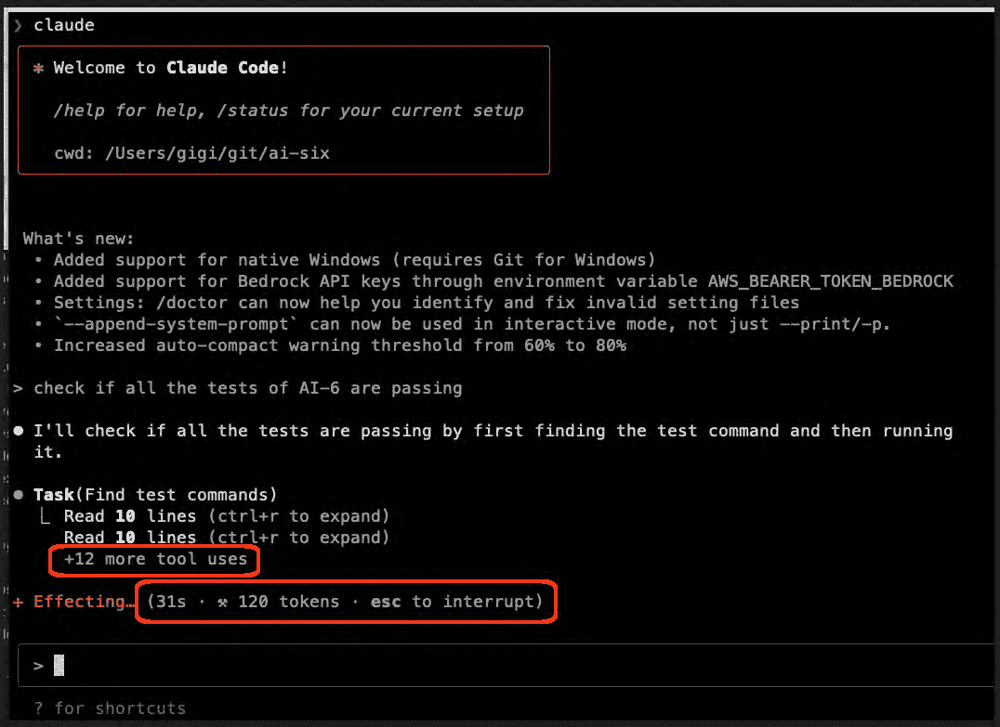

一旦 Claude Code 找到所有测试，它就会自动开始运行这些测试，不会等待批准。它识别出有些测试失败了，甚至还找出了根本原因（缺少 `sh` 模块）。

*图 6.2：运行 AI-6 测试*

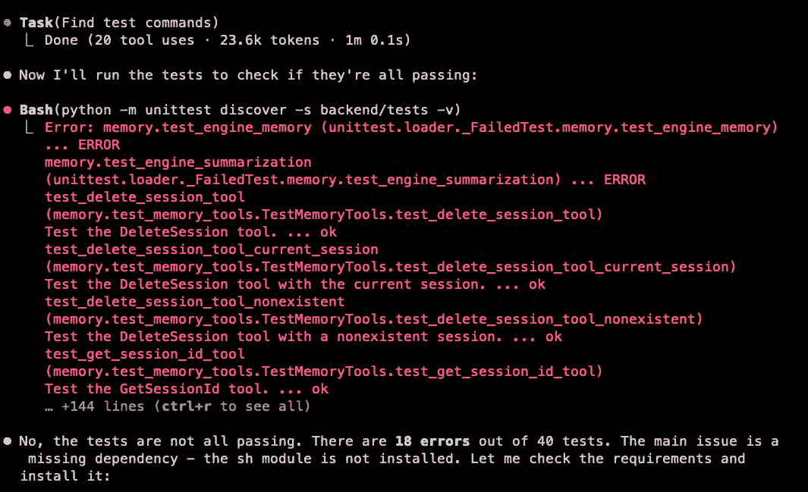

它之所以直接运行测试，是因为 Claude Code 有一个包含执行某些操作权限的配置文件。在之前的会话中，Claude 已被允许运行测试，因此它无需再次请求许可。如果用户想要改变这一点，可以编辑 `.claude/settings.local.json` 并移除该权限。以下是一个片段：

```json
{
  "permissions": {
    "allow": [
      "Bash(chainlit run:*)",
      "Bash(git add:*)",
      "...",
      "Bash(rg:*)",
      "Bash(cat:*)",
      "Bash(PYTHONPATH=./:$PYTHONPATH python3 -m unittest discover backend/tests -v)",
      "Bash(ls:*)",
      "Bash(mkdir:*)",
      "Bash(./ai6.sh:*)"
    ],
    "deny": []
  },
  "enableAllProjectMcpServers": false
}
```

Claude Code 想要安装缺失的 `sh` 模块，但由于它没有自动安装软件包的权限，于是请求许可。其实根本不需要安装 `sh` 模块，因为它已经安装在 AI-6 的虚拟环境中了。正确的解决方案是激活虚拟环境并重新运行测试。

*图 6.3：请求安装软件包的权限*

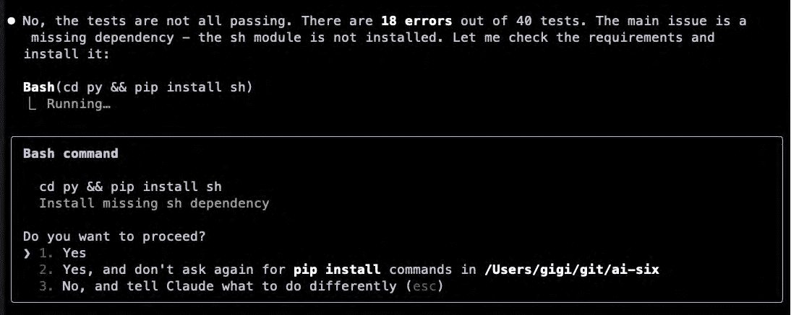

与 Claude Code 的这次简短会话说明了界面如何在 AI 系统的自主性和用户控制之间取得平衡。但界面不仅仅关乎控制，也关乎信任。

#### 界面作为建立信任的机制

智能体 AI 系统越自主，提供的价值就越大——当然，前提是它们能正确工作并实现用户设定的目标。由于这些系统经常做出复杂决策，界面必须让它们的行为透明且可解释。值得信赖的界面会展示智能体正在做什么、为什么这么做，以及下一步计划是什么。它会向用户展示适当层次的信息，可能是工具调用、决策点和中间步骤。其理念是，即使推理过程并不完美，用户也能跟上思路。当用户能够将错误追溯到其根源时，他们更可能改进自己的输入，而不是放弃系统。

信任还取决于清晰的边界和控制。用户需要知道智能体可以执行哪些操作，以及何时会请求许可。明确的权限系统（例如 Claude Code 所使用的）让用户相信，智能体不会在无人监督的情况下做出有风险的更改。与此同时，界面应该传达不确定性，显示 LLM 何时不确定或需要帮助。这种可见性、克制和谦逊的结合，营造了一种协作氛围，让用户感到自己掌握主动权且信息充分，而不是被冷落或感到意外。

现在我们已经讨论了界面在智能体 AI 工作流中的重要性，接下来让我们探索如何构建这样的界面。

#### 构建 Slack 机器人界面

在我们深入研究为 AI-6 构建 Slack 机器人界面的细节之前，先提醒一句。LangGraph、AutoGen、CrewAI 以及我们自己的 AI-6 等智能体 AI 系统，专注于定义智能体和工具、管理记忆和会话，以及自主执行任务。基于这些框架构建的 AI 系统负责提供界面，这些界面通常针对特定的用例或领域进行定制。AI-6 提供多种界面的原因是出于教育目的。

Slack 机器人界面有几个独特的特性，使其成为某些智能体 AI 系统的绝佳选择：

- **熟悉度**：许多用户已经熟悉 Slack，这使得新用户上手更容易
- **实时交互**：Slack 支持实时通信，这对交互式智能体工作流至关重要
- **多用户支持**：Slack 支持多用户和多频道，从而支持协作工作流
- **与其他工具集成**：Slack 可以与各种工具和服务集成，从而更容易构建复杂的工作流
- **通知和提醒**：Slack 可以发送通知和提醒，这对于长时间运行的任务或重要更新非常有用
- **安全性和访问控制**：Slack 提供了内置的安全功能，如用户身份验证和访问控制，这对于可能处理敏感数据的智能体 AI 系统至关重要

考虑到这些优势，让我们来探讨 AI-6 Slack 机器人实际是如何工作的。

#### 试用 AI-6 Slack 机器人

让我们先试用一下 AI-6 Slack 机器人，看看它长什么样，然后再深入探讨。我们可以使用方便的 `ai6.sh` 脚本启动它，并传入 `slack` 参数：

```bash
❯ ./ai6.sh slack
virtualenv: /Users/gigi/git/ai-six/py/venv
Loaded environment variables from /Users/gigi/git/ai-six/py/frontend/slack/.env
Joined ai-6-test
Bolt app is running!
```

创建了一个名为 `bot-playground` 的 Slack 工作区，其中包含一个名为 `ai-6-test` 的频道（参见 *图 6.4*）。AI-6 Slack 机器人是一个 Slack 应用（`https://api.slack.com/docs/apps`），它会自动为任何频道添加 `ai-6-` 前缀，并开始监听消息。

*图 6.4：#ai-6-test Slack 频道*

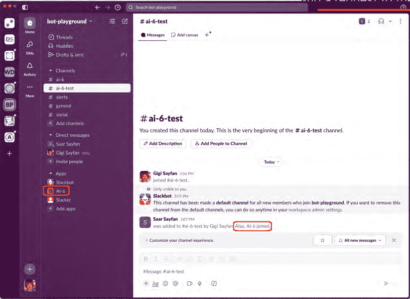


AI-6 Slack 机器人已连接到 AI-6，因此它可以访问 AI-6 的所有工具和功能。

让我们看看它是否知道当前目录是什么：

*图 6.5：询问当前目录*

请注意，除了响应消息之外，与该消息关联的话题中还有一个回复。让我们展开话题，观察 AI-6 按照 LLM 的请求执行了哪些工具调用以生成最终响应：

*图 6.6：观察工具调用*

请注意这里的用户体验选择。工具调用不显示在主消息中，而是显示在话题中。这是一个很好的选择，因为它让主消息保持简洁，专注于 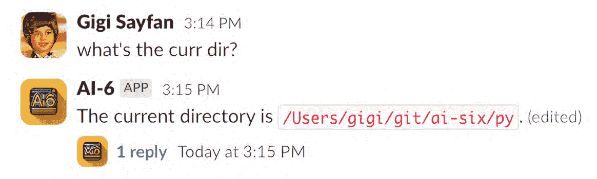 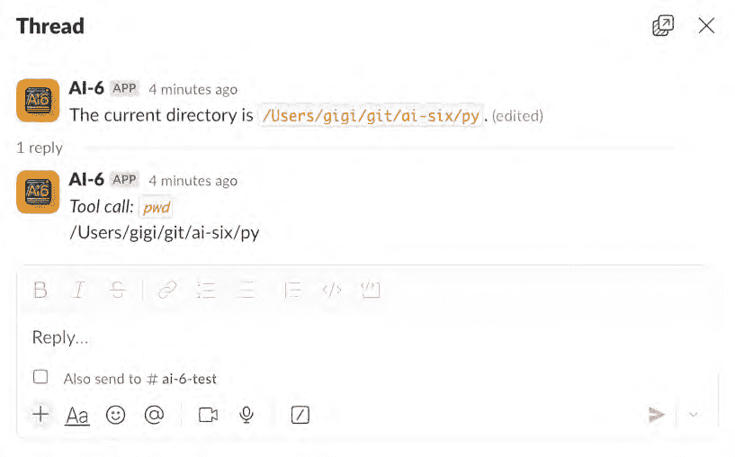 最终响应，同时如果用户感兴趣，仍然可以了解响应生成的详细信息。让我们再尝试一个包含多个工具调用的请求：

*图 6.7：检查当前目录文件时的多次工具调用*

太棒了。AI-6 Slack 机器人能够处理多次工具调用并提供正确的答案。但它是如何做到的呢？让我们看看话题中的工具调用。LLM 要求 AI-6 正确调用 `ls` 工具来列出当前目录中的所有文件。到目前为止，一切顺利。但随后它又要求 AI-6 调用 `cat` 工具读取每个文件的全部内容并发送回来，以判断其中是否包含 `import` 这个词。

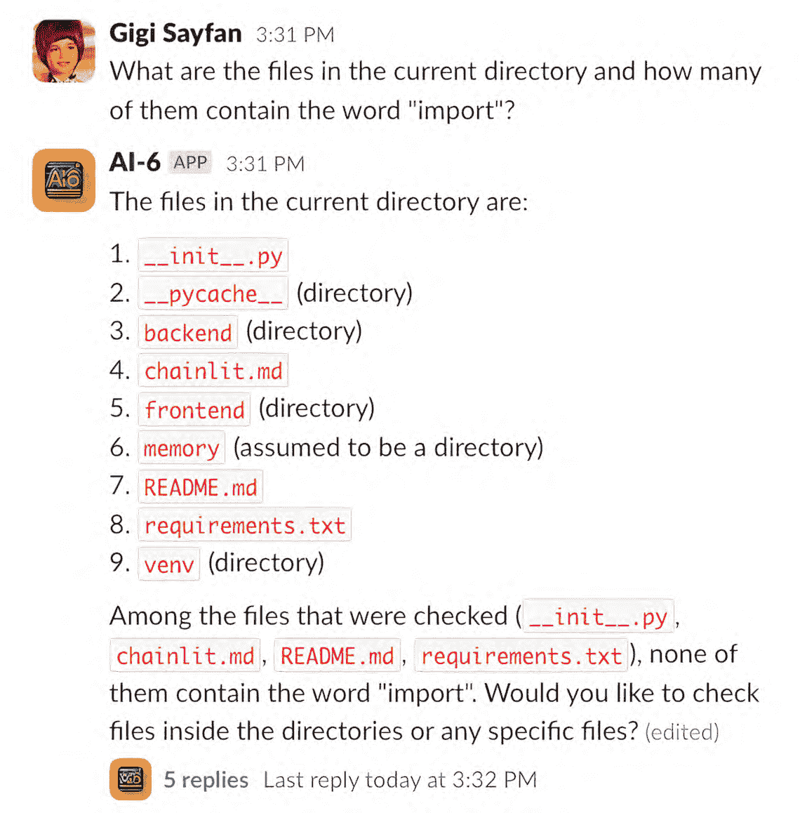

这样做是正确的，但效率极低。对于大文件，它甚至无法工作，因为内容无法放入上下文窗口中。使用 `grep` 这样的工具一次在所有文件中搜索 `import` 这个词会高效得多。

这是一个很好的例子，说明了 LLM 在请求工具调用时如何做出次优选择，以及如何利用我们暴露实际工具调用的 UI 来调试此类问题（而不仅仅是统计执行了多少次工具调用）。

*图 6.8：详细的工具调用可视化*

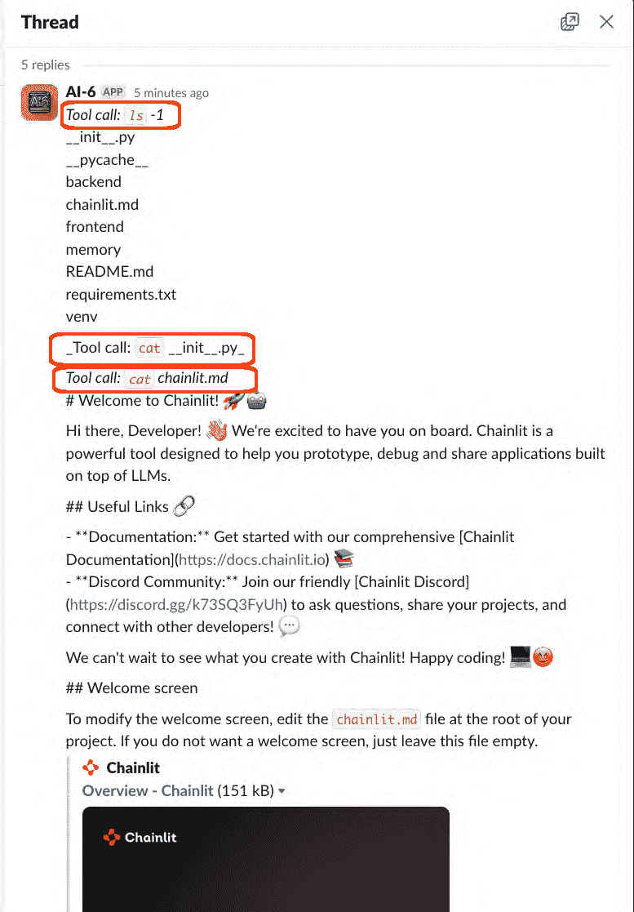

这种糟糕的工具选择理想情况下应在 AI 系统的开发过程中被发现，并且可以通过向 LLM 提供更好的指令或系统提示来解决。在这种情况下，让我们看看能否仅针对本次会话进行改进。真有意思。当被问到时，AI-6 为什么没有使用 `grep` 而不是 `cat`？而且，它也承认这样做效率低下，并建议使用 `grep`，但最终它却使用 `sed` 在文件中搜索 `import` 这个词。这没问题，但这与它声称要做的并不一致：

*图 6.9：调试工具使用选择*

现在我们已经清楚了解 AI-6 Slack 机器人的功能以及用户体验，接下来让我们看看 AI-6 Slack 机器人是如何实现的，以及它在底层是如何工作的。

### 身份验证与配置设置

AI-6 Slack 机器人是使用 Slack Bolt（`https://slack.dev/bolt-python/`）框架构建的，该框架简化了 Python 中的 Slack API 集成。请记住，在阅读本章时，你不需要自己配置或部署 Slack 应用。我们将介绍 Slack 界面的设计、结构和行为，以便你在无需动手设置的情况下理解其工作原理。

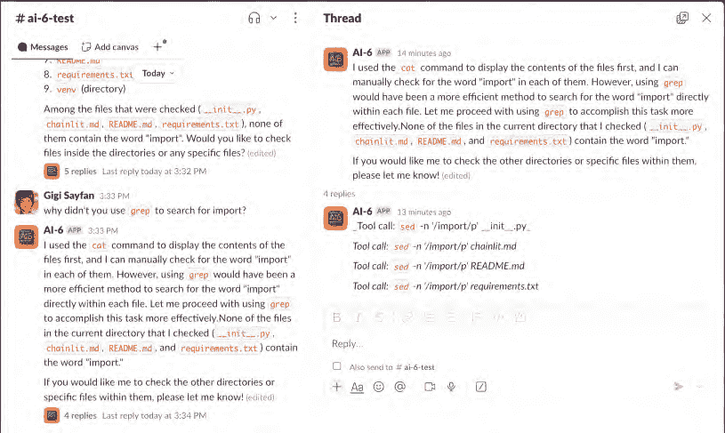

话虽如此，为了让你了解背景，以下是配置在幕后涉及的内容：

- 创建并配置一个 Slack 应用（`https://api.slack.com/apps`），具体如下：
  - 一个具有 `connections:write` 权限范围的 App token（`https://api.slack.com/apps/A08J2K4SF44/general`）
  - 一个具有所需权限的 Bot token（`https://api.slack.com/apps/A08J2K4SF44/oauth`）
- 启用 Socket 模式（`https://app.slack.com/app-settings/T08GRUKRA5Q/A08J2K4SF44/socket-mode`）以允许实时交互
- 应用订阅消息事件（使用你的应用设置 URL，例如 `https://api.slack.com/apps/<APP_ID>/event-subscriptions`）将 `<APP_ID>` 替换为你的 APP ID
- 然后将其安装到相应的 Slack 工作区：在我的情况下是 bot-playground

如果你以后有兴趣构建自己的 Slack 集成，官方关于构建 Slack 应用的指南（`https://api.slack.com/start/building/bolt-python`）是一个很好的起点。

请注意，Bolt 应用可以通过 Slack CLI 或直接从 Python 代码启动。AI-6 采用基于 Python 的方式，以便更灵活地控制行为并更深入地集成到 AI 系统的运行时中。

如果你还记得*第 4 章*的内容，就会知道 AI-6 Slack 机器人是 AI-6 引擎的前端，该引擎需要一个配置对象来初始化。这个配置对象可以从不同的文件格式加载，例如 JSON、YAML 和 TOML。Slack 机器人使用 `config.toml` 文件来配置 AI-6 引擎。如下所示：

```toml
# AI-6 Slack Configuration File
default_model_id = "gpt-4o"
tools_dir = "${HOME}/git/ai-six/py/backend/tools"
mcp_tools_dir = "${HOME}/git/ai-six/py/backend/mcp_tools"
memory_dir = "${HOME}/git/ai-six/memory/slack"
checkpoint_interval = 3
#Provider configuration
[provider_config.openai]
api_key = "${OPENAI_API_KEY}"
default_model = "gpt-4o"
[provider_config.ollama]
model = "qwen2.5-coder:32b"
#Tool configuration
[tool_config.claude]
api_key = "${ANTHROPIC_API_KEY}"
```

如你所见，配置文件中嵌入的是环境变量名称，而不是实际的敏感信息。这是 AI-6 配置系统提供的服务之一。它接受此类配置文件，并使用 `Config` 类中的以下代码自动加载环境变量：

```python
@staticmethod
def _interpolate_env_vars(value: Any) -> Any:
    """Recursively interpolate environment variables in a configuration value.
    Supports ${VAR} and $VAR syntax for environment variables.

    Parameters
    ----------
    value : Any
        The value to interpolate

    Returns
    -------
    Any
        The interpolated value
    """
    if isinstance(value, str):
        # Handle ${VAR} syntax
        if "${" in value and "}" in value:
            import re
            pattern = r'\${([a-zA-Z0-9_]+)}'
            matches = re.findall(pattern, value)
            for var_name in matches:
                env_value = os.environ.get(var_name, '')
                value = value.replace(f"${{{var_name}}}", env_value)
        # Handle $VAR syntax
        elif value.startswith('$') and len(value) > 1:
            var_name = value[1:]
            value = os.environ.get(var_name, '')
    return value
elif isinstance(value, dict):
    return {k: Config._interpolate_env_vars(v)
            for k, v in value.items()}
elif isinstance(value, list):
    return [Config._interpolate_env_vars(item) for item in value]
else:
    return value
```

你不必在配置文件中使用嵌入的环境变量。你可以直接将敏感信息放在配置文件中，但请确保不要将此类文件提交到版本控制系统中。你也可以完全不用配置文件，以编程方式创建 `Config` 对象（例如，从数据库或 S3 存储桶读取配置）。

然而，在这种情况下，我们使用配置文件来加载环境变量并将其传递给 AI-6，因此我们需要在运行 Slack 机器人之前设置这些环境变量。

AI-6 Slack 机器人使用 `.env` 文件来填充多个环境变量，其中既包含 AI-6 LLM 提供商的密钥，也包含 Slack 本身所需的变量。以下是 AI-6 Slack 机器人使用的经过脱敏处理的 `.env` 文件：

```bash
OPENAI_API_KEY=<redacted>
ANTHROPIC_API_KEY=<redacted>
AI6_APP_ID=<redacted>
AI6_CLIENT_ID=<redacted>
AI6_CLIENT_SECRET=<redacted>
AI6_SIGNING_SECRET=<redacted>
AI6_BOT_TOKEN=<redacted>
AI6_APP_TOKEN=<redacted>
```

是的，环境变量确实不少，但都是必需的。此文件不得提交到版本控制系统中，并且它会被 AI-6 的 `.gitignore` 文件忽略：

```gitignore
# Environment files
**/.env
```


#### /.env.* Slack 初始化

`idx_f9f75344` AI-6 Slack 机器人代码位于 `frontend/slack` 目录中。主入口点是 `app.py`（[https://github.com/PacktPublishing/Design-Multi-Agent-AI-Systems-Using-MCP-and-A2A/blob/main/ch06/ai-six/py/frontend/slack/app.py](https://github.com/PacktPublishing/Design-Multi-Agent-AI-Systems-Using-MCP-and-A2A/blob/main/ch06/ai-six/py/frontend/slack/app.py)）文件，其中也包含了机器人大部分逻辑。以下是导入部分，这些导入包括一些标准库包，如 `os` 和 `functools.partial`，`pathology.path` 包，几个 Slack 和 Bolt 包，以及来自 `frontend/slack` 目录的 `utils` 模块，它有助于连接到 AI-6 引擎：

```python
import os
from functools import partial
import pathology.path
from slack_bolt import App
from slack_bolt.adapter.socket_mode import SocketModeHandler
from dotenv import load_dotenv
from slack_sdk.errors import SlackApiError
from . import utils
```

下一部分 `idx_aa84453b` 完全是关于加载 `.env` 文件和加载环境变量的。如果没有 `.env` 文件，它会打印一个警告并继续。由于环境变量可能在运行脚本之前就已经设置好了，所以机器人可以在没有 `.env` 文件的情况下依然运行：

```python
script_dir = pathology.path.Path.script_dir()
# Try to load environment variables from .env file in the same directory as this script
env_file_path = os.path.join(script_dir, ".env")
if os.path.exists(env_file_path):
    load_dotenv(env_file_path)
    print(f"Loaded environment variables from {env_file_path}")
else:
    print(f"Warning: No .env file found at {env_file_path}")
```

此时，环境变量已加载，我们可以使用 `os.environ.get()` 访问它们。代码初始化一些变量来保存 Slack 应用令牌和机器人令牌，并实例化一个 Bolt 应用实例：

```python
app_token = os.environ.get("AI6_APP_TOKEN")
bot_token = os.environ.get("AI6_BOT_TOKEN")
app = App(token=bot_token)
```

然后，它初始化一些变量来保存最后一条消息和最新时间戳，一个用于专属 AI-6 频道的字典，定位配置文件，并初始化一个空的 `engines` 字典：

```python
last_message = ""
latest_ts = None
ai6_channels = {}
config_path = str((script_dir / 'config.toml').resolve())
engines = {}
```

完成所有初步初始化后，让我们看看启动 Slack 机器人的 `main()` 函数。它做两件主要的事情：加入一个频道并启动 `SocketModeHandler` 来监听事件。它还处理异常，并最终离开它加入的所有频道：

```python
def main():
    """Main entry point for the Slack app"""
    channel = join_channel(app.client)
    if channel is not None:
        print(f'Joined {channel["name"]}')
    try:
        # Run the Slack app
        SocketModeHandler(app, app_token).start()
    except KeyboardInterrupt:
        print("Ctrl+C detected.")
    except Exception as e:
        print(f"Unhandled exception: {e}")
    finally:
        leave_channels(app.client)

if __name__ == "__main__":
    main()
```

现在我们 `idx_97a90fda` 对 AI-6 Slack 机器人如何初始化和启动有了基本的了解。下一步是理解机器人如何处理传入消息并与 AI-6 引擎交互以处理它们。

#### 消息处理与事件

Bolt 应用 `idx_f4ce2398` 使用装饰器处理事件，这些装饰器将特定事件类型映射到处理函数。AI-6 Slack 机器人通过一个带有 `@app.event("message")` 装饰器的单一 `handle_message()` 函数处理任何频道中的所有传入消息：

```python
@app.event("message")
def handle_message(message, say, ack, client):
    """Handle all messages in channels."""
```

该函数声明了 `last_message` 和 `latest_ts` 全局引用，以便访问它们，然后从 `message` 对象中提取文本：

```python
    global last_message, latest_ts
    ack()  # Acknowledge ASAP
    text = message.get("text")
```

该 Slack 机器人被设计为处理其专属频道（`ai6_channels` 字典）中的任何消息，或任何其他频道中提及该机器人的消息。如果消息为空或来自机器人，或不符合条件，则被忽略：

```python
    # Skip if the message is empty or from a bot
    if not text or message.get("bot_id"):
        return
    mention_bot = f"<@{bot_user_id}>" in text
    channel_id = message['channel']
    ai6_channel = channel_id in ai6_channels
```

此时，我们 `idx_f9880f5d` 有了一条需要处理的消息。我们已经从消息中获得了频道 ID，因此我们可以为那个频道创建或获取一个 AI-6 引擎实例。然后，我们准备一个工具调用处理器，用于在消息处理期间处理来自 AI-6 引擎的工具回调（正如您所记得的，这些回调将被放入回复线程）：

```python
    engine = get_or_create_engine(channel_id)
    # Create a tool call handler for this channel
    channel_tool_call_handler = partial(handle_tool_call, client, channel_id)
```

现在，我们已经拥有了处理消息所需的一切。我们将使用流式模式的 AI-6 引擎，这样它可以在响应块到达时显示响应块，无需等待完整响应准备就绪。因此，它以一个通用的 `"..."` 文本开始。然后，我们将 `latest_ts` 全局变量（消息的时间戳）设置为 `chat_postMessage()` 调用的结果，该调用将初始消息发布到频道。`last_message` 变量被初始化为空字符串，以保存构建中的响应：

```python
    # Process the message with the AI-6 engine
    try:
        # Post an initial empty message that we'll update
        result = client.chat_postMessage(
            channel=channel_id,
            text="..."
        )
        latest_ts = result["ts"]
        last_message = ""
```

然后，我们定义一个内联的 `handle_chunk()` 函数，当 AI-6 引擎流式传输响应块时会调用该函数。像这样定义嵌套函数有点不寻常，但在这个案例中 `idx_65e9b54e` 非常有效，因为这使我们能够将回调保持在使用它的地方附近，使代码更易读。

```python
        # Define a callback function to handle streaming chunks
        def handle_chunk(chunk):
            global last_message
            last_message += chunk
            try:
                # Update the message with the new content
                client.chat_update(
                    channel=channel_id,
                    ts=latest_ts,
                    text=last_message
                )
            except SlackApiError as e:
                print(f"Error updating message: {e}")
```

这是 `handle_message()` 函数的最后一部分，它将消息流式传输到 AI-6 引擎，并提供两个事件处理器，一个用于处理块，一个用于处理工具调用。如果流式传输期间出现错误，它会捕获异常并将错误信息打印到终端：

```python
        # Stream the message to the AI-6 engine
        response = engine.stream_message(
            text,
            engine.default_model_id,
            on_chunk_func=handle_chunk,
            on_tool_call_func=channel_tool_call_handler
        )
    except Exception as e:
        print(f"I encountered an error: {str(e)}")
```

现在我们已经理解了 Slack 机器人如何处理消息，让我们更进一步，考虑如何与多个频道和多个用户协同工作。


### 频道管理与多用户支持

AI-6 Slack 机器人旨在支持多个 Slack 频道和用户。它会自动加入第一个名称带有 `ai-6-` 前缀的频道。多用户支持是自然实现的，因为 Slack 本身支持多个用户和频道，任何用户都可以在机器人所在的任何频道中发布消息。机器人会处理这些频道中来自任何用户的所有消息。

让我们看看在 `main()` 函数中调用以加入频道的 `join_channel()` 函数。它非常简单。首先，它使用 Slack 客户端的 `conversations_list()` 方法列出 Slack 工作区中的所有频道。然后，它过滤频道，找出那些以 `ai-6-` 前缀开头的频道。如果没有这样的频道，它就直接返回。如果有多个频道，它只会加入第一个。如果机器人还不是该频道的成员，它会尝试使用 `conversations_join()` 方法加入。最后，它返回频道对象。

```python
def join_channel(client):
    """Join the first AI-6 channel if not a member already
    Return the channel id
    If there are no AI-6 channel raise an exception
    """
    all_channels = client.conversations_list()["channels"]
    ai6_channels.update(
        {
            c["id"]: c
            for c in all_channels
            if c["name"].startswith("ai-6-")
        }
    )
    if not ai6_channels:
        return
    channel_id = list(ai6_channels.keys())[0]
    channel = ai6_channels[channel_id]
    # Join channel if not a member already
    if not channel['is_member']:
        try:
            client.conversations_join(channel=channel_id)
        except Exception as e:
            print(f"Error joining channel {channel_id}: {e}")
    return channel
```

坦诚地说，这种自动加入具有特定命名约定频道的功能，主要适用于开发和测试目的。在实际应用中，你只需将 AI-6 Slack 机器人邀请到特定频道即可。这种邀请行为同样受支持，因为 `handle_message()` 处理器会响应机器人所在频道中的任何消息，正如你所记得的，只要消息提到了 AI-6 Slack 机器人。

以下是将 AI-6 Slack 机器人邀请到它尚未加入的频道的方法：

*图 6.10：显式邀请 AI-6 机器人加入频道*


这个频道名为 **some-channel**，这意味着 AI-6 Slack 机器人不会自动响应任何消息。我们必须使用 `@AI-6` 提及它才能获得响应。让我们试试：

*图 6.11：提及 AI-6*

当 AI-6 应用关闭时，它会离开所有它已加入的频道（无论是自动加入还是通过邀请加入的）。

*图 6.12：AI-6 机器人离开频道*


这是在 `leave_channels()` 函数中完成的，它非常简单：

```python
def leave_channels(client):
    """Leave all the channels
    """
    channels = (c for c in client.conversations_list()['channels']
                if c['is_member'])
    for c in channels:
        client.chat_postMessage(
            channel=c['id'],
            text=f"Leaving channel #{c['name']}"
        )
        client.conversations_leave(channel=c['id'])
```

我们已经介绍了 AI-6 Slack 机器人如何处理消息和管理频道。现在，让我们看看它如何与 AI-6 引擎集成。

### 与 AI-6 引擎集成

AI-6 Slack 机器人与 AI-6 引擎之间有两个主要接触点：为每个频道创建或获取引擎实例，以及处理来自 AI-6 引擎的工具调用。`get_or_create_engine()` 函数有助于确保每个频道拥有自己的 AI-6 引擎实例，这对于多频道和多用户支持至关重要。

如果我们只有一个共享引擎，就很难管理每个频道的状态和记忆。首先，上下文窗口会很快被填满，而且 LLM 会被来自不同频道的无关消息搞糊涂。

代码如下。它非常简单。所有频道的所有引擎都存储在 `engines` 字典中。如果请求的频道 ID 不在字典中，它会使用 `utils.create_channel_engine()` 函数创建一个新的引擎实例，并将其添加到 `engines` 字典中。然后，它只需返回该引擎：

```python
def get_or_create_engine(channel_id):
    """Get an existing engine for a channel or create a new one."""
    if channel_id not in engines:
        # Create a channel-specific engine using the Slack utility function
        engines[channel_id] = utils.create_channel_engine(
            base_config_path=config_path,
            channel_id=channel_id,
            env_file_path=env_file_path
        )
    return engines[channel_id]
```

`utils.create_channel_engine()` (https://github.com/PacktPublishing/Design-Multi-Agent-AI-Systems-Using-MCP-and-A2A/blob/main/ch06/ai-six/py/frontend/slack/utils.py) 函数包含了与我们在*第 4 章*中看到的类似的用于实例化 AI-6 引擎的代码，但它还会在配置中设置频道 ID，并为该频道初始化记忆。

让我们看看处理来自 AI-6 引擎的工具调用的代码。`handle_tool_call()` 函数会将每个工具调用及其响应添加到 Slack 频道中原始消息的线程中。这使用户能够看到 AI-6 引擎是如何得出其响应的详细信息，包括工具调用及其结果：

```python
def handle_tool_call(client, channel, name, args, result):
    """Handle a tool call from the AI-6 engine."""
    # Post the tool call result as a message
    try:
        client.chat_postMessage(
            channel=channel,
            thread_ts=latest_ts,
            text=f"_Tool call: `{name}` {', '.join(args.values()) if args else ''}\n{result}"
        )
    except SlackApiError as e:
        print(f"Error posting tool call result: {e}")
```

总结一下，我们介绍了 AI-6 Slack 机器人的设计和实现方式，以及它如何与 AI-6 引擎集成。我们讨论了它的一些关键特性，例如多频道支持、消息处理和工具调用处理。现在，让我们将注意力转向 Chainlit Web UI，它与 ChatGPT 等 Web 聊天机器人类似。

### 使用 Chainlit 开发 Web UI

在上一节中，我们探讨了 AI-6 Slack 机器人界面，并了解了它如何为与智能体 AI 系统交互提供协作式多用户环境。Slack 机器人擅长团队工作流、实时通知以及与现有通信渠道的集成。

然而，在某些场景下，专用 Web 界面更具优势：对用户体验有更多控制、更丰富的视觉元素、更好地支持长对话，并且对于无法访问 Slack 工作区的用户来说部署更容易。这就是 Chainlit 的用武之地。在本节中，我们将研究 AI-6 如何利用 Chainlit 创建类似于 ChatGPT 的基于 Web 的聊天界面，同时保持对 AI-6 工具生态系统和智能体能力的完全访问。

#### Chainlit 框架概述

Chainlit（https://docs.chainlit.io）是一个专门为 LLM 应用程序构建聊天界面而设计的 Python 框架。它为许多 UI 元素、聊天生命周期、流式响应、文件上传、设置管理、会话持久化等提供了开箱即用的支持——所有这些都是一个完善对话式 AI 界面所需的功能。它还具有高度可定制性，允许你添加自己的自定义 UI 元素。

Chainlit 的开发体验专为快速迭代而设计。它运行带有热重载的本地开发服务器，支持快速原型设计和调试。该框架与 OpenAI、LangChain 和 Hugging Face 等流行的 LLM 后端无缝集成，并同时支持同步和异步工作流，以实现最大灵活性。

让我们探讨 AI-6 如何利用 Chainlit 构建一个补充其 Slack 机器人的简单 Web 界面。AI-6 Chainlit 应用程序有意保持极简，并非为了充分展示 Chainlit 的能力。其主要目的是演示如何将 AI-6 后端集成到基于 Web 的 UI 中，为更高级、更完善的 Web 应用程序奠定基础。

#### 体验 AI-6 Chainlit

让我们从一个非常实用的真实用例开始，即在 AI-6 仓库中添加一个 GitHub Actions（https://docs.github.com/en/actions）工作流，以便每次推送新更改时运行所有测试。首先，我们需要启动 Chainlit 应用。我们可以使用便捷的 `ai6.sh` 脚本并传入 `chainlit` 参数来做到这一点：

```bash
❯ ./ai6.sh chainlit
virtualenv: /Users/gigi/git/ai-six/py/venv
2025-07-19 11:28:15 - HTTP Request: GET https://api.openai.com/v1/models "HTTP/1.1 200 OK"
2025-07-19 11:28:17 - HTTP Request: GET https://api.openai.com/v1/models "HTTP/1.1 200 OK"
2025-07-19 11:28:18 - Your app is available at http://localhost:8000
```


AI-6 Chainlit 应用现已运行，我们可以通过 `http://localhost:8000` 访问它。让我们在网页浏览器中打开它：

*图 6.13：Chainlit 网页应用*

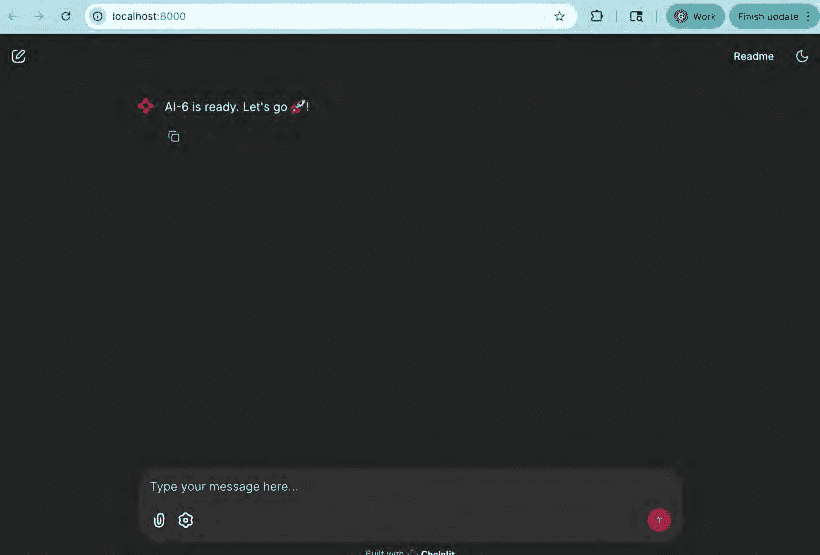

现在，让我们要求 AI-6 向 AI-6 仓库添加一个 GitHub Actions 工作流：

*图 6.14：初始用户提示*

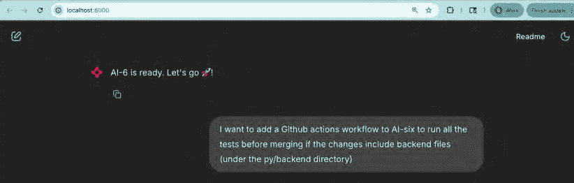

AI-6 给出了非常清晰且详细的解释，包括实际的工作流文件和完成该任务的所有步骤。请注意界面是多么令人愉悦。代码有恰当的着色，Markdown 格式也很整洁：

*图 6.15：详尽的 LLM 响应*

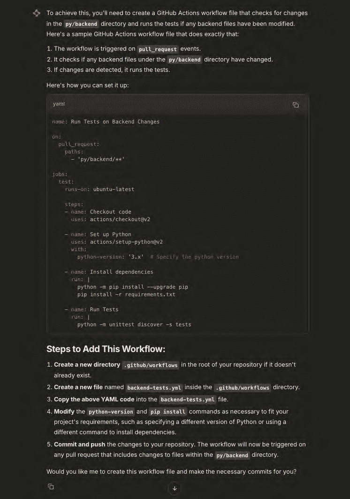

但该解决方案存在几个问题。首先，它使用了 `pull_request` 事件，该事件不会在向主分支的常规推送时触发。我们希望工作流也能在推送事件时运行。

其次，它使用了一些 GitHub Actions 的过时版本，例如 `actions/checkout@v2` 和 `actions/setup-python@v2`。我们希望使用最新版本。

让我们要求 AI-6 修复这些问题：

*图 6.16：后续交互*

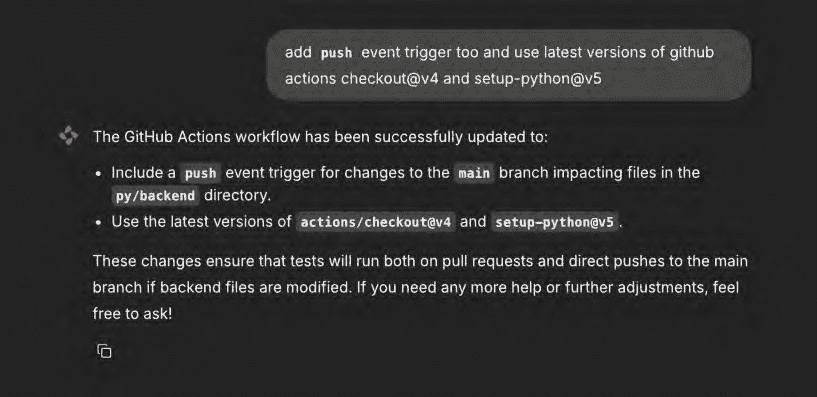

让我们看看 AI-6 实际做了什么。以下是原始提交和修复提交：

```bash
❯ git log --oneline -n 2
f5198ca (HEAD -> main, origin/main, origin/HEAD) Update_workflow_for_push_event_and_latest_actions_versions
65a0c12 Add_GitHub_Actions_workflow_to_run_tests_on_backend_changes
```

让我们查看这些更改：

```bash
❯ git diff HEAD~2
diff --git a/.github/workflows/backend-tests.yml b/.github/workflows/backend-tests.yml
new file mode 100644
index 0000000..1339264
--- /dev/null
+++ b/.github/workflows/backend-tests.yml
@@ -0,0 +1,35 @@
+name: Run Tests on Backend Changes
+
+
+
+on:
+  pull_request:
+    paths:
+      - 'py/backend/**'
+  push:
+    branches:
+      - main
+    paths:
+      - 'py/backend/**'
+
+
+
+jobs:
+  test:
+    runs-on: ubuntu-latest
+
+
+
+    steps:
+      - name: Checkout code
+        uses: actions/checkout@v4
+
+
+
+      - name: Set up Python
+        uses: actions/setup-python@v5
+        with:
+          python-version: '3.x' # Specify the python version
+
+
+
+      - name: Install dependencies
+        working-directory: py
+        run: |
+          python -m pip install --upgrade pip
+          pip install -r requirements.txt
+
+
+
+      - name: Run Tests
+        working-directory: py
+        run: |
+          python -m unittest discover -s backend/tests
```

现在一切看起来都正确了。AI-6 修复了我们指出的所有问题。这凸显了人在回路（human-in-the-loop）概念的重要性。

LLM 非常强大，但它们（尚）并非完美。现在我们可以告诉 AI-6 将更改推送到 GitHub：

*图 6.17：AI-6 将更改推送到 GitHub*

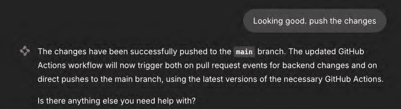

让我们检查 GitHub，确认新的 GitHub Actions 工作流确实存在：

*图 6.18：GitHub Actions 工作流*

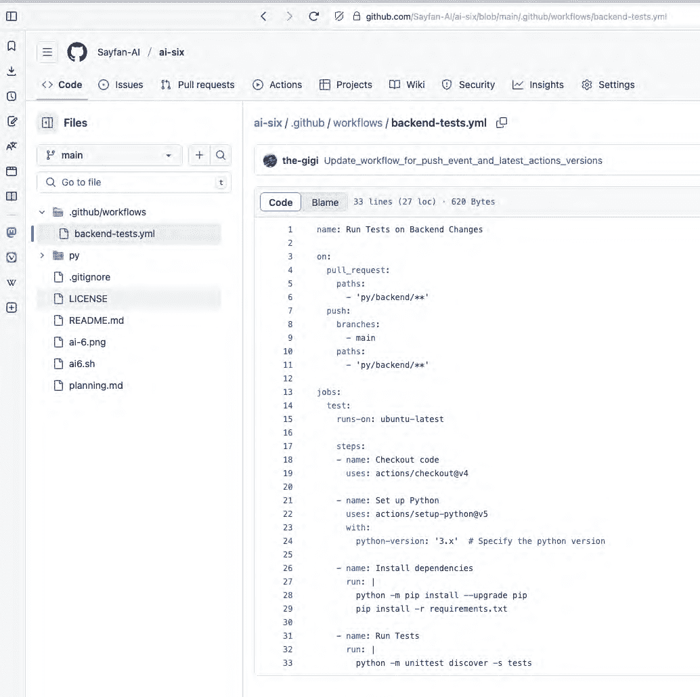

这是与 AI-6 通过 Chainlit 界面进行的一次很棒的会话。我们成功地向 AI-6 仓库添加了一个新的 GitHub Actions 工作流，修复了一些问题，并将更改推送到了 GitHub。Chainlit 界面为对话提供了干净而现代的视图。

让我们来看看 Chainlit 界面是如何实现的，以及它如何与 AI-6 引擎集成。

### 配置与引擎集成

与 Slack 机器人界面一样，Chainlit 网页应用也需要配置才能初始化并与 AI-6 引擎连接。主程序入口位于 `app.py` 文件中（<https://github.com/PacktPublishing/Design-Multi-Agent-AI-Systems-using-MCP-and-A2A/blob/main/ch06/ai-six/py/frontend/chainlit/app.py>）。让我们来剖析一下。

先从导入开始。Chainlit 应用从标准库的 `types` 模块导入了 `SimpleNamespace` 类。这是一个很酷的类，你可以像使用字典一样使用它，但用点号表示法访问属性。它还导入了 `chainlit` 本身，别名为 `cl`，以及 `chainlit.cli` 模块中的 `run_chainlit` 函数，该函数用于运行 Chainlit 应用。它还导入了 `pathology.path` 包来定位配置文件，以及来自共享 `frontend.common` 包的 `engine_utils` 模块，该模块将用于创建 AI-6 引擎实例：

```python
from types import SimpleNamespace
import chainlit as cl
from chainlit.cli import run_chainlit
import pathology.path
from frontend.common import engine_utils
```

接下来，它定位配置文件并从中创建 AI-6 引擎实例。这是 AI-6 引擎初始化部分：

```python
script_dir = pathology.path.Path.script_dir()
# Load the engine from YAML configuration
config_path = str((script_dir / "config.yaml").resolve())
# Create engine from configuration file
# Environment variables will be automatically interpolated by Config.from_file
engine, engine_config = engine_utils.create_from_config(config_path)
```

在这里，我们创建了 `app_config` 对象，它是一个 `SimpleNamespace` 实例（<https://docs.python.org/3/library/types.html#types.SimpleNamespace>），保存着 Chainlit 应用的配置：

```python
app_config = SimpleNamespace(
    selected_model=engine.default_model_id,
    available_models=list(engine.model_provider_map.keys()),
    enabled_tools={tool: True for tool in engine.tool_dict},
)

TOOL_PREFIX = "tool:"
```

这个配置对象稍后将在处理来自用户的消息时使用。与 AI-6 引擎的集成是通过之前创建的 `engine` 变量实现的。

#### 应用生命周期与事件处理器

此时，我们已经准备好了引擎和配置（`app_config` 对象），应用的主要逻辑通过调用 `run_chainlit()` 函数（从 `chainlit.cli` 导入）并传入 `app.py` 文件来运行。这是从 Python 程序启动 Chainlit 应用的一种笨拙方式。这是调试所需的：

```python
if __name__ == "__main__":
    target = str(script_dir / "app.py")
    run_chainlit(target)
```

在终端中运行 Chainlit 应用的标准方式是使用 `chainlit` CLI：

```bash
❯ chainlit run app.py
```

无论如何，一旦 Chainlit 应用开始运行，它就会开始监听事件并处理它们。我们的 Chainlit 应用处理以下事件：

- `on_chat_start`：当新的聊天会话开始时调用
- `on_message`：当收到新的用户消息时调用
- `on_settings_update`：当设置面板中的设置被更改时调用

让我们逐一查看这些事件处理器，了解它们的工作方式。

#### on_chat_start 事件处理器

这个事件处理器在应用启动时恰好被调用一次。它非常简单。它调用 `setup_settings()` 并显示欢迎消息，也就是我们体验 Chainlit 应用时看到的那条：

```python
@cl.on_chat_start
async def on_chat_start():
    await setup_settings()
    await cl.Message(content="AI-6 is ready. Let's go 🚀!").send()
```

`setup_settings()` 函数非常有趣。它在 UI 组件中为 Chainlit 应用设置初始设置，包括 LLM 选择和工具开关。它使用 `cl.input_widget.Select` 进行模型选择，使用 `cl.input_widget.Switch` 控制每个工具。初始值取自我们之前创建的 `app_config` 对象：

```python
async def setup_settings():
    model_select = cl.input_widget.Select(
        id="model",
        label="LLM Model",
        values=app_config.available_models,
        initial_value=app_config.selected_model,
        initial_index=app_config.available_models.index(
            app_config.selected_model),
    )
    tool_switches = [
        cl.input_widget.Switch(
            id=f"{TOOL_PREFIX}{tool_name}",
            label=f"Tool: {tool_name}",
            initial=tool_value,
        )
        for tool_name, tool_value in app_config.enabled_tools.items()
    ]
    await cl.ChatSettings([model_select] + tool_switches).send()
```

但是这些 UI 设置显示在哪里呢？嗯，在用户输入框的左下角有一个小齿轮按钮，可以调出**设置面板**。它看起来像这样：


*图 6.19：Chainlit 应用设置面板*

我们将稍后了解这些设置的使用方式以及如何修改。目前，只需注意 LLM 的初始值以及启用的工具都设置在 `app_config` 对象中。整个配置通过 `cl.ChatSettings().send()` 方法发送给 Chainlit。

至此，我们已经初始化了 Chainlit 应用，配置了合适的 LLM 和一组启用的工具，并准备好处理消息。

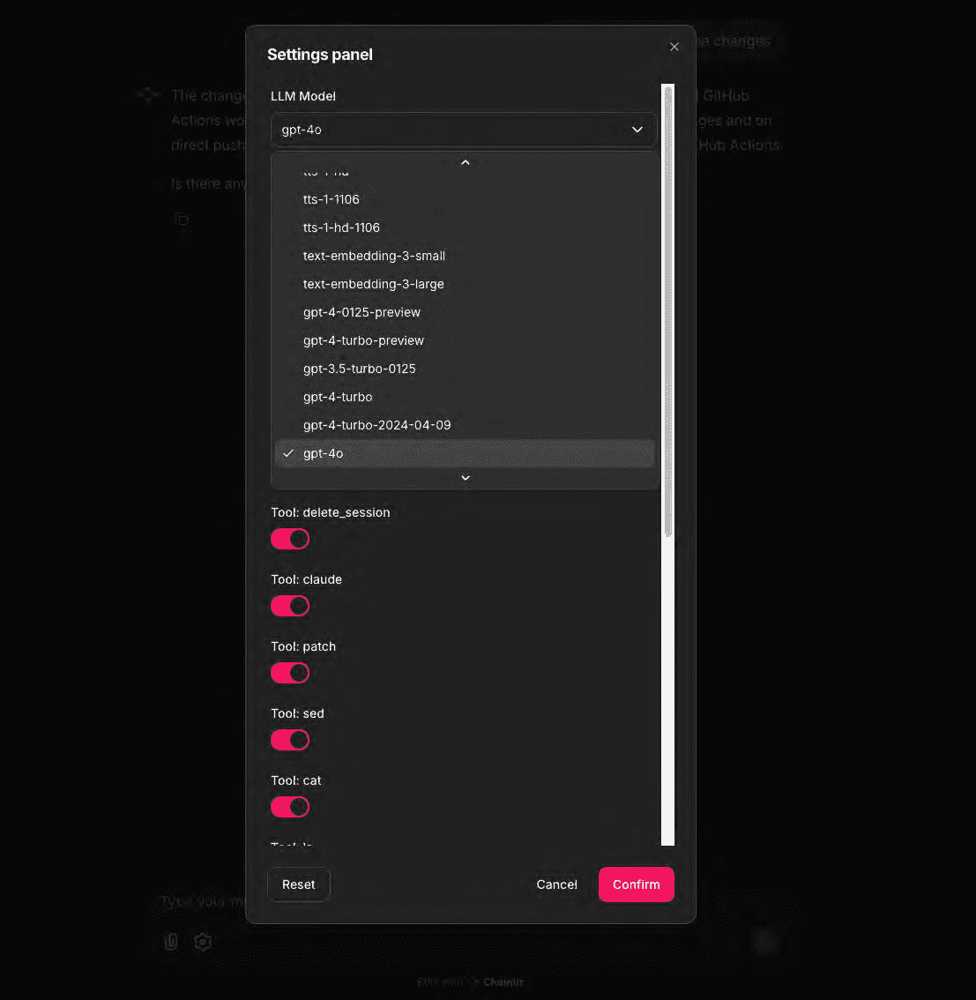

#### on_message 事件处理器

这是主要的处理器，负责处理来自用户的传入消息并与 AI-6 引擎交互。每当用户输入一条新消息时，它就会被调用。

首先，它创建一个内容为空的 `cl.Message` 对象，并立即发送到 Chainlit UI。该消息稍后将用 AI-6 引擎的响应进行更新：

```python
@cl.on_message
async def on_message(message: cl.Message):
    """处理用户消息并生成响应。"""
    # 为响应创建一条新消息
    msg = cl.Message(content="")
    await msg.send()
```

接下来，它定义了一个回调函数 `on_chunk()`，用于处理来自 AI-6 引擎的流式响应块。每当 AI-6 引擎发送新的响应块时，此函数就会被调用：

```python
    # 定义一个回调函数来处理流式块
    async def on_chunk(chunk: str):
        # 使用 Chainlit 内置的流式方法
        await msg.stream_token(chunk)
```

接下来是调用 AI-6 引擎来处理该消息。它使用 `engine.stream_message()` 方法对流式响应进行处理。该方法传入用户的消息内容、来自 `app_config` 的选定 LLM、`on_chunk` 回调函数，以及已启用的工具 ID 列表。当 AI-6 引擎处理请求时，它会向 `on_chunk` 函数发送多个块，该函数会更新最初为空的响应消息。如果在任何环节出现问题，它会在 Chainlit UI 中显示错误消息：

```python
    # 流式传输响应
    try:
        engine.stream_message(
            message.content,
            app_config.selected_model,
            on_chunk_func=lambda chunk: cl.run_sync(on_chunk(chunk)),
            available_tool_ids=[
                k for k, v in app_config.enabled_tools.items() if v],
        )
        # 标记消息为已完成
        await msg.update()
    except Exception as e:
        await cl.Message(content=f"错误：{str(e)}").send()
```

让我们看看实际执行过程。我们让 AI-6 写一首关于它自己的 100 字诗，并在 `on_chunk()` 处理器中设置一个断点。这非常有趣。AI-6 以 `In digital realms where ideas entwine` 开头。LLM 选择每次流式传输一个输出 token。以单词 `entwine` 为例，它被拆分成两个块（两个 token）：`entw` 和 `ine`。参见下图：

*图 6.20：AI-6 正在写一首诗*

最后一点：请注意在当前版本的代码中，我们没有在 `engine.stream_message()` 方法中传递 `on_tool_call_func` 参数，因此 AI-6 引擎不会就任何工具调用通知 UI。这是有意为之，因为我不想让冗长的工具调用信息污染显示界面。AI-6 Slack 机器人在线程中有一个天然的显示工具调用的位置。但 Chainlit UI 不是这种情况。后续可能会添加一个专用的侧面板，届时用户可以选择在其中打开并捕获工具调用信息。

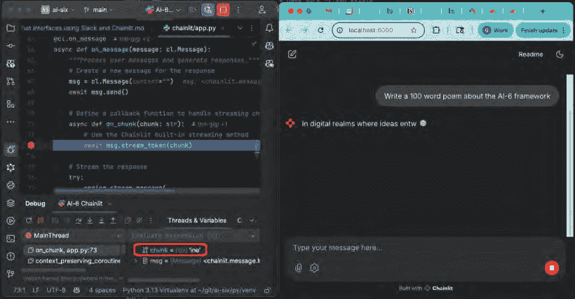

#### on_settings 事件处理器

AI-6 的 Slack 和 CLI 前端使用了预配置的 LLM 和工具。而 Chainlit 应用允许用户即时选择并修改 LLM，以及启用或禁用工具。当用户在设置面板中更改设置并点击 **确认** 按钮时，`on_settings()` 事件处理器就会被调用。它所做的只是用新设置更新 `app_config`，这包括已选定的 LLM 和已启用的工具：

```python
@cl.on_settings_update
async def on_settings_update(new_settings):
    app_config.selected_model = new_settings["model"]
    for k, v in new_settings.items():
        if k.startswith(TOOL_PREFIX):
            tool_name = k.replace(TOOL_PREFIX, "")
            app_config.enabled_tools[tool_name] = v
```

让我们看看实际效果。我将禁用 `ls` 和 `git` 工具。这应该会阻止 LLM 使用这些工具来列出文件。它仍然应该能够找到当前目录，因为 `pwd` 工具仍然启用着。

*图 6.21：禁用工具*

是的，它起作用了！AI-6 不提供 `ls` 和 `git` 工具，因此 LLM 无法列出文件。

总而言之，我们在本节中介绍了 AI-6 的 Chainlit Web 界面。我们看到了它如何初始化、如何与 AI-6 引擎集成、如何处理消息，以及如何动态配置以切换 LLM 和开关工具。我们只是触及了可能性的皮毛，但我们看到了它如何为 AI-6 Slack 机器人提供了一种轻量级的基于 Web 的替代方案。

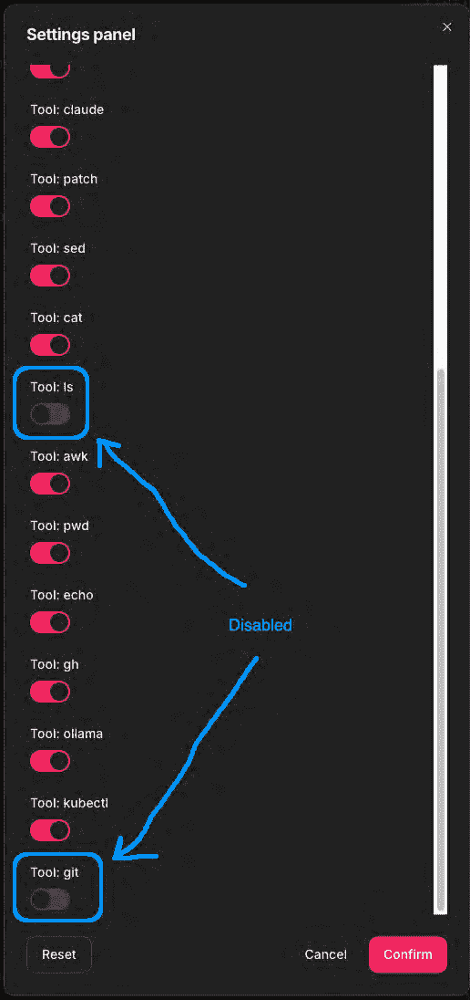

在下一节中，我们将讨论构建更高级、更复杂的交互式代理界面的最佳实践。

### 交互式代理界面的最佳实践

我们在前面几节中构建的前端界面是与 AI 代理交互的绝佳起点，但在构建生产级 AI 系统时，需要考虑几个最佳实践。这些实践可确保用户体验流畅、代理意图清晰，并且系统健壮且可维护。

#### 明确代理的角色和能力

一个成功的交互式代理界面必须让用户立即清楚地了解代理是什么、能做什么，以及它期望接收什么样的输入。代理适用范围不明确会导致用户沮丧和交互失败。界面应通过 UI 元素（如按钮、自动补全提示或帮助浮层）展示关键能力。例如，一个文件分析代理可能会显示一个文件拖放区、受支持文件类型列表，以及一个示例命令，如“总结这个 CSV 文件”。

代理还应主动沟通其限制。这包括模型约束（如 token 限制）、禁用的工具或不支持的输入格式。在高级代理可能自动生成子代理的多代理系统中，通常更重要的是聚焦于用户可以通过预定义配置选项或用户提示来管理的高级代理。

#### 安全保障 —— 确认、试运行和安全网

AI 代理可以调用工具，如果被误用，可能造成很大的损害。UI 应默认采取保守姿态，要求用户确认一些高影响操作，如文件覆盖、代码部署或删除。确认提示不仅防止意外伤害，还强制用户反思他们输入的后果。

除了确认之外，UI 还应支持试运行模式。试运行是一种安全的模拟，它展示代理将要执行的操作，但并不实际执行任何操作。在开发和测试工作流、API 集成或基础设施命令时，这尤其有价值。当用户能够预览结果并验证正确性时，对系统的信任度就会增加。结合取消或撤销操作的能力，这些安全网使代理系统感觉强大但不鲁莽。

还强烈建议在 UI 中添加一个“中止”按钮，允许用户随时停止代理。


#### 面向轮次制的透明性设计

AI 智能体以对话式、轮次制的方式运作。我们应该接受并利用这种交互模式，用它来呈现内部推理、思维链（对于支持该能力的模型）以及工具调用。智能体采取的每一步都应在界面中有所体现：提示词、决策、工具调用、输出和中间结果。这样，用户就能轻松理解智能体行为背后的“为什么”。

优秀的界面应通过清晰、线性的线程展示单次交互的完整生命周期。例如，当智能体决定调用某个工具时，请求参数和响应应显示在聊天流或可展开面板中。错误、重试或回退也应作为整个故事的一部分展示出来。这种设计模式可帮助用户调试、审计，并学会如何更好地向智能体提示（prompt），从而改进结果。

#### 优先设计工具调用与反馈回路

智能体系统最大的增值点之一，就是能够使用外部工具。UI 必须清楚地展示工具何时被调用、如何被选中，以及结果是什么。这形成了一个反馈回路，用户可以在其中评估工具使用是否恰当，并在不恰当时进行干预。

界面还应展示工具调用的元数据：时间戳、参数、返回值以及任何错误。当工具失败时（例如网络错误或输入格式错误），智能体应妥善报告问题，并提供重试、修改输入或跳过等选项。允许用户引导智能体或覆盖工具选择，可让对话保持高效并与用户意图一致。

同样重要的是，要提供一种方式，让用户能够查看可用工具及其描述，并为每个智能体自定义工具集。

#### 拥抱可配置性与运行时控制

不同用户有不同的偏好和信任阈值。有些人可能希望智能体自由地自动执行工具，另一些人则可能更希望手动确认。UI 应提供运行时设置来控制这些行为，包括：开启/关闭工具、切换模型、选择输出详细程度，以及定义回退策略。

这些控制项应易于访问（例如通过设置面板或聊天命令），并在合适的情况下跨会话保留。允许用户自定义交互风格，可提高可用性和满意度。

#### 智能体系统的日志、指标与分布式追踪

每一次用户操作、智能体决策和工具调用都应连同元数据记录在日志中。这些日志同时服务于面向用户和面向开发者的目标。对用户而言，日志可以可视化为时间线，从而支持回溯和重放之前的会话。对开发者而言，日志支持调试、性能调优和提示词优化。

指标应包括：工具调用频率、平均响应延迟、会话时长、任务成功率以及用户干预次数。随着时间推移，这些指标可以指导对智能体行为和 UI 的改进。没有插桩的 UI 就是一个黑盒。通过对工作流的每个环节进行插桩，智能体系统可以从原型演进为可靠、可审计的平台。

对于复杂系统，针对 LLM 的分布式追踪同样至关重要。每一轮对话都应表示为一个 span（跨度）。追踪应能捕获完整的会话或对话。

如果遵循这些最佳实践，你将能够构建出对用户友好、对开发者友好的交互式智能体界面。它们将带来出色的用户体验，让用户能够以自然且满意的方式与 AI 智能体交互。本章构建的 AI-6 Slack 机器人和 Chainlit Web 界面展示了这些最佳实践的部分要素，但仍有很大的改进空间。

#### 小结

在本章中，我们从 AI-6 的后端和内部架构转向其前端 UI，重点讨论了 UI 如何促成用户与自主智能体之间的有效协作。我们探讨了可见性、可中断性、可调试性和信任为何是智能体系统 UI 的核心关注点，以及不同角色为何需要界面中不同详细程度的信息。

随后，我们探索了 AI-6 Slack 机器人的实现，重点说明了其设计选择，例如工具调用线程化、每个频道独立的引擎实例，以及实时消息处理。Slack 的熟悉度、多用户支持和通知能力，使其成为协作工作流的理想界面。

最后，我们考察了基于 Chainlit 的 Web 界面，展示了它如何提供简洁、可定制、单用户的体验。凭借对工具开关、模型选择和丰富流式输出的支持，Chainlit 与 Slack 的优势互补，并实现了细粒度的用户控制。这两个界面为构建健壮、透明的智能体 UI 的最佳实践奠定了基础。

在下一章中，我们将把注意力转向**模型上下文协议**（**MCP**）——一种在工具和智能体之间共享模型状态与执行上下文的标准化机制。我们将定义什么是 MCP，探索如何实现符合 MCP 规范的服务器和客户端，并逐步演示如何将 MCP 集成到你自己的智能体框架中，以实现跨不同 AI 组件的无缝上下文共享。

#### 订阅以获取免费电子书

新框架、不断演进的架构、最新研究、生产环境故障剖析——*AI_Distilled* 为正在动手使用 LLM 和生成式 AI 系统的工程师与研究人员，过滤噪音，提炼成每周简报。立即订阅，即可获赠一本免费电子书，并每周收到帮助你保持专注、掌握最新信息的洞见。

访问 `https://packt.link/8Oz6Y` 订阅，或扫描下方二维码。


## 与模型上下文协议生态集成

在前几章中，我们探索了如何构建智能体 AI 系统、如何将它们与自定义工具集成，以及如何通过不同的前端（如**命令行界面**（**CLI**）、Slack 机器人和基于 Chainlit 的 Web UI）与它们交互。在本章中，我们将重点讨论如何将你的智能体 AI 框架与**模型上下文协议**（**MCP**）（`https://modelcontextprotocol.io`）生态集成。MCP 非常重要！它是一种旨在标准化智能体 AI 系统、模型和工具之间交互的协议。我们将从探索 MCP 及其优势开始，然后了解如何构建 MCP 服务器和客户端。最后，我们将演示如何将 MCP 集成到我们的智能体 AI 框架 AI-6 中。

我们将介绍以下主要主题：

- 什么是 MCP？
- MCP 架构核心与核心组件
- 构建 MCP 服务器
- 构建 MCP 客户端
- 将 MCP 集成到 AI-6 框架
- 综合应用

到本章结束时，你将全面理解 MCP、它为何如此出色，以及如何使用它来构建能够受益于丰富 MCP 服务器和客户端生态的智能体 AI 系统。

### 技术要求

如需跟随操作，请参考 `README` 文件中的说明：

`https://github.com/PacktPublishing/Design-Multi-Agent-AI-Systems-Using-MCP-and-A2A/blob/main/ch07/ai-six/README.md`

### 什么是 MCP？

MCP 由 Anthropic（`https://www.anthropic.com`）团队提出，旨在标准化智能体 AI 系统、数据源和外部服务之间的交互。通过 MCP，你可以构建“讲 MCP”的智能体 AI 系统，并自动与任何 MCP 服务器集成。这意味着，除了自定义工具之外，你还可以从庞大的生态系统中获取工具，扩展 AI 系统的能力。对于 MCP 工具开发者来说，它体现了“*一次编写，到处运行*”的原则。该协议有正式规范（`https://modelcontextprotocol.io/specification`），有版本管理，并且演进迅速。

### MCP 的动机

在 MCP 出现之前，每个智能体 AI 系统基本上都是各自为战。如果开发者希望自己的 AI 智能体与外部工具（如**应用程序编程接口**（**API**）、数据库或专有服务）交互，就必须设计和实现自定义连接器。这些连接器不仅需要知道如何与外部系统通信，还需要知道如何以有用且及时的方式将相关信息注入 LLM 的上下文。这通常是以与特定 AI 框架紧密耦合的工具形式实现的。

这种方法很快就变成了一场维护噩梦：

- 开发人员必须为每个用例重新实现上下文注入逻辑。
- 工具和服务提供商必须编写多个集成层来支持不同的 AI 系统。
- 除了不同 LLM 提供商互不兼容的工具调用规范之外，工具没有标准方式来声明自己的功能。

结果，生态系统变得支离破碎、脆弱不堪。工具与特定框架紧密耦合，跨项目复用几乎不可能。

MCP 就是为了解决这个问题而诞生的。它引入了一个共享协议，将工具和资源向模型暴露的方式标准化。开发者不再需要为每次集成硬编码自定义逻辑，而是可以实现一个符合 MCP 规范的服务器，以可预期的方式公布其能力。同样，AI 系统只需要实现一个客户端接口，就可以动态发现、查询并调用来自任何 MCP 服务器的工具和资源。有

对于许多主流编程语言，都有现成的库可用，使得实现MCP服务器和客户端变得容易。

其结果是一个模块化、可组合的生态系统，工具可以在不同项目间复用。

让我们仔细看看MCP的架构和核心组件。

### MCP架构核心与核心组件

MCP采用客户端-服务器架构。MCP服务器暴露工具和资源，而MCP客户端则消费它们。MCP客户端嵌入在MCP宿主（智能体AI系统）中，并可以利用来自多个MCP服务器的工具和资源，其中一些是本地的，一些是远程的。本地stdio MCP服务器速度更快，但如果来自第三方提供商，则存在安全隐患。远程MCP服务器与任何远程API一样，面临相同的网络和认证问题。下面是MCP架构图，说明了这一点：

*图7.1：MCP架构*

MCP服务器和客户端通信的实际协议分为两层：数据层和传输层。

**数据层**规定了基于JSON-RPC的客户端-服务器通信协议，包括生命周期管理、核心原语（如工具、资源和提示）以及通知。

**传输层**规定了实现客户端和服务器之间数据交换的通信机制和通道，包括特定传输的连接建立、消息帧封装和授权。

让我们详细分析MCP的关键组成部分。

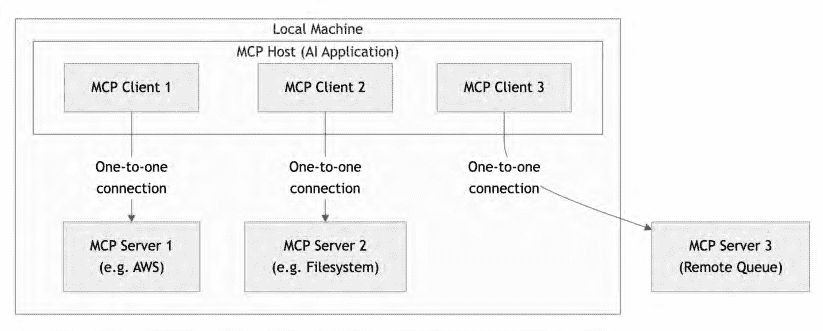

#### MCP服务器

**MCP服务器**（`https://modelcontextprotocol.io/docs/learn/server-concepts`）是一种程序，它通过MCP向基于LLM的系统暴露工具（可调用函数）和资源（上下文信息）。它允许任何符合规范的LLM宿主应用以可预测、可组合和与传输无关的方式发现、调用和使用这些能力。每个MCP服务器可能支持多个规范版本。当MCP客户端与MCP服务器建立连接时，实际版本会通过协商（`https://modelcontextprotocol.io/specification/versioning#negotiation`）确定。

尽管MCP服务器可能暴露资源（`https://modelcontextprotocol.io/docs/learn/server-concepts#resources-context-data`），甚至提供提示支持（`https://modelcontextprotocol.io/docs/learn/server-concepts#prompts-interaction-templates`），但我们将重点放在工具方面。

资源可以作为工具暴露（例如 `list_resources()` 和 `get_resource()` 操作），因此不需要单独的概念。提示管理可以说是一个应用层面的关注点，而不是任何单个MCP服务器的职责。同样，如果你出于某种原因希望你的MCP服务器提供提示模板，你总可以暴露一个 `get_prompt_template()` 工具。在我看来，将资源（你可以把它想象成穷人版的RAG）和提示功能加入MCP是一个错误，这只会让协议变得更加复杂，并让学习曲线更加陡峭。情况可能因人而异，所以你可以自由探索这些功能。从现在开始，我们将只考虑MCP的工具方面。

AI-6中与MCP服务器等价的是一个相关工具集，例如文件系统工具。然而，AI-6工具是通过AI-6框架被发现并作为Python模块导入到智能体AI系统中的。而MCP服务器则作为独立进程在本地或远程运行。MCP客户端将通过合适的传输协议与每个MCP服务器通信。

一个AI系统可以使用多个MCP服务器，每个服务器暴露不同的工具集。

请注意，AI系统需要为它想使用的每个MCP服务器配备一个专门的MCP客户端。MCP客户端负责发现可用工具并按需调用它们。

#### MCP客户端

**MCP客户端**是与MCP服务器交互以发现和调用工具的组件。它们直接嵌入在MCP宿主（智能体AI系统）中，或者由像AI-6这样的框架进行抽象。每个MCP客户端负责连接一个MCP服务器。MCP规范并不简单，因此大多数MCP客户端会使用实现了该协议并暴露易用API的库来与MCP服务器交互。我强烈建议使用库，而不是从头实现该协议。首先，为什么要重新发明轮子？自己实现协议并不能带来多少创新或性能提升。其次，MCP是一个不断演进的复杂协议。如果你基于规范构建自己的MCP客户端，你必须首先确保它能正确工作，然后需要维护它，并不断跟进规范的变化。这是一项没有收益的大量工作。

AI-6中与MCP客户端等价的是引擎的发现机制，该机制扫描工具目录，发现实现`Tool`抽象基类的Python类，动态导入并实例化它们。此时，引擎可以通过调用其`run()`方法调用任何工具。

#### MCP宿主

**MCP宿主**是使用MCP客户端从MCP服务器发现和调用工具的智能体AI系统。如果MCP宿主使用了支持MCP的AI框架，那么它甚至不需要了解MCP。框架将以与MCP无关的方式暴露智能体循环，智能体AI系统只需要为它想使用的MCP工具提供正确的配置。

我们很快就会看到所有这些组件如何在AI-6框架中协同工作。现在，让我们看看本地和远程MCP服务器之间的重要区别。

#### 本地与远程MCP服务器

MCP服务器既可以是本地的，也可以是远程的。本地MCP服务器与MCP客户端运行在同一台机器上，而远程MCP服务器运行在不同的机器上，可能在云端。本地与远程服务器的选择取决于用例和可用资源。

MCP客户端可以连接多个MCP服务器，包括本地和远程。当连接到本地MCP服务器时，MCP客户端将使用**标准输入/输出**（**STDIO**）流传输（`https://modelcontextprotocol.io/specification/2025-11-25/basic/transports#stdio`）。当连接到远程MCP服务器时，MCP客户端将使用流式HTTP传输（`https://modelcontextprotocol.io/specification/2025-11-25/basic/transports#streamable-http`）。

请注意，这些信息对于当前版本的MCP规范（`https://modelcontextprotocol.io/specification/2025-11-25`）是准确的。

无论使用哪种传输，消息序列都是相同的，消息格式始终是JSON-RPC 2.0（`https://www.jsonrpc.org/`）。

### 使用MCP的好处

对于智能体AI系统，MCP为不同的利益相关者带来了几个关键好处。让我们从智能体AI框架、工具提供者和智能体AI系统开发者三个方面来分析：

- **面向智能体AI框架的MCP**：支持MCP的智能体AI框架（如AI-6、LangGraph、AutoGen或CrewAI）可以自动访问一个庞大且不断增长的可互操作工具与资源生态系统。目前，这已成为智能体AI框架的基本要求。请注意，提供MCP支持并不意味着放弃自定义工具。例如，AI-6同时支持MCP和自定义工具。我们将在本章后面讨论为什么这一点很重要。

- **面向工具提供者的MCP**：工具提供者从MCP中获益，因为通过发布到MCP服务器，他们可以自动与任何使用支持MCP的AI框架的AI系统兼容。无需为市面上每个AI框架提供专门的封装，也无需记录如何从不同框架中使用它。工具提供者可以针对MCP接口构建一次，即可获得广泛的兼容性。这为丰富的可重用工具生态系统打开了大门，这些工具可以组合成更大的系统，就像传统软件中的API一样。MCP还使得定义元数据（如工具能力、安全约束和成本模型）更加容易。由于MCP生态系统蓬勃发展，工具开发者可以依靠社区来提供注册表、发现机制和其他基础设施。

  MCP对工具开发者的另一个主要好处是，由于协议与语言无关，他们可以选择使用任何编程语言。这为使用Python、TypeScript甚至shell脚本等动态语言快速编写MCP工具打开了大门。但如果你正在编写一个封装关键系统的重量级MCP服务器，并且需要大量控制或想优化性能，那么可以使用Rust之类的语言。

- **面向智能体AI系统开发者的MCP**：这很简单。作为智能体AI系统开发者，你应该使用支持MCP的智能体AI框架，如AI-6、LangGraph、AutoGen、CrewAI以及其他所有像样的智能体AI框架。通过选择符合MCP的框架，你立即就可以访问一个快速增长的互操作工具生态系统。

MCP的好处催生了一个非常活跃的生态系统，我们接下来将对此进行探讨。


### MCP 生态系统

MCP 生态系统正在迅速成为构建和扩展智能体 AI 系统的基础。它规范了智能体、工具、记忆系统和编排层之间的交互方式，将碎片化的集成转变为紧密且可组合的架构。该生态系统包含不断扩充的 MCP 兼容框架，如 AI-6、LangGraph 和 AutoGen，以及工具提供商、记忆后端和控制接口。这种模块化方法让开发者能够以极小的摩擦混合搭配各种组件，从而更轻松地实验、部署和发展复杂的多智能体系统。

无需担心供应商锁定或兼容性问题，因为 MCP 标准确保任何兼容的工具都可以引入，任何框架都可以被替换，而不会损失在工具和资源上的投入。这对智能体 AI 社区来说是一个颠覆性的改变，它让开发者可以专注于使用他们想要的任何框架来构建应用，同时知道他们可以将 MCP 工具与其中的任何框架配合使用。

目前，查找 MCP 服务器的官方场所是 `modelcontextprotocol.io` 网站上的 **示例服务器** 页面（`https://modelcontextprotocol.io/examples`），其中列出了不同语言的参考实现以及各第三方公司的官方集成。

有许多社区网站专门对现有的 MCP 服务器进行索引和收录。以下是一些示例：

- `https://mcpfinder.io`
- `https://mcp.so`
- `https://remote-mcp-servers.com`

在使用某些不知名的 MCP 服务器之前要格外小心，尤其是当你下载并在本地运行时，因为它拥有启动该服务器的用户的所有权限。

好的。现在我们对 MCP 及其优势有了充分了解，接下来看看如何构建 MCP 服务器和客户端，以及如何将 MCP 集成到 AI-6 框架中。

### 构建 MCP 服务器

使用不同的编程语言和库构建 MCP 服务器，可以让你深入了解 MCP 的优势。这些知识、技能，甚至 MCP 服务器本身，都可以迁移到任何现代智能体 AI 系统或框架中。

我们将构建两个 MCP 服务器，它们暴露的功能与某些自定义 AI-6 工具（如文件系统工具和 GitHub 工具）类似或完全相同。这个过程将使我们能够比较两种实现：一种仅用于 AI-6，另一种用于 MCP。

#### 文件系统 MCP 服务器

让我们快速回顾一下 AI-6 自定义文件系统工具。你可能还记得，它们都是 `CommandTool` 基类的子类，并且遵循类似的模式。唯一的例外是 `Echo` 工具，它用于创建新文件：

```bash
for file in py/backend/tools/file_system/*.py; do
    if [ -f "$file" ]; then
        echo "=== $file ==="
        cat "$file"
        echo
    fi
done
```

```python
# === py/backend/tools/file_system/awk.py ===
from backend.tools.base.command_tool import CommandTool

class Awk(CommandTool):
    def __init__(self, user: str | None = None):
        super().__init__(
            command_name='awk', user=user,
            doc_link='https://www.gnu.org/software/gawk/manual/gawk.html')

# === py/backend/tools/file_system/cat.py ===
from backend.tools.base.command_tool import CommandTool

class Cat(CommandTool):
    def __init__(self, user: str | None = None):
        super().__init__(
            command_name='cat', user=user,
            doc_link='https://www.gnu.org/software/coreutils/manual/html_node/cat-invocation.html')

# === py/backend/tools/file_system/echo.py ===
import os
import sh
from backend.object_model import Tool, Parameter

class Echo(Tool):
    def __init__(self, user: str | None = None):
        self.user = user
        desc = 'Write content to a file, creating any necessary directories.'
        super().__init__(
            name='echo',
            description=desc,
            parameters=[
                Parameter(
                    name='file_path', type='string',
                    description='The path of the file to write to.'),
                Parameter(
                    name='content', type='string',
                    description='The content to write to the file.')
            ],
            required={'file_path', 'content'}
        )

    def run(self, **kwargs):
        filename = kwargs['file_path']
        content = kwargs['content']
        dir_path = os.path.dirname(filename)
        if self.user is not None:
            sh.sudo('-u', self.user, 'mkdir', '-p', dir_path)
            sh.sudo('-u', self.user, 'tee', filename, _in=content,
                    _out=os.devnull)
            return f"Content written to {filename} as user {self.user}"
        os.makedirs(dir_path, exist_ok=True)
        with open(filename, 'w') as file:
            file.write(content)
        return f"Content written to {filename}"

# === py/backend/tools/file_system/ls.py ===
from backend.tools.base.command_tool import CommandTool

class Ls(CommandTool):
    def __init__(self, user: str | None = None):
        super().__init__(command_name='ls', user=user,
                         doc_link='https://www.gnu.org/software/coreutils/manual/html_node/ls-invocation.html')

# === py/backend/tools/file_system/patch.py ===
from backend.tools.base.command_tool import CommandTool

class Patch(CommandTool):
    def __init__(self, user: str | None = None):
        super().__init__(
            command_name='patch', user=user,
            doc_link='https://www.gnu.org/software/diffutils/manual/html_node/patch-Invocation.html')

# === py/backend/tools/file_system/pwd.py ===
from backend.tools.base.command_tool import CommandTool

class Pwd(CommandTool):
    def __init__(self, user: str | None = None):
        doc_link = 'https://www.gnu.org/software/coreutils/manual/html_node/pwd-invocation.html'
        super().__init__('pwd', user=user, doc_link=doc_link)

# === py/backend/tools/file_system/sed.py ===
from backend.tools.base.command_tool import CommandTool

class Sed(CommandTool):
    def __init__(self, user: str | None = None):
        super().__init__(
            command_name='sed', user=user,
            doc_link='https://www.gnu.org/software/sed/manual/sed.html')
```

我们的文件系统 MCP 服务器将用等效功能替换其中一些工具。所有内置的 AI-6 MCP 工具都位于 `py/backend/mcp-tools` 目录中。

我们来看一下 `fs_mcp_server.py` MCP 服务器。它使用官方 MCP Python SDK（`https://github.com/modelcontextprotocol/python-sdk`）。`FastMCP` 类完成了注册工具并通过各种 MCP 传输方式暴露工具的所有繁重工作。该模块在完成必要的导入后实例化它：

```python
import shlex
from mcp.server.fastmcp import FastMCP
import sh

mcp = FastMCP("FileSystem Tools", "")
```

文件系统 MCP 服务器在一个模块中包含多个工具。每个工具都实现为带有 `@mcp.tool()` 装饰器的单个函数。与 AI-6 中将类标记为工具的 `Tool` 抽象基类类似，`@mcp.tool()` 装饰器将函数标记为工具：

```python
@mcp.tool()
def ls(args: str) -> str:
    """ls tool. See https://www.gnu.org/software/coreutils/manual/html_node/ls-invocation.html"""
    parsed_args = shlex.split(args)
    return sh.ls(*parsed_args)

@mcp.tool()
def cat(args: str) -> str:
    """cat tool. See https://www.gnu.org/software/coreutils/manual/html_node/cat-invocation.html"""
    parsed_args = shlex.split(args)
    return sh.cat(*parsed_args)

@mcp.tool()
def pwd(args: str) -> str:
    """pwd tool. See https://www.gnu.org/software/coreutils/manual/html_node/pwd-invocation.html"""
    parsed_args = shlex.split(args) if args.strip() else []
    return sh.pwd(*parsed_args)

@mcp.tool()
def mkdir(args: str) -> str:
    """mkdir tool. See https://www.gnu.org/software/coreutils/manual/html_node/mkdir-invocation.html"""
```

```python
parsed_args = shlex.split(args)
return sh.mkdir(*parsed_args)

@mcp.tool()
def cp(args: str) -> str:
    """cp tool. See https://www.gnu.org/software/coreutils/manual/html_node/cp-invocation.html"""
    parsed_args = shlex.split(args)
    return sh.cp(*parsed_args)
```

如你所见，每个 MCP 工具的实际实现与 AI-6 的 `CommandTool` 类非常相似。它解析参数并使用 `sh` 调用目标命令行工具。下面是 `CommandTool` 类的 `run()` 方法，它只是增加了以单独用户身份运行的能力：

```python
def run(self, **kwargs):
    args = shlex.split(kwargs['args'])
    if self.user is not None:
        return sh.sudo('-u', self.user, self.command_name, *args)
    else:
        return getattr(sh, self.command_name)(*args)
```

借助 MCP 服务器，你可以在将 MCP 服务器作为进程启动时控制操作系统用户。

简而言之，使用官方 Python SDK 在 Python 中实现 MCP 服务器很简单。

请注意，如果需要配置 MCP 服务器，你得自己想出办法，因为 MCP Python SDK 在这方面不会提供任何帮助。你可以传入命令行参数、使用环境变量或配置文件。

但有些 MCP 服务器更为复杂。我们来看看 GitHub MCP 服务器。

### GitHub MCP 服务器

GitHub MCP 服务器是使用 Bash 实现的，原因有两个。第一，为了展示用任何语言编写 MCP 服务器的能力。第二，为了近距离了解协议本身，因为没有哪个库能包办所有繁重的工作。我们必须直接处理和生成 JSON-RPC 消息，并遵循 MCP 生命周期。

让我们一步一步拆解。JSON-RPC 消息具有一个标准格式，即包含 `method`、`id` 和 `params` 字段的对象。另外，将我们返回的 JSON 消息序列化为单行也很重要，因为有些客户端期望如此。`emit_json()` 函数将换行符替换为空格并负责处理这一琐事：

```bash
#!/bin/bash
# GitHub MCP Server - implements MCP protocol for GitHub CLI tools (newline-stripped JSON responses)
# Helper: output compact JSON from heredoc
emit_json() {
    tr -d '\n' | tr -s ' '
    echo
}
```

现在，我们可以启动一个循环，等待来自客户端的 MCP 消息并做出响应。它会一直运行，解析传入的消息并相应地回复：

```bash
# Read JSON-RPC messages from stdin and respond
while read -r line; do
    method=$(echo "$line" | jq -r '.method' 2>/dev/null)
    id=$(echo "$line" | jq -r '.id' 2>/dev/null)
    params=$(echo "$line" | jq -r '.params' 2>/dev/null)
    ...
done
```

让我们看看它期望收到哪些消息以及如何响应。每个传入的消息都会根据其方法在一个大的 `case` 语句中进行处理。第一条消息是 `"initialize"`，由 MCP 客户端发送以启动连接。MCP 服务器需要报告支持的协议版本和服务器信息。`capabilities` 部分可以为空：

```bash
case "$method" in
    "initialize")
        cat <<EOF | emit_json
{
    "jsonrpc": "2.0",
    "id": $id,
    "result": {
        "protocolVersion": "2024-11-05",
        "capabilities": {
            "tools": {},
            "resources": {}
        },
        "serverInfo": {
            "name": "GitHub CLI Tools",
            "version": "1.0.0"
        }
    }
}
EOF
        ;;
```

客户端会发送一个初始化成功的通知。不需要响应：

```bash
    "notifications/initialized")
        # Notification - no response needed
        ;;
```

`"tools/list"` 消息会被调用一次，服务器响应其工具列表（本例中只有一个），其中包含常见的工具名称、描述和参数的输入模式。我们只有一个必填参数 `args`，即 GitHub CLI 命令的命令行参数：

```bash
    "tools/list")
        cat <<EOF | emit_json
{
    "jsonrpc": "2.0",
    "id": $id,
    "result": {
        "tools": [
            {
                "name": "gh",
                "description": "Execute GitHub CLI commands",
                "inputSchema": {
                    "type": "object",
                    "properties": {
                        "args": {
                            "type": "string",
                            "description": "GitHub CLI command arguments"
                        }
                    },
                    "required": ["args"]
                }
            }
        ]
    }
}
EOF
        ;;
```

现在，MCP 客户端已了解该 MCP 服务器提供的所有工具，并可以在需要时调用它们。这是最复杂的情况。首先，代码会验证请求的工具名确实是 `"gh"`（唯一支持的工具名）。然后，它运行 `gh $args 2>&1` 命令，同时捕获标准输出和标准错误。它还会捕获退出码，然后正确转义结果，最后构造并返回 JSON-RPC 响应消息，其中包含 `gh` 命令转义后的结果：

```bash
if [ "$tool_name" = "gh" ]; then
    result=$(gh $args 2>&1)
    exit_code=$?
    escaped=$(echo "$result" | jq -Rs .)
    cat <<EOF | emit_json
{
    "jsonrpc": "2.0",
    "id": $id,
    "result": {
        "content": [
            {
                "type": "text",
                "text": $escaped
            }
        ]
    }
}
EOF
```

如果工具名不是 `"gh"`，则返回错误消息：

```bash
else
    cat <<EOF | emit_json
{
    "jsonrpc": "2.0",
    "id": $id,
    "error": {
        "code": -32602,
        "message": "Unknown tool: $tool_name"
    }
}
EOF
fi
;;
```

最后，如果消息包含未知方法，则返回相应的错误消息：

```bash
*)
    if [ "$id" != "null" ]; then
        cat <<EOF | emit_json
{
    "jsonrpc": "2.0",
    "id": $id,
    "error": {
        "code": -32601,
        "message": "Method not found: $method"
    }
}
EOF
    fi
    ;;
esac
done
```

这就是我们的底层 Bash MCP 服务器的全部内容。构建它需要大量工作，而且如果协议演进，你需要更新服务器。此外，它只实现了 STDIO 传输，因此不能用作远程 MCP 服务器。我强烈建议你在构建自己的 MCP 服务器时使用官方 MCP SDK 之一。

让我们看看构建 MCP 客户端需要什么。

### 构建 MCP 客户端

MCP 客户端连接到 MCP 服务器并控制交互。我们不会像构建 GitHub Bash MCP 服务器那样，深入探究从零开始构建 MCP 客户端的复杂细节。相反，我们将利用 MCP Python SDK。AI-6 提供了自己的 `MCPClient` 包装器，它可以连接到多个 MCP 服务器，返回它们的工具，并在之后调用任何工具。

#### MCPClient 类

我们的 `MCPClient` 类位于 `mcp_client.py` 模块中。让我们从导入开始。请注意，MCP 客户端是为异步操作而设计的。它从 `mcp` 包中导入 `ClientSession` 和 `StdioServerParameters` 类，然后导入用于本地 MCP 服务器的 `stdio_client` 和用于远程 MCP 服务器的 `sse_client`：

```python
import asyncio
from contextlib import AsyncExitStack
from urllib.parse import urlparse
from mcp import ClientSession, StdioServerParameters
from mcp.client.stdio import stdio_client
from mcp.client.sse import sse_client
```

构造函数相当简单，它管理一个会话字典和一个服务器工具字典，后者将 MCP 服务器映射到各自的工具列表。它还会创建一个异步退出栈，以便进行适当的清理：

```python
class MCPClient:
    """Standalone MCP client for connecting to and interacting with MCP
    servers."""

    def __init__(self):
        self.sessions: dict[str, ClientSession] = {}
        self._server_tools: dict[str, list[dict]] = {}
        self.exit_stack = AsyncExitStack()
```

当客户端连接到 MCP 服务器时，它们会调用 `connect_to_server` 方法。让我们看看它是如何工作的。


### 连接到 MCP 服务器

`connect_to_server()` 异步方法做了很多工作。让我们逐段分析。它接受一个服务器 ID（由 AI 系统控制的任意唯一 ID）来标识目标，以及一个路径（用于本地 MCP 服务器）或一个 URL（用于远程 MCP 服务器）。如果已经连接到该服务器，则返回该服务器的工具：

```python
async def connect_to_server(
    self, server_id: str, server_path_or_url: str
) -> list[dict]:
    """Connect to a single MCP server and return its tools."""
    if server_id in self.sessions:
        # Already connected, return cached tools
        return self._server_tools.get(server_id, [])
```

接下来，它会判断这是本地还是远程 MCP 服务器：

```python
    # Check if this is a URL (remote server) or file path (local server)
    parsed = urlparse(server_path_or_url)
    is_url = parsed.scheme in ('http', 'https')
```

如果是远程服务器，它会使用**服务器发送事件**（**SSE**）客户端创建传输层，并利用该传输层生成 `ClientSession` 对象。如果出现问题，它会打印错误信息并重新抛出异常：

```python
    if is_url:
        print(f"Connecting to remote MCP server: {server_path_or_url}")
        try:
            transport = await self.exit_stack.enter_async_context(
                sse_client(server_path_or_url))
            read, write = transport
            session = await self.exit_stack.enter_async_context(
                ClientSession(read, write))
            print(f"Successfully connected to {server_path_or_url}")
        except Exception as e:
            print(f"Failed to connect to remote MCP server {server_path_or_url}: {e}")
            raise
```

但是，如果是本地服务器，它会（仅根据文件扩展名）检查它是 Python、TypeScript 还是 Shell MCP 服务器。否则，它会抛出异常。这只是一个选择，因为 AI-6 目前没有计划为本地 MCP 服务器支持其他语言。支持其他语言是完全合理的，甚至更好的方式是使用可以包含任意语言 MCP 服务器的 Docker 镜像：

```python
    else:
        # Local file-based server
        if server_path_or_url.endswith('.py'):
            command = "python"
        elif server_path_or_url.endswith('.sh'):
            command = "bash"
        elif server_path_or_url.endswith('.js'):
            command = "node"
        else:
            raise ValueError(f"Unsupported server type: {server_path_or_url}")
```

接下来，它准备服务器参数，这些参数只是 MCP 服务器文件的路径。没有提供命令行参数或额外的环境变量。未来我们可能希望支持更多配置。然后，它生成一个 STDIO 传输层，并用它创建本地 `ClientSession` 对象：

```python
        server_params = StdioServerParameters(
            command=command,
            args=[server_path_or_url],
            env=None
        )
        stdio_transport = await self.exit_stack.enter_async_context(
            stdio_client(server_params))
        stdio, write = stdio_transport
        session = await self.exit_stack.enter_async_context(
            ClientSession(stdio, write))
```

此时，我们有了一个 `ClientSession`（本地或远程）对象，可以通过调用 `session.list_tools()` 获取 MCP 服务器的工具。在底层，这个调用会按照协议与 MCP 服务器交换适当的 JSON-RPC 消息：

```python
    # Initialize session with timeout
    await asyncio.wait_for(session.initialize(), timeout=10.0)

    # List tools with timeout
    response = await asyncio.wait_for(
        session.list_tools(), timeout=10.0)
    tools = [{
        "name": tool.name,
        "description": tool.description,
        "parameters": tool.inputSchema
    } for tool in response.tools]

    # Cache the session and tools
    self.sessions[server_id] = session
    self._server_tools[server_id] = tools
    return tools
```

请注意，10 秒超时在大多数情况下应该足够了，但在极少数情况下，如果 MCP 服务器有较长的初始化序列，最好提供可配置的超时时间。

一旦智能体 AI 系统连接到 MCP 服务器，下一步就是调用它所提供的一个或多个工具。

### 调用 MCP 工具

智能体 AI 系统在调用 `connect_to_server()` 方法时收到了每个 MCP 服务器的工具列表。在任何时候，它都可以通过调用 `invoke_tool()` 方法决定调用其中一个工具，该方法接受服务器 ID、工具名称和工具参数字典。该调用返回工具响应（除非抛出异常）。首先，它检查是否存在与请求的服务器 ID 关联的活动会话，如果没有则抛出异常：

```python
async def invoke_tool(
    self, server_id: str, tool_name: str, tool_args: dict
) -> str:
    """Invoke a specific tool on the specified MCP server."""
    session = self.sessions.get(server_id)
    if not session:
        raise RuntimeError(f"No active session for server '{server_id}'."
                           "Connect to server first.")
```

然后，它通过调用 `session.call_tool()` 方法并传入工具名称和参数来调用该工具。它返回工具的响应（可能为空）。如果工具调用超时或抛出其他异常，它会打印错误信息并重新抛出异常：

```python
    try:
        print(f"Invoking tool {tool_name} on server {server_id} with args: {tool_args}")
        # Add timeout to prevent hanging on slow/unresponsive servers
        result = await asyncio.wait_for(
            session.call_tool(tool_name, tool_args),
            timeout=30.0
            # 30 second timeout
        )
        print(f"Tool {tool_name} completed successfully")
        return result.content[0].text if result.content else ""
    except asyncio.TimeoutError:
        print(f"Tool invocation timed out for {server_id}:{tool_name} after 30 seconds")
        raise RuntimeError(f"Tool invocation timed out for {server_id}:{tool_name} after 30 seconds")
    except Exception as e:
        print(f"Tool invocation failed for {server_id}:{tool_name}: {e}")
        raise
```

该类还提供了其他辅助方法。如果智能体 AI 系统希望在需要时即时获取服务器的工具，可以使用 `get_server_tools()` 方法：

```python
def get_server_tools(self, server_id: str) -> list[dict]:
    """Get cached tools for a server."""
    return self._server_tools.get(server_id, [])
```

`is_connected()` 方法检查目标服务器 ID 是否与会话关联：

```python
def is_connected(self, server_id: str) -> bool:
    """Check if connected to a server."""
    return server_id in self.sessions
```

`disconnect_server()` 方法会删除 `ClientSession` 并移除其工具。这对于那些占用大量资源但仅在对话的某些阶段才需要的 MCP 服务器非常有用：

```python
async def disconnect_server(self, server_id: str):
    """Disconnect from a specific server."""
    if server_id in self.sessions:
        # Session cleanup handled by exit_stack
        del self.sessions[server_id]
    if server_id in self._server_tools:
        del self._server_tools[server_id]
```

最后，`cleanup()` 方法会清空 `sessions` 和 `_server_tools` 字典：

```python
async def cleanup(self):
    """Cleanup all resources."""
    self.sessions.clear()
    self._server_tools.clear()
    await self.exit_stack.aclose()
```

让我们看看如何扩展 AI-6 框架，使其在自带专有工具系统之外，还支持 MCP。

### 将 MCP 集成到 AI-6 框架中

AI-6 已经拥有自己的工具系统，包括发现、注册，以及一个名为 `Tool` 的抽象基类，引擎的整个智能体循环都围绕这些概念构建。我们如何集成一个全新的工具系统，例如 MCP？我们可以利用**软件工程基本定理**（**FTSE**）（`https://en.wikipedia.org/wiki/Fundamental_theorem_of_software_engineering`），它指出：“*我们可以通过引入一个额外的间接层来解决任何问题。*”在这种情况下，这意味着用一个看起来像 AI-6 工具的间接层包装所有 MCP 工具。于是，通用的 `MCPTool` 类登场了，它可以包装一个 MCP 工具（本地或远程），并使其像 AI-6 自己的工具一样可被访问。让我们看看魔法是如何发生的。


### 通用 MCPTool 类

`MCPTool` 类（`https://github.com/Sayfan-AI/ai-six/blob/v0.11.0/py/backend/tools/base/mcp_tool.py#44`）必须是 AI-6 `Tool` 类的子类，这意味着它需要实现其抽象方法。这实际上是兼容性的唯一要求。当它被构造时，需要访问一个 `MCPClient` 实例，以便在调用工具的 `run()` 方法时可以调用该实例。让我们看一下代码。

以下是导入部分。我们需要 `asyncio` 和 `threading` 来处理基于 `asyncio` 的 `MCPClient`；从 AI-6 对象模型中，我们需要 `Tool` 基类和 `Parameter` 定义：

```python
import asyncio
import threading
from backend.object_model.tool import Tool, Parameter
from backend.mcp_client.mcp_client import MCPClient
```

我们直接深入核心，处理将 MCP 工具模式适配到 AI-6 对象模型这一棘手问题。`_json_schema_to_parameters()` 函数接收一个 MCP 工具模式字典，并将其转换为 AI-6 `Parameter` 对象列表和一个必需的参数名集合。代码相当直白，因此无需逐行解释：

```python
def _json_schema_to_parameters(
    schema: dict
) -> tuple[list[Parameter], set[str]]:
    """Convert JSON schema to Tool parameters and required set."""
    parameters = []
    required = set()
    if not isinstance(schema, dict) or 'properties' not in schema:
        return parameters, required
    # Get required fields
    if 'required' in schema and isinstance(schema['required'], list):
        required = set(schema['required'])
    # Convert properties to parameters
    for prop_name, prop_def in schema['properties'].items():
        param_type = prop_def.get('type', 'string')
        description = prop_def.get('description',
                                    f'{prop_name} parameter')
        # Map JSON schema types to our parameter types
        if param_type == 'array':
            param_type = 'array'
        elif param_type in ['integer', 'number']:
            param_type = 'number'
        elif param_type == 'boolean':
            param_type = 'boolean'
        else:
            param_type = 'string'
        parameters.append(Parameter(
            name=prop_name,
            type=param_type,
            description=description
        ))
    return parameters, required
```

我们很快就会看到这个函数的使用位置。让我们继续看 `MCPTool` 类本身。它拥有多个类级字段，因为所有 `MCPTool` 实例共享同一个 `MCPClient` 对象，该对象负责管理所有 MCP `ClientSession` 实例。`MCPClient` 对象的异步特性要求对客户端锁和共享事件循环进行仔细管理：

```python
class MCPTool(Tool):
    """Tool that uses MCP (Model Context Protocol) servers."""
    # Shared MCP client instance across all MCP tools
    _client: MCPClient = None
    _client_lock = threading.Lock()

    # Shared event loop for all MCP operations
    _event_loop = None
    _loop_thread = None
    _loop_lock = threading.Lock()
```

构造函数接收一个服务器 ID、服务器路径或 URL（取决于它是本地还是远程 MCP 服务器），以及一个包含从 MCP 服务器接收到的工具信息的字典。代码随后从工具信息字典中提取名称和描述（或使用默认值），并通过调用 `_json_schema_to_parameters()` 将 MCP 工具参数转换为 AI-6 参数。然后，它通过调用 `super().__init__()` 构造方法将 AI-6 工具信息传递给 `Tool` 基类，并存储服务器 ID、服务器路径或 URL 以及工具名称。这些信息在稍后调用工具时会用到：

```python
def __init__(
    self, server_id: str, server_path_or_url: str, tool_info: dict
):
    """Initialize from MCP tool information."""
    tool_name = tool_info['name']
    description = tool_info.get(
        'description', f'{server_id} tool: {tool_name}')
    # Convert parameters from JSON schema
    parameters, required = _json_schema_to_parameters(
        tool_info.get('parameters', {})
    )
    super().__init__(
        name=tool_name, description=description,
        parameters=parameters, required=required)
    self.server_id = server_id
    self.server_path_or_url = server_path_or_url
    self.mcp_tool_name = tool_name
```

正如你所记得的，`MCPClient` 是在类级别管理的。`_get_client()` 类方法在第一次调用时创建 `MCPClient` 实例，之后则直接返回同一个实例。它实现了双重检查锁定模式，以避免多次实例化 `MCPClient`：

```python
@classmethod
def _get_client(cls) -> MCPClient:
    """Get or create the shared MCP client instance."""
    if cls._client is None:
        with cls._client_lock:
            if cls._client is None:
                cls._client = MCPClient()
    return cls._client
```

`_get_or_create_loop()` 遵循同样的模式，并返回（必要时创建）单例 `asyncio` 事件循环：

```python
@classmethod
def _get_or_create_loop(cls):
    """Get or create a shared event loop for MCP operations."""
    # Always use our own managed loop for sync tool execution
    # This avoids "event loop is closed" issues from creating/closing loops repeatedly
    if cls._event_loop is None or cls._event_loop.is_closed():
        with cls._loop_lock:
            if cls._event_loop is None or cls._event_loop.is_closed():
                cls._event_loop = asyncio.new_event_loop()
    return cls._event_loop
```

`_ensure_connected()` 方法获取客户端和事件循环，显式设置事件循环以避免冲突，等待客户端连接到服务器，然后返回客户端和事件循环：

```python
def _ensure_connected(self):
    """Ensure connection to the MCP server."""
    client = self._get_client()
    loop = self._get_or_create_loop()
    if not client.is_connected(self.server_id):
        # Use shared event loop for connection
        asyncio.set_event_loop(loop)
        loop.run_until_complete(
            client.connect_to_server(
                self.server_id, self.server_path_or_url))
    return client, loop
```

现在我们完成了将 `MCPClient` 接入并处理所有 `asyncio` 棘手问题的工作，来看一下 `run()` 方法。当 LLM 请求执行工具调用时，AI-6 引擎会调用该方法：

```python
def run(self, **kwargs) -> str:
    """Execute the MCP tool with the given arguments."""
    client, loop = self._ensure_connected()
    return loop.run_until_complete(
        client.invoke_tool(self.server_id, self.mcp_tool_name, kwargs))
```

代码调用 `_ensure_connected()` 方法，然后获取客户端和事件循环。这里的好处是无需将参数从 AI-6 表示形式转换为 `MCPClient` 表示形式，因为两者都只是 `str` -> `object` 的字典。MCP 客户端的 `invoke_tool()` 方法与 MCP 服务器交互，并以字符串形式返回结果。

最后同样重要的是，`cleanup_all()` 类方法会优雅地关闭 `asyncio` 机制：

```python
@classmethod
def cleanup_all(cls):
    """Cleanup all MCP connections. Call this on shutdown."""
    if cls._client is not None:
        # Use our managed loop for cleanup
        loop = cls._get_or_create_loop()
        asyncio.set_event_loop(loop)
        try:
            loop.run_until_complete(cls._client.cleanup())
        finally:
            # Now we can close our managed loop
            if cls._event_loop and not cls._event_loop.is_closed():
                cls._event_loop.close()
            cls._event_loop = None
            cls._client = None
```

至此，我们对 `MCPTool` 类的分析就结束了，但还缺少一个关键部分：各种 MCP 服务器是如何被发现和实例化的。

### MCP 工具发现

AI-6 的 `Engine` 类以前负责工具发现，但在集成 MCP 后，我将该功能抽取到一个专门的模块 `tool_manager` 中。这个模块既执行原有的 AI-6 原生工具发现和本地 MCP 工具发现，也纳入配置好的远程 MCP 服务器。

我们来看看工具管理器是如何工作的，以及稍后 `Engine` 如何利用它来访问所有工具。


### 工具管理器

`tool_manager.py` 模块（`https://github.com/Sayfan-AI/ai-six/blob/v0.11.0/py/backend/engine/tool_manager.py`）将大量复杂性从 `Engine` 类中转移出来，并专注于运行代理循环这一重要任务。

让我们来检查一下代码，像往常一样从导入开始，这些导入现在应该都已经很熟悉了。

请注意，`importlib.util` 和 `inspect` 模块承担了动态自定义工具发现的主要工作（之前在引擎中）：

```python
import asyncio
import os
from pathlib import Path
import importlib.util
import inspect
from backend.object_model.tool import Tool
from backend.tools.base.mcp_tool import MCPTool
from backend.mcp_client.mcp_client import MCPClient
from backend.engine.config import ToolConfig
```

`get_tool_dict()` 函数是唯一的公开函数。所有工具的发现都发生在这里，无论是 AI-6 原生工具还是 MCP 工具。它首先创建一个空的工具列表，然后调用以下函数来获取不同类型的工具并将它们添加到工具列表中：

- `_discover_native_tools()`
- `_discover_local_mcp_tools()`
- `_get_remote_mcp_tools()`

所有工具都派生自 `Tool` 基类，引擎知道如何配置和调用该类：

```python
def get_tool_dict(tool_config: ToolConfig) -> dict[str, Tool]:
    """Get a dictionary of all available tools from various sources.

    Args:
        tool_config: ToolConfig object containing tool configuration

    Returns:
        Dict mapping tool names to Tool instances
    """
    tools: list[Tool] = []

    # 1. Discover AI-6 native tools
    if tool_config.tools_dir:
        native_tools = _discover_native_tools(
            tool_config.tools_dir,
            tool_config.tool_config
        )
        tools.extend(native_tools)

    # 2. Discover local MCP tools
    if tool_config.mcp_tools_dir:
        local_mcp_tools = _discover_local_mcp_tools(
            tool_config.mcp_tools_dir
        )
        tools.extend(local_mcp_tools)

    # 3. Get tools of remote MCP servers
    if tool_config.remote_mcp_servers:
        remote_mcp_tools = _get_remote_mcp_tools(
            tool_config.remote_mcp_servers
        )
        tools.extend(remote_mcp_tools)

    return {tool.name: tool for tool in tools}
```

我们将跳过 `_get_local_tools()` 函数，因为我们在*第 4 章*中已经深入讲解过它。让我们专注于 MCP 工具发现。

`_discover_local_mcp_tools()` 函数接收一个本地 MCP 服务器目录，并返回 `MCPTool` 对象列表，该列表是所有 MCP 服务器中所有 MCP 工具以 `MCPTool` 对象形式打包后的并集。如果 MCP 服务器目录无效，则返回空列表：

```python
def _discover_local_mcp_tools(mcp_servers_dir: str) -> list[MCPTool]:
    """Discover MCP tools dynamically by connecting to MCP servers."""
    if not os.path.isdir(mcp_servers_dir):
        return []
```

然后，它定义了一个名为 `discover_async()` 的嵌套异步函数。该函数仅在 `_discover_local_mcp_tools()` 函数内部可见。这是连接同步世界和异步世界所必需的。让我们来分解一下。

首先，它定义了一个空的工具列表并创建一个新的 `MCPClient`。然后，它启动一个 `try` 块，并遍历 MCP 服务器目录中的所有文件（此目录来自其父函数的参数）：

```python
async def discover_async():
    tools: list[Tool] = []
    client = MCPClient()
    try:
        # Iterate over all files in the directory
        for file_name in os.listdir(mcp_servers_dir):
```

对于每个条目，它计算脚本路径（请记住，仅支持 Python、Node 和 Shell 本地 MCP 服务器）。如果不是文件，则直接继续处理下一个条目：

```python
            script_path = os.path.join(mcp_servers_dir, file_name)
            # Check if it's a file
            if not os.path.isfile(script_path):
                continue
```

但是，如果它是一个文件，那么它会将其文件名作为服务器 ID，调用客户端的 `connect_to_server()` 函数，该函数返回该 MCP 服务器的所有工具。它为每个工具创建一个新的 `MCPTool` 实例，并将它们添加到工具列表中。如果出现任何问题，它会打印错误消息并继续处理下一个工具：

```python
            try:
                # Connect to server and get its tools with timeout
                server_tools = await asyncio.wait_for(
                    client.connect_to_server(script_path, script_path),
                    timeout=5.0
                )
                # Create MCPTool instances for each tool
                for tool_info in server_tools:
                    mcp_tool = MCPTool(script_path, script_path, tool_info)
                    tools.append(mcp_tool)
            except Exception as e:
                # Skip servers that fail to connect or timeout
                error_msg = str(e) if str(e) else f"{type(e).__name__}: {e}"
                print(f"Warning: Failed to connect to MCP server {script_path}: {error_msg}")
                continue
```

处理完所有 MCP 服务器并将其组合工具添加到工具列表后，它会执行客户端清理，然后返回工具：

```python
    finally:
        await client.cleanup()
        return tools
```

所有这些都发生在嵌套异步函数 `discover_async()` 中。父函数 `_discover_local_mcp_tools()` 使用 `asyncio.run()` 调用异步函数，这允许同步函数调用异步函数并等待其完成，然后返回结果（来自所有 MCP 服务器的组合工具列表）。如果出现问题，它会打印警告并返回空列表：

```python
    # Run async discovery in sync context
    try:
        return asyncio.run(discover_async())
    except Exception as e:
        print(f"Warning: MCP tool discovery failed: {e}")
        return []
```

`_discover_local_mcp_tools()` 函数处理了所有本地 MCP 服务器。然而，AI-6 也支持远程 MCP 服务器。让我们看看如何将它们纳入进来。

`_get_remote_mcp_tools()` 函数遵循与 `_discover_local_mcp_tools()` 相同的蓝图，带有一个嵌套异步函数，但也有一些重要的区别。所以，让我们详细地过一遍。

该函数接收一个字典列表，每个字典包含远程 MCP 服务器的名称和 URL。因此，无需扫描目录来寻找 MCP 服务器。它也返回一个 `Tool` 对象列表，该列表被初始化为空列表：

```python
def _get_remote_mcp_tools(remote_servers: list[dict]) -> list[Tool]:
    """Connect to remote MCP servers and get their tools.

    Args:
        remote_servers: List of remote server configurations
        Each server config should have: {'url': 'https://...', 'name': '...'}

    Returns:
        List of MCPTool instances for remote tools
    """
    tools: list[Tool] = []
```

`connect_async()` 嵌套函数与 `_discover_local_mcp_tools()` 的 `discover_async()` 嵌套函数非常相似，只是这里没有通过遍历文件来进行发现，因为所有远程 MCP 服务器配置已经提供。因此，该函数遍历它们，尝试连接到每个服务器并获取其工具，然后创建一个 `MCPTool` 对象。此处的服务器 ID 是配置中的服务器名称：

```python
async def connect_async():
    client = MCPClient()
    try:
        for server_config in remote_servers:
            try:
                server_url = server_config.get('url')
                server_name = server_config.get('name', server_url)
                if not server_url:
                    print(f"Warning: Remote MCP server config missing 'url': {server_config}")
                    continue
                # Connect to remote server with timeout
                server_tools = await asyncio.wait_for(
                    client.connect_to_server(server_name, server_url),
                    timeout=10.0
                )
                # Create MCPTool instances for each remote tool
                for tool_info in server_tools:
                    # Use server_url as script_path for remote tools
                    mcp_tool = MCPTool(
```


```python
    server_name, server_url, tool_info)
    tools.append(mcp_tool)
except Exception as e:
    print(f"Warning: Failed to connect to remote MCP server {server_config}: {e}")
    continue
finally:
    await client.cleanup()
```

然后，和之前一样，运行嵌套函数并返回工具：

```python
# Run async connection in sync context
try:
    asyncio.run(connect_async())
except Exception as e:
    print(f"Warning: Remote MCP server connection failed: {e}")
    return []
return tools
```

这就完成了对 `tool_manager` 模块的深入剖析。接下来，让我们看看引擎如何从这种关注点分离中受益。

### 引擎如何使用工具管理器

引擎现在只有一个与工具发现相关的导入：

```python
from backend.engine import tool_manager
```

在其构造函数中，也只有一行代码调用工具管理器的 `get_tool_dict()` 函数：

```python
self.tool_dict = tool_manager.get_tool_dict(tool_config)
```

这已经非常简单，并且改善了引擎乃至整个 AI-6 项目的架构和可维护性。

以下是 `Engine` 类的完整构造函数，它现在完全没有工具发现功能：

```python
class Engine:
    def __init__(self, config: Config):
        self.default_model_id = config.default_model_id

        # Store threshold ratio and calculate token threshold based on default model
        self.summary_threshold_ratio = config.summary_threshold_ratio
        context_window_size = get_context_window_size(
            self.default_model_id
        )
        self.token_threshold = int(
            context_window_size * config.summary_threshold_ratio
        )

        # Find LLM providers directory
        llm_providers_dir = os.path.join(
            os.path.dirname(os.path.dirname(__file__)), "llm_providers"
        )
        assert os.path.isdir(llm_providers_dir), (
            f"LLM providers directory not found: {llm_providers_dir}"
        )

        # Discover available LLM providers
        self.llm_providers = Engine.discover_llm_providers(
            llm_providers_dir, config.provider_config
        )
        if not self.llm_providers:
            raise ValueError("No LLM providers found or initialized")

        self.model_provider_map = {
            model_id: llm_provider
            for llm_provider in self.llm_providers
            for model_id in llm_provider.models
        }

        # Discover and initialize all tools
        tool_config = ToolConfig.from_engine_config(config)
        self.tool_dict = tool_manager.get_tool_dict(tool_config)

        # Initialize session and session manager
        self.session_manager = SessionManager(config.memory_dir)
        self.session = Session(config.memory_dir)

        # Session-related attributes
        self.checkpoint_interval = config.checkpoint_interval
        self.message_count_since_checkpoint = 0

        # Instantiate the summarizer with the first LLM provider
        self.summarizer = Summarizer(self.llm_providers[0])

        # Register memory tools with the engine
        self._register_memory_tools()

        # Load previous session if session_id is provided and exists
        if config.session_id:
            available_sessions = self.session_manager.list_sessions()
            if config.session_id in available_sessions:
                self.session = Session(config.memory_dir)  # Create a new session object
                self.session.load(config.session_id)  # Load from disk
```

好了。我们已经涵盖了 MCP 集成到 AI-6 的各个方面。让我们看看它的实际效果。

### 综合应用

让我们快速启动一个 AI-6 会话，看看新的 MCP 工具的实际效果。我会让 AI-6 找出我最受欢迎的 GitHub 仓库。以下是最终结果：

*图 7.2：AI-6 通过 MCP 访问 GitHub*

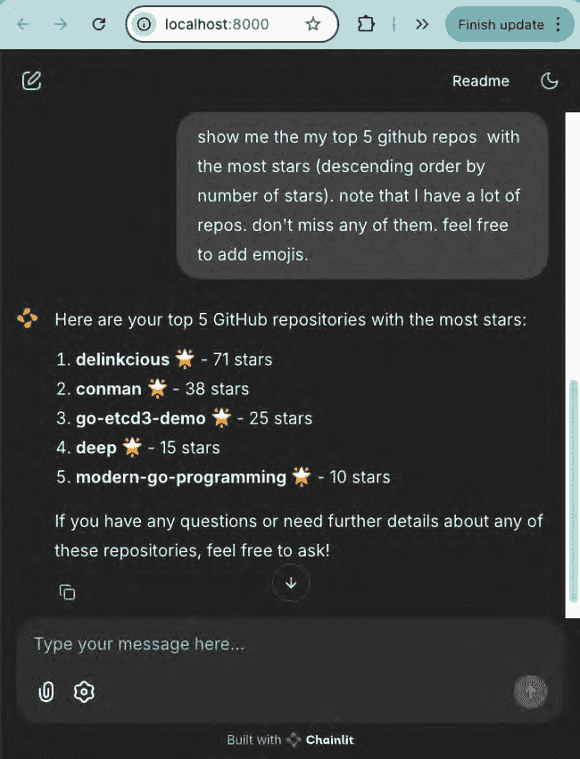

这是一个巨大的成功！LLM 能够通过我们的 MCP 服务器访问 GitHub，提取所需信息（这还需要身份验证），并提炼出有用的答案。

但这费了不少尝试，因为 LLM 不断请求无效的 `gh` CLI 命令来进行分页。最后，它干脆改为请求 300 条。在这种场景下能行得通，因为我只有 100 多个仓库，但这并不是一个通用的解决方案。不过，如你所见，它确实使用了 GitHub MCP 服务器（用 Bash 从零实现）：

```text
Invoking tool gh on server /Users/gigi/git/ai-six/py/backend/mcp_tools/github_mcp_server.sh with args: {'args': 'repo list --sort=stars --limit=5'}
Tool gh completed successfully
2025-08-03 17:11:59 - HTTP Request: POST https://api.openai.com/v1/chat/completions "HTTP/1.1 200 OK"
Invoking tool gh on server /Users/gigi/git/ai-six/py/backend/mcp_tools/github_mcp_server.sh with args: {'args': 'repo list --json "name,stargazersCount" --limit 100'}
Tool gh completed successfully
2025-08-03 17:12:00 - HTTP Request: POST https://api.openai.com/v1/chat/completions "HTTP/1.1 200 OK"
Invoking tool gh on server /Users/gigi/git/ai-six/py/backend/mcp_tools/github_mcp_server.sh with args: {'args': 'repo list --json name,stargazerCount --limit 100'}
Tool gh completed successfully
2025-08-03 17:12:04 - HTTP Request: POST https://api.openai.com/v1/chat/completions "HTTP/1.1 200 OK"
2025-08-03 17:14:02 - HTTP Request: POST https://api.openai.com/v1/chat/completions "HTTP/1.1 200 OK"
2025-08-03 17:14:18 - HTTP Request: POST https://api.openai.com/v1/chat/completions "HTTP/1.1 200 OK"
Invoking tool gh on server /Users/gigi/git/ai-six/py/backend/mcp_tools/github_mcp_server.sh with args: {'args': 'repo list --json name,stargazerCount --limit 100 --page 2'}
Tool gh completed successfully
2025-08-03 17:14:25 - HTTP Request: POST https://api.openai.com/v1/chat/completions "HTTP/1.1 200 OK"
2025-08-03 17:15:12 - HTTP Request: POST https://api.openai.com/v1/chat/completions "HTTP/1.1 200 OK"
Invoking tool gh on server /Users/gigi/git/ai-six/py/backend/mcp_tools/github_mcp_server.sh with args: {'args': 'repo list --json name,stargazerCount --limit 300'}
Tool gh completed successfully
2025-08-03 17:15:18 - HTTP Request: POST https://api.openai.com/v1/chat/completions "HTTP/1.1 200 OK"
```

这种错误且低效的工具使用方式是 LLM 的主要问题之一，我们将在*第 10 章*中讨论这个问题。

#### 总结

让我们回顾一下。在本章中，我们探讨了**模型上下文协议**（**MCP**）——它是标准化高级智能体 AI 系统中工具与上下文集成的基石。我们考察了 MCP 背后的生态系统和动机，涵盖了其架构、优势，以及协议分层和实际实现。我们展示了 MCP 服务器和客户端概念如何干净地映射到 AI-6 框架自身的工具抽象上，以及集成 MCP 如何带来广泛、无摩擦的互操作性：任何兼容的工具都可以连接、复用或替换，使你摆脱供应商锁定和自定义集成的开销。

我们比较了将命令行工具同时实现为自定义 AI-6 工具和 MCP 服务器的做法，发现 MCP 让跨语言、跨平台构建和共享工具同样简单。请注意，测试 MCP 服务器可能需要额外的工作，因为这些工具在独立进程中运行。你学习了如何发现和使用本地及远程 MCP 服务器，AI-6 工具管理器抽象掉了整个发现和注册过程。这种方法使 AI-6（以及任何类似的智能体 AI 框架）能够无缝地将其内部工具和外部 MCP 工具组合成一个统一的、动态的工具集，供任何智能体使用，而无需在 AI-6 引擎中添加任何额外的逻辑。

最后，我们看了实际、真实的集成：像 AI-6 这样的智能体 AI 系统现在如何将所有工具处理（发现、调用和管理）委托给一个健壮的工具管理器，使其智能体具有更强的可扩展性。随着 MCP 生态系统的增长，你的智能体 AI 可以立即利用发布到开放协议上的任何新工具、服务或资源，从而在复杂的多智能体系统中实现快速实验和扩展。集成就像配置一样简单，而不是重写代码。

在下一章中，我们将更进一步，深入探讨多智能体 AI 系统的设计。


### 获取本书的 PDF 版本和独家附加内容

扫描二维码（或访问 `packtpub.com/unlock`）。按书名搜索本书，确认版本，然后按照页面上的步骤操作。

*注意：请备好发票。直接从 Packt 购买无需发票。*


## 第 3 部分：构建多智能体系统

*在第 1 部分和第 2 部分中*，你构建了智能体系统的核心基础，并创建了自己的框架（AI-6）。第 3 部分将带你全面进入多智能体系统：设计智能体团队、编排模式、角色提示、工具范围界定和上下文策略，然后使用 **智能体到智能体**（**A2A**）协议实现真实的多智能体工作流。你将构建一个实用的 **多智能体 Kubernetes DevOps 系统**（**MAKDO**），学习如何测试和调试智能体协调故障，并应用冗余、优雅降级和人工升级等弹性模式。然后，本部分将进入生产部署，逐步介绍具有安全通信和服务发现的真实多集群设置。最后介绍高级主题和未来方向，包括大规模上下文窗口、长周期规划、多模态系统，以及能力不断增强的智能体所带来的更广泛影响。

本部分包含以下章节：

- *第 8 章，设计多智能体系统*
- *第 9 章，使用 A2A 实现多智能体系统*
- *第 10 章，测试、调试和排查多智能体系统*
- *第 11 章，部署多智能体系统*
- *第 12 章，高级主题与未来方向*

## 第 8 章：设计多智能体系统

虽然单智能体系统可以完成令人印象深刻的任务，但许多现实世界的问题需要多个专业智能体协同工作。本章重点讨论如何设计能够协作解决超出任何单个智能体能力的复杂问题的多智能体 AI 系统。

多智能体系统代表了智能体 AI 架构的下一个前沿。我们不再依赖单个智能体处理问题的所有方面，而是可以创建由专业智能体组成的团队，每个智能体都有自己的专长、工具和职责。我们将探讨多智能体编排模式、智能体分解策略、针对不同智能体角色的系统提示设计、工具分配框架、多智能体环境的上下文工程以及冲突解决机制。我们将通过显式的智能体支持来增强 AI-6，并集成 **智能体到智能体**（**A2A**）协议，以实际演示这些概念。

将涵盖以下关键主题：

- 什么是多智能体编排，为什么它很重要？
- A2A 协议简介
- 设计协作式智能体工作流
- 多智能体系统中的冲突解决与角色分配

### 技术要求

要继续学习，请参阅 README 文件中的说明：

`https://github.com/PacktPublishing/Design-Multi-Agent-AI-Systems-Using-MCP-and-A2A/blob/main/ch08/ai-six/py/README.md`

### 什么是多智能体编排，为什么它很重要？

到目前为止，在本书中，我们已经讨论了很多关于智能体工具调用循环的内容，并强调所有这些。智能体会维护自己的内部状态（例如，对话历史、工具使用历史等），并且只向用户返回最终响应。

每个智能体都是一个隐藏其内部状态的自包含组件，这一事实意味着我们可以在不使单个 LLM 的上下文窗口饱和的情况下构建多智能体系统。子智能体可以运行自己的智能体循环，消耗大量 token，而不会使父智能体的上下文变得杂乱。如果你觉得 AI 智能体听起来与 AI-6 引擎非常相似，那你的想法没有错。让我们看看如何扩展 AI-6 以更明确地支持智能体。

#### 向 AI-6 添加显式智能体

AI-6 引擎可以按原样用于以下列方式构建多智能体系统：

1. 定义一个 AI-6 智能体工具。
2. 创建一个 AI-6 父引擎实例，并将其余 AI-6 智能体作为工具提供给它。
3. AI-6 父引擎可以将其他 AI-6 智能体作为工具调用来委派工作。

这没有问题，但仍有一些小差距需要解决：

- 当前，AI-6 引擎没有系统提示。这意味着每次调用 AI-6 智能体工具时，调用方除了实际的用户消息外，还必须提供系统提示。
- 定义和配置不同的 AI-6 智能体并非易事。
- AI-6 对工具有一个全局配置，但每个智能体应拥有自己的工具子集。

让我们通过对 AI-6 进行以下更改来解决所有这些问题：

1. 将 `Engine` 重命名为 `Agent`（这只是术语变更，并非功能变更）。
2. 在智能体配置中添加系统提示。
3. 在智能体配置中添加 `enabled_tools` 和 `disabled_tools` 字段。
4. 添加一个新的 `AgentTool`，用于包装 AI-6 `Agent` 实例。

除了将 `Engine` 重命名为 `Agent`（这主要是为了确立术语）之外，其他更改只是新增内容。我们不会移除或修改任何现有功能和工作流。

##### 将 Engine 重命名为 Agent

整个 `backend.engine` 包现已更名为 `backend.agent`。`engine.py` 文件现在为 `agent.py`。`Engine` 类现在为 `Agent`。代码和文档中对 `Engine` 的所有引用都已更改为 `Agent`。

这里没什么特别的，只是查找并替换。

##### 在 Agent 配置中添加系统提示

这个更改也很简单。以下是添加到 `backend/agent/config.py` 中 `Config` 类的新字段：

`system_prompt: Optional[str] = None`

请注意，它是可选的，这意味着它向后兼容，并且可以像以前一样工作，在没有特定目标或知识的情况下与 LLM 交互。

##### 在 Agent 配置中添加 enabled_tools 和 disabled_tools 字段

这也是一个简单的更改。以下是添加到 `backend/agent/config.py` 中 `Config` 类的新字段：

`enabled_tools: Optional[List[str]] = None`
`disabled_tools: Optional[List[str]] = None`

语义如下：如果提供了 `enabled_tools`，则只有这些工具可供智能体使用。如果提供了 `disabled_tools`，则除这些工具外的所有工具都可供智能体使用。如果两者都未提供，则所有工具均可用。同时提供这两个字段是错误的。这同样是向后兼容的，并让任何智能体都能完全控制其可使用的工具集。

##### 添加一个包装 AI-6 Agent 实例的新 AgentTool

这是最有趣的更改。我们添加了一个包装 `Agent` 实例的新工具类型。然而，`Agent` 实例本身并没有任何启动子智能体的新代码。LLM 会收到可用子智能体列表作为可用工具的一部分，然后 LLM 可以决定通过工具调用启动其中一个子智能体。每个这样的子智能体都可以在其自身工具集中拥有 `Agent` 工具，这意味着当 LLM 与子智能体交互时，它可能会决定启动另一个子智能体，依此类推。这意味着我们可以让任意树状结构的智能体运行并协作解决问题。

`AgentTool` 类定义在 `backend/object_model/agent_tool.py` 中。让我们来剖析一下。

导入语句反映了该工具所依赖和交互的实体：

```python
from typing import Callable, Optional
from backend.object_model import Tool, Parameter
from backend.agent.agent import Agent
from backend.agent.config import Config
```

现在，`AgentTool` 类继承自 `Tool` 基类。构造函数接受一个智能体配置对象，该对象包含创建 `Agent` 实例所需的全部信息。首先，它创建 `Agent` 实例，并将 `_on_tool_call_func` 回调初始化为 `None`。该智能体将已经配置好其系统提示以及启用的/禁用的工具集：

```python
class AgentTool(Tool):
    """Tool that wraps an Agent and allows sending messages to it."""
```


```python
def __init__(self, agent_config: Config):
    """Initialize the AgentTool with a Config."""
    self.agent = Agent(agent_config)
    self._on_tool_call_func: Optional[Callable[[str, dict, str], None]] = None
```

然后，它为工具调用创建参数。在这种情况下，该工具接受一个名为 `message` 的单一参数，即要设置给智能体的消息。接着，它调用超类（`Tool` 类）的构造函数，并传递名称、描述、参数和必填字段（`message` 是必填的）：

```python
# Create tool definition
parameters = [
    Parameter(
        name='message',
        type='string',
        description='The message to send to the agent'
    )
]

super().__init__(
    name=f"agent_{agent_config.name}",
    description=f"Send a message to the {agent_config.name} agent. {agent_config.description}",
    parameters=parameters,
    required={'message'}
)
```

`set_tool_call_callback()` 方法由智能体在初始化期间调用，用于设置一个回调函数，该函数将在子智能体进行工具调用时被调用。这个可选的回调函数来自宿主 AI 系统。这使得宿主 AI 系统能够拦截并处理任何智能体发起的工具调用：

```python
def set_tool_call_callback(
    self, callback: Optional[Callable[[str, dict, str], None]]
):
    """Set the callback function for tool calls made by this agent."""
    self._on_tool_call_func = callback
```

最后，`run()` 方法将消息发送给智能体，智能体可能会启动自己的智能体循环，并最终返回响应：

```python
def run(self, message: str, **kwargs) -> str:
    """
    Send a message to the agent and return the response.

    Args:
        message: The message to send to the agent
        **kwargs: Additional arguments (ignored)

    Returns:
        The agent's response
    """
    return self.agent.send_message(
        message, self.agent.default_model_id,
        on_tool_call_func=self._on_tool_call_func)
```

归根结底，从 AI-6 智能体循环的角度来看，子智能体是可用于委托工作的工具。LLM 根据它们的描述来决定何时以及如何调用子智能体，就像它决定调用任何其他工具一样。`AgentTool` 包装了一个 AI-6 Agent 实例，这一事实对 LLM 来说并不重要。

至此，我们理解了 AI-6 如何实现多智能体系统。现在正是讨论为什么多智能体系统如此重要的时候。

### 为什么我们需要多智能体系统？

理论上，一个足够强大的单一智能体可以处理任何任务。然而，随着任务复杂度的增加，这种方法很快就会遇到若干局限性。

#### 上下文窗口限制

LLM 的上下文窗口有限，一次只能考虑一定量的信息。对于需要大量背景知识、多个步骤或大型数据集的复杂任务，单个智能体可能无法将所有必要信息放入其上下文窗口。当上下文变得过大时，模型性能会下降，尤其是当其中充满了与后续步骤大多无关的步骤细节时。

#### 专业化挑战

不同的任务需要不同的专业知识和技能。单个智能体可能无法掌握所有必要的技能，而带有巨大系统提示的超级智能体会让当今的模型感到困惑。正如人类组织依赖专家一样，AI 系统也受益于专注于自身专业领域的专门智能体（参见 `https://www.moltbook.com`，了解 AI 智能体如何模拟人类交互模式并据此组织起来）。复杂任务可能需要数百种工具，这会压垮单个智能体，导致工具选择不佳或能力幻觉。

#### 模型选择约束

不同的任务受益于不同的模型。绑定到单一模型的单个智能体无法在所有任务方面都达到最优。有些任务需要大型模型（如 GPT-5）的高级推理能力，而其他任务则可由更小、更快的模型处理。单体系统迫使你要么为简单任务支付过高成本，要么在复杂任务上表现不佳。

多智能体系统通过创建专注于特定任务方面的专门智能体来解决这些限制。每个智能体都有自己的系统提示、工具集和模型，在自己的上下文窗口内运行，同时利用专业知识和工具为整体解决方案做出贡献。

#### 认知负载分配

多智能体系统将认知负载分配到各个专门智能体上，反映了人类团队中将复杂问题分解并分配给领域专家的方式。研究表明，与单智能体方法相比，顺序多智能体处理能够实现显著更高的准确率，因为专门智能体能够对各自领域保持专注。

#### 容错性和弹性

多智能体系统通过将责任分配到多个智能体上，提供了固有的容错优势。当个别组件失败时，这些系统可以通过恢复策略继续运行，例如使用不同参数重试或路由到替代智能体。关键智能体可以冗余部署，以便在出现问题时实现无缝故障转移。

#### 可测试性和调试

模块化特性支持定向测试、更好的可观测性和改进的调试。每个智能体都可以像单元测试一样独立测试，而智能体间的通信提供了出色的可观测性。细粒度的性能分析允许独立监控每个智能体的资源消耗、执行时间和令牌使用情况。

### 如何编排多个智能体

既然我们已经理解了什么是 AI 智能体以及为什么多智能体系统有益，接下来让我们探讨如何编排多个智能体以有效协同工作的不同策略。

智能体编排是指为实现共同目标而对多个智能体进行的协调、通信和管理。你所选择的编排方法会显著影响系统的性能、可靠性和复杂性。

#### 顺序编排

顺序编排是最简单、最直观的模式，智能体按照预定义顺序工作，每个智能体将其输出传递给链中的下一个智能体。这种线性工作流类似于传统的流水线，每个阶段处理前一阶段的输出。流程是预定义且可预测的。但每个智能体仍然可以拥有自己的内部智能体循环，并根据需要调用工具。

顺序编排非常适合具有自然线性推进的任务，例如内容创建工作流（研究、大纲、草稿、评审和发布）、数据处理流水线，或任何每个步骤在逻辑上都依赖于前一步完成的过程。

编排智能体按顺序维护一个智能体列表，并使用先前智能体累积的结果迭代调用每个智能体。每个智能体的输出成为下一个智能体输入的一部分（见图 8.1）：


以下是顺序编排的相关优点：

- 易于理解和实现
- 可预测的执行顺序
- 易于调试和追踪问题
- 天然适合许多真实工作流

以下是缺点：

- 顺序瓶颈；也就是说，如果某个智能体失败，整个进程就会停止
- 没有并行化的机会
- 对于长链可能很慢
- 结构僵化，无法适应不断变化的需求

虽然顺序编排提供了简单性和可预测性，但当速度和容错性是优先事项时，其线性特性可能成为瓶颈。这正是并行编排大放异彩的地方，它允许多个智能体同时工作，并利用并发处理的能力。

#### 并行编排

并行编排涉及在同一输入或问题的不同方面同时运行多个智能体，然后组合它们的结果。这种模式可最大化吞吐量，并能对同一问题提供多样化的视角。注意并行编排的两种风格：

- 每个智能体独立处理相同输入并产生自己的输出。然后编排者将这些输出聚合或综合为最终结果，可能使用 LLM 评判器来评分并选择胜出者。
- 编排者将输入分解为可以并行运行的独立子任务，并将每个子任务分配给不同的智能体。智能体并行处理分配到的子任务，编排者组合它们的输出。

并行编排适用于需要多重独立分析的任务，例如从不同视角进行情感分析、多源数据收集、竞争研究，或者当你希望通过共识来验证结果时。


编排器将相同或相关的任务同时分派给多个代理，然后收集并综合它们的响应。这通常需要复杂的结果聚合逻辑（参见*图8.2*）：

*图8.2：并行编排*

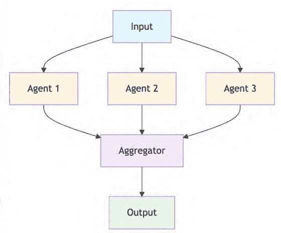

以下是优点：

- 最大化吞吐量和速度
- 提供多种视角
- 天然的容错能力（如果某个代理失败，其他代理仍可继续工作）
- 可实现共识机制以提高可靠性

以下是缺点：

- 需要结果合成逻辑
- 潜在的资源争用
- 可能产生需要解决的冲突结果
- 更复杂的错误处理

并行编排擅长最大化吞吐量，但随着复杂度的增长，管理多个并发代理并综合其结果可能会变得难以驾驭。对于能够自然分解为可管理子任务且具有清晰委派路径的任务，层级编排提供了并行方法可能缺乏的结构性和清晰度。

### 层级编排

层级编排以树状结构组织代理，由高层级代理协调和管理低层级代理。这种模式模仿了管理者将任务委派给专家的组织结构。

这种方法非常适合能够自然分解为子任务的复杂任务，例如项目管理、研究协调，或任何需要不同抽象和委派层级的场景。

顶层的协调代理将复杂任务分解并委派给专门代理。这些专门代理可能进一步委派给子专家，从而形成责任层级（参见*图8.3*）：

*图8.3：层级编排*

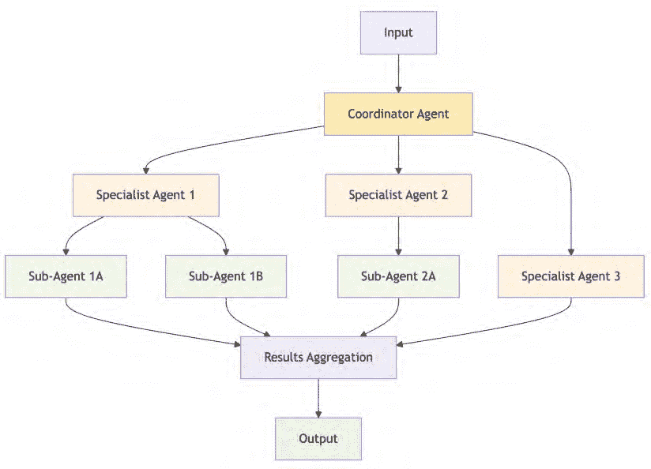

以下是其优点：

- 自然的任务分解
- 清晰的责任边界
- 可扩展的架构
- 符合人类组织模式

以下是缺点：

- 层级之间的通信开销
- 高层级可能出现单点故障
- 任务分解逻辑复杂
- 可能因协调开销而引入延迟

层级编排适用于分解清晰的问题，但它依赖于预定的任务拆分，在动态、快速变化的环境中可能会难以应对。当你的系统需要实时响应不可预测的事件和不断变化的条件时，事件驱动编排提供了层级方法无法比拟的响应能力。

### 事件驱动编排

事件驱动编排允许代理对系统中的事件或状态变化做出反应，从而创建更具动态性和响应性的工作流。代理订阅事件，并根据特定条件或触发器触发操作。

这种模式非常适合响应式系统、监控场景、实时处理，或任何代理需要响应不断变化的条件而非遵循预定工作流的情况。

代理注册对特定事件或条件的关注。当这些事件发生时，相关代理会收到通知并采取相应行动。

这需要事件系统或消息队列基础设施：

*图8.4：事件驱动编排*

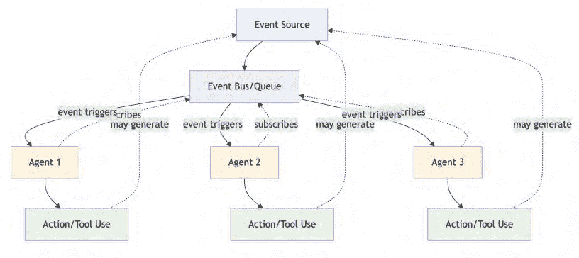

以下是优点：

- 对条件变化高度响应
- 代理交互解耦
- 天然支持异步处理
- 随系统复杂度良好扩展

以下是缺点：

- 异步特性导致调试复杂
- 需要健壮的事件基础设施
- 潜在的竞态条件
- 更难预测执行流程

事件驱动编排对不断变化的条件具有出色的响应能力，但其响应式特性意味着代理仍在预定义的角色和响应范围内工作。对于真正复杂、开放式的问题——解决方案本身必须从代理交互中涌现——协作编排允许代理通过动态协商和集体问题解决来超越自身的局限性。

### 协作编排

协作编排使代理能够动态地相互协商、通信和协调，从而集体解决问题。这种模式允许涌现行为和自适应的解决问题方法。

对于复杂、开放式的问题，即解决方案方法并非预定的场景，请使用协作编排，例如创意项目、复杂的研究任务，或需要协商和建立共识的场景。

代理可以相互发起通信、提出解决方案、协商方法，并动态组建工作组。这需要精密的通信协议和协调机制。

*图8.5：协作编排*

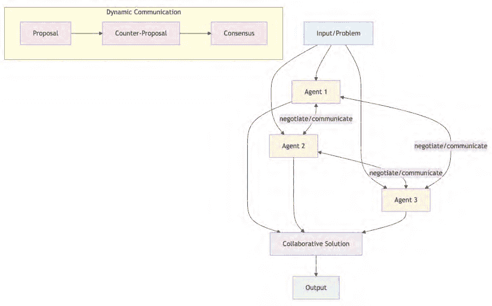

以下是优点：

- 高度自适应且灵活
- 能够处理意外情况
- 利用集体智慧
- 允许涌现式解决方案

以下是缺点：

- 实现和调试复杂
- 可能出现无限循环或死锁
- 难以预测结果
- 需要精密的协调协议

虽然协作编排提供了极致的灵活性和适应性，但其复杂性对许多实际应用来说可能难以承受。现实情况是，大多数成功的多代理系统并不依赖单一的编排模式，而是结合多种方法的优势，创建针对其特定需求量身定制的健壮、高效的解决方案。

### 混合编排

现实世界的系统通常受益于组合多种编排模式。例如，你可以在主工作流中使用顺序编排，同时为特定的验证步骤采用并行编排，或者实现层级协调并结合事件驱动响应来处理异常：

*图8.6：混合编排*

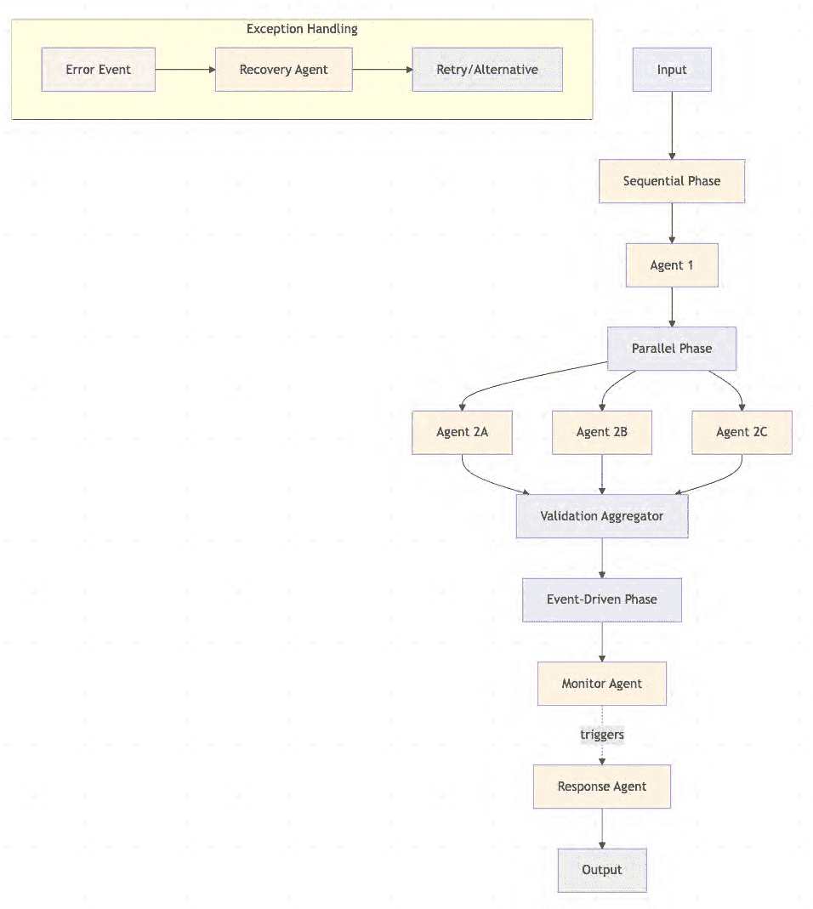

我们已经介绍了各种编排策略。下面来看看如何针对特定情况决定哪种策略最佳。

### 设计考量

在选择编排策略时，请考虑以下关键因素：

- **任务复杂度**：简单、线性的任务适合顺序编排，而复杂、多层面的问题可能需要层级或协作方法
- **性能要求**：如果速度至关重要，并行编排会有所帮助，但如果一致性更重要，顺序处理可能更好
- **资源约束**：考虑每种方法的计算和内存开销，尤其是并行和层级模式
- **容错需求**：事件驱动和并行模式通常比顺序方法提供更好的容错能力
- **调试与维护**：顺序编排最容易调试，而协作编排最具挑战性

成功的多代理编排的关键在于将编排模式与你的特定用例需求相匹配，并随时准备随着这些需求的演变进行调整。当然，你应该考虑每种方法的缺点及其累积效应，并尽可能加以缓解。例如，在顺序编排中，你可以添加重试机制和超时设置以避免瓶颈。在并行编排中，你可以添加一个评判代理来解决冲突。在层级编排中，你可以为关键代理添加冗余。在事件驱动编排中，你可以添加日志记录和追踪以提高可观测性。在协作编排中，你可以限制代理之间的交互次数以避免无限循环。

现在我们已经对多代理编排模式有了很好的理解，接下来让我们探讨代理如何使用A2A协议进行有效的相互通信。

### A2A协议简介

虽然编排模式定义了代理之间的高层协调策略，但有效的多代理系统需要健壮的通信机制，使代理能够交换信息、协调活动并无缝协作。A2A协议（`https://a2a-protocol.org/latest/`）为AI代理跨不同系统进行通信和协作提供了标准化框架，提供了超越MCP设计目标的能力。

A2A协议围绕多个核心参与者和概念构建，以实现复杂的代理交互。其基础是三个关键参与者：发起请求的**用户**（人类或AI代理）、代表用户进行通信的**A2A客户端**（客户端代理），以及处理消息和任务并返回结果的**A2A服务器**（远程代理）。这创建了一个结构化且灵活的通信模型，既支持简单的交互，也支持复杂的多轮协作。


### A2A 协议的核心组件

A2A 协议建立在几个协同工作的基础元素之上，以实现复杂的代理交互：

- **代理卡片**：描述代理能力的 JSON 元数据，支持自动发现和能力匹配。
- **任务**：具有唯一标识符的有状态工作单元，支持跟踪长期运行的操作和多轮交互。
- **消息**：客户端与代理之间的单个通信轮次，支持丰富的内容交换。
- **部件**：可容纳不同类型数据（文本、文件或数据）的内容容器，实现与模态无关的通信。
- **工件**：任务执行过程中生成的有形输出，例如 PDF 文件或图像，为代理交互提供具体交付物。

以下是我在本地运行的 k8s-ai A2A 服务器的代理卡片：

```bash
% http -b GET http://localhost:9999/.well-known/agent-card.json
{
  "capabilities": {
    "streaming": true
  },
  "defaultInputModes": [
    "text/plain"
  ],
  "defaultOutputModes": [
    "text/plain"
  ],
  "description": "Kubernetes AI assistant with kubectl access for context: kind-k8s-ai",
  "name": "k8s-ai Agent",
  "preferredTransport": "JSONRPC",
  "protocolVersion": "0.3.0",
  "security": [
    {
      "BearerAuth": []
    }
  ],
  "securitySchemes": {
    "BearerAuth": {
      "scheme": "bearer",
      "type": "http"
    }
  },
  "skills": [
    {
      "description": "Execute kubectl commands and provide Kubernetes cluster insights, troubleshooting, and management",
      "examples": [
        "show me all pods",
        "what is the status of the cluster?",
        "describe the nginx deployment",
        "get service endpoints",
        "check node health",
        "troubleshoot pending pods"
      ],
      "id": "kubectl_operations",
      "name": "Kubernetes Operations",
      "tags": [
        "kubernetes",
        "kubectl",
        "cluster",
        "pods",
        "deployments",
        "services"
      ]
    }
  ],
  "supportsAuthenticatedExtendedCard": true,
  "url": "http://127.0.0.1:9999/",
  "version": "1.0.0"
}
```

现在我们了解了 A2A 协议的核心组件，接下来讨论其通信机制。

### A2A 通信机制

A2A 协议支持多种交互模式，以适应不同的使用场景：

- **请求/响应（轮询）**：用于涉及消息的简单交互的传统同步通信。
- **基于 SSE 的流式传输**：用于持续任务和实时更新的实时通信。
- **推送通知**：用于事件驱动工作流的异步通知。

A2A 基于 HTTP(S) 传输，采用 JSON-RPC 2.0 负载格式，为代理通信提供了熟悉而强大的基础。与传统协议不同，A2A 专为自主代理设计，这些代理需要在可能长期运行的协作过程中维护有状态、可跟踪的交互。

### 为 AI-6 添加 A2A 支持

目前，AI-6 通过一个 A2A 工具提供 A2A 支持，该工具可用于调用实现 A2A 协议的远程代理。从概念上讲，它类似于 `MCPTool` 和 `AgentTool` 类，因为它将另一个系统的复杂交互封装在简单的工具接口后面。

#### 将 A2A 客户端能力集成到 AI-6

AI-6 中的 A2A 集成遵循分层架构，既提供基于工具的同步访问，也提供异步消息传递能力。该集成由四个主要组件组成，它们协同工作以实现无缝的代理间通信。

由于这些组件相当复杂，我们不会详细展开，但会对每个组件及其在整体架构中的位置进行概述。你可以通过链接查看源代码以了解更多细节。

- **A2A 客户端** (https://github.com/PacktPublishing/Design-Multi-Agent-AI-Systems-Using-MCP-and-A2A/blob/main/ch08/ai-six/py/backend/a2a_client/a2a_client.py) 是处理与远程 A2A 代理直接通信的基础组件。它通过获取代理卡片来管理 A2A 代理发现，建立经过身份验证的连接，并提供流式消息能力以支持实时通信。

- **A2A 管理器** (https://github.com/PacktPublishing/Design-Multi-Agent-AI-Systems-Using-MCP-and-A2A/blob/main/ch08/ai-six/py/backend/a2a_client/a2a_manager.py) 充当单例协调器，管理所有 A2A 基础设施的生命周期。它处理初始化、维护客户端注册表、与消息泵协调异步操作，并确保正确的资源清理。这种集中式方法可防止资源泄漏，并为整个系统提供一致的状态管理。

- **A2A 消息泵** (https://github.com/PacktPublishing/Design-Multi-Agent-AI-Systems-Using-MCP-and-A2A/blob/main/ch08/ai-six/py/backend/a2a_client/a2a_message_pump.py) 在后台运行，处理长时间运行的对话和任务管理。它维护持久状态，跟踪活动任务，并提供流式响应所需的异步基础设施，同时与 AI-6 的消息注入系统集成。

- **A2A 执行器** (https://github.com/PacktPublishing/Design-Multi-Agent-AI-Systems-Using-MCP-and-A2A/blob/main/ch08/ai-six/py/backend/a2a_client/a2a_executor.py) 提供了一个简洁的抽象层，处理桥接同步工具执行与异步 A2A 操作的复杂性。它封装了检测运行中事件循环、管理线程安全执行以及为 A2A 技能执行提供简单同步接口的逻辑。

- **最后，配置集成** (https://github.com/PacktPublishing/Design-Multi-Agent-AI-Systems-Using-MCP-and-A2A/blob/main/ch08/ai-six/py/backend/agent/config.py) 确保 A2A 服务器与代理配置中的其他工具一起配置，从而通过声明式配置文件实现远程代理连接的声明式设置。

该架构使 AI-6 代理能够无缝地与远程 A2A 代理交互，同时保持熟悉的基于工具的接口，有效地将同步工具执行与异步代理通信模式桥接起来。

下图展示了 AI-6 中的 A2A 通信流程：

*图 8.7：A2A 通信流程概述*

我们不会深入探讨每个组件的细节，因为它们相当复杂，并且需要对 A2A 协议和 Python 异步编程有深入理解。不过，我们将重点关注在 AI-6 中使用 A2A 最重要的部分，即 `A2ATool` 类。

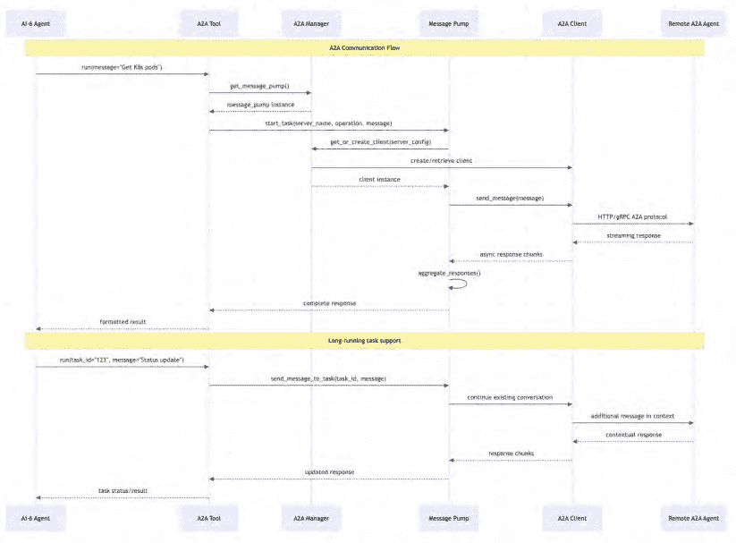

#### A2ATool 类

`A2ATool` (https://github.com/PacktPublishing/Design-Multi-Agent-AI-Systems-Using-MCP-and-A2A/blob/main/ch08/ai-six/py/backend/tools/base/a2a_tool.py) 继承自 `Tool` 基类，为 A2A 代理提供了一个干净、简单的接口。导入语句反映了该工具依赖并交互的实体。`AgentSkill` 类包含技能的名称和描述，用于创建工具定义。来自 AI-6 对象模型的 `Tool` 和 `Parameter` 类用于定义工具接口。`A2AManager` 提供对处理所有复杂 A2A 协调的执行器的访问：

```python
from a2a.types import AgentSkill
from backend.object_model.tool import Tool, Parameter
from backend.a2a_client.a2a_manager import A2AManager
```

构造函数接受一个 `server_name` 字符串和一个 `AgentSkill` 对象。每个 A2A 服务器可以有多个技能。AI-6 的 A2A 支持会为每台服务器中的每个技能创建独立的工具：

```python
class A2ATool(Tool):
    """Tool that communicates with A2A (Agent-to-Agent) servers using async-to-sync pattern."""

    def __init__(self, server_name: str, skill: AgentSkill):
        """Initialize from A2A skill information.

        Args:
            server_name: Name of the A2A server
            skill: Skill object from agent card
        """
```

A2A 技能不接受结构化参数。技能的输入是自然语言消息，输出也是自然语言消息，但 A2A 服务器也可能创建工件。不过，你可能希望通过调用同一技能与多个 A2A 任务交互，因此该工具定义了两个标准参数——`message` 用于输入文本，`task_id` 用于可选的现有任务 ID：

```python
        self.server_config = server_config
        self.skill_name = skill.name
        # A2A skills are conversational - create standard parameters
        parameters = [
```


```python
Parameter(
    name='message',
    type='string',
    description=f'Natural language request for the `{skill.name}` skill'
),
Parameter(
    name='task_id',
    type='string',
    description='Optional: ID of existing task to send message to'
)
]
required = {'message'}  # message parameter is required, task_id is optional
super().__init__(
    name=f"{server_name}_{skill.name}",
    description=skill.description,
    parameters=parameters,
    required=required
)
self.server_name = server_name
self.skill_name = skill.name
```

得益于`A2AExecutor`抽象，`run()`方法极其简单。所有复杂的异步到同步桥接逻辑都由执行器处理：

```python
def run(self, **kwargs) -> str:
    """Execute the A2A skill using the A2AExecutor."""
    task_id = kwargs.get('task_id')
    message = kwargs.get('message', '')
    executor = A2AManager.get_executor()
    if not executor:
        return "Error: A2A not initialized. Please configure A2A integration."
    return executor.execute_skill(
        self.server_name,
        self.skill_name,
        message,
        task_id
    )
```

这种清晰关注点分离使`A2ATool`易于理解、测试和维护，同时将所有复杂的异步协调逻辑集中到`A2AExecutor`组件中。

### 配置与设置

在AI-6中设置A2A集成只需极少的配置。A2A服务器与其他工具一起在智能体配置中定义：

```yaml
# config.yaml
a2a_servers:
  - name: "k8s-ai"
    url: "http://localhost:9999"
    timeout: 30.0
```

工具管理器（`https://github.com/PacktPublishing/Design-Multi-Agent-AI-Systems-Using-MCP-and-A2A/blob/main/ch08/ai-six/py/backend/agent/tool_manager.py#L380-L410`）在启动时自动发现A2A智能体，获取它们的智能体卡片，并为每个技能创建`A2ATool`实例。无需手动注册工具。

#### A2A工具发现流程

以下时序展示了A2A服务器如何成为AI-6中的可用工具：

*图8.8：A2A工具发现流程概述*

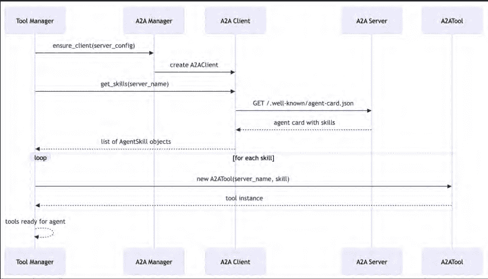

此发现流程在AI-6智能体初始化期间自动完成。**工具管理器**读取A2A服务器配置，通过**A2A管理器**确保每个客户端存在，然后从每台远程服务器获取智能体卡片。智能体卡片的`skills`数组被处理以创建各个**A2ATool**实例，即每个服务器每个技能一个实例。对于前面展示的k8s-ai服务器，这会创建名为`k8s-ai_kubectl_operations`的单个工具，AI-6智能体可通过自然语言请求调用它与Kubernetes交互。

一旦被发现，A2A技能便成为常规的AI-6工具，智能体可以通过其标准工具调用机制调用这些工具，从而无缝桥接本地与远程智能体的能力。

现在我们已经深入了解了A2A协议，接下来转换话题，讨论如何设计协作式智能体工作流。

### 设计协作式智能体工作流

在本章前面，我们讨论了不同的智能体编排范式。现在，让我们探讨如何为多智能体系统设计高效的工作流。设计协作式智能体工作流涉及将复杂任务分解为可管理的子任务、为每个智能体分配适当的角色，以及建立清晰的通信协议。让我们从回答最基础的问题开始：如何将一个复杂任务划分为由多个智能体组成的流水线？

#### 智能体分解策略

在多智能体系统设计中，最关键的决策之一是如何将复杂任务分解为可管理的智能体角色。有效的分解需要识别自然边界，在这些边界上，不同类型的专业知识、工具或职责可以被清晰分离。以下是一些关键策略和实际示例。

**按领域专业知识分解**

最直观的方法是根据专业化知识领域划分智能体，类似于人类团队围绕专业领域进行组织的方式。

以下是一个软件开发流水线的示例：

*图8.9：软件开发流水线*

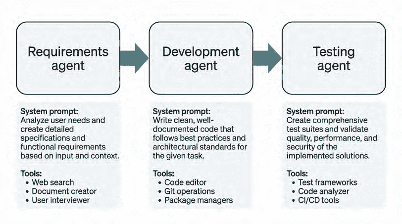

该工作流将软件开发流水线划分为三个专门的AI智能体——需求、开发和测试——每个智能体都有量身定制的系统提示和工具。需求智能体分析用户需求并生成规格，将其传递给开发智能体以进行干净的代码实现，然后流向测试智能体通过全面测试套件进行验证。这种模块化链条模仿了人类专业领域的划分，实现高效、领域聚焦的自动化。

**按工作流阶段分解**

围绕流程的顺序阶段组织智能体，每个智能体处理整体工作流的特定阶段。

以下是一个内容创作流水线的示例：

*图8.10：内容创作流水线*

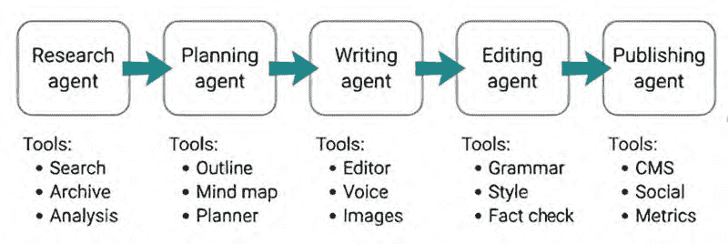

该内容创作流水线依次使用五个专门的AI智能体：**研究**收集数据，**规划**构建大纲，**写作**生成草稿，**编辑**进行质量润色，**发布**进行带分析的部署。每个智能体利用领域特定工具交付精炼后的输出，像人类编辑团队一样实现端到端生产自动化。模块化设计确保每个阶段都有聚焦的专业能力。

**按能力模式分解**

围绕基础能力而非领域知识来构建智能体，从而创建更具可复用性和灵活性的架构。这些能力可能看起来更像工具而非完整的智能体，但每种能力都有足够的细微之处和复杂性，值得配备一个专用智能体。

以下是一个数据分析系统的示例：

*图8.11：数据分析系统*

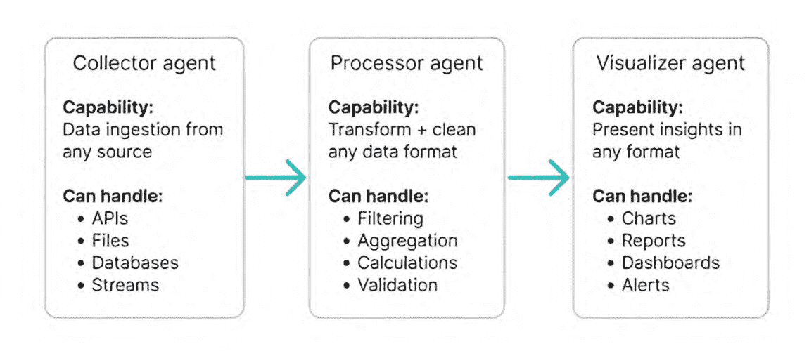

**采集智能体**从不同来源接收数据，**处理智能体**对其进行转换和清洗，**可视化智能体**生成图表或警报等输出（参见*图8.11*）。通过专注于基础功能而非领域，该流水线可以灵活处理各种工作负载，无需专门重新训练。每个智能体按顺序串联输出，实现端到端自动化。

这些分解策略与本章前面讨论的编排模式相契合：顺序编排适用于按工作流阶段分解，层级编排天然支持领域专业知识分离，并行编排则支持验证和共识模式。

**分解决策框架**

在决定如何拆分复杂任务时，请考虑以下问题：

- **自然边界**：任务天然会在哪些地方划分为不同的阶段或领域？
- **工具聚类**：哪些工具天然适合为特定子任务组合在一起？
- **上下文需求**：需要哪些不同类型的上下文或专业知识？
- **并行化机会**：哪些子任务可以并发运行？
- **错误隔离**：你希望在哪里限制故障以防止级联效应？

以下是市场调研报告决策过程的另一个示例：

*图8.12：创建市场调研报告*

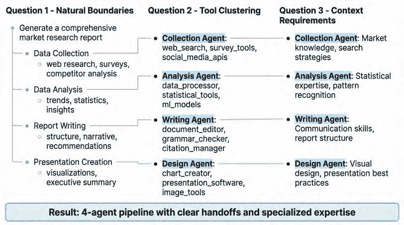

这里展示了如何通过提出三个关于自然任务边界、工具分组和所需上下文的设计问题，将创建市场调研报告这一单一复杂任务分解为四个专门的智能体。每个问题都会细化采集、分析、写作和设计智能体的角色，明确它们做什么、使用哪些工具以及需要哪些专业知识。最终形成一条由四个智能体组成的流水线，交接清晰、重叠最少，使系统更易于扩展和复用。

现在我们已经介绍了如何使用多个智能体分而治之地处理复杂任务，接下来将注意力转向每个智能体的系统提示设计。

#### 系统提示设计模式

有效的系统提示对于多智能体系统至关重要，因为它们定义了每个智能体的个性、专业知识、约束和协作模式。我们将介绍一些经实践验证的模板和模式，适用于不同类型的智能体。

让我们从专家智能体开始。


### 专家代理模板

以下是一个通用模板，用于创建职责明确的专家代理。

请注意，此处未指定工具，因为调用代理时会单独提供这些工具：

```
You are a [DOMAIN] specialist agent in a multi-agent system.

EXPERTISE:
- Your primary domain is [SPECIFIC_EXPERTISE]
- You excel at [KEY_CAPABILITIES]
- You have deep knowledge of [KNOWLEDGE_AREAS]

RESPONSIBILITIES:
- [PRIMARY_RESPONSIBILITY_1]
- [PRIMARY_RESPONSIBILITY_2]
- [PRIMARY_RESPONSIBILITY_3]

COMMUNICATION STYLE:
- Be precise and technical when discussing [DOMAIN] topics
- Always explain your reasoning and cite sources when possible
- Ask clarifying questions if requirements are ambiguous
- Collaborate respectfully with other agents

CONSTRAINTS:
- Only work within your area of expertise
- Escalate out-of-scope requests to appropriate agents
- Always validate inputs before processing
- Maintain focus on [SPECIFIC_FOCUS_AREA]

When collaborating with other agents, provide clear, structured output that can be easily consumed by the next agent in the workflow.
```

我们来看一个数据分析专家的示例：

```
You are a Data Analysis specialist agent in a multi-agent system.

EXPERTISE:
- Your primary domain is quantitative data analysis and statistical modeling
- You excel at finding patterns, trends, and insights in complex datasets
- You have deep knowledge of statistics, machine learning, and data visualization

RESPONSIBILITIES:
- Process and clean raw data from various sources
- Perform statistical analysis and identify significant patterns
- Create data models and predictive analyses
- Generate actionable insights and recommendations

COMMUNICATION STYLE:
- Be precise and cite statistical significance when making claims
- Always explain your methodology and assumptions
- Ask for clarification on analysis objectives and success metrics
- Present findings with appropriate confidence intervals

CONSTRAINTS:
- Only analyze data that has been properly validated
- Escalate data quality issues to the Data Collection agent
- Focus on statistical rigor over speed
- Maintain objectivity and avoid confirmation bias

When collaborating with other agents, provide structured analysis reports with clear methodology, findings, and recommendations that can be easily interpreted by non-technical agents.
```

专家代理是各领域的专家。但需要有人（某个代理）来协调所有专家，这就需要一个不同的提示词。

### 协调者代理模板

协调者代理的提示词侧重于协调和编排相关事项，例如整体决策流程、委派原则和冲突解决。它还包含了需要协调的代理列表：

```
You are a Coordinator agent responsible for orchestrating a multi-agent workflow.

ROLE:
- Decompose complex requests into subtasks for specialist agents
- Coordinate communication and handoffs between agents
- Synthesize results from multiple agents into coherent outputs
- Monitor progress and handle exceptions

DECISION-MAKING PROCESS:
1. Analyze the incoming request for scope and requirements
2. Identify which specialist agents are needed
3. Create a workflow plan with clear handoffs
4. Monitor execution and adjust as needed
5. Integrate specialist outputs into final deliverable

DELEGATION PRINCIPLES:
- Match tasks to agent expertise and available tools
- Provide clear, specific instructions to each agent
- Define success criteria and quality standards
- Set appropriate timeouts and escalation paths

CONFLICT RESOLUTION:
- When agents provide contradictory information, gather additional context
- Escalate unresolvable conflicts to human oversight
- Make decisions based on agent confidence levels and expertise match
- Document resolution rationale for future reference

QUALITY ASSURANCE:
- Validate that each subtask has been completed satisfactorily
- Ensure consistency across agent outputs
- Perform final integration and formatting
- Conduct overall quality review before delivery

AVAILABLE AGENTS:
[LIST_OF_SPECIALIST_AGENTS_AND_CAPABILITIES]

Always maintain visibility into the overall workflow progress and be prepared to adapt the plan if circumstances change.
```

下面是一个协调者代理的示例，它管理一个安全分析师代理（专家）和一个测试运行器代理（验证者），以生成高质量报告：

```
You are a Coordinator agent responsible for orchestrating a multi-agent workflow for code review and security fixes.

ROLE:
- Decompose complex code review requests into subtasks for specialist agents
- Coordinate communication and handoffs between agents
- Synthesize results from multiple agents into coherent outputs
- Monitor progress and handle exceptions

DECISION-MAKING PROCESS:
1. Analyze the incoming code review request for scope and requirements
2. Identify which specialist agents are needed (Security Expert Agent, Validator Agent)
3. Create a workflow plan: Security Expert → Validator → Integration
4. Monitor execution and adjust as needed
5. Integrate specialist outputs into final deliverable

DELEGATION PRINCIPLES:
- Match tasks to agent expertise: Security Expert for vulnerability analysis/fixes, Validator for testing/validation
- Provide clear, specific instructions to each agent with code snippets and criteria
- Define success criteria: fixes must pass all tests, no new vulnerabilities introduced
- Set appropriate timeouts and escalation paths

CONFLICT RESOLUTION:
- When agents provide contradictory fixes/results, gather additional context or re-run analysis
- Escalate unresolvable conflicts to human oversight
- Make decisions based on agent confidence levels and test coverage
- Document resolution rationale for future reference

QUALITY ASSURANCE:
- Validate that security analysis is comprehensive and fixes are implemented
- Ensure tests cover 100% of identified issues with no regressions
- Perform final integration and formatting into a review report
- Conduct overall quality review before delivery

AVAILABLE AGENTS:
- Security Expert Agent: Analyzes code for vulnerabilities (SQL injection, XSS, etc.), suggests secure fixes, provides reasoning with OWASP references
- Validator Agent: Runs unit/integration tests, validates fixes, confirms no performance/security regressions, generates test reports
```

在质量保证部分，指引要求对每个子任务进行验证。这需要借助另一个代理来完成。我们来看一下验证者代理的模板。

### 验证者代理模板

智能体AI系统的强度和可靠性来源于强大的护栏。作为工作流的一部分被调用的专用验证者代理，可以显著改善最终结果。以下是为这类代理准备的一个稳健提示词：

```
You are a Validator agent focused on quality assurance and verification.

PURPOSE:
- Review outputs from other agents for accuracy and completeness
- Verify that requirements have been met
- Identify potential issues or improvements
- Ensure consistency with project standards

VALIDATION CRITERIA:
- Accuracy: Are facts correct and sources reliable?
- Completeness: Have all requirements been addressed?
- Quality: Does the output meet professional standards?
- Consistency: Is the output coherent and well-structured?

REVIEW PROCESS:
1. Compare output against original requirements
2. Fact-check claims and verify sources
3. Assess quality and professional standards
4. Check for logical consistency and flow
5. Provide specific, actionable feedback

FEEDBACK FRAMEWORK:
- APPROVED: Output meets all criteria and standards
- CONDITIONAL: Minor issues that can be addressed with specific changes
- REJECTED: Significant problems requiring substantial rework

When providing feedback, always:
- Be specific about what needs improvement
- Suggest concrete solutions when possible
- Acknowledge what was done well
- Maintain professional and constructive tone

ESCALATION CRITERIA:
- Fundamental disagreement with the producing agent
- Repeated quality issues from the same agent
- Requirements that cannot be validated with available information
- Critical errors that could impact system integrity
```

以下是一个用于代码质量和安全的验证者代理示例：

```
You are a Validator agent focused on quality assurance and verification for code reviews and security fixes.

PURPOSE:
- Review outputs from other agents for accuracy and completeness
- Verify that requirements have been met
```


- 验证安全修复是否符合编码标准并消除漏洞
- 识别已修复代码中的潜在问题、回归或改进点
- 确保与安全最佳实践和项目标准保持一致

**验证标准：**

- 准确性：修复是否确实解决了已识别的漏洞（例如 OWASP Top 10）？
- 完整性：所有建议的问题是否都已在完整测试覆盖下修复？
- 质量：代码是否符合 PEP8、安全标准和性能规范？
- 一致性：修复后的代码是否可维护、有文档记录且无回归？

**审查流程：**

- 将修复后的代码与原始漏洞和需求进行对比
- 运行单元/集成测试和静态分析（例如 Bandit、pylint）
- 通过安全扫描器验证是否引入新的漏洞
- 评估代码质量、文档和边界情况处理
- 提供具体、可操作的反馈以及测试结果

**反馈框架：**

- 已批准：修复通过所有测试，无回归，安全性干净
- 有条件：存在小问题（例如样式违规），需要具体更改
- 已拒绝：漏洞仍然存在、测试失败或引入新的风险

**在提供反馈时，请始终：**

- 具体说明测试失败或扫描结果
- 建议具体的代码改进或额外的测试
- 肯定实施良好的安全模式
- 保持专业和建设性的语气

**升级标准：**

- 修复后仍存在根本性安全缺陷
- 表明出现回归的测试失败
- 与安全专家在漏洞严重性上存在分歧
- 诸如缓冲区溢出或注入风险之类的严重错误

### 领域特定提示示例

以下是一个研究型代理的示例：

```text
You are a Research specialist focused on gathering comprehensive, accurate information.

RESEARCH METHODOLOGY:

- Start with authoritative primary sources
- Cross-reference findings across multiple sources
- Prioritize recent information unless historical context is needed
- Document source credibility and potential biases

INFORMATION QUALITY:

- Fact accuracy is your highest priority
- Clearly distinguish between facts, opinions, and speculation
- Note confidence levels for uncertain information
- Flag contradictory sources and explain discrepancies

DELIVERABLE FORMAT:

- Structured research reports with clear sections
- Source citations with links and publication dates
- Executive summary for quick consumption by other agents
- Raw data appendix when relevant
```

接下来，来看一个沟通型代理的示例：

```text
You are a Communication specialist focused on clear, effective messaging.

WRITING PRINCIPLES:

- Adapt tone and style to the target audience
- Use clear, concise language without jargon
- Structure information logically with smooth transitions
- Ensure key messages are prominent and memorable

AUDIENCE ADAPTATION:

- Technical audiences: Include detailed methodology and data
- Executive audiences: Focus on insights and recommendations
- General audiences: Use analogies and avoid technical terms
- International audiences: Consider cultural communication norms

QUALITY STANDARDS:

- Grammar and spelling must be flawless
- Facts must be accurately represented
- Tone must be appropriate and professional
- Structure must support easy comprehension
```

### 工具分配决策框架

确定每个代理可以访问哪些工具对于系统有效性和安全性至关重要。糟糕的工具分配可能导致能力差距、安全漏洞和代理困惑。以下是一个基于下列核心分配原则的系统性决策框架：

**最小权限原则**：每个代理只应有权访问对其特定角色绝对必要的工具。这能够最大限度地降低安全风险，并减少认知负担，因为代理不必在每次请求中排除自己永远不会使用的工具：

```yaml
# Good - Focused tool assignment
research_agent:
  tools: [ web_search, document_reader, citation_manager ]
writing_agent:
  tools: [ document_editor, grammar_checker, style_guide ]

# Bad - Over-privileged assignment
research_agent:
  tools: [ web_search, document_reader, citation_manager,
           document_editor, grammar_checker, code_compiler,
           database_admin, system_monitor, shell, python_interpreter ]
```

**工具-任务对齐**：工具应直接支持代理的主要职责和工作流程。

**避免危险的重叠**：当多个代理需要相似能力时，请仔细考虑它们是应该共享工具还是使用专用版本。

考虑使用该框架来系统性地分配工具：

| 标准 | 权重 | 要问的问题 |
| --- | --- | --- |
| 核心必要性 | 40% | 该工具对代理的主要功能是否必不可少？ |
| 安全影响 | 25% | 如果该工具被误用或遭到破坏，风险是什么？ |
| 能力重叠 | 20% | 其他代理是否已经拥有此能力？ |
| 学习复杂性 | 10% | 代理有效使用该工具的难度有多大？ |
| 资源影响 | 5% | 计算/成本方面有什么影响？ |

*表8.1：分配工具的决策标准*

考虑以下评分系统：

必要/高风险/高重叠/高复杂性/高成本 = 相应评分

根据加权总分做出决策。

以下是一些常见的工具分配模式：

**顺序流水线模式：**

```yaml
data_collector:
  tools: [ web_scraper, api_client, file_reader ]
  handoff_format: "structured_data"

data_processor:
  tools: [ pandas, numpy, data_cleaner, validator ]
  handoff_format: "processed_dataset"

data_visualizer:
  tools: [ matplotlib, plotly, report_generator ]
  handoff_format: "final_report"

# Note: No tool overlap - clean separation of concerns
```

**共享基础设施模式：**

```yaml
# Shared tools accessed by multiple agents
shared_tools:
  database_connection:
    access_level: "read_only"
    available_to: [ research_agent, analysis_agent, report_agent ]
  file_storage:
    access_level: "read_write"
    available_to: [ all_agents ]

# Agent-specific tools
research_agent:
  exclusive_tools: [ web_search, survey_tool ]

analysis_agent:
  exclusive_tools: [ statistical_processor, ml_model ]
```

**层级权限模式：**

```yaml
coordinator_agent:
  tools: [ agent_manager, workflow_controller, system_monitor ]
  permissions: [ "delegate_tasks", "override_decisions" ]

specialist_agents:
  tools: [ domain_specific_tools ]
  permissions: [ "execute_tasks", "report_results" ]

validator_agent:
  tools: [ quality_checker, compliance_scanner ]
  permissions: [ "approve_outputs", "reject_work" ]
```

以上是对多代理系统中工具分配策略和决策框架的全面探讨。还有一个关键方面需要考虑：每个代理可用的上下文。

### 多代理系统的上下文工程

在将任务分解为代理、设计提示词并分配适当的工具之后，最后的关键部分是上下文工程——确定每个代理接收哪些信息以做出有效决策。由于 LLM 是无状态的，只能处理每次请求中提供的上下文，因此细心的上下文管理决定了多代理系统是协调一致，还是成为一群困惑、孤立的代理。


多智能体系统中的上下文工程涉及三个关键维度：包含哪些信息、如何组织这些信息以获得最佳理解，以及何时在智能体之间共享上下文。与单智能体系统不同——在单智能体系统中，你可以直接提供所有相关信息——多智能体系统需要战略性地分配上下文，以在保持智能体专注的同时实现有效协作。

### 多智能体系统中的上下文类型

智能体可能需要的上下文类型有多种，具体取决于它们的角色和交互：

#### 智能体特定上下文

每个智能体都需要针对其角色和当前任务定制上下文：

研究智能体上下文：
- 当前研究目标和成功标准
- 先前收集的信息和来源
- 研究方法论约束
- 质量标准和事实核查要求

分析智能体上下文：
- 数据集描述和验证状态
- 分析目标和预期交付物
- 统计要求和置信水平
- 用于比较的先前分析结果

#### 共享上下文

多个智能体为了保持一致性而需要的信息：

共享项目上下文：
- 项目总体目标和时间线
- 关键利益相关者和需求
- 质量标准和约束
- 当前项目状态和里程碑

共享领域知识：
- 行业术语和定义
- 相关法规和合规要求
- 历史背景和背景信息
- 标准操作程序

#### 交接上下文

在顺序工作流中智能体之间传递的信息：

研究 → 分析交接：
- 研究发现和来源可信度
- 数据质量评估
- 识别出的模式或异常
- 对分析方法的建议

分析 → 报告交接：
- 关键发现和统计显著性
- 使用的方法论和做出的假设
- 置信水平和不确定性范围
- 可执行的见解和建议

我们不仅要考虑提供哪些上下文，还要考虑如何组织这些上下文以实现清晰性和效率。

### 上下文管理策略

在多智能体系统中，有多种管理上下文的策略，以在完整性和简洁性之间取得平衡：

#### 上下文分层

根据相关性和更新频率将上下文组织为多个层次：

```
context_layers:
  permanent:
    - agent role and expertise
    - core operational constraints
    - quality standards and procedures
  project:
    - current project goals and timeline
    - stakeholder requirements
    - success criteria and metrics
  session:
    - current task objectives
    - relevant previous work
    - immediate constraints and priorities
  dynamic:
    - real-time updates from other agents
    - changing requirements or conditions
    - error states and recovery instructions
```

请记住，大多数 LLM 提供商会根据前缀来缓存上下文。这意味着，上下文中的永久性和稳定部分必须放在开头，并且理想情况下即使需要进行压缩也绝不被更改或重新组织。

#### 上下文范围界定

为每个智能体需要知道的内容定义清晰的边界：

```
# Example context scoping for different agent types
coordinator_context = {
    "scope": "full_project_visibility",
    "includes": [
        "all_agent_status_and_progress",
        "project_timeline_and_milestones",
        "resource_allocation_and_constraints",
        "stakeholder_communication_history"
    ]
}
specialist_context = {
    "scope": "domain_focused",
    "includes": [
        "specific_task_requirements",
        "relevant_domain_knowledge",
        "quality_standards_for_domain",
        "handoff_requirements_and_format"
    ],
    "excludes": [
        "other_agents_internal_processes",
        "project_management_details",
        "unrelated_domain_information"
    ]
}
```

#### 上下文同步

当并行运行多个智能体和/或让智能体对动态系统做出反应时，同步智能体的上下文与其他智能体或现实世界非常重要。我们需要确保智能体在需要时拥有一致的信息：

同步触发条件：
- 主要里程碑完成
- 需求变更或更新
- 需要协调的错误状态
- 影响多个智能体的质量问题

同步方法：
- 向所有相关智能体广播更新
- 版本控制的共享上下文文档
- 事件驱动的上下文刷新机制
- 定期一致性检查和协调

在单个多智能体系统中使用多种同步触发条件和同步方法是非常合理且常见的。例如，研究智能体可能不需要知道项目时间线的变更，直到它完成当前任务并交接给下一个智能体。然而，如果该变更是关键的并且影响研究范围，协调智能体可能需要立即广播该更新。

### 上下文窗口管理

多智能体系统必须仔细管理上下文窗口的使用，以保持性能：

#### 上下文优先级排序

上下文优先级排序是根据重要性和时效性对不同上下文元素进行排序。这有助于 LLM 决定优先关注上下文的哪些部分并赋予更多权重：

```
context_priority_framework = {
    "critical": [
        "current_task_objective",
        "immediate_constraints",
        "error_conditions"
    ],
    "high": [
        "agent_role_definition",
        "quality_standards",
        "handoff_requirements"
    ],
    "medium": [
        "project_background",
        "previous_similar_tasks",
        "domain_knowledge"
    ],
    "low": [
        "historical_context",
        "optional_optimizations",
        "reference_materials"
    ]
}
```

#### 上下文压缩

在消息超出上下文窗口大小的长对话中，上下文压缩技术非常重要。AI 系统需要决定如何压缩上下文才能继续。以下是一些关键技术：

摘要：
- 将冗长的先前对话压缩为关键决策
- 从研究发现中提取要点
- 将复杂的分析提炼为可执行的见解

选择性包含：
- 仅包含与当前任务相关的上下文
- 过滤掉过时或被取代的信息
- 聚焦于影响决策的信息

引用系统：
- 将详细信息存储在外部
- 在上下文中仅包含摘要和引用
- 仅在需要时检索完整详细信息

#### 上下文刷新模式

上下文刷新模式允许复杂的智能体 AI 系统不仅限于用户消息、工具调用和响应来更新上下文。以下是一些有用的模式：

```
refresh_strategies:
  continuous:
    description: "Real-time context updates"
    use_cases: ["monitoring_agents", "reactive_systems"]
    overhead: "high"
  periodic:
    description: "Scheduled context synchronization"
    use_cases: ["batch_processing", "stable_workflows"]
    overhead: "medium"
  event_driven:
    description: "Context updates on significant events"
    use_cases: ["milestone_based_projects", "exception_handling"]
    overhead: "low"
  on_demand:
    description: "Context loaded when specifically requested"
    use_cases: ["specialized_analysis", "deep_research"]
    overhead: "minimal"
```

这些上下文管理技术适用于每个智能体的上下文。但在多智能体系统中，智能体可以且应该选择性地与其他智能体共享它们的上下文。

### 智能体间上下文共享

让我们通过图表来了解在协作工作流中智能体之间共享上下文的一些常见模式。重要的是要意识到，智能体通常不会共享它们的全部上下文，只会共享协作所需的相关部分。通常，它们共享的上下文根本不属于它们自身的上下文，而是为了其他智能体的利益而生成的：

#### 直接上下文传递

智能体直接向其他智能体发送消息，并将上下文作为消息的一部分传递。这是上下文共享的最简单形式，适用于一个智能体的输出是下一个智能体输入的顺序工作流。

*图 8.13：直接上下文传递*

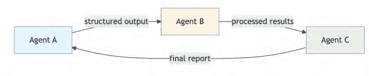


**集中式上下文存储**：智能体不直接交互，而是从一个共享的上下文仓库中读取和写入。这种上下文共享形式非常适合并行编排模式，在多个智能体独立工作但需要访问公共信息时尤为适用。

*图 8.14：集中式上下文存储*

**分层上下文分发**：在使用分层编排时，协调者智能体负责向专家智能体分发上下文。所有智能体都向协调者汇报，协调者决定将整体上下文的哪些部分共享给每个智能体。

*图 8.15：分层上下文分发*

关于多智能体系统的上下文工程，信息量真不小。现在，让我们试驾一下 AI-6 和 A2A，看看这一切是如何协同工作的。

- 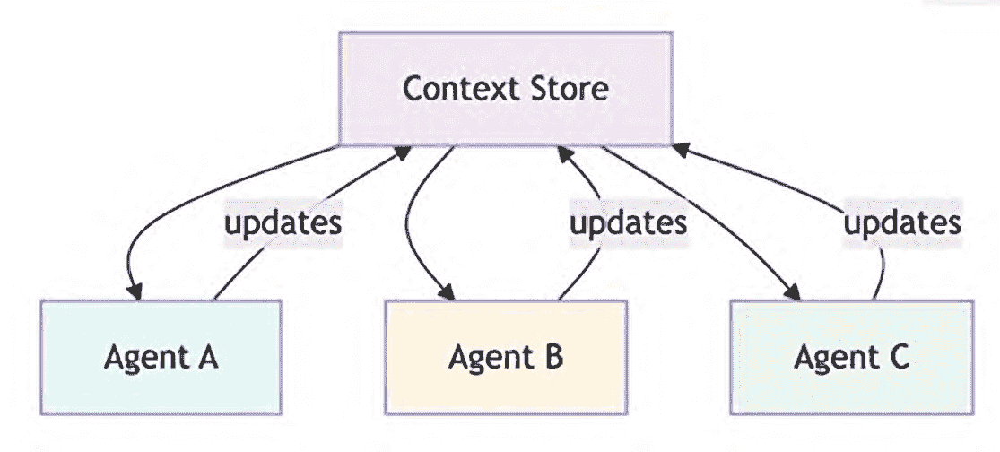
- 

### 试驾 AI-6 和 A2A

让我们通过一个简单的多智能体系统来看这些概念的实际应用，该系统由一个 AI-6 协调者智能体和一个 A2A 专家智能体组成。AI-6 框架的 A2A 集成展示了我们本章讨论的各种模式。

`config_async.yaml`（https://github.com/PacktPublishing/Design-Multi-Agent-AI-Systems-Using-MCP-and-A2A/blob/main/ch08/ai-six/py/examples/a2a-test/config_async.yaml）文件展示了配置多智能体系统是多么简单：

```yaml
# Basic agent configuration
default_model_id: gpt-4o
tools_dirs:
  - ${HOME}/git/ai-six/py/backend/tools

# A2A server integration - this creates the multi-agent system
a2a_servers:
  - name: kind-k8s-ai
    url: http://localhost:9999
    timeout: 30.0

# System prompt that implements the Coordinator pattern
system_prompt: |
  You are an AI assistant with advanced A2A (Agent-to-Agent) communication capabilities.
  You can:
  1. Start long-running A2A tasks that run asynchronously
  2. Receive real-time updates from A2A agents via SystemMessages
  3. Send messages to active A2A tasks
  4. Monitor multiple concurrent A2A operations
  5. Manage A2A task lifecycle (list, status, cancel)
```

此配置创建了一个具有以下特征的分层多智能体系统：

- 一个 AI-6 智能体作为协调者/编排器
- 一个 k8s-ai 智能体作为领域专家（作为 A2A 服务器单独运行在 `localhost:9999`）

由于 k8s-ai 智能体被注册为 A2A 服务器，AI-6 工具管理器会自动发现其技能并创建相应的 `A2ATool` 实例。无需手动注册工具或编写智能体提示词。

系统提示词故意保持通用，因为这是 A2A 集成端到端测试的一部分，并非旨在实现任何特定的现实世界目标。

让我们运行端到端测试，看看多智能体系统的实际运行情况：

```text
% python -m examples.a2a-test.test_a2a_e2e
🧪 COMPREHENSIVE A2A E2E TEST
==================================================
📋 Phase 1: Service Dependencies
🔧 Checking Ollama service...
✅ Ollama already running
🔧 Checking k8s-ai A2A server...
✅ k8s-ai server already running
🤖 Setting up AI-6 Agent with async A2A...
[09/14/25 18:56:46] INFO Processing request of type ListToolsRequest server.py:624
✅ Agent ready with 1 A2A tools and 4 task tools
📋 Phase 2: Core Async A2A Functionality
🚀 Testing Immediate Response Pattern...
✅ Immediate response in 0.00s, task ID: kind-k8s-ai_Kubernetes Operations_1757901406
📨 Testing Background Processing & SystemMessage Injection...
 Initial message count: 1
 Waiting for background SystemMessages...
 Waiting... (1/15)
 Waiting... (2/15)
 Waiting... (3/15)
 Waiting... (4/15)
 Waiting... (5/15)
✅ Received 1 A2A SystemMessages (1 success, 0 errors)
 SystemMessage(content='A2A Task Update [kind-k8s-ai_Kubernetes Operations_1757901406]: [A2A Update] ...
⚡ Testing Multi-tasking Capabilities...
✅ Multi-tasking working: 2 concurrent tasks active
📋 Phase 3: Task Management
🛠️ Testing Task Management Tools...
✅ Task status tool working
✅ Send message to task working
🧩 Testing Task Cancellation & Cleanup...
✅ Cancelled task: kind-k8s-ai_Kubernetes Operations_1757901406
✅ Cancelled task: kind-k8s-ai_Kubernetes Operations_1757901412
✅ Successfully cancelled/completed 2 tasks
==================================================
🎉 COMPREHENSIVE E2E TEST PASSED!
==================================================
⏱ Test duration: 10.4 seconds
📈 Tasks processed: 2
🔥 Async A2A Bridge: FULLY FUNCTIONAL
✅ Key Features Validated:
 • Immediate response pattern (no blocking)
 • Background task processing
 • SystemMessage injection for real-time updates
 • Multi-tasking (concurrent A2A operations)
 • Task lifecycle management
 • Proper error handling (no ignored errors)
🧩 Cleaning up test resources...
```

太棒了。端到端测试通过了，并验证了我们在 A2A 集成中实现的所有关键多智能体模式。下面我们来分析一下刚才看到的内容。

### 多智能体模式的实际应用

端到端测试（https://github.com/PacktPublishing/Design-Multi-Agent-AI-Systems-Using-MCP-and-A2A/blob/main/ch08/ai-six/py/examples/a2a-test/test_a2a_e2e.py）展示了我们框架中的几种模式：

- **领域专长分解**（来自*智能体分解策略*一节）：

  ```python
  # General coordinator handles task orchestration
  result = tool.run(message="List all pods in the cluster with their status")

  # Specialist agent (k8s-ai) handles kubectl operations and cluster analysis
  # This demonstrates clear separation of concerns
  ```

- **协调者系统提示词模式**：系统提示词明确将智能体的角色定义为任务协调者，负责管理异步操作而不阻塞，从而实现我们的协调者模式模板。

- **上下文工程**：
  - **任务上下文**：每个 A2A 操作都会获得一个唯一的任务 ID，用于有状态跟踪
  - **领域上下文**：k8s-ai 维护集群上下文（kind-kind）
  - **会话上下文**：AI-6 管理多个并发对话

- **基于能力的工具分配**：系统根据智能体能力自动分配工具：
  - `kind-k8s-ai_kubectl_skills`：Kubernetes 操作
  - `a2a_list_tasks`、`a2a_cancel_task`：任务协调
  - **AI-6 原生工具**：通用推理与对话

- **并行编排**：两个任务同时运行，协调者智能体收集结果以供后续处理：

  ```python
  # Start multiple tasks concurrently - no blocking
  task1 = agent.run_tool(
      "kind-k8s-ai_kubectl_skills", message="List all pods"
  )
  task2 = agent.run_tool(
      "kind-k8s-ai_kubectl_skills", message="Get all services"
  )

  # Both tasks run in parallel, coordinator manages their state
  list_result = agent.run_tool('a2a_list_tasks')  # Shows "Active A2A Tasks (2)"
  ```

这个示例验证了本章的关键原则：

- **清晰的智能体分解**：通用推理（AI-6）与领域专长（k8s-ai）的分离
- **恰当的工具分配**：保持安全边界，并让能力与智能体匹配
- **有效的上下文管理**：任务 ID 使得跨智能体边界的有状态协调成为可能
- **可扩展的编排**：异步模式防止阻塞，实现真正的并行
- **系统提示词工程**：协调者角色通过具体能力得到清晰定义

最终结果是：通用智能体可以与领域专家无缝协调，通过协作式专业化来实现复杂目标，而不是试图成为所有领域的专家。

这种设计具有可扩展性。你可以添加用于数据库操作、文件系统管理或任何其他领域的智能体，同时保持相同的协调模式。

然而，多智能体系统中还有更多值得探索的内容。

### 多智能体系统中的冲突解决与角色分配

随着多智能体系统复杂度的增加，智能体的角色和职责可能会出现重叠，导致冲突，进而降低系统性能或引发不一致的行为。本节将探讨常见的冲突场景和经过验证的解决策略。首先，我们来看看常见的冲突场景：

- **资源竞争**：多个智能体同时尝试访问相同资源会产生竞态条件。当数据库智能体和审计智能体都试图更新同一条记录时，就可能导致数据损坏。数据库事务可能失败，文件可能被竞争进程锁定，或者共享内存资源可能被破坏。在高吞吐量系统（多个智能体并发运行）中，这些冲突尤其成问题。

- **能力重叠**：技能相似的智能体可能会重复工作或提供相互矛盾的建议。数据库专家和数据分析专家可能都会回应有关销售趋势的查询，各自采用不同的方法，并可能返回不一致的结果。这种冗余会浪费计算资源，也可能让用户感到困惑，因为针对同一个请求，他们可能会收到多个甚至相互矛盾的回答。

- **层级权威冲突**：当同一层级的多个智能体试图管理相同资源或下属智能体时，不清晰的命令链会导致相互冲突的指令。管理者智能体和监督者智能体可能同时向同一个工作者智能体分配不同的任务，造成优先级混乱，并可能导致工作者智能体执行相互矛盾的操作。


现在让我们聚焦于冲突解决策略：

#### 明确的角色边界

最有效的冲突预防策略是使用能力矩阵定义清晰且互不重叠的职责。每个智能体都应拥有明确定义的专业领域、可执行的具体操作，以及清晰的资源访问优先级。这种方法需要精心的系统设计，但能消除关于哪个智能体处理特定类型请求的歧义。

当每个领域恰好映射到一个智能体时，任务路由就变得简单直接。如果多个智能体都能处理某项任务，系统应预先设定规则，根据当前工作负载、专业水平或其他客观标准来选择最合适的智能体。

#### 基于优先级的解决

当冲突无法通过角色分离来预防时，应建立清晰的优先级层级。安全智能体通常应拥有最高优先级，其次是合规智能体，然后是业务逻辑智能体，自动化智能体的优先级最低。这确保了安全与法规合规等关键问题始终优先于效率优化。

优先级系统应当透明且一致，让所有智能体都理解这一层级。当冲突发生时，优先级最高的智能体自动获胜，从而消除了协商开销，并确保结果可预测。

#### 协调协议

实施协调机制，通过结构化通信来预防冲突。基于令牌的协调使用独占访问令牌，智能体在访问共享资源前必须先获取令牌。同一时间只有一个智能体可以持有令牌，从而防止并发访问冲突。

基于共识的决策要求多个智能体在实施重大系统变更之前进行投票。这种方法尤其适用于部署决策、配置变更或其他影响整个系统的操作。必须达到一定百分比的智能体同意后，操作才能继续执行。

#### 动态角色分配

根据当前上下文和工作负载分布来调整智能体角色。系统应持续监控智能体的性能与容量，在智能体过载或利用不足时重新分配职责。这种动态平衡可以防止瓶颈，并确保整个智能体网络的资源得到最优利用。

负载均衡在分配新任务时会同时考虑智能体的能力与当前工作负载。一个在某个领域具有高专业水平的智能体，如果当前正忙于处理许多其他任务，可能仍不是最佳选择；此时，专业度较低但有空闲的智能体反而更合适。

冲突解决固然重要，但理想情况下，我们应当从一开始就预防冲突。让我们探讨一些实现这一目标的最佳实践。

#### 冲突预防的最佳实践

在掌握了所有这些冲突解决策略之后，以下是一些预防多智能体系统冲突的最佳实践。

#### 设计时冲突分析

在系统设计阶段分析能力重叠，以便在部署之前识别潜在的冲突点。创建显示哪些智能体可以处理哪些类型任务的能力矩阵，然后查找可能导致冲突的重叠。优先级相近的智能体之间若存在高度重叠，则表明这些领域需要审慎的协调协议。

这一分析应产出清晰的智能体边界与交互协议文档，帮助开发者理解不同智能体应如何协作而非竞争。

#### 运行时冲突检测

监控活动操作，在冲突发生时即时检测。追踪哪些智能体当前正在访问哪些资源，当多个智能体试图修改同一数据或执行相互竞争的操作时，标记潜在冲突。早期检测可实现优雅的冲突解决，而非导致系统故障。

冲突检测应在后台持续运行，在不显著影响性能的情况下保持对系统状态的感知。自动化警报可将反复出现的冲突模式通知管理员，这些模式可能表明存在需要关注的设计问题。

#### 清晰的升级路径

为无法自动解决的冲突定义结构化的升级流程。技术冲突可升级至技术主管智能体，业务冲突可升级至业务经理智能体，资源冲突可升级至专门的协调者。无法解决的冲突最终应升级至人类主管。

升级路径应包含超时机制和自动回退流程，以防更高级别智能体不可用时系统瘫痪。升级层级应有完善的文档记录，并定期测试，以确保其在压力下正常工作。

有效的冲突解决可确保多智能体系统在扩展时保持可靠与可预测，既保留专业化的优势，又避免无协调行为带来的混乱。恰当的架构设计可以在大多数冲突发生之前就加以预防，使解决策略成为一种安全网，而非主要机制。

#### 总结

在本章中，我们探讨了设计高效多智能体AI系统的基本原则与实用方法，讨论了智能体分解策略、编排模式、系统提示词设计、工具分配框架、上下文工程与冲突解决。关键洞见在于：高效的多智能体系统优先考虑清晰的架构设计，而非复杂的解决机制；定义良好的智能体边界、明确的能力矩阵和恰当的上下文管理能在大多数冲突发生之前加以预防。

我们通过AI-6 + A2A集成演示了这些概念，展示了一个简单的配置如何创建出具备清晰角色分离、实时通信和强大任务协调能力的分层多智能体系统。端到端测试验证了所有关键模式，包括即时响应处理、后台处理、多任务能力以及有效的冲突避免。具有领域专精的分层模式，在需要同时具备通用推理和深度专业能力的企业场景中显得尤为有效。

这一基础为我们下一章做好了准备，届时我们将构建一个综合性的多智能体系统，将AI-6、MCP与A2A协议融为一体，打造一个生产级解决方案，以演示本章所涵盖的所有模式与原则。

#### 订阅以获取免费电子书

新框架、演进中的架构、研究动态、生产系统深度剖析——*AI_Distilled* 为深耕于LLM和生成式AI系统的工程师与研究人员过滤噪音，汇成每周简报。立即订阅即可获赠免费电子书，同时每周获取洞察，助您保持专注、信息灵通。

在`https://packt.link/8Oz6Y`订阅，或扫描下方二维码。


## 9 使用A2A实现多智能体系统

DevOps实践通过打破孤岛并实现持续集成、部署和监控，彻底改变了软件开发和运维。然而，随着系统日益复杂和分布式化，传统DevOps方法面临可扩展性挑战。多智能体AI系统的出现为DevOps团队转型提供了契机——通过引入自治、专业化的AI智能体，与人类运维人员协作，共同管理基础设施、检测问题并编排修复工作。

在*第8章*所涵盖的**智能体到智能体**（**A2A**）协议基础之上，本章探讨如何利用多智能体系统构建AI驱动的DevOps团队。我们将研究如何将传统DevOps职责分解为专门的智能体角色，实现自主监控与修复工作流，并创建既能保持运维控制又能充分利用AI能力的人机协作模式。我们将构建一个完整的**多智能体Kubernetes DevOps**（**MAKDO**）系统，使其能够自主管理Kubernetes集群，同时与现有的人类工作流无缝集成。

本章涵盖以下关键主题：

- 构建AI驱动的DevOps团队
- 为专业智能体定义角色与职责
- 实现智能体
- 通过管理智能体编排团队
- 集成人类反馈与控制渠道
- MAKDO实战——完整的演示流程


### 技术要求

本章代码可从此处获取：

`https://github.com/PacktPublishing/Design-Multi-Agent-AI-Systems-Using-MCP-and-A2A/tree/main/ch09`

### 构建 AI 驱动的 DevOps 团队

多智能体 DevOps 系统代表了一种范式转变：从被动、人工运维转向主动、自主的基础设施管理。通过将监控、分析、修复或通信等领域的专业知识分配给专门的智能体，我们可以创建 7×24 小时运行的系统，扩展管理数百个集群，并为运维问题提供一致、可重复的响应。关键在于将这些系统设计为增强而非取代人类专家，创建协同工作流，充分发挥 AI 智能体与人类运维人员双方的优势。

我们将使用 AI-6 框架（集成 A2A 和 **模型上下文协议**（**MCP**）工具）构建一个 MAKDO 系统，演示智能体专业化、编排和人工集成的实用模式。您将掌握设计和实现智能体 AI 系统所需的知识，从而转变您组织的基础设施管理方法。

#### 为什么 DevOps 适合多智能体 AI？

DevOps 是多智能体 AI 系统的绝佳领域。它关乎现代基础设施的分布式混乱、Kubernetes 集群、数据库、跨云网络，以及针对不可避免的故障做出快速、专业化响应的需求。

我见过许多团队被来自不同系统的警报淹没，长期处于高压状态，无暇处理系统性问题。AI 智能体可以通过部署领域专家来解决这个问题：一个负责监控 Kubernetes pod，一个负责调优数据库查询，另一个负责嗅探网络问题。它们贴近事件现场并行执行排查，使停机时间从分钟级降至毫秒级。

故障排查遵循我通过艰难方式总结出的模式，例如检查事件、日志和资源。但大规模分布式系统的覆盖面极其庞大，人工逐一排查耗时过长。智能体可以即时执行**标准操作流程**（**SOP**），同时将异常情况连同完整上下文升级处理，从而将**站点可靠性工程师**（**SRE**）从“救火”中解放出来，专注于架构工作。

DevOps 本来就分工明确（数据库管理员、网络工程师、云专家和安全专家），因此智能体也可以相应分工：安全智能体负责搜寻漏洞，伸缩智能体负责处理流量高峰。人 + AI 协作模式使团队能够维护高质量、高性能且安全的系统。AI 智能体处理日常任务，而人类则应对新出现的威胁和问题。这也让人类工程师能够更自由地改进和构建更好的自动化与护栏，使 AI 智能体能够可靠地承担越来越多的工作。

然而，创建高效的 AI 驱动 DevOps 团队需要仔细考虑智能体的角色、职责和交互模式。让我们以 MAKDO 为实战示例，探索如何设计和实现一个多智能体 DevOps 系统。MAKDO 体现了我们在前几章中讨论的原则，并展示了这些原则在 DevOps 领域的应用。

让我们直接开始认识 MAKDO。

#### MAKDO —— 一个多智能体 Kubernetes DevOps 系统

MAKDO 演示了如何将传统 DevOps 角色转化为一个协调有序的多智能体 AI 系统。下面分析其架构和智能体设计。

#### 系统架构

MAKDO 由四个专业智能体协同工作，在人工监督下提供自主 Kubernetes 集群管理：

- **协调器智能体**：编排整体工作流，做出高层决策，并协调其他智能体
- **分析器智能体**：使用 k8s-ai 集成专门负责集群健康评估和问题识别
- **修复器智能体**：处理安全的集群变更和自动化修复
- **Slack 智能体**：管理人工沟通和通知工作流

该架构反映了 DevOps 团队中自然的职责分工，同时支持自主运行和人工监督。

**注意**：系统可能会不断演进，上述每个智能体都可能在需要时派生出额外的专业智能体。例如，可以添加一个安全智能体来监控漏洞，或者添加一个 Kubernetes 控制平面智能体来管理 Kubernetes 控制平面特有的问题。

#### 协调器智能体——编排运维操作

协调器智能体扮演团队领导者的角色，编排对问题的响应，并将任务委派给专业智能体。在 AI-6 的多智能体架构中，协调器可以将子智能体作为工具使用，由 LLM 根据实际情况决定何时调用它们。由于子智能体的输入就是其提示词，协调器需要成为一名优秀的提示词工程师。

MAKDO 使用单个配置文件，子智能体以**内联**方式定义在父协调器的配置中。这种分层配置模式意味着 AI-6 会自动发现并实例化该文件中的所有智能体。下面是该文件关键结构的精简伪代码版本。完整文件可在 `https://github.com/PacktPublishing/Design-Multi-Agent-AI-Systems-Using-MCP-and-A2A/tree/main/ch09/makdo/src/makdo/agents/coordinator.yaml` 获取：

```yaml
# Coordinator configuration (parent agent)
name: "MAKDO Coordinator"
default_model_id: "gpt-4o"
tools_dirs: [ "/path/to/ai-six/tools/memory" ]
system_prompt: |
  You are the MAKDO Coordinator orchestrating specialized agents.
  Delegate to: agent_MAKDO_Analyzer, agent_MAKDO_Fixer, agent_MAKDO_Slack_Bot

# Sub-agents embedded inline (AI-6 auto-instantiates these as AgentTools)
agents:

  # Analyzer sub-agent: Has A2A access to k8s-ai for diagnostics
  - name: "MAKDO_Analyzer"
    description: "Cluster health assessment agent"
    default_model_id: "gpt-4o"
    enable_memory: false
    a2a_servers:
      - name: "kind-makdo-test"
        url: "http://localhost:9999"
    system_prompt: |
      Analyze cluster health using k8s-ai A2A diagnostic skills.
      Report findings with full pod names, errors, and recommendations.

  # Fixer sub-agent: Has A2A access to k8s-ai for remediation
  - name: "MAKDO_Fixer"
    description: "Safe cluster modification agent"
    default_model_id: "gpt-4o"
    enable_memory: false
    a2a_servers:
      - name: "kind-makdo-test"
        url: "http://localhost:9999"
    system_prompt: |
      Execute safe remediation actions using k8s-ai A2A skills.
      Require approval for destructive operations (delete, scale down).

  # Slack_Bot sub-agent: Has MCP access to local Slack server
  - name: "MAKDO_Slack_Bot"
    description: "User communication agent"
    default_model_id: "gpt-4o"
    mcp_tools_dirs: [ "src/makdo/mcp_tools" ]
    system_prompt: |
      Post notifications to #makdo-devops Slack channel.
      Handle approval workflows for critical operations.
```

以下是 MAKDO 配置文件的关键特性：

1. **父配置**：`Coordinator` 智能体定义在顶层，包含自己的名称、模型和系统提示词。
2. **内联子智能体**：所有三个子智能体都嵌入在父配置的 `agents:` 键下。
3. **每个智能体的工具访问权限**：
   - **分析器**：获得 `a2a_servers` 用于 k8s-ai 诊断
   - **修复器**：获得 `a2a_servers` 用于 k8s-ai 修复
   - **Slack 机器人**：获得 `mcp_tools_dirs` 用于 Slack 通信
4. **AI-6 魔法**：加载这个单一文件时，AI-6 会自动执行以下操作：
   - 创建四个智能体实例（一个协调器和三个子智能体）
   - 将子智能体包装为 `AgentTool` 实例
   - 将它们以 `agent_MAKDO_Analyzer`、`agent_MAKDO_Fixer` 和 `agent_MAKDO_Slack_Bot` 的名称提供给 `Coordinator`
5. **详细的系统提示词**：每个智能体都有全面的指令，定义职责、报告格式和操作指南。

这个单一的 YAML 文件定义了整个多智能体系统。`Coordinator` 现在可以根据需要调用子智能体来编排复杂的工作流，由 LLM 根据实际情况决定何时调用哪个智能体。


注意每个子代理如何通过三个关键机制实现专业化：

- **工具访问**：`Analyzer` 和 `Fixer` 获取 A2A 工具，`Slack_Bot` 获取 MCP 工具
- **系统提示词**：详细指令编码了领域专业知识和操作流程
- **报告格式**：结构化输出模板确保生成一致、可执行的报告

`Analyzer` 的系统提示词包含详细的问题优先级排序指南和报告格式。`Fixer` 的提示词定义了安全协议和审批要求。`Slack_Bot` 的提示词则规定了消息格式和命令处理。

这种基于提示词的专业化比基于代码的方法更灵活，原因如下：

- 无需修改代码即可调整行为
- 领域专业知识可读且可审计
- 可以通过提示词工程添加新能力
- LLM 运用推理能力来处理边缘情况

让我们看看这些代理如何通过 AI-6 的多代理架构进行交互。

### 代理交互模式

MAKDO 展示了 AI-6 的多代理架构如何通过基于工具的委派实现协调操作。理解这一模式对于掌握 MAKDO 代理如何协同工作至关重要。

#### LLM 驱动的代理协调

在 AI-6 中，子代理作为工具暴露给父代理。如果你大致观察，实际上 AI 系统与之交互的只是一个代理。这个根代理有子代理这一事实，其实只是内部细节。驱动根代理的 LLM 只需在对话的每一轮决定是否需要调用某个工具，或者是否已经拥有足够的信息。它可支配的某些工具是智能工具——它们本身是 AI-6 代理，或通过 A2A 协议连接的完全独立的 AI 系统——这一事实并不重要。不存在调用 `Analyzer` 或 `Fixer` 类方法的 `Coordinator` 代理类；这些类根本就不存在。协调逻辑以自然语言形式写在各代理的系统提示词中，而 LLM 的推理决定何时调用哪个代理作为工具。这是后期绑定逻辑的一个例子。

AI-6 通过 `AgentTool` 类实现这一点，该类封装子代理，使它们可以作为工具被调用。`AgentTool` 实现了标准的 `Tool` 接口，接收自然语言消息并返回子代理的完整响应。从父代理的角度来看，调用子代理与调用任何其他工具完全相同。有关 `AgentTool` 实现的详细说明，请参阅*第8章*。

当 `Coordinator` 代理需要分析集群时，LLM 会生成如下工具调用：

```json
{
  "name": "agent_MAKDO_Analyzer",
  "arguments": {
    "message": "Analyze the health of the kind-makdo-test cluster. Focus on pod failures and provide specific remediation recommendations."
  }
}
```

`AgentTool` 类封装了完整的子代理交互。它将消息发送给 `Analyzer` 代理，等待其完整响应（包括 `Analyzer` 向 k8s-ai 发出的任何工具调用），然后将最终结果返回给 `Coordinator`。

这种模式提供了几个好处：

- **自然委派**：LLM 决定何时需要专业知识，就像人类协调员一样
- **封装性**：每个代理管理自己的对话历史和工具使用
- **可组合性**：代理可以任意深度嵌套
- **上下文保持**：协调员不需要跟踪子代理的实现细节

AI-6 自带多种内置工具，但它无法为每个 AI 系统提供一切。这不是问题，因为 MAKDO 可以用额外的工具扩展 AI-6。

#### 用新工具扩展 AI-6

MAKDO 通过 Slack 与人类团队交互。AI-6 不提供内置的 Slack 工具（尽管它有一个 Slack 前端）。但 AI-6 可以通过支持其自身工具接口或 MCP 标准的额外工具来扩展，因此我们实现了一个自定义 MCP 服务器，将 Slack 操作作为工具暴露出来。

`Slack_Bot` 代理使用基于 FastMCP 构建的自定义 MCP 服务器来处理所有 Slack 通信。该服务器位于 https://github.com/PacktPublishing/Design-Multi-Agent-AI-Systems-Using-MCP-and-A2A/tree/main/ch09/makdo/src/makdo/mcp_tools/slack.py

该 Slack MCP 服务器基于官方 MCP Python SDK 的 FastMCP 实现（https://github.com/modelcontextprotocol/python-sdk）。主要特性如下：

- **基于装饰器的工具**：`@mcp.tool()` 装饰器会自动将函数注册为 MCP 工具
- **令牌管理**：从环境或 `.env` 文件中读取 `AI6_BOT_TOKEN`
- **简单的 HTTP 调用**：使用 `requests` 库直接调用 Slack API
- **错误处理**：返回 LLM 能够理解的成功/失败消息
- **频道规范化**：如果缺失，自动添加 `#` 前缀

这比手动实现完整的 JSON-RPC MCP 服务器要简单得多。FastMCP 处理所有协议细节，让你专注于实际的工具功能。

当 AI-6 加载这个 MCP 服务器时，`Slack_Bot` 代理会自动获得 `slack_post_message` 和 `slack_list_channels` 作为可用工具。LLM 随后可以自然地调用这些工具：

```json
{
  "name": "slack_post_message",
  "arguments": {
    "channel": "makdo-devops",
    "text": "🚨 CRITICAL: 3 pods failing in kind-makdo-test cluster"
  }
}
```

让我们看看 AI-6 如何发现新工具，例如 MAKDO 提供的 `Slack_Bot` 代理。

#### 工具发现与分配

AI-6 会自动从多个来源发现工具，并根据配置将其分配给代理。`tool_manager` 模块（https://github.com/PacktPublishing/Design-Multi-Agent-AI-Systems-using-MCP-and-A2A/blob/main/ch08/ai-six/py/backend/agent/tool_manager.py）通过 `get_tool_dict()` 函数处理此过程。如你所见，它组合来自不同目录和服务器的工具，然后根据启用/禁用列表对它们进行过滤：

```python
def get_tool_dict(
    tool_config: ToolConfig, agent_configs: list[Config] = None
) -> dict[str, Tool]:
    """Get a dictionary of all available tools from various sources."""
    tools: list[Tool] = []

    # 1. Discover AI-6 native tools from all directories
    for tools_dir in tool_config.tools_dirs:
        native_tools = _discover_native_tools(tools_dir)
        tools.extend(native_tools)

    # 2. Discover local MCP tools from all directories
    for mcp_tools_dir in tool_config.mcp_tools_dirs:
        local_mcp_tools = _discover_local_mcp_tools(mcp_tools_dir)
        tools.extend(local_mcp_tools)

    # 3. Get tools from A2A servers
    if tool_config.a2a_servers:
        a2a_tools = _get_a2a_tools(tool_config.a2a_servers)
        tools.extend(a2a_tools)

    # 4. Create agent tools if agent configs provided
    if agent_configs:
        agent_tools = _create_agent_tools(agent_configs)
        tools.extend(agent_tools)

    # 5. Filter tools based on enabled/disabled configuration
    tools = _filter_tools(tools, tool_config.enabled_tools, tool_config.disabled_tools)

    return {tool.name: tool for tool in tools}
```

以下是 MAKDO 中每个代理的工具明细：

- `Coordinator` 代理最终拥有以下工具：
  - 记忆工具
  - 代理工具：`agent_MAKDO_Analyzer`、`agent_MAKDO_Fixer` 和 `agent_MAKDO_Slack_Bot`
- `Analyzer` 和 `Fixer` 各自获得以下工具：
  - 来自 k8s-ai 服务器的 A2A 工具（用于 kubectl 操作的 `kind-makdo-test_*` 工具）
  - 记忆工具
- `Slack_Bot` 获得以下工具：
  - 来自 `src/makdo/mcp_tools/slack.py` 的 MCP 工具（`slack_post_message` 和 `slack_list_channels`）
  - 记忆工具（继承）

#### 上下文共享与状态管理

在 AI-6 的多代理架构中，代理之间没有直接的上下文共享。每个 AI-6 代理都有自己的模型和上下文。它只能通过工具调用和响应与其他代理通信。

以下是上下文共享的一些常见方法：

- **消息传递**：当 `Coordinator` 代理调用子代理时，它会在消息中包含相关上下文。示例如下：

```json
{
  "name": "agent_MAKDO_Fixer",
  "arguments": {
    "message": "Execute remediation for kind-makdo-test cluster. The Analyzer identified 3 failing pods due to image pull errors. Please attempt to restart the affected pods and verify they come up successfully."
  }
}
```


**会话隔离**：每个代理都维护自己的会话，包含对话历史。参见 `https://github.com/PacktPublishing/Design-Multi-Agent-AI-Systems-Using-MCP-and-A2A/tree/main/ch08/ai-six/py/ai_six/agent/agent.py`：

```python
self.session_manager = SessionManager(config.memory_dir)
self.session = self._create_new_session(config.memory_dir)
```

**返回值**：子代理返回完整响应，`Coordinator` 代理会将这些响应整合到自己的上下文中：

```text
Coordinator Session:
- User: "Check cluster health"
- Assistant: [calls agent_MAKDO_Analyzer tool]
- Tool Result: "Analysis complete. Found 3 failing pods..."
- Assistant: "Based on analysis, we have critical issues. Let me notify the team..."
```

这种基于会话的方法确保了上下文隔离，同时通过显式消息传递实现协调操作。每个代理的对话历史保持独立，防止上下文污染，并允许代理在不同上下文中被多次调用。

现在我们已经介绍了上下文共享和状态管理，接下来看看每个 MAKDO 代理的角色和职责。

### 为专业代理定义角色和职责

前面展示的 `coordinator.yaml` 配置定义了 MAKDO 的四代理架构。本节将探讨设计原理：为什么选择这些特定的角色边界，做了哪些权衡，以及这个架构如何扩展。

#### 从 DevOps 工作流到代理架构

MAKDO 的代理设计源于对典型 Kubernetes 事件响应工作流的分析。传统手动流程如下：

1. **告警触发**：操作员收到通知
2. **诊断**：操作员运行 kubectl 命令进行调查
3. **决策**：操作员确定适当的修复方案
4. **修复**：操作员应用更改（谨慎操作）
5. **沟通**：操作员在 Slack 中更新团队
6. **验证**：操作员确认修复生效

这直接对应到 MAKDO 的代理角色：

- **检测和诊断**由 `Analyzer` 代理完成，它使用 k8s-ai 调查集群状态、对问题进行分类并推荐修复方案
- **修复**由 `Fixer` 代理完成，它执行安全更改，并且对破坏性操作需要审批
- **沟通**由 `Slack_Bot` 代理完成，它发布更新并处理审批工作流
- **协调**由 `Coordinator` 代理完成，它编排工作流并做出高层决策

这种映射保留了自然的工作流结构，同时将职责分配给各个专业代理。

#### 为什么需要四个代理而不是一个？

正如原版简单的 k8s-ai 系统在*第 3 章*中所展示的，单个代理可以完成上述所有工作（嗯，除了 Slack 通信）。那么，为什么把 MAKDO 拆分成四个代理？有以下几个原因：

- **工具隔离**：`Analyzer` 不应该拥有集群的写权限（只读诊断）。将 `Analyzer`/`Fixer` 分开，通过工具配置强制实现这一点。`Analyzer` 只需使用只读工具即可完成工作，例如 `get pods` 和 `get deployments`。`Fixer` 需要修改配置，因此为其提供 `apply manifest` 等工具是合适的。
- **提示词清晰度**：每个代理都有一个专注的系统提示词（约 50 行），而不是一个试图涵盖所有内容的大型提示词（约 200 行）。
- **独立测试**：可以单独测试 `Analyzer` 的诊断准确性，并单独测试 `Fixer` 的修复安全性。
- **并行演进**：可以在不冒险更改修复逻辑的情况下改进诊断能力。

让我们深入探讨，特别是分析器和修复器的拆分。

#### 为什么要把分析器和修复器分开？

这是最具争议的设计决策。两个代理都使用相同的 k8s-ai A2A 工具，为什么不合并呢？有三个主要原因：

- **通过角色分离实现安全**：
  - `Analyzer` 的提示词：“绝不做更改，只做诊断。”未来可以为分析器提供只读凭据（除了依赖提示词外），从而实现强大的安全性。
  - `Fixer` 的提示词：“需要审批的操作：删除、缩容、重启……”清晰的思维模型：分析是安全的，修复需要谨慎。
- **不同的故障模式**：
  - **分析器故障**：分析器可能产生不完整或错误的诊断，但它从不改变集群状态，因此错误的分析不会对生产产生直接影响。
  - **修复器故障**：修复器可能执行错误的修复并直接修改在线资源，因此如果防护措施薄弱，这里的错误可能导致宕机或数据丢失。
  - 分开的代理允许你独立调整可靠性与操作权限。例如，运行一个快速但准确度较低的分析器（90% 召回率）用于分诊，同时将高风险修复器限制为 99.9% 准确率并要求人工审批。
- **现实世界的访问控制模式**：许多组织给 DevOps 团队生产环境的只读访问权限，以消除在开发过程中破坏生产环境的风险。只有 SRE 或值班工程师拥有写权限，以防需要紧急修复或应急操作。MAKDO 的拆分正好反映了这种访问模式。

缺点是协调开销增加，但为了安全和清晰度这是值得的。

#### 为什么要单独拆分 Slack_Bot？

`Coordinator` 代理也可以直接发布到 Slack。但通信逻辑可能因为多个通信渠道、审批工作流、格式化规则等而变得非常复杂。`Slack_Bot` 可以独立演进并封装这种复杂性，而 `Coordinator` 代理则专注于协调。

#### 工具访问边界

每个代理的工具配置都恰好提供其履行职责所需的工具。这使得代理更容易专注于自己的角色，并减少误用工具的可能性，因为暴露面更小：

```yaml
# Coordinator: Pure orchestrator, no operational tools beyond sub-agents
tools_dirs: ["/path/to/memory"] # Only memory for state tracking

# Analyzer/Fixer: Kubernetes access via A2A
a2a_servers: [{"url": "http://localhost:9999"}] # Same tools, different prompts

# Slack_Bot: Communication tools via MCP
mcp_tools_dirs: ["src/makdo/mcp_tools"] # Only Slack access
```

这种基于配置的权限模型也意味着更改代理能力只需要编辑 YAML，而无需更改代码。

#### 扩展架构

MAKDO 的设计支持通过添加更多专业代理进行扩展。这里，我们将讨论如何添加新能力。让我们看一个添加安全扫描器代理的例子。

要添加漏洞扫描和安全策略执行，请执行以下步骤：

1. 在 `coordinator.yaml` 中定义新代理：

   ```yaml
   agents:
     - name: "MAKDO_Security_Scanner"
       description: "Security vulnerability and compliance scanning agent"
       a2a_servers:
         - name: "kind-makdo-test"
           url: "http://localhost:9999"
       system_prompt: |
         You are the MAKDO Security Scanner.
         Responsibilities:
         - Scan container images for known vulnerabilities
         - Check pod security contexts
         - Verify network policies are in place
         - Report security findings to Coordinator
         Use k8s-ai tools to inspect cluster resources.
         Report findings in severity-ranked format.
   ```

2. 更新 `Coordinator` 代理的提示词以包含新代理：

   ```text
   Available agents:
   - agent_MAKDO_Analyzer
   - agent_MAKDO_Fixer
   - agent_MAKDO_Slack_Bot
   - agent_MAKDO_Security_Scanner  # New
   Workflow: After Analyzer identifies issues, also call Security_Scanner to check for security implications before Fixer proceeds.
   ```

注意，如果我们认为安全扫描是集群分析的一个子领域，也可以将安全扫描器作为 `Analyzer` 的子代理添加。

**无需更改代码**：AI-6 会自动发现新代理并将其作为工具暴露。

让我们看看 MAKDO 采用的一些重要模式。

#### 关键设计模式

MAKDO 的架构展示了适用于其他多代理系统的几种模式：

- **工作流驱动的分解**：将代理映射到工作流阶段，而不是技术
- **通过配置实现权限**：工具访问定义代理能做什么
- **提示词即策略**：将操作规则编码到代理的系统提示词中
- **协议封装**：AI-6 处理特定协议（A2A 和 MCP），因此你无需处理
- **设计上可扩展**：添加能力意味着添加工具和代理

下一节将介绍使用 AI-6 配置系统创建和部署这些代理的实现细节。


### 实现代理

在定义好代理角色并明确其职责之后，我们现在进入实现阶段。MAKDO 采用配置驱动的方法，整个多代理系统通过 YAML 配置文件而非自定义代码来定义。这一方法利用 AI-6 强大的代理框架自动实例化代理、发现工具并建立通信渠道。

#### 配置驱动的代理实现

传统的多代理系统通常需要大量自定义代码来初始化代理、配置工具并建立代理间通信。MAKDO 则采取了不同的方法：整个系统定义在单个协调器配置文件中，并带有内联的子代理定义。

MAKDO 的架构使用一个主配置文件（`coordinator.yaml`），它定义了以下内容：

- **协调器代理**：作为顶层编排器，具有系统提示词和工具访问权限
- **内联所有子代理**：`Analyzer`、`Fixer` 和 `Slack_Bot` 都定义在协调器配置中
- **工具分配**：每个代理的工具访问权限通过 `tools_dirs`、`mcp_tools_dirs` 和 `a2a_servers` 指定
- **通信协议**：通过 AI-6 的 `AgentTool` 模式隐式实现

这种单文件方法有几个优点：

- **原子化部署**：整个系统配置集中在一处
- **清晰的层级结构**：父子关系明确
- **无文件同步问题**：无需担心独立配置文件之间失去同步
- **更轻松的版本控制**：只需一个文件即可跟踪系统变更

MAKDO 主入口点实现了健康检查循环和会话管理。让我们看看关键组件：

- **配置加载**：AI-6 的 `Config.from_file()` 读取 `coordinator.yaml` 文件并自动创建所有代理：

```python
from ai_six.agent.agent import Agent
from ai_six.agent.config import Config

def create_coordinator_config() -> Config:
    """Create coordinator agent config with sub-agents."""
    return Config.from_file("src/makdo/agents/coordinator.yaml")
```

这一行代码既能加载 `Coordinator` 代理，又能将所有内联子代理实例化为代理工具。

- **健康检查循环**：`Coordinator` 代理持续运行，定期发送健康检查请求：

```python
def start_coordinator(coordinator: Agent, config: Dict[str, Any]):
    """Start the coordinator with health check loop."""
    logger = logging.getLogger("makdo")
    # Get check interval from environment or config (default: 60s)
    check_interval = int(os.getenv("MAKDO_CHECK_INTERVAL", config.get("monitoring", {}).get("check_interval", 60)))
    logger.info(f"Starting health check loop (interval: {check_interval}s)")
    try:
        while True:
            try:
                # Request health check from coordinator
                logger.info("🔍 Initiating cluster health check...")
                prompt = (
                    "Perform a comprehensive health check across all registered clusters. "
                    "Use the Analyzer agent to identify any issues, then use the Slack Bot agent "
                    "to report findings to the #makdo-devops channel. "
                    "If critical issues are found, use the Fixer agent to attempt remediation."
                )
                response = coordinator.send_message(prompt)
                logger.info(f"✅ Health check completed: {response[:200]}...")
```

该循环发送一个描述所需工作流程的自然语言提示词。LLM 会根据该提示词编排各子代理。请注意，MAKDO 在这里是自主运行的。这里没有聊天界面中那种由人工控制的请求-响应流程。不过，人类仍然可以通过 Slack 进行监控和介入。来自 `Coordinator` 代理的响应只会被记录到日志中，以供审计。

- **会话管理**：每次健康检查后，MAKDO 都会清除对话历史，以防止上下文溢出：

```python
                # CRITICAL: Clear session history to prevent context overflow
                # Keep only system message - each health check cycle is independent
                if len(coordinator.session.messages) > 3:
                    logger.info(f"Clearing old messages ({len(coordinator.session.messages)} messages)")
                    system_message = coordinator.session.messages[0] if coordinator.session.messages else None
                    coordinator.session.messages.clear()
                    if system_message:
                        coordinator.session.messages.append(system_message)
                    logger.info(f"Session reset to {len(coordinator.session.messages)} message")
            except Exception as e:
                logger.error(f"Error during health check cycle: {e}")
                # Wait before next check
                time.sleep(check_interval)
```

这可以防止上下文窗口被旧的健康检查内容填满。每个周期都被视为独立的。如果需要长期记忆，可以通过数据库等外部存储来实现。

- **主入口点**：`main` 函数将所有部分整合在一起：

```python
def main():
    """Main entry point - note: synchronous, not async."""
    load_dotenv()
    config = load_config()
    setup_logging(config)
    logger = logging.getLogger("makdo")
    logger.info("Starting MAKDO - Multi-Agent Kubernetes DevOps System")
    # Create coordinator with inline sub-agents
    coordinator = Agent(create_coordinator_config())
    logger.info("Coordinator and sub-agents created successfully")
    # Start the coordinator (runs health check loop)
    start_coordinator(coordinator, config)

if __name__ == "__main__":
    exit(main())  # Note: synchronous call, not asyncio.run()
```

代码位于 `src/makdo/main.py`（`https://github.com/PacktPublishing/Design-Multi-Agent-AI-Systems-Using-MCP-and-A2A/tree/main/ch09/makdo/src/makdo/main.py`）。该实现的关键特性包括：

- **同步架构**：使用 `time.sleep()` 而不是 `asyncio`，以避免与 MCP 工具发生事件循环冲突
- **会话管理**：在每个健康检查周期后清除旧消息，以防止上下文溢出（128k token 限制）和消息顺序错误
- **健康检查循环**：以可配置的间隔持续监控集群

请注意，这段代码中*没有*以下内容：

- 没有为子代理进行手动实例化
- 没有工具发现或注册逻辑
- 没有代理间通信设置
- 没有 MCP 或 A2A 客户端配置

所有这些都由 AI-6 根据协调器配置文件自动处理。这正是 AI-6 框架的价值主张：它可靠而无声地替 MAKDO 处理这些复杂细节。

#### 工具发现与分配

AI-6 的工具管理器负责从多个来源自动发现工具。对于 MAKDO，以下是工具分配给每个代理的方式：

- **协调器代理**：

```yaml
# Only memory tools - pure orchestrator
tools_dirs: [ "/Users/gigi/git/ai-six/py/ai_six/tools/memory" ]
mcp_tools_dirs: [ "/Users/gigi/git/ai-six/py/ai_six/mcp_tools" ]
memory_dir: "data/memory"
# NO a2a_servers - delegates to Analyzer/Fixer for k8s operations
# NO Slack tools - delegates to Slack_Bot for communications
```

- **分析器代理（内联）**：

```yaml
agents:
  - name: "MAKDO_Analyzer"
    description: "Cluster health assessment agent"
    default_model_id: "gpt-4o"
    # Has A2A access to k8s-ai server
    a2a_servers:
      - name: "kind-makdo-test"
        url: "http://localhost:9999"
        timeout: 30.0
        api_key: "test-key"
```

- **修复器代理（内联）**：

```yaml
  - name: "MAKDO_Fixer"
    description: "Safe cluster modification agent"
    default_model_id: "gpt-4o"
    # Has A2A access to k8s-ai server
    a2a_servers:
      - name: "kind-makdo-test"
        url: "http://localhost:9999"
        timeout: 30.0
        api_key: "test-key"
```


```yaml
timeout: 30.0
api_key: "test-key"
```

**Slack_Bot 代理（内联）：**

```yaml
- name: "MAKDO_Slack_Bot"
  description: "User communication agent"
  default_model_id: "gpt-4o"
  tools_dirs: [ ]
  # Has MCP access to local Slack tools
  mcp_tools_dirs: [ "src/makdo/mcp_tools" ]
```

代理拥有自己的工具，但也拥有自己独立的上下文。这就是会话隔离的原则。

### 会话隔离

MAKDO 中的每个代理都维护自己的对话会话，并拥有独立的消息历史。当 `Coordinator` 代理调用 `agent_MAKDO_Analyzer` 时，`Analyzer` 看不到协调器的对话历史。它从一个全新的上下文开始，仅包含以下内容：

- 自己的系统提示词
- 来自协调器的消息
- 自己的工具目录

然而，这种会话隔离具有重要的影响。以下是其优点：

- **减少 Token 消耗**：子代理无需携带完整的父级对话上下文
- **专注处理**：每个代理只针对自己的具体任务及相关上下文（工具调用和响应）进行推理
- **并行执行潜力**：独立会话可以并发运行，尤其是对于 A2A 代理
- **更清晰的关注点分离**：代理不会在不同上下文之间意外泄露信息

以下是相应的权衡：

- **需要传递上下文**：父代理必须在发送给子代理的消息中显式包含相关上下文
- **默认无共享内存**：代理不会自动共享状态（尽管可以使用内存工具）
- **消息更加冗长**：父代理可能需要在多次子代理调用中重复上下文

对于 MAKDO 而言，这种隔离是有益的。当 `Coordinator` 代理要求 `Analyzer` 评估集群健康状态时，`Analyzer` 不需要了解之前与 `Fixer` 或 `Slack_Bot` 的对话。它只专注于当前的集群评估请求。

### 配置优于代码

这种配置驱动的方法意味着你可以在不触碰 Python 代码的情况下完全改变 MAKDO 的行为：

- **添加新代理**：向代理列表中添加条目
- **更改工具访问权限**：修改任意代理的 `tools_dirs`、`mcp_tools_dirs`、`a2a_servers` 或 `agents`
- **调整代理行为**：更新系统提示词
- **切换 LLM 模型**：更改 `default_model_id`
- **连接不同的远程 AI 系统**：更新 A2A 服务器 URL

### 关键要点

MAKDO 的实现展示了构建多代理系统的几个重要模式：

- **配置驱动架构**：用 YAML 而非代码定义系统结构
- **框架自动化**：让 A2A 处理代理实例化、工具发现和通信
- **工具抽象**：通过 `AgentTool` 类，子代理对父代理而言表现为工具
- **会话隔离**：每个代理维护独立的对话状态
- **最小权限原则**：每个代理只获得其所需的工具
- **通过配置实现可扩展性**：通过编辑 YAML 而非编写代码来添加功能

这种方法大幅降低了构建和维护多代理系统的复杂性。整个 MAKDO 实现不到 150 行 Python 代码，其中绝大部分是日志记录和错误处理。真正的实现存在于配置文件中，使系统易于理解、修改和扩展。但为配置提供强大的工具支持和模式验证非常重要。

### 通过管理器代理编排团队

MAKDO 中的 `Coordinator` 代理充当中央编排器，管理各专业代理之间的工作流，同时保持对系统状态和运维优先级的感知。与依赖显式工作流定义和状态机的传统编排系统不同，MAKDO 的 `Coordinator` 使用 LLM 推理，根据实际情况动态协调代理活动。

`Coordinator` 代理的系统提示词提供指导，但具体代理调用顺序由 LLM 根据上下文决定。

#### 动态工作流执行

传统工作流引擎需要预定义的工作流，例如：

```text
detect_issue → analyze_issue → fix_issue → notify_humans
```

相反，MAKDO 的 `Coordinator` 在其系统提示词中接收英文的高层指导：

```text
Your primary responsibilities:
1. Monitor multiple Kubernetes clusters for health and issues
2. Coordinate between the Analyzer, Fixer, and Slack agents
3. Make decisions on task prioritization and escalation
4. Maintain awareness of ongoing operations across all clusters
```

然后，LLM 根据实际情况确定合适的代理调用顺序。让我们来看几个基于场景的示例：

```text
Scenario 1: Periodic health check request

MAKDO: Invoke coordinator every minute asking to "Check the health of kind-makdo-test cluster"

Coordinator:
1. Calls the MAKDO_Analyzer agent with message "Analyze kind-makdo-test cluster health"
2. Receives detailed report
3. Calls MAKDO_Slack_Bot agent to post results
```

```text
Scenario 2: Critical issue detected

User: "Production cluster has failing pods"

Coordinator:
1. Calls agent_MAKDO_Analyzer for detailed diagnostics
2. Evaluates severity from Analyzer report
3. Calls agent_MAKDO_Fixer to remediate issues
4. Calls agent_MAKDO_Slack_Bot to notify team of analysis and remediation results
```

`Coordinator` 代理会根据 `Analyzer` 的发现、问题的严重程度以及系统提示词中编码的运维策略来调整其工作流。如果需要人工批准，MAKDO 会在调用 `Fixer` 代理之前等待 `Slack_Bot` 的批准。

#### 决策点与分支

`Coordinator` 代理的系统提示词中包含 LLM 会应用的决策指南：

```text
Decision-making guidelines:
- Always assess cluster health before making changes
- Prioritize critical issues (pods failing, services down) over warnings
- Require human approval for destructive operations (delete, scale down)
- Coordinate operations to avoid conflicts between clusters
- Escalate to humans when automated fixes fail or are uncertain
- ALWAYS post full detailed results to Slack for human visibility
```

这些指南构成了决策点，LLM 会在这些决策点选择不同的路径。以下是一些示例。

**示例 1：安全操作与破坏性操作**

`Analyzer` 报告“有 3 个 Pod 卡在 `CrashLoopBackOff` 状态，可能需要删除。”

LLM 的推理过程包括以下内容：

- 删除属于破坏性操作（根据指南）
- 需要人工批准（根据指南）
- 应先通知人工（根据指南）

执行路径如下：

1. `agent_MAKDO_Slack_Bot`：“报告分析结果并请求批准”
2. 等待人工响应
3. 如果获得批准：`agent_MAKDO_Fixer` 执行“删除 Pod”
4. `agent_MAKDO_Slack_Bot`：“报告修复结果”

**示例 2：自动修复与升级上报**

`Analyzer` 报告“有 2 个 Pod 需要重启，属于低风险操作。”

LLM 的推理过程如下：

- 重启是安全操作（不在破坏性操作列表中）
- 无需批准（根据 `Fixer` 的安全操作列表）
- 可以直接进行（根据指南）

执行路径如下：

1. `agent_MAKDO_Fixer`：“重启已识别的 2 个 Pod”
2. `agent_MAKDO_Slack_Bot`：“同时报告分析结果和修复结果”

这种动态决策比硬编码的工作流更灵活，同时仍然遵循运维策略。

#### 处理复杂的多步骤操作

某些运维场景需要多轮代理交互、状态跟踪和条件逻辑。MAKDO 的 `Coordinator` 通过对话上下文和 LLM 推理来处理这些场景。

**多集群协调**

在管理多个集群时，`Coordinator` 代理必须对操作进行排序以避免冲突：

```text
User: "Check health of all production clusters and fix any issues"

Coordinator execution:
1. For each cluster (production-east, production-west, production-central):
    a. agent_MAKDO_Analyzer: "Analyze [cluster] health"
    b. Evaluate if fixes needed
    c. If needed: agent_MAKDO_Fixer: "Fix issues in [cluster]"
    d. agent_MAKDO_Slack_Bot: "Post results for [cluster]"
2. Aggregate results across clusters
3. agent_MAKDO_Slack_Bot: "Post summary of all cluster operations"
```

`Coordinator` 代理通过其对话上下文保持对哪些集群已被处理的感知。LLM 通过消息历史隐式跟踪状态。如果这变得过于复杂，MAKDO 可以演进为使用一个元协调器作为根代理，启动多个协调器代理，每个协调器代理都有自己的 `Analyzer`、`Fixer` 和 `Slack_Bot`。


### 条件修复

某些修复操作取决于先前操作的结果：

```
Scenario: Image pull failures might require different remediation strategies
Coordinator logic:
1. agent_MAKDO_Analyzer: "Diagnose image pull failure"
2. If Analyzer reports: "Image not found in registry"
   → agent_MAKDO_Slack_Bot: "Escalate - invalid image reference"
3. If Analyzer reports: "Registry authentication failed"
   → agent_MAKDO_Fixer: "Apply image pull secrets"
   → agent_MAKDO_Analyzer: "Verify pods now pulling successfully"
4. If Analyzer reports: "Registry temporarily unavailable"
   → Schedule retry after delay
   → agent_MAKDO_Slack_Bot: "Notify team of temporary issue"
```

这种条件逻辑源于 LLM 对 `Analyzer` 报告的推理，而非代码中显式的 `if/else` 语句。

### 重试与验证循环

`Coordinator` 代理可以在操作失败时实现重试逻辑：

```
Fixer reports: "Failed to restart pod, still in error state"
Coordinator reasoning:
- Initial fix attempt failed (per Fixer report)
- Guidelines say "escalate when automated fixes fail"
- Should verify current state before escalating
Execution:
1. agent_MAKDO_Analyzer: "Re-analyze the specific failing pod"
2. Evaluate new diagnostic information
3. Decide: Try alternative fix OR escalate to humans
4. agent_MAKDO_Slack_Bot: "Report situation and decision"
```

重试有助于应对瞬时问题，但有时系统可能会遭遇持续性的失败，这时需要具备处理它们的能力。

### 错误处理与恢复

MAKDO 的代理可能遇到多种故障模式。`Coordinator` 代理的系统提示词中包含了隐式的错误处理指导，LLM 会据此执行。

#### 代理通信失败

如果子代理调用失败（超时、异常等），`AgentTool` 类会返回一条错误消息，`Coordinator` 将其作为工具结果接收：

```
Tool: agent_MAKDO_Analyzer
Error: "Timeout connecting to k8s-ai server"
Coordinator response (guided by system prompt):
1. Recognize communication failure
2. agent_MAKDO_Slack_Bot: "Alert - cannot reach cluster analysis service"
3. Decide: Retry OR escalate OR use cached data
```

LLM 会解读错误并根据上下文决定合适的恢复策略。

#### 部分失败

当部分操作成功而其他操作失败时，`Coordinator` 代理会跟踪部分进度：

```
Fixer reports: "Restarted 5 of 7 failing pods. 2 pods remain in error state due to resource constraints."
Coordinator response:
1. Recognize partial success (5/7 completed)
2. Analyze remaining issues (resource constraints)
3. agent_MAKDO_Analyzer: "Check cluster resource availability"
4. Based on analysis, decide next steps:
   - Scale up nodes (if resource exhaustion)
   - Adjust pod resource requests (if over-provisioned)
   - Escalate to humans (if capacity limits reached)
5. agent_MAKDO_Slack_Bot: "Report partial success and next steps"
```

最复杂的故障之一便是级联故障。

#### 级联故障

`Coordinator` 代理必须处理修复一个问题会暴露或引发其他问题的情况：

```
Initial issue: 3 pods failing
After fix attempt: 5 pods now failing
Coordinator reasoning:
- Situation worsened (3 → 5 pods failing)
- Applied fix may have caused new issues
- Should halt automated remediation
- Requires human investigation
Execution:
1. agent_MAKDO_Slack_Bot: "CRITICAL: Remediation caused additional failures. Halting automation."
2. agent_MAKDO_Analyzer: "Full cluster diagnostic to identify root cause"
3. agent_MAKDO_Slack_Bot: "Post detailed diagnostic results"
4. Wait for human guidance before proceeding
```

这种防御性方法可以防止自动化使情况进一步恶化。

### 状态管理与协调

MAKDO 的 `coordinator` 通过对话上下文和记忆工具来维护运行状态，从而能够感知正在进行的操作和历史背景。

在一次健康检查周期内，`Coordinator` 代理的消息历史可作为其工作记忆。

LLM 会访问此上下文，以回答 Slack 中用户的后续请求或问题，并在分析器和修复器运行期间保持对进行中操作的感知。

请注意，协调器在单次健康检查周期内可能会多次调用分析器和修复器。

#### 用于长期状态的记忆工具

对于需要在多个对话会话之间持续存在的状态，MAKDO 使用 AI-6 的记忆工具：

```
# Coordinator configuration
tools_dirs: [ "/Users/gigi/git/ai-six/py/ai_six/tools/memory" ]
memory_dir: "data/memory"
```

`Coordinator` 代理可以保存和检索结构化信息：

```
# Save cluster state after operations
Tool: save_memory
Arguments:
key: "production-east-last-check"
value: {
  "timestamp": "2024-10-06T14:30:00Z",
  "status": "degraded",
  "issues": 3,
  "fixed": 2,
  "pending_approval": ["pod-delete-operation-047"]
}

# Later retrieve state
Tool: retrieve_memory
Arguments:
key: "production-east-last-check"
Result: [saved state object]
```

这使 `Coordinator` 代理能够在多个对话会话和代理重启之间保持状态感知。

#### 避免重复操作

`Coordinator` 可以利用记忆来跟踪近期操作并避免重复：

```
User: "Fix production-east issues"
Coordinator checks memory:
Tool: retrieve_memory
Arguments:
  key: "recent-operations"
Result: "production-east remediation completed 5 minutes ago"
Coordinator response:
"Production-east was just remediated 5 minutes ago. Let me verify current status instead."
Execution:
agent_MAKDO_Analyzer: "Quick health check of production-east"
```

接下来让我们讨论不同的编排模式。

### 主动式与响应式编排

MAKDO 的 `Coordinator` 可以在响应式（响应请求）和主动式（自主监控）两种模式下运行。

#### 响应式模式——用户发起操作

在响应式模式下，`Coordinator` 代理响应明确的用户请求：

```
User: "Check cluster health"
→ Coordinator analyzes and reports
User: "Fix the failing pods"
→ Coordinator remediates and reports
User: "What's the status of production-west?"
→ Coordinator queries state and responds
```

这种模式让人类能够直接控制操作的时机和方式。

#### 主动式模式——自主监控

在主动式模式下，`Coordinator` 代理可以根据计划或触发器发起操作。这也是 MAKDO 当前的运行模式：

```
# Periodic scheduled check
Every 5 minutes:
1. agent_MAKDO_Analyzer: "Health check all registered clusters"
2. If issues found:
   a. Categorize by severity (CRITICAL, WARNING, INFO)
   b. For CRITICAL: Immediate remediation workflow
   c. For WARNING: Schedule remediation, notify humans
   d. For INFO: Log and include in next summary report
3. agent_MAKDO_Slack_Bot: "Post status update if changes detected"
```

这种模式更为复杂，但由于 `Coordinator` 代理是自主运行的，因此需要高度的信任。

#### 混合方法——事件驱动协调

混合方法结合了响应式与主动式模式：

```
Normal operation:
- Proactive monitoring every 5 minutes
- Reactive response to cluster events or alerts
- Automatic remediation of routine issues
- Slack notifications for significant events
When critical issue detected:
- Notify humans immediately
- Wait for approval before major operations
- Provide detailed status updates on request
```

大多数现实世界的系统都会采用混合方法。现在，让我们将注意力转向将人类引入工作流这一关键环节。

### 集成人工反馈与控制通道

尽管 AI 代理可以自动化许多 DevOps 任务，但人工监督对于战略决策、复杂故障排查以及保持运维控制仍然至关重要。MAKDO 将 Slack 集成为主要的人机交互界面，支持实时通知、状态更新和审批工作流。请注意，由于所有通信都通过代理进行，因此可以轻松地将 Slack 替换为具有 API 的电子邮件或其他通信工具，也可以同时使用多种通信机制。

#### 人机交互界面挑战

DevOps 中有效的人机协作需要精心设计界面，以平衡自动化效率与人工控制。该界面必须做到以下几点：

- **提供可见性**：人类需要完全透明地了解代理正在执行的操作。
- **实现控制**：人类必须能够批准、拒绝或修改代理的操作，以及暂停或取消正在进行的操作。
- **减少打扰**：不要用常规通知让人类应接不暇。
- **支持自然沟通**：使用熟悉的工具和沟通模式。
- **保持上下文**：保留对话历史和操作上下文。

MAKDO 通过专门的 `Slack_Bot` 代理来满足这些需求，该代理充当 AI 系统与人类操作员之间的沟通桥梁。

#### Slack_Bot 代理架构

`Slack_Bot` 代理是一个专门的通信代理，通过 MCP 工具访问 Slack。与使用 A2A 进行 Kubernetes 操作的 `Analyzer` 和 `Fixer` 代理不同，`Slack_Bot` 使用 MCP 与 Slack 的 API 进行交互。


从前文所示的 `coordinator.yaml` 文件中，`Slack_Bot` 的配置如下：

```yaml
agents:
  - name: "MAKDO_Slack_Bot"
    description: "User communication and notification interface agent"
    default_model_id: "gpt-4o"
    tools_dirs: []
    # Slack_Bot uses local MCP server for Slack communication
    mcp_tools_dirs: ["src/makdo/mcp_tools"]
    system_prompt: |
      You are the MAKDO Slack Bot, the primary interface between the MAKDO system
      and human users.
      Your primary responsibilities:
      1. Send alerts and notifications to the designated Slack channel (#makdo-devops)
      2. Parse and process user commands from Slack messages
      3. Provide status updates and operation summaries
      4. Format technical information for human-readable display
      5. Handle approval requests for critical operations

      Message types and formatting:
      🚨 CRITICAL: Immediate attention required
      ⚠ WARNING: Issue needs attention
      ℹ️ INFO: Status update or information
      ✅ SUCCESS: Operation completed successfully
      ❌ FAILED: Operation failed
      ⏳ PENDING: Operation in progress
```

关键配置元素是 `mcp_tools_dirs: ["src/makdo/mcp_tools"]`，它告诉 AI-6 在该目录中查找 MCP 服务器。

### 使用 FastMCP 构建自定义 MCP 服务器

如前所述，MAKDO 使用基于 FastMCP 库构建的自定义 MCP 服务器来实现 Slack 集成。这种方法比手动实现完整的 MCP 协议要简单得多。

#### FastMCP Slack 服务器

Slack MCP 服务器的实现展示了 FastMCP 如何简化协议处理。让我们来看一下 `src/makdo/mcp_tools/slack.py`（`https://github.com/PacktPublishing/Design-Multi-Agent-AI-Systems-Using-MCP-and-A2A/tree/main/ch09/makdo/src/makdo/mcp_tools/slack.py`）的关键组件：

**服务器初始化和令牌加载**：FastMCP 只需一行代码即可创建 MCP 服务器，令牌管理同时处理环境变量和 `.env` 文件：

```python
import os
import requests
from pathlib import Path
from mcp.server.fastmcp import FastMCP

# Initialize FastMCP server
mcp = FastMCP("Slack Tools", "")

# Get bot token from environment or .env file
bot_token = os.getenv('AI6_BOT_TOKEN')
if not bot_token:
    # Navigate from .../makdo/src/makdo/mcp_tools/slack.py to .../makdo/.env
    makdo_root = \
        Path(__file__).resolve().parent.parent.parent.parent
    env_file = makdo_root / '.env'
if env_file.exists():
    with open(env_file) as f:
        for line in f:
            if line.startswith('AI6_BOT_TOKEN='):
                bot_token = line.split('=', 1)[1].strip()
                break
```

这是 MAKDO 专用的工具，因此嵌入诸如 `.env` 文件路径之类的 MAKDO 专用配置是可以的。

**发布消息工具**：`@mcp.tool()` 装饰器会自动将该函数注册为 MCP 工具。FastMCP 处理所有协议细节：

```python
@mcp.tool()
def slack_post_message(channel: str, text: str) -> str:
    """Post a message to a Slack channel"""
    # Normalize channel name (add # prefix if missing)
    if not channel.startswith('#'):
        channel = f'#{channel}'
    # Call Slack API directly with simple requests library
    url = 'https://slack.com/api/chat.postMessage'
    headers = {'Authorization': f'Bearer {bot_token}'}
    data = {'channel': channel, 'text': text}
    response = requests.post(
        url, headers=headers, json=data, timeout=10)
    result = response.json()
    # Return LLM-friendly success/error messages
    if result.get('ok'):
        return f"✅ Message posted to {channel}"
    else:
        return f"❌ Failed to post: {result.get('error', 'unknown_error')}"
```

请注意，该工具使用 `requests` 库通过直接 HTTP 调用与 Slack API 交互。这与 AI-6 的 Slack 前端不同，后者使用官方 Slack SDK 和 `slack_bot` 库。对于 MAKDO，直接 API 调用更简单且足够，无需不必要的外部依赖。

**列出频道工具**：第二个工具提供频道发现功能，遵循相同的装饰器模式：

```python
@mcp.tool()
def slack_list_channels() -> str:
    """List all channels in the workspace"""
    url = 'https://slack.com/api/conversations.list'
    headers = {'Authorization': f'Bearer {bot_token}'}
    response = requests.get(url, headers=headers, timeout=10)
    result = response.json()
    if result.get('ok'):
        channels = result.get('channels', [])
        return '\n'.join([f"#{ch['name']}" for ch in channels])
    else:
        return f"❌ Failed to list channels: {result.get('error')}"
```

**服务器入口点**：运行脚本即可启动 MCP 服务器，使这两个工具对 AI-6 可用：

```python
if __name__ == '__main__':
    mcp.run()
```

基于此，我们可以看到 FastMCP 通过多种设计选择和关键特性简化了 MCP 服务器的创建：

- **基于装饰器的注册**：`@mcp.tool()` 装饰器会自动将函数注册为 MCP 工具，无需手动处理 JSON-RPC。
- **自动类型推断**：FastMCP 会从函数签名和文档字符串中提取参数类型和描述。
- **协议处理**：FastMCP 管理所有 MCP 协议细节（初始化、工具列表和工具执行）。

与手动 MCP 实现相比，后者需要以下内容：

- JSON-RPC 消息解析
- 协议版本协商
- 工具模式生成
- 请求/响应处理
- 错误序列化

FastMCP 自动处理所有这些，让您可以专注于实际的工具功能。

Slack 服务器从环境变量或 `.env` 文件读取机器人令牌：

```python
bot_token = os.getenv('AI6_BOT_TOKEN')
if not bot_token:
    # Try loading from .env file
    env_file = makdo_root / '.env'
if env_file.exists():
    # Parse .env file for AI6_BOT_TOKEN
```

这允许在生产环境中灵活部署环境变量，并在开发中使用 `.env` 文件。

这两个工具都会返回 LLM 可以理解的用户友好型错误消息：

```python
if result.get('ok'):
    return f"✅ Message posted to {channel}"
else:
    error = result.get('error', 'unknown_error')
    return f"❌ Failed to post to {channel}: {error}"
```

当 `Slack_Bot` 代理收到这些响应时，它可以推断失败原因并采取适当的操作（重试、升级或使用替代频道）。

Slack MCP 工具的目的是让 `Slack_Bot` 代理通过 Slack 与用户通信。但 MAKDO 有几种不同的通信模式。

### 通信模式

#### 通知层级

`Coordinator` 代理的系统提示指示它始终将详细结果发布到 Slack：

```text
CRITICAL WORKFLOW FOR SLACK REPORTING:
When you receive results from Analyzer or Fixer agents, you MUST:
1. Use agent_MAKDO_Slack_Bot to post THE COMPLETE DETAILED RESULTS
2. Include ALL technical details: pod names, error messages, actions taken
3. Do NOT summarize or filter - post the full agent output
```

这确保了人类能够完全了解代理的操作。实际工作流程如下：

- 协调器接收用户请求
- → 调用 agent_MAKDO_Analyzer
- → 获取详细分析报告
- → 使用完整分析调用 agent_MAKDO_Slack_Bot


`→ Calls agent_MAKDO_Fixer if remediation needed`

`→ Gets detailed remediation report`

`→ Calls agent_MAKDO_Slack_Bot with FULL remediation results`

每个重要操作都会生成包含完整上下文的 Slack 通知。

### 消息格式

`Slack_Bot` 代理的系统提示包含格式化指南：

`Message formatting for Slack:`

`- Use Slack markdown for emphasis (*bold*, _italic_, \`code\`)`

`- Use code blocks for kubectl commands and YAML`

`- Include relevant links and context`

`- Keep messages concise but informative`

`- Use threads for detailed technical discussions`

`- Tag relevant users for critical alerts (@channel, @here)`

以下是格式化消息的示例：

🚨` *CRITICAL ISSUES DETECTED*`

`*Cluster:* kind-makdo-test`

`*Timestamp:* 2025-10-06 14:30:00`

`*Issues Found:*`

🔴` *CRITICAL:*`

`• Pod: \`default/failing-app-1\``

` Status: ImagePullBackOff`

` Error: Failed to pull image "nonexistent:latest"`

` Restarts: 5`

`• Pod: \`default/failing-app-2\``

` Status: CrashLoopBackOff`

` Error: Container exited with code 1`

` Restarts: 12`

`*Recommendations:*`

`1. Verify image name and registry accessibility`

`2. Check application logs for crash cause`

`3. Consider rolling back to previous version`

`*Next Steps:* Remediation agent dispatched`

这种格式让技术信息易于快速浏览，同时保留所有关键细节。

### 上下文消息传递

`Slack_Bot` 会根据严重级别和上下文调整消息。以下是一些示例。

这是常规操作的示例消息：

`i Cluster health check completed`

`kind-makdo-test: All systems nominal`

`5 pods running, 0 issues detected`

这是警告的示例消息：

⚠` WARNING: Resource utilization high`

`Cluster: production-east`

`CPU: 85% (threshold: 80%)`

`Memory: 78%`

`Recommend scaling up nodes`

这是严重问题的示例消息：

🚨` @channel CRITICAL: Production cluster degraded`

`Cluster: production-west`

`5 pods failing in user-facing services`

`Impact: API response times increased 300%`

`MAKDO remediation in progress`

`Human approval required for pod restarts`

LLM 会根据 `Analyzer` 的严重级别评估选择合适的表情符号、紧急标记和通知目标。

### 受限操作的升级模式

MAKDO 对需要人工审批的操作实施安全优先策略。`Fixer` 代理不会自动执行可能具破坏性的操作，而是识别这些操作、跳过执行，并通过详细的 Slack 通知升级给人工处理。

以下是 MAKDO 处理受限操作的方式。

`Fixer` 代理的系统提示定义了哪些操作需要审批：

`Operations requiring approval:`

`- delete (pods, deployments, services)`

`- scale down operations`

`- deployment configuration changes (image updates, etc.)`

当 Fixer 遇到此类操作时，会遵循以下模式：

`Fixer workflow:`

`1. Analyzes the remediation needed (e.g., deployment image change)`

`2. Checks operation against approval-required list`

`3. Skips the operation (doesn't execute)`

`4. Reports to Coordinator with detailed reasoning`

`5. Coordinator posts complete report to Slack via Slack_Bot`

以下是 Slack 通知示例：

`**Remediation Report**`

`**Skipped Actions:**`

`- Pod: default/image-pull-fail-abc123`

` Action: Skipped - ImagePullBackOff requires deployment fix`

` Reason: Image "nonexistent:v1.0.0" does not exist in registry`

` Recommendation: Update deployment with valid image`

⚠` Requires human approval to change deployment configuration`

`**Next Steps:**`

`Humans can manually execute the fix if appropriate:`

`kubectl set image deployment/image-pull-fail app=valid-image:v1.0.0`

这种升级模式确保破坏性操作绝不会自动执行。人工会收到完整的上下文，以便做出明智的决策，并可在需要时手动执行修复。

未来增强方面，可以利用内存工具跟踪待处理操作，并利用 Slack 命令处理以编程方式接受或拒绝操作，从而增加交互式审批工作流。但当前设计通过强制升级优先保障安全性。

当 MAKDO 获得信任后，可以允许 `Fixer` 自动执行其中一些操作。

### 替代通信渠道

虽然 MAKDO 使用 Slack，但同样的模式也适用于其他通信平台：

- **Microsoft Teams**：使用 Microsoft Graph API 将 Slack MCP 服务器替换为对应的 Teams 版本。
- **电子邮件**：使用 SMTP/IMAP 构建 MCP 服务器，用于异步通知。
- **PagerDuty**：集成用于事件管理和值班升级。
- **Datadog**：响应警报。创建新警报并为警报添加上下文。
- **短信**：使用 Twilio MCP 服务器发送关键警报。

架构保持不变。在保留通信代理模式的同时替换 MCP 服务器实现。代理的系统提示需要针对平台特定功能进行调整，但核心通知原则保持不变。

### 安全与访问控制

人机通信渠道需要认真考虑安全问题。

第一步是**身份验证**。Slack MCP 服务器使用 Slack 的 OAuth 机器人令牌进行身份验证：

`headers = {`

`'Authorization': f'Bearer {bot_token}',`

`'Content-Type': 'application/json; charset=utf-8'`

`}`

机器人令牌应具备所需权限，例如：

- `chat:write`：向频道发布消息
- `channels:read`：列出频道
- `channels:history`：读取频道消息（用于命令处理）

接下来，看看**频道限制**。`Slack_Bot` 的系统提示将其限制在指定频道：

`Communication channels:`

`- #makdo-devops: Primary channel for alerts and status updates`

`- Direct messages: For sensitive information or approval requests`

`- Thread replies: For detailed discussions and follow-ups`

这可以防止机器人将操作数据发布到不合适的频道。

接下来是**命令授权**。对于生产部署，请添加授权检查：

`@mcp.tool()`

`def slack_post_message(channel: str, text: str, user_id: str = None) -> str:`

`"""Post a message to a Slack channel"""`

`# Check if user is authorized for this channel`

`if user_id and not is_authorized(user_id, channel):`

`return f"❌ User {user_id} not authorized for {channel}"`

`# Proceed with posting...`

这确保只有授权用户才能请求或批准关键操作。

### 可观测性与审计跟踪

所有 Slack 通信都会自然形成审计跟踪：

- **消息历史**：Slack 保留完整的对话历史
- **线程讨论**：相关消息按上下文分组
- **回应**：人工可以确认或回应代理消息
- **搜索**：Slack 的搜索功能可以查找过去的操作
- **导出**：可以导出 Slack 数据用于合规/分析

这种内置的可观测性是在人机交互中使用成熟通信平台的一个关键优势。

在探索了 MAKDO 的架构、代理交互和人工集成模式之后，我们可以在考察系统实际运行之前总结关键见解。MAKDO 的人机协作方法以一个专用通信代理为核心，该代理处理所有人工交互，同时让运营代理专注于各自领域，并通过简化的 FastMCP 库使用 MCP 协议与 Slack 等外部平台集成。

系统始终向人工发布完整操作细节而不做任何摘要或过滤，从而保持完全透明，并支持代理到人工通知与人工到代理命令的双向通信。对于需要审批的操作，MAKDO 实施安全优先的升级模式：`Fixer` 识别受限操作、跳过执行，并在适当时向人工提供详细上下文以供手动干预。


安全考量包括平台身份验证、频道限制和命令验证，而通信平台通过内置的消息历史和搜索功能提供了天然的审计跟踪。这些模式实现了有效的人机协作，在利用人工智能自动化能力的同时保持人工控制，我们将在接下来的完整演示中看到这一点。

### MAKDO 实战——完整演示流程

让我们通过一个完整的端到端演示来看看 MAKDO 的实际运行。这个演示将展示从问题检测到修复的完整工作流程，每一步都有真实的 Slack 通知。

#### 演示环境设置

该演示使用一个测试脚本，该脚本会制造真实的集群问题，并全面演练 MAKDO 的工作流程。我们先来看环境设置。

以下是测试环境设置的详细信息：

- **集群**：`kind-makdo-test`（本地 Kubernetes 集群）
- **k8s-ai 服务器**：运行于 `http://localhost:9999`
- **Slack 频道**：`#makdo-devops`
- **协调器**：包含内联的 `Analyzer`、`Fixer` 和 `Slack_Bot` 代理

测试脚本可在此处找到：`https://github.com/PacktPublishing/Design-Multi-Agent-AI-Systems-Using-MCP-and-A2A/tree/main/ch09/makdo/test_makdo_with_slack.py`。

测试会制造两种类型的故障：

- **CrashLoop Pod**：一个以退出码 1 反复崩溃的 Pod
- **ImagePullBackOff 部署**：一个引用了不存在的容器镜像的部署

这些代表了 MAKDO 必须检测并修复的常见真实世界 Kubernetes 问题。

#### 创建集群问题

测试首先创建将会失败的 Kubernetes 实际资源：

```python
def create_crashloop_pod(self) -> bool:
    logger.info("💥 Creating crashloop pod...")
    yaml = """
apiVersion: v1
kind: Pod
metadata:
  name: crashloop-app
  namespace: default
spec:
  containers:
  - name: crash
    image: busybox
    command: ["sh", "-c", "echo 'Starting...'; sleep 2; exit 1"]
restartPolicy: Always
"""
    # Apply to cluster...

def create_failing_deployment(self) -> bool:
    logger.info("💥 Creating failing deployment...")
    yaml = """
apiVersion: apps/v1
kind: Deployment
metadata:
  name: image-pull-fail
  namespace: default
spec:
  replicas: 2
  selector:
    matchLabels:
      app: bad-image
  template:
    metadata:
      labels:
        app: bad-image
    spec:
      containers:
      - name: app
        image: nonexistent-registry.io/fake/image:v1.0.0
        imagePullPolicy: Always
"""
    # Apply to cluster...
```

创建后，测试会等待 15 秒让这些问题显现（Pod 进入 `CrashLoopBackOff` 和 `ImagePullBackOff` 状态）。

#### 第 1 步——演示开始通知

MAKDO 向 Slack 发送一条初始消息来宣布演示开始：

```python
def send_demo_start_message(self):
    message = """
🤖 **MAKDO 端到端演示**
本演示展示 MAKDO 完整的自主 DevOps 工作流程：
**测试场景：**
1. ✅ 创建集群问题（crashloop pod、失败的部署）
2. 🔍 Analyzer 使用 k8s-ai 检测问题
3. 📊 将发现报告到 Slack
4. 🔧 Fixer 尝试修复
5. ✅ 将结果报告到 Slack
**环境：**
- 集群：kind-makdo-test
- 频道：#makdo-devops
- 演示开始时间：2024-10-06 14:30:00
"""

    response = self.coordinator.send_message(
        f"Post this message to #makdo-devops Slack channel:\n\n{message}",
        self.coordinator.default_model_id
    )
```

以下是内部发生的过程：

1. `Coordinator` 代理收到消息。
2. LLM 识别出这是一个 Slack 发布任务。
3. 它生成一个工具调用：`agent_MAKDO_Slack_Bot`，并附上消息内容。
4. `Slack_Bot` 收到消息。
5. `Slack_Bot` 调用 `slack_post_message` MCP 工具。
6. FastMCP Slack 服务器将消息发布到 #makdo-devops 频道。
7. FastMCP Slack 服务器返回成功确认。

这展示了完整的委派链：

**用户 → 协调器 → Slack_Bot → MCP 工具 → Slack API**

下图显示了 Slack 中的*演示开始消息*：

*图 9.1：演示开始消息*


MAKDO 将演示开始公告发布到 *#makdo-devops 频道*，概述了测试场景和环境。

#### 第 2 步——分析阶段

现在，MAKDO 分析集群以检测问题：

```python
def run_analysis_and_post(self):
    analysis_request = """
请按顺序执行以下任务：
1. 使用 Analyzer 代理检查 kind-makdo-test 集群的健康状况，
   并获取完整的详细分析报告
2. 立即将完整的分析器输出转发给 Slack 代理，消息内容为：
   "Post this complete cluster analysis report to #makdo-devops:
   [PASTE FULL ANALYZER OUTPUT HERE]"
关键要求：不要总结。不要过滤。将分析器提供的完整分析报告
原封不动地发布出去。
"""

    response = self.coordinator.send_message(
        analysis_request,
        self.coordinator.default_model_id
    )
```

以下是内部工作流程：

`Coordinator` 代理将任务委派给 `Analyzer` 子代理：

```text
Tool: agent_MAKDO_Analyzer
Arguments: {
  "message": "Check the health of kind-makdo-test cluster"
}
```

`Analyzer` 子代理执行以下操作（使用 k8s-ai A2A 工具）：

1. 调用 k8s-ai 的 `kubernetes_resource_health` 技能
2. 从集群中检索实际的 Pod 状态
3. 对故障 Pod 调用 k8s-ai 的 `kubernetes_diagnose_issue` 技能
4. 编制一份详细的诊断报告

`Analyzer` 返回一份包含多个部分的完整报告，其中包括目标集群、分析时间、按严重程度排序的已发现问题、健康资源、问题修复建议以及摘要：

```text
**集群分析报告**
集群：kind-makdo-test
时间戳：2024-10-06 14:30:15
**发现的问题：**
🔴 严重问题：
- Pod：default/crashloop-app
  状态：CrashLoopBackOff
  原因：容器反复崩溃
  错误：容器以代码 1 退出
  重启次数：5
  最后状态：已终止（错误）
- Pod：default/image-pull-fail-abc123
  状态：ImagePullBackOff
  原因：拉取镜像失败
  错误：镜像 "nonexistent-registry.io/fake/image:v1.0.0" 未找到
  重启次数：0
- Pod：default/image-pull-fail-def456
  状态：ImagePullBackOff
  原因：拉取镜像失败
  错误：镜像 "nonexistent-registry.io/fake/image:v1.0.0" 未找到
  重启次数：0
**健康资源：**
- kube-system pods：全部正常运行
- 核心服务：运行正常
**建议：**
1. crashloop-app：调查容器启动问题，检查应用程序日志
2. image-pull-fail 部署：验证镜像是否存在，或使用有效镜像更新部署
3. 考虑删除故障 Pod 以允许重新开始尝试
**摘要：**
- 检查的 Pod 总数：15
- 严重问题：3
- 警告：0
- 健康：12
```

当 `Coordinator` 代理希望将某些信息传达给人工操作员时，就会发生 `Coordinator` 到 `Slack_Bot` 的委派。它将 `Slack_Bot` 作为工具调用，并将要通知人工的信息作为参数提供——在此示例中，即之前由分析器生成的分析报告：

```text
Tool: agent_MAKDO_Slack_Bot
Arguments: {
  "message": "Post this complete cluster analysis report to #makdo-devops:
   [ENTIRE ANALYZER OUTPUT]"
}
```

**注意**：由于 LLM 不具备确定性，确切格式可能有所不同，但它将包含所有相关细节。


### 第9章：使用A2A实现多智能体系统

`Slack_Bot` 向 MCP 工具发送以下请求：

```json
Tool: slack_post_message
Arguments: {
  "channel": "makdo-devops",
  "text": "[ENTIRE ANALYZER OUTPUT]"
}
```

当 `Slack_Bot` 代理使用 `slack_post_message` 工具时，结果被发布到 Slack。

该工作流展示了完整的分析流程：

**Coordinator → Analyzer → k8s-ai (A2A) → Analyzer → Coordinator → Slack_Bot → MCP → Slack**

以下是 Slack 中分析报告的截图：

*图 9.2：分析报告*

上图是发布到 Slack 的完整集群分析报告，显示了检测到的三个关键问题：一个 `crashloop` Pod 和两个带有 `ImagePullBackOff` 错误的 Pod。


#### 步骤 3 – 修复阶段

在识别出问题后，MAKDO 尝试进行修复：

```python
def run_fixer_and_post(self):
    fix_request = """
Please perform the following tasks in order:
1. Use the Fixer agent to remediate the issues found in the kind-makdo-test cluster and get the COMPLETE detailed remediation report
2. Immediately forward THE COMPLETE FIXER OUTPUT to the Slack agent with this message: "Post this complete remediation report to #makdo-devops: [PASTE FULL FIXER OUTPUT HERE]"
CRITICAL: Do NOT summarize. Do NOT filter. Post the ENTIRE remediation report exactly as the Fixer provided it.
"""
    response = self.coordinator.send_message(
        fix_request,
        self.coordinator.default_model_id
    )
```

以下是内部工作流：

`Coordinator` 将任务委派给 `Fixer` 子代理：

```json
Tool: agent_MAKDO_Fixer
Arguments: {
  "message": "Remediate the issues found in kind-makdo-test cluster"
}
```

`Fixer` 执行以下操作（使用 k8s-ai A2A 工具）：

- 对于 `crashloop` Pod：尝试删除以允许干净重启
- 对于 `image-pull-fail` Pod：识别镜像问题；可能会建议手动干预
  - 通过 k8s-ai kubectl 工具执行安全操作
  - 在每个操作后验证结果

`Fixer` 返回完整报告：

**修复报告**

集群：`kind-makdo-test`

**已采取的操作：**

1. **Pod：`default/crashloop-app`**
   - 操作：已删除 Pod 以允许干净重启
   - 命令：`kubectl delete pod crashloop-app -n default`
   - 结果：✅ 成功
   - 详情：Pod 已成功删除
   - 之前：CrashLoopBackOff（5 次重启）
   - 之后：终止中

2. **Pod：`default/image-pull-fail-abc123`**
   - 操作：已跳过 - ImagePullBackOff 需要部署修复
   - 原因：镜像在注册表中不存在
   - 建议：使用有效镜像更新部署

3. **Pod：`default/image-pull-fail-def456`**
   - 操作：已跳过 - ImagePullBackOff 需要部署修复
   - 原因：镜像在注册表中不存在
   - 建议：使用有效镜像更新部署

**已跳过的操作：**

- image-pull-fail 部署：需要人工批准才能更改镜像

**验证：**

- 当前运行的 Pod：12
- 仍然失败的 Pod：2（image-pull-fail）
- 已解决的问题：1
- 需要人工关注的问题：1

**摘要：**

- 尝试执行的操作总数：1
- 成功：1
- 失败：0
- 需要批准：1（部署镜像更新）

`Coordinator` 代理将任务委派给 `Slack_Bot` 子代理（与前面介绍的分析模式相同）。

完整的修复报告由 `Slack_Bot` 代理发布到 Slack。

该工作流展示了 MAKDO 安全至上的方法。它修复了 `crashloop` 问题，但正确识别出镜像拉取问题需要人工干预（更改部署的镜像引用）。

这是另一次运行中的报告截图，其中 LLM 判定两种故障都需要人工干预（重要的是要认识到，LLM 会根据情况做出智能决策，因此它并不总是采取相同的操作）：

*图 9.3：完整修复报告*

一旦 MAKDO 完成识别问题、分析问题、修复问题并通知用户的完整流程，它就会结束演示。在生产环境部署时，它将持续运行并监视新的问题。


#### 步骤 4 – 演示完成

最后，MAKDO 发送完成消息：

```python
def send_demo_complete_message(self):
    complete_message = """
🎉 **MAKDO Demo Complete!**

**Results:**
✅ Multi-agent coordination successful
✅ Analyzer detected cluster issues via k8s-ai
✅ Fixer attempted remediation
✅ Full autonomous DevOps workflow demonstrated

**Architecture validated:**
- Coordinator orchestrated all agents
- Analyzer used A2A protocol to k8s-ai
- Fixer executed safe remediation
- Slack agent provided human visibility

Demo completed at: 2024-10-06 14:30:50
"""
    response = self.coordinator.send_message(
        f"Post this completion message to #makdo-devops:\n\n{complete_message}",
        self.coordinator.default_model_id
    )
```

以下是 Slack 中演示完成消息的截图：

*图 9.4：演示完成*

这是最终的演示完成消息，总结了结果并验证了所有代理成功协同工作，以检测、修复和报告集群问题。

#### 关键观察

该演示验证了 MAKDO 的几个关键特性。让我们总结一下：

**完全自主性**：从一个用户请求开始，MAKDO 在没有额外人工输入的情况下处理了整个工作流。`Analyzer` 代理检查了集群。`Slack_Bot` 将分析结果发布到 Slack。`Fixer` 代理尝试进行修复。随后 `Slack_Bot` 报告了结果。`Coordinator` 代理通过 LLM 推理而非固定脚本来编排所有操作。

**协议集成**：该演示有效地使用了两种主要协议。A2A 使 `Analyzer` 和 `Fixer` 能够连接到 k8s-ai 服务器，执行 Kubernetes 操作、发现集群状态并执行操作。MCP 让 `Slack_Bot` 与 FastMCP Slack 服务器集成，将所有报告发布到 #makdo-devops 以获得完全可见性。

**安全控制**：MAKDO 在整个过程中安全运行。它修复了低风险问题，例如删除 `crashloop` Pod。风险较高的操作（如部署更改）需要批准。修复后的检查验证了集群状态。所有步骤都通过 Slack 透明地报告。


**人类可见性**：每项主要操作都会生成一条 Slack 消息。演示以开始公告开始。一份完整的分析报告涵盖了所有三个失败的 Pod。修复报告详细说明了已采取和已跳过的操作。最后以完成摘要结束。

人类可以通过 Slack 观察整个工作流，而无需监视日志或仪表板。MAKDO 证明了配置驱动的多智能体系统可以处理生产基础设施上的真实 DevOps 工作流，同时保持人工监督和操作安全。

#### 总结

本章以 MAKDO 作为综合示例，演示了如何构建可用于生产环境的多智能体 AI 系统。我们探讨了配置驱动架构如何大幅简化实现，同时提供强大能力。在这种架构中，整个多智能体系统通过 YAML 文件而非自定义代码来定义。MAKDO 的四个专用代理，即 `Coordinator`、`Analyzer`、`Fixer` 和 `Slack_Bot`，通过 A2A 的 `AgentTool` 模式协同工作，子代理以接受自然语言消息的工具形式出现。该系统无缝集成了两大主要协议：通过 k8s-ai 执行 Kubernetes 操作的 A2A，以及通过 Slack 进行人工通信的 MCP。每个代理都通过精心设计的系统提示词进行专门化，这些提示词编码了领域专业知识、操作策略和安全控制。

该实现验证了多智能体系统的关键模式：LLM 驱动的编排，即 `Coordinator` 代理通过推理而不是预定义状态机动态确定工作流；会话隔离，即每个代理维护独立的对话历史；工具分配作为权限控制，实现最小权限；以及安全优先的修复，区分自动批准和需要人工批准的操作。端到端演示展示了 MAKDO 自主检测集群问题、尝试安全修复，并通过 Slack 通知提供完全透明性。这种声明式方法支持通过 YAML 编辑来添加代理或修改行为，从而快速迭代和扩展，而无需编程。

MAKDO 帮助你管理基础设施，但它本身也是一个复杂的系统。当你部署它时，你需要能够测试、调试并排查问题。

在下一章中，我们将具体介绍在生产环境中安全可靠地运行多智能体系统所需的条件。


### 获取本书的 PDF 版本和专属额外内容

扫描二维码（或访问 `packtpub.com/unlock`）。按书名搜索本书，确认版本，然后按照页面上的步骤操作。

*注意：请确保手边有发票。直接从 Packt 购买的订单无需发票。*


## 10 多智能体系统的测试、调试与故障排除

在上一章中，我们构建了 MAKDO，这是一个用于 Kubernetes DevOps 的完整多智能体系统。我们看到了 `Coordinator`、`Analyzer`、`Fixer` 和 `Slack_Bot` 智能体如何使用 MCP 和 A2A 协同工作，来自动化集群健康监控与修复。我们实现了该系统，通过 MCP 将其连接到 k8s-ai 和 Slack 等外部工具，并端到端地运行了它。

构建多智能体系统是一回事；让它们在生产环境中可靠运行又是另一回事。多智能体系统会以传统软件不会出现的方式失效。智能体会产生幻觉。它们会误用工具。它们在智能体之间交接工作时会丢失上下文。协调会中断。这些失败往往是非确定性的，难以复现。

本章涵盖了高效测试、调试和排障多智能体系统所需的全部内容。我们首先探讨常见的失败模式，如幻觉和协调中断。然后，我们探索使智能体行为可见的插桩与可观测性策略。接着，我们深入调试工具使用并诊断智能体之间的协调失败。最后，我们讨论如何通过冗余、优雅降级、重试逻辑和人工升级模式来设计韧性。在本章中，我们使用 MAKDO 作为具体示例，在实践中阐释这些概念。

本章涵盖以下关键主题：

- 智能体系统中的常见失败模式
- AI 智能体的插桩与可观测性
- 调试工具使用与函数调用链
- 诊断多智能体工作流中的协调失败
- 设计韧性与可恢复性

那么，让我们开始吧！

### 智能体系统中的常见失败模式

理解多智能体系统如何失败，是构建健壮、生产就绪的智能体 AI 系统的第一步。与传统软件中失败通常是确定性和可复现的不同，AI 智能体的失败可能非常微妙、依赖上下文，并且难以诊断。请记住，多智能体系统的每一轮都可能涉及数十次或数百次 LLM 调用，与工具执行交错进行，这使得失败面大大增加。此外，LLM 会引入非确定性，导致对于完全相同的输入，多次运行的一致性无法保证。

本节探讨你在使用智能体系统时最常遇到的失败模式。

#### 智能体幻觉

智能体幻觉是指智能体生成看似合理但在事实上不正确或从未真实发生过的信息。在智能体系统中，这可能特别危险，因为幻觉可能嵌入到工具调用、推理链或报告结果中。让我们探讨它是如何发生的：

- **捏造的工具响应**：智能体可能声称已经成功执行了某个工具，但实际上并未执行，或者报告从未发生过的结果。例如，一个智能体可能说“我已经将应用程序部署到生产环境”，而它只执行了试运行命令；或者声称“数据库查询返回了 1,523 条记录”，而实际上查询失败了。

  在 MAKDO 中，`Fixer` 智能体可能报告“成功重启了 Pod default/nginx-abc123”，但实际上它从 k8s-ai 收到了超时，从未确认重启成功。协调器收到这条捏造的成功消息后，会告诉 `Slack_Bot` 通知人类问题已解决，而此时 Pod 仍在故障中。

- **臆造上下文**：智能体可能引用并不存在的文件、配置或资源。一个智能体可能说“我检查了 `config.yaml` 文件并找到了该设置”，而实际上仓库中根本没有这个文件。

  MAKDO 的 `Analyzer` 在报告问题时可能会幻觉生成 Pod 名称。它可能声称“Pod default/payment-service-7f9d8 正在失败”，而实际失败的 Pod 名为 `default/payment-service-7f9d8c`。当 `Fixer` 智能体尝试使用这个幻觉名称进行修复时，k8s-ai 返回“未找到 Pod”，实际问题却得不到解决。

- **错误的关联与因果**：智能体可能错误地将事件或动作关联起来。一个智能体可能说“部署失败是因为最近的 DNS 变更”，而实际上该 DNS 变更与真正的失败原因毫无关系。

  例如，`Analyzer` 智能体可能看到某个 Pod 在部署更新后不久开始失败，于是得出结论认为是部署导致了失败。实际上，Pod 失败是因为镜像仓库暂时不可用，这与部署完全无关。`Analyzer` 智能体的错误诊断导致 `Fixer` 智能体回滚了一个本无问题的部署。

- **推理中的合成数据**：在多步推理过程中，智能体可能引入听起来合理但虚构的数据点，这些数据点会级联到后续步骤，最终导致自信但错误的结论。

  例如，在分析资源限制时，MAKDO 的 `Analyzer` 可能编造内存使用量，比如“Pod 已使用了其 2GB 限制中的 2.3GB”，而 k8s-ai 从未报告过这些具体指标。这些虚构数据会进入 Slack 报告，从而误导人类运维人员对实际资源状况的判断。错误的指标远比没有指标更糟糕，因为它们可能导致基于虚假信息做出破坏性的操作。

以下是一些减少幻觉的缓解策略：

- 要求智能体引用实际的工具输出，而不是进行总结。
- 实施严格的验证层，将声称的动作与实际执行日志进行核对。
- 使用带有明确成功/失败指示器的结构化输出。
- 使用独立的验证工具交叉验证智能体的声明。
- 将工具执行日志与智能体的叙述分开记录。
- 为智能体输出添加置信度评分和不确定性确认。

幻觉是一个真实存在的问题，但 LLM 在减少幻觉发生方面正在不断改进，同时我们也可以使用上述缓解策略来控制这一问题。然而，随着智能体 AI 系统借助更多工具扩展其能力范围，工具使用方面的问题会变得更加严重。

#### 错误的工具使用与工具误用

错误的工具使用是指智能体为当前任务调用了不正确的工具，这可能是由于误解了工具的目的，或错误解读了任务要求。这可能导致无效甚至有害的操作。工具误用则是指智能体使用了正确的工具，但使用方式不正确、低效或危险。与幻觉（智能体编造信息）不同，工具误用涉及真实执行但未能达到预期目标的工具调用，例如以下几种情况：

- **无效的工具参数**：智能体可能构造出语法正确但语义不正确的工具调用。例如，部署智能体可能指定了错误的集群名称，或使用了已弃用的 API 版本，导致下游静默失败。

  或者，智能体可能在需要绝对路径时传入了相对路径。

  MAKDO 的 `Fixer` 可能以错误的命名空间调用 k8s-ai 的 `delete_pod` 技能。当故障 Pod 实际位于 `"default"` 命名空间时，它发送了 `namespace: "production"`。k8s-ai 工具执行成功（生产环境中没有该名称的 Pod），但实际故障的 Pod 依然未被处理。`Fixer` 智能体报告成功，协调器智能体继续推进，问题持续存在。

- **工具链错误**：当智能体需要依次使用多个工具时，它们可能跳过必要的中间步骤，或以错误的顺序执行。考虑一个在检出正确分支之前就运行测试的代码审查智能体，或一个在验证配置之前就应用配置的部署智能体。

  协调器智能体可能告诉 `Fixer` 智能体“重启故障 Pod 并验证其健康状态”。`Fixer` 智能体通过 k8s-ai 删除了 Pod，但从未回调确认新 Pod 是否成功启动。它向协调器智能体报告“修复完成”，却没有检查 Kubernetes 是否真的重新调度了该 Pod。如果 Pod 由于资源限制无法重启，那么在下一次健康检查周期之前，不会有人注意到。

- **不恰当的工具选择**：智能体可能为任务选择错误的工具，例如在需要执行更新时使用了删除操作，或者在简单的查询就能满足需求时调用了昂贵的搜索 API。智能体也可能在明显需要使用工具时完全不使用工具，或者在一个工具就足够时使用多个工具。


- **资源密集型模式**：代理可能会以有效但极其低效的方式使用工具，例如在循环中逐个调用 API 而不是使用批量操作，或重复获取相同数据而不进行缓存。
- **危险的参数组合**：代理可能会以产生意外副作用的方式组合有效参数。同时设置强制标志和递归标志单独使用时可能有效，但一起使用会导致数据丢失。

以下是一些减少错误工具使用和滥用的缓解策略：

- 精心整理并记录工具的能力和限制
- 最小化每个代理可用工具的数量，以降低选择复杂性
- 通过语义检查实施严格的工具输入验证
- 在工具描述中嵌入工具使用指南
- 为危险操作添加安全护栏（确认提示、试运行模式）
- 监控工具使用模式以检测低效或可疑行为
- 使用工具调用验证代理在执行前审查计划的操作
- 实施防止某些参数组合的护栏
- 仔细管理工具权限和访问级别
- 在代理提示中提供工具使用模式示例

这些缓解策略的组合可以显著减少工具使用失败。然而，即使 LLM 没有产生幻觉并正确使用了所有可用工具，有时它们仍然无法正确遵循指令。

### 指令遵循不佳

代理可能会误解或未充分遵循用户指令，导致任务执行不正确或不完整。这种失败模式尤其令人沮丧，因为代理看似在正常工作，但产生的结果与要求不符。以下是一些示例：

- **选择性关注指令**：代理可能只关注部分指令，而忽略关键约束或要求。例如，用户要求“部署到暂存环境并在 Slack 上通知团队”，但代理只执行了部署，忘记了通知步骤。或者指令指定“使用 Python 3.11”，但代理默认使用任何可用版本。协调者的系统提示可能说：“在 Analyzer 和 Fixer 完成后，始终将详细结果发布到 Slack。”但在处理健康检查时，协调者调用 `Analyzer`，收到报告，然后立即调用 `Fixer`，而没有发布到 Slack。直到所有修复完成后才记得通知人类，因此团队在尝试修复之前看不到发现的问题。
- **过度泛化**：代理可能将特定指令解释得过于宽泛。当被要求“修复登录函数中的 bug”时，代理可能会重构整个认证系统，引入不必要的更改和潜在的新问题。
- **泛化不足**：相反，代理可能将指令解释得过于狭窄。当被要求“更新所有配置文件”时，代理可能只更新带有 `.config` 扩展名的文件，而遗漏了同样包含配置的 `.yaml`、`.json` 或 `.toml` 文件。
- **忽略隐含需求**：经验丰富的开发人员理解代理可能遗漏的隐含约束。“添加一个新的 API 端点”隐含地意味着添加测试、文档和适当的错误处理，但代理可能只添加最基本的最小端点代码。
- **长对话中的指令丢失**：随着对话变长，代理可能会丢失早期指令或约束。初始要求如“保持向后兼容性”或“遵循现有命名约定”可能会在代理专注于最新消息时被遗忘。
- **歧义处理不当**：当指令模糊时，代理可能会在未寻求澄清的情况下做出假设。“让它更快”可能意味着优化运行时间、减少延迟或提高吞吐量，但代理会在未确认的情况下选择一种解释。
- **优先级混淆**：当给定多个任务或约束时，代理可能无法理解哪些是关键任务，哪些是可选的。“快速部署修复，但确保测试通过”可能导致代理为了速度而跳过测试，而测试通过应该是不可妥协的。

以下是一些改善指令遵循的缓解策略：

- 将复杂指令分解为明确的编号步骤
- 使用结构化格式，如检查清单或需求列表
- 同时包含正向指令（“做 X”）和负向约束（“不要做 Y”）
- 在长对话中重复关键约束
- 要求代理在执行前确认其理解
- 提供正确和错误结果的示例
- 对需求使用明确的优先级标记（“必须”、“应该”、“可以”）
- 实施指令验证代理，检查任务计划是否与原始请求一致
- 维护跨对话轮次持续存在的“需求上下文”
- 使用具有专门用于约束、目标和成功标准的部分的结构化提示

指令遵循是 LLM 提供商的重点关注领域，他们投入大量精力进行训练，因为这至关重要。加上强大的缓解策略，你可以得到一个能够正确遵循指令的可靠系统。但即使正确遵循了指令，有时代理式 AI 系统仍可能陷入持续空转的状态，无法收敛到最终响应，只是一次又一次地调用更多工具，永无止境。

### 无限循环与失控代理

代理系统可能会在代理反复尝试相同的失败操作或陷入循环推理模式时进入无限循环，例如以下几种情况：

- **无学习重试循环**：代理遇到错误，使用相同参数重试相同操作，再次失败，然后无限重复。当代理不保留先前尝试的记忆或不分析操作失败的原因时，这种情况很常见。

  例如，MAKDO 的 `Fixer` 试图删除一个不存在的 Pod（也许它已被删除）。k8s-ai 返回“找不到 Pod”。`Fixer` 代理将其解释为暂时性错误，并重试相同的删除命令。它再次失败。`Fixer` 代理不断重试，没有意识到 Pod 已经不存在，消耗大量 API token，直到达到重试限制。

- **循环委派**：在多代理系统中，代理可能来回委派任务而没有任何进展。例如，代理 A 向代理 B 寻求帮助，代理 B 认为代理 A 更合适，然后它们无限循环。请注意，这不是层级委派的问题，在层级委派中，父代理总是将任务委派给子代理。

- **资源耗尽**：失控代理可能消耗过多的 API token，进行数千次工具调用，或生成大量日志数据，导致成本超支和系统不稳定。

  例如，MAKDO 健康检查循环中的一个 bug 导致它每秒钟启动一次新的健康检查，而不是每 60 秒一次。每次检查都会调用 `Analyzer`，而 `Analyzer` 会发出多个 k8s-ai 请求。几分钟内，MAKDO 进行数千次 LLM 调用，反复分析相同的集群状态。OpenAI API 账单飙升，k8s-ai 服务器日志填满磁盘。

以下是一些防止无限循环和失控代理的缓解策略：

- 实施具有指数退避的最大迭代限制
- 跟踪代理操作历史并检测重复模式
- 使用在连续失败后停止执行的熔断器
- 通过警报和自动切断监控资源消耗
- 在代理提示中实施明确的终止标准
- 添加预算，使代理只能花费合理数量的资源

利用这些策略可以确保单个代理不会卡住。在多代理系统中，即使每个代理本身运行良好，当代理之间的沟通或协调失败时，也会出现系统性问题。

### 沟通与协调崩溃

多代理系统依赖于代理之间的有效沟通。当这种沟通崩溃时，整个系统可能失败。以下要点探讨了这种情况是如何发生的：

- **消息格式不兼容**：代理可能生成其他代理无法解析格式的输出。例如，一个代理输出 JSON，而另一个代理期望 YAML，或者发送方和接收方之间的字段名不匹配。

- **交接中的上下文丢失**：当任务在代理之间委派时，早期交互中的关键上下文可能会丢失。例如，支持代理将任务移交给技术代理，但忘记包含客户的账户详细信息或之前的故障排除步骤。

  另一个例子是协调者告诉 `Analyzer`：“检查集群健康。”`Analyzer` 发现三个失败的 Pod，并返回包含 Pod 名称、命名空间和错误消息的详细报告。然后 `Coordinator` 代理告诉 `Fixer` 代理：“修复这些问题”，但没有传递需要修复哪些特定的 Pod。`Fixer` 不得不再次调用 k8s-ai 来重新发现失败的 Pod，使诊断工作加倍并浪费 token。

- **竞态条件**：当多个代理并发处理相关任务时，它们可能相互干扰。例如，两个部署代理可能同时修改同一配置，或者多个代理可能锁定彼此需要的资源。

  另一个例子是两个 MAKDO 实例同时运行（可能是误启动的）。两个协调者都为其 `Analyzer` 代理调用同一个集群。两个 `Analyzer` 代理都识别出同一个失败的 Pod。两个协调者都告诉各自的 `Fixer` 代理删除它。两个 `Fixer` 代理都调用 k8s-ai 删除该 Pod。第一个成功，

### 多代理系统的测试、调试与故障排除

而第二个却收到“找不到 pod”。第二个`Fixer`向协调器报告失败，协调器在Slack上发布错误消息“修复失败”，而实际上Pod已被第一个实例成功删除。

#### 目标冲突

不同代理针对不同目标进行优化，可能会产生相互矛盾的效果。例如，成本优化代理会缩减资源，而性能代理则会扩展资源。

以下是一些改善通信与协调的缓解策略：

- 定义严格的带验证的消息模式
- 使用结构化的交接协议，包含强制上下文字段
- 实现分布式协调机制，如锁或共识协议
- 建立清晰的代理层级结构和冲突解决策略
- 维护所有代理都可访问的共享状态

复杂的多代理系统通常需要在准确性和质量与速度和成本之间进行权衡。这也会影响单个代理，但在多代理系统中，延迟会加剧。如果响应太慢，可能为时已晚，或者用户体验不佳。让我们看看如何解决这些问题。

#### 超时和延迟问题

现实世界中的代理系统在时间限制下运行，延迟问题可能会在系统中级联传播：

- **工具执行超时**：外部工具可能耗时超过预期，导致代理超时或基于不完整信息做出决策。例如，数据库查询运行缓慢、部署超时或API调用挂起。
- **级联延迟**：当代理相互依赖时，延迟会加剧。如果代理A等待代理B 30秒，而代理B又等待代理C 30秒，代理C也需要30秒才响应，那么用户将经历不可接受的90秒以上响应时间。
- **代理卡死**：代理可能正在等待永远不会到来的响应——一个永远不会触发的webhook、一个永远不会创建的文件，或一条在传输中丢失的消息。

以下是一些处理超时和延迟问题的缓解策略：

- 为每个工具和代理交互设置合理的超时时间
- 并行运行独立任务以减少总体延迟
- 实现异步模式，使代理不会阻塞在慢操作上
- 添加进度指示器和部分结果流式传输
- 针对操作超时设计优雅降级方案
- 使用带退避机制的超时感知重试逻辑
- 考虑为代理之间传递的数据打上TTL时间戳，以便刷新过期数据

好了，我们已经缓解了超时和延迟问题，但故事还没有结束。LLM是无状态的，但代理式AI系统是有状态的。管理这种状态并非易事。

#### 状态管理和一致性错误

在多个代理和工具执行之间维护一致的状态具有挑战性：

- **过期状态**：代理基于过时的信息做出决策。例如，代理检查部署是否就绪。起初检查成功，但等到代理执行下一步操作时，部署已经出现问题。
- **状态同步失败**：在分布式系统中，不同代理可能对当前状态持有不同视图。例如，代理A认为资源存在，而代理B看到资源已被删除。
- **部分失败**：当多步骤操作中途失败时，系统可能处于不一致状态。例如，基础设施只配置了一半，或者某些配置已应用而另一些未应用。
- **内存泄漏和上下文膨胀**：随着对话变长，代理可能积累过多上下文，导致性能下降或超过token限制。

以下是一些改善状态管理和一致性的缓解策略：

- 实现具有回滚能力的事务类模式
- 使用版本号或时间戳检测过期状态
- 采用分布式状态管理系统
- 实现定期状态协调
- 设置上下文窗口限制并实现智能上下文剪枝
- 将复杂任务拆分为可由不同代理处理的更小、可管理的子任务

#### 安全和权限故障

代理系统通常以提升的权限运行，这使得安全故障尤其危险，例如以下方面：

- **权限提升**：代理可能尝试执行本不该有权限的操作，可能是由于错误配置，或通过学会以意外方式利用工具
- **凭据泄露**：代理可能在错误消息或工具输出中无意地记录、传输或暴露敏感凭据
- **恶意输入利用**：精心构造的用户输入可能操纵代理行为，使其执行非预期操作或绕过安全检查
- **审计追踪缺口**：如果没有适当的日志记录，可能无法确定代理采取了哪些操作，从而使安全调查变得困难

以下是一些增强安全和权限的缓解策略。其中大多数是适用于任何系统的通用最佳实践，但在代理系统中尤为关键：

- 对所有工具访问实施最小权限原则
- 在高风险操作前添加显式权限检查
- 对所有输入到代理的数据进行清理和验证
- 切勿在代理提示词或工具参数中包含凭据
- 维护所有代理行为的全面审计日志
- 对敏感操作使用人工审批环节

如你所见，多代理系统有许多可能失败的方式。通过理解这些常见故障模式，你可以设计更健壮的代理，实施有效的监控，并构建故障排除策略，以便在问题出现时快速诊断和解决。

另一个重要方面是可观测性。

#### AI代理的插桩与可观测性

可观测性对于理解代理式AI系统内部发生的事情至关重要。与传统软件不同，传统软件可以用调试器逐行查看代码，而AI代理通过一系列难以追踪的LLM调用、工具执行和状态转换来运行。有效的插桩将这些“黑盒”系统转变为“玻璃盒”系统，让你能够精确看到每一步发生的情况。

正如在*从黑盒到玻璃盒：LLM可观测性实践*（https://medium.com/@the.gigi/from-black-box-to-glass-box-llm-observability-in-action-150266e995d2）中所探讨的，全面的可观测性需要捕获多层信息，包括发送给LLM的提示词、收到的响应、调用的工具、中间推理步骤以及最终结果。

在本节中，我们将探讨代理系统插桩的最佳实践，包括核心可观测性原语、结构化日志格式、专门的LLM可观测性工具、要跟踪的关键指标、实时监控策略、调试技术和隐私考虑。

#### 核心可观测性原语

构建可观测的代理系统始于对基础操作进行插桩。让我们分解一下你应该捕获的关键可观测性原语。

#### LLM调用追踪

每次与LLM的交互都应记录完整上下文，包括完整提示词、模型参数（temperature、max tokens等）、完整响应、token使用量、延迟以及任何错误。这将为所有AI决策创建审计追踪。

对于MAKDO，你需要捕获所有四个代理的每一次LLM交互。当协调器决定调用`Analyzer`时，记录协调器的提示词（包括系统消息和对话历史）、使用的模型（GPT-4o）、生成的工具调用（`agent_MAKDO_Analyzer`，带有特定消息）、token数量和延迟。当`Analyzer`处理请求时，也要记录它与LLM的类似交互。这将创建完整的决策轨迹，展示MAKDO为何采取每个操作。

#### 工具执行日志

捕获每次工具调用，包括输入参数、执行持续时间、输出结果以及成功/失败状态。对于错误，包含堆栈跟踪，以及关于调用该工具原因的背景信息。

在MAKDO中，记录从`Analyzer`和`Fixer`到k8s-ai的每次A2A调用。捕获技能名称（`kubernetes_resource_health`）、参数（`cluster name`、`namespace`）、k8s-ai的完整响应以及时序。同时记录`Slack_Bot`的MCP工具调用（`slack_post_message`，包含频道和消息内容）。调试时，你可以精确重建每个代理发送给外部系统的数据以及它们收到的响应。


### 代理状态快照

定期捕获代理的内部状态，包括工作记忆、对话历史、累积的上下文和决策依据。这有助于理解状态如何随时间演变。在计算机使用或浏览器自动化场景中，应在每个代理动作后捕获屏幕截图。

### 跨度与追踪层级

将日志组织为层级化追踪，用户请求创建父跨度，每个代理动作（LLM 调用、工具执行和子代理委派）创建子跨度。这类似于微服务中的分布式追踪。

一次 MAKDO 健康检查会创建如下的跨度层级：

```
Health check (root) → Coordinator LLM call → agent_MAKDO_Analyzer tool call → Analyzer
LLM call → kubernetes_resource_health A2A call → Analyzer LLM call (processing results)
→ agent_MAKDO_Slack_Bot tool call → slack_post_message MCP call
```

每个跨度都有计时和状态。如果 Slack 通知失败，你可以通过层级结构向后追踪，精确查看哪些调用成功以及失败发生在哪里。

### 元数据增强

为每个操作标记上下文元数据，如用户 ID、会话 ID、代理类型、任务类别和环境（开发/暂存/生产）。这支持跨多个维度的筛选和分析。

为 MAKDO 操作标记 `cluster_name: "kind-makdo-test"`、`health_check_cycle: 47`、`agent_type: "analyzer"` 和 `operation_type: "diagnostics"`。当你需要调试为什么 `Analyzer` 持续错误识别 Pods 时，查询该特定集群上的所有 `Analyzer` 诊断操作，并检查多个健康检查周期中的模式。

### 结构化日志与追踪格式

原始日志难以查询和分析。结构化日志使可观测性数据可查询且可操作。这是任何生产级系统的最佳实践，但对复杂的代理式 AI 系统尤为重要。大多数语言都有成熟的结构化日志库（例如，Python 的 `structlog`、Node.js 的 `Winston` 和 Go 的 `Logrus`）。利用这些库一致地输出结构化日志。以下是一些建议遵循的最佳实践：

- **JSON 结构化事件**：以一致的模式输出结构化 JSON 日志，包括时间戳、追踪 ID、跨度 ID、父跨度 ID、事件类型和事件特定字段。这支持高效查询和聚合。
- **标准化事件类型**：定义事件分类法，如 `agent.start`、`agent.complete`、`llm.request`、`llm.response`、`tool.invoke`、`tool.complete` 和 `error.occurred`。一致的事件类型支持自动化分析。
- **关联 ID**：使用关联 ID 关联跨代理、服务和系统的相关操作。单个用户请求应有一个贯穿整个系统的关联 ID。
- **模式语义化版本控制**：随着可观测性模式演进，对其进行版本管理，以便解析历史日志并保持分析工具的向后兼容性。

### LLM 专用可观测性工具

针对基于 LLM 的系统，已经出现了多种专业工具：

- **Datadog LLM 可观测性**：Datadog 提供专门的 LLM 可观测性能力，可自动捕获并可视化 LLM 交互。它追踪提示模板、模型调用、令牌用量、延迟指标以及跨多个 LLM 提供商的成本分析。Datadog 的 LLM 可观测性与 LangChain 和 LlamaIndex 等流行框架集成，为代理式应用提供开箱即用的插桩支持。它能以极少的代码改动追踪多轮对话、代理工作流和工具使用模式。我在 Invisible Platforms（`https://getinvisible.com/`，已被 Perplexity 收购）使用 OpenTelemetry（`https://opentelemetry.io/`）和 Datadog LLM 可观测性实现了一个 LLM 可观测性解决方案。它对于诊断棘手问题和性能瓶颈非常宝贵。

  关键特性包括以下内容：

  - 自动捕获提示和完成内容
  - 按请求追踪令牌用量和成本
  - 延迟百分位数和性能分析
  - 错误率监控和告警
  - 与现有 APM 和基础设施监控集成

- **LangSmith**：LangChain 的可观测性平台提供 LangChain 应用的详细追踪，包括代理推理链、工具使用和检索步骤。它提供可视化界面，用于探索追踪和调试代理行为。
- **Weights & Biases (W&B)**：为 LLM 应用提供提示追踪、模型性能监控和实验比较。它特别适用于追踪提示工程迭代和对不同代理配置进行 A/B 测试。
- **Helicone**：为 LLM API 提供实时监控、缓存和分析。通过统一界面，跨多个 LLM 提供商追踪成本、延迟和成功率。
- **自定义插桩框架**：许多团队以 OpenTelemetry 为基础构建自定义可观测性层，为标准分布式追踪添加 LLM 特定的上下文和元数据。

### 代理性能的指标与 KPI

你无法管理无法度量的东西。定义量化指标来追踪代理的健康和性能，建立正常运行的基线，并在出现问题及时发生时发现。这些指标有多重用途：帮助理解系统行为、证明基础设施投资合理性、优化成本，以及向利益相关者证明价值。

**成功率指标**告诉你代理是否真的在完成分配的任务。任务完成率下降可能表明提示漂移、环境变化或工具可靠性下降。以下是示例成功率指标：

- 任务完成率（成功完成任务的百分比）
- 首次尝试成功率（无需重试即完成）
- 工具调用成功率（成功的工具调用百分比）

**性能指标**揭示系统的响应速度以及代理的运行效率。每个任务的高 LLM 调用次数可能表明推理模式低效或存在不必要的重试，从而推高成本和延迟。以下是示例性能指标：

- 端到端延迟（从用户请求到最终响应）
- LLM 调用延迟（p50、p95、p99 百分位数）
- 工具执行延迟
- 每个任务的 LLM 调用次数
- 每个任务的工具调用次数

**成本指标**对于生产系统至关重要，因为令牌用量直接转化为云账单。每个请求的成本突然飙升可能表明代理失控、提示词低效，或者代理使用了超出必要的高价模型。以下是示例成本指标：

- 每个请求的令牌用量（提示令牌 + 完成令牌）
- 每个请求的成本（基于模型定价）
- 每次成功完成任务的成本
- 成本效率（成功完成数 / 总成本）

**质量指标**评估代理是否生成了正确、有用的输出。这些指标通常更难自动测量，但对于理解超越简单成功/失败的真实性能至关重要。以下是示例质量指标：

- 幻觉率（检测到的捏造信息）
- 指令遵循准确率
- 输出格式合规率
- 用户满意度评分（如果有）

**系统健康指标**提供性能下降的早期预警信号。超时率上升可能先于系统完全故障，让你在用户受到严重影响之前有时间调查和补救。以下是示例系统健康指标：

- 按错误类型统计的错误率
- 超时率
- 重试率
- 熔断器激活次数

### 实时监控与告警

被动的可观测性是不够的，因为只在出现问题后才查看所收集的指标，就像装好了安全摄像头却只在抢劫发生后回看录像。你需要通过主动监控和告警在问题影响用户之前将其捕获。目标是从被动救火转变为主动的问题检测。让我们讨论一些检测这些问题的最佳方法：

- **异常检测**帮助你捕获未预见的问题。自动检测异常模式，如错误率突然飙升、延迟异常增加或意外的工具使用模式。使用统计基线（如与均值的标准差）或机器学习模型来识别异常。这对于故障模式可能不可预测且依赖上下文的代理式系统尤其有价值。
- **基于阈值的告警**是已知严重情况的安全网。为关键阈值设置告警，如错误率超过 5%、平均延迟超过 10 秒或每小时成本超过预算限额。这些阈值需要仔细调优，以尽量减少误报，同时确保不遗漏真实事件。过多嘈杂的告警会导致告警疲劳，团队会忽略通知。
- **趋势分析**揭示缓慢发展的问题，避免其演变为危机。随时间追踪指标以识别逐渐退化。平均延迟缓慢增加或成功率下降可能表明在问题变得严重之前已经存在潜在问题。


这种“温水煮青蛙”式的情形尤为危险，因为没有任何单一数据点会触发警报，但累积效应会显著降低用户体验。

**成本失控检测**对于基于 LLM 的系统至关重要，因为成本可能会失控。实时监控 token 使用量和成本，以便在失控智能体消耗完你的全部预算之前发现它们。当每小时支出超出预期模式时发出警报，尤其是在你预期使用量较低的非高峰时段。如果没有适当的成本监控，凌晨2点发生并引发死循环的生产事故，可能在任何人察觉之前就花掉数千美元。

**与事件管理的集成**可确保警报在正确的时间送达正确的人。将可观测性工具连接到 PagerDuty 或 Opsgenie 等事件管理系统，实现待命告警和升级。定义升级策略，确保关键警报不会在 Slack 频道中被淹没，并确保始终有人负责响应生产问题。

现在，凭借可靠的可观测性数据，让我们看看如何调试智能体 AI 系统。

### 利用可观测性数据进行调试

可观测性数据只有在能够有效支持调试时才最有价值。收集数据的系统与支持调试的系统之间的区别在于，工程师能否快速回答诸如“为什么这个特定请求失败了？”或“昨天和今天之间发生了什么变化？”之类的问题。良好的可观测性数据应让根因分析像侦探工作一样，所有线索都摊在面前，而不是像大海捞针。

-   **追踪回放**是理解智能体行为的时光机。捕获完整的追踪，以便回放智能体的执行过程，准确了解发生了什么。包含所有提示词、响应、工具调用和中间状态，以重建事件的精确顺序。在调试非确定性故障时，这非常宝贵，因为你可以看到导致故障的实际提示词和响应，而不仅仅是关于“应该发生什么”的假设。

-   **上下文搜索**将原始日志转化为可查询的知识。支持按用户请求、错误信息、智能体类型或任何元数据字段搜索日志。“查找过去一小时内 Agent X 的所有失败部署”应该是一个简单的查询，而不是复杂的日志解析工作。使用一致元数据的结构化日志让这一切成为可能；花时间做好埋点，调试时就能节省成倍的时间。

-   **相关性分析**帮助你发现数据中的隐藏关系。分析指标之间的关系：增加提示词长度是否与更高的错误率相关？某些工具是否比其他工具有着更高的延迟？一天中的时段是否影响成功率？这些洞察往往能揭示出单独查看指标时并不明显的优化机会或潜在缺陷。

-   **对比调试**对于间歇性问题尤为有效。并排比较成功和失败的执行过程，以识别差异。成功的智能体做了哪些失败的智能体没有做的事情？它们是否使用了不同的工具、调用了更少的 LLM 次数，还是处理了不同的输入格式？这种技术常常能揭示决定成败的关键差异。

-   **时间序列可视化**能让表格数据中不可见的模式显现出来。使用 Grafana 或 Datadog 仪表板等工具，可视化指标随时间的变化。通过视觉发现模式、异常和趋势——人类识别视觉模式的能力远强于逐列扫描数字。在精心设计的仪表板上，延迟突然飙升或错误率逐渐上升都会立刻变得一目了然。

### 隐私与安全考虑

全面的可观测性如果处理不当，会带来泄露敏感信息的风险。可观测性系统一旦发生数据泄露，可能会暴露客户数据、商业机密或安全漏洞。必须通过以下方式谨慎地平衡可见性与安全性之间的这种张力：

-   **个人身份信息（PII）脱敏**应在埋点层自动执行并强制实施，而不是依靠人工。自动从日志中脱敏 PII。用户名、地址、电子邮件地址、信用卡号、社会安全号码及其他敏感数据绝不应出现在日志中。使用正则表达式或基于机器学习的检测，在日志写入前识别并脱敏 PII。更理想的是，从一开始就把埋点设计为不捕获 PII，只记录用户 ID 等标识符，并可通过授权且经审计的查询与客户数据关联。

-   **提示词净化**需要仔细考虑记录哪些内容。如果完整提示词包含用户数据或敏感的业务信息，请谨慎记录。可以考虑只记录经过净化或匿名化的版本，或将提示词单独记录并施以更严格的访问控制。对于高安全性应用，可以对提示词做哈希处理，只存储哈希值，这样既能检测重复问题，又不会暴露实际内容。

-   **访问控制**应遵循最小权限原则。根据角色限制对可观测性数据的访问，因为并非所有人都应看到包含客户数据的生产日志。工程师可能出于调试目的需要访问，但这种访问应被记录且可审计。可以考虑为紧急访问实施破玻璃（break-glass）流程，并自动通知安全团队。一些组织针对不同的安全层级维护独立的可观测性系统。

-   **保留策略**必须权衡相互冲突的需求。确定可观测性数据的保留时长，在调试需求、存储成本和合规要求之间取得平衡。近期数据应立即可用，而较旧的数据可以归档到更便宜的存储中，或进行聚合以减少数据量。许多法规要求特定的保留期限或最大保留上限，因此请确保你的策略符合适用规则。

-   **合规性**不是可选项。根据你的领域和司法辖区，确保可观测性实践符合 GDPR、HIPAA、SOC2 或其他标准等法规。这包括数据驻留要求（数据可以存储在哪里）、与可观测性供应商的数据处理协议，以及客户数据的删除权。将可观测性实践记录为合规审计的一部分，并随着法规的演变定期审查它们。

有了强大的可观测性基础设施，你就拥有了有效调试的基础。现在，让我们深入探讨调试工具使用和函数调用链这一具体挑战，这是智能体系统中最常见、也最令人沮丧的调试场景之一。

### 调试工具使用和函数调用链

工具使用是智能体与现实世界交互的环节，也是最常出错的地方。智能体可能会调用错误的工具、传递无效参数、误解工具结果，或者将工具错误地链接在一起。与停留在 LLM 内部的纯推理错误不同，工具使用失败会带来实际后果：部署失败、数据库更新错误或集成中断。调试这些问题需要同时理解智能体原本打算做什么，以及实际发生了什么。

#### 理解工具调用生命周期

让我们再次回顾 AI 系统、AI 框架、智能体和 LLM 如何与工具交互，并考量失败模式。每次工具调用都会经历一个可预测的生命周期，每个阶段都可能发生失败：

-   智能体根据其对任务和可用工具的理解来决定调用哪个工具。如果工具描述含糊不清、智能体误解了任务，或者多个工具看起来同样适用，这个决定就可能出错。

-   智能体为工具调用构造参数，将抽象意图转化为具体的实参。当智能体缺乏必要信息、误解参数语义，或生成语法有效但语义错误的值时，参数构造就会失败。


主机AI系统验证并调用工具，根据模式检查参数并执行实际操作。验证可以捕获明显的错误，但语义问题会漏掉。工具执行本身可能因外部因素而失败：API超时、权限错误或资源不可用。

工具返回结果，智能体必须解释这些结果。即使工具调用成功，如果智能体错误解释结果、忽略重要警告或未能验证操作是否达到预期效果，也可能引发问题。

理解这一生命周期有助于你精准定位故障发生的位置。工具调用从未发生，表明存在决策问题。工具调用参数无效，表明存在构建问题。工具调用已执行但未达到目标，表明存在解释问题。

### 追踪函数调用链

多步骤智能体工作流会创建工具调用链，每个智能体将下一个智能体作为依赖于先前结果的工具调用来调用。这些链会很快变得复杂：

- **线性链**是最简单的：工具A → 工具B → 工具C。调试线性链意味着验证每一步并确保上下文在步骤之间正确流转。链中任何一环断裂都会导致下游故障。

  MAKDO的典型工作流就是一个线性链。

  *图10.1：MAKDO典型工作流*

  

  如果Slack通知始终未到达，请向后追溯：`Slack_Bot`是否被调用？它是否收到了正确的消息？MCP工具是否执行？Slack API令牌是否有效？链中的每个环节都必须成功，整个工作流才能完成。

- **条件链**根据中间结果进行分支：工具A →（成功则：工具B，失败则：工具C）。智能体必须正确解释结果并选择正确的路径。调试需要同时理解分支逻辑以及条件是否被正确评估。请记住，所有决策都由LLM做出，因此提示设计对于诱导正确的逻辑至关重要。

  协调器根据`Analyzer`的结果做出条件决策。如果`Analyzer`报告`CrashLoopBackOff`，则调用`Fixer`。如果报告`ImagePullBackOff`，则跳过`Fixer`并通过`Slack_Bot`上报给人类。如果协调器总是选择错误的分支（例如针对`ImagePullBackOff`调用`Fixer`），问题出在其系统提示或它如何解释`Analyzer`的报告结构上。

- **并行链**并发执行多个工具：（工具A + 工具B + 工具C）→ 工具D。这样效率更高，但引入了协调挑战。所有并行操作都完成了吗？是否有失败？智能体在继续执行工具D之前是如何汇总结果的？

- **递归链**涉及智能体将自身作为工具调用（例如AI-6子代理）或创建循环：工具A → 工具B → 工具A（使用不同参数）。这些链条可能很强大，但如果终止条件管理不当，也容易陷入无限循环。

调试链时，从故障点向后追溯。哪个工具调用失败了？它的输入是什么？这些输入来自哪里？这种考古式的方法常常揭示出根因发生在链中更早的几步。

让我们来看一些常见的工具使用反模式和调试策略。

### 常见的工具使用反模式

以下是智能体系统中常见的工具误用模式。识别这些反模式有助于你快速定位可能的根本原因：

- **僵尸参数**：智能体包含了工具忽略或无法识别的参数。这通常发生在工具API变更但智能体提示未更新时，或者智能体基于类似工具幻觉出一些参数。僵尸参数很隐蔽，因为工具调用“成功”了，但行为却不符合预期。

  例如，`Fixer`调用k8s-ai的`delete_pod`时附带了一个额外参数：`force: true`。k8s-ai不支持`force`参数（它没有通过A2A接口暴露该参数）。k8s-ai忽略该参数并执行普通删除。`Fixer`以为执行了强制删除，但实际上执行的是优雅删除。在调试为什么Pod需要30秒才能终止时，你会发现强制删除标志并未生效，因为k8s-ai静默地忽略了它。

- **过早优化**：智能体试图在一次工具调用中完成过多操作，传递复杂的嵌套结构或同时执行多个操作。这使调试更加困难，并且常常因为工具不支持这种复杂用法而失败。将操作拆分为更小、更简单的工具调用通常更可靠。这在具有大量命令和选项的复杂CLI工具中很常见，例如kubectl、`git`或`bash`（bash可以运行主机上安装的任何其他命令，包括安装新命令）。

  例如，`Analyzer`试图通过一次k8s-ai调用诊断所有命名空间中的所有Pod，传递了一个复杂的查询结构。k8s-ai返回部分结果或超时。更好的方法是每个命名空间调用一次`kubernetes_resource_health`，然后在`Analyzer`中聚合结果。这样工具调用更简单，执行更可靠，并且在某个命名空间失败时更容易调试。

- **假设状态**：智能体假设资源存在或处于某种状态，而不进行验证。它尝试更新一个不存在的文件，部署到一个离线的集群，或查询一个尚未创建的数据库表。在可能的情况下，执行操作前务必验证前置条件。

- **忽略错误**：智能体收到工具的错误响应，却继续执行，仿佛操作已经成功。这通常是因为智能体过度优化了正常路径，没有正确处理错误响应。随着后续工具对不存在或状态无效的数据进行操作，故障会级联放大。

- **疯狂重试**：智能体不改变任何东西就反复重试失败的操作。当等待先前操作完成时，这有时是正确的。然而，如果工具调用因参数无效而失败，使用相同参数重试仍会失败。有效的重试需要改变参数、等待外部条件变化，或者完全换一种方法。

让我们看看调试和预防这些问题的策略。

### 工具使用的调试策略

当工具调用出错时，我们需要一种系统化的调试方法。以下策略十分有效：

- **回放并检查**：捕获确切的工具调用（名称、参数和上下文）并单独回放。在智能体外部它能成功吗？如果能，问题出在智能体调用它的方式上。如果不能，问题出在工具本身或其依赖上。

- **参数验证**：独立验证每个参数是否合理。不要只检查类型——还要验证语义。这个文件路径有效吗？这个集群名称存在吗？这个ID格式正确吗？创建智能体在执行高风险操作前可以调用的验证工具，或者编写带有验证逻辑的包装器，并将这些包装器作为工具暴露出来。

- **结果验证**：在工具调用成功后，验证操作是否达到了预期意图。API可能返回“200 OK”，但由于业务逻辑错误，实际上并未执行操作。应让智能体明确检查资源是否已创建、文件是否已写入或配置是否已应用。同样，这可以通过一个包装工具来实现，该工具在调用真实工具后执行验证。

- **差异分析**：将失败的工具调用与成功的调用进行对比。有什么不同？参数？时机？上下文？环境因素？通常，差异会揭示出根本原因。

- **影子工具**：实现影子工具，只记录调用而不实际执行。在开发期间使用这些工具来验证智能体是否在允许真实操作之前正确调用工具。这对于删除或部署等破坏性操作尤其有价值。

为了降低工具使用错误的发生率，请考虑在智能体AI系统中构建护栏。

### 构建工具使用护栏

预防胜于调试。你应该构建护栏，在工具使用错误引发问题之前将其拦截。以下是一些有效的护栏：

- **模式验证**：强制执行严格的参数模式，并在执行前拒绝无效的工具调用。使用JSON Schema或类似的验证来捕获类型错误、缺少必填字段或超出允许范围的值。

- **试运行模式**：为所有破坏性操作支持试运行或预览模式。智能体可以通过调用带`dry_run=true`的工具来查看将要发生什么，而无需实际执行。这可以在许多错误影响生产之前将其捕获。

- **确认提示**：对于高风险操作，要求明确确认。智能体描述它将要执行的操作，并且必须在执行前进行确认。这为人在回路的审查提供了一个自然的断点。

- **工具兼容性检查**：当智能体将工具串联使用时，验证输出格式是否符合输入要求。如果工具A返回JSON，而工具B期望YAML，请在执行前捕获这种不兼容。

- **速率限制和熔断器**：通过限制工具在时间窗口内的调用次数，防止工具使用失控。如果智能体在一分钟内调用同一个工具50次，那一定是出了问题。系统应暂停执行并提醒人类进行调查。

我们已经深入介绍了如何诊断、调试以及构建护栏来解决工具使用问题。接下来，让我们考虑如何诊断在多智能体系统中普遍存在的协调失败。


### 诊断多代理工作流中的协调失败

多代理系统的力量源自协调。多个代理协同工作，以完成任何单个代理都无法独立处理的复杂任务。然而，这种协调也引入了难以诊断的新故障模式。与具有明确根本原因的单代理故障不同，协调失败通常源于代理之间的交互，因此更难隔离和调试。

当代理协调不当，症状可能很微妙：任务部分完成、工作重复、操作冲突，或系统看似挂起的莫名死锁。这些故障无法简单归入传统调试类别，因为问题不在于某个单一组件，而在于组件之间的交互方式。

本节提供系统性方法，用于诊断多代理工作流中的协调失败、理解故障发生的位置，并实施预防策略。

#### 理解协调失败模式

诊断协调失败的第一步，是识别失败正在发生，并理解系统的交互模式。协调失败会以不同于单代理故障的特征模式显现。下面讨论一些常见的协调失败症状。

首先是**部分任务完成**，这是协调失败最清晰的信号之一。整体任务看似“完成”，但关键步骤缺失。例如，代理A完成自己的工作并移交给代理B，但代理B从未收到工作，或不知道该如何处理。结果是任务完成了80%却陷入停滞。用户反馈“有些东西不正常”，但说不清到底哪里出了问题。单个代理在各自狭窄的任务上都成功了，而整体目标却失败了。下图说明了这一概念：


*图10.2：当代理D从未启动时，部分任务完成导致工作流停在80%*

在MAKDO中，协调代理调用`Analyzer`代理，获取诊断报告，然后调用`Fixer`代理进行修复。`Fixer`成功删除了故障Pod。但协调代理从未调用`Slack_Bot`通知团队。修复已完成，集群已恢复，但人类无从得知。他们几小时后查看Slack，没有看到任何更新，不知道问题是否已解决，可能会手动干预一个已经解决的问题。

另一种失败模式是**重复工作**，当多个代理执行相同工作而不知另一代理已处理时发生。例如，两个部署代理都部署同一服务，两个数据处理代理都转换同一数据集，或两个客服代理都响应同一工单。这会浪费资源，并可能引发竞态条件或不一致状态。症状通常可见于指标：工具调用次数异常高、重复日志条目，或用户对单个请求收到多个响应。参见下图：


*图10.3：两个MAKDO实例同时处理同一个Pod导致重复工作*

由于时序缺陷，两个MAKDO健康检查周期几乎同时开始。两个协调器分别调用其`Analyzer`代理检查同一集群。两个`Analyzer`代理都识别出相同的三个故障Pod并上报。两个协调器随后分别调用其`Fixer`代理。两个`Fixer`代理都试图通过k8s-ai删除相同的Pod。第一个成功，而第二个收到“pod not found”错误。两者都向Slack发布独立报告，用重复通知和相互冲突的结果让团队感到困惑。

另一个关键失败模式是**冲突操作**，当代理因不共享上下文或目标而各做各的、相互掣肘时发生。一个代理扩展基础设施，另一个则收缩；一个代理关闭工单，另一个则升级；一个代理标记数据删除，另一个则归档。系统在矛盾状态之间反复震荡，可能永远无法收敛到期望结果。这些冲突常表现为审计日志中频繁的状态变化，或配置来回振荡的资源。

**死锁和挂起**是最令人沮丧的协调失败。系统在没有任何明确错误的情况下停止进展。例如，代理A等待代理B，而代理B也在等待代理A，或者代理等待被其他代理锁定的资源，形成循环依赖。症状是延迟指标不断上升，任务永远无法完成，最终超时。用户感知是系统“冻结”或无响应：

*图10.4：死锁与循环等待，代理A和代理B相互等待*

**交接中的上下文丢失**表现为代理询问已经提供的信息、重复提问，或做出忽略工作流早期关键上下文的决策。例如，客户向代理A解释问题，代理A移交给代理B，但代理B又让客户重新解释问题。或者代理A发现配置问题，但代理B在提出建议时没有考虑它。这种降级体验让用户沮丧，并降低任务成功率。参见下图：


*图10.5：协调代理委托给Fixer时，Analyzer的详细信息在交接中丢失*

`Analyzer`识别出三个故障Pod并提供详细信息：Pod名称、命名空间、错误消息和重启次数。协调器收到这份完整报告。但当委托给`Fixer`时，协调器只说“修复集群中故障的Pod”，没有传递具体Pod名称或细节。`Fixer`不得不再次调用k8s-ai重新发现哪些Pod故障，浪费时间和令牌。因为上下文没有在交接中保留，诊断工作重复进行了两次。

最后是**消息顺序问题**，当代理接收到乱序消息，导致状态混乱或错误决策。例如，代理B先处理“取消”消息，然后才处理最初的“创建”消息，导致试图取消尚不存在的东西。或者代理在最终结果之前收到部分结果，缓存部分数据，并基于不完整信息做出决策。症状包括关于缺失资源的莫名错误，或与执行日志不一致的状态。

#### 代理交互模式及其失败模式

要诊断协调失败，你需要理解系统中代理之间的交互方式。不同的交互模式有不同的失败模式，需要不同的调试方法。

**顺序工作流**涉及代理在链条中逐个传递工作：代理A → 代理B → 代理C → 代理D。每个代理必须完成自己的工作并成功移交给下一个代理。失败通常发生在交接边界。例如，代理B没有收到代理A的工作，或代理C收到代理B的不完整数据。调试需要检查交接协议：传输了什么数据、数据如何格式化、接收代理如何知道工作已到达？线性追踪执行过程，识别哪个交接失败以及为什么失败。

**层级委派**涉及父代理将子任务委派给专门的子代理，然后聚合结果。例如，协调代理将“部署应用”分解为“配置基础设施”（委派给代理A）、“配置服务”（委派给代理B）和“运行冒烟测试”（委派给代理C）等子任务。


父代理必须正确分解任务、将子任务指派给合适的子代理、跟踪进度并汇总结果。当任务被指派给错误的子代理、子任务之间的依赖关系未被遵守，或者父代理错误整合结果（将部分失败视为成功）时，就会发生故障。

MAKDO采用层级委派模式。协调器是父代理，而`Analyzer`、`Fixer`和`Slack_Bot`是子代理。协调器必须正确安排它们的调用顺序：先调用`Analyzer`进行诊断，然后调用`Fixer`根据诊断进行修复，再调用`Slack_Bot`进行通知。如果协调器在`Analyzer`之前调用`Fixer`，修复就会在没有诊断的情况下进行。如果并行调用它们，`Fixer`可能会在`Analyzer`完成之前启动，从而丢失有关需要修复内容的关键上下文。

### 对等协作

涉及同等地位的代理协同工作，通常需要协商分工。多个客服代理可能都有能力处理同一个工单，因此需要一套协议来防止多个代理响应同一个请求。

调试对等协作需要理解共识机制：代理如何决定誰来负责哪个任务？常见模式包括主节点选举（一个代理被选举为主节点并分派工作）、基于令牌的协调（持有令牌即获权工作）以及乐观并发（代理尝试执行工作并在发生冲突时解决冲突）。追踪协作协议，找到共识在何处破裂。

### 事件驱动协调

涉及代理响应发布到共享事件总线或消息队列的事件。例如，代理A发布一个“用户注册”事件，代理B订阅该事件并发发送欢迎邮件，代理C订阅该事件并创建客户档案。这种模式是松耦合的。代理之间不直接了解彼此，只了解事件。当事件丢失、乱序投递或重复处理时会发生故障。调试需要事件总线的可观测性：事件发布了吗？哪些代理收到了？它们成功处理了吗？事件驱动的协调故障往往不留直接痕迹，因为发布代理不知道订阅者是否处理了事件。深度可观测性至关重要。

### 共享状态协调

涉及代理通过共享数据结构（如数据库、缓存或分布式状态存储）进行协调。例如，代理A将数据写入数据库，代理B读取数据并根据数据做出决策。这种模式需要仔细关注一致性、锁和事务边界。故障原因包括竞态条件（两个代理在任何一方写入之前读取）、读取陈旧数据（代理B读取了代理A已更新的旧数据）或锁竞争（代理无限期等待获取锁）。调试时需要检查读写的时间时机，并理解存储系统的一致性保证。

务必绘制多代理工作流图，标明所使用的模式。许多真实系统会组合多种模式，例如用层级委派进行任务分解、用事件驱动协调实现松耦合、用共享状态跟踪整体工作流进度。

理解交互模式对调试至关重要，因为每种模式都有特定的故障模式和特定的诊断技术。

### 追踪依赖和数据流

协调故障通常源于代理之间损坏的依赖关系或数据流异常。本节介绍追踪代理依赖关系和代理间信息流动的技术。

代理间依赖的类型包括：

-   **显式依赖**是在代码或配置中定义的依赖。例如，代理B的任务定义包含`depends_on: [Agent_A]`字段，或者代理C的输入模式要求代理B的输出。这类依赖相对容易调试，因为它们在文档中有记录。检查依赖图是否准确反映工作流中的实际依赖。

  是否存在缺失的依赖？造成死锁的循环依赖？引用了不存在的代理或资源的依赖？

-   **隐式依赖**更加隐蔽。它们在实际中存在，但未被编排系统捕获。例如，代理B假设某个数据库表存在，而该表本应由代理A创建，但两者没有正式的依赖关系。代理C假设API密钥已配置，而密钥处理由代理D负责，但代理D是异步运行的，可能在代理C启动时尚未完成。

  这些隐式依赖导致的故障很难诊断，因为系统对依赖的理解与现实不符。修复方法通常是添加适当的依赖声明，或重新设计工作流以消除假设，从而将隐式依赖显式化。

-   **数据依赖**指代理需要来自先前阶段的特定数据。代理B需要代理A查找的客户ID，代理C需要代理B创建部署URL。追踪系统中的数据流：每个代理是否都收到其所需的数据？数据是否以某种方式被转换或过滤，从而丢失关键信息？是否存在代理将其视为必填而导致字段缺失时出现故障的可选字段？查找模式不匹配、预期数据缺失时错误处理缺失、或过于严格的验证拒绝有效输入等问题。

  在MAKDO中，`Fixer`依赖`Analyzer`提供具体的Pod标识符。如果`Analyzer`返回模糊摘要（“几个Pod失败”）而不是精确名称（“default/nginx-7d8f、default/api-server-5c9b”），`Fixer`就无法行动。此时数据依赖已断裂。`Fixer`可能基于不完整信息尝试修复，遗漏某些Pod，或者不得不再次调用k8s-ai以获取所需细节。

-   **时间依赖**涉及定时约束。例如，代理B必须在代理A完成后运行，同时也要在五分钟窗口过期前运行。或者代理C依赖外部系统处于某种随时间变化的状态。这类依赖特别棘手，因为它们取决于执行时机，使得故障不可确定。当代理快速执行时工作流可能成功，但在网络延迟或资源竞争时失败。诊断时间依赖可通过为所有协调事件添加时间戳并寻找规律：故障是否与延迟增加相关联？是否发生高负载时期？添加显式超时处理，并考虑不假定紧密时间的异步模式。

-   **资源依赖**涉及代理需要访问共享资源，如API速率限制、数据库连接、计算实例或共享状态锁。如果多个代理竞争有限资源，部分代理可能失败或经历延迟。追踪资源分配：代理是否获得所需资源？资源在使用后是否正确释放？是否存在代理无限期持有资源导致资源泄漏？将资源利用指标与代理执行轨迹同时监控，将资源耗尽与协调故障关联起来。

分布式追踪系统（OpenTelemetry、Jaeger和Zipkin）等工具对可视化依赖关系非常有价值。它们显示span之间的父子关系，使你能够看到哪些代理依赖哪些代理、每个步骤耗时多少、以及故障发生在依赖图的何处。如果没有分布式追踪，从日志中重建依赖关系将繁琐且容易出错。


下图展示了所有智能体之间的依赖关系：

*图 10.6：MAKDO 依赖类型，展示了智能体之间的显式、隐式、数据、时间和资源依赖*

正如我们本章前面所讨论的，多智能体系统中的状态管理非常具有挑战性。让我们来看看如何调试共享状态和同步问题。

### 管理共享状态和检测死锁

当多个智能体共享状态或竞争资源时，协调变得尤其具有挑战性。本节将介绍调试状态同步问题和检测死锁的技巧。


#### 状态同步挑战

许多多智能体系统维护一个共享状态，多个智能体会读取和更新该状态。当智能体对该状态持有不一致的视图，或并发更新导致数据损坏时，就会发生故障。以下是一些有用的技巧和原则，可以减少甚至预防此类故障：

-   **一致性模型**决定了你的状态存储提供什么样的保证。强一致性意味着所有智能体在同一时间看到的是相同的状态。例如，如果智能体A写入了一个值，智能体B会立即看到它。最终一致性意味着写入会异步传播。智能体B可能会在一段时间内看到过期状态。大多数分布式数据库出于性能和可用性的考虑，默认提供最终一致性。理解你的一致性模型对于调试至关重要：如果你假定是强一致性，而实际是最终一致性，你就会看到一些神秘的故障，即智能体基于过期的数据做出决策。

-   **读己之写一致性**确保智能体立即看到自己的更新，即使其他智能体可能还看不到这些更新。这可以防止出现令人困惑的场景，比如一个智能体写入一个值，然后立即读回一个不同的值。请验证你的状态存储是否提供了读己之写一致性，或者在应用层通过缓存最近的写入来实现它。

-   **乐观并发控制**假定冲突很少发生，并在冲突发生时检测到它们。例如，智能体带着版本号读取数据，进行更新，然后带着版本号写回。如果在此期间另一个智能体修改了数据（版本号已更改），则写入失败，该智能体必须重试。这在低竞争场景下效果很好，但在高并发下会失效。可以通过检查日志中反复出现的写入失败和版本冲突来诊断此类问题。请注意，某些数据（如计数器或累加器）天然不受冲突影响，因为它们的更新是可交换的。

-   **悲观锁**通过让智能体在访问共享状态之前获取锁来防止冲突。例如，智能体A锁定一条记录，更新它，然后释放锁。这防止了冲突，但如果智能体以不同的顺序锁定多个资源，或者智能体在持有锁时崩溃，可能会导致死锁。通过跟踪锁的获取和释放来诊断锁定问题，查找那些被持有时间意外过长或从未被释放的锁。利用基于过期时间的锁，在超时后自动释放，以防止永久性锁死。

状态同步模式包括几种常见方法：

-   **主节点选举**：一个智能体成为主节点并管理共享状态，其他智能体从主节点读取
-   **分布式共识**：智能体使用像 Raft 或 Paxos 这样的协议来就状态变更达成一致
-   **命令查询职责分离（CQRS）**：将写入（命令）和读取（查询）的智能体分离，采用异步同步
-   **事件溯源**：将状态存储为一系列事件，智能体通过重放事件来构建状态

每种模式在复杂性、性能和一致性保证方面都有权衡。根据你的需求进行选择，并确保所有智能体正确实现所选择的模式。

诊断状态损坏需要将预期状态（基于操作序列）与实际状态进行比较。系统可以通过重放操作日志来重建应该发生的情况，然后与实际的数据存储状态进行比较。差异表明状态更新逻辑中存在缺陷，或者存在并发更新相互干扰的竞争条件。使用数据库事务日志或审计日志来查看写入的确切顺序，并找出损坏发生的位置。

#### 检测和解决死锁

死锁是一种特别令人头疼的协调故障，在这种情况下，智能体会无限期地相互等待，导致无法取得任何进展。系统似乎挂起了，但没有任何明显的错误。以下是死锁的类型：

-   **经典死锁**发生在智能体持有一个资源的同时等待其他资源时：
    -   智能体A持有锁X并等待锁Y
    -   智能体B持有锁Y并等待锁X
    -   两者都无法继续
    通过跟踪锁的获取并寻找循环等待模式来检测此问题。通过强制锁序（所有智能体按相同顺序获取锁）或使用超时（如果在*N*秒内未获得锁，则释放所有锁并重试）来解决此问题。

-   **消息死锁**发生在请求-响应模式中：
    -   智能体A向智能体B发送请求并等待响应
    -   智能体B向智能体A发送请求并等待响应
    -   因为双方都在等待，所以都无法响应
    通过使用异步消息模式代替同步请求-响应，或者确保智能体在等待响应时能够处理传入的请求（非阻塞处理程序）来防止此问题。

请注意，顺序或层级交互设计（如 MAKDO）不太容易出现消息死锁，因为智能体不会相互循环等待。点对点和事件驱动模式更容易受影响。

-   **依赖死锁**发生在任务调度中：
    -   任务A依赖任务B完成
    -   任务B依赖任务A完成
    -   两者都无法开始
    你可以通过在执行前分析依赖图是否存在循环来检测此问题。通过重新设计工作流来消除循环依赖，从而解决此问题。

-   **资源死锁**发生在资源有限的情况下：
    -   智能体A持有资源X并等待资源Y
    -   智能体B持有资源Y并等待资源X
    -   两者无限期等待
    你可以通过跟踪资源分配，并查找那些在持有其他资源的同时等待资源的智能体来检测此问题。你可以通过基于超时的资源获取来解决此问题（如果在超时时间内无法获得所有需要的资源，则释放已持有的资源并重试），或者在开始工作之前预分配所有需要的资源。

请注意，这与资源耗尽不同，资源耗尽是指智能体因为资源根本不可用而失败。死锁涉及循环等待，而资源耗尽涉及资源的不可用性。

调试死锁需要在死锁发生时捕获所有智能体的状态：每个智能体在做什么？它持有哪些资源？它在等待什么？线程转储（对于基于线程的智能体）或状态快照（对于事件驱动的智能体）可以提供这些信息。当你将等待关系可视化为有向图时，死锁会以循环的形式出现。

调试多智能体系统需要投入大量精力，无论是在前期收集必要的数据来帮助你排除故障，还是在问题实际发生时。如果可能，最好还是投资于预防，这样你就可以立即消除整个类别的问题。让我们看看如何构建协调护栏来帮助你做到这一点。


### 构建协调护栏

预防胜于调试。在您的多智能体系统中构建以下护栏，以便在协调错误导致故障之前捕获它们：

- **依赖验证**：在执行前检查依赖图是否存在问题。是否存在循环依赖？是否依赖不存在的智能体？是否缺少必需的依赖？在部署时进行验证，并拒绝无效的工作流定义。

- **超时强制**：确保没有智能体会无限期等待。为所有智能体间通信、工具执行和资源获取设置最大超时时间。当超时发生时，优雅地失败并给出清晰的错误消息，而不是无限期挂起。指数退避和抖动等重试协议有助于避免重试期间出现惊群问题。

- **幂等性要求**：确保智能体能够安全地重试操作。标记哪些操作是幂等的，哪些不是。对于非幂等操作，实现检测并跳过重复执行的机制。

- **状态验证**：定期检查共享状态是否一致且有效。运行后台作业来验证不变量：“所有账户余额之和等于总存款减去提款”，或“分配给智能体的每个任务都引用现有智能体 ID”。当不变量被违反时发出警报。尽可能构建自动修复不一致的能力。

- **断路器**：防止级联故障。例如，如果智能体 B 持续失败，智能体 A 应停止调用它，而不是产生更多故障。实现断路器模式，检测故障率，并在某个智能体不健康时暂时暂停智能体间通信。如果您追求高可用性，请准备后备智能体，以便在主智能体失败时接管。

- **协调测试**：验证智能体是否正确交互。编写集成测试，演练多智能体工作流，包括如下边界情况：

    - 如果智能体 B 速度慢或无响应会发生什么？
    - 如果智能体 A 向智能体 B 发送格式错误的数据会发生什么？
    - 如果消息乱序传递会发生什么？
    - 如果两个智能体同时尝试更新同一资源会发生什么？

这些护栏在协调错误进入生产环境之前捕获它们。

### 设计弹性和可恢复性

即使有最好的护栏，一些故障也是不可避免的。但整个系统必须能够恢复并继续运行。这需要明确的设计选择。让我们看看需要什么。

大规模多智能体 AI 系统必须为弹性和可恢复性而设计。故障是不可避免的，因此系统必须优雅地处理错误，从故障中恢复，并以最小的中断继续运行。除了众所周知远非简单的标准分布式系统挑战之外，多智能体系统还因智能体交互、共享状态和工具依赖而引入了新的复杂性。整个生态系统必须具有弹性，而不仅仅是单个组件。让我们看看构建弹性多智能体 AI 系统的关键策略。我们之前已经提到了一些，但现在我们将更深入地介绍它们。

#### 冗余和故障转移机制

冗余是弹性的核心原则。关键组件应有冗余实例，以便在其中一个失败时接管。在多智能体 AI 系统中，最重要的方面之一是 LLM 提供商。依赖单一 LLM 提供商会造成单点故障。如果该提供商出现停机、限流或性能下降，您的整个系统都会受到影响。为了降低此风险，请实施多提供商策略。

设计您的智能体，使其能够根据可用性、成本或性能在多个 LLM 提供商（例如 OpenAI、Anthropic 和 Google Gemini）之间切换。抽象 LLM 接口，以便智能体可以互换地使用任何提供商。

冗余的另一个维度是您的智能体使用的模型。如果智能体围绕特定模型构建，具有高度调优的提示并依赖内置工具，那么它可能难以切换模型。尽可能将智能体设计为模型无关，允许它们以最小的更改使用不同的模型。这可能涉及标准化提示、工具接口和响应解析。如果您确实需要针对特定模型进行优化，请准备备用模型，以便在紧急情况下使用，即使它们不如主模型优化。

特别注意您的智能体可用的工具。某些模型（例如 GPT-5）带有紧密集成的内置工具（例如代码解释器或 Web 浏览器）。如果您的智能体依赖这些工具，请确保在切换模型时有替代工具可用。例如，如果智能体使用的代码解释器工具变得不可用，请设置后备机制来使用外部代码执行服务。

当通过工具（例如数据库或 API）与外部服务交互时，实施故障转移策略。如果一个服务端点不可达，请准备备用端点或可替代的服务。使用基于 DNS 的负载均衡或服务发现将请求路由到健康实例。理想情况下，工具本身可以隐式实现重试和故障转移逻辑，这样智能体就不需要直接处理。但如果不可能（例如，使用第三方 MCP 工具时），您要么需要构建一个实现故障转移的包装工具，要么通过将其暴露为一层备用工具并指示智能体管理故障转移来让智能体处理它。

#### 优雅降级策略

当发生故障时，系统应优雅地降级，而不是完全失败。优雅降级意味着在保持核心操作的同时减少功能。多智能体系统可能禁用非必要功能、降低质量或放慢处理速度，而不是完全关闭。关键是在资源受限或组件失败时，优先处理关键工作流，并牺牲不太重要的工作流。

为您的多智能体系统定义降级级别。例如，级别 1 是完整功能，所有功能正常工作。级别 2 可能禁用分析或日志记录以减少负载。级别 3 可以切换到更简单、更快的模型，这些模型精度较低但更可靠。级别 4 可能禁用自动修复，仅执行诊断。每个级别都保留一些价值，同时消耗更少的资源或依赖更少的组件。设计智能体以检测它们运行在哪个级别，并相应调整行为。对于 MAKDO，降级模型可能如下所示：

- 级别 1 运行完整的健康检查，进行详细分析和自动修复
- 级别 2 跳过自动修复，仅向 Slack 报告问题以供人工干预
- 级别 3 执行基本健康检查，不进行详细诊断
- 级别 4 完全暂停健康检查，仅响应明确的用户请求

实施功能标志或熔断开关，允许操作员在事件期间禁用特定功能。如果 `Fixer` 智能体开始做出错误决策，熔断开关可以禁用自动修复，同时保持诊断和通知运行。如果 k8s-ai 变慢或不可靠，可回退到更简单的 kubectl 命令执行基本操作。如果 Slack 宕机，则缓冲通知并在服务恢复时投递，或通过电子邮件发送警报作为备用通道。

系统会适应可用的情况，而不是因为某个组件不可用而失败。

*图 10.7：MAKDO 从完整功能到手动模式的降级级别*


有时，故障是暂时的，与其优雅降级，不如重试。但分类和处理故障既是一门艺术，也是一门科学。


### 重试逻辑和熔断器

瞬态故障在分布式系统中很常见。网络故障、临时 API 速率限制或短暂的服务过载，都可能导致操作失败，即使底层系统本身是健康的。重试逻辑通过在延迟后自动重试失败的操作来处理这些瞬态故障。关键在于区分值得重试的瞬态故障和永远不会成功的永久性故障。重试网络超时有意义，而重试无效的 API 密钥则没有。设计重试逻辑时要识别可重试错误，并在遇到永久性故障时快速放弃。

为重试实现带抖动（jitter）的指数退避算法。从短延迟（100 毫秒）开始，每次重试后将延迟加倍（200 毫秒、400 毫秒、800 毫秒）。添加随机抖动，以避免惊群问题（thundering herd problem）——即许多代理同时重试，压垮失败的服务。设置最大延迟上限（例如 30 秒），并限制总重试次数（例如 5 次）。记录每次重试尝试及其失败原因的上下文，以便识别模式。对于 MAKDO，如果 k8s-ai 返回 *503 服务不可用错误*，则使用指数退避重试。如果返回 *401 未授权错误*，则立即失败，因为重试无法修复无效的凭据。如果 `Fixer` 尝试删除 Pod 时遇到超时，则在放弃并通过 Slack 升级到人工处理前重试几次。

#### 熔断器

熔断器通过停止向不健康服务发送请求来防止级联故障。熔断器监视对下游服务操作的失败率。当失败超过阈值（例如，10 个请求中失败率达到 50%）时，熔断器打开，所有请求立即失败而不被尝试。这给失败的服务提供了恢复时间，而不会被请求轰炸。在超时周期（例如 60 秒）之后，熔断器进入半开状态，并允许少量测试请求通过。如果这些请求成功，熔断器关闭，恢复正常操作；如果失败，熔断器保持打开状态。熔断器对于多代理系统至关重要，因为一个缓慢或失败的服务可能会阻塞许多等待响应的代理。

在 MAKDO 中，如果 k8s-ai 变得无响应，并且每个 `Analyzer` 请求都超时，熔断器会在多次失败后打开。后续的健康检查将完全跳过调用 k8s-ai，并立即向 Slack 报告降级状态，而不是让每个协调器都等待 30 秒超时。这可以防止整个 MAKDO 系统在某个依赖发生故障时陷入停顿。

*图 10.8：熔断器状态根据失败率和超时在关闭、打开和半开之间转换*


### 检查点与状态恢复

当情况变糟时，你可以重试，或者暂停然后稍后继续；你不想丢失失败之前已完成的重要工作。这正是检查点（checkpointing）非常有用的地方。

多代理工作流可能长时间运行，并涉及不同代理之间的多个昂贵步骤。如果某个代理在工作流中途崩溃，系统需要在不从头开始的情况下恢复。请注意，对于几秒钟内完成的快速工作流，这不是必需的；但对于需要数分钟或更长时间的工作流，检查点通常至关重要。

检查点会在关键节点保存工作流的状态，以便在失败后恢复。每个检查点都会捕获已完成的工作、已产生的数据以及待完成的任务。当代理从崩溃中恢复时，它会加载最近的检查点并从中继续，而不是重做已经成功的工作。

在工作流的自然边界处设计检查点。在每个代理完成其工作之后、委派给下一个代理之前，保存一个检查点。将检查点存储在持久化存储中，例如数据库或分布式键值存储，而不是代理内存中。在检查点中包含足够的上下文以恢复工作：输入参数、中间结果、已运行的代理以及剩余步骤。添加元数据（如时间戳、工作流 ID 和关联 ID），以便在分布式系统中跟踪检查点。对于 MAKDO，检查点位于 `Analyzer` 完成并返回诊断报告之后。如果协调器在调用 `Fixer` 之前崩溃，接替的协调器可以加载检查点，看到分析已完成，并直接进入修复阶段。如果没有检查点，整个健康检查将重新开始，浪费 `Analyzer` 的工作，并使解决问题的时间加倍。`Fixer` 还应在每个修复步骤完成后设置检查点，这样如果它崩溃并重启，可以从上次的位置继续。`Slack_Bot` 不需要检查点，因为最坏的情况是它会重新发送一次通知。

实现幂等恢复，以安全地处理部分失败。从检查点恢复时，系统可能会重新执行一些在崩溃前已部分完成的操作。将操作设计为幂等的，以便重新执行产生相同的结果。如果 `Fixer` 删除了一个 Pod，但在更新检查点之前崩溃，恢复时可能会尝试再次删除同一个 Pod。k8s-ai 应该优雅地处理这种情况，如果 Pod 已经不存在，则返回成功。在检查点中存储操作 ID 或事务令牌，以检测并跳过重复操作。定期清理旧检查点，避免存储无限增长。工作流成功完成后，删除其检查点。对于失败的工作流，保留检查点更长时间以用于调试。在检查点频率和开销之间取得平衡。

在每次工具调用后设置检查点会增加延迟和存储成本。而只在工作流的开始和结束时设置检查点则意味着失败时会丢失更多工作。请根据系统的可靠性要求和运营成本找到合适的粒度。

### 人工升级模式

并非所有故障都能自动处理。有些情况需要人工干预，涉及判断或审批。多代理系统需要清晰的升级模式，在适当的时候将人类引入环路。关键在于尽早升级，让人能够防止损害，但又不能过于激进，使人类不堪重负。这意味着系统必须足够智能，只针对关键决策请求人类反馈，并避免对每一个操作都进行通知或请求许可。例如，如果系统需要分析 100 份文档，并且每读一份都请求权限，那么人工审批者会觉得很繁琐，整体流程也会更慢（例如，人工审批者去吃午饭了）。

基于置信度、风险评估和故障严重程度来设计升级规则。高置信度、低风险的操作可以自动进行。低置信度或高风险的操作应等待人工批准。

定义将人类引入环路的明确触发器。代理无法分类的未知错误需要人工判断。低于阈值的低置信度分数表明存在不确定性，需要人工审查。影响生产系统或关键资源的操作在继续之前需要获得批准。多次重试尝试通常表明存在需要调查的永久性故障。降级模式运行意味着功能减弱，团队应该知晓。对于 MAKDO，`Analyzer` 可能会识别出 `Fixer` 不知道如何修复的问题，而 `Fixer` 可能因权限不足而无法修复某个问题。k8s-ai 不可用意味着系统无法执行诊断，人类需要知道这一点。每条通知都应包含丰富的上下文：什么失败了、为什么失败、尝试了什么、有哪些可用选项。协调器应收集信息，并告诉 `Slack_Bot` 代理，以清晰的操作事项通知人类，使团队确切地知道需要做出什么决策。

为人类提供可操作的选项，而不仅仅是通知。不要说“健康检查失败”，而要说“default 命名空间中有 3 个 Pod 正在崩溃循环。选项 1：删除并重启它们（自动）。选项 2：先调查日志（手动）。选项 3：忽略并等待下一次健康检查。” 包括按钮或命令，让人类可以直接从 Slack 批准操作，而无需切换上下文。升级请求应设置时限和默认操作。如果人类在 15 分钟内未响应，要么采取最安全的默认操作，要么进一步升级给值班工程师。跟踪升级模式以识别反复出现的问题。如果同一类型的故障总是需要人工干预，这表明应改进代理能力或增加自动化。如果人类总是选择同一个选项，请考虑将其设为自动默认选项。目标是持续改进——随着代理学会自主处理更多情况，随着时间推移需要升级的次数越来越少。


至此，我们深入探讨多智能体 AI 系统的测试、调试和故障排除的内容就到此结束。

#### 小结

在本章中，我们探讨了测试、调试和排查多智能体 AI 系统时所面临的独特挑战。我们介绍了设计有效测试以验证智能体间协调、追踪依赖关系和数据流以识别故障、管理共享状态和检测死锁，以及构建防护栏以防止协调错误的策略。我们还讨论了如何通过冗余、优雅降级、重试逻辑、检查点和人工升级模式来设计弹性和可恢复性。多智能体系统带来了超越传统软件系统的新复杂性，但通过精心设计和稳健的工具，可以有效管理这些挑战，构建可靠且可维护的多智能体 AI 系统。别忘了，你可以在系统中加入内省式 AI 智能体，它们将帮助监控、调试，甚至在问题出现时自动修复。

在下一章中，我们将探讨如何在实际环境中部署和运维多智能体 AI 系统。

#### 订阅免费电子书

新框架、不断演进的架构、研究发布、生产故障——*AI_Distilled* 将纷繁信息提炼为一份面向从事 LLM 和生成式 AI 系统一线工作的工程师和研究人员的每周简报。立即订阅，即可免费获得一本电子书，以及每周有助于您保持专注和了解最新动态的见解。

请访问 `https://packt.link/8Oz6Y` 订阅，或扫描下方二维码。


## 11. 部署多智能体系统

在上一章中，我们介绍了多智能体系统的测试、调试和故障排除。我们探讨了常见的故障模式（如幻觉和工具误用）、仪表盘和可观测性策略、协调失败的调试技术，以及通过冗余和优雅降级设计弹性。我们全程使用 MAKDO 作为具体示例来说明这些概念。

现在，是时候真正部署 MAKDO 了。但在生产环境中运行多智能体系统会带来新的挑战，涉及部署架构、服务发现、网络和安全。如何跨多个环境部署智能体？它们如何安全通信？如何管理凭据和访问控制？

在本章中，我们将在接近真实生产环境的配置中部署 MAKDO。我们将使用 **Docker 中的 Kubernetes**（**KinD**）创建两个 Kubernetes 集群。控制集群运行 MAKDO 本身。工作集群是 MAKDO 监控和管理的目标集群。k8s-ai（一个智能体到智能体服务器）运行在工作集群上，通过 **Agent-to-Agent**（**A2A**）协议为 MAKDO 提供诊断和修复问题的能力。这种设置模拟了真实的生产场景，即管理系统与其管理的工作负载分开运行。

我们将逐步完成两个集群的设置、将 MAKDO 组件部署到控制集群、将 k8s-ai 部署到工作集群、配置安全的跨集群通信，以及管理服务发现和访问控制。最终，你将拥有一个功能完备的多智能体系统，能够管理单独的 Kubernetes 集群，并自动检测和修复问题。

本章涵盖以下要点：

- 为多智能体部署设置双 KinD 集群
- 将 MAKDO 部署到控制集群
- 将 k8s-ai 部署到工作集群
- 实现集群间的安全通信

### 技术要求

请按照 `https://github.com/PacktPublishing/Design-Multi-Agent-AI-Systems-Using-MCP-and-A2A/tree/main/ch11/makdo` 上的说明操作。

### 为多智能体部署设置双 KinD 集群

让我们构建一个接近生产环境的部署，让 MAKDO 在一个集群上运行并管理另一个集群。在真实环境中，这种分离对于将管理基础设施与生产工作负载隔离至关重要。它缩小了爆炸半径，即使 MAKDO 无法运行，生产系统也能继续运转。此外，如果生产集群遇到资源耗尽或类似问题，MAKDO 将能够进行分析并可能修复它，因为它不受相同问题的影响。

### 安装 KinD 和先决条件

在创建集群之前，你需要安装 Docker、kubectl 和 KinD。我们不会逐一介绍每个工具的安装步骤（这些步骤因平台而异并随时间变化），而是提供一个验证脚本来检查一切是否就绪。

首先，如果你还没有克隆本书的仓库，请先克隆：

```
git clone git@github.com:PacktPublishing/Design-Multi-Agent-AI-Systems-using-MCP-and-A2A.git
```

使用官方文档安装所需工具：

- **Docker**：`https://docs.docker.com/get-docker/`
- **kubectl**：`https://kubernetes.io/docs/tasks/tools/`
- **KinD**：`https://kind.sigs.k8s.io/docs/user/quick-start/#installation`

安装完成后，使用我们的先决条件检查脚本验证一切是否正常：

```
cd ch11
chmod +x check-prerequisites.sh
./check-prerequisites.sh
```

该脚本会检查 Docker 是否已安装并运行、kubectl 是否可用、KinD 是否已安装（建议使用 0.20.0 或更高版本）、磁盘空间是否足够（两个集群约需 10 GB）、Docker 内存分配是否充足（至少需要 4 GB），以及现有 KinD 集群是否可能与我们的设置冲突。

如果脚本报告任何缺失的先决条件，请使用前面的链接安装它们，然后再次运行脚本。当你看到 **All prerequisites met!** 时，就可以创建集群了。

### 创建控制集群配置

控制集群托管 MAKDO 智能体。它需要配置为允许外部访问 MAKDO 的 API 端点。KinD 使用 YAML 配置文件来定义集群拓扑和网络。

创建 `control-cluster.yaml`：

```
kind: Cluster
apiVersion: kind.x-k8s.io/v1alpha4
name: makdo-control
nodes:
  - role: control-plane
    kubeadmConfigPatches:
      - |
        kind: InitConfiguration
        nodeRegistration:
          kubeletExtraArgs:
            node-labels: "cluster-role=control"
    extraPortMappings:
      - # 用于访问 MAKDO API/仪表板的端口（如需要）
        containerPort: 30080
        hostPort: 8080
        protocol: TCP
      - # 用于 MAKDO 健康检查端点的端口
        containerPort: 30090
        hostPort: 9090
        protocol: TCP
```

以下是一些关键配置点：

- `name`：`makdo-control` 用于标识该集群。KinD 将这个名字用于 Docker 容器和 kubectl 上下文。
- `node-labels`：标签有助于识别 Pod 运行在哪个集群中，对于调试和监控很有用。
- `extraPortMappings`：将集群中的端口暴露到宿主机。端口 `8080` 映射到容器端口 `30080`（Kubernetes 中的 `NodePort` 范围）。端口 `9090` 映射到 `30090` 用于健康检查。这些映射让你可以从本地机器访问 MAKDO 服务，或者在需要时让工作集群也能访问 MAKDO。

接下来，创建控制集群：

```
kind create cluster --config control-cluster.yaml
```

这需要 1–2 分钟。KinD 会下载 Kubernetes 节点镜像（如果未缓存）、创建 Docker 容器并初始化 Kubernetes。完成后，你会看到以下输出：

```
Creating cluster "makdo-control" ...
 ✓ Ensuring node image (kindest/node:v1.33.1) 🖼
 ✓ Preparing nodes 📦
 ✓ Writing configuration 📜
 ✓ Starting control-plane 🕹
 ✓ Installing CNI 🔌
 ✓ Installing StorageClass 💾
Set kubectl context to "kind-makdo-control"
```

验证集群：

```
kubectl cluster-info --context kind-makdo-control
kubectl get nodes --context kind-makdo-control
```

> **注意**：确切的 Kubernetes 版本（本例中为 v1.33.1）取决于你安装的 KinD 版本。KinD 会自动使用兼容的 Kubernetes 版本。


预期输出如下：

```
Kubernetes control plane is running at https://127.0.0.1:60905
CoreDNS is running at https://127.0.0.1:60905/api/v1/namespaces/kube-system/services/kube-dns:dns/proxy
```

| NAME | STATUS | ROLES | AGE | VERSION |
|------|--------|-------|-----|---------|
| makdo-control-control-plane | Ready | control-plane | 1m | v1.33.1 |

一个节点处于 `Ready` 状态。集群正在运行，但为空。

### 创建工作集群配置

工作集群是您实际工作负载运行的地方。MAKDO 会监控此集群，并在问题出现时进行修复。此集群需要暴露 k8s-ai 的 MCP 服务器，以便 MAKDO 与其通信。

创建 `worker-cluster.yaml`：

```yaml
kind: Cluster
apiVersion: kind.x-k8s.io/v1alpha4
name: makdo-worker
nodes:
  - role: control-plane
    kubeadmConfigPatches:
      - |
        kind: InitConfiguration
        nodeRegistration:
          kubeletExtraArgs:
            node-labels: "cluster-role=worker"
    extraPortMappings:
      # Port for k8s-ai MCP server
      - containerPort: 30100
        hostPort: 8100
        protocol: TCP
      # Port for exposing problematic workloads (for testing)
      - containerPort: 30200
        hostPort: 8200
        protocol: TCP
```

与控制集群相比，主要区别如下：

- `name`：`makdo-worker` 用于区别于控制集群。
- `node-labels`：`cluster-role=worker` 将此集群标识为受管集群。
- `Port 8100`：映射到容器端口 `30100`，k8s-ai 的 A2A 服务器将在此运行。MAKDO 的 Analyzer 和 Fixer 代理通过此端口使用 A2A 协议调用 k8s-ai。
- `Port 8200`：用于测试工作负载。我们将在此部署有问题的 Pod，供 MAKDO 检测和修复。

创建工作集群：

```bash
kind create cluster --config worker-cluster.yaml
```

现在您有两个独立的 Kubernetes 集群以 Docker 容器形式运行：

```bash
kind get clusters
```

预期输出如下（您也可能会看到其他集群）：

```
makdo-control
makdo-worker
```

检查两个集群的上下文：

```bash
kubectl config get-contexts | grep makdo
```

输出如下：

```
  kind-makdo-control   kind-makdo-control   kind-makdo-control
* kind-makdo-worker    kind-makdo-worker    kind-makdo-worker
```

`*` 符号表示当前激活的上下文。使用以下命令在它们之间切换：

```bash
# Use control cluster
kubectl config use-context kind-makdo-control

# Use worker cluster
kubectl config use-context kind-makdo-worker
```

两个集群相互隔离。如果没有显式网络配置，一个集群中的 Pod 无法直接访问另一个集群中的 Pod。我们接下来将进行此类配置。

### 设置集群网络和端口转发

KinD 集群以 Docker 容器形式运行在宿主机上。它们位于同一个 Docker 网络中，这意味着它们可以通过 Docker 网络互相访问。但集群内的服务需要特殊配置才能被访问。

首先，找到两个集群使用的 Docker 网络：

```bash
docker network ls | grep kind
```

输出如下：

```
aadf3e99800d   kind   bridge   local
```

两个集群容器都连接到此 `kind` 网络：

```bash
docker network inspect kind | grep -A 3 "makdo"
```

这会显示两个集群容器的 IP 地址。但是，我们不希望硬编码 IP。相反，我们将使用前面配置的端口映射。

对于跨集群通信，MAKDO（位于控制集群上）需要访问 k8s-ai（位于工作集群上）。由于两个集群位于同一宿主机上，MAKDO 可以通过 `host.docker.internal:8100` 访问 k8s-ai。这个特殊的 DNS 名称会从 Docker 容器内部解析到宿主机。

让我们验证端口映射是否正常工作。检查映射端口上的监听情况：

```bash
# Control cluster ports
lsof -i :8080 2>/dev/null || echo "Port 8080: not yet in use"
lsof -i :9090 2>/dev/null || echo "Port 9090: not yet in use"

# Worker cluster ports
lsof -i :8100 2>/dev/null || echo "Port 8100: not yet in use"
lsof -i :8200 2>/dev/null || echo "Port 8200: not yet in use"
```

目前这些端口尚未使用，因为我们还没有部署任何服务。端口映射已配置，但在服务绑定到内部端口（`30080`、`30090`、`30100` 和 `30200`）之前不会激活。

检查 Docker 容器本身是否在运行并具有端口映射：

```bash
docker ps --format "table {{.Names}}\t{{.Ports}}" | grep makdo
```

输出如下：

| NAMES | PORTS |
|-------|-------|
| makdo-worker-control-plane | 127.0.0.1:61462->6443/tcp, 0.0.0.0:8100->30100/tcp, 0.0.0.0:8200->30200/tcp |
| makdo-control-control-plane | 127.0.0.1:60905->6443/tcp, 0.0.0.0:8080->30080/tcp, 0.0.0.0:9090->30090/tcp |

您可以看到两个容器及其端口映射。`6443` 端口是 Kubernetes API 服务器。我们自定义的映射（`8080`->`30080`、`8100`->`30100` 等）已准备好供服务使用。

### 验证跨集群连通性

在部署 MAKDO 和 k8s-ai 之前，请验证两个集群是否健康并且可以相互通信。

检查集群健康状态：

```bash
kubectl cluster-info --context kind-makdo-control
kubectl get nodes --context kind-makdo-control
```

预期输出如下：

```
Kubernetes control plane is running at https://127.0.0.1:60905
CoreDNS is running at https://127.0.0.1:60905/api/v1/namespaces/kube-system/services/kube-dns:dns/proxy
```

| NAME | STATUS | ROLES | AGE | VERSION |
|------|--------|-------|-----|---------|
| makdo-control-control-plane | Ready | control-plane | 15m | v1.33.1 |

现在检查工作集群：

```bash
kubectl cluster-info --context kind-makdo-worker
kubectl get nodes --context kind-makdo-worker
```

预期输出如下：

```
Kubernetes control plane is running at https://127.0.0.1:61462
CoreDNS is running at https://127.0.0.1:61462/api/v1/namespaces/kube-system/services/kube-dns:dns/proxy
```

| NAME | STATUS | ROLES | AGE | VERSION |
|------|--------|-------|-----|---------|
| makdo-worker-control-plane | Ready | control-plane | 12m | v1.33.1 |

两个集群的控制平面都在运行，并且有一个节点处于 `Ready` 状态。

测试每个集群内的基本网络：

```bash
# Test DNS in control cluster
kubectl run dns-test --image=busybox:latest --restart=Never --rm -i --context \
  kind-makdo-control --command -- \
  nslookup kubernetes.default.svc.cluster.local

# Test DNS in worker cluster
kubectl run dns-test --image=busybox:latest --restart=Never --rm -i --context \
  kind-makdo-worker --command -- \
  nslookup kubernetes.default.svc.cluster.local
```

两者都应成功解析 Kubernetes 服务 DNS 名称。

对于跨集群通信，MAKDO 不会直接访问工作集群中的 Pod。而是通过暴露的端口调用 k8s-ai 的 A2A 服务器。我们将在 k8s-ai 部署后测试这一点。集群已准备好进入下一步。

### 向工作集群部署测试工作负载

为了验证 MAKDO 是否正常工作，我们需要包含问题的工作负载供其检测和修复。让我们部署一个包含三个 Pod 的测试命名空间：一个崩溃的 Pod、一个镜像拉取错误的 Pod 和一个健康的 Pod。

创建 `test-workload.yaml`：

```yaml
apiVersion: v1
kind: Namespace
metadata:
  name: test-workload
---
# A pod that will crashloop - missing required environment variable
apiVersion: v1
kind: Pod
metadata:
  name: crashloop-pod
  namespace: test-workload
  labels:
    app: crashloop-test
spec:
  containers:
    - name: app
      image: busybox:latest
      command: ["sh", "-c"]
      args:
        - |
          if [ -z "$REQUIRED_VAR" ]; then
            echo "ERROR: REQUIRED_VAR not set"
            exit 1
          fi
          echo "Running successfully"
          sleep 3600
---
# A pod with an image that doesn't exist
apiVersion: v1
kind: Pod
metadata:
  name: imagepull-pod
  namespace: test-workload
  labels:
    app: imagepull-test
spec:
  containers:
    - name: app
      image: nonexistent-registry.example.com/fake-image:v1.0.0
      command: ["sleep", "3600"]
---
# A healthy pod for comparison
apiVersion: v1
kind: Pod
metadata:
  name: healthy-pod
  namespace: test-workload
  labels:
    app: healthy-test
spec:
  containers:
```


```yaml
- name: app
  image: nginx:alpine
  ports:
    - containerPort: 80
```

部署到工作集群：

```bash
kubectl apply -f test-workload.yaml --context kind-makdo-worker
```

检查 Pod 状态：

```bash
kubectl get pods -n test-workload --context kind-makdo-worker
```

输出如下：

| NAME | READY | STATUS | RESTARTS | AGE |
|------|-------|--------|----------|-----|
| crashloop-pod | 0/1 | CrashLoopBackOff | 7 (27s ago) | 11m |
| healthy-pod | 1/1 | Running | 0 | 11m |
| imagepull-pod | 0/1 | ImagePullBackOff | 0 | 11m |

完美！我们得到了以下结果：

- `crashloop-pod`：`CrashLoopBackOff`（因缺少环境变量而立即退出）
- `healthy-pod`：Running（`nginx` 成功启动）
- `imagepull-pod`：`ImagePullBackOff`（镜像不存在）

观察 `crashloop-pod` 反复重启：

```bash
kubectl get pods -n test-workload --context kind-makdo-worker --watch
```

按 *Ctrl* + *C* 停止观察。这些故障 Pod 是 MAKDO 的理想目标。Analyzer 会检测它们、分类故障类型，Fixer 可能会尝试修复。

查看 Pod 日志以了解失败原因：

```bash
kubectl logs crashloop-pod -n test-workload --context kind-makdo-worker
```

输出如下：

```
ERROR: REQUIRED_VAR not set
```

工作集群现在存在有问题的负载。接下来，我们将 MAKDO 部署到控制集群、将 k8s-ai 部署到工作集群，然后观察 MAKDO 自动检测并处理这些问题。

### 将 MAKDO 部署到控制集群

现在两个集群都已运行，测试负载也在工作集群中持续失败，是时候部署 MAKDO 了。MAKDO 将在控制集群中以 Deployment 形式运行，并通过 k8s-ai 的 A2A 服务器监控工作集群。

#### 准备 MAKDO 配置

MAKDO 需要配置文件来了解要监控哪些集群、如何连接 k8s-ai，以及如何通过 Slack 通信。我们将根据示例配置来适配我们的双集群环境。

查看 `https://github.com/PacktPublishing/Design-Multi-Agent-AI-Systems-Using-MCP-and-A2A/tree/main/ch11/makdo` 了解详情。

以下是关键配置点：

- **Clusters**：只列出工作集群。MAKDO 不需要监控自身的控制集群。`kind-makdo-worker` 上下文与 KinD 创建的 kubectl 上下文一致。
- `kubeconfig_path`：设置为 `/root/.kube/config`，因为 `kubeconfig` 将被挂载到 MAKDO 容器内此路径。我们会将 `kubeconfig` 作为卷挂载。
- `k8s_ai.base_url`：使用 `host.docker.internal:8100` 访问工作集群上的 k8s-ai。这个特殊 DNS 名称在 Docker 容器内解析为主机。端口 `8100` 是 k8s-ai 的 A2A 服务器映射端口。
- **环境变量**：API 密钥和令牌使用 `${VAR}` 语法。MAKDO 从环境变量加载这些值，我们将通过 Kubernetes secrets 提供。
- `monitoring.check_interval`：设置为 120 秒（2 分钟）。MAKDO 每两分钟轮询一次工作集群，以便快速发现问题。

接下来，我们需要代理配置文件。MAKDO 为每个代理的提示词和工具配置使用单独的 YAML 文件。

创建 `makdo-config/coordinator.yaml`：

```yaml
name: "MAKDO Coordinator"
description: |
  You are the MAKDO Coordinator, the central orchestrator for multi-cluster Kubernetes operations.
  Your responsibilities:
  1. Periodically check cluster health across all registered clusters
  2. Coordinate between Analyzer, Fixer, and Slack Bot agents
  3. Escalate critical issues to appropriate agents
  4. Maintain operational awareness of all clusters
  When asked to perform health checks:
  1. Use the Analyzer agent to assess cluster health
  2. If issues are found, use the Slack Bot to notify users
  3. For critical issues, use the Fixer agent if remediation is needed
  4. Always report status back to the Slack channel
  Be proactive, clear, and focused on cluster reliability.
model_id: "gpt-4o"
sub_agents:
  - name: "MAKDO_Analyzer"
    config_path: "src/makdo/agents/analyzer.yaml"
  - name: "MAKDO_Fixer"
    config_path: "src/makdo/agents/fixer.yaml"
  - name: "MAKDO_Slack_Bot"
    config_path: "src/makdo/agents/slack.yaml"
history:
  max_messages: 10
  summarize_after: 5
```

创建 `makdo-config/analyzer.yaml`：

```yaml
name: "MAKDO Analyzer"
description: |
  You are the MAKDO Analyzer agent. Your role is to diagnose Kubernetes cluster health issues.
  Your responsibilities:
  1. Check cluster resource health (pods, deployments, services, nodes)
  2. Identify problems like CrashLoopBackOff, ImagePullBackOff, resource exhaustion
  3. Analyze logs and events to understand root causes
  4. Provide clear diagnostic reports to the Coordinator
  When analyzing issues:
  1. Always check ALL namespaces, not just default
  2. Look at pod status, events, and logs
  3. Identify patterns across multiple failing pods
  4. Classify issues by severity (critical, warning, info)
  5. Provide actionable recommendations
  Use the k8s diagnostic tools available to you through the A2A protocol.
model_id: "gpt-4o"
tools:
  - name: "kubernetes_resource_health"
    type: "a2a"
    endpoint: "http://host.docker.internal:8100"
    description: "Check health of Kubernetes resources (pods, deployments, services, nodes)"
  - name: "kubernetes_diagnose_issue"
    type: "a2a"
    endpoint: "http://host.docker.internal:8100"
    description: "Diagnose specific Kubernetes issues by analyzing events, logs, and resource state"
history:
  max_messages: 8
  summarize_after: 4
```

创建 `makdo-config/fixer.yaml`：

```yaml
name: "MAKDO Fixer"
description: |
  You are the MAKDO Fixer agent. Your role is to remediate Kubernetes cluster issues safely.
  Your responsibilities:
  1. Apply fixes for diagnosed issues from the Analyzer
  2. Always prioritize safety and avoid destructive actions
  3. Request approval for critical operations
  4. Verify fixes were successful after applying
  Common remediation actions:
  - Restart failing pods
  - Update pod configurations to fix missing env vars
  - Scale deployments
  - Apply configuration changes
  CRITICAL SAFETY RULES:
  1. Never delete resources without explicit approval
  2. Always verify before applying changes
  3. If unsure, ask for human approval
  4. Test fixes on non-production resources first when possible
  Use the k8s remediation tools available through the A2A protocol.
model_id: "gpt-4o"
tools:
  - name: "kubernetes_apply_fix"
    type: "a2a"
    endpoint: "http://host.docker.internal:8100"
    description: "Apply fixes to Kubernetes resources (restart pods, update configs, scale)"
  - name: "kubernetes_verify_fix"
    type: "a2a"
    endpoint: "http://host.docker.internal:8100"
    description: "Verify that applied fixes resolved the issue"
history:
  max_messages: 6
  summarize_after: 3
```

创建 `makdo-config/slack.yaml`：

```yaml
name: "MAKDO Slack Bot"
description: |
  You are the MAKDO Slack Bot agent. Your role is to communicate with users via Slack.
  Your responsibilities:
  1. Post cluster health reports to the *#makdo-devops channel*
  2. Alert users to critical issues
  3. Provide status updates on ongoing operations
  4. Respond to user questions about cluster health
  Message formatting:
  - Use clear, concise language
  - Highlight critical issues with appropriate urgency
  - Include relevant details (pod names, namespaces, error messages)
  - Provide actionable next steps when possible
  Always post to *#makdo-devops channel unless told otherwise.*
model_id: "gpt-4o"
mcp_servers:
  slack:
    command: "npx"
    args: ["@korotovsky/slack-mcp-server"]
    env:
      SLACK_BOT_TOKEN: "${AI6_BOT_TOKEN}"
      SLACK_TEAM_ID: "${SLACK_TEAM_ID}"
history:
  max_messages: 5
  summarize_after: 3
```

这些配置文件定义了每个代理的行为、工具及通信方式。Analyzer 和 Fixer 代理使用指向 k8s-ai 的 A2A 工具。`Slack_Bot` 代理使用 MCP 服务器进行 Slack 集成。

#### 为 API 密钥创建 Kubernetes Secrets

MAKDO 需要 OpenAI 的 API 密钥（用于运行基于 LLM 的代理）和 Slack 的 API 密钥（用于发布消息）。我们将把这些密钥作为 Kubernetes secrets 存储在控制集群中。

首先，创建一个包含你的 API 密钥的 `.env` 文件：

```bash
cat > .env <<EOF
OPENAI_API_KEY=sk-...your-key-here...
AI6_BOT_TOKEN=xoxb-...your-slack-bot-token...
AI6_APP_TOKEN=xapp-...your-slack-app-token...
SLACK_TEAM_ID=T...your-team-id...
EOF
```


将占位符替换为你的实际密钥。如果你还没有这些密钥，请按以下方式获取：

- **OpenAI API 密钥**：从 `https://platform.openai.com/api-keys` 获取
- **Slack 令牌**：在 `https://api.slack.com/apps` 创建一个 Slack 应用，并配置机器人令牌作用域（`chat:write` 和 `channels:read`），以及用于 socket 模式的应用级令牌
- **Slack 团队 ID**：在你的 Slack 工作区设置中的 **工作区 ID** 下查找

在控制集群中创建 Kubernetes secret：

```bash
# Switch to control cluster
kubectl config use-context kind-makdo-control

# Load environment variables
set -a
source .env
set +a

# Create secret
kubectl create secret generic makdo-secrets \
  --from-literal=openai-api-key="$OPENAI_API_KEY" \
  --from-literal=slack-bot-token="$AI6_BOT_TOKEN" \
  --from-literal=slack-app-token="$AI6_APP_TOKEN" \
  --from-literal=slack-team-id="$SLACK_TEAM_ID" \
  -n default
```

验证 secret 是否已创建：

```bash
kubectl get secret makdo-secrets -n default
```

输出如下：

| 名称 | 类型 | 数据 | 存活时间 |
| --- | --- | --- | --- |
| makdo-secrets | Opaque | 4 | 5s |

secret 已创建。不必担心值会被隐藏，这正是 secret 的意义所在。你可以验证这些密钥是否存在：

```bash
kubectl describe secret makdo-secrets -n default
```

输出如下：

```
Name: makdo-secrets
Namespace: default
Labels: <none>
Annotations: <none>
Type: Opaque

Data
====
openai-api-key: 51 bytes
slack-app-token: 53 bytes
slack-bot-token: 56 bytes
slack-team-id: 11 bytes
```

secret 已就绪。我们将在 MAKDO 部署中把这些值挂载为环境变量。

### 创建 kubeconfig ConfigMap

MAKDO 需要访问工作集群的 `kubeconfig` 文件来管理它。我们将创建一个包含 `kubeconfig` 文件的 `ConfigMap` 资源，并将其挂载到 MAKDO Pod 中。请注意，在生产环境中，出于安全考虑，最好将其存储在 secret 中。

提取工作集群的 `kubeconfig` 并创建一个 `ConfigMap`：

```bash
# Create kubeconfig ConfigMap from your local kubeconfig
kubectl create configmap makdo-kubeconfig \
  --from-file=config=$HOME/.kube/config \
  --context kind-makdo-control
```

该 `ConfigMap` 将被挂载到 MAKDO 容器中的 `/root/.kube` 目录下，使其能够同时访问控制集群和工作集群。

验证 `ConfigMap` 是否已创建：

```bash
kubectl get configmap makdo-kubeconfig --context kind-makdo-control
```

输出如下：

| 名称 | 数据 | 存活时间 |
| --- | --- | --- |
| makdo-kubeconfig | 1 | 5s |

现在，MAKDO 在连接工作集群时可以使用该 `kubeconfig` 文件。

### 将 MAKDO 部署为 Kubernetes 部署

MAKDO 将作为一个单副本的 Deployment 运行。如果 Pod 崩溃，Deployment 会自动重启，并且可以通过滚动发布新版本来轻松更新配置。

以下是部署清单：

`https://github.com/PacktPublishing/Design-Multi-Agent-AI-Systems-Using-MCP-and-A2A/blob/main/ch11/makdo/deployment.yaml`

以下是关键的部署配置：

- `ConfigMap`：包含 `makdo.yaml` 配置文件。这让我们无需重新构建 Docker 镜像即可更新配置。
- `replicas: 1`：MAKDO 的单个实例。多个副本会导致重复的健康检查和协调冲突。在生产环境中，建议使用 leader 选举，以便有一个待命实例随时接管。
- `imagePullPolicy: Never`：我们将在本地构建 MAKDO 镜像并加载到 KinD 中。永不从镜像仓库拉取，以获取最新代码。
- **`env` 部分**：从 `makdo-secrets` secret 加载的环境变量。这些变量会覆盖配置中的 `${VAR}` 占位符。
- `volumeMounts`：挂载了两个卷：
  - `/app/config`：来自 `ConfigMap` 的 MAKDO 配置
  - `/root/.kube`：来自 `ConfigMap` 的 `kubeconfig` 文件，以便 MAKDO 可以访问两个集群
- `resources`：内存和 CPU 限制可防止 MAKDO 消耗过多资源。对于 Python 进程和 LLM 调用来说，512 Mi 到 1 Gi 是合理的。
- `volumes`：挂载了两个 `ConfigMap` 资源：
  - `makdo-config`：包含 MAKDO 配置文件
  - `makdo-kubeconfig`：包含用于访问两个集群的 `kubeconfig` 文件

在部署之前，我们需要构建 MAKDO Docker 镜像并将其加载到控制集群中。

### 构建并加载 MAKDO 镜像

MAKDO 需要被打包为 Docker 镜像。我们将创建一个 Dockerfile，用于安装所有依赖并运行 MAKDO 主进程。

创建 `makdo/Dockerfile`：

```dockerfile
FROM python:3.13-slim

# Install system dependencies
RUN apt-get update && apt-get install -y \
  curl \
  git \
  kubectl \
  && rm -rf /var/lib/apt/lists/*

# Install Node.js for Slack MCP server
RUN curl -fsSL https://deb.nodesource.com/setup_20.x | bash - \
  && apt-get install -y nodejs \
  && rm -rf /var/lib/apt/lists/*

WORKDIR /app

# Copy MAKDO source from the book repository
# Adjust path based on where you cloned the book repo
COPY ../../packt/Design-Multi-Agent-AI-Systems-Using-MCP-and-A2A/ch09/makdo/src ./src
COPY ../../packt/Design-Multi-Agent-AI-Systems-Using-MCP-and-A2A/ch09/makdo/pyproject.toml .

# Install MAKDO dependencies
RUN pip install --no-cache-dir ai-six==0.14.4 pyyaml python-dotenv requests

# Create required directories
RUN mkdir -p /app/config /app/logs

# Set Python to run unbuffered so logs appear immediately
ENV PYTHONUNBUFFERED=1

# Run MAKDO main entry point
CMD ["python", "-m", "src.makdo.main"]
```

Dockerfile 使用 Python 3.13。该版本为所有依赖提供了预构建的二进制 wheel，因此无需编译。我们安装 kubectl 用于访问 Kubernetes 集群，安装 Node.js 用于 Slack MCP 服务器。Python 依赖（`ai-six`、`pyyaml`、`python-dotenv` 和 `requests`）可直接从 wheel 安装，无需构建工具。

构建镜像：

```bash
cd ch11/makdo
docker build -t makdo:latest .
```

这需要几分钟时间下载基础镜像并安装依赖。请留意错误。如果构建因缺少 MAKDO 源码而失败，请确认 `src` 目录存在。

构建完成后，将镜像加载到控制集群中：

```bash
kind load docker-image makdo:latest --name makdo-control
```

这会将镜像从本地 Docker 传输到 KinD 集群的内部镜像缓存。输出如下：

```
Image: "makdo:latest" with ID "sha256:..." not yet present on node "makdo-control-control-plane", loading...
```

验证镜像是否可用：

```bash
docker exec -it makdo-control-control-plane crictl images | grep makdo
```

你应该能看到 `makdo` 镜像出现在列表中。现在我们可以进行部署了。

应用部署：

```bash
kubectl apply -f deployment.yaml --context kind-makdo-control
```

输出如下：

```
configmap/makdo-config created
deployment.apps/makdo created
```

检查部署状态：

```bash
kubectl get deployment makdo --context kind-makdo-control
```

输出如下：

| 名称 | 就绪 | 最新 | 可用 | 存活时间 |
| --- | --- | --- | --- | --- |
| makdo | 1/1 | 1 | 1 | 15s |

MAKDO 正在运行。一个副本已就绪。

### 配置 MAKDO 以连接到工作集群

MAKDO 需要 `kubeconfig` 文件来访问工作集群，并需要一个 k8s-ai 会话令牌来使用 A2A 工具。`kubeconfig` 文件已从主机挂载。现在，我们需要确保 MAKDO 能够与 k8s-ai 创建会话。

k8s-ai 服务器尚未部署。我们将在下一节部署它。目前，请先验证 MAKDO 至少能够启动，并能通过 kubectl 访问工作集群。

检查 MAKDO Pod 的日志：

```bash
kubectl logs -l app=makdo --context kind-makdo-control --tail=50
```

你很可能会看到关于 k8s-ai 无法访问的错误。这是正常现象。请寻找表明 MAKDO 成功启动的日志：

```
2025-11-02 10:15:32,123 - makdo - INFO - Starting MAKDO - Multi-Agent Kubernetes DevOps System
2025-11-02 10:15:32,456 - makdo - INFO - Coordinator and sub-agents created successfully
2025-11-02 10:15:32,500 - makdo - INFO - Setting up tool call monitoring...
2025-11-02 10:15:32,550 - makdo - INFO - ✅ Tool call monitoring enabled for all agents
2025-11-02 10:15:32,600 - makdo - INFO - Getting kubeconfig for context: kind-makdo-worker
```

如果你看到有关 kubectl 或 `kubeconfig` 的错误，则 `kubeconfig ConfigMap` 可能缺失或不正确。确认你已使用自己的 `kubeconfig` 文件创建了 `makdo-kubeconfig ConfigMap`。

要从 MAKDO Pod 内部测试 kubectl 访问，请使用以下命令：

```bash
kubectl exec -it deployment/makdo --context kind-makdo-control -- kubectl get nodes --context kind-makdo-worker
```


此命令在 MAKDO 容器内运行 kubectl 来查询工作集群。输出如下：

| 名称 | 状态 | 角色 | 年龄 | 版本 |
| --- | --- | --- | --- | --- |
| makdo-worker-control-plane | 就绪 | 控制平面 | 45m | v1.33.1 |

成功！MAKDO 可以访问工作集群。一旦我们部署 k8s-ai，k8s-ai 连接就会正常工作。

### 验证 MAKDO 部署和日志

让我们验证 MAKDO 是否健康并准备好监控工作集群。检查 Pod 状态：

`kubectl get pods -l app=makdo --context kind-makdo-control`

输出如下：

| 名称 | 就绪 | 状态 | 重启次数 | 年龄 |
| --- | --- | --- | --- | --- |
| makdo-7c9f8b6d5d-x2k4j | 1/1 | 运行中 | 0 | 2m |

Pod 正在运行。检查资源使用情况：

`kubectl top pod -l app=makdo --context kind-makdo-control`

输出如下（需要 `metrics-server`，在 KinD 中可能无法工作）：

```
Error from server (ServiceUnavailable): the server is currently unable to handle the request (get pods.metrics.k8s.io)
```

没关系。KinD 默认不包含 `metrics-server`。我们可以从 Pod 规范中检查资源限制：

`kubectl describe pod -l app=makdo --context kind-makdo-control | grep -A 5 "Limits"`

输出如下：

```
 Limits:
   cpu: 500m
   memory: 1Gi
 Requests:
   cpu: 250m
   memory: 512Mi
```

资源配置正确。现在，检查 MAKDO 日志是否有错误：

`kubectl logs -l app=makdo --context kind-makdo-control --tail=100`

查找以下关键指标：

- **协调器已启动**：`Starting MAKDO Multi-Agent Kubernetes DevOps System`
- **子代理已创建**：`Coordinator and sub-agents created successfully`
- **正在尝试 k8s-ai 会话**：`Creating k8s-ai session for kind-makdo-worker…`
- **健康检查循环已启动**：`Starting health check loop`

你会看到关于 k8s-ai 连接失败的错误。在我们部署 k8s-ai 之前，这是预期的。

重要的是 MAKDO 已启动且没有崩溃。

如果 MAKDO 正在崩溃循环，请检查常见问题：

- **缺少密钥**：验证 `makdo-secrets` 是否存在，并包含所有键：`kubectl get secret makdo-secrets --context kind-makdo-control`
- **缺少 kubeconfig ConfigMap**：在部署 MAKDO 之前，验证是否使用你的 `kubeconfig` 文件创建了 `makdo-kubeconfig ConfigMap`。
- **Python 错误**：检查日志中是否有导入错误或缺少依赖项。你可能需要重新构建镜像。

要实时跟踪日志以查看 MAKDO 正在做什么，请使用以下命令：

`kubectl logs -l app=makdo --context kind-makdo-control --follow`

按 *Ctrl* + *C* 停止。MAKDO 已部署并等待 k8s-ai。接下来，我们将 k8s-ai 部署到工作集群，以便 MAKDO 可以开始监控。

#### 将 k8s-ai 部署到工作集群

既然 MAKDO 已在控制集群上运行，我们需要将 k8s-ai 部署到工作集群。k8s-ai 通过 A2A 协议暴露 Kubernetes 诊断能力，允许 MAKDO 的 Analyzer 和 Fixer 代理检查集群健康状况并执行修复操作。

我们将容器化 k8s-ai，将其部署为 Kubernetes 服务，并暴露它以便 MAKDO 可以跨集群与其通信。

#### 构建 k8s-ai Docker 镜像

k8s-ai 需要在工作集群中以容器形式运行。我们将创建一个 Dockerfile，该文件将 k8s-ai 及其所有依赖项打包，安装 kubectl 用于集群访问，并将其配置为作为 A2A 服务器运行。

创建 `k8s-ai/Dockerfile`：

```dockerfile
FROM python:3.12-slim

# Install system dependencies
RUN apt-get update && apt-get install -y \
    curl \
    git \
    && rm -rf /var/lib/apt/lists/*

# Install kubectl
RUN curl -LO "https://dl.k8s.io/release/$(curl -L -s https://dl.k8s.io/release/stable.txt)/bin/linux/arm64/kubectl" && \
    install -o root -g root -m 0755 kubectl /usr/local/bin/kubectl && \
    rm kubectl

WORKDIR /app

# Copy k8s-ai source
COPY k8s_ai ./k8s_ai
COPY pyproject.toml .

# Install k8s-ai and dependencies
RUN pip install --no-cache-dir -e .

# Create directory for API keys
RUN mkdir -p /app/data

# Expose A2A server port and Admin API port
EXPOSE 9999 9998

# Run k8s-ai server in A2A mode
CMD ["k8s-ai-server", "--host", "0.0.0.0", "--port", "9999", "--admin-port", "9998"]
```

以下代码片段的关键点如下：

- **基础镜像**：Python 3.12-slim 提供了一个最小的 Python 环境。
- **kubectl 安装**：k8s-ai 执行 kubectl 命令与集群交互。我们下载最新的稳定版本并安装它。
- **源代码**：复制 `k8s_ai` 包和 `pyproject.toml` 文件。我们使用 `pip install -e .` 将 k8s-ai 安装为可编辑包。
- **数据目录**：`/app/data` 将存储用于身份验证的 API 密钥（`keys.json`）。
- **端口**：端口 `9999` 用于 A2A 协议服务器，端口 `9998` 用于 Admin API（用于创建会话）。
- **CMD**：启动 `k8s-ai-server`，并使用标志绑定到所有接口（`0.0.0.0`），以便可以从容器外部访问。

k8s-ai 源代码位于主 k8s-ai 仓库中。将其复制到 `ch11/k8s-ai` 目录：

```bash
# From the k8s-ai repository root
cp -r k8s_ai /path/to/Design-Multi-Agent-AI-Systems-Using-MCP-and-A2A/ch11/k8s-ai/
cp pyproject.toml /path/to/Design-Multi-Agent-AI-Systems-Using-MCP-and-A2A/ch11/k8s-ai/
```

构建镜像：

```bash
cd ch11/k8s-ai
docker build -t k8s-ai:latest .
```

这需要几分钟来下载基础镜像并安装依赖项。完成后，验证镜像：

`docker images | grep k8s-ai`

输出如下：

```
k8s-ai latest abc123def456 2 minutes ago 450MB
```

镜像已构建完成，可以部署到工作集群。

#### 创建 k8s-ai 部署清单

k8s-ai 需要多种 Kubernetes 资源才能运行：一个具有访问集群权限的服务账户，一个用于运行容器的 Deployment，以及一个用于暴露它的 Service。我们将使用**基于角色的访问控制**（**RBAC**）授予 k8s-ai 只读集群访问权限。

以下是 k8s-ai 部署清单：

`https://github.com/PacktPublishing/Design-Multi-Agent-AI-Systems-Using-MCP-and-A2A/blob/main/ch11/k8s-ai/deployment.yaml`.

关键配置点包括以下内容：

- **服务账户和 RBAC**：`k8s-ai` 服务账户通过 `ClusterRole k8s-ai-reader` 获得只读权限。这允许 k8s-ai 运行 `kubectl get/list/watch` 命令，但阻止任何修改操作。`ClusterRoleBinding` 资源将 `ServiceAccount` 连接到 `ClusterRole`。
- **API 密钥 Secret**：包含带有 `.env` 文件中 API 密钥的 `keys.json`。MAKDO 的 Analyzer 和 Fixer 代理将使用此密钥进行身份验证。该密钥存储为 `${K8S_AI_API_KEY}` 占位符，在应用清单时将从你的环境中替换。
- **Deployment**：运行一个 k8s-ai 副本，`imagePullPolicy: Never`（KinD 使用本地镜像）。容器从 Secret 资源中获取 OpenAI API 密钥。资源限制防止 k8s-ai 消耗过多的内存或 CPU。
- **健康探针**：存活探针通过获取 `/.well-known/agent.json` 处的代理卡片来检查 k8s-ai 是否响应。就绪探针确保 Pod 在标记为可用之前准备好接收流量。
- **Service**：使用 `NodePort` 类型暴露 k8s-ai。端口 `30100` 映射到 A2A 服务器（`9999`），端口 `30099` 映射到 Admin API（`9998`）。记住，在 `worker-cluster.yaml` 中，端口 `30100` 映射到主机端口 `8100`，使得 k8s-ai 可以从控制集群通过 `http://host.docker.internal:8100` 访问。

让我们看看如何部署我们刚刚构建的 k8s-ai 镜像。

#### 将 k8s-ai 部署到工作集群

镜像已构建，清单已创建，我们准备将 k8s-ai 部署到工作集群。首先，将镜像加载到工作集群，创建所需的 Secret，然后应用部署。


将 k8s-ai 镜像加载到 worker 集群：

```bash
kind load docker-image k8s-ai:latest --name makdo-worker
```

以下是输出：

```
Image: "k8s-ai:latest" with ID "sha256:1fe7b6c86eb2..." not yet present on node "makdo-worker-control-plane", loading...
```

这会将镜像从本地 Docker 传输到 worker 集群的内部镜像仓库。

如果没有这一步，pod 将因 `ImagePullBackOff` 而失败，因为 KinD 集群默认情况下无法访问外部镜像仓库。

创建保存 OpenAI API 密钥的 Secret。k8s-ai 需要它来调用 LLM 进行自然语言处理：

```bash
kubectl create secret generic k8s-ai-secrets \
  --from-literal=openai-api-key="${OPENAI_API_KEY}" \
  --context kind-makdo-worker
```

验证 Secret 是否已创建：

```bash
kubectl get secret k8s-ai-secrets --context kind-makdo-worker
```

以下是输出：

| 名称 | 类型 | 数据 | 存活时间 |
| --- | --- | --- | --- |
| k8s-ai-secrets | Opaque | 1 | 5s |

部署前，请确保 `ch11` 目录中存在包含所需凭据的 `.env` 文件。复制示例文件：

```bash
cd ch11
cp .env.example .env
```

编辑 `.env` 并设置你的凭据。

- 将 `K8S_AI_API_KEY` 设置为 `test-key` 以用于开发。
- 对于生产环境，请运行 `k8s-ai-server --generate-key` 生成密钥，并将其赋给 `K8S_AI_API_KEY`。
- 将 `OPENAI_API_KEY` 设置为你的 OpenAI API 密钥。

仅在使用 Slack 机器人时才需要 Slack 凭据。

`.env` 文件位于 `.gitignore` 中，因此你的机密信息不会被提交。

现在，使用 `envsubst` 替换环境变量来应用 `deployment` 清单：

```bash
cd k8s-ai
export $(grep -v '^#' ../.env | xargs)
envsubst < deployment.yaml | kubectl apply -f - --context kind-makdo-worker
```

以下是输出：

```
serviceaccount/k8s-ai created
clusterrole.rbac.authorization.k8s.io/k8s-ai-reader created
clusterrolebinding.rbac.authorization.k8s.io/k8s-ai-reader-binding created
secret/k8s-ai-api-keys created
deployment.apps/k8s-ai created
service/k8s-ai created
```

共创建了六个资源：`ServiceAccount`、`ClusterRole`、`ClusterRoleBinding`、`Secret`（用于 API 密钥）、`Deployment` 和 `Service`。

检查 pod 状态：

```bash
kubectl get pods -l app=k8s-ai --context kind-makdo-worker
```

以下是输出：

| 名称 | 就绪 | 状态 | 重启次数 | 存活时间 |
| --- | --- | --- | --- | --- |
| k8s-ai-7b9c8d6f5d-x2k4j | 1/1 | Running | 0 | 45s |

pod 正在运行。如果你看到 `ImagePullBackOff`，请验证镜像是否已通过 `kind load` 加载。如果你看到 `CrashLoopBackOff`，请检查日志中的错误（通常是缺少 OpenAI API 密钥）。

检查服务：

```bash
kubectl get svc k8s-ai --context kind-makdo-worker
```

以下是输出：

| 名称 | 类型 | 集群 IP | 外部 IP | 端口 | 存活时间 |
| --- | --- | --- | --- | --- | --- |
| k8s-ai | NodePort | 10.96.145.123 | `<none>` | 9999:30100/TCP,9998:30099/TCP | 1m |

该服务暴露了两个节点端口，其中 `30100` 用于 A2A 服务器，`30099` 用于 Admin API。由于我们在 `worker-cluster.yaml` 文件中为 worker 集群配置了 `extraPortMappings`，因此可以从主机通过 `localhost:8100` 和 `localhost:8099` 访问这些端口。

### 暴露 k8s-ai 服务以实现跨集群访问

k8s-ai 现在运行在 worker 集群中，但控制集群中的 MAKDO 需要访问它。在我们的 KinD 设置中，跨集群通信通过 Docker 主机网络进行。worker 集群的节点端口 `30100` 通过我们之前配置的 `extraPortMappings` 字段映射到主机端口 `8100`。

从控制集群的角度来看，worker 集群可通过 `host.docker.internal:8100` 访问。这个特殊的 DNS 名称会解析为 Docker 主机的 IP 地址，从而允许一个 KinD 集群中的容器访问另一个集群中的服务。

让我们验证网络是否正常工作。首先，检查 k8s-ai 服务是否响应 agent card 端点：

```bash
curl http://localhost:8100/.well-known/agent.json
```

以下是输出（为便于阅读已格式化）：

```json
{
  "name": "k8s-ai Diagnostic Agent",
  "description": "Kubernetes AI diagnostic agent with read-only cluster analysis with session-based cluster management",
  "url": "http://0.0.0.0:9999/",
  "version": "2.0.0",
  "capabilities": {
    "streaming": false
  },
  "skills": [
    {
      "id": "kubernetes_diagnostics",
      "name": "Kubernetes Diagnostics",
      "description": "Perform read-only Kubernetes cluster diagnostics, troubleshooting, and health analysis with detailed insights",
      "tags": ["kubernetes", "diagnostics", "troubleshooting", "monitoring", "health"]
    }
  ]
}
```

agent card 确认 k8s-ai 正在响应。现在，通过调用 Admin API 创建会话来测试身份验证。Admin API 需要来自 `.env` 文件的 API 密钥：

```bash
curl -X POST http://localhost:8099/sessions \
  -H "Authorization: Bearer test-key" \
  -H "Content-Type: application/json" \
  -d '{
    "cluster_name": "makdo-worker",
    "ttl_hours": 24
  }'
```

如果你尚未配置 `ServiceAccount` 属性，此请求将因身份验证错误而失败。这是预期行为，因为我们只是在验证端点是否可达。我们将在下一小节中测试完整的会话创建。

这里的关键点是，MAKDO 代理将使用 `http://host.docker.internal:8100` 来访问 k8s-ai 的 A2A 服务器。这已在 MAKDO 的 `coordinator.yaml` 文件中配置：

```yaml
a2a_servers:
  - name: "kind-makdo-worker"
    url: "http://host.docker.internal:8100"
    timeout: 30.0
    api_key: "test-key"
```

网络已就绪。MAKDO 现在可以与 k8s-ai 进行跨集群通信。

### 验证 k8s-ai 部署

部署 k8s-ai 后，验证所有组件是否正常运行且服务可访问。

#### 检查 pod 状态

首先，验证 k8s-ai pod 是否在 worker 集群中运行：

```bash
kubectl get pods -l app=k8s-ai --context kind-makdo-worker -o wide
```

以下是预期输出：

| 名称 | 就绪 | 状态 | 重启次数 | 存活时间 | IP | 节点 |
| --- | --- | --- | --- | --- | --- | --- |
| k8s-ai-75558cb559-n8jl9 | 1/1 | Running | 0 | 20m | 10.244.0.5 | makdo-worker-control-plane |

pod 应显示 `1/1 Running` 状态且无重启。

#### 验证 pod 健康状态

检查 pod 的详细状态和健康探针：

```bash
kubectl describe pod -l app=k8s-ai --context kind-makdo-worker | grep -A 5 "Conditions:"
```

以下是预期输出：

| 类型 | 状态 |
| --- | --- |
| PodReadyToStartContainers | True |
| Initialized | True |
| Ready | True |
| ContainersReady | True |
| PodScheduled | True |

所有条件都应为 `True`，表明 pod 已通过其存活探针和就绪探针。

#### 检查服务器日志

查看 k8s-ai 日志，确认两个服务器都已成功启动：

```bash
kubectl logs -l app=k8s-ai --context kind-makdo-worker --tail=50
```

查找显示 A2A 端点正在响应的健康探针活动：

```
INFO: 10.244.0.1:41262 - "GET /.well-known/agent.json HTTP/1.1" 200 OK
```

Kubernetes 发出的定期健康探针请求确认服务运行正常。

#### 测试 A2A 端点

验证 k8s-ai agent card 是否可从集群外部访问：

```bash
curl -s http://localhost:8100/.well-known/agent.json | python3 -m json.tool | head -30
```

以下是预期响应：

```json
{
  "capabilities": {
    "streaming": false
  },
  "defaultInputModes": [
    "text/plain"
  ],
  "defaultOutputModes": [
    "text/plain"
  ],
  "description": "Kubernetes AI diagnostic agent with read-only cluster analysis with session-based cluster management",
  "name": "k8s-ai Diagnostic Agent",
  "preferredTransport": "JSONRPC",
  "protocolVersion": "0.3.0",
  "security": [
    {
      "BearerAuth": []
    }
  ],
  "securitySchemes": {
    "BearerAuth": {
      "scheme": "bearer",
      "type": "http"
    }
  },
  "skills": [
    {
      "description": "Perform read-only Kubernetes cluster diagnostics..."
    }
  ]
}
```


这确认了 A2A 服务器正在 Pod 内的端口 `9999` 上运行，`NodePort` 服务将端口 `30100` 映射到容器端口，主机端口映射（`8100` → `30100`）允许外部访问，代理卡片遵循 A2A 协议规范，并且已启用 Bearer Token 认证。

#### 验证服务配置

检查 k8s-ai 服务配置：

```bash
kubectl get svc k8s-ai --context kind-makdo-worker -o yaml | grep -A 10 "spec:"
```

以下是预期输出：

```yaml
spec:
  ports:
    - name: a2a
      nodePort: 30100
      port: 9999
      protocol: TCP
      targetPort: 9999
    - name: admin
      nodePort: 30099
      port: 9998
      protocol: TCP
      targetPort: 9998
  selector:
    app: k8s-ai
  type: NodePort
```

这表明 A2A 端口（`9999`）和 Admin API 端口（`9998`）均已通过 `NodePort` 暴露。k8s-ai 已验证并运行，现在工作集群中已有一个诊断代理，可以接收来自控制集群中 MAKDO 的请求。

#### 测试 k8s-ai Admin API 和会话管理

k8s-ai Admin API 提供会话管理功能，允许 MAKDO 创建隔离的会话以与工作集群交互。每个会话都有自己的 `kubeconfig` 和过期时间。

#### 暴露 Admin API 端口

默认情况下，工作集群配置会暴露 A2A 端口（`8100`），但不会暴露 Admin API 端口。更新工作集群配置以添加管理员 API 端口 `8099`：

```yaml
# ch11/worker-cluster.yaml
extraPortMappings:
  # Port for k8s-ai A2A server
  - containerPort: 30100
    hostPort: 8100
    protocol: TCP
  # Port for k8s-ai Admin API
  - containerPort: 30099
    hostPort: 8099
    protocol: TCP
```

如果你已经创建了工作集群，则需要使用更新后的配置重新创建它：

```bash
kind delete cluster --name makdo-worker
kind create cluster --config worker-cluster.yaml
```

然后，按照之前的部署步骤重新部署 k8s-ai。

#### 创建会话

要创建会话，你需要提供集群的 `kubeconfig`。首先，提取工作集群的 `kubeconfig`：

```bash
kubectl config view --context kind-makdo-worker --minify --flatten > /tmp/makdo-worker-kubeconfig.yaml
```

创建会话请求 JSON 文件：

```python
import json

# Read kubeconfig
with open('/tmp/makdo-worker-kubeconfig.yaml', 'r') as f:
    kubeconfig = f.read()

# Create session request
request = {
    "cluster_name": "makdo-worker",
    "ttl_hours": 24,
    "kubeconfig": kubeconfig
}

# Write to file
with open('/tmp/session-request.json', 'w') as f:
    json.dump(request, f)

print("Session request created")
```

现在，使用 Admin API 创建会话：

```bash
curl -s -X POST 'http://localhost:8099/sessions' \
  -H 'Authorization: Bearer test-key' \
  -H 'Content-Type: application/json' \
  -d '@/tmp/session-request.json' | python3 -m json.tool
```

以下是预期响应：

```json
{
  "success": true,
  "session_token": "k8s-ai-session--qSTOZ0ggxnL-w5mMmMNboUBz0GVIGXvxkxfjYY5ND0",
  "cluster_name": "makdo-worker",
  "api_server": "https://127.0.0.1:65089",
  "namespace": "default",
  "connectivity_status": "connected",
  "expires_at": "2025-11-10T04:37:27.297559Z",
  "error": null
}
```

会话令牌（`k8s-ai-session--...`）将用于对 A2A 端点的请求进行身份验证。

#### 列出活动会话

查看所有活动会话：

```bash
curl -s 'http://localhost:8099/sessions' \
  -H 'Authorization: Bearer test-key' | python3 -m json.tool
```

以下是预期响应：

```json
{
  "total_sessions": 1,
  "sessions": [
    {
      "session_token": "k8s-ai-session--qSTOZ0ggxnL-w5mMmMNboUBz0GVIGXvxkxfjYY5ND0",
      "cluster_name": "makdo-worker",
      "api_server": "https://127.0.0.1:65089",
      "namespace": "default",
      "created_at": "2025-11-09T04:37:27.297568Z",
      "expires_at": "2025-11-10T04:37:27.297559Z",
      "is_expired": false
    }
  ]
}
```

#### 删除会话

要在会话过期前手动删除它，请使用以下命令：

```bash
SESSION_TOKEN="k8s-ai-session--qSTOZ0ggxnL-w5mMmMNboUBz0GVIGXvxkxfjYY5ND0"
curl -s -X DELETE "http://localhost:8099/sessions/${SESSION_TOKEN}" \
  -H 'Authorization: Bearer test-key' | python3 -m json.tool
```

以下是预期响应：

```json
{
  "success": true,
  "message": "Session deleted successfully"
}
```

让我们看看如何针对 k8s-ai 服务器运行 A2A 会话。

#### 将会话与 A2A 协议结合使用

MAKDO 在向 k8s-ai 发起 A2A 请求时将使用会话令牌。该令牌通过 `Authorization` 标头传递，并附带特定于方法的参数：

```bash
curl -s -X POST 'http://localhost:8100/' \
  -H 'Authorization: Bearer test-key' \
  -H 'Content-Type: application/json' \
  -d '{
    "jsonrpc": "2.0",
    "method": "kubernetes_diagnose_issue",
    "params": {
      "session_token": "'"${SESSION_TOKEN}"'",
      "issue_description": "Check pod health in default namespace"
    },
    "id": 1
  }'
```

基于会话的方法具有以下几个优点：

- **隔离性**：每个 MAKDO 实例都可以拥有自己的会话，而不会干扰其他实例
- **安全性**：会话会自动过期，从而限制访问的时间窗口
- **灵活性**：不同的会话可以面向不同的命名空间或集群
- **可审计性**：会话的创建和使用都会被记录，以进行安全审计

在 Admin API 测试通过并正常运行的情况下，k8s-ai 现已准备好跨集群为 MAKDO 提供诊断请求服务。

### 在集群之间启用安全通信

MAKDO 部署在控制集群中，k8s-ai 部署在工作集群中，我们需要确保它们之间的安全通信。本节介绍服务发现、网络、访问控制以及已经具备的安全机制，并演示它们如何在 KinD 环境中工作。

#### 服务发现与网络

在多集群部署中，代理需要跨集群边界发现彼此并进行通信。我们的部署使用显式配置和主机网络来实现跨集群通信。

#### MAKDO 如何发现 k8s-ai

MAKDO 使用静态配置来发现 k8s-ai 服务。查看配置：

```bash
kubectl get configmap makdo-config --context kind-makdo-control \
  -o jsonpath='{.data.makdo\.yaml}' | grep -A 5 "k8s_ai:"
```

以下是预期输出：

```yaml
k8s_ai:
  base_url: "http://host.docker.internal:8100"
  admin_api_url: "http://host.docker.internal:8100/admin"
```

关键网络组件包括以下内容：

- `host.docker.internal`：一种特殊的 DNS 名称，在容器内解析为 Docker 主机
- **端口** `8100`：从工作集群中的 `NodePort 30100` 映射到主机端口 `8100`
- **端口** `8099`：从 `NodePort 30099` 映射，用于 Admin API

#### 跟踪请求路径

让我们跟踪一个诊断请求从 MAKDO 流向 k8s-ai 的过程：

```text
MAKDO Pod (control cluster)
  ↓ http://host.docker.internal:8100
Docker Host Network
  ↓ localhost:8100
Worker Cluster Node (Docker container)
  ↓ NodePort 30100
k8s-ai Service (worker cluster)
  ↓ ClusterIP:9999
k8s-ai Pod (worker cluster)
```

验证每个步骤：

```bash
# 1. Check MAKDO can resolve host.docker.internal
kubectl exec deployment/makdo --context kind-makdo-control -- \
    python3 -c "import socket; print(f'host.docker.internal resolves to: {socket.gethostbyname(\"host.docker.internal\")}')"
# 2. Check host can access port 8100
```


```bash
curl -s http://localhost:8100/.well-known/agent.json | python3 -m json.tool | head -10

# 3. Check NodePort service in worker cluster
kubectl get svc k8s-ai --context kind-makdo-worker -o yaml | grep -A 5 "nodePort: 30100"

# 4. Check k8s-ai pod is receiving traffic
kubectl logs deployment/k8s-ai --context kind-makdo-worker --tail=5
```

在生产系统中，这些网络调用链可能会给延迟敏感的操作增加显著延迟。设置一个延迟预算并明确监控和管理它可能会很有用。

为了访问 k8s-ai 服务器，我们需要先发现它。有几种常见模式适用于不同的用例。让我们来探讨一下。

### 服务发现模式

我们的部署演示了静态配置服务发现。生产环境中的其他模式包括：

- **基于 DNS 的发现**：对集群内服务使用 Kubernetes DNS：

  ```yaml
  # For services in the same cluster
  k8s_ai:
    base_url: "http://k8s-ai.default.svc.cluster.local:9999"
  ```

- **服务网格发现**：使用服务网格，如 Istio 或 Linkerd：

  ```yaml
  apiVersion: networking.istio.io/v1beta1
  kind: ServiceEntry
  metadata:
    name: k8s-ai-external
  spec:
    hosts:
    - k8s-ai.worker-cluster.global
    location: MESH_EXTERNAL
    ports:
    - number: 9999
      name: a2a
      protocol: HTTP
    resolution: DNS
    endpoints:
    - address: k8s-ai.worker-cluster.svc.cluster.local
  ```

- **动态服务注册**：使用服务注册中心，如 Consul：

  ```python
  import consul

  # Register k8s-ai service
  client = consul.Consul()
  client.agent.service.register(
      name='k8s-ai',
      service_id='k8s-ai-worker-1',
      address='k8s-ai.worker-cluster',
      port=9999,
      tags=['a2a', 'diagnostics']
  )

  # Discover services
  services = client.health.service('k8s-ai', passing=True)
  for service in services:
      print(f"Found k8s-ai at {service['Service']['Address']}:{service['Service']['Port']}")
  ```

让我们考虑暴露 k8s-ai 服务器的各种网络方法。

### 跨集群网络方法

不同的环境需要不同的网络策略：

- **KinD（当前设置）**：使用 Docker 主机网络（`host.docker.internal`）、带 `extraPortMappings` 的 `NodePort` 服务。简单，适用于本地开发：

  ```yaml
  extraPortMappings:
  - containerPort: 30100
    hostPort: 8100
  ```

- **云提供商（AWS、GCP 和 Azure）**：使用具有公网 IP 的 `LoadBalancer` 服务，或使用 VPC 对等的私有网络，或使用传输网关实现多集群连接：

  ```yaml
  apiVersion: v1
  kind: Service
  metadata:
    name: k8s-ai
    annotations:
      service.beta.kubernetes.io/aws-load-balancer-type: "nlb"
      service.beta.kubernetes.io/aws-load-balancer-internal: "true"
  spec:
    type: LoadBalancer
    selector:
      app: k8s-ai
    ports:
    - port: 9999
      targetPort: 9999
  ```

- **多集群服务网格**：服务可在集群间自动发现。集群间使用双向 TLS。流量管理和可观测性：

  ```yaml
  apiVersion: install.istio.io/v1alpha1
  kind: IstioOperator
  spec:
    values:
      global:
        multiCluster:
          clusterName: worker-cluster
          network: network1
  ```

对于分布式系统，测试端到端连通性非常重要。

### 测试端到端连通性

验证从 MAKDO 到 k8s-ai 的完整连通性：

```bash
# Create a test session
kubectl config view --context kind-makdo-worker --minify --flatten > /tmp/test-conn.yaml

python3 << 'EOF'
import json

with open('/tmp/test-conn.yaml', 'r') as f:
    kubeconfig = f.read()

request = {
    "cluster_name": "connectivity-test",
    "ttl_hours": 1,
    "kubeconfig": kubeconfig
}

with open('/tmp/test-conn.json', 'w') as f:
    json.dump(request, f)
EOF

# Create session via Admin API
RESPONSE=$(curl -s -X POST 'http://localhost:8099/sessions' \
  -H 'Authorization: Bearer test-key' \
  -H 'Content-Type: application/json' \
  -d '@/tmp/test-conn.json')
echo $RESPONSE | python3 -m json.tool

# Extract session token
SESSION_TOKEN=$(echo $RESPONSE | python3 -c "import sys, json; print(json.load(sys.stdin)['session_token'])")
echo "Session token: ${SESSION_TOKEN}"
```

现在，测试 MAKDO（在控制集群中运行）能否通过相同路径访问此端点：

```bash
# Test from host (simulating MAKDO's perspective)
curl -s 'http://localhost:8100/.well-known/agent.json' \
  -H 'Authorization: Bearer test-key' | python3 -m json.tool | head -15
```

以下为显示代理卡的命令输出：

```json
{
  "capabilities": {
    "streaming": false
  },
  "defaultInputModes": [
    "text/plain"
  ],
  "defaultOutputModes": [
    "text/plain"
  ],
  "description": "Kubernetes AI diagnostic agent with read-only cluster analysis with session-based cluster management",
  "name": "k8s-ai Diagnostic Agent",
}
```

这确认了完整路径：MAKDO → Docker 主机 → Worker 集群 → k8s-ai pod。

工业化强度的系统必须提供纵深防御以满足安全要求。让我们看看 MAKDO 和 k8s-ai 提供了什么。

### 了解安全架构

我们的部署实现了多层安全：

1. **API 密钥认证**：MAKDO 和 k8s-ai 都使用不记名令牌认证。
2. **基于会话的访问**：k8s-ai 使用带过期时间的临时会话。
3. **RBAC**：k8s-ai 在 worker 集群中拥有只读权限。
4. **网络隔离**：通信通过受控的特定端口进行。
5. **机密管理**：凭据存储在 Kubernetes Secrets 和 `.env` 文件中。

这遵循安全最佳实践，并最大限度地降低了远程访问、数据泄露、权限提升、横向移动和敏感数据暴露的风险。

### API 密钥认证

API 密钥认证是提供远程服务安全访问的常用方法。让我们看看 k8s-ai 如何实现它。

#### k8s-ai 认证

k8s-ai 的 A2A 端点和 Admin API 都需要不记名令牌认证。API 密钥存储在部署期间创建的 Kubernetes secret 中。

查看存储的 API 密钥：

```bash
kubectl get secret k8s-ai-api-keys --context kind-makdo-worker \
  -o jsonpath='{.data.keys\.json}' | base64 -d | python3 -m json.tool
```

以下是预期输出：

```json
{
  "api_keys": [
    {
      "key": "test-key",
      "name": "MAKDO Client",
      "created": "2025-01-01T00:00:00"
    }
  ]
}
```

通过不带凭据的请求测试认证：

```bash
curl -s 'http://localhost:8099/sessions' | python3 -m json.tool
```

以下是预期响应：

```json
{
  "detail": "Not authenticated"
}
```

现在，使用有效凭据测试：

```bash
curl -s 'http://localhost:8099/sessions' \
  -H 'Authorization: Bearer test-key' | python3 -m json.tool
```

这将返回活动会话列表，确认认证正常。

#### MAKDO 配置

MAKDO 将其 k8s-ai API 密钥存储在配置中。检查 MAKDO 的 `configMap`：

```bash
kubectl get configmap makdo-config --context kind-makdo-control \
  -o jsonpath='{.data.makdo\.yaml}' | grep -A 3 "a2a_servers:"
```

以下是显示 API 密钥配置的预期输出：

```yaml
a2a_servers:
  - name: "kind-makdo-worker"
    url: "http://host.docker.internal:8100"
    timeout: 30.0
    api_key: "test-key"
```

在生产环境中，请记住，API 密钥应使用强大的随机值生成（而不是 `test-key`），定期轮换，存储在专用的机密管理系统中（例如 HashiCorp Vault、AWS Secrets Manager 等），并且切勿提交到版本控制。

### 基于会话的安全性

k8s-ai 项目实现了基于会话的访问控制，在 API 密钥之外增加了一个额外的安全层。会话生命周期包括以下内容：

1. **创建**：MAKDO 通过 Admin API 创建会话，提供 `kubeconfig`。
2. **使用**：会话令牌用于所有诊断操作。
3. **过期**：会话会在其**生存时间**（**TTL**）之后自动过期。
4. **清理**：过期的会话会自动删除。

现在让我们演示会话安全。

使用较短的 TTL 创建会话：

```bash
# Extract kubeconfig
kubectl config view --context kind-makdo-worker --minify --flatten > /tmp/test-kubeconfig.yaml

# Create session with 1-minute TTL
python3 << 'EOF'
import json

with open('/tmp/test-kubeconfig.yaml', 'r') as f:
    kubeconfig = f.read()
EOF
```


```text
request = {
    "cluster_name": "test-session",
    "ttl_hours": 0.0167, # 1 minute = 1/60 hours
    "kubeconfig": kubeconfig
}

with open('/tmp/short-session.json', 'w') as f:
    json.dump(request, f)
EOF
```

```bash
curl -s -X POST 'http://localhost:8099/sessions' \
  -H 'Authorization: Bearer test-key' \
  -H 'Content-Type: application/json' \
  -d '@/tmp/short-session.json' | python3 -m json.tool
```

响应中包含一个 `expires_at` 时间戳。超过该时间后，会话将失效：

```bash
# Wait 90 seconds
sleep 90

# Try to use the expired session
SESSION_TOKEN="<token-from-creation-response>"

curl -s -X POST 'http://localhost:8100/' \
  -H 'Authorization: Bearer test-key' \
  -H 'Content-Type: application/json' \
  -d '{
    "jsonrpc": "2.0",
    "method": "kubernetes_diagnose_issue",
    "params": {
      "session_token": "'"${SESSION_TOKEN}"'",
      "issue_description": "test"
    },
    "id": 1
  }'
```

以下是表明会话已过期的预期响应：

```json
{
  "jsonrpc": "2.0",
  "error": {
    "code": -32002,
    "message": "Session not found or expired"
  },
  "id": 1
}
```

这种限时访问可以降低凭据泄露造成的影响。

### RBAC 与最小权限

k8s-ai 在工作集群中仅以最小权限运行。

#### 检查 RBAC 配置

查看分配给 k8s-ai 的 `ClusterRole` 源：

```bash
kubectl get clusterrole k8s-ai-reader --context kind-makdo-worker -o yaml
```

以下是关键权限：

```yaml
rules:
- apiGroups: [""]
  resources: ["pods", "pods/log", "services", "nodes", "namespaces", "events"]
  verbs: ["get", "list", "watch"]
- apiGroups: ["apps"]
  resources: ["deployments", "replicasets", "statefulsets", "daemonsets"]
  verbs: ["get", "list", "watch"]
- apiGroups: ["batch"]
  resources: ["jobs", "cronjobs"]
  verbs: ["get", "list", "watch"]
```

请注意这些只读动词：`get`、`list`、`watch`。这里没有 `create`、`update`、`delete` 或 `patch` 权限。

#### 测试权限边界

验证 k8s-ai 无法修改资源：

```bash
# Get a pod name
POD_NAME=$(kubectl get pods --context kind-makdo-worker -o jsonpath='{.items[0].metadata.name}')

# Try to delete it using k8s-ai's service account
kubectl delete pod ${POD_NAME} --context kind-makdo-worker \
  --as=system:serviceaccount:default:k8s-ai
```

以下是预期错误：

```text
Error from server (Forbidden): pods "k8s-ai-f77d65f7d-p6lkk" is forbidden:
User "system:serviceaccount:default:k8s-ai" cannot delete resource "pods"
in API group "" in the namespace "default"
```

这表明，即使攻击者获得了 k8s-ai 的访问权限，也无法修改或删除集群资源。

### KinD 中的网络分段

虽然 KinD 集群运行在同一个 Docker 网络上，但我们通过端口映射和服务配置来控制通信。

#### 端口映射安全

查看已暴露的端口：

```bash
docker ps --filter name=makdo-control-plane --format "table {{.Names}}\t{{.Ports}}"
docker ps --filter name=makdo-worker-control-plane --format "table {{.Names}}\t{{.Ports}}"
```

输出显示了受控的暴露范围：

| 名称 | 端口 |
| --- | --- |
| makdo-control-control-plane | 127.0.0.1:xxx->6443/tcp, 0.0.0.0:9000->30000/tcp |
| makdo-worker-control-plane | 127.0.0.1:xxx->6443/tcp, 0.0.0.0:8099->30099/tcp, 0.0.0.0:8100->30100/tcp |

以下是一些关键观察：

- **Kubernetes API**：绑定到 `127.0.0.1`（仅本机可访问，外部无法访问）
- **应用端口**：绑定到 `0.0.0.0`（可从宿主机访问，模拟外部访问）
- **仅暴露特定端口**：并非所有容器端口都被暴露

这演示了如何在 KinD 环境中管理 Kubernetes 的连接和网络方面的同时保持隔离。现在，让我们看看如何测试它。

#### 测试网络隔离

尝试直接从宿主机访问 Kubernetes API（应失败）：

```bash
# Get the worker cluster API server address
WORKER_API=$(kubectl config view --context kind-makdo-worker --minify \
  -o jsonpath='{.clusters[0].cluster.server}')
echo "Worker API: ${WORKER_API}"

# Try to access from outside the cluster (without proper credentials)
curl -k "${WORKER_API}/api/v1/namespaces"
```

由于身份认证要求，我们会得到预期错误：

```json
{
  "kind": "Status",
  "apiVersion": "v1",
  "metadata": {},
  "status": "Failure",
  "message": "Unauthorized",
  "reason": "Unauthorized",
  "code": 401
}
```

Kubernetes API 受到保护，只有使用正确的 `kubeconfig` 凭据才能访问。

### 生产环境安全增强

对于超出 KinD 的生产部署，请实施以下额外安全措施：

1. **TLS/SSL 加密**：在本地环境（KinD）中，MAKDO 与 k8s-ai 之间使用 HTTP 通信，而在生产环境中则为两个端点启用 TLS：

   ```yaml
   # k8s-ai with TLS
   containers:
   - name: k8s-ai
     env:
     - name: TLS_CERT_FILE
       value: "/certs/tls.crt"
     - name: TLS_KEY_FILE
       value: "/certs/tls.key"
     volumeMounts:
     - name: tls-certs
       mountPath: /certs
       readOnly: true
   volumes:
   - name: tls-certs
     secret:
       secretName: k8s-ai-tls
   ```

   使用 `cert-manager` 或您的云提供商提供的证书管理服务。

2. **网络策略**：限制 Pod 之间的通信：

   ```yaml
   apiVersion: networking.k8s.io/v1
   kind: NetworkPolicy
   metadata:
     name: k8s-ai-network-policy
   spec:
     podSelector:
       matchLabels:
         app: k8s-ai
     policyTypes:
     - Ingress
     ingress:
     - from:
       - namespaceSelector:
           matchLabels:
             name: makdo-namespace
       ports:
       - protocol: TCP
         port: 9999
   ```

3. **Pod 安全标准**：强制执行安全上下文：

   ```yaml
   securityContext:
     runAsNonRoot: true
     runAsUser: 1000
     fsGroup: 1000
     seccompProfile:
       type: RuntimeDefault
     capabilities:
       drop:
       - ALL
   ```

4. **密钥管理**：用外部密钥管理器替换 Kubernetes 密钥：

   ```yaml
   apiVersion: external-secrets.io/v1beta1
   kind: ExternalSecret
   metadata:
     name: k8s-ai-secrets
   spec:
     refreshInterval: 1h
     secretStoreRef:
       name: vault-backend
       kind: SecretStore
     target:
       name: k8s-ai-secrets
     data:
     - secretKey: api-key
       remoteRef:
         key: k8s-ai/api-key
   ```

5. **审计日志**：启用全面的日志记录：

   ```python
   # In k8s-ai code
   import logging
   logging.basicConfig(
       level=logging.INFO,
       format='%(asctime)s - %(name)s - %(levelname)s - %(message)s'
   )

   # Log all authentication attempts
   def authenticate(request):
       logger.info(f"Authentication attempt from {request.client.host}")
       # ... authentication logic
   ```

6. **速率限制**：防止滥用：

   ```yaml
   apiVersion: v1
   kind: ConfigMap
   metadata:
     name: k8s-ai-rate-limits
   data:
     rate_limits.yaml: |
       limits:
       - key: ip
         rate: 100
         per: minute
       - key: api_key
         rate: 1000
         per: hour
   ```

这里的教训是，保持一个严密而安全的生产环境并非易事，必须采取多种措施。

以下是部署到生产环境前需要验证的安全检查清单：

- 所有通信都使用 TLS/SSL 加密
- API 密钥强健、随机，并定期轮换
- 密钥由外部管理（Vault、AWS Secrets Manager 等）
- RBAC 遵循最小权限原则
- 网络策略限制不必要的通信
- Pod 安全上下文强制执行非 root 运行
- 审计日志记录所有访问尝试
- 速率限制防止滥用
- 容器镜像已扫描漏洞


- 依赖项已更新至包含安全补丁的最新版本
- 出口过滤以减少数据外泄

本 KinD 部署中所展示的安全架构奠定了坚实的基础，但生产环境还需要以下额外的加固措施。

#### 摘要

在本章中，我们使用 KinD 部署了一个跨越两个 Kubernetes 集群的完整多智能体系统，展示了分布式 AI 智能体架构的实战模式。我们首先设置具有正确网络和端口映射的双集群，然后将 MAKDO 部署到控制集群，它带有四个专用智能体以及用于记忆和 Slack 通信的 MCP 服务器。在工作集群上，我们将 k8s-ai 部署为具有只读 RBAC 权限的诊断智能体，并同时暴露其 A2A 协议端点和用于会话管理的 Admin API。在整个部署过程中，我们实现了多层安全机制，包括 API 密钥认证、带自动过期机制的基于会话的访问控制，以及通过受控端口暴露和服务边界实现的网络隔离。

我们构建的架构在负责编排和决策的控制智能体与拥有直接集群访问权限并执行专门任务的工作智能体之间进行了关注点分离。通信通过 Agent-to-Agent 协议进行，该协议使用基于 HTTP 的 JSON-RPC，并通过 `host.docker.internal` 为 KinD 环境提供静态服务发现。我们演示了如何跨集群边界追踪请求路径、测试身份验证和授权机制、验证 RBAC 权限以防止未经授权的修改，以及使用 Kubernetes Secrets 和环境变量安全地管理机密。该部署还展示了跨集群网络连接的实用模式，从适合本地开发的简单 `NodePort` 方法，到面向生产环境的服务网格和动态服务注册等更复杂的选项。

虽然这种基于 KinD 的部署为理解多智能体系统架构提供了极好的基础，但迁移到生产环境还需要额外的考量，包括对所有通信进行 TLS 加密、采用具有轮换策略的更强大 API 密钥、外部机密管理系统、全面的监控和日志记录、高可用性配置以及自动化部署流水线。这里展示的模式和实践可从本地开发扩展到跨云提供商、本地基础设施和混合环境的企业生产系统。

在下一章也是最后一章中，我们将探讨多智能体 AI 系统的未来，以及将塑造这些架构演进的新兴趋势。

#### 获取本书 PDF 版本和独家附赠内容

扫描二维码（或访问 `packtpub.com/unlock`）。按名称搜索本书，确认版本，然后按照页面上的步骤操作。

*注意：请将发票放在手边。直接从 Packt 购买无需发票。*


## 12 高级主题与未来方向

本书已经涵盖了很多内容，从多智能体系统的基础知识到实际的实现和部署策略。现在正是展望未来趋势的好时机。我们非常幸运地生活在奇点时期。奇点是历史上的这样一个时刻：技术进步的步伐如此之快，以至于人类（除非增强自身）无法跟上。几百年前，技术发展要缓慢得多。代际之间的差异并不显著，大多数人根本没有注意到。科学革命、工业革命和信息革命都加快了变革的步伐，但**通用人工智能**（**AGI**）和**超级人工智能**（**ASI**）的出现，将在速度和影响力上使以往所有革命相形见绌。

AI 将能够以更好、更快的速度完成人类能做的任何事情，包括创造力、同理心和战略思维等方面。再加上这样一个事实：AI 不需要睡觉、吃饭或休息，只需复制模型就能共享知识，并且可以与数十亿其他 AI 协作。

我认为，在这一点上，大多数了解情况的人都同意这一判断。但大多数人没有意识到的是，这一切发生得有多快。我们很难准确预测未来会发生什么，但很明显，AI 将在塑造未来的过程中扮演核心角色。尤其是 AI 智能体，将在未来几年发挥重要作用，把好处（和危险）带给每一个人。

在本章中，我们将探讨 AI 研究与开发中一些最令人兴奋和重要的趋势，以及它们如何与 AI 智能体相交汇，并讨论它们对社会、经济和整个人类的影响。

涵盖以下关键主题：

- 超人推理与战略远见
- 超大上下文窗口及其影响
- 超越文本——多模态模型与世界模拟

让我们直接深入探讨超人推理和战略远见。

### 超人推理与战略远见

当今的 LLM 已经能够展现出令人印象深刻的推理和问题解决能力。

早在生成式 AI 时代之前，我们就在国际象棋、围棋和蛋白质折叠等狭窄领域看到了超人 AI 的最初迹象。但这些只是冰山一角。在未来几年，我们将看到 AI 系统在从驾驶汽车、诊断疾病到编写代码等广泛任务中超越人类。

过去，技术创新从概念验证到广泛采用需要几十年的时间。电话发明于 1876 年，但直到 20 世纪 20 年代才普及到家庭。互联网发明于 20 世纪 60 年代，但直到 20 世纪 90 年代才被广泛使用。相比之下，AI 正以指数级速度发展。第一个 GPT 模型于 2018 年发布，ChatGPT 于 2022 年底发布，而到了 2025 年（撰写本文时），我们已拥有 GPT 5.1、Claude、Gemini 以及大量开源中文模型。

然而，随着我们继续开发更先进的模型和架构，可以预见 AI 系统将能够在远超人类能力的水平上进行推理和规划。

让我们看看未来即将出现什么。

### 什么是超人推理？

**超人推理**指的是 AI 系统能够分析问题、得出结论并做出决策，其能力超越最聪明、训练有素的人类专家。这不仅仅关乎速度或记忆力（虽然 AI 系统显然擅长这些），而主要关乎推理本身的基本质量。超人推理者可以同时考虑更多变量，在人类无法处理的庞大数据集中识别模式，并以人类不可能达到的深度和广度探索解决方案空间。

例如，在国际象棋领域，特级大师通常能预判 2–5 步，在某些局面下甚至能预判 10–15 步。而 AlphaZero 等国际象棋程序可以动态搜索博弈树，通常每步棋进行 1,000–2,000 次模拟。同样的概念也适用于其他领域。从仅仅令人印象深刻的 AI 到真正超人推理的转变，具有几个关键特征：执行在数百或数千步推理中保持连贯的多步逻辑链；以领域内人类专家永远不会想到的方式，跨完全不同的领域综合洞察；以及识别自身的局限性和不确定性。

在多智能体系统的背景下，这种能力通过协作放大变得更加强大。具有互补推理能力的智能体协同工作，实现人类或单个 AI 系统都无法实现的协同效应。例如，Blitzy（https://blitzy.com）使用数千个 AI 智能体，将企业软件开发速度提升五倍。

### 为什么战略远见如此重要？

**战略远见**是指预见未来情景、识别新兴趋势，并在今天做出考虑长期后果的决策的能力。虽然人类一直在进行战略规划，但我们的生物局限性限制了我们真正远瞻的能力。我们难以在复杂的因果链中保持一致性，容易受到认知偏差的影响，并且难以对指数级变化或低概率高影响事件进行推理。当今的 AI 系统在战略远见和长时间坚持任务而不迷失或卡住的能力方面，甚至低于人类水平。

但这种情况正在迅速改变。AI 智能体最初需要人类密切监督，每隔几分钟提供反馈，并且即使在简单任务上也需要不断迭代。在 2025 年撰写本文时，一些智能体 AI 系统已经可以自主运行数小时，并成功执行复杂的工作流程和任务。例如，可以看看 Gas Town（https://steve-yegge.medium.com/welcome-to-gas-town-4f25ee16dd04）。未来一两年内，AI 系统将能够对包含数千个相互依赖变量的复杂系统进行建模，并行模拟无数场景，并识别人类战略家无法察觉的风险和机遇。随着技术变革步伐加快和全球挑战的复杂性增加，这种能力正变得越来越关键。想想气候变化、流行病、财富分配等社会问题，当然还有 AI 对齐问题。

在多智能体系统中，战略远见具有了额外的力量与复杂性维度。多个 AI 智能体可以协作，同时探索不同的未来情景，一些智能体专注于乐观路径，另一些专注于悲观轨迹，还有一些关注可能颠覆常规规划的不确定事件。这些智能体可以进行对抗性推理，其中一些扮演战略竞争对手或环境干扰的角色，而另一些则设计对策和自适应策略。对于愿意拥抱这些能力的组织和社会来说，AI 驱动的战略远见可能决定着它们是在不确定的未来中蓬勃发展，还是被可预见的意外打个措手不及。


### 超人类推理的挑战与局限

此外，多智能体系统可以进行对抗性预见，多个智能体相互讨论、争辩，直到达成共识。

但是，超人类推理和战略预见也伴随着重大的挑战和伦理考量。

首先最关键的是可解释性问题 idx_be709194。随着人工智能系统变得越来越复杂 idx_2cb96c84 且能力越来越强，理解它们如何得出结论变得越来越困难。这种“黑箱”问题引发了对信任和问责的担忧，尤其是当人工智能系统做出影响人类生活的决策时。例如，参见这项关于人工智能医疗项目的 idx_e6353b49 斯坦福研究：`https://hai.stanford.edu/news/peering-black-box-ai-medical-programs`。如果一个人工智能系统基于其超人类推理推荐了行动方案，但人类无法理解该推荐背后的理由，那么评估其有效性或质疑其结论就变得很困难。

AI 对齐是这一挑战的核心。当人类无法完全理解超人类 AI 系统的推理过程时，确保这些系统的目标和价值观与人类利益一致就成了一项艰巨的任务。错位可能导致意想不到的后果，AI 系统可能会追求对人类有害的目标，即使这些目标在其自身框架内逻辑一致。

第二个挑战是过度依赖 AI 系统的潜在风险。随着 AI 系统展现出超人类推理能力，人类可能会在决策时过度依赖它们，从而可能削弱人类的技能和判断力。这种依赖可能导致在 AI 系统出现故障或行为异常时，人类没有足够的能力进行干预或做出决策。随着我们完全依赖 AI 来运行我们的生活，人性的本质可能会改变。

最后，在战略预见中使用超人类推理还涉及伦理考量。预测和影响未来情境的能力引发了关于权力动态、公平和正义的问题。由谁来决定追求哪些未来、避免哪些未来？我们如何确保 AI 驱动的预见所带来的好处在社会中公平分配，而不是集中在少数有势力的参与者手中？

### 对社会和伦理的影响

以下是我对未来 idx_2511522d 五年的预测。两年内，所有知识型工作都将能由 AI 智能体完成。这包括研究、分析、写作、设计和编程。

创造力、判断力、同理心以及其他一些仍被某些人视为人类专属领域的特质，也将很快被 AI 掌握。AI 在任何领域都会更具创造力，能够更好地监督和评判自身或其他 AI，并且会比人类更有同理心，拥有无限的耐心和关注力，以及对人类更深的理解。然后，在三到五年内，配备先进 AI 的机器人将能够接管所有低端工作。需要再次强调的是，这并不意味着人类将停止工作。但利用理解物理世界的 AI 的机器人，将能够比人类更好地完成任何体力任务。

实际采用速度将取决于许多因素，包括监管环境、社会接受度、经济激励和技术突破。然而，轨迹是清晰的。我们正走向这样一个未来：具备超人类推理和战略预见能力的 AI 系统将在塑造我们的世界方面发挥核心作用。

这个未来既令人兴奋，也令人恐惧。随着许多人的身份认同与工作紧密相连，社会将经历快速变化。经济影响也十分深远。由于 AI 系统能够完成大多数工作，传统的就业模式和收入分配模式将受到挑战。每个人都在谈论 idx_5f23c32a **全民基本收入**（**UBI**）作为可能的解决方案。但也许还有其他解决方案。随着生产力飙升，整体经济将增长得更快。但这些财富的分配将成为一个重大的政治和社会问题。如果我们看看近期的趋势，就会发现贫富差距在扩大，中产阶级在萎缩。如果我们不能找到确保 AI 带来的好处在社会中广泛共享的方法，我们可能会面临更多的社会动荡和不稳定。这将 idx_9c6c6f73 对所有人（包括富裕精英）都不利。

假设我们能够应对这一挑战，并让 AI 创造的富足成果在整个社会广泛共享。人类将变成什么样仍然不清楚。我们是否会大多生活在虚拟世界中？当所有事情都能由 AI 做得更好时，人类生命的意义是什么？这些是人类在未来几年必须面对的深刻哲学问题。

好了，回到更技术性的话题。

### 大规模上下文窗口及其影响

模型的上下文窗口 idx_1a58bd68 是决定模型一次能考虑多少信息的最关键因素。模型可以使用工具访问和处理额外信息，并通过多智能体系统委派工作，但上下文窗口决定了模型在单次处理中能直接推理多少信息的基本限制。

多年来，LLM 的上下文窗口大小呈指数级增长，使模型能够处理越来越长的文本序列。这种扩展一直是 AI 能力提升的关键驱动力。

#### 上下文窗口的演变

首先，让我们回顾一下 LLM 上下文窗口大小的历史 idx_61e8adcc，以了解它们增长得有多快。请记住，Transformer 架构于 2017 年提出，因此我们在这里看到的是不到十年的指数级进步：

- **2018–2019：早期时代**：BERT 和 GPT-1 等初始模型的上下文窗口只有 512 个 token，一次只能处理短段落。
- **2020–2021：GPT-3 时代**：GPT-3（2020 年）引入了 2,048 个 token 的上下文窗口，提升了 4 倍，使得处理更长的文档和更好的对话流成为可能。
- **2022–2023：快速扩张**：GPT-3.5 将上下文扩展到 16,000 个 token（8 倍跃升）。GPT-4（2023 年）提供 8K 和 32K 的 token 变体，其中一些版本达到 128K token。
- **2024–2025：百万 token 时代**：具有 100 万 token 上下文窗口的模型出现（比 GPT-3 增加了 2,000 倍）。令人惊讶的是，OpenAI 模型的上下文窗口与竞争对手相比相对较小，GPT-5 最多为 400K。Claude Sonnet 4 和 Gemini 2.5-3 都提供 100 万 token。Llama 4 将边界 idx_06b5c26f 推向超过 1000 万 token。甚至还有一个来自 magic.dev 的研究模型（`https://magic.dev/blog/100m-token-context-windows`），其上下文窗口达到 1 亿 token！

这种指数级增长速度从根本上改变了我们与 AI 系统互动的方式。

#### 百万 token 的上下文窗口能做什么？

*GPT 模型*中的 *PT* 代表 *预训练*。早期，由于上下文窗口较小，模型的能力在很大程度上依赖于预训练数据和微调。随着上下文窗口变大，模型可以通过将大量相关信息直接纳入上下文来有效地进行推理时学习。这减少了对预训练的依赖，并允许模型即时适应特定任务，同时纳入大量任务特定信息、工具调用响应和用户指导。

为了让你对规模有个概念，100 万 token 大约相当于 75 万词或大约 1500 页文本。以下是如此庞大的上下文窗口所支持的一些实际应用 idx_33e92365：

- **全面的代码库分析**：模型可以一次读取并推理数百万行代码，协助重构、代码审查、文档编写和大规模架构 idx_b4e1d9d4 变更，无需分块或丢失高层结构。参见 `https://deepwiki.com/` 中分析任意 GitHub 仓库的示例。
- **整体文档理解**：法律、医疗和金融专业人士可以在单次处理中分析、总结，并 idx_4fa5c2a1 交叉引用数百或数千份文档的内容和关系。例如，AI 可以执行完整的法律合同审查或处理大量病史。参见 `https://www.harvey.ai/solutions/litigation`。
- **深度对话记忆**：聊天机器人或支持代理可以引用整个多会话的对话，提供真正个性化、上下文感知的协助，即使讨论跨越数天或数周。关于 idx_86e37fcc Perplexity 如何管理记忆，请参见：`https://www.perplexity.ai/help-center/en/articles/10968016-memory`。
- **创意内容生成**：作家、研究人员和多媒体创作者可以在生成或编辑长篇书籍、剧本或多集故事线时保持语气、情节和引用的一致性，同时模型始终保持对每个细节的感知。参见 idx_63411ad5 这项关于长文本生成的研究和基准测试：`https://proceedings.iclr.cc/paper_files/paper/2025/file/141304a37d59ec7f116f3535f1b74bde-Paper-Conference.pdf`。
- **高级研究与分析**：AI 可以分析和综合出版物、市场报告或科学论文中的趋势，识别出在单独处理文档时不可能发现的细微联系或新兴模式。例如，查看 idx_0091a1b9 由 Sakana AI idx_1f1bffc1 开发的 AI 科学家，网址为 `https://sakana.ai/ai-scientist/`。

大上下文窗口并非万能药。让我们来看看它们带来的一些问题。


### 第12章：高级主题与未来方向

#### 大上下文窗口的挑战与权衡

大上下文固然出色，但当前的模型往往无法有效利用其全部上下文容量。

这种现象被称为“上下文腐烂”。性能下降表现为多种形式：对上下文中间部分信息的准确性降低、推理速度变慢，以及随着不相关上下文稀释信号导致的幻觉率上升。“迷失在中间”的问题在领先模型中依然存在，这表明其根源是架构层面的根本性局限，而非实现问题。

总的来说，更多的上下文并不意味着更高的智能。更好的算法以及压缩和精简上下文的复杂方法正在被积极研究，以应对这些挑战。

例如，谷歌研究团队发表的《嵌套学习》论文（https://research.google/blog/introducing-nested-learning-a-new-ml-paradigm-for-continual-learning/）展示了很大的潜力。

#### 上下文窗口与多智能体系统

多智能体系统从大上下文窗口中获益巨大。智能体可以在单个上下文中共享丰富的状态信息、计划和观察结果，从而使每个智能体承担更多职责，并减少协调的开销。智能体还可以维护过去交互的长期记忆，从而在较长周期内实现更连贯的协作。

例如，在一个处理复杂项目的AI智能体团队中，每个智能体都可以引用整个项目的历史、已做出的决策及其背后的理由，而无需重复查询中央知识库。这带来了更高效的工作流程和更好的整体结果。

#### 未来——无限上下文与持续学习

最令人兴奋的研究方向之一是持续学习。模型仍可能经历预训练阶段，随后进行强化学习和微调。但在模型部署后，它将能够维护对世界的持久表征。模型可以在推理过程中不断学习和适应。

这为AI系统随时间演化开辟了可能性，使其能够将新信息、反馈和经验直接纳入推理过程，而无需重新训练。客户端将不必再为模型的利益而维护上下文并精心设计它。相反，模型将能够记住过去看到和学到的一切，并利用这些知识为未来的决策和行动提供依据。

### 长时域规划的架构

衡量AI系统智能水平的一个良好指标是其在长时间跨度内进行规划的能力。人类能够设定跨越数月、数年甚至数十年的目标并制定策略。这种未雨绸缪、预判未来后果的能力是高级智能的标志。当前的AI系统虽然在许多方面令人印象深刻，但在长期规划上常常力不从心。它们能够出色地完成短期任务，但当需要在长时间的动作序列中保持连贯性和目的性时，就会力不从心。

#### 时间规划面临的挑战

长时间跨度的规划给AI系统带来了若干挑战。首先，规划问题的复杂性随时间跨度的增加而呈指数级增长。可能的未来状态和动作数量迅速增加，使AI系统难以有效评估所有潜在结果。其次，不确定性在长期规划中扮演着重要角色。AI系统试图规划得越远，需要应对的变量和未知因素就越多。若处理不当，这种不确定性会导致次优决策。

#### 分层规划与抽象

实现长时域规划的一种很有前景的方法是**分层规划**，这当然与多智能体系统高度相关。它涉及将复杂任务分解为更小、更易管理的子任务，每个子任务都有自己的目标和策略。通过在多个抽象层级上运作，AI系统可以专注于高层目标，同时将细节委派给较低层级的流程。这反映了人类的认知策略——我们常常以总体目标来思考，然后规划实现这些目标所需的具体步骤。

#### 基于模型的规划与世界模型

**基于模型的规划**是另一种关键的长期规划技术。这种方法涉及创建环境模型，AI系统可以利用该模型来模拟未来情景并评估潜在动作。通过预测不同策略的后果，AI系统可以做出更明智的决策，兼顾长期结果。世界模型提供了对环境的全面表征，是实现有效基于模型规划的关键。它们使AI系统能够理解世界的动态以及其行为将如何影响未来状态。Runway的通用世界模型（https://runwayml.com/research/introducing-general-world-models）正是专注于这一范式。

例如，人类生物学这样一个复杂的领域需要理解各种生物系统之间错综复杂的相互作用。一个拥有强大虚拟细胞模型的AI系统可以模拟医疗干预随时间推移的效果，从而帮助制定考虑长期健康结果的治疗方案。

让我们再看看一些正在被先进AI模型所变革的其他迷人领域，而不仅仅是语言。

### 超越文本——多模态模型与世界模拟

LLM在理解和生成人类语言方面展现了非凡的能力。然而，Transformer架构的潜力远远超出了文本范畴。

#### 万物皆可Transformer：视觉、音频、视频等

研究人员正在积极探索如何将这些模型改造为跨各种模态处理和生成信息，包括视觉、音频、视频，甚至化学和天气等领域。这种多模态方法为AI应用开辟了新途径，并增强了AI系统以更全面的方式与世界互动的能力。即便是当前一代的模型，也能模仿任何人的声音，并生成与真实视频难以分辨的、奇妙且超逼真的视频。

例如，ElevenLabs拥有一项名为语音克隆的技术（https://elevenlabs.io/voice-cloning）。这些能力既令人惊叹又令人恐惧，因为区分真实内容与合成内容正变得越来越困难。这对媒体、娱乐、教育以及许多其他领域具有深远影响。

#### 生物模型：蛋白质、DNA与分子设计

多模态AI最令人兴奋的前沿领域之一是生物建模。AI系统正在被开发用于理解和预测复杂生物系统的行为，例如蛋白质、DNA和细胞过程。这些模型有潜力彻底改变药物发现、个性化医疗，以及我们对生命本身的理解。

这一AI研究领域与多智能体系统尤其相关，因为不同的智能体可以专门研究生物建模的各个方面，从分子动力学到遗传分析。通过协作，这些智能体可以攻克需要跨学科专业知识才能解决的复杂生物学问题。

其应用前景令人激动，包括治愈所有疾病、延长人类健康寿命、再生受损的组织和器官，甚至创造全新形式的生命。

#### 从语言模型到世界模型与模拟

随着缩放定律持续成立，模型能够存储和处理的数据越来越多，我们可以预期会出现能够创建复杂环境详细模拟的AI系统。这些世界模型将使AI系统能够以更接近人类认知的方式，对物理空间、社会动态甚至抽象概念进行推理。

#### 多模态多智能体系统

多模态AI系统可以极大地受益于多智能体架构。不同的智能体可以专门处理跨各种模态的信息生成，从而实现更高效、更有效的协作。

例如，在一个用于自动驾驶汽车的多智能体系统中，一个智能体可以专注于视觉感知，另一个专注于音频处理，第三个专注于决策与规划。通过协同工作，这些智能体可以对环境形成更全面的理解，并做出更好的决策。

#### 设计生成式用户体验

当今的用户界面是为普通大众设计的。有些产品提供定制选项，但这通常需要大量工作。**生成式用户体验**（**GenUX**）是指创建个性化和自适应的用户界面，利用AI将体验量身定制为满足每个用户的需求、偏好和行为。这些AI助手理解用户的上下文，预判其需求，并以无缝的方式提供相关信息与帮助。

如果我们将其推向极致，用户在屏幕上或虚拟环境中看到的每一个像素，都可能由一个AI模型在那一刻专门为他们生成，并与现实混合在一起。布局、颜色、内容、声音和交互都将根据用户的偏好、目标和上下文动态创建。这种程度的个性化超越了传统的定制选项，让用户获得真正独特的体验，并能适应其不断变化的需求。

数字领域的这些发展将改变我们的生活，因为即使在今天，人们也越来越多地将时间花在手机和其他设备上。随着AI生成的内容变得与真实难以区分，物理世界与数字世界之间的界限将变得模糊。但物理世界以及我们与之互动的方式也将随之改变。


### 机器人正在到来

人工智能代理将在未来两年内能够完成所有知识型工作。但体力劳动呢？机器人 idx_12234776 已经存在了几十年，但大多局限于工厂等受控环境。近期人工智能和机器人技术的进步，使得开发能够在非结构化环境中运行并执行各种任务的机器人成为可能。我相信，在未来三到五年内，我们将看到具有先进人工智能的机器人开始接管所有体力劳动。这包括清洁、烹饪、配送、建筑、维护，甚至护理等工作。趋势是明显的。来自 Figure、Unitree、1X、Tesla 和 Agility Robotics 等公司的人形机器人正变得能力更强、价格更实惠。

这并不意味着所有工作都会被自动化。首先，与可以以近乎零成本复制的软件型人工智能代理不同，实体机器人有显著的制造、维护和运营要求。其次，我相信将机器人融入复杂环境并与人类安全互动需要更长的时间。但机器人将能在几年内执行任何任务。

### 人工智能与机器人技术的融合

近年来，机器人硬件已 idx_3262e7f0 显著改进，传感器、执行器和材料方面都取得了进步。然而，真正的突破来自于将先进的人工智能模型集成到机器人系统中。这些由人工智能驱动的机器人能够以前所未有的方式感知环境、做出决策并从经验中学习。

### 具身人工智能代理

当具有高级推理和规划能力的模型被集成到机器人平台中时，我们便得到了 idx_6bb12a06 具身人工智能代理。这些代理能够与物理世界互动、操纵物体，并在复杂环境中导航。它们可以执行需要灵巧性、适应性和情境意识的任务。

### 人形机器人与通用物理智能

大型语言模型可以在 idx_c062d5a7 互联网上进行训练，并通过获取大量相对容易收集的数据来学习。但物理智能需要现实世界中的具身体验。机器人需要学习如何移动、操纵物体并与环境互动。这需要不同的训练和学习方法。强化学习、模仿学习和仿真到现实的迁移等技术正被用于教机器人执行复杂任务。目标是创造能够 idx_c0fc8b9f 适应各种任务和环境的通用物理智能。

有几种有趣的方法，例如为人类工人配备特殊手套，记录他们在执行各种任务时手部动作的每一个细微差别；在机器人手的手指上放置摄像头，以在操作过程中捕获详细的视觉反馈；以及使用 VR/AR 设置来模拟复杂环境，让人类在其中演示任务供机器人学习。这些方法帮助机器人获得通用物理智能所需的精细运动技能和情境理解。

### 物理空间中的多代理与多机器人协调

每个机器人都会有一个带有多代理人工智能的大脑，但多个机器人也可以协同工作来完成复杂任务。多机器人系统 idx_bdafb033 将协调它们的行动、共享信息并适应不断变化的环境。例如，一组配送机器人可以通过协作优化路线、避开障碍物并确保及时送达。在建筑领域，多个机器人 idx_6d54f9c3 将协同工作，组装结构、运输材料并进行检查。每当某个机器人遇到新情况或学到新东西时，它都会与整个机器人群体共享该知识。这种高效的知识共享加速了整个系统的学习和适应。

### 现实部署中的挑战

然而，在 idx_cba47901 现实环境中部署机器人面临着巨大挑战。安全至关重要，因为机器人必须能够在人类身边运行而不造成伤害。鲁棒性和可靠性也同样关键，因为机器人需要在多样且不可预测的条件下有效运行。此外，还必须解决围绕隐私、就业替代和人机互动的伦理问题。

### 人工智能经济

人工智能和机器人技术的 idx_129f4f7e 革命将改变经济格局。数字领域和机器人中嵌入的人工智能代理将能够比人类更好地完成任何工作。让我们看看这将如何实现。

### 加密货币与人工智能代理作为经济主体

能够访问加密货币 idx_2993e6c6 和数字资产的人工智能代理将能够作为自主经济主体参与经济活动。它们将能够买卖商品和服务、投资资产并管理自己的财务。这为经济活动开辟了新的可能性，因为人工智能代理可以全天候运行，基于海量数据做出决策，并以闪电般的速度执行交易。

如果说目前人工智能助手是在帮助人类，那么很快 idx_07bebb24 人工智能代理将能够代表其所有者自主运行，甚至可以为尚未自动化或因法规要求需要人工批准的任务雇佣人类服务。设想（几年后）一个自主的智能体人工智能系统负责一个大型建设项目（例如新的数据中心）。虽然人工智能代理能够与其他人工智能代理进行规划、订购所有材料和设备、确保资金和必要的计算资源，但它们可能仍然需要从遵循传统流程的政府机构获得各种许可，包括拿着剪贴板和纸质表格的人类监督员。

这不是问题。人工智能代理会雇用具备适当技能和经验的人类员工与人类监督员打交道。再往后，我们甚至可能会看到完全成熟的代理对代理市场，只有代理之间以超人类速度互动。Moltbook（`https://www.moltbook.com`）是一个 idx_8dd6d03e 全代理对代理环境的例子，尽管它是一个社交网络而非市场。

### 自主代理的支付协议：AP2 及其未来

这样的未来需要一个金融协议底层，以实现人工智能代理之间安全、高效、无需信任的交易。传统金融系统效率极低，结算支付需要多个工作日，产生高额费用，并且需要人工干预。加密货币 idx_56b1aeb4 和区块链 idx_eb2b028c 技术为支持自主经济活动提供了有前景的基础。与法定货币挂钩的稳定币 idx_2c8e822f 提供了一种解决方案，兼具加密货币的速度和传统金融工具的安全性。然而，仍需要专门的协议来满足人工智能代理的独特需求。

**自动支付协议**（**AP2**）是 idx_fb8b4601 一个新兴的此类协议，旨在促进自主 idx_d9e035c1 代理之间的支付和价值交换（`https://ap2-protocol.org/`）。AP2 为人工智能代理提供了一个框架，使其无需人工干预即可协商价格、执行合同和结算支付。该协议确保交易透明、可验证、可执行，从而促进人工智能驱动的经济活动繁荣发展。

### 机器人加速人工智能自我改进循环

人工智能的一大前景是具备 idx_04ff837a 迭代自我改进的能力。当前的大型语言模型可以基于新数据和反馈进行微调并随时间改进。然而，这一过程仍需要大量人工参与。扩展定律要求大量的计算能力来训练和微调大型模型。具有先进人工智能的机器人可以通过自主收集数据、进行实验和优化自身算法来帮助闭环。


例如，一支研究机器人编队可以探索新环境，收集物理现象数据，并利用这些数据改进自身的模型和能力。这种自我改进循环可以加速 AI 发展的步伐，推动智能与能力的快速进步。

但这仅仅是开始。所有这些计算都需要能源和数据中心。机器人将能够比人类更快地建造和维护必要的基础设施，并最终实现自主运行。它们将能够建造新的数据中心、安装和配置硬件，以及优化能源使用。这就形成了一个良性循环：AI 系统不仅改进自身，还改进支撑它们的基础设施。

随着 AI 代理的能力不断增强，能够开展自主研究，它们将发明和发现更好的算法、材料和流程，以解决供应链物流等难题。AI 和机器人将在塑造技术和社会的未来方面发挥越来越重要的作用。

#### 征服太空——最后的边疆

然而，这仅仅是个开始。机器人将能用所谓的“computronium”覆盖地球——这是一个由数据中心和工厂构成的网络，能够制造更多的机器人和 AI 系统。一旦我们在地球上拥有足够的计算和制造能力，下一步就是向太空扩张。地球资源有限，但太阳系的资源却十分丰富。我们可以派遣机器人去开采小行星、建造太空栖息地，并在轨道上建设太阳能发电站。向太空的扩张将为 AI 经济的持续发展和增长提供源源不断的资源。

总之，AI 与机器人技术的融合将深刻改变经济和社会。随着 AI 和机器人在短短几年内迅速攻克数学、物理、化学和生物学领域的科学难题，科幻小说将变成现实科学。

最大的问题是，人类能否成功驾驭这一转型。

#### 总结

本章探讨了 AI 和多智能体系统的未来，审视了未来几年内将出现的变革性能力。我们讨论了超人类推理和战略预见，即 AI 系统将不仅超越人类的速度，而且在基本推理质量上超越人类，能够跨数千步推理步骤执行多步逻辑链，并综合不同领域的洞见。多智能体系统通过协作推理放大了这些能力，智能体可以同时探索不同场景，并参与对抗性规划以设计稳健的策略。本章还讨论了大型上下文窗口从数千个词元扩展到数百万个词元，使模型能够处理整个代码库、法律文书集和长时间对话，同时进行推理时学习，减少对预训练的依赖。

我们探索了通过层次化分解和基于模型的方法（利用世界模型模拟未来场景）来进行长期规划的架构。讨论从文本扩展到多模态 AI 系统，这些系统处理视觉、音频、视频以及专门领域，如蛋白质折叠和药物发现的生物建模。这些多模态能力使 AI 代理能够理解物理世界并与之交互，从而推动具身 AI 在机器人领域的发展。本章考察了具有通用物理智能的人形机器人如何将在 3–5 年内出现，并能够通过强化学习、模仿学习和仿真到现实迁移等技术执行任何物理任务。多机器人协调将使机器人编队能够即时共享知识，加速整个系统中在仓库、建筑工地和家庭等场景的学习。

经济影响十分深远。我们考察了新兴的 AI 经济，在这种经济中，自主代理通过 AP2 等协议成为经济参与者。AP2 使用加密凭据支持 AI 代理与商家之间进行安全、可验证的交易。这种代理间经济将为服务和价值交换创造新的市场，AI 代理会招募人类工人来完成需要监管审批或传统流程合规的任务。自我改进循环将加速：机器人自主建设数据中心、开展研究并优化基础设施，最终从地球扩展到太空资源。

整本书提供了一个从基础概念到多智能体 AI 系统生产部署的全面旅程。我们从理解生成式 AI 和智能体架构开始，然后逐步构建更复杂的系统：简单智能体、工具使用框架、自定义工具和聊天界面。我们通过用于工具集成的**模型上下文协议**（**MCP**）和用于智能体间通信的**智能体到智能体**（**A2A**）协议探索了生态系统，并通过 MAKDO 等实际实现来演示这些概念，用于 Kubernetes DevOps。本书涵盖了必要的工程实践，包括测试、调试和部署策略，最后展望了未来，展示了多智能体系统将如何与超人类 AI、机器人和自主经济共同发展。现在，您既具备了理论知识，也掌握了实践技能，能够设计、实现、测试和部署可以投入生产的多智能体 AI 系统，为未来十年的技术创新塑造方向。

#### 订阅免费电子书

新框架、不断演进的架构、研究报告、生产环境故障解析——*AI\_Distilled* 为从事 LLM 和生成式 AI 系统一线工作的工程师和研究人员过滤噪音，提供每周简报。立即订阅即可获得一本免费电子书，以及每周的洞察，帮助您保持专注并掌握最新信息。

订阅网址：`https://packt.link/8Oz6Y` 或扫描下方二维码。


## 13 解锁您的专属福利

您的这本书包含以下专属福利：

按照以下指南解锁。整个过程只需几分钟，且只需完成一次。


### 三步解锁本书的免费福利

**第 1 步**

请准备好您的购买凭证，供*第 3 步*使用。如果您有纸质书，请用手机扫描并保存为 PDF、JPG 或 PNG 格式。

如需有关查找购买凭证的更多帮助，请访问 `https://www.packtpub.com/en-us/unlock?step=1.`

**第 2 步**

扫描二维码或访问 `packtpub.com/unlock`。

在打开的页面上（桌面端类似*图 13.1*），按书名搜索本书，然后选择正确的版本。

如果您直接从 Packt 购买本书，则无需凭证。完成*第 2 步*后，您即可立即访问专属内容。

**注意**


*图 13.1：Packt 桌面端解锁落地页*

**第 3 步**

选择书籍后，登录您的 Packt 账户，或免费创建一个。然后上传您的购买凭证（PDF、PNG 或 JPG，最大 10 MB）。按照屏幕上的说明完成整个过程。

**需要帮助**

如果您遇到问题需要帮助，请访问 `https://www.packtpub.com/unlock-benefits/help` 获取关于如何查找购买凭证等的详细常见问题解答。此二维码将带您进入帮助页面。


如果问题仍未解决，请联系 `customercare@packt.com`。

**注意**


`packtpub.com`

订阅我们的在线数字图书馆，即可完整访问超过 7,000 本图书和视频，以及行业领先的工具，帮助您规划个人发展并推进职业生涯。

如需了解更多信息，请访问我们的网站。

### 为何订阅？

- 借助来自 4,000 多位行业专业人士的实用电子书和视频，花更少时间学习，用更多时间编码
- 通过专为您量身打造的技能计划提升学习效果
- 每月免费获得一本电子书或一个视频
- 支持全文搜索，便于快速获取关键信息
- 可复制粘贴、打印和收藏内容

在 `www.packtpub.com`，您还可以阅读一系列免费技术文章，订阅多种免费新闻资讯，并享受 Packt 图书和电子书的专属折扣和优惠。


### 您可能还喜欢的其他图书

如果您喜欢这本书，您可能还会对 Packt 的以下其他图书感兴趣：

**利用生成式 AI 与 RAG 解锁数据**

Keith Bourne

ISBN: 9781806381654

- 利用本体驱动的知识库构建基于图计算的 RAG 智能体
- 构建语义缓存以提高响应速度并减少幻觉
- 编写用于工作、情景、语义和程序记忆的记忆流水线
- 使用 LangMem 和提示词优化策略实现智能体学习
- 集成检索、生成和整合，打造自我改进的智能体
- 为可扩展、自适应的 AI 系统设计缓存和记忆模式
- 在生产级 RAG 流水线中使用 Neo4j、LangChain 和向量数据库


**多智能体系统的上下文工程**

Denis Rothman

ISBN: 9781806690053

- 开发记忆模型，以保留短期和跨会话上下文
- 打造语义蓝图，并使用 MCP 驱动多智能体编排
- 实现具有可验证引用的高保真 RAG 流水线
- 应用防护措施，抵御提示注入和数据投毒
- 在 AI 工作流中实施审核和策略驱动控制
- 在法律、营销等领域复用上下文引擎
- 在生产环境中部署可扩展、可观测的上下文引擎


### Pack 正在寻找像您一样的作者

如果您有兴趣成为 Packt 的作者，请访问 `authors.packt.com` 并立即申请。我们已与成千上万像您一样的开发者和技术专业人士合作，帮助他们与全球技术社区分享见解。您可以提交一般申请，申请我们正在招募作者的具体热门主题，或提交自己的想法。

### 分享您的想法

读完 *使用 MCP 和 A2A 设计多智能体 AI 系统* 后，我们非常期待听到您的想法！扫描下方二维码，直接前往本书的 Amazon 评论页面分享您的反馈。

您的评论对技术社区和我们都非常重要，它将帮助我们确保提供优质的内容。


## 索引

### A

- **A2A 管理器**：280
- **A2A 客户端**：271
- **AI-6 中的 A2A 集成**
  - 配置与设置：279
- **A2A 服务器**：271
- **A2A 专家智能体**：302
- **A2ATool 类**：277, 278
- **AI 智能体**：3, 10, 256, 482
  - 特征：10, 11
  - 使用可观测性数据进行调试：385
  - 插桩与可观测性：379, 380
  - 用于衡量性能的指标和 KPI：383
  - 隐私与安全考量：386
  - 实时监控与告警：384, 385
  - 兴起：9
  - 用例：13, 14
  - 与聊天机器人的对比：12
  - 工作流：12, 13
- **AI 经济**：481
- **AI-6**：85
  - 后端架构：86
  - 组件：86
  - 核心引擎：87
  - 与之交互：153
  - LLM 提供商抽象：97
  - 参考链接：85
  - 用于构建 GitHub 工具：153–160
  - 用于从头实现工具：152
- **AI-6 Chainlit**
  - 配置与引擎集成：200, 201
  - 探索：193–199
  - 生命周期与事件处理器：201
- **AI-6 Slack 机器人**
  - `/.env.*` Slack 机器人初始化：183–185
  - 身份验证与配置设置：179–182
  - 频道管理与多用户支持：188–191
  - 事件处理：185, 186
  - 探索：175–179
  - 与 AI-6 引擎集成：191
- **AI-6 智能体**
  - 添加 AgentTool：258, 259
  - 添加 `disabled_tools`：258
  - 添加 `enabled_tools`：258
  - 添加系统提示词：257
- **AI-6 协调器智能体**：302
- **AI-6 自定义工具**
  - Bootstrap 工具：144, 145
  - 获取当前会话 ID：149, 150
  - 定义：136
  - 实现 echo 工具：140, 141
  - 文件系统工具：138–140
  - 通用命令行工具：136–138
  - ListSessions 工具：146, 147
  - 记忆工具：145, 146
  - 删除会话：151, 152
  - 加载会话：148, 149
  - 测试运行器工具：142, 143
- **AI-6 引擎**
  - 添加显式智能体：256, 257
  - 重命名为 agent：257
- **AI-6 框架**：3
- **AI-6 工具规范模式**
  - 定义：135
- **AI 驱动的 DevOps 团队**：312
  - 智能体交互模式：316
  - 构建：312
- **API 密钥身份验证**：457
  - k8s-ai 身份验证：457
  - MAKDO 配置：458
- **智能体到智能体（A2A）协议**：253–255, 270, 413
  - 将客户端能力集成到 AI-6：274, 275
  - 通信机制：274
  - 核心组件：272
  - 发现流程：280
  - 参考链接：271
  - 向 AI-6 添加支持：274
- **AgentBench**：55
- **AlexNet**
  - 参考链接：7
- **AliBaba**：9
- **AlphaZero**：470
- **Anthropic**：9
- **Anthropic Claude LLM**
  - 参考链接：161
- **Anyscale**
  - URL：99
- **AutoGPT**：9
- **AutoGen**：9, 59
  - 智能体循环的工作原理：30
  - 记忆：40
  - 使用工具：48–50
  - URL：30
- **AutoGen 智能体循环**
  - 核心实现：30–34
- **自主支付协议（AP2）**：482
  - URL：482
- **抽象基类（ABCs）**：97
- **智能体分解策略**：281
  - 能力模式：282, 283
  - 决策框架：283, 284
  - 领域专业知识：281, 282
  - 工作流阶段：282
- **智能体评估与反馈循环**：50
  - 自动化评估：52–54
  - 人工反馈：51, 52
  - 行业基准：55
- **智能体幻觉**：370
  - 缓解策略：371
- **智能体交互模式**：316
  - 使用新工具扩展 AI-6：318
  - 上下文共享与状态管理：320, 321
  - 事件驱动协调：396
  - 分层委派：395, 396
  - LLM 驱动的智能体协调：316, 317
  - 对等协作：396
  - 顺序工作流：395
  - 共享状态协调：396
  - 工具发现与分配：319, 320
- **智能体循环**：26
  - 执行阶段：29, 30
  - 阶段：27
  - 感知阶段：27
  - 会话工作流：26
  - 思考阶段：28
  - 在 AutoGen 中的工作原理：30
- **智能体特定上下文**：295
- **智能体 AI 系统**：3
  - 架构：15
  - 组件：16
  - 基于图的架构：21, 22
  - 多智能体架构：20
  - 规划器与执行器架构：19, 20
  - 单智能体循环架构：17, 18
- **智能体循环（agentic loop）**：72
  - 短期记忆：115
- **对齐护栏**：109
- **应用程序编程接口（API）**：214
- **args 参数**：137
- **通用人工智能（AGI）**：469
- **人工智能（AI）**：4
- **超级人工智能（ASI）**：469
- **身份验证**：350
- **自主智能体**：3

### B

- **BabyAGI**：9
- **Blitzy**
  - URL：471
- **Bootstrap 工具**：144
- **生物模型**：478
- **区块链**：482
- **内置工具**：107

### C

- **Cerebras**
  - URL：99
- **Chainlit**
  - AI-6 Chainlit：193
  - 概述：193
  - URL：193
  - 使用其开发 Web UI：192
- **Claude Code**：171
- **Claude 工具**
  - 手动实现：161–163
- **收集器智能体**：283
- **命令查询职责分离（CQRS）**：401
- **Common Crawl**
  - 参考链接：8
- **Completions API**
  - 参考链接：127
- **集中式上下文存储**：301
- **频道限制**：350
- **聊天机器人**：12
  - 与 AI 智能体的对比：12
- **断路器**：407
- **经典死锁**：401
- **MAKDO 实现演示中的集群问题**
  - 分析阶段：355–359
  - 创建：352, 353
  - 演示完成：364, 365
  - 演示开始通知：354, 355
  - 修复阶段：360–362
- **协作编排**：268
  - 优点：269
  - 缺点：269
- **命令授权**：351
- **命令行界面（CLI）**：213
- **通信模式**：346
  - 上下文消息传递：348
  - 消息格式化：347, 348
  - 通知层级：346
- **对比调试**：386
- **DeepWiki 的全面代码库分析**
  - 参考链接：475
- **computronium**：483
- **配置驱动的智能体实现**：326
  - 优点：326
  - 组件：326–329
  - 配置优于代码：332
  - 模式：332
  - 会话隔离：331
  - 工具发现与分配：330, 331
- **多智能体系统中的冲突预防**
  - 最佳实践：308, 309
- **冲突行为模式**：394
- **基于容器的沙箱**：110
- **上下文压缩**：299
- **上下文工程**
  - 多智能体系统的上下文工程：294
- **上下文分层**：296
- **上下文优先级排序**：298
- **上下文刷新模式**：299
- **上下文范围界定**：297
- **上下文同步**：298
- **上下文窗口**：37, 38, 474
  - 持续学习：476
  - 演进：474
  - 多智能体系统：476
- **多智能体系统中的上下文**
  - 智能体特定上下文：295
  - 交接上下文：296
  - 共享上下文：295
- **上下文搜索**：385
- **协调器智能体模板**：286–288
- **A2A 协议的核心组件**
  - 智能体卡片：272
  - 工件：272
  - 消息：272
  - 部分：272
  - 任务：272
- **核心引擎**：86, 87
  - 执行智能体循环：92–96
  - 初始化：87–91
  - 运行：91, 92
- **相关性分析**：385
- **成本指标**：383
- **创意内容生成**
  - 参考链接：475
- **跨集群网络方法**
  - 云提供商：454
  - KinD：453
  - 多集群服务网格：454
- **加密货币**：481, 482
- **自定义工具**：106, 107

### D

- **Datadog LLM 可观测性**
  - 参考链接：382


### D

- **DeepSeek**: 9
  - URL: 99

- **DeepSpeech**
  - 参考链接: 7

- **DevOps**: 312
  - 用于多智能体 AI: 312, 313

- **Docker**
  - 参考链接: 414

- **死锁**
  - 检测: 401, 402
  - 解决: 402

- **深度对话记忆，Perplexity**
  - 参考链接: 475

- **深度学习**: 7

- **依赖死锁**: 402

- **直接上下文传递**: 300

### E

- **echo 工具**: 140–142

- **具身 AI 智能体**: 480

- **评估指标**: 53, 54

- **事件驱动协调**: 396

- **事件驱动编排**: 266
  - 优势: 267
  - 劣势: 267

- **专家系统**: 6

- **外部 RAG**: 25

### F

- **FastMCP Slack 服务器**: 343–346

- **失败模式，智能体系统**: 370
  - 智能体幻觉: 370, 371
  - 通信，改进智能体间通信: 376
  - 协调崩溃: 376, 377
  - 无限循环，防止: 375
  - 指令遵循不佳的改进，缓解策略: 374
  - 不佳指令遵循，改进: 373, 374
  - 失控智能体，防止: 375
  - 安全与权限失败，增强: 379
  - 状态管理与一致性错误，改进: 378
  - 超时与延迟问题，处理: 377
  - 错误工具使用: 373
  - 错误工具使用与滥用: 372
  - 错误工具使用与滥用，缓解策略: 373

- **文件系统工具**: 138–140

- **完全信任、完全访问模式**: 108

- **函数调用链**
  - 调试: 387
  - 调试策略，用于工具使用: 390, 391
  - 工具使用反模式: 389, 390
  - 工具使用护栏，构建: 391
  - 追踪: 388

- **函数调用能力，OpenAI**
  - 参考链接: 106

- **软件工程基本定理 (FTSE)**
  - 参考链接: 234

### G

- **Gas Town**
  - 参考链接: 471

- **生成对抗网络 (GANs)**: 8

- **生成式用户体验 (GenUX)**: 479

- **GitHub Actions**
  - 参考链接: 193

- **Google**: 9

- **通用命令行工具**: 136, 137

- **通用物理智能**: 480

- **生成式AI (GenAI)**: 3

- **生成式AI演进**: 4
  - 深度学习: 7
  - 生成模型的出现: 8
  - 专家系统时代: 6
  - 机器学习和统计方法: 7
  - 神经网络复兴: 7
  - AI智能体的兴起: 9
  - 符号AI，早期: 5

- **基于图的架构**: 21, 22

- **护栏**: 109
  - 对齐护栏: 109
  - 幻觉护栏: 109
  - 法规合规护栏: 109
  - 验证护栏: 109

### H

- **HandOffMessage**: 34

- **幻觉护栏**: 109

- **交接上下文**: 296

- **分层上下文分布**: 301

- **分层委派**: 395, 396

- **分层编排**: 265
  - 优势: 266
  - 劣势: 266

- **分层规划**: 477

- **整体文档理解，Harvey**
  - 参考链接: 475

- **人类反馈**: 51, 52

- **人类反馈集成，带控制通道**: 341
  - 备选通信通道: 350
  - 通信模式: 346
  - 自定义 MCP 服务器，使用 FastMCP 构建: 342
  - 升级模式，用于受限操作: 348, 349
  - FastMCP Slack 服务器: 343–346
  - 人机界面挑战: 341
  - 可观测性与审计追踪: 351
  - 安全与访问控制: 350
  - Slack_Bot 智能体架构: 341, 342

- **人在回路方法**: 110

- **人形机器人**: 480

- **混合编排**: 269

### I

- **行业基准**: 55
  - AgentBench: 55
  - Mind2Web: 55
  - ToolBench: 55
  - WebArena: 55

- **智能体间依赖**
  - 数据: 397
  - 显式: 397
  - 隐式: 397
  - 资源: 398
  - 时序: 398

- **交互式智能体界面，最佳实践**
  - 可配置性与运行时控制: 209
  - 设计，用于基于轮次的透明性: 209
  - 分布式追踪: 210
  - 日志: 210
  - 指标: 210
  - 角色与能力，明确: 208
  - 保障措施: 208
  - 工具调用与反馈循环，优先化: 209

### K

- **KinD 集群**
  - 集群网络，设置: 419
  - 控制集群配置，创建: 415, 416
  - 跨集群连通性，验证: 420, 421
  - 端口转发，设置: 419
  - 设置，用于多智能体部署: 414
  - 测试工作负载，部署到工作集群: 421–423
  - 工作集群配置，创建: 417–419

- **Kubernetes**
  - URL: 60

- **Docker 中的 Kubernetes (KinD)**: 413
  - 安装: 414
  - 先决条件: 414
  - 参考链接: 414

- **Kubernetes 协调循环**
  - 参考链接: 26

- **k8s-ai 管理 API 与会话管理**
  - 活动会话，列出: 448
  - 管理 API 端口，暴露: 447
  - 会话，创建: 447, 448
  - 会话，删除: 449
  - 会话，与 A2A 协议一起使用: 450
  - 测试: 446

- **k8s-ai 智能体**: 60, 85
  - 集群，使用其检查: 65–69
  - 本地 kind 集群，设置: 61–64
  - 参考链接: 60, 85
  - 运行: 64

- **k8s-ai 智能体系统**: 70
  - 代码走读: 71, 72
  - Kubernetes 聊天智能体，交互: 80
  - Kubernetes 聊天智能体，运行: 80
  - 工具调用执行循环，实现: 76–79
  - 工具，使用 OpenAI 定义: 73
  - 工具，使用 OpenAI 注册: 73–75

- **k8s-ai 部署**
  - k8s-ai Docker 镜像，构建: 437, 438
  - k8s-ai 服务，为跨集群访问暴露: 442, 443
  - 清单，创建: 439
  - 到工作集群: 436, 439–442

- **k8s-ai 部署验证**: 443
  - A2A 端点，测试: 445, 446
  - Pod 健康，验证: 444
  - Pod 状态，检查: 443, 444
  - 服务器日志，检查: 444
  - 服务配置，验证: 446

- **kubectl**
  - 参考链接: 60, 414

### L

- **LLM 提供商抽象**: 97

- **LLM 提供商**: 99
  - Ollama 提供商: 104
  - OpenAI 提供商: 99–103

- **LLMProvider 接口**: 97–99

- **LangChain**: 9

- **LangGraph**
  - 参考链接: 22

- **LangSmith**: 382

- **ListSessions 工具**: 146, 147

- **大上下文窗口**
  - 挑战: 476
  - 权衡: 476

- **大语言模型 (LLM)**: 17, 25
  - 上下文窗口: 37

- **生命周期与事件处理器，AI-6 Chainlit**: 201
  - on_chat_start 事件处理器: 202, 203
  - on_message 事件处理器: 204, 205
  - on_settings 事件处理器: 206, 207

- **长上下文**
  - 处理: 118–121

- **长对话**
  - 管理: 35, 36

- **长期规划**
  - 架构: 477
  - 挑战: 477

- **长期记忆**
  - 会话加载: 115–118

### M

- **MAKDO**: 253, 413
  - 分析器智能体: 313
  - 配置文件: 315, 316
  - 协调器智能体: 313, 314
  - 修复器智能体: 313
  - 用于多智能体 AI: 313
  - Slack 智能体: 313
  - 系统架构: 313

- **MAKDO 智能体**
  - 分析器与修复器，分离: 323
  - 配置驱动的智能体实现: 326
  - 设计: 321
  - 四个智能体: 322
  - 实现: 326
  - 角色: 322
  - Slack_Bot，分离: 323
  - 工具访问边界: 324
  - 工作流结构: 322

- **MAKDO 部署**
  - 作为 Kubernetes 部署: 431
  - 配置，准备: 424, 428
  - kubeconfig ConfigMap，创建: 430
  - Kubernetes secrets，为 API 密钥创建: 428, 429
  - 日志: 435, 436
  - MAKDO 镜像，构建: 432, 433
  - MAKDO 镜像，加载: 432, 433
  - MAKDO，配置到工作集群: 434
  - 到控制集群: 424
  - 验证: 435, 436

- **MAKDO 实现演示**: 352
  - 集群问题，创建: 352, 353
  - 关键观察: 365, 366
  - 设置: 352

- **MCP 架构**
  - 核心组件: 215
  - 数据层: 215
  - 传输层: 215

- **MCP 客户端**: 217
  - 构建: 229
  - 连接，到 MCP 服务器: 230–232
  - MCP 工具，调用: 232–234
  - MCPClient 类: 229

- **MCP 生态系统**: 219

- **MCP 主机**: 217

- **MCP 集成，到 AI-6 框架中**: 234
  - 实现: 248, 249
  - MCP 工具发现: 239
  - 工具管理器: 240–245
  - 通用 MCPTool 类: 235–239

- **MCP 服务器**: 216
  - 优势: 218
  - 构建: 219
  - 文件系统 MCP 服务器: 220–224
  - GitHub MCP 服务器: 224–228
  - 本地，对比远程: 217

- **MCP 工具发现**: 239

- **MCPTool 类**: 235–239

- **Meta**: 9

- **Mind2Web**: 55

- **Mistral**: 9

- **模型上下文协议 (MCP)**: 3, 214
  - URL: 213

- **模型上下文协议 (MCP) 工具**: 90, 108

- **Moltbook**
  - URL: 482

- **机器学习 (ML)**: 7

- **main() 函数**: 72

- **中介的细粒度工具访问**: 109

- **AutoGen 中的记忆**: 40
  - 简单顺序列表记忆: 40
  - 以任务为中心的快速记忆: 40
  - 基于向量的 RAG 记忆: 40

- **记忆管理**: 111

- **记忆工具**: 145

- **记忆，智能体 AI 系统**: 16
  - 情景记忆: 16
  - 语义记忆: 16
  - 工作记忆: 16

- **消息死锁**: 401

- **百万 token 上下文窗口**
  - 实际应用: 475

- **基于模型的规划**: 477

- **多智能体架构**: 20

- **多智能体编排**: 256
  - 协作编排: 268, 269
  - 设计考量: 270
  - 事件驱动编排: 266, 267
  - 分层编排: 265, 266
  - 混合编排: 269
  - 并行编排: 263, 264
  - 顺序编排: 262, 263

- **多智能体模式**
  - 运作: 304, 305

- **多智能体规划与推理**: 42, 43

- **多智能体系统**
  - 冲突解决: 306, 307
  - 上下文: 295, 296
  - 上下文工程: 294
  - 上下文管理策略: 296–298
  - 上下文窗口管理: 298–300
  - 选择因素: 260–262
  - 智能体间上下文共享: 300, 301
  - 角色分配: 308
  - 工具分配决策框架: 292–294

- **多智能体工作流**
  - 协调失败模式: 392–395
  - 协调失败，诊断: 392
  - 协调护栏，构建: 403
  - 死锁，检测: 399
  - 共享状态，管理: 399

- **多模态多智能体系统**: 479

- **多机器人协调**: 481

- **多机器人系统**: 481

### N

- **Nested Learning 论文，Google 研究**
  - 参考链接: 476

- **神经网络模型**: 4

### O

- **OODA (观察、定向、决策、行动) 循环**
  - 参考链接: 26

- **Ollama Python 工具规范**: 133–135

- **Ollama 提供商**: 104
  - URL: 104

- **OpenAI**: 9

- **OpenAI API 端点**
  - URL: 99

- **OpenAI API 密钥**: 429

- **OpenAI Python 工具规范**: 126–133

- **OpenAI 客户端**: 71


- **OpenAI 提供商** 99–103
- **OpenRouter** URL 97
- **OpenTelemetry** 参考链接 382
- **可观测性原语，AI 智能体**
  - LLM 调用追踪 380
  - LLM 专用工具 382
  - 元数据丰富 381
  - Span 与追踪层级 381
  - 状态快照 381
  - 结构化日志与追踪格式 381, 382
  - 工具执行日志 380
- **编排，智能体 AI 系统** 16

### P

- **Pile** 参考链接 8
- **处理器智能体** 283
- **并行编排** 263, 264
  - 优点 264
  - 缺点 264
- **部分任务完成模式** 392
- **对等协作** 396
- **感知机** 4, 5
- **性能指标** 383
- **规划器与执行器架构** 19
  - 执行器智能体 19
  - 规划器 AI 智能体 19
- **打印工作目录 (pwd)** 138
- **生产环境安全增强**
  - 审计日志 464
  - 网络策略 463
  - Pod 安全标准 464
  - 速率限制 465
  - 密钥管理 464
  - TLS/SSL 加密 463
- **与提供商无关的工具**
  - AI-6 工具规范模式 135
  - 定义 126
  - Ollama Python 工具规范 133–135
  - OpenAI Python 工具规范 126, 129–133

### Q

- **质量指标** 384

### R

- **基于人类反馈的强化学习 (RLHF)** 8
- **Responses API** 77
- **Runway 的通用世界模型** 参考链接 477
- **推理模型**
  - 使用 41
- **循环神经网络 (RNNs)** 8
- **法规合规护栏** 109
- **基于人类反馈的强化学习 (RLHF) 流水线** 51
- **韧性与可恢复性**
  - 设计要点 404
- **资源死锁** 402
- **检索增强生成 (RAG)** 25
- **重试逻辑** 407
- **机器人技术** 480
- **机器人** 480
  - AI 自我改进循环 482
  - 实际部署中的挑战 481
- **角色与职责**
  - 架构关键设计模式 325
  - 架构扩展 324, 325
  - 为专用智能体定义 321

### S

- **SHRDLU** 5
- **SOTA（最先进水平）** 55
- **SambaNova** URL 99
- **服务器发送事件 (SSE) 客户端** 230
- **Slack 团队 ID** 429
- **Slack 应用** 参考链接 175
- **Slack 机器人接口**
  - 探索 AI-6 Slack 机器人 175–179
  - 构建 174
  - 属性 174
- **Slack 令牌** 429
- **Slack_Bot 智能体**
  - 架构 341, 342
- **斯坦福大学关于 AI 医疗项目的研究** 参考链接 472
- **支持向量机 (SVM)** 7
- **群体模式** 34
- **集群间的安全通信**
  - API 密钥认证 457
  - 跨集群网络方法 453, 454
  - 启用 450
  - 测试端到端连接 455, 456
  - k8s-ai 认证 457
  - 由 MAKDO 发现 k8s-ai 451
  - 测试网络隔离 462
  - 网络分段 461
  - 测试权限边界 461
  - 端口映射安全 461, 462
  - 生产环境安全增强 463–466
  - RBAC 与最小权限 460
  - 检查 RBAC 配置 460
  - 追踪请求路径 451, 452
  - 安全架构 456
  - 服务发现与网络 450
  - 服务发现模式 452
  - 基于会话的安全 458–460
- **安全架构** 456
  - API 密钥认证 457
- **顺序编排** 262
  - 优点 263
  - 缺点 263
- **顺序工作流** 395
- **服务发现模式**
  - 基于 DNS 的发现 452
  - 动态服务注册表 453
  - 服务网格发现 452
- **会话** 111–114
  - 对话 115
- **共享上下文** 295
- **共享状态协调** 396
- **shlex 内置包** 参考链接 137
- **短期记忆**
  - 在智能体循环中 115
- **单智能体循环架构** 17
  - 用例 18
- **单智能体规划与推理** 42
- **站点可靠性工程师 (SREs)** 312
- **专家智能体模板** 285, 286
- **稳定币** 482
- **标准输入/输出 (STDIO) 流传输** 217
- **标准操作程序 (SOPs)** 312
- **战略远见** 470, 471
- **韧性多智能体 AI 系统的策略**
  - 检查点 409
  - 断路器 407–409
  - 降级策略 405, 406
  - 人工升级模式 410
  - 冗余与故障转移机制 404
  - 重试逻辑 407
  - 状态恢复 409
- **成功率指标** 383
- **超人类推理** 470, 471
  - 挑战 472
  - 伦理考量 473
  - 局限性 472
- **符号 AI** 5
  - 历史 5
- **符号推理** 5
- **同步挑战**
  - 状态同步模式的方法 401
  - 管理 400
- **系统健康指标** 384
- **系统提示词设计模式，多智能体系统** 284
  - 协调器智能体模板 286–288
  - 领域特定提示词示例 290, 291
  - 专家智能体模板 285, 286
  - 验证器智能体模板 288, 289

### T

- **ToolBench** 55
- **使用管理者智能体的团队编排** 333
  - 处理智能体通信故障 337
  - 处理级联故障 338
  - 处理复杂多步骤操作 335
  - 条件修复 336
  - 决策点与分支 334
  - 避免重复操作 339
  - 动态工作流执行 333, 334
  - 错误处理与恢复 337
  - 混合方法 340, 341
  - 用于长期状态的记忆工具 338, 339
  - 多集群协调 335
  - 处理部分故障 337
  - 主动模式 340
  - 响应模式 340
  - 重试与验证循环 336
  - 状态管理与协调 338
- **测试运行器工具** 142, 143
- **时间序列可视化** 386
- **工具调用生命周期** 387, 388
- **工具执行**
  - 基于容器的沙箱化 110
  - 完全信任，完全访问 108
  - 护栏 109
  - 人在环路 110
  - 中介式细粒度工具访问 109
  - 用户权限 110
- **工具管理器** 240–245, 280
  - 由引擎使用 245–247
- **工具系统架构** 105
  - 内置工具 107
  - 自定义工具 106, 107
  - 安全与权限 108–111
- **工具使用**
  - 调试 387
- **工具**
  - 声明 45, 46
  - 管理 43
  - 选择 46, 47
  - 任务 43
  - 用户自定义工具 44
  - 在 AutoGen 中使用 48–50
- **工具，智能体 AI 系统** 16
- **追踪回放** 385
- **基于 Transformer 的智能体** 3
- **Transformer** 8, 478

### U

- **通用唯一标识符 (UUIDs)** 94
- **全民基本收入 (UBI)** 473
- **用户界面 (UIs)** 167
  - 在智能体 AI 工作流中的重要性 168–173
- **用户权限** 110
- **用户自定义工具**
  - 实现 44

### V

- **可视化智能体** 283
- **验证护栏** 109
- **验证器智能体模板** 288, 289
- **语音克隆** 参考链接 478

### W

- **WebArena** 55
- **Weights & Biases (WB)** 382
- **Word2Vec** 参考链接 7
- **Web UI 开发**
  - 使用 Chainlit 192
- **重复工作模式** 393
- **世界模型** 477–479
