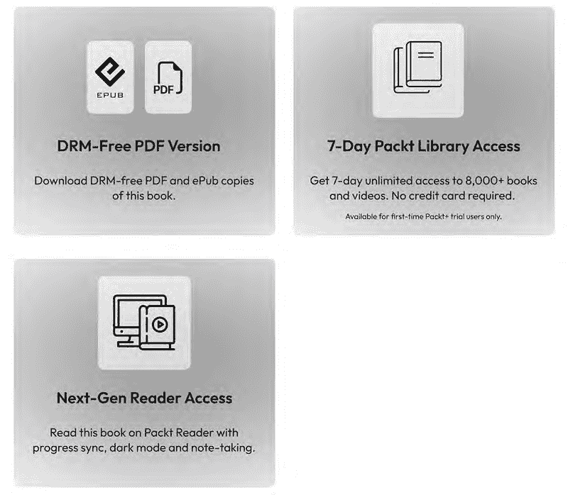

## 前言

大型语言模型的快速发展已将人工智能从静态的、提示驱动的系统转变为动态的、智能体式的架构，这些架构能够进行推理、规划并在现实世界中采取行动。当今最强大的AI应用不再是单模型流水线；它们是由协作智能体组成的系统，这些智能体使用工具、管理上下文，并互相协调以解决复杂问题。构建此类系统需要远超表层框架使用的技能，要求深入理解智能体AI实际运作的方式。

本书没有把智能体框架当作黑盒，而是采取一种自下而上、动手实践的方法。你将通过从第一性原理出发、用Python构建一个灵活可扩展的多智能体框架，探索现代智能体系统幕后的运作方式。工具使用、安全执行、通过**模型上下文协议**（**MCP**）进行上下文管理，以及通过**智能体到智能体**（**A2A**）消息传递实现的智能体协作等核心概念，都被拆解为具体的实现和可复用的设计模式。这种基础性的理解不仅能让你构建自己的框架，还能让你对使用现有工具构建的智能体系统进行推理、定制和故障排查。

本书的旅程刻意注重实践且循序渐进。你将从构建一个简单的工具使用智能体开始，然后逐步增强其能力——加入安全工具执行、持久化和结构化的上下文处理、协作规划以及记忆。随着书的推进，这些独立组件将汇聚成完全自主的多智能体系统，能够通过结构化通信和共享上下文协调行动并解决复杂任务。

本书配有逐步讲解、带注释的Python代码，并深入剖析真实世界的智能体工作流，将理论与实践紧密连接。学完本书，你将能够设计和实现自己的智能体AI系统，为智能体构建自定义工具，集成如MCP和A2A等协议，并部署能够在真实环境中有效推理、规划和行动的协作式AI工作流。掌握了这些技能，你将为构建下一代智能、自适应的AI应用做好充分准备。

本书分为三个部分：

*第1部分*，*智能体AI基础*，为智能体AI奠定基础。它追溯了生成式AI的演进，定义了AI智能体是什么，并将智能体与聊天机器人区分开来。你将学习核心智能体架构和组件，包括智能体循环（感知-思考-行动）、记忆与上下文管理、规划与推理、工具使用以及评估。本部分最后会通过一个面向Kubernetes的简单智能体的动手演练，展示工具调用如何端到端工作，以及极简的代码库如何实现真正的自主性。

*第2部分*，*构建你自己的智能体AI框架*，会引导你从零开始构建一个真实的智能体AI框架（AI-6）。你将探索运行智能体循环并管理记忆、会话、工具和多个LLM提供商的核心引擎，然后深入设计健壮且与提供商无关的工具，包括模式、验证和执行流程。随后本部分转向用户界面，展示如何构建支持可见性、控制和人在回路的Slack及Web界面。最后，本部分将该框架与**模型上下文协议**（**MCP**）集成，从而实现跨更广泛生态系统的标准化工具发现和互操作性。

*第3部分*，*构建多智能体系统*，带你全面进入多智能体系统：设计智能体团队、编排模式、角色提示词、工具范围界定和上下文策略，然后使用**智能体到智能体**（**A2A**）协议实现真实的多智能体工作流。你将构建一个实用的多智能体DevOps系统（MAKDO），学习如何测试和调试智能体协调故障，并应用冗余、优雅降级、人工升级等弹性模式。随后本部分进入生产部署，讲解具有安全通信和服务发现功能的真实多集群配置。最后介绍了高级主题和未来方向，包括海量上下文窗口、长期规划、多模态系统，以及能力日益增强的智能体所带来的更广泛影响。

### 本书读者对象

本书的目标读者包括对构建复杂的、真实世界的智能体AI系统感兴趣的AI工程师、机器学习从业者和软件架构师。对于在生产环境中使用LLM、开发工具使用智能体或探索多智能体编排的人来说，本书尤其有价值。DevOps工程师、AI产品经理以及研究高级LLM框架的研究人员也将从中受益。


### 本书内容涵盖

- *第1章*，*生成式 AI 与 AI 代理入门*，通过介绍生成式 AI 和代理系统背后的基础概念，为本书其余部分奠定基础。本章涵盖生成模型的当前格局，包括**大语言模型**（**LLM**），并解释了为何 AI 代理是将这些模型应用于实际场景中的极具吸引力的下一步。读完本章，你将清晰理解简单 LLM 使用与完整代理行为之间的区别，同时了解相关历史背景和新兴模式。

- *第2章*，*理解 AI 代理的工作原理*，深入探讨 AI 代理的核心机制：它们如何感知、规划和行动。本章介绍了支配代理行为的基本循环（从感知到推理再到行动），并解释了其背后的基础设施。你将理解 AI 代理的内部架构，以及是什么让它们能够有效解决复杂问题。

- *第3章*，*动手实践：构建一个简单的 AI 代理*，将引导你构建一个能够与实时 Kubernetes 集群交互的基础工具型 AI 代理。该代理利用 OpenAI 的工具调用能力来接受自然语言输入、解释意图、执行相应的 kubectl 命令并返回结果。这一实际演练将揭开代理式 AI 框架中工具集成和消息处理的神秘面纱。

- *第4章*，*构建基于工具调用的代理式 AI 框架*，介绍了构建支持动态工具使用的 AI 代理框架的基础概念和实现策略。你将学习如何构建一个健壮的架构，使代理能够决定何时以及如何调用外部工具（例如 API、shell 命令、命令行工具）来增强自身能力。重点在于构建一个最小但功能完善的核心框架，以便后续扩展更复杂的行为。

- *第5章*，*实现自定义工具*，探讨自定义工具的设计与实现，使代理能够执行实际操作、检索结构化数据并与外部系统交互。你将学习如何定义工具接口、处理参数模式、返回结构化结果，以及确保安全可靠的执行。本章强调了工具在将代理能力扩展到简单文本生成之外所扮演的角色。

- *第6章*，*使用 Slack 和 Chainlit 创建聊天界面*，演示如何创建引人入胜的聊天界面，以便与你的 AI 代理交互。你将学习如何构建 Slack 集成，将代理带入工作场所，以及如何使用 Chainlit 创建基于 Web 的用户界面。这些界面是让 AI 代理在实际场景中可访问、可交互且有用的关键。

- *第7章*，*集成模型上下文协议生态系统*，介绍了**模型上下文协议**（**MCP**）及其在增强代理式 AI 系统的上下文感知、互操作性和模块化方面的作用。你将学习 MCP 背后的原理、如何构建 MCP 服务器和客户端，以及如何利用 MCP 兼容组件在不同执行环境中扩展代理能力。本章还展示了如何将 MCP 作为工具调用代理循环的骨干。

- *第8章*，*设计多代理系统*，探讨了多个 AI 代理如何通过**代理间**（**A2A**）通信朝着共同目标协同工作。你将学习多代理编排的模式和架构，包括广播、委派和共识。本章涵盖实际应用案例、协调与冲突解决中的挑战，并为设计可扩展、韧性的协作式代理系统提供最佳实践。

- *第9章*，*使用 A2A 实现多代理系统*，展示了一个完整的多代理系统的实现，将前几章的所有核心思想融为一体。我们将构建一个由专业化代理组成的 AI 驱动的 DevOps 团队，这些代理通过 A2A 协议进行通信，并利用 MCP 获得强大的工具使用能力。该团队包括一个 Kubernetes 专家代理、一个 CI/CD 专家代理、一个安全专家代理，以及一个负责协调并与人类工程师交互的 DevOps 经理代理。本项目展示了多个代理如何在复杂的分布式环境中协作解决实际问题。

- *第10章*，*多代理系统的测试、调试与故障排除*，为你提供实用的调试策略，用于识别工具执行、消息路由、上下文共享和多代理协调中的问题。本章涵盖了针对在动态环境中运行的自治代理所定制的日志记录、追踪、可观测性钩子和诊断方法。

- *第11章*，*部署多代理系统*，重点介绍将我们的多代理 DevOps 系统部署到两个独立的**Docker 内 Kubernetes**（**KinD**）集群中，以模拟分布式、类生产环境。我们将在一个集群上运行经理代理，并将其余专业化代理——Kubernetes、CI/CD 和安全——部署在另一个集群上。这种设置模拟了一种真实的架构，其中控制平面（经理）与工作代理解耦，以实现可扩展性、隔离性和运维韧性。我们将涵盖配置、服务暴露、集群间通信，以及在 Kubernetes 环境中部署基于代理的系统时的常见陷阱。

- *第12章*，*高级主题与未来方向*，探讨了代理式 AI 能力的前沿，从超人推理和大上下文理解，到长周期规划和新兴的自主行为。你将了解到 100 万以上 token 上下文窗口和生成式记忆架构等突破如何解锁新的交互模式、实现战略远见，并预示着推理能力超越人类的代理的出现。我们还引入了**生成式用户体验**（**GenUX**）的概念，作为人机代理接口设计的下一代演进方向。

### 充分利用本书所需条件

你应当具备 Python 编程的基本知识，熟悉机器学习概念，并对大语言模型有基本的了解。

### 本书涵盖的软件/硬件

| 本书涵盖的软件/硬件 | 操作系统要求 |
| --- | --- |
| Python 3.x | Windows、macOS 或 Linux |
| OpenAI API 密钥 | Windows、macOS 或 Linux |

你需要访问一个 Python 开发环境。许多示例都需要 OpenAI API 密钥。建议使用至少 8 GB RAM 的机器来运行较复杂的示例。

如果你使用的是本书的数字版本，我们建议你亲自输入代码，或从本书的 GitHub 仓库获取代码（链接见下一节）。这样做将有助于避免任何与复制粘贴代码相关的潜在错误。

### 下载示例代码文件

本书的代码包托管在 GitHub 上，地址为 `https://github.com/PacktPublishing/Design-Multi-Agent-AI-Systems-Using-MCP-and-A2A`。我们还拥有来自丰富书籍和视频目录的其他代码包，可在 `https://github.com/PacktPublishing` 获取。欢迎查看！

### 关于图片的声明

本书中的某些图片仅用于提供上下文背景，图形的可读性对讨论并非至关重要。请参考我们的免费图形包以下载这些图片。

### 下载彩色图片

我们还提供了一份 PDF 文件，其中包含本书使用的截图/图表的彩色图片。你可以从 `https://packt.link/gbp/9781806116478` 下载。

### 使用的约定

本书通篇使用多种文本约定。

- `CodeInText`：表示文中的代码词、数据库表名、文件夹名、文件名、文件扩展名、路径名、虚拟 URL、用户输入和 Twitter 用户名。例如："`tool_config` 和 `provider_config` 是允许你为每个工具和提供商指定额外配置的映射。"

- **粗体**：表示新术语、重要词语，或你在屏幕上看到的词语。例如，菜单或对话框中的词语会以粗体显示。例如："我们有两个部署：**some-app** 和 **nginx**。**some-app** 部署有三个待处理的 Pod，而 **nginx** 部署有一个 Pod 因镜像名称无效而处于错误状态。"

代码块如下所示：

```
response = client.chat.completions.create(
    model=model_name, messages=messages,
    tools=tools, tool_choice="auto")
```

**注意**

警告或重要注释以此形式显示。

**提示**

技巧和窍门以此形式显示。


### 联系我们

我们始终欢迎读者的反馈！

**一般反馈**：请发送电子邮件至 `feedback@packtpub.com`，并在邮件主题中注明本书的书名。如果您对本书的任何方面有疑问，请发送电子邮件至 `questions@packtpub.com`。

**勘误**：尽管我们已尽一切努力确保内容的准确性，但错误仍可能发生。如果您在本书中发现错误，恳请您向我们报告。请访问 `http://www.packtpub.com/submit-errata`，点击**提交勘误**，并填写表单。

**盗版**：如果您在互联网上发现任何形式的非法盗版作品，恳请您向我们提供位置地址或网站名称。请通过 `copyright@packtpub.com` 联系我们，并附上相关材料的链接。

**如果您有兴趣成为作者**：如果您在某个领域拥有专业知识，并且有兴趣撰写或参与编写一本书，请访问 `http://authors.packtpub.com/`。

### 本书附赠福利

本书附赠免费福利以支持您的学习。立即激活即可快速访问（参见*如何解锁*部分的说明）。

以下是您购买后可立即解锁内容的快速概览：



### 如何解锁

扫描二维码（或访问 `packtpub.com/unlock`）。按名称搜索本书，确认版本，然后按照页面上的步骤操作。

*注意：请备好您的发票。直接从 Packt 购买的订单无需提供发票。*


### 分享您的想法

当您读完《*使用 MCP 和 A2A 设计多智能体 AI 系统*》后，我们很乐意听取您的想法！扫描下方二维码，直接进入本书的亚马逊评论页面并分享您的反馈。

您的评论对技术社区和我们都非常重要，它将帮助我们确保提供优质的内容。

### 加入我们的 Discord 和 Reddit 社区

您并不是唯一一个在应对碎片化工具、持续更新和不清晰最佳实践的人。加入一个不断壮大的专业人士社区，在这里交流那些未写入文档的见解。

加入我们的 Discord：`https://packt.link/z8ivB` 或扫描下方二维码：

在 Reddit 上关注我们：`https://packt.link/0rExL` 或扫描下方二维码：


