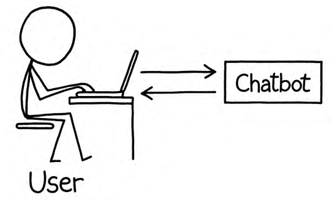
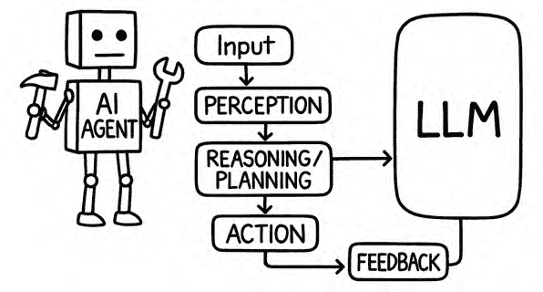
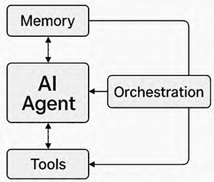
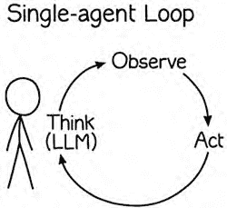
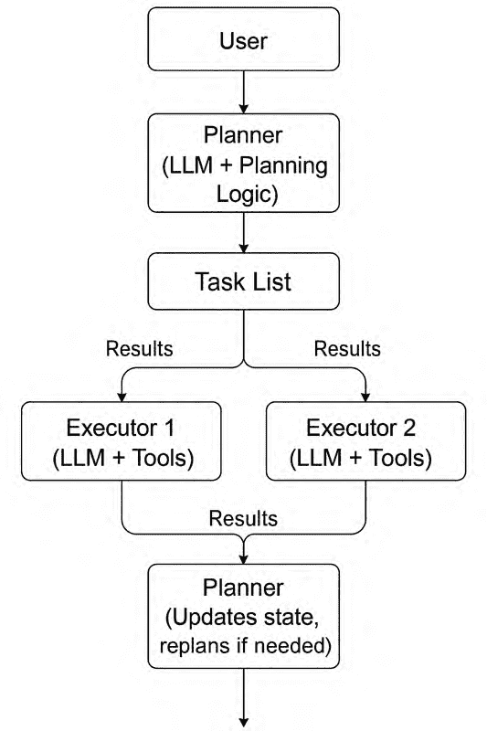
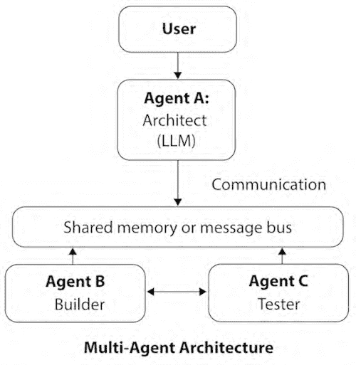
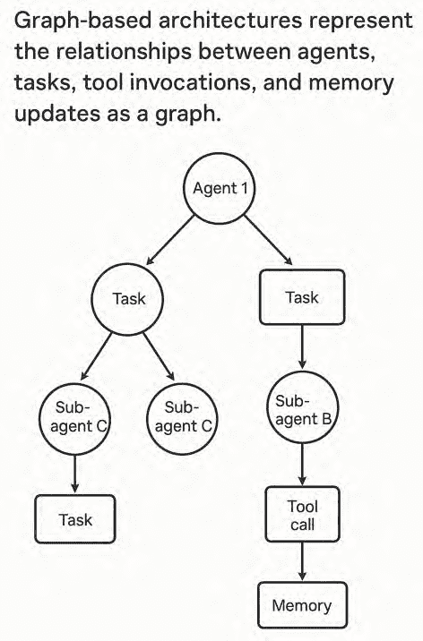

## 第 1 章：生成式 AI 与 AI 智能体导论

AI 智能体代表了我们在构建和交互智能系统方式上的重大演进。与静态模型或聊天机器人不同，智能体能够推理、使用工具、记住过去的交互，并在既定边界内自主行动。AI 智能体建立在**生成式 AI**（**GenAI**）技术之上，使我们能够构建在动态环境中具有适应性、目的性和高效性的系统。

本书全面探讨了智能体 AI 系统的演变、架构和实际实现。本书的独特之处在于，您将从零开始构建一个功能完备的智能体 AI 框架。AI-6 框架支持开发能够进行复杂推理、工具使用和多步骤任务执行的复杂自主智能体。本书横跨 12 个章节，涵盖从基础概念和单智能体架构到高级多智能体系统、测试方法、部署策略以及与**模型上下文协议**（**MCP**）和**Agent2Agent（A2A）协议**等新兴技术的集成。本书既提供理论理解，也提供动手实现指导，对于希望构建真实世界 AI 智能体系统的开发者、研究人员和实践者而言极具价值。

本章通过五个关键特征确立了 AI 智能体与聊天机器人的根本区别：自主性、感知能力、推理与规划、行动能力以及学习与适应能力——将 AI 从被动响应者转变为主动的问题解决者。本章追溯了 AI 从符号推理（20 世纪 50 年代）到专家系统（20 世纪 80 年代）、机器学习（20 世纪 90 年代）、深度学习（2006 年至今），再到当今基于 Transformer 的智能体的演变，展示了每个时代的局限性如何推动下一次突破。

智能体系统出现了四种架构模式——单智能体循环、规划器-执行器模型、多智能体协作和基于图的工作流——每种模式都由三个关键组件支撑：记忆、工具和编排。

在本章中，我们将探讨 GenAI 和 AI 智能体的基础概念。我们将定义什么是 AI 智能体、它与传统聊天机器人的区别，并讨论智能体 AI 的各种用例。我们还将深入探讨智能体系统的架构。

在本章中，我们将涵盖以下主要主题：

- 生成式 AI 的演变
- AI 智能体介绍
- 理解 AI 智能体的架构

### 本书附赠福利

您的购买包含本书的免费 PDF 版本以及其他专属福利。请参阅前言中的*本书附赠福利*部分，立即解锁并充分提升您的学习体验。

### 生成式 AI 的演变

**人工智能**（**AI**）几十年来一直是计算机科学家和未来主义者的梦想。早在 20 世纪 40 年代数字计算机首次被开发出来时，研究人员就开始探索机器模拟人类思想和行为的潜力。多年来，AI 经历了各个阶段以及希望与失望的循环。在这一过程中，受大脑启发的方法和基于逻辑的方法之间始终存在着一种有趣的张力。

例如，感知机作为一种早期神经网络模型，由弗兰克·罗森布拉特于 20 世纪 50 年代开发，是现代神经网络的鼻祖。最初，人们对基于感知机的系统寄予厚望，因为它可以解决单一线性决策边界能够分隔类别的问题。这包括一些基本任务，例如区分以下内容：

- 垂直线与水平线
- 亮色与暗色图案
- 受控条件下的一些手写字符

在 20 世纪 50 年代和 60 年代，这些成就看起来令人印象深刻，当时机器完全从数据中学习的想法还很新颖。然而，该模型非常有限，业界对这种方法的幻想破灭，神经网络研究沉寂了几十年。

### 符号 AI 的早期时代

20 世纪 50 年代和 60 年代的计算机科学先驱通过符号推理（`https://en.wikipedia.org/wiki/Symbolic_artificial_intelligence`）和早期神经网络为 AI 奠定了基础。符号 AI 的一些例子包括艾伦·图灵在图灵测试（`https://en.wikipedia.org/wiki/Turing_test`）方面的研究，以及约翰·麦卡锡开发 LISP（`https://en.wikipedia.org/wiki/Lisp_(programming_language)`）作为 AI 的编程语言。

**符号推理**指的是 AI 中依赖高层次、人类可读的问题、逻辑和搜索表示的一整套技术。它运用逻辑编程、产生式规则、语义网络和框架等工具，通过结构化的符号操作来建模和解决问题。

在这一时期，人们构建了几个雄心勃勃且有趣的系统，例如 **SHRDLU**，这是一个自然语言理解程序，让用户能够与积木构成的虚拟世界进行交互。请看下面这段人与 SHRDLU 的自然语言对话：

**人：**拿起一个大红色积木。

**计算机：**好的。

**人：**抓住那个金字塔。

**计算机：**我不明白您指的是哪个金字塔。

**人（改变主意）：**找一个比你手里那个更高的积木，把它放进盒子里。

**计算机：**说到“它”，我假设您指的是比我手里那个更高的积木。

**计算机：**好的。

**人：**盒子里有什么？

**计算机：**蓝色金字塔和蓝色积木。

**人：**金字塔由什么支撑？

**计算机：**盒子。

对于 20 世纪 70 年代构建的系统来说，这非常令人印象深刻，但它仅限于特定领域，并且需要大量手工构建的知识。

**感知机**在这一时期也获得了关注。将两者进行比较，符号 AI 依赖显式的、人类可读的规则和逻辑推理来解决问题，这使得它高度可解释，但往往僵化且需要大量人工投入。另一个主要缺点是，在现实场景中，规则的组合爆炸很快就会变得无法管理。


另一方面，早期神经网络模型（如感知机）通过调整数值权重从数据中学习，使其能够从示例中泛化，但其决策过程几乎不透明。总体而言，符号人工智能擅长结构化、基于规则的任务，而感知机更适合在嘈杂或模糊的环境中进行模式识别。

但这一浪潮并未持续太久。随着早期系统未能实现其宏大的承诺，人工智能领域的资金和兴趣逐渐消退，这一时期以第一次**人工智能寒冬**而告终。这些早期失败有几个原因。其中最突出的是：技术不够成熟，无法应对现实世界问题的复杂性；可用的计算资源不足；以及缺乏训练数据。随后迎来了专家系统时代。

### 专家系统时代

20世纪80年代，专家系统崭露头角。其理念是将人类专业知识编码为可由软件程序执行的规则。人们开发了用于医学诊断的MYCIN（`https://en.wikipedia.org/wiki/Mycin`）和用于化学分析的DENDRAL（`https://en.wikipedia.org/wiki/Dendral`）等专家系统，但它们受到需要大量领域知识以及难以用规则捕捉人类推理复杂性的限制。以下是来自MYCIN的示例规则：

```
IF
the infection is primary-bacteremia
AND the site of culture is one of the sterile sites
AND the suspected portal of entry is the gastrointestinal tract
THEN
there is suggestive evidence (0.7) that the organism is Bacteroides.
```

这种基于规则的方法实现了某种程度的决策自动化，并取得了一定成功。遗憾的是，总体而言，专家系统脆弱且难以维护，导致20世纪80年代末出现了另一次人工智能寒冬。这种脆弱性源于几个核心局限：处理现实世界复杂性所需的规则数量迅速变得难以管理；随着领域的发展，规则必须不断更新，从而带来维护挑战。此外，通常不可能为每种可能场景定义明确的规则，尤其是在处理模糊或不确定情况时。这些因素使得专家系统缺乏灵活性，最终无法大规模持续。

下一个重要里程碑是机器学习时代。

### 机器学习与统计方法的兴起

现代人工智能时代始于20世纪90年代，随着**机器学习（ML）**和统计方法的兴起。**支持向量机**（**SVM**）、决策树、随机森林和逻辑回归等方法使得处理大型数据集和学习成为可能。这一时期没有太多炒作，但为下一波人工智能进步奠定了基础。重点从手工编写的规则转向数据驱动的方法，使系统能够学习模式并根据示例进行预测，而非依赖显式编程。我们不再告诉计算机如何思考，而是向它扔进大量数据，让它自己弄清楚一切。*数据是新的石油*这一说法就是在此时提出的。但是，虽然这些方法在许多任务上很有效，但它们需要大量耐心的特征工程工作，并且在复杂推理和理解方面仍然存在困难。随后，深度学习网络开始流行。

### 深度学习与神经网络复兴

分层神经网络、GPU加速以及更大数据集方面的研究突破，解锁了视觉、语音和文本领域的新能力。**深度学习**一词于2006年被提出，用来描述这一新方法。我是这一浪潮的参与者之一，在2000年代中期于Numenta（`https://www.numenta.com/`）从事受大脑启发的机器学习研究。

YouTube、Facebook和Twitter等社交媒体的兴起，以及存储和计算成本的大幅下降，导致了数据爆炸。研究人员终于获得了有效训练深度网络所需的数据规模和相关硬件。2012年的AlexNet（`https://en.wikipedia.org/wiki/AlexNet`）、2013年的Word2Vec（`https://en.wikipedia.org/wiki/Word2vec`）以及2014年的DeepSpeech（`https://arxiv.org/abs/1412.5567`）等创新成果，重新定义了人工智能在图像识别、自然语言处理和语音识别等领域的能力。图灵测试尚未被彻底攻克，但我们已越来越接近。

20世纪90年代末和21世纪初，互联网使用和数字存储的爆炸式增长，为收集和处理大规模数据集创造了前所未有的机会，这些数据集将为下一代人工智能突破提供动力。2009年创建的ImageNet包含超过1400万张手工标注的图像，涵盖20,000多个类别，它展示了大规模、精心策划的数据集如何成为训练健壮模型的关键基础设施。ImageNet年度竞赛催生了2012年AlexNet等突破性架构，证明当提供足够高质量的训练数据时，深度神经网络能够实现前所未有的准确性。这种以数据集为中心的方法建立了一种新范式：模型性能随数据量和质量可预测地扩展，促使各组织将数据收集与整理作为核心竞争优势。

有趣的是，当时最引人注目的人工智能成功之一，是IBM的深蓝在国际象棋中击败加里·卡斯帕罗夫，它利用了原始算力，同时采用了老式的符号人工智能和手工编写的代码技术。Netflix推荐系统则是这个时代的代表，它使用协同过滤根据用户偏好推荐电影。

随后，我们进入了现在所处的时代。

### 生成模型、Transformer与语言模型的出现

2014年，**生成对抗网络**（**GANs**）（`https://en.wikipedia.org/wiki/Generative_adversarial_network`）被提出，使从零开始生成图像、视频和音乐成为可能。但最大的突破出现在2017年，Transformer架构在开创性论文《Attention is All You Need》中被引入：`https://arxiv.org/pdf/1706.03762`。Transformer通过使用自注意力机制和前馈网络彻底改变了这一领域，使得并行训练成为可能，其效率比此前最先进的**循环神经网络**（**RNNs**）高出数个数量级。Transformer架构成为许多后续模型的基础，包括Google的BERT、OpenAI的GPT-2以及后来的GPT-3。这一成功还归功于Common Crawl（`https://commoncrawl.org/`）和The Pile（`https://arxiv.org/abs/2101.00027`）等大规模数据集的出现，使得训练能力日益强大的语言模型成为可能。

但直到2022年底，真正的奇迹才发生：OpenAI基于GPT-3.5发布了ChatGPT。突然间，人工智能跃入主流视野，世界被这些大型语言模型的能力所折服。**基于人类反馈的强化学习**（**RLHF**）可被用来微调这些模型，使其更好地与人类对齐，这一发现具有变革性意义。其他公司迅速跟进，发布了各自的模型，如Google的Bard和Meta的Llama。在图像生成方面，DALL-E、Stable Diffusion和Midjourney等模型表明，Transformer架构同样可用于根据文本提示生成高质量图像。


突然之间，人工智能不仅能说话，还能绘画。整个世界为之沸腾，可能性似乎无穷无尽。当人们意识到 AI 在创意表达领域也能一较高下时，许多人的世界观被彻底颠覆了——创意表达往往被视为人类的专属领域。

### AI 智能体的崛起

2023 年 3 月初，OpenAI 发布了 GPT-4，它是 GPT-3.5 的继任者，功能更强大、更可控。GPT-4 能够处理更长的上下文，推理能力更强，并初步展现出多模态流畅性的迹象，因为它能够理解文本、图像和语音。

OpenAI、Anthropic、Google、Meta、Mistral，以及 DeepSeek、阿里巴巴等中国公司不断发布越来越好的模型。在势不可挡的创新步伐面前，一个又一个基准测试被攻破。

像 Anthropic 的 Claude 这样的模型在编程领域不断突破 LLM 的能力极限，而最近的模型引入了长推理模式，模型可以花费更多时间和资源来完成复杂任务。

与此同时，前沿领域转向了智能体 AI：这类模型不仅能够响应，还能规划、推理、使用工具和采取行动。OpenAI API 的函数调用能力，已被 Google（通过其 Gemini 模型）和 Anthropic（通过其 Claude 模型）等其他 LLM 提供商复制，它探索了 LLM 如何成为多步骤工作流、编程助手、网络智能体和现实世界自动化的核心支柱。

多个智能体 AI 框架涌现出来，例如 LangChain、AutoGPT、AutoGen 和 BabyAGI。这些框架允许开发者构建基于 LLM 的复杂系统。这些系统让我们回到了问题的原点：不再只是聊天机器人，而是能够推理任务、使用外部 API 并即时调整的自主协作者。但什么是 AI 智能体？

**注意**

- OpenAI 研究人员早在 2017 年就描述了 RLHF：https://openai.com/index/learning-from-human-preferences/
- 你也可以在这里阅读关于 RLHF 的内容：https://en.wikipedia.org/wiki/Reinforcement_learning_from_human_feedback

### 认识 AI 智能体

这个问题——*什么是 AI 智能体？*——是本书的核心。在本节中，我们将探讨 AI 智能体的常见定义、其特征以及不同类型的 AI 智能体。在下一章 *理解 AI 智能体的工作原理* 中，我们将更加深入，详细探讨 AI 智能体的结构、组成和功能。

如果你问 ChatGPT 什么是 AI 智能体，它会告诉你类似这样的话：

*AI 智能体是一种能够感知环境、对其目标进行推理，并采取行动来实现这些目标的系统，通常是自主或交互式地运行。*

这是一个相当直观的定义，与人们对智能体的普遍理解高度一致。让我们来看看这样的 AI 智能体有哪些特征。

#### AI 智能体的特征

为了按照上述定义运作，AI 智能体必须具备以下特征：

- **自主性**：智能体必须能够独立运作，执行多个步骤来实现目标，而无需人工干预每一步。请注意，这并不意味着智能体是完全自主的。它仍然可以受到人类监督，尤其是在可能采取有风险的行动时。我们稍后会看到一些例子。智能体可以独立运作，在没有人工干预的情况下做出决策并采取行动。

**注意**

- 如果智能体表现得足够好，或者其行动的后果并不关键，它可能完全自主运行，无需任何人工监督。

- **感知**：AI 智能体必须能够感知其环境，无论是物理环境、数字环境，还是两者兼有。这种感知可以采取结构化输入（如 API 响应）或非结构化数据（如自然语言、音频或视觉信号）的形式。智能体利用这些信息来评估其当前状态、上下文和相关变化。它为智能体后续的行动和决策提供信息，并为之前的行动提供反馈。将输入整合为可用的内部表示是一个巨大的技术挑战。仅以原始网络数据为例，它有无数的格式、分辨率和质量水平，需要复杂的管道来解析、验证和标准化这些多样化输入，使其成为适合推理的一致内部表示。

- **推理与规划**：一旦智能体感知到环境，就必须对新信息进行推理，并决定下一步行动。这涉及识别目标、评估可能的行动以及制定或更新计划。现代 AI 智能体可以使用符号规划、强化学习或基于神经网络的方法来执行这一过程。规划使智能体能够向前看并选择行动序列，而不是仅仅对即时刺激做出反应。

- **行动**：AI 智能体的核心功能是在环境中采取行动。这些行动可以包括调用工具或 API、生成响应、触发工作流，甚至控制设备。智能体必须能够以符合其目标的方式执行这些行动，并适应从环境中获得的反馈。为了有效运作，智能体必须具备适当的访问权限和许可来执行实现目标所需的操作。

- **学习与适应**：先进的 AI 智能体应该能够从经验中学习。这可能包括更新内部记忆、调整策略或随着时间推移优化其行为。有些智能体离线学习（通过训练数据），而另一些则在线学习（通过实时交互）。自适应行为对于在动态、不可预测的环境中运作的智能体至关重要。

AI 智能体将自主性、感知、推理、行动和学习结合起来，以在动态环境中高效运作。它们能够做出明智的决策并随时间推移不断适应。这些能力已开始推动各行各业的实际应用，提升效率并赋能更智能的系统。

但它们与我们已开始日常使用的 ChatGPT、Claude Desktop 和 Gemini 等聊天界面有何不同？让我们一探究竟。

#### 主要区别：聊天机器人与智能体

**聊天机器人**和 AI 智能体经常被混用，但它们有着不同的特征。

**基于 LLM 的聊天机器人**允许用户通过自然语言与 LLM 交互。这种交互通常局限于单个查询，可能包含一张图片，或者通过语音界面进行。

以下是典型的聊天机器人交互流程：

*图 1.1：基于 LLM 的聊天机器人与用户交互*

LLM 会消化用户的输入查询并生成响应。除了通过提示工程，用户无法直接控制模型的行为。尤其是，用户无法让模型访问外部数据源和 API（尽管可以上传文件）。

但 AI 智能体的交互流程则复杂得多。基于用户输入以及推理和规划机制，AI 智能体可以自主执行任务，甚至运行完整的工作流。

以下是 AI 智能体工作流的示意图。

*图 1.2：AI 智能体工作流*




让我们用表格总结主要区别：

| 特性 | 聊天机器人 | AI 智能体 |
| --- | --- | --- |
| 目的 | 主要用于对话和提供信息 | 自主执行任务和决策 |
| 交互 | 主要基于文本，通常限于常见问题 | 多模态，可使用工具和 API |
| 自主性 | 有限，通常需要人工输入 | 高度自主，可独立运作 |
| 上下文感知 | 有限的上下文保持能力 | 可以维护并利用长期上下文 |
| 学习 | 静态，基于预训练参数 | 动态，可以随时间学习和适应 |

*表 1.1：聊天机器人与 AI 智能体的主要区别*

智能体 AI 系统在生成式 AI 时代有着多种应用场景。你可能也遇到过一些智能体！让我们来看看 AI 智能体实际工作中的一些示例。

#### 智能体 AI 的应用场景

AI 智能体可以应用于广泛的领域和场景。令人着迷的是，一些最成功的应用出现在那些此前被认为对 AI 来说过于复杂或微妙的领域。但随着我们迈向更强大的 AI 智能体，我们在软件开发、客户支持、研究，甚至共情式用户交互等领域都看到了突破。

以下是一些 AI 智能体在当前被有效应用的示例：

- **自主编程助手**：软件工程是一项复杂的任务，需要深入理解问题领域和技术实现。AI 智能体已经达到了一定水平，它们可以探索大型代码库，被分配 GitHub 或 Jira 问题，并自主修复问题、执行大规模重构、编写和运行测试，以及确保更改有效。当前一代 AI 编程智能体仍然无法完全取代高水平的人类工程师，但可以显著提升软件团队的生产力。我认为当前这批 AI 编程智能体就像一位博学的实习生。


它们可以自行完成一些任务，但在大型代码库中可能会迷失，需要一定的引导和手把手的协助。一些AI编码智能体的例子包括 Devin.ai（https://devin.ai/）、Claude Code（https://www.anthropic.com/claude-code）、OpenAI 的 codex CLI（https://github.com/openai/codex）、Google 的 Jules（https://jules.google/）以及开源的 OpenHands（https://github.com/All-Hands-AI/OpenHands/）。

#### 自动化客户支持

客户支持一直被视为自动化的首要目标。客户支持机器人已经存在20多年。然而，它们的能力一直非常有限，用户大多选择升级到人工处理。如今，AI智能体正在通过将静态聊天机器人转变为具备多轮对话、工具使用和实时问题解决能力的动态助手，从而改变客户服务。与传统机器人不同，这些智能体可以验证用户身份、从CRM中提取数据，甚至升级或解决工单。Intercom 的 Fin（https://fin.ai/）就是一个很好的例子——它是一个支持智能体，可以根据贵公司的文档回答复杂问题。同样，Ada（https://www.ada.cx/）和 Forethought（https://forethought.ai/）使用AI智能体跨消息渠道处理一级和二级支持任务，从而减轻人工客服的负担。这些系统与 Zendesk 和 Salesforce 等服务台平台集成，无需自定义脚本即可实现端到端的工单解决。

#### 研究智能体

研究是AI智能体产生重大影响的另一个领域。知识积累的速度正在显著加快。遗憾的是，并非所有知识都是高质量的。AI智能体可以帮助研究人员筛选海量研究论文，关联并发现它们之间的联系，甚至生成新的假设。所有主流LLM提供商现在都为其顶级模型提供研究模式，基础模型本身可以自主执行复杂的研究项目，包括生成搜索查询、执行网络搜索、分析结果，并将研究结果综合成一份连贯的报告。该报告还附有来源参考链接。以下是截至2025年5月当前的一些领先事件，这些事件由软件工程师显式编程。相比之下，AI智能体系统将其中一些高层认知任务委托给AI智能体。

#### AI智能体系统的常见组件

无论选择哪种架构，任何具备一定复杂度的AI智能体系统都会包含以下组件：

*图1.3：AI智能体系统的常见组件*

1. **记忆**是AI智能体系统的关键组件。它使智能体能够存储和检索有关其环境、过往动作和所学知识的信息。记忆可以是短期的（当前会话或任务的上下文），也可以是长期的（用于存储知识、偏好和习得的行为）。我们将在*第2章*中探讨不同类型的记忆，但这里先让您有所了解，以下是AI智能体中最常用的几种记忆类型：
   - **工作记忆**维护当前的上下文窗口。这是系统用来处理和执行任务的即时短期记忆，包含当前会话中的所有输入和输出词元。
   - **情景记忆**跟踪跨会话存储的近期对话/事件（即先前交互或重要事件的记录）。这使系统能够回忆特定的交流或用户行为，从而随时间实现连续性和个性化。
   - **语义记忆**是随时间习得的事实/概念。它是结构化知识的长期存储，例如一般世界事实、特定领域信息或概念关系。

2. **工具**是智能体可以在环境中执行操作所使用的外部资源或API。如果LLM是大脑，那么工具就是AI系统的眼睛、耳朵和四肢，使其能够感知环境并对其采取行动。没有工具，AI系统只能根据用户输入提供建议，而在现实世界中不具备任何实际的自主行动能力。

3. **编排**是协调AI智能体系统各组件并使其协作以实现目标的过程。这包括管理智能体、工具和记忆之间的信息流，以及处理与外部系统和人类的交互。编排可以通过中央控制器完成，也可以采用去中心化的方式，让智能体直接相互通信。人在回路中的参与程度可以有所不同。



现在，让我们来看看各种AI智能体架构。

#### AI智能体架构的类型

对于不同的场景和情况，有不同的架构可供使用。架构的选择取决于具体的用例、所需的自主程度以及待执行任务的复杂性。以下是一些常见的架构：

#### 单智能体循环

单智能体循环架构由一个AI智能体组成，该智能体感知其环境、对其目标进行推理，并采取行动来实现这些目标。该循环通常包括观察、规划和执行的周期，使智能体能够以有目的且具有适应性的方式与其环境交互。

*图1.4：单智能体循环架构*

在这里，目标推理指的是智能体（通常由**大型语言模型**（**LLM**）驱动）如何解读指令并选择行动方针。LLM会从提示词、历史上下文以及任何明确陈述的目标中推断意图，然后将复杂任务分解为与预期结果一致的子任务或步骤。尽管LLM不会以类似人类的方式*推理*，但它们会利用从训练数据中习得的模式来模拟推理，通常是通过预测在给定上下文中一个有帮助或目标导向的回应应该是什么样子。这使智能体在追求其指定目标时显得深思熟虑且前后一致。

这种架构适用于简单任务，此时单个智能体即可处理所有复杂性，且上下文窗口（每次请求中可供LLM使用的词元总量）足够大，足以容纳整个任务。智能体可以使用工具和记忆来增强其能力，但它独立运行，无需与其他智能体协调。




以下是一些典型的使用场景：

- **工具增强的问答**：当智能体与外部工具（如网络搜索、计算器、数据库）配对使用时，它可以获取事实、计算结果或检索实时信息，从而更准确地回应用户查询。
- **设备监控**：智能体可以监控空气质量传感器等设备，随时间进行分析，并在检测到异常时发出警报。
- **自动化代码审查**：智能体可以动态关注代码仓库中的变更，并为变更提供审查意见。

当智能体观察到环境发生变化时，例如恒温器读数发生变化，根据其训练数据，在类似情况下，正确的做法是将当前温度与设定温度进行对比。如果上下文中尚未包含此信息，这将触发一个动作来读取设定（目标）温度。一旦智能体同时获得了当前温度和设定温度，它就会向模型发送一条消息，模型将根据其训练数据生成下一个动作：升高温度（如果当前温度过低）、降低温度（如果当前温度过高）或不做任何操作（如果当前温度等于设定温度）。

LLM 的思考最好被理解为通过语言对人类式推理的模拟。它通过分析海量文本数据中的模式来预测序列中的下一个词。它利用概率、上下文和训练来模拟推理。它通过利用训练数据中的模式来模仿认知模式，但缺乏理解力、意向性和意识。

**注意**

搜索引擎通常并未集成到 LLM 中，但一些 LLM 提供商现在提供推理模型，这些模型可能会运行一个内部智能体循环，该循环可以使用诸如网络搜索和文件搜索等工具来搜索外部上传的数据（而非训练数据）。

### 规划器与执行器

在**规划器与执行器架构**中，一个**规划器 AI 智能体**负责对目标进行推理，并制定一个将目标分解为子任务的计划。然后，这些子任务被委派给其他称为**执行器智能体**的智能体。规划过程包括由规划器 AI 智能体根据其训练数据和提示生成计划步骤。执行的结果可能会被发送回规划器，规划器可能会调整计划并启动更多的执行器智能体。

*图 1.5：规划器与执行器架构*



这些执行器智能体专门处理其任务，并在规划器和其他执行器智能体之外与 LLM 独立交互。这意味着它们管理自己的上下文，并拥有自己的工具集。协调计划的执行以及处理任务之间的依赖关系，可以由规划器智能体负责，或者在规划器启动时由专门的协调器智能体负责。

这种架构适用于超出单智能体能力的复杂任务。执行器智能体使用相同的智能体 AI 技术，在一般情况下不需要任何自定义编程。访问资源、数据存储和 API 所需的全部自定义编程都由工具实现。

典型的使用场景包括：

- 自动化的研究与报告生成
- 复杂的多步骤数据处理流水线
- 软件重构与测试计划
- 协调使用多个 API 或工具完成集成任务

### 多智能体系统

规划器与执行器架构是一种内聚的多智能体架构，其中规划器（直接或通过协调器智能体）控制并编排工作流。这可以扩展为更复杂的**多智能体架构**，其中多个具有特定角色（如 CEO、工程师、审查员）的智能体可以独立运行并相互协作，这与人类团队非常相似。

*图 1.6：多智能体架构*



在这种架构中，智能体可以相互通信、共享记忆，并一起向系统目标迭代推进。这比规划器与执行器的自上而下结构更为复杂，允许更动态的交互和任务的并行处理。

例如，当编码智能体完成一个模块的实现时，它可以通知测试智能体，测试智能体将接着测试这个新模块。当架构师设想的所有模块都由编码智能体实现并由测试智能体成功测试后，架构师就可以开始开发目标系统的下一个版本。多个编码智能体和测试智能体可以在多个模块上并行工作。

### 基于图的结构

**基于图的结构**将智能体、任务、工具调用和记忆更新之间的关系表示为一张图。每个任务或智能体都可以动态地派生出多个子智能体。图的整体结构会根据先前任务的结果有机地涌现出来。

*图 1.7：智能体系统的基于图的结构*



为简单起见，考虑这样一个示例：任务是统计一个目录中所有文件的所有单词数。子智能体 C 可以是一个统计文件中单词数量的子智能体，这样可以为每个文件启动多个子智能体 C。之后，智能体 1 将汇总所有子智能体 C 的结果。

图中的每个节点代表一个智能体、任务、工具或记忆更新，而边则代表它们之间的信息流和依赖关系。使用这种架构的最著名框架之一是 LangGraph（`https://www.langchain.com/langgraph`）。

智能体图架构的主要优势在于，问题可以被自然地分解为深层级的结构，例如软件开发规划，其中“构建一个 Web 应用”这样的顶层目标会分解为前端、后端和数据库等子系统，每个子系统都有自己的任务，如 UI 设计、API 开发、模式建模和测试。每个子任务都可以由专门的智能体处理，将输出和上下文沿图向下传递，从而跨抽象层实现协调且模块化的执行。

但智能体图架构也有几个缺点。它引入了显著的协调复杂性，因为管理智能体之间的依赖关系、消息传递和错误传播可能会变得难以扩展和调试。此外，当任务与层级结构不完美对齐时，过度分解或智能体频繁切换可能会带来开销，导致延迟、资源效率低下或行为脆弱。

#### 总结

在本章中，我们追随了生成式 AI 非凡的发展历程，从符号推理和专家系统的开创性工作，到深度学习以及基于 Transformer 模型的迅猛崛起。我们探索了该领域如何从基于规则的自动化演变为数据驱动的智能，从而造就了我们目前复杂的生成式模型，这些模型不仅能够理解内容，还能创造内容。

我们审视了 AI 智能体以及智能自主系统的出现，它们能够感知、规划、行动并适应其环境。与传统聊天机器人不同，AI 智能体配备了记忆、工具使用和多步推理能力，使其能够在不同领域执行复杂的动态任务。我们研究了几种架构，了解了它们与聊天机器人的区别，并调查了一些真实世界的用例，从自主编码助手到 AI 伴侣。

至此，你应该已经掌握了理解 AI 智能体原理所需的全部背景知识，包括它们的本质、它们在整个 AI 革命中的地位，以及它们当前的能力。这应该为我们继续前行奠定坚实的基础。有了这个坚实的基础，我们现已准备好在下一章中更深入地探讨 AI 智能体的内部工作机制，详细解析它们是如何构建的、其组件之间如何相互连接，以及它们在实践中如何实现自主性和智能。


### 获取本书的PDF版本和专属附加内容

扫描二维码（或访问 `packtpub.com/unlock`）。按名称搜索本书，确认版本，然后按照页面上的步骤操作。

*注意：请将发票放在手边。直接从Packt购买不需要发票。*


