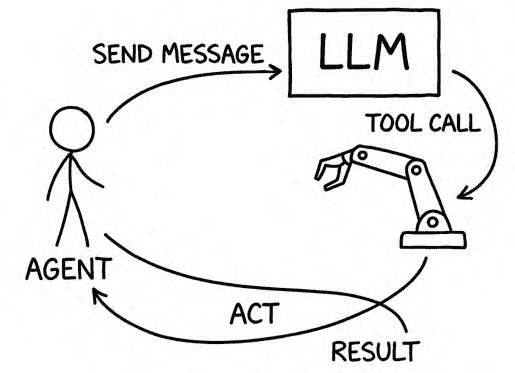
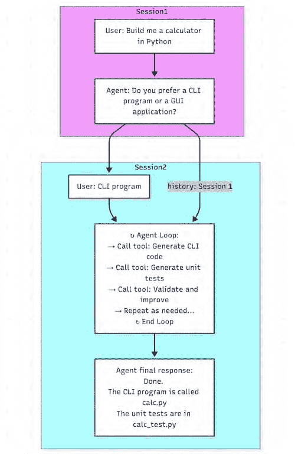
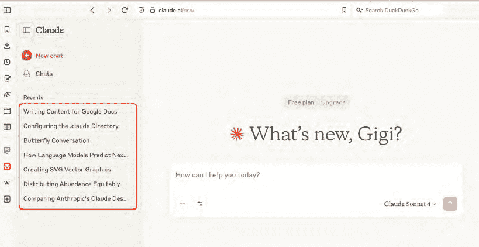
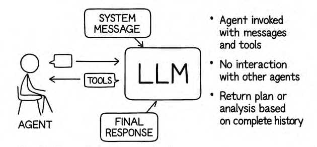
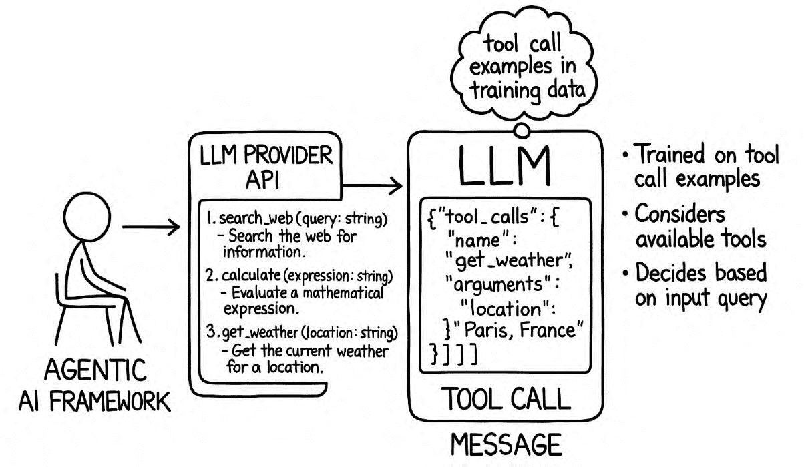
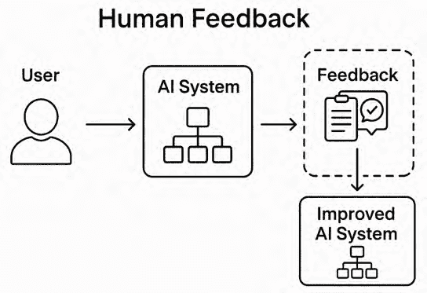
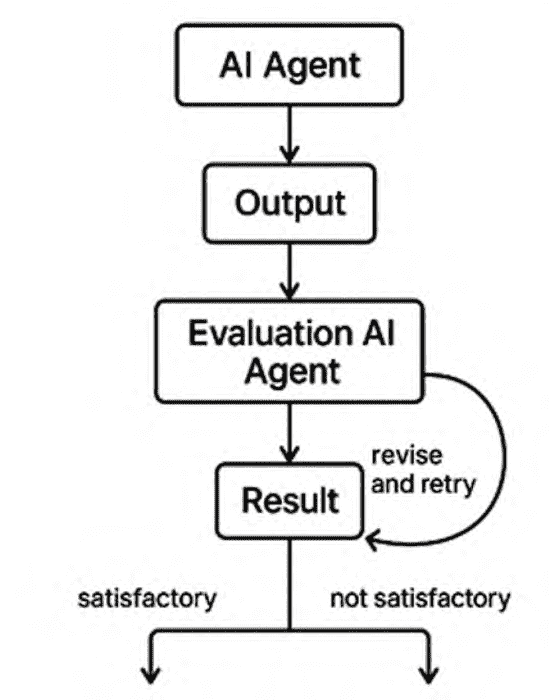

## 2 理解AI智能体如何工作

在*第1章*中，我们探讨了**GenAI**和智能体系统的核心概念，包括其设计中使用的各种架构。在本章中，我们将进一步了解AI智能体的实际工作机制。我们将考察智能体AI的关键组件和子系统，例如核心智能体循环、记忆、目标制定、状态管理、规划/推理、工具使用和反馈机制。

为了便于理解，本章将介绍智能体系统中的各种概念或组件，并讨论它们的作用。然后，我们将讨论这些组件如何在一个开源智能体AI框架AutoGen中实现。

需要再次强调，我们将重点关注由**大语言模型**（LLM）完成所有决策、规划和推理的智能体AI系统。也存在其他智能体AI系统，其逻辑以不同方式实现，例如使用规则引擎或传统编程，或使用**检索增强生成**（RAG）。外部RAG也是一种常见模式，AI系统会解释模型的响应，并从外部来源（如数据库或知识库）获取相关数据，以提供更准确且上下文相关的答案，或将数据反馈给LLM。不过，我们稍后会看到，即使RAG也可以简单到一个由LLM自己控制的工具调用。

在本章中，我们将介绍以下主要主题：

- 理解智能体循环：感知、思考、行动
- AutoGen中智能体循环的工作原理
- 使用记忆、目标和状态管理长对话
- 规划与推理机制
- 工具使用与环境交互
- 智能体评估与反馈循环

### 理解智能体循环：感知、思考、行动

**智能体循环**是定义AI智能体如何运作的核心循环。它类似于其他领域中许多控制循环，例如机器人技术或控制系统。一些著名的控制循环示例有**OODA**循环（**观察、判断、决策、行动**）(`https://en.wikipedia.org/wiki/OODA_loop`) 和 Kubernetes 协调循环 (`https://pkg.go.dev/sigs.k8s.io/controller-runtime/pkg/reconcile`)。

一个智能体循环由一个会话工作流和三个阶段组成：感知、思考、行动。如果从LLM收到的消息是最终响应，那么智能体就完成处理，循环终止，并将响应返回给调用方（用户、另一个系统或更高级别的智能体）。然而，如果收到的消息是LLM执行某个动作（通常是工具调用）的指令，那么智能体将执行请求的动作，并通过将动作结果发送回LLM来继续循环。

接下来，我们将讨论智能体循环的各个阶段。

#### 智能体循环的阶段

智能体循环可以分为三个主要阶段：感知、思考、行动。循环会一直持续，直到LLM给出最终响应。

**思考**：这里最令人惊讶的部分是——智能体本身并不思考，思考由LLM完成。智能体循环只是与LLM交换消息的管道。

智能体循环可以向LLM发送额外的消息，直接修改上下文，或者即使LLM尚未提供最终响应，也可以直接终止循环。

**行动**：行动与感知非常相似。从智能体循环的角度来看，它们实际上无法区分。智能体循环向LLM发送一条消息，LLM以工具调用消息作为响应。然后，智能体AI框架执行该工具调用，并将结果发送回LLM。行动只是一个对外部世界有某种影响的工具调用。它可以是调用API、数据库，甚至是现实世界中的物理动作（例如移动机械臂）。

*图2.5：智能体循环的行动阶段*



关键在于，智能体循环通过发送工具调用并接收结果来促成这种交互。智能体循环不关心工具调用的性质，无论是感知还是行动。行动工具调用的结果通常是成功或错误消息，并发送回LLM。如果该行动是长期行动，响应可能是一个行动ID，LLM稍后可以查询该ID以获取进度和状态更新。与往常一样，LLM将根据对行动工具调用的特定响应来决定如何继续。

智能体从不进行任何思考。思考要么由LLM完成（在智能体循环下方），要么由AI系统完成（在智能体循环上方）。智能体框架和智能体本身从不自行进行任何思考。

**注意**

感知与行动的区别在于对外部世界的影响。感知只是观察世界的状态。行动则会改变世界的状态。


如果响应是成功状态，那么LLM可能只会回复一条最终响应消息并终止智能体循环。然而，如果失败，它可能会重试或采取一些恢复措施。

在多智能体系统中，最重要的操作之一是启动另一个拥有自己智能体循环的智能体。我们将在本书后面的*第8章*中深入探讨这一点。多智能体协作的另一种形式是与另一个并非由当前智能体启动的、已在运行的智能体进行通信。这种交互可以被视为感知或行动，具体取决于另一个智能体的行为。如果它只是返回一些信息，那就是感知；但如果它在现实世界中执行了某些操作，那就是行动。如果此时感到困惑，不必担心。我们将在本书的*第3部分*中详细阐述多智能体系统的所有细节和微妙之处。

让我们看看微软的一个流行智能体框架 AutoGen 是如何实现智能体循环概念的（`https://github.com/microsoft/autogen`）。

### AutoGen 中智能体循环的工作原理

AutoGen 实现了智能体循环的各个阶段（感知，来自模型。

```
response = await model_client.create(
    input_messages,
    tools=tool_schema,
    cancellation_token=cancellation_token,
)
# Add the response to the generated messages.
generated_messages.append(
    AssistantMessage(
        content=response.content,
        source=caller_source,
    )
)
# Keep iterating until the model stops generating tool calls.
while (
    isinstance(response.content, list)
    and all(
        isinstance(item, FunctionCall)
        for item in response.content
    )
):
    # Execute functions called by the model by sending messages to the tool
    # agent.
    results: List[FunctionExecutionResult | BaseException] = await asyncio.gather(
        *[
            caller.send_message(
                message=call,
                recipient=tool_agent_id,
                cancellation_token=cancellation_token,
            )
            for call in response.content
        ],
        return_exceptions=True,
    )
    # Combine the results into a single response and handle exceptions.
    function_results: List[FunctionExecutionResult] = []
    for result in results:
        if isinstance(result, FunctionExecutionResult):
            function_results.append(result)
        elif isinstance(result, ToolException):
            function_results.append(
                FunctionExecutionResult(
                    content=f"Error: {result}",
                    call_id=result.call_id,
                )
            )
        elif isinstance(result, BaseException):
            raise result  # Unexpected exception.
    generated_messages.append(
        FunctionExecutionResultMessage(content=function_results)
    )
```

### The.
```
response = await model_client.create(
    input_messages + generated_messages,
    tools=tool_schema,
    cancellation_token=cancellation_token,
)
generated_messages.append(
    AssistantMessage(
        content=response.content,
        source=caller_source,
    )
)
return generated_messages
```

### AutoGen 中的行动阶段

行动的实现方式与感知完全相同——通过工具执行。正如所描述的那样，智能体“不知道工具调用的性质”。无论工具是读取数据（感知）还是执行操作（行动），其实现方式都是一样的。对于更复杂的工具交互，AutoGen 提供了一个专用的 `tool_agent_caller_loop` 函数（`https://github.com/microsoft/autogen/blob/main/python/packages/autogen-core/src/autogen_core/tool_agent/_caller_loop.py`），该函数实现了完整的感知-思考-行动循环。

该函数展示了核心循环：向LLM发送消息 → 接收工具调用 → 执行工具 → 回传结果 → 重复，直到不再有工具调用。

AutoGen 通过交接（handoffs）支持上述多智能体协作，其中一个智能体可以启动另一个智能体或与之通信。这是通过 `HandoffMessage`（`https://github.com/microsoft/autogen/blob/main/python/packages/autogen-agentchat/src/autogen_agentchat/messages.py`）和 Swarm 模式实现的，允许智能体将任务委派给拥有自己智能体循环的专用智能体。

**HandOffMessage** 是一种旨在将对话转交给另一个智能体的消息。

**Swarm 模式**是一种协调策略，多个智能体共同协作解决一个任务。

> **注意**


对于一个智能体系统来说，若要保留上下文，它必须能够访问可能促成其行动的信息。这正是记忆、目标和状态发挥作用的地方。接下来我们讨论这些内容。

### 利用记忆、目标和状态管理长对话

智能体AI系统会在可能较长的时间跨度内执行复杂的多步骤任务，以同步或异步方式与人类、其他系统以及其他AI智能体交互。到目前为止你已经很清楚，所有这些……（原文此处不完整，按原文保留）。有些LLM提供商提供有状态的长时记忆，这些记忆会被动态注入LLM的上下文。

我们将聚焦于智能体的单次调用，其中恰好包含一条系统消息、一条用户消息（即提示词）、零条或多条工具消息，以及来自LLM的单一最终响应消息。

智能体的通用指令在系统消息中指定，这通常是一段较长的文本，描述智能体的能力、角色、一些初始知识、输出规范以及示例。例如，一个Python编码智能体的系统消息可能如下所示：

```
你是一位Python编程专家和助手。你编写简洁、地道、文档完善的Python代码，并在被问及时清晰、简要地解释你的选择。
你可以分析需求、调试代码、重构现有实现，并在架构和风格方面提出改进建议。
始终假设用户具备技术能力，但可能不了解Python标准库或惯用用法的全部细节。
如果问题存在歧义，请先提出澄清问题再继续。
编写代码时，优先清晰而非炫技，并在适当处添加简短注释。
除非另有说明，请在三反引号内输出Python代码。
仅当被明确允许或属于常用库（如requests、pandas或numpy）时，才可使用第三方库。
遵循最佳实践，如编写单元测试并按照PEP-257约定记录代码。
```

与此智能体的长对话可以分解为多次智能体循环调用，每次调用都有自己的最终响应消息。对话线程将由AI系统保存，该系统会将上一会话的所有消息送入下一会话。例如，用户可能请求*“用Python给我构建一个计算器”*，智能体则以澄清问题作为最终响应消息：*“你更喜欢CLI程序还是GUI应用？”*。控制AI系统会将问题呈现给用户，用户可能选择CLI程序。现在，新一次智能体调用开始，包含第一会话的全部历史，以及用户选择CLI程序作为发给智能体的初始用户消息。然后，新的智能体在获知用户偏好CLI程序后，可以开始迭代使用工具调用来生成并编写代码与测试，直到它满意为止，然后返回最终响应，例如*“完成。CLI程序名为calc.py，单元测试位于calc_test.py”*。

*图2.7：多会话对话*



让我们看看这一切在LLM上下文窗口层面是如何表示的。

#### 上下文窗口

语言模型中的**上下文窗口**指的是模型在单次调用期间能够处理和推理的信息总量。这不仅包括文本，还包括其他输入模态，如图像、音频、结构化数据或嵌入——具体取决于模型的能力。上下文窗口实际上充当模型的工作记忆，决定它能 *看到* 并用于生成响应的信息。

现在，我们迄今为止讨论的所有高层概念，如智能体记忆、目标和状态，最终都必须表示为token，并适合放入每次对LLM的API请求的上下文窗口中。

当LLM形成其响应时，它依赖训练中获得的知识，这些知识编码在模型权重中。但上下文窗口中的所有信息在模型生成响应后就会立即被遗忘。请注意，LLM运营商可能会存储这些信息用于审计、未来训练或其他目的，但模型本身不会从上下文窗口学习或保留任何信息。要在多次智能体循环调用之间保留信息的唯一方式是将其存储在AI框架或AI系统层面，然后在下次调用时将其重新送入上下文窗口。

更大的上下文窗口能够支持更复杂的行为：更长的对话、更丰富的输入、对先前步骤更完整的推理，或对复杂工件的详细引用。较小的窗口则会限制模型维持连续性、整合上下文或处理深层嵌套任务的能力。

RAG嵌入可以直接注入上下文窗口，无论所有模态采用何种编码。

**注意**

LLM（如GPT-4o这样的模型）并不管理用户画像。LLM提供商（如OpenAI）可能会存储用户特定信息，并在如ChatGPT这样的交互式聊天会话中自动将其注入上下文窗口。在这种情况下，ChatGPT扮演了管理记忆的AI系统角色。

在使用AI框架的智能体AI系统中，与LLM的交互通常通过专用API密钥进行，不存在用户级画像。

但是，即使拥有很大的上下文窗口，对于长对话或输入输出都很大的复杂任务，你也可能耗尽空间。每个模型都有其自身的上下文窗口大小，在选择使用哪个模型时将其纳入考量非常重要。在这种情况下，你可能需要截断对话历史、进行摘要，或以某种形式压缩以适配上下文窗口。在多智能体系统中，你也可以采用分治方法，让每个智能体负责特定的子任务，并可将模型的整个上下文窗口专门用于自己的子任务，仅由更高级别的智能体汇总通常较小的结果。我们将在*第9章*中讨论这一场景。

#### 为什么LLM没有记忆？

但为什么LLM不能直接记住一切？为什么每次都需要喂入所有上下文？答案是复杂且微妙的。首先，LLM自身拥有记忆组件并没有什么好处。我们实际上在讨论的是LLM提供商维护每个用户对话的状态（所有消息的历史），这样用户每次请求可以只发送最新消息。

LLM提供商随后可以将最新消息添加到用户保存的会话中，并将其作为临时上下文窗口馈送给LLM。那么问题来了，为什么LLM提供商不能向用户提供这项服务？理论上，这可以节省大量带宽，因为无需在每次请求中发送整个会话历史，只需发送新增消息的增量部分。

然而，在规模化场景下，你需要每种LLM的多个副本并行运行，以处理大量请求。如果每个LLM实例都有自己的记忆，那么你就需要在用户请求与LLM实例之间保持会话亲和性。此外，用户的后续消息之间可能还有延迟。当LLM提供商管理会话记忆时，即使没有消息发送，它也必须维护状态。这会迅速累积，尤其是对长期会话而言。

让我们看一个例子：10,000名用户在5分钟内共向LLM提供商发送了10 TB数据。LLM提供商需要存储所有这些数据，以便响应用户的后续消息。决定将这些数据存储在哪里是复杂的（内存、数据库、分布式缓存）。每当用户发送另一条消息时，LLM提供商需要获取该用户对话的上下文并将其注入LLM。这很复杂，且可能引入多种故障模式和性能问题。

最后，还存在会话终止的问题。LLM提供商有两个选择：要么永远保留会话状态，以便用户随时继续对话；要么根据某种启发式策略决定何时擦除会话记忆。总的来说，LLM提供商更倾向于保持LLM的无状态性，让AI框架或AI系统管理会话状态，以提升可扩展性、降低延迟并最小化成本。


像 ChatGPT、Perplexity 和 Claude.ai 这样的聊天机器人似乎拥有长期记忆，可以继续之前的对话。下面是一个示例，其中 Claude.ai 显示了之前对话的列表。

*图 2.8：Claude.ai 服务的示例对话存储*

这实际上是管理聊天机器人的 AI 系统的一个功能，而非 LLM 本身的功能。Claude.ai 是一项提供与 Anthropic 模型进行交互式聊天服务的网络服务。它将所有对话存储在持久化存储中，并向用户显示之前对话的列表。当用户选择一个对话时，Claude.ai 服务会检索存储的对话，并将其作为初始消息输入到所选 LLM（例如 Claude Sonnet 4）中。LLM 本身始终只有一个临时上下文窗口，其范围仅限于当前调用。一些 LLM 提供商（如 OpenAI）已开始尝试通过 ChatGPT 记忆功能实现跨所有对话的全局长期记忆（[https://openai.com/index/memory-and-new-controls-for-chatgpt/](https://openai.com/index/memory-and-new-controls-for-chatgpt/)）。所有过往对话的摘要（用户可以选择加入或退出长期记忆）会被输入到每次调用中，因此模型看起来像是记住了你所有的历史互动。

为了了解实际实现，让我们看看 AutoGen 框架（[https://github.com/microsoft/autogen](https://github.com/microsoft/autogen)）中是如何实现记忆的。



### AutoGen 中的记忆

令人惊讶的是，AutoGen 并未在其架构的核心层提供记忆功能。记忆是在聊天智能体的更高抽象层级上实现的。共有三种类型的记忆：

- **简单顺序列表记忆**：AutoGen 为简单顺序列表记忆定义了一个抽象记忆协议，包含 `add()`、`query()`、`update_context()`、`clear()` 和 `close()` 等操作。例如，一个返回当前天气的智能体可以使用记忆来存储用户的温度单位偏好（"imperial" 与 "metric"），并据此回应用户的查询。在与 LLM 交互的上下文中，记忆的内容会被添加到上下文窗口中。

- **基于向量的 RAG 记忆**：AutoGen 还支持实现记忆协议的更复杂的记忆存储。AutoGen 开箱即用地提供了一个扩展，在 `ChromaDBVectorMemory` 类（[https://github.com/microsoft/autogen/blob/main/python/packages/autogen-ext/src/autogen_ext/memory/chromadb/_chromadb.py](https://github.com/microsoft/autogen/blob/main/python/packages/autogen-ext/src/autogen_ext/memory/chromadb/_chromadb.py)）中实现了基于向量的 RAG 记忆。

- **以任务为中心的快速记忆（实验性）**：实验性的以任务为中心的快速记忆存储在 `MemoryController` 中。它不使用记忆协议，目前仍是 AutoGen 内部的一个活跃研究项目。其目标如下：

  - 通过在上下文窗口限制之外快速且持续地学习，从而更有效地完成一般任务
  - 记住用户提供的指导、纠正、计划和演示
  - 通过智能体自身的经验进行学习，并快速适应不断变化的环境
  - 避免在与此前遇到过的任务相似的任务上重复犯错

它们都被用于 `AssistantAgent` 类，这是 AutoGen 中实现聊天智能体的主要类。

现在我们将把重点转向 LLM 的规划与推理机制。

### 规划与推理机制

你可能还记得，在智能体 AI 系统中，所有的规划与推理都是由 LLM 完成的。然而，AI 框架仍然可以组织与 LLM 的交互，以促进编排式的规划与推理。在本节中，我们将探讨智能体 AI 系统中规划与推理的不同方法，包括单智能体与多智能体规划，以及与推理模型的协作。

#### 与推理模型协作

LLM 提供商现在会提供专门为复杂多步推理任务设计的推理模型（见下图）：

*图 2.9：与推理模型协作*

这意味着在单次请求中，这些模型可以执行多步推理，并使用网络搜索和代码执行等内部工具，而无需与 AI 框架或用户交互。例如，OpenAI 的 o 系列模型（o3、o4-mini）会花费更多时间（和 token），实际上是在运行自己的内部智能体循环。这些模型在必要时仍可能调用外部工具，但消息。智能体可以调用工具来收集有助于制定计划或对输入数据进行推理的信息。

#### 多智能体规划与推理

在多智能体系统中，规划与推理更加复杂。顶层智能体可以调用额外的子智能体，或与已在运行的智能体通信。请注意，调用子智能体或与另一个智能体通信的决定，本身就是由顶层智能体所调用的 LLM 进行规划的结果，该规划会形成一个工具调用，而工具的执行结果便是启动一个子智能体或向另一个智能体发送消息。

多智能体系统中智能体之间的交互引入了单智能体场景中不存在的多个交互层面。当父智能体将工作委派给子智能体时，它必须精心构建子智能体的上下文，包括系统提示词、初始目标、可用工具，以及来自父智能体会话的任何相关背景信息。



*图 2.11：多智能体推理*

父智能体还需要决定是同步等待子智能体完成，还是在监控子智能体进度的同时异步继续处理其他任务。当智能体需要在执行过程中交换信息时，通信协议变得至关重要——智能体可能需要协商、协调共享资源、解决冲突，或汇总多个并行子智能体的结果。此外，错误处理和恢复策略也变得更加复杂，因为一个智能体的故障可能在系统中级联传播，这就要求父智能体检测故障、使用不同参数重试，或将任务动态重新分配给其他智能体。单个智能体的上下文窗口限制也给信息共享带来了挑战，因为智能体必须决定在彼此之间传递哪些信息，这可能需要对大量对话历史进行摘要或选择性过滤。

### 工具使用与环境交互

管理工具是 AI 框架的主要职责。LLM 通过执行实际的规划与推理来驱动一切，但对于许多任务而言，智能体需要与环境交互，而这正是通过可用工具来完成的。智能体提供给 LLM 的工具列表定义了该智能体的能力。

智能体在提高生产力、自动化日常任务、总结电子邮件以及在多个工作环境中执行定期检查等方面非常有用。

例如，考虑一个 AI 软件工程师智能体。为了高效工作，它需要工具来执行以下任务：

- 列出文件和目录
- 读取、创建、编辑和删除文件
- 运行单元测试和集成测试
- 在沙盒环境中运行代码（例如 Docker 容器）


- 运行本地 Web 服务器以在浏览器中测试代码
- 运行代码 linter 和格式化工具、代码风格检查器、代码分析器、代码安全扫描器
- 创建 Git 分支、提交代码、将代码推送到远程仓库

对于普通用户来说，AI 代理在完成日常活动时可能会派上用场，例如制定膳食计划并根据饮食方案订购食物、按计划时间间隔准备和购买杂货，或者更复杂的多步骤任务，例如假期规划。

以 AI 假期规划代理为例。为了有效工作，它需要工具来执行以下任务：

- 搜索航班并比较不同航空公司和日期的价格
- 查找并预订住宿（酒店、度假租赁、青年旅舍）
- 研究目的地的当地景点、餐厅和活动
- 查看不同国家的签证要求和旅行限制
- 获取实时天气预报和季节性旅行信息
- 计算旅行预算并跟踪不同类别的支出
- 预订餐厅以及旅行团或体验活动
- 访问用户的日历以确定可用的旅行日期和时长限制
- 发送确认电子邮件并创建包含预订详情的行程文档

无论 LLM 多么强大，如果它没有与环境交互的工具，它就无法成为高效的软件工程师或假期规划代理。AI 软件工程师最多能做到的就是根据提示生成代码，这可能非常有帮助，但只是整个软件开发生命周期的一部分。例如，如果假期规划代理没有预订权限，它可以推荐假期，但无法协助完成预订和预约。

让我们更深入地探讨工具在代理式 AI 系统中是如何实现、声明和使用的，重点关注 AutoGen。

### 用户自定义工具是如何实现的？

代理式 AI 系统中有两类工具：内置工具和用户自定义工具。`web_search`、`code_execution`、`file_search` 和 `computer_use` 等内置工具由 LLM 提供商实现。用户自定义工具是可以用任何编程语言实现的函数，通常与代理式 AI 框架使用相同的语言实现。不过，它们也可以用不同的语言实现，并以 Docker 容器或某种内部 API 的形式暴露给代理式 AI 框架。

以下是一个用 Python 实现两个数相加的用户自定义工具示例：

```python
def add_numbers(a: int, b: int) -> int:
    """
    Adds two numbers and returns the result.

    Args:
        a (int): The first number.
        b (int): The second number.

    Returns:
        int: The sum of the two numbers.
    """
    return a + b
```

没错，它只是一个普通的 Python 函数。代理式 AI 框架会获取这个函数并将其公开为一个工具。我们将在*第 3 章*、*第 4 章*和*第 5 章*中详细介绍这一点。

### 工具是如何声明的？

OpenAI、Anthropic、Mistral 和 Google 等 LLM 提供商提供了与其模型交互的 API。许多其他提供商提供与 OpenAI 兼容的 API。这些 API 非常相似，允许你在每次调用中声明单独的工具列表。

以下是 OpenAI API 中工具声明的经典示例：

```bash
curl https://api.openai.com/v1/responses \
  -H "Content-Type: application/json" \
  -H "Authorization: Bearer $OPENAI_API_KEY" \
  -d '{
    "model": "gpt-4.1",
    "input": "What is the weather like in Paris today?",
    "tools": [
      {
        "type": "function",
        "name": "get_weather",
        "description": "Get current temperature for a given location.",
        "parameters": {
          "type": "object",
          "properties": {
            "location": {
              "type": "string",
              "description": "City and country e.g. Bogotá, Colombia"
            }
          },
          "required": [
            "location"
          ],
          "additionalProperties": false
        }
      }
    ]
  }'
```

AI 代理有明确定义的范围和一组用于执行任务的工具。代理式 AI 框架代表特定 AI 代理发送给 LLM 的每个请求都将包含该代理所拥有的工具列表。不同的代理可能拥有不同的工具。从代理处接收一组工具的 LLM 可能会以工具消息的形式请求调用某个工具，AI 框架会处理该消息、执行所请求的工具，并将结果返回给 LLM。

### LLM 如何决定使用哪个工具？

这里涉及多个抽象层。代理式 AI 框架通常支持多个 LLM 提供商，每个提供商都有自己的 API 和工具声明格式。框架抽象了这些差异，并为声明工具提供了统一接口。当代理式 AI 框架向特定 LLM 提供商发送请求时，它会将请求（包括工具列表）转换为该 LLM 提供商 API 所期望的格式。

*图 2.12：代理框架调用 get_weather 工具*



当 LLM 提供商收到带有工具列表的结构化请求时，它会生成如下文本表示：

```
You can call the following tools:
1. search_web(query: string) - Search the web for information.
2. calculate(expression: string) - Evaluate a mathematical expression.
3. get_weather(location: string) - Get the current weather for a location.
```

这段文本会被转换为输入到 LLM 的 token 流，而 LLM 不知道也不关心 API 请求结构（那是为开发人员准备的）。LLM 在包含工具调用及其使用示例的大型文本语料库上进行了训练。当 LLM 收到带有工具列表的文本请求时，它可以基于此训练识别工具及其参数。

然后，LLM 根据输入查询和可用工具决定使用哪个工具。它会生成结构化格式的工具调用消息，LLM 提供商 API 层接收该消息，并将其格式化为带有工具调用的适当响应，如下所示：

```json
{
  "tool_calls": [
    {
      "name": "get_weather",
      "arguments": {
        "location": "Paris, France"
      }
    }
  ]
}
```

然后，此响应被发送回代理式 AI 框架，该框架执行工具调用并将结果发送回 LLM 以继续代理循环。

让我们看看 AutoGen 如何使用工具。

### AutoGen 中的工具使用

AutoGen 提供了一个全面的框架，用于在 AI 代理中定义和使用工具。它同时支持内置工具和用户自定义工具，使开发人员能够轻松扩展代理的功能。由于它与多个 LLM 提供商及其 API 配合使用，它为工具定义了自己的与提供商无关的数据结构，然后在必要时将其转换为每个提供商的格式。

让我们看一个 AutoGen 下棋代理的示例，看看它们如何使用工具。黑方玩家代理拥有以下工具：

```python
black_tools: List[Tool] = [
    FunctionTool(
        get_legal_moves_black,
        name="get_legal_moves",
        description="Get legal moves.",
    ),
    FunctionTool(
        make_move_black,
        name="make_move",
        description="Make a move.",
    ),
    FunctionTool(
        get_board_text,
        name="get_board",
        description="Get the current board state.",
    ),
]
```

每个函数工具都是一个 Python 函数/方法，如下所示：

```python
async def chess_game(
    runtime: AgentRuntime,
    model_client: ChatCompletionClient,  # type: ignore
) -> None:
    """
    Create agents for a chess game and return the group chat.
    """

    # Create the board.
    board = Board()

    # Create tools for each player.
    def get_legal_moves_black() -> str:
        return get_legal_moves(board, "black")
```

然后，这些工具在 `ToolAgent`（`https://github.com/microsoft/autogen/blob/main/python/packages/autogen-core/src/autogen_core/tool_agent/_tool_agent.py`）中注册：

```python
# Register the agents.
await ToolAgent.register(
    runtime,
    "PlayerBlackToolAgent",
    lambda: ToolAgent(
        description="Tool agent for chess game.",
        tools=black_tools,
    ),
)
```

当工具注册后，LLM 就获得了在其响应消息中调用这些工具的能力。

`ToolAgent` 是 AutoGen 核心中的一个专门代理，它接收 `FunctionCall` 消息，使用提供的参数执行所请求的工具，并返回 `FunctionExecutionResult` 消息。它通常用作专用工具执行器，其他代理可以将函数调用委托给它，并在找不到工具、参数无效和执行失败时提供错误处理。


然后，注册黑色玩家代理（也有一个类似的白色玩家代理）。注意这里指示它执黑并使用提供的工具。

```python
await PlayerAgent.register(
    runtime,
    "PlayerBlack",
    lambda: PlayerAgent(
        description="Player playing black.",
        instructions=(
            "You are a chess player and you play as black. "
            "Use the tool 'get_board' and 'get_legal_moves' to get the legal moves "
            "and 'make_move' to make a move."
        ),
        model_client=model_client,
        model_context=BufferedChatCompletionContext(buffer_size=10),
        tool_schema=[tool.schema for tool in black_tools],
        tool_agent_type="PlayerBlackToolAgent",
    ),
)
```

AutoGen 代理循环会向 LLM 发送包含工具列表的请求，LLM 会在适当的时候决定使用哪个工具。这里的思路是：当 LLM 在决定下一步行动时，预期它需要获取当前棋盘状态才能做出决策。`get_legal_moves()` 工具可以说并非必需，因为如果 LLM 被期望足够了解国际象棋以选出下一步最佳走法，那么它也应该足够聪明，只会选择合法走法。

### 代理评估与反馈循环

智能体 AI 系统的关键方面之一是评估代理的性能并提供改进路径的能力。这在多代理系统中尤为重要，因为代理之间可能相互协作或竞争，而小错误和不精确之处可能会累积，导致结果欠佳甚至整个工作流失败。评估代理的方式有多种，包括以下几种：人工反馈、自动化评估和行业基准。

有些评估方法可以在系统运行期间自动执行，而其他涉及人工反馈或耗时过长的评估方法则可以离线使用，以改进未来代理的性能。

下面让我们更详细地了解每一种方法。

#### 人工反馈

人工反馈在塑造智能体 AI 系统的行为和品质方面起着关键作用。与依赖预定义规则或指标的自动化评估不同，人工反馈能够捕捉主观元素，如有用性、语气、清晰度和用户满意度。这在开放式任务中尤其有价值，例如创意写作、决策或用户协助——在这些场景中，僵化的评估标准往往力不从心。用户可以通过对响应进行评分、标记错误行为或选择偏好的输出来提供直接反馈。或者，也可以从用户行为中收集隐性反馈，例如他们是否持续与代理互动，还是过早放弃任务。

无论哪种方式，智能体 AI 框架通常都不提供收集人工反馈的机制。AI 系统的开发者应该在应用层面构建人工反馈支持。

在更具结构化的环境中，可以向领域专家征集反馈，由他们根据特定标准评估代理的性能。例如，在编码助手代理中，开发者可能会评估生成代码的质量、解释的有用性以及调试步骤的正确性。这些专家反馈可用于优化提示词、策划更好的示例，并调整代理的工具集。请注意，这与**基于人类反馈的强化学习**（**RLHF**）流程不同，RLHF 用于训练 LLM，使其未来行为更好地与人类偏好对齐。这里的重点在于改进 AI 代理的性能，而不是底层 LLM。我们完全可以构建一个自我改进的 AI 系统，收集人工反馈、分析反馈，并利用它来改进自身或其他 AI 代理。

人工反馈在多代理系统中尤其重要，因为协调、委派和沟通动态都在其中发挥作用。此时，反馈不仅可能评估单个代理，还可能评估代理之间的协作或职责划分情况。标注者或最终用户可以指出沟通中的断裂、目标错位或任务执行低效等问题。这些反馈有助于识别系统性问题，并为重新配置代理以实现更好的协同提供数据。尽管与自动化方法相比更慢、更耗费资源，但人工反馈在评估细微行为和促进真实部署中的信任方面不可或缺：

*图 2.13：人工反馈*

人工反馈可以与其他评估方法（如 A/B 测试）结合使用，也可以用于交叉验证自动化评估。

#### 自动化评估

自动化评估方法提供了一种无需人工干预即可评估代理性能的可扩展方式。当任务结果非常明确时，自动化评估效果最佳。例如，如果要求代理以特定格式（如 CSV 文件）生成结果，那么验证输出是否确实是 CSV 文件就很容易。

我们还可以利用 LLM 技术，使用 LLM 来评估 AI 代理的输出是否与其原始目标一致。在分层多代理系统中，这可以在不同层级完成。此外，它还提供了即时解决问题的可能性。



*图 2.14：智能体系统的评估*

例如，一个父 AI 代理启动多个子代理来执行子任务。然后它使用一个评估 AI 代理来评估子任务的结果，如果结果不令人满意，它可以重新运行子代理，可能使用不同的提示词或配置。这种实时评估的结果应被记录下来，用于改进未来代理的性能，从而减少修复实时问题的需要。

智能体 AI 评估涉及通过完成率、轨迹质量和工具准确度等指标来评估端到端的任务成功率，同时通过轨迹和模拟来分解规划、推理和自我修正等组件。该过程使用基准测试（例如 SWE-Bench、TRAIL）、LLM 作为裁判的评分以及生产环境监控来确保可靠性，并通过分层的人工和自动化检查对失败进行迭代。

以下是一些用于评估智能体 AI 系统的标准指标和评分：

**任务性能指标**

- **成功率**：成功完成任务的百分比
- **任务完成时间**：完成任务的平均时间
- **准确率**：输出/决策的正确性
- **精确率/召回率/F1**：用于分类和检索任务



**代理行为指标**

- **工具使用效率**：代理使用可用工具的有效程度
- **规划质量**：生成计划的一致性和最优性
- **推理深度**：多步推理链的质量
- **适应性**：条件变化时的表现

**多代理协调指标**

- **通信效率**：代理交互的质量和必要性
- **任务分配效率**：任务分布的合理性
- **协调开销**：通信成本与收益的对比
- **共识时间**：协作任务中达成一致所需的时间

**安全与对齐指标**

- **无害性**：避免产生有害输出
- **真实性**：事实准确性和诚实度
- **有用性**：有效满足用户需求的能力
- **对齐分数**：遵循预期目标与奖励破解的对比

**鲁棒性指标**

- **对抗鲁棒性**：在攻击场景下的表现
- **分布偏移容忍度**：在分布外数据上的表现
- **错误恢复**：从失败中恢复的能力
- **幻觉率**：生成虚假信息的频率

**效率指标**

- **计算成本**：每个任务使用的资源
- **Token 效率**：每消耗一个 Token 所产生的输出质量
- **延迟**：实时应用的响应时间
- **可扩展性**：随系统规模增长而产生的性能下降

我们将在*第 10 章*中更深入地探讨评估指标。

实现所有这些评估指标是一项庞大的工程，需要多年的工程投入。参见 `https://www.getmaxim.ai/articles/evaluating-agentic-workflows-the-essential-metrics-that-matter/`。现在让我们来看看行业基准。


### 行业基准

行业基准是可用于评估智能体的标准化测试或任务。

这些基准提供了一种客观的方式来衡量AI智能体或完整智能体AI系统的性能。将您的智能体AI系统与**SOTA**（最新技术水平）进行对比，可以指示是否存在大量易于改进的空间，或者性能是否已接近最优。然而，基准通常是为特定任务或领域设计的，与您的智能体AI系统的用例重叠可能有限。以下是一些常见的行业基准：

- **AgentBench**：[`AgentBench`](https://github.com/THUDM/AgentBench) 是一个综合性基准，旨在评估基于LLM的智能体在各种任务中的通用能力。它专注于真实世界的智能体任务，如网页浏览、数学问题求解和具身决策，以测试推理、记忆和工具使用能力。
- **ToolBench**：[`ToolBench`](https://github.com/OpenBMB/ToolBench) 提供了一套数据集和评估协议，用于训练和评估能够调用外部工具的LLM。它强调工具使用能力，衡量智能体在文本生成之外，能够通过调用API或函数完成复杂任务的程度。
- **WebArena**：[`WebArena`](https://webarena.dev/) 是一个逼真、开放式的网络环境，智能体在其中可以接受导航和与动态网站交互能力的评估。它提供了基于浏览器的环境，用于基准测试目标完成、规划以及处理嘈杂或意外布局的能力。
- **Mind2Web**：[`Mind2Web`](https://osu-nlp-group.github.io/Mind2Web/) 是一个基准，用于评估智能体以类人推理和规划方式在网站上执行用户指定任务的能力。它模拟多样化的网页任务，并提供目标、子目标和推理链的标注，以评估可解释性和鲁棒性。

基准在比较特定领域和任务中的智能体AI系统时很有用，但更重要的是理解用户和客户的目标与意图。例如，您的系统可能在某个基准上得分较低，但运行速度更快、成本更低，这可能是一个更好的价值主张。

#### 总结

在本章中，我们深入探讨了由大语言模型驱动的智能体AI系统的运行流程。我们介绍了核心智能体循环——感知、思考、行动——并说明了它在AutoGen等框架中如何运作，其中LLM通过工具调用决定智能体的行为。我们探索了智能体如何在LLM上下文窗口的限制下使用记忆、目标和状态管理，以及这些职责如何由周围的AI框架或系统处理。

我们还考察了规划和推理机制在单智能体和多智能体系统中的重要性。随着专用推理模型的兴起和智能体工作流日益复杂，结构化交互和任务分解对于稳健行为变得至关重要。然后，我们将注意力转向工具使用，这是智能体能力的关键推动因素。毕竟，即使是最智能的LLM，也只能在其工具所能触及的范围内观察或影响外部世界。

最后，我们探讨了评估和反馈。这些机制使智能体AI系统能够随着时间推移不断改进。我们涵盖了人工和自动反馈策略，并回顾了允许跨系统进行客观比较的标准化基准。这些实践不仅对于提升单个智能体的性能至关重要，而且对于调试、合规、可信度和长期系统演进同样不可或缺。

总体而言，本章描述的概念和模式构成了现代智能体AI的运行支柱。随着该领域的成熟，这些组件的复杂程度将持续增长，但核心原则——包括清晰的智能体循环、透明的工具使用、情境感知推理、精确的记忆管理和系统化评估——仍将是基础。

在下一章中，我们将深入代码层面，并非常详细地检查一个简单但功能完备的智能体AI系统的实现，该系统将作为AI Kubernetes工程师运行。

#### 订阅免费电子书

新框架、不断演进的架构、研究成果发布、生产故障剖析——*AI_Distilled* 将噪音过滤为面向工程师和研究人员的每周简报，他们正亲身实践LLM和生成式AI系统。立即订阅即可获得免费电子书，以及每周见解，帮助您保持专注且信息灵通。

在 `https://packt.link/8Oz6Y` 订阅，或扫描下方二维码。


