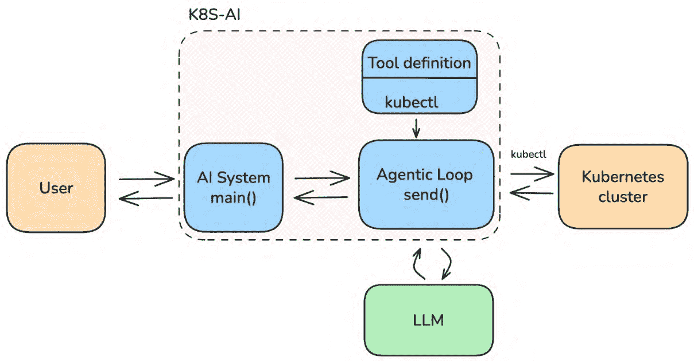

## 3 一个简单AI智能体的动手演练

在*第2章*中，我们探讨了AI智能体的基础概念、它们的架构、组件，以及它们如何与工具和外部系统交互。我们还讨论了这些原则（如智能体循环和记忆）如何在流行的[AutoGen](https://github.com/microsoft/autogen)框架中实现。在本章中，我们将在此知识基础上，剖析一个简单的AI智能体——k8s-ai，它可以逐行与Kubernetes集群交互。当我们检查代码并确切理解智能体循环如何运作时，具备工具访问能力的AI智能体的威力将变得显而易见。将这个简单智能体与访问Kubernetes的工具结合，将展示即使如此基本的设置也能非常强大。

我们将通过介绍k8s-ai智能体，并运行它、通过聊天界面与其交互来展示其能力，从而做好铺垫。一旦您体验了k8s-ai的智能体能力，我们将解释该智能体系统的底层工作原理。

在本章中，我们将涵盖以下主要主题：

- 介绍k8s-ai
- 理解k8s-ai智能体系统

### 技术要求

确保您的机器上安装了kubectl、Docker和kind。如果尚未安装，请按照以下安装说明操作：

- [kubectl安装说明](https://kubernetes.io/docs/tasks/tools/)
- [Docker安装说明](https://docs.docker.com/engine/install/)
- [kind安装说明](https://kind.sigs.k8s.io/docs/user/quickstart/#installation)

简而言之，以下是我们需要它们的原因：

- **kubectl** 是命令行工具，通过向Kubernetes API服务器发送命令来交互和管理Kubernetes集群。
- **Docker** 是一个容器平台，将应用程序及其依赖项打包成轻量、可移植的容器，这些容器可在不同环境中一致运行。
- **Kubernetes in Docker（KinD）** 是一个使用Docker容器作为集群节点来运行本地Kubernetes集群的工具，主要用于开发和测试。

您在阅读本章时应使用最新版本。

如果您想跟着本章中的代码示例进行操作，请确保已安装[Python](https://www.python.org/downloads/)。

您还需要一个OpenAI API密钥，可以从OpenAI平台获取：`https://platform.openai.com/api-keys`。

您可以按照[README.md](https://github.com/PacktPublishing/Design-Multi-Agent-AI-Systems-Using-MCP-and-A2A/blob/main/ch03/k8s-ai/README.md)或[README.md](https://github.com/the-gigi/k8s-ai/blob/main/README.md)中的说明来启动并运行您的k8s-ai智能体。

### 介绍k8s-ai智能体

**k8s-ai智能体**（<https://github.com/the-gigi/k8s-ai>）是一个用单个Python文件实现的简单AI智能体，可以通过**kubectl**（<https://kubernetes.io/docs/reference/kubectl/>）工具与**Kubernetes**（<https://kubernetes.io/>）集群交互。如果您不熟悉Kubernetes，也没关系。用一句话来说，它是一个开源系统，用于自动化容器化应用的部署、扩展和管理。kubectl工具是与Kubernetes集群交互的命令行界面。

在深入之前，让我们先试用一下，看看它能做什么。


### 设置本地 kind 集群

让我们首先使用 kind（`https://kind.sigs.k8s.io/`）设置一个本地 Kubernetes 集群。Kind 是一种在 Docker 容器中运行 Kubernetes 集群的工具。它非常适合本地开发和测试。

我们可以使用 kind 创建本地 Kubernetes 集群。运行以下命令创建一个名为 `k8s-ai` 的集群：

```
> kind create cluster -n k8s-ai
Creating cluster "k8s-ai" ...
 ✓ Ensuring node image (kindest/node:v1.33.1)
 ✓ Preparing nodes 📦
 ✓ Writing configuration 📜
 ✓ Starting control-plane 
 ✓ Installing CNI 🔌
 ✓ Installing StorageClass 💾
Set kubectl context to "kind-k8s-ai"
You can now use your cluster with:
kubectl cluster-info --context kind-k8s-ai
Have a nice day! 👋
```

让我们验证集群是否已启动并运行：

```
kubectl cluster-info --context kind-k8s-ai
The Kubernetes control plane is running at https://127.0.0.1:52864.
CoreDNS is running at https://127.0.0.1:52864/api/v1/namespaces/kube-system/services/kube-dns:dns/proxy.
```

要进一步调试和诊断集群问题，请使用 `kubectl cluster-info dump`。

太棒了！我们已经有一个本地 Kubernetes 集群在运行。现在，让我们在集群中制造一些麻烦。这里有一个永远不会就绪的 Deployment，因为它要求其 Pod 被调度到带有集群中不存在的标签的节点上：

```
echo '
apiVersion: apps/v1
kind: Deployment
metadata:
  name: some-app
spec:
  replicas: 3
  selector:
    matchLabels:
      app: some-app
  template:
    metadata:
      labels:
        app: some-app
    spec:
      affinity:
        nodeAffinity:
          requiredDuringSchedulingIgnoredDuringExecution:
            nodeSelectorTerms:
              - matchExpressions:
                - key: no-such-node
                  operator: In
                  values:
                    - "true"
      containers:
        - name: pause
          image: registry.k8s.io/pause:3.9
' | kubectl apply -f -
deployment.apps/some-app created
```

让我们确认所有 Pod 都已创建，但由于标签要求，它们都处于 Pending 状态：

```
kubectl get po
```

| NAME | READY | STATUS | RESTARTS | AGE |
| --- | --- | --- | --- | --- |
| some-app-65696dbff4-8jdrj | 0/1 | Pending | 0 | 6s |
| some-app-65696dbff4-mbfv7 | 0/1 | Pending | 0 | 6s |
| some-app-65696dbff4-wj9ms | 0/1 | Pending | 0 | 6s |

我们甚至可以通过检查其中一个 Pod 的状态来查看 Pod 处于 Pending 状态的确切原因（`1 node(s) didn’t match Pod’s node affinity/selector.`）：

```
kubectl get po some-app-65696dbff4-8jdrj -o yaml | grep status: -A 10
status:
  conditions:
  - lastProbeTime: null
    lastTransitionTime: "2025-06-05T08:45:45Z"
    message: '0/1 nodes are available: 1 node(s) didn''t match Pod''s node affinity/selector.'
    preemption: '0/1 nodes are available: 1 Preemption is not helpful for scheduling.'
    reason: Unschedulable
    status: "False"
    type: PodScheduled
  phase: Pending
  qosClass: BestEffort
```

让我们再制造一些混乱，创建一个使用无效镜像名称（`nnnnnnnnginx`）的 NGINX（一款流行的 Web 服务器）Deployment：

```
echo '
apiVersion: apps/v1
kind: Deployment
metadata:
  name: nginx
spec:
  replicas: 1
  selector:
    matchLabels:
      app: nginx
  template:
    metadata:
      labels:
        app: nginx
    spec:
      containers:
        - name: nginx
          image: nnnnnnnnginx
' | kubectl apply -f -
deployment.apps/nginx created
```

现在让我们检查集群的状态：

```
kubectl get po
```

| NAME | READY | STATUS | RESTARTS | AGE |
| --- | --- | --- | --- | --- |
| nginx-74f5dd8d8f-p2hmh | 0/1 | ImagePullBackOff | 0 | 91s |
| some-app-65696dbff4-8jdrj | 0/1 | Pending | 0 | 9m3s |
| some-app-65696dbff4-mbfv7 | 0/1 | Pending | 0 | 9m3s |
| some-app-65696dbff4-wj9ms | 0/1 | Pending | 0 | 9m3s |

我们有两个 Deployment：**some-app** 和 **nginx**。**some-app** Deployment 有三个处于 Pending 状态的 Pod，而 **nginx** Deployment 有一个 Pod 因镜像名称无效而处于错误状态。现在，让我们看看如何使用 k8s-ai 代理来帮助我们处理这种情况。

### 运行 k8s-ai 代理

首先，你需要克隆 k8s-ai 仓库：

```
git clone git@github.com:the-gigi/k8s-ai.git
```

按照 `README.md`（`https://github.com/PacktPublishing/Design-Multi-Agent-AI-Systems-Using-MCP-and-A2A/blob/main/ch03/k8s-ai/README.md`）中的说明来运行 k8s-ai 并与之交互。

激活虚拟环境后，只需使用以下命令运行代理：

```
python main.py
```

你将看到以下输出，然后就可以开始与代理交互：

```
 Interactive Kubernetes Chat. Type 'exit' to quit.
----------------------------------------------------
👤 You:
```

K8s-ai 正在运行并准备好交互。让我们通过自然语言对话来检查我们的集群。

### 使用 k8s-ai 检查集群

所有基础模型都接受了大量 Kubernetes 知识的训练，包括 kubectl CLI，因此应该能够有意义地与我们的 Kubernetes 集群进行交互。

好的，让我们向代理询问我们的 Kubernetes 集群的情况：

**👤 You:** 集群里发生了什么？

**🤖 AI:** 以下是集群当前状态的摘要：

#### Pod

- **default 命名空间：**
  - `nginx-74f5dd8d8f-p2hmh`：未就绪，出现 `ImagePullBackOff`，已运行 6 小时 27 分钟。
  - `some-app` 实例（3 个 Pod）：全部处于 Pending 状态，持续 37 小时。
- **kube-system 命名空间：**
  - 核心系统组件（例如 `coredns`、`etcd`、`kube-apiserver`、`kube-controller-manager` 等）运行正常。
- **local-path-storage 命名空间：**
  - `local-path-provisioner`：运行正常。

#### 服务

- `kubernetes`：ClusterIP 服务。
- `kube-dns`：`kube-system` 命名空间中的 ClusterIP 服务。

#### 守护进程集

- `kindnet` 和 `kube-proxy` 正在 `kube-system` 命名空间中运行。

#### 部署

- **default 命名空间：**
  - `nginx`：由于 `ImagePullBackOff`，Deployment 不可用。
  - `some-app`：没有 Pod 就绪。
- **kube-system 命名空间：**
  - `coredns`：100% 就绪。
- **local-path-storage 命名空间：**
  - `local-path-provisioner`：100% 就绪。

#### 副本集

- `default` 命名空间中的 `nginx` 和 `some-app` 副本集存在就绪问题，很可能与其 Pod 的问题有关。
- `kube-system` 和 `local-path-storage` 下的其他副本集按预期扩展并正常运行。

#### 观察

- `nginx` 和 `some-app` 部署正面临问题。`nginx` 因镜像拉取问题而失败，这可能是配置问题或镜像仓库访问问题。
- `some-app` 部署可能面临资源限制或未满足的调度规则，导致 Pod 处于 Pending 状态。

您需要帮助解决任何具体问题吗？

---

太酷了！代理提供了集群状态的详细摘要，包括 Pod、服务、部署等的状态。它还指出了 **nginx** 和 **some-app** 部署的问题。

让我们再深入一点，看看它能否找出 Pod 处于 Pending 状态的确切根因：

**👤 You:** 找出 some-app 的 Pod 为什么处于 Pending 状态

**🤖 AI:** “some-app”的 Pod 之所以处于“Pending”状态，是因为它们无法被调度。具体来说，问题在于：

- Pod 无法被调度，是因为节点亲和性或选择器要求未得到满足。错误消息表明，没有可用节点与 Pod 的节点亲和性或选择器匹配。
- 调度器还指出，在这种情况下抢占没有帮助，这意味着即使驱逐了较低优先级的 Pod，也无法解决“some-app”的 Pod 的调度问题。


要解决这个问题，你可能需要检查为这些 Pod 指定的节点亲和性或选择器要求，并确保当前集群中的节点能够满足这些要求。可能有必要调整这些要求，或者添加符合标准的节点。

---

没错。智能体已经发现 `some-app` Pod 处于 Pending 状态，是因为节点亲和性或选择器要求未被满足。它还建议检查为这些 Pod 指定的节点亲和性或选择器要求，并确保当前集群中的节点能够满足这些要求。我们何不让智能体来帮我们修复这个问题呢？请注意，在某些情况下，你可能会得到比较笼统的答案，这时你可以发挥提示词技巧，让回答更具体：

👤 **你：** 请提出具体的修复方案。不要让我检查任何东西，由你来检查。

🤖 **AI：**

`some-app` Pod 处于 Pending 状态的根因是 Pod 规范中的节点亲和性约束未被集群中的可用节点满足。

#### 发现

1. **节点亲和性问题**：`some-app` 部署中的 Pod 具有节点亲和性要求，需要调度到带有 `no-such-node=true` 标签的节点上。
2. **集群节点详情**：可用节点 `k8s-ai-control-plane` 没有该标签。这是 Pod 无法被调度的主要原因。

#### 推荐的解决方案

1. **修改节点亲和性**：
   - **选项 A**：更新 `some-app` 部署，移除与任何现有节点都不匹配的节点亲和性要求。
   - **选项 B**：如果节点亲和性是必需的，请确保集群中的适当节点带有所需的标签（`no-such-node=true`）。
2. **为现有节点打标签**：
   - 作为临时修复措施，如果亲和性约束不是至关重要的，你可以为现有的 `k8s-ai-control-plane` 节点打上所需标签：
   ```bash
   kubectl label nodes k8s-ai-control-plane no-such-node=true
   ```
3. **检查其他约束**：
   - 确保其他调度约束（如资源请求和限制）与可用节点兼容。

根据亲和性要求对工作负载是否关键，选择实施第一个选项（修改 Pod 的亲和性要求或更新节点标签）。相应地调整配置并重新部署应用，即可解决调度问题。

---

智能体准确地识别了 Pod 处于 Pending 状态的根因，并提供了具体的修复方案。选项 #3 **检查其他约束**仍然不够具体，因为智能体本可以自行执行这些检查，但鉴于前两个方案已经足够好，我们就不再追究了。到目前为止，智能体只对我们的集群执行了读取操作。

我们让它执行其中一个方案，为节点打上所需标签：

👤 **你：** 请执行方案 #2，为节点打上 no-such-node=true 标签。

🤖 **AI：** 节点 `k8s-ai-control-plane` 已成功打上 `no-such-node=true` 标签。`some-app` Pod 现在应该能够被正确调度。你可以再次查看 Pod 来验证它们的状态。

---

太棒了！智能体说它已成功为节点打上所需标签。让我们再次检查 Pod 的状态：

`kubectl get po`

| NAME | READY | STATUS | RESTARTS | AGE |
| --- | --- | --- | --- | --- |
| nginx-74f5dd8d8f-p2hmh | 0/1 | ImagePullBackOff | 0 | 6h46m |
| some-app-65696dbff4-8jdrj | 1/1 | Running | 0 | 15m34s |
| some-app-65696dbff4-mbfv7 | 1/1 | Running | 0 | 15m34s |
| some-app-65696dbff4-wj9ms | 1/1 | Running | 0 | 15m34s |

成功了！我们的 AI 智能体能够诊断集群中的问题、提出解决方案、获得人类许可，并修复问题。

好的，我们来大胆尝试一下，让智能体完全自主地修复 `nginx` 部署：

👤 **你：** 太好了，成功了！现在请自行修复 nginx 问题，最后告诉我你做了什么。

🤖 **AI：** 我通过将 `nginx` 部署的镜像从不正确的镜像 URL（`nnnnnnnnginx`）更新为正确的镜像（`nginx`），解决了这个问题。这样 Kubernetes 就能成功拉取镜像并启动 Pod。如果还有任何问题或其他需要，随时提问！

---

这太棒了！智能体运用判断力，正确地推断出如果部署名为 `nginx`，那么正确的镜像也应该是 `nginx`。但一如既往，让我们检查一下 nginx Pod 的状态来确认修复是否生效：

`kubectl get po -l app=nginx`

| NAME | READY | STATUS | RESTARTS | AGE |
| --- | --- | --- | --- | --- |
| nginx-5869d7778c-kbpjz | 1/1 | Running | 0 | 2m30s |

是的！创建了一个新 Pod，并且正在运行。智能体在无需任何人工干预的情况下自行修复了问题。

现在，我们准备深入代码，了解 k8s-ai 智能体的底层工作原理。我们将探索 k8s-ai 的代码结构。

### 理解 k8s-ai 智能体系统

在深入代码之前，让我们先了解智能体 AI 系统原理如何与 k8s-ai 相契合。

*图 3.1：K8s-ai 智能体工作流*

在 k8s-ai 的示意图中，你可以看到以下内容：

1. 用户与 k8s-ai 的 `main()` 函数交互，该函数充当控制性 AI 系统。
2. 它会调用由 `send()` 函数实现的智能体循环。
3. `send()` 函数使用仅包含 kubectl 工具的工具定义。
4. `send()` 函数将用户的提示词发送给 LLM，LLM 可能会返回调用 kubectl 的工具请求。
5. `send()` 函数将针对 Kubernetes 集群执行这些 kubectl 命令，并将结果返回给 LLM，直到 LLM 返回最终响应，`send()` 函数再将该响应返回给 `main()` 函数，由其显示给用户，并准备接收用户的新查询。

了解了 k8s-ai 智能体的工作流之后，现在让我们来看看它是如何实现的。



### k8s-ai 智能体代码走读

让我们先从宏观层面看一下 k8s-ai 仓库中的 `main.py` 文件，不必涉及过多细节。

#### 导入语句

k8s-ai 智能体导入了内置包（如 `json` 和 `os`），然后导入了第三方库 `sh` 和 `openai`。

```python
import json
import os
import sh
from openai import OpenAI
```

`json` 包用于解析来自 OpenAI API 的响应，`os` 包用于访问环境变量（如 `OPENAI_API_KEY`），`sh` 模块用于运行 shell 命令（此处为 `kubectl`）。

#### OpenAI 客户端

k8s-ai 智能体使用官方 OpenAI Python 客户端与 OpenAI API 交互。它使用来自环境变量的 API 密钥来初始化客户端。这其实并不是必须的，因为默认情况下 OpenAI 客户端会查找这个确切的环境变量，但我更倾向于在代码中显式设置这些变量，以提高清晰度，而不是依赖隐晦的默认行为。我在这里使用的模型是 `gpt-4o`，这是一个强大的模型，能够处理当前的任务。

```python
client = OpenAI(api_key=os.environ['OPENAI_API_KEY'])
model_name = "gpt-4o"
```

更复杂的智能体系统通常会针对不同任务使用来自不同提供商的不同模型，但 k8s-ai 虽然功能非常强大（正如我们已经看到的），其设计目标却是简洁和教育用途。

**注意**

请注意，客户端在初始化时并未传入 `model` 参数。这是因为模型是在每次 API 请求中指定的。这样一来，如果你以后想更换模型，就无需修改客户端，从而获得更大的灵活性。k8s-ai 智能体对所有请求始终使用同一个模型，但这并不是强制要求。


#### 3. 工具

正如我们多次提到的，AI 智能体的能力取决于它能访问到的工具。k8s-ai 智能体定义了一个工具列表，本例中只包含一个工具。这个工具是对 `kubectl` 命令行工具的封装。我们将在下一节中更详细地探讨它。

```python
tools = [{
    ...
}]
```

#### 4. 智能体循环

智能体循环是 k8s-ai 智能体的核心。它接收一个消息列表（字典列表），并返回最终响应字符串。我们很快就会详细了解这个循环是如何工作的，但现在，这里是完全封装整个智能体循环的 `send()` 函数的签名：

```python
def send(messages: list[dict[str, any]]) -> str:
    ...
```

#### 5. 主函数 main()

最后，`main()` 函数是 k8s-ai 智能体的入口点。它使用系统消息初始化消息列表，管理用户的交互，并将所有繁重的工作委托给 `send()` 函数。我们将在 *实现工具调用的执行循环* 一节中看到它是如何做到这一点的。

```python
def main():
    ...
if __name__ == "__main__":
    main()
```

接下来，让我们看看如何为我们的智能体使用 OpenAI 工具。

### 使用 OpenAI 定义和注册工具

我们的 k8s-ai 智能体设计为与 OpenAI 客户端交互，并使用 kubectl 工具管理 Kubernetes 集群。它需要遵循 OpenAI API 定义工具的格式。需要注意的是，工具有不同的类型。k8s-ai 智能体使用函数调用，这是一种 `"function"` 类型的工具。函数工具具有名称、描述、参数和必填参数列表。你还可以指定它是否在严格模式下运行。有关更多详细信息，请参阅 OpenAI 的文档（`https://platform.openai.com/docs/guides/function-calling#defining-functions`）。

以下是 k8s-ai 工具列表的完整定义（仅包含 `kubectl` 工具）：

```python
tools = [{
    "type": "function",
    "function": {
        "name": "kubectl",
        "description": "execute a kubectl command against the current k8s cluster",
        "parameters": {
            "type": "object",
            "properties": {
                "cmd": {
                    "type": "string",
                    "description": (
                        "the kubectl command to execute (without kubectl, just "
                        "the arguments). For example, 'get pods'"
                    ),
                },
            },
            "required": ["cmd"],
        },
    },
}]
```

让我们逐部分分解：

#### 1. 工具列表

`tools` 变量是一个列表，允许你定义一个或多个工具。列表中的每一项都是一个字典，代表一个工具。在本例中，我们只定义一个工具，即 `kubectl` 函数。

```python
tools = [
    {
        ...
    }
]
```

#### 2. 类型

这告诉 OpenAI API 该工具是一个函数工具。函数工具使用函数调用，模型可以自动选择并使用它自己构造的参数来调用该工具。工具定义的其余部分嵌套在 `"function"` 子字典下。

```python
"type": "function"
"function": {
    ...
}
```

#### 3. 名称

这是模型用来调用此工具的名称。它应该简短、具有描述性，并且在所有注册的工具上下文中是唯一的。在本例中，名称是 `kubectl`，这是一个很好的选择，因为它是 LLM 在训练中遇到过的知名工具。

```python
"name": "kubectl"
```

#### 4. 描述

描述在名称之外提供了更多关于函数功能的上下文。它应该清晰简洁，解释工具的用途以及如何使用它。在本例中，描述相当基本，因为 LLM 应该已经知道 kubectl 是什么。

函数描述必须包含模型（LLM）在给定情况下决定是否调用工具所需的全部信息。

```python
"description": "execute a kubectl command against the current k8s cluster"
```

还记得我们讨论过的 AutoGen（*第 2 章*）吗？它有很多抽象层。它还需要将这些抽象层中的所有信息转换为提示词和工具描述，然后发送给 LLM。通常，构建在 AI 框架之上的 AI 系统在收到每个智能体循环的最终响应后，可能会决定运行额外的自定义代码，而不仅仅是显示最终响应。

#### 5. 参数

参数指定了函数期望的输入。它们以 JSON Schema 格式定义，其中类型始终是 `"object"`，`"properties"` 字段包含函数接受的具体参数。每个参数都有一个名称（这里是 `"cmd"`）、一个类型（本例中为 `"string"`）和一个解释参数用途的描述。由于 kubectl 有许多子命令，每个子命令有自己的参数，所以我们只定义一个字符串参数来表示要执行的整个命令。同样，我们依赖 LLM 的训练来理解如何构造 kubectl 命令。`cmd` 参数也被标记为必填。

kubectl 命令可以不带参数执行，但那样只会显示帮助信息，在这种情况下不太有用。因此，我们要求模型在调用工具时必须提供 `cmd` 参数。

```python
"parameters": {
    "type": "object",
    "properties": {
        "cmd": {
            "type": "string",
            "description": (
                "the kubectl command to execute (without kubectl, just "
                "the arguments). For example, 'get pods'"
            ),
        },
    },
    "required": ["cmd"],
}
```

**提示**

决定权始终在 LLM，它根据传递给它的信息（提示词和工具描述）做出决策。

在 k8s-ai 中，AI 系统是一个简单的聊天界面，它打印来自 LLM 的最终响应并等待用户输入。

请注意，函数没有定义输出。这意味着模型不知道函数调用结果的形式和结构。模型会以字符串形式接收输出，然后它可以解析并决定如何使用。这是将 LLM 与工具一起使用时的常见模式，因为模型可以处理各种各样的输出，不需要预先知道确切的结构。要求开发人员指定输出结构可能会带来很多摩擦，并且对于像 kubectl 这样可能返回各种输出和输出格式的工具来说可能具有挑战性。

### 实现工具调用的执行循环

现在，让我们更仔细地看看智能体循环，以及它如何与 OpenAI API 交互以调用 kubectl 工具。这是 k8s-ai 智能体的核心，在这里它向 OpenAI API 发送消息、接收响应并执行 kubectl 命令。令人惊讶的是，智能体循环非常简单，只有 18 行代码。以下是完整代码：

```python
def send(messages: list[dict[str, any]]) -> str:
    response = client.chat.completions.create(
        model=model_name, messages=messages,
        tools=tools, tool_choice="auto")
    r = response.choices[0].message

    if r.tool_calls:
        message = dict(
            role=r.role,
            content=r.content,
            tool_calls=[dict(id=t.id, type=t.type,
                             function=dict(name=t.function.name,
                                           arguments=t.function.arguments)
                             ) for t in r.tool_calls if t.function])
        messages.append(message)

        for t in r.tool_calls:
            if t.function.name == 'kubectl':
                cmd = json.loads(t.function.arguments)['cmd'].split()
                result = sh.kubectl(cmd)
                messages.append(dict(tool_call_id=t.id, role="tool",
                                     name=t.function.name, content=result))
        return send(messages)

    return r.content.strip()
```


### 第 3 章：简单 AI 代理的动手实践演练

让我们一步一步地分解：

#### 1. 函数签名

这一行定义了核心循环函数 `send()`。它接收一个消息字典列表作为输入（就像 OpenAI 的 `messages` 参数一样），并返回最终的助手消息内容（字符串）。

```python
def send(messages: list[dict[str, any]]) -> str:
```

#### 2. 调用 Chat Completions API

这一行调用 OpenAI API，根据提供的消息生成响应。它使用 Chat Completions API（`https://platform.openai.com/docs/api-reference/chat`）的 `chat.completions.create()` 方法。

它传递了固定的模型名称（`gpt-4o`）、消息列表、我们之前定义的工具列表（其中 `kubectl` 是唯一的工具），以及设置为 `"auto"` 的 `tool_choice`。`"auto"` 设置允许模型根据当前对话状态决定是否使用工具。

```python
response = client.chat.completions.create(
    model=model_name, messages=messages,
    tools=tools, tool_choice="auto"
)
```

#### 3. 获取第一条响应消息

OpenAI API 可以在单次响应中返回多个选项，但实际上通常只返回一个。因此，k8s-ai 采用简单情况，只查看第一个选项，然后提取其中的 `message` 对象。

```python
r = response.choices[0].message
```

#### 4. 检查响应中是否包含工具调用

如果响应中包含工具调用，则意味着模型已决定使用工具来执行某些操作。

```python
if r.tool_calls:
```

> **注意**：OpenAI 最近发布了另一个名为 **Responses API** 的 API，它比 Chat Completions API 更强大、更灵活。但 k8s-ai 并不需要所有这些花哨的功能。

#### 5. 准备工具调用消息

在这种情况下，我们需要准备一个 `message dict`，其中包含角色（role）、内容（content）和工具调用（tool calls）。工具调用会被转换成字典列表，每个字典包含工具调用 ID（来自 LLM）、类型、函数名和参数。这对于在对话历史中跟踪工具调用及其结果至关重要。

```python
message = dict(
    role=r.role,
    content=r.content,
    tool_calls=[
        dict(
            id=t.id,
            type=t.type,
            function=dict(
                name=t.function.name,
                arguments=t.function.arguments
            )
        )
        for t in r.tool_calls if t.function
    ]
)
```

请注意，单次响应中可能有多个工具调用。即使我们只注册了一个工具，模型也可能决定使用不同的参数多次调用它。例如，它可能希望在不同的命名空间中运行多个 kubectl 命令，例如 `get pods`。

#### 6. 将工具调用消息追加到消息列表

这非常简单。只需将我们刚创建的 `message dict` 追加到消息列表中。这对于保持对话线程的最新状态非常重要。

```python
messages.append(message)
```

#### 7. 为每个工具调用请求调用 kubectl 工具

现在，它遍历响应中的每个工具调用。如果工具调用是针对 `kubectl` 函数的，它会提取 `cmd` 参数并将其拆分为命令行参数列表。例如，`"get pods"` 变成 `["get", "pods"]`。然后，它使用 `sh` 模块执行带有提供的参数的 `kubectl` 命令。命令执行的结果存储在 `result` 变量中。

```python
for t in r.tool_calls:
    if t.function.name == 'kubectl':
        cmd = json.loads(t.function.arguments)['cmd'].split()
        result = sh.kubectl(cmd)
```

#### 8. 将工具调用结果追加到消息列表

在执行 `kubectl` 命令后，它将结果作为新消息追加到消息列表中，该消息包含来自 LLM 的原始工具 ID（以便 LLM 知道哪个结果对应哪个工具调用）、设置为 `"tool"` 的角色、函数名（在本例中始终为 `kubectl`），以及设置为命令执行结果的内容。这就是代理捕获工具调用结果并在循环的下一次迭代中将其提供给模型的方式。

```python
messages.append(dict(tool_call_id=t.id, role="tool",
                     name=t.function.name, content=result))
```

#### 9. 递归以继续循环

只要模型的响应中包含工具调用，代理就会继续处理它们。然后，`send()` 函数使用更新后的消息列表递归调用自身，该列表包含来自模型的所有工具请求和所有工具结果。

```python
return send(messages)
```

#### 10. 返回最终响应

最终，当响应中不再有工具调用时，`send()` 函数会返回模型最终响应的内容。

```python
return r.content.strip()
```

请注意，我们不会返回整个响应对象或完整的消息列表，而只是返回最后一条消息的内容。一些 AI 框架可能提供钩子来访问完整的消息历史，但同样，k8s-ai 的设计宗旨是简单。

现在让我们与这个代理进行交互。

> **提示**：在生产级系统中，你可以设置最大迭代次数或最大时间，如果超过限制，则视为操作失败并向用户返回错误消息。实际上，LLM 已经内置了这种机制，如果它们无法收敛到满意的解决方案，它们会自行返回错误。

#### 运行并与 Kubernetes 聊天代理交互

最后但同样重要的是，k8s-ai 提供了一个交互式**命令行界面**（**CLI**）来与代理进行交互。

`main()` 函数首先打印欢迎消息，并用一条设置代理上下文的系统消息初始化消息列表。

```python
def main():
    print(" Interactive Kubernetes Chat. Type 'exit' to quit.\n" + "-" * 52)
    messages = [{'role': 'system', 'content': 'You are a Kubernetes expert ready to help'}]
```

然后，它启动交互式循环，等待用户消息，将其发送给代理，代理运行代理循环直到获得最终响应，将其打印到屏幕上，然后重复。交互式循环一直持续到用户输入 `'exit'`。

```python
while (user_input := input("👤 You: ")).lower() != 'exit':
    messages.append(dict(role="user", content=user_input))
    response = send(messages)
    print(f" AI: {response}\n----------")
```

更复杂的代理可能会使用更复杂的记忆管理系统来存储和检索消息。

你现在已经从两个角度体验了一个完整的 AI 代理：作为用户与之交互以解决实际问题，以及作为开发者逐行理解其内部机制。

这种对消息如何在代理循环中流动、工具如何定义和调用、以及简单代码如何创造强大自主行为的实践理解，为构建你自己的代理奠定了基础。让我们在总结中巩固这些见解。

> **注意**：每条用户消息都会启动一个新的代理循环，但消息历史会在迭代之间保留。这使得代理能够在对话中保持上下文和连续性。历史记录存储在内存中，因此当用户输入 `exit` 时所有内容都会消失。

#### 总结

在本章中，我们超越了理论，看到了一个实际运行的 AI 代理，它结合了自主性、推理和工具使用，控制着一个真实的 Kubernetes 集群。k8s-ai 代理仅用 61 行 Python（包括空行和导入）构建，却功能强大。尽管它很简单，但它展示了若干基础的 AI 代理能力。

该系统能够使用 kubectl 检查集群状态，从而有效观察当前状况。它利用 OpenAI API 来诊断问题并找出根本原因。它知道何时以及如何使用 kubectl，不仅用于收集信息，还用于进行必要的更改。该系统采用人在回路（human-in-the-loop）的方式运行，除非明确指示自主行动，否则在进行任何修改之前都会请求许可。在整个运行过程中，它保持对话上下文，根据需要调用工具，并将结果输出反馈给语言模型，形成一个连贯的代理循环。

我们制造了有问题的部署，干扰了调度器，甚至在 KinD 集群中破坏了一个容器镜像。k8s-ai 代理全部处理了。我们看到了 OpenAI 函数调用接口，加上一个定义良好的工具和几行胶水代码，如何让一个由 LLM 驱动的代理式 AI 系统活起来，包括一个交互式聊天界面。

更广泛地说，本章论证了 AI 代理不必臃肿、脆弱或过度设计。只要清楚理解它们的运作方式——消息、工具、记忆和代理循环——你就能构建有用、可靠的系统，增强人类工作流程，甚至在受控环境中自主运行。

在下一章中，我们将开始基于与 k8s-ai 相同的原则，构建一个完整的代理式 AI 框架。


#### 获取本书的 PDF 版本和专属附加内容

扫描二维码（或访问 `packtpub.com/unlock`）。按书名搜索本书，确认版本，然后按照页面上的步骤操作。

*注意：请保管好您的发票。直接从 Packt 购买的订单无需提供发票。*


