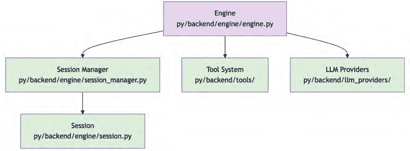
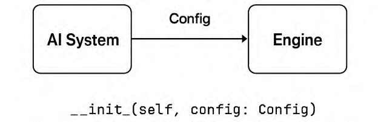

## 4 构建基于工具的智能体 AI 框架

在上一章中，我们超越了理论，观察了一个实际运行的 AI 智能体，特别是以自主性、推理和工具相结合的方式控制一个真实的 Kubernetes 集群。通过简洁而强大的 **k8s-ai 智能体**（`https://github.com/the-gigi/k8s-ai`），我们演示了基础的 AI 智能体能力，如观察、诊断、工具使用、保持人在回路（human-in-the-loop）交互以及运用智能体循环。这个仅用 61 行 Python 开发的智能体，令人印象深刻地展示了 AI 智能体和 LLM 的强大力量。

在本章中，我们将开始开发一个更复杂、更完整的 AI 框架，名为 AI-6（`https://github.com/Sayfan-AI/AI-6/tree/v0.8.0`）。AI-6 将使我们能够探索 AI 智能体能力的全部范畴，例如复杂的内存管理、先进的工具管理设施，以及对多个 LLM 提供方的支持。AI-6 高度不预设立场（unopinionated），并且可通过工具进行高度扩展。其主要设计原则是通过提供一小组核心功能来保持简单，从而允许通过添加专用工具在其之上构建更复杂的 AI 系统。

AI-6 是一个拥有后端和前端的 Python 框架。在本章中，我们将专注于后端。在*第 5 章*中，我们将为 AI-6 添加工具。在*第 6 章*中，我们将专注于前端。

我们首先从框架后端架构及其组件的概述开始，然后我们深入探讨框架的一些关键方面，例如工具管理、内存管理和消息处理流水线。

最后，我们将探讨如何用新工具和 LLM 提供方扩展框架。

在本章中，我们将涵盖以下主要主题：

- AI-6 框架后端架构与组件
- 工具系统架构
- 内存管理

### 技术要求

如果你想在阅读本章的同时运行并试验 AI-6，请按照 `README.md` 文件（`https://github.com/PacktPublishing/Design-Multi-Agent-AI-Systems-Using-MCP-and-A2A/blob/main/ch04/ai-six/README.md`）中的设置说明进行操作。

这将创建一个虚拟环境，并为后端和前端组件安装所有必要的依赖。

### AI-6 框架后端架构与组件

AI-6 后端由一个**核心引擎**驱动，该引擎运行智能体循环、管理工具、通过提供通用的 LLM 提供方接口来支持任何 LLM 提供方，并拥有内存管理系统。会话管理器负责管理与每个用户的会话（消息历史）。它利用 `Session` 类来存储单个对话的完整内容。工具系统是一个可扩展的子系统，用于定义工具，并为工具实现提供有用的基类。LLM 提供方是另一个可扩展的子系统，它定义了一个通用的 LLM 提供方接口，并提供了一些实现（目前是 OpenAI 和 Ollama）。

让我们看看核心引擎是如何工作的。

*图 4.1：AI-6 核心引擎*



### 核心引擎

核心引擎是 AI-6 框架的心脏。它协调与 LLM 提供方、工具和会话管理的所有交互。它为不同的前端提供了一个统一接口，以便在维护对话状态和执行工具调用的同时与 AI 模型通信。它是在一个名为 `Engine`（`https://github.com/PacktPublishing/Design-Multi-Agent-AI-Systems-Using-MCP-and-A2A/tree/main/ch04/ai-six/py/backend/engine`）的单一类中实现的。

使用引擎非常简单。首先，你用所需的配置初始化它，然后运行它以执行智能体循环。让我们看看它是如何工作的。

### 初始化

引擎使用 LLM 提供方、工具和配置设置进行初始化，是智能体 AI 系统使用 AI-6 时的核心组件。其签名非常简单；它只接收一个包含所有必要设置的 `Config` 类实例：

```python
def __init__(self, config: Config):
    ...
```

下图说明了这一过程：

*图 4.2：AI 系统使用 config 类初始化核心引擎*



使用 AI-6 框架的 AI 系统通过 `Config` 对象来指定核心引擎的配置。

让我们看看 `Config` 类：

```python
@dataclass
class Config:
    default_model_id: str
    tools_dir: str
    mcp_tools_dir: str
    memory_dir: str
    session_id: Optional[str] = None
    checkpoint_interval: int = 3
    summary_threshold_ratio: float = 0.8
    tool_config: Mapping[str, dict] = field(
        default_factory=lambda: MappingProxyType({})
    )
    provider_config: Mapping[str, dict] = field(
        default_factory=lambda: MappingProxyType({})
    )
```

这里有很多内容需要解读。让我们看看 `Config` 类由哪些部分组成：

- `default_model_id` 是当未请求特定模型时默认使用的模型 ID，它也决定了默认的 LLM 提供方，因为每个模型恰好属于一个 LLM 提供方。
- `tools_dir` 是自定义 AI-6 工具所在的目录，而 `mcp_tools_dir` 是 MCP 工具所在的目录。
- `memory_dir` 是内存文件存储的目录。
- `session_id` 是会话的可选标识符，可用于从之前的运行中恢复会话。
- `checkpoint_interval` 是每隔多少次迭代保存一个检查点。
- `summary_threshold_ratio` 是触发对话历史摘要的 token 比例。

最后，`tool_config` 和 `provider_config` 是允许你为每个工具和提供方指定额外配置的映射。

如果觉得信息量有点大，请不要担心；随着本章的深入，我们将解释每个配置项的用途。

让我们看看引擎是如何使用这个 `Config` 对象初始化的。首先，我们只是将 `default_model_id` 存储为类属性。这里没有什么特别的：

```python
class Engine:
    def __init__(self, config: Config):
        self.default_model_id = config.default_model_id
```

然后，我们根据默认模型 ID 从 `model_info` 模块获取上下文窗口大小。我们用它来计算 token 阈值，即触发对话历史摘要所需的 token 数量。这是必需的，因为当对话历史


当对话历史接近模型的上下文窗口大小时，我们需要对其进行摘要，以避免超出这个硬性限制。

```python
# Get the context window size from model_info based on the default model
context_window_size = get_context_window_size(
    self.default_model_id)
self.token_threshold = int(
    context_window_size * config.summary_threshold_ratio
)
```

接下来，我们初始化 LLM 提供者。引擎支持多个 LLM 提供者，并且知道如何使用 `discover_llm_providers()` 方法来定位它们。

之所以没有通过 `Config` 对象进行配置，是因为添加新的 LLM 提供者对于用户来说并不是常见操作。但这绝对可以作为一种替代设计方案。

一旦定位到 `providers directory` 并确认它是一个目录，就会调用 `Engine.discover_llm_providers()` 方法。我们将在下一节中探讨它。该方法返回一个 LLM 提供者列表，其中每个提供者可能支持多个模型。

```python
# Find LLM providers directory
llm_providers_dir = os.path.join(
    os.path.dirname(os.path.dirname(__file__)), "llm_providers"
)
assert os.path.isdir(llm_providers_dir), (
    f"LLM providers directory not found: {llm_providers_dir}"
)

# Discover available LLM providers
self.llm_providers = Engine.discover_llm_providers(
    llm_providers_dir, config.provider_config
)
```

引擎使用提供者列表来构建模型 ID 到相应 LLM 提供者的映射：

```python
self.model_provider_map = {
    model_id: llm_provider
    for llm_provider in self.llm_providers
    for model_id in llm_provider.models
}
```

接下来，我们初始化工具。引擎支持自定义工具和**模型上下文协议** (**MCP**) 工具。工具的初始化过程与 LLM 提供者的初始化类似。引擎调用发现方法（目录来自 `Config` 对象）来查找并注册工具。然后，它构建一个字典，将工具名称映射到相应的工具对象。这使得引擎可以在代理循环中通过名称轻松访问和调用工具。请注意，目前尚未使用 MCP 工具。我们将在*第 7 章*中引入 MCP 工具。

```python
# Discover available tools
tool_list = Engine.discover_tools(
    config.tools_dir, config.tool_config)

# Discover MCP tools
mcp_tool_list = Engine.discover_mcp_tools(config.mcp_tools_dir)
self.tool_dict = {t.name: t for t in tool_list}
```

初始化工作流程的下一部分与内存管理有关。引擎使用会话管理器来处理会话，并使用会话对象来管理对话历史。然后，它设置了一些与存储定期检查点相关的属性。

```python
# Initialize session and session manager
self.session_manager = SessionManager(config.memory_dir)
self.session = Session(config.memory_dir)

# Session-related attributes
self.checkpoint_interval = config.checkpoint_interval
self.message_count_since_checkpoint = 0
```

接下来，我们设置会话。摘要器负责在对话历史过长并接近模型的上下文窗口大小时对其进行摘要。然后，我们向引擎注册内存工具，这将使用户能够直接管理内存。

```python
# Instantiate the summarizer with the first LLM provider
self.summarizer = SessionSummarizer(self.llm_providers[0])

# Register memory tools with the engine
self._register_memory_tools()
```

最后，如果配置中包含会话 ID，引擎会尝试加载该会话（如果存在）。这允许恢复之前的会话，并从中断处继续对话。

```python
# Load previous session if session_id is provided and exists
if config.session_id:
    available_sessions = self.session_manager.list_sessions()
    if config.session_id in available_sessions:
        # Create a new session object
        self.session = Session(config.memory_dir)
        # Load from disk
        self.session.load(config.session_id)
```

总而言之，我们使用配置初始化了引擎，并动态加载了 LLM 提供者、自定义工具和 MCP 工具。然后，我们初始化了内存系统。让我们看看运行引擎时会发生什么。

### 运行引擎

初始化引擎后，我们就可以运行它来启动会话。`run()` 方法接受几个`可调用对象`（函数）作为参数。`get_input_func()` 函数检索用户输入，`on_tool_call_func()` 是在调用工具时触发的回调，`on_response_func()` 是在生成代理循环的最终响应时触发的回调。这些回调由使用 AI-6 框架的代理 AI 系统或 AI-6 本身的内置前端来实现。它们允许引擎通过通用接口进行通信，而无需了解所使用的特定应用或前端。这种设计提供了灵活性和可扩展性，因为不同的代理 AI 系统和前端可以实现自己的回调版本。

`run()` 方法将循环执行，直到 `get_input_func()` 函数不再提供输入。这意味着引擎执行多个代理循环（每个循环由一次或多次与 LLM 的交互以及工具调用组成），并在会话中累积对话历史。

```python
def run(
    self,
    get_input_func: Callable[[], None],
    on_tool_call_func: Callable[[str, dict, str], None] | None,
    on_response_func: Callable[[str], None],
):
```

实现非常简单。它首先获取当前代理循环的初始输入，并将其添加到会话中。然后，如果需要，它还会创建一个检查点。我们将在*内存管理*一节中讨论检查点。

```python
try:
    while user_input := get_input_func():
        message = UserMessage(content=user_input)
        self.session.add_message(message)
        self._checkpoint_if_needed()
```

下一部分是代理循环的核心。它使用默认模型 ID 调用 `_send()` 方法，该方法负责处理输入，并传递 `on_tool_call_func` 回调。`_send()` 方法处理所有繁重的工作，我们很快就会看到。然后，响应作为助手消息添加到会话中，并在需要时创建另一个检查点。最后，使用响应调用 `on_response_func` 回调。

```python
response = self._send(
    self.default_model_id, on_tool_call_func)
message = AssistantMessage(content=response)
self.session.add_message(message)
self._checkpoint_if_needed()
on_response_func(response)
```

最后，我们有 `finally` 子句，它确保当 `run()` 方法退出时保存会话，无论它是成功还是抛出异常。这一点很重要，可以确保即使在出现问题时（例如，由于超出 LLM 提供者的速率限制而导致失败），对话历史也能得到保留。

```python
finally:
    # Save the session when we're done
    self.session.save()
```

### 执行代理循环

让我们仔细看看 `_send()` 方法，它在作为会话的一部分被调用时执行一个完整的代理循环。`_send()` 方法接受 `model_id` 和一个可选的 `on_tool_call_func` 回调作为参数。`model_id` 指定此代理循环使用哪个模型（以及相应的哪个 LLM 提供者），而 `on_tool_call_func` 是在循环期间调用工具时触发的回调。


这使引擎能够向前端或应用程序通知工具调用，从而实现实时更新和交互。它返回智能体循环的最终响应，即 LLM 在处理输入并执行所需数量的工具调用后生成的响应。

```python
def _send(
    self,
    model_id: str,
    on_tool_call_func: Callable[[str, dict, str], None] | None = None,
) -> str:
```

`_send()` 方法的第一步是检查 `model_id` 是否有效，以及相应的 LLM 提供程序是否可用。如果不可用，则属于严重故障，方法会抛出 `RuntimeError`。

```python
llm_provider = self.model_provider_map.get(model_id)
if llm_provider is None:
    raise RuntimeError(f"Unknown model ID: {model_id}")
```

下一步是将所有会话消息、工具字典以及所选模型 ID 发送给选定的 LLM 提供程序。LLM 提供程序将负责与 LLM 的实际通信并返回响应。这一部分是与提供程序无关的，因为 AI-6 对 LLM 提供程序使用了抽象层。我们将在下一节 *LLM 提供程序抽象* 中详细讨论。

```python
try:
    response = llm_provider.send(
        self.session.messages, self.tool_dict, model_id
    )
except Exception as e:
    raise RuntimeError(f"Error sending message to LLM: {e}")
```

如果 LLM 不需要调用工具，可以直接返回最终响应，那么所提供的 `on_tool_call_func` 回调就不会被调用。

**注意**

如果响应包含工具调用，我们需要处理它们。第一步是将工具调用 ID 映射为**通用唯一标识符**或 **UUID**。这是必要的，因为某些 LLM 提供程序返回的工具调用 ID 可能不是有效的 UUID，而我们要确保所有工具调用 ID 都是有效的 UUID，这是我们识别工具调用时与提供程序无关的方式。`generate_tool_call_id()` 函数用于为每个尚未成为有效 UUID 的工具调用 ID 生成一个新的 UUID。`id_mapping` 字典将 LLM 返回的原始工具调用映射到引擎在需要时生成的新 UUID。如果 LLM 提供的工具 ID 被认为是有效的，则直接使用，不再生成新的 UUID。

```python
if response.tool_calls:
    # Create a mapping of original IDs to new UUIDs if needed
    id_mapping = {}
    for tool_call in response.tool_calls:
        # Check if we need to replace the ID with a UUID
        if (
            not tool_call.id or len(tool_call.id) < 32
        ):  # Simple check for non-UUID
            new_id = generate_tool_call_id(tool_call.id)
            id_mapping[tool_call.id] = new_id
```

接下来，如果响应中的工具调用 ID 已被替换为新 UUID，我们就更新它们。由于 LLM 提供程序已经返回了一个 `AssistantMessage` 对象，我们可以直接使用该对象来更新工具调用。

```python
# Update the tool call IDs in the response if needed
if id_mapping and response.tool_calls:
    for tool_call in response.tool_calls:
        if tool_call.id in id_mapping:
            tool_call.id = id_mapping[tool_call.id]
```

现在，可以将助手消息添加到会话中。

```python
# Add the assistant message with updated tool_calls
self.session.add_message(response)
```

在继续处理工具调用之前，我们需要跟踪来自助手消息的工具调用 ID，并将它们存储在一个集合中，以便后续使用。

```python
# Track tool_call_ids from this assistant message
tool_call_ids = set()

for tool_call in response.tool_calls:
    tool_call_ids.add(tool_call.id)
```

此时，我们可以遍历响应中的工具调用并逐一处理。在真正执行每个工具调用之前，有几个预备步骤：验证所请求的工具是否在工具字典中、解析参数，以及检查工具调用 ID 是否需要更新。

```python
# Now process each tool call and add the corresponding tool messages
for i, tool_call in enumerate(response.tool_calls):
    tool = self.tool_dict.get(tool_call.name)
    if tool is None:
        raise RuntimeError(f"Unknown tool: {tool_call.name}")
    try:
        kwargs = json.loads(tool_call.arguments)
    except json.JSONDecodeError as e:
        raise RuntimeError(
            f"Invalid arguments JSON for tool '{tool_call.name}'"
        )
    # Get the potentially updated tool call ID
    tool_call_id = tool_call.id
    if tool_call.id in id_mapping:
        tool_call_id = id_mapping[tool_call.id]
```

此时，我们可以执行工具调用了。工具使用解析后的参数运行，并捕获结果。然后，我们生成一条工具消息，其中包含工具调用的结果、工具名称和工具调用 ID，并在提供了 `on_tool_call_func` 回调时调用它。所有这些都在一个 `try` 块中完成：

```python
try:
    # Execute the tool without passing any ID information
    tool_result = tool.run(**kwargs)
    # Create the tool message with the Engine managing the
    # tool_call_id
    tool_message = ToolMessage(
        content=str(tool_result),
        name=tool_call.name,
        tool_call_id=tool_call_id,
    )
    if on_tool_call_func is not None:
        on_tool_call_func(
            tool_call.name, kwargs, str(tool_result))
```

如果工具调用失败，我们会捕获异常并转而生成一条错误消息：

```python
except Exception as e:
    tool_message = ToolMessage(
        content=str(e),
        name=tool_call.name,
        tool_call_id=tool_call_id,
    )
```

无论成功还是失败，这条消息（已经采用与提供程序无关的格式）都会被添加到会话中。工具调用失败不会中止智能体循环；它们只会作为包含错误的工具消息记录在会话中。这允许智能体继续处理其他工具调用或生成响应，而不会中断。LLM 将在智能体循环的下一次迭代中决定如何处理失败的工具调用。

```python
# Add the tool message (ID is guaranteed to be valid since we manage it)
self.session.add_message(tool_message)
```

一旦所有工具调用都处理完毕，其结果也已添加到会话中，`_send()` 方法就会递归调用自身。这就是智能体循环继续下去的地方。

```python
# Continue the session with another send
return self._send(model_id, on_tool_call_func)
```

最后，当 LLM 的响应不包含任何工具调用时，该方法返回最终响应的内容：

```python
return response.content.strip()
```

好了，我们先喘口气。这里包含大量不平凡的信息。大部分复杂性源于需要在提供程序特定的工具调用与引擎用来管理会话和对话历史的与提供程序无关的格式之间进行转换。智能体循环的本质与 k8s-ai 的智能体循环完全相同。

好的。现在让我们深入探讨 LLM 提供程序抽象。

### LLM 提供程序抽象

这是 AI-6 框架中非常重要的一部分。LLM 提供程序抽象允许引擎通过统一接口与任何类型的 LLM 提供程序通信。请注意，还有一种替代设计是框架只支持 OpenAI API。首先，许多 LLM 提供程序直接支持 OpenAI API，或通过它们自己的兼容层支持（例如 Google Gemini）。其次，有一些项目（如 OpenRouter（`https://openrouter.ai`））像代理一样，通过 OpenAI API 访问任何 LLM 提供程序。那么，为什么要构建一个与提供程序无关的接口呢？因为这让框架能够完全控制与受支持的 LLM 提供程序之间的交互，而且不需要经过代理，从而避免代理带来的延迟、成本和安全隐患。让我们看看 AI-6 框架是如何实现 LLM 提供程序抽象的。

#### LLMProvider 接口

Python 的**抽象基类**（**ABC**）是定义 `LLMProvider` 接口的理想工具，该接口定义在 `llm_provider.py` 文件中。`LLMProvider` 允许开发者实现符合这个相当简单接口的自有 LLM 提供程序，从而使 AI-6 框架具有可扩展性。让我们逐个方法进行分析，但首先看一下导入部分。

首先，我们从标准库模块 `abc` 和 `typing` 中导入必要的类和装饰器。然后，我们从 `object_model` 模块中导入 `Response` 类，它用于表示来自 LLM 的通用响应。

最后，我们从 `tool` 模块中导入 `Tool` 类，它表示可供 LLM 使用的工具。这些都属于 AI-6 框架后端架构的一部分。

```python
from abc import ABC, abstractmethod
from typing import Iterator, Callable, Any
from backend.engine.object_model import Response
from backend.engine.tool import Tool
```

接下来看 `LLMProvider` 类本身及其第一个方法：`send()`。`send()` 方法是一个抽象方法（使用 `@abstractmethod` 修饰，必须由子类实现），用于向 LLM 发送消息列表并接收响应。


### 构建基于工具的智能体 AI 框架

它还向 LLM 提供一个工具字典和一个可选的 `model` 参数。该方法返回一个 `Response` 对象，其中包含作为通用响应的 LLM 响应。

```python
class LLMProvider(ABC):
    @abstractmethod
    def send(
        self, messages: list[Message], tool_dict: dict[str, Tool],
        model: str | None = None
    ) -> AssistantMessage:
        """
        Send a message to the LLM and receive a response.

        :param messages: The list of messages to send.
        :param tool_dict: A dictionary of tools available for the LLM to use.
        :param model: The model to use (optional).
        :return: The response from the LLM.
        """
        pass
```

`stream` 方法类似于 `send()` 方法，但它允许在生成响应时从 LLM 流式接收响应。它返回一个 `Response` 对象的迭代器，使调用方能够在整个响应完成之前分块接收响应。这对于希望实时显示响应的实时应用非常有用。请注意，`stream()` 方法不是抽象方法，它有一个默认实现，仅调用 `send()` 方法并生成完整响应。这意味着子类可以覆盖此方法以提供实际的流式实现（如果支持），也可以使用默认实现一次性返回完整响应。

```python
def stream(
    self, messages: list[Message], tool_dict: dict[str, Tool],
    model: str | None = None
) -> Iterator[AssistantMessage]:
    """
    Stream a message to the LLM and receive responses as they are generated.

    :param messages: The list of messages to send.
    :param tool_dict: The tools available for the LLM to use.
    :param model: The model to use (optional).
    :return: An iterator of responses from the LLM.
    """
    # Default implementation just returns the full response
    yield self.send(messages, tool_dict, model)
```

`models` 属性是一个抽象属性，必须由子类实现。它返回一个由模型 ID 字符串组成的列表。这很简单。模型 ID 是 LLM 提供商支持的每个模型的唯一标识符。引擎使用它来将模型映射到提供商，并在发送特定模型请求时选择正确的提供商。

```python
@property
@abstractmethod
def models(self) -> list[str]:
    """Get the list of available models."""
    pass
```

现在我们已经介绍了 `LLMProvider` 接口，接下来看看 AI-6 开箱即用的具体 LLM 提供商。

#### 支持的提供商

让我们来看看 AI-6 框架目前支持的 LLM 提供商。

AI-6 附带了 OpenAI 和 Ollama 的 LLM 提供商，提供基于云和本地模型两种选择。

请记住，其他 LLM 提供商可以轻松实现。

首先看一下 OpenAI 提供商的实现。

#### OpenAI 提供商

OpenAI 提供商在 `openai_provider.py` 文件中实现（`https://github.com/PacktPublishing/Design-Multi-Agent-AI-Systems-Using-MCP-and-A2A/blob/main/ch04/ai-six/py/backend/llm_providers/openai_provider.py`）。它使用 OpenAI Python SDK 与 OpenAI API 通信。该提供商实现了 `LLMProvider` 接口，并提供了发送消息、流式传输消息和获取模型所需的方法。让我们看看 OpenAI 提供商。

该提供商需要一个 API 密钥来通过 OpenAI API 进行身份验证，该密钥会传递给构造函数。它具有 API 的基础 URL 和模型的默认值。当基础 URL 为 None 时，OpenAI SDK 使用官方的 OpenAI API 端点：`https://api.openai.com/v1`。如果你想使用其他具有 OpenAI 兼容 API 的 LLM 提供商，例如 Anyscale（`https://docs.anyscale.com/reference`）、DeepSeek（`https://api-docs.deepseek.com/`）、SambaNova（`https://cloud.sambanova.ai/apis`）或 Cerebras（`https://inference-docs.cerebras.ai/resources/openai`），那么你需要传递正确的端点。

在这方面，OpenAI 提供商已经支持多个提供商，当然也可以与 OpenRouter 一起使用。

```python
from typing import Iterator
from backend.object_model import (
    LLMProvider, ToolCall, Usage, Tool, AssistantMessage)
from openai import OpenAI

class OpenAIProvider(LLMProvider):
    def __init__(
        self, api_key: str, base_url = None,
        default_model: str = "gpt-4o"
    ):
        self.default_model = default_model
        self.client = OpenAI(base_url=base_url, api_key=api_key)
```

`LLMProvider` 接口是根据 AI-6 数据结构定义的，这些数据结构与 LLM 提供商无关，但包含 LLM 处理用户消息和请求工具调用所需的相同信息。因此，OpenAI 提供商的工作实际上是将 AI-6 表示形式转换为 OpenAI Python SDK 的表示形式。

下面是正是执行此操作的 `send()` 方法。例如，OpenAI Python SDK 期望工具被定义为 Python `dict`，因此 `send()` 方法使用私有方法 `_tool2dict()` 将 `tool_dict` 转换为 OpenAI SDK 可以理解的字典列表。

```python
def send(
    self, messages: list[Message], tool_dict: dict[str, Tool],
    model: str | None = None
) -> AssistantMessage:
    """
    Send a message to the OpenAI LLM and receive a response.

    :param tool_dict: The tools available for the LLM to use.
    :param messages: The list of messages to send.
    :param model: The model to use (optional).
    :return: The response from the LLM.
    """
    if not messages:
        raise ArgumentError(
            "messages",
            "At least one message is required to send to the LLM.")

    if model is None:
        model = self.default_model
        tool_data = [self._tool2dict(tool) for tool in tool_dict.values()]
```

然后，该方法使用 OpenAI Python SDK 创建具有指定模型、消息和工具的聊天补全：

```python
response = self.client.chat.completions.create(
    model=model,
    messages=messages,
    tools=tool_data,
    tool_choice="auto"
)
```

接下来，该方法从响应中提取 `tool_calls` 字段，如果它是 `None`，则将其转换为空列表：

```python
tool_calls = response.choices[0].message.tool_calls
tool_calls = [] if tool_calls is None else tool_calls
```

它还会从响应中提取使用情况数据，包括请求中使用的输入和输出 token 数量：

```python
# Extract usage data
input_tokens = response.usage.prompt_tokens
output_tokens = response.usage.completion_tokens
```

最后，它创建一个包含响应内容、角色、工具调用和使用情况数据的 `AssistantMessage` 对象。OpenAI 工具调用被转换为 AI-6 的 `ToolCall` 格式，该格式包括工具调用 ID、名称、参数以及该工具是否必需。`required` 字段通过检查工具的参数在工具规范中是否必需来确定。例如，假设工具是 `get_weather_in_city`，它有两个参数：`city`（必填）和 `unit`（非必填）。如果未提供 `unit`，则工具将假定单位为 `Celsius`。

在这种情况下，LLM 可以决定使用两个参数调用工具：`city: London` 和 `unit: Fahrenheit`，或者只使用必需的参数 `city: London`。

```python
return AssistantMessage(
    content=response.choices[0].message.content,
    tool_calls=[
        ToolCall(
            id=tool_call.id,
            name=tool_call.function.name,
            arguments=tool_call.function.arguments,
            required=tool_dict[
                tool_call.function.name].parameters.required
        ) for tool_call in tool_calls if tool_call.function
    ] if tool_calls else None,
    usage=Usage(
        input_tokens=input_tokens,
        output_tokens=output_tokens
    )
)
```

OpenAI 提供商还实现了 `stream()` 方法，该方法允许从 LLM 流式传输响应。但是，此方法相当长，因此我们在此不详述。

简而言之，它是一个生成器，逐块处理 LLM 的输出，而不是等待整个响应到达。如果你好奇，可以在 `https://github.com/PacktPublishing/Design-Multi-Agent-AI-Systems-Using-MCP-and-A2A/blob/main/ch04/ai-six/py/backend/llm_providers/openai_provider.py` 查看代码。

`stream()` 方法的默认实现实际上并不进行流式传输，只是委托给阻塞的 `send()` 方法（这是必需的）。如果提供商确实支持流式传输（如 OpenAI），那么可以覆盖 `stream()` 方法并使其适应特定提供商。

**注意**


`models` 属性从 OpenAI API 返回可用模型列表。它使用 OpenAI Python SDK 获取信息：

```python
@property
def models(self) -> list[str]:
    return [m.id for m in self.client.models.list().data]
```

为了完善整个流程，下面两个辅助方法会将 AI-6 工具和 `ToolCall` 表示转换为 OpenAI SDK 的 Python 字典表示：

```python
@staticmethod
def _tool2dict(tool: Tool) -> dict:
    """Convert the tool to a dictionary format for OpenAI API."""
    return {
        "type": "function",
        "function": {
            "name": tool.name,
            "description": tool.description,
            "parameters": {
                "type": "object",
                "required": tool.required,
                "properties": {
                    param.name: {
                        "type": param.type,
                        "description": param.description
                    } for param in tool.parameters
                },
            },
        },
    }

@staticmethod
def _tool_call2dict(tool_call: ToolCall) -> dict:
    """Convert a ToolCall to OpenAI API format."""
    return {
        "id": tool_call.id,
        "type": "function",
        "function": {
            "name": tool_call.name,
            "arguments": tool_call.arguments
        },
    }
```

接下来让我们看看 Ollama 提供者。

### Ollama 提供者

Ollama（https://ollama.com/）是一个本地 LLM 提供者，允许你在自己的机器上运行模型。这非常酷，因为你无需向外部提供商付费，也不必担心敏感信息泄露。

Ollama 提供者的实现位于 AI-6 的 `ollama_provider.py` 文件中。它也实现了 `LLMProvider` 接口，并提供了发送消息和获取模型所需的方法。它没有实现 `stream()` 方法，而是依赖基类 `LLMProvider` 中的默认实现来进行流式响应。

该实现与 OpenAI 提供者非常相似，但它使用 Ollama Python SDK 与本地运行的 Ollama API 进行通信。该提供者要求 Ollama 客户端已安装并位于系统路径中，且 Ollama 服务必须正在运行。我们将在*第 6 章*中看到它的实际应用。

以下是该实现的概要。我省略了大多数方法的实现细节，因为它们与 OpenAI LLM 提供者非常相似。在 `send()` 方法中，我通过 `ollama.chat()` 方法实际调用了 Ollama SDK，该方法将消息和工具发送给 Ollama 模型并返回响应：

```python
import json
from dataclasses import asdict
from backend.object_model import (
    LLMProvider, ToolCall, Usage, Tool, AssistantMessage, Message,
)
import ollama

class OllamaProvider(LLMProvider):
    def __init__(self, model: str):
        self.model = model

    @staticmethod
    def _tool2dict(tool: Tool) -> dict:
        """Convert the tool to a dictionary format for Ollama."""
        ...

    @staticmethod
    def _fix_tool_call_arguments(messages):
        ...

    def send(
        self, messages: list[Message], tool_dict: dict[str, Tool],
        model: str | None = None,
    ) -> AssistantMessage:
        """Send a message to the local Ollama model and receive a response."""
        ...
        OllamaProvider._fix_tool_call_arguments(message_dicts)
        response: ollama.ChatResponse = ollama.chat(
            model,
            messages=message_dicts,
            tools=tool_data,
        )
        ...

    @property
    def models(self) -> list[str]:
        """Get the list of available models."""
        return [self.model]
```

现在我们将把注意力转向工具的调用方式以及底层架构。

### 工具系统架构

我们已经非常详细地介绍了 AI-6 框架及其组件的核心架构：核心引擎、LLM 提供者抽象以及工具的调用方式。现在，让我们更深入地了解可扩展的工具系统架构。

工具系统架构旨在实现以下目标：

- 支持自定义工具
- 支持 MCP 工具
- 允许安全地执行工具
- 允许控制每个 AI-6 会话所使用的工具集。

让我们逐一探讨每个方面。

#### 自定义工具支持

自定义工具架构与 LLM 提供者抽象类似，基于一个抽象基类。它允许开发者实现自己的工具，这些工具遵循的接口比提供函数调用能力的 LLM 提供者还要简单（https://platform.openai.com/docs/guides/function-calling?api-mode=responses）。这一功能由 OpenAI 首创，但已被所有主要厂商采用。所有内容都定义在 `tool.py` 文件中。让我们逐步分解，从必需的导入开始。它从 `abc` 模块导入 ABC 基类和 `abstractmethod` 装饰器，从 `dataclasses` 模块导入 `dataclass` 装饰器，以及从 `typing` 模块导入 `NamedTuple` 类。

```python
from abc import ABC, abstractmethod
from dataclasses import dataclass
from typing import NamedTuple
```

然后，我们定义一个 `Parameter` 类。它派生自一个命名元组（参见：https://docs.python.org/3/library/collections.html#collections.namedtuple），表示函数调用中的单个参数，包含 `name`、`type` 和 `description`。使用 `NamedTuple` 作为基类的好处是 `Parameter` 类不可变且高效。

```python
class Parameter(NamedTuple):
    name: str
    type: str
    description: str
```

`Tool` 类是一个抽象基类，表示 LLM 可以通过函数调用使用的工具。

让我们来看一下。它非常简单。它使用了 `@dataclass(slots=True)` 装饰器。slots 使类实例不可变（无法添加新属性）、占用更少内存，并且提供更快的属性访问速度。

`Tool` 类具有以下属性：`name`、`description`、`parameters` 和 `required`（执行工具时必须提供的参数）。正如我们之前在每个请求的工具列表中看到的那样，这些信息会提供给 LLM。LLM 可以决定调用哪些工具以及如何调用。回想一下我们在*第 3 章*中的讨论，LLM 可以根据通过提示词和/或工具描述传递给它们的信息来做出这些决策。

```python
@dataclass(slots=True)
class Tool(ABC):
    name: str
    description: str
    parameters: list[Parameter]
    required: set[str]
```

`configure` 方法是一个可选方法，子类可以实现它来使用任意信息配置工具。它只接受一个 `dict`，其中可以包含任何内容。例如，与数据库交互的工具可能需要连接字符串作为配置。

```python
def configure(self, config: dict) -> None:
    """Optional: configure the tool with given parameters."""
    pass
```

最后，`run()` 方法是一个抽象方法，必须由子类实现。它是使用 LLM 提供的参数来执行工具的方法。参数以关键字参数的形式传入，并返回一个字符串。你也许还记得，在代理循环中，当 LLM 调用工具时，AI-6 引擎会执行 `run()` 方法。

```python
@abstractmethod
def run(self, **kwargs) -> str:
    pass
```

自定义工具很棒，但支持内置工具也同样重要。

#### 那么内置工具呢？

某些模型支持内置工具。以下是一些 OpenAI 模型支持的内置工具的非详尽列表：网页搜索、文件搜索、图像生成、代码解释器（Python）和计算机使用。

你可以在此处找到 OpenAI 平台上可用的最新内置工具列表：

https://platform.openai.com/docs/guides/tools#available-tools


AI-6 目前不支持内置工具。原因是使用内置工具依赖于特定的 LLM 提供商、每个 LLM 提供商的特定模型，甚至特定的 API。例如，AI-6 OpenAIProvider 使用的 OpenAI 聊天补全 API 仅支持 web 搜索内置工具。为了使用前面提到的其他内置工具，你必须使用 OpenAI responses API。

未来，AI-6 可能会通过更新其配置系统，为每个 LLM 提供商和每个模型添加允许的内置工具列表，从而增加对内置工具的支持。对于 OpenAI，它还需要为 OpenAIProvider 添加对 responses API 的支持。

AI-6 框架也支持 MCP 工具。MCP 工具符合**模型上下文协议**（**MCP**）规范。MCP 是一种最初由 Anthropic 开发的标准协议，允许 LLM 以安全且受控的方式访问外部数据和工具。我们将在*第 7 章*中专门探讨这一主题。

现在让我们来谈谈在工具系统中需要考虑的安全性和权限。

### 工具安全与权限

使用工具的智能体 AI 系统最重要的方面之一是控制工具对数据和资源的访问。原因在于，这些工具实际上由 LLM 控制，而 LLM 是一个你看不到内部机制的神奇黑盒。例如，考虑这样一个场景：LLM 可以访问一个对生产数据库具有完全访问权限的数据库工具，并且它接到的任务是改善数据访问性能并降低成本。在没有额外指导的情况下，LLM 可能会认为完成这一任务的最佳方式是删除数据库及其中的所有数据，只将最后一天的数据保存在内存中。

幸运的是，有多种方法可以解决这个问题。AI-6 支持所有这些方法，因为它不预设观点，允许智能体 AI 系统使用任何机制，甚至多种机制。

让我们看看可以以不同严格程度、信任度和控制级别来管理工具执行的多种方式：

- **完全信任、完全访问**：此模式仅适用于教学目的，以及当配置的工具无法访问任何敏感数据或重要资源时。LLM 可以直接执行任何工具，无需检查或限制。请注意，即使看似无害的场景，例如对 LLM 具有只读访问权限的工具，也可能造成损害。例如，考虑一个对数据库具有只读访问权限的工具。LLM 无法破坏或删除数据，但它仍然可以读取数据并泄露数据，而且它可以通过运行庞大的查询来引发自我拒绝服务（DoS）攻击。

- **中介的细粒度工具访问**：中介细粒度意味着工具不会在系统上直接执行命令，也不会直接访问资源。举一个反例，考虑 k8s-ai，它通过 kubectl 直接访问 Kubernetes 集群。如果 LLM 决定要删除所有命名空间，k8s-ai 会毫不犹豫地执行。为了解决这个问题，我们可以移除 kubectl 工具，并将其替换为多个工具，例如 `get_pods`、`create_Deployment` 等。这种方法提供了对 Kubernetes 集群的细粒度访问，并避免了删除命名空间等危险操作。这种方法的好处是它给予你最终的控制权，但对于像 Kubernetes 这样具有复杂 API 面的资源，使用多个工具来管理访问将是一个巨大的负担。

- **护栏**：护栏是管理 LLM 带来的风险的另一种机制。请注意，护栏是一个更广泛的概念，超出了 LLM 工具使用的范围。护栏可以保护工具调用中提供的参数、工具调用响应，以及在将提示发送给 LLM 以及将生成的响应传递给用户之前保护这些提示和响应。让我们看看不同类型的护栏：
  - **幻觉护栏**旨在防止 AI 生成事实不准确或具有误导性的内容。实施这些护栏涉及一个严格的评估过程，将生成的输出与可信来源进行比较。
  - **合规护栏**确保 AI 生成的内容遵守适用的法律和法规，无论是通用的还是针对特定行业或用例定制的。
  - **对齐护栏**有助于使输出与用户意图和原始目标保持一致，最大限度地降低内容偏离方向的风险。这些护栏对于维持语气、信息和品牌一致性尤其有用。
  - **验证护栏**评估生成的内容是否满足预定义的规则。例如，确认某些细节存在或不存在。如果内容未通过验证，则应将其转入纠正工作流。这通常是最后一个自动化步骤，之后任何被标记或不确定的案例都应经过人工审查以解决问题。

- **基于容器的沙箱**：工具使用的主要风险之一是 LLM 可以在系统上执行任意代码。虽然 LLM 本身可能（暂时）没有恶意，但它可能通过工具使用无意中导致性能问题、使系统容易受到其他攻击，并且通常偏离预期行为。为了降低这种风险，可以而且通常建议将智能体 AI 系统运行在容器中，这在一定程度上将其与底层机器隔离开来。请注意，这并非万无一失，因为有可能突破容器（参见这篇文章：`https://medium.com/@the.gigi/pwning-kubernetes-77e43fc6c713`）。在本地运行 AI 系统时，通常需要提供对本地目录、文件和其他资源的访问。这意味着必须配置容器以允许访问这些资源。这是安全性和受控访问之间的一种权衡。它还允许通过控制容器中可用的文件，向智能体 AI 系统提供有限的外部服务凭据。

- **用户权限**：用户权限通过在一个专用的、低权限操作系统用户下运行代理，为工具使用提供了另一个有效的控制层。这限制了对敏感文件、目录和系统功能的访问，限制了 LLM 控制的工具可以读取、写入或执行的内容。即使没有容器化，这种方法也能防止代理修改关键系统文件或访问未经授权的数据，从而强制执行最小权限原则。例如，代理可能只被允许写入特定目录（例如 `/var/agent-output/`），同时被阻止访问主目录或系统配置。这种方法可以与基于组的访问控制、文件系统 ACL 或 Linux 功能（如 `ulimit` 和 `seccomp`）结合使用，以进一步收紧限制。它在完全沙箱不切实际的本地或轻量级环境中特别有用。虽然用户级权限不能阻止 LLM 滥用允许的功能（例如，泄露可读数据），但它提供了一个干净且可管理的边界，限制了无意伤害，并使安全审计更容易。

- **人在回路**：最后，人在回路方法是一种控制 LLM 使用工具的强有力方式。它涉及在特定工具调用执行之前，让人审查并批准这些调用。这为意外或有害行为提供了强有力的保障，因为它允许人类判断来过滤 LLM 可能基于不完整上下文或模糊提示做出的决策。例如，在发出删除资源的命令之前，系统可以将该操作呈现给人工操作员进行确认，确保关键操作仅在明确批准时执行。这种方法可以在不同的粒度级别上实施，从批准每次工具调用到选择性地干预高风险操作。它在错误代价高昂或安全至关重要的领域尤其有效，例如


如基础设施管理、财务运营或医疗系统。虽然它会引入延迟并要求人工在场，但它显著提高了信任度和可靠性，使其成为兼顾自动化与人工监督的混合工作流的理想选择。

记忆是智能体系统的另一个关键部分。接下来我们来讨论它。

### 记忆管理

记忆管理可以说是智能体AI框架最重要的职责。它也可以由宿主AI系统完成，但这个问题既重要又微妙，最好让AI框架一次性解决掉，让基于它构建的AI系统专注于应用层面的问题。正如我们在*第2章*中讨论过的，多种类型的记忆在AI系统中都很重要。AI-6通过一个统一的概念来管理所有不同类型的记忆：会话。

#### 什么是会话？

**会话**是与LLM的单个顶层交互中所有消息的集合。会话还会统计所有消息的输入和输出token数。单个会话可能涉及多条输入消息、多个AI智能体，并且可能跨越时间和机器边界。

它定义在`engine/session.py`文件中。

让我们看看它是如何工作的。以下是导入部分。`json`包用于会话的序列化/反序列化。`uuid`包用于生成唯一的会话ID，然后是从AI-6对象模型导入的大量内容：

```python
import json
import uuid
from dataclasses import asdict
from backend.object_model import (
    Usage, Message, UserMessage, SystemMessage, AssistantMessage,
    ToolMessage, ToolCall)
```

会话通过一个记忆目录进行初始化，持久化会话就存储在该目录中。首先，生成一个随机会话ID，然后根据该会话ID创建一个会话标题。稍后我们将看到如何通过另一个类`SessionManager`来设置已保存会话的标题。然后，我们初始化一个`usage`对象：

```python
class Session:
    def __init__(self, memory_dir: str):
        self.session_id = str(uuid.uuid4())
        self.title = 'Untitled session ~' + self.session_id
        self.messages: list[Message] = []
        self.usage = Usage(0, 0)
        self.memory_dir = memory_dir
```

`add_message()`方法相当简单。它接收一条消息并将其追加到会话的消息列表中。如果消息带有`usage`对象，则通过累加输入和输出token来更新会话的用量统计，从而让会话保持一个累计总数。我们将在*处理长上下文*一节中看到如何使用`usage`对象来决定是否需要对上下文窗口进行压缩。

```python
def add_message(self, message: Message):
    """Add a Message object to the session."""
    self.messages.append(message)
    # Extract usage from AssistantMessage if present
    if hasattr(message, 'usage') and message.usage:
        self.usage = Usage(
            self.usage.input_tokens + message.usage.input_tokens,
            self.usage.output_tokens + message.usage.output_tokens
        )
```

`save()`方法使用`dataclasses`模块的`asdict()`函数将每条消息转换为字典，然后准备另一个包含所有消息字典的字典，将该字典序列化为JSON，并保存到记忆目录中名为`<session id>.json`的文件里。现在，我们有了一个持久化会话，即使进程崩溃，之后也能恢复。

```python
def save(self):
    # Convert Message objects to dictionaries for JSON serialization
    message_dicts = [asdict(msg) for msg in self.messages]
    d = dict(
        session_id=self.session_id,
        title=self.title,
        messages=message_dicts,
        usage=dict(
            input_tokens=self.usage.input_tokens,
            output_tokens=self.usage.output_tokens))
    filename = f"{self.memory_dir}/{self.session_id}.json"
    with open(filename, 'w') as f:
        json.dump(d, f, indent=4)
```

让我们看一个已保存的会话。用户询问当前目录是什么。LLM以一条助手消息响应，请求运行`pwd`工具，该工具返回当前目录。AI-6框架正确执行了该工具，并向LLM发送了一条工具消息，答案是`"/Users/gigi/git/AI-6"`。然后，LLM以一条最终的助手消息响应：“\n\n当前目录是 `/Users/gigi/git/AI-6`.” 会话在用户发送新查询后继续，但我将其截短了。注意，在最后，它计算了所有消息的输入和输出token：

```json
{
    "session_id": "045d8889-d51b-4a48-bb3b-c97f9700af23",
    "title": "Untitled session ~045d8889-d51b-4a48-bb3b-c97f9700af23",
    "messages": [
        {
            "role": "user",
            "content": "what's curr dir"
        },
        {
            "role": "assistant",
            "content": null,
            "tool_calls": [
                {
                    "id": "tool_185f7ac72fb2404e95660d90964dc98f",
                    "type": "function",
                    "function": {
                        "name": "pwd",
                        "arguments": "{}"
                    }
                }
            ],
            "input_tokens": 551,
            "output_tokens": 11
        },
        {
            "role": "tool",
            "name": "pwd",
            "content": "/Users/gigi/git/AI-6",
            "tool_call_id": "tool_185f7ac72fb2404e95660d90964dc98f"
        },
        {
            "role": "assistant",
            "content": "\n\nThe current directory is `/Users/gigi/git/AI-6`."
        }
        .
        .
        .
    ],
    "usage": {
        "input_tokens": 3068,
        "output_tokens": 57
    }
}
```

`load()`方法与`save()`相反。它接受一个会话ID，按照命名约定找到对应的会话文件，并将文件中的JSON加载为Python字典。然后，它逐字段地根据JSON创建`Session`对象。为了将每条消息从字典转换为`Message`对象（或其子类之一），它使用了`dict_to_message()`函数：

```python
def load(self, session_id: str):
    """Load session from disk, properly deserializing nested objects"""
    filename = f"{self.memory_dir}/{session_id}.json"
    with open(filename, 'r') as f:
        d = json.load(f)
    self.session_id = d['session_id']
    self.title = d['title']
    # Convert message dictionaries back to Message objects
    self.messages = [dict_to_message(msg) for msg in d['messages']]
    # Deserialize usage directly to a Usage object
    self.usage = Usage(d['usage']['input_tokens'],
                       d['usage']['output_tokens'])
```

现在，让我们看看会话如何与不同类型的记忆配合使用。

#### 智能体循环中的短期记忆

在智能体循环期间，AI-6引擎可能会向LLM发出多个请求，并累积所有先前的消息。每个工具请求及其执行后的响应都会被添加到活动会话中，并在智能体循环的下一次迭代中提供给LLM，此时会话成为上下文窗口。例如，考虑以下交互：

```text
User: what is the current directory?
LLM (tool call): pwd (print working directory)
User: How many Python files in the current directory?
LLM (tool call): ls *.py
AI-6 (tool call response): foo.py bar.py
LLM (final response): There are two Python files in the current directory
User: What are they?
LLM (final response): The files are foo.py and bar.py
```

在每一个节点，LLM接收的是整个对话，而不仅仅是最后一条消息。当用户询问`What are they?`时，LLM可以从对话历史中推断出用户指的是当前目录中的Python文件，并可以立即返回它们，而无需再次调用工具。

#### 会话与对话

当智能体循环结束时，最终响应会返回给用户（或智能体AI应用）。用户可以通过发送新的用户消息来继续对话，这将启动一个新的智能体循环，但其上下文包含当前会话的所有先前消息。

#### 长期记忆与会话加载

我们已经展示了会话如何将自身保存到文件以及从文件加载。但实现这一点的机制是什么呢？这就是会话管理器登场的地方。会话管理器在`engine/session_manager`文件中实现。它提供了三个方法来管理持久化会话：

- list_sessions()
- delete_session()
- set_title()


当 AI-6 应用启动时，它可以调用 `list_sessions()` 来查看所有现有会话，并决定是加载现有会话还是删除旧会话。它还可以为现有会话设置标题。

让我们看看会话管理器是如何工作的。会话使用记忆目录（memory directory）进行初始化，该目录就是会话文件的存储位置：

```python
import os
import json

class SessionManager:
    def __init__(self, memory_dir: str):
        self.memory_dir = memory_dir
```

`set_title()` 方法接受一个会话 ID 和一个标题。它会定位会话文件（如果找不到则抛出异常），将 JSON 文件加载为 Python 字典，替换标题，然后保存回去。注意这里为了更新文件而采用的 seek、dump 和 truncate 的非常规顺序。这是一种使用单个文件句柄更新文件的安全方式，能最大程度降低“先截断文件然后崩溃导致留下空文件”的风险。如果你只是用 `open(filename, 'w').write()` 这样的命令覆盖文件，且进程在 `open()` 命令之后立即崩溃，那么你就会留下一个空文件：

```python
def set_title(self, session_id: str, title: str):
    """Set the title of a session."""
    sessions = self.list_sessions()
    if session_id not in sessions:
        raise RuntimeError(f"Session {session_id} not found.")

    filename = sessions[session_id]['filename']
    with open(filename, 'r+') as f:
        data = json.load(f)
        data['title'] = title
        f.seek(0)
        json.dump(data, f, indent=4)
        f.truncate()
```

`list_sessions()` 方法列出记忆目录中所有的 `.json` 文件，验证它们包含有效的 JSON，并返回一个字典列表，其中每个会话字典包含其标题和文件名。如果出现什么问题，它只会打印一条错误消息并继续处理下一个会话：

```python
def list_sessions(self) -> list[dict]:
    """List all sessions in the memory directory.

    Returns:
        A dictionary mapping session IDs to tuples of (name, filename)
    """
    sessions = {}
    files = os.listdir(self.memory_dir)

    for f in files:
        if f.endswith('.json'):
            try:
                # Get session ID from the filename (dropping the .json extension)
                session_id = os.path.basename(f).rsplit('.json', 1)[0]

                # Try to open and parse the file to verify it's valid JSON
                full_path = os.path.join(self.memory_dir, f)
                with open(full_path, 'r') as file:
                    try:
                        # Attempt to parse the JSON
                        session = json.loads(file.read())

                        # Only add if we could parse the JSON
                        sessions[session_id] = dict(
                            title=session['title'],
                            filename=full_path)
                    except json.JSONDecodeError:
                        # Skip files with invalid JSON
                        print(f"Skipping file with invalid JSON: {f}")
                        continue
            except Exception as e:
                # Skip any files that cause other errors
                print(f"Error parsing session file {f}: {e}")
                continue

    return sessions
```

删除会话也非常简单。列出会话，获取文件名，然后删除文件：

```python
def delete_session(self, session_id: str):
    """Delete a session by its ID."""
    sessions = self.list_sessions()
    if session_id not in sessions:
        raise RuntimeError(f"Session {session_id} not found.")

    filename = sessions[session_id]['filename']
    os.remove(filename)
```

会话管理器可以管理会话，但随着这些会话的增长，它们可能会使上下文（context）饱和。让我们来理解这个问题，并考虑如何解决它。

#### 处理长上下文

智能体 AI 框架需要解决的最大问题之一就是管理上下文的大小，使其适配模型的上下文窗口大小。智能体工作流可能在较长时间内涉及对 LLM 的多次请求，并积累越来越多的上下文。解决方案是在上下文接近限制时对其进行压缩。但是，如何决定应该保留哪些上下文呢？其实，LLM 非常擅长总结大段文本。让我们请 LLM 来压缩上下文。这正是 summarizer（摘要器）所做的工作。它实现在 `engine/summarizer` 文件中。让我们看看它的实际运行。它使用一个 LLM provider 进行初始化：

```python
from backend.object_model import (
    Message, LLMProvider, SystemMessage, UserMessage)

class Summarizer:
    """Utility class for summarizing sessions using an LLM."""

    def __init__(self, llm_provider: LLMProvider):
        """Initialize the summarizer with an LLM provider.

        Args:
            llm_provider: An LLM provider instance
        """
        self.llm_provider = llm_provider
```

`summarize()` 方法接受一个消息列表和一个模型 ID。它会准备一条系统提示，说明如何总结对话，然后将会话消息格式化为一个包含每条消息角色和内容的单一字符串（使用 `_format_session()` 方法）。接着，它将系统消息和包含合并后的会话字符串的用户消息发送给 provider，provider 返回会话的摘要。注意，这是直接向 LLM provider 发起的一次 `send()` 调用。这次交互中不涉及任何会话：

```python
def summarize(self, messages: list[Message], model_id: str) -> str:
    """Summarize a list of messages using the LLM.

    Args:
        messages: List of message dictionaries to summarize
        model_id: ID of the model to use for summarization

    Returns:
        A string summary of the session
    """
    # Format messages for the LLM
    formatted_messages = [
        SystemMessage(
            content=(
                "You are a helpful assistant tasked with summarizing a "
                "conversation. "
                "Create a concise summary that captures the key points, "
                "questions, decisions, and context "
                "from the session. The summary should be informative enough "
                "that someone "
                "reading it would understand what was discussed, what "
                "conclusions were reached, "
                "and what important context should be carried forward. "
                "Focus on preserving information that will be useful for "
                "continuing the conversation, "
                "including names, technical terms, important numbers, and "
                "specific details that might "
                "be referenced later. Avoid unnecessary details, repetitive "
                "information, or tangential discussions."
            )
        ),
        UserMessage(
            content=(
                "Please summarize the following session:\n\n" +
                self._format_session(messages)
            )
        )
    ]

    # Get summary from LLM
    response = self.llm_provider.send(formatted_messages, {}, model_id)
    return response.content.strip()
```

下面是 `_format_session()` 静态方法，它将消息列表转换为一个包含每条消息角色和内容的大字符串：

```python
@staticmethod
def _format_session(messages: list[Message]) -> str:
    """
    Format a list of messages into a readable session.

    Args:
        messages: List of message dictionaries

    Returns:
        Formatted session string
    """
    formatted = []
    for msg in messages:
        role = msg.role
        content = msg.content
        if role == "tool":
            tool_name = getattr(msg, 'name', 'unknown tool')
            formatted.append(f"Tool ({tool_name}): {content}")
        else:
            formatted.append(f"{role.capitalize()}: {content}")

    return "\n\n".join(formatted)
```

是否需要总结的决策发生在引擎的 `_checkpoint_if_needed()` 方法中。该方法会定期保存会话，并将会话中的总 token 数（从 `usage` 对象获取）与上下文窗口大小进行比较。如果 token 数超过该阈值，就会进行总结，并且会话从此将使用更短的总结后上下文。

下面是该方法的定义：

```python
def _checkpoint_if_needed(self):
    """Check if we need to save a checkpoint and do so if needed."""
    self.message_count_since_checkpoint += 1

    # Only save if we've reached the checkpoint interval exactly
    if self.message_count_since_checkpoint == self.checkpoint_interval:
        self.session.save()
        self.message_count_since_checkpoint = 0

    # Check and summarize if above token threshold (80% of context window)
    total_tokens = (
        self.session.usage.input_tokens +
        self.session.usage.output_tokens
    )

    if total_tokens >= self.token_threshold:
        context_window_size = get_context_window_size(self.default_model_id)
        print(
            f"Session tokens ({total_tokens}) have reached "
            f"{self.summary_threshold_ratio * 100}% of context window "
            f"({context_window_size}). Summarizing..."
        )
        self._summarize_and_reset_session()
```

请注意，当上下文窗口变得过大时，LLM 自动总结并不是唯一的压缩方式。其他方法包括：

- **基于嵌入的语义搜索**，仅检索最相关的历史轮次
- **基于规则的剪枝**，丢弃琐碎或重复的交流
- **结构化存储**，存储事实和实体，以便按需注入
- **Token 高效的重编码**技术，例如码本、自定义简写格式或特定领域的压缩方案


在未来，AI-6 可能会演进，使记忆管理具有可扩展性。当上下文窗口变得过大时，引擎不会直接调用摘要器，而是会初始化一个通用的上下文管理器，由它实现某种压缩方法。这种方法将遵循工具和 `LLMProvider` 的设计蓝图，即引擎通过抽象接口与其他组件交互。具体来说，一个带有 `summarize()` 方法的通用 `ContextManager` 接口可以由多个具体的上下文管理器实现，用户可以通过配置选择最适合的会话摘要方法。

#### 本章小结

在本章中，我们了解到 AI-6 框架是一个健壮、可扩展的平台，旨在支持复杂的智能体 AI 系统。在精简的 k8s-ai 智能体基础上，AI-6 引入了一种模块化后端架构，用于协调工具执行、记忆管理以及与多个 LLM 提供方的通信。其核心是 `Engine` 类，它编排智能体循环，接收用户输入、按需调用工具、管理会话历史，并通过统一的提供方接口与 LLM 交互。

配置通过一个简单的 `Config` 对象集中管理，允许用户定义工具、记忆目录、模型默认设置和行为参数。该系统被设计为非强约定式的，因此可以轻松地在它之上构建专门的或更加强约定式的系统。

AI-6 的一个关键优势在于它对 LLM 提供方和工具的抽象。它支持 OpenAI 等远程提供方以及 Ollama 等本地提供方，使用一个统一接口来处理消息格式化、工具集成和响应解析。工具本身通过一个轻量级 Python 接口定义，支持描述、类型化参数和执行逻辑。该框架旨在安全管理工具的使用，提供细粒度工具定义、运行时护栏、通过操作系统权限或容器进行沙箱隔离，以及需要时的人机协同控制。这为构建能够有效使用外部能力的、安全可靠的 AI 系统奠定了坚实基础。

记忆通过称为会话（session）的概念来管理，会话封装了所有交互历史和令牌（token）使用情况。会话可以通过专用的 `SessionManager` 对象进行保存、恢复、摘要和检查。当会话变得过大时，内置的摘要模块会使用 LLM 压缩较早的消息，同时保留重要上下文。这确保了 AI-6 能够在长对话中持续运行，而不会超出模型限制。

总之，这些特性共同构成一个连贯、可用于生产环境的框架，用于管理 AI 系统中的智能体行为、工具使用和长期记忆。

在下一章中，我们将了解如何为 AI-6 实现自定义工具，并通过实验不同的工具组合来执行有用的任务。

#### 订阅免费电子书

新框架、不断演进的架构、研究成果发布、生产环境故障分析——*AI_Distilled* 将纷繁嘈杂的信息过滤成每周简报，面向亲身实践 LLM 和生成式 AI 系统的工程师与研究人员。立即订阅，即可获得一本免费电子书，以及每周洞察，帮助您保持专注并随时掌握最新动态。

请访问 `https://packt.link/8Oz6Y` 订阅，或扫描下方二维码。


