## 6 使用 Slack 和 Chainlit 创建聊天界面

在上一章中，我们探讨了 AI-6 的内部工具架构——工具是如何定义、注册和执行的。虽然强大的后端至关重要，但智能体 AI 系统的真正潜力是通过允许人类与自主智能体有效协作的界面来释放的。

在智能体系统中，**用户界面**（**UI**）扮演着独特的角色。与主要捕获输入并显示输出的传统应用程序不同，智能体界面必须在自主性与控制之间取得平衡。它们需要实时显示智能体的行为，在需要时允许中断，在失败时呈现调试信息，并通过透明度建立信任。挑战在于设计界面时，既不能因过度监督而束缚智能体，也不能让用户对其行为一无所知。

本章探讨了 AI-6 如何实现两个互补的界面：一个用于团队协作工作流的 Slack 机器人，以及一个用于个人交互的基于 Chainlit 的 Web UI。

本章涵盖以下主题：

- 为什么 UI 在智能体 AI 工作流中很重要：可见性、可中断性、调试和信任
- 构建支持多频道和实时协作的 Slack 机器人界面
- 使用 Chainlit 开发丰富、可定制的单用户体验 Web UI
- 将前端界面与 AI-6 引擎和工具生态系统集成
- 设计交互式智能体界面的最佳实践

### 技术要求

要继续学习，请参考 README 文件中的说明：

`https://github.com/PacktPublishing/Design-Multi-Agent-AI-Systems-Using-MCP-and-A2A/blob/main/ch06/ai-six/py/README.md`

### 为什么 UI 在智能体 AI 工作流中很重要

智能体 AI 系统的名声在于它们具有自主性，可以代表用户执行复杂任务。然而，这种自动化通常必须与人类监督、控制甚至仅仅了解智能体正在做什么的需求相平衡。UI 在智能体 AI 系统的成功中起着至关重要的作用，它充当用户与智能体行为之间的桥梁。在本节中，我们将探讨为什么 UI 在智能体 AI 工作流中必不可少的几个关键方面。

### 智能体反馈循环与可见性

让我们站在智能体 AI 系统的人类用户的角度来看。让智能体完全自主运行（可能会犯错或偏离主题）与过度微观管理智能体（监视每一步并随时纠正）之间需要一种微妙的平衡。注意，这两种极端实际上在不同情况下都可能有用。

让我们考虑一个自动化网站复杂工作流的例子：该工作流涉及登录、导航到不同部分、收集信息、根据信息采取行动，以及响应变更通知。用户可能熟悉该任务，但他们需要“教”智能体如何完成它。如果用户想要完全自动化，那么他们的提示词必须非常详细，并非常精确地解释自己的意图。

这很困难。因此，用户可能会从更通用的提示词开始，然后在智能体最初部分成功执行任务的过程中逐步完善提示词。随着时间推移，用户将能够在提示词中以细致入微的方式描述整个工作流。此时，智能体可以自主执行任务，无需用户干预，除非发生罕见且意外的情况。

另一个重要方面是智能体工作时的可见性和进度更新。这对于长时间运行的任务尤其重要。用户可能想知道智能体在做什么、需要多长时间，以及是否在取得进展。UI 应实时反馈智能体的行为、状态以及出现的任何问题。考虑这样一个任务：分析 Netflix 过去三个月内新上映的所有电影，然后找一部好看的电影来观看。智能体可能需要很长时间，但用户可能希望看到部分结果，并可能在完整分析完成之前就决定看一部电影。

这引出了智能体 AI 系统中 UI 的另一个重要方面：能够中断智能体，要么中止任务，要么将其引导到不同的方向。

### 可中断性与人在回路设计

设计一个允许人类中断智能体并接管控制的智能体 AI 系统，有许多方法。首先，系统可以被设计为限制单个智能体循环可以运行的时间。这可以通过配置时间限制、操作次数甚至成本（使用的 token 数量）来实现。如果智能体达到限制，它将停止，向用户报告，并等待进一步指示。

这种方法的好处是用户始终处于主导地位，可以决定是继续任务、修改任务还是中止任务。缺点是，在正常情况下，当一切顺利且智能体进展良好时，用户仍然必须坐在那里不停点击“继续”按钮。这可能会让人感到乏味和沮丧，尤其是对于长时间运行的任务。如果用户手动执行任务每一步所需的时间比智能体长得多，那么这种方法仍然可能是高效的。当然，如果用户不留意，AI 系统就会暂停，等待用户继续。

另一种方法是允许智能体自主运行，但持续提供进度报告和状态更新。用户可以在任何时候决定中断智能体，更新任务或完全取消任务。

有几种方法可以改善这种情况。我们可以让 LLM 决定何时暂停并向用户汇报。例如，提示词可能包含这样的指令：“每执行 10 步，或如果超过 50,000 个 token，就暂停并向用户汇报。”这样，智能体 AI 系统将自主运行，但仍会定期提供检查点。如果我们想更进一步，可以添加更智能的暂停条件，比如“如果你觉得无法取得进展，就向用户汇报”。

当然，这也适用于状态更新和通知。智能体 AI 系统可以仅在遇到异常情况或有重要更新需要分享时才通知用户。LLM 将（根据提示词和对话历史）判断哪些情况需要告知用户。这样一来，用户不会被持续不断的通知轰炸，但仍能了解智能体的行为，并能在重要事件发生时收到通知。


### 使用 Slack 和 Chainlit 创建聊天界面

#### 诊断和调试智能体行为

另一个界面至关重要的用例是诊断和调试智能体行为。当智能体未能正常执行时，可能有很多原因：

- 智能体可能没有足够的信息
- 提示词可能过于模糊
- 工具可能无法支持所有需要的操作
- LLM 本身无法胜任该任务（选错了模型）

此外还有性能问题：智能体确实成功完成了任务，但耗时太长或消耗的 token 太多。我们也不要忘记，失败可能是多种原因共同导致的。

既然智能体失败的可能原因如此之多，用于调试的界面就必须尽可能多地展示信息。这包括每个智能体使用的初始提示词和工具、完整的对话历史（包括每一次工具调用及其参数）、LLM 的响应，以及在许多情况下工具所访问的外部系统的额外日志和指标。

例如，如果 AI 系统在诊断 Kubernetes 集群中的问题时出现异常，那么调试该问题时应包含目标 Kubernetes 集群的遥测数据和日志。

这种程度的细致审查对于诊断和调试智能体行为至关重要，但对系统的普通用户来说通常过于繁杂。这意味着你需要为不同的用户角色设计不同的界面。AI 系统的开发者和运维人员需要非常详细的系统视图。最终用户可能只需要一个高层视图，以适当的抽象级别展示智能体的操作和状态更新。工具调用和 token 数量等细节对最终用户来说可能过于冗余，但对开发者和运维人员却必不可少。

#### 平衡自主性与用户控制

正如我们在本章开头所讨论的，在让智能体自主运行和通过过多用户控制来束缚它之间，存在一种微妙的平衡。界面在管理这种平衡中起着关键作用。理想情况下，系统设计应使用户能够管理其授予智能体的自主程度。例如，Claude Code（参见 `https://docs.anthropic.com/en/docs/claude-code/overview`）是一个在终端中运行的智能编码助手。它通过适当的用户控制，在多个层面解决了智能体自主性问题。首先，在执行任务时，它会持续提供进度状态更新。当 Claude 被问到所有 AI-6 测试是否都通过时，它首先去查找所有测试。它列出了在代码库中找到的所有测试，同时实时提供了大量信息，例如使用工具的数量、总耗时和 token 数量。用户还可以通过按 *Esc* 键来中断它：

*图 6.1：检查 AI-6 测试*

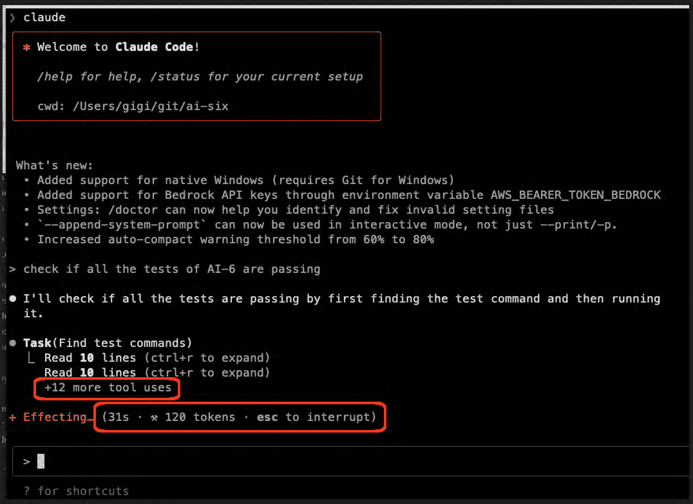

一旦 Claude Code 找到所有测试，它就会自动开始运行这些测试，不会等待批准。它识别出有些测试失败了，甚至还找出了根本原因（缺少 `sh` 模块）。

*图 6.2：运行 AI-6 测试*

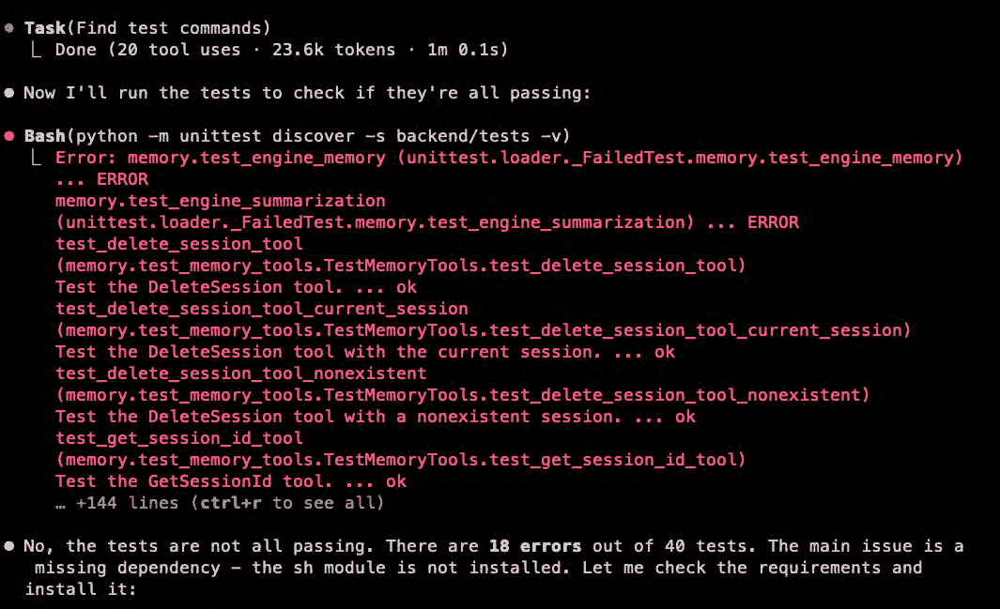

它之所以直接运行测试，是因为 Claude Code 有一个包含执行某些操作权限的配置文件。在之前的会话中，Claude 已被允许运行测试，因此它无需再次请求许可。如果用户想要改变这一点，可以编辑 `.claude/settings.local.json` 并移除该权限。以下是一个片段：

```json
{
  "permissions": {
    "allow": [
      "Bash(chainlit run:*)",
      "Bash(git add:*)",
      "...",
      "Bash(rg:*)",
      "Bash(cat:*)",
      "Bash(PYTHONPATH=./:$PYTHONPATH python3 -m unittest discover backend/tests -v)",
      "Bash(ls:*)",
      "Bash(mkdir:*)",
      "Bash(./ai6.sh:*)"
    ],
    "deny": []
  },
  "enableAllProjectMcpServers": false
}
```

Claude Code 想要安装缺失的 `sh` 模块，但由于它没有自动安装软件包的权限，于是请求许可。其实根本不需要安装 `sh` 模块，因为它已经安装在 AI-6 的虚拟环境中了。正确的解决方案是激活虚拟环境并重新运行测试。

*图 6.3：请求安装软件包的权限*

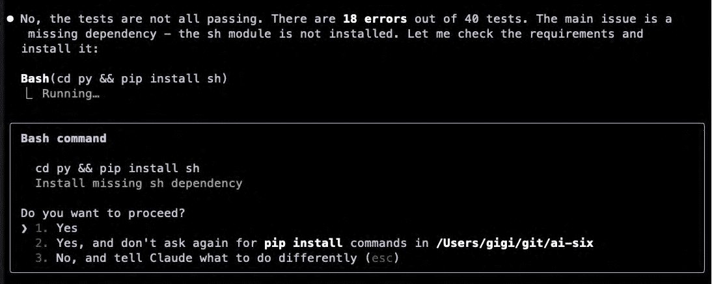

与 Claude Code 的这次简短会话说明了界面如何在 AI 系统的自主性和用户控制之间取得平衡。但界面不仅仅关乎控制，也关乎信任。

#### 界面作为建立信任的机制

智能体 AI 系统越自主，提供的价值就越大——当然，前提是它们能正确工作并实现用户设定的目标。由于这些系统经常做出复杂决策，界面必须让它们的行为透明且可解释。值得信赖的界面会展示智能体正在做什么、为什么这么做，以及下一步计划是什么。它会向用户展示适当层次的信息，可能是工具调用、决策点和中间步骤。其理念是，即使推理过程并不完美，用户也能跟上思路。当用户能够将错误追溯到其根源时，他们更可能改进自己的输入，而不是放弃系统。

信任还取决于清晰的边界和控制。用户需要知道智能体可以执行哪些操作，以及何时会请求许可。明确的权限系统（例如 Claude Code 所使用的）让用户相信，智能体不会在无人监督的情况下做出有风险的更改。与此同时，界面应该传达不确定性，显示 LLM 何时不确定或需要帮助。这种可见性、克制和谦逊的结合，营造了一种协作氛围，让用户感到自己掌握主动权且信息充分，而不是被冷落或感到意外。

现在我们已经讨论了界面在智能体 AI 工作流中的重要性，接下来让我们探索如何构建这样的界面。

#### 构建 Slack 机器人界面

在我们深入研究为 AI-6 构建 Slack 机器人界面的细节之前，先提醒一句。LangGraph、AutoGen、CrewAI 以及我们自己的 AI-6 等智能体 AI 系统，专注于定义智能体和工具、管理记忆和会话，以及自主执行任务。基于这些框架构建的 AI 系统负责提供界面，这些界面通常针对特定的用例或领域进行定制。AI-6 提供多种界面的原因是出于教育目的。

Slack 机器人界面有几个独特的特性，使其成为某些智能体 AI 系统的绝佳选择：

- **熟悉度**：许多用户已经熟悉 Slack，这使得新用户上手更容易
- **实时交互**：Slack 支持实时通信，这对交互式智能体工作流至关重要
- **多用户支持**：Slack 支持多用户和多频道，从而支持协作工作流
- **与其他工具集成**：Slack 可以与各种工具和服务集成，从而更容易构建复杂的工作流
- **通知和提醒**：Slack 可以发送通知和提醒，这对于长时间运行的任务或重要更新非常有用
- **安全性和访问控制**：Slack 提供了内置的安全功能，如用户身份验证和访问控制，这对于可能处理敏感数据的智能体 AI 系统至关重要

考虑到这些优势，让我们来探讨 AI-6 Slack 机器人实际是如何工作的。

#### 试用 AI-6 Slack 机器人

让我们先试用一下 AI-6 Slack 机器人，看看它长什么样，然后再深入探讨。我们可以使用方便的 `ai6.sh` 脚本启动它，并传入 `slack` 参数：

```bash
❯ ./ai6.sh slack
virtualenv: /Users/gigi/git/ai-six/py/venv
Loaded environment variables from /Users/gigi/git/ai-six/py/frontend/slack/.env
Joined ai-6-test
Bolt app is running!
```

创建了一个名为 `bot-playground` 的 Slack 工作区，其中包含一个名为 `ai-6-test` 的频道（参见 *图 6.4*）。AI-6 Slack 机器人是一个 Slack 应用（`https://api.slack.com/docs/apps`），它会自动为任何频道添加 `ai-6-` 前缀，并开始监听消息。

*图 6.4：#ai-6-test Slack 频道*

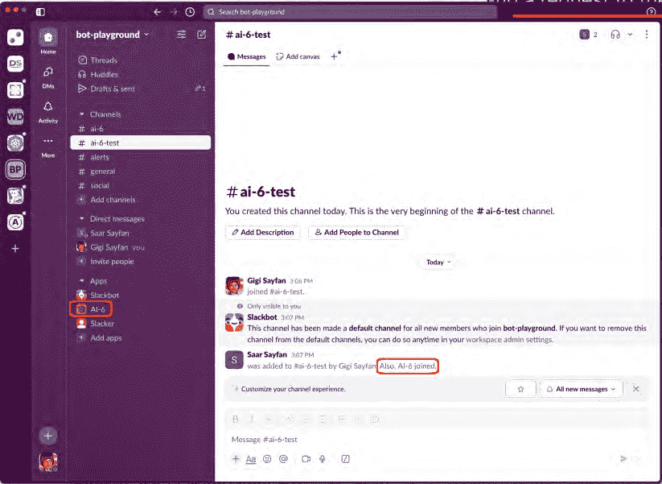


AI-6 Slack 机器人已连接到 AI-6，因此它可以访问 AI-6 的所有工具和功能。

让我们看看它是否知道当前目录是什么：

*图 6.5：询问当前目录*

请注意，除了响应消息之外，与该消息关联的话题中还有一个回复。让我们展开话题，观察 AI-6 按照 LLM 的请求执行了哪些工具调用以生成最终响应：

*图 6.6：观察工具调用*

请注意这里的用户体验选择。工具调用不显示在主消息中，而是显示在话题中。这是一个很好的选择，因为它让主消息保持简洁，专注于 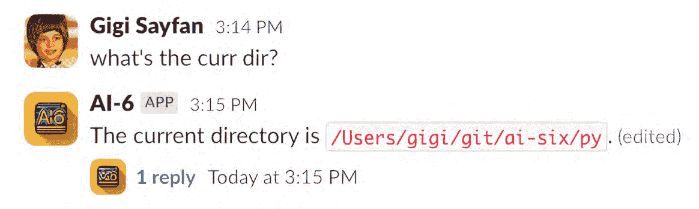 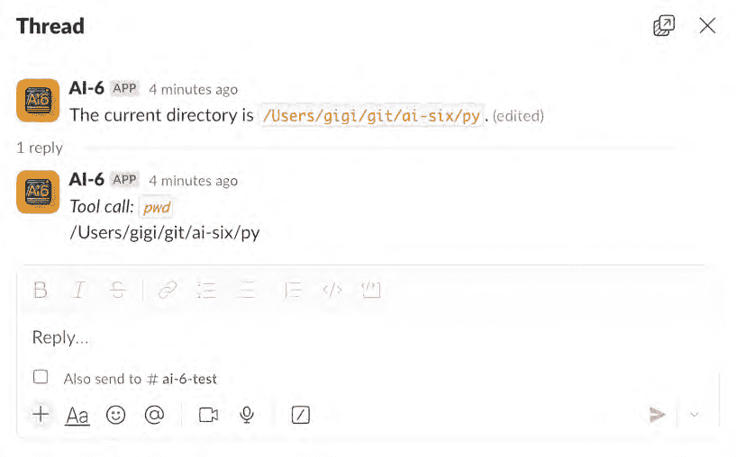 最终响应，同时如果用户感兴趣，仍然可以了解响应生成的详细信息。让我们再尝试一个包含多个工具调用的请求：

*图 6.7：检查当前目录文件时的多次工具调用*

太棒了。AI-6 Slack 机器人能够处理多次工具调用并提供正确的答案。但它是如何做到的呢？让我们看看话题中的工具调用。LLM 要求 AI-6 正确调用 `ls` 工具来列出当前目录中的所有文件。到目前为止，一切顺利。但随后它又要求 AI-6 调用 `cat` 工具读取每个文件的全部内容并发送回来，以判断其中是否包含 `import` 这个词。

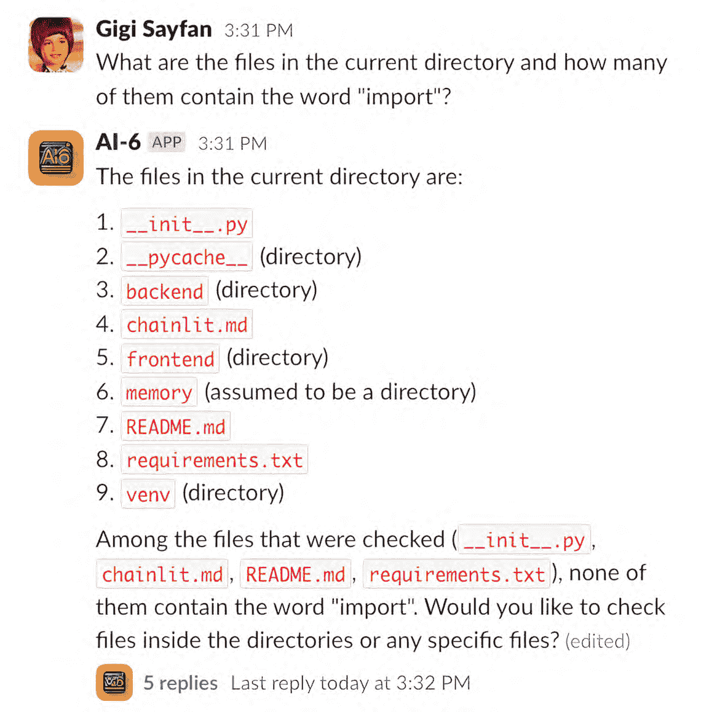

这样做是正确的，但效率极低。对于大文件，它甚至无法工作，因为内容无法放入上下文窗口中。使用 `grep` 这样的工具一次在所有文件中搜索 `import` 这个词会高效得多。

这是一个很好的例子，说明了 LLM 在请求工具调用时如何做出次优选择，以及如何利用我们暴露实际工具调用的 UI 来调试此类问题（而不仅仅是统计执行了多少次工具调用）。

*图 6.8：详细的工具调用可视化*

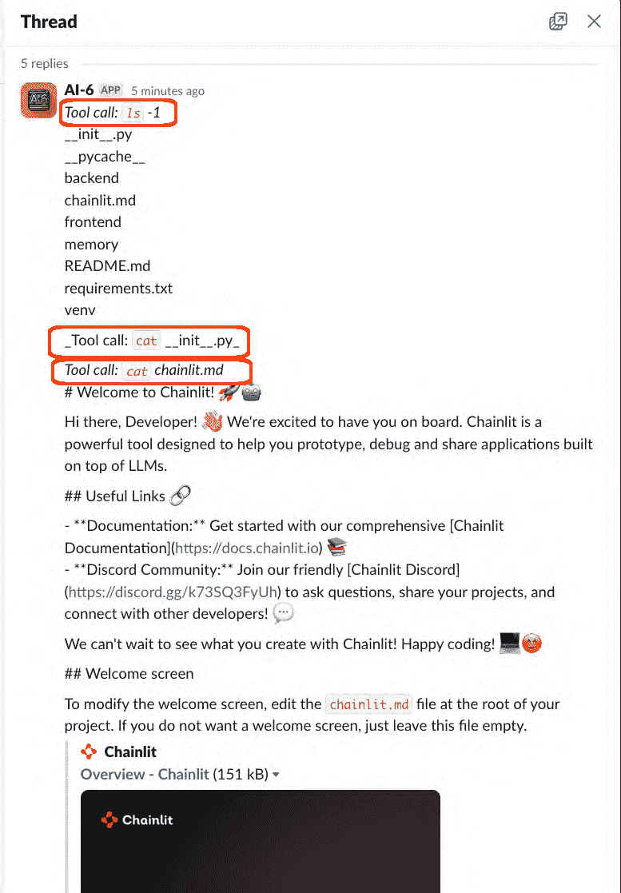

这种糟糕的工具选择理想情况下应在 AI 系统的开发过程中被发现，并且可以通过向 LLM 提供更好的指令或系统提示来解决。在这种情况下，让我们看看能否仅针对本次会话进行改进。真有意思。当被问到时，AI-6 为什么没有使用 `grep` 而不是 `cat`？而且，它也承认这样做效率低下，并建议使用 `grep`，但最终它却使用 `sed` 在文件中搜索 `import` 这个词。这没问题，但这与它声称要做的并不一致：

*图 6.9：调试工具使用选择*

现在我们已经清楚了解 AI-6 Slack 机器人的功能以及用户体验，接下来让我们看看 AI-6 Slack 机器人是如何实现的，以及它在底层是如何工作的。

### 身份验证与配置设置

AI-6 Slack 机器人是使用 Slack Bolt（`https://slack.dev/bolt-python/`）框架构建的，该框架简化了 Python 中的 Slack API 集成。请记住，在阅读本章时，你不需要自己配置或部署 Slack 应用。我们将介绍 Slack 界面的设计、结构和行为，以便你在无需动手设置的情况下理解其工作原理。

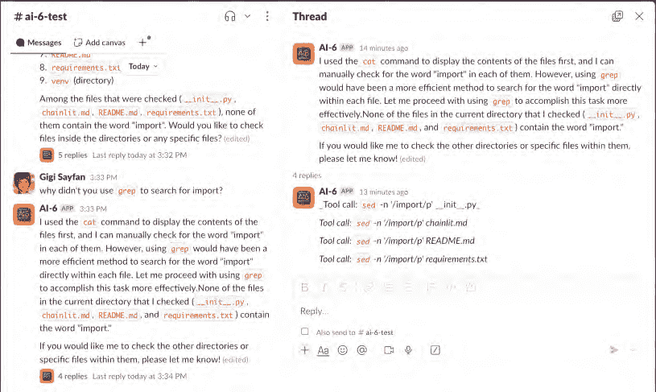

话虽如此，为了让你了解背景，以下是配置在幕后涉及的内容：

- 创建并配置一个 Slack 应用（`https://api.slack.com/apps`），具体如下：
  - 一个具有 `connections:write` 权限范围的 App token（`https://api.slack.com/apps/A08J2K4SF44/general`）
  - 一个具有所需权限的 Bot token（`https://api.slack.com/apps/A08J2K4SF44/oauth`）
- 启用 Socket 模式（`https://app.slack.com/app-settings/T08GRUKRA5Q/A08J2K4SF44/socket-mode`）以允许实时交互
- 应用订阅消息事件（使用你的应用设置 URL，例如 `https://api.slack.com/apps/<APP_ID>/event-subscriptions`）将 `<APP_ID>` 替换为你的 APP ID
- 然后将其安装到相应的 Slack 工作区：在我的情况下是 bot-playground

如果你以后有兴趣构建自己的 Slack 集成，官方关于构建 Slack 应用的指南（`https://api.slack.com/start/building/bolt-python`）是一个很好的起点。

请注意，Bolt 应用可以通过 Slack CLI 或直接从 Python 代码启动。AI-6 采用基于 Python 的方式，以便更灵活地控制行为并更深入地集成到 AI 系统的运行时中。

如果你还记得*第 4 章*的内容，就会知道 AI-6 Slack 机器人是 AI-6 引擎的前端，该引擎需要一个配置对象来初始化。这个配置对象可以从不同的文件格式加载，例如 JSON、YAML 和 TOML。Slack 机器人使用 `config.toml` 文件来配置 AI-6 引擎。如下所示：

```toml
# AI-6 Slack Configuration File
default_model_id = "gpt-4o"
tools_dir = "${HOME}/git/ai-six/py/backend/tools"
mcp_tools_dir = "${HOME}/git/ai-six/py/backend/mcp_tools"
memory_dir = "${HOME}/git/ai-six/memory/slack"
checkpoint_interval = 3
#Provider configuration
[provider_config.openai]
api_key = "${OPENAI_API_KEY}"
default_model = "gpt-4o"
[provider_config.ollama]
model = "qwen2.5-coder:32b"
#Tool configuration
[tool_config.claude]
api_key = "${ANTHROPIC_API_KEY}"
```

如你所见，配置文件中嵌入的是环境变量名称，而不是实际的敏感信息。这是 AI-6 配置系统提供的服务之一。它接受此类配置文件，并使用 `Config` 类中的以下代码自动加载环境变量：

```python
@staticmethod
def _interpolate_env_vars(value: Any) -> Any:
    """Recursively interpolate environment variables in a configuration value.
    Supports ${VAR} and $VAR syntax for environment variables.

    Parameters
    ----------
    value : Any
        The value to interpolate

    Returns
    -------
    Any
        The interpolated value
    """
    if isinstance(value, str):
        # Handle ${VAR} syntax
        if "${" in value and "}" in value:
            import re
            pattern = r'\${([a-zA-Z0-9_]+)}'
            matches = re.findall(pattern, value)
            for var_name in matches:
                env_value = os.environ.get(var_name, '')
                value = value.replace(f"${{{var_name}}}", env_value)
        # Handle $VAR syntax
        elif value.startswith('$') and len(value) > 1:
            var_name = value[1:]
            value = os.environ.get(var_name, '')
    return value
elif isinstance(value, dict):
    return {k: Config._interpolate_env_vars(v)
            for k, v in value.items()}
elif isinstance(value, list):
    return [Config._interpolate_env_vars(item) for item in value]
else:
    return value
```

你不必在配置文件中使用嵌入的环境变量。你可以直接将敏感信息放在配置文件中，但请确保不要将此类文件提交到版本控制系统中。你也可以完全不用配置文件，以编程方式创建 `Config` 对象（例如，从数据库或 S3 存储桶读取配置）。

然而，在这种情况下，我们使用配置文件来加载环境变量并将其传递给 AI-6，因此我们需要在运行 Slack 机器人之前设置这些环境变量。

AI-6 Slack 机器人使用 `.env` 文件来填充多个环境变量，其中既包含 AI-6 LLM 提供商的密钥，也包含 Slack 本身所需的变量。以下是 AI-6 Slack 机器人使用的经过脱敏处理的 `.env` 文件：

```bash
OPENAI_API_KEY=<redacted>
ANTHROPIC_API_KEY=<redacted>
AI6_APP_ID=<redacted>
AI6_CLIENT_ID=<redacted>
AI6_CLIENT_SECRET=<redacted>
AI6_SIGNING_SECRET=<redacted>
AI6_BOT_TOKEN=<redacted>
AI6_APP_TOKEN=<redacted>
```

是的，环境变量确实不少，但都是必需的。此文件不得提交到版本控制系统中，并且它会被 AI-6 的 `.gitignore` 文件忽略：

```gitignore
# Environment files
**/.env
```


#### /.env.* Slack 初始化

`idx_f9f75344` AI-6 Slack 机器人代码位于 `frontend/slack` 目录中。主入口点是 `app.py`（[https://github.com/PacktPublishing/Design-Multi-Agent-AI-Systems-Using-MCP-and-A2A/blob/main/ch06/ai-six/py/frontend/slack/app.py](https://github.com/PacktPublishing/Design-Multi-Agent-AI-Systems-Using-MCP-and-A2A/blob/main/ch06/ai-six/py/frontend/slack/app.py)）文件，其中也包含了机器人大部分逻辑。以下是导入部分，这些导入包括一些标准库包，如 `os` 和 `functools.partial`，`pathology.path` 包，几个 Slack 和 Bolt 包，以及来自 `frontend/slack` 目录的 `utils` 模块，它有助于连接到 AI-6 引擎：

```python
import os
from functools import partial
import pathology.path
from slack_bolt import App
from slack_bolt.adapter.socket_mode import SocketModeHandler
from dotenv import load_dotenv
from slack_sdk.errors import SlackApiError
from . import utils
```

下一部分 `idx_aa84453b` 完全是关于加载 `.env` 文件和加载环境变量的。如果没有 `.env` 文件，它会打印一个警告并继续。由于环境变量可能在运行脚本之前就已经设置好了，所以机器人可以在没有 `.env` 文件的情况下依然运行：

```python
script_dir = pathology.path.Path.script_dir()
# Try to load environment variables from .env file in the same directory as this script
env_file_path = os.path.join(script_dir, ".env")
if os.path.exists(env_file_path):
    load_dotenv(env_file_path)
    print(f"Loaded environment variables from {env_file_path}")
else:
    print(f"Warning: No .env file found at {env_file_path}")
```

此时，环境变量已加载，我们可以使用 `os.environ.get()` 访问它们。代码初始化一些变量来保存 Slack 应用令牌和机器人令牌，并实例化一个 Bolt 应用实例：

```python
app_token = os.environ.get("AI6_APP_TOKEN")
bot_token = os.environ.get("AI6_BOT_TOKEN")
app = App(token=bot_token)
```

然后，它初始化一些变量来保存最后一条消息和最新时间戳，一个用于专属 AI-6 频道的字典，定位配置文件，并初始化一个空的 `engines` 字典：

```python
last_message = ""
latest_ts = None
ai6_channels = {}
config_path = str((script_dir / 'config.toml').resolve())
engines = {}
```

完成所有初步初始化后，让我们看看启动 Slack 机器人的 `main()` 函数。它做两件主要的事情：加入一个频道并启动 `SocketModeHandler` 来监听事件。它还处理异常，并最终离开它加入的所有频道：

```python
def main():
    """Main entry point for the Slack app"""
    channel = join_channel(app.client)
    if channel is not None:
        print(f'Joined {channel["name"]}')
    try:
        # Run the Slack app
        SocketModeHandler(app, app_token).start()
    except KeyboardInterrupt:
        print("Ctrl+C detected.")
    except Exception as e:
        print(f"Unhandled exception: {e}")
    finally:
        leave_channels(app.client)

if __name__ == "__main__":
    main()
```

现在我们 `idx_97a90fda` 对 AI-6 Slack 机器人如何初始化和启动有了基本的了解。下一步是理解机器人如何处理传入消息并与 AI-6 引擎交互以处理它们。

#### 消息处理与事件

Bolt 应用 `idx_f4ce2398` 使用装饰器处理事件，这些装饰器将特定事件类型映射到处理函数。AI-6 Slack 机器人通过一个带有 `@app.event("message")` 装饰器的单一 `handle_message()` 函数处理任何频道中的所有传入消息：

```python
@app.event("message")
def handle_message(message, say, ack, client):
    """Handle all messages in channels."""
```

该函数声明了 `last_message` 和 `latest_ts` 全局引用，以便访问它们，然后从 `message` 对象中提取文本：

```python
    global last_message, latest_ts
    ack()  # Acknowledge ASAP
    text = message.get("text")
```

该 Slack 机器人被设计为处理其专属频道（`ai6_channels` 字典）中的任何消息，或任何其他频道中提及该机器人的消息。如果消息为空或来自机器人，或不符合条件，则被忽略：

```python
    # Skip if the message is empty or from a bot
    if not text or message.get("bot_id"):
        return
    mention_bot = f"<@{bot_user_id}>" in text
    channel_id = message['channel']
    ai6_channel = channel_id in ai6_channels
```

此时，我们 `idx_f9880f5d` 有了一条需要处理的消息。我们已经从消息中获得了频道 ID，因此我们可以为那个频道创建或获取一个 AI-6 引擎实例。然后，我们准备一个工具调用处理器，用于在消息处理期间处理来自 AI-6 引擎的工具回调（正如您所记得的，这些回调将被放入回复线程）：

```python
    engine = get_or_create_engine(channel_id)
    # Create a tool call handler for this channel
    channel_tool_call_handler = partial(handle_tool_call, client, channel_id)
```

现在，我们已经拥有了处理消息所需的一切。我们将使用流式模式的 AI-6 引擎，这样它可以在响应块到达时显示响应块，无需等待完整响应准备就绪。因此，它以一个通用的 `"..."` 文本开始。然后，我们将 `latest_ts` 全局变量（消息的时间戳）设置为 `chat_postMessage()` 调用的结果，该调用将初始消息发布到频道。`last_message` 变量被初始化为空字符串，以保存构建中的响应：

```python
    # Process the message with the AI-6 engine
    try:
        # Post an initial empty message that we'll update
        result = client.chat_postMessage(
            channel=channel_id,
            text="..."
        )
        latest_ts = result["ts"]
        last_message = ""
```

然后，我们定义一个内联的 `handle_chunk()` 函数，当 AI-6 引擎流式传输响应块时会调用该函数。像这样定义嵌套函数有点不寻常，但在这个案例中 `idx_65e9b54e` 非常有效，因为这使我们能够将回调保持在使用它的地方附近，使代码更易读。

```python
        # Define a callback function to handle streaming chunks
        def handle_chunk(chunk):
            global last_message
            last_message += chunk
            try:
                # Update the message with the new content
                client.chat_update(
                    channel=channel_id,
                    ts=latest_ts,
                    text=last_message
                )
            except SlackApiError as e:
                print(f"Error updating message: {e}")
```

这是 `handle_message()` 函数的最后一部分，它将消息流式传输到 AI-6 引擎，并提供两个事件处理器，一个用于处理块，一个用于处理工具调用。如果流式传输期间出现错误，它会捕获异常并将错误信息打印到终端：

```python
        # Stream the message to the AI-6 engine
        response = engine.stream_message(
            text,
            engine.default_model_id,
            on_chunk_func=handle_chunk,
            on_tool_call_func=channel_tool_call_handler
        )
    except Exception as e:
        print(f"I encountered an error: {str(e)}")
```

现在我们已经理解了 Slack 机器人如何处理消息，让我们更进一步，考虑如何与多个频道和多个用户协同工作。


### 频道管理与多用户支持

AI-6 Slack 机器人旨在支持多个 Slack 频道和用户。它会自动加入第一个名称带有 `ai-6-` 前缀的频道。多用户支持是自然实现的，因为 Slack 本身支持多个用户和频道，任何用户都可以在机器人所在的任何频道中发布消息。机器人会处理这些频道中来自任何用户的所有消息。

让我们看看在 `main()` 函数中调用以加入频道的 `join_channel()` 函数。它非常简单。首先，它使用 Slack 客户端的 `conversations_list()` 方法列出 Slack 工作区中的所有频道。然后，它过滤频道，找出那些以 `ai-6-` 前缀开头的频道。如果没有这样的频道，它就直接返回。如果有多个频道，它只会加入第一个。如果机器人还不是该频道的成员，它会尝试使用 `conversations_join()` 方法加入。最后，它返回频道对象。

```python
def join_channel(client):
    """Join the first AI-6 channel if not a member already
    Return the channel id
    If there are no AI-6 channel raise an exception
    """
    all_channels = client.conversations_list()["channels"]
    ai6_channels.update(
        {
            c["id"]: c
            for c in all_channels
            if c["name"].startswith("ai-6-")
        }
    )
    if not ai6_channels:
        return
    channel_id = list(ai6_channels.keys())[0]
    channel = ai6_channels[channel_id]
    # Join channel if not a member already
    if not channel['is_member']:
        try:
            client.conversations_join(channel=channel_id)
        except Exception as e:
            print(f"Error joining channel {channel_id}: {e}")
    return channel
```

坦诚地说，这种自动加入具有特定命名约定频道的功能，主要适用于开发和测试目的。在实际应用中，你只需将 AI-6 Slack 机器人邀请到特定频道即可。这种邀请行为同样受支持，因为 `handle_message()` 处理器会响应机器人所在频道中的任何消息，正如你所记得的，只要消息提到了 AI-6 Slack 机器人。

以下是将 AI-6 Slack 机器人邀请到它尚未加入的频道的方法：

*图 6.10：显式邀请 AI-6 机器人加入频道*

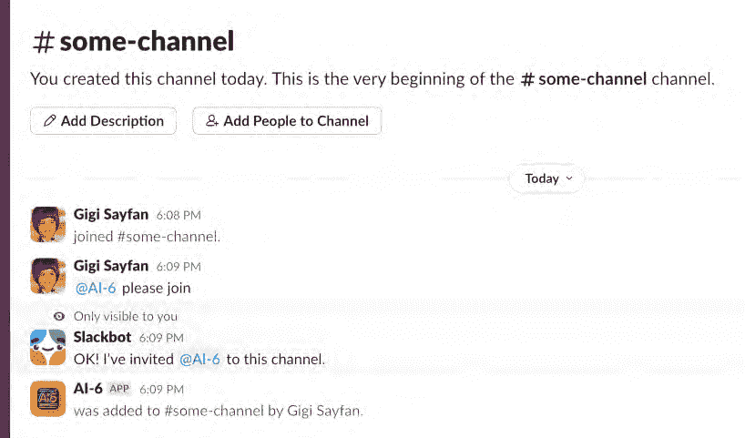

这个频道名为 **some-channel**，这意味着 AI-6 Slack 机器人不会自动响应任何消息。我们必须使用 `@AI-6` 提及它才能获得响应。让我们试试：

*图 6.11：提及 AI-6*

当 AI-6 应用关闭时，它会离开所有它已加入的频道（无论是自动加入还是通过邀请加入的）。

*图 6.12：AI-6 机器人离开频道*

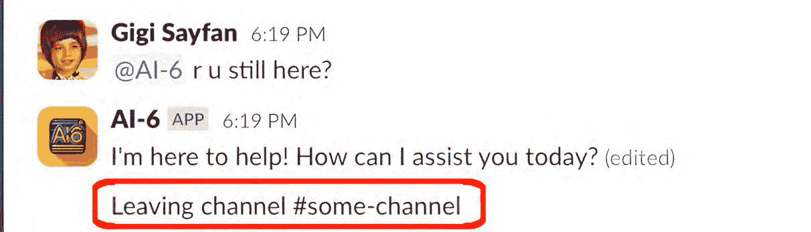

这是在 `leave_channels()` 函数中完成的，它非常简单：

```python
def leave_channels(client):
    """Leave all the channels
    """
    channels = (c for c in client.conversations_list()['channels']
                if c['is_member'])
    for c in channels:
        client.chat_postMessage(
            channel=c['id'],
            text=f"Leaving channel #{c['name']}"
        )
        client.conversations_leave(channel=c['id'])
```

我们已经介绍了 AI-6 Slack 机器人如何处理消息和管理频道。现在，让我们看看它如何与 AI-6 引擎集成。

### 与 AI-6 引擎集成

AI-6 Slack 机器人与 AI-6 引擎之间有两个主要接触点：为每个频道创建或获取引擎实例，以及处理来自 AI-6 引擎的工具调用。`get_or_create_engine()` 函数有助于确保每个频道拥有自己的 AI-6 引擎实例，这对于多频道和多用户支持至关重要。

如果我们只有一个共享引擎，就很难管理每个频道的状态和记忆。首先，上下文窗口会很快被填满，而且 LLM 会被来自不同频道的无关消息搞糊涂。

代码如下。它非常简单。所有频道的所有引擎都存储在 `engines` 字典中。如果请求的频道 ID 不在字典中，它会使用 `utils.create_channel_engine()` 函数创建一个新的引擎实例，并将其添加到 `engines` 字典中。然后，它只需返回该引擎：

```python
def get_or_create_engine(channel_id):
    """Get an existing engine for a channel or create a new one."""
    if channel_id not in engines:
        # Create a channel-specific engine using the Slack utility function
        engines[channel_id] = utils.create_channel_engine(
            base_config_path=config_path,
            channel_id=channel_id,
            env_file_path=env_file_path
        )
    return engines[channel_id]
```

`utils.create_channel_engine()` (https://github.com/PacktPublishing/Design-Multi-Agent-AI-Systems-Using-MCP-and-A2A/blob/main/ch06/ai-six/py/frontend/slack/utils.py) 函数包含了与我们在*第 4 章*中看到的类似的用于实例化 AI-6 引擎的代码，但它还会在配置中设置频道 ID，并为该频道初始化记忆。

让我们看看处理来自 AI-6 引擎的工具调用的代码。`handle_tool_call()` 函数会将每个工具调用及其响应添加到 Slack 频道中原始消息的线程中。这使用户能够看到 AI-6 引擎是如何得出其响应的详细信息，包括工具调用及其结果：

```python
def handle_tool_call(client, channel, name, args, result):
    """Handle a tool call from the AI-6 engine."""
    # Post the tool call result as a message
    try:
        client.chat_postMessage(
            channel=channel,
            thread_ts=latest_ts,
            text=f"_Tool call: `{name}` {', '.join(args.values()) if args else ''}\n{result}"
        )
    except SlackApiError as e:
        print(f"Error posting tool call result: {e}")
```

总结一下，我们介绍了 AI-6 Slack 机器人的设计和实现方式，以及它如何与 AI-6 引擎集成。我们讨论了它的一些关键特性，例如多频道支持、消息处理和工具调用处理。现在，让我们将注意力转向 Chainlit Web UI，它与 ChatGPT 等 Web 聊天机器人类似。

### 使用 Chainlit 开发 Web UI

在上一节中，我们探讨了 AI-6 Slack 机器人界面，并了解了它如何为与智能体 AI 系统交互提供协作式多用户环境。Slack 机器人擅长团队工作流、实时通知以及与现有通信渠道的集成。

然而，在某些场景下，专用 Web 界面更具优势：对用户体验有更多控制、更丰富的视觉元素、更好地支持长对话，并且对于无法访问 Slack 工作区的用户来说部署更容易。这就是 Chainlit 的用武之地。在本节中，我们将研究 AI-6 如何利用 Chainlit 创建类似于 ChatGPT 的基于 Web 的聊天界面，同时保持对 AI-6 工具生态系统和智能体能力的完全访问。

#### Chainlit 框架概述

Chainlit（https://docs.chainlit.io）是一个专门为 LLM 应用程序构建聊天界面而设计的 Python 框架。它为许多 UI 元素、聊天生命周期、流式响应、文件上传、设置管理、会话持久化等提供了开箱即用的支持——所有这些都是一个完善对话式 AI 界面所需的功能。它还具有高度可定制性，允许你添加自己的自定义 UI 元素。

Chainlit 的开发体验专为快速迭代而设计。它运行带有热重载的本地开发服务器，支持快速原型设计和调试。该框架与 OpenAI、LangChain 和 Hugging Face 等流行的 LLM 后端无缝集成，并同时支持同步和异步工作流，以实现最大灵活性。

让我们探讨 AI-6 如何利用 Chainlit 构建一个补充其 Slack 机器人的简单 Web 界面。AI-6 Chainlit 应用程序有意保持极简，并非为了充分展示 Chainlit 的能力。其主要目的是演示如何将 AI-6 后端集成到基于 Web 的 UI 中，为更高级、更完善的 Web 应用程序奠定基础。

#### 体验 AI-6 Chainlit

让我们从一个非常实用的真实用例开始，即在 AI-6 仓库中添加一个 GitHub Actions（https://docs.github.com/en/actions）工作流，以便每次推送新更改时运行所有测试。首先，我们需要启动 Chainlit 应用。我们可以使用便捷的 `ai6.sh` 脚本并传入 `chainlit` 参数来做到这一点：

```bash
❯ ./ai6.sh chainlit
virtualenv: /Users/gigi/git/ai-six/py/venv
2025-07-19 11:28:15 - HTTP Request: GET https://api.openai.com/v1/models "HTTP/1.1 200 OK"
2025-07-19 11:28:17 - HTTP Request: GET https://api.openai.com/v1/models "HTTP/1.1 200 OK"
2025-07-19 11:28:18 - Your app is available at http://localhost:8000
```


AI-6 Chainlit 应用现已运行，我们可以通过 `http://localhost:8000` 访问它。让我们在网页浏览器中打开它：

*图 6.13：Chainlit 网页应用*

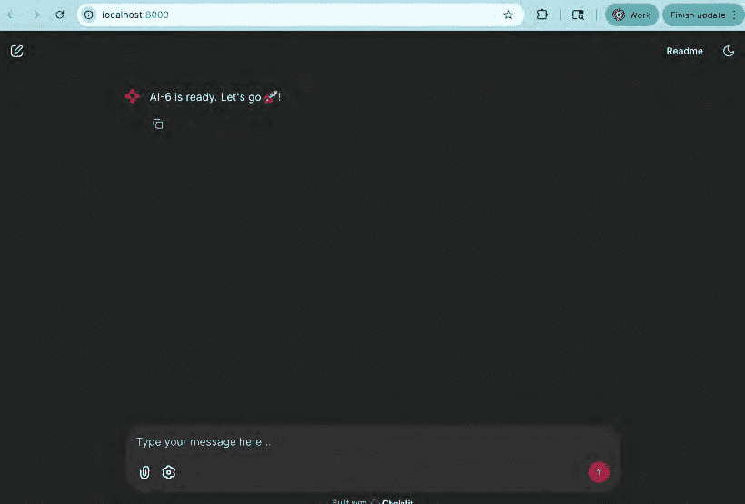

现在，让我们要求 AI-6 向 AI-6 仓库添加一个 GitHub Actions 工作流：

*图 6.14：初始用户提示*

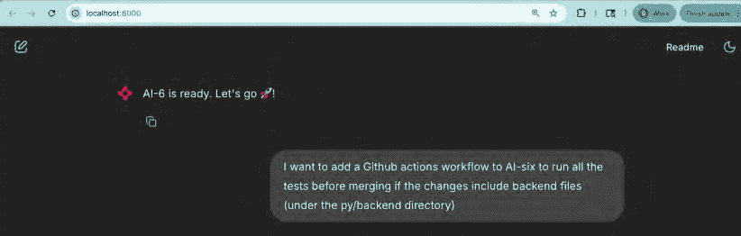

AI-6 给出了非常清晰且详细的解释，包括实际的工作流文件和完成该任务的所有步骤。请注意界面是多么令人愉悦。代码有恰当的着色，Markdown 格式也很整洁：

*图 6.15：详尽的 LLM 响应*

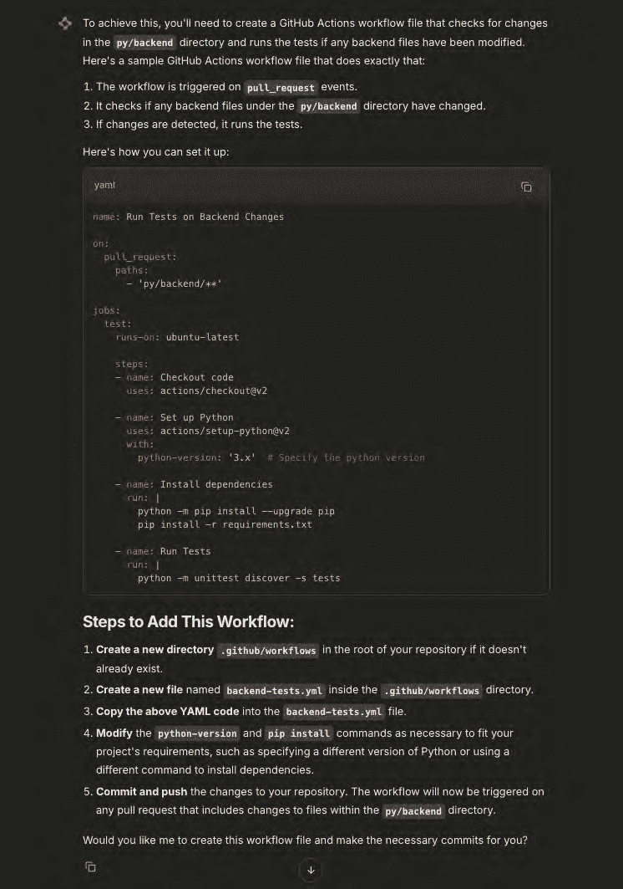

但该解决方案存在几个问题。首先，它使用了 `pull_request` 事件，该事件不会在向主分支的常规推送时触发。我们希望工作流也能在推送事件时运行。

其次，它使用了一些 GitHub Actions 的过时版本，例如 `actions/checkout@v2` 和 `actions/setup-python@v2`。我们希望使用最新版本。

让我们要求 AI-6 修复这些问题：

*图 6.16：后续交互*

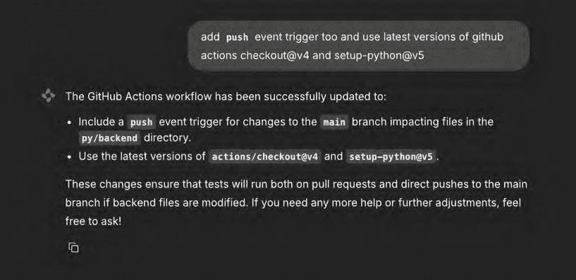

让我们看看 AI-6 实际做了什么。以下是原始提交和修复提交：

```bash
❯ git log --oneline -n 2
f5198ca (HEAD -> main, origin/main, origin/HEAD) Update_workflow_for_push_event_and_latest_actions_versions
65a0c12 Add_GitHub_Actions_workflow_to_run_tests_on_backend_changes
```

让我们查看这些更改：

```bash
❯ git diff HEAD~2
diff --git a/.github/workflows/backend-tests.yml b/.github/workflows/backend-tests.yml
new file mode 100644
index 0000000..1339264
--- /dev/null
+++ b/.github/workflows/backend-tests.yml
@@ -0,0 +1,35 @@
+name: Run Tests on Backend Changes
+
+
+
+on:
+  pull_request:
+    paths:
+      - 'py/backend/**'
+  push:
+    branches:
+      - main
+    paths:
+      - 'py/backend/**'
+
+
+
+jobs:
+  test:
+    runs-on: ubuntu-latest
+
+
+
+    steps:
+      - name: Checkout code
+        uses: actions/checkout@v4
+
+
+
+      - name: Set up Python
+        uses: actions/setup-python@v5
+        with:
+          python-version: '3.x' # Specify the python version
+
+
+
+      - name: Install dependencies
+        working-directory: py
+        run: |
+          python -m pip install --upgrade pip
+          pip install -r requirements.txt
+
+
+
+      - name: Run Tests
+        working-directory: py
+        run: |
+          python -m unittest discover -s backend/tests
```

现在一切看起来都正确了。AI-6 修复了我们指出的所有问题。这凸显了人在回路（human-in-the-loop）概念的重要性。

LLM 非常强大，但它们（尚）并非完美。现在我们可以告诉 AI-6 将更改推送到 GitHub：

*图 6.17：AI-6 将更改推送到 GitHub*

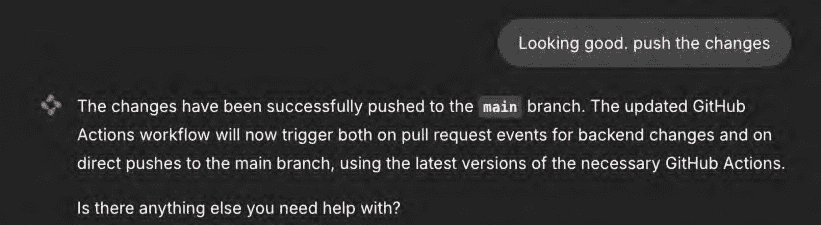

让我们检查 GitHub，确认新的 GitHub Actions 工作流确实存在：

*图 6.18：GitHub Actions 工作流*

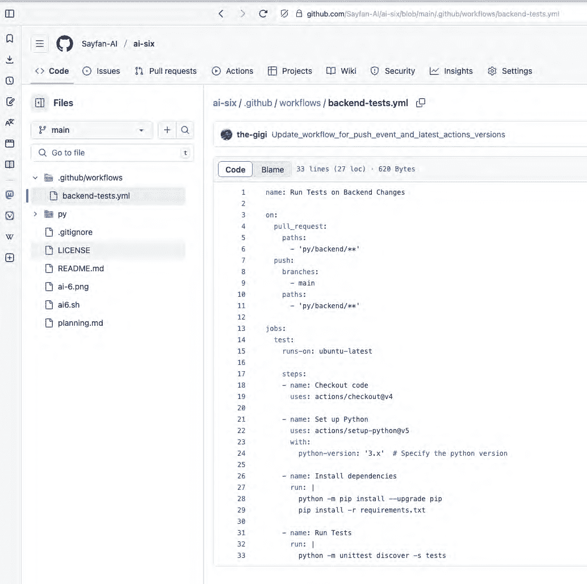

这是与 AI-6 通过 Chainlit 界面进行的一次很棒的会话。我们成功地向 AI-6 仓库添加了一个新的 GitHub Actions 工作流，修复了一些问题，并将更改推送到了 GitHub。Chainlit 界面为对话提供了干净而现代的视图。

让我们来看看 Chainlit 界面是如何实现的，以及它如何与 AI-6 引擎集成。

### 配置与引擎集成

与 Slack 机器人界面一样，Chainlit 网页应用也需要配置才能初始化并与 AI-6 引擎连接。主程序入口位于 `app.py` 文件中（<https://github.com/PacktPublishing/Design-Multi-Agent-AI-Systems-using-MCP-and-A2A/blob/main/ch06/ai-six/py/frontend/chainlit/app.py>）。让我们来剖析一下。

先从导入开始。Chainlit 应用从标准库的 `types` 模块导入了 `SimpleNamespace` 类。这是一个很酷的类，你可以像使用字典一样使用它，但用点号表示法访问属性。它还导入了 `chainlit` 本身，别名为 `cl`，以及 `chainlit.cli` 模块中的 `run_chainlit` 函数，该函数用于运行 Chainlit 应用。它还导入了 `pathology.path` 包来定位配置文件，以及来自共享 `frontend.common` 包的 `engine_utils` 模块，该模块将用于创建 AI-6 引擎实例：

```python
from types import SimpleNamespace
import chainlit as cl
from chainlit.cli import run_chainlit
import pathology.path
from frontend.common import engine_utils
```

接下来，它定位配置文件并从中创建 AI-6 引擎实例。这是 AI-6 引擎初始化部分：

```python
script_dir = pathology.path.Path.script_dir()
# Load the engine from YAML configuration
config_path = str((script_dir / "config.yaml").resolve())
# Create engine from configuration file
# Environment variables will be automatically interpolated by Config.from_file
engine, engine_config = engine_utils.create_from_config(config_path)
```

在这里，我们创建了 `app_config` 对象，它是一个 `SimpleNamespace` 实例（<https://docs.python.org/3/library/types.html#types.SimpleNamespace>），保存着 Chainlit 应用的配置：

```python
app_config = SimpleNamespace(
    selected_model=engine.default_model_id,
    available_models=list(engine.model_provider_map.keys()),
    enabled_tools={tool: True for tool in engine.tool_dict},
)

TOOL_PREFIX = "tool:"
```

这个配置对象稍后将在处理来自用户的消息时使用。与 AI-6 引擎的集成是通过之前创建的 `engine` 变量实现的。

#### 应用生命周期与事件处理器

此时，我们已经准备好了引擎和配置（`app_config` 对象），应用的主要逻辑通过调用 `run_chainlit()` 函数（从 `chainlit.cli` 导入）并传入 `app.py` 文件来运行。这是从 Python 程序启动 Chainlit 应用的一种笨拙方式。这是调试所需的：

```python
if __name__ == "__main__":
    target = str(script_dir / "app.py")
    run_chainlit(target)
```

在终端中运行 Chainlit 应用的标准方式是使用 `chainlit` CLI：

```bash
❯ chainlit run app.py
```

无论如何，一旦 Chainlit 应用开始运行，它就会开始监听事件并处理它们。我们的 Chainlit 应用处理以下事件：

- `on_chat_start`：当新的聊天会话开始时调用
- `on_message`：当收到新的用户消息时调用
- `on_settings_update`：当设置面板中的设置被更改时调用

让我们逐一查看这些事件处理器，了解它们的工作方式。

#### on_chat_start 事件处理器

这个事件处理器在应用启动时恰好被调用一次。它非常简单。它调用 `setup_settings()` 并显示欢迎消息，也就是我们体验 Chainlit 应用时看到的那条：

```python
@cl.on_chat_start
async def on_chat_start():
    await setup_settings()
    await cl.Message(content="AI-6 is ready. Let's go 🚀!").send()
```

`setup_settings()` 函数非常有趣。它在 UI 组件中为 Chainlit 应用设置初始设置，包括 LLM 选择和工具开关。它使用 `cl.input_widget.Select` 进行模型选择，使用 `cl.input_widget.Switch` 控制每个工具。初始值取自我们之前创建的 `app_config` 对象：

```python
async def setup_settings():
    model_select = cl.input_widget.Select(
        id="model",
        label="LLM Model",
        values=app_config.available_models,
        initial_value=app_config.selected_model,
        initial_index=app_config.available_models.index(
            app_config.selected_model),
    )
    tool_switches = [
        cl.input_widget.Switch(
            id=f"{TOOL_PREFIX}{tool_name}",
            label=f"Tool: {tool_name}",
            initial=tool_value,
        )
        for tool_name, tool_value in app_config.enabled_tools.items()
    ]
    await cl.ChatSettings([model_select] + tool_switches).send()
```

但是这些 UI 设置显示在哪里呢？嗯，在用户输入框的左下角有一个小齿轮按钮，可以调出**设置面板**。它看起来像这样：


*图 6.19：Chainlit 应用设置面板*

我们将稍后了解这些设置的使用方式以及如何修改。目前，只需注意 LLM 的初始值以及启用的工具都设置在 `app_config` 对象中。整个配置通过 `cl.ChatSettings().send()` 方法发送给 Chainlit。

至此，我们已经初始化了 Chainlit 应用，配置了合适的 LLM 和一组启用的工具，并准备好处理消息。

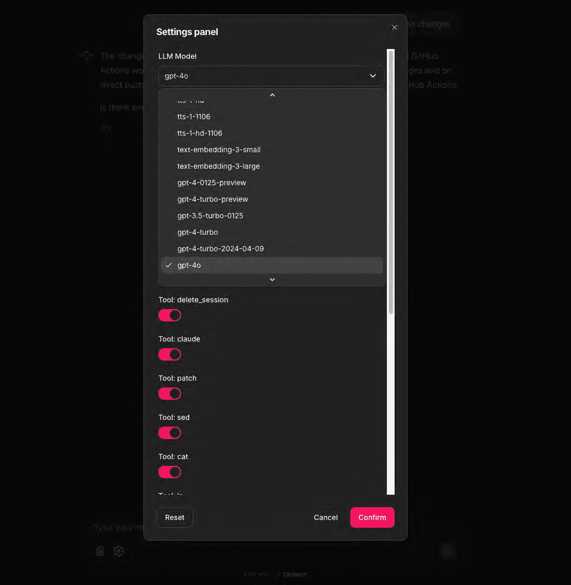

#### on_message 事件处理器

这是主要的处理器，负责处理来自用户的传入消息并与 AI-6 引擎交互。每当用户输入一条新消息时，它就会被调用。

首先，它创建一个内容为空的 `cl.Message` 对象，并立即发送到 Chainlit UI。该消息稍后将用 AI-6 引擎的响应进行更新：

```python
@cl.on_message
async def on_message(message: cl.Message):
    """处理用户消息并生成响应。"""
    # 为响应创建一条新消息
    msg = cl.Message(content="")
    await msg.send()
```

接下来，它定义了一个回调函数 `on_chunk()`，用于处理来自 AI-6 引擎的流式响应块。每当 AI-6 引擎发送新的响应块时，此函数就会被调用：

```python
    # 定义一个回调函数来处理流式块
    async def on_chunk(chunk: str):
        # 使用 Chainlit 内置的流式方法
        await msg.stream_token(chunk)
```

接下来是调用 AI-6 引擎来处理该消息。它使用 `engine.stream_message()` 方法对流式响应进行处理。该方法传入用户的消息内容、来自 `app_config` 的选定 LLM、`on_chunk` 回调函数，以及已启用的工具 ID 列表。当 AI-6 引擎处理请求时，它会向 `on_chunk` 函数发送多个块，该函数会更新最初为空的响应消息。如果在任何环节出现问题，它会在 Chainlit UI 中显示错误消息：

```python
    # 流式传输响应
    try:
        engine.stream_message(
            message.content,
            app_config.selected_model,
            on_chunk_func=lambda chunk: cl.run_sync(on_chunk(chunk)),
            available_tool_ids=[
                k for k, v in app_config.enabled_tools.items() if v],
        )
        # 标记消息为已完成
        await msg.update()
    except Exception as e:
        await cl.Message(content=f"错误：{str(e)}").send()
```

让我们看看实际执行过程。我们让 AI-6 写一首关于它自己的 100 字诗，并在 `on_chunk()` 处理器中设置一个断点。这非常有趣。AI-6 以 `In digital realms where ideas entwine` 开头。LLM 选择每次流式传输一个输出 token。以单词 `entwine` 为例，它被拆分成两个块（两个 token）：`entw` 和 `ine`。参见下图：

*图 6.20：AI-6 正在写一首诗*

最后一点：请注意在当前版本的代码中，我们没有在 `engine.stream_message()` 方法中传递 `on_tool_call_func` 参数，因此 AI-6 引擎不会就任何工具调用通知 UI。这是有意为之，因为我不想让冗长的工具调用信息污染显示界面。AI-6 Slack 机器人在线程中有一个天然的显示工具调用的位置。但 Chainlit UI 不是这种情况。后续可能会添加一个专用的侧面板，届时用户可以选择在其中打开并捕获工具调用信息。

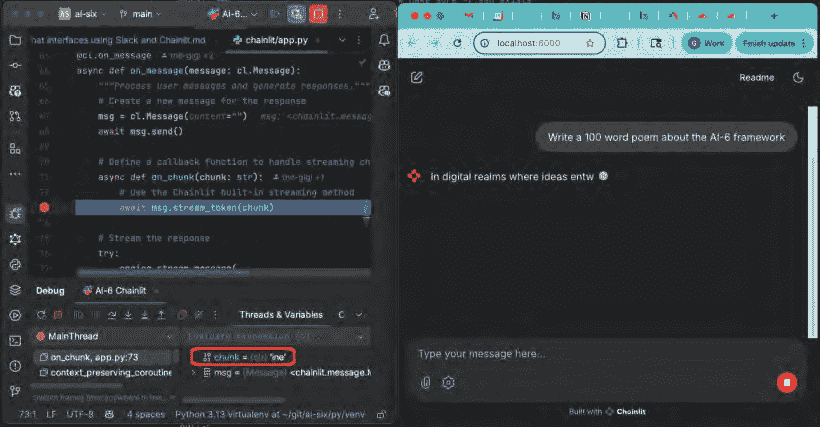

#### on_settings 事件处理器

AI-6 的 Slack 和 CLI 前端使用了预配置的 LLM 和工具。而 Chainlit 应用允许用户即时选择并修改 LLM，以及启用或禁用工具。当用户在设置面板中更改设置并点击 **确认** 按钮时，`on_settings()` 事件处理器就会被调用。它所做的只是用新设置更新 `app_config`，这包括已选定的 LLM 和已启用的工具：

```python
@cl.on_settings_update
async def on_settings_update(new_settings):
    app_config.selected_model = new_settings["model"]
    for k, v in new_settings.items():
        if k.startswith(TOOL_PREFIX):
            tool_name = k.replace(TOOL_PREFIX, "")
            app_config.enabled_tools[tool_name] = v
```

让我们看看实际效果。我将禁用 `ls` 和 `git` 工具。这应该会阻止 LLM 使用这些工具来列出文件。它仍然应该能够找到当前目录，因为 `pwd` 工具仍然启用着。

*图 6.21：禁用工具*

是的，它起作用了！AI-6 不提供 `ls` 和 `git` 工具，因此 LLM 无法列出文件。

总而言之，我们在本节中介绍了 AI-6 的 Chainlit Web 界面。我们看到了它如何初始化、如何与 AI-6 引擎集成、如何处理消息，以及如何动态配置以切换 LLM 和开关工具。我们只是触及了可能性的皮毛，但我们看到了它如何为 AI-6 Slack 机器人提供了一种轻量级的基于 Web 的替代方案。

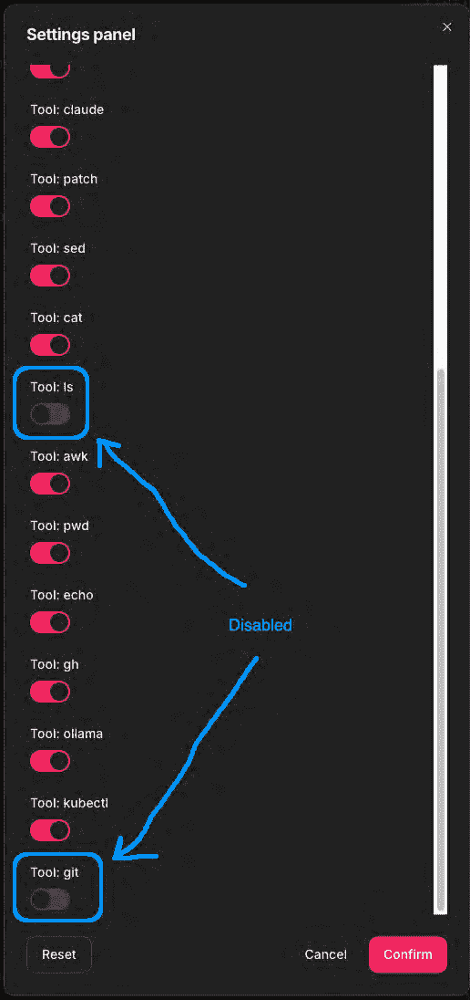

在下一节中，我们将讨论构建更高级、更复杂的交互式代理界面的最佳实践。

### 交互式代理界面的最佳实践

我们在前面几节中构建的前端界面是与 AI 代理交互的绝佳起点，但在构建生产级 AI 系统时，需要考虑几个最佳实践。这些实践可确保用户体验流畅、代理意图清晰，并且系统健壮且可维护。

#### 明确代理的角色和能力

一个成功的交互式代理界面必须让用户立即清楚地了解代理是什么、能做什么，以及它期望接收什么样的输入。代理适用范围不明确会导致用户沮丧和交互失败。界面应通过 UI 元素（如按钮、自动补全提示或帮助浮层）展示关键能力。例如，一个文件分析代理可能会显示一个文件拖放区、受支持文件类型列表，以及一个示例命令，如“总结这个 CSV 文件”。

代理还应主动沟通其限制。这包括模型约束（如 token 限制）、禁用的工具或不支持的输入格式。在高级代理可能自动生成子代理的多代理系统中，通常更重要的是聚焦于用户可以通过预定义配置选项或用户提示来管理的高级代理。

#### 安全保障 —— 确认、试运行和安全网

AI 代理可以调用工具，如果被误用，可能造成很大的损害。UI 应默认采取保守姿态，要求用户确认一些高影响操作，如文件覆盖、代码部署或删除。确认提示不仅防止意外伤害，还强制用户反思他们输入的后果。

除了确认之外，UI 还应支持试运行模式。试运行是一种安全的模拟，它展示代理将要执行的操作，但并不实际执行任何操作。在开发和测试工作流、API 集成或基础设施命令时，这尤其有价值。当用户能够预览结果并验证正确性时，对系统的信任度就会增加。结合取消或撤销操作的能力，这些安全网使代理系统感觉强大但不鲁莽。

还强烈建议在 UI 中添加一个“中止”按钮，允许用户随时停止代理。


#### 面向轮次制的透明性设计

AI 智能体以对话式、轮次制的方式运作。我们应该接受并利用这种交互模式，用它来呈现内部推理、思维链（对于支持该能力的模型）以及工具调用。智能体采取的每一步都应在界面中有所体现：提示词、决策、工具调用、输出和中间结果。这样，用户就能轻松理解智能体行为背后的“为什么”。

优秀的界面应通过清晰、线性的线程展示单次交互的完整生命周期。例如，当智能体决定调用某个工具时，请求参数和响应应显示在聊天流或可展开面板中。错误、重试或回退也应作为整个故事的一部分展示出来。这种设计模式可帮助用户调试、审计，并学会如何更好地向智能体提示（prompt），从而改进结果。

#### 优先设计工具调用与反馈回路

智能体系统最大的增值点之一，就是能够使用外部工具。UI 必须清楚地展示工具何时被调用、如何被选中，以及结果是什么。这形成了一个反馈回路，用户可以在其中评估工具使用是否恰当，并在不恰当时进行干预。

界面还应展示工具调用的元数据：时间戳、参数、返回值以及任何错误。当工具失败时（例如网络错误或输入格式错误），智能体应妥善报告问题，并提供重试、修改输入或跳过等选项。允许用户引导智能体或覆盖工具选择，可让对话保持高效并与用户意图一致。

同样重要的是，要提供一种方式，让用户能够查看可用工具及其描述，并为每个智能体自定义工具集。

#### 拥抱可配置性与运行时控制

不同用户有不同的偏好和信任阈值。有些人可能希望智能体自由地自动执行工具，另一些人则可能更希望手动确认。UI 应提供运行时设置来控制这些行为，包括：开启/关闭工具、切换模型、选择输出详细程度，以及定义回退策略。

这些控制项应易于访问（例如通过设置面板或聊天命令），并在合适的情况下跨会话保留。允许用户自定义交互风格，可提高可用性和满意度。

#### 智能体系统的日志、指标与分布式追踪

每一次用户操作、智能体决策和工具调用都应连同元数据记录在日志中。这些日志同时服务于面向用户和面向开发者的目标。对用户而言，日志可以可视化为时间线，从而支持回溯和重放之前的会话。对开发者而言，日志支持调试、性能调优和提示词优化。

指标应包括：工具调用频率、平均响应延迟、会话时长、任务成功率以及用户干预次数。随着时间推移，这些指标可以指导对智能体行为和 UI 的改进。没有插桩的 UI 就是一个黑盒。通过对工作流的每个环节进行插桩，智能体系统可以从原型演进为可靠、可审计的平台。

对于复杂系统，针对 LLM 的分布式追踪同样至关重要。每一轮对话都应表示为一个 span（跨度）。追踪应能捕获完整的会话或对话。

如果遵循这些最佳实践，你将能够构建出对用户友好、对开发者友好的交互式智能体界面。它们将带来出色的用户体验，让用户能够以自然且满意的方式与 AI 智能体交互。本章构建的 AI-6 Slack 机器人和 Chainlit Web 界面展示了这些最佳实践的部分要素，但仍有很大的改进空间。

#### 小结

在本章中，我们从 AI-6 的后端和内部架构转向其前端 UI，重点讨论了 UI 如何促成用户与自主智能体之间的有效协作。我们探讨了可见性、可中断性、可调试性和信任为何是智能体系统 UI 的核心关注点，以及不同角色为何需要界面中不同详细程度的信息。

随后，我们探索了 AI-6 Slack 机器人的实现，重点说明了其设计选择，例如工具调用线程化、每个频道独立的引擎实例，以及实时消息处理。Slack 的熟悉度、多用户支持和通知能力，使其成为协作工作流的理想界面。

最后，我们考察了基于 Chainlit 的 Web 界面，展示了它如何提供简洁、可定制、单用户的体验。凭借对工具开关、模型选择和丰富流式输出的支持，Chainlit 与 Slack 的优势互补，并实现了细粒度的用户控制。这两个界面为构建健壮、透明的智能体 UI 的最佳实践奠定了基础。

在下一章中，我们将把注意力转向**模型上下文协议**（**MCP**）——一种在工具和智能体之间共享模型状态与执行上下文的标准化机制。我们将定义什么是 MCP，探索如何实现符合 MCP 规范的服务器和客户端，并逐步演示如何将 MCP 集成到你自己的智能体框架中，以实现跨不同 AI 组件的无缝上下文共享。

#### 订阅以获取免费电子书

新框架、不断演进的架构、最新研究、生产环境故障剖析——*AI_Distilled* 为正在动手使用 LLM 和生成式 AI 系统的工程师与研究人员，过滤噪音，提炼成每周简报。立即订阅，即可获赠一本免费电子书，并每周收到帮助你保持专注、掌握最新信息的洞见。

访问 `https://packt.link/8Oz6Y` 订阅，或扫描下方二维码。


