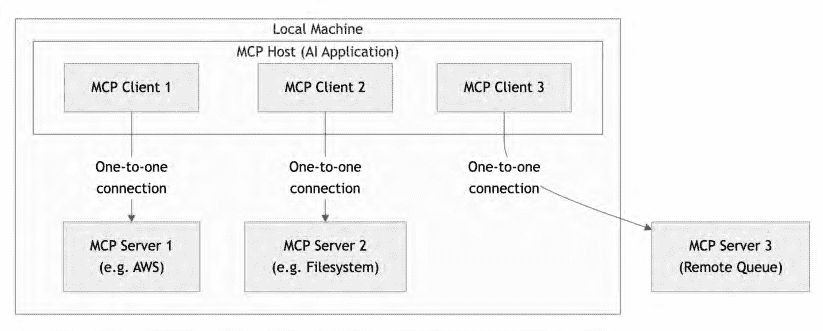
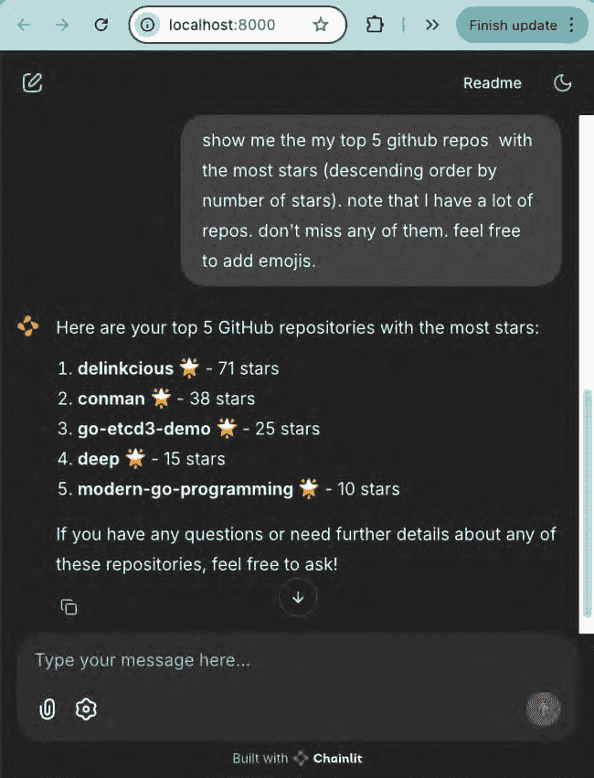

## 与模型上下文协议生态集成

在前几章中，我们探索了如何构建智能体 AI 系统、如何将它们与自定义工具集成，以及如何通过不同的前端（如**命令行界面**（**CLI**）、Slack 机器人和基于 Chainlit 的 Web UI）与它们交互。在本章中，我们将重点讨论如何将你的智能体 AI 框架与**模型上下文协议**（**MCP**）（`https://modelcontextprotocol.io`）生态集成。MCP 非常重要！它是一种旨在标准化智能体 AI 系统、模型和工具之间交互的协议。我们将从探索 MCP 及其优势开始，然后了解如何构建 MCP 服务器和客户端。最后，我们将演示如何将 MCP 集成到我们的智能体 AI 框架 AI-6 中。

我们将介绍以下主要主题：

- 什么是 MCP？
- MCP 架构核心与核心组件
- 构建 MCP 服务器
- 构建 MCP 客户端
- 将 MCP 集成到 AI-6 框架
- 综合应用

到本章结束时，你将全面理解 MCP、它为何如此出色，以及如何使用它来构建能够受益于丰富 MCP 服务器和客户端生态的智能体 AI 系统。

### 技术要求

如需跟随操作，请参考 `README` 文件中的说明：

`https://github.com/PacktPublishing/Design-Multi-Agent-AI-Systems-Using-MCP-and-A2A/blob/main/ch07/ai-six/README.md`

### 什么是 MCP？

MCP 由 Anthropic（`https://www.anthropic.com`）团队提出，旨在标准化智能体 AI 系统、数据源和外部服务之间的交互。通过 MCP，你可以构建“讲 MCP”的智能体 AI 系统，并自动与任何 MCP 服务器集成。这意味着，除了自定义工具之外，你还可以从庞大的生态系统中获取工具，扩展 AI 系统的能力。对于 MCP 工具开发者来说，它体现了“*一次编写，到处运行*”的原则。该协议有正式规范（`https://modelcontextprotocol.io/specification`），有版本管理，并且演进迅速。

### MCP 的动机

在 MCP 出现之前，每个智能体 AI 系统基本上都是各自为战。如果开发者希望自己的 AI 智能体与外部工具（如**应用程序编程接口**（**API**）、数据库或专有服务）交互，就必须设计和实现自定义连接器。这些连接器不仅需要知道如何与外部系统通信，还需要知道如何以有用且及时的方式将相关信息注入 LLM 的上下文。这通常是以与特定 AI 框架紧密耦合的工具形式实现的。

这种方法很快就变成了一场维护噩梦：

- 开发人员必须为每个用例重新实现上下文注入逻辑。
- 工具和服务提供商必须编写多个集成层来支持不同的 AI 系统。
- 除了不同 LLM 提供商互不兼容的工具调用规范之外，工具没有标准方式来声明自己的功能。

结果，生态系统变得支离破碎、脆弱不堪。工具与特定框架紧密耦合，跨项目复用几乎不可能。

MCP 就是为了解决这个问题而诞生的。它引入了一个共享协议，将工具和资源向模型暴露的方式标准化。开发者不再需要为每次集成硬编码自定义逻辑，而是可以实现一个符合 MCP 规范的服务器，以可预期的方式公布其能力。同样，AI 系统只需要实现一个客户端接口，就可以动态发现、查询并调用来自任何 MCP 服务器的工具和资源。有

对于许多主流编程语言，都有现成的库可用，使得实现MCP服务器和客户端变得容易。

其结果是一个模块化、可组合的生态系统，工具可以在不同项目间复用。

让我们仔细看看MCP的架构和核心组件。

### MCP架构核心与核心组件

MCP采用客户端-服务器架构。MCP服务器暴露工具和资源，而MCP客户端则消费它们。MCP客户端嵌入在MCP宿主（智能体AI系统）中，并可以利用来自多个MCP服务器的工具和资源，其中一些是本地的，一些是远程的。本地stdio MCP服务器速度更快，但如果来自第三方提供商，则存在安全隐患。远程MCP服务器与任何远程API一样，面临相同的网络和认证问题。下面是MCP架构图，说明了这一点：

*图7.1：MCP架构*

MCP服务器和客户端通信的实际协议分为两层：数据层和传输层。

**数据层**规定了基于JSON-RPC的客户端-服务器通信协议，包括生命周期管理、核心原语（如工具、资源和提示）以及通知。

**传输层**规定了实现客户端和服务器之间数据交换的通信机制和通道，包括特定传输的连接建立、消息帧封装和授权。

让我们详细分析MCP的关键组成部分。



#### MCP服务器

**MCP服务器**（`https://modelcontextprotocol.io/docs/learn/server-concepts`）是一种程序，它通过MCP向基于LLM的系统暴露工具（可调用函数）和资源（上下文信息）。它允许任何符合规范的LLM宿主应用以可预测、可组合和与传输无关的方式发现、调用和使用这些能力。每个MCP服务器可能支持多个规范版本。当MCP客户端与MCP服务器建立连接时，实际版本会通过协商（`https://modelcontextprotocol.io/specification/versioning#negotiation`）确定。

尽管MCP服务器可能暴露资源（`https://modelcontextprotocol.io/docs/learn/server-concepts#resources-context-data`），甚至提供提示支持（`https://modelcontextprotocol.io/docs/learn/server-concepts#prompts-interaction-templates`），但我们将重点放在工具方面。

资源可以作为工具暴露（例如 `list_resources()` 和 `get_resource()` 操作），因此不需要单独的概念。提示管理可以说是一个应用层面的关注点，而不是任何单个MCP服务器的职责。同样，如果你出于某种原因希望你的MCP服务器提供提示模板，你总可以暴露一个 `get_prompt_template()` 工具。在我看来，将资源（你可以把它想象成穷人版的RAG）和提示功能加入MCP是一个错误，这只会让协议变得更加复杂，并让学习曲线更加陡峭。情况可能因人而异，所以你可以自由探索这些功能。从现在开始，我们将只考虑MCP的工具方面。

AI-6中与MCP服务器等价的是一个相关工具集，例如文件系统工具。然而，AI-6工具是通过AI-6框架被发现并作为Python模块导入到智能体AI系统中的。而MCP服务器则作为独立进程在本地或远程运行。MCP客户端将通过合适的传输协议与每个MCP服务器通信。

一个AI系统可以使用多个MCP服务器，每个服务器暴露不同的工具集。

请注意，AI系统需要为它想使用的每个MCP服务器配备一个专门的MCP客户端。MCP客户端负责发现可用工具并按需调用它们。

#### MCP客户端

**MCP客户端**是与MCP服务器交互以发现和调用工具的组件。它们直接嵌入在MCP宿主（智能体AI系统）中，或者由像AI-6这样的框架进行抽象。每个MCP客户端负责连接一个MCP服务器。MCP规范并不简单，因此大多数MCP客户端会使用实现了该协议并暴露易用API的库来与MCP服务器交互。我强烈建议使用库，而不是从头实现该协议。首先，为什么要重新发明轮子？自己实现协议并不能带来多少创新或性能提升。其次，MCP是一个不断演进的复杂协议。如果你基于规范构建自己的MCP客户端，你必须首先确保它能正确工作，然后需要维护它，并不断跟进规范的变化。这是一项没有收益的大量工作。

AI-6中与MCP客户端等价的是引擎的发现机制，该机制扫描工具目录，发现实现`Tool`抽象基类的Python类，动态导入并实例化它们。此时，引擎可以通过调用其`run()`方法调用任何工具。

#### MCP宿主

**MCP宿主**是使用MCP客户端从MCP服务器发现和调用工具的智能体AI系统。如果MCP宿主使用了支持MCP的AI框架，那么它甚至不需要了解MCP。框架将以与MCP无关的方式暴露智能体循环，智能体AI系统只需要为它想使用的MCP工具提供正确的配置。

我们很快就会看到所有这些组件如何在AI-6框架中协同工作。现在，让我们看看本地和远程MCP服务器之间的重要区别。

#### 本地与远程MCP服务器

MCP服务器既可以是本地的，也可以是远程的。本地MCP服务器与MCP客户端运行在同一台机器上，而远程MCP服务器运行在不同的机器上，可能在云端。本地与远程服务器的选择取决于用例和可用资源。

MCP客户端可以连接多个MCP服务器，包括本地和远程。当连接到本地MCP服务器时，MCP客户端将使用**标准输入/输出**（**STDIO**）流传输（`https://modelcontextprotocol.io/specification/2025-11-25/basic/transports#stdio`）。当连接到远程MCP服务器时，MCP客户端将使用流式HTTP传输（`https://modelcontextprotocol.io/specification/2025-11-25/basic/transports#streamable-http`）。

请注意，这些信息对于当前版本的MCP规范（`https://modelcontextprotocol.io/specification/2025-11-25`）是准确的。

无论使用哪种传输，消息序列都是相同的，消息格式始终是JSON-RPC 2.0（`https://www.jsonrpc.org/`）。

### 使用MCP的好处

对于智能体AI系统，MCP为不同的利益相关者带来了几个关键好处。让我们从智能体AI框架、工具提供者和智能体AI系统开发者三个方面来分析：

- **面向智能体AI框架的MCP**：支持MCP的智能体AI框架（如AI-6、LangGraph、AutoGen或CrewAI）可以自动访问一个庞大且不断增长的可互操作工具与资源生态系统。目前，这已成为智能体AI框架的基本要求。请注意，提供MCP支持并不意味着放弃自定义工具。例如，AI-6同时支持MCP和自定义工具。我们将在本章后面讨论为什么这一点很重要。

- **面向工具提供者的MCP**：工具提供者从MCP中获益，因为通过发布到MCP服务器，他们可以自动与任何使用支持MCP的AI框架的AI系统兼容。无需为市面上每个AI框架提供专门的封装，也无需记录如何从不同框架中使用它。工具提供者可以针对MCP接口构建一次，即可获得广泛的兼容性。这为丰富的可重用工具生态系统打开了大门，这些工具可以组合成更大的系统，就像传统软件中的API一样。MCP还使得定义元数据（如工具能力、安全约束和成本模型）更加容易。由于MCP生态系统蓬勃发展，工具开发者可以依靠社区来提供注册表、发现机制和其他基础设施。

  MCP对工具开发者的另一个主要好处是，由于协议与语言无关，他们可以选择使用任何编程语言。这为使用Python、TypeScript甚至shell脚本等动态语言快速编写MCP工具打开了大门。但如果你正在编写一个封装关键系统的重量级MCP服务器，并且需要大量控制或想优化性能，那么可以使用Rust之类的语言。

- **面向智能体AI系统开发者的MCP**：这很简单。作为智能体AI系统开发者，你应该使用支持MCP的智能体AI框架，如AI-6、LangGraph、AutoGen、CrewAI以及其他所有像样的智能体AI框架。通过选择符合MCP的框架，你立即就可以访问一个快速增长的互操作工具生态系统。

MCP的好处催生了一个非常活跃的生态系统，我们接下来将对此进行探讨。


### MCP 生态系统

MCP 生态系统正在迅速成为构建和扩展智能体 AI 系统的基础。它规范了智能体、工具、记忆系统和编排层之间的交互方式，将碎片化的集成转变为紧密且可组合的架构。该生态系统包含不断扩充的 MCP 兼容框架，如 AI-6、LangGraph 和 AutoGen，以及工具提供商、记忆后端和控制接口。这种模块化方法让开发者能够以极小的摩擦混合搭配各种组件，从而更轻松地实验、部署和发展复杂的多智能体系统。

无需担心供应商锁定或兼容性问题，因为 MCP 标准确保任何兼容的工具都可以引入，任何框架都可以被替换，而不会损失在工具和资源上的投入。这对智能体 AI 社区来说是一个颠覆性的改变，它让开发者可以专注于使用他们想要的任何框架来构建应用，同时知道他们可以将 MCP 工具与其中的任何框架配合使用。

目前，查找 MCP 服务器的官方场所是 `modelcontextprotocol.io` 网站上的 **示例服务器** 页面（`https://modelcontextprotocol.io/examples`），其中列出了不同语言的参考实现以及各第三方公司的官方集成。

有许多社区网站专门对现有的 MCP 服务器进行索引和收录。以下是一些示例：

- `https://mcpfinder.io`
- `https://mcp.so`
- `https://remote-mcp-servers.com`

在使用某些不知名的 MCP 服务器之前要格外小心，尤其是当你下载并在本地运行时，因为它拥有启动该服务器的用户的所有权限。

好的。现在我们对 MCP 及其优势有了充分了解，接下来看看如何构建 MCP 服务器和客户端，以及如何将 MCP 集成到 AI-6 框架中。

### 构建 MCP 服务器

使用不同的编程语言和库构建 MCP 服务器，可以让你深入了解 MCP 的优势。这些知识、技能，甚至 MCP 服务器本身，都可以迁移到任何现代智能体 AI 系统或框架中。

我们将构建两个 MCP 服务器，它们暴露的功能与某些自定义 AI-6 工具（如文件系统工具和 GitHub 工具）类似或完全相同。这个过程将使我们能够比较两种实现：一种仅用于 AI-6，另一种用于 MCP。

#### 文件系统 MCP 服务器

让我们快速回顾一下 AI-6 自定义文件系统工具。你可能还记得，它们都是 `CommandTool` 基类的子类，并且遵循类似的模式。唯一的例外是 `Echo` 工具，它用于创建新文件：

```bash
for file in py/backend/tools/file_system/*.py; do
    if [ -f "$file" ]; then
        echo "=== $file ==="
        cat "$file"
        echo
    fi
done
```

```python
# === py/backend/tools/file_system/awk.py ===
from backend.tools.base.command_tool import CommandTool

class Awk(CommandTool):
    def __init__(self, user: str | None = None):
        super().__init__(
            command_name='awk', user=user,
            doc_link='https://www.gnu.org/software/gawk/manual/gawk.html')

# === py/backend/tools/file_system/cat.py ===
from backend.tools.base.command_tool import CommandTool

class Cat(CommandTool):
    def __init__(self, user: str | None = None):
        super().__init__(
            command_name='cat', user=user,
            doc_link='https://www.gnu.org/software/coreutils/manual/html_node/cat-invocation.html')

# === py/backend/tools/file_system/echo.py ===
import os
import sh
from backend.object_model import Tool, Parameter

class Echo(Tool):
    def __init__(self, user: str | None = None):
        self.user = user
        desc = 'Write content to a file, creating any necessary directories.'
        super().__init__(
            name='echo',
            description=desc,
            parameters=[
                Parameter(
                    name='file_path', type='string',
                    description='The path of the file to write to.'),
                Parameter(
                    name='content', type='string',
                    description='The content to write to the file.')
            ],
            required={'file_path', 'content'}
        )

    def run(self, **kwargs):
        filename = kwargs['file_path']
        content = kwargs['content']
        dir_path = os.path.dirname(filename)
        if self.user is not None:
            sh.sudo('-u', self.user, 'mkdir', '-p', dir_path)
            sh.sudo('-u', self.user, 'tee', filename, _in=content,
                    _out=os.devnull)
            return f"Content written to {filename} as user {self.user}"
        os.makedirs(dir_path, exist_ok=True)
        with open(filename, 'w') as file:
            file.write(content)
        return f"Content written to {filename}"

# === py/backend/tools/file_system/ls.py ===
from backend.tools.base.command_tool import CommandTool

class Ls(CommandTool):
    def __init__(self, user: str | None = None):
        super().__init__(command_name='ls', user=user,
                         doc_link='https://www.gnu.org/software/coreutils/manual/html_node/ls-invocation.html')

# === py/backend/tools/file_system/patch.py ===
from backend.tools.base.command_tool import CommandTool

class Patch(CommandTool):
    def __init__(self, user: str | None = None):
        super().__init__(
            command_name='patch', user=user,
            doc_link='https://www.gnu.org/software/diffutils/manual/html_node/patch-Invocation.html')

# === py/backend/tools/file_system/pwd.py ===
from backend.tools.base.command_tool import CommandTool

class Pwd(CommandTool):
    def __init__(self, user: str | None = None):
        doc_link = 'https://www.gnu.org/software/coreutils/manual/html_node/pwd-invocation.html'
        super().__init__('pwd', user=user, doc_link=doc_link)

# === py/backend/tools/file_system/sed.py ===
from backend.tools.base.command_tool import CommandTool

class Sed(CommandTool):
    def __init__(self, user: str | None = None):
        super().__init__(
            command_name='sed', user=user,
            doc_link='https://www.gnu.org/software/sed/manual/sed.html')
```

我们的文件系统 MCP 服务器将用等效功能替换其中一些工具。所有内置的 AI-6 MCP 工具都位于 `py/backend/mcp-tools` 目录中。

我们来看一下 `fs_mcp_server.py` MCP 服务器。它使用官方 MCP Python SDK（`https://github.com/modelcontextprotocol/python-sdk`）。`FastMCP` 类完成了注册工具并通过各种 MCP 传输方式暴露工具的所有繁重工作。该模块在完成必要的导入后实例化它：

```python
import shlex
from mcp.server.fastmcp import FastMCP
import sh

mcp = FastMCP("FileSystem Tools", "")
```

文件系统 MCP 服务器在一个模块中包含多个工具。每个工具都实现为带有 `@mcp.tool()` 装饰器的单个函数。与 AI-6 中将类标记为工具的 `Tool` 抽象基类类似，`@mcp.tool()` 装饰器将函数标记为工具：

```python
@mcp.tool()
def ls(args: str) -> str:
    """ls tool. See https://www.gnu.org/software/coreutils/manual/html_node/ls-invocation.html"""
    parsed_args = shlex.split(args)
    return sh.ls(*parsed_args)

@mcp.tool()
def cat(args: str) -> str:
    """cat tool. See https://www.gnu.org/software/coreutils/manual/html_node/cat-invocation.html"""
    parsed_args = shlex.split(args)
    return sh.cat(*parsed_args)

@mcp.tool()
def pwd(args: str) -> str:
    """pwd tool. See https://www.gnu.org/software/coreutils/manual/html_node/pwd-invocation.html"""
    parsed_args = shlex.split(args) if args.strip() else []
    return sh.pwd(*parsed_args)

@mcp.tool()
def mkdir(args: str) -> str:
    """mkdir tool. See https://www.gnu.org/software/coreutils/manual/html_node/mkdir-invocation.html"""
```

```python
parsed_args = shlex.split(args)
return sh.mkdir(*parsed_args)

@mcp.tool()
def cp(args: str) -> str:
    """cp tool. See https://www.gnu.org/software/coreutils/manual/html_node/cp-invocation.html"""
    parsed_args = shlex.split(args)
    return sh.cp(*parsed_args)
```

如你所见，每个 MCP 工具的实际实现与 AI-6 的 `CommandTool` 类非常相似。它解析参数并使用 `sh` 调用目标命令行工具。下面是 `CommandTool` 类的 `run()` 方法，它只是增加了以单独用户身份运行的能力：

```python
def run(self, **kwargs):
    args = shlex.split(kwargs['args'])
    if self.user is not None:
        return sh.sudo('-u', self.user, self.command_name, *args)
    else:
        return getattr(sh, self.command_name)(*args)
```

借助 MCP 服务器，你可以在将 MCP 服务器作为进程启动时控制操作系统用户。

简而言之，使用官方 Python SDK 在 Python 中实现 MCP 服务器很简单。

请注意，如果需要配置 MCP 服务器，你得自己想出办法，因为 MCP Python SDK 在这方面不会提供任何帮助。你可以传入命令行参数、使用环境变量或配置文件。

但有些 MCP 服务器更为复杂。我们来看看 GitHub MCP 服务器。

### GitHub MCP 服务器

GitHub MCP 服务器是使用 Bash 实现的，原因有两个。第一，为了展示用任何语言编写 MCP 服务器的能力。第二，为了近距离了解协议本身，因为没有哪个库能包办所有繁重的工作。我们必须直接处理和生成 JSON-RPC 消息，并遵循 MCP 生命周期。

让我们一步一步拆解。JSON-RPC 消息具有一个标准格式，即包含 `method`、`id` 和 `params` 字段的对象。另外，将我们返回的 JSON 消息序列化为单行也很重要，因为有些客户端期望如此。`emit_json()` 函数将换行符替换为空格并负责处理这一琐事：

```bash
#!/bin/bash
# GitHub MCP Server - implements MCP protocol for GitHub CLI tools (newline-stripped JSON responses)
# Helper: output compact JSON from heredoc
emit_json() {
    tr -d '\n' | tr -s ' '
    echo
}
```

现在，我们可以启动一个循环，等待来自客户端的 MCP 消息并做出响应。它会一直运行，解析传入的消息并相应地回复：

```bash
# Read JSON-RPC messages from stdin and respond
while read -r line; do
    method=$(echo "$line" | jq -r '.method' 2>/dev/null)
    id=$(echo "$line" | jq -r '.id' 2>/dev/null)
    params=$(echo "$line" | jq -r '.params' 2>/dev/null)
    ...
done
```

让我们看看它期望收到哪些消息以及如何响应。每个传入的消息都会根据其方法在一个大的 `case` 语句中进行处理。第一条消息是 `"initialize"`，由 MCP 客户端发送以启动连接。MCP 服务器需要报告支持的协议版本和服务器信息。`capabilities` 部分可以为空：

```bash
case "$method" in
    "initialize")
        cat <<EOF | emit_json
{
    "jsonrpc": "2.0",
    "id": $id,
    "result": {
        "protocolVersion": "2024-11-05",
        "capabilities": {
            "tools": {},
            "resources": {}
        },
        "serverInfo": {
            "name": "GitHub CLI Tools",
            "version": "1.0.0"
        }
    }
}
EOF
        ;;
```

客户端会发送一个初始化成功的通知。不需要响应：

```bash
    "notifications/initialized")
        # Notification - no response needed
        ;;
```

`"tools/list"` 消息会被调用一次，服务器响应其工具列表（本例中只有一个），其中包含常见的工具名称、描述和参数的输入模式。我们只有一个必填参数 `args`，即 GitHub CLI 命令的命令行参数：

```bash
    "tools/list")
        cat <<EOF | emit_json
{
    "jsonrpc": "2.0",
    "id": $id,
    "result": {
        "tools": [
            {
                "name": "gh",
                "description": "Execute GitHub CLI commands",
                "inputSchema": {
                    "type": "object",
                    "properties": {
                        "args": {
                            "type": "string",
                            "description": "GitHub CLI command arguments"
                        }
                    },
                    "required": ["args"]
                }
            }
        ]
    }
}
EOF
        ;;
```

现在，MCP 客户端已了解该 MCP 服务器提供的所有工具，并可以在需要时调用它们。这是最复杂的情况。首先，代码会验证请求的工具名确实是 `"gh"`（唯一支持的工具名）。然后，它运行 `gh $args 2>&1` 命令，同时捕获标准输出和标准错误。它还会捕获退出码，然后正确转义结果，最后构造并返回 JSON-RPC 响应消息，其中包含 `gh` 命令转义后的结果：

```bash
if [ "$tool_name" = "gh" ]; then
    result=$(gh $args 2>&1)
    exit_code=$?
    escaped=$(echo "$result" | jq -Rs .)
    cat <<EOF | emit_json
{
    "jsonrpc": "2.0",
    "id": $id,
    "result": {
        "content": [
            {
                "type": "text",
                "text": $escaped
            }
        ]
    }
}
EOF
```

如果工具名不是 `"gh"`，则返回错误消息：

```bash
else
    cat <<EOF | emit_json
{
    "jsonrpc": "2.0",
    "id": $id,
    "error": {
        "code": -32602,
        "message": "Unknown tool: $tool_name"
    }
}
EOF
fi
;;
```

最后，如果消息包含未知方法，则返回相应的错误消息：

```bash
*)
    if [ "$id" != "null" ]; then
        cat <<EOF | emit_json
{
    "jsonrpc": "2.0",
    "id": $id,
    "error": {
        "code": -32601,
        "message": "Method not found: $method"
    }
}
EOF
    fi
    ;;
esac
done
```

这就是我们的底层 Bash MCP 服务器的全部内容。构建它需要大量工作，而且如果协议演进，你需要更新服务器。此外，它只实现了 STDIO 传输，因此不能用作远程 MCP 服务器。我强烈建议你在构建自己的 MCP 服务器时使用官方 MCP SDK 之一。

让我们看看构建 MCP 客户端需要什么。

### 构建 MCP 客户端

MCP 客户端连接到 MCP 服务器并控制交互。我们不会像构建 GitHub Bash MCP 服务器那样，深入探究从零开始构建 MCP 客户端的复杂细节。相反，我们将利用 MCP Python SDK。AI-6 提供了自己的 `MCPClient` 包装器，它可以连接到多个 MCP 服务器，返回它们的工具，并在之后调用任何工具。

#### MCPClient 类

我们的 `MCPClient` 类位于 `mcp_client.py` 模块中。让我们从导入开始。请注意，MCP 客户端是为异步操作而设计的。它从 `mcp` 包中导入 `ClientSession` 和 `StdioServerParameters` 类，然后导入用于本地 MCP 服务器的 `stdio_client` 和用于远程 MCP 服务器的 `sse_client`：

```python
import asyncio
from contextlib import AsyncExitStack
from urllib.parse import urlparse
from mcp import ClientSession, StdioServerParameters
from mcp.client.stdio import stdio_client
from mcp.client.sse import sse_client
```

构造函数相当简单，它管理一个会话字典和一个服务器工具字典，后者将 MCP 服务器映射到各自的工具列表。它还会创建一个异步退出栈，以便进行适当的清理：

```python
class MCPClient:
    """Standalone MCP client for connecting to and interacting with MCP
    servers."""

    def __init__(self):
        self.sessions: dict[str, ClientSession] = {}
        self._server_tools: dict[str, list[dict]] = {}
        self.exit_stack = AsyncExitStack()
```

当客户端连接到 MCP 服务器时，它们会调用 `connect_to_server` 方法。让我们看看它是如何工作的。


### 连接到 MCP 服务器

`connect_to_server()` 异步方法做了很多工作。让我们逐段分析。它接受一个服务器 ID（由 AI 系统控制的任意唯一 ID）来标识目标，以及一个路径（用于本地 MCP 服务器）或一个 URL（用于远程 MCP 服务器）。如果已经连接到该服务器，则返回该服务器的工具：

```python
async def connect_to_server(
    self, server_id: str, server_path_or_url: str
) -> list[dict]:
    """Connect to a single MCP server and return its tools."""
    if server_id in self.sessions:
        # Already connected, return cached tools
        return self._server_tools.get(server_id, [])
```

接下来，它会判断这是本地还是远程 MCP 服务器：

```python
    # Check if this is a URL (remote server) or file path (local server)
    parsed = urlparse(server_path_or_url)
    is_url = parsed.scheme in ('http', 'https')
```

如果是远程服务器，它会使用**服务器发送事件**（**SSE**）客户端创建传输层，并利用该传输层生成 `ClientSession` 对象。如果出现问题，它会打印错误信息并重新抛出异常：

```python
    if is_url:
        print(f"Connecting to remote MCP server: {server_path_or_url}")
        try:
            transport = await self.exit_stack.enter_async_context(
                sse_client(server_path_or_url))
            read, write = transport
            session = await self.exit_stack.enter_async_context(
                ClientSession(read, write))
            print(f"Successfully connected to {server_path_or_url}")
        except Exception as e:
            print(f"Failed to connect to remote MCP server {server_path_or_url}: {e}")
            raise
```

但是，如果是本地服务器，它会（仅根据文件扩展名）检查它是 Python、TypeScript 还是 Shell MCP 服务器。否则，它会抛出异常。这只是一个选择，因为 AI-6 目前没有计划为本地 MCP 服务器支持其他语言。支持其他语言是完全合理的，甚至更好的方式是使用可以包含任意语言 MCP 服务器的 Docker 镜像：

```python
    else:
        # Local file-based server
        if server_path_or_url.endswith('.py'):
            command = "python"
        elif server_path_or_url.endswith('.sh'):
            command = "bash"
        elif server_path_or_url.endswith('.js'):
            command = "node"
        else:
            raise ValueError(f"Unsupported server type: {server_path_or_url}")
```

接下来，它准备服务器参数，这些参数只是 MCP 服务器文件的路径。没有提供命令行参数或额外的环境变量。未来我们可能希望支持更多配置。然后，它生成一个 STDIO 传输层，并用它创建本地 `ClientSession` 对象：

```python
        server_params = StdioServerParameters(
            command=command,
            args=[server_path_or_url],
            env=None
        )
        stdio_transport = await self.exit_stack.enter_async_context(
            stdio_client(server_params))
        stdio, write = stdio_transport
        session = await self.exit_stack.enter_async_context(
            ClientSession(stdio, write))
```

此时，我们有了一个 `ClientSession`（本地或远程）对象，可以通过调用 `session.list_tools()` 获取 MCP 服务器的工具。在底层，这个调用会按照协议与 MCP 服务器交换适当的 JSON-RPC 消息：

```python
    # Initialize session with timeout
    await asyncio.wait_for(session.initialize(), timeout=10.0)

    # List tools with timeout
    response = await asyncio.wait_for(
        session.list_tools(), timeout=10.0)
    tools = [{
        "name": tool.name,
        "description": tool.description,
        "parameters": tool.inputSchema
    } for tool in response.tools]

    # Cache the session and tools
    self.sessions[server_id] = session
    self._server_tools[server_id] = tools
    return tools
```

请注意，10 秒超时在大多数情况下应该足够了，但在极少数情况下，如果 MCP 服务器有较长的初始化序列，最好提供可配置的超时时间。

一旦智能体 AI 系统连接到 MCP 服务器，下一步就是调用它所提供的一个或多个工具。

### 调用 MCP 工具

智能体 AI 系统在调用 `connect_to_server()` 方法时收到了每个 MCP 服务器的工具列表。在任何时候，它都可以通过调用 `invoke_tool()` 方法决定调用其中一个工具，该方法接受服务器 ID、工具名称和工具参数字典。该调用返回工具响应（除非抛出异常）。首先，它检查是否存在与请求的服务器 ID 关联的活动会话，如果没有则抛出异常：

```python
async def invoke_tool(
    self, server_id: str, tool_name: str, tool_args: dict
) -> str:
    """Invoke a specific tool on the specified MCP server."""
    session = self.sessions.get(server_id)
    if not session:
        raise RuntimeError(f"No active session for server '{server_id}'."
                           "Connect to server first.")
```

然后，它通过调用 `session.call_tool()` 方法并传入工具名称和参数来调用该工具。它返回工具的响应（可能为空）。如果工具调用超时或抛出其他异常，它会打印错误信息并重新抛出异常：

```python
    try:
        print(f"Invoking tool {tool_name} on server {server_id} with args: {tool_args}")
        # Add timeout to prevent hanging on slow/unresponsive servers
        result = await asyncio.wait_for(
            session.call_tool(tool_name, tool_args),
            timeout=30.0
            # 30 second timeout
        )
        print(f"Tool {tool_name} completed successfully")
        return result.content[0].text if result.content else ""
    except asyncio.TimeoutError:
        print(f"Tool invocation timed out for {server_id}:{tool_name} after 30 seconds")
        raise RuntimeError(f"Tool invocation timed out for {server_id}:{tool_name} after 30 seconds")
    except Exception as e:
        print(f"Tool invocation failed for {server_id}:{tool_name}: {e}")
        raise
```

该类还提供了其他辅助方法。如果智能体 AI 系统希望在需要时即时获取服务器的工具，可以使用 `get_server_tools()` 方法：

```python
def get_server_tools(self, server_id: str) -> list[dict]:
    """Get cached tools for a server."""
    return self._server_tools.get(server_id, [])
```

`is_connected()` 方法检查目标服务器 ID 是否与会话关联：

```python
def is_connected(self, server_id: str) -> bool:
    """Check if connected to a server."""
    return server_id in self.sessions
```

`disconnect_server()` 方法会删除 `ClientSession` 并移除其工具。这对于那些占用大量资源但仅在对话的某些阶段才需要的 MCP 服务器非常有用：

```python
async def disconnect_server(self, server_id: str):
    """Disconnect from a specific server."""
    if server_id in self.sessions:
        # Session cleanup handled by exit_stack
        del self.sessions[server_id]
    if server_id in self._server_tools:
        del self._server_tools[server_id]
```

最后，`cleanup()` 方法会清空 `sessions` 和 `_server_tools` 字典：

```python
async def cleanup(self):
    """Cleanup all resources."""
    self.sessions.clear()
    self._server_tools.clear()
    await self.exit_stack.aclose()
```

让我们看看如何扩展 AI-6 框架，使其在自带专有工具系统之外，还支持 MCP。

### 将 MCP 集成到 AI-6 框架中

AI-6 已经拥有自己的工具系统，包括发现、注册，以及一个名为 `Tool` 的抽象基类，引擎的整个智能体循环都围绕这些概念构建。我们如何集成一个全新的工具系统，例如 MCP？我们可以利用**软件工程基本定理**（**FTSE**）（`https://en.wikipedia.org/wiki/Fundamental_theorem_of_software_engineering`），它指出：“*我们可以通过引入一个额外的间接层来解决任何问题。*”在这种情况下，这意味着用一个看起来像 AI-6 工具的间接层包装所有 MCP 工具。于是，通用的 `MCPTool` 类登场了，它可以包装一个 MCP 工具（本地或远程），并使其像 AI-6 自己的工具一样可被访问。让我们看看魔法是如何发生的。


### 通用 MCPTool 类

`MCPTool` 类（`https://github.com/Sayfan-AI/ai-six/blob/v0.11.0/py/backend/tools/base/mcp_tool.py#44`）必须是 AI-6 `Tool` 类的子类，这意味着它需要实现其抽象方法。这实际上是兼容性的唯一要求。当它被构造时，需要访问一个 `MCPClient` 实例，以便在调用工具的 `run()` 方法时可以调用该实例。让我们看一下代码。

以下是导入部分。我们需要 `asyncio` 和 `threading` 来处理基于 `asyncio` 的 `MCPClient`；从 AI-6 对象模型中，我们需要 `Tool` 基类和 `Parameter` 定义：

```python
import asyncio
import threading
from backend.object_model.tool import Tool, Parameter
from backend.mcp_client.mcp_client import MCPClient
```

我们直接深入核心，处理将 MCP 工具模式适配到 AI-6 对象模型这一棘手问题。`_json_schema_to_parameters()` 函数接收一个 MCP 工具模式字典，并将其转换为 AI-6 `Parameter` 对象列表和一个必需的参数名集合。代码相当直白，因此无需逐行解释：

```python
def _json_schema_to_parameters(
    schema: dict
) -> tuple[list[Parameter], set[str]]:
    """Convert JSON schema to Tool parameters and required set."""
    parameters = []
    required = set()
    if not isinstance(schema, dict) or 'properties' not in schema:
        return parameters, required
    # Get required fields
    if 'required' in schema and isinstance(schema['required'], list):
        required = set(schema['required'])
    # Convert properties to parameters
    for prop_name, prop_def in schema['properties'].items():
        param_type = prop_def.get('type', 'string')
        description = prop_def.get('description',
                                    f'{prop_name} parameter')
        # Map JSON schema types to our parameter types
        if param_type == 'array':
            param_type = 'array'
        elif param_type in ['integer', 'number']:
            param_type = 'number'
        elif param_type == 'boolean':
            param_type = 'boolean'
        else:
            param_type = 'string'
        parameters.append(Parameter(
            name=prop_name,
            type=param_type,
            description=description
        ))
    return parameters, required
```

我们很快就会看到这个函数的使用位置。让我们继续看 `MCPTool` 类本身。它拥有多个类级字段，因为所有 `MCPTool` 实例共享同一个 `MCPClient` 对象，该对象负责管理所有 MCP `ClientSession` 实例。`MCPClient` 对象的异步特性要求对客户端锁和共享事件循环进行仔细管理：

```python
class MCPTool(Tool):
    """Tool that uses MCP (Model Context Protocol) servers."""
    # Shared MCP client instance across all MCP tools
    _client: MCPClient = None
    _client_lock = threading.Lock()

    # Shared event loop for all MCP operations
    _event_loop = None
    _loop_thread = None
    _loop_lock = threading.Lock()
```

构造函数接收一个服务器 ID、服务器路径或 URL（取决于它是本地还是远程 MCP 服务器），以及一个包含从 MCP 服务器接收到的工具信息的字典。代码随后从工具信息字典中提取名称和描述（或使用默认值），并通过调用 `_json_schema_to_parameters()` 将 MCP 工具参数转换为 AI-6 参数。然后，它通过调用 `super().__init__()` 构造方法将 AI-6 工具信息传递给 `Tool` 基类，并存储服务器 ID、服务器路径或 URL 以及工具名称。这些信息在稍后调用工具时会用到：

```python
def __init__(
    self, server_id: str, server_path_or_url: str, tool_info: dict
):
    """Initialize from MCP tool information."""
    tool_name = tool_info['name']
    description = tool_info.get(
        'description', f'{server_id} tool: {tool_name}')
    # Convert parameters from JSON schema
    parameters, required = _json_schema_to_parameters(
        tool_info.get('parameters', {})
    )
    super().__init__(
        name=tool_name, description=description,
        parameters=parameters, required=required)
    self.server_id = server_id
    self.server_path_or_url = server_path_or_url
    self.mcp_tool_name = tool_name
```

正如你所记得的，`MCPClient` 是在类级别管理的。`_get_client()` 类方法在第一次调用时创建 `MCPClient` 实例，之后则直接返回同一个实例。它实现了双重检查锁定模式，以避免多次实例化 `MCPClient`：

```python
@classmethod
def _get_client(cls) -> MCPClient:
    """Get or create the shared MCP client instance."""
    if cls._client is None:
        with cls._client_lock:
            if cls._client is None:
                cls._client = MCPClient()
    return cls._client
```

`_get_or_create_loop()` 遵循同样的模式，并返回（必要时创建）单例 `asyncio` 事件循环：

```python
@classmethod
def _get_or_create_loop(cls):
    """Get or create a shared event loop for MCP operations."""
    # Always use our own managed loop for sync tool execution
    # This avoids "event loop is closed" issues from creating/closing loops repeatedly
    if cls._event_loop is None or cls._event_loop.is_closed():
        with cls._loop_lock:
            if cls._event_loop is None or cls._event_loop.is_closed():
                cls._event_loop = asyncio.new_event_loop()
    return cls._event_loop
```

`_ensure_connected()` 方法获取客户端和事件循环，显式设置事件循环以避免冲突，等待客户端连接到服务器，然后返回客户端和事件循环：

```python
def _ensure_connected(self):
    """Ensure connection to the MCP server."""
    client = self._get_client()
    loop = self._get_or_create_loop()
    if not client.is_connected(self.server_id):
        # Use shared event loop for connection
        asyncio.set_event_loop(loop)
        loop.run_until_complete(
            client.connect_to_server(
                self.server_id, self.server_path_or_url))
    return client, loop
```

现在我们完成了将 `MCPClient` 接入并处理所有 `asyncio` 棘手问题的工作，来看一下 `run()` 方法。当 LLM 请求执行工具调用时，AI-6 引擎会调用该方法：

```python
def run(self, **kwargs) -> str:
    """Execute the MCP tool with the given arguments."""
    client, loop = self._ensure_connected()
    return loop.run_until_complete(
        client.invoke_tool(self.server_id, self.mcp_tool_name, kwargs))
```

代码调用 `_ensure_connected()` 方法，然后获取客户端和事件循环。这里的好处是无需将参数从 AI-6 表示形式转换为 `MCPClient` 表示形式，因为两者都只是 `str` -> `object` 的字典。MCP 客户端的 `invoke_tool()` 方法与 MCP 服务器交互，并以字符串形式返回结果。

最后同样重要的是，`cleanup_all()` 类方法会优雅地关闭 `asyncio` 机制：

```python
@classmethod
def cleanup_all(cls):
    """Cleanup all MCP connections. Call this on shutdown."""
    if cls._client is not None:
        # Use our managed loop for cleanup
        loop = cls._get_or_create_loop()
        asyncio.set_event_loop(loop)
        try:
            loop.run_until_complete(cls._client.cleanup())
        finally:
            # Now we can close our managed loop
            if cls._event_loop and not cls._event_loop.is_closed():
                cls._event_loop.close()
            cls._event_loop = None
            cls._client = None
```

至此，我们对 `MCPTool` 类的分析就结束了，但还缺少一个关键部分：各种 MCP 服务器是如何被发现和实例化的。

### MCP 工具发现

AI-6 的 `Engine` 类以前负责工具发现，但在集成 MCP 后，我将该功能抽取到一个专门的模块 `tool_manager` 中。这个模块既执行原有的 AI-6 原生工具发现和本地 MCP 工具发现，也纳入配置好的远程 MCP 服务器。

我们来看看工具管理器是如何工作的，以及稍后 `Engine` 如何利用它来访问所有工具。


### 工具管理器

`tool_manager.py` 模块（`https://github.com/Sayfan-AI/ai-six/blob/v0.11.0/py/backend/engine/tool_manager.py`）将大量复杂性从 `Engine` 类中转移出来，并专注于运行代理循环这一重要任务。

让我们来检查一下代码，像往常一样从导入开始，这些导入现在应该都已经很熟悉了。

请注意，`importlib.util` 和 `inspect` 模块承担了动态自定义工具发现的主要工作（之前在引擎中）：

```python
import asyncio
import os
from pathlib import Path
import importlib.util
import inspect
from backend.object_model.tool import Tool
from backend.tools.base.mcp_tool import MCPTool
from backend.mcp_client.mcp_client import MCPClient
from backend.engine.config import ToolConfig
```

`get_tool_dict()` 函数是唯一的公开函数。所有工具的发现都发生在这里，无论是 AI-6 原生工具还是 MCP 工具。它首先创建一个空的工具列表，然后调用以下函数来获取不同类型的工具并将它们添加到工具列表中：

- `_discover_native_tools()`
- `_discover_local_mcp_tools()`
- `_get_remote_mcp_tools()`

所有工具都派生自 `Tool` 基类，引擎知道如何配置和调用该类：

```python
def get_tool_dict(tool_config: ToolConfig) -> dict[str, Tool]:
    """Get a dictionary of all available tools from various sources.

    Args:
        tool_config: ToolConfig object containing tool configuration

    Returns:
        Dict mapping tool names to Tool instances
    """
    tools: list[Tool] = []

    # 1. Discover AI-6 native tools
    if tool_config.tools_dir:
        native_tools = _discover_native_tools(
            tool_config.tools_dir,
            tool_config.tool_config
        )
        tools.extend(native_tools)

    # 2. Discover local MCP tools
    if tool_config.mcp_tools_dir:
        local_mcp_tools = _discover_local_mcp_tools(
            tool_config.mcp_tools_dir
        )
        tools.extend(local_mcp_tools)

    # 3. Get tools of remote MCP servers
    if tool_config.remote_mcp_servers:
        remote_mcp_tools = _get_remote_mcp_tools(
            tool_config.remote_mcp_servers
        )
        tools.extend(remote_mcp_tools)

    return {tool.name: tool for tool in tools}
```

我们将跳过 `_get_local_tools()` 函数，因为我们在*第 4 章*中已经深入讲解过它。让我们专注于 MCP 工具发现。

`_discover_local_mcp_tools()` 函数接收一个本地 MCP 服务器目录，并返回 `MCPTool` 对象列表，该列表是所有 MCP 服务器中所有 MCP 工具以 `MCPTool` 对象形式打包后的并集。如果 MCP 服务器目录无效，则返回空列表：

```python
def _discover_local_mcp_tools(mcp_servers_dir: str) -> list[MCPTool]:
    """Discover MCP tools dynamically by connecting to MCP servers."""
    if not os.path.isdir(mcp_servers_dir):
        return []
```

然后，它定义了一个名为 `discover_async()` 的嵌套异步函数。该函数仅在 `_discover_local_mcp_tools()` 函数内部可见。这是连接同步世界和异步世界所必需的。让我们来分解一下。

首先，它定义了一个空的工具列表并创建一个新的 `MCPClient`。然后，它启动一个 `try` 块，并遍历 MCP 服务器目录中的所有文件（此目录来自其父函数的参数）：

```python
async def discover_async():
    tools: list[Tool] = []
    client = MCPClient()
    try:
        # Iterate over all files in the directory
        for file_name in os.listdir(mcp_servers_dir):
```

对于每个条目，它计算脚本路径（请记住，仅支持 Python、Node 和 Shell 本地 MCP 服务器）。如果不是文件，则直接继续处理下一个条目：

```python
            script_path = os.path.join(mcp_servers_dir, file_name)
            # Check if it's a file
            if not os.path.isfile(script_path):
                continue
```

但是，如果它是一个文件，那么它会将其文件名作为服务器 ID，调用客户端的 `connect_to_server()` 函数，该函数返回该 MCP 服务器的所有工具。它为每个工具创建一个新的 `MCPTool` 实例，并将它们添加到工具列表中。如果出现任何问题，它会打印错误消息并继续处理下一个工具：

```python
            try:
                # Connect to server and get its tools with timeout
                server_tools = await asyncio.wait_for(
                    client.connect_to_server(script_path, script_path),
                    timeout=5.0
                )
                # Create MCPTool instances for each tool
                for tool_info in server_tools:
                    mcp_tool = MCPTool(script_path, script_path, tool_info)
                    tools.append(mcp_tool)
            except Exception as e:
                # Skip servers that fail to connect or timeout
                error_msg = str(e) if str(e) else f"{type(e).__name__}: {e}"
                print(f"Warning: Failed to connect to MCP server {script_path}: {error_msg}")
                continue
```

处理完所有 MCP 服务器并将其组合工具添加到工具列表后，它会执行客户端清理，然后返回工具：

```python
    finally:
        await client.cleanup()
        return tools
```

所有这些都发生在嵌套异步函数 `discover_async()` 中。父函数 `_discover_local_mcp_tools()` 使用 `asyncio.run()` 调用异步函数，这允许同步函数调用异步函数并等待其完成，然后返回结果（来自所有 MCP 服务器的组合工具列表）。如果出现问题，它会打印警告并返回空列表：

```python
    # Run async discovery in sync context
    try:
        return asyncio.run(discover_async())
    except Exception as e:
        print(f"Warning: MCP tool discovery failed: {e}")
        return []
```

`_discover_local_mcp_tools()` 函数处理了所有本地 MCP 服务器。然而，AI-6 也支持远程 MCP 服务器。让我们看看如何将它们纳入进来。

`_get_remote_mcp_tools()` 函数遵循与 `_discover_local_mcp_tools()` 相同的蓝图，带有一个嵌套异步函数，但也有一些重要的区别。所以，让我们详细地过一遍。

该函数接收一个字典列表，每个字典包含远程 MCP 服务器的名称和 URL。因此，无需扫描目录来寻找 MCP 服务器。它也返回一个 `Tool` 对象列表，该列表被初始化为空列表：

```python
def _get_remote_mcp_tools(remote_servers: list[dict]) -> list[Tool]:
    """Connect to remote MCP servers and get their tools.

    Args:
        remote_servers: List of remote server configurations
        Each server config should have: {'url': 'https://...', 'name': '...'}

    Returns:
        List of MCPTool instances for remote tools
    """
    tools: list[Tool] = []
```

`connect_async()` 嵌套函数与 `_discover_local_mcp_tools()` 的 `discover_async()` 嵌套函数非常相似，只是这里没有通过遍历文件来进行发现，因为所有远程 MCP 服务器配置已经提供。因此，该函数遍历它们，尝试连接到每个服务器并获取其工具，然后创建一个 `MCPTool` 对象。此处的服务器 ID 是配置中的服务器名称：

```python
async def connect_async():
    client = MCPClient()
    try:
        for server_config in remote_servers:
            try:
                server_url = server_config.get('url')
                server_name = server_config.get('name', server_url)
                if not server_url:
                    print(f"Warning: Remote MCP server config missing 'url': {server_config}")
                    continue
                # Connect to remote server with timeout
                server_tools = await asyncio.wait_for(
                    client.connect_to_server(server_name, server_url),
                    timeout=10.0
                )
                # Create MCPTool instances for each remote tool
                for tool_info in server_tools:
                    # Use server_url as script_path for remote tools
                    mcp_tool = MCPTool(
```


```python
    server_name, server_url, tool_info)
    tools.append(mcp_tool)
except Exception as e:
    print(f"Warning: Failed to connect to remote MCP server {server_config}: {e}")
    continue
finally:
    await client.cleanup()
```

然后，和之前一样，运行嵌套函数并返回工具：

```python
# Run async connection in sync context
try:
    asyncio.run(connect_async())
except Exception as e:
    print(f"Warning: Remote MCP server connection failed: {e}")
    return []
return tools
```

这就完成了对 `tool_manager` 模块的深入剖析。接下来，让我们看看引擎如何从这种关注点分离中受益。

### 引擎如何使用工具管理器

引擎现在只有一个与工具发现相关的导入：

```python
from backend.engine import tool_manager
```

在其构造函数中，也只有一行代码调用工具管理器的 `get_tool_dict()` 函数：

```python
self.tool_dict = tool_manager.get_tool_dict(tool_config)
```

这已经非常简单，并且改善了引擎乃至整个 AI-6 项目的架构和可维护性。

以下是 `Engine` 类的完整构造函数，它现在完全没有工具发现功能：

```python
class Engine:
    def __init__(self, config: Config):
        self.default_model_id = config.default_model_id

        # Store threshold ratio and calculate token threshold based on default model
        self.summary_threshold_ratio = config.summary_threshold_ratio
        context_window_size = get_context_window_size(
            self.default_model_id
        )
        self.token_threshold = int(
            context_window_size * config.summary_threshold_ratio
        )

        # Find LLM providers directory
        llm_providers_dir = os.path.join(
            os.path.dirname(os.path.dirname(__file__)), "llm_providers"
        )
        assert os.path.isdir(llm_providers_dir), (
            f"LLM providers directory not found: {llm_providers_dir}"
        )

        # Discover available LLM providers
        self.llm_providers = Engine.discover_llm_providers(
            llm_providers_dir, config.provider_config
        )
        if not self.llm_providers:
            raise ValueError("No LLM providers found or initialized")

        self.model_provider_map = {
            model_id: llm_provider
            for llm_provider in self.llm_providers
            for model_id in llm_provider.models
        }

        # Discover and initialize all tools
        tool_config = ToolConfig.from_engine_config(config)
        self.tool_dict = tool_manager.get_tool_dict(tool_config)

        # Initialize session and session manager
        self.session_manager = SessionManager(config.memory_dir)
        self.session = Session(config.memory_dir)

        # Session-related attributes
        self.checkpoint_interval = config.checkpoint_interval
        self.message_count_since_checkpoint = 0

        # Instantiate the summarizer with the first LLM provider
        self.summarizer = Summarizer(self.llm_providers[0])

        # Register memory tools with the engine
        self._register_memory_tools()

        # Load previous session if session_id is provided and exists
        if config.session_id:
            available_sessions = self.session_manager.list_sessions()
            if config.session_id in available_sessions:
                self.session = Session(config.memory_dir)  # Create a new session object
                self.session.load(config.session_id)  # Load from disk
```

好了。我们已经涵盖了 MCP 集成到 AI-6 的各个方面。让我们看看它的实际效果。

### 综合应用

让我们快速启动一个 AI-6 会话，看看新的 MCP 工具的实际效果。我会让 AI-6 找出我最受欢迎的 GitHub 仓库。以下是最终结果：

*图 7.2：AI-6 通过 MCP 访问 GitHub*



这是一个巨大的成功！LLM 能够通过我们的 MCP 服务器访问 GitHub，提取所需信息（这还需要身份验证），并提炼出有用的答案。

但这费了不少尝试，因为 LLM 不断请求无效的 `gh` CLI 命令来进行分页。最后，它干脆改为请求 300 条。在这种场景下能行得通，因为我只有 100 多个仓库，但这并不是一个通用的解决方案。不过，如你所见，它确实使用了 GitHub MCP 服务器（用 Bash 从零实现）：

```text
Invoking tool gh on server /Users/gigi/git/ai-six/py/backend/mcp_tools/github_mcp_server.sh with args: {'args': 'repo list --sort=stars --limit=5'}
Tool gh completed successfully
2025-08-03 17:11:59 - HTTP Request: POST https://api.openai.com/v1/chat/completions "HTTP/1.1 200 OK"
Invoking tool gh on server /Users/gigi/git/ai-six/py/backend/mcp_tools/github_mcp_server.sh with args: {'args': 'repo list --json "name,stargazersCount" --limit 100'}
Tool gh completed successfully
2025-08-03 17:12:00 - HTTP Request: POST https://api.openai.com/v1/chat/completions "HTTP/1.1 200 OK"
Invoking tool gh on server /Users/gigi/git/ai-six/py/backend/mcp_tools/github_mcp_server.sh with args: {'args': 'repo list --json name,stargazerCount --limit 100'}
Tool gh completed successfully
2025-08-03 17:12:04 - HTTP Request: POST https://api.openai.com/v1/chat/completions "HTTP/1.1 200 OK"
2025-08-03 17:14:02 - HTTP Request: POST https://api.openai.com/v1/chat/completions "HTTP/1.1 200 OK"
2025-08-03 17:14:18 - HTTP Request: POST https://api.openai.com/v1/chat/completions "HTTP/1.1 200 OK"
Invoking tool gh on server /Users/gigi/git/ai-six/py/backend/mcp_tools/github_mcp_server.sh with args: {'args': 'repo list --json name,stargazerCount --limit 100 --page 2'}
Tool gh completed successfully
2025-08-03 17:14:25 - HTTP Request: POST https://api.openai.com/v1/chat/completions "HTTP/1.1 200 OK"
2025-08-03 17:15:12 - HTTP Request: POST https://api.openai.com/v1/chat/completions "HTTP/1.1 200 OK"
Invoking tool gh on server /Users/gigi/git/ai-six/py/backend/mcp_tools/github_mcp_server.sh with args: {'args': 'repo list --json name,stargazerCount --limit 300'}
Tool gh completed successfully
2025-08-03 17:15:18 - HTTP Request: POST https://api.openai.com/v1/chat/completions "HTTP/1.1 200 OK"
```

这种错误且低效的工具使用方式是 LLM 的主要问题之一，我们将在*第 10 章*中讨论这个问题。

#### 总结

让我们回顾一下。在本章中，我们探讨了**模型上下文协议**（**MCP**）——它是标准化高级智能体 AI 系统中工具与上下文集成的基石。我们考察了 MCP 背后的生态系统和动机，涵盖了其架构、优势，以及协议分层和实际实现。我们展示了 MCP 服务器和客户端概念如何干净地映射到 AI-6 框架自身的工具抽象上，以及集成 MCP 如何带来广泛、无摩擦的互操作性：任何兼容的工具都可以连接、复用或替换，使你摆脱供应商锁定和自定义集成的开销。

我们比较了将命令行工具同时实现为自定义 AI-6 工具和 MCP 服务器的做法，发现 MCP 让跨语言、跨平台构建和共享工具同样简单。请注意，测试 MCP 服务器可能需要额外的工作，因为这些工具在独立进程中运行。你学习了如何发现和使用本地及远程 MCP 服务器，AI-6 工具管理器抽象掉了整个发现和注册过程。这种方法使 AI-6（以及任何类似的智能体 AI 框架）能够无缝地将其内部工具和外部 MCP 工具组合成一个统一的、动态的工具集，供任何智能体使用，而无需在 AI-6 引擎中添加任何额外的逻辑。

最后，我们看了实际、真实的集成：像 AI-6 这样的智能体 AI 系统现在如何将所有工具处理（发现、调用和管理）委托给一个健壮的工具管理器，使其智能体具有更强的可扩展性。随着 MCP 生态系统的增长，你的智能体 AI 可以立即利用发布到开放协议上的任何新工具、服务或资源，从而在复杂的多智能体系统中实现快速实验和扩展。集成就像配置一样简单，而不是重写代码。

在下一章中，我们将更进一步，深入探讨多智能体 AI 系统的设计。


### 获取本书的 PDF 版本和独家附加内容

扫描二维码（或访问 `packtpub.com/unlock`）。按书名搜索本书，确认版本，然后按照页面上的步骤操作。

*注意：请备好发票。直接从 Packt 购买无需发票。*


