## 第 8 章：设计多智能体系统

虽然单智能体系统可以完成令人印象深刻的任务，但许多现实世界的问题需要多个专业智能体协同工作。本章重点讨论如何设计能够协作解决超出任何单个智能体能力的复杂问题的多智能体 AI 系统。

多智能体系统代表了智能体 AI 架构的下一个前沿。我们不再依赖单个智能体处理问题的所有方面，而是可以创建由专业智能体组成的团队，每个智能体都有自己的专长、工具和职责。我们将探讨多智能体编排模式、智能体分解策略、针对不同智能体角色的系统提示设计、工具分配框架、多智能体环境的上下文工程以及冲突解决机制。我们将通过显式的智能体支持来增强 AI-6，并集成 **智能体到智能体**（**A2A**）协议，以实际演示这些概念。

将涵盖以下关键主题：

- 什么是多智能体编排，为什么它很重要？
- A2A 协议简介
- 设计协作式智能体工作流
- 多智能体系统中的冲突解决与角色分配

### 技术要求

要继续学习，请参阅 README 文件中的说明：

`https://github.com/PacktPublishing/Design-Multi-Agent-AI-Systems-Using-MCP-and-A2A/blob/main/ch08/ai-six/py/README.md`

### 什么是多智能体编排，为什么它很重要？

到目前为止，在本书中，我们已经讨论了很多关于智能体工具调用循环的内容，并强调所有这些。智能体会维护自己的内部状态（例如，对话历史、工具使用历史等），并且只向用户返回最终响应。

每个智能体都是一个隐藏其内部状态的自包含组件，这一事实意味着我们可以在不使单个 LLM 的上下文窗口饱和的情况下构建多智能体系统。子智能体可以运行自己的智能体循环，消耗大量 token，而不会使父智能体的上下文变得杂乱。如果你觉得 AI 智能体听起来与 AI-6 引擎非常相似，那你的想法没有错。让我们看看如何扩展 AI-6 以更明确地支持智能体。

#### 向 AI-6 添加显式智能体

AI-6 引擎可以按原样用于以下列方式构建多智能体系统：

1. 定义一个 AI-6 智能体工具。
2. 创建一个 AI-6 父引擎实例，并将其余 AI-6 智能体作为工具提供给它。
3. AI-6 父引擎可以将其他 AI-6 智能体作为工具调用来委派工作。

这没有问题，但仍有一些小差距需要解决：

- 当前，AI-6 引擎没有系统提示。这意味着每次调用 AI-6 智能体工具时，调用方除了实际的用户消息外，还必须提供系统提示。
- 定义和配置不同的 AI-6 智能体并非易事。
- AI-6 对工具有一个全局配置，但每个智能体应拥有自己的工具子集。

让我们通过对 AI-6 进行以下更改来解决所有这些问题：

1. 将 `Engine` 重命名为 `Agent`（这只是术语变更，并非功能变更）。
2. 在智能体配置中添加系统提示。
3. 在智能体配置中添加 `enabled_tools` 和 `disabled_tools` 字段。
4. 添加一个新的 `AgentTool`，用于包装 AI-6 `Agent` 实例。

除了将 `Engine` 重命名为 `Agent`（这主要是为了确立术语）之外，其他更改只是新增内容。我们不会移除或修改任何现有功能和工作流。

##### 将 Engine 重命名为 Agent

整个 `backend.engine` 包现已更名为 `backend.agent`。`engine.py` 文件现在为 `agent.py`。`Engine` 类现在为 `Agent`。代码和文档中对 `Engine` 的所有引用都已更改为 `Agent`。

这里没什么特别的，只是查找并替换。

##### 在 Agent 配置中添加系统提示

这个更改也很简单。以下是添加到 `backend/agent/config.py` 中 `Config` 类的新字段：

`system_prompt: Optional[str] = None`

请注意，它是可选的，这意味着它向后兼容，并且可以像以前一样工作，在没有特定目标或知识的情况下与 LLM 交互。

##### 在 Agent 配置中添加 enabled_tools 和 disabled_tools 字段

这也是一个简单的更改。以下是添加到 `backend/agent/config.py` 中 `Config` 类的新字段：

`enabled_tools: Optional[List[str]] = None`
`disabled_tools: Optional[List[str]] = None`

语义如下：如果提供了 `enabled_tools`，则只有这些工具可供智能体使用。如果提供了 `disabled_tools`，则除这些工具外的所有工具都可供智能体使用。如果两者都未提供，则所有工具均可用。同时提供这两个字段是错误的。这同样是向后兼容的，并让任何智能体都能完全控制其可使用的工具集。

##### 添加一个包装 AI-6 Agent 实例的新 AgentTool

这是最有趣的更改。我们添加了一个包装 `Agent` 实例的新工具类型。然而，`Agent` 实例本身并没有任何启动子智能体的新代码。LLM 会收到可用子智能体列表作为可用工具的一部分，然后 LLM 可以决定通过工具调用启动其中一个子智能体。每个这样的子智能体都可以在其自身工具集中拥有 `Agent` 工具，这意味着当 LLM 与子智能体交互时，它可能会决定启动另一个子智能体，依此类推。这意味着我们可以让任意树状结构的智能体运行并协作解决问题。

`AgentTool` 类定义在 `backend/object_model/agent_tool.py` 中。让我们来剖析一下。

导入语句反映了该工具所依赖和交互的实体：

```python
from typing import Callable, Optional
from backend.object_model import Tool, Parameter
from backend.agent.agent import Agent
from backend.agent.config import Config
```

现在，`AgentTool` 类继承自 `Tool` 基类。构造函数接受一个智能体配置对象，该对象包含创建 `Agent` 实例所需的全部信息。首先，它创建 `Agent` 实例，并将 `_on_tool_call_func` 回调初始化为 `None`。该智能体将已经配置好其系统提示以及启用的/禁用的工具集：

```python
class AgentTool(Tool):
    """Tool that wraps an Agent and allows sending messages to it."""
```


```python
def __init__(self, agent_config: Config):
    """Initialize the AgentTool with a Config."""
    self.agent = Agent(agent_config)
    self._on_tool_call_func: Optional[Callable[[str, dict, str], None]] = None
```

然后，它为工具调用创建参数。在这种情况下，该工具接受一个名为 `message` 的单一参数，即要设置给智能体的消息。接着，它调用超类（`Tool` 类）的构造函数，并传递名称、描述、参数和必填字段（`message` 是必填的）：

```python
# Create tool definition
parameters = [
    Parameter(
        name='message',
        type='string',
        description='The message to send to the agent'
    )
]

super().__init__(
    name=f"agent_{agent_config.name}",
    description=f"Send a message to the {agent_config.name} agent. {agent_config.description}",
    parameters=parameters,
    required={'message'}
)
```

`set_tool_call_callback()` 方法由智能体在初始化期间调用，用于设置一个回调函数，该函数将在子智能体进行工具调用时被调用。这个可选的回调函数来自宿主 AI 系统。这使得宿主 AI 系统能够拦截并处理任何智能体发起的工具调用：

```python
def set_tool_call_callback(
    self, callback: Optional[Callable[[str, dict, str], None]]
):
    """Set the callback function for tool calls made by this agent."""
    self._on_tool_call_func = callback
```

最后，`run()` 方法将消息发送给智能体，智能体可能会启动自己的智能体循环，并最终返回响应：

```python
def run(self, message: str, **kwargs) -> str:
    """
    Send a message to the agent and return the response.

    Args:
        message: The message to send to the agent
        **kwargs: Additional arguments (ignored)

    Returns:
        The agent's response
    """
    return self.agent.send_message(
        message, self.agent.default_model_id,
        on_tool_call_func=self._on_tool_call_func)
```

归根结底，从 AI-6 智能体循环的角度来看，子智能体是可用于委托工作的工具。LLM 根据它们的描述来决定何时以及如何调用子智能体，就像它决定调用任何其他工具一样。`AgentTool` 包装了一个 AI-6 Agent 实例，这一事实对 LLM 来说并不重要。

至此，我们理解了 AI-6 如何实现多智能体系统。现在正是讨论为什么多智能体系统如此重要的时候。

### 为什么我们需要多智能体系统？

理论上，一个足够强大的单一智能体可以处理任何任务。然而，随着任务复杂度的增加，这种方法很快就会遇到若干局限性。

#### 上下文窗口限制

LLM 的上下文窗口有限，一次只能考虑一定量的信息。对于需要大量背景知识、多个步骤或大型数据集的复杂任务，单个智能体可能无法将所有必要信息放入其上下文窗口。当上下文变得过大时，模型性能会下降，尤其是当其中充满了与后续步骤大多无关的步骤细节时。

#### 专业化挑战

不同的任务需要不同的专业知识和技能。单个智能体可能无法掌握所有必要的技能，而带有巨大系统提示的超级智能体会让当今的模型感到困惑。正如人类组织依赖专家一样，AI 系统也受益于专注于自身专业领域的专门智能体（参见 `https://www.moltbook.com`，了解 AI 智能体如何模拟人类交互模式并据此组织起来）。复杂任务可能需要数百种工具，这会压垮单个智能体，导致工具选择不佳或能力幻觉。

#### 模型选择约束

不同的任务受益于不同的模型。绑定到单一模型的单个智能体无法在所有任务方面都达到最优。有些任务需要大型模型（如 GPT-5）的高级推理能力，而其他任务则可由更小、更快的模型处理。单体系统迫使你要么为简单任务支付过高成本，要么在复杂任务上表现不佳。

多智能体系统通过创建专注于特定任务方面的专门智能体来解决这些限制。每个智能体都有自己的系统提示、工具集和模型，在自己的上下文窗口内运行，同时利用专业知识和工具为整体解决方案做出贡献。

#### 认知负载分配

多智能体系统将认知负载分配到各个专门智能体上，反映了人类团队中将复杂问题分解并分配给领域专家的方式。研究表明，与单智能体方法相比，顺序多智能体处理能够实现显著更高的准确率，因为专门智能体能够对各自领域保持专注。

#### 容错性和弹性

多智能体系统通过将责任分配到多个智能体上，提供了固有的容错优势。当个别组件失败时，这些系统可以通过恢复策略继续运行，例如使用不同参数重试或路由到替代智能体。关键智能体可以冗余部署，以便在出现问题时实现无缝故障转移。

#### 可测试性和调试

模块化特性支持定向测试、更好的可观测性和改进的调试。每个智能体都可以像单元测试一样独立测试，而智能体间的通信提供了出色的可观测性。细粒度的性能分析允许独立监控每个智能体的资源消耗、执行时间和令牌使用情况。

### 如何编排多个智能体

既然我们已经理解了什么是 AI 智能体以及为什么多智能体系统有益，接下来让我们探讨如何编排多个智能体以有效协同工作的不同策略。

智能体编排是指为实现共同目标而对多个智能体进行的协调、通信和管理。你所选择的编排方法会显著影响系统的性能、可靠性和复杂性。

#### 顺序编排

顺序编排是最简单、最直观的模式，智能体按照预定义顺序工作，每个智能体将其输出传递给链中的下一个智能体。这种线性工作流类似于传统的流水线，每个阶段处理前一阶段的输出。流程是预定义且可预测的。但每个智能体仍然可以拥有自己的内部智能体循环，并根据需要调用工具。

顺序编排非常适合具有自然线性推进的任务，例如内容创建工作流（研究、大纲、草稿、评审和发布）、数据处理流水线，或任何每个步骤在逻辑上都依赖于前一步完成的过程。

编排智能体按顺序维护一个智能体列表，并使用先前智能体累积的结果迭代调用每个智能体。每个智能体的输出成为下一个智能体输入的一部分（见图 8.1）：

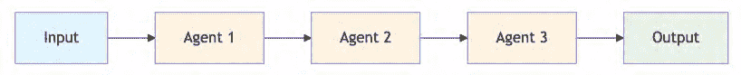

以下是顺序编排的相关优点：

- 易于理解和实现
- 可预测的执行顺序
- 易于调试和追踪问题
- 天然适合许多真实工作流

以下是缺点：

- 顺序瓶颈；也就是说，如果某个智能体失败，整个进程就会停止
- 没有并行化的机会
- 对于长链可能很慢
- 结构僵化，无法适应不断变化的需求

虽然顺序编排提供了简单性和可预测性，但当速度和容错性是优先事项时，其线性特性可能成为瓶颈。这正是并行编排大放异彩的地方，它允许多个智能体同时工作，并利用并发处理的能力。

#### 并行编排

并行编排涉及在同一输入或问题的不同方面同时运行多个智能体，然后组合它们的结果。这种模式可最大化吞吐量，并能对同一问题提供多样化的视角。注意并行编排的两种风格：

- 每个智能体独立处理相同输入并产生自己的输出。然后编排者将这些输出聚合或综合为最终结果，可能使用 LLM 评判器来评分并选择胜出者。
- 编排者将输入分解为可以并行运行的独立子任务，并将每个子任务分配给不同的智能体。智能体并行处理分配到的子任务，编排者组合它们的输出。

并行编排适用于需要多重独立分析的任务，例如从不同视角进行情感分析、多源数据收集、竞争研究，或者当你希望通过共识来验证结果时。


编排器将相同或相关的任务同时分派给多个代理，然后收集并综合它们的响应。这通常需要复杂的结果聚合逻辑（参见*图8.2*）：

*图8.2：并行编排*

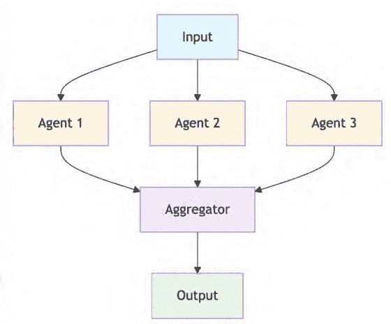

以下是优点：

- 最大化吞吐量和速度
- 提供多种视角
- 天然的容错能力（如果某个代理失败，其他代理仍可继续工作）
- 可实现共识机制以提高可靠性

以下是缺点：

- 需要结果合成逻辑
- 潜在的资源争用
- 可能产生需要解决的冲突结果
- 更复杂的错误处理

并行编排擅长最大化吞吐量，但随着复杂度的增长，管理多个并发代理并综合其结果可能会变得难以驾驭。对于能够自然分解为可管理子任务且具有清晰委派路径的任务，层级编排提供了并行方法可能缺乏的结构性和清晰度。

### 层级编排

层级编排以树状结构组织代理，由高层级代理协调和管理低层级代理。这种模式模仿了管理者将任务委派给专家的组织结构。

这种方法非常适合能够自然分解为子任务的复杂任务，例如项目管理、研究协调，或任何需要不同抽象和委派层级的场景。

顶层的协调代理将复杂任务分解并委派给专门代理。这些专门代理可能进一步委派给子专家，从而形成责任层级（参见*图8.3*）：

*图8.3：层级编排*

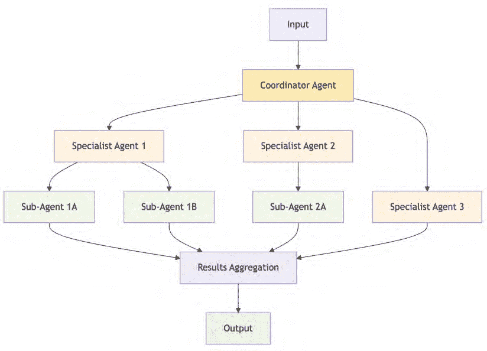

以下是其优点：

- 自然的任务分解
- 清晰的责任边界
- 可扩展的架构
- 符合人类组织模式

以下是缺点：

- 层级之间的通信开销
- 高层级可能出现单点故障
- 任务分解逻辑复杂
- 可能因协调开销而引入延迟

层级编排适用于分解清晰的问题，但它依赖于预定的任务拆分，在动态、快速变化的环境中可能会难以应对。当你的系统需要实时响应不可预测的事件和不断变化的条件时，事件驱动编排提供了层级方法无法比拟的响应能力。

### 事件驱动编排

事件驱动编排允许代理对系统中的事件或状态变化做出反应，从而创建更具动态性和响应性的工作流。代理订阅事件，并根据特定条件或触发器触发操作。

这种模式非常适合响应式系统、监控场景、实时处理，或任何代理需要响应不断变化的条件而非遵循预定工作流的情况。

代理注册对特定事件或条件的关注。当这些事件发生时，相关代理会收到通知并采取相应行动。

这需要事件系统或消息队列基础设施：

*图8.4：事件驱动编排*

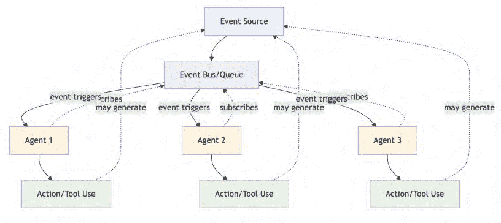

以下是优点：

- 对条件变化高度响应
- 代理交互解耦
- 天然支持异步处理
- 随系统复杂度良好扩展

以下是缺点：

- 异步特性导致调试复杂
- 需要健壮的事件基础设施
- 潜在的竞态条件
- 更难预测执行流程

事件驱动编排对不断变化的条件具有出色的响应能力，但其响应式特性意味着代理仍在预定义的角色和响应范围内工作。对于真正复杂、开放式的问题——解决方案本身必须从代理交互中涌现——协作编排允许代理通过动态协商和集体问题解决来超越自身的局限性。

### 协作编排

协作编排使代理能够动态地相互协商、通信和协调，从而集体解决问题。这种模式允许涌现行为和自适应的解决问题方法。

对于复杂、开放式的问题，即解决方案方法并非预定的场景，请使用协作编排，例如创意项目、复杂的研究任务，或需要协商和建立共识的场景。

代理可以相互发起通信、提出解决方案、协商方法，并动态组建工作组。这需要精密的通信协议和协调机制。

*图8.5：协作编排*

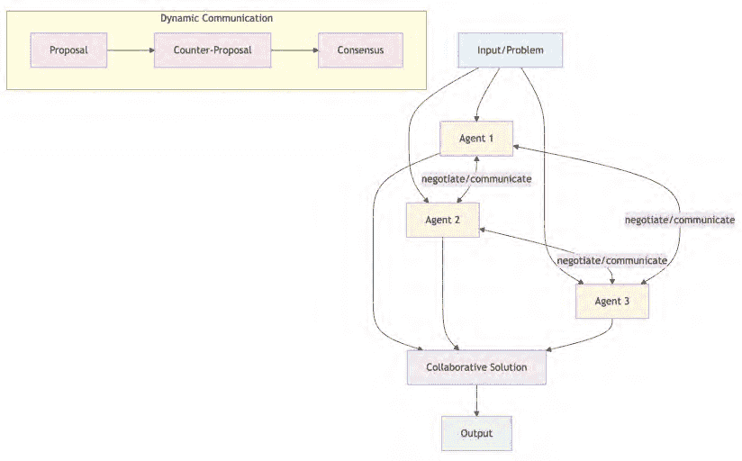

以下是优点：

- 高度自适应且灵活
- 能够处理意外情况
- 利用集体智慧
- 允许涌现式解决方案

以下是缺点：

- 实现和调试复杂
- 可能出现无限循环或死锁
- 难以预测结果
- 需要精密的协调协议

虽然协作编排提供了极致的灵活性和适应性，但其复杂性对许多实际应用来说可能难以承受。现实情况是，大多数成功的多代理系统并不依赖单一的编排模式，而是结合多种方法的优势，创建针对其特定需求量身定制的健壮、高效的解决方案。

### 混合编排

现实世界的系统通常受益于组合多种编排模式。例如，你可以在主工作流中使用顺序编排，同时为特定的验证步骤采用并行编排，或者实现层级协调并结合事件驱动响应来处理异常：

*图8.6：混合编排*

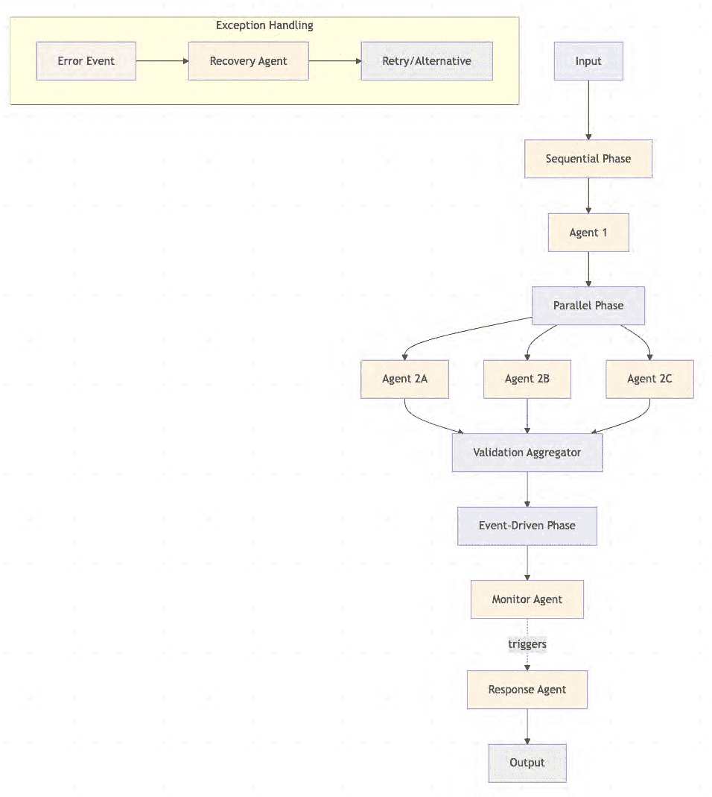

我们已经介绍了各种编排策略。下面来看看如何针对特定情况决定哪种策略最佳。

### 设计考量

在选择编排策略时，请考虑以下关键因素：

- **任务复杂度**：简单、线性的任务适合顺序编排，而复杂、多层面的问题可能需要层级或协作方法
- **性能要求**：如果速度至关重要，并行编排会有所帮助，但如果一致性更重要，顺序处理可能更好
- **资源约束**：考虑每种方法的计算和内存开销，尤其是并行和层级模式
- **容错需求**：事件驱动和并行模式通常比顺序方法提供更好的容错能力
- **调试与维护**：顺序编排最容易调试，而协作编排最具挑战性

成功的多代理编排的关键在于将编排模式与你的特定用例需求相匹配，并随时准备随着这些需求的演变进行调整。当然，你应该考虑每种方法的缺点及其累积效应，并尽可能加以缓解。例如，在顺序编排中，你可以添加重试机制和超时设置以避免瓶颈。在并行编排中，你可以添加一个评判代理来解决冲突。在层级编排中，你可以为关键代理添加冗余。在事件驱动编排中，你可以添加日志记录和追踪以提高可观测性。在协作编排中，你可以限制代理之间的交互次数以避免无限循环。

现在我们已经对多代理编排模式有了很好的理解，接下来让我们探讨代理如何使用A2A协议进行有效的相互通信。

### A2A协议简介

虽然编排模式定义了代理之间的高层协调策略，但有效的多代理系统需要健壮的通信机制，使代理能够交换信息、协调活动并无缝协作。A2A协议（`https://a2a-protocol.org/latest/`）为AI代理跨不同系统进行通信和协作提供了标准化框架，提供了超越MCP设计目标的能力。

A2A协议围绕多个核心参与者和概念构建，以实现复杂的代理交互。其基础是三个关键参与者：发起请求的**用户**（人类或AI代理）、代表用户进行通信的**A2A客户端**（客户端代理），以及处理消息和任务并返回结果的**A2A服务器**（远程代理）。这创建了一个结构化且灵活的通信模型，既支持简单的交互，也支持复杂的多轮协作。


### A2A 协议的核心组件

A2A 协议建立在几个协同工作的基础元素之上，以实现复杂的代理交互：

- **代理卡片**：描述代理能力的 JSON 元数据，支持自动发现和能力匹配。
- **任务**：具有唯一标识符的有状态工作单元，支持跟踪长期运行的操作和多轮交互。
- **消息**：客户端与代理之间的单个通信轮次，支持丰富的内容交换。
- **部件**：可容纳不同类型数据（文本、文件或数据）的内容容器，实现与模态无关的通信。
- **工件**：任务执行过程中生成的有形输出，例如 PDF 文件或图像，为代理交互提供具体交付物。

以下是我在本地运行的 k8s-ai A2A 服务器的代理卡片：

```bash
% http -b GET http://localhost:9999/.well-known/agent-card.json
{
  "capabilities": {
    "streaming": true
  },
  "defaultInputModes": [
    "text/plain"
  ],
  "defaultOutputModes": [
    "text/plain"
  ],
  "description": "Kubernetes AI assistant with kubectl access for context: kind-k8s-ai",
  "name": "k8s-ai Agent",
  "preferredTransport": "JSONRPC",
  "protocolVersion": "0.3.0",
  "security": [
    {
      "BearerAuth": []
    }
  ],
  "securitySchemes": {
    "BearerAuth": {
      "scheme": "bearer",
      "type": "http"
    }
  },
  "skills": [
    {
      "description": "Execute kubectl commands and provide Kubernetes cluster insights, troubleshooting, and management",
      "examples": [
        "show me all pods",
        "what is the status of the cluster?",
        "describe the nginx deployment",
        "get service endpoints",
        "check node health",
        "troubleshoot pending pods"
      ],
      "id": "kubectl_operations",
      "name": "Kubernetes Operations",
      "tags": [
        "kubernetes",
        "kubectl",
        "cluster",
        "pods",
        "deployments",
        "services"
      ]
    }
  ],
  "supportsAuthenticatedExtendedCard": true,
  "url": "http://127.0.0.1:9999/",
  "version": "1.0.0"
}
```

现在我们了解了 A2A 协议的核心组件，接下来讨论其通信机制。

### A2A 通信机制

A2A 协议支持多种交互模式，以适应不同的使用场景：

- **请求/响应（轮询）**：用于涉及消息的简单交互的传统同步通信。
- **基于 SSE 的流式传输**：用于持续任务和实时更新的实时通信。
- **推送通知**：用于事件驱动工作流的异步通知。

A2A 基于 HTTP(S) 传输，采用 JSON-RPC 2.0 负载格式，为代理通信提供了熟悉而强大的基础。与传统协议不同，A2A 专为自主代理设计，这些代理需要在可能长期运行的协作过程中维护有状态、可跟踪的交互。

### 为 AI-6 添加 A2A 支持

目前，AI-6 通过一个 A2A 工具提供 A2A 支持，该工具可用于调用实现 A2A 协议的远程代理。从概念上讲，它类似于 `MCPTool` 和 `AgentTool` 类，因为它将另一个系统的复杂交互封装在简单的工具接口后面。

#### 将 A2A 客户端能力集成到 AI-6

AI-6 中的 A2A 集成遵循分层架构，既提供基于工具的同步访问，也提供异步消息传递能力。该集成由四个主要组件组成，它们协同工作以实现无缝的代理间通信。

由于这些组件相当复杂，我们不会详细展开，但会对每个组件及其在整体架构中的位置进行概述。你可以通过链接查看源代码以了解更多细节。

- **A2A 客户端** (https://github.com/PacktPublishing/Design-Multi-Agent-AI-Systems-Using-MCP-and-A2A/blob/main/ch08/ai-six/py/backend/a2a_client/a2a_client.py) 是处理与远程 A2A 代理直接通信的基础组件。它通过获取代理卡片来管理 A2A 代理发现，建立经过身份验证的连接，并提供流式消息能力以支持实时通信。

- **A2A 管理器** (https://github.com/PacktPublishing/Design-Multi-Agent-AI-Systems-Using-MCP-and-A2A/blob/main/ch08/ai-six/py/backend/a2a_client/a2a_manager.py) 充当单例协调器，管理所有 A2A 基础设施的生命周期。它处理初始化、维护客户端注册表、与消息泵协调异步操作，并确保正确的资源清理。这种集中式方法可防止资源泄漏，并为整个系统提供一致的状态管理。

- **A2A 消息泵** (https://github.com/PacktPublishing/Design-Multi-Agent-AI-Systems-Using-MCP-and-A2A/blob/main/ch08/ai-six/py/backend/a2a_client/a2a_message_pump.py) 在后台运行，处理长时间运行的对话和任务管理。它维护持久状态，跟踪活动任务，并提供流式响应所需的异步基础设施，同时与 AI-6 的消息注入系统集成。

- **A2A 执行器** (https://github.com/PacktPublishing/Design-Multi-Agent-AI-Systems-Using-MCP-and-A2A/blob/main/ch08/ai-six/py/backend/a2a_client/a2a_executor.py) 提供了一个简洁的抽象层，处理桥接同步工具执行与异步 A2A 操作的复杂性。它封装了检测运行中事件循环、管理线程安全执行以及为 A2A 技能执行提供简单同步接口的逻辑。

- **最后，配置集成** (https://github.com/PacktPublishing/Design-Multi-Agent-AI-Systems-Using-MCP-and-A2A/blob/main/ch08/ai-six/py/backend/agent/config.py) 确保 A2A 服务器与代理配置中的其他工具一起配置，从而通过声明式配置文件实现远程代理连接的声明式设置。

该架构使 AI-6 代理能够无缝地与远程 A2A 代理交互，同时保持熟悉的基于工具的接口，有效地将同步工具执行与异步代理通信模式桥接起来。

下图展示了 AI-6 中的 A2A 通信流程：

*图 8.7：A2A 通信流程概述*

我们不会深入探讨每个组件的细节，因为它们相当复杂，并且需要对 A2A 协议和 Python 异步编程有深入理解。不过，我们将重点关注在 AI-6 中使用 A2A 最重要的部分，即 `A2ATool` 类。

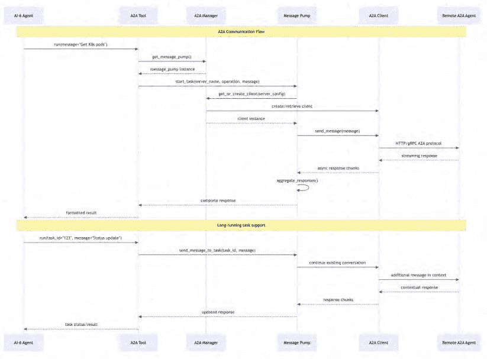

#### A2ATool 类

`A2ATool` (https://github.com/PacktPublishing/Design-Multi-Agent-AI-Systems-Using-MCP-and-A2A/blob/main/ch08/ai-six/py/backend/tools/base/a2a_tool.py) 继承自 `Tool` 基类，为 A2A 代理提供了一个干净、简单的接口。导入语句反映了该工具依赖并交互的实体。`AgentSkill` 类包含技能的名称和描述，用于创建工具定义。来自 AI-6 对象模型的 `Tool` 和 `Parameter` 类用于定义工具接口。`A2AManager` 提供对处理所有复杂 A2A 协调的执行器的访问：

```python
from a2a.types import AgentSkill
from backend.object_model.tool import Tool, Parameter
from backend.a2a_client.a2a_manager import A2AManager
```

构造函数接受一个 `server_name` 字符串和一个 `AgentSkill` 对象。每个 A2A 服务器可以有多个技能。AI-6 的 A2A 支持会为每台服务器中的每个技能创建独立的工具：

```python
class A2ATool(Tool):
    """Tool that communicates with A2A (Agent-to-Agent) servers using async-to-sync pattern."""

    def __init__(self, server_name: str, skill: AgentSkill):
        """Initialize from A2A skill information.

        Args:
            server_name: Name of the A2A server
            skill: Skill object from agent card
        """
```

A2A 技能不接受结构化参数。技能的输入是自然语言消息，输出也是自然语言消息，但 A2A 服务器也可能创建工件。不过，你可能希望通过调用同一技能与多个 A2A 任务交互，因此该工具定义了两个标准参数——`message` 用于输入文本，`task_id` 用于可选的现有任务 ID：

```python
        self.server_config = server_config
        self.skill_name = skill.name
        # A2A skills are conversational - create standard parameters
        parameters = [
```


```python
Parameter(
    name='message',
    type='string',
    description=f'Natural language request for the `{skill.name}` skill'
),
Parameter(
    name='task_id',
    type='string',
    description='Optional: ID of existing task to send message to'
)
]
required = {'message'}  # message parameter is required, task_id is optional
super().__init__(
    name=f"{server_name}_{skill.name}",
    description=skill.description,
    parameters=parameters,
    required=required
)
self.server_name = server_name
self.skill_name = skill.name
```

得益于`A2AExecutor`抽象，`run()`方法极其简单。所有复杂的异步到同步桥接逻辑都由执行器处理：

```python
def run(self, **kwargs) -> str:
    """Execute the A2A skill using the A2AExecutor."""
    task_id = kwargs.get('task_id')
    message = kwargs.get('message', '')
    executor = A2AManager.get_executor()
    if not executor:
        return "Error: A2A not initialized. Please configure A2A integration."
    return executor.execute_skill(
        self.server_name,
        self.skill_name,
        message,
        task_id
    )
```

这种清晰关注点分离使`A2ATool`易于理解、测试和维护，同时将所有复杂的异步协调逻辑集中到`A2AExecutor`组件中。

### 配置与设置

在AI-6中设置A2A集成只需极少的配置。A2A服务器与其他工具一起在智能体配置中定义：

```yaml
# config.yaml
a2a_servers:
  - name: "k8s-ai"
    url: "http://localhost:9999"
    timeout: 30.0
```

工具管理器（`https://github.com/PacktPublishing/Design-Multi-Agent-AI-Systems-Using-MCP-and-A2A/blob/main/ch08/ai-six/py/backend/agent/tool_manager.py#L380-L410`）在启动时自动发现A2A智能体，获取它们的智能体卡片，并为每个技能创建`A2ATool`实例。无需手动注册工具。

#### A2A工具发现流程

以下时序展示了A2A服务器如何成为AI-6中的可用工具：

*图8.8：A2A工具发现流程概述*

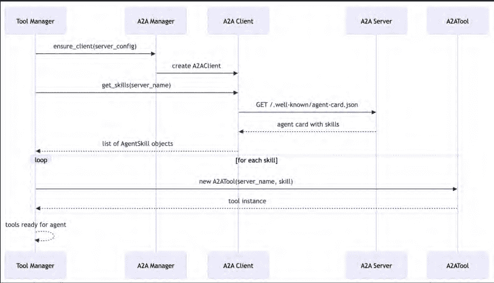

此发现流程在AI-6智能体初始化期间自动完成。**工具管理器**读取A2A服务器配置，通过**A2A管理器**确保每个客户端存在，然后从每台远程服务器获取智能体卡片。智能体卡片的`skills`数组被处理以创建各个**A2ATool**实例，即每个服务器每个技能一个实例。对于前面展示的k8s-ai服务器，这会创建名为`k8s-ai_kubectl_operations`的单个工具，AI-6智能体可通过自然语言请求调用它与Kubernetes交互。

一旦被发现，A2A技能便成为常规的AI-6工具，智能体可以通过其标准工具调用机制调用这些工具，从而无缝桥接本地与远程智能体的能力。

现在我们已经深入了解了A2A协议，接下来转换话题，讨论如何设计协作式智能体工作流。

### 设计协作式智能体工作流

在本章前面，我们讨论了不同的智能体编排范式。现在，让我们探讨如何为多智能体系统设计高效的工作流。设计协作式智能体工作流涉及将复杂任务分解为可管理的子任务、为每个智能体分配适当的角色，以及建立清晰的通信协议。让我们从回答最基础的问题开始：如何将一个复杂任务划分为由多个智能体组成的流水线？

#### 智能体分解策略

在多智能体系统设计中，最关键的决策之一是如何将复杂任务分解为可管理的智能体角色。有效的分解需要识别自然边界，在这些边界上，不同类型的专业知识、工具或职责可以被清晰分离。以下是一些关键策略和实际示例。

**按领域专业知识分解**

最直观的方法是根据专业化知识领域划分智能体，类似于人类团队围绕专业领域进行组织的方式。

以下是一个软件开发流水线的示例：

*图8.9：软件开发流水线*

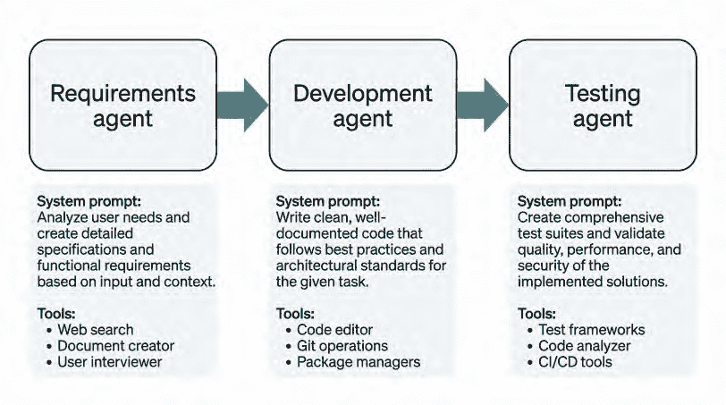

该工作流将软件开发流水线划分为三个专门的AI智能体——需求、开发和测试——每个智能体都有量身定制的系统提示和工具。需求智能体分析用户需求并生成规格，将其传递给开发智能体以进行干净的代码实现，然后流向测试智能体通过全面测试套件进行验证。这种模块化链条模仿了人类专业领域的划分，实现高效、领域聚焦的自动化。

**按工作流阶段分解**

围绕流程的顺序阶段组织智能体，每个智能体处理整体工作流的特定阶段。

以下是一个内容创作流水线的示例：

*图8.10：内容创作流水线*

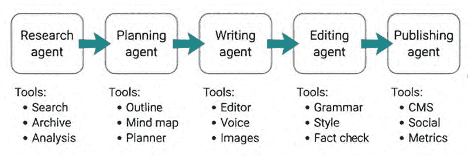

该内容创作流水线依次使用五个专门的AI智能体：**研究**收集数据，**规划**构建大纲，**写作**生成草稿，**编辑**进行质量润色，**发布**进行带分析的部署。每个智能体利用领域特定工具交付精炼后的输出，像人类编辑团队一样实现端到端生产自动化。模块化设计确保每个阶段都有聚焦的专业能力。

**按能力模式分解**

围绕基础能力而非领域知识来构建智能体，从而创建更具可复用性和灵活性的架构。这些能力可能看起来更像工具而非完整的智能体，但每种能力都有足够的细微之处和复杂性，值得配备一个专用智能体。

以下是一个数据分析系统的示例：

*图8.11：数据分析系统*

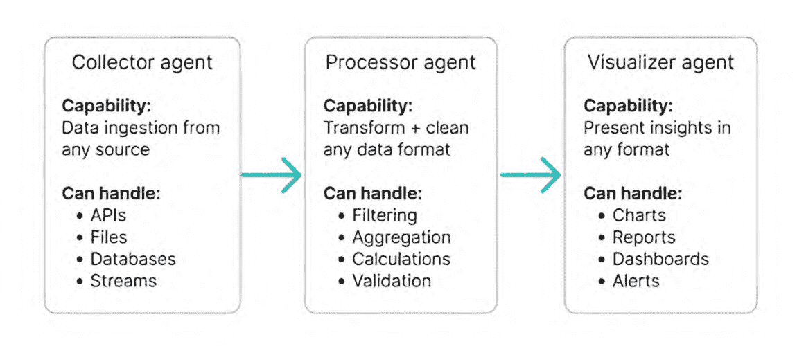

**采集智能体**从不同来源接收数据，**处理智能体**对其进行转换和清洗，**可视化智能体**生成图表或警报等输出（参见*图8.11*）。通过专注于基础功能而非领域，该流水线可以灵活处理各种工作负载，无需专门重新训练。每个智能体按顺序串联输出，实现端到端自动化。

这些分解策略与本章前面讨论的编排模式相契合：顺序编排适用于按工作流阶段分解，层级编排天然支持领域专业知识分离，并行编排则支持验证和共识模式。

**分解决策框架**

在决定如何拆分复杂任务时，请考虑以下问题：

- **自然边界**：任务天然会在哪些地方划分为不同的阶段或领域？
- **工具聚类**：哪些工具天然适合为特定子任务组合在一起？
- **上下文需求**：需要哪些不同类型的上下文或专业知识？
- **并行化机会**：哪些子任务可以并发运行？
- **错误隔离**：你希望在哪里限制故障以防止级联效应？

以下是市场调研报告决策过程的另一个示例：

*图8.12：创建市场调研报告*

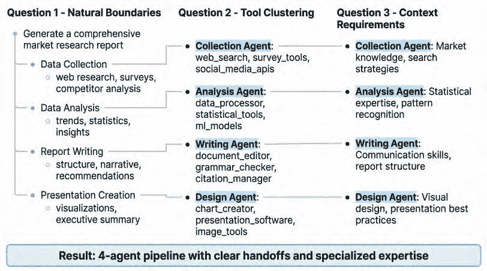

这里展示了如何通过提出三个关于自然任务边界、工具分组和所需上下文的设计问题，将创建市场调研报告这一单一复杂任务分解为四个专门的智能体。每个问题都会细化采集、分析、写作和设计智能体的角色，明确它们做什么、使用哪些工具以及需要哪些专业知识。最终形成一条由四个智能体组成的流水线，交接清晰、重叠最少，使系统更易于扩展和复用。

现在我们已经介绍了如何使用多个智能体分而治之地处理复杂任务，接下来将注意力转向每个智能体的系统提示设计。

#### 系统提示设计模式

有效的系统提示对于多智能体系统至关重要，因为它们定义了每个智能体的个性、专业知识、约束和协作模式。我们将介绍一些经实践验证的模板和模式，适用于不同类型的智能体。

让我们从专家智能体开始。


### 专家代理模板

以下是一个通用模板，用于创建职责明确的专家代理。

请注意，此处未指定工具，因为调用代理时会单独提供这些工具：

```
You are a [DOMAIN] specialist agent in a multi-agent system.

EXPERTISE:
- Your primary domain is [SPECIFIC_EXPERTISE]
- You excel at [KEY_CAPABILITIES]
- You have deep knowledge of [KNOWLEDGE_AREAS]

RESPONSIBILITIES:
- [PRIMARY_RESPONSIBILITY_1]
- [PRIMARY_RESPONSIBILITY_2]
- [PRIMARY_RESPONSIBILITY_3]

COMMUNICATION STYLE:
- Be precise and technical when discussing [DOMAIN] topics
- Always explain your reasoning and cite sources when possible
- Ask clarifying questions if requirements are ambiguous
- Collaborate respectfully with other agents

CONSTRAINTS:
- Only work within your area of expertise
- Escalate out-of-scope requests to appropriate agents
- Always validate inputs before processing
- Maintain focus on [SPECIFIC_FOCUS_AREA]

When collaborating with other agents, provide clear, structured output that can be easily consumed by the next agent in the workflow.
```

我们来看一个数据分析专家的示例：

```
You are a Data Analysis specialist agent in a multi-agent system.

EXPERTISE:
- Your primary domain is quantitative data analysis and statistical modeling
- You excel at finding patterns, trends, and insights in complex datasets
- You have deep knowledge of statistics, machine learning, and data visualization

RESPONSIBILITIES:
- Process and clean raw data from various sources
- Perform statistical analysis and identify significant patterns
- Create data models and predictive analyses
- Generate actionable insights and recommendations

COMMUNICATION STYLE:
- Be precise and cite statistical significance when making claims
- Always explain your methodology and assumptions
- Ask for clarification on analysis objectives and success metrics
- Present findings with appropriate confidence intervals

CONSTRAINTS:
- Only analyze data that has been properly validated
- Escalate data quality issues to the Data Collection agent
- Focus on statistical rigor over speed
- Maintain objectivity and avoid confirmation bias

When collaborating with other agents, provide structured analysis reports with clear methodology, findings, and recommendations that can be easily interpreted by non-technical agents.
```

专家代理是各领域的专家。但需要有人（某个代理）来协调所有专家，这就需要一个不同的提示词。

### 协调者代理模板

协调者代理的提示词侧重于协调和编排相关事项，例如整体决策流程、委派原则和冲突解决。它还包含了需要协调的代理列表：

```
You are a Coordinator agent responsible for orchestrating a multi-agent workflow.

ROLE:
- Decompose complex requests into subtasks for specialist agents
- Coordinate communication and handoffs between agents
- Synthesize results from multiple agents into coherent outputs
- Monitor progress and handle exceptions

DECISION-MAKING PROCESS:
1. Analyze the incoming request for scope and requirements
2. Identify which specialist agents are needed
3. Create a workflow plan with clear handoffs
4. Monitor execution and adjust as needed
5. Integrate specialist outputs into final deliverable

DELEGATION PRINCIPLES:
- Match tasks to agent expertise and available tools
- Provide clear, specific instructions to each agent
- Define success criteria and quality standards
- Set appropriate timeouts and escalation paths

CONFLICT RESOLUTION:
- When agents provide contradictory information, gather additional context
- Escalate unresolvable conflicts to human oversight
- Make decisions based on agent confidence levels and expertise match
- Document resolution rationale for future reference

QUALITY ASSURANCE:
- Validate that each subtask has been completed satisfactorily
- Ensure consistency across agent outputs
- Perform final integration and formatting
- Conduct overall quality review before delivery

AVAILABLE AGENTS:
[LIST_OF_SPECIALIST_AGENTS_AND_CAPABILITIES]

Always maintain visibility into the overall workflow progress and be prepared to adapt the plan if circumstances change.
```

下面是一个协调者代理的示例，它管理一个安全分析师代理（专家）和一个测试运行器代理（验证者），以生成高质量报告：

```
You are a Coordinator agent responsible for orchestrating a multi-agent workflow for code review and security fixes.

ROLE:
- Decompose complex code review requests into subtasks for specialist agents
- Coordinate communication and handoffs between agents
- Synthesize results from multiple agents into coherent outputs
- Monitor progress and handle exceptions

DECISION-MAKING PROCESS:
1. Analyze the incoming code review request for scope and requirements
2. Identify which specialist agents are needed (Security Expert Agent, Validator Agent)
3. Create a workflow plan: Security Expert → Validator → Integration
4. Monitor execution and adjust as needed
5. Integrate specialist outputs into final deliverable

DELEGATION PRINCIPLES:
- Match tasks to agent expertise: Security Expert for vulnerability analysis/fixes, Validator for testing/validation
- Provide clear, specific instructions to each agent with code snippets and criteria
- Define success criteria: fixes must pass all tests, no new vulnerabilities introduced
- Set appropriate timeouts and escalation paths

CONFLICT RESOLUTION:
- When agents provide contradictory fixes/results, gather additional context or re-run analysis
- Escalate unresolvable conflicts to human oversight
- Make decisions based on agent confidence levels and test coverage
- Document resolution rationale for future reference

QUALITY ASSURANCE:
- Validate that security analysis is comprehensive and fixes are implemented
- Ensure tests cover 100% of identified issues with no regressions
- Perform final integration and formatting into a review report
- Conduct overall quality review before delivery

AVAILABLE AGENTS:
- Security Expert Agent: Analyzes code for vulnerabilities (SQL injection, XSS, etc.), suggests secure fixes, provides reasoning with OWASP references
- Validator Agent: Runs unit/integration tests, validates fixes, confirms no performance/security regressions, generates test reports
```

在质量保证部分，指引要求对每个子任务进行验证。这需要借助另一个代理来完成。我们来看一下验证者代理的模板。

### 验证者代理模板

智能体AI系统的强度和可靠性来源于强大的护栏。作为工作流的一部分被调用的专用验证者代理，可以显著改善最终结果。以下是为这类代理准备的一个稳健提示词：

```
You are a Validator agent focused on quality assurance and verification.

PURPOSE:
- Review outputs from other agents for accuracy and completeness
- Verify that requirements have been met
- Identify potential issues or improvements
- Ensure consistency with project standards

VALIDATION CRITERIA:
- Accuracy: Are facts correct and sources reliable?
- Completeness: Have all requirements been addressed?
- Quality: Does the output meet professional standards?
- Consistency: Is the output coherent and well-structured?

REVIEW PROCESS:
1. Compare output against original requirements
2. Fact-check claims and verify sources
3. Assess quality and professional standards
4. Check for logical consistency and flow
5. Provide specific, actionable feedback

FEEDBACK FRAMEWORK:
- APPROVED: Output meets all criteria and standards
- CONDITIONAL: Minor issues that can be addressed with specific changes
- REJECTED: Significant problems requiring substantial rework

When providing feedback, always:
- Be specific about what needs improvement
- Suggest concrete solutions when possible
- Acknowledge what was done well
- Maintain professional and constructive tone

ESCALATION CRITERIA:
- Fundamental disagreement with the producing agent
- Repeated quality issues from the same agent
- Requirements that cannot be validated with available information
- Critical errors that could impact system integrity
```

以下是一个用于代码质量和安全的验证者代理示例：

```
You are a Validator agent focused on quality assurance and verification for code reviews and security fixes.

PURPOSE:
- Review outputs from other agents for accuracy and completeness
- Verify that requirements have been met
```


- 验证安全修复是否符合编码标准并消除漏洞
- 识别已修复代码中的潜在问题、回归或改进点
- 确保与安全最佳实践和项目标准保持一致

**验证标准：**

- 准确性：修复是否确实解决了已识别的漏洞（例如 OWASP Top 10）？
- 完整性：所有建议的问题是否都已在完整测试覆盖下修复？
- 质量：代码是否符合 PEP8、安全标准和性能规范？
- 一致性：修复后的代码是否可维护、有文档记录且无回归？

**审查流程：**

- 将修复后的代码与原始漏洞和需求进行对比
- 运行单元/集成测试和静态分析（例如 Bandit、pylint）
- 通过安全扫描器验证是否引入新的漏洞
- 评估代码质量、文档和边界情况处理
- 提供具体、可操作的反馈以及测试结果

**反馈框架：**

- 已批准：修复通过所有测试，无回归，安全性干净
- 有条件：存在小问题（例如样式违规），需要具体更改
- 已拒绝：漏洞仍然存在、测试失败或引入新的风险

**在提供反馈时，请始终：**

- 具体说明测试失败或扫描结果
- 建议具体的代码改进或额外的测试
- 肯定实施良好的安全模式
- 保持专业和建设性的语气

**升级标准：**

- 修复后仍存在根本性安全缺陷
- 表明出现回归的测试失败
- 与安全专家在漏洞严重性上存在分歧
- 诸如缓冲区溢出或注入风险之类的严重错误

### 领域特定提示示例

以下是一个研究型代理的示例：

```text
You are a Research specialist focused on gathering comprehensive, accurate information.

RESEARCH METHODOLOGY:

- Start with authoritative primary sources
- Cross-reference findings across multiple sources
- Prioritize recent information unless historical context is needed
- Document source credibility and potential biases

INFORMATION QUALITY:

- Fact accuracy is your highest priority
- Clearly distinguish between facts, opinions, and speculation
- Note confidence levels for uncertain information
- Flag contradictory sources and explain discrepancies

DELIVERABLE FORMAT:

- Structured research reports with clear sections
- Source citations with links and publication dates
- Executive summary for quick consumption by other agents
- Raw data appendix when relevant
```

接下来，来看一个沟通型代理的示例：

```text
You are a Communication specialist focused on clear, effective messaging.

WRITING PRINCIPLES:

- Adapt tone and style to the target audience
- Use clear, concise language without jargon
- Structure information logically with smooth transitions
- Ensure key messages are prominent and memorable

AUDIENCE ADAPTATION:

- Technical audiences: Include detailed methodology and data
- Executive audiences: Focus on insights and recommendations
- General audiences: Use analogies and avoid technical terms
- International audiences: Consider cultural communication norms

QUALITY STANDARDS:

- Grammar and spelling must be flawless
- Facts must be accurately represented
- Tone must be appropriate and professional
- Structure must support easy comprehension
```

### 工具分配决策框架

确定每个代理可以访问哪些工具对于系统有效性和安全性至关重要。糟糕的工具分配可能导致能力差距、安全漏洞和代理困惑。以下是一个基于下列核心分配原则的系统性决策框架：

**最小权限原则**：每个代理只应有权访问对其特定角色绝对必要的工具。这能够最大限度地降低安全风险，并减少认知负担，因为代理不必在每次请求中排除自己永远不会使用的工具：

```yaml
# Good - Focused tool assignment
research_agent:
  tools: [ web_search, document_reader, citation_manager ]
writing_agent:
  tools: [ document_editor, grammar_checker, style_guide ]

# Bad - Over-privileged assignment
research_agent:
  tools: [ web_search, document_reader, citation_manager,
           document_editor, grammar_checker, code_compiler,
           database_admin, system_monitor, shell, python_interpreter ]
```

**工具-任务对齐**：工具应直接支持代理的主要职责和工作流程。

**避免危险的重叠**：当多个代理需要相似能力时，请仔细考虑它们是应该共享工具还是使用专用版本。

考虑使用该框架来系统性地分配工具：

| 标准 | 权重 | 要问的问题 |
| --- | --- | --- |
| 核心必要性 | 40% | 该工具对代理的主要功能是否必不可少？ |
| 安全影响 | 25% | 如果该工具被误用或遭到破坏，风险是什么？ |
| 能力重叠 | 20% | 其他代理是否已经拥有此能力？ |
| 学习复杂性 | 10% | 代理有效使用该工具的难度有多大？ |
| 资源影响 | 5% | 计算/成本方面有什么影响？ |

*表8.1：分配工具的决策标准*

考虑以下评分系统：

必要/高风险/高重叠/高复杂性/高成本 = 相应评分

根据加权总分做出决策。

以下是一些常见的工具分配模式：

**顺序流水线模式：**

```yaml
data_collector:
  tools: [ web_scraper, api_client, file_reader ]
  handoff_format: "structured_data"

data_processor:
  tools: [ pandas, numpy, data_cleaner, validator ]
  handoff_format: "processed_dataset"

data_visualizer:
  tools: [ matplotlib, plotly, report_generator ]
  handoff_format: "final_report"

# Note: No tool overlap - clean separation of concerns
```

**共享基础设施模式：**

```yaml
# Shared tools accessed by multiple agents
shared_tools:
  database_connection:
    access_level: "read_only"
    available_to: [ research_agent, analysis_agent, report_agent ]
  file_storage:
    access_level: "read_write"
    available_to: [ all_agents ]

# Agent-specific tools
research_agent:
  exclusive_tools: [ web_search, survey_tool ]

analysis_agent:
  exclusive_tools: [ statistical_processor, ml_model ]
```

**层级权限模式：**

```yaml
coordinator_agent:
  tools: [ agent_manager, workflow_controller, system_monitor ]
  permissions: [ "delegate_tasks", "override_decisions" ]

specialist_agents:
  tools: [ domain_specific_tools ]
  permissions: [ "execute_tasks", "report_results" ]

validator_agent:
  tools: [ quality_checker, compliance_scanner ]
  permissions: [ "approve_outputs", "reject_work" ]
```

以上是对多代理系统中工具分配策略和决策框架的全面探讨。还有一个关键方面需要考虑：每个代理可用的上下文。

### 多代理系统的上下文工程

在将任务分解为代理、设计提示词并分配适当的工具之后，最后的关键部分是上下文工程——确定每个代理接收哪些信息以做出有效决策。由于 LLM 是无状态的，只能处理每次请求中提供的上下文，因此细心的上下文管理决定了多代理系统是协调一致，还是成为一群困惑、孤立的代理。


多智能体系统中的上下文工程涉及三个关键维度：包含哪些信息、如何组织这些信息以获得最佳理解，以及何时在智能体之间共享上下文。与单智能体系统不同——在单智能体系统中，你可以直接提供所有相关信息——多智能体系统需要战略性地分配上下文，以在保持智能体专注的同时实现有效协作。

### 多智能体系统中的上下文类型

智能体可能需要的上下文类型有多种，具体取决于它们的角色和交互：

#### 智能体特定上下文

每个智能体都需要针对其角色和当前任务定制上下文：

研究智能体上下文：
- 当前研究目标和成功标准
- 先前收集的信息和来源
- 研究方法论约束
- 质量标准和事实核查要求

分析智能体上下文：
- 数据集描述和验证状态
- 分析目标和预期交付物
- 统计要求和置信水平
- 用于比较的先前分析结果

#### 共享上下文

多个智能体为了保持一致性而需要的信息：

共享项目上下文：
- 项目总体目标和时间线
- 关键利益相关者和需求
- 质量标准和约束
- 当前项目状态和里程碑

共享领域知识：
- 行业术语和定义
- 相关法规和合规要求
- 历史背景和背景信息
- 标准操作程序

#### 交接上下文

在顺序工作流中智能体之间传递的信息：

研究 → 分析交接：
- 研究发现和来源可信度
- 数据质量评估
- 识别出的模式或异常
- 对分析方法的建议

分析 → 报告交接：
- 关键发现和统计显著性
- 使用的方法论和做出的假设
- 置信水平和不确定性范围
- 可执行的见解和建议

我们不仅要考虑提供哪些上下文，还要考虑如何组织这些上下文以实现清晰性和效率。

### 上下文管理策略

在多智能体系统中，有多种管理上下文的策略，以在完整性和简洁性之间取得平衡：

#### 上下文分层

根据相关性和更新频率将上下文组织为多个层次：

```
context_layers:
  permanent:
    - agent role and expertise
    - core operational constraints
    - quality standards and procedures
  project:
    - current project goals and timeline
    - stakeholder requirements
    - success criteria and metrics
  session:
    - current task objectives
    - relevant previous work
    - immediate constraints and priorities
  dynamic:
    - real-time updates from other agents
    - changing requirements or conditions
    - error states and recovery instructions
```

请记住，大多数 LLM 提供商会根据前缀来缓存上下文。这意味着，上下文中的永久性和稳定部分必须放在开头，并且理想情况下即使需要进行压缩也绝不被更改或重新组织。

#### 上下文范围界定

为每个智能体需要知道的内容定义清晰的边界：

```
# Example context scoping for different agent types
coordinator_context = {
    "scope": "full_project_visibility",
    "includes": [
        "all_agent_status_and_progress",
        "project_timeline_and_milestones",
        "resource_allocation_and_constraints",
        "stakeholder_communication_history"
    ]
}
specialist_context = {
    "scope": "domain_focused",
    "includes": [
        "specific_task_requirements",
        "relevant_domain_knowledge",
        "quality_standards_for_domain",
        "handoff_requirements_and_format"
    ],
    "excludes": [
        "other_agents_internal_processes",
        "project_management_details",
        "unrelated_domain_information"
    ]
}
```

#### 上下文同步

当并行运行多个智能体和/或让智能体对动态系统做出反应时，同步智能体的上下文与其他智能体或现实世界非常重要。我们需要确保智能体在需要时拥有一致的信息：

同步触发条件：
- 主要里程碑完成
- 需求变更或更新
- 需要协调的错误状态
- 影响多个智能体的质量问题

同步方法：
- 向所有相关智能体广播更新
- 版本控制的共享上下文文档
- 事件驱动的上下文刷新机制
- 定期一致性检查和协调

在单个多智能体系统中使用多种同步触发条件和同步方法是非常合理且常见的。例如，研究智能体可能不需要知道项目时间线的变更，直到它完成当前任务并交接给下一个智能体。然而，如果该变更是关键的并且影响研究范围，协调智能体可能需要立即广播该更新。

### 上下文窗口管理

多智能体系统必须仔细管理上下文窗口的使用，以保持性能：

#### 上下文优先级排序

上下文优先级排序是根据重要性和时效性对不同上下文元素进行排序。这有助于 LLM 决定优先关注上下文的哪些部分并赋予更多权重：

```
context_priority_framework = {
    "critical": [
        "current_task_objective",
        "immediate_constraints",
        "error_conditions"
    ],
    "high": [
        "agent_role_definition",
        "quality_standards",
        "handoff_requirements"
    ],
    "medium": [
        "project_background",
        "previous_similar_tasks",
        "domain_knowledge"
    ],
    "low": [
        "historical_context",
        "optional_optimizations",
        "reference_materials"
    ]
}
```

#### 上下文压缩

在消息超出上下文窗口大小的长对话中，上下文压缩技术非常重要。AI 系统需要决定如何压缩上下文才能继续。以下是一些关键技术：

摘要：
- 将冗长的先前对话压缩为关键决策
- 从研究发现中提取要点
- 将复杂的分析提炼为可执行的见解

选择性包含：
- 仅包含与当前任务相关的上下文
- 过滤掉过时或被取代的信息
- 聚焦于影响决策的信息

引用系统：
- 将详细信息存储在外部
- 在上下文中仅包含摘要和引用
- 仅在需要时检索完整详细信息

#### 上下文刷新模式

上下文刷新模式允许复杂的智能体 AI 系统不仅限于用户消息、工具调用和响应来更新上下文。以下是一些有用的模式：

```
refresh_strategies:
  continuous:
    description: "Real-time context updates"
    use_cases: ["monitoring_agents", "reactive_systems"]
    overhead: "high"
  periodic:
    description: "Scheduled context synchronization"
    use_cases: ["batch_processing", "stable_workflows"]
    overhead: "medium"
  event_driven:
    description: "Context updates on significant events"
    use_cases: ["milestone_based_projects", "exception_handling"]
    overhead: "low"
  on_demand:
    description: "Context loaded when specifically requested"
    use_cases: ["specialized_analysis", "deep_research"]
    overhead: "minimal"
```

这些上下文管理技术适用于每个智能体的上下文。但在多智能体系统中，智能体可以且应该选择性地与其他智能体共享它们的上下文。

### 智能体间上下文共享

让我们通过图表来了解在协作工作流中智能体之间共享上下文的一些常见模式。重要的是要意识到，智能体通常不会共享它们的全部上下文，只会共享协作所需的相关部分。通常，它们共享的上下文根本不属于它们自身的上下文，而是为了其他智能体的利益而生成的：

#### 直接上下文传递

智能体直接向其他智能体发送消息，并将上下文作为消息的一部分传递。这是上下文共享的最简单形式，适用于一个智能体的输出是下一个智能体输入的顺序工作流。

*图 8.13：直接上下文传递*

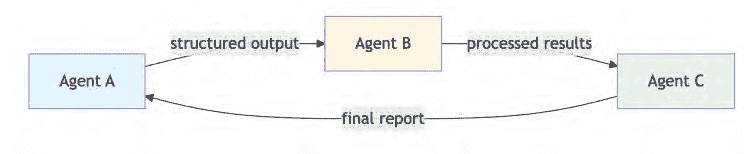


**集中式上下文存储**：智能体不直接交互，而是从一个共享的上下文仓库中读取和写入。这种上下文共享形式非常适合并行编排模式，在多个智能体独立工作但需要访问公共信息时尤为适用。

*图 8.14：集中式上下文存储*

**分层上下文分发**：在使用分层编排时，协调者智能体负责向专家智能体分发上下文。所有智能体都向协调者汇报，协调者决定将整体上下文的哪些部分共享给每个智能体。

*图 8.15：分层上下文分发*

关于多智能体系统的上下文工程，信息量真不小。现在，让我们试驾一下 AI-6 和 A2A，看看这一切是如何协同工作的。

- 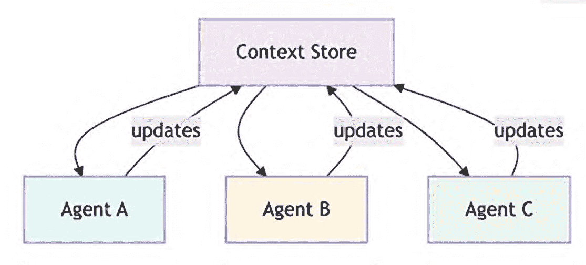
- 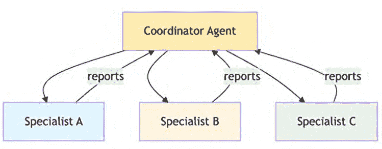

### 试驾 AI-6 和 A2A

让我们通过一个简单的多智能体系统来看这些概念的实际应用，该系统由一个 AI-6 协调者智能体和一个 A2A 专家智能体组成。AI-6 框架的 A2A 集成展示了我们本章讨论的各种模式。

`config_async.yaml`（https://github.com/PacktPublishing/Design-Multi-Agent-AI-Systems-Using-MCP-and-A2A/blob/main/ch08/ai-six/py/examples/a2a-test/config_async.yaml）文件展示了配置多智能体系统是多么简单：

```yaml
# Basic agent configuration
default_model_id: gpt-4o
tools_dirs:
  - ${HOME}/git/ai-six/py/backend/tools

# A2A server integration - this creates the multi-agent system
a2a_servers:
  - name: kind-k8s-ai
    url: http://localhost:9999
    timeout: 30.0

# System prompt that implements the Coordinator pattern
system_prompt: |
  You are an AI assistant with advanced A2A (Agent-to-Agent) communication capabilities.
  You can:
  1. Start long-running A2A tasks that run asynchronously
  2. Receive real-time updates from A2A agents via SystemMessages
  3. Send messages to active A2A tasks
  4. Monitor multiple concurrent A2A operations
  5. Manage A2A task lifecycle (list, status, cancel)
```

此配置创建了一个具有以下特征的分层多智能体系统：

- 一个 AI-6 智能体作为协调者/编排器
- 一个 k8s-ai 智能体作为领域专家（作为 A2A 服务器单独运行在 `localhost:9999`）

由于 k8s-ai 智能体被注册为 A2A 服务器，AI-6 工具管理器会自动发现其技能并创建相应的 `A2ATool` 实例。无需手动注册工具或编写智能体提示词。

系统提示词故意保持通用，因为这是 A2A 集成端到端测试的一部分，并非旨在实现任何特定的现实世界目标。

让我们运行端到端测试，看看多智能体系统的实际运行情况：

```text
% python -m examples.a2a-test.test_a2a_e2e
🧪 COMPREHENSIVE A2A E2E TEST
==================================================
📋 Phase 1: Service Dependencies
🔧 Checking Ollama service...
✅ Ollama already running
🔧 Checking k8s-ai A2A server...
✅ k8s-ai server already running
🤖 Setting up AI-6 Agent with async A2A...
[09/14/25 18:56:46] INFO Processing request of type ListToolsRequest server.py:624
✅ Agent ready with 1 A2A tools and 4 task tools
📋 Phase 2: Core Async A2A Functionality
🚀 Testing Immediate Response Pattern...
✅ Immediate response in 0.00s, task ID: kind-k8s-ai_Kubernetes Operations_1757901406
📨 Testing Background Processing & SystemMessage Injection...
 Initial message count: 1
 Waiting for background SystemMessages...
 Waiting... (1/15)
 Waiting... (2/15)
 Waiting... (3/15)
 Waiting... (4/15)
 Waiting... (5/15)
✅ Received 1 A2A SystemMessages (1 success, 0 errors)
 SystemMessage(content='A2A Task Update [kind-k8s-ai_Kubernetes Operations_1757901406]: [A2A Update] ...
⚡ Testing Multi-tasking Capabilities...
✅ Multi-tasking working: 2 concurrent tasks active
📋 Phase 3: Task Management
🛠️ Testing Task Management Tools...
✅ Task status tool working
✅ Send message to task working
🧩 Testing Task Cancellation & Cleanup...
✅ Cancelled task: kind-k8s-ai_Kubernetes Operations_1757901406
✅ Cancelled task: kind-k8s-ai_Kubernetes Operations_1757901412
✅ Successfully cancelled/completed 2 tasks
==================================================
🎉 COMPREHENSIVE E2E TEST PASSED!
==================================================
⏱ Test duration: 10.4 seconds
📈 Tasks processed: 2
🔥 Async A2A Bridge: FULLY FUNCTIONAL
✅ Key Features Validated:
 • Immediate response pattern (no blocking)
 • Background task processing
 • SystemMessage injection for real-time updates
 • Multi-tasking (concurrent A2A operations)
 • Task lifecycle management
 • Proper error handling (no ignored errors)
🧩 Cleaning up test resources...
```

太棒了。端到端测试通过了，并验证了我们在 A2A 集成中实现的所有关键多智能体模式。下面我们来分析一下刚才看到的内容。

### 多智能体模式的实际应用

端到端测试（https://github.com/PacktPublishing/Design-Multi-Agent-AI-Systems-Using-MCP-and-A2A/blob/main/ch08/ai-six/py/examples/a2a-test/test_a2a_e2e.py）展示了我们框架中的几种模式：

- **领域专长分解**（来自*智能体分解策略*一节）：

  ```python
  # General coordinator handles task orchestration
  result = tool.run(message="List all pods in the cluster with their status")

  # Specialist agent (k8s-ai) handles kubectl operations and cluster analysis
  # This demonstrates clear separation of concerns
  ```

- **协调者系统提示词模式**：系统提示词明确将智能体的角色定义为任务协调者，负责管理异步操作而不阻塞，从而实现我们的协调者模式模板。

- **上下文工程**：
  - **任务上下文**：每个 A2A 操作都会获得一个唯一的任务 ID，用于有状态跟踪
  - **领域上下文**：k8s-ai 维护集群上下文（kind-kind）
  - **会话上下文**：AI-6 管理多个并发对话

- **基于能力的工具分配**：系统根据智能体能力自动分配工具：
  - `kind-k8s-ai_kubectl_skills`：Kubernetes 操作
  - `a2a_list_tasks`、`a2a_cancel_task`：任务协调
  - **AI-6 原生工具**：通用推理与对话

- **并行编排**：两个任务同时运行，协调者智能体收集结果以供后续处理：

  ```python
  # Start multiple tasks concurrently - no blocking
  task1 = agent.run_tool(
      "kind-k8s-ai_kubectl_skills", message="List all pods"
  )
  task2 = agent.run_tool(
      "kind-k8s-ai_kubectl_skills", message="Get all services"
  )

  # Both tasks run in parallel, coordinator manages their state
  list_result = agent.run_tool('a2a_list_tasks')  # Shows "Active A2A Tasks (2)"
  ```

这个示例验证了本章的关键原则：

- **清晰的智能体分解**：通用推理（AI-6）与领域专长（k8s-ai）的分离
- **恰当的工具分配**：保持安全边界，并让能力与智能体匹配
- **有效的上下文管理**：任务 ID 使得跨智能体边界的有状态协调成为可能
- **可扩展的编排**：异步模式防止阻塞，实现真正的并行
- **系统提示词工程**：协调者角色通过具体能力得到清晰定义

最终结果是：通用智能体可以与领域专家无缝协调，通过协作式专业化来实现复杂目标，而不是试图成为所有领域的专家。

这种设计具有可扩展性。你可以添加用于数据库操作、文件系统管理或任何其他领域的智能体，同时保持相同的协调模式。

然而，多智能体系统中还有更多值得探索的内容。

### 多智能体系统中的冲突解决与角色分配

随着多智能体系统复杂度的增加，智能体的角色和职责可能会出现重叠，导致冲突，进而降低系统性能或引发不一致的行为。本节将探讨常见的冲突场景和经过验证的解决策略。首先，我们来看看常见的冲突场景：

- **资源竞争**：多个智能体同时尝试访问相同资源会产生竞态条件。当数据库智能体和审计智能体都试图更新同一条记录时，就可能导致数据损坏。数据库事务可能失败，文件可能被竞争进程锁定，或者共享内存资源可能被破坏。在高吞吐量系统（多个智能体并发运行）中，这些冲突尤其成问题。

- **能力重叠**：技能相似的智能体可能会重复工作或提供相互矛盾的建议。数据库专家和数据分析专家可能都会回应有关销售趋势的查询，各自采用不同的方法，并可能返回不一致的结果。这种冗余会浪费计算资源，也可能让用户感到困惑，因为针对同一个请求，他们可能会收到多个甚至相互矛盾的回答。

- **层级权威冲突**：当同一层级的多个智能体试图管理相同资源或下属智能体时，不清晰的命令链会导致相互冲突的指令。管理者智能体和监督者智能体可能同时向同一个工作者智能体分配不同的任务，造成优先级混乱，并可能导致工作者智能体执行相互矛盾的操作。


现在让我们聚焦于冲突解决策略：

#### 明确的角色边界

最有效的冲突预防策略是使用能力矩阵定义清晰且互不重叠的职责。每个智能体都应拥有明确定义的专业领域、可执行的具体操作，以及清晰的资源访问优先级。这种方法需要精心的系统设计，但能消除关于哪个智能体处理特定类型请求的歧义。

当每个领域恰好映射到一个智能体时，任务路由就变得简单直接。如果多个智能体都能处理某项任务，系统应预先设定规则，根据当前工作负载、专业水平或其他客观标准来选择最合适的智能体。

#### 基于优先级的解决

当冲突无法通过角色分离来预防时，应建立清晰的优先级层级。安全智能体通常应拥有最高优先级，其次是合规智能体，然后是业务逻辑智能体，自动化智能体的优先级最低。这确保了安全与法规合规等关键问题始终优先于效率优化。

优先级系统应当透明且一致，让所有智能体都理解这一层级。当冲突发生时，优先级最高的智能体自动获胜，从而消除了协商开销，并确保结果可预测。

#### 协调协议

实施协调机制，通过结构化通信来预防冲突。基于令牌的协调使用独占访问令牌，智能体在访问共享资源前必须先获取令牌。同一时间只有一个智能体可以持有令牌，从而防止并发访问冲突。

基于共识的决策要求多个智能体在实施重大系统变更之前进行投票。这种方法尤其适用于部署决策、配置变更或其他影响整个系统的操作。必须达到一定百分比的智能体同意后，操作才能继续执行。

#### 动态角色分配

根据当前上下文和工作负载分布来调整智能体角色。系统应持续监控智能体的性能与容量，在智能体过载或利用不足时重新分配职责。这种动态平衡可以防止瓶颈，并确保整个智能体网络的资源得到最优利用。

负载均衡在分配新任务时会同时考虑智能体的能力与当前工作负载。一个在某个领域具有高专业水平的智能体，如果当前正忙于处理许多其他任务，可能仍不是最佳选择；此时，专业度较低但有空闲的智能体反而更合适。

冲突解决固然重要，但理想情况下，我们应当从一开始就预防冲突。让我们探讨一些实现这一目标的最佳实践。

#### 冲突预防的最佳实践

在掌握了所有这些冲突解决策略之后，以下是一些预防多智能体系统冲突的最佳实践。

#### 设计时冲突分析

在系统设计阶段分析能力重叠，以便在部署之前识别潜在的冲突点。创建显示哪些智能体可以处理哪些类型任务的能力矩阵，然后查找可能导致冲突的重叠。优先级相近的智能体之间若存在高度重叠，则表明这些领域需要审慎的协调协议。

这一分析应产出清晰的智能体边界与交互协议文档，帮助开发者理解不同智能体应如何协作而非竞争。

#### 运行时冲突检测

监控活动操作，在冲突发生时即时检测。追踪哪些智能体当前正在访问哪些资源，当多个智能体试图修改同一数据或执行相互竞争的操作时，标记潜在冲突。早期检测可实现优雅的冲突解决，而非导致系统故障。

冲突检测应在后台持续运行，在不显著影响性能的情况下保持对系统状态的感知。自动化警报可将反复出现的冲突模式通知管理员，这些模式可能表明存在需要关注的设计问题。

#### 清晰的升级路径

为无法自动解决的冲突定义结构化的升级流程。技术冲突可升级至技术主管智能体，业务冲突可升级至业务经理智能体，资源冲突可升级至专门的协调者。无法解决的冲突最终应升级至人类主管。

升级路径应包含超时机制和自动回退流程，以防更高级别智能体不可用时系统瘫痪。升级层级应有完善的文档记录，并定期测试，以确保其在压力下正常工作。

有效的冲突解决可确保多智能体系统在扩展时保持可靠与可预测，既保留专业化的优势，又避免无协调行为带来的混乱。恰当的架构设计可以在大多数冲突发生之前就加以预防，使解决策略成为一种安全网，而非主要机制。

#### 总结

在本章中，我们探讨了设计高效多智能体AI系统的基本原则与实用方法，讨论了智能体分解策略、编排模式、系统提示词设计、工具分配框架、上下文工程与冲突解决。关键洞见在于：高效的多智能体系统优先考虑清晰的架构设计，而非复杂的解决机制；定义良好的智能体边界、明确的能力矩阵和恰当的上下文管理能在大多数冲突发生之前加以预防。

我们通过AI-6 + A2A集成演示了这些概念，展示了一个简单的配置如何创建出具备清晰角色分离、实时通信和强大任务协调能力的分层多智能体系统。端到端测试验证了所有关键模式，包括即时响应处理、后台处理、多任务能力以及有效的冲突避免。具有领域专精的分层模式，在需要同时具备通用推理和深度专业能力的企业场景中显得尤为有效。

这一基础为我们下一章做好了准备，届时我们将构建一个综合性的多智能体系统，将AI-6、MCP与A2A协议融为一体，打造一个生产级解决方案，以演示本章所涵盖的所有模式与原则。

#### 订阅以获取免费电子书

新框架、演进中的架构、研究动态、生产系统深度剖析——*AI_Distilled* 为深耕于LLM和生成式AI系统的工程师与研究人员过滤噪音，汇成每周简报。立即订阅即可获赠免费电子书，同时每周获取洞察，助您保持专注、信息灵通。

在`https://packt.link/8Oz6Y`订阅，或扫描下方二维码。


